# Drilling.UI/Menu/Menus/CMenuCorrection.cs

| 항목 | 내용 |
| --- | --- |
| 원본 저장소 | https://github.com/kjuws10-rgb/A3Drilling.git |
| 원본 Commit | 5aee8e58439c9b455cae7c9593c9be986c3e682e |
| 원본 SHA256 | abd779e1da8353e30670111407789fd5e0c2c085009e19bbf7a5acd61c6b193c |
| 파일 분류 | code |
| 원본 크기/행 | 465,420 bytes / 8,123 physical lines |
| 인코딩 | utf-8-sig |
| 검토 범위 | 구문/부분 의미 분석에서 추출한 사실. 동작·물리 단위·실장비 합격을 보증하지 않습니다. |
| 원본 링크 | [고정 Commit 원본](https://github.com/kjuws10-rgb/A3Drilling/blob/5aee8e58439c9b455cae7c9593c9be986c3e682e/Drilling.UI/Menu/Menus/CMenuCorrection.cs) |

## 파일의 역할과 읽는 순서

WPF 화면·사용자 명령·표시 상태를 구성합니다. XAML 이벤트와 코드 비하인드, RootView의 조립 경로를 함께 추적합니다.

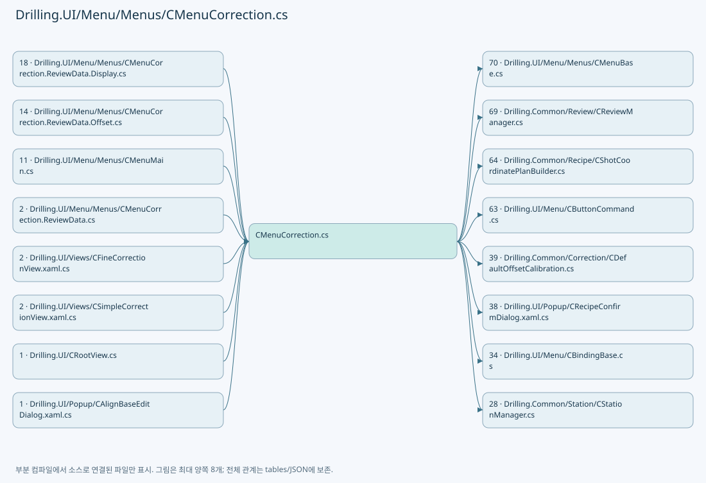

## 네임스페이스·타입·상속

| 타입 | 구분 | 원본 범위 | 선언/상속 |
| --- | --- | --- | --- |
| CMenuCorrection | ClassDeclaration | 21–4199 | CMenuCorrection: CMenuBase |
| CDefaultTest | RecordDeclaration | 3794–3794 | CDefaultTest |
| CDefaultSetupRun | ClassDeclaration | 3795–3813 | CDefaultSetupRun |
| CAlignBaseData | ClassDeclaration | 4201–4259 | CAlignBaseData |
| CAlignBaseEditPanel | ClassDeclaration | 4261–4289 | CAlignBaseEditPanel |
| CDefaultOffsetPanel | ClassDeclaration | 4293–4708 | CDefaultOffsetPanel: INotifyPropertyChanged |
| CDefaultOffsetHead | ClassDeclaration | 4710–4751 | CDefaultOffsetHead: INotifyPropertyChanged |
| CDefaultOffsetStep | RecordDeclaration | 4753–4761 | CDefaultOffsetStep: INotifyPropertyChanged |
| CAlignBaseEditKey | ClassDeclaration | 4763–4810 | CAlignBaseEditKey: INotifyPropertyChanged |
| CAlignDistortionPanel | ClassDeclaration | 4812–5252 | CAlignDistortionPanel: INotifyPropertyChanged |
| CAlignDistortionDkSelection | ClassDeclaration | 5254–5273 | CAlignDistortionDkSelection: INotifyPropertyChanged |
| CAlignBaseEditPair | RecordDeclaration | 5275–5281 | CAlignBaseEditPair |
| ST_ALIGN_DISTORTION_PAIR | RecordDeclaration | 5283–5291 | ST_ALIGN_DISTORTION_PAIR |
| ST_ALIGN_DISTORTION_KEY | RecordDeclaration | 5293–5323 | ST_ALIGN_DISTORTION_KEY |
| ST_WAPAGE_ALIGNBASE_ROW | RecordDeclaration | 5327–5336 | ST_WAPAGE_ALIGNBASE_ROW |
| CAlignWapagePanel | ClassDeclaration | 5338–5392 | CAlignWapagePanel: INotifyPropertyChanged |
| CAlignLastLoadService | ClassDeclaration | 5395–5488 | CAlignLastLoadService |
| CAlignOffsetViewerPanel | ClassDeclaration | 5490–5814 | CAlignOffsetViewerPanel: INotifyPropertyChanged |
| ST_ALIGN_OFFSET_VIEW_ROW | RecordDeclaration | 5816–5841 | ST_ALIGN_OFFSET_VIEW_ROW |
| EN_FINE_LINE_STATE | EnumDeclaration | 5842–5849 | EN_FINE_LINE_STATE |
| CFineCorrectionPanel | ClassDeclaration | 5852–6544 | CFineCorrectionPanel: INotifyPropertyChanged |
| ST_FINE_LINE_VISUAL | RecordDeclaration | 6546–6546 | ST_FINE_LINE_VISUAL |
| ST_FINE_CELL_VISUAL | RecordDeclaration | 6547–6550 | ST_FINE_CELL_VISUAL |
| ST_FINE_OFFSET_INPUT | RecordDeclaration | 6552–6552 | ST_FINE_OFFSET_INPUT |
| ST_FINE_SHOT_RESULT | RecordDeclaration | 6554–6554 | ST_FINE_SHOT_RESULT |
| CFineInspectionLine | ClassDeclaration | 6555–6710 | CFineInspectionLine: INotifyPropertyChanged |
| ST_FINE_SHOT_DETAIL | RecordDeclaration | 6712–6724 | ST_FINE_SHOT_DETAIL |
| ST_FINE_AXIS_STATISTICS | RecordDeclaration | 6726–6733 | ST_FINE_AXIS_STATISTICS |
| ST_CORRECTION_TAB | RecordDeclaration | 6735–6735 | ST_CORRECTION_TAB |
| ST_CORRECTION_SOURCE_ROW | RecordDeclaration | 6736–6745 | ST_CORRECTION_SOURCE_ROW |
| ST_CORRECTION_VALUE_ROW | RecordDeclaration | 6747–6764 | ST_CORRECTION_VALUE_ROW |
| ST_CORRECTION_HISTORY_ROW | RecordDeclaration | 6766–6820 | ST_CORRECTION_HISTORY_ROW |
| ST_CORRECTION_OFFSET_SHOT_MATRIX_ROW | RecordDeclaration | 6822–6822 | ST_CORRECTION_OFFSET_SHOT_MATRIX_ROW |
| ST_CORRECTION_OFFSET_SHOT_ITEM | RecordDeclaration | 6823–6832 | ST_CORRECTION_OFFSET_SHOT_ITEM |
| ST_CORRECTION_OUTPUT_VIEWER_HEAD_CARD | RecordDeclaration | 6833–6836 | ST_CORRECTION_OUTPUT_VIEWER_HEAD_CARD |
| ST_CORRECTION_OFFSET_VIEWER_PREVIEW | RecordDeclaration | 6837–6837 | ST_CORRECTION_OFFSET_VIEWER_PREVIEW |
| ST_CORRECTION_AXIS_SETTING_STATE | RecordStructDeclaration | 6838–6838 | ST_CORRECTION_AXIS_SETTING_STATE |
| ST_CORRECTION_AXIS_FLIP_ROW | RecordDeclaration | 6839–6844 | ST_CORRECTION_AXIS_FLIP_ROW |
| ST_CORRECTION_REVIEW_RESULT_ROW | RecordDeclaration | 6846–6876 | ST_CORRECTION_REVIEW_RESULT_ROW |
| ST_CORRECTION_REVIEW_OFFSET_ROW | RecordDeclaration | 6878–6921 | ST_CORRECTION_REVIEW_OFFSET_ROW |
| COutputOffsetViewerPanel | ClassDeclaration | 6924–7080 | COutputOffsetViewerPanel: INotifyPropertyChanged |
| CLazyOffsetShotItems | ClassDeclaration | 7034–7073 | CLazyOffsetShotItems: IReadOnlyList<ST_CORRECTION_OFFSET_SHOT_ITEM>, System.Collections.IList |
| ST_CORRECTION_OFFSET_KIND | RecordDeclaration | 7082–7082 | ST_CORRECTION_OFFSET_KIND |
| CRoughCorrectionPanel | ClassDeclaration | 7084–7366 | CRoughCorrectionPanel: INotifyPropertyChanged |
| CRoughCorrectionRow | ClassDeclaration | 7368–7416 | CRoughCorrectionRow: INotifyPropertyChanged |
| CSimpleCorrectionPanel | ClassDeclaration | 7419–8004 | CSimpleCorrectionPanel: INotifyPropertyChanged |
| ST_SIMPLE_CORRECTION_HEAD | RecordDeclaration | 8006–8010 | ST_SIMPLE_CORRECTION_HEAD |
| ST_SIMPLE_CORRECTION_SHOT | RecordDeclaration | 8012–8023 | ST_SIMPLE_CORRECTION_SHOT |
| ST_SIMPLE_CORRECTION_SHOT_ROW | RecordDeclaration | 8025–8025 | ST_SIMPLE_CORRECTION_SHOT_ROW |
| ST_SIMPLE_CORRECTION_FIRST_SHOT | RecordDeclaration | 8026–8031 | ST_SIMPLE_CORRECTION_FIRST_SHOT |
| ST_SIMPLE_CORRECTION_CALLOUT | RecordDeclaration | 8033–8051 | ST_SIMPLE_CORRECTION_CALLOUT |
| CSimpleCorrectionInput | ClassDeclaration | 8054–8116 | CSimpleCorrectionInput: INotifyPropertyChanged |
| ST_SIMPLE_OFFSET_CHANGE | RecordDeclaration | 8118–8122 | ST_SIMPLE_OFFSET_CHANGE |

## 멤버 빠른 목록

| 이름 | 종류 | 범위 | 서명 |
| --- | --- | --- | --- |
| CorrectionTabs | FieldDeclaration | L24–24 | string[] Drilling.UI.Menu.Menus.CMenuCorrection.CorrectionTabs |
| _reviewResultFile | FieldDeclaration | L25–25 | Drilling.Common.Review.CReviewResultFileBase Drilling.UI.Menu.Menus.CMenuCorrection._reviewResultFile |
| _reviewOffsetFile | FieldDeclaration | L26–26 | Drilling.Common.Review.CReviewOffsetFileBase Drilling.UI.Menu.Menus.CMenuCorrection._reviewOffsetFile |
| _reviewManager | FieldDeclaration | L27–27 | Drilling.Common.Review.CReviewManager Drilling.UI.Menu.Menus.CMenuCorrection._reviewManager |
| _recipeManager | FieldDeclaration | L28–28 | Drilling.Common.Managers.CRecipeManager Drilling.UI.Menu.Menus.CMenuCorrection._recipeManager |
| _settingManager | FieldDeclaration | L29–29 | Drilling.Common.Managers.CSettingManager Drilling.UI.Menu.Menus.CMenuCorrection._settingManager |
| _selectedRecipeIdProvider | FieldDeclaration | L30–30 | System.Func<string> Drilling.UI.Menu.Menus.CMenuCorrection._selectedRecipeIdProvider |
| _statusReporter | FieldDeclaration | L31–31 | System.Action<string> Drilling.UI.Menu.Menus.CMenuCorrection._statusReporter |
| _refreshCurrentScreen | FieldDeclaration | L32–32 | System.Func<System.Threading.Tasks.Task> Drilling.UI.Menu.Menus.CMenuCorrection._refreshCurrentScreen |
| _alignLastLoad | FieldDeclaration | L33–33 | Drilling.UI.Menu.Menus.CAlignLastLoadService Drilling.UI.Menu.Menus.CMenuCorrection._alignLastLoad |
| _wapage | FieldDeclaration | L34–34 | Drilling.Common.Correction.CAlignWapageService Drilling.UI.Menu.Menus.CMenuCorrection._wapage |
| _alignOffsetLogFile | FieldDeclaration | L35–35 | Drilling.Common.Correction.CAlignOffsetLogFileBase? Drilling.UI.Menu.Menus.CMenuCorrection._alignOffsetLogFile |
| _reviewDataHistory | FieldDeclaration | L36–36 | System.Collections.Generic.List<Drilling.UI.Menu.Menus.ST_CORRECTION_HISTORY_ROW> Drilling.UI.Menu.Menus.CMenuCorrection._reviewDataHistory |
| _loadedReviewResult | FieldDeclaration | L37–37 | Drilling.Common.Review.ST_REVIEW_RESULT_FILE_DATA? Drilling.UI.Menu.Menus.CMenuCorrection._loadedReviewResult |
| _hasPendingReviewOffsetApply | FieldDeclaration | L38–38 | bool Drilling.UI.Menu.Menus.CMenuCorrection._hasPendingReviewOffsetApply |
| _reviewLoadStatus | FieldDeclaration | L39–39 | string Drilling.UI.Menu.Menus.CMenuCorrection._reviewLoadStatus |
| _reviewLoadState | FieldDeclaration | L40–40 | string Drilling.UI.Menu.Menus.CMenuCorrection._reviewLoadState |
| _currentSettingState | FieldDeclaration | L41–41 | string Drilling.UI.Menu.Menus.CMenuCorrection._currentSettingState |
| _currentVisionSettingState | FieldDeclaration | L42–42 | string Drilling.UI.Menu.Menus.CMenuCorrection._currentVisionSettingState |
| _currentScannerSettingState | FieldDeclaration | L43–43 | string Drilling.UI.Menu.Menus.CMenuCorrection._currentScannerSettingState |
| _currentSettingDetail | FieldDeclaration | L44–44 | string Drilling.UI.Menu.Menus.CMenuCorrection._currentSettingDetail |
| _calculatedSettingDetail | FieldDeclaration | L45–45 | string Drilling.UI.Menu.Menus.CMenuCorrection._calculatedSettingDetail |
| _currentReviewOffsetRecipeName | FieldDeclaration | L46–46 | string Drilling.UI.Menu.Menus.CMenuCorrection._currentReviewOffsetRecipeName |
| _outputViewerIsCellDetailVisible | FieldDeclaration | L47–47 | bool Drilling.UI.Menu.Menus.CMenuCorrection._outputViewerIsCellDetailVisible |
| _outputViewerSelectedCellNo | FieldDeclaration | L48–48 | int Drilling.UI.Menu.Menus.CMenuCorrection._outputViewerSelectedCellNo |
| _outputViewerRefreshVersion | FieldDeclaration | L49–49 | int Drilling.UI.Menu.Menus.CMenuCorrection._outputViewerRefreshVersion |
| _outputViewerPreviewParameters | FieldDeclaration | L50–50 | System.Collections.Generic.IReadOnlyDictionary<string, string>? Drilling.UI.Menu.Menus.CMenuCorrection._outputViewerPreviewParameters |
| _outputViewerPreviewCellCount | FieldDeclaration | L51–51 | int Drilling.UI.Menu.Menus.CMenuCorrection._outputViewerPreviewCellCount |
| _outputViewerPreviewSelectedCellNo | FieldDeclaration | L52–52 | int Drilling.UI.Menu.Menus.CMenuCorrection._outputViewerPreviewSelectedCellNo |
| _outputViewerPreviewCache | FieldDeclaration | L53–53 | Drilling.UI.Menu.Menus.ST_CORRECTION_OFFSET_VIEWER_PREVIEW? Drilling.UI.Menu.Menus.CMenuCorrection._outputViewerPreviewCache |
| _outputViewerShotParameters | FieldDeclaration | L54–54 | System.Collections.Generic.IReadOnlyDictionary<string, string>? Drilling.UI.Menu.Menus.CMenuCorrection._outputViewerShotParameters |
| _outputViewerShotCellNo | FieldDeclaration | L55–55 | int Drilling.UI.Menu.Menus.CMenuCorrection._outputViewerShotCellNo |
| _outputViewerShotCache | FieldDeclaration | L56–56 | System.Collections.Generic.IReadOnlyList<Drilling.Common.Recipe.ST_HEAD_SHOT_POINT> Drilling.UI.Menu.Menus.CMenuCorrection._outputViewerShotCache |
| _outputViewerSelectedCellShots | FieldDeclaration | L57–57 | System.Collections.Generic.IReadOnlyList<Drilling.Common.Recipe.ST_HEAD_SHOT_POINT> Drilling.UI.Menu.Menus.CMenuCorrection._outputViewerSelectedCellShots |
| _outputViewerSelectedShotStates | FieldDeclaration | L58–58 | System.Collections.Generic.IReadOnlyDictionary<string, Drilling.Common.Recipe.ST_RECIPE_SHOT_MASKING_RESULT> Drilling.UI.Menu.Menus.CMenuCorrection._outputViewerSelectedShotStates |
| _outputViewerSelectedShotKey | FieldDeclaration | L59–59 | string Drilling.UI.Menu.Menus.CMenuCorrection._outputViewerSelectedShotKey |
| _selectedTab | FieldDeclaration | L60–60 | string Drilling.UI.Menu.Menus.CMenuCorrection._selectedTab |
| _simpleOffsetRecipeId | FieldDeclaration | L61–61 | string Drilling.UI.Menu.Menus.CMenuCorrection._simpleOffsetRecipeId |
| _simpleOffsetLoad | FieldDeclaration | L62–62 | System.Threading.Tasks.Task<Drilling.Common.Review.ST_REVIEW_OFFSET_FILE_DATA>? Drilling.UI.Menu.Menus.CMenuCorrection._simpleOffsetLoad |
| _isReviewOperationRunning | FieldDeclaration | L63–63 | bool Drilling.UI.Menu.Menus.CMenuCorrection._isReviewOperationRunning |
| Tabs | PropertyDeclaration | L64–64 | System.Collections.Generic.IReadOnlyList<Drilling.UI.Menu.Menus.ST_CORRECTION_TAB> Drilling.UI.Menu.Menus.CMenuCorrection.Tabs |
| get_Tabs | GetAccessorDeclaration | L64–64 | System.Collections.Generic.IReadOnlyList<Drilling.UI.Menu.Menus.ST_CORRECTION_TAB> Drilling.UI.Menu.Menus.CMenuCorrection.Tabs.get |
| set_Tabs | SetAccessorDeclaration | L64–64 | void Drilling.UI.Menu.Menus.CMenuCorrection.Tabs.set |
| SummaryItems | PropertyDeclaration | L65–65 | System.Collections.Generic.IReadOnlyList<Drilling.UI.Menu.Menus.ST_DISPLAY_ITEM> Drilling.UI.Menu.Menus.CMenuCorrection.SummaryItems |
| get_SummaryItems | GetAccessorDeclaration | L65–65 | System.Collections.Generic.IReadOnlyList<Drilling.UI.Menu.Menus.ST_DISPLAY_ITEM> Drilling.UI.Menu.Menus.CMenuCorrection.SummaryItems.get |
| set_SummaryItems | SetAccessorDeclaration | L65–65 | void Drilling.UI.Menu.Menus.CMenuCorrection.SummaryItems.set |
| SourceRows | PropertyDeclaration | L66–66 | System.Collections.Generic.IReadOnlyList<Drilling.UI.Menu.Menus.ST_CORRECTION_SOURCE_ROW> Drilling.UI.Menu.Menus.CMenuCorrection.SourceRows |
| get_SourceRows | GetAccessorDeclaration | L66–66 | System.Collections.Generic.IReadOnlyList<Drilling.UI.Menu.Menus.ST_CORRECTION_SOURCE_ROW> Drilling.UI.Menu.Menus.CMenuCorrection.SourceRows.get |
| set_SourceRows | SetAccessorDeclaration | L66–66 | void Drilling.UI.Menu.Menus.CMenuCorrection.SourceRows.set |
| CandidateRows | PropertyDeclaration | L67–67 | System.Collections.Generic.IReadOnlyList<Drilling.UI.Menu.Menus.ST_CORRECTION_VALUE_ROW> Drilling.UI.Menu.Menus.CMenuCorrection.CandidateRows |
| get_CandidateRows | GetAccessorDeclaration | L67–67 | System.Collections.Generic.IReadOnlyList<Drilling.UI.Menu.Menus.ST_CORRECTION_VALUE_ROW> Drilling.UI.Menu.Menus.CMenuCorrection.CandidateRows.get |
| set_CandidateRows | SetAccessorDeclaration | L67–67 | void Drilling.UI.Menu.Menus.CMenuCorrection.CandidateRows.set |
| ApplyRows | PropertyDeclaration | L68–68 | System.Collections.Generic.IReadOnlyList<Drilling.UI.Menu.Menus.ST_CORRECTION_VALUE_ROW> Drilling.UI.Menu.Menus.CMenuCorrection.ApplyRows |
| get_ApplyRows | GetAccessorDeclaration | L68–68 | System.Collections.Generic.IReadOnlyList<Drilling.UI.Menu.Menus.ST_CORRECTION_VALUE_ROW> Drilling.UI.Menu.Menus.CMenuCorrection.ApplyRows.get |
| set_ApplyRows | SetAccessorDeclaration | L68–68 | void Drilling.UI.Menu.Menus.CMenuCorrection.ApplyRows.set |
| HistoryRows | PropertyDeclaration | L69–69 | System.Collections.Generic.IReadOnlyList<Drilling.UI.Menu.Menus.ST_CORRECTION_HISTORY_ROW> Drilling.UI.Menu.Menus.CMenuCorrection.HistoryRows |
| get_HistoryRows | GetAccessorDeclaration | L69–69 | System.Collections.Generic.IReadOnlyList<Drilling.UI.Menu.Menus.ST_CORRECTION_HISTORY_ROW> Drilling.UI.Menu.Menus.CMenuCorrection.HistoryRows.get |
| set_HistoryRows | SetAccessorDeclaration | L69–69 | void Drilling.UI.Menu.Menus.CMenuCorrection.HistoryRows.set |
| DetailItems | PropertyDeclaration | L70–70 | System.Collections.Generic.IReadOnlyList<Drilling.UI.Menu.Menus.ST_DISPLAY_ITEM> Drilling.UI.Menu.Menus.CMenuCorrection.DetailItems |
| get_DetailItems | GetAccessorDeclaration | L70–70 | System.Collections.Generic.IReadOnlyList<Drilling.UI.Menu.Menus.ST_DISPLAY_ITEM> Drilling.UI.Menu.Menus.CMenuCorrection.DetailItems.get |
| set_DetailItems | SetAccessorDeclaration | L70–70 | void Drilling.UI.Menu.Menus.CMenuCorrection.DetailItems.set |
| ReviewResultRows | PropertyDeclaration | L71–71 | System.Collections.Generic.IReadOnlyList<Drilling.UI.Menu.Menus.ST_CORRECTION_REVIEW_RESULT_ROW> Drilling.UI.Menu.Menus.CMenuCorrection.ReviewResultRows |
| get_ReviewResultRows | GetAccessorDeclaration | L71–71 | System.Collections.Generic.IReadOnlyList<Drilling.UI.Menu.Menus.ST_CORRECTION_REVIEW_RESULT_ROW> Drilling.UI.Menu.Menus.CMenuCorrection.ReviewResultRows.get |
| set_ReviewResultRows | SetAccessorDeclaration | L71–71 | void Drilling.UI.Menu.Menus.CMenuCorrection.ReviewResultRows.set |
| CalculatedOffsetRows | PropertyDeclaration | L72–72 | System.Collections.Generic.IReadOnlyList<Drilling.UI.Menu.Menus.ST_CORRECTION_REVIEW_OFFSET_ROW> Drilling.UI.Menu.Menus.CMenuCorrection.CalculatedOffsetRows |
| get_CalculatedOffsetRows | GetAccessorDeclaration | L72–72 | System.Collections.Generic.IReadOnlyList<Drilling.UI.Menu.Menus.ST_CORRECTION_REVIEW_OFFSET_ROW> Drilling.UI.Menu.Menus.CMenuCorrection.CalculatedOffsetRows.get |
| set_CalculatedOffsetRows | SetAccessorDeclaration | L72–72 | void Drilling.UI.Menu.Menus.CMenuCorrection.CalculatedOffsetRows.set |
| CurrentOffsetRows | PropertyDeclaration | L73–73 | System.Collections.Generic.IReadOnlyList<Drilling.UI.Menu.Menus.ST_CORRECTION_REVIEW_OFFSET_ROW> Drilling.UI.Menu.Menus.CMenuCorrection.CurrentOffsetRows |
| get_CurrentOffsetRows | GetAccessorDeclaration | L73–73 | System.Collections.Generic.IReadOnlyList<Drilling.UI.Menu.Menus.ST_CORRECTION_REVIEW_OFFSET_ROW> Drilling.UI.Menu.Menus.CMenuCorrection.CurrentOffsetRows.get |
| set_CurrentOffsetRows | SetAccessorDeclaration | L73–73 | void Drilling.UI.Menu.Menus.CMenuCorrection.CurrentOffsetRows.set |
| ApplyPreviewRows | PropertyDeclaration | L74–74 | System.Collections.Generic.IReadOnlyList<Drilling.UI.Menu.Menus.ST_CORRECTION_REVIEW_OFFSET_ROW> Drilling.UI.Menu.Menus.CMenuCorrection.ApplyPreviewRows |
| get_ApplyPreviewRows | GetAccessorDeclaration | L74–74 | System.Collections.Generic.IReadOnlyList<Drilling.UI.Menu.Menus.ST_CORRECTION_REVIEW_OFFSET_ROW> Drilling.UI.Menu.Menus.CMenuCorrection.ApplyPreviewRows.get |
| set_ApplyPreviewRows | SetAccessorDeclaration | L74–74 | void Drilling.UI.Menu.Menus.CMenuCorrection.ApplyPreviewRows.set |
| OutputViewerCellPreviewLabels | PropertyDeclaration | L75–75 | System.Collections.Generic.IReadOnlyList<Drilling.UI.Menu.Menus.ST_CELL_PREVIEW_LABEL> Drilling.UI.Menu.Menus.CMenuCorrection.OutputViewerCellPreviewLabels |
| get_OutputViewerCellPreviewLabels | GetAccessorDeclaration | L75–75 | System.Collections.Generic.IReadOnlyList<Drilling.UI.Menu.Menus.ST_CELL_PREVIEW_LABEL> Drilling.UI.Menu.Menus.CMenuCorrection.OutputViewerCellPreviewLabels.get |
| set_OutputViewerCellPreviewLabels | SetAccessorDeclaration | L75–75 | void Drilling.UI.Menu.Menus.CMenuCorrection.OutputViewerCellPreviewLabels.set |
| OutputViewerHeadCards | PropertyDeclaration | L76–76 | System.Collections.Generic.IReadOnlyList<Drilling.UI.Menu.Menus.ST_CORRECTION_OUTPUT_VIEWER_HEAD_CARD> Drilling.UI.Menu.Menus.CMenuCorrection.OutputViewerHeadCards |
| get_OutputViewerHeadCards | GetAccessorDeclaration | L76–76 | System.Collections.Generic.IReadOnlyList<Drilling.UI.Menu.Menus.ST_CORRECTION_OUTPUT_VIEWER_HEAD_CARD> Drilling.UI.Menu.Menus.CMenuCorrection.OutputViewerHeadCards.get |
| set_OutputViewerHeadCards | SetAccessorDeclaration | L76–76 | void Drilling.UI.Menu.Menus.CMenuCorrection.OutputViewerHeadCards.set |
| OutputOffsets | PropertyDeclaration | L77–77 | Drilling.UI.Menu.Menus.COutputOffsetViewerPanel Drilling.UI.Menu.Menus.CMenuCorrection.OutputOffsets |
| get_OutputOffsets | GetAccessorDeclaration | L77–77 | Drilling.UI.Menu.Menus.COutputOffsetViewerPanel Drilling.UI.Menu.Menus.CMenuCorrection.OutputOffsets.get |
| DefaultOffset | PropertyDeclaration | L78–78 | Drilling.UI.Menu.Menus.CDefaultOffsetPanel Drilling.UI.Menu.Menus.CMenuCorrection.DefaultOffset |
| get_DefaultOffset | GetAccessorDeclaration | L78–78 | Drilling.UI.Menu.Menus.CDefaultOffsetPanel Drilling.UI.Menu.Menus.CMenuCorrection.DefaultOffset.get |
| ReviewData | PropertyDeclaration | L79–79 | Drilling.UI.Menu.Menus.CMenuCorrection.CReviewDataPanel Drilling.UI.Menu.Menus.CMenuCorrection.ReviewData |
| get_ReviewData | GetAccessorDeclaration | L79–79 | Drilling.UI.Menu.Menus.CMenuCorrection.CReviewDataPanel Drilling.UI.Menu.Menus.CMenuCorrection.ReviewData.get |
| OutputViewerSummary | PropertyDeclaration | L80–80 | string Drilling.UI.Menu.Menus.CMenuCorrection.OutputViewerSummary |
| get_OutputViewerSummary | GetAccessorDeclaration | L80–80 | string Drilling.UI.Menu.Menus.CMenuCorrection.OutputViewerSummary.get |
| set_OutputViewerSummary | SetAccessorDeclaration | L80–80 | void Drilling.UI.Menu.Menus.CMenuCorrection.OutputViewerSummary.set |
| OutputViewerCellShotMapImage | PropertyDeclaration | L81–81 | ImageSource? Drilling.UI.Menu.Menus.CMenuCorrection.OutputViewerCellShotMapImage |
| get_OutputViewerCellShotMapImage | GetAccessorDeclaration | L81–81 | ImageSource? Drilling.UI.Menu.Menus.CMenuCorrection.OutputViewerCellShotMapImage.get |
| set_OutputViewerCellShotMapImage | SetAccessorDeclaration | L81–81 | void Drilling.UI.Menu.Menus.CMenuCorrection.OutputViewerCellShotMapImage.set |
| OutputViewerCellShotMapImageChanged | EventFieldDeclaration | L82–82 | System.EventHandler? Drilling.UI.Menu.Menus.CMenuCorrection.OutputViewerCellShotMapImageChanged |
| OutputViewerSelectedShotNameChanged | EventFieldDeclaration | L83–83 | System.EventHandler? Drilling.UI.Menu.Menus.CMenuCorrection.OutputViewerSelectedShotNameChanged |
| OutputViewerSelectedShotDetailChanged | EventFieldDeclaration | L84–84 | System.EventHandler? Drilling.UI.Menu.Menus.CMenuCorrection.OutputViewerSelectedShotDetailChanged |
| CurrentVisionFlipRow | PropertyDeclaration | L85–85 | Drilling.UI.Menu.Menus.ST_CORRECTION_AXIS_FLIP_ROW Drilling.UI.Menu.Menus.CMenuCorrection.CurrentVisionFlipRow |
| get_CurrentVisionFlipRow | GetAccessorDeclaration | L85–85 | Drilling.UI.Menu.Menus.ST_CORRECTION_AXIS_FLIP_ROW Drilling.UI.Menu.Menus.CMenuCorrection.CurrentVisionFlipRow.get |
| set_CurrentVisionFlipRow | SetAccessorDeclaration | L85–85 | void Drilling.UI.Menu.Menus.CMenuCorrection.CurrentVisionFlipRow.set |
| CurrentScannerFlipRows | PropertyDeclaration | L86–86 | System.Collections.Generic.IReadOnlyList<Drilling.UI.Menu.Menus.ST_CORRECTION_AXIS_FLIP_ROW> Drilling.UI.Menu.Menus.CMenuCorrection.CurrentScannerFlipRows |
| get_CurrentScannerFlipRows | GetAccessorDeclaration | L86–86 | System.Collections.Generic.IReadOnlyList<Drilling.UI.Menu.Menus.ST_CORRECTION_AXIS_FLIP_ROW> Drilling.UI.Menu.Menus.CMenuCorrection.CurrentScannerFlipRows.get |
| set_CurrentScannerFlipRows | SetAccessorDeclaration | L86–86 | void Drilling.UI.Menu.Menus.CMenuCorrection.CurrentScannerFlipRows.set |
| _fineCancellation | FieldDeclaration | L88–88 | System.Threading.CancellationTokenSource? Drilling.UI.Menu.Menus.CMenuCorrection._fineCancellation |
| _lastReviewOffsetWarning | FieldDeclaration | L89–89 | string Drilling.UI.Menu.Menus.CMenuCorrection._lastReviewOffsetWarning |
| ReviewOffsetWarning | PropertyDeclaration | L90–90 | System.Action<string, string> Drilling.UI.Menu.Menus.CMenuCorrection.ReviewOffsetWarning |
| get_ReviewOffsetWarning | GetAccessorDeclaration | L90–90 | System.Action<string, string> Drilling.UI.Menu.Menus.CMenuCorrection.ReviewOffsetWarning.get |
| set_ReviewOffsetWarning | SetAccessorDeclaration | L90–90 | void Drilling.UI.Menu.Menus.CMenuCorrection.ReviewOffsetWarning.set |
| DuplicateReviewOffsetConfirmation | PropertyDeclaration | L91–92 | System.Func<string, string, bool> Drilling.UI.Menu.Menus.CMenuCorrection.DuplicateReviewOffsetConfirmation |
| get_DuplicateReviewOffsetConfirmation | GetAccessorDeclaration | L91–91 | System.Func<string, string, bool> Drilling.UI.Menu.Menus.CMenuCorrection.DuplicateReviewOffsetConfirmation.get |
| set_DuplicateReviewOffsetConfirmation | SetAccessorDeclaration | L91–91 | void Drilling.UI.Menu.Menus.CMenuCorrection.DuplicateReviewOffsetConfirmation.set |
| _roughCancellation | FieldDeclaration | L94–94 | System.Threading.CancellationTokenSource? Drilling.UI.Menu.Menus.CMenuCorrection._roughCancellation |
| BlocksMenuNavigation | PropertyDeclaration | L95–97 | bool Drilling.UI.Menu.Menus.CMenuCorrection.BlocksMenuNavigation |
| _defaultManager | FieldDeclaration | L98–98 | Drilling.Common.Managers.CManager? Drilling.UI.Menu.Menus.CMenuCorrection._defaultManager |
| _defaultScriptFile | FieldDeclaration | L99–99 | Drilling.Common.Station.CAutomationScriptFileBase? Drilling.UI.Menu.Menus.CMenuCorrection._defaultScriptFile |
| _defaultRun | FieldDeclaration | L100–100 | Drilling.UI.Menu.Menus.CMenuCorrection.CDefaultSetupRun? Drilling.UI.Menu.Menus.CMenuCorrection._defaultRun |
| _defaultCancellation | FieldDeclaration | L101–101 | System.Threading.CancellationTokenSource? Drilling.UI.Menu.Menus.CMenuCorrection._defaultCancellation |
| _defaultOwnSave | FieldDeclaration | L102–102 | bool Drilling.UI.Menu.Menus.CMenuCorrection._defaultOwnSave |
| _defaultStopped | FieldDeclaration | L103–103 | System.Threading.Tasks.TaskCompletionSource? Drilling.UI.Menu.Menus.CMenuCorrection._defaultStopped |
| DefaultBlocksAuto | PropertyDeclaration | L104–104 | bool Drilling.UI.Menu.Menus.CMenuCorrection.DefaultBlocksAuto |
| DefaultConfirmation | PropertyDeclaration | L105–105 | System.Func<string, string, bool> Drilling.UI.Menu.Menus.CMenuCorrection.DefaultConfirmation |
| get_DefaultConfirmation | GetAccessorDeclaration | L105–105 | System.Func<string, string, bool> Drilling.UI.Menu.Menus.CMenuCorrection.DefaultConfirmation.get |
| set_DefaultConfirmation | SetAccessorDeclaration | L105–105 | void Drilling.UI.Menu.Menus.CMenuCorrection.DefaultConfirmation.set |
| DefaultRestartChoice | PropertyDeclaration | L106–106 | System.Func<string, Drilling.UI.Popup.EN_DEFAULT_RESTART_CHOICE> Drilling.UI.Menu.Menus.CMenuCorrection.DefaultRestartChoice |
| get_DefaultRestartChoice | GetAccessorDeclaration | L106–106 | System.Func<string, Drilling.UI.Popup.EN_DEFAULT_RESTART_CHOICE> Drilling.UI.Menu.Menus.CMenuCorrection.DefaultRestartChoice.get |
| set_DefaultRestartChoice | SetAccessorDeclaration | L106–106 | void Drilling.UI.Menu.Menus.CMenuCorrection.DefaultRestartChoice.set |
| DefaultWarning | PropertyDeclaration | L107–107 | System.Action<string, string> Drilling.UI.Menu.Menus.CMenuCorrection.DefaultWarning |
| get_DefaultWarning | GetAccessorDeclaration | L107–107 | System.Action<string, string> Drilling.UI.Menu.Menus.CMenuCorrection.DefaultWarning.get |
| set_DefaultWarning | SetAccessorDeclaration | L107–107 | void Drilling.UI.Menu.Menus.CMenuCorrection.DefaultWarning.set |
| .ctor | ConstructorDeclaration | L110–175 | Drilling.UI.Menu.Menus.CMenuCorrection.CMenuCorrection(Drilling.Common.Review.CReviewResultFileBase, Drilling.Common.Review.CReviewOffsetFileBase, Drilling.Common.Review.CReviewManager, Drilling.Common.Managers.CRecipeManager, Drilling.Common.Managers.CSettingManager, System.Func<string>, System.Action<string>, System.Func<System.Threading.Tasks.Task>, Drilling.Common.Interface.CInterfaceManager?, Drilling.Common.Correction.CAlignOffsetLogFileBase?, Drilling.Common.Managers.CManager?, Drilling.Common.Station.CAutomationScriptFileBase?) |
| SelectOutputViewerCellCallback | LocalFunctionStatement | L162–165 | void SelectOutputViewerCellCallback(object?) |
| BackToOutputViewerGlassCallback | LocalFunctionStatement | L169–172 | void BackToOutputViewerGlassCallback(object?) |
| TryConfirmInitialReviewStart | MethodDeclaration | L177–209 | bool Drilling.UI.Menu.Menus.CMenuCorrection.TryConfirmInitialReviewStart(string, string, string, System.Func<string, string, bool>?, out double, out double) |
| Menu | PropertyDeclaration | L213–219 | Drilling.UI.Menu.Menus.EN_MENU Drilling.UI.Menu.Menus.CMenuCorrection.Menu |
| get_Menu | GetAccessorDeclaration | L215–218 | Drilling.UI.Menu.Menus.EN_MENU Drilling.UI.Menu.Menus.CMenuCorrection.Menu.get |
| Title | PropertyDeclaration | L221–227 | string Drilling.UI.Menu.Menus.CMenuCorrection.Title |
| get_Title | GetAccessorDeclaration | L223–226 | string Drilling.UI.Menu.Menus.CMenuCorrection.Title.get |
| Subtitle | PropertyDeclaration | L229–235 | string Drilling.UI.Menu.Menus.CMenuCorrection.Subtitle |
| get_Subtitle | GetAccessorDeclaration | L231–234 | string Drilling.UI.Menu.Menus.CMenuCorrection.Subtitle.get |
| SelectedTab | PropertyDeclaration | L237–243 | string Drilling.UI.Menu.Menus.CMenuCorrection.SelectedTab |
| get_SelectedTab | GetAccessorDeclaration | L239–242 | string Drilling.UI.Menu.Menus.CMenuCorrection.SelectedTab.get |
| IsOtherCorrectionTab | PropertyDeclaration | L245–251 | bool Drilling.UI.Menu.Menus.CMenuCorrection.IsOtherCorrectionTab |
| get_IsOtherCorrectionTab | GetAccessorDeclaration | L247–250 | bool Drilling.UI.Menu.Menus.CMenuCorrection.IsOtherCorrectionTab.get |
| IsDefaultTab | PropertyDeclaration | L253–253 | bool Drilling.UI.Menu.Menus.CMenuCorrection.IsDefaultTab |
| IsAlignDistortionTab | PropertyDeclaration | L254–254 | bool Drilling.UI.Menu.Menus.CMenuCorrection.IsAlignDistortionTab |
| IsReviewCorrectionTab | PropertyDeclaration | L255–255 | bool Drilling.UI.Menu.Menus.CMenuCorrection.IsReviewCorrectionTab |
| Simple | PropertyDeclaration | L256–256 | Drilling.UI.Menu.Menus.CSimpleCorrectionPanel Drilling.UI.Menu.Menus.CMenuCorrection.Simple |
| get_Simple | GetAccessorDeclaration | L256–256 | Drilling.UI.Menu.Menus.CSimpleCorrectionPanel Drilling.UI.Menu.Menus.CMenuCorrection.Simple.get |
| Rough | PropertyDeclaration | L257–257 | Drilling.UI.Menu.Menus.CSimpleCorrectionPanel Drilling.UI.Menu.Menus.CMenuCorrection.Rough |
| get_Rough | GetAccessorDeclaration | L257–257 | Drilling.UI.Menu.Menus.CSimpleCorrectionPanel Drilling.UI.Menu.Menus.CMenuCorrection.Rough.get |
| Fine | PropertyDeclaration | L258–258 | Drilling.UI.Menu.Menus.CFineCorrectionPanel Drilling.UI.Menu.Menus.CMenuCorrection.Fine |
| get_Fine | GetAccessorDeclaration | L258–258 | Drilling.UI.Menu.Menus.CFineCorrectionPanel Drilling.UI.Menu.Menus.CMenuCorrection.Fine.get |
| IsCorrectionCommandsVisible | PropertyDeclaration | L259–259 | bool Drilling.UI.Menu.Menus.CMenuCorrection.IsCorrectionCommandsVisible |
| AlignDistortion | PropertyDeclaration | L260–260 | Drilling.UI.Menu.Menus.CAlignDistortionPanel Drilling.UI.Menu.Menus.CMenuCorrection.AlignDistortion |
| get_AlignDistortion | GetAccessorDeclaration | L260–260 | Drilling.UI.Menu.Menus.CAlignDistortionPanel Drilling.UI.Menu.Menus.CMenuCorrection.AlignDistortion.get |
| IsOutputHistoryTab | PropertyDeclaration | L262–268 | bool Drilling.UI.Menu.Menus.CMenuCorrection.IsOutputHistoryTab |
| get_IsOutputHistoryTab | GetAccessorDeclaration | L264–267 | bool Drilling.UI.Menu.Menus.CMenuCorrection.IsOutputHistoryTab.get |
| IsCorrectionHistoryVisible | PropertyDeclaration | L270–276 | bool Drilling.UI.Menu.Menus.CMenuCorrection.IsCorrectionHistoryVisible |
| get_IsCorrectionHistoryVisible | GetAccessorDeclaration | L272–275 | bool Drilling.UI.Menu.Menus.CMenuCorrection.IsCorrectionHistoryVisible.get |
| OutputViewerGlassPreviewImage | PropertyDeclaration | L278–278 | ImageSource? Drilling.UI.Menu.Menus.CMenuCorrection.OutputViewerGlassPreviewImage |
| get_OutputViewerGlassPreviewImage | GetAccessorDeclaration | L278–278 | ImageSource? Drilling.UI.Menu.Menus.CMenuCorrection.OutputViewerGlassPreviewImage.get |
| set_OutputViewerGlassPreviewImage | SetAccessorDeclaration | L278–278 | void Drilling.UI.Menu.Menus.CMenuCorrection.OutputViewerGlassPreviewImage.set |
| OutputViewerSelectedCellName | PropertyDeclaration | L279–279 | string Drilling.UI.Menu.Menus.CMenuCorrection.OutputViewerSelectedCellName |
| OutputViewerSelectedShotName | PropertyDeclaration | L280–280 | string Drilling.UI.Menu.Menus.CMenuCorrection.OutputViewerSelectedShotName |
| OutputViewerSelectedShotDetail | PropertyDeclaration | L281–281 | string Drilling.UI.Menu.Menus.CMenuCorrection.OutputViewerSelectedShotDetail |
| OutputViewerCellShotMapSurfaceWidth | PropertyDeclaration | L282–282 | double Drilling.UI.Menu.Menus.CMenuCorrection.OutputViewerCellShotMapSurfaceWidth |
| OutputViewerCellShotMapSurfaceHeight | PropertyDeclaration | L283–283 | double Drilling.UI.Menu.Menus.CMenuCorrection.OutputViewerCellShotMapSurfaceHeight |
| OutputViewerIsGlassPreviewVisible | PropertyDeclaration | L284–284 | bool Drilling.UI.Menu.Menus.CMenuCorrection.OutputViewerIsGlassPreviewVisible |
| OutputViewerIsCellDetailVisible | PropertyDeclaration | L285–285 | bool Drilling.UI.Menu.Menus.CMenuCorrection.OutputViewerIsCellDetailVisible |
| OutputViewerHasNoCellSelection | PropertyDeclaration | L286–286 | bool Drilling.UI.Menu.Menus.CMenuCorrection.OutputViewerHasNoCellSelection |
| LoadedReviewFileName | PropertyDeclaration | L288–294 | string Drilling.UI.Menu.Menus.CMenuCorrection.LoadedReviewFileName |
| get_LoadedReviewFileName | GetAccessorDeclaration | L290–293 | string Drilling.UI.Menu.Menus.CMenuCorrection.LoadedReviewFileName.get |
| LoadedReviewSettingSummary | PropertyDeclaration | L296–303 | string Drilling.UI.Menu.Menus.CMenuCorrection.LoadedReviewSettingSummary |
| get_LoadedReviewSettingSummary | GetAccessorDeclaration | L298–302 | string Drilling.UI.Menu.Menus.CMenuCorrection.LoadedReviewSettingSummary.get |
| LoadedReviewRule | PropertyDeclaration | L305–305 | string Drilling.UI.Menu.Menus.CMenuCorrection.LoadedReviewRule |
| LoadedReviewSettingDetail | PropertyDeclaration | L306–306 | string Drilling.UI.Menu.Menus.CMenuCorrection.LoadedReviewSettingDetail |
| ReviewLoadStatus | PropertyDeclaration | L308–314 | string Drilling.UI.Menu.Menus.CMenuCorrection.ReviewLoadStatus |
| get_ReviewLoadStatus | GetAccessorDeclaration | L310–313 | string Drilling.UI.Menu.Menus.CMenuCorrection.ReviewLoadStatus.get |
| ReviewLoadStatusBrush | PropertyDeclaration | L316–322 | Brush Drilling.UI.Menu.Menus.CMenuCorrection.ReviewLoadStatusBrush |
| get_ReviewLoadStatusBrush | GetAccessorDeclaration | L318–321 | Brush Drilling.UI.Menu.Menus.CMenuCorrection.ReviewLoadStatusBrush.get |
| CurrentSettingState | PropertyDeclaration | L324–330 | string Drilling.UI.Menu.Menus.CMenuCorrection.CurrentSettingState |
| get_CurrentSettingState | GetAccessorDeclaration | L326–329 | string Drilling.UI.Menu.Menus.CMenuCorrection.CurrentSettingState.get |
| CurrentSettingDetail | PropertyDeclaration | L332–338 | string Drilling.UI.Menu.Menus.CMenuCorrection.CurrentSettingDetail |
| get_CurrentSettingDetail | GetAccessorDeclaration | L334–337 | string Drilling.UI.Menu.Menus.CMenuCorrection.CurrentSettingDetail.get |
| CurrentVisionSettingState | PropertyDeclaration | L340–346 | string Drilling.UI.Menu.Menus.CMenuCorrection.CurrentVisionSettingState |
| get_CurrentVisionSettingState | GetAccessorDeclaration | L342–345 | string Drilling.UI.Menu.Menus.CMenuCorrection.CurrentVisionSettingState.get |
| CurrentScannerSettingState | PropertyDeclaration | L348–354 | string Drilling.UI.Menu.Menus.CMenuCorrection.CurrentScannerSettingState |
| get_CurrentScannerSettingState | GetAccessorDeclaration | L350–353 | string Drilling.UI.Menu.Menus.CMenuCorrection.CurrentScannerSettingState.get |
| CurrentReviewOffsetRecipeName | PropertyDeclaration | L356–362 | string Drilling.UI.Menu.Menus.CMenuCorrection.CurrentReviewOffsetRecipeName |
| get_CurrentReviewOffsetRecipeName | GetAccessorDeclaration | L358–361 | string Drilling.UI.Menu.Menus.CMenuCorrection.CurrentReviewOffsetRecipeName.get |
| SelectTabCommand | PropertyDeclaration | L364–364 | Drilling.UI.Menu.CButtonCommand Drilling.UI.Menu.Menus.CMenuCorrection.SelectTabCommand |
| get_SelectTabCommand | GetAccessorDeclaration | L364–364 | Drilling.UI.Menu.CButtonCommand Drilling.UI.Menu.Menus.CMenuCorrection.SelectTabCommand.get |
| ExecuteCommand | PropertyDeclaration | L365–365 | Drilling.UI.Menu.CButtonCommand Drilling.UI.Menu.Menus.CMenuCorrection.ExecuteCommand |
| get_ExecuteCommand | GetAccessorDeclaration | L365–365 | Drilling.UI.Menu.CButtonCommand Drilling.UI.Menu.Menus.CMenuCorrection.ExecuteCommand.get |
| SelectOutputViewerCellCommand | PropertyDeclaration | L366–366 | Drilling.UI.Menu.CButtonCommand Drilling.UI.Menu.Menus.CMenuCorrection.SelectOutputViewerCellCommand |
| get_SelectOutputViewerCellCommand | GetAccessorDeclaration | L366–366 | Drilling.UI.Menu.CButtonCommand Drilling.UI.Menu.Menus.CMenuCorrection.SelectOutputViewerCellCommand.get |
| SelectOutputViewerShotCommand | PropertyDeclaration | L367–367 | Drilling.UI.Menu.CButtonCommand Drilling.UI.Menu.Menus.CMenuCorrection.SelectOutputViewerShotCommand |
| get_SelectOutputViewerShotCommand | GetAccessorDeclaration | L367–367 | Drilling.UI.Menu.CButtonCommand Drilling.UI.Menu.Menus.CMenuCorrection.SelectOutputViewerShotCommand.get |
| BackToOutputViewerGlassCommand | PropertyDeclaration | L368–368 | Drilling.UI.Menu.CButtonCommand Drilling.UI.Menu.Menus.CMenuCorrection.BackToOutputViewerGlassCommand |
| get_BackToOutputViewerGlassCommand | GetAccessorDeclaration | L368–368 | Drilling.UI.Menu.CButtonCommand Drilling.UI.Menu.Menus.CMenuCorrection.BackToOutputViewerGlassCommand.get |
| Build | MethodDeclaration | L370–462 | System.Threading.Tasks.Task<Drilling.UI.Menu.Menus.CScreenViewModel> Drilling.UI.Menu.Menus.CMenuCorrection.Build(System.Threading.CancellationToken) |
| SelectTab | MethodDeclaration | L464–492 | void Drilling.UI.Menu.Menus.CMenuCorrection.SelectTab(object?) |
| MatchesItem | LocalFunctionStatement | L472–475 | bool MatchesItem(string) |
| SelectOutputViewerCell | MethodDeclaration | L494–506 | System.Threading.Tasks.Task Drilling.UI.Menu.Menus.CMenuCorrection.SelectOutputViewerCell(object?) |
| SelectOutputViewerShot | MethodDeclaration | L508–517 | void Drilling.UI.Menu.Menus.CMenuCorrection.SelectOutputViewerShot(object?) |
| SelectOutputViewerShotByKey | MethodDeclaration | L519–522 | void Drilling.UI.Menu.Menus.CMenuCorrection.SelectOutputViewerShotByKey(string) |
| SelectOutputViewerShotAt | MethodDeclaration | L524–545 | void Drilling.UI.Menu.Menus.CMenuCorrection.SelectOutputViewerShotAt(double, double) |
| ApplyOutputViewerShotSelection | MethodDeclaration | L547–561 | void Drilling.UI.Menu.Menus.CMenuCorrection.ApplyOutputViewerShotSelection(string) |
| BackToOutputViewerGlass | MethodDeclaration | L563–570 | System.Threading.Tasks.Task Drilling.UI.Menu.Menus.CMenuCorrection.BackToOutputViewerGlass(object?) |
| RefreshOutputViewerData | MethodDeclaration | L572–707 | System.Threading.Tasks.Task Drilling.UI.Menu.Menus.CMenuCorrection.RefreshOutputViewerData(System.Threading.CancellationToken) |
| LoadSelectedOutputViewerRecipe | MethodDeclaration | L709–724 | System.Threading.Tasks.Task<Drilling.Common.Managers.ST_RECIPE_DEFINITION?> Drilling.UI.Menu.Menus.CMenuCorrection.LoadSelectedOutputViewerRecipe(System.Threading.CancellationToken, bool) |
| MatchById | LocalFunctionStatement | L713–716 | bool MatchById(Drilling.Common.Managers.ST_RECIPE_DEFINITION) |
| MatchByName | LocalFunctionStatement | L718–721 | bool MatchByName(Drilling.Common.Managers.ST_RECIPE_DEFINITION) |
| BuildOutputViewerParameterMap | MethodDeclaration | L726–743 | System.Collections.Generic.Dictionary<string, string> Drilling.UI.Menu.Menus.CMenuCorrection.BuildOutputViewerParameterMap(Drilling.Common.Managers.ST_RECIPE_DEFINITION, System.Collections.Generic.IReadOnlyList<Drilling.Common.Managers.ST_SYSTEM_PARAMETER>) |
| SetOutputViewerParameter | MethodDeclaration | L745–751 | void Drilling.UI.Menu.Menus.CMenuCorrection.SetOutputViewerParameter(System.Collections.Generic.IDictionary<string, string>, string, string) |
| CopyOutputViewerParameters | MethodDeclaration | L753–756 | System.Collections.Generic.IReadOnlyDictionary<string, string> Drilling.UI.Menu.Menus.CMenuCorrection.CopyOutputViewerParameters(System.Collections.Generic.IReadOnlyDictionary<string, string>) |
| OutputViewerParametersMatch | MethodDeclaration | L758–774 | bool Drilling.UI.Menu.Menus.CMenuCorrection.OutputViewerParametersMatch(System.Collections.Generic.IReadOnlyDictionary<string, string>?, System.Collections.Generic.IReadOnlyDictionary<string, string>) |
| ClearOutputViewerCellSelectionData | MethodDeclaration | L776–783 | void Drilling.UI.Menu.Menus.CMenuCorrection.ClearOutputViewerCellSelectionData() |
| GetOutputViewerSelectedShot | MethodDeclaration | L785–793 | Drilling.Common.Recipe.ST_HEAD_SHOT_POINT? Drilling.UI.Menu.Menus.CMenuCorrection.GetOutputViewerSelectedShot() |
| GetOutputViewerShotMapSize | MethodDeclaration | L795–803 | Size Drilling.UI.Menu.Menus.CMenuCorrection.GetOutputViewerShotMapSize() |
| GetOutputViewerShotMapRect | MethodDeclaration | L805–809 | Rect Drilling.UI.Menu.Menus.CMenuCorrection.GetOutputViewerShotMapRect(int, int) |
| CreateOutputViewerHeadCards | MethodDeclaration | L811–830 | System.Collections.Generic.IReadOnlyList<Drilling.UI.Menu.Menus.ST_CORRECTION_OUTPUT_VIEWER_HEAD_CARD> Drilling.UI.Menu.Menus.CMenuCorrection.CreateOutputViewerHeadCards(System.Collections.Generic.IReadOnlyList<Drilling.Common.Recipe.ST_HEAD_SHOT_POINT>) |
| BuildOutputViewerCellShotMap | MethodDeclaration | L832–942 | ImageSource? Drilling.UI.Menu.Menus.CMenuCorrection.BuildOutputViewerCellShotMap(System.Collections.Generic.IReadOnlyList<Drilling.Common.Recipe.ST_HEAD_SHOT_POINT>, System.Collections.Generic.IReadOnlyDictionary<string, Drilling.Common.Recipe.ST_RECIPE_SHOT_MASKING_RESULT>, string) |
| AddOutputViewerShotCircle | MethodDeclaration | L944–953 | void Drilling.UI.Menu.Menus.CMenuCorrection.AddOutputViewerShotCircle(StreamGeometryContext, double, double, double) |
| AddOutputViewerMaskCross | MethodDeclaration | L955–961 | void Drilling.UI.Menu.Menus.CMenuCorrection.AddOutputViewerMaskCross(StreamGeometryContext, double, double, double) |
| AddOutputViewerChessDiamond | MethodDeclaration | L963–969 | void Drilling.UI.Menu.Menus.CMenuCorrection.AddOutputViewerChessDiamond(StreamGeometryContext, double, double, double) |
| ApplyReviewOffsetsToOutputViewerParameters | MethodDeclaration | L971–974 | void Drilling.UI.Menu.Menus.CMenuCorrection.ApplyReviewOffsetsToOutputViewerParameters(System.Collections.Generic.IDictionary<string, string>, Drilling.Common.Review.ST_REVIEW_OFFSET_FILE_DATA) |
| BuildOutputViewerGlassPreview | MethodDeclaration | L976–1106 | Drilling.UI.Menu.Menus.ST_CORRECTION_OFFSET_VIEWER_PREVIEW Drilling.UI.Menu.Menus.CMenuCorrection.BuildOutputViewerGlassPreview(System.Collections.Generic.IReadOnlyDictionary<string, string>, int, int) |
| ReadDistortionValue | LocalFunctionStatement | L996–999 | double? ReadDistortionValue(string) |
| BuildOutputViewerCellBoundaryGeometry | MethodDeclaration | L1108–1143 | StreamGeometry? Drilling.UI.Menu.Menus.CMenuCorrection.BuildOutputViewerCellBoundaryGeometry(double, double, double, double, int, int, double, double, double) |
| DrawOutputViewerPreviewAxisIndicator | MethodDeclaration | L1145–1166 | void Drilling.UI.Menu.Menus.CMenuCorrection.DrawOutputViewerPreviewAxisIndicator(DrawingContext, Rect) |
| DrawOutputViewerPreviewAxisText | MethodDeclaration | L1168–1172 | void Drilling.UI.Menu.Menus.CMenuCorrection.DrawOutputViewerPreviewAxisText(DrawingContext, string, Point, Brush) |
| BuildOutputViewerCoordinateParameterMap | MethodDeclaration | L1174–1184 | System.Collections.Generic.IReadOnlyDictionary<string, string> Drilling.UI.Menu.Menus.CMenuCorrection.BuildOutputViewerCoordinateParameterMap(System.Collections.Generic.IReadOnlyDictionary<string, string>) |
| ReadOutputViewerInt | MethodDeclaration | L1186–1207 | int Drilling.UI.Menu.Menus.CMenuCorrection.ReadOutputViewerInt(System.Collections.Generic.IReadOnlyDictionary<string, string>, int, params string[]) |
| ReadOutputViewerDouble | MethodDeclaration | L1209–1225 | double Drilling.UI.Menu.Menus.CMenuCorrection.ReadOutputViewerDouble(System.Collections.Generic.IReadOnlyDictionary<string, string>, double, params string[]) |
| ReadOutputViewerNullableDouble | MethodDeclaration | L1227–1230 | double? Drilling.UI.Menu.Menus.CMenuCorrection.ReadOutputViewerNullableDouble(System.Collections.Generic.IReadOnlyDictionary<string, string>, string) |
| FormatOutputViewerPreviewDouble | MethodDeclaration | L1232–1235 | string Drilling.UI.Menu.Menus.CMenuCorrection.FormatOutputViewerPreviewDouble(double) |
| FormatOffsetPair | MethodDeclaration | L1237–1240 | string Drilling.UI.Menu.Menus.CMenuCorrection.FormatOffsetPair(double, double) |
| FormatOffsetValue | MethodDeclaration | L1242–1245 | string Drilling.UI.Menu.Menus.CMenuCorrection.FormatOffsetValue(double) |
| Execute | MethodDeclaration | L1247–1282 | void Drilling.UI.Menu.Menus.CMenuCorrection.Execute(object?) |
| ApplyTabData | MethodDeclaration | L1284–1309 | void Drilling.UI.Menu.Menus.CMenuCorrection.ApplyTabData(string) |
| BuildCORRECTION_TAB | LocalFunctionStatement | L1286–1289 | Drilling.UI.Menu.Menus.ST_CORRECTION_TAB BuildCORRECTION_TAB(string) |
| LoadReviewResult | MethodDeclaration | L1311–1328 | System.Threading.Tasks.Task Drilling.UI.Menu.Menus.CMenuCorrection.LoadReviewResult() |
| LoadReviewResultFile | MethodDeclaration | L1330–1400 | System.Threading.Tasks.Task<bool> Drilling.UI.Menu.Menus.CMenuCorrection.LoadReviewResultFile(string, bool, bool) |
| CalculateReviewOffsets | MethodDeclaration | L1402–1486 | System.Threading.Tasks.Task Drilling.UI.Menu.Menus.CMenuCorrection.CalculateReviewOffsets(bool) |
| ApplyReviewOffsets | MethodDeclaration | L1488–1617 | System.Threading.Tasks.Task Drilling.UI.Menu.Menus.CMenuCorrection.ApplyReviewOffsets() |
| SelectShotKey | LocalFunctionStatement | L1546–1549 | string SelectShotKey(Drilling.UI.Menu.Menus.ST_CORRECTION_REVIEW_OFFSET_ROW) |
| MatchesItem | LocalFunctionStatement | L1552–1555 | bool MatchesItem(Drilling.UI.Menu.Menus.ST_CORRECTION_REVIEW_OFFSET_ROW) |
| SelectShotKey2 | LocalFunctionStatement | L1563–1566 | string SelectShotKey2(Drilling.UI.Menu.Menus.ST_CORRECTION_REVIEW_OFFSET_ROW) |
| SelectKey | LocalFunctionStatement | L1568–1571 | string SelectKey(System.Linq.IGrouping<string, Drilling.UI.Menu.Menus.ST_CORRECTION_REVIEW_OFFSET_ROW>) |
| SelectValue | LocalFunctionStatement | L1573–1576 | Drilling.UI.Menu.Menus.ST_CORRECTION_REVIEW_OFFSET_ROW SelectValue(System.Linq.IGrouping<string, Drilling.UI.Menu.Menus.ST_CORRECTION_REVIEW_OFFSET_ROW>) |
| SelectItem | LocalFunctionStatement | L1579–1591 | Drilling.UI.Menu.Menus.ST_CORRECTION_REVIEW_OFFSET_ROW SelectItem(Drilling.UI.Menu.Menus.ST_CORRECTION_REVIEW_OFFSET_ROW) |
| MatchesItem2 | LocalFunctionStatement | L1594–1597 | bool MatchesItem2(Drilling.UI.Menu.Menus.ST_CORRECTION_REVIEW_OFFSET_ROW) |
| MatchesState | LocalFunctionStatement | L1606–1609 | bool MatchesState(Drilling.UI.Menu.Menus.ST_CORRECTION_REVIEW_OFFSET_ROW) |
| MatchesState2 | LocalFunctionStatement | L1611–1614 | bool MatchesState2(Drilling.UI.Menu.Menus.ST_CORRECTION_REVIEW_OFFSET_ROW) |
| SaveAppliedReviewOffsets | MethodDeclaration | L1619–1720 | System.Threading.Tasks.Task Drilling.UI.Menu.Menus.CMenuCorrection.SaveAppliedReviewOffsets() |
| MatchesState | LocalFunctionStatement | L1639–1642 | bool MatchesState(Drilling.UI.Menu.Menus.ST_CORRECTION_REVIEW_OFFSET_ROW) |
| SelectValue | LocalFunctionStatement | L1644–1650 | Drilling.UI.Menu.Menus.ST_CORRECTION_REVIEW_OFFSET_ROW SelectValue(Drilling.UI.Menu.Menus.ST_CORRECTION_REVIEW_OFFSET_ROW) |
| SelectCORRECTION_REVIEW_OFFSET_ROW | LocalFunctionStatement | L1652–1658 | Drilling.UI.Menu.Menus.ST_CORRECTION_REVIEW_OFFSET_ROW SelectCORRECTION_REVIEW_OFFSET_ROW(Drilling.UI.Menu.Menus.ST_CORRECTION_REVIEW_OFFSET_ROW) |
| HasOffsetChanged | MethodDeclaration | L1722–1726 | bool Drilling.UI.Menu.Menus.CMenuCorrection.HasOffsetChanged(Drilling.UI.Menu.Menus.ST_CORRECTION_REVIEW_OFFSET_ROW, Drilling.UI.Menu.Menus.ST_CORRECTION_REVIEW_OFFSET_ROW) |
| ReportReviewDataCommand | MethodDeclaration | L1728–1737 | System.Threading.Tasks.Task Drilling.UI.Menu.Menus.CMenuCorrection.ReportReviewDataCommand(string, string, string, string?) |
| NotifyReviewDataPropertiesChanged | MethodDeclaration | L1739–1764 | void Drilling.UI.Menu.Menus.CMenuCorrection.NotifyReviewDataPropertiesChanged() |
| LoadCurrentReviewOffsets | MethodDeclaration | L1766–1783 | System.Threading.Tasks.Task<System.Collections.Generic.IReadOnlyList<Drilling.UI.Menu.Menus.ST_CORRECTION_REVIEW_OFFSET_ROW>> Drilling.UI.Menu.Menus.CMenuCorrection.LoadCurrentReviewOffsets(Drilling.Common.Review.ST_REVIEW_RESULT_FILE_DATA) |
| LoadReviewResultRecipe | MethodDeclaration | L1785–1800 | System.Threading.Tasks.Task<Drilling.Common.Managers.ST_RECIPE_DEFINITION> Drilling.UI.Menu.Menus.CMenuCorrection.LoadReviewResultRecipe(Drilling.Common.Review.ST_REVIEW_RESULT_FILE_DATA) |
| MatchesItem | LocalFunctionStatement | L1788–1791 | bool MatchesItem(Drilling.Common.Managers.ST_RECIPE_DEFINITION) |
| CreateCorrectionRows | MethodDeclaration | L1802–1866 | System.Collections.Generic.IReadOnlyList<Drilling.Common.Review.ST_REVIEW_PLAN_POINT> Drilling.UI.Menu.Menus.CMenuCorrection.CreateCorrectionRows(Drilling.Common.Review.ST_REVIEW_RESULT_FILE_DATA, Drilling.Common.Managers.ST_RECIPE_DEFINITION) |
| UseDisplayShotKeys | MethodDeclaration | L1868–1877 | System.Collections.Generic.IReadOnlyList<Drilling.Common.Review.ST_REVIEW_PLAN_POINT> Drilling.UI.Menu.Menus.CMenuCorrection.UseDisplayShotKeys(System.Collections.Generic.IReadOnlyList<Drilling.Common.Review.ST_REVIEW_PLAN_POINT>) |
| ParseCorrectionRule | MethodDeclaration | L1879–1902 | Drilling.Common.Review.EN_REVIEW_CORRECTION_RULE? Drilling.UI.Menu.Menus.CMenuCorrection.ParseCorrectionRule(string) |
| ParseRoughReference | MethodDeclaration | L1904–1917 | Drilling.Common.Review.EN_REVIEW_REFERENCE_LINE Drilling.UI.Menu.Menus.CMenuCorrection.ParseRoughReference(string) |
| CreateCurrentReviewOffsets | MethodDeclaration | L1919–1932 | System.Collections.Generic.IReadOnlyList<Drilling.UI.Menu.Menus.ST_CORRECTION_REVIEW_OFFSET_ROW> Drilling.UI.Menu.Menus.CMenuCorrection.CreateCurrentReviewOffsets(Drilling.Common.Review.ST_REVIEW_OFFSET_FILE_DATA, System.Collections.Generic.IReadOnlyList<Drilling.Common.Review.ST_REVIEW_PLAN_POINT>, System.Collections.Generic.IReadOnlyDictionary<string, string>) |
| GetCorrectionHeadNos | MethodDeclaration | L1934–1940 | System.Collections.Generic.IEnumerable<int> Drilling.UI.Menu.Menus.CMenuCorrection.GetCorrectionHeadNos(System.Collections.Generic.IReadOnlyList<Drilling.Common.Review.ST_REVIEW_PLAN_POINT>) |
| LoadCurrentSettingState | MethodDeclaration | L1942–1949 | System.Threading.Tasks.Task<Drilling.UI.Menu.Menus.ST_CORRECTION_AXIS_SETTING_STATE> Drilling.UI.Menu.Menus.CMenuCorrection.LoadCurrentSettingState(System.Collections.Generic.IEnumerable<int>) |
| ApplyCurrentSettingState | MethodDeclaration | L1951–1959 | void Drilling.UI.Menu.Menus.CMenuCorrection.ApplyCurrentSettingState(Drilling.UI.Menu.Menus.ST_CORRECTION_AXIS_SETTING_STATE) |
| CreateVisionFlipRow | MethodDeclaration | L1961–1964 | Drilling.UI.Menu.Menus.ST_CORRECTION_AXIS_FLIP_ROW Drilling.UI.Menu.Menus.CMenuCorrection.CreateVisionFlipRow(Drilling.Common.Review.EN_VISION_FLIP_TYPE) |
| FormatReviewSettingDetail | MethodDeclaration | L1966–2002 | string Drilling.UI.Menu.Menus.CMenuCorrection.FormatReviewSettingDetail(Drilling.Common.Review.ST_REVIEW_RESULT_FILE_DATA?) |
| CreateScannerFlipRows | MethodDeclaration | L2004–2018 | System.Collections.Generic.IReadOnlyList<Drilling.UI.Menu.Menus.ST_CORRECTION_AXIS_FLIP_ROW> Drilling.UI.Menu.Menus.CMenuCorrection.CreateScannerFlipRows(System.Collections.Generic.IReadOnlyDictionary<int, Drilling.Common.Recipe.ST_SCANNER_AXIS_TRANSFORM>) |
| GetHeadNo | LocalFunctionStatement | L2006–2009 | int GetHeadNo(System.Collections.Generic.KeyValuePair<int, Drilling.Common.Recipe.ST_SCANNER_AXIS_TRANSFORM>) |
| GetReviewResultHeadNos | MethodDeclaration | L2020–2026 | System.Collections.Generic.IEnumerable<int> Drilling.UI.Menu.Menus.CMenuCorrection.GetReviewResultHeadNos(Drilling.Common.Review.ST_REVIEW_RESULT_FILE_DATA) |
| FormatAxisSettingSummary | MethodDeclaration | L2028–2031 | string Drilling.UI.Menu.Menus.CMenuCorrection.FormatAxisSettingSummary(string, string) |
| FormatScannerSettingSummary | MethodDeclaration | L2033–2065 | string Drilling.UI.Menu.Menus.CMenuCorrection.FormatScannerSettingSummary(System.Collections.Generic.IReadOnlyDictionary<int, Drilling.Common.Recipe.ST_SCANNER_AXIS_TRANSFORM>) |
| GetHeadNo | LocalFunctionStatement | L2035–2038 | int GetHeadNo(System.Collections.Generic.KeyValuePair<int, Drilling.Common.Recipe.ST_SCANNER_AXIS_TRANSFORM>) |
| FormatHeadRange | MethodDeclaration | L2067–2093 | string Drilling.UI.Menu.Menus.CMenuCorrection.FormatHeadRange(System.Collections.Generic.IReadOnlyList<int>) |
| FormatHeadRangePart | MethodDeclaration | L2095–2098 | string Drilling.UI.Menu.Menus.CMenuCorrection.FormatHeadRangePart(int, int) |
| FormatVisionFlipSummary | MethodDeclaration | L2100–2119 | string Drilling.UI.Menu.Menus.CMenuCorrection.FormatVisionFlipSummary(Drilling.Common.Review.EN_VISION_FLIP_TYPE) |
| FormatScannerFlipSummary | MethodDeclaration | L2121–2140 | string Drilling.UI.Menu.Menus.CMenuCorrection.FormatScannerFlipSummary(Drilling.Common.Recipe.ST_SCANNER_AXIS_TRANSFORM) |
| FormatAxisSettingDetail | MethodDeclaration | L2142–2165 | string Drilling.UI.Menu.Menus.CMenuCorrection.FormatAxisSettingDetail(Drilling.Common.Review.EN_VISION_FLIP_TYPE, System.Collections.Generic.IReadOnlyDictionary<int, Drilling.Common.Recipe.ST_SCANNER_AXIS_TRANSFORM>) |
| GetHeadNo | LocalFunctionStatement | L2144–2147 | int GetHeadNo(System.Collections.Generic.KeyValuePair<int, Drilling.Common.Recipe.ST_SCANNER_AXIS_TRANSFORM>) |
| LoadCurrentVisionFlipType | MethodDeclaration | L2167–2173 | System.Threading.Tasks.Task<Drilling.Common.Review.EN_VISION_FLIP_TYPE> Drilling.UI.Menu.Menus.CMenuCorrection.LoadCurrentVisionFlipType() |
| LoadCurrentScannerAxisTransforms | MethodDeclaration | L2175–2204 | System.Collections.Generic.IReadOnlyDictionary<int, Drilling.Common.Recipe.ST_SCANNER_AXIS_TRANSFORM> Drilling.UI.Menu.Menus.CMenuCorrection.LoadCurrentScannerAxisTransforms(System.Collections.Generic.IEnumerable<int>) |
| GetHeadNo | LocalFunctionStatement | L2177–2180 | int GetHeadNo(int) |
| IsInvalidHeadNo | LocalFunctionStatement | L2182–2185 | bool IsInvalidHeadNo(int) |
| HasSelectedRecipeMismatch | MethodDeclaration | L2206–2215 | bool Drilling.UI.Menu.Menus.CMenuCorrection.HasSelectedRecipeMismatch(Drilling.Common.Review.ST_REVIEW_RESULT_FILE_DATA) |
| CreateRecipeMismatchException | MethodDeclaration | L2217–2220 | System.IO.InvalidDataException Drilling.UI.Menu.Menus.CMenuCorrection.CreateRecipeMismatchException(Drilling.Common.Review.ST_REVIEW_RESULT_FILE_DATA) |
| CreateReviewData | MethodDeclaration | L2222–2237 | (System.Collections.Generic.IReadOnlyList<Drilling.UI.Menu.Menus.ST_DISPLAY_ITEM> Summary, System.Collections.Generic.IReadOnlyList<Drilling.UI.Menu.Menus.ST_CORRECTION_SOURCE_ROW> Source, System.Collections.Generic.IReadOnlyList<Drilling.UI.Menu.Menus.ST_CORRECTION_VALUE_ROW> Candidate, System.Collections.Generic.IReadOnlyList<Drilling.UI.Menu.Menus.ST_CORRECTION_VALUE_ROW> Apply, System.Collections.Generic.IReadOnlyList<Drilling.UI.Menu.Menus.ST_DISPLAY_ITEM> Detail, System.Collections.Generic.IReadOnlyList<Drilling.UI.Menu.Menus.ST_CORRECTION_HISTORY_ROW> History) Drilling.UI.Menu.Menus.CMenuCorrection.CreateReviewData() |
| MatchesJudge | LocalFunctionStatement | L2225–2228 | bool MatchesJudge(Drilling.Common.Review.ST_REVIEW_RESULT_FILE_ROW) |
| NormalizeRecipeId | MethodDeclaration | L2239–2242 | string Drilling.UI.Menu.Menus.CMenuCorrection.NormalizeRecipeId(string) |
| NormalizeReviewShotKey | MethodDeclaration | L2244–2248 | string Drilling.UI.Menu.Menus.CMenuCorrection.NormalizeReviewShotKey(string, int) |
| SaveReviewOffsetFromResult | MethodDeclaration | L2250–2297 | System.Threading.Tasks.Task<Drilling.Common.Review.ST_REVIEW_OFFSET_FILE_DATA?> Drilling.UI.Menu.Menus.CMenuCorrection.SaveReviewOffsetFromResult(string, System.Collections.Generic.IReadOnlyList<Drilling.Common.Review.ST_REVIEW_OFFSET_ROW>, string) |
| ConfirmDuplicateReviewOffset | MethodDeclaration | L2299–2312 | bool Drilling.UI.Menu.Menus.CMenuCorrection.ConfirmDuplicateReviewOffset(Drilling.Common.Review.ST_REVIEW_OFFSET_SOURCE_APPLICATION) |
| FormatReviewOffsetSource | MethodDeclaration | L2314–2318 | string Drilling.UI.Menu.Menus.CMenuCorrection.FormatReviewOffsetSource(string, Drilling.Common.Review.ST_REVIEW_OFFSET_FILE_DATA) |
| CreateReviewOffsetLookup | MethodDeclaration | L2320–2335 | System.Collections.Generic.IReadOnlyDictionary<string, Drilling.Common.Review.ST_REVIEW_OFFSET_ROW> Drilling.UI.Menu.Menus.CMenuCorrection.CreateReviewOffsetLookup(System.Collections.Generic.IReadOnlyList<Drilling.Common.Review.ST_REVIEW_OFFSET_ROW>) |
| MergeReviewOffsetRows | MethodDeclaration | L2337–2371 | System.Collections.Generic.IReadOnlyList<Drilling.Common.Review.ST_REVIEW_OFFSET_ROW> Drilling.UI.Menu.Menus.CMenuCorrection.MergeReviewOffsetRows(System.Collections.Generic.IReadOnlyList<Drilling.Common.Review.ST_REVIEW_OFFSET_ROW>, System.Collections.Generic.IReadOnlyList<Drilling.UI.Menu.Menus.ST_CORRECTION_REVIEW_OFFSET_ROW>, System.Collections.Generic.IReadOnlyDictionary<string, string>) |
| TryParseReviewOffsetShotKey | MethodDeclaration | L2373–2396 | bool Drilling.UI.Menu.Menus.CMenuCorrection.TryParseReviewOffsetShotKey(string, out int, out string) |
| NormalizeReviewOffsetShotId | MethodDeclaration | L2398–2401 | string Drilling.UI.Menu.Menus.CMenuCorrection.NormalizeReviewOffsetShotId(string) |
| FormatReviewShotName | MethodDeclaration | L2403–2406 | string Drilling.UI.Menu.Menus.CMenuCorrection.FormatReviewShotName(Drilling.Common.Review.ST_REVIEW_PLAN_POINT) |
| CreateAlignCompData | MethodDeclaration | L2408–2425 | (System.Collections.Generic.IReadOnlyList<Drilling.UI.Menu.Menus.ST_DISPLAY_ITEM> Summary, System.Collections.Generic.IReadOnlyList<Drilling.UI.Menu.Menus.ST_CORRECTION_SOURCE_ROW> Source, System.Collections.Generic.IReadOnlyList<Drilling.UI.Menu.Menus.ST_CORRECTION_VALUE_ROW> Candidate, System.Collections.Generic.IReadOnlyList<Drilling.UI.Menu.Menus.ST_CORRECTION_VALUE_ROW> Apply, System.Collections.Generic.IReadOnlyList<Drilling.UI.Menu.Menus.ST_DISPLAY_ITEM> Detail, System.Collections.Generic.IReadOnlyList<Drilling.UI.Menu.Menus.ST_CORRECTION_HISTORY_ROW> History) Drilling.UI.Menu.Menus.CMenuCorrection.CreateAlignCompData() |
| CreateOffsetCompData | MethodDeclaration | L2427–2443 | (System.Collections.Generic.IReadOnlyList<Drilling.UI.Menu.Menus.ST_DISPLAY_ITEM> Summary, System.Collections.Generic.IReadOnlyList<Drilling.UI.Menu.Menus.ST_CORRECTION_SOURCE_ROW> Source, System.Collections.Generic.IReadOnlyList<Drilling.UI.Menu.Menus.ST_CORRECTION_VALUE_ROW> Candidate, System.Collections.Generic.IReadOnlyList<Drilling.UI.Menu.Menus.ST_CORRECTION_VALUE_ROW> Apply, System.Collections.Generic.IReadOnlyList<Drilling.UI.Menu.Menus.ST_DISPLAY_ITEM> Detail, System.Collections.Generic.IReadOnlyList<Drilling.UI.Menu.Menus.ST_CORRECTION_HISTORY_ROW> History) Drilling.UI.Menu.Menus.CMenuCorrection.CreateOffsetCompData() |
| CreateApcIcrData | MethodDeclaration | L2445–2456 | (System.Collections.Generic.IReadOnlyList<Drilling.UI.Menu.Menus.ST_DISPLAY_ITEM> Summary, System.Collections.Generic.IReadOnlyList<Drilling.UI.Menu.Menus.ST_CORRECTION_SOURCE_ROW> Source, System.Collections.Generic.IReadOnlyList<Drilling.UI.Menu.Menus.ST_CORRECTION_VALUE_ROW> Candidate, System.Collections.Generic.IReadOnlyList<Drilling.UI.Menu.Menus.ST_CORRECTION_VALUE_ROW> Apply, System.Collections.Generic.IReadOnlyList<Drilling.UI.Menu.Menus.ST_DISPLAY_ITEM> Detail, System.Collections.Generic.IReadOnlyList<Drilling.UI.Menu.Menus.ST_CORRECTION_HISTORY_ROW> History) Drilling.UI.Menu.Menus.CMenuCorrection.CreateApcIcrData() |
| CreateZeroDefenseData | MethodDeclaration | L2458–2465 | (System.Collections.Generic.IReadOnlyList<Drilling.UI.Menu.Menus.ST_DISPLAY_ITEM> Summary, System.Collections.Generic.IReadOnlyList<Drilling.UI.Menu.Menus.ST_CORRECTION_SOURCE_ROW> Source, System.Collections.Generic.IReadOnlyList<Drilling.UI.Menu.Menus.ST_CORRECTION_VALUE_ROW> Candidate, System.Collections.Generic.IReadOnlyList<Drilling.UI.Menu.Menus.ST_CORRECTION_VALUE_ROW> Apply, System.Collections.Generic.IReadOnlyList<Drilling.UI.Menu.Menus.ST_DISPLAY_ITEM> Detail, System.Collections.Generic.IReadOnlyList<Drilling.UI.Menu.Menus.ST_CORRECTION_HISTORY_ROW> History) Drilling.UI.Menu.Menus.CMenuCorrection.CreateZeroDefenseData() |
| CreateOutputHistoryData | MethodDeclaration | L2467–2487 | (System.Collections.Generic.IReadOnlyList<Drilling.UI.Menu.Menus.ST_DISPLAY_ITEM> Summary, System.Collections.Generic.IReadOnlyList<Drilling.UI.Menu.Menus.ST_CORRECTION_SOURCE_ROW> Source, System.Collections.Generic.IReadOnlyList<Drilling.UI.Menu.Menus.ST_CORRECTION_VALUE_ROW> Candidate, System.Collections.Generic.IReadOnlyList<Drilling.UI.Menu.Menus.ST_CORRECTION_VALUE_ROW> Apply, System.Collections.Generic.IReadOnlyList<Drilling.UI.Menu.Menus.ST_DISPLAY_ITEM> Detail, System.Collections.Generic.IReadOnlyList<Drilling.UI.Menu.Menus.ST_CORRECTION_HISTORY_ROW> History) Drilling.UI.Menu.Menus.CMenuCorrection.CreateOutputHistoryData() |
| CreateCommonHistory | MethodDeclaration | L2489–2497 | System.Collections.Generic.IReadOnlyList<Drilling.UI.Menu.Menus.ST_CORRECTION_HISTORY_ROW> Drilling.UI.Menu.Menus.CMenuCorrection.CreateCommonHistory() |
| GetSubtitle | MethodDeclaration | L2499–2511 | string Drilling.UI.Menu.Menus.CMenuCorrection.GetSubtitle(string) |
| GetSourceName | MethodDeclaration | L2513–2524 | string Drilling.UI.Menu.Menus.CMenuCorrection.GetSourceName(string) |
| GetStateName | MethodDeclaration | L2526–2529 | string Drilling.UI.Menu.Menus.CMenuCorrection.GetStateName(string) |
| StopForHeavyAlarm | MethodDeclaration | L2533–2541 | System.Threading.Tasks.Task Drilling.UI.Menu.Menus.CMenuCorrection.StopForHeavyAlarm() |
| ExecuteAlignBaseAction | MethodDeclaration | L2545–2635 | System.Threading.Tasks.Task Drilling.UI.Menu.Menus.CMenuCorrection.ExecuteAlignBaseAction(string) |
| ExecuteWapageAction | MethodDeclaration | L2637–2674 | System.Threading.Tasks.Task Drilling.UI.Menu.Menus.CMenuCorrection.ExecuteWapageAction(string) |
| LoadAlignLastData | MethodDeclaration | L2676–2709 | System.Threading.Tasks.Task Drilling.UI.Menu.Menus.CMenuCorrection.LoadAlignLastData(System.Func<string, string, bool>?, System.Action<string, string>?) |
| SaveAlignBaseValues | MethodDeclaration | L2711–2722 | System.Threading.Tasks.Task Drilling.UI.Menu.Menus.CMenuCorrection.SaveAlignBaseValues(string, System.Collections.Generic.IReadOnlyDictionary<string, string>) |
| ExecuteAlignOffsetAction | MethodDeclaration | L2726–2829 | System.Threading.Tasks.Task Drilling.UI.Menu.Menus.CMenuCorrection.ExecuteAlignOffsetAction(string, System.Func<string, string, bool>?, System.Action<string, string>?, System.Action<Drilling.UI.Menu.Menus.CAlignOffsetViewerPanel>?, System.Func<Drilling.Common.Correction.ST_ALIGN_OFFSET_TOLERANCE_CHECK, bool>?) |
| UpdateAlignPreview | MethodDeclaration | L2831–2832 | void Drilling.UI.Menu.Menus.CMenuCorrection.UpdateAlignPreview(Drilling.Common.Managers.ST_RECIPE_DEFINITION?) |
| RefreshAlignOffsetTolerance | MethodDeclaration | L2834–2848 | double? Drilling.UI.Menu.Menus.CMenuCorrection.RefreshAlignOffsetTolerance() |
| EnsureAlignOffsetRecipeUnchanged | MethodDeclaration | L2850–2858 | System.Threading.Tasks.Task Drilling.UI.Menu.Menus.CMenuCorrection.EnsureAlignOffsetRecipeUnchanged(Drilling.Common.Managers.ST_RECIPE_DEFINITION) |
| ExecuteFineAction | MethodDeclaration | L2862–2982 | System.Threading.Tasks.Task Drilling.UI.Menu.Menus.CMenuCorrection.ExecuteFineAction(string, System.Func<string, string, bool>?, System.Action<string, string>?, System.Func<System.Collections.Generic.IReadOnlyList<Drilling.Common.Review.ST_REVIEW_PLAN_POINT>, System.Threading.CancellationToken, System.Threading.Tasks.Task<System.Collections.Generic.IReadOnlyList<Drilling.Common.Interface.Vision.ST_VISION_MARK_FIND>>>?) |
| Publish | LocalFunctionStatement | L2946–2952 | void Publish(Drilling.Common.Review.ST_FINE_REVIEW_SNAPSHOT) |
| ExecuteFineOffsetAction | MethodDeclaration | L2986–3100 | System.Threading.Tasks.Task Drilling.UI.Menu.Menus.CMenuCorrection.ExecuteFineOffsetAction(string, System.Func<string, string, bool>?, System.Action<string, string>?, System.Action<string, string>?, System.Action<Drilling.UI.Menu.Menus.CAlignOffsetViewerPanel>?) |
| EnsureSource | LocalFunctionStatement | L3094–3099 | void EnsureSource(Drilling.Common.Managers.ST_RECIPE_DEFINITION, System.Collections.Generic.IReadOnlyList<Drilling.Common.Managers.ST_SYSTEM_PARAMETER>) |
| ReportInvalidReviewOffset | MethodDeclaration | L3104–3112 | void Drilling.UI.Menu.Menus.CMenuCorrection.ReportInvalidReviewOffset(System.Exception) |
| ExecuteDefaultAction | MethodDeclaration | L3117–3292 | System.Threading.Tasks.Task Drilling.UI.Menu.Menus.CMenuCorrection.ExecuteDefaultAction(string) |
| CreateDefaultOptions | MethodDeclaration | L3294–3294 | Drilling.Common.Correction.ST_DEFAULT_OFFSET_OPTIONS Drilling.UI.Menu.Menus.CMenuCorrection.CreateDefaultOptions(System.Collections.Generic.IReadOnlyDictionary<string, string>, double?) |
| RunDefaultPairs | MethodDeclaration | L3296–3394 | System.Threading.Tasks.Task Drilling.UI.Menu.Menus.CMenuCorrection.RunDefaultPairs(Drilling.UI.Menu.Menus.CMenuCorrection.CDefaultSetupRun, System.Threading.CancellationToken) |
| ApplyDefaultValues | MethodDeclaration | L3396–3422 | System.Threading.Tasks.Task Drilling.UI.Menu.Menus.CMenuCorrection.ApplyDefaultValues(Drilling.UI.Menu.Menus.CMenuCorrection.CDefaultSetupRun, System.Collections.Generic.IReadOnlyDictionary<string, string>, string, System.Threading.CancellationToken) |
| ValidateDefaultOptions | MethodDeclaration | L3423–3426 | void Drilling.UI.Menu.Menus.CMenuCorrection.ValidateDefaultOptions(Drilling.Common.Correction.ST_DEFAULT_OFFSET_OPTIONS) |
| CanRunDefaultTask | MethodDeclaration | L3428–3429 | bool Drilling.UI.Menu.Menus.CMenuCorrection.CanRunDefaultTask(string?, bool) |
| PreflightDefault | MethodDeclaration | L3433–3479 | System.Threading.Tasks.Task Drilling.UI.Menu.Menus.CMenuCorrection.PreflightDefault(Drilling.UI.Menu.Menus.CMenuCorrection.CDefaultSetupRun, System.Collections.Generic.IReadOnlyList<int>, System.Collections.Generic.IReadOnlyList<int>, bool, System.Threading.CancellationToken) |
| N | LocalFunctionStatement | L3450–3450 | double N(string) |
| WaitDefaultReadiness | MethodDeclaration | L3481–3528 | System.Threading.Tasks.Task Drilling.UI.Menu.Menus.CMenuCorrection.WaitDefaultReadiness(Drilling.UI.Menu.Menus.CMenuCorrection.CDefaultSetupRun, System.Collections.Generic.IReadOnlyList<int>, System.Collections.Generic.IReadOnlyList<int>, System.Threading.CancellationToken) |
| DefaultReadinessDetails | MethodDeclaration | L3530–3534 | string Drilling.UI.Menu.Menus.CMenuCorrection.DefaultReadinessDetails(System.Collections.Generic.IEnumerable<string>) |
| DefaultReferenceCell | MethodDeclaration | L3536–3541 | int Drilling.UI.Menu.Menus.CMenuCorrection.DefaultReferenceCell(Drilling.UI.Menu.Menus.CMenuCorrection.CDefaultSetupRun) |
| GuardDefaultOperation | MethodDeclaration | L3542–3547 | void Drilling.UI.Menu.Menus.CMenuCorrection.GuardDefaultOperation() |
| EnsureDefaultSource | MethodDeclaration | L3548–3563 | System.Threading.Tasks.Task Drilling.UI.Menu.Menus.CMenuCorrection.EnsureDefaultSource(Drilling.UI.Menu.Menus.CMenuCorrection.CDefaultSetupRun, System.Threading.CancellationToken) |
| DefaultRoute | MethodDeclaration | L3564–3573 | (int Controller, int Task, string X, string Y) Drilling.UI.Menu.Menus.CMenuCorrection.DefaultRoute(Drilling.UI.Menu.Menus.CMenuCorrection.CDefaultSetupRun, int) |
| Read | LocalFunctionStatement | L3566–3566 | double Read(string) |
| DefaultStageDevice | PropertyDeclaration | L3574–3574 | int Drilling.UI.Menu.Menus.CMenuCorrection.DefaultStageDevice |
| FireDefaultCenter | MethodDeclaration | L3575–3673 | System.Threading.Tasks.Task Drilling.UI.Menu.Menus.CMenuCorrection.FireDefaultCenter(Drilling.UI.Menu.Menus.CMenuCorrection.CDefaultSetupRun, int, System.Threading.CancellationToken) |
| N | LocalFunctionStatement | L3585–3585 | double N(string) |
| AppendDefaultCenterPattern | MethodDeclaration | L3674–3701 | void Drilling.UI.Menu.Menus.CMenuCorrection.AppendDefaultCenterPattern(Drilling.Common.Station.CAutomation1ScriptBase, System.Collections.Generic.IReadOnlyDictionary<string, string>, int, Drilling.Common.Correction.ST_DEFAULT_OFFSET_OPTIONS, string, string) |
| N | LocalFunctionStatement | L3677–3677 | double N(string) |
| Delay | LocalFunctionStatement | L3678–3678 | void Delay(double) |
| MeasureDefaultCenter | MethodDeclaration | L3702–3765 | System.Threading.Tasks.Task<Drilling.Common.Correction.ST_DEFAULT_OFFSET_HEAD_RESULT> Drilling.UI.Menu.Menus.CMenuCorrection.MeasureDefaultCenter(Drilling.UI.Menu.Menus.CMenuCorrection.CDefaultSetupRun, int, System.Threading.CancellationToken) |
| RestoreDefault | MethodDeclaration | L3766–3770 | System.Threading.Tasks.Task Drilling.UI.Menu.Menus.CMenuCorrection.RestoreDefault(Drilling.UI.Menu.Menus.CMenuCorrection.CDefaultSetupRun) |
| RestoreDefaultValues | MethodDeclaration | L3771–3790 | System.Threading.Tasks.Task Drilling.UI.Menu.Menus.CMenuCorrection.RestoreDefaultValues(Drilling.UI.Menu.Menus.CMenuCorrection.CDefaultSetupRun, System.Collections.Generic.IReadOnlyDictionary<string, string>, string, System.Threading.CancellationToken) |
| SaveDefaultLog | MethodDeclaration | L3791–3792 | System.Threading.Tasks.Task<string> Drilling.UI.Menu.Menus.CMenuCorrection.SaveDefaultLog(Drilling.UI.Menu.Menus.CMenuCorrection.CDefaultSetupRun, string, System.Collections.Generic.IReadOnlyDictionary<string, string>?, System.Threading.CancellationToken, System.Collections.Generic.IReadOnlyDictionary<int, Drilling.Common.Correction.ST_DEFAULT_OFFSET_HEAD_RESULT>?, System.Collections.Generic.IReadOnlyDictionary<string, string>?) |
| DefaultSourceMode | MethodDeclaration | L3793–3793 | string Drilling.UI.Menu.Menus.CMenuCorrection.DefaultSourceMode(Drilling.UI.Menu.Menus.CMenuCorrection.CDefaultSetupRun) |
| Id | PropertyDeclaration | L3797–3797 | System.Guid Drilling.UI.Menu.Menus.CMenuCorrection.CDefaultSetupRun.Id |
| get_Id | GetAccessorDeclaration | L3797–3797 | System.Guid Drilling.UI.Menu.Menus.CMenuCorrection.CDefaultSetupRun.Id.get |
| Recipe | FieldDeclaration | L3798–3798 | Drilling.Common.Managers.ST_RECIPE_DEFINITION Drilling.UI.Menu.Menus.CMenuCorrection.CDefaultSetupRun.Recipe |
| Settings | FieldDeclaration | L3799–3799 | Drilling.Common.Managers.ST_SYSTEM_PARAMETER[] Drilling.UI.Menu.Menus.CMenuCorrection.CDefaultSetupRun.Settings |
| Values | FieldDeclaration | L3800–3800 | System.Collections.Generic.IReadOnlyDictionary<string, string> Drilling.UI.Menu.Menus.CMenuCorrection.CDefaultSetupRun.Values |
| Original | PropertyDeclaration | L3801–3801 | System.Collections.Generic.IReadOnlyDictionary<string, string> Drilling.UI.Menu.Menus.CMenuCorrection.CDefaultSetupRun.Original |
| get_Original | GetAccessorDeclaration | L3801–3801 | System.Collections.Generic.IReadOnlyDictionary<string, string> Drilling.UI.Menu.Menus.CMenuCorrection.CDefaultSetupRun.Original.get |
| Options | PropertyDeclaration | L3802–3802 | Drilling.Common.Correction.ST_DEFAULT_OFFSET_OPTIONS Drilling.UI.Menu.Menus.CMenuCorrection.CDefaultSetupRun.Options |
| get_Options | GetAccessorDeclaration | L3802–3802 | Drilling.Common.Correction.ST_DEFAULT_OFFSET_OPTIONS Drilling.UI.Menu.Menus.CMenuCorrection.CDefaultSetupRun.Options.get |
| Model | PropertyDeclaration | L3803–3803 | int Drilling.UI.Menu.Menus.CMenuCorrection.CDefaultSetupRun.Model |
| get_Model | GetAccessorDeclaration | L3803–3803 | int Drilling.UI.Menu.Menus.CMenuCorrection.CDefaultSetupRun.Model.get |
| Pitch | PropertyDeclaration | L3804–3804 | double Drilling.UI.Menu.Menus.CMenuCorrection.CDefaultSetupRun.Pitch |
| get_Pitch | GetAccessorDeclaration | L3804–3804 | double Drilling.UI.Menu.Menus.CMenuCorrection.CDefaultSetupRun.Pitch.get |
| Tests | PropertyDeclaration | L3805–3805 | System.Collections.Generic.Dictionary<int, Drilling.UI.Menu.Menus.CMenuCorrection.CDefaultTest> Drilling.UI.Menu.Menus.CMenuCorrection.CDefaultSetupRun.Tests |
| get_Tests | GetAccessorDeclaration | L3805–3805 | System.Collections.Generic.Dictionary<int, Drilling.UI.Menu.Menus.CMenuCorrection.CDefaultTest> Drilling.UI.Menu.Menus.CMenuCorrection.CDefaultSetupRun.Tests.get |
| Results | PropertyDeclaration | L3806–3806 | System.Collections.Generic.Dictionary<int, Drilling.Common.Correction.ST_DEFAULT_OFFSET_HEAD_RESULT> Drilling.UI.Menu.Menus.CMenuCorrection.CDefaultSetupRun.Results |
| get_Results | GetAccessorDeclaration | L3806–3806 | System.Collections.Generic.Dictionary<int, Drilling.Common.Correction.ST_DEFAULT_OFFSET_HEAD_RESULT> Drilling.UI.Menu.Menus.CMenuCorrection.CDefaultSetupRun.Results.get |
| VerifiedResults | PropertyDeclaration | L3807–3807 | System.Collections.Generic.Dictionary<int, Drilling.Common.Correction.ST_DEFAULT_OFFSET_HEAD_RESULT> Drilling.UI.Menu.Menus.CMenuCorrection.CDefaultSetupRun.VerifiedResults |
| get_VerifiedResults | GetAccessorDeclaration | L3807–3807 | System.Collections.Generic.Dictionary<int, Drilling.Common.Correction.ST_DEFAULT_OFFSET_HEAD_RESULT> Drilling.UI.Menu.Menus.CMenuCorrection.CDefaultSetupRun.VerifiedResults.get |
| AppliedDefaults | PropertyDeclaration | L3809–3809 | System.Collections.Generic.Dictionary<string, string> Drilling.UI.Menu.Menus.CMenuCorrection.CDefaultSetupRun.AppliedDefaults |
| get_AppliedDefaults | GetAccessorDeclaration | L3809–3809 | System.Collections.Generic.Dictionary<string, string> Drilling.UI.Menu.Menus.CMenuCorrection.CDefaultSetupRun.AppliedDefaults.get |
| Candidate | FieldDeclaration | L3810–3810 | System.Collections.Generic.IReadOnlyDictionary<string, string>? Drilling.UI.Menu.Menus.CMenuCorrection.CDefaultSetupRun.Candidate |
| Applied | FieldDeclaration | L3811–3811 | bool Drilling.UI.Menu.Menus.CMenuCorrection.CDefaultSetupRun.Applied |
| Verified | FieldDeclaration | L3811–3811 | bool Drilling.UI.Menu.Menus.CMenuCorrection.CDefaultSetupRun.Verified |
| AllInterrupted | FieldDeclaration | L3812–3812 | bool Drilling.UI.Menu.Menus.CMenuCorrection.CDefaultSetupRun.AllInterrupted |
| InitializeRough | MethodDeclaration | L3815–3829 | void Drilling.UI.Menu.Menus.CMenuCorrection.InitializeRough(Drilling.Common.Interface.CInterfaceManager?) |
| ExecuteRoughAction | MethodDeclaration | L3831–4000 | System.Threading.Tasks.Task Drilling.UI.Menu.Menus.CMenuCorrection.ExecuteRoughAction(string, System.Func<string, string, bool>?, System.Action<string, string>?, System.Action<string, string>?, System.Action<Drilling.UI.Menu.Menus.CAlignOffsetViewerPanel>?, System.Func<Drilling.Common.Review.ST_REVIEW_PLAN_POINT, System.Threading.CancellationToken, System.Threading.Tasks.Task<Drilling.Common.Review.ST_ROUGH_REVIEW_MEASUREMENT>>?) |
| Publish | LocalFunctionStatement | L3913–3919 | void Publish(Drilling.Common.Review.ST_ROUGH_REVIEW_SNAPSHOT) |
| ExecuteReviewOffsetRollback | MethodDeclaration | L4004–4088 | System.Threading.Tasks.Task Drilling.UI.Menu.Menus.CMenuCorrection.ExecuteReviewOffsetRollback(System.Func<string, string, bool>?, System.Action<string, string>?, System.Action<string, string>?) |
| ExecuteSimpleOffsetAction | MethodDeclaration | L4090–4184 | System.Threading.Tasks.Task Drilling.UI.Menu.Menus.CMenuCorrection.ExecuteSimpleOffsetAction(string, System.Func<string, string, bool>?, System.Action<string, string>?, System.Action<string, string>?, System.Action<Drilling.UI.Menu.Menus.CAlignOffsetViewerPanel>?) |
| LoadSimpleOffsetSettings | MethodDeclaration | L4186–4186 | Drilling.Common.Managers.ST_SYSTEM_PARAMETER[] Drilling.UI.Menu.Menus.CMenuCorrection.LoadSimpleOffsetSettings() |
| EnsureSimpleOffsetSource | MethodDeclaration | L4187–4197 | void Drilling.UI.Menu.Menus.CMenuCorrection.EnsureSimpleOffsetSource(Drilling.UI.Menu.Menus.ST_SIMPLE_OFFSET_CHANGE, Drilling.Common.Managers.ST_RECIPE_DEFINITION, System.Collections.Generic.IReadOnlyList<Drilling.Common.Managers.ST_SYSTEM_PARAMETER>) |
| KeyNames | PropertyDeclaration | L4203–4203 | System.Collections.Generic.IReadOnlyList<string> Drilling.UI.Menu.Menus.CAlignBaseData.KeyNames |
| get_KeyNames | GetAccessorDeclaration | L4203–4203 | System.Collections.Generic.IReadOnlyList<string> Drilling.UI.Menu.Menus.CAlignBaseData.KeyNames.get |
| ParameterKeys | PropertyDeclaration | L4204–4204 | System.Collections.Generic.IReadOnlyList<string> Drilling.UI.Menu.Menus.CAlignBaseData.ParameterKeys |
| get_ParameterKeys | GetAccessorDeclaration | L4204–4204 | System.Collections.Generic.IReadOnlyList<string> Drilling.UI.Menu.Menus.CAlignBaseData.ParameterKeys.get |
| ZeroValues | MethodDeclaration | L4206–4206 | System.Collections.Generic.IReadOnlyDictionary<string, string> Drilling.UI.Menu.Menus.CAlignBaseData.ZeroValues() |
| ReadLastLoads | MethodDeclaration | L4207–4225 | System.Collections.Generic.IReadOnlyDictionary<string, string> Drilling.UI.Menu.Menus.CAlignBaseData.ReadLastLoads(Drilling.UI.Menu.Menus.CAlignDistortionPanel) |
| Apply | MethodDeclaration | L4227–4256 | Drilling.Common.Managers.ST_RECIPE_DEFINITION Drilling.UI.Menu.Menus.CAlignBaseData.Apply(Drilling.Common.Managers.ST_RECIPE_DEFINITION, System.Collections.Generic.IReadOnlyDictionary<string, string>) |
| IsFinite | MethodDeclaration | L4258–4258 | bool Drilling.UI.Menu.Menus.CAlignBaseData.IsFinite(string) |
| _recipe | FieldDeclaration | L4263–4263 | Drilling.Common.Managers.ST_RECIPE_DEFINITION Drilling.UI.Menu.Menus.CAlignBaseEditPanel._recipe |
| .ctor | ConstructorDeclaration | L4264–4273 | Drilling.UI.Menu.Menus.CAlignBaseEditPanel.CAlignBaseEditPanel(Drilling.Common.Managers.ST_RECIPE_DEFINITION, Drilling.UI.Menu.Menus.CAlignDistortionPanel) |
| RecipeName | PropertyDeclaration | L4275–4275 | string Drilling.UI.Menu.Menus.CAlignBaseEditPanel.RecipeName |
| get_RecipeName | GetAccessorDeclaration | L4275–4275 | string Drilling.UI.Menu.Menus.CAlignBaseEditPanel.RecipeName.get |
| PreviewImage | PropertyDeclaration | L4276–4276 | ImageSource? Drilling.UI.Menu.Menus.CAlignBaseEditPanel.PreviewImage |
| get_PreviewImage | GetAccessorDeclaration | L4276–4276 | ImageSource? Drilling.UI.Menu.Menus.CAlignBaseEditPanel.PreviewImage.get |
| PreviewHeight | PropertyDeclaration | L4277–4277 | double Drilling.UI.Menu.Menus.CAlignBaseEditPanel.PreviewHeight |
| get_PreviewHeight | GetAccessorDeclaration | L4277–4277 | double Drilling.UI.Menu.Menus.CAlignBaseEditPanel.PreviewHeight.get |
| Keys | PropertyDeclaration | L4278–4278 | System.Collections.Generic.IReadOnlyList<Drilling.UI.Menu.Menus.CAlignBaseEditKey> Drilling.UI.Menu.Menus.CAlignBaseEditPanel.Keys |
| get_Keys | GetAccessorDeclaration | L4278–4278 | System.Collections.Generic.IReadOnlyList<Drilling.UI.Menu.Menus.CAlignBaseEditKey> Drilling.UI.Menu.Menus.CAlignBaseEditPanel.Keys.get |
| AlignKeys | PropertyDeclaration | L4279–4279 | System.Collections.Generic.IReadOnlyList<Drilling.UI.Menu.Menus.CAlignBaseEditKey> Drilling.UI.Menu.Menus.CAlignBaseEditPanel.AlignKeys |
| DistortionPairs | PropertyDeclaration | L4280–4281 | System.Collections.Generic.IReadOnlyList<Drilling.UI.Menu.Menus.CAlignBaseEditPair> Drilling.UI.Menu.Menus.CAlignBaseEditPanel.DistortionPairs |
| BuildValues | MethodDeclaration | L4283–4288 | System.Collections.Generic.IReadOnlyDictionary<string, string> Drilling.UI.Menu.Menus.CAlignBaseEditPanel.BuildValues() |
| _parameters | FieldDeclaration | L4295–4295 | System.Collections.Generic.IReadOnlyDictionary<string, string> Drilling.UI.Menu.Menus.CDefaultOffsetPanel._parameters |
| _selectedHead | FieldDeclaration | L4296–4296 | Drilling.UI.Menu.Menus.CDefaultOffsetHead Drilling.UI.Menu.Menus.CDefaultOffsetPanel._selectedHead |
| _selectedModelNumber | FieldDeclaration | L4297–4297 | int Drilling.UI.Menu.Menus.CDefaultOffsetPanel._selectedModelNumber |
| _signature | FieldDeclaration | L4298–4298 | string Drilling.UI.Menu.Menus.CDefaultOffsetPanel._signature |
| _fired | FieldDeclaration | L4299–4299 | System.Collections.Generic.Dictionary<int, double> Drilling.UI.Menu.Menus.CDefaultOffsetPanel._fired |
| _recipeId | FieldDeclaration | L4300–4300 | string Drilling.UI.Menu.Menus.CDefaultOffsetPanel._recipeId |
| _marks | FieldDeclaration | L4301–4301 | System.Collections.Generic.Dictionary<int, System.Collections.Generic.IReadOnlyList<Drilling.Common.Correction.ST_DEFAULT_OFFSET_MARK>> Drilling.UI.Menu.Menus.CDefaultOffsetPanel._marks |
| _results | FieldDeclaration | L4302–4302 | System.Collections.Generic.Dictionary<int, Drilling.Common.Correction.ST_DEFAULT_OFFSET_HEAD_RESULT> Drilling.UI.Menu.Menus.CDefaultOffsetPanel._results |
| ExecuteAction | PropertyDeclaration | L4303–4303 | System.Func<string, System.Threading.Tasks.Task>? Drilling.UI.Menu.Menus.CDefaultOffsetPanel.ExecuteAction |
| get_ExecuteAction | GetAccessorDeclaration | L4303–4303 | System.Func<string, System.Threading.Tasks.Task>? Drilling.UI.Menu.Menus.CDefaultOffsetPanel.ExecuteAction.get |
| set_ExecuteAction | SetAccessorDeclaration | L4303–4303 | void Drilling.UI.Menu.Menus.CDefaultOffsetPanel.ExecuteAction.set |
| SourceInvalidated | EventFieldDeclaration | L4304–4304 | System.Action? Drilling.UI.Menu.Menus.CDefaultOffsetPanel.SourceInvalidated |
| Options | PropertyDeclaration | L4305–4305 | Drilling.Common.Correction.ST_DEFAULT_OFFSET_OPTIONS? Drilling.UI.Menu.Menus.CDefaultOffsetPanel.Options |
| get_Options | GetAccessorDeclaration | L4305–4305 | Drilling.Common.Correction.ST_DEFAULT_OFFSET_OPTIONS? Drilling.UI.Menu.Menus.CDefaultOffsetPanel.Options.get |
| set_Options | SetAccessorDeclaration | L4305–4305 | void Drilling.UI.Menu.Menus.CDefaultOffsetPanel.Options.set |
| IsBusy | PropertyDeclaration | L4306–4306 | bool Drilling.UI.Menu.Menus.CDefaultOffsetPanel.IsBusy |
| get_IsBusy | GetAccessorDeclaration | L4306–4306 | bool Drilling.UI.Menu.Menus.CDefaultOffsetPanel.IsBusy.get |
| set_IsBusy | SetAccessorDeclaration | L4306–4306 | void Drilling.UI.Menu.Menus.CDefaultOffsetPanel.IsBusy.set |
| HasSetup | PropertyDeclaration | L4307–4307 | bool Drilling.UI.Menu.Menus.CDefaultOffsetPanel.HasSetup |
| get_HasSetup | GetAccessorDeclaration | L4307–4307 | bool Drilling.UI.Menu.Menus.CDefaultOffsetPanel.HasSetup.get |
| set_HasSetup | SetAccessorDeclaration | L4307–4307 | void Drilling.UI.Menu.Menus.CDefaultOffsetPanel.HasSetup.set |
| HasCandidate | PropertyDeclaration | L4308–4308 | bool Drilling.UI.Menu.Menus.CDefaultOffsetPanel.HasCandidate |
| get_HasCandidate | GetAccessorDeclaration | L4308–4308 | bool Drilling.UI.Menu.Menus.CDefaultOffsetPanel.HasCandidate.get |
| set_HasCandidate | SetAccessorDeclaration | L4308–4308 | void Drilling.UI.Menu.Menus.CDefaultOffsetPanel.HasCandidate.set |
| IsApplied | PropertyDeclaration | L4309–4309 | bool Drilling.UI.Menu.Menus.CDefaultOffsetPanel.IsApplied |
| get_IsApplied | GetAccessorDeclaration | L4309–4309 | bool Drilling.UI.Menu.Menus.CDefaultOffsetPanel.IsApplied.get |
| set_IsApplied | SetAccessorDeclaration | L4309–4309 | void Drilling.UI.Menu.Menus.CDefaultOffsetPanel.IsApplied.set |
| AppliedHeadCount | PropertyDeclaration | L4310–4310 | int Drilling.UI.Menu.Menus.CDefaultOffsetPanel.AppliedHeadCount |
| get_AppliedHeadCount | GetAccessorDeclaration | L4310–4310 | int Drilling.UI.Menu.Menus.CDefaultOffsetPanel.AppliedHeadCount.get |
| set_AppliedHeadCount | SetAccessorDeclaration | L4310–4310 | void Drilling.UI.Menu.Menus.CDefaultOffsetPanel.AppliedHeadCount.set |
| VerifiedHeadCount | PropertyDeclaration | L4311–4311 | int Drilling.UI.Menu.Menus.CDefaultOffsetPanel.VerifiedHeadCount |
| get_VerifiedHeadCount | GetAccessorDeclaration | L4311–4311 | int Drilling.UI.Menu.Menus.CDefaultOffsetPanel.VerifiedHeadCount.get |
| set_VerifiedHeadCount | SetAccessorDeclaration | L4311–4311 | void Drilling.UI.Menu.Menus.CDefaultOffsetPanel.VerifiedHeadCount.set |
| ActiveHeadCount | PropertyDeclaration | L4312–4312 | int Drilling.UI.Menu.Menus.CDefaultOffsetPanel.ActiveHeadCount |
| CanSelect | PropertyDeclaration | L4313–4313 | bool Drilling.UI.Menu.Menus.CDefaultOffsetPanel.CanSelect |
| ExecutionModes | PropertyDeclaration | L4314–4314 | System.Collections.Generic.IReadOnlyList<string> Drilling.UI.Menu.Menus.CDefaultOffsetPanel.ExecutionModes |
| get_ExecutionModes | GetAccessorDeclaration | L4314–4314 | System.Collections.Generic.IReadOnlyList<string> Drilling.UI.Menu.Menus.CDefaultOffsetPanel.ExecutionModes.get |
| _executionMode | FieldDeclaration | L4315–4315 | string Drilling.UI.Menu.Menus.CDefaultOffsetPanel._executionMode |
| ExecutionMode | PropertyDeclaration | L4316–4326 | string Drilling.UI.Menu.Menus.CDefaultOffsetPanel.ExecutionMode |
| get_ExecutionMode | GetAccessorDeclaration | L4318–4318 | string Drilling.UI.Menu.Menus.CDefaultOffsetPanel.ExecutionMode.get |
| set_ExecutionMode | SetAccessorDeclaration | L4319–4325 | void Drilling.UI.Menu.Menus.CDefaultOffsetPanel.ExecutionMode.set |
| IsPairMode | PropertyDeclaration | L4327–4327 | bool Drilling.UI.Menu.Menus.CDefaultOffsetPanel.IsPairMode |
| ActionCommand | PropertyDeclaration | L4328–4328 | Drilling.UI.Menu.CButtonCommand Drilling.UI.Menu.Menus.CDefaultOffsetPanel.ActionCommand |
| get_ActionCommand | GetAccessorDeclaration | L4328–4328 | Drilling.UI.Menu.CButtonCommand Drilling.UI.Menu.Menus.CDefaultOffsetPanel.ActionCommand.get |
| .ctor | ConstructorDeclaration | L4329–4341 | Drilling.UI.Menu.Menus.CDefaultOffsetPanel.CDefaultOffsetPanel() |
| PropertyChanged | EventFieldDeclaration | L4343–4343 | System.ComponentModel.PropertyChangedEventHandler? Drilling.UI.Menu.Menus.CDefaultOffsetPanel.PropertyChanged |
| SelectHeadCommand | PropertyDeclaration | L4344–4344 | Drilling.UI.Menu.CButtonCommand Drilling.UI.Menu.Menus.CDefaultOffsetPanel.SelectHeadCommand |
| get_SelectHeadCommand | GetAccessorDeclaration | L4344–4344 | Drilling.UI.Menu.CButtonCommand Drilling.UI.Menu.Menus.CDefaultOffsetPanel.SelectHeadCommand.get |
| Heads | PropertyDeclaration | L4345–4345 | System.Collections.Generic.IReadOnlyList<Drilling.UI.Menu.Menus.CDefaultOffsetHead> Drilling.UI.Menu.Menus.CDefaultOffsetPanel.Heads |
| get_Heads | GetAccessorDeclaration | L4345–4345 | System.Collections.Generic.IReadOnlyList<Drilling.UI.Menu.Menus.CDefaultOffsetHead> Drilling.UI.Menu.Menus.CDefaultOffsetPanel.Heads.get |
| set_Heads | SetAccessorDeclaration | L4345–4345 | void Drilling.UI.Menu.Menus.CDefaultOffsetPanel.Heads.set |
| ModelNumbers | PropertyDeclaration | L4346–4346 | System.Collections.Generic.IReadOnlyList<int> Drilling.UI.Menu.Menus.CDefaultOffsetPanel.ModelNumbers |
| get_ModelNumbers | GetAccessorDeclaration | L4346–4346 | System.Collections.Generic.IReadOnlyList<int> Drilling.UI.Menu.Menus.CDefaultOffsetPanel.ModelNumbers.get |
| set_ModelNumbers | SetAccessorDeclaration | L4346–4346 | void Drilling.UI.Menu.Menus.CDefaultOffsetPanel.ModelNumbers.set |
| Camera | PropertyDeclaration | L4347–4347 | Drilling.UI.Menu.Menus.CReviewCameraPreview Drilling.UI.Menu.Menus.CDefaultOffsetPanel.Camera |
| get_Camera | GetAccessorDeclaration | L4347–4347 | Drilling.UI.Menu.Menus.CReviewCameraPreview Drilling.UI.Menu.Menus.CDefaultOffsetPanel.Camera.get |
| ReadFeedback | PropertyDeclaration | L4348–4348 | System.Func<(string StageY, string ReviewX, string Mode)>? Drilling.UI.Menu.Menus.CDefaultOffsetPanel.ReadFeedback |
| get_ReadFeedback | GetAccessorDeclaration | L4348–4348 | System.Func<(string StageY, string ReviewX, string Mode)>? Drilling.UI.Menu.Menus.CDefaultOffsetPanel.ReadFeedback.get |
| set_ReadFeedback | SetAccessorDeclaration | L4348–4348 | void Drilling.UI.Menu.Menus.CDefaultOffsetPanel.ReadFeedback.set |
| RecipeName | PropertyDeclaration | L4349–4349 | string Drilling.UI.Menu.Menus.CDefaultOffsetPanel.RecipeName |
| get_RecipeName | GetAccessorDeclaration | L4349–4349 | string Drilling.UI.Menu.Menus.CDefaultOffsetPanel.RecipeName.get |
| set_RecipeName | SetAccessorDeclaration | L4349–4349 | void Drilling.UI.Menu.Menus.CDefaultOffsetPanel.RecipeName.set |
| StageY | PropertyDeclaration | L4350–4350 | string Drilling.UI.Menu.Menus.CDefaultOffsetPanel.StageY |
| get_StageY | GetAccessorDeclaration | L4350–4350 | string Drilling.UI.Menu.Menus.CDefaultOffsetPanel.StageY.get |
| set_StageY | SetAccessorDeclaration | L4350–4350 | void Drilling.UI.Menu.Menus.CDefaultOffsetPanel.StageY.set |
| ReviewX | PropertyDeclaration | L4351–4351 | string Drilling.UI.Menu.Menus.CDefaultOffsetPanel.ReviewX |
| get_ReviewX | GetAccessorDeclaration | L4351–4351 | string Drilling.UI.Menu.Menus.CDefaultOffsetPanel.ReviewX.get |
| set_ReviewX | SetAccessorDeclaration | L4351–4351 | void Drilling.UI.Menu.Menus.CDefaultOffsetPanel.ReviewX.set |
| Mode | PropertyDeclaration | L4352–4352 | string Drilling.UI.Menu.Menus.CDefaultOffsetPanel.Mode |
| get_Mode | GetAccessorDeclaration | L4352–4352 | string Drilling.UI.Menu.Menus.CDefaultOffsetPanel.Mode.get |
| set_Mode | SetAccessorDeclaration | L4352–4352 | void Drilling.UI.Menu.Menus.CDefaultOffsetPanel.Mode.set |
| ModeBrush | PropertyDeclaration | L4353–4353 | Brush Drilling.UI.Menu.Menus.CDefaultOffsetPanel.ModeBrush |
| BoardReference | PropertyDeclaration | L4354–4355 | string Drilling.UI.Menu.Menus.CDefaultOffsetPanel.BoardReference |
| State | PropertyDeclaration | L4356–4356 | string Drilling.UI.Menu.Menus.CDefaultOffsetPanel.State |
| MeasuredCenter | PropertyDeclaration | L4357–4357 | string Drilling.UI.Menu.Menus.CDefaultOffsetPanel.MeasuredCenter |
| CenterError | PropertyDeclaration | L4358–4358 | string Drilling.UI.Menu.Menus.CDefaultOffsetPanel.CenterError |
| HeadMeasurementSummary | PropertyDeclaration | L4359–4359 | string Drilling.UI.Menu.Menus.CDefaultOffsetPanel.HeadMeasurementSummary |
| SelectedHeadTitle | PropertyDeclaration | L4360–4360 | string Drilling.UI.Menu.Menus.CDefaultOffsetPanel.SelectedHeadTitle |
| SelectedDefault | PropertyDeclaration | L4361–4361 | string Drilling.UI.Menu.Menus.CDefaultOffsetPanel.SelectedDefault |
| BeamSummary | PropertyDeclaration | L4362–4362 | string Drilling.UI.Menu.Menus.CDefaultOffsetPanel.BeamSummary |
| get_BeamSummary | GetAccessorDeclaration | L4362–4362 | string Drilling.UI.Menu.Menus.CDefaultOffsetPanel.BeamSummary.get |
| set_BeamSummary | SetAccessorDeclaration | L4362–4362 | void Drilling.UI.Menu.Menus.CDefaultOffsetPanel.BeamSummary.set |
| GeometryText | PropertyDeclaration | L4363–4363 | string Drilling.UI.Menu.Menus.CDefaultOffsetPanel.GeometryText |
| get_GeometryText | GetAccessorDeclaration | L4363–4363 | string Drilling.UI.Menu.Menus.CDefaultOffsetPanel.GeometryText.get |
| set_GeometryText | SetAccessorDeclaration | L4363–4363 | void Drilling.UI.Menu.Menus.CDefaultOffsetPanel.GeometryText.set |
| PatternCaption | PropertyDeclaration | L4364–4366 | string Drilling.UI.Menu.Menus.CDefaultOffsetPanel.PatternCaption |
| StatusText | PropertyDeclaration | L4367–4367 | string Drilling.UI.Menu.Menus.CDefaultOffsetPanel.StatusText |
| get_StatusText | GetAccessorDeclaration | L4367–4367 | string Drilling.UI.Menu.Menus.CDefaultOffsetPanel.StatusText.get |
| set_StatusText | SetAccessorDeclaration | L4367–4367 | void Drilling.UI.Menu.Menus.CDefaultOffsetPanel.StatusText.set |
| GlassImage | PropertyDeclaration | L4368–4368 | ImageSource? Drilling.UI.Menu.Menus.CDefaultOffsetPanel.GlassImage |
| get_GlassImage | GetAccessorDeclaration | L4368–4368 | ImageSource? Drilling.UI.Menu.Menus.CDefaultOffsetPanel.GlassImage.get |
| set_GlassImage | SetAccessorDeclaration | L4368–4368 | void Drilling.UI.Menu.Menus.CDefaultOffsetPanel.GlassImage.set |
| BeamImage | PropertyDeclaration | L4369–4369 | ImageSource? Drilling.UI.Menu.Menus.CDefaultOffsetPanel.BeamImage |
| get_BeamImage | GetAccessorDeclaration | L4369–4369 | ImageSource? Drilling.UI.Menu.Menus.CDefaultOffsetPanel.BeamImage.get |
| set_BeamImage | SetAccessorDeclaration | L4369–4369 | void Drilling.UI.Menu.Menus.CDefaultOffsetPanel.BeamImage.set |
| MachiningPoints | PropertyDeclaration | L4370–4370 | System.Collections.Generic.IReadOnlyList<Drilling.Common.Correction.ST_DEFAULT_PREVIEW_POINT> Drilling.UI.Menu.Menus.CDefaultOffsetPanel.MachiningPoints |
| get_MachiningPoints | GetAccessorDeclaration | L4370–4370 | System.Collections.Generic.IReadOnlyList<Drilling.Common.Correction.ST_DEFAULT_PREVIEW_POINT> Drilling.UI.Menu.Menus.CDefaultOffsetPanel.MachiningPoints.get |
| set_MachiningPoints | SetAccessorDeclaration | L4370–4370 | void Drilling.UI.Menu.Menus.CDefaultOffsetPanel.MachiningPoints.set |
| _machiningPositionError | FieldDeclaration | L4371–4371 | string? Drilling.UI.Menu.Menus.CDefaultOffsetPanel._machiningPositionError |
| SelectedMachiningPoint | PropertyDeclaration | L4372–4372 | Drilling.Common.Correction.ST_DEFAULT_PREVIEW_POINT? Drilling.UI.Menu.Menus.CDefaultOffsetPanel.SelectedMachiningPoint |
| MachiningPositionText | PropertyDeclaration | L4373–4373 | string Drilling.UI.Menu.Menus.CDefaultOffsetPanel.MachiningPositionText |
| MachiningPositionBrush | PropertyDeclaration | L4374–4374 | Brush Drilling.UI.Menu.Menus.CDefaultOffsetPanel.MachiningPositionBrush |
| MachiningPositionDetail | PropertyDeclaration | L4375–4377 | string Drilling.UI.Menu.Menus.CDefaultOffsetPanel.MachiningPositionDetail |
| Steps | PropertyDeclaration | L4378–4380 | System.Collections.Generic.IReadOnlyList<Drilling.UI.Menu.Menus.CDefaultOffsetStep> Drilling.UI.Menu.Menus.CDefaultOffsetPanel.Steps |
| get_Steps | GetAccessorDeclaration | L4378–4378 | System.Collections.Generic.IReadOnlyList<Drilling.UI.Menu.Menus.CDefaultOffsetStep> Drilling.UI.Menu.Menus.CDefaultOffsetPanel.Steps.get |
| SelectedHead | PropertyDeclaration | L4382–4395 | Drilling.UI.Menu.Menus.CDefaultOffsetHead Drilling.UI.Menu.Menus.CDefaultOffsetPanel.SelectedHead |
| get_SelectedHead | GetAccessorDeclaration | L4384–4384 | Drilling.UI.Menu.Menus.CDefaultOffsetHead Drilling.UI.Menu.Menus.CDefaultOffsetPanel.SelectedHead.get |
| set_SelectedHead | SetAccessorDeclaration | L4385–4394 | void Drilling.UI.Menu.Menus.CDefaultOffsetPanel.SelectedHead.set |
| SelectedModelNumber | PropertyDeclaration | L4396–4408 | int Drilling.UI.Menu.Menus.CDefaultOffsetPanel.SelectedModelNumber |
| get_SelectedModelNumber | GetAccessorDeclaration | L4398–4398 | int Drilling.UI.Menu.Menus.CDefaultOffsetPanel.SelectedModelNumber.get |
| set_SelectedModelNumber | SetAccessorDeclaration | L4399–4407 | void Drilling.UI.Menu.Menus.CDefaultOffsetPanel.SelectedModelNumber.set |
| Update | MethodDeclaration | L4410–4439 | void Drilling.UI.Menu.Menus.CDefaultOffsetPanel.Update(Drilling.Common.Managers.ST_RECIPE_DEFINITION?, System.Collections.Generic.IReadOnlyList<Drilling.Common.Managers.ST_SYSTEM_PARAMETER>) |
| Clear | MethodDeclaration | L4441–4456 | void Drilling.UI.Menu.Menus.CDefaultOffsetPanel.Clear(string) |
| CanExecute | MethodDeclaration | L4458–4469 | bool Drilling.UI.Menu.Menus.CDefaultOffsetPanel.CanExecute(string) |
| Invalidate | MethodDeclaration | L4470–4477 | void Drilling.UI.Menu.Menus.CDefaultOffsetPanel.Invalidate() |
| ApplyConditions | MethodDeclaration | L4478–4490 | void Drilling.UI.Menu.Menus.CDefaultOffsetPanel.ApplyConditions(Drilling.Common.Correction.ST_DEFAULT_OFFSET_OPTIONS, int?) |
| SetBusy | MethodDeclaration | L4491–4496 | void Drilling.UI.Menu.Menus.CDefaultOffsetPanel.SetBusy(bool) |
| SetMessage | MethodDeclaration | L4497–4502 | void Drilling.UI.Menu.Menus.CDefaultOffsetPanel.SetMessage(string, int, bool) |
| SetRunState | MethodDeclaration | L4503–4508 | void Drilling.UI.Menu.Menus.CDefaultOffsetPanel.SetRunState(bool, bool, int?) |
| SetVerificationCount | MethodDeclaration | L4509–4513 | void Drilling.UI.Menu.Menus.CDefaultOffsetPanel.SetVerificationCount(int) |
| MarkFired | MethodDeclaration | L4514–4514 | void Drilling.UI.Menu.Menus.CDefaultOffsetPanel.MarkFired(int, double) |
| SelectHeadForRun | MethodDeclaration | L4515–4519 | void Drilling.UI.Menu.Menus.CDefaultOffsetPanel.SelectHeadForRun(int) |
| ShowMarks | MethodDeclaration | L4520–4521 | void Drilling.UI.Menu.Menus.CDefaultOffsetPanel.ShowMarks(int, System.Collections.Generic.IReadOnlyList<Drilling.Common.Correction.ST_DEFAULT_OFFSET_MARK>) |
| ShowResults | MethodDeclaration | L4522–4530 | void Drilling.UI.Menu.Menus.CDefaultOffsetPanel.ShowResults(System.Collections.Generic.IReadOnlyDictionary<int, Drilling.Common.Correction.ST_DEFAULT_OFFSET_HEAD_RESULT>, System.Collections.Generic.IReadOnlyDictionary<string, string>?, string, System.Collections.Generic.IReadOnlySet<int>?) |
| NotifyRun | MethodDeclaration | L4531–4532 | void Drilling.UI.Menu.Menus.CDefaultOffsetPanel.NotifyRun() |
| RefreshFeedback | MethodDeclaration | L4534–4542 | void Drilling.UI.Menu.Menus.CDefaultOffsetPanel.RefreshFeedback() |
| RefreshPreview | MethodDeclaration | L4544–4696 | void Drilling.UI.Menu.Menus.CDefaultOffsetPanel.RefreshPreview() |
| Read | MethodDeclaration | L4697–4698 | double? Drilling.UI.Menu.Menus.CDefaultOffsetPanel.Read(string) |
| ReadText | MethodDeclaration | L4699–4699 | string Drilling.UI.Menu.Menus.CDefaultOffsetPanel.ReadText(string) |
| Freeze | MethodDeclaration | L4700–4700 | ImageSource Drilling.UI.Menu.Menus.CDefaultOffsetPanel.Freeze(DrawingGroup) |
| Label | MethodDeclaration | L4701–4706 | void Drilling.UI.Menu.Menus.CDefaultOffsetPanel.Label(DrawingContext, string, double, double, double) |
| Changed | MethodDeclaration | L4707–4707 | void Drilling.UI.Menu.Menus.CDefaultOffsetPanel.Changed(params string[]) |
| _isSelected | FieldDeclaration | L4712–4712 | bool Drilling.UI.Menu.Menus.CDefaultOffsetHead._isSelected |
| _result | FieldDeclaration | L4713–4713 | Drilling.Common.Correction.ST_DEFAULT_OFFSET_HEAD_RESULT? Drilling.UI.Menu.Menus.CDefaultOffsetHead._result |
| _candidate | FieldDeclaration | L4714–4714 | System.Collections.Generic.IReadOnlyDictionary<string, string>? Drilling.UI.Menu.Menus.CDefaultOffsetHead._candidate |
| _state | FieldDeclaration | L4715–4715 | string? Drilling.UI.Menu.Menus.CDefaultOffsetHead._state |
| PropertyChanged | EventFieldDeclaration | L4716–4716 | System.ComponentModel.PropertyChangedEventHandler? Drilling.UI.Menu.Menus.CDefaultOffsetHead.PropertyChanged |
| HeadNo | PropertyDeclaration | L4717–4717 | int Drilling.UI.Menu.Menus.CDefaultOffsetHead.HeadNo |
| get_HeadNo | GetAccessorDeclaration | L4717–4717 | int Drilling.UI.Menu.Menus.CDefaultOffsetHead.HeadNo.get |
| IsUsed | PropertyDeclaration | L4718–4718 | bool Drilling.UI.Menu.Menus.CDefaultOffsetHead.IsUsed |
| Name | PropertyDeclaration | L4719–4719 | string Drilling.UI.Menu.Menus.CDefaultOffsetHead.Name |
| CurrentX | PropertyDeclaration | L4720–4720 | string Drilling.UI.Menu.Menus.CDefaultOffsetHead.CurrentX |
| get_CurrentX | GetAccessorDeclaration | L4720–4720 | string Drilling.UI.Menu.Menus.CDefaultOffsetHead.CurrentX.get |
| CurrentY | PropertyDeclaration | L4721–4721 | string Drilling.UI.Menu.Menus.CDefaultOffsetHead.CurrentY |
| get_CurrentY | GetAccessorDeclaration | L4721–4721 | string Drilling.UI.Menu.Menus.CDefaultOffsetHead.CurrentY.get |
| Current | PropertyDeclaration | L4722–4722 | string Drilling.UI.Menu.Menus.CDefaultOffsetHead.Current |
| CompactCurrent | PropertyDeclaration | L4723–4723 | string Drilling.UI.Menu.Menus.CDefaultOffsetHead.CompactCurrent |
| EmptyXY | PropertyDeclaration | L4724–4724 | string Drilling.UI.Menu.Menus.CDefaultOffsetHead.EmptyXY |
| Measured | PropertyDeclaration | L4725–4725 | string Drilling.UI.Menu.Menus.CDefaultOffsetHead.Measured |
| Target | PropertyDeclaration | L4726–4726 | string Drilling.UI.Menu.Menus.CDefaultOffsetHead.Target |
| Recommended | PropertyDeclaration | L4727–4727 | string Drilling.UI.Menu.Menus.CDefaultOffsetHead.Recommended |
| Delta | PropertyDeclaration | L4728–4728 | string Drilling.UI.Menu.Menus.CDefaultOffsetHead.Delta |
| CompactMeasured | PropertyDeclaration | L4729–4729 | string Drilling.UI.Menu.Menus.CDefaultOffsetHead.CompactMeasured |
| CompactTarget | PropertyDeclaration | L4730–4730 | string Drilling.UI.Menu.Menus.CDefaultOffsetHead.CompactTarget |
| CompactRecommended | PropertyDeclaration | L4731–4731 | string Drilling.UI.Menu.Menus.CDefaultOffsetHead.CompactRecommended |
| CompactDelta | PropertyDeclaration | L4732–4732 | string Drilling.UI.Menu.Menus.CDefaultOffsetHead.CompactDelta |
| State | PropertyDeclaration | L4733–4733 | string Drilling.UI.Menu.Menus.CDefaultOffsetHead.State |
| Detail | PropertyDeclaration | L4734–4734 | string Drilling.UI.Menu.Menus.CDefaultOffsetHead.Detail |
| Background | PropertyDeclaration | L4735–4735 | Brush Drilling.UI.Menu.Menus.CDefaultOffsetHead.Background |
| Foreground | PropertyDeclaration | L4736–4736 | Brush Drilling.UI.Menu.Menus.CDefaultOffsetHead.Foreground |
| StateBrush | PropertyDeclaration | L4737–4737 | Brush Drilling.UI.Menu.Menus.CDefaultOffsetHead.StateBrush |
| SetResult | MethodDeclaration | L4738–4742 | void Drilling.UI.Menu.Menus.CDefaultOffsetHead.SetResult(Drilling.Common.Correction.ST_DEFAULT_OFFSET_HEAD_RESULT?, System.Collections.Generic.IReadOnlyDictionary<string, string>?, string?) |
| SetSelected | MethodDeclaration | L4743–4750 | void Drilling.UI.Menu.Menus.CDefaultOffsetHead.SetSelected(bool) |
| PropertyChanged | EventFieldDeclaration | L4755–4755 | System.ComponentModel.PropertyChangedEventHandler? Drilling.UI.Menu.Menus.CDefaultOffsetStep.PropertyChanged |
| Order | PropertyDeclaration | L4756–4756 | string Drilling.UI.Menu.Menus.CDefaultOffsetStep.Order |
| State | PropertyDeclaration | L4757–4757 | string Drilling.UI.Menu.Menus.CDefaultOffsetStep.State |
| get_State | GetAccessorDeclaration | L4757–4757 | string Drilling.UI.Menu.Menus.CDefaultOffsetStep.State.get |
| set_State | SetAccessorDeclaration | L4757–4757 | void Drilling.UI.Menu.Menus.CDefaultOffsetStep.State.set |
| Background | PropertyDeclaration | L4758–4758 | Brush Drilling.UI.Menu.Menus.CDefaultOffsetStep.Background |
| Foreground | PropertyDeclaration | L4759–4759 | Brush Drilling.UI.Menu.Menus.CDefaultOffsetStep.Foreground |
| Set | MethodDeclaration | L4760–4760 | void Drilling.UI.Menu.Menus.CDefaultOffsetStep.Set(string) |
| _baseX | FieldDeclaration | L4765–4765 | string Drilling.UI.Menu.Menus.CAlignBaseEditKey._baseX |
| _baseY | FieldDeclaration | L4766–4766 | string Drilling.UI.Menu.Menus.CAlignBaseEditKey._baseY |
| .ctor | ConstructorDeclaration | L4767–4777 | Drilling.UI.Menu.Menus.CAlignBaseEditKey.CAlignBaseEditKey(Drilling.UI.Menu.Menus.ST_ALIGN_DISTORTION_KEY, Drilling.Common.Managers.ST_RECIPE_PARAMETER, Drilling.Common.Managers.ST_RECIPE_PARAMETER) |
| PropertyChanged | EventFieldDeclaration | L4779–4779 | System.ComponentModel.PropertyChangedEventHandler? Drilling.UI.Menu.Menus.CAlignBaseEditKey.PropertyChanged |
| Name | PropertyDeclaration | L4780–4780 | string Drilling.UI.Menu.Menus.CAlignBaseEditKey.Name |
| get_Name | GetAccessorDeclaration | L4780–4780 | string Drilling.UI.Menu.Menus.CAlignBaseEditKey.Name.get |
| KeyBrush | PropertyDeclaration | L4781–4781 | Brush Drilling.UI.Menu.Menus.CAlignBaseEditKey.KeyBrush |
| get_KeyBrush | GetAccessorDeclaration | L4781–4781 | Brush Drilling.UI.Menu.Menus.CAlignBaseEditKey.KeyBrush.get |
| EditorLeft | PropertyDeclaration | L4782–4782 | double Drilling.UI.Menu.Menus.CAlignBaseEditKey.EditorLeft |
| get_EditorLeft | GetAccessorDeclaration | L4782–4782 | double Drilling.UI.Menu.Menus.CAlignBaseEditKey.EditorLeft.get |
| EditorTop | PropertyDeclaration | L4783–4783 | double Drilling.UI.Menu.Menus.CAlignBaseEditKey.EditorTop |
| get_EditorTop | GetAccessorDeclaration | L4783–4783 | double Drilling.UI.Menu.Menus.CAlignBaseEditKey.EditorTop.get |
| ParameterX | PropertyDeclaration | L4784–4784 | Drilling.Common.Managers.ST_RECIPE_PARAMETER Drilling.UI.Menu.Menus.CAlignBaseEditKey.ParameterX |
| get_ParameterX | GetAccessorDeclaration | L4784–4784 | Drilling.Common.Managers.ST_RECIPE_PARAMETER Drilling.UI.Menu.Menus.CAlignBaseEditKey.ParameterX.get |
| ParameterY | PropertyDeclaration | L4785–4785 | Drilling.Common.Managers.ST_RECIPE_PARAMETER Drilling.UI.Menu.Menus.CAlignBaseEditKey.ParameterY |
| get_ParameterY | GetAccessorDeclaration | L4785–4785 | Drilling.Common.Managers.ST_RECIPE_PARAMETER Drilling.UI.Menu.Menus.CAlignBaseEditKey.ParameterY.get |
| BaseX | PropertyDeclaration | L4787–4797 | string Drilling.UI.Menu.Menus.CAlignBaseEditKey.BaseX |
| get_BaseX | GetAccessorDeclaration | L4789–4789 | string Drilling.UI.Menu.Menus.CAlignBaseEditKey.BaseX.get |
| set_BaseX | SetAccessorDeclaration | L4790–4796 | void Drilling.UI.Menu.Menus.CAlignBaseEditKey.BaseX.set |
| BaseY | PropertyDeclaration | L4799–4809 | string Drilling.UI.Menu.Menus.CAlignBaseEditKey.BaseY |
| get_BaseY | GetAccessorDeclaration | L4801–4801 | string Drilling.UI.Menu.Menus.CAlignBaseEditKey.BaseY.get |
| set_BaseY | SetAccessorDeclaration | L4802–4808 | void Drilling.UI.Menu.Menus.CAlignBaseEditKey.BaseY.set |
| AlgorithmPreviewHint | PropertyDeclaration | L4815–4815 | string Drilling.UI.Menu.Menus.CAlignDistortionPanel.AlgorithmPreviewHint |
| get_AlgorithmPreviewHint | GetAccessorDeclaration | L4815–4815 | string Drilling.UI.Menu.Menus.CAlignDistortionPanel.AlgorithmPreviewHint.get |
| set_AlgorithmPreviewHint | SetAccessorDeclaration | L4815–4815 | void Drilling.UI.Menu.Menus.CAlignDistortionPanel.AlgorithmPreviewHint.set |
| OffsetTolerance | PropertyDeclaration | L4816–4816 | double? Drilling.UI.Menu.Menus.CAlignDistortionPanel.OffsetTolerance |
| get_OffsetTolerance | GetAccessorDeclaration | L4816–4816 | double? Drilling.UI.Menu.Menus.CAlignDistortionPanel.OffsetTolerance.get |
| set_OffsetTolerance | SetAccessorDeclaration | L4816–4816 | void Drilling.UI.Menu.Menus.CAlignDistortionPanel.OffsetTolerance.set |
| CanvasWidth | FieldDeclaration | L4818–4818 | double Drilling.UI.Menu.Menus.CAlignDistortionPanel.CanvasWidth |
| CanvasHeight | FieldDeclaration | L4819–4819 | double Drilling.UI.Menu.Menus.CAlignDistortionPanel.CanvasHeight |
| SelectedDkBrush | FieldDeclaration | L4820–4820 | SolidColorBrush Drilling.UI.Menu.Menus.CAlignDistortionPanel.SelectedDkBrush |
| UnselectedDkBrush | FieldDeclaration | L4821–4821 | SolidColorBrush Drilling.UI.Menu.Menus.CAlignDistortionPanel.UnselectedDkBrush |
| _signature | FieldDeclaration | L4822–4822 | string Drilling.UI.Menu.Menus.CAlignDistortionPanel._signature |
| _stageYPositions | FieldDeclaration | L4823–4823 | System.Collections.Generic.IReadOnlyList<double> Drilling.UI.Menu.Menus.CAlignDistortionPanel._stageYPositions |
| _glassFrame | FieldDeclaration | L4824–4824 | Rect Drilling.UI.Menu.Menus.CAlignDistortionPanel._glassFrame |
| _lastLoadedPositions | FieldDeclaration | L4825–4825 | System.Collections.Generic.IReadOnlyDictionary<string, (double X, double Y)> Drilling.UI.Menu.Menus.CAlignDistortionPanel._lastLoadedPositions |
| _baseActionRunning | FieldDeclaration | L4826–4826 | bool Drilling.UI.Menu.Menus.CAlignDistortionPanel._baseActionRunning |
| _executeBaseAction | FieldDeclaration | L4827–4827 | System.Func<string, System.Threading.Tasks.Task>? Drilling.UI.Menu.Menus.CAlignDistortionPanel._executeBaseAction |
| DkSelections | PropertyDeclaration | L4828–4828 | System.Collections.Generic.IReadOnlyList<Drilling.UI.Menu.Menus.CAlignDistortionDkSelection> Drilling.UI.Menu.Menus.CAlignDistortionPanel.DkSelections |
| get_DkSelections | GetAccessorDeclaration | L4828–4828 | System.Collections.Generic.IReadOnlyList<Drilling.UI.Menu.Menus.CAlignDistortionDkSelection> Drilling.UI.Menu.Menus.CAlignDistortionPanel.DkSelections.get |
| set_DkSelections | SetAccessorDeclaration | L4828–4828 | void Drilling.UI.Menu.Menus.CAlignDistortionPanel.DkSelections.set |
| Wapage | PropertyDeclaration | L4829–4829 | Drilling.UI.Menu.Menus.CAlignWapagePanel Drilling.UI.Menu.Menus.CAlignDistortionPanel.Wapage |
| get_Wapage | GetAccessorDeclaration | L4829–4829 | Drilling.UI.Menu.Menus.CAlignWapagePanel Drilling.UI.Menu.Menus.CAlignDistortionPanel.Wapage.get |
| PropertyChanged | EventFieldDeclaration | L4831–4831 | System.ComponentModel.PropertyChangedEventHandler? Drilling.UI.Menu.Menus.CAlignDistortionPanel.PropertyChanged |
| Keys | PropertyDeclaration | L4832–4832 | System.Collections.Generic.IReadOnlyList<Drilling.UI.Menu.Menus.ST_ALIGN_DISTORTION_KEY> Drilling.UI.Menu.Menus.CAlignDistortionPanel.Keys |
| get_Keys | GetAccessorDeclaration | L4832–4832 | System.Collections.Generic.IReadOnlyList<Drilling.UI.Menu.Menus.ST_ALIGN_DISTORTION_KEY> Drilling.UI.Menu.Menus.CAlignDistortionPanel.Keys.get |
| set_Keys | SetAccessorDeclaration | L4832–4832 | void Drilling.UI.Menu.Menus.CAlignDistortionPanel.Keys.set |
| AlignKeys | PropertyDeclaration | L4833–4833 | System.Collections.Generic.IReadOnlyList<Drilling.UI.Menu.Menus.ST_ALIGN_DISTORTION_KEY> Drilling.UI.Menu.Menus.CAlignDistortionPanel.AlignKeys |
| DistortionPairs | PropertyDeclaration | L4834–4835 | System.Collections.Generic.IReadOnlyList<Drilling.UI.Menu.Menus.ST_ALIGN_DISTORTION_PAIR> Drilling.UI.Menu.Menus.CAlignDistortionPanel.DistortionPairs |
| Summary | PropertyDeclaration | L4836–4836 | string Drilling.UI.Menu.Menus.CAlignDistortionPanel.Summary |
| get_Summary | GetAccessorDeclaration | L4836–4836 | string Drilling.UI.Menu.Menus.CAlignDistortionPanel.Summary.get |
| set_Summary | SetAccessorDeclaration | L4836–4836 | void Drilling.UI.Menu.Menus.CAlignDistortionPanel.Summary.set |
| RecipeName | PropertyDeclaration | L4837–4837 | string Drilling.UI.Menu.Menus.CAlignDistortionPanel.RecipeName |
| get_RecipeName | GetAccessorDeclaration | L4837–4837 | string Drilling.UI.Menu.Menus.CAlignDistortionPanel.RecipeName.get |
| set_RecipeName | SetAccessorDeclaration | L4837–4837 | void Drilling.UI.Menu.Menus.CAlignDistortionPanel.RecipeName.set |
| RecipeId | PropertyDeclaration | L4838–4838 | string Drilling.UI.Menu.Menus.CAlignDistortionPanel.RecipeId |
| get_RecipeId | GetAccessorDeclaration | L4838–4838 | string Drilling.UI.Menu.Menus.CAlignDistortionPanel.RecipeId.get |
| set_RecipeId | SetAccessorDeclaration | L4838–4838 | void Drilling.UI.Menu.Menus.CAlignDistortionPanel.RecipeId.set |
| PreviewHeight | PropertyDeclaration | L4839–4839 | double Drilling.UI.Menu.Menus.CAlignDistortionPanel.PreviewHeight |
| get_PreviewHeight | GetAccessorDeclaration | L4839–4839 | double Drilling.UI.Menu.Menus.CAlignDistortionPanel.PreviewHeight.get |
| set_PreviewHeight | SetAccessorDeclaration | L4839–4839 | void Drilling.UI.Menu.Menus.CAlignDistortionPanel.PreviewHeight.set |
| .ctor | ConstructorDeclaration | L4843–4850 | Drilling.UI.Menu.Menus.CAlignDistortionPanel.CAlignDistortionPanel(System.Func<string, System.Threading.Tasks.Task>?) |
| RunBaseAction | MethodDeclaration | L4854–4869 | void Drilling.UI.Menu.Menus.CAlignDistortionPanel.RunBaseAction(object?) |
| BaseActionCommand | PropertyDeclaration | L4871–4871 | Drilling.UI.Menu.CButtonCommand Drilling.UI.Menu.Menus.CAlignDistortionPanel.BaseActionCommand |
| get_BaseActionCommand | GetAccessorDeclaration | L4871–4871 | Drilling.UI.Menu.CButtonCommand Drilling.UI.Menu.Menus.CAlignDistortionPanel.BaseActionCommand.get |
| LoadCommand | PropertyDeclaration | L4872–4872 | Drilling.UI.Menu.CButtonCommand Drilling.UI.Menu.Menus.CAlignDistortionPanel.LoadCommand |
| get_LoadCommand | GetAccessorDeclaration | L4872–4872 | Drilling.UI.Menu.CButtonCommand Drilling.UI.Menu.Menus.CAlignDistortionPanel.LoadCommand.get |
| PreviewImage | PropertyDeclaration | L4873–4873 | ImageSource? Drilling.UI.Menu.Menus.CAlignDistortionPanel.PreviewImage |
| get_PreviewImage | GetAccessorDeclaration | L4873–4873 | ImageSource? Drilling.UI.Menu.Menus.CAlignDistortionPanel.PreviewImage.get |
| set_PreviewImage | SetAccessorDeclaration | L4873–4873 | void Drilling.UI.Menu.Menus.CAlignDistortionPanel.PreviewImage.set |
| LastLoadedAt | PropertyDeclaration | L4874–4874 | System.DateTimeOffset? Drilling.UI.Menu.Menus.CAlignDistortionPanel.LastLoadedAt |
| get_LastLoadedAt | GetAccessorDeclaration | L4874–4874 | System.DateTimeOffset? Drilling.UI.Menu.Menus.CAlignDistortionPanel.LastLoadedAt.get |
| set_LastLoadedAt | SetAccessorDeclaration | L4874–4874 | void Drilling.UI.Menu.Menus.CAlignDistortionPanel.LastLoadedAt.set |
| LastLoadTime | PropertyDeclaration | L4875–4875 | string Drilling.UI.Menu.Menus.CAlignDistortionPanel.LastLoadTime |
| LastLoadIsSimulation | PropertyDeclaration | L4876–4876 | bool Drilling.UI.Menu.Menus.CAlignDistortionPanel.LastLoadIsSimulation |
| get_LastLoadIsSimulation | GetAccessorDeclaration | L4876–4876 | bool Drilling.UI.Menu.Menus.CAlignDistortionPanel.LastLoadIsSimulation.get |
| set_LastLoadIsSimulation | SetAccessorDeclaration | L4876–4876 | void Drilling.UI.Menu.Menus.CAlignDistortionPanel.LastLoadIsSimulation.set |
| LoadKeyNames | PropertyDeclaration | L4877–4877 | System.Collections.Generic.IReadOnlyList<string> Drilling.UI.Menu.Menus.CAlignDistortionPanel.LoadKeyNames |
| LoadParameterKeys | PropertyDeclaration | L4878–4878 | System.Collections.Generic.IReadOnlyList<string> Drilling.UI.Menu.Menus.CAlignDistortionPanel.LoadParameterKeys |
| LoadSelectionSignature | PropertyDeclaration | L4879–4879 | string Drilling.UI.Menu.Menus.CAlignDistortionPanel.LoadSelectionSignature |
| ApplyLastLoad | MethodDeclaration | L4882–4900 | void Drilling.UI.Menu.Menus.CAlignDistortionPanel.ApplyLastLoad(string, System.Collections.Generic.IReadOnlyDictionary<string, double>, System.DateTimeOffset, System.Collections.Generic.IReadOnlyCollection<string>?, bool) |
| Update | MethodDeclaration | L4902–5000 | void Drilling.UI.Menu.Menus.CAlignDistortionPanel.Update(Drilling.Common.Managers.ST_RECIPE_DEFINITION?, System.Collections.Generic.IReadOnlyList<double>?) |
| Read | LocalFunctionStatement | L4934–4934 | double? Read(string) |
| UpdateDkSelections | MethodDeclaration | L5002–5009 | void Drilling.UI.Menu.Menus.CAlignDistortionPanel.UpdateDkSelections() |
| IsDkSelected | MethodDeclaration | L5011–5011 | bool Drilling.UI.Menu.Menus.CAlignDistortionPanel.IsDkSelected(string) |
| GetDkBrush | MethodDeclaration | L5012–5012 | Brush Drilling.UI.Menu.Menus.CAlignDistortionPanel.GetDkBrush(string) |
| RefreshDkSelection | MethodDeclaration | L5013–5024 | void Drilling.UI.Menu.Menus.CAlignDistortionPanel.RefreshDkSelection() |
| RefreshPreviewImage | MethodDeclaration | L5026–5087 | void Drilling.UI.Menu.Menus.CAlignDistortionPanel.RefreshPreviewImage() |
| AkDistanceX | PropertyDeclaration | L5089–5089 | double? Drilling.UI.Menu.Menus.CAlignDistortionPanel.AkDistanceX |
| KeyDistancesY | PropertyDeclaration | L5090–5091 | System.Collections.Generic.IReadOnlyList<double> Drilling.UI.Menu.Menus.CAlignDistortionPanel.KeyDistancesY |
| DrawKeyDistances | MethodDeclaration | L5092–5122 | void Drilling.UI.Menu.Menus.CAlignDistortionPanel.DrawKeyDistances(DrawingContext) |
| Label | LocalFunctionStatement | L5100–5106 | void Label(string, double, double, bool) |
| Clear | MethodDeclaration | L5124–5142 | void Drilling.UI.Menu.Menus.CAlignDistortionPanel.Clear(string, Drilling.Common.Managers.ST_RECIPE_DEFINITION?) |
| MakeBrush | MethodDeclaration | L5144–5149 | SolidColorBrush Drilling.UI.Menu.Menus.CAlignDistortionPanel.MakeBrush(byte, byte, byte, byte) |
| PreviewRegionCount | PropertyDeclaration | L5153–5153 | int Drilling.UI.Menu.Menus.CAlignDistortionPanel.PreviewRegionCount |
| get_PreviewRegionCount | GetAccessorDeclaration | L5153–5153 | int Drilling.UI.Menu.Menus.CAlignDistortionPanel.PreviewRegionCount.get |
| set_PreviewRegionCount | SetAccessorDeclaration | L5153–5153 | void Drilling.UI.Menu.Menus.CAlignDistortionPanel.PreviewRegionCount.set |
| SettingToleranceText | PropertyDeclaration | L5154–5154 | string Drilling.UI.Menu.Menus.CAlignDistortionPanel.SettingToleranceText |
| UpdateOffsetTolerance | MethodDeclaration | L5156–5162 | void Drilling.UI.Menu.Menus.CAlignDistortionPanel.UpdateOffsetTolerance(double?) |
| InterpolationKeys | MethodDeclaration | L5164–5164 | Drilling.Common.Correction.ST_ALIGN_INTERPOLATION_KEY[] Drilling.UI.Menu.Menus.CAlignDistortionPanel.InterpolationKeys() |
| CreateInterpolationModel | MethodDeclaration | L5165–5173 | Drilling.Common.Correction.CAlignInterpolation Drilling.UI.Menu.Menus.CAlignDistortionPanel.CreateInterpolationModel() |
| OffsetInputSignature | PropertyDeclaration | L5175–5175 | string Drilling.UI.Menu.Menus.CAlignDistortionPanel.OffsetInputSignature |
| CreateLoadedInterpolationModel | MethodDeclaration | L5177–5192 | Drilling.Common.Correction.CAlignInterpolation Drilling.UI.Menu.Menus.CAlignDistortionPanel.CreateLoadedInterpolationModel() |
| DrawAlgorithmPreview | MethodDeclaration | L5194–5226 | void Drilling.UI.Menu.Menus.CAlignDistortionPanel.DrawAlgorithmPreview(DrawingContext) |
| Position | LocalFunctionStatement | L5208–5212 | Point Position(Drilling.Common.Correction.ST_ALIGN_INTERPOLATION_KEY) |
| Polygon | MethodDeclaration | L5228–5239 | StreamGeometry Drilling.UI.Menu.Menus.CAlignDistortionPanel.Polygon(System.Collections.Generic.IReadOnlyList<Point>) |
| DrawRegionLabel | MethodDeclaration | L5241–5250 | void Drilling.UI.Menu.Menus.CAlignDistortionPanel.DrawRegionLabel(DrawingContext, string, Point, Brush) |
| _isSelected | FieldDeclaration | L5256–5256 | bool Drilling.UI.Menu.Menus.CAlignDistortionDkSelection._isSelected |
| KeyNames | PropertyDeclaration | L5257–5257 | System.Collections.Generic.IReadOnlyList<string> Drilling.UI.Menu.Menus.CAlignDistortionDkSelection.KeyNames |
| get_KeyNames | GetAccessorDeclaration | L5257–5257 | System.Collections.Generic.IReadOnlyList<string> Drilling.UI.Menu.Menus.CAlignDistortionDkSelection.KeyNames.get |
| Name | PropertyDeclaration | L5258–5258 | string Drilling.UI.Menu.Menus.CAlignDistortionDkSelection.Name |
| PropertyChanged | EventFieldDeclaration | L5260–5260 | System.ComponentModel.PropertyChangedEventHandler? Drilling.UI.Menu.Menus.CAlignDistortionDkSelection.PropertyChanged |
| IsSelected | PropertyDeclaration | L5261–5272 | bool Drilling.UI.Menu.Menus.CAlignDistortionDkSelection.IsSelected |
| get_IsSelected | GetAccessorDeclaration | L5263–5263 | bool Drilling.UI.Menu.Menus.CAlignDistortionDkSelection.IsSelected.get |
| set_IsSelected | SetAccessorDeclaration | L5264–5271 | void Drilling.UI.Menu.Menus.CAlignDistortionDkSelection.IsSelected.set |
| Name | PropertyDeclaration | L5277–5277 | string Drilling.UI.Menu.Menus.CAlignBaseEditPair.Name |
| EditorLeft | PropertyDeclaration | L5278–5278 | double Drilling.UI.Menu.Menus.CAlignBaseEditPair.EditorLeft |
| EditorTop | PropertyDeclaration | L5279–5279 | double Drilling.UI.Menu.Menus.CAlignBaseEditPair.EditorTop |
| KeyBrush | PropertyDeclaration | L5280–5280 | Brush Drilling.UI.Menu.Menus.CAlignBaseEditPair.KeyBrush |
| EditorHeight | FieldDeclaration | L5285–5285 | double Drilling.UI.Menu.Menus.ST_ALIGN_DISTORTION_PAIR.EditorHeight |
| Name | PropertyDeclaration | L5286–5286 | string Drilling.UI.Menu.Menus.ST_ALIGN_DISTORTION_PAIR.Name |
| StageYText | PropertyDeclaration | L5287–5287 | string Drilling.UI.Menu.Menus.ST_ALIGN_DISTORTION_PAIR.StageYText |
| EditorLeft | PropertyDeclaration | L5288–5288 | double Drilling.UI.Menu.Menus.ST_ALIGN_DISTORTION_PAIR.EditorLeft |
| EditorTop | PropertyDeclaration | L5289–5289 | double Drilling.UI.Menu.Menus.ST_ALIGN_DISTORTION_PAIR.EditorTop |
| KeyBrush | PropertyDeclaration | L5290–5290 | Brush Drilling.UI.Menu.Menus.ST_ALIGN_DISTORTION_PAIR.KeyBrush |
| EditorWidth | FieldDeclaration | L5295–5295 | double Drilling.UI.Menu.Menus.ST_ALIGN_DISTORTION_KEY.EditorWidth |
| EditorHeight | FieldDeclaration | L5296–5296 | double Drilling.UI.Menu.Menus.ST_ALIGN_DISTORTION_KEY.EditorHeight |
| EditorLeft | PropertyDeclaration | L5297–5297 | double Drilling.UI.Menu.Menus.ST_ALIGN_DISTORTION_KEY.EditorLeft |
| get_EditorLeft | GetAccessorDeclaration | L5297–5297 | double Drilling.UI.Menu.Menus.ST_ALIGN_DISTORTION_KEY.EditorLeft.get |
| set_EditorLeft | SetAccessorDeclaration | L5297–5297 | void Drilling.UI.Menu.Menus.ST_ALIGN_DISTORTION_KEY.EditorLeft.set |
| EditorTop | PropertyDeclaration | L5298–5298 | double Drilling.UI.Menu.Menus.ST_ALIGN_DISTORTION_KEY.EditorTop |
| get_EditorTop | GetAccessorDeclaration | L5298–5298 | double Drilling.UI.Menu.Menus.ST_ALIGN_DISTORTION_KEY.EditorTop.get |
| set_EditorTop | SetAccessorDeclaration | L5298–5298 | void Drilling.UI.Menu.Menus.ST_ALIGN_DISTORTION_KEY.EditorTop.set |
| MarkerX | PropertyDeclaration | L5299–5299 | double Drilling.UI.Menu.Menus.ST_ALIGN_DISTORTION_KEY.MarkerX |
| get_MarkerX | GetAccessorDeclaration | L5299–5299 | double Drilling.UI.Menu.Menus.ST_ALIGN_DISTORTION_KEY.MarkerX.get |
| set_MarkerX | SetAccessorDeclaration | L5299–5299 | void Drilling.UI.Menu.Menus.ST_ALIGN_DISTORTION_KEY.MarkerX.set |
| MarkerY | PropertyDeclaration | L5300–5300 | double Drilling.UI.Menu.Menus.ST_ALIGN_DISTORTION_KEY.MarkerY |
| get_MarkerY | GetAccessorDeclaration | L5300–5300 | double Drilling.UI.Menu.Menus.ST_ALIGN_DISTORTION_KEY.MarkerY.get |
| set_MarkerY | SetAccessorDeclaration | L5300–5300 | void Drilling.UI.Menu.Menus.ST_ALIGN_DISTORTION_KEY.MarkerY.set |
| IsInsideGlass | PropertyDeclaration | L5301–5301 | bool Drilling.UI.Menu.Menus.ST_ALIGN_DISTORTION_KEY.IsInsideGlass |
| get_IsInsideGlass | GetAccessorDeclaration | L5301–5301 | bool Drilling.UI.Menu.Menus.ST_ALIGN_DISTORTION_KEY.IsInsideGlass.get |
| set_IsInsideGlass | SetAccessorDeclaration | L5301–5301 | void Drilling.UI.Menu.Menus.ST_ALIGN_DISTORTION_KEY.IsInsideGlass.set |
| BaseX | PropertyDeclaration | L5302–5302 | string Drilling.UI.Menu.Menus.ST_ALIGN_DISTORTION_KEY.BaseX |
| get_BaseX | GetAccessorDeclaration | L5302–5302 | string Drilling.UI.Menu.Menus.ST_ALIGN_DISTORTION_KEY.BaseX.get |
| set_BaseX | SetAccessorDeclaration | L5302–5302 | void Drilling.UI.Menu.Menus.ST_ALIGN_DISTORTION_KEY.BaseX.set |
| BaseY | PropertyDeclaration | L5303–5303 | string Drilling.UI.Menu.Menus.ST_ALIGN_DISTORTION_KEY.BaseY |
| get_BaseY | GetAccessorDeclaration | L5303–5303 | string Drilling.UI.Menu.Menus.ST_ALIGN_DISTORTION_KEY.BaseY.get |
| set_BaseY | SetAccessorDeclaration | L5303–5303 | void Drilling.UI.Menu.Menus.ST_ALIGN_DISTORTION_KEY.BaseY.set |
| LastLoadX | PropertyDeclaration | L5304–5304 | string Drilling.UI.Menu.Menus.ST_ALIGN_DISTORTION_KEY.LastLoadX |
| get_LastLoadX | GetAccessorDeclaration | L5304–5304 | string Drilling.UI.Menu.Menus.ST_ALIGN_DISTORTION_KEY.LastLoadX.get |
| set_LastLoadX | SetAccessorDeclaration | L5304–5304 | void Drilling.UI.Menu.Menus.ST_ALIGN_DISTORTION_KEY.LastLoadX.set |
| LastLoadY | PropertyDeclaration | L5305–5305 | string Drilling.UI.Menu.Menus.ST_ALIGN_DISTORTION_KEY.LastLoadY |
| get_LastLoadY | GetAccessorDeclaration | L5305–5305 | string Drilling.UI.Menu.Menus.ST_ALIGN_DISTORTION_KEY.LastLoadY.get |
| set_LastLoadY | SetAccessorDeclaration | L5305–5305 | void Drilling.UI.Menu.Menus.ST_ALIGN_DISTORTION_KEY.LastLoadY.set |
| BaseRawX | PropertyDeclaration | L5306–5306 | double? Drilling.UI.Menu.Menus.ST_ALIGN_DISTORTION_KEY.BaseRawX |
| get_BaseRawX | GetAccessorDeclaration | L5306–5306 | double? Drilling.UI.Menu.Menus.ST_ALIGN_DISTORTION_KEY.BaseRawX.get |
| set_BaseRawX | SetAccessorDeclaration | L5306–5306 | void Drilling.UI.Menu.Menus.ST_ALIGN_DISTORTION_KEY.BaseRawX.set |
| BaseRawY | PropertyDeclaration | L5307–5307 | double? Drilling.UI.Menu.Menus.ST_ALIGN_DISTORTION_KEY.BaseRawY |
| get_BaseRawY | GetAccessorDeclaration | L5307–5307 | double? Drilling.UI.Menu.Menus.ST_ALIGN_DISTORTION_KEY.BaseRawY.get |
| set_BaseRawY | SetAccessorDeclaration | L5307–5307 | void Drilling.UI.Menu.Menus.ST_ALIGN_DISTORTION_KEY.BaseRawY.set |
| BaseSourceX | PropertyDeclaration | L5308–5308 | string Drilling.UI.Menu.Menus.ST_ALIGN_DISTORTION_KEY.BaseSourceX |
| get_BaseSourceX | GetAccessorDeclaration | L5308–5308 | string Drilling.UI.Menu.Menus.ST_ALIGN_DISTORTION_KEY.BaseSourceX.get |
| set_BaseSourceX | SetAccessorDeclaration | L5308–5308 | void Drilling.UI.Menu.Menus.ST_ALIGN_DISTORTION_KEY.BaseSourceX.set |
| BaseSourceY | PropertyDeclaration | L5309–5309 | string Drilling.UI.Menu.Menus.ST_ALIGN_DISTORTION_KEY.BaseSourceY |
| get_BaseSourceY | GetAccessorDeclaration | L5309–5309 | string Drilling.UI.Menu.Menus.ST_ALIGN_DISTORTION_KEY.BaseSourceY.get |
| set_BaseSourceY | SetAccessorDeclaration | L5309–5309 | void Drilling.UI.Menu.Menus.ST_ALIGN_DISTORTION_KEY.BaseSourceY.set |
| LastLoadRawX | PropertyDeclaration | L5310–5310 | double? Drilling.UI.Menu.Menus.ST_ALIGN_DISTORTION_KEY.LastLoadRawX |
| get_LastLoadRawX | GetAccessorDeclaration | L5310–5310 | double? Drilling.UI.Menu.Menus.ST_ALIGN_DISTORTION_KEY.LastLoadRawX.get |
| set_LastLoadRawX | SetAccessorDeclaration | L5310–5310 | void Drilling.UI.Menu.Menus.ST_ALIGN_DISTORTION_KEY.LastLoadRawX.set |
| LastLoadRawY | PropertyDeclaration | L5311–5311 | double? Drilling.UI.Menu.Menus.ST_ALIGN_DISTORTION_KEY.LastLoadRawY |
| get_LastLoadRawY | GetAccessorDeclaration | L5311–5311 | double? Drilling.UI.Menu.Menus.ST_ALIGN_DISTORTION_KEY.LastLoadRawY.get |
| set_LastLoadRawY | SetAccessorDeclaration | L5311–5311 | void Drilling.UI.Menu.Menus.ST_ALIGN_DISTORTION_KEY.LastLoadRawY.set |
| BaseMinusLoadX | PropertyDeclaration | L5312–5312 | string Drilling.UI.Menu.Menus.ST_ALIGN_DISTORTION_KEY.BaseMinusLoadX |
| BaseMinusLoadY | PropertyDeclaration | L5313–5313 | string Drilling.UI.Menu.Menus.ST_ALIGN_DISTORTION_KEY.BaseMinusLoadY |
| PositionText | PropertyDeclaration | L5314–5314 | string Drilling.UI.Menu.Menus.ST_ALIGN_DISTORTION_KEY.PositionText |
| Subtract | MethodDeclaration | L5316–5322 | string Drilling.UI.Menu.Menus.ST_ALIGN_DISTORTION_KEY.Subtract(double?, double?) |
| Name | PropertyDeclaration | L5329–5329 | string Drilling.UI.Menu.Menus.ST_WAPAGE_ALIGNBASE_ROW.Name |
| Detail | PropertyDeclaration | L5330–5330 | string Drilling.UI.Menu.Menus.ST_WAPAGE_ALIGNBASE_ROW.Detail |
| VisionText | PropertyDeclaration | L5331–5331 | string Drilling.UI.Menu.Menus.ST_WAPAGE_ALIGNBASE_ROW.VisionText |
| BaseText | PropertyDeclaration | L5332–5332 | string Drilling.UI.Menu.Menus.ST_WAPAGE_ALIGNBASE_ROW.BaseText |
| RangeText | PropertyDeclaration | L5333–5333 | string Drilling.UI.Menu.Menus.ST_WAPAGE_ALIGNBASE_ROW.RangeText |
| CalculatedText | PropertyDeclaration | L5334–5334 | string Drilling.UI.Menu.Menus.ST_WAPAGE_ALIGNBASE_ROW.CalculatedText |
| Format | MethodDeclaration | L5335–5335 | string Drilling.UI.Menu.Menus.ST_WAPAGE_ALIGNBASE_ROW.Format(double?) |
| PropertyChanged | EventFieldDeclaration | L5340–5340 | System.ComponentModel.PropertyChangedEventHandler? Drilling.UI.Menu.Menus.CAlignWapagePanel.PropertyChanged |
| Rows | PropertyDeclaration | L5341–5341 | System.Collections.Generic.IReadOnlyList<Drilling.UI.Menu.Menus.ST_WAPAGE_ALIGNBASE_ROW> Drilling.UI.Menu.Menus.CAlignWapagePanel.Rows |
| get_Rows | GetAccessorDeclaration | L5341–5341 | System.Collections.Generic.IReadOnlyList<Drilling.UI.Menu.Menus.ST_WAPAGE_ALIGNBASE_ROW> Drilling.UI.Menu.Menus.CAlignWapagePanel.Rows.get |
| set_Rows | SetAccessorDeclaration | L5341–5341 | void Drilling.UI.Menu.Menus.CAlignWapagePanel.Rows.set |
| LoadedVisionValues | PropertyDeclaration | L5342–5342 | System.Collections.Generic.IReadOnlyDictionary<string, double>? Drilling.UI.Menu.Menus.CAlignWapagePanel.LoadedVisionValues |
| get_LoadedVisionValues | GetAccessorDeclaration | L5342–5342 | System.Collections.Generic.IReadOnlyDictionary<string, double>? Drilling.UI.Menu.Menus.CAlignWapagePanel.LoadedVisionValues.get |
| set_LoadedVisionValues | SetAccessorDeclaration | L5342–5342 | void Drilling.UI.Menu.Menus.CAlignWapagePanel.LoadedVisionValues.set |
| LastLoadedAt | PropertyDeclaration | L5343–5343 | System.DateTimeOffset? Drilling.UI.Menu.Menus.CAlignWapagePanel.LastLoadedAt |
| get_LastLoadedAt | GetAccessorDeclaration | L5343–5343 | System.DateTimeOffset? Drilling.UI.Menu.Menus.CAlignWapagePanel.LastLoadedAt.get |
| set_LastLoadedAt | SetAccessorDeclaration | L5343–5343 | void Drilling.UI.Menu.Menus.CAlignWapagePanel.LastLoadedAt.set |
| LastLoadTime | PropertyDeclaration | L5344–5344 | string Drilling.UI.Menu.Menus.CAlignWapagePanel.LastLoadTime |
| CalculatedPixels | PropertyDeclaration | L5345–5345 | double? Drilling.UI.Menu.Menus.CAlignWapagePanel.CalculatedPixels |
| get_CalculatedPixels | GetAccessorDeclaration | L5345–5345 | double? Drilling.UI.Menu.Menus.CAlignWapagePanel.CalculatedPixels.get |
| set_CalculatedPixels | SetAccessorDeclaration | L5345–5345 | void Drilling.UI.Menu.Menus.CAlignWapagePanel.CalculatedPixels.set |
| CalculationText | PropertyDeclaration | L5346–5346 | string Drilling.UI.Menu.Menus.CAlignWapagePanel.CalculationText |
| get_CalculationText | GetAccessorDeclaration | L5346–5346 | string Drilling.UI.Menu.Menus.CAlignWapagePanel.CalculationText.get |
| set_CalculationText | SetAccessorDeclaration | L5346–5346 | void Drilling.UI.Menu.Menus.CAlignWapagePanel.CalculationText.set |
| Status | PropertyDeclaration | L5347–5347 | string Drilling.UI.Menu.Menus.CAlignWapagePanel.Status |
| get_Status | GetAccessorDeclaration | L5347–5347 | string Drilling.UI.Menu.Menus.CAlignWapagePanel.Status.get |
| set_Status | SetAccessorDeclaration | L5347–5347 | void Drilling.UI.Menu.Menus.CAlignWapagePanel.Status.set |
| UpdateSettings | MethodDeclaration | L5349–5367 | void Drilling.UI.Menu.Menus.CAlignWapagePanel.UpdateSettings(System.Collections.Generic.IReadOnlyList<Drilling.Common.Managers.ST_SYSTEM_PARAMETER>) |
| Read | LocalFunctionStatement | L5351–5355 | double? Read(string) |
| ApplyLoad | MethodDeclaration | L5369–5379 | void Drilling.UI.Menu.Menus.CAlignWapagePanel.ApplyLoad(System.Collections.Generic.IReadOnlyDictionary<string, double>, System.DateTimeOffset) |
| ApplyBase | MethodDeclaration | L5380–5384 | void Drilling.UI.Menu.Menus.CAlignWapagePanel.ApplyBase(System.Collections.Generic.IReadOnlyDictionary<string, double>) |
| ApplyRange | MethodDeclaration | L5385–5389 | void Drilling.UI.Menu.Menus.CAlignWapagePanel.ApplyRange(System.Collections.Generic.IReadOnlyDictionary<string, double>) |
| SetStatus | MethodDeclaration | L5390–5390 | void Drilling.UI.Menu.Menus.CAlignWapagePanel.SetStatus(string) |
| Changed | MethodDeclaration | L5391–5391 | void Drilling.UI.Menu.Menus.CAlignWapagePanel.Changed() |
| _connections | FieldDeclaration | L5397–5397 | System.Func<System.Collections.Generic.IReadOnlyList<Drilling.Common.Interface.ST_INTERFACE_COMM_STATUS>> Drilling.UI.Menu.Menus.CAlignLastLoadService._connections |
| _map | FieldDeclaration | L5398–5398 | System.Func<System.Collections.Generic.IReadOnlyList<Drilling.Common.Interface.ST_MELSEC_MAP_DATA>> Drilling.UI.Menu.Menus.CAlignLastLoadService._map |
| _read | FieldDeclaration | L5399–5399 | System.Func<string, System.Threading.CancellationToken, double> Drilling.UI.Menu.Menus.CAlignLastLoadService._read |
| .ctor | ConstructorDeclaration | L5400–5402 | Drilling.UI.Menu.Menus.CAlignLastLoadService.CAlignLastLoadService(Drilling.Common.Interface.CInterfaceManager?) |
| .ctor | ConstructorDeclaration | L5404–5409 | Drilling.UI.Menu.Menus.CAlignLastLoadService.CAlignLastLoadService(System.Func<System.Collections.Generic.IReadOnlyList<Drilling.Common.Interface.ST_INTERFACE_COMM_STATUS>>, System.Func<System.Collections.Generic.IReadOnlyList<Drilling.Common.Interface.ST_MELSEC_MAP_DATA>>, System.Func<string, System.Threading.CancellationToken, double>) |
| GetMode | MethodDeclaration | L5411–5421 | Drilling.Common.Interface.EN_COMM_STATE Drilling.UI.Menu.Menus.CAlignLastLoadService.GetMode(System.Collections.Generic.IReadOnlyCollection<string>?) |
| CreateSimulationValues | MethodDeclaration | L5423–5439 | System.Collections.Generic.IReadOnlyDictionary<string, double> Drilling.UI.Menu.Menus.CAlignLastLoadService.CreateSimulationValues(Drilling.Common.Managers.ST_RECIPE_DEFINITION, System.Func<double>?, System.Collections.Generic.IReadOnlyCollection<string>?) |
| ReadOnlineAsync | MethodDeclaration | L5441–5478 | System.Threading.Tasks.Task<System.Collections.Generic.IReadOnlyDictionary<string, double>> Drilling.UI.Menu.Menus.CAlignLastLoadService.ReadOnlineAsync(System.Threading.CancellationToken, System.Collections.Generic.IReadOnlyCollection<string>?) |
| MapId | MethodDeclaration | L5480–5480 | string Drilling.UI.Menu.Menus.CAlignLastLoadService.MapId(string) |
| Targets | MethodDeclaration | L5481–5487 | string[] Drilling.UI.Menu.Menus.CAlignLastLoadService.Targets(System.Collections.Generic.IReadOnlyCollection<string>?) |
| _shotsByCell | FieldDeclaration | L5492–5492 | System.Collections.Generic.IReadOnlyDictionary<int, Drilling.Common.Recipe.ST_DESIGN_SHOT_POINT[]> Drilling.UI.Menu.Menus.CAlignOffsetViewerPanel._shotsByCell |
| _headShots | FieldDeclaration | L5493–5493 | System.Collections.Generic.IReadOnlyDictionary<string, Drilling.Common.Recipe.ST_HEAD_SHOT_POINT> Drilling.UI.Menu.Menus.CAlignOffsetViewerPanel._headShots |
| _parameters | FieldDeclaration | L5494–5494 | System.Collections.Generic.IReadOnlyDictionary<string, string> Drilling.UI.Menu.Menus.CAlignOffsetViewerPanel._parameters |
| _maskingPlan | FieldDeclaration | L5495–5495 | Drilling.Common.Recipe.CRecipeShotMaskingPlan Drilling.UI.Menu.Menus.CAlignOffsetViewerPanel._maskingPlan |
| _buildPreview | FieldDeclaration | L5496–5496 | System.Func<int, Drilling.UI.Menu.Menus.ST_CORRECTION_OFFSET_VIEWER_PREVIEW> Drilling.UI.Menu.Menus.CAlignOffsetViewerPanel._buildPreview |
| _reviewOffsets | FieldDeclaration | L5497–5497 | bool Drilling.UI.Menu.Menus.CAlignOffsetViewerPanel._reviewOffsets |
| _selectedCellShots | FieldDeclaration | L5498–5498 | Drilling.Common.Recipe.ST_DESIGN_SHOT_POINT[] Drilling.UI.Menu.Menus.CAlignOffsetViewerPanel._selectedCellShots |
| _selectedShotStates | FieldDeclaration | L5499–5500 | System.Collections.Generic.IReadOnlyDictionary<string, Drilling.Common.Recipe.ST_RECIPE_SHOT_MASKING_RESULT> Drilling.UI.Menu.Menus.CAlignOffsetViewerPanel._selectedShotStates |
| _selectedShotKey | FieldDeclaration | L5501–5501 | string Drilling.UI.Menu.Menus.CAlignOffsetViewerPanel._selectedShotKey |
| .ctor | ConstructorDeclaration | L5503–5525 | Drilling.UI.Menu.Menus.CAlignOffsetViewerPanel.CAlignOffsetViewerPanel(Drilling.Common.Managers.ST_RECIPE_DEFINITION, System.Collections.Generic.IReadOnlyDictionary<string, string>, System.Func<int, Drilling.UI.Menu.Menus.ST_CORRECTION_OFFSET_VIEWER_PREVIEW>, bool) |
| PropertyChanged | EventFieldDeclaration | L5527–5527 | System.ComponentModel.PropertyChangedEventHandler? Drilling.UI.Menu.Menus.CAlignOffsetViewerPanel.PropertyChanged |
| SelectCellCommand | PropertyDeclaration | L5528–5528 | Drilling.UI.Menu.CButtonCommand Drilling.UI.Menu.Menus.CAlignOffsetViewerPanel.SelectCellCommand |
| get_SelectCellCommand | GetAccessorDeclaration | L5528–5528 | Drilling.UI.Menu.CButtonCommand Drilling.UI.Menu.Menus.CAlignOffsetViewerPanel.SelectCellCommand.get |
| RecipeName | PropertyDeclaration | L5529–5529 | string Drilling.UI.Menu.Menus.CAlignOffsetViewerPanel.RecipeName |
| get_RecipeName | GetAccessorDeclaration | L5529–5529 | string Drilling.UI.Menu.Menus.CAlignOffsetViewerPanel.RecipeName.get |
| ViewerTitle | PropertyDeclaration | L5530–5530 | string Drilling.UI.Menu.Menus.CAlignOffsetViewerPanel.ViewerTitle |
| OffsetDescription | PropertyDeclaration | L5531–5533 | string Drilling.UI.Menu.Menus.CAlignOffsetViewerPanel.OffsetDescription |
| TotalShotCount | PropertyDeclaration | L5534–5534 | int Drilling.UI.Menu.Menus.CAlignOffsetViewerPanel.TotalShotCount |
| get_TotalShotCount | GetAccessorDeclaration | L5534–5534 | int Drilling.UI.Menu.Menus.CAlignOffsetViewerPanel.TotalShotCount.get |
| PreviewImage | PropertyDeclaration | L5535–5535 | ImageSource? Drilling.UI.Menu.Menus.CAlignOffsetViewerPanel.PreviewImage |
| get_PreviewImage | GetAccessorDeclaration | L5535–5535 | ImageSource? Drilling.UI.Menu.Menus.CAlignOffsetViewerPanel.PreviewImage.get |
| set_PreviewImage | SetAccessorDeclaration | L5535–5535 | void Drilling.UI.Menu.Menus.CAlignOffsetViewerPanel.PreviewImage.set |
| ShotMapImage | PropertyDeclaration | L5536–5536 | ImageSource? Drilling.UI.Menu.Menus.CAlignOffsetViewerPanel.ShotMapImage |
| get_ShotMapImage | GetAccessorDeclaration | L5536–5536 | ImageSource? Drilling.UI.Menu.Menus.CAlignOffsetViewerPanel.ShotMapImage.get |
| set_ShotMapImage | SetAccessorDeclaration | L5536–5536 | void Drilling.UI.Menu.Menus.CAlignOffsetViewerPanel.ShotMapImage.set |
| CellLabels | PropertyDeclaration | L5537–5537 | System.Collections.Generic.IReadOnlyList<Drilling.UI.Menu.Menus.ST_CELL_PREVIEW_LABEL> Drilling.UI.Menu.Menus.CAlignOffsetViewerPanel.CellLabels |
| get_CellLabels | GetAccessorDeclaration | L5537–5537 | System.Collections.Generic.IReadOnlyList<Drilling.UI.Menu.Menus.ST_CELL_PREVIEW_LABEL> Drilling.UI.Menu.Menus.CAlignOffsetViewerPanel.CellLabels.get |
| set_CellLabels | SetAccessorDeclaration | L5537–5537 | void Drilling.UI.Menu.Menus.CAlignOffsetViewerPanel.CellLabels.set |
| HeadCards | PropertyDeclaration | L5538–5538 | System.Collections.Generic.IReadOnlyList<Drilling.UI.Menu.Menus.ST_CORRECTION_OUTPUT_VIEWER_HEAD_CARD> Drilling.UI.Menu.Menus.CAlignOffsetViewerPanel.HeadCards |
| get_HeadCards | GetAccessorDeclaration | L5538–5538 | System.Collections.Generic.IReadOnlyList<Drilling.UI.Menu.Menus.ST_CORRECTION_OUTPUT_VIEWER_HEAD_CARD> Drilling.UI.Menu.Menus.CAlignOffsetViewerPanel.HeadCards.get |
| set_HeadCards | SetAccessorDeclaration | L5538–5538 | void Drilling.UI.Menu.Menus.CAlignOffsetViewerPanel.HeadCards.set |
| Rows | PropertyDeclaration | L5539–5539 | System.Collections.Generic.IReadOnlyList<Drilling.UI.Menu.Menus.ST_ALIGN_OFFSET_VIEW_ROW> Drilling.UI.Menu.Menus.CAlignOffsetViewerPanel.Rows |
| get_Rows | GetAccessorDeclaration | L5539–5539 | System.Collections.Generic.IReadOnlyList<Drilling.UI.Menu.Menus.ST_ALIGN_OFFSET_VIEW_ROW> Drilling.UI.Menu.Menus.CAlignOffsetViewerPanel.Rows.get |
| set_Rows | SetAccessorDeclaration | L5539–5539 | void Drilling.UI.Menu.Menus.CAlignOffsetViewerPanel.Rows.set |
| SelectedRow | PropertyDeclaration | L5540–5540 | Drilling.UI.Menu.Menus.ST_ALIGN_OFFSET_VIEW_ROW? Drilling.UI.Menu.Menus.CAlignOffsetViewerPanel.SelectedRow |
| get_SelectedRow | GetAccessorDeclaration | L5540–5540 | Drilling.UI.Menu.Menus.ST_ALIGN_OFFSET_VIEW_ROW? Drilling.UI.Menu.Menus.CAlignOffsetViewerPanel.SelectedRow.get |
| set_SelectedRow | SetAccessorDeclaration | L5540–5540 | void Drilling.UI.Menu.Menus.CAlignOffsetViewerPanel.SelectedRow.set |
| HasSelectedCell | PropertyDeclaration | L5541–5541 | bool Drilling.UI.Menu.Menus.CAlignOffsetViewerPanel.HasSelectedCell |
| HasNoSelectedCell | PropertyDeclaration | L5542–5542 | bool Drilling.UI.Menu.Menus.CAlignOffsetViewerPanel.HasNoSelectedCell |
| Summary | PropertyDeclaration | L5543–5543 | string Drilling.UI.Menu.Menus.CAlignOffsetViewerPanel.Summary |
| get_Summary | GetAccessorDeclaration | L5543–5543 | string Drilling.UI.Menu.Menus.CAlignOffsetViewerPanel.Summary.get |
| set_Summary | SetAccessorDeclaration | L5543–5543 | void Drilling.UI.Menu.Menus.CAlignOffsetViewerPanel.Summary.set |
| SelectedCellTitle | PropertyDeclaration | L5544–5544 | string Drilling.UI.Menu.Menus.CAlignOffsetViewerPanel.SelectedCellTitle |
| get_SelectedCellTitle | GetAccessorDeclaration | L5544–5544 | string Drilling.UI.Menu.Menus.CAlignOffsetViewerPanel.SelectedCellTitle.get |
| set_SelectedCellTitle | SetAccessorDeclaration | L5544–5544 | void Drilling.UI.Menu.Menus.CAlignOffsetViewerPanel.SelectedCellTitle.set |
| SelectedShotName | PropertyDeclaration | L5545–5545 | string Drilling.UI.Menu.Menus.CAlignOffsetViewerPanel.SelectedShotName |
| SelectedShotDetail | PropertyDeclaration | L5546–5546 | string Drilling.UI.Menu.Menus.CAlignOffsetViewerPanel.SelectedShotDetail |
| ShotMapSurfaceWidth | PropertyDeclaration | L5547–5547 | double Drilling.UI.Menu.Menus.CAlignOffsetViewerPanel.ShotMapSurfaceWidth |
| ShotMapSurfaceHeight | PropertyDeclaration | L5548–5548 | double Drilling.UI.Menu.Menus.CAlignOffsetViewerPanel.ShotMapSurfaceHeight |
| SelectCell | MethodDeclaration | L5550–5575 | void Drilling.UI.Menu.Menus.CAlignOffsetViewerPanel.SelectCell(object?) |
| SelectShotByKey | MethodDeclaration | L5577–5591 | void Drilling.UI.Menu.Menus.CAlignOffsetViewerPanel.SelectShotByKey(string) |
| SelectShotAt | MethodDeclaration | L5593–5607 | void Drilling.UI.Menu.Menus.CAlignOffsetViewerPanel.SelectShotAt(double, double) |
| CreateRow | MethodDeclaration | L5609–5642 | Drilling.UI.Menu.Menus.ST_ALIGN_OFFSET_VIEW_ROW Drilling.UI.Menu.Menus.CAlignOffsetViewerPanel.CreateRow(Drilling.Common.Recipe.ST_DESIGN_SHOT_POINT) |
| ApplyPreview | MethodDeclaration | L5644–5650 | void Drilling.UI.Menu.Menus.CAlignOffsetViewerPanel.ApplyPreview(int) |
| GetShotMapSize | MethodDeclaration | L5652–5657 | Size Drilling.UI.Menu.Menus.CAlignOffsetViewerPanel.GetShotMapSize() |
| GetShotMapRect | MethodDeclaration | L5659–5663 | Rect Drilling.UI.Menu.Menus.CAlignOffsetViewerPanel.GetShotMapRect(int, int) |
| CreateHeadCards | MethodDeclaration | L5665–5684 | System.Collections.Generic.IReadOnlyList<Drilling.UI.Menu.Menus.ST_CORRECTION_OUTPUT_VIEWER_HEAD_CARD> Drilling.UI.Menu.Menus.CAlignOffsetViewerPanel.CreateHeadCards(System.Collections.Generic.IReadOnlyList<Drilling.Common.Recipe.ST_HEAD_SHOT_POINT>) |
| BuildShotMap | MethodDeclaration | L5686–5786 | ImageSource? Drilling.UI.Menu.Menus.CAlignOffsetViewerPanel.BuildShotMap(System.Collections.Generic.IReadOnlyList<Drilling.Common.Recipe.ST_DESIGN_SHOT_POINT>, System.Collections.Generic.IReadOnlyDictionary<string, Drilling.Common.Recipe.ST_RECIPE_SHOT_MASKING_RESULT>, string) |
| AddShotCircle | MethodDeclaration | L5788–5797 | void Drilling.UI.Menu.Menus.CAlignOffsetViewerPanel.AddShotCircle(StreamGeometryContext, double, double, double) |
| AddMaskCross | MethodDeclaration | L5799–5805 | void Drilling.UI.Menu.Menus.CAlignOffsetViewerPanel.AddMaskCross(StreamGeometryContext, double, double, double) |
| AddChessDiamond | MethodDeclaration | L5807–5813 | void Drilling.UI.Menu.Menus.CAlignOffsetViewerPanel.AddChessDiamond(StreamGeometryContext, double, double, double) |
| ShotKey | PropertyDeclaration | L5825–5825 | string Drilling.UI.Menu.Menus.ST_ALIGN_OFFSET_VIEW_ROW.ShotKey |
| get_ShotKey | GetAccessorDeclaration | L5825–5825 | string Drilling.UI.Menu.Menus.ST_ALIGN_OFFSET_VIEW_ROW.ShotKey.get |
| set_ShotKey | InitAccessorDeclaration | L5825–5825 | void Drilling.UI.Menu.Menus.ST_ALIGN_OFFSET_VIEW_ROW.ShotKey.init |
| GroupColumn | PropertyDeclaration | L5826–5826 | int Drilling.UI.Menu.Menus.ST_ALIGN_OFFSET_VIEW_ROW.GroupColumn |
| get_GroupColumn | GetAccessorDeclaration | L5826–5826 | int Drilling.UI.Menu.Menus.ST_ALIGN_OFFSET_VIEW_ROW.GroupColumn.get |
| set_GroupColumn | InitAccessorDeclaration | L5826–5826 | void Drilling.UI.Menu.Menus.ST_ALIGN_OFFSET_VIEW_ROW.GroupColumn.init |
| GroupRow | PropertyDeclaration | L5827–5827 | int Drilling.UI.Menu.Menus.ST_ALIGN_OFFSET_VIEW_ROW.GroupRow |
| get_GroupRow | GetAccessorDeclaration | L5827–5827 | int Drilling.UI.Menu.Menus.ST_ALIGN_OFFSET_VIEW_ROW.GroupRow.get |
| set_GroupRow | InitAccessorDeclaration | L5827–5827 | void Drilling.UI.Menu.Menus.ST_ALIGN_OFFSET_VIEW_ROW.GroupRow.init |
| GroupCountX | PropertyDeclaration | L5828–5828 | int Drilling.UI.Menu.Menus.ST_ALIGN_OFFSET_VIEW_ROW.GroupCountX |
| get_GroupCountX | GetAccessorDeclaration | L5828–5828 | int Drilling.UI.Menu.Menus.ST_ALIGN_OFFSET_VIEW_ROW.GroupCountX.get |
| set_GroupCountX | InitAccessorDeclaration | L5828–5828 | void Drilling.UI.Menu.Menus.ST_ALIGN_OFFSET_VIEW_ROW.GroupCountX.init |
| GroupCountY | PropertyDeclaration | L5829–5829 | int Drilling.UI.Menu.Menus.ST_ALIGN_OFFSET_VIEW_ROW.GroupCountY |
| get_GroupCountY | GetAccessorDeclaration | L5829–5829 | int Drilling.UI.Menu.Menus.ST_ALIGN_OFFSET_VIEW_ROW.GroupCountY.get |
| set_GroupCountY | InitAccessorDeclaration | L5829–5829 | void Drilling.UI.Menu.Menus.ST_ALIGN_OFFSET_VIEW_ROW.GroupCountY.init |
| IsMasked | PropertyDeclaration | L5830–5830 | bool Drilling.UI.Menu.Menus.ST_ALIGN_OFFSET_VIEW_ROW.IsMasked |
| get_IsMasked | GetAccessorDeclaration | L5830–5830 | bool Drilling.UI.Menu.Menus.ST_ALIGN_OFFSET_VIEW_ROW.IsMasked.get |
| set_IsMasked | InitAccessorDeclaration | L5830–5830 | void Drilling.UI.Menu.Menus.ST_ALIGN_OFFSET_VIEW_ROW.IsMasked.init |
| IsChessSkipped | PropertyDeclaration | L5831–5831 | bool Drilling.UI.Menu.Menus.ST_ALIGN_OFFSET_VIEW_ROW.IsChessSkipped |
| get_IsChessSkipped | GetAccessorDeclaration | L5831–5831 | bool Drilling.UI.Menu.Menus.ST_ALIGN_OFFSET_VIEW_ROW.IsChessSkipped.get |
| set_IsChessSkipped | InitAccessorDeclaration | L5831–5831 | void Drilling.UI.Menu.Menus.ST_ALIGN_OFFSET_VIEW_ROW.IsChessSkipped.init |
| StoredTitle | PropertyDeclaration | L5832–5832 | string Drilling.UI.Menu.Menus.ST_ALIGN_OFFSET_VIEW_ROW.StoredTitle |
| get_StoredTitle | GetAccessorDeclaration | L5832–5832 | string Drilling.UI.Menu.Menus.ST_ALIGN_OFFSET_VIEW_ROW.StoredTitle.get |
| set_StoredTitle | InitAccessorDeclaration | L5832–5832 | void Drilling.UI.Menu.Menus.ST_ALIGN_OFFSET_VIEW_ROW.StoredTitle.init |
| DesignOffsetX | PropertyDeclaration | L5833–5833 | string Drilling.UI.Menu.Menus.ST_ALIGN_OFFSET_VIEW_ROW.DesignOffsetX |
| DesignOffsetY | PropertyDeclaration | L5834–5834 | string Drilling.UI.Menu.Menus.ST_ALIGN_OFFSET_VIEW_ROW.DesignOffsetY |
| ScannerOffsetGx | PropertyDeclaration | L5835–5835 | string Drilling.UI.Menu.Menus.ST_ALIGN_OFFSET_VIEW_ROW.ScannerOffsetGx |
| ScannerOffsetGy | PropertyDeclaration | L5836–5836 | string Drilling.UI.Menu.Menus.ST_ALIGN_OFFSET_VIEW_ROW.ScannerOffsetGy |
| CoordinateDetail | PropertyDeclaration | L5837–5837 | string Drilling.UI.Menu.Menus.ST_ALIGN_OFFSET_VIEW_ROW.CoordinateDetail |
| Format | MethodDeclaration | L5839–5839 | string Drilling.UI.Menu.Menus.ST_ALIGN_OFFSET_VIEW_ROW.Format(double) |
| Format | MethodDeclaration | L5840–5840 | string Drilling.UI.Menu.Menus.ST_ALIGN_OFFSET_VIEW_ROW.Format(double?) |
| Wait | EnumMemberDeclaration | L5844–5844 | Drilling.UI.Menu.Menus.EN_FINE_LINE_STATE.Wait |
| Running | EnumMemberDeclaration | L5845–5845 | Drilling.UI.Menu.Menus.EN_FINE_LINE_STATE.Running |
| Complete | EnumMemberDeclaration | L5846–5846 | Drilling.UI.Menu.Menus.EN_FINE_LINE_STATE.Complete |
| Ng | EnumMemberDeclaration | L5847–5847 | Drilling.UI.Menu.Menus.EN_FINE_LINE_STATE.Ng |
| Error | EnumMemberDeclaration | L5848–5848 | Drilling.UI.Menu.Menus.EN_FINE_LINE_STATE.Error |
| _requestAction | FieldDeclaration | L5855–5855 | System.Action<string>? Drilling.UI.Menu.Menus.CFineCorrectionPanel._requestAction |
| _chooseRetry | FieldDeclaration | L5856–5856 | System.Func<string, Drilling.UI.Popup.EN_REVIEW_RESUME_CHOICE>? Drilling.UI.Menu.Menus.CFineCorrectionPanel._chooseRetry |
| _parameters | FieldDeclaration | L5857–5857 | System.Collections.Generic.IReadOnlyDictionary<string, string> Drilling.UI.Menu.Menus.CFineCorrectionPanel._parameters |
| _source | FieldDeclaration | L5858–5858 | Drilling.Common.Review.ST_REVIEW_PLAN? Drilling.UI.Menu.Menus.CFineCorrectionPanel._source |
| _sourceFrame | FieldDeclaration | L5859–5859 | Drilling.UI.Menu.Menus.ST_GLASS_PREVIEW_FRAME Drilling.UI.Menu.Menus.CFineCorrectionPanel._sourceFrame |
| _sourceCells | FieldDeclaration | L5860–5860 | System.Collections.Generic.IReadOnlyList<Drilling.UI.Menu.Menus.ST_CELL_PREVIEW_LABEL> Drilling.UI.Menu.Menus.CFineCorrectionPanel._sourceCells |
| _selectedBeam | FieldDeclaration | L5861–5861 | int Drilling.UI.Menu.Menus.CFineCorrectionPanel._selectedBeam |
| _shiftOffsetX | FieldDeclaration | L5862–5862 | double Drilling.UI.Menu.Menus.CFineCorrectionPanel._shiftOffsetX |
| _shiftOffsetY | FieldDeclaration | L5863–5863 | double Drilling.UI.Menu.Menus.CFineCorrectionPanel._shiftOffsetY |
| _recipe | FieldDeclaration | L5864–5864 | Drilling.Common.Managers.ST_RECIPE_DEFINITION? Drilling.UI.Menu.Menus.CFineCorrectionPanel._recipe |
| _sourceVersion | FieldDeclaration | L5865–5865 | int Drilling.UI.Menu.Menus.CFineCorrectionPanel._sourceVersion |
| _operationRunning | FieldDeclaration | L5866–5866 | bool Drilling.UI.Menu.Menus.CFineCorrectionPanel._operationRunning |
| _lastSnapshots | FieldDeclaration | L5867–5867 | System.Collections.Generic.Dictionary<string, Drilling.Common.Review.ST_FINE_REVIEW_LINE> Drilling.UI.Menu.Menus.CFineCorrectionPanel._lastSnapshots |
| _width | FieldDeclaration | L5868–5868 | double Drilling.UI.Menu.Menus.CFineCorrectionPanel._width |
| _height | FieldDeclaration | L5868–5868 | double Drilling.UI.Menu.Menus.CFineCorrectionPanel._height |
| PropertyChanged | EventFieldDeclaration | L5869–5869 | System.ComponentModel.PropertyChangedEventHandler? Drilling.UI.Menu.Menus.CFineCorrectionPanel.PropertyChanged |
| SourceInvalidated | EventFieldDeclaration | L5870–5870 | System.Action? Drilling.UI.Menu.Menus.CFineCorrectionPanel.SourceInvalidated |
| Camera | PropertyDeclaration | L5871–5871 | Drilling.UI.Menu.Menus.CReviewCameraPreview Drilling.UI.Menu.Menus.CFineCorrectionPanel.Camera |
| get_Camera | GetAccessorDeclaration | L5871–5871 | Drilling.UI.Menu.Menus.CReviewCameraPreview Drilling.UI.Menu.Menus.CFineCorrectionPanel.Camera.get |
| RecipeId | PropertyDeclaration | L5872–5872 | string Drilling.UI.Menu.Menus.CFineCorrectionPanel.RecipeId |
| get_RecipeId | GetAccessorDeclaration | L5872–5872 | string Drilling.UI.Menu.Menus.CFineCorrectionPanel.RecipeId.get |
| set_RecipeId | SetAccessorDeclaration | L5872–5872 | void Drilling.UI.Menu.Menus.CFineCorrectionPanel.RecipeId.set |
| RecipeName | PropertyDeclaration | L5873–5873 | string Drilling.UI.Menu.Menus.CFineCorrectionPanel.RecipeName |
| get_RecipeName | GetAccessorDeclaration | L5873–5873 | string Drilling.UI.Menu.Menus.CFineCorrectionPanel.RecipeName.get |
| set_RecipeName | SetAccessorDeclaration | L5873–5873 | void Drilling.UI.Menu.Menus.CFineCorrectionPanel.RecipeName.set |
| StageY | PropertyDeclaration | L5874–5874 | string Drilling.UI.Menu.Menus.CFineCorrectionPanel.StageY |
| get_StageY | GetAccessorDeclaration | L5874–5874 | string Drilling.UI.Menu.Menus.CFineCorrectionPanel.StageY.get |
| set_StageY | SetAccessorDeclaration | L5874–5874 | void Drilling.UI.Menu.Menus.CFineCorrectionPanel.StageY.set |
| ReviewX | PropertyDeclaration | L5875–5875 | string Drilling.UI.Menu.Menus.CFineCorrectionPanel.ReviewX |
| get_ReviewX | GetAccessorDeclaration | L5875–5875 | string Drilling.UI.Menu.Menus.CFineCorrectionPanel.ReviewX.get |
| set_ReviewX | SetAccessorDeclaration | L5875–5875 | void Drilling.UI.Menu.Menus.CFineCorrectionPanel.ReviewX.set |
| Mode | PropertyDeclaration | L5876–5876 | string Drilling.UI.Menu.Menus.CFineCorrectionPanel.Mode |
| get_Mode | GetAccessorDeclaration | L5876–5876 | string Drilling.UI.Menu.Menus.CFineCorrectionPanel.Mode.get |
| set_Mode | SetAccessorDeclaration | L5876–5876 | void Drilling.UI.Menu.Menus.CFineCorrectionPanel.Mode.set |
| LineCount | PropertyDeclaration | L5877–5877 | int Drilling.UI.Menu.Menus.CFineCorrectionPanel.LineCount |
| get_LineCount | GetAccessorDeclaration | L5877–5877 | int Drilling.UI.Menu.Menus.CFineCorrectionPanel.LineCount.get |
| set_LineCount | SetAccessorDeclaration | L5877–5877 | void Drilling.UI.Menu.Menus.CFineCorrectionPanel.LineCount.set |
| InspectionMethod | PropertyDeclaration | L5878–5878 | string Drilling.UI.Menu.Menus.CFineCorrectionPanel.InspectionMethod |
| get_InspectionMethod | GetAccessorDeclaration | L5878–5878 | string Drilling.UI.Menu.Menus.CFineCorrectionPanel.InspectionMethod.get |
| set_InspectionMethod | SetAccessorDeclaration | L5878–5878 | void Drilling.UI.Menu.Menus.CFineCorrectionPanel.InspectionMethod.set |
| BeamNumbers | PropertyDeclaration | L5879–5879 | System.Collections.Generic.IReadOnlyList<int> Drilling.UI.Menu.Menus.CFineCorrectionPanel.BeamNumbers |
| get_BeamNumbers | GetAccessorDeclaration | L5879–5879 | System.Collections.Generic.IReadOnlyList<int> Drilling.UI.Menu.Menus.CFineCorrectionPanel.BeamNumbers.get |
| set_BeamNumbers | SetAccessorDeclaration | L5879–5879 | void Drilling.UI.Menu.Menus.CFineCorrectionPanel.BeamNumbers.set |
| LastResultPath | PropertyDeclaration | L5880–5880 | string Drilling.UI.Menu.Menus.CFineCorrectionPanel.LastResultPath |
| get_LastResultPath | GetAccessorDeclaration | L5880–5880 | string Drilling.UI.Menu.Menus.CFineCorrectionPanel.LastResultPath.get |
| set_LastResultPath | SetAccessorDeclaration | L5880–5880 | void Drilling.UI.Menu.Menus.CFineCorrectionPanel.LastResultPath.set |
| Status | PropertyDeclaration | L5881–5881 | string Drilling.UI.Menu.Menus.CFineCorrectionPanel.Status |
| get_Status | GetAccessorDeclaration | L5881–5881 | string Drilling.UI.Menu.Menus.CFineCorrectionPanel.Status.get |
| set_Status | SetAccessorDeclaration | L5881–5881 | void Drilling.UI.Menu.Menus.CFineCorrectionPanel.Status.set |
| PreviewTransform | PropertyDeclaration | L5882–5882 | Transform Drilling.UI.Menu.Menus.CFineCorrectionPanel.PreviewTransform |
| get_PreviewTransform | GetAccessorDeclaration | L5882–5882 | Transform Drilling.UI.Menu.Menus.CFineCorrectionPanel.PreviewTransform.get |
| set_PreviewTransform | SetAccessorDeclaration | L5882–5882 | void Drilling.UI.Menu.Menus.CFineCorrectionPanel.PreviewTransform.set |
| PreviewWidth | PropertyDeclaration | L5883–5883 | double Drilling.UI.Menu.Menus.CFineCorrectionPanel.PreviewWidth |
| get_PreviewWidth | GetAccessorDeclaration | L5883–5883 | double Drilling.UI.Menu.Menus.CFineCorrectionPanel.PreviewWidth.get |
| set_PreviewWidth | SetAccessorDeclaration | L5883–5883 | void Drilling.UI.Menu.Menus.CFineCorrectionPanel.PreviewWidth.set |
| PreviewHeight | PropertyDeclaration | L5884–5884 | double Drilling.UI.Menu.Menus.CFineCorrectionPanel.PreviewHeight |
| get_PreviewHeight | GetAccessorDeclaration | L5884–5884 | double Drilling.UI.Menu.Menus.CFineCorrectionPanel.PreviewHeight.get |
| set_PreviewHeight | SetAccessorDeclaration | L5884–5884 | void Drilling.UI.Menu.Menus.CFineCorrectionPanel.PreviewHeight.set |
| Cells | PropertyDeclaration | L5885–5885 | System.Collections.Generic.IReadOnlyList<Drilling.UI.Menu.Menus.ST_FINE_CELL_VISUAL> Drilling.UI.Menu.Menus.CFineCorrectionPanel.Cells |
| get_Cells | GetAccessorDeclaration | L5885–5885 | System.Collections.Generic.IReadOnlyList<Drilling.UI.Menu.Menus.ST_FINE_CELL_VISUAL> Drilling.UI.Menu.Menus.CFineCorrectionPanel.Cells.get |
| set_Cells | SetAccessorDeclaration | L5885–5885 | void Drilling.UI.Menu.Menus.CFineCorrectionPanel.Cells.set |
| Lines | PropertyDeclaration | L5886–5886 | System.Collections.Generic.IReadOnlyList<Drilling.UI.Menu.Menus.CFineInspectionLine> Drilling.UI.Menu.Menus.CFineCorrectionPanel.Lines |
| get_Lines | GetAccessorDeclaration | L5886–5886 | System.Collections.Generic.IReadOnlyList<Drilling.UI.Menu.Menus.CFineInspectionLine> Drilling.UI.Menu.Menus.CFineCorrectionPanel.Lines.get |
| set_Lines | SetAccessorDeclaration | L5886–5886 | void Drilling.UI.Menu.Menus.CFineCorrectionPanel.Lines.set |
| LineVisuals | PropertyDeclaration | L5887–5887 | System.Collections.Generic.IReadOnlyList<Drilling.UI.Menu.Menus.ST_FINE_LINE_VISUAL> Drilling.UI.Menu.Menus.CFineCorrectionPanel.LineVisuals |
| get_LineVisuals | GetAccessorDeclaration | L5887–5887 | System.Collections.Generic.IReadOnlyList<Drilling.UI.Menu.Menus.ST_FINE_LINE_VISUAL> Drilling.UI.Menu.Menus.CFineCorrectionPanel.LineVisuals.get |
| set_LineVisuals | SetAccessorDeclaration | L5887–5887 | void Drilling.UI.Menu.Menus.CFineCorrectionPanel.LineVisuals.set |
| Connections | PropertyDeclaration | L5888–5888 | System.Collections.Generic.IReadOnlyList<PointCollection> Drilling.UI.Menu.Menus.CFineCorrectionPanel.Connections |
| get_Connections | GetAccessorDeclaration | L5888–5888 | System.Collections.Generic.IReadOnlyList<PointCollection> Drilling.UI.Menu.Menus.CFineCorrectionPanel.Connections.get |
| set_Connections | SetAccessorDeclaration | L5888–5888 | void Drilling.UI.Menu.Menus.CFineCorrectionPanel.Connections.set |
| _monitorFocus | FieldDeclaration | L5890–5890 | Drilling.Common.Review.ST_REVIEW_PLAN_POINT? Drilling.UI.Menu.Menus.CFineCorrectionPanel._monitorFocus |
| _monitorNgPoints | FieldDeclaration | L5891–5891 | System.Collections.Generic.IReadOnlyList<Drilling.Common.Review.ST_REVIEW_PLAN_POINT> Drilling.UI.Menu.Menus.CFineCorrectionPanel._monitorNgPoints |
| _offsetApplied | FieldDeclaration | L5892–5892 | bool Drilling.UI.Menu.Menus.CFineCorrectionPanel._offsetApplied |
| _allOffsetResultsOk | FieldDeclaration | L5893–5893 | bool Drilling.UI.Menu.Menus.CFineCorrectionPanel._allOffsetResultsOk |
| .ctor | ConstructorDeclaration | L5896–5918 | Drilling.UI.Menu.Menus.CFineCorrectionPanel.CFineCorrectionPanel(System.Action<string>?, System.Func<string, Drilling.UI.Popup.EN_REVIEW_RESUME_CHOICE>?) |
| SelectLineCountCommand | PropertyDeclaration | L5922–5922 | Drilling.UI.Menu.CButtonCommand Drilling.UI.Menu.Menus.CFineCorrectionPanel.SelectLineCountCommand |
| get_SelectLineCountCommand | GetAccessorDeclaration | L5922–5922 | Drilling.UI.Menu.CButtonCommand Drilling.UI.Menu.Menus.CFineCorrectionPanel.SelectLineCountCommand.get |
| SelectMethodCommand | PropertyDeclaration | L5923–5923 | Drilling.UI.Menu.CButtonCommand Drilling.UI.Menu.Menus.CFineCorrectionPanel.SelectMethodCommand |
| get_SelectMethodCommand | GetAccessorDeclaration | L5923–5923 | Drilling.UI.Menu.CButtonCommand Drilling.UI.Menu.Menus.CFineCorrectionPanel.SelectMethodCommand.get |
| ActionCommand | PropertyDeclaration | L5924–5924 | Drilling.UI.Menu.CButtonCommand Drilling.UI.Menu.Menus.CFineCorrectionPanel.ActionCommand |
| get_ActionCommand | GetAccessorDeclaration | L5924–5924 | Drilling.UI.Menu.CButtonCommand Drilling.UI.Menu.Menus.CFineCorrectionPanel.ActionCommand.get |
| OpenLineDetailsCommand | PropertyDeclaration | L5925–5925 | Drilling.UI.Menu.CButtonCommand Drilling.UI.Menu.Menus.CFineCorrectionPanel.OpenLineDetailsCommand |
| get_OpenLineDetailsCommand | GetAccessorDeclaration | L5925–5925 | Drilling.UI.Menu.CButtonCommand Drilling.UI.Menu.Menus.CFineCorrectionPanel.OpenLineDetailsCommand.get |
| ShowLineDetails | PropertyDeclaration | L5926–5926 | System.Action<Drilling.UI.Menu.Menus.CFineInspectionLine>? Drilling.UI.Menu.Menus.CFineCorrectionPanel.ShowLineDetails |
| get_ShowLineDetails | GetAccessorDeclaration | L5926–5926 | System.Action<Drilling.UI.Menu.Menus.CFineInspectionLine>? Drilling.UI.Menu.Menus.CFineCorrectionPanel.ShowLineDetails.get |
| set_ShowLineDetails | SetAccessorDeclaration | L5926–5926 | void Drilling.UI.Menu.Menus.CFineCorrectionPanel.ShowLineDetails.set |
| ReadFeedback | PropertyDeclaration | L5927–5927 | System.Func<(string StageY, string ReviewX, string Mode)>? Drilling.UI.Menu.Menus.CFineCorrectionPanel.ReadFeedback |
| get_ReadFeedback | GetAccessorDeclaration | L5927–5927 | System.Func<(string StageY, string ReviewX, string Mode)>? Drilling.UI.Menu.Menus.CFineCorrectionPanel.ReadFeedback.get |
| set_ReadFeedback | SetAccessorDeclaration | L5927–5927 | void Drilling.UI.Menu.Menus.CFineCorrectionPanel.ReadFeedback.set |
| IsOneLine | PropertyDeclaration | L5928–5928 | bool Drilling.UI.Menu.Menus.CFineCorrectionPanel.IsOneLine |
| IsThreeLine | PropertyDeclaration | L5929–5929 | bool Drilling.UI.Menu.Menus.CFineCorrectionPanel.IsThreeLine |
| IsFiveLine | PropertyDeclaration | L5930–5930 | bool Drilling.UI.Menu.Menus.CFineCorrectionPanel.IsFiveLine |
| IsSevenLine | PropertyDeclaration | L5931–5931 | bool Drilling.UI.Menu.Menus.CFineCorrectionPanel.IsSevenLine |
| IsFlying | PropertyDeclaration | L5932–5932 | bool Drilling.UI.Menu.Menus.CFineCorrectionPanel.IsFlying |
| IsPtoP | PropertyDeclaration | L5933–5933 | bool Drilling.UI.Menu.Menus.CFineCorrectionPanel.IsPtoP |
| SelectedBeam | PropertyDeclaration | L5935–5945 | int Drilling.UI.Menu.Menus.CFineCorrectionPanel.SelectedBeam |
| get_SelectedBeam | GetAccessorDeclaration | L5937–5937 | int Drilling.UI.Menu.Menus.CFineCorrectionPanel.SelectedBeam.get |
| set_SelectedBeam | SetAccessorDeclaration | L5938–5944 | void Drilling.UI.Menu.Menus.CFineCorrectionPanel.SelectedBeam.set |
| IsRunning | PropertyDeclaration | L5947–5947 | bool Drilling.UI.Menu.Menus.CFineCorrectionPanel.IsRunning |
| get_IsRunning | GetAccessorDeclaration | L5947–5947 | bool Drilling.UI.Menu.Menus.CFineCorrectionPanel.IsRunning.get |
| set_IsRunning | SetAccessorDeclaration | L5947–5947 | void Drilling.UI.Menu.Menus.CFineCorrectionPanel.IsRunning.set |
| CanConfigure | PropertyDeclaration | L5948–5948 | bool Drilling.UI.Menu.Menus.CFineCorrectionPanel.CanConfigure |
| SourceVersion | PropertyDeclaration | L5949–5949 | int Drilling.UI.Menu.Menus.CFineCorrectionPanel.SourceVersion |
| MonitorRunId | PropertyDeclaration | L5950–5950 | System.Guid Drilling.UI.Menu.Menus.CFineCorrectionPanel.MonitorRunId |
| get_MonitorRunId | GetAccessorDeclaration | L5950–5950 | System.Guid Drilling.UI.Menu.Menus.CFineCorrectionPanel.MonitorRunId.get |
| set_MonitorRunId | SetAccessorDeclaration | L5950–5950 | void Drilling.UI.Menu.Menus.CFineCorrectionPanel.MonitorRunId.set |
| RetryStartLineNo | PropertyDeclaration | L5951–5951 | int? Drilling.UI.Menu.Menus.CFineCorrectionPanel.RetryStartLineNo |
| get_RetryStartLineNo | GetAccessorDeclaration | L5951–5951 | int? Drilling.UI.Menu.Menus.CFineCorrectionPanel.RetryStartLineNo.get |
| set_RetryStartLineNo | SetAccessorDeclaration | L5951–5951 | void Drilling.UI.Menu.Menus.CFineCorrectionPanel.RetryStartLineNo.set |
| PreviewImage | PropertyDeclaration | L5952–5952 | ImageSource? Drilling.UI.Menu.Menus.CFineCorrectionPanel.PreviewImage |
| get_PreviewImage | GetAccessorDeclaration | L5952–5952 | ImageSource? Drilling.UI.Menu.Menus.CFineCorrectionPanel.PreviewImage.get |
| set_PreviewImage | SetAccessorDeclaration | L5952–5952 | void Drilling.UI.Menu.Menus.CFineCorrectionPanel.PreviewImage.set |
| GlassBounds | PropertyDeclaration | L5953–5953 | Rect Drilling.UI.Menu.Menus.CFineCorrectionPanel.GlassBounds |
| get_GlassBounds | GetAccessorDeclaration | L5953–5953 | Rect Drilling.UI.Menu.Menus.CFineCorrectionPanel.GlassBounds.get |
| set_GlassBounds | SetAccessorDeclaration | L5953–5953 | void Drilling.UI.Menu.Menus.CFineCorrectionPanel.GlassBounds.set |
| Summary | PropertyDeclaration | L5954–5954 | string Drilling.UI.Menu.Menus.CFineCorrectionPanel.Summary |
| ModelOrder | PropertyDeclaration | L5955–5955 | string Drilling.UI.Menu.Menus.CFineCorrectionPanel.ModelOrder |
| Update | MethodDeclaration | L5957–6031 | void Drilling.UI.Menu.Menus.CFineCorrectionPanel.Update(Drilling.Common.Managers.ST_RECIPE_DEFINITION?, System.Collections.Generic.IReadOnlyList<Drilling.Common.Managers.ST_SYSTEM_PARAMETER>) |
| Clear | MethodDeclaration | L6033–6065 | void Drilling.UI.Menu.Menus.CFineCorrectionPanel.Clear(string) |
| BuildLines | MethodDeclaration | L6067–6127 | void Drilling.UI.Menu.Menus.CFineCorrectionPanel.BuildLines() |
| Position | LocalFunctionStatement | L6089–6089 | Drilling.Common.Review.ST_REVIEW_BEAM_POSITION Position(Drilling.Common.Review.ST_REVIEW_PLAN_POINT) |
| SelectLineCount | MethodDeclaration | L6129–6135 | void Drilling.UI.Menu.Menus.CFineCorrectionPanel.SelectLineCount(object?) |
| SelectMethod | MethodDeclaration | L6137–6144 | void Drilling.UI.Menu.Menus.CFineCorrectionPanel.SelectMethod(object?) |
| ExecuteAction | MethodDeclaration | L6146–6164 | void Drilling.UI.Menu.Menus.CFineCorrectionPanel.ExecuteAction(object?) |
| ApplyLineStates | MethodDeclaration | L6167–6176 | void Drilling.UI.Menu.Menus.CFineCorrectionPanel.ApplyLineStates(System.Collections.Generic.IReadOnlyDictionary<string, Drilling.UI.Menu.Menus.EN_FINE_LINE_STATE>, bool) |
| CreateRequest | MethodDeclaration | L6178–6207 | Drilling.Common.Review.ST_FINE_REVIEW_REQUEST Drilling.UI.Menu.Menus.CFineCorrectionPanel.CreateRequest(int, bool) |
| SetShiftOffset | MethodDeclaration | L6209–6231 | void Drilling.UI.Menu.Menus.CFineCorrectionPanel.SetShiftOffset(double, double) |
| SetOperationRunning | MethodDeclaration | L6233–6237 | void Drilling.UI.Menu.Menus.CFineCorrectionPanel.SetOperationRunning(bool) |
| Prepare | MethodDeclaration | L6239–6244 | void Drilling.UI.Menu.Menus.CFineCorrectionPanel.Prepare() |
| Begin | MethodDeclaration | L6246–6255 | void Drilling.UI.Menu.Menus.CFineCorrectionPanel.Begin() |
| End | MethodDeclaration | L6257–6261 | void Drilling.UI.Menu.Menus.CFineCorrectionPanel.End() |
| SetError | MethodDeclaration | L6263–6267 | void Drilling.UI.Menu.Menus.CFineCorrectionPanel.SetError(string) |
| ApplyProgress | MethodDeclaration | L6269–6291 | void Drilling.UI.Menu.Menus.CFineCorrectionPanel.ApplyProgress(Drilling.Common.Review.ST_FINE_REVIEW_SNAPSHOT, int) |
| ReadTolerance | MethodDeclaration | L6293–6293 | double Drilling.UI.Menu.Menus.CFineCorrectionPanel.ReadTolerance(System.Collections.Generic.IReadOnlyDictionary<string, string>, string) |
| ApplyLineResults | MethodDeclaration | L6296–6302 | void Drilling.UI.Menu.Menus.CFineCorrectionPanel.ApplyLineResults(string, System.Collections.Generic.IReadOnlyList<Drilling.UI.Menu.Menus.ST_FINE_SHOT_RESULT>) |
| RefreshFeedback | MethodDeclaration | L6304–6316 | void Drilling.UI.Menu.Menus.CFineCorrectionPanel.RefreshFeedback() |
| ResizePreview | MethodDeclaration | L6318–6326 | void Drilling.UI.Menu.Menus.CFineCorrectionPanel.ResizePreview(double, double) |
| Layout | MethodDeclaration | L6328–6412 | void Drilling.UI.Menu.Menus.CFineCorrectionPanel.Layout() |
| Columns | LocalFunctionStatement | L6338–6338 | int Columns(bool) |
| Project | LocalFunctionStatement | L6351–6351 | Point Project(double, double) |
| Points | MethodDeclaration | L6414–6419 | PointCollection Drilling.UI.Menu.Menus.CFineCorrectionPanel.Points(params Point[]) |
| Read | MethodDeclaration | L6421–6421 | double Drilling.UI.Menu.Menus.CFineCorrectionPanel.Read(string, double) |
| Notify | MethodDeclaration | L6422–6428 | void Drilling.UI.Menu.Menus.CFineCorrectionPanel.Notify() |
| MonitorNgImage | PropertyDeclaration | L6432–6432 | ImageSource? Drilling.UI.Menu.Menus.CFineCorrectionPanel.MonitorNgImage |
| get_MonitorNgImage | GetAccessorDeclaration | L6432–6432 | ImageSource? Drilling.UI.Menu.Menus.CFineCorrectionPanel.MonitorNgImage.get |
| set_MonitorNgImage | SetAccessorDeclaration | L6432–6432 | void Drilling.UI.Menu.Menus.CFineCorrectionPanel.MonitorNgImage.set |
| MonitorFocusVisibility | PropertyDeclaration | L6433–6433 | Visibility Drilling.UI.Menu.Menus.CFineCorrectionPanel.MonitorFocusVisibility |
| MonitorFocusX | PropertyDeclaration | L6434–6434 | double Drilling.UI.Menu.Menus.CFineCorrectionPanel.MonitorFocusX |
| MonitorFocusY | PropertyDeclaration | L6435–6435 | double Drilling.UI.Menu.Menus.CFineCorrectionPanel.MonitorFocusY |
| SetMonitorFocus | MethodDeclaration | L6437–6441 | void Drilling.UI.Menu.Menus.CFineCorrectionPanel.SetMonitorFocus(Drilling.Common.Review.ST_REVIEW_PLAN_POINT?) |
| SetMonitorNgPoints | MethodDeclaration | L6443–6450 | void Drilling.UI.Menu.Menus.CFineCorrectionPanel.SetMonitorNgPoints(System.Collections.Generic.IReadOnlyList<Drilling.Common.Review.ST_REVIEW_PLAN_POINT>) |
| RefreshMonitorMarkers | MethodDeclaration | L6452–6473 | void Drilling.UI.Menu.Menus.CFineCorrectionPanel.RefreshMonitorMarkers() |
| AttachMonitor | MethodDeclaration | L6476–6502 | void Drilling.UI.Menu.Menus.CFineCorrectionPanel.AttachMonitor(Drilling.Common.Review.ST_FINE_REVIEW_REQUEST) |
| ProjectMonitorPoint | MethodDeclaration | L6504–6508 | Point Drilling.UI.Menu.Menus.CFineCorrectionPanel.ProjectMonitorPoint(Drilling.Common.Review.ST_REVIEW_PLAN_POINT) |
| CanApplyOffset | PropertyDeclaration | L6512–6512 | bool Drilling.UI.Menu.Menus.CFineCorrectionPanel.CanApplyOffset |
| OffsetStatus | PropertyDeclaration | L6513–6513 | string Drilling.UI.Menu.Menus.CFineCorrectionPanel.OffsetStatus |
| GetOffsetTargets | MethodDeclaration | L6515–6515 | System.Collections.Generic.IReadOnlyList<Drilling.Common.Review.ST_REVIEW_PLAN_POINT> Drilling.UI.Menu.Menus.CFineCorrectionPanel.GetOffsetTargets() |
| CreateOffsetInput | MethodDeclaration | L6516–6525 | Drilling.UI.Menu.Menus.ST_FINE_OFFSET_INPUT Drilling.UI.Menu.Menus.CFineCorrectionPanel.CreateOffsetInput() |
| RefreshOffsetEligibility | MethodDeclaration | L6527–6527 | void Drilling.UI.Menu.Menus.CFineCorrectionPanel.RefreshOffsetEligibility() |
| AcceptOffsetSave | MethodDeclaration | L6528–6533 | void Drilling.UI.Menu.Menus.CFineCorrectionPanel.AcceptOffsetSave(bool, string) |
| AcceptOffsetRollback | MethodDeclaration | L6535–6542 | void Drilling.UI.Menu.Menus.CFineCorrectionPanel.AcceptOffsetRollback(string) |
| Tooltip | PropertyDeclaration | L6549–6549 | string Drilling.UI.Menu.Menus.ST_FINE_CELL_VISUAL.Tooltip |
| .ctor | ConstructorDeclaration | L6557–6579 | Drilling.UI.Menu.Menus.CFineInspectionLine.CFineInspectionLine(string, int, int, int, double, bool, System.Collections.Generic.IReadOnlyList<Drilling.Common.Review.ST_REVIEW_PLAN_POINT>, Drilling.Common.Review.ST_REVIEW_BEAM_POSITION?, Drilling.Common.Review.ST_REVIEW_BEAM_POSITION?) |
| PropertyChanged | EventFieldDeclaration | L6581–6581 | System.ComponentModel.PropertyChangedEventHandler? Drilling.UI.Menu.Menus.CFineInspectionLine.PropertyChanged |
| Key | PropertyDeclaration | L6582–6582 | string Drilling.UI.Menu.Menus.CFineInspectionLine.Key |
| get_Key | GetAccessorDeclaration | L6582–6582 | string Drilling.UI.Menu.Menus.CFineInspectionLine.Key.get |
| OrderNo | PropertyDeclaration | L6583–6583 | int Drilling.UI.Menu.Menus.CFineInspectionLine.OrderNo |
| get_OrderNo | GetAccessorDeclaration | L6583–6583 | int Drilling.UI.Menu.Menus.CFineInspectionLine.OrderNo.get |
| ModelNo | PropertyDeclaration | L6584–6584 | int Drilling.UI.Menu.Menus.CFineInspectionLine.ModelNo |
| get_ModelNo | GetAccessorDeclaration | L6584–6584 | int Drilling.UI.Menu.Menus.CFineInspectionLine.ModelNo.get |
| ModelCellCount | PropertyDeclaration | L6585–6585 | int Drilling.UI.Menu.Menus.CFineInspectionLine.ModelCellCount |
| get_ModelCellCount | GetAccessorDeclaration | L6585–6585 | int Drilling.UI.Menu.Menus.CFineInspectionLine.ModelCellCount.get |
| DesignY | PropertyDeclaration | L6586–6586 | double Drilling.UI.Menu.Menus.CFineInspectionLine.DesignY |
| get_DesignY | GetAccessorDeclaration | L6586–6586 | double Drilling.UI.Menu.Menus.CFineInspectionLine.DesignY.get |
| LeftToRight | PropertyDeclaration | L6587–6587 | bool Drilling.UI.Menu.Menus.CFineInspectionLine.LeftToRight |
| get_LeftToRight | GetAccessorDeclaration | L6587–6587 | bool Drilling.UI.Menu.Menus.CFineInspectionLine.LeftToRight.get |
| set_LeftToRight | SetAccessorDeclaration | L6587–6587 | void Drilling.UI.Menu.Menus.CFineInspectionLine.LeftToRight.set |
| Points | PropertyDeclaration | L6588–6588 | System.Collections.Generic.IReadOnlyList<Drilling.Common.Review.ST_REVIEW_PLAN_POINT> Drilling.UI.Menu.Menus.CFineInspectionLine.Points |
| get_Points | GetAccessorDeclaration | L6588–6588 | System.Collections.Generic.IReadOnlyList<Drilling.Common.Review.ST_REVIEW_PLAN_POINT> Drilling.UI.Menu.Menus.CFineInspectionLine.Points.get |
| set_Points | SetAccessorDeclaration | L6588–6588 | void Drilling.UI.Menu.Menus.CFineInspectionLine.Points.set |
| State | PropertyDeclaration | L6589–6589 | Drilling.UI.Menu.Menus.EN_FINE_LINE_STATE Drilling.UI.Menu.Menus.CFineInspectionLine.State |
| get_State | GetAccessorDeclaration | L6589–6589 | Drilling.UI.Menu.Menus.EN_FINE_LINE_STATE Drilling.UI.Menu.Menus.CFineInspectionLine.State.get |
| set_State | SetAccessorDeclaration | L6589–6589 | void Drilling.UI.Menu.Menus.CFineInspectionLine.State.set |
| StateText | PropertyDeclaration | L6590–6597 | string Drilling.UI.Menu.Menus.CFineInspectionLine.StateText |
| StateBrush | PropertyDeclaration | L6598–6603 | Brush Drilling.UI.Menu.Menus.CFineInspectionLine.StateBrush |
| Title | PropertyDeclaration | L6604–6604 | string Drilling.UI.Menu.Menus.CFineInspectionLine.Title |
| Detail | PropertyDeclaration | L6605–6605 | string Drilling.UI.Menu.Menus.CFineInspectionLine.Detail |
| StartPosition | PropertyDeclaration | L6606–6606 | Drilling.Common.Review.ST_REVIEW_BEAM_POSITION? Drilling.UI.Menu.Menus.CFineInspectionLine.StartPosition |
| get_StartPosition | GetAccessorDeclaration | L6606–6606 | Drilling.Common.Review.ST_REVIEW_BEAM_POSITION? Drilling.UI.Menu.Menus.CFineInspectionLine.StartPosition.get |
| set_StartPosition | SetAccessorDeclaration | L6606–6606 | void Drilling.UI.Menu.Menus.CFineInspectionLine.StartPosition.set |
| EndPosition | PropertyDeclaration | L6607–6607 | Drilling.Common.Review.ST_REVIEW_BEAM_POSITION? Drilling.UI.Menu.Menus.CFineInspectionLine.EndPosition |
| get_EndPosition | GetAccessorDeclaration | L6607–6607 | Drilling.Common.Review.ST_REVIEW_BEAM_POSITION? Drilling.UI.Menu.Menus.CFineInspectionLine.EndPosition.get |
| set_EndPosition | SetAccessorDeclaration | L6607–6607 | void Drilling.UI.Menu.Menus.CFineInspectionLine.EndPosition.set |
| StartStageY | PropertyDeclaration | L6608–6608 | string Drilling.UI.Menu.Menus.CFineInspectionLine.StartStageY |
| EndStageY | PropertyDeclaration | L6609–6609 | string Drilling.UI.Menu.Menus.CFineInspectionLine.EndStageY |
| StartReviewX | PropertyDeclaration | L6610–6610 | string Drilling.UI.Menu.Menus.CFineInspectionLine.StartReviewX |
| EndReviewX | PropertyDeclaration | L6611–6611 | string Drilling.UI.Menu.Menus.CFineInspectionLine.EndReviewX |
| ShotResults | PropertyDeclaration | L6612–6612 | System.Collections.Generic.IReadOnlyList<Drilling.UI.Menu.Menus.ST_FINE_SHOT_DETAIL> Drilling.UI.Menu.Menus.CFineInspectionLine.ShotResults |
| get_ShotResults | GetAccessorDeclaration | L6612–6612 | System.Collections.Generic.IReadOnlyList<Drilling.UI.Menu.Menus.ST_FINE_SHOT_DETAIL> Drilling.UI.Menu.Menus.CFineInspectionLine.ShotResults.get |
| set_ShotResults | SetAccessorDeclaration | L6612–6612 | void Drilling.UI.Menu.Menus.CFineInspectionLine.ShotResults.set |
| Statistics | PropertyDeclaration | L6613–6613 | System.Collections.Generic.IReadOnlyList<Drilling.UI.Menu.Menus.ST_FINE_AXIS_STATISTICS> Drilling.UI.Menu.Menus.CFineInspectionLine.Statistics |
| get_Statistics | GetAccessorDeclaration | L6613–6613 | System.Collections.Generic.IReadOnlyList<Drilling.UI.Menu.Menus.ST_FINE_AXIS_STATISTICS> Drilling.UI.Menu.Menus.CFineInspectionLine.Statistics.get |
| set_Statistics | SetAccessorDeclaration | L6613–6613 | void Drilling.UI.Menu.Menus.CFineInspectionLine.Statistics.set |
| MeasuredCount | PropertyDeclaration | L6614–6614 | int Drilling.UI.Menu.Menus.CFineInspectionLine.MeasuredCount |
| get_MeasuredCount | GetAccessorDeclaration | L6614–6614 | int Drilling.UI.Menu.Menus.CFineInspectionLine.MeasuredCount.get |
| set_MeasuredCount | SetAccessorDeclaration | L6614–6614 | void Drilling.UI.Menu.Menus.CFineInspectionLine.MeasuredCount.set |
| NgCount | PropertyDeclaration | L6615–6615 | int Drilling.UI.Menu.Menus.CFineInspectionLine.NgCount |
| get_NgCount | GetAccessorDeclaration | L6615–6615 | int Drilling.UI.Menu.Menus.CFineInspectionLine.NgCount.get |
| set_NgCount | SetAccessorDeclaration | L6615–6615 | void Drilling.UI.Menu.Menus.CFineInspectionLine.NgCount.set |
| UnmeasuredCount | PropertyDeclaration | L6616–6616 | int Drilling.UI.Menu.Menus.CFineInspectionLine.UnmeasuredCount |
| ResultSummary | PropertyDeclaration | L6617–6617 | string Drilling.UI.Menu.Menus.CFineInspectionLine.ResultSummary |
| NgBrush | PropertyDeclaration | L6618–6618 | Brush Drilling.UI.Menu.Menus.CFineInspectionLine.NgBrush |
| Update | MethodDeclaration | L6620–6626 | void Drilling.UI.Menu.Menus.CFineInspectionLine.Update(Drilling.UI.Menu.Menus.EN_FINE_LINE_STATE) |
| UpdateRoute | MethodDeclaration | L6628–6638 | void Drilling.UI.Menu.Menus.CFineInspectionLine.UpdateRoute(System.Collections.Generic.IReadOnlyList<Drilling.Common.Review.ST_REVIEW_PLAN_POINT>) |
| ApplyProgress | MethodDeclaration | L6640–6663 | bool Drilling.UI.Menu.Menus.CFineInspectionLine.ApplyProgress(Drilling.Common.Review.ST_FINE_REVIEW_LINE, Drilling.Common.Review.EN_VISION_FLIP_TYPE) |
| ApplyResults | MethodDeclaration | L6665–6707 | void Drilling.UI.Menu.Menus.CFineInspectionLine.ApplyResults(System.Collections.Generic.IReadOnlyList<Drilling.UI.Menu.Menus.ST_FINE_SHOT_RESULT>, Drilling.Common.Review.EN_VISION_FLIP_TYPE) |
| Format | MethodDeclaration | L6709–6709 | string Drilling.UI.Menu.Menus.CFineInspectionLine.Format(double?) |
| ReceivedXText | PropertyDeclaration | L6714–6714 | string Drilling.UI.Menu.Menus.ST_FINE_SHOT_DETAIL.ReceivedXText |
| ReceivedYText | PropertyDeclaration | L6715–6715 | string Drilling.UI.Menu.Menus.ST_FINE_SHOT_DETAIL.ReceivedYText |
| ConvertedXText | PropertyDeclaration | L6716–6716 | string Drilling.UI.Menu.Menus.ST_FINE_SHOT_DETAIL.ConvertedXText |
| ConvertedYText | PropertyDeclaration | L6717–6717 | string Drilling.UI.Menu.Menus.ST_FINE_SHOT_DETAIL.ConvertedYText |
| JudgeBrush | PropertyDeclaration | L6718–6723 | Brush Drilling.UI.Menu.Menus.ST_FINE_SHOT_DETAIL.JudgeBrush |
| Create | MethodDeclaration | L6728–6732 | Drilling.UI.Menu.Menus.ST_FINE_AXIS_STATISTICS Drilling.UI.Menu.Menus.ST_FINE_AXIS_STATISTICS.Create(string, System.Collections.Generic.IEnumerable<double?>) |
| StateBrush | PropertyDeclaration | L6738–6744 | Brush Drilling.UI.Menu.Menus.ST_CORRECTION_SOURCE_ROW.StateBrush |
| get_StateBrush | GetAccessorDeclaration | L6740–6743 | Brush Drilling.UI.Menu.Menus.ST_CORRECTION_SOURCE_ROW.StateBrush.get |
| ValueBrush | PropertyDeclaration | L6749–6755 | Brush Drilling.UI.Menu.Menus.ST_CORRECTION_VALUE_ROW.ValueBrush |
| get_ValueBrush | GetAccessorDeclaration | L6751–6754 | Brush Drilling.UI.Menu.Menus.ST_CORRECTION_VALUE_ROW.ValueBrush.get |
| StateBrush | PropertyDeclaration | L6757–6763 | Brush Drilling.UI.Menu.Menus.ST_CORRECTION_VALUE_ROW.StateBrush |
| get_StateBrush | GetAccessorDeclaration | L6759–6762 | Brush Drilling.UI.Menu.Menus.ST_CORRECTION_VALUE_ROW.StateBrush.get |
| DisplayTime | PropertyDeclaration | L6768–6774 | string Drilling.UI.Menu.Menus.ST_CORRECTION_HISTORY_ROW.DisplayTime |
| get_DisplayTime | GetAccessorDeclaration | L6770–6773 | string Drilling.UI.Menu.Menus.ST_CORRECTION_HISTORY_ROW.DisplayTime.get |
| ApplyResult | PropertyDeclaration | L6776–6782 | string Drilling.UI.Menu.Menus.ST_CORRECTION_HISTORY_ROW.ApplyResult |
| get_ApplyResult | GetAccessorDeclaration | L6778–6781 | string Drilling.UI.Menu.Menus.ST_CORRECTION_HISTORY_ROW.ApplyResult.get |
| ResultBrush | PropertyDeclaration | L6784–6790 | Brush Drilling.UI.Menu.Menus.ST_CORRECTION_HISTORY_ROW.ResultBrush |
| get_ResultBrush | GetAccessorDeclaration | L6786–6789 | Brush Drilling.UI.Menu.Menus.ST_CORRECTION_HISTORY_ROW.ResultBrush.get |
| ApplyResultBrush | PropertyDeclaration | L6792–6798 | Brush Drilling.UI.Menu.Menus.ST_CORRECTION_HISTORY_ROW.ApplyResultBrush |
| get_ApplyResultBrush | GetAccessorDeclaration | L6794–6797 | Brush Drilling.UI.Menu.Menus.ST_CORRECTION_HISTORY_ROW.ApplyResultBrush.get |
| FormatDisplayTime | MethodDeclaration | L6800–6814 | string Drilling.UI.Menu.Menus.ST_CORRECTION_HISTORY_ROW.FormatDisplayTime(string) |
| IsApplyOk | MethodDeclaration | L6816–6819 | bool Drilling.UI.Menu.Menus.ST_CORRECTION_HISTORY_ROW.IsApplyOk(string) |
| Name | PropertyDeclaration | L6835–6835 | string Drilling.UI.Menu.Menus.ST_CORRECTION_OUTPUT_VIEWER_HEAD_CARD.Name |
| XState | PropertyDeclaration | L6841–6841 | string Drilling.UI.Menu.Menus.ST_CORRECTION_AXIS_FLIP_ROW.XState |
| YState | PropertyDeclaration | L6842–6842 | string Drilling.UI.Menu.Menus.ST_CORRECTION_AXIS_FLIP_ROW.YState |
| XyState | PropertyDeclaration | L6843–6843 | string Drilling.UI.Menu.Menus.ST_CORRECTION_AXIS_FLIP_ROW.XyState |
| ErrorX | PropertyDeclaration | L6848–6854 | string Drilling.UI.Menu.Menus.ST_CORRECTION_REVIEW_RESULT_ROW.ErrorX |
| get_ErrorX | GetAccessorDeclaration | L6850–6853 | string Drilling.UI.Menu.Menus.ST_CORRECTION_REVIEW_RESULT_ROW.ErrorX.get |
| ErrorY | PropertyDeclaration | L6856–6862 | string Drilling.UI.Menu.Menus.ST_CORRECTION_REVIEW_RESULT_ROW.ErrorY |
| get_ErrorY | GetAccessorDeclaration | L6858–6861 | string Drilling.UI.Menu.Menus.ST_CORRECTION_REVIEW_RESULT_ROW.ErrorY.get |
| JudgeBrush | PropertyDeclaration | L6864–6870 | Brush Drilling.UI.Menu.Menus.ST_CORRECTION_REVIEW_RESULT_ROW.JudgeBrush |
| get_JudgeBrush | GetAccessorDeclaration | L6866–6869 | Brush Drilling.UI.Menu.Menus.ST_CORRECTION_REVIEW_RESULT_ROW.JudgeBrush.get |
| FormatDisplayValue | MethodDeclaration | L6872–6875 | string Drilling.UI.Menu.Menus.ST_CORRECTION_REVIEW_RESULT_ROW.FormatDisplayValue(double) |
| OffsetX | PropertyDeclaration | L6880–6886 | string Drilling.UI.Menu.Menus.ST_CORRECTION_REVIEW_OFFSET_ROW.OffsetX |
| get_OffsetX | GetAccessorDeclaration | L6882–6885 | string Drilling.UI.Menu.Menus.ST_CORRECTION_REVIEW_OFFSET_ROW.OffsetX.get |
| OffsetY | PropertyDeclaration | L6888–6894 | string Drilling.UI.Menu.Menus.ST_CORRECTION_REVIEW_OFFSET_ROW.OffsetY |
| get_OffsetY | GetAccessorDeclaration | L6890–6893 | string Drilling.UI.Menu.Menus.ST_CORRECTION_REVIEW_OFFSET_ROW.OffsetY.get |
| StateBrush | PropertyDeclaration | L6896–6902 | Brush Drilling.UI.Menu.Menus.ST_CORRECTION_REVIEW_OFFSET_ROW.StateBrush |
| get_StateBrush | GetAccessorDeclaration | L6898–6901 | Brush Drilling.UI.Menu.Menus.ST_CORRECTION_REVIEW_OFFSET_ROW.StateBrush.get |
| OffsetValueBrush | PropertyDeclaration | L6904–6915 | Brush Drilling.UI.Menu.Menus.ST_CORRECTION_REVIEW_OFFSET_ROW.OffsetValueBrush |
| get_OffsetValueBrush | GetAccessorDeclaration | L6906–6914 | Brush Drilling.UI.Menu.Menus.ST_CORRECTION_REVIEW_OFFSET_ROW.OffsetValueBrush.get |
| FormatDisplayValue | MethodDeclaration | L6917–6920 | string Drilling.UI.Menu.Menus.ST_CORRECTION_REVIEW_OFFSET_ROW.FormatDisplayValue(double) |
| Options | FieldDeclaration | L6926–6926 | (string Key, string Name)[] Drilling.UI.Menu.Menus.COutputOffsetViewerPanel.Options |
| _parameters | FieldDeclaration | L6927–6927 | System.Collections.Generic.IReadOnlyDictionary<string, string> Drilling.UI.Menu.Menus.COutputOffsetViewerPanel._parameters |
| _shots | FieldDeclaration | L6928–6928 | System.Collections.Generic.IReadOnlyList<Drilling.Common.Recipe.ST_HEAD_SHOT_POINT> Drilling.UI.Menu.Menus.COutputOffsetViewerPanel._shots |
| _selectedShotKey | FieldDeclaration | L6929–6929 | string Drilling.UI.Menu.Menus.COutputOffsetViewerPanel._selectedShotKey |
| .ctor | ConstructorDeclaration | L6930–6930 | Drilling.UI.Menu.Menus.COutputOffsetViewerPanel.COutputOffsetViewerPanel() |
| PropertyChanged | EventFieldDeclaration | L6931–6931 | System.ComponentModel.PropertyChangedEventHandler? Drilling.UI.Menu.Menus.COutputOffsetViewerPanel.PropertyChanged |
| SelectKindCommand | PropertyDeclaration | L6932–6932 | Drilling.UI.Menu.CButtonCommand Drilling.UI.Menu.Menus.COutputOffsetViewerPanel.SelectKindCommand |
| get_SelectKindCommand | GetAccessorDeclaration | L6932–6932 | Drilling.UI.Menu.CButtonCommand Drilling.UI.Menu.Menus.COutputOffsetViewerPanel.SelectKindCommand.get |
| SelectedKind | PropertyDeclaration | L6933–6933 | string Drilling.UI.Menu.Menus.COutputOffsetViewerPanel.SelectedKind |
| get_SelectedKind | GetAccessorDeclaration | L6933–6933 | string Drilling.UI.Menu.Menus.COutputOffsetViewerPanel.SelectedKind.get |
| set_SelectedKind | SetAccessorDeclaration | L6933–6933 | void Drilling.UI.Menu.Menus.COutputOffsetViewerPanel.SelectedKind.set |
| Kinds | PropertyDeclaration | L6934–6934 | System.Collections.Generic.IReadOnlyList<Drilling.UI.Menu.Menus.ST_CORRECTION_OFFSET_KIND> Drilling.UI.Menu.Menus.COutputOffsetViewerPanel.Kinds |
| Description | PropertyDeclaration | L6935–6935 | string Drilling.UI.Menu.Menus.COutputOffsetViewerPanel.Description |
| ShotRows | PropertyDeclaration | L6936–6936 | System.Collections.Generic.IReadOnlyList<Drilling.UI.Menu.Menus.ST_CORRECTION_OFFSET_SHOT_MATRIX_ROW> Drilling.UI.Menu.Menus.COutputOffsetViewerPanel.ShotRows |
| get_ShotRows | GetAccessorDeclaration | L6936–6936 | System.Collections.Generic.IReadOnlyList<Drilling.UI.Menu.Menus.ST_CORRECTION_OFFSET_SHOT_MATRIX_ROW> Drilling.UI.Menu.Menus.COutputOffsetViewerPanel.ShotRows.get |
| set_ShotRows | SetAccessorDeclaration | L6936–6936 | void Drilling.UI.Menu.Menus.COutputOffsetViewerPanel.ShotRows.set |
| ShotItems | PropertyDeclaration | L6937–6937 | System.Collections.Generic.IReadOnlyList<Drilling.UI.Menu.Menus.ST_CORRECTION_OFFSET_SHOT_ITEM> Drilling.UI.Menu.Menus.COutputOffsetViewerPanel.ShotItems |
| get_ShotItems | GetAccessorDeclaration | L6937–6937 | System.Collections.Generic.IReadOnlyList<Drilling.UI.Menu.Menus.ST_CORRECTION_OFFSET_SHOT_ITEM> Drilling.UI.Menu.Menus.COutputOffsetViewerPanel.ShotItems.get |
| set_ShotItems | SetAccessorDeclaration | L6937–6937 | void Drilling.UI.Menu.Menus.COutputOffsetViewerPanel.ShotItems.set |
| SelectedShotItem | PropertyDeclaration | L6938–6938 | Drilling.UI.Menu.Menus.ST_CORRECTION_OFFSET_SHOT_ITEM? Drilling.UI.Menu.Menus.COutputOffsetViewerPanel.SelectedShotItem |
| get_SelectedShotItem | GetAccessorDeclaration | L6938–6938 | Drilling.UI.Menu.Menus.ST_CORRECTION_OFFSET_SHOT_ITEM? Drilling.UI.Menu.Menus.COutputOffsetViewerPanel.SelectedShotItem.get |
| set_SelectedShotItem | SetAccessorDeclaration | L6938–6938 | void Drilling.UI.Menu.Menus.COutputOffsetViewerPanel.SelectedShotItem.set |
| Update | MethodDeclaration | L6940–6946 | void Drilling.UI.Menu.Menus.COutputOffsetViewerPanel.Update(System.Collections.Generic.IReadOnlyDictionary<string, string>, System.Collections.Generic.IReadOnlyList<Drilling.Common.Recipe.ST_HEAD_SHOT_POINT>, string) |
| Clear | MethodDeclaration | L6948–6953 | void Drilling.UI.Menu.Menus.COutputOffsetViewerPanel.Clear() |
| SelectShot | MethodDeclaration | L6955–6964 | void Drilling.UI.Menu.Menus.COutputOffsetViewerPanel.SelectShot(string) |
| SelectKind | MethodDeclaration | L6966–6973 | void Drilling.UI.Menu.Menus.COutputOffsetViewerPanel.SelectKind(object?) |
| RefreshRows | MethodDeclaration | L6975–6984 | void Drilling.UI.Menu.Menus.COutputOffsetViewerPanel.RefreshRows() |
| CreateCard | MethodDeclaration | L6986–7032 | Drilling.UI.Menu.Menus.ST_CORRECTION_OFFSET_SHOT_ITEM Drilling.UI.Menu.Menus.COutputOffsetViewerPanel.CreateCard(Drilling.Common.Recipe.ST_HEAD_SHOT_POINT, string) |
| _cache | FieldDeclaration | L7036–7036 | Drilling.UI.Menu.Menus.ST_CORRECTION_OFFSET_SHOT_ITEM?[] Drilling.UI.Menu.Menus.COutputOffsetViewerPanel.CLazyOffsetShotItems._cache |
| Count | PropertyDeclaration | L7037–7037 | int Drilling.UI.Menu.Menus.COutputOffsetViewerPanel.CLazyOffsetShotItems.Count |
| this[] | IndexerDeclaration | L7038–7038 | Drilling.UI.Menu.Menus.ST_CORRECTION_OFFSET_SHOT_ITEM Drilling.UI.Menu.Menus.COutputOffsetViewerPanel.CLazyOffsetShotItems.this[int] |
| System.Collections.IList.this[] | IndexerDeclaration | L7039–7043 | object? Drilling.UI.Menu.Menus.COutputOffsetViewerPanel.CLazyOffsetShotItems.System.Collections.IList.this[int] |
| System.Collections.IList.get_Item | GetAccessorDeclaration | L7041–7041 | object? Drilling.UI.Menu.Menus.COutputOffsetViewerPanel.CLazyOffsetShotItems.System.Collections.IList.this[int].get |
| System.Collections.IList.set_Item | SetAccessorDeclaration | L7042–7042 | void Drilling.UI.Menu.Menus.COutputOffsetViewerPanel.CLazyOffsetShotItems.System.Collections.IList.this[int].set |
| System.Collections.IList.IsFixedSize | PropertyDeclaration | L7045–7045 | bool Drilling.UI.Menu.Menus.COutputOffsetViewerPanel.CLazyOffsetShotItems.System.Collections.IList.IsFixedSize |
| System.Collections.IList.IsReadOnly | PropertyDeclaration | L7046–7046 | bool Drilling.UI.Menu.Menus.COutputOffsetViewerPanel.CLazyOffsetShotItems.System.Collections.IList.IsReadOnly |
| System.Collections.ICollection.IsSynchronized | PropertyDeclaration | L7047–7047 | bool Drilling.UI.Menu.Menus.COutputOffsetViewerPanel.CLazyOffsetShotItems.System.Collections.ICollection.IsSynchronized |
| System.Collections.ICollection.SyncRoot | PropertyDeclaration | L7048–7048 | object Drilling.UI.Menu.Menus.COutputOffsetViewerPanel.CLazyOffsetShotItems.System.Collections.ICollection.SyncRoot |
| GetEnumerator | MethodDeclaration | L7050–7056 | System.Collections.Generic.IEnumerator<Drilling.UI.Menu.Menus.ST_CORRECTION_OFFSET_SHOT_ITEM> Drilling.UI.Menu.Menus.COutputOffsetViewerPanel.CLazyOffsetShotItems.GetEnumerator() |
| System.Collections.IEnumerable.GetEnumerator | MethodDeclaration | L7058–7058 | System.Collections.IEnumerator Drilling.UI.Menu.Menus.COutputOffsetViewerPanel.CLazyOffsetShotItems.System.Collections.IEnumerable.GetEnumerator() |
| System.Collections.IList.Add | MethodDeclaration | L7059–7059 | int Drilling.UI.Menu.Menus.COutputOffsetViewerPanel.CLazyOffsetShotItems.System.Collections.IList.Add(object?) |
| System.Collections.IList.Clear | MethodDeclaration | L7060–7060 | void Drilling.UI.Menu.Menus.COutputOffsetViewerPanel.CLazyOffsetShotItems.System.Collections.IList.Clear() |
| System.Collections.IList.Contains | MethodDeclaration | L7061–7061 | bool Drilling.UI.Menu.Menus.COutputOffsetViewerPanel.CLazyOffsetShotItems.System.Collections.IList.Contains(object?) |
| System.Collections.IList.IndexOf | MethodDeclaration | L7062–7062 | int Drilling.UI.Menu.Menus.COutputOffsetViewerPanel.CLazyOffsetShotItems.System.Collections.IList.IndexOf(object?) |
| System.Collections.IList.Insert | MethodDeclaration | L7063–7063 | void Drilling.UI.Menu.Menus.COutputOffsetViewerPanel.CLazyOffsetShotItems.System.Collections.IList.Insert(int, object?) |
| System.Collections.IList.Remove | MethodDeclaration | L7064–7064 | void Drilling.UI.Menu.Menus.COutputOffsetViewerPanel.CLazyOffsetShotItems.System.Collections.IList.Remove(object?) |
| System.Collections.IList.RemoveAt | MethodDeclaration | L7065–7065 | void Drilling.UI.Menu.Menus.COutputOffsetViewerPanel.CLazyOffsetShotItems.System.Collections.IList.RemoveAt(int) |
| System.Collections.ICollection.CopyTo | MethodDeclaration | L7066–7072 | void Drilling.UI.Menu.Menus.COutputOffsetViewerPanel.CLazyOffsetShotItems.System.Collections.ICollection.CopyTo(System.Array, int) |
| Number | MethodDeclaration | L7075–7079 | string Drilling.UI.Menu.Menus.COutputOffsetViewerPanel.Number(double) |
| _recipe | FieldDeclaration | L7086–7086 | Drilling.Common.Managers.ST_RECIPE_DEFINITION? Drilling.UI.Menu.Menus.CRoughCorrectionPanel._recipe |
| _parameters | FieldDeclaration | L7087–7087 | System.Collections.Generic.IReadOnlyDictionary<string, string> Drilling.UI.Menu.Menus.CRoughCorrectionPanel._parameters |
| _targetSignature | FieldDeclaration | L7088–7088 | string Drilling.UI.Menu.Menus.CRoughCorrectionPanel._targetSignature |
| _sourceVersion | FieldDeclaration | L7089–7089 | int Drilling.UI.Menu.Menus.CRoughCorrectionPanel._sourceVersion |
| _selectedBeam | FieldDeclaration | L7090–7090 | int Drilling.UI.Menu.Menus.CRoughCorrectionPanel._selectedBeam |
| _shiftOffsetX | FieldDeclaration | L7091–7091 | double Drilling.UI.Menu.Menus.CRoughCorrectionPanel._shiftOffsetX |
| _shiftOffsetY | FieldDeclaration | L7092–7092 | double Drilling.UI.Menu.Menus.CRoughCorrectionPanel._shiftOffsetY |
| _references | FieldDeclaration | L7093–7093 | Drilling.UI.Menu.Menus.ST_SIMPLE_CORRECTION_FIRST_SHOT[] Drilling.UI.Menu.Menus.CRoughCorrectionPanel._references |
| _assigned | FieldDeclaration | L7094–7094 | Drilling.UI.Menu.Menus.ST_SIMPLE_CORRECTION_SHOT[] Drilling.UI.Menu.Menus.CRoughCorrectionPanel._assigned |
| PropertyChanged | EventFieldDeclaration | L7095–7095 | System.ComponentModel.PropertyChangedEventHandler? Drilling.UI.Menu.Menus.CRoughCorrectionPanel.PropertyChanged |
| SourceInvalidated | EventFieldDeclaration | L7096–7096 | System.Action? Drilling.UI.Menu.Menus.CRoughCorrectionPanel.SourceInvalidated |
| ReadFeedback | PropertyDeclaration | L7097–7097 | System.Func<(string StageY, string ReviewX, string Mode)>? Drilling.UI.Menu.Menus.CRoughCorrectionPanel.ReadFeedback |
| get_ReadFeedback | GetAccessorDeclaration | L7097–7097 | System.Func<(string StageY, string ReviewX, string Mode)>? Drilling.UI.Menu.Menus.CRoughCorrectionPanel.ReadFeedback.get |
| set_ReadFeedback | SetAccessorDeclaration | L7097–7097 | void Drilling.UI.Menu.Menus.CRoughCorrectionPanel.ReadFeedback.set |
| Rows | PropertyDeclaration | L7098–7098 | System.Collections.Generic.IReadOnlyList<Drilling.UI.Menu.Menus.CRoughCorrectionRow> Drilling.UI.Menu.Menus.CRoughCorrectionPanel.Rows |
| get_Rows | GetAccessorDeclaration | L7098–7098 | System.Collections.Generic.IReadOnlyList<Drilling.UI.Menu.Menus.CRoughCorrectionRow> Drilling.UI.Menu.Menus.CRoughCorrectionPanel.Rows.get |
| set_Rows | SetAccessorDeclaration | L7098–7098 | void Drilling.UI.Menu.Menus.CRoughCorrectionPanel.Rows.set |
| BeamNumbers | PropertyDeclaration | L7099–7099 | System.Collections.Generic.IReadOnlyList<int> Drilling.UI.Menu.Menus.CRoughCorrectionPanel.BeamNumbers |
| get_BeamNumbers | GetAccessorDeclaration | L7099–7099 | System.Collections.Generic.IReadOnlyList<int> Drilling.UI.Menu.Menus.CRoughCorrectionPanel.BeamNumbers.get |
| set_BeamNumbers | SetAccessorDeclaration | L7099–7099 | void Drilling.UI.Menu.Menus.CRoughCorrectionPanel.BeamNumbers.set |
| IsRunning | PropertyDeclaration | L7100–7100 | bool Drilling.UI.Menu.Menus.CRoughCorrectionPanel.IsRunning |
| get_IsRunning | GetAccessorDeclaration | L7100–7100 | bool Drilling.UI.Menu.Menus.CRoughCorrectionPanel.IsRunning.get |
| set_IsRunning | SetAccessorDeclaration | L7100–7100 | void Drilling.UI.Menu.Menus.CRoughCorrectionPanel.IsRunning.set |
| SourceVersion | PropertyDeclaration | L7101–7101 | int Drilling.UI.Menu.Menus.CRoughCorrectionPanel.SourceVersion |
| StageY | PropertyDeclaration | L7102–7102 | string Drilling.UI.Menu.Menus.CRoughCorrectionPanel.StageY |
| get_StageY | GetAccessorDeclaration | L7102–7102 | string Drilling.UI.Menu.Menus.CRoughCorrectionPanel.StageY.get |
| set_StageY | SetAccessorDeclaration | L7102–7102 | void Drilling.UI.Menu.Menus.CRoughCorrectionPanel.StageY.set |
| ReviewX | PropertyDeclaration | L7103–7103 | string Drilling.UI.Menu.Menus.CRoughCorrectionPanel.ReviewX |
| get_ReviewX | GetAccessorDeclaration | L7103–7103 | string Drilling.UI.Menu.Menus.CRoughCorrectionPanel.ReviewX.get |
| set_ReviewX | SetAccessorDeclaration | L7103–7103 | void Drilling.UI.Menu.Menus.CRoughCorrectionPanel.ReviewX.set |
| Mode | PropertyDeclaration | L7104–7104 | string Drilling.UI.Menu.Menus.CRoughCorrectionPanel.Mode |
| get_Mode | GetAccessorDeclaration | L7104–7104 | string Drilling.UI.Menu.Menus.CRoughCorrectionPanel.Mode.get |
| set_Mode | SetAccessorDeclaration | L7104–7104 | void Drilling.UI.Menu.Menus.CRoughCorrectionPanel.Mode.set |
| Status | PropertyDeclaration | L7105–7105 | string Drilling.UI.Menu.Menus.CRoughCorrectionPanel.Status |
| get_Status | GetAccessorDeclaration | L7105–7105 | string Drilling.UI.Menu.Menus.CRoughCorrectionPanel.Status.get |
| set_Status | SetAccessorDeclaration | L7105–7105 | void Drilling.UI.Menu.Menus.CRoughCorrectionPanel.Status.set |
| LastResultPath | PropertyDeclaration | L7106–7106 | string Drilling.UI.Menu.Menus.CRoughCorrectionPanel.LastResultPath |
| get_LastResultPath | GetAccessorDeclaration | L7106–7106 | string Drilling.UI.Menu.Menus.CRoughCorrectionPanel.LastResultPath.get |
| set_LastResultPath | SetAccessorDeclaration | L7106–7106 | void Drilling.UI.Menu.Menus.CRoughCorrectionPanel.LastResultPath.set |
| SelectedBeam | PropertyDeclaration | L7108–7119 | int Drilling.UI.Menu.Menus.CRoughCorrectionPanel.SelectedBeam |
| get_SelectedBeam | GetAccessorDeclaration | L7110–7110 | int Drilling.UI.Menu.Menus.CRoughCorrectionPanel.SelectedBeam.get |
| set_SelectedBeam | SetAccessorDeclaration | L7111–7118 | void Drilling.UI.Menu.Menus.CRoughCorrectionPanel.SelectedBeam.set |
| CanConfigure | PropertyDeclaration | L7121–7121 | bool Drilling.UI.Menu.Menus.CRoughCorrectionPanel.CanConfigure |
| Summary | PropertyDeclaration | L7122–7122 | string Drilling.UI.Menu.Menus.CRoughCorrectionPanel.Summary |
| CanExecute | MethodDeclaration | L7124–7134 | bool Drilling.UI.Menu.Menus.CRoughCorrectionPanel.CanExecute(string) |
| UpdateSource | MethodDeclaration | L7135–7157 | void Drilling.UI.Menu.Menus.CRoughCorrectionPanel.UpdateSource(Drilling.Common.Managers.ST_RECIPE_DEFINITION, System.Collections.Generic.IReadOnlyDictionary<string, string>) |
| Clear | MethodDeclaration | L7159–7172 | void Drilling.UI.Menu.Menus.CRoughCorrectionPanel.Clear() |
| SyncTargets | MethodDeclaration | L7174–7216 | void Drilling.UI.Menu.Menus.CRoughCorrectionPanel.SyncTargets(System.Collections.Generic.IReadOnlyList<Drilling.UI.Menu.Menus.ST_SIMPLE_CORRECTION_FIRST_SHOT>, System.Collections.Generic.IReadOnlyList<Drilling.UI.Menu.Menus.ST_SIMPLE_CORRECTION_SHOT>, System.Collections.Generic.IReadOnlyDictionary<string, string>) |
| CreatePlan | MethodDeclaration | L7218–7239 | Drilling.Common.Review.ST_REVIEW_PLAN Drilling.UI.Menu.Menus.CRoughCorrectionPanel.CreatePlan() |
| SetShiftOffset | MethodDeclaration | L7241–7252 | void Drilling.UI.Menu.Menus.CRoughCorrectionPanel.SetShiftOffset(double, double) |
| Begin | MethodDeclaration | L7254–7266 | void Drilling.UI.Menu.Menus.CRoughCorrectionPanel.Begin(bool) |
| ApplyProgress | MethodDeclaration | L7268–7281 | void Drilling.UI.Menu.Menus.CRoughCorrectionPanel.ApplyProgress(Drilling.Common.Review.ST_ROUGH_REVIEW_SNAPSHOT, int) |
| End | MethodDeclaration | L7283–7288 | void Drilling.UI.Menu.Menus.CRoughCorrectionPanel.End() |
| RefreshCommands | MethodDeclaration | L7290–7294 | void Drilling.UI.Menu.Menus.CRoughCorrectionPanel.RefreshCommands() |
| FindRow | MethodDeclaration | L7296–7296 | Drilling.UI.Menu.Menus.CRoughCorrectionRow? Drilling.UI.Menu.Menus.CRoughCorrectionPanel.FindRow(string) |
| RefreshFeedback | MethodDeclaration | L7297–7309 | void Drilling.UI.Menu.Menus.CRoughCorrectionPanel.RefreshFeedback() |
| CreateOffsetRequest | MethodDeclaration | L7311–7320 | Drilling.UI.Menu.Menus.ST_SIMPLE_OFFSET_CHANGE Drilling.UI.Menu.Menus.CRoughCorrectionPanel.CreateOffsetRequest(bool) |
| IncrementForCell | MethodDeclaration | L7322–7322 | (double X, double Y) Drilling.UI.Menu.Menus.CRoughCorrectionPanel.IncrementForCell(int) |
| IncrementForShot | MethodDeclaration | L7323–7327 | (double X, double Y) Drilling.UI.Menu.Menus.CRoughCorrectionPanel.IncrementForShot(int, int) |
| MarkApplied | MethodDeclaration | L7329–7344 | void Drilling.UI.Menu.Menus.CRoughCorrectionPanel.MarkApplied(bool) |
| ReadDesignOffset | MethodDeclaration | L7346–7351 | (double X, double Y) Drilling.UI.Menu.Menus.CRoughCorrectionPanel.ReadDesignOffset(int, int, string) |
| Read | LocalFunctionStatement | L7349–7349 | double Read(string) |
| DeltaToDesign | MethodDeclaration | L7353–7360 | (double X, double Y) Drilling.UI.Menu.Menus.CRoughCorrectionPanel.DeltaToDesign(Drilling.Common.Review.ST_REVIEW_PLAN_POINT) |
| ReadTolerance | MethodDeclaration | L7362–7362 | double Drilling.UI.Menu.Menus.CRoughCorrectionPanel.ReadTolerance(string) |
| SourceMap | MethodDeclaration | L7363–7363 | System.Collections.Generic.Dictionary<string, string> Drilling.UI.Menu.Menus.CRoughCorrectionPanel.SourceMap(System.Collections.Generic.IReadOnlyDictionary<string, string>) |
| Round | MethodDeclaration | L7364–7364 | double Drilling.UI.Menu.Menus.CRoughCorrectionPanel.Round(double) |
| Notify | MethodDeclaration | L7365–7365 | void Drilling.UI.Menu.Menus.CRoughCorrectionPanel.Notify() |
| PropertyChanged | EventFieldDeclaration | L7370–7370 | System.ComponentModel.PropertyChangedEventHandler? Drilling.UI.Menu.Menus.CRoughCorrectionRow.PropertyChanged |
| Point | PropertyDeclaration | L7371–7371 | Drilling.Common.Review.ST_REVIEW_PLAN_POINT Drilling.UI.Menu.Menus.CRoughCorrectionRow.Point |
| get_Point | GetAccessorDeclaration | L7371–7371 | Drilling.Common.Review.ST_REVIEW_PLAN_POINT Drilling.UI.Menu.Menus.CRoughCorrectionRow.Point.get |
| set_Point | SetAccessorDeclaration | L7371–7371 | void Drilling.UI.Menu.Menus.CRoughCorrectionRow.Point.set |
| ShotName | PropertyDeclaration | L7372–7372 | string Drilling.UI.Menu.Menus.CRoughCorrectionRow.ShotName |
| get_ShotName | GetAccessorDeclaration | L7372–7372 | string Drilling.UI.Menu.Menus.CRoughCorrectionRow.ShotName.get |
| Title | PropertyDeclaration | L7373–7373 | string Drilling.UI.Menu.Menus.CRoughCorrectionRow.Title |
| ReviewX | PropertyDeclaration | L7374–7374 | string Drilling.UI.Menu.Menus.CRoughCorrectionRow.ReviewX |
| StageY | PropertyDeclaration | L7375–7375 | string Drilling.UI.Menu.Menus.CRoughCorrectionRow.StageY |
| CurrentX | PropertyDeclaration | L7376–7376 | string Drilling.UI.Menu.Menus.CRoughCorrectionRow.CurrentX |
| get_CurrentX | GetAccessorDeclaration | L7376–7376 | string Drilling.UI.Menu.Menus.CRoughCorrectionRow.CurrentX.get |
| set_CurrentX | SetAccessorDeclaration | L7376–7376 | void Drilling.UI.Menu.Menus.CRoughCorrectionRow.CurrentX.set |
| CurrentY | PropertyDeclaration | L7377–7377 | string Drilling.UI.Menu.Menus.CRoughCorrectionRow.CurrentY |
| get_CurrentY | GetAccessorDeclaration | L7377–7377 | string Drilling.UI.Menu.Menus.CRoughCorrectionRow.CurrentY.get |
| set_CurrentY | SetAccessorDeclaration | L7377–7377 | void Drilling.UI.Menu.Menus.CRoughCorrectionRow.CurrentY.set |
| Applied | PropertyDeclaration | L7378–7378 | bool Drilling.UI.Menu.Menus.CRoughCorrectionRow.Applied |
| get_Applied | GetAccessorDeclaration | L7378–7378 | bool Drilling.UI.Menu.Menus.CRoughCorrectionRow.Applied.get |
| set_Applied | SetAccessorDeclaration | L7378–7378 | void Drilling.UI.Menu.Menus.CRoughCorrectionRow.Applied.set |
| DesignDelta | PropertyDeclaration | L7379–7379 | (double X, double Y) Drilling.UI.Menu.Menus.CRoughCorrectionRow.DesignDelta |
| DeltaX | PropertyDeclaration | L7380–7380 | string Drilling.UI.Menu.Menus.CRoughCorrectionRow.DeltaX |
| DeltaY | PropertyDeclaration | L7381–7381 | string Drilling.UI.Menu.Menus.CRoughCorrectionRow.DeltaY |
| ConvertedX | PropertyDeclaration | L7382–7382 | string Drilling.UI.Menu.Menus.CRoughCorrectionRow.ConvertedX |
| ConvertedY | PropertyDeclaration | L7383–7383 | string Drilling.UI.Menu.Menus.CRoughCorrectionRow.ConvertedY |
| State | PropertyDeclaration | L7384–7390 | string Drilling.UI.Menu.Menus.CRoughCorrectionRow.State |
| StateBrush | PropertyDeclaration | L7391–7396 | Brush Drilling.UI.Menu.Menus.CRoughCorrectionRow.StateBrush |
| Update | MethodDeclaration | L7398–7402 | void Drilling.UI.Menu.Menus.CRoughCorrectionRow.Update(Drilling.Common.Review.ST_REVIEW_PLAN_POINT) |
| SetCurrent | MethodDeclaration | L7404–7413 | void Drilling.UI.Menu.Menus.CRoughCorrectionRow.SetCurrent((double X, double Y)) |
| Notify | MethodDeclaration | L7415–7415 | void Drilling.UI.Menu.Menus.CRoughCorrectionRow.Notify() |
| _parameters | FieldDeclaration | L7421–7421 | System.Collections.Generic.IReadOnlyDictionary<string, string> Drilling.UI.Menu.Menus.CSimpleCorrectionPanel._parameters |
| _cells | FieldDeclaration | L7422–7422 | System.Collections.Generic.IReadOnlyDictionary<int, Drilling.UI.Menu.Menus.ST_SIMPLE_CORRECTION_SHOT[]> Drilling.UI.Menu.Menus.CSimpleCorrectionPanel._cells |
| _enabledHeads | FieldDeclaration | L7423–7423 | System.Collections.Generic.IReadOnlySet<int> Drilling.UI.Menu.Menus.CSimpleCorrectionPanel._enabledHeads |
| _assignment | FieldDeclaration | L7424–7424 | System.Collections.Generic.IReadOnlyDictionary<string, string> Drilling.UI.Menu.Menus.CSimpleCorrectionPanel._assignment |
| _headLayout | FieldDeclaration | L7425–7425 | Drilling.UI.Menu.Menus.ST_PREVIEW_HEAD_LAYOUT Drilling.UI.Menu.Menus.CSimpleCorrectionPanel._headLayout |
| _selectedHead | FieldDeclaration | L7426–7426 | int Drilling.UI.Menu.Menus.CSimpleCorrectionPanel._selectedHead |
| _selectedHeads | FieldDeclaration | L7427–7427 | System.Collections.Generic.HashSet<int> Drilling.UI.Menu.Menus.CSimpleCorrectionPanel._selectedHeads |
| _representatives | FieldDeclaration | L7428–7428 | System.Collections.Generic.Dictionary<(string Scope, int Head, int Cell), string> Drilling.UI.Menu.Menus.CSimpleCorrectionPanel._representatives |
| _selectedCell | FieldDeclaration | L7429–7429 | int Drilling.UI.Menu.Menus.CSimpleCorrectionPanel._selectedCell |
| _selectedScope | FieldDeclaration | L7430–7430 | string Drilling.UI.Menu.Menus.CSimpleCorrectionPanel._selectedScope |
| _selectedCorrectionShotKey | FieldDeclaration | L7431–7431 | string Drilling.UI.Menu.Menus.CSimpleCorrectionPanel._selectedCorrectionShotKey |
| _referenceShotKeys | FieldDeclaration | L7432–7432 | System.Collections.Generic.IReadOnlySet<string> Drilling.UI.Menu.Menus.CSimpleCorrectionPanel._referenceShotKeys |
| _inputDrafts | FieldDeclaration | L7433–7433 | System.Collections.Generic.Dictionary<string, Drilling.UI.Menu.Menus.CSimpleCorrectionInput> Drilling.UI.Menu.Menus.CSimpleCorrectionPanel._inputDrafts |
| _viewportWidth | FieldDeclaration | L7434–7434 | double Drilling.UI.Menu.Menus.CSimpleCorrectionPanel._viewportWidth |
| _viewportHeight | FieldDeclaration | L7435–7435 | double Drilling.UI.Menu.Menus.CSimpleCorrectionPanel._viewportHeight |
| _executeOffsetAction | FieldDeclaration | L7436–7436 | System.Func<string, System.Threading.Tasks.Task>? Drilling.UI.Menu.Menus.CSimpleCorrectionPanel._executeOffsetAction |
| IsOffsetOperationRunning | PropertyDeclaration | L7437–7437 | bool Drilling.UI.Menu.Menus.CSimpleCorrectionPanel.IsOffsetOperationRunning |
| get_IsOffsetOperationRunning | GetAccessorDeclaration | L7437–7437 | bool Drilling.UI.Menu.Menus.CSimpleCorrectionPanel.IsOffsetOperationRunning.get |
| set_IsOffsetOperationRunning | SetAccessorDeclaration | L7437–7437 | void Drilling.UI.Menu.Menus.CSimpleCorrectionPanel.IsOffsetOperationRunning.set |
| PropertyChanged | EventFieldDeclaration | L7439–7439 | System.ComponentModel.PropertyChangedEventHandler? Drilling.UI.Menu.Menus.CSimpleCorrectionPanel.PropertyChanged |
| .ctor | ConstructorDeclaration | L7440–7452 | Drilling.UI.Menu.Menus.CSimpleCorrectionPanel.CSimpleCorrectionPanel(System.Func<string, System.Threading.Tasks.Task>?, bool) |
| SelectCellCommand | PropertyDeclaration | L7454–7454 | Drilling.UI.Menu.CButtonCommand Drilling.UI.Menu.Menus.CSimpleCorrectionPanel.SelectCellCommand |
| get_SelectCellCommand | GetAccessorDeclaration | L7454–7454 | Drilling.UI.Menu.CButtonCommand Drilling.UI.Menu.Menus.CSimpleCorrectionPanel.SelectCellCommand.get |
| SelectHeadCommand | PropertyDeclaration | L7455–7455 | Drilling.UI.Menu.CButtonCommand Drilling.UI.Menu.Menus.CSimpleCorrectionPanel.SelectHeadCommand |
| get_SelectHeadCommand | GetAccessorDeclaration | L7455–7455 | Drilling.UI.Menu.CButtonCommand Drilling.UI.Menu.Menus.CSimpleCorrectionPanel.SelectHeadCommand.get |
| SelectedHeadNo | PropertyDeclaration | L7456–7456 | int Drilling.UI.Menu.Menus.CSimpleCorrectionPanel.SelectedHeadNo |
| SelectedHeadNos | PropertyDeclaration | L7457–7457 | System.Collections.Generic.IReadOnlyList<int> Drilling.UI.Menu.Menus.CSimpleCorrectionPanel.SelectedHeadNos |
| SelectedHeadsText | PropertyDeclaration | L7458–7458 | string Drilling.UI.Menu.Menus.CSimpleCorrectionPanel.SelectedHeadsText |
| SelectScopeCommand | PropertyDeclaration | L7459–7459 | Drilling.UI.Menu.CButtonCommand Drilling.UI.Menu.Menus.CSimpleCorrectionPanel.SelectScopeCommand |
| get_SelectScopeCommand | GetAccessorDeclaration | L7459–7459 | Drilling.UI.Menu.CButtonCommand Drilling.UI.Menu.Menus.CSimpleCorrectionPanel.SelectScopeCommand.get |
| SelectCorrectionShotCommand | PropertyDeclaration | L7460–7460 | Drilling.UI.Menu.CButtonCommand Drilling.UI.Menu.Menus.CSimpleCorrectionPanel.SelectCorrectionShotCommand |
| get_SelectCorrectionShotCommand | GetAccessorDeclaration | L7460–7460 | Drilling.UI.Menu.CButtonCommand Drilling.UI.Menu.Menus.CSimpleCorrectionPanel.SelectCorrectionShotCommand.get |
| OffsetActionCommand | PropertyDeclaration | L7461–7461 | Drilling.UI.Menu.CButtonCommand Drilling.UI.Menu.Menus.CSimpleCorrectionPanel.OffsetActionCommand |
| get_OffsetActionCommand | GetAccessorDeclaration | L7461–7461 | Drilling.UI.Menu.CButtonCommand Drilling.UI.Menu.Menus.CSimpleCorrectionPanel.OffsetActionCommand.get |
| Inspection | PropertyDeclaration | L7462–7462 | Drilling.UI.Menu.Menus.CRoughCorrectionPanel? Drilling.UI.Menu.Menus.CSimpleCorrectionPanel.Inspection |
| get_Inspection | GetAccessorDeclaration | L7462–7462 | Drilling.UI.Menu.Menus.CRoughCorrectionPanel? Drilling.UI.Menu.Menus.CSimpleCorrectionPanel.Inspection.get |
| Camera | PropertyDeclaration | L7463–7463 | Drilling.UI.Menu.Menus.CReviewCameraPreview Drilling.UI.Menu.Menus.CSimpleCorrectionPanel.Camera |
| get_Camera | GetAccessorDeclaration | L7463–7463 | Drilling.UI.Menu.Menus.CReviewCameraPreview Drilling.UI.Menu.Menus.CSimpleCorrectionPanel.Camera.get |
| RefreshFeedback | MethodDeclaration | L7465–7465 | void Drilling.UI.Menu.Menus.CSimpleCorrectionPanel.RefreshFeedback() |
| IsRough | PropertyDeclaration | L7466–7466 | bool Drilling.UI.Menu.Menus.CSimpleCorrectionPanel.IsRough |
| IsSimple | PropertyDeclaration | L7467–7467 | bool Drilling.UI.Menu.Menus.CSimpleCorrectionPanel.IsSimple |
| HeadSelectionTitle | PropertyDeclaration | L7468–7468 | string Drilling.UI.Menu.Menus.CSimpleCorrectionPanel.HeadSelectionTitle |
| IsHeadScope | PropertyDeclaration | L7469–7469 | bool Drilling.UI.Menu.Menus.CSimpleCorrectionPanel.IsHeadScope |
| IsHeadCellScope | PropertyDeclaration | L7470–7470 | bool Drilling.UI.Menu.Menus.CSimpleCorrectionPanel.IsHeadCellScope |
| FirstShotRows | PropertyDeclaration | L7471–7471 | System.Collections.Generic.IReadOnlyList<Drilling.UI.Menu.Menus.ST_SIMPLE_CORRECTION_FIRST_SHOT> Drilling.UI.Menu.Menus.CSimpleCorrectionPanel.FirstShotRows |
| get_FirstShotRows | GetAccessorDeclaration | L7471–7471 | System.Collections.Generic.IReadOnlyList<Drilling.UI.Menu.Menus.ST_SIMPLE_CORRECTION_FIRST_SHOT> Drilling.UI.Menu.Menus.CSimpleCorrectionPanel.FirstShotRows.get |
| set_FirstShotRows | SetAccessorDeclaration | L7471–7471 | void Drilling.UI.Menu.Menus.CSimpleCorrectionPanel.FirstShotRows.set |
| FirstShotCallouts | PropertyDeclaration | L7472–7472 | System.Collections.Generic.IReadOnlyList<Drilling.UI.Menu.Menus.ST_SIMPLE_CORRECTION_CALLOUT> Drilling.UI.Menu.Menus.CSimpleCorrectionPanel.FirstShotCallouts |
| get_FirstShotCallouts | GetAccessorDeclaration | L7472–7472 | System.Collections.Generic.IReadOnlyList<Drilling.UI.Menu.Menus.ST_SIMPLE_CORRECTION_CALLOUT> Drilling.UI.Menu.Menus.CSimpleCorrectionPanel.FirstShotCallouts.get |
| set_FirstShotCallouts | SetAccessorDeclaration | L7472–7472 | void Drilling.UI.Menu.Menus.CSimpleCorrectionPanel.FirstShotCallouts.set |
| CorrectionRows | PropertyDeclaration | L7473–7473 | System.Collections.Generic.IReadOnlyList<Drilling.UI.Menu.Menus.CSimpleCorrectionInput> Drilling.UI.Menu.Menus.CSimpleCorrectionPanel.CorrectionRows |
| get_CorrectionRows | GetAccessorDeclaration | L7473–7473 | System.Collections.Generic.IReadOnlyList<Drilling.UI.Menu.Menus.CSimpleCorrectionInput> Drilling.UI.Menu.Menus.CSimpleCorrectionPanel.CorrectionRows.get |
| set_CorrectionRows | SetAccessorDeclaration | L7473–7473 | void Drilling.UI.Menu.Menus.CSimpleCorrectionPanel.CorrectionRows.set |
| CorrectionEmptyVisibility | PropertyDeclaration | L7474–7474 | Visibility Drilling.UI.Menu.Menus.CSimpleCorrectionPanel.CorrectionEmptyVisibility |
| CorrectionEmptyText | PropertyDeclaration | L7475–7475 | string Drilling.UI.Menu.Menus.CSimpleCorrectionPanel.CorrectionEmptyText |
| BackToGlassCommand | PropertyDeclaration | L7476–7476 | Drilling.UI.Menu.CButtonCommand Drilling.UI.Menu.Menus.CSimpleCorrectionPanel.BackToGlassCommand |
| get_BackToGlassCommand | GetAccessorDeclaration | L7476–7476 | Drilling.UI.Menu.CButtonCommand Drilling.UI.Menu.Menus.CSimpleCorrectionPanel.BackToGlassCommand.get |
| RecipeName | PropertyDeclaration | L7477–7477 | string Drilling.UI.Menu.Menus.CSimpleCorrectionPanel.RecipeName |
| get_RecipeName | GetAccessorDeclaration | L7477–7477 | string Drilling.UI.Menu.Menus.CSimpleCorrectionPanel.RecipeName.get |
| set_RecipeName | SetAccessorDeclaration | L7477–7477 | void Drilling.UI.Menu.Menus.CSimpleCorrectionPanel.RecipeName.set |
| RecipeId | PropertyDeclaration | L7478–7478 | string Drilling.UI.Menu.Menus.CSimpleCorrectionPanel.RecipeId |
| get_RecipeId | GetAccessorDeclaration | L7478–7478 | string Drilling.UI.Menu.Menus.CSimpleCorrectionPanel.RecipeId.get |
| set_RecipeId | SetAccessorDeclaration | L7478–7478 | void Drilling.UI.Menu.Menus.CSimpleCorrectionPanel.RecipeId.set |
| ErrorText | PropertyDeclaration | L7479–7479 | string Drilling.UI.Menu.Menus.CSimpleCorrectionPanel.ErrorText |
| get_ErrorText | GetAccessorDeclaration | L7479–7479 | string Drilling.UI.Menu.Menus.CSimpleCorrectionPanel.ErrorText.get |
| set_ErrorText | SetAccessorDeclaration | L7479–7479 | void Drilling.UI.Menu.Menus.CSimpleCorrectionPanel.ErrorText.set |
| PreviewImage | PropertyDeclaration | L7480–7480 | ImageSource? Drilling.UI.Menu.Menus.CSimpleCorrectionPanel.PreviewImage |
| get_PreviewImage | GetAccessorDeclaration | L7480–7480 | ImageSource? Drilling.UI.Menu.Menus.CSimpleCorrectionPanel.PreviewImage.get |
| set_PreviewImage | SetAccessorDeclaration | L7480–7480 | void Drilling.UI.Menu.Menus.CSimpleCorrectionPanel.PreviewImage.set |
| GlassFrame | PropertyDeclaration | L7481–7481 | Drilling.UI.Menu.Menus.ST_GLASS_PREVIEW_FRAME Drilling.UI.Menu.Menus.CSimpleCorrectionPanel.GlassFrame |
| get_GlassFrame | GetAccessorDeclaration | L7481–7481 | Drilling.UI.Menu.Menus.ST_GLASS_PREVIEW_FRAME Drilling.UI.Menu.Menus.CSimpleCorrectionPanel.GlassFrame.get |
| set_GlassFrame | SetAccessorDeclaration | L7481–7481 | void Drilling.UI.Menu.Menus.CSimpleCorrectionPanel.GlassFrame.set |
| PreviewContentWidth | PropertyDeclaration | L7482–7482 | double Drilling.UI.Menu.Menus.CSimpleCorrectionPanel.PreviewContentWidth |
| get_PreviewContentWidth | GetAccessorDeclaration | L7482–7482 | double Drilling.UI.Menu.Menus.CSimpleCorrectionPanel.PreviewContentWidth.get |
| set_PreviewContentWidth | SetAccessorDeclaration | L7482–7482 | void Drilling.UI.Menu.Menus.CSimpleCorrectionPanel.PreviewContentWidth.set |
| PreviewContentHeight | PropertyDeclaration | L7483–7483 | double Drilling.UI.Menu.Menus.CSimpleCorrectionPanel.PreviewContentHeight |
| get_PreviewContentHeight | GetAccessorDeclaration | L7483–7483 | double Drilling.UI.Menu.Menus.CSimpleCorrectionPanel.PreviewContentHeight.get |
| set_PreviewContentHeight | SetAccessorDeclaration | L7483–7483 | void Drilling.UI.Menu.Menus.CSimpleCorrectionPanel.PreviewContentHeight.set |
| PreviewTransform | PropertyDeclaration | L7484–7484 | Transform Drilling.UI.Menu.Menus.CSimpleCorrectionPanel.PreviewTransform |
| get_PreviewTransform | GetAccessorDeclaration | L7484–7484 | Transform Drilling.UI.Menu.Menus.CSimpleCorrectionPanel.PreviewTransform.get |
| set_PreviewTransform | SetAccessorDeclaration | L7484–7484 | void Drilling.UI.Menu.Menus.CSimpleCorrectionPanel.PreviewTransform.set |
| ResizePreview | MethodDeclaration | L7486–7494 | void Drilling.UI.Menu.Menus.CSimpleCorrectionPanel.ResizePreview(double, double) |
| CellLabels | PropertyDeclaration | L7496–7496 | System.Collections.Generic.IReadOnlyList<Drilling.UI.Menu.Menus.ST_CELL_PREVIEW_LABEL> Drilling.UI.Menu.Menus.CSimpleCorrectionPanel.CellLabels |
| get_CellLabels | GetAccessorDeclaration | L7496–7496 | System.Collections.Generic.IReadOnlyList<Drilling.UI.Menu.Menus.ST_CELL_PREVIEW_LABEL> Drilling.UI.Menu.Menus.CSimpleCorrectionPanel.CellLabels.get |
| set_CellLabels | SetAccessorDeclaration | L7496–7496 | void Drilling.UI.Menu.Menus.CSimpleCorrectionPanel.CellLabels.set |
| HeadSelections | PropertyDeclaration | L7497–7497 | System.Collections.Generic.IReadOnlyList<Drilling.UI.Menu.Menus.ST_SIMPLE_CORRECTION_HEAD> Drilling.UI.Menu.Menus.CSimpleCorrectionPanel.HeadSelections |
| get_HeadSelections | GetAccessorDeclaration | L7497–7497 | System.Collections.Generic.IReadOnlyList<Drilling.UI.Menu.Menus.ST_SIMPLE_CORRECTION_HEAD> Drilling.UI.Menu.Menus.CSimpleCorrectionPanel.HeadSelections.get |
| set_HeadSelections | SetAccessorDeclaration | L7497–7497 | void Drilling.UI.Menu.Menus.CSimpleCorrectionPanel.HeadSelections.set |
| ShotRows | PropertyDeclaration | L7498–7498 | System.Collections.Generic.IReadOnlyList<Drilling.UI.Menu.Menus.ST_SIMPLE_CORRECTION_SHOT_ROW> Drilling.UI.Menu.Menus.CSimpleCorrectionPanel.ShotRows |
| get_ShotRows | GetAccessorDeclaration | L7498–7498 | System.Collections.Generic.IReadOnlyList<Drilling.UI.Menu.Menus.ST_SIMPLE_CORRECTION_SHOT_ROW> Drilling.UI.Menu.Menus.CSimpleCorrectionPanel.ShotRows.get |
| set_ShotRows | SetAccessorDeclaration | L7498–7498 | void Drilling.UI.Menu.Menus.CSimpleCorrectionPanel.ShotRows.set |
| GlassVisibility | PropertyDeclaration | L7499–7499 | Visibility Drilling.UI.Menu.Menus.CSimpleCorrectionPanel.GlassVisibility |
| CellVisibility | PropertyDeclaration | L7500–7500 | Visibility Drilling.UI.Menu.Menus.CSimpleCorrectionPanel.CellVisibility |
| PreviewTitle | PropertyDeclaration | L7501–7501 | string Drilling.UI.Menu.Menus.CSimpleCorrectionPanel.PreviewTitle |
| SelectHeadHintVisibility | PropertyDeclaration | L7502–7502 | Visibility Drilling.UI.Menu.Menus.CSimpleCorrectionPanel.SelectHeadHintVisibility |
| Summary | PropertyDeclaration | L7503–7503 | string Drilling.UI.Menu.Menus.CSimpleCorrectionPanel.Summary |
| get_Summary | GetAccessorDeclaration | L7503–7503 | string Drilling.UI.Menu.Menus.CSimpleCorrectionPanel.Summary.get |
| set_Summary | SetAccessorDeclaration | L7503–7503 | void Drilling.UI.Menu.Menus.CSimpleCorrectionPanel.Summary.set |
| CellSummary | PropertyDeclaration | L7504–7504 | string Drilling.UI.Menu.Menus.CSimpleCorrectionPanel.CellSummary |
| get_CellSummary | GetAccessorDeclaration | L7504–7504 | string Drilling.UI.Menu.Menus.CSimpleCorrectionPanel.CellSummary.get |
| set_CellSummary | SetAccessorDeclaration | L7504–7504 | void Drilling.UI.Menu.Menus.CSimpleCorrectionPanel.CellSummary.set |
| Update | MethodDeclaration | L7506–7596 | void Drilling.UI.Menu.Menus.CSimpleCorrectionPanel.Update(Drilling.Common.Managers.ST_RECIPE_DEFINITION?, System.Collections.Generic.IReadOnlyList<Drilling.Common.Managers.ST_SYSTEM_PARAMETER>, Drilling.Common.Review.ST_REVIEW_OFFSET_FILE_DATA?) |
| Clear | MethodDeclaration | L7598–7623 | void Drilling.UI.Menu.Menus.CSimpleCorrectionPanel.Clear(string) |
| SelectHead | MethodDeclaration | L7625–7643 | void Drilling.UI.Menu.Menus.CSimpleCorrectionPanel.SelectHead(object?) |
| SelectScope | MethodDeclaration | L7645–7654 | void Drilling.UI.Menu.Menus.CSimpleCorrectionPanel.SelectScope(object?) |
| SelectCorrectionShot | MethodDeclaration | L7656–7669 | void Drilling.UI.Menu.Menus.CSimpleCorrectionPanel.SelectCorrectionShot(object?) |
| RunOffsetAction | MethodDeclaration | L7671–7676 | void Drilling.UI.Menu.Menus.CSimpleCorrectionPanel.RunOffsetAction(object?) |
| CanExecuteOffsetAction | MethodDeclaration | L7678–7703 | bool Drilling.UI.Menu.Menus.CSimpleCorrectionPanel.CanExecuteOffsetAction(object?) |
| SetOffsetOperationRunning | MethodDeclaration | L7705–7714 | void Drilling.UI.Menu.Menus.CSimpleCorrectionPanel.SetOffsetOperationRunning(bool) |
| CreateOffsetChange | MethodDeclaration | L7716–7733 | Drilling.UI.Menu.Menus.ST_SIMPLE_OFFSET_CHANGE Drilling.UI.Menu.Menus.CSimpleCorrectionPanel.CreateOffsetChange(bool) |
| AcceptSavedOffsets | MethodDeclaration | L7735–7749 | void Drilling.UI.Menu.Menus.CSimpleCorrectionPanel.AcceptSavedOffsets(Drilling.Common.Review.ST_REVIEW_OFFSET_FILE_DATA, System.Collections.Generic.IReadOnlyList<Drilling.Common.Review.ST_REVIEW_OFFSET_ROW>, Drilling.Common.Managers.ST_RECIPE_DEFINITION, System.Collections.Generic.IReadOnlyList<Drilling.Common.Managers.ST_SYSTEM_PARAMETER>) |
| RefreshReferenceShots | MethodDeclaration | L7751–7783 | void Drilling.UI.Menu.Menus.CSimpleCorrectionPanel.RefreshReferenceShots() |
| First | LocalFunctionStatement | L7767–7776 | Drilling.UI.Menu.Menus.ST_SIMPLE_CORRECTION_FIRST_SHOT First(int, int, System.Collections.Generic.IEnumerable<Drilling.UI.Menu.Menus.ST_SIMPLE_CORRECTION_SHOT>) |
| RefreshCorrectionRows | MethodDeclaration | L7785–7818 | void Drilling.UI.Menu.Menus.CSimpleCorrectionPanel.RefreshCorrectionRows() |
| Current | LocalFunctionStatement | L7805–7811 | double Current(string) |
| OnSimpleCorrectionInputChanged | MethodDeclaration | L7820–7823 | void Drilling.UI.Menu.Menus.CSimpleCorrectionPanel.OnSimpleCorrectionInputChanged(object?, System.ComponentModel.PropertyChangedEventArgs) |
| ClearInputDrafts | MethodDeclaration | L7825–7833 | void Drilling.UI.Menu.Menus.CSimpleCorrectionPanel.ClearInputDrafts() |
| RefreshCallouts | MethodDeclaration | L7835–7913 | void Drilling.UI.Menu.Menus.CSimpleCorrectionPanel.RefreshCallouts() |
| Columns | LocalFunctionStatement | L7848–7848 | int Columns(int) |
| Rows | LocalFunctionStatement | L7851–7851 | int Rows(int, int) |
| Gutter | LocalFunctionStatement | L7852–7852 | double Gutter(int) |
| AddSide | LocalFunctionStatement | L7872–7912 | void AddSide(Drilling.UI.Menu.Menus.ST_SIMPLE_CORRECTION_FIRST_SHOT[], bool, int) |
| RefreshHeadPreview | MethodDeclaration | L7915–7927 | void Drilling.UI.Menu.Menus.CSimpleCorrectionPanel.RefreshHeadPreview() |
| SelectCell | MethodDeclaration | L7929–7936 | void Drilling.UI.Menu.Menus.CSimpleCorrectionPanel.SelectCell(object?) |
| ShowGlass | MethodDeclaration | L7938–7943 | void Drilling.UI.Menu.Menus.CSimpleCorrectionPanel.ShowGlass() |
| UpdateCell | MethodDeclaration | L7945–7952 | void Drilling.UI.Menu.Menus.CSimpleCorrectionPanel.UpdateCell() |
| UpdateHeads | MethodDeclaration | L7954–7958 | void Drilling.UI.Menu.Menus.CSimpleCorrectionPanel.UpdateHeads() |
| CreateUnassignedPoint | MethodDeclaration | L7961–7992 | Drilling.Common.Recipe.ST_HEAD_SHOT_POINT Drilling.UI.Menu.Menus.CSimpleCorrectionPanel.CreateUnassignedPoint(Drilling.Common.Recipe.ST_DESIGN_SHOT_POINT) |
| Notify | MethodDeclaration | L7993–7997 | void Drilling.UI.Menu.Menus.CSimpleCorrectionPanel.Notify() |
| RefreshInspectionDisplay | MethodDeclaration | L7999–8003 | void Drilling.UI.Menu.Menus.CSimpleCorrectionPanel.RefreshInspectionDisplay() |
| Name | PropertyDeclaration | L8008–8008 | string Drilling.UI.Menu.Menus.ST_SIMPLE_CORRECTION_HEAD.Name |
| Detail | PropertyDeclaration | L8009–8009 | string Drilling.UI.Menu.Menus.ST_SIMPLE_CORRECTION_HEAD.Detail |
| Head | PropertyDeclaration | L8014–8014 | string Drilling.UI.Menu.Menus.ST_SIMPLE_CORRECTION_SHOT.Head |
| CellNo | PropertyDeclaration | L8015–8015 | int Drilling.UI.Menu.Menus.ST_SIMPLE_CORRECTION_SHOT.CellNo |
| get_CellNo | GetAccessorDeclaration | L8015–8015 | int Drilling.UI.Menu.Menus.ST_SIMPLE_CORRECTION_SHOT.CellNo.get |
| set_CellNo | InitAccessorDeclaration | L8015–8015 | void Drilling.UI.Menu.Menus.ST_SIMPLE_CORRECTION_SHOT.CellNo.init |
| SequenceNo | PropertyDeclaration | L8016–8016 | int Drilling.UI.Menu.Menus.ST_SIMPLE_CORRECTION_SHOT.SequenceNo |
| get_SequenceNo | GetAccessorDeclaration | L8016–8016 | int Drilling.UI.Menu.Menus.ST_SIMPLE_CORRECTION_SHOT.SequenceNo.get |
| set_SequenceNo | InitAccessorDeclaration | L8016–8016 | void Drilling.UI.Menu.Menus.ST_SIMPLE_CORRECTION_SHOT.SequenceNo.init |
| IsReference | PropertyDeclaration | L8017–8017 | bool Drilling.UI.Menu.Menus.ST_SIMPLE_CORRECTION_SHOT.IsReference |
| get_IsReference | GetAccessorDeclaration | L8017–8017 | bool Drilling.UI.Menu.Menus.ST_SIMPLE_CORRECTION_SHOT.IsReference.get |
| set_IsReference | InitAccessorDeclaration | L8017–8017 | void Drilling.UI.Menu.Menus.ST_SIMPLE_CORRECTION_SHOT.IsReference.init |
| DesignX | PropertyDeclaration | L8018–8018 | double Drilling.UI.Menu.Menus.ST_SIMPLE_CORRECTION_SHOT.DesignX |
| get_DesignX | GetAccessorDeclaration | L8018–8018 | double Drilling.UI.Menu.Menus.ST_SIMPLE_CORRECTION_SHOT.DesignX.get |
| set_DesignX | InitAccessorDeclaration | L8018–8018 | void Drilling.UI.Menu.Menus.ST_SIMPLE_CORRECTION_SHOT.DesignX.init |
| DesignY | PropertyDeclaration | L8019–8019 | double Drilling.UI.Menu.Menus.ST_SIMPLE_CORRECTION_SHOT.DesignY |
| get_DesignY | GetAccessorDeclaration | L8019–8019 | double Drilling.UI.Menu.Menus.ST_SIMPLE_CORRECTION_SHOT.DesignY.get |
| set_DesignY | InitAccessorDeclaration | L8019–8019 | void Drilling.UI.Menu.Menus.ST_SIMPLE_CORRECTION_SHOT.DesignY.init |
| CellShotNo | PropertyDeclaration | L8020–8020 | int Drilling.UI.Menu.Menus.ST_SIMPLE_CORRECTION_SHOT.CellShotNo |
| get_CellShotNo | GetAccessorDeclaration | L8020–8020 | int Drilling.UI.Menu.Menus.ST_SIMPLE_CORRECTION_SHOT.CellShotNo.get |
| set_CellShotNo | InitAccessorDeclaration | L8020–8020 | void Drilling.UI.Menu.Menus.ST_SIMPLE_CORRECTION_SHOT.CellShotNo.init |
| GroupCountX | PropertyDeclaration | L8021–8021 | int Drilling.UI.Menu.Menus.ST_SIMPLE_CORRECTION_SHOT.GroupCountX |
| get_GroupCountX | GetAccessorDeclaration | L8021–8021 | int Drilling.UI.Menu.Menus.ST_SIMPLE_CORRECTION_SHOT.GroupCountX.get |
| set_GroupCountX | InitAccessorDeclaration | L8021–8021 | void Drilling.UI.Menu.Menus.ST_SIMPLE_CORRECTION_SHOT.GroupCountX.init |
| GroupCountY | PropertyDeclaration | L8022–8022 | int Drilling.UI.Menu.Menus.ST_SIMPLE_CORRECTION_SHOT.GroupCountY |
| get_GroupCountY | GetAccessorDeclaration | L8022–8022 | int Drilling.UI.Menu.Menus.ST_SIMPLE_CORRECTION_SHOT.GroupCountY.get |
| set_GroupCountY | InitAccessorDeclaration | L8022–8022 | void Drilling.UI.Menu.Menus.ST_SIMPLE_CORRECTION_SHOT.GroupCountY.init |
| HeadNo | PropertyDeclaration | L8028–8028 | int Drilling.UI.Menu.Menus.ST_SIMPLE_CORRECTION_FIRST_SHOT.HeadNo |
| get_HeadNo | GetAccessorDeclaration | L8028–8028 | int Drilling.UI.Menu.Menus.ST_SIMPLE_CORRECTION_FIRST_SHOT.HeadNo.get |
| set_HeadNo | InitAccessorDeclaration | L8028–8028 | void Drilling.UI.Menu.Menus.ST_SIMPLE_CORRECTION_FIRST_SHOT.HeadNo.init |
| Cell | PropertyDeclaration | L8029–8029 | string Drilling.UI.Menu.Menus.ST_SIMPLE_CORRECTION_FIRST_SHOT.Cell |
| Shot | PropertyDeclaration | L8030–8030 | string Drilling.UI.Menu.Menus.ST_SIMPLE_CORRECTION_FIRST_SHOT.Shot |
| IsSelected | PropertyDeclaration | L8045–8045 | bool Drilling.UI.Menu.Menus.ST_SIMPLE_CORRECTION_CALLOUT.IsSelected |
| get_IsSelected | GetAccessorDeclaration | L8045–8045 | bool Drilling.UI.Menu.Menus.ST_SIMPLE_CORRECTION_CALLOUT.IsSelected.get |
| set_IsSelected | InitAccessorDeclaration | L8045–8045 | void Drilling.UI.Menu.Menus.ST_SIMPLE_CORRECTION_CALLOUT.IsSelected.init |
| InspectionState | PropertyDeclaration | L8046–8046 | string Drilling.UI.Menu.Menus.ST_SIMPLE_CORRECTION_CALLOUT.InspectionState |
| get_InspectionState | GetAccessorDeclaration | L8046–8046 | string Drilling.UI.Menu.Menus.ST_SIMPLE_CORRECTION_CALLOUT.InspectionState.get |
| set_InspectionState | InitAccessorDeclaration | L8046–8046 | void Drilling.UI.Menu.Menus.ST_SIMPLE_CORRECTION_CALLOUT.InspectionState.init |
| InspectionBrush | PropertyDeclaration | L8047–8047 | Brush? Drilling.UI.Menu.Menus.ST_SIMPLE_CORRECTION_CALLOUT.InspectionBrush |
| get_InspectionBrush | GetAccessorDeclaration | L8047–8047 | Brush? Drilling.UI.Menu.Menus.ST_SIMPLE_CORRECTION_CALLOUT.InspectionBrush.get |
| set_InspectionBrush | InitAccessorDeclaration | L8047–8047 | void Drilling.UI.Menu.Menus.ST_SIMPLE_CORRECTION_CALLOUT.InspectionBrush.init |
| HasInspectionState | PropertyDeclaration | L8048–8048 | bool Drilling.UI.Menu.Menus.ST_SIMPLE_CORRECTION_CALLOUT.HasInspectionState |
| Detail | PropertyDeclaration | L8049–8049 | string Drilling.UI.Menu.Menus.ST_SIMPLE_CORRECTION_CALLOUT.Detail |
| Label | PropertyDeclaration | L8050–8050 | string Drilling.UI.Menu.Menus.ST_SIMPLE_CORRECTION_CALLOUT.Label |
| _inputX | FieldDeclaration | L8056–8056 | string Drilling.UI.Menu.Menus.CSimpleCorrectionInput._inputX |
| _inputY | FieldDeclaration | L8056–8056 | string Drilling.UI.Menu.Menus.CSimpleCorrectionInput._inputY |
| _editedX | FieldDeclaration | L8057–8057 | bool Drilling.UI.Menu.Menus.CSimpleCorrectionInput._editedX |
| _editedY | FieldDeclaration | L8057–8057 | bool Drilling.UI.Menu.Menus.CSimpleCorrectionInput._editedY |
| PropertyChanged | EventFieldDeclaration | L8058–8058 | System.ComponentModel.PropertyChangedEventHandler? Drilling.UI.Menu.Menus.CSimpleCorrectionInput.PropertyChanged |
| HeadNo | PropertyDeclaration | L8059–8059 | int Drilling.UI.Menu.Menus.CSimpleCorrectionInput.HeadNo |
| get_HeadNo | GetAccessorDeclaration | L8059–8059 | int Drilling.UI.Menu.Menus.CSimpleCorrectionInput.HeadNo.get |
| CellNo | PropertyDeclaration | L8060–8060 | int Drilling.UI.Menu.Menus.CSimpleCorrectionInput.CellNo |
| get_CellNo | GetAccessorDeclaration | L8060–8060 | int Drilling.UI.Menu.Menus.CSimpleCorrectionInput.CellNo.get |
| ShotKey | PropertyDeclaration | L8061–8061 | string Drilling.UI.Menu.Menus.CSimpleCorrectionInput.ShotKey |
| get_ShotKey | GetAccessorDeclaration | L8061–8061 | string Drilling.UI.Menu.Menus.CSimpleCorrectionInput.ShotKey.get |
| ShotName | PropertyDeclaration | L8062–8062 | string Drilling.UI.Menu.Menus.CSimpleCorrectionInput.ShotName |
| get_ShotName | GetAccessorDeclaration | L8062–8062 | string Drilling.UI.Menu.Menus.CSimpleCorrectionInput.ShotName.get |
| Title | PropertyDeclaration | L8063–8063 | string Drilling.UI.Menu.Menus.CSimpleCorrectionInput.Title |
| get_Title | GetAccessorDeclaration | L8063–8063 | string Drilling.UI.Menu.Menus.CSimpleCorrectionInput.Title.get |
| CurrentX | PropertyDeclaration | L8064–8064 | string Drilling.UI.Menu.Menus.CSimpleCorrectionInput.CurrentX |
| get_CurrentX | GetAccessorDeclaration | L8064–8064 | string Drilling.UI.Menu.Menus.CSimpleCorrectionInput.CurrentX.get |
| set_CurrentX | SetAccessorDeclaration | L8064–8064 | void Drilling.UI.Menu.Menus.CSimpleCorrectionInput.CurrentX.set |
| CurrentY | PropertyDeclaration | L8065–8065 | string Drilling.UI.Menu.Menus.CSimpleCorrectionInput.CurrentY |
| get_CurrentY | GetAccessorDeclaration | L8065–8065 | string Drilling.UI.Menu.Menus.CSimpleCorrectionInput.CurrentY.get |
| set_CurrentY | SetAccessorDeclaration | L8065–8065 | void Drilling.UI.Menu.Menus.CSimpleCorrectionInput.CurrentY.set |
| HasPendingChanges | PropertyDeclaration | L8066–8068 | bool Drilling.UI.Menu.Menus.CSimpleCorrectionInput.HasPendingChanges |
| InputX | PropertyDeclaration | L8070–8079 | string Drilling.UI.Menu.Menus.CSimpleCorrectionInput.InputX |
| get_InputX | GetAccessorDeclaration | L8072–8072 | string Drilling.UI.Menu.Menus.CSimpleCorrectionInput.InputX.get |
| set_InputX | SetAccessorDeclaration | L8073–8078 | void Drilling.UI.Menu.Menus.CSimpleCorrectionInput.InputX.set |
| InputY | PropertyDeclaration | L8081–8090 | string Drilling.UI.Menu.Menus.CSimpleCorrectionInput.InputY |
| get_InputY | GetAccessorDeclaration | L8083–8083 | string Drilling.UI.Menu.Menus.CSimpleCorrectionInput.InputY.get |
| set_InputY | SetAccessorDeclaration | L8084–8089 | void Drilling.UI.Menu.Menus.CSimpleCorrectionInput.InputY.set |
| UpdateCurrent | MethodDeclaration | L8092–8105 | void Drilling.UI.Menu.Menus.CSimpleCorrectionInput.UpdateCurrent(double, double) |
| Normalize | MethodDeclaration | L8107–8112 | string Drilling.UI.Menu.Menus.CSimpleCorrectionInput.Normalize(string) |
| Format | MethodDeclaration | L8114–8114 | string Drilling.UI.Menu.Menus.CSimpleCorrectionInput.Format(double) |
| Notify | MethodDeclaration | L8115–8115 | void Drilling.UI.Menu.Menus.CSimpleCorrectionInput.Notify() |
| TargetHeads | PropertyDeclaration | L8120–8120 | System.Collections.Generic.IReadOnlyDictionary<(int Cell, string Shot), int> Drilling.UI.Menu.Menus.ST_SIMPLE_OFFSET_CHANGE.TargetHeads |
| get_TargetHeads | GetAccessorDeclaration | L8120–8120 | System.Collections.Generic.IReadOnlyDictionary<(int Cell, string Shot), int> Drilling.UI.Menu.Menus.ST_SIMPLE_OFFSET_CHANGE.TargetHeads.get |
| set_TargetHeads | InitAccessorDeclaration | L8120–8120 | void Drilling.UI.Menu.Menus.ST_SIMPLE_OFFSET_CHANGE.TargetHeads.init |
| Scope | PropertyDeclaration | L8121–8121 | string Drilling.UI.Menu.Menus.ST_SIMPLE_OFFSET_CHANGE.Scope |

## 멤버별 상세 계약·호출·처리 해설

### FieldDeclaration `CorrectionTabs` · L24–24

[Drilling.UI/Menu/Menus/CMenuCorrection.cs:24–24](https://github.com/kjuws10-rgb/A3Drilling/blob/5aee8e58439c9b455cae7c9593c9be986c3e682e/Drilling.UI/Menu/Menus/CMenuCorrection.cs#L24-L24)

| 항목 | 실제 추출 값 |
| --- | --- |
| 서명 | string[] Drilling.UI.Menu.Menus.CMenuCorrection.CorrectionTabs |
| 접근/수식자 | Private / private, static, readonly |
| 반환/값 타입 | string[] |
| 소속 타입 | NamedType:Drilling.UI.Menu.Menus.CMenuCorrection |

현재 부분 분석에서 직접 연결된 호출자는 없습니다. XAML/이벤트/인터페이스·델리게이트·외부 진입을 추가 확인해야 하며, 미사용으로 판정한 것이 아닙니다.

본문의 실제 연산·분기·예외·반환 순서(원문 위치 순):

| 원본 행 | 종류 | 주석 해설 |
| --- | --- | --- |
| 24 | variable-initializer | 변수의 초기값을 지정합니다: CorrectionTabs = ["DEFAULT", "ALIGN/DISTORTION", "REVIEW", "APC / ICR", "VIEWER"] |

변경 전 점검: 입력/반환 타입, 위 호출자, 예외/취소 경로, 공유 상태와 저장·전송 소비자를 함께 확인합니다. 값의 단위나 물리 방향을 이름만으로 확정하지 않습니다.

### FieldDeclaration `_reviewResultFile` · L25–25

[Drilling.UI/Menu/Menus/CMenuCorrection.cs:25–25](https://github.com/kjuws10-rgb/A3Drilling/blob/5aee8e58439c9b455cae7c9593c9be986c3e682e/Drilling.UI/Menu/Menus/CMenuCorrection.cs#L25-L25)

| 항목 | 실제 추출 값 |
| --- | --- |
| 서명 | Drilling.Common.Review.CReviewResultFileBase Drilling.UI.Menu.Menus.CMenuCorrection._reviewResultFile |
| 접근/수식자 | Private / private, readonly |
| 반환/값 타입 | Drilling.Common.Review.CReviewResultFileBase |
| 소속 타입 | NamedType:Drilling.UI.Menu.Menus.CMenuCorrection |

현재 부분 분석에서 직접 연결된 호출자는 없습니다. XAML/이벤트/인터페이스·델리게이트·외부 진입을 추가 확인해야 하며, 미사용으로 판정한 것이 아닙니다.

변경 전 점검: 입력/반환 타입, 위 호출자, 예외/취소 경로, 공유 상태와 저장·전송 소비자를 함께 확인합니다. 값의 단위나 물리 방향을 이름만으로 확정하지 않습니다.

### FieldDeclaration `_reviewOffsetFile` · L26–26

[Drilling.UI/Menu/Menus/CMenuCorrection.cs:26–26](https://github.com/kjuws10-rgb/A3Drilling/blob/5aee8e58439c9b455cae7c9593c9be986c3e682e/Drilling.UI/Menu/Menus/CMenuCorrection.cs#L26-L26)

| 항목 | 실제 추출 값 |
| --- | --- |
| 서명 | Drilling.Common.Review.CReviewOffsetFileBase Drilling.UI.Menu.Menus.CMenuCorrection._reviewOffsetFile |
| 접근/수식자 | Private / private, readonly |
| 반환/값 타입 | Drilling.Common.Review.CReviewOffsetFileBase |
| 소속 타입 | NamedType:Drilling.UI.Menu.Menus.CMenuCorrection |

현재 부분 분석에서 직접 연결된 호출자는 없습니다. XAML/이벤트/인터페이스·델리게이트·외부 진입을 추가 확인해야 하며, 미사용으로 판정한 것이 아닙니다.

변경 전 점검: 입력/반환 타입, 위 호출자, 예외/취소 경로, 공유 상태와 저장·전송 소비자를 함께 확인합니다. 값의 단위나 물리 방향을 이름만으로 확정하지 않습니다.

### FieldDeclaration `_reviewManager` · L27–27

[Drilling.UI/Menu/Menus/CMenuCorrection.cs:27–27](https://github.com/kjuws10-rgb/A3Drilling/blob/5aee8e58439c9b455cae7c9593c9be986c3e682e/Drilling.UI/Menu/Menus/CMenuCorrection.cs#L27-L27)

| 항목 | 실제 추출 값 |
| --- | --- |
| 서명 | Drilling.Common.Review.CReviewManager Drilling.UI.Menu.Menus.CMenuCorrection._reviewManager |
| 접근/수식자 | Private / private, readonly |
| 반환/값 타입 | Drilling.Common.Review.CReviewManager |
| 소속 타입 | NamedType:Drilling.UI.Menu.Menus.CMenuCorrection |

현재 부분 분석에서 직접 연결된 호출자는 없습니다. XAML/이벤트/인터페이스·델리게이트·외부 진입을 추가 확인해야 하며, 미사용으로 판정한 것이 아닙니다.

변경 전 점검: 입력/반환 타입, 위 호출자, 예외/취소 경로, 공유 상태와 저장·전송 소비자를 함께 확인합니다. 값의 단위나 물리 방향을 이름만으로 확정하지 않습니다.

### FieldDeclaration `_recipeManager` · L28–28

[Drilling.UI/Menu/Menus/CMenuCorrection.cs:28–28](https://github.com/kjuws10-rgb/A3Drilling/blob/5aee8e58439c9b455cae7c9593c9be986c3e682e/Drilling.UI/Menu/Menus/CMenuCorrection.cs#L28-L28)

| 항목 | 실제 추출 값 |
| --- | --- |
| 서명 | Drilling.Common.Managers.CRecipeManager Drilling.UI.Menu.Menus.CMenuCorrection._recipeManager |
| 접근/수식자 | Private / private, readonly |
| 반환/값 타입 | Drilling.Common.Managers.CRecipeManager |
| 소속 타입 | NamedType:Drilling.UI.Menu.Menus.CMenuCorrection |

현재 부분 분석에서 직접 연결된 호출자는 없습니다. XAML/이벤트/인터페이스·델리게이트·외부 진입을 추가 확인해야 하며, 미사용으로 판정한 것이 아닙니다.

변경 전 점검: 입력/반환 타입, 위 호출자, 예외/취소 경로, 공유 상태와 저장·전송 소비자를 함께 확인합니다. 값의 단위나 물리 방향을 이름만으로 확정하지 않습니다.

### FieldDeclaration `_settingManager` · L29–29

[Drilling.UI/Menu/Menus/CMenuCorrection.cs:29–29](https://github.com/kjuws10-rgb/A3Drilling/blob/5aee8e58439c9b455cae7c9593c9be986c3e682e/Drilling.UI/Menu/Menus/CMenuCorrection.cs#L29-L29)

| 항목 | 실제 추출 값 |
| --- | --- |
| 서명 | Drilling.Common.Managers.CSettingManager Drilling.UI.Menu.Menus.CMenuCorrection._settingManager |
| 접근/수식자 | Private / private, readonly |
| 반환/값 타입 | Drilling.Common.Managers.CSettingManager |
| 소속 타입 | NamedType:Drilling.UI.Menu.Menus.CMenuCorrection |

현재 부분 분석에서 직접 연결된 호출자는 없습니다. XAML/이벤트/인터페이스·델리게이트·외부 진입을 추가 확인해야 하며, 미사용으로 판정한 것이 아닙니다.

변경 전 점검: 입력/반환 타입, 위 호출자, 예외/취소 경로, 공유 상태와 저장·전송 소비자를 함께 확인합니다. 값의 단위나 물리 방향을 이름만으로 확정하지 않습니다.

### FieldDeclaration `_selectedRecipeIdProvider` · L30–30

[Drilling.UI/Menu/Menus/CMenuCorrection.cs:30–30](https://github.com/kjuws10-rgb/A3Drilling/blob/5aee8e58439c9b455cae7c9593c9be986c3e682e/Drilling.UI/Menu/Menus/CMenuCorrection.cs#L30-L30)

| 항목 | 실제 추출 값 |
| --- | --- |
| 서명 | System.Func<string> Drilling.UI.Menu.Menus.CMenuCorrection._selectedRecipeIdProvider |
| 접근/수식자 | Private / private, readonly |
| 반환/값 타입 | System.Func<string> |
| 소속 타입 | NamedType:Drilling.UI.Menu.Menus.CMenuCorrection |

현재 부분 분석에서 직접 연결된 호출자는 없습니다. XAML/이벤트/인터페이스·델리게이트·외부 진입을 추가 확인해야 하며, 미사용으로 판정한 것이 아닙니다.

변경 전 점검: 입력/반환 타입, 위 호출자, 예외/취소 경로, 공유 상태와 저장·전송 소비자를 함께 확인합니다. 값의 단위나 물리 방향을 이름만으로 확정하지 않습니다.

### FieldDeclaration `_statusReporter` · L31–31

[Drilling.UI/Menu/Menus/CMenuCorrection.cs:31–31](https://github.com/kjuws10-rgb/A3Drilling/blob/5aee8e58439c9b455cae7c9593c9be986c3e682e/Drilling.UI/Menu/Menus/CMenuCorrection.cs#L31-L31)

| 항목 | 실제 추출 값 |
| --- | --- |
| 서명 | System.Action<string> Drilling.UI.Menu.Menus.CMenuCorrection._statusReporter |
| 접근/수식자 | Private / private, readonly |
| 반환/값 타입 | System.Action<string> |
| 소속 타입 | NamedType:Drilling.UI.Menu.Menus.CMenuCorrection |

현재 부분 분석에서 직접 연결된 호출자는 없습니다. XAML/이벤트/인터페이스·델리게이트·외부 진입을 추가 확인해야 하며, 미사용으로 판정한 것이 아닙니다.

변경 전 점검: 입력/반환 타입, 위 호출자, 예외/취소 경로, 공유 상태와 저장·전송 소비자를 함께 확인합니다. 값의 단위나 물리 방향을 이름만으로 확정하지 않습니다.

### FieldDeclaration `_refreshCurrentScreen` · L32–32

[Drilling.UI/Menu/Menus/CMenuCorrection.cs:32–32](https://github.com/kjuws10-rgb/A3Drilling/blob/5aee8e58439c9b455cae7c9593c9be986c3e682e/Drilling.UI/Menu/Menus/CMenuCorrection.cs#L32-L32)

| 항목 | 실제 추출 값 |
| --- | --- |
| 서명 | System.Func<System.Threading.Tasks.Task> Drilling.UI.Menu.Menus.CMenuCorrection._refreshCurrentScreen |
| 접근/수식자 | Private / private, readonly |
| 반환/값 타입 | System.Func<System.Threading.Tasks.Task> |
| 소속 타입 | NamedType:Drilling.UI.Menu.Menus.CMenuCorrection |

현재 부분 분석에서 직접 연결된 호출자는 없습니다. XAML/이벤트/인터페이스·델리게이트·외부 진입을 추가 확인해야 하며, 미사용으로 판정한 것이 아닙니다.

변경 전 점검: 입력/반환 타입, 위 호출자, 예외/취소 경로, 공유 상태와 저장·전송 소비자를 함께 확인합니다. 값의 단위나 물리 방향을 이름만으로 확정하지 않습니다.

### FieldDeclaration `_alignLastLoad` · L33–33

[Drilling.UI/Menu/Menus/CMenuCorrection.cs:33–33](https://github.com/kjuws10-rgb/A3Drilling/blob/5aee8e58439c9b455cae7c9593c9be986c3e682e/Drilling.UI/Menu/Menus/CMenuCorrection.cs#L33-L33)

| 항목 | 실제 추출 값 |
| --- | --- |
| 서명 | Drilling.UI.Menu.Menus.CAlignLastLoadService Drilling.UI.Menu.Menus.CMenuCorrection._alignLastLoad |
| 접근/수식자 | Private / private, readonly |
| 반환/값 타입 | Drilling.UI.Menu.Menus.CAlignLastLoadService |
| 소속 타입 | NamedType:Drilling.UI.Menu.Menus.CMenuCorrection |

현재 부분 분석에서 직접 연결된 호출자는 없습니다. XAML/이벤트/인터페이스·델리게이트·외부 진입을 추가 확인해야 하며, 미사용으로 판정한 것이 아닙니다.

변경 전 점검: 입력/반환 타입, 위 호출자, 예외/취소 경로, 공유 상태와 저장·전송 소비자를 함께 확인합니다. 값의 단위나 물리 방향을 이름만으로 확정하지 않습니다.

### FieldDeclaration `_wapage` · L34–34

[Drilling.UI/Menu/Menus/CMenuCorrection.cs:34–34](https://github.com/kjuws10-rgb/A3Drilling/blob/5aee8e58439c9b455cae7c9593c9be986c3e682e/Drilling.UI/Menu/Menus/CMenuCorrection.cs#L34-L34)

| 항목 | 실제 추출 값 |
| --- | --- |
| 서명 | Drilling.Common.Correction.CAlignWapageService Drilling.UI.Menu.Menus.CMenuCorrection._wapage |
| 접근/수식자 | Private / private, readonly |
| 반환/값 타입 | Drilling.Common.Correction.CAlignWapageService |
| 소속 타입 | NamedType:Drilling.UI.Menu.Menus.CMenuCorrection |

현재 부분 분석에서 직접 연결된 호출자는 없습니다. XAML/이벤트/인터페이스·델리게이트·외부 진입을 추가 확인해야 하며, 미사용으로 판정한 것이 아닙니다.

변경 전 점검: 입력/반환 타입, 위 호출자, 예외/취소 경로, 공유 상태와 저장·전송 소비자를 함께 확인합니다. 값의 단위나 물리 방향을 이름만으로 확정하지 않습니다.

### FieldDeclaration `_alignOffsetLogFile` · L35–35

[Drilling.UI/Menu/Menus/CMenuCorrection.cs:35–35](https://github.com/kjuws10-rgb/A3Drilling/blob/5aee8e58439c9b455cae7c9593c9be986c3e682e/Drilling.UI/Menu/Menus/CMenuCorrection.cs#L35-L35)

| 항목 | 실제 추출 값 |
| --- | --- |
| 서명 | Drilling.Common.Correction.CAlignOffsetLogFileBase? Drilling.UI.Menu.Menus.CMenuCorrection._alignOffsetLogFile |
| 접근/수식자 | Private / private, readonly |
| 반환/값 타입 | Drilling.Common.Correction.CAlignOffsetLogFileBase? |
| 소속 타입 | NamedType:Drilling.UI.Menu.Menus.CMenuCorrection |

현재 부분 분석에서 직접 연결된 호출자는 없습니다. XAML/이벤트/인터페이스·델리게이트·외부 진입을 추가 확인해야 하며, 미사용으로 판정한 것이 아닙니다.

변경 전 점검: 입력/반환 타입, 위 호출자, 예외/취소 경로, 공유 상태와 저장·전송 소비자를 함께 확인합니다. 값의 단위나 물리 방향을 이름만으로 확정하지 않습니다.

### FieldDeclaration `_reviewDataHistory` · L36–36

[Drilling.UI/Menu/Menus/CMenuCorrection.cs:36–36](https://github.com/kjuws10-rgb/A3Drilling/blob/5aee8e58439c9b455cae7c9593c9be986c3e682e/Drilling.UI/Menu/Menus/CMenuCorrection.cs#L36-L36)

| 항목 | 실제 추출 값 |
| --- | --- |
| 서명 | System.Collections.Generic.List<Drilling.UI.Menu.Menus.ST_CORRECTION_HISTORY_ROW> Drilling.UI.Menu.Menus.CMenuCorrection._reviewDataHistory |
| 접근/수식자 | Private / private, readonly |
| 반환/값 타입 | System.Collections.Generic.List<Drilling.UI.Menu.Menus.ST_CORRECTION_HISTORY_ROW> |
| 소속 타입 | NamedType:Drilling.UI.Menu.Menus.CMenuCorrection |

현재 부분 분석에서 직접 연결된 호출자는 없습니다. XAML/이벤트/인터페이스·델리게이트·외부 진입을 추가 확인해야 하며, 미사용으로 판정한 것이 아닙니다.

본문의 실제 연산·분기·예외·반환 순서(원문 위치 순):

| 원본 행 | 종류 | 주석 해설 |
| --- | --- | --- |
| 36 | variable-initializer | 변수의 초기값을 지정합니다: _reviewDataHistory = [] |

변경 전 점검: 입력/반환 타입, 위 호출자, 예외/취소 경로, 공유 상태와 저장·전송 소비자를 함께 확인합니다. 값의 단위나 물리 방향을 이름만으로 확정하지 않습니다.

### FieldDeclaration `_loadedReviewResult` · L37–37

[Drilling.UI/Menu/Menus/CMenuCorrection.cs:37–37](https://github.com/kjuws10-rgb/A3Drilling/blob/5aee8e58439c9b455cae7c9593c9be986c3e682e/Drilling.UI/Menu/Menus/CMenuCorrection.cs#L37-L37)

| 항목 | 실제 추출 값 |
| --- | --- |
| 서명 | Drilling.Common.Review.ST_REVIEW_RESULT_FILE_DATA? Drilling.UI.Menu.Menus.CMenuCorrection._loadedReviewResult |
| 접근/수식자 | Private / private |
| 반환/값 타입 | Drilling.Common.Review.ST_REVIEW_RESULT_FILE_DATA? |
| 소속 타입 | NamedType:Drilling.UI.Menu.Menus.CMenuCorrection |

현재 부분 분석에서 직접 연결된 호출자는 없습니다. XAML/이벤트/인터페이스·델리게이트·외부 진입을 추가 확인해야 하며, 미사용으로 판정한 것이 아닙니다.

변경 전 점검: 입력/반환 타입, 위 호출자, 예외/취소 경로, 공유 상태와 저장·전송 소비자를 함께 확인합니다. 값의 단위나 물리 방향을 이름만으로 확정하지 않습니다.

### FieldDeclaration `_hasPendingReviewOffsetApply` · L38–38

[Drilling.UI/Menu/Menus/CMenuCorrection.cs:38–38](https://github.com/kjuws10-rgb/A3Drilling/blob/5aee8e58439c9b455cae7c9593c9be986c3e682e/Drilling.UI/Menu/Menus/CMenuCorrection.cs#L38-L38)

| 항목 | 실제 추출 값 |
| --- | --- |
| 서명 | bool Drilling.UI.Menu.Menus.CMenuCorrection._hasPendingReviewOffsetApply |
| 접근/수식자 | Private / private |
| 반환/값 타입 | bool |
| 소속 타입 | NamedType:Drilling.UI.Menu.Menus.CMenuCorrection |

현재 부분 분석에서 직접 연결된 호출자는 없습니다. XAML/이벤트/인터페이스·델리게이트·외부 진입을 추가 확인해야 하며, 미사용으로 판정한 것이 아닙니다.

변경 전 점검: 입력/반환 타입, 위 호출자, 예외/취소 경로, 공유 상태와 저장·전송 소비자를 함께 확인합니다. 값의 단위나 물리 방향을 이름만으로 확정하지 않습니다.

### FieldDeclaration `_reviewLoadStatus` · L39–39

[Drilling.UI/Menu/Menus/CMenuCorrection.cs:39–39](https://github.com/kjuws10-rgb/A3Drilling/blob/5aee8e58439c9b455cae7c9593c9be986c3e682e/Drilling.UI/Menu/Menus/CMenuCorrection.cs#L39-L39)

| 항목 | 실제 추출 값 |
| --- | --- |
| 서명 | string Drilling.UI.Menu.Menus.CMenuCorrection._reviewLoadStatus |
| 접근/수식자 | Private / private |
| 반환/값 타입 | string |
| 소속 타입 | NamedType:Drilling.UI.Menu.Menus.CMenuCorrection |

현재 부분 분석에서 직접 연결된 호출자는 없습니다. XAML/이벤트/인터페이스·델리게이트·외부 진입을 추가 확인해야 하며, 미사용으로 판정한 것이 아닙니다.

본문의 실제 연산·분기·예외·반환 순서(원문 위치 순):

| 원본 행 | 종류 | 주석 해설 |
| --- | --- | --- |
| 39 | variable-initializer | 변수의 초기값을 지정합니다: _reviewLoadStatus = "Select a Review Result CSV." |

변경 전 점검: 입력/반환 타입, 위 호출자, 예외/취소 경로, 공유 상태와 저장·전송 소비자를 함께 확인합니다. 값의 단위나 물리 방향을 이름만으로 확정하지 않습니다.

### FieldDeclaration `_reviewLoadState` · L40–40

[Drilling.UI/Menu/Menus/CMenuCorrection.cs:40–40](https://github.com/kjuws10-rgb/A3Drilling/blob/5aee8e58439c9b455cae7c9593c9be986c3e682e/Drilling.UI/Menu/Menus/CMenuCorrection.cs#L40-L40)

| 항목 | 실제 추출 값 |
| --- | --- |
| 서명 | string Drilling.UI.Menu.Menus.CMenuCorrection._reviewLoadState |
| 접근/수식자 | Private / private |
| 반환/값 타입 | string |
| 소속 타입 | NamedType:Drilling.UI.Menu.Menus.CMenuCorrection |

현재 부분 분석에서 직접 연결된 호출자는 없습니다. XAML/이벤트/인터페이스·델리게이트·외부 진입을 추가 확인해야 하며, 미사용으로 판정한 것이 아닙니다.

본문의 실제 연산·분기·예외·반환 순서(원문 위치 순):

| 원본 행 | 종류 | 주석 해설 |
| --- | --- | --- |
| 40 | variable-initializer | 변수의 초기값을 지정합니다: _reviewLoadState = "WAIT" |

변경 전 점검: 입력/반환 타입, 위 호출자, 예외/취소 경로, 공유 상태와 저장·전송 소비자를 함께 확인합니다. 값의 단위나 물리 방향을 이름만으로 확정하지 않습니다.

### FieldDeclaration `_currentSettingState` · L41–41

[Drilling.UI/Menu/Menus/CMenuCorrection.cs:41–41](https://github.com/kjuws10-rgb/A3Drilling/blob/5aee8e58439c9b455cae7c9593c9be986c3e682e/Drilling.UI/Menu/Menus/CMenuCorrection.cs#L41-L41)

| 항목 | 실제 추출 값 |
| --- | --- |
| 서명 | string Drilling.UI.Menu.Menus.CMenuCorrection._currentSettingState |
| 접근/수식자 | Private / private |
| 반환/값 타입 | string |
| 소속 타입 | NamedType:Drilling.UI.Menu.Menus.CMenuCorrection |

현재 부분 분석에서 직접 연결된 호출자는 없습니다. XAML/이벤트/인터페이스·델리게이트·외부 진입을 추가 확인해야 하며, 미사용으로 판정한 것이 아닙니다.

본문의 실제 연산·분기·예외·반환 순서(원문 위치 순):

| 원본 행 | 종류 | 주석 해설 |
| --- | --- | --- |
| 41 | variable-initializer | 변수의 초기값을 지정합니다: _currentSettingState = "Vision: - &#124; Scanner: -" |

변경 전 점검: 입력/반환 타입, 위 호출자, 예외/취소 경로, 공유 상태와 저장·전송 소비자를 함께 확인합니다. 값의 단위나 물리 방향을 이름만으로 확정하지 않습니다.

### FieldDeclaration `_currentVisionSettingState` · L42–42

[Drilling.UI/Menu/Menus/CMenuCorrection.cs:42–42](https://github.com/kjuws10-rgb/A3Drilling/blob/5aee8e58439c9b455cae7c9593c9be986c3e682e/Drilling.UI/Menu/Menus/CMenuCorrection.cs#L42-L42)

| 항목 | 실제 추출 값 |
| --- | --- |
| 서명 | string Drilling.UI.Menu.Menus.CMenuCorrection._currentVisionSettingState |
| 접근/수식자 | Private / private |
| 반환/값 타입 | string |
| 소속 타입 | NamedType:Drilling.UI.Menu.Menus.CMenuCorrection |

현재 부분 분석에서 직접 연결된 호출자는 없습니다. XAML/이벤트/인터페이스·델리게이트·외부 진입을 추가 확인해야 하며, 미사용으로 판정한 것이 아닙니다.

본문의 실제 연산·분기·예외·반환 순서(원문 위치 순):

| 원본 행 | 종류 | 주석 해설 |
| --- | --- | --- |
| 42 | variable-initializer | 변수의 초기값을 지정합니다: _currentVisionSettingState = "-" |

변경 전 점검: 입력/반환 타입, 위 호출자, 예외/취소 경로, 공유 상태와 저장·전송 소비자를 함께 확인합니다. 값의 단위나 물리 방향을 이름만으로 확정하지 않습니다.

### FieldDeclaration `_currentScannerSettingState` · L43–43

[Drilling.UI/Menu/Menus/CMenuCorrection.cs:43–43](https://github.com/kjuws10-rgb/A3Drilling/blob/5aee8e58439c9b455cae7c9593c9be986c3e682e/Drilling.UI/Menu/Menus/CMenuCorrection.cs#L43-L43)

| 항목 | 실제 추출 값 |
| --- | --- |
| 서명 | string Drilling.UI.Menu.Menus.CMenuCorrection._currentScannerSettingState |
| 접근/수식자 | Private / private |
| 반환/값 타입 | string |
| 소속 타입 | NamedType:Drilling.UI.Menu.Menus.CMenuCorrection |

현재 부분 분석에서 직접 연결된 호출자는 없습니다. XAML/이벤트/인터페이스·델리게이트·외부 진입을 추가 확인해야 하며, 미사용으로 판정한 것이 아닙니다.

본문의 실제 연산·분기·예외·반환 순서(원문 위치 순):

| 원본 행 | 종류 | 주석 해설 |
| --- | --- | --- |
| 43 | variable-initializer | 변수의 초기값을 지정합니다: _currentScannerSettingState = "-" |

변경 전 점검: 입력/반환 타입, 위 호출자, 예외/취소 경로, 공유 상태와 저장·전송 소비자를 함께 확인합니다. 값의 단위나 물리 방향을 이름만으로 확정하지 않습니다.

### FieldDeclaration `_currentSettingDetail` · L44–44

[Drilling.UI/Menu/Menus/CMenuCorrection.cs:44–44](https://github.com/kjuws10-rgb/A3Drilling/blob/5aee8e58439c9b455cae7c9593c9be986c3e682e/Drilling.UI/Menu/Menus/CMenuCorrection.cs#L44-L44)

| 항목 | 실제 추출 값 |
| --- | --- |
| 서명 | string Drilling.UI.Menu.Menus.CMenuCorrection._currentSettingDetail |
| 접근/수식자 | Private / private |
| 반환/값 타입 | string |
| 소속 타입 | NamedType:Drilling.UI.Menu.Menus.CMenuCorrection |

현재 부분 분석에서 직접 연결된 호출자는 없습니다. XAML/이벤트/인터페이스·델리게이트·외부 진입을 추가 확인해야 하며, 미사용으로 판정한 것이 아닙니다.

본문의 실제 연산·분기·예외·반환 순서(원문 위치 순):

| 원본 행 | 종류 | 주석 해설 |
| --- | --- | --- |
| 44 | variable-initializer | 변수의 초기값을 지정합니다: _currentSettingDetail = "Vision Flip: -\nScanner Flip: -" |

변경 전 점검: 입력/반환 타입, 위 호출자, 예외/취소 경로, 공유 상태와 저장·전송 소비자를 함께 확인합니다. 값의 단위나 물리 방향을 이름만으로 확정하지 않습니다.

### FieldDeclaration `_calculatedSettingDetail` · L45–45

[Drilling.UI/Menu/Menus/CMenuCorrection.cs:45–45](https://github.com/kjuws10-rgb/A3Drilling/blob/5aee8e58439c9b455cae7c9593c9be986c3e682e/Drilling.UI/Menu/Menus/CMenuCorrection.cs#L45-L45)

| 항목 | 실제 추출 값 |
| --- | --- |
| 서명 | string Drilling.UI.Menu.Menus.CMenuCorrection._calculatedSettingDetail |
| 접근/수식자 | Private / private |
| 반환/값 타입 | string |
| 소속 타입 | NamedType:Drilling.UI.Menu.Menus.CMenuCorrection |

현재 부분 분석에서 직접 연결된 호출자는 없습니다. XAML/이벤트/인터페이스·델리게이트·외부 진입을 추가 확인해야 하며, 미사용으로 판정한 것이 아닙니다.

본문의 실제 연산·분기·예외·반환 순서(원문 위치 순):

| 원본 행 | 종류 | 주석 해설 |
| --- | --- | --- |
| 45 | variable-initializer | 변수의 초기값을 지정합니다: _calculatedSettingDetail = "" |

변경 전 점검: 입력/반환 타입, 위 호출자, 예외/취소 경로, 공유 상태와 저장·전송 소비자를 함께 확인합니다. 값의 단위나 물리 방향을 이름만으로 확정하지 않습니다.

### FieldDeclaration `_currentReviewOffsetRecipeName` · L46–46

[Drilling.UI/Menu/Menus/CMenuCorrection.cs:46–46](https://github.com/kjuws10-rgb/A3Drilling/blob/5aee8e58439c9b455cae7c9593c9be986c3e682e/Drilling.UI/Menu/Menus/CMenuCorrection.cs#L46-L46)

| 항목 | 실제 추출 값 |
| --- | --- |
| 서명 | string Drilling.UI.Menu.Menus.CMenuCorrection._currentReviewOffsetRecipeName |
| 접근/수식자 | Private / private |
| 반환/값 타입 | string |
| 소속 타입 | NamedType:Drilling.UI.Menu.Menus.CMenuCorrection |

현재 부분 분석에서 직접 연결된 호출자는 없습니다. XAML/이벤트/인터페이스·델리게이트·외부 진입을 추가 확인해야 하며, 미사용으로 판정한 것이 아닙니다.

본문의 실제 연산·분기·예외·반환 순서(원문 위치 순):

| 원본 행 | 종류 | 주석 해설 |
| --- | --- | --- |
| 46 | variable-initializer | 변수의 초기값을 지정합니다: _currentReviewOffsetRecipeName = "Recipe: -" |

변경 전 점검: 입력/반환 타입, 위 호출자, 예외/취소 경로, 공유 상태와 저장·전송 소비자를 함께 확인합니다. 값의 단위나 물리 방향을 이름만으로 확정하지 않습니다.

### FieldDeclaration `_outputViewerIsCellDetailVisible` · L47–47

[Drilling.UI/Menu/Menus/CMenuCorrection.cs:47–47](https://github.com/kjuws10-rgb/A3Drilling/blob/5aee8e58439c9b455cae7c9593c9be986c3e682e/Drilling.UI/Menu/Menus/CMenuCorrection.cs#L47-L47)

| 항목 | 실제 추출 값 |
| --- | --- |
| 서명 | bool Drilling.UI.Menu.Menus.CMenuCorrection._outputViewerIsCellDetailVisible |
| 접근/수식자 | Private / private |
| 반환/값 타입 | bool |
| 소속 타입 | NamedType:Drilling.UI.Menu.Menus.CMenuCorrection |

현재 부분 분석에서 직접 연결된 호출자는 없습니다. XAML/이벤트/인터페이스·델리게이트·외부 진입을 추가 확인해야 하며, 미사용으로 판정한 것이 아닙니다.

변경 전 점검: 입력/반환 타입, 위 호출자, 예외/취소 경로, 공유 상태와 저장·전송 소비자를 함께 확인합니다. 값의 단위나 물리 방향을 이름만으로 확정하지 않습니다.

### FieldDeclaration `_outputViewerSelectedCellNo` · L48–48

[Drilling.UI/Menu/Menus/CMenuCorrection.cs:48–48](https://github.com/kjuws10-rgb/A3Drilling/blob/5aee8e58439c9b455cae7c9593c9be986c3e682e/Drilling.UI/Menu/Menus/CMenuCorrection.cs#L48-L48)

| 항목 | 실제 추출 값 |
| --- | --- |
| 서명 | int Drilling.UI.Menu.Menus.CMenuCorrection._outputViewerSelectedCellNo |
| 접근/수식자 | Private / private |
| 반환/값 타입 | int |
| 소속 타입 | NamedType:Drilling.UI.Menu.Menus.CMenuCorrection |

현재 부분 분석에서 직접 연결된 호출자는 없습니다. XAML/이벤트/인터페이스·델리게이트·외부 진입을 추가 확인해야 하며, 미사용으로 판정한 것이 아닙니다.

변경 전 점검: 입력/반환 타입, 위 호출자, 예외/취소 경로, 공유 상태와 저장·전송 소비자를 함께 확인합니다. 값의 단위나 물리 방향을 이름만으로 확정하지 않습니다.

### FieldDeclaration `_outputViewerRefreshVersion` · L49–49

[Drilling.UI/Menu/Menus/CMenuCorrection.cs:49–49](https://github.com/kjuws10-rgb/A3Drilling/blob/5aee8e58439c9b455cae7c9593c9be986c3e682e/Drilling.UI/Menu/Menus/CMenuCorrection.cs#L49-L49)

| 항목 | 실제 추출 값 |
| --- | --- |
| 서명 | int Drilling.UI.Menu.Menus.CMenuCorrection._outputViewerRefreshVersion |
| 접근/수식자 | Private / private |
| 반환/값 타입 | int |
| 소속 타입 | NamedType:Drilling.UI.Menu.Menus.CMenuCorrection |

현재 부분 분석에서 직접 연결된 호출자는 없습니다. XAML/이벤트/인터페이스·델리게이트·외부 진입을 추가 확인해야 하며, 미사용으로 판정한 것이 아닙니다.

변경 전 점검: 입력/반환 타입, 위 호출자, 예외/취소 경로, 공유 상태와 저장·전송 소비자를 함께 확인합니다. 값의 단위나 물리 방향을 이름만으로 확정하지 않습니다.

### FieldDeclaration `_outputViewerPreviewParameters` · L50–50

[Drilling.UI/Menu/Menus/CMenuCorrection.cs:50–50](https://github.com/kjuws10-rgb/A3Drilling/blob/5aee8e58439c9b455cae7c9593c9be986c3e682e/Drilling.UI/Menu/Menus/CMenuCorrection.cs#L50-L50)

| 항목 | 실제 추출 값 |
| --- | --- |
| 서명 | System.Collections.Generic.IReadOnlyDictionary<string, string>? Drilling.UI.Menu.Menus.CMenuCorrection._outputViewerPreviewParameters |
| 접근/수식자 | Private / private |
| 반환/값 타입 | System.Collections.Generic.IReadOnlyDictionary<string, string>? |
| 소속 타입 | NamedType:Drilling.UI.Menu.Menus.CMenuCorrection |

현재 부분 분석에서 직접 연결된 호출자는 없습니다. XAML/이벤트/인터페이스·델리게이트·외부 진입을 추가 확인해야 하며, 미사용으로 판정한 것이 아닙니다.

변경 전 점검: 입력/반환 타입, 위 호출자, 예외/취소 경로, 공유 상태와 저장·전송 소비자를 함께 확인합니다. 값의 단위나 물리 방향을 이름만으로 확정하지 않습니다.

### FieldDeclaration `_outputViewerPreviewCellCount` · L51–51

[Drilling.UI/Menu/Menus/CMenuCorrection.cs:51–51](https://github.com/kjuws10-rgb/A3Drilling/blob/5aee8e58439c9b455cae7c9593c9be986c3e682e/Drilling.UI/Menu/Menus/CMenuCorrection.cs#L51-L51)

| 항목 | 실제 추출 값 |
| --- | --- |
| 서명 | int Drilling.UI.Menu.Menus.CMenuCorrection._outputViewerPreviewCellCount |
| 접근/수식자 | Private / private |
| 반환/값 타입 | int |
| 소속 타입 | NamedType:Drilling.UI.Menu.Menus.CMenuCorrection |

현재 부분 분석에서 직접 연결된 호출자는 없습니다. XAML/이벤트/인터페이스·델리게이트·외부 진입을 추가 확인해야 하며, 미사용으로 판정한 것이 아닙니다.

변경 전 점검: 입력/반환 타입, 위 호출자, 예외/취소 경로, 공유 상태와 저장·전송 소비자를 함께 확인합니다. 값의 단위나 물리 방향을 이름만으로 확정하지 않습니다.

### FieldDeclaration `_outputViewerPreviewSelectedCellNo` · L52–52

[Drilling.UI/Menu/Menus/CMenuCorrection.cs:52–52](https://github.com/kjuws10-rgb/A3Drilling/blob/5aee8e58439c9b455cae7c9593c9be986c3e682e/Drilling.UI/Menu/Menus/CMenuCorrection.cs#L52-L52)

| 항목 | 실제 추출 값 |
| --- | --- |
| 서명 | int Drilling.UI.Menu.Menus.CMenuCorrection._outputViewerPreviewSelectedCellNo |
| 접근/수식자 | Private / private |
| 반환/값 타입 | int |
| 소속 타입 | NamedType:Drilling.UI.Menu.Menus.CMenuCorrection |

현재 부분 분석에서 직접 연결된 호출자는 없습니다. XAML/이벤트/인터페이스·델리게이트·외부 진입을 추가 확인해야 하며, 미사용으로 판정한 것이 아닙니다.

변경 전 점검: 입력/반환 타입, 위 호출자, 예외/취소 경로, 공유 상태와 저장·전송 소비자를 함께 확인합니다. 값의 단위나 물리 방향을 이름만으로 확정하지 않습니다.

### FieldDeclaration `_outputViewerPreviewCache` · L53–53

[Drilling.UI/Menu/Menus/CMenuCorrection.cs:53–53](https://github.com/kjuws10-rgb/A3Drilling/blob/5aee8e58439c9b455cae7c9593c9be986c3e682e/Drilling.UI/Menu/Menus/CMenuCorrection.cs#L53-L53)

| 항목 | 실제 추출 값 |
| --- | --- |
| 서명 | Drilling.UI.Menu.Menus.ST_CORRECTION_OFFSET_VIEWER_PREVIEW? Drilling.UI.Menu.Menus.CMenuCorrection._outputViewerPreviewCache |
| 접근/수식자 | Private / private |
| 반환/값 타입 | Drilling.UI.Menu.Menus.ST_CORRECTION_OFFSET_VIEWER_PREVIEW? |
| 소속 타입 | NamedType:Drilling.UI.Menu.Menus.CMenuCorrection |

현재 부분 분석에서 직접 연결된 호출자는 없습니다. XAML/이벤트/인터페이스·델리게이트·외부 진입을 추가 확인해야 하며, 미사용으로 판정한 것이 아닙니다.

변경 전 점검: 입력/반환 타입, 위 호출자, 예외/취소 경로, 공유 상태와 저장·전송 소비자를 함께 확인합니다. 값의 단위나 물리 방향을 이름만으로 확정하지 않습니다.

### FieldDeclaration `_outputViewerShotParameters` · L54–54

[Drilling.UI/Menu/Menus/CMenuCorrection.cs:54–54](https://github.com/kjuws10-rgb/A3Drilling/blob/5aee8e58439c9b455cae7c9593c9be986c3e682e/Drilling.UI/Menu/Menus/CMenuCorrection.cs#L54-L54)

| 항목 | 실제 추출 값 |
| --- | --- |
| 서명 | System.Collections.Generic.IReadOnlyDictionary<string, string>? Drilling.UI.Menu.Menus.CMenuCorrection._outputViewerShotParameters |
| 접근/수식자 | Private / private |
| 반환/값 타입 | System.Collections.Generic.IReadOnlyDictionary<string, string>? |
| 소속 타입 | NamedType:Drilling.UI.Menu.Menus.CMenuCorrection |

현재 부분 분석에서 직접 연결된 호출자는 없습니다. XAML/이벤트/인터페이스·델리게이트·외부 진입을 추가 확인해야 하며, 미사용으로 판정한 것이 아닙니다.

변경 전 점검: 입력/반환 타입, 위 호출자, 예외/취소 경로, 공유 상태와 저장·전송 소비자를 함께 확인합니다. 값의 단위나 물리 방향을 이름만으로 확정하지 않습니다.

### FieldDeclaration `_outputViewerShotCellNo` · L55–55

[Drilling.UI/Menu/Menus/CMenuCorrection.cs:55–55](https://github.com/kjuws10-rgb/A3Drilling/blob/5aee8e58439c9b455cae7c9593c9be986c3e682e/Drilling.UI/Menu/Menus/CMenuCorrection.cs#L55-L55)

| 항목 | 실제 추출 값 |
| --- | --- |
| 서명 | int Drilling.UI.Menu.Menus.CMenuCorrection._outputViewerShotCellNo |
| 접근/수식자 | Private / private |
| 반환/값 타입 | int |
| 소속 타입 | NamedType:Drilling.UI.Menu.Menus.CMenuCorrection |

현재 부분 분석에서 직접 연결된 호출자는 없습니다. XAML/이벤트/인터페이스·델리게이트·외부 진입을 추가 확인해야 하며, 미사용으로 판정한 것이 아닙니다.

변경 전 점검: 입력/반환 타입, 위 호출자, 예외/취소 경로, 공유 상태와 저장·전송 소비자를 함께 확인합니다. 값의 단위나 물리 방향을 이름만으로 확정하지 않습니다.

### FieldDeclaration `_outputViewerShotCache` · L56–56

[Drilling.UI/Menu/Menus/CMenuCorrection.cs:56–56](https://github.com/kjuws10-rgb/A3Drilling/blob/5aee8e58439c9b455cae7c9593c9be986c3e682e/Drilling.UI/Menu/Menus/CMenuCorrection.cs#L56-L56)

| 항목 | 실제 추출 값 |
| --- | --- |
| 서명 | System.Collections.Generic.IReadOnlyList<Drilling.Common.Recipe.ST_HEAD_SHOT_POINT> Drilling.UI.Menu.Menus.CMenuCorrection._outputViewerShotCache |
| 접근/수식자 | Private / private |
| 반환/값 타입 | System.Collections.Generic.IReadOnlyList<Drilling.Common.Recipe.ST_HEAD_SHOT_POINT> |
| 소속 타입 | NamedType:Drilling.UI.Menu.Menus.CMenuCorrection |

현재 부분 분석에서 직접 연결된 호출자는 없습니다. XAML/이벤트/인터페이스·델리게이트·외부 진입을 추가 확인해야 하며, 미사용으로 판정한 것이 아닙니다.

본문의 실제 연산·분기·예외·반환 순서(원문 위치 순):

| 원본 행 | 종류 | 주석 해설 |
| --- | --- | --- |
| 56 | variable-initializer | 변수의 초기값을 지정합니다: _outputViewerShotCache = [] |

변경 전 점검: 입력/반환 타입, 위 호출자, 예외/취소 경로, 공유 상태와 저장·전송 소비자를 함께 확인합니다. 값의 단위나 물리 방향을 이름만으로 확정하지 않습니다.

### FieldDeclaration `_outputViewerSelectedCellShots` · L57–57

[Drilling.UI/Menu/Menus/CMenuCorrection.cs:57–57](https://github.com/kjuws10-rgb/A3Drilling/blob/5aee8e58439c9b455cae7c9593c9be986c3e682e/Drilling.UI/Menu/Menus/CMenuCorrection.cs#L57-L57)

| 항목 | 실제 추출 값 |
| --- | --- |
| 서명 | System.Collections.Generic.IReadOnlyList<Drilling.Common.Recipe.ST_HEAD_SHOT_POINT> Drilling.UI.Menu.Menus.CMenuCorrection._outputViewerSelectedCellShots |
| 접근/수식자 | Private / private |
| 반환/값 타입 | System.Collections.Generic.IReadOnlyList<Drilling.Common.Recipe.ST_HEAD_SHOT_POINT> |
| 소속 타입 | NamedType:Drilling.UI.Menu.Menus.CMenuCorrection |

현재 부분 분석에서 직접 연결된 호출자는 없습니다. XAML/이벤트/인터페이스·델리게이트·외부 진입을 추가 확인해야 하며, 미사용으로 판정한 것이 아닙니다.

본문의 실제 연산·분기·예외·반환 순서(원문 위치 순):

| 원본 행 | 종류 | 주석 해설 |
| --- | --- | --- |
| 57 | variable-initializer | 변수의 초기값을 지정합니다: _outputViewerSelectedCellShots = [] |

변경 전 점검: 입력/반환 타입, 위 호출자, 예외/취소 경로, 공유 상태와 저장·전송 소비자를 함께 확인합니다. 값의 단위나 물리 방향을 이름만으로 확정하지 않습니다.

### FieldDeclaration `_outputViewerSelectedShotStates` · L58–58

[Drilling.UI/Menu/Menus/CMenuCorrection.cs:58–58](https://github.com/kjuws10-rgb/A3Drilling/blob/5aee8e58439c9b455cae7c9593c9be986c3e682e/Drilling.UI/Menu/Menus/CMenuCorrection.cs#L58-L58)

| 항목 | 실제 추출 값 |
| --- | --- |
| 서명 | System.Collections.Generic.IReadOnlyDictionary<string, Drilling.Common.Recipe.ST_RECIPE_SHOT_MASKING_RESULT> Drilling.UI.Menu.Menus.CMenuCorrection._outputViewerSelectedShotStates |
| 접근/수식자 | Private / private |
| 반환/값 타입 | System.Collections.Generic.IReadOnlyDictionary<string, Drilling.Common.Recipe.ST_RECIPE_SHOT_MASKING_RESULT> |
| 소속 타입 | NamedType:Drilling.UI.Menu.Menus.CMenuCorrection |

현재 부분 분석에서 직접 연결된 호출자는 없습니다. XAML/이벤트/인터페이스·델리게이트·외부 진입을 추가 확인해야 하며, 미사용으로 판정한 것이 아닙니다.

호출하는 대상과 해석 범위:

| 원본 행 | 표현식 | 분석 상태 | 대상/소스 위치 |
| --- | --- | --- | --- |
| 58 | new Dictionary<string, ST_RECIPE_SHOT_MASKING_RESULT> | resolved | System.Collections.Generic.Dictionary<string, Drilling.Common.Recipe.ST_RECIPE_SHOT_MASKING_RESULT>.Dictionary(System.Collections.Generic.IEqualityComparer<string>?) |

본문의 실제 연산·분기·예외·반환 순서(원문 위치 순):

| 원본 행 | 종류 | 주석 해설 |
| --- | --- | --- |
| 58 | call | 함수·델리게이트 또는 객체 생성자를 호출합니다: new Dictionary<string, ST_RECIPE_SHOT_MASKING_RESULT>(StringComparer.OrdinalIgnoreCase) |
| 58 | variable-initializer | 변수의 초기값을 지정합니다: _outputViewerSelectedShotStates = new Dictionary<string, ST_RECIPE_SHOT_MASKING_RESULT>(StringComparer.OrdinalIgnoreCase) |

변경 전 점검: 입력/반환 타입, 위 호출자, 예외/취소 경로, 공유 상태와 저장·전송 소비자를 함께 확인합니다. 값의 단위나 물리 방향을 이름만으로 확정하지 않습니다.

### FieldDeclaration `_outputViewerSelectedShotKey` · L59–59

[Drilling.UI/Menu/Menus/CMenuCorrection.cs:59–59](https://github.com/kjuws10-rgb/A3Drilling/blob/5aee8e58439c9b455cae7c9593c9be986c3e682e/Drilling.UI/Menu/Menus/CMenuCorrection.cs#L59-L59)

| 항목 | 실제 추출 값 |
| --- | --- |
| 서명 | string Drilling.UI.Menu.Menus.CMenuCorrection._outputViewerSelectedShotKey |
| 접근/수식자 | Private / private |
| 반환/값 타입 | string |
| 소속 타입 | NamedType:Drilling.UI.Menu.Menus.CMenuCorrection |

현재 부분 분석에서 직접 연결된 호출자는 없습니다. XAML/이벤트/인터페이스·델리게이트·외부 진입을 추가 확인해야 하며, 미사용으로 판정한 것이 아닙니다.

본문의 실제 연산·분기·예외·반환 순서(원문 위치 순):

| 원본 행 | 종류 | 주석 해설 |
| --- | --- | --- |
| 59 | variable-initializer | 변수의 초기값을 지정합니다: _outputViewerSelectedShotKey = "" |

변경 전 점검: 입력/반환 타입, 위 호출자, 예외/취소 경로, 공유 상태와 저장·전송 소비자를 함께 확인합니다. 값의 단위나 물리 방향을 이름만으로 확정하지 않습니다.

### FieldDeclaration `_selectedTab` · L60–60

[Drilling.UI/Menu/Menus/CMenuCorrection.cs:60–60](https://github.com/kjuws10-rgb/A3Drilling/blob/5aee8e58439c9b455cae7c9593c9be986c3e682e/Drilling.UI/Menu/Menus/CMenuCorrection.cs#L60-L60)

| 항목 | 실제 추출 값 |
| --- | --- |
| 서명 | string Drilling.UI.Menu.Menus.CMenuCorrection._selectedTab |
| 접근/수식자 | Private / private |
| 반환/값 타입 | string |
| 소속 타입 | NamedType:Drilling.UI.Menu.Menus.CMenuCorrection |

현재 부분 분석에서 직접 연결된 호출자는 없습니다. XAML/이벤트/인터페이스·델리게이트·외부 진입을 추가 확인해야 하며, 미사용으로 판정한 것이 아닙니다.

본문의 실제 연산·분기·예외·반환 순서(원문 위치 순):

| 원본 행 | 종류 | 주석 해설 |
| --- | --- | --- |
| 60 | variable-initializer | 변수의 초기값을 지정합니다: _selectedTab = "ALIGN/DISTORTION" |

변경 전 점검: 입력/반환 타입, 위 호출자, 예외/취소 경로, 공유 상태와 저장·전송 소비자를 함께 확인합니다. 값의 단위나 물리 방향을 이름만으로 확정하지 않습니다.

### FieldDeclaration `_simpleOffsetRecipeId` · L61–61

[Drilling.UI/Menu/Menus/CMenuCorrection.cs:61–61](https://github.com/kjuws10-rgb/A3Drilling/blob/5aee8e58439c9b455cae7c9593c9be986c3e682e/Drilling.UI/Menu/Menus/CMenuCorrection.cs#L61-L61)

| 항목 | 실제 추출 값 |
| --- | --- |
| 서명 | string Drilling.UI.Menu.Menus.CMenuCorrection._simpleOffsetRecipeId |
| 접근/수식자 | Private / private |
| 반환/값 타입 | string |
| 소속 타입 | NamedType:Drilling.UI.Menu.Menus.CMenuCorrection |

현재 부분 분석에서 직접 연결된 호출자는 없습니다. XAML/이벤트/인터페이스·델리게이트·외부 진입을 추가 확인해야 하며, 미사용으로 판정한 것이 아닙니다.

본문의 실제 연산·분기·예외·반환 순서(원문 위치 순):

| 원본 행 | 종류 | 주석 해설 |
| --- | --- | --- |
| 61 | variable-initializer | 변수의 초기값을 지정합니다: _simpleOffsetRecipeId = "" |

변경 전 점검: 입력/반환 타입, 위 호출자, 예외/취소 경로, 공유 상태와 저장·전송 소비자를 함께 확인합니다. 값의 단위나 물리 방향을 이름만으로 확정하지 않습니다.

### FieldDeclaration `_simpleOffsetLoad` · L62–62

[Drilling.UI/Menu/Menus/CMenuCorrection.cs:62–62](https://github.com/kjuws10-rgb/A3Drilling/blob/5aee8e58439c9b455cae7c9593c9be986c3e682e/Drilling.UI/Menu/Menus/CMenuCorrection.cs#L62-L62)

| 항목 | 실제 추출 값 |
| --- | --- |
| 서명 | System.Threading.Tasks.Task<Drilling.Common.Review.ST_REVIEW_OFFSET_FILE_DATA>? Drilling.UI.Menu.Menus.CMenuCorrection._simpleOffsetLoad |
| 접근/수식자 | Private / private |
| 반환/값 타입 | System.Threading.Tasks.Task<Drilling.Common.Review.ST_REVIEW_OFFSET_FILE_DATA>? |
| 소속 타입 | NamedType:Drilling.UI.Menu.Menus.CMenuCorrection |

현재 부분 분석에서 직접 연결된 호출자는 없습니다. XAML/이벤트/인터페이스·델리게이트·외부 진입을 추가 확인해야 하며, 미사용으로 판정한 것이 아닙니다.

변경 전 점검: 입력/반환 타입, 위 호출자, 예외/취소 경로, 공유 상태와 저장·전송 소비자를 함께 확인합니다. 값의 단위나 물리 방향을 이름만으로 확정하지 않습니다.

### FieldDeclaration `_isReviewOperationRunning` · L63–63

[Drilling.UI/Menu/Menus/CMenuCorrection.cs:63–63](https://github.com/kjuws10-rgb/A3Drilling/blob/5aee8e58439c9b455cae7c9593c9be986c3e682e/Drilling.UI/Menu/Menus/CMenuCorrection.cs#L63-L63)

| 항목 | 실제 추출 값 |
| --- | --- |
| 서명 | bool Drilling.UI.Menu.Menus.CMenuCorrection._isReviewOperationRunning |
| 접근/수식자 | Private / private |
| 반환/값 타입 | bool |
| 소속 타입 | NamedType:Drilling.UI.Menu.Menus.CMenuCorrection |

현재 부분 분석에서 직접 연결된 호출자는 없습니다. XAML/이벤트/인터페이스·델리게이트·외부 진입을 추가 확인해야 하며, 미사용으로 판정한 것이 아닙니다.

변경 전 점검: 입력/반환 타입, 위 호출자, 예외/취소 경로, 공유 상태와 저장·전송 소비자를 함께 확인합니다. 값의 단위나 물리 방향을 이름만으로 확정하지 않습니다.

### PropertyDeclaration `Tabs` · L64–64

[Drilling.UI/Menu/Menus/CMenuCorrection.cs:64–64](https://github.com/kjuws10-rgb/A3Drilling/blob/5aee8e58439c9b455cae7c9593c9be986c3e682e/Drilling.UI/Menu/Menus/CMenuCorrection.cs#L64-L64)

| 항목 | 실제 추출 값 |
| --- | --- |
| 서명 | System.Collections.Generic.IReadOnlyList<Drilling.UI.Menu.Menus.ST_CORRECTION_TAB> Drilling.UI.Menu.Menus.CMenuCorrection.Tabs |
| 접근/수식자 | Public / public |
| 반환/값 타입 | System.Collections.Generic.IReadOnlyList<Drilling.UI.Menu.Menus.ST_CORRECTION_TAB> |
| 소속 타입 | NamedType:Drilling.UI.Menu.Menus.CMenuCorrection |

현재 부분 분석에서 직접 연결된 호출자는 없습니다. XAML/이벤트/인터페이스·델리게이트·외부 진입을 추가 확인해야 하며, 미사용으로 판정한 것이 아닙니다.

변경 전 점검: 입력/반환 타입, 위 호출자, 예외/취소 경로, 공유 상태와 저장·전송 소비자를 함께 확인합니다. 값의 단위나 물리 방향을 이름만으로 확정하지 않습니다.

### GetAccessorDeclaration `get_Tabs` · L64–64

[Drilling.UI/Menu/Menus/CMenuCorrection.cs:64–64](https://github.com/kjuws10-rgb/A3Drilling/blob/5aee8e58439c9b455cae7c9593c9be986c3e682e/Drilling.UI/Menu/Menus/CMenuCorrection.cs#L64-L64)

| 항목 | 실제 추출 값 |
| --- | --- |
| 서명 | System.Collections.Generic.IReadOnlyList<Drilling.UI.Menu.Menus.ST_CORRECTION_TAB> Drilling.UI.Menu.Menus.CMenuCorrection.Tabs.get |
| 접근/수식자 | Public / get |
| 반환/값 타입 | System.Collections.Generic.IReadOnlyList<Drilling.UI.Menu.Menus.ST_CORRECTION_TAB> |
| 소속 타입 | NamedType:Drilling.UI.Menu.Menus.CMenuCorrection |

현재 부분 분석에서 직접 연결된 호출자는 없습니다. XAML/이벤트/인터페이스·델리게이트·외부 진입을 추가 확인해야 하며, 미사용으로 판정한 것이 아닙니다.

변경 전 점검: 입력/반환 타입, 위 호출자, 예외/취소 경로, 공유 상태와 저장·전송 소비자를 함께 확인합니다. 값의 단위나 물리 방향을 이름만으로 확정하지 않습니다.

### SetAccessorDeclaration `set_Tabs` · L64–64

[Drilling.UI/Menu/Menus/CMenuCorrection.cs:64–64](https://github.com/kjuws10-rgb/A3Drilling/blob/5aee8e58439c9b455cae7c9593c9be986c3e682e/Drilling.UI/Menu/Menus/CMenuCorrection.cs#L64-L64)

| 항목 | 실제 추출 값 |
| --- | --- |
| 서명 | void Drilling.UI.Menu.Menus.CMenuCorrection.Tabs.set |
| 접근/수식자 | Private / private, set |
| 반환/값 타입 | void |
| 소속 타입 | NamedType:Drilling.UI.Menu.Menus.CMenuCorrection |

입력 계약:

| 이름 | 타입 | 전달 | 선택/기본값 |
| --- | --- | --- | --- |
| value | System.Collections.Generic.IReadOnlyList<Drilling.UI.Menu.Menus.ST_CORRECTION_TAB> | None | False /  |

현재 부분 분석에서 직접 연결된 호출자는 없습니다. XAML/이벤트/인터페이스·델리게이트·외부 진입을 추가 확인해야 하며, 미사용으로 판정한 것이 아닙니다.

변경 전 점검: 입력/반환 타입, 위 호출자, 예외/취소 경로, 공유 상태와 저장·전송 소비자를 함께 확인합니다. 값의 단위나 물리 방향을 이름만으로 확정하지 않습니다.

### PropertyDeclaration `SummaryItems` · L65–65

[Drilling.UI/Menu/Menus/CMenuCorrection.cs:65–65](https://github.com/kjuws10-rgb/A3Drilling/blob/5aee8e58439c9b455cae7c9593c9be986c3e682e/Drilling.UI/Menu/Menus/CMenuCorrection.cs#L65-L65)

| 항목 | 실제 추출 값 |
| --- | --- |
| 서명 | System.Collections.Generic.IReadOnlyList<Drilling.UI.Menu.Menus.ST_DISPLAY_ITEM> Drilling.UI.Menu.Menus.CMenuCorrection.SummaryItems |
| 접근/수식자 | Public / public |
| 반환/값 타입 | System.Collections.Generic.IReadOnlyList<Drilling.UI.Menu.Menus.ST_DISPLAY_ITEM> |
| 소속 타입 | NamedType:Drilling.UI.Menu.Menus.CMenuCorrection |

현재 부분 분석에서 직접 연결된 호출자는 없습니다. XAML/이벤트/인터페이스·델리게이트·외부 진입을 추가 확인해야 하며, 미사용으로 판정한 것이 아닙니다.

변경 전 점검: 입력/반환 타입, 위 호출자, 예외/취소 경로, 공유 상태와 저장·전송 소비자를 함께 확인합니다. 값의 단위나 물리 방향을 이름만으로 확정하지 않습니다.

### GetAccessorDeclaration `get_SummaryItems` · L65–65

[Drilling.UI/Menu/Menus/CMenuCorrection.cs:65–65](https://github.com/kjuws10-rgb/A3Drilling/blob/5aee8e58439c9b455cae7c9593c9be986c3e682e/Drilling.UI/Menu/Menus/CMenuCorrection.cs#L65-L65)

| 항목 | 실제 추출 값 |
| --- | --- |
| 서명 | System.Collections.Generic.IReadOnlyList<Drilling.UI.Menu.Menus.ST_DISPLAY_ITEM> Drilling.UI.Menu.Menus.CMenuCorrection.SummaryItems.get |
| 접근/수식자 | Public / get |
| 반환/값 타입 | System.Collections.Generic.IReadOnlyList<Drilling.UI.Menu.Menus.ST_DISPLAY_ITEM> |
| 소속 타입 | NamedType:Drilling.UI.Menu.Menus.CMenuCorrection |

현재 부분 분석에서 직접 연결된 호출자는 없습니다. XAML/이벤트/인터페이스·델리게이트·외부 진입을 추가 확인해야 하며, 미사용으로 판정한 것이 아닙니다.

변경 전 점검: 입력/반환 타입, 위 호출자, 예외/취소 경로, 공유 상태와 저장·전송 소비자를 함께 확인합니다. 값의 단위나 물리 방향을 이름만으로 확정하지 않습니다.

### SetAccessorDeclaration `set_SummaryItems` · L65–65

[Drilling.UI/Menu/Menus/CMenuCorrection.cs:65–65](https://github.com/kjuws10-rgb/A3Drilling/blob/5aee8e58439c9b455cae7c9593c9be986c3e682e/Drilling.UI/Menu/Menus/CMenuCorrection.cs#L65-L65)

| 항목 | 실제 추출 값 |
| --- | --- |
| 서명 | void Drilling.UI.Menu.Menus.CMenuCorrection.SummaryItems.set |
| 접근/수식자 | Private / private, set |
| 반환/값 타입 | void |
| 소속 타입 | NamedType:Drilling.UI.Menu.Menus.CMenuCorrection |

입력 계약:

| 이름 | 타입 | 전달 | 선택/기본값 |
| --- | --- | --- | --- |
| value | System.Collections.Generic.IReadOnlyList<Drilling.UI.Menu.Menus.ST_DISPLAY_ITEM> | None | False /  |

현재 부분 분석에서 직접 연결된 호출자는 없습니다. XAML/이벤트/인터페이스·델리게이트·외부 진입을 추가 확인해야 하며, 미사용으로 판정한 것이 아닙니다.

변경 전 점검: 입력/반환 타입, 위 호출자, 예외/취소 경로, 공유 상태와 저장·전송 소비자를 함께 확인합니다. 값의 단위나 물리 방향을 이름만으로 확정하지 않습니다.

### PropertyDeclaration `SourceRows` · L66–66

[Drilling.UI/Menu/Menus/CMenuCorrection.cs:66–66](https://github.com/kjuws10-rgb/A3Drilling/blob/5aee8e58439c9b455cae7c9593c9be986c3e682e/Drilling.UI/Menu/Menus/CMenuCorrection.cs#L66-L66)

| 항목 | 실제 추출 값 |
| --- | --- |
| 서명 | System.Collections.Generic.IReadOnlyList<Drilling.UI.Menu.Menus.ST_CORRECTION_SOURCE_ROW> Drilling.UI.Menu.Menus.CMenuCorrection.SourceRows |
| 접근/수식자 | Public / public |
| 반환/값 타입 | System.Collections.Generic.IReadOnlyList<Drilling.UI.Menu.Menus.ST_CORRECTION_SOURCE_ROW> |
| 소속 타입 | NamedType:Drilling.UI.Menu.Menus.CMenuCorrection |

현재 부분 분석에서 직접 연결된 호출자는 없습니다. XAML/이벤트/인터페이스·델리게이트·외부 진입을 추가 확인해야 하며, 미사용으로 판정한 것이 아닙니다.

변경 전 점검: 입력/반환 타입, 위 호출자, 예외/취소 경로, 공유 상태와 저장·전송 소비자를 함께 확인합니다. 값의 단위나 물리 방향을 이름만으로 확정하지 않습니다.

### GetAccessorDeclaration `get_SourceRows` · L66–66

[Drilling.UI/Menu/Menus/CMenuCorrection.cs:66–66](https://github.com/kjuws10-rgb/A3Drilling/blob/5aee8e58439c9b455cae7c9593c9be986c3e682e/Drilling.UI/Menu/Menus/CMenuCorrection.cs#L66-L66)

| 항목 | 실제 추출 값 |
| --- | --- |
| 서명 | System.Collections.Generic.IReadOnlyList<Drilling.UI.Menu.Menus.ST_CORRECTION_SOURCE_ROW> Drilling.UI.Menu.Menus.CMenuCorrection.SourceRows.get |
| 접근/수식자 | Public / get |
| 반환/값 타입 | System.Collections.Generic.IReadOnlyList<Drilling.UI.Menu.Menus.ST_CORRECTION_SOURCE_ROW> |
| 소속 타입 | NamedType:Drilling.UI.Menu.Menus.CMenuCorrection |

현재 부분 분석에서 직접 연결된 호출자는 없습니다. XAML/이벤트/인터페이스·델리게이트·외부 진입을 추가 확인해야 하며, 미사용으로 판정한 것이 아닙니다.

변경 전 점검: 입력/반환 타입, 위 호출자, 예외/취소 경로, 공유 상태와 저장·전송 소비자를 함께 확인합니다. 값의 단위나 물리 방향을 이름만으로 확정하지 않습니다.

### SetAccessorDeclaration `set_SourceRows` · L66–66

[Drilling.UI/Menu/Menus/CMenuCorrection.cs:66–66](https://github.com/kjuws10-rgb/A3Drilling/blob/5aee8e58439c9b455cae7c9593c9be986c3e682e/Drilling.UI/Menu/Menus/CMenuCorrection.cs#L66-L66)

| 항목 | 실제 추출 값 |
| --- | --- |
| 서명 | void Drilling.UI.Menu.Menus.CMenuCorrection.SourceRows.set |
| 접근/수식자 | Private / private, set |
| 반환/값 타입 | void |
| 소속 타입 | NamedType:Drilling.UI.Menu.Menus.CMenuCorrection |

입력 계약:

| 이름 | 타입 | 전달 | 선택/기본값 |
| --- | --- | --- | --- |
| value | System.Collections.Generic.IReadOnlyList<Drilling.UI.Menu.Menus.ST_CORRECTION_SOURCE_ROW> | None | False /  |

현재 부분 분석에서 직접 연결된 호출자는 없습니다. XAML/이벤트/인터페이스·델리게이트·외부 진입을 추가 확인해야 하며, 미사용으로 판정한 것이 아닙니다.

변경 전 점검: 입력/반환 타입, 위 호출자, 예외/취소 경로, 공유 상태와 저장·전송 소비자를 함께 확인합니다. 값의 단위나 물리 방향을 이름만으로 확정하지 않습니다.

### PropertyDeclaration `CandidateRows` · L67–67

[Drilling.UI/Menu/Menus/CMenuCorrection.cs:67–67](https://github.com/kjuws10-rgb/A3Drilling/blob/5aee8e58439c9b455cae7c9593c9be986c3e682e/Drilling.UI/Menu/Menus/CMenuCorrection.cs#L67-L67)

| 항목 | 실제 추출 값 |
| --- | --- |
| 서명 | System.Collections.Generic.IReadOnlyList<Drilling.UI.Menu.Menus.ST_CORRECTION_VALUE_ROW> Drilling.UI.Menu.Menus.CMenuCorrection.CandidateRows |
| 접근/수식자 | Public / public |
| 반환/값 타입 | System.Collections.Generic.IReadOnlyList<Drilling.UI.Menu.Menus.ST_CORRECTION_VALUE_ROW> |
| 소속 타입 | NamedType:Drilling.UI.Menu.Menus.CMenuCorrection |

현재 부분 분석에서 직접 연결된 호출자는 없습니다. XAML/이벤트/인터페이스·델리게이트·외부 진입을 추가 확인해야 하며, 미사용으로 판정한 것이 아닙니다.

변경 전 점검: 입력/반환 타입, 위 호출자, 예외/취소 경로, 공유 상태와 저장·전송 소비자를 함께 확인합니다. 값의 단위나 물리 방향을 이름만으로 확정하지 않습니다.

### GetAccessorDeclaration `get_CandidateRows` · L67–67

[Drilling.UI/Menu/Menus/CMenuCorrection.cs:67–67](https://github.com/kjuws10-rgb/A3Drilling/blob/5aee8e58439c9b455cae7c9593c9be986c3e682e/Drilling.UI/Menu/Menus/CMenuCorrection.cs#L67-L67)

| 항목 | 실제 추출 값 |
| --- | --- |
| 서명 | System.Collections.Generic.IReadOnlyList<Drilling.UI.Menu.Menus.ST_CORRECTION_VALUE_ROW> Drilling.UI.Menu.Menus.CMenuCorrection.CandidateRows.get |
| 접근/수식자 | Public / get |
| 반환/값 타입 | System.Collections.Generic.IReadOnlyList<Drilling.UI.Menu.Menus.ST_CORRECTION_VALUE_ROW> |
| 소속 타입 | NamedType:Drilling.UI.Menu.Menus.CMenuCorrection |

현재 부분 분석에서 직접 연결된 호출자는 없습니다. XAML/이벤트/인터페이스·델리게이트·외부 진입을 추가 확인해야 하며, 미사용으로 판정한 것이 아닙니다.

변경 전 점검: 입력/반환 타입, 위 호출자, 예외/취소 경로, 공유 상태와 저장·전송 소비자를 함께 확인합니다. 값의 단위나 물리 방향을 이름만으로 확정하지 않습니다.

### SetAccessorDeclaration `set_CandidateRows` · L67–67

[Drilling.UI/Menu/Menus/CMenuCorrection.cs:67–67](https://github.com/kjuws10-rgb/A3Drilling/blob/5aee8e58439c9b455cae7c9593c9be986c3e682e/Drilling.UI/Menu/Menus/CMenuCorrection.cs#L67-L67)

| 항목 | 실제 추출 값 |
| --- | --- |
| 서명 | void Drilling.UI.Menu.Menus.CMenuCorrection.CandidateRows.set |
| 접근/수식자 | Private / private, set |
| 반환/값 타입 | void |
| 소속 타입 | NamedType:Drilling.UI.Menu.Menus.CMenuCorrection |

입력 계약:

| 이름 | 타입 | 전달 | 선택/기본값 |
| --- | --- | --- | --- |
| value | System.Collections.Generic.IReadOnlyList<Drilling.UI.Menu.Menus.ST_CORRECTION_VALUE_ROW> | None | False /  |

현재 부분 분석에서 직접 연결된 호출자는 없습니다. XAML/이벤트/인터페이스·델리게이트·외부 진입을 추가 확인해야 하며, 미사용으로 판정한 것이 아닙니다.

변경 전 점검: 입력/반환 타입, 위 호출자, 예외/취소 경로, 공유 상태와 저장·전송 소비자를 함께 확인합니다. 값의 단위나 물리 방향을 이름만으로 확정하지 않습니다.

### PropertyDeclaration `ApplyRows` · L68–68

[Drilling.UI/Menu/Menus/CMenuCorrection.cs:68–68](https://github.com/kjuws10-rgb/A3Drilling/blob/5aee8e58439c9b455cae7c9593c9be986c3e682e/Drilling.UI/Menu/Menus/CMenuCorrection.cs#L68-L68)

| 항목 | 실제 추출 값 |
| --- | --- |
| 서명 | System.Collections.Generic.IReadOnlyList<Drilling.UI.Menu.Menus.ST_CORRECTION_VALUE_ROW> Drilling.UI.Menu.Menus.CMenuCorrection.ApplyRows |
| 접근/수식자 | Public / public |
| 반환/값 타입 | System.Collections.Generic.IReadOnlyList<Drilling.UI.Menu.Menus.ST_CORRECTION_VALUE_ROW> |
| 소속 타입 | NamedType:Drilling.UI.Menu.Menus.CMenuCorrection |

현재 부분 분석에서 직접 연결된 호출자는 없습니다. XAML/이벤트/인터페이스·델리게이트·외부 진입을 추가 확인해야 하며, 미사용으로 판정한 것이 아닙니다.

변경 전 점검: 입력/반환 타입, 위 호출자, 예외/취소 경로, 공유 상태와 저장·전송 소비자를 함께 확인합니다. 값의 단위나 물리 방향을 이름만으로 확정하지 않습니다.

### GetAccessorDeclaration `get_ApplyRows` · L68–68

[Drilling.UI/Menu/Menus/CMenuCorrection.cs:68–68](https://github.com/kjuws10-rgb/A3Drilling/blob/5aee8e58439c9b455cae7c9593c9be986c3e682e/Drilling.UI/Menu/Menus/CMenuCorrection.cs#L68-L68)

| 항목 | 실제 추출 값 |
| --- | --- |
| 서명 | System.Collections.Generic.IReadOnlyList<Drilling.UI.Menu.Menus.ST_CORRECTION_VALUE_ROW> Drilling.UI.Menu.Menus.CMenuCorrection.ApplyRows.get |
| 접근/수식자 | Public / get |
| 반환/값 타입 | System.Collections.Generic.IReadOnlyList<Drilling.UI.Menu.Menus.ST_CORRECTION_VALUE_ROW> |
| 소속 타입 | NamedType:Drilling.UI.Menu.Menus.CMenuCorrection |

현재 부분 분석에서 직접 연결된 호출자는 없습니다. XAML/이벤트/인터페이스·델리게이트·외부 진입을 추가 확인해야 하며, 미사용으로 판정한 것이 아닙니다.

변경 전 점검: 입력/반환 타입, 위 호출자, 예외/취소 경로, 공유 상태와 저장·전송 소비자를 함께 확인합니다. 값의 단위나 물리 방향을 이름만으로 확정하지 않습니다.

### SetAccessorDeclaration `set_ApplyRows` · L68–68

[Drilling.UI/Menu/Menus/CMenuCorrection.cs:68–68](https://github.com/kjuws10-rgb/A3Drilling/blob/5aee8e58439c9b455cae7c9593c9be986c3e682e/Drilling.UI/Menu/Menus/CMenuCorrection.cs#L68-L68)

| 항목 | 실제 추출 값 |
| --- | --- |
| 서명 | void Drilling.UI.Menu.Menus.CMenuCorrection.ApplyRows.set |
| 접근/수식자 | Private / private, set |
| 반환/값 타입 | void |
| 소속 타입 | NamedType:Drilling.UI.Menu.Menus.CMenuCorrection |

입력 계약:

| 이름 | 타입 | 전달 | 선택/기본값 |
| --- | --- | --- | --- |
| value | System.Collections.Generic.IReadOnlyList<Drilling.UI.Menu.Menus.ST_CORRECTION_VALUE_ROW> | None | False /  |

현재 부분 분석에서 직접 연결된 호출자는 없습니다. XAML/이벤트/인터페이스·델리게이트·외부 진입을 추가 확인해야 하며, 미사용으로 판정한 것이 아닙니다.

변경 전 점검: 입력/반환 타입, 위 호출자, 예외/취소 경로, 공유 상태와 저장·전송 소비자를 함께 확인합니다. 값의 단위나 물리 방향을 이름만으로 확정하지 않습니다.

### PropertyDeclaration `HistoryRows` · L69–69

[Drilling.UI/Menu/Menus/CMenuCorrection.cs:69–69](https://github.com/kjuws10-rgb/A3Drilling/blob/5aee8e58439c9b455cae7c9593c9be986c3e682e/Drilling.UI/Menu/Menus/CMenuCorrection.cs#L69-L69)

| 항목 | 실제 추출 값 |
| --- | --- |
| 서명 | System.Collections.Generic.IReadOnlyList<Drilling.UI.Menu.Menus.ST_CORRECTION_HISTORY_ROW> Drilling.UI.Menu.Menus.CMenuCorrection.HistoryRows |
| 접근/수식자 | Public / public |
| 반환/값 타입 | System.Collections.Generic.IReadOnlyList<Drilling.UI.Menu.Menus.ST_CORRECTION_HISTORY_ROW> |
| 소속 타입 | NamedType:Drilling.UI.Menu.Menus.CMenuCorrection |

현재 부분 분석에서 직접 연결된 호출자는 없습니다. XAML/이벤트/인터페이스·델리게이트·외부 진입을 추가 확인해야 하며, 미사용으로 판정한 것이 아닙니다.

변경 전 점검: 입력/반환 타입, 위 호출자, 예외/취소 경로, 공유 상태와 저장·전송 소비자를 함께 확인합니다. 값의 단위나 물리 방향을 이름만으로 확정하지 않습니다.

### GetAccessorDeclaration `get_HistoryRows` · L69–69

[Drilling.UI/Menu/Menus/CMenuCorrection.cs:69–69](https://github.com/kjuws10-rgb/A3Drilling/blob/5aee8e58439c9b455cae7c9593c9be986c3e682e/Drilling.UI/Menu/Menus/CMenuCorrection.cs#L69-L69)

| 항목 | 실제 추출 값 |
| --- | --- |
| 서명 | System.Collections.Generic.IReadOnlyList<Drilling.UI.Menu.Menus.ST_CORRECTION_HISTORY_ROW> Drilling.UI.Menu.Menus.CMenuCorrection.HistoryRows.get |
| 접근/수식자 | Public / get |
| 반환/값 타입 | System.Collections.Generic.IReadOnlyList<Drilling.UI.Menu.Menus.ST_CORRECTION_HISTORY_ROW> |
| 소속 타입 | NamedType:Drilling.UI.Menu.Menus.CMenuCorrection |

현재 부분 분석에서 직접 연결된 호출자는 없습니다. XAML/이벤트/인터페이스·델리게이트·외부 진입을 추가 확인해야 하며, 미사용으로 판정한 것이 아닙니다.

변경 전 점검: 입력/반환 타입, 위 호출자, 예외/취소 경로, 공유 상태와 저장·전송 소비자를 함께 확인합니다. 값의 단위나 물리 방향을 이름만으로 확정하지 않습니다.

### SetAccessorDeclaration `set_HistoryRows` · L69–69

[Drilling.UI/Menu/Menus/CMenuCorrection.cs:69–69](https://github.com/kjuws10-rgb/A3Drilling/blob/5aee8e58439c9b455cae7c9593c9be986c3e682e/Drilling.UI/Menu/Menus/CMenuCorrection.cs#L69-L69)

| 항목 | 실제 추출 값 |
| --- | --- |
| 서명 | void Drilling.UI.Menu.Menus.CMenuCorrection.HistoryRows.set |
| 접근/수식자 | Private / private, set |
| 반환/값 타입 | void |
| 소속 타입 | NamedType:Drilling.UI.Menu.Menus.CMenuCorrection |

입력 계약:

| 이름 | 타입 | 전달 | 선택/기본값 |
| --- | --- | --- | --- |
| value | System.Collections.Generic.IReadOnlyList<Drilling.UI.Menu.Menus.ST_CORRECTION_HISTORY_ROW> | None | False /  |

현재 부분 분석에서 직접 연결된 호출자는 없습니다. XAML/이벤트/인터페이스·델리게이트·외부 진입을 추가 확인해야 하며, 미사용으로 판정한 것이 아닙니다.

변경 전 점검: 입력/반환 타입, 위 호출자, 예외/취소 경로, 공유 상태와 저장·전송 소비자를 함께 확인합니다. 값의 단위나 물리 방향을 이름만으로 확정하지 않습니다.

### PropertyDeclaration `DetailItems` · L70–70

[Drilling.UI/Menu/Menus/CMenuCorrection.cs:70–70](https://github.com/kjuws10-rgb/A3Drilling/blob/5aee8e58439c9b455cae7c9593c9be986c3e682e/Drilling.UI/Menu/Menus/CMenuCorrection.cs#L70-L70)

| 항목 | 실제 추출 값 |
| --- | --- |
| 서명 | System.Collections.Generic.IReadOnlyList<Drilling.UI.Menu.Menus.ST_DISPLAY_ITEM> Drilling.UI.Menu.Menus.CMenuCorrection.DetailItems |
| 접근/수식자 | Public / public |
| 반환/값 타입 | System.Collections.Generic.IReadOnlyList<Drilling.UI.Menu.Menus.ST_DISPLAY_ITEM> |
| 소속 타입 | NamedType:Drilling.UI.Menu.Menus.CMenuCorrection |

현재 부분 분석에서 직접 연결된 호출자는 없습니다. XAML/이벤트/인터페이스·델리게이트·외부 진입을 추가 확인해야 하며, 미사용으로 판정한 것이 아닙니다.

변경 전 점검: 입력/반환 타입, 위 호출자, 예외/취소 경로, 공유 상태와 저장·전송 소비자를 함께 확인합니다. 값의 단위나 물리 방향을 이름만으로 확정하지 않습니다.

### GetAccessorDeclaration `get_DetailItems` · L70–70

[Drilling.UI/Menu/Menus/CMenuCorrection.cs:70–70](https://github.com/kjuws10-rgb/A3Drilling/blob/5aee8e58439c9b455cae7c9593c9be986c3e682e/Drilling.UI/Menu/Menus/CMenuCorrection.cs#L70-L70)

| 항목 | 실제 추출 값 |
| --- | --- |
| 서명 | System.Collections.Generic.IReadOnlyList<Drilling.UI.Menu.Menus.ST_DISPLAY_ITEM> Drilling.UI.Menu.Menus.CMenuCorrection.DetailItems.get |
| 접근/수식자 | Public / get |
| 반환/값 타입 | System.Collections.Generic.IReadOnlyList<Drilling.UI.Menu.Menus.ST_DISPLAY_ITEM> |
| 소속 타입 | NamedType:Drilling.UI.Menu.Menus.CMenuCorrection |

현재 부분 분석에서 직접 연결된 호출자는 없습니다. XAML/이벤트/인터페이스·델리게이트·외부 진입을 추가 확인해야 하며, 미사용으로 판정한 것이 아닙니다.

변경 전 점검: 입력/반환 타입, 위 호출자, 예외/취소 경로, 공유 상태와 저장·전송 소비자를 함께 확인합니다. 값의 단위나 물리 방향을 이름만으로 확정하지 않습니다.

### SetAccessorDeclaration `set_DetailItems` · L70–70

[Drilling.UI/Menu/Menus/CMenuCorrection.cs:70–70](https://github.com/kjuws10-rgb/A3Drilling/blob/5aee8e58439c9b455cae7c9593c9be986c3e682e/Drilling.UI/Menu/Menus/CMenuCorrection.cs#L70-L70)

| 항목 | 실제 추출 값 |
| --- | --- |
| 서명 | void Drilling.UI.Menu.Menus.CMenuCorrection.DetailItems.set |
| 접근/수식자 | Private / private, set |
| 반환/값 타입 | void |
| 소속 타입 | NamedType:Drilling.UI.Menu.Menus.CMenuCorrection |

입력 계약:

| 이름 | 타입 | 전달 | 선택/기본값 |
| --- | --- | --- | --- |
| value | System.Collections.Generic.IReadOnlyList<Drilling.UI.Menu.Menus.ST_DISPLAY_ITEM> | None | False /  |

현재 부분 분석에서 직접 연결된 호출자는 없습니다. XAML/이벤트/인터페이스·델리게이트·외부 진입을 추가 확인해야 하며, 미사용으로 판정한 것이 아닙니다.

변경 전 점검: 입력/반환 타입, 위 호출자, 예외/취소 경로, 공유 상태와 저장·전송 소비자를 함께 확인합니다. 값의 단위나 물리 방향을 이름만으로 확정하지 않습니다.

### PropertyDeclaration `ReviewResultRows` · L71–71

[Drilling.UI/Menu/Menus/CMenuCorrection.cs:71–71](https://github.com/kjuws10-rgb/A3Drilling/blob/5aee8e58439c9b455cae7c9593c9be986c3e682e/Drilling.UI/Menu/Menus/CMenuCorrection.cs#L71-L71)

| 항목 | 실제 추출 값 |
| --- | --- |
| 서명 | System.Collections.Generic.IReadOnlyList<Drilling.UI.Menu.Menus.ST_CORRECTION_REVIEW_RESULT_ROW> Drilling.UI.Menu.Menus.CMenuCorrection.ReviewResultRows |
| 접근/수식자 | Public / public |
| 반환/값 타입 | System.Collections.Generic.IReadOnlyList<Drilling.UI.Menu.Menus.ST_CORRECTION_REVIEW_RESULT_ROW> |
| 소속 타입 | NamedType:Drilling.UI.Menu.Menus.CMenuCorrection |

현재 부분 분석에서 직접 연결된 호출자는 없습니다. XAML/이벤트/인터페이스·델리게이트·외부 진입을 추가 확인해야 하며, 미사용으로 판정한 것이 아닙니다.

변경 전 점검: 입력/반환 타입, 위 호출자, 예외/취소 경로, 공유 상태와 저장·전송 소비자를 함께 확인합니다. 값의 단위나 물리 방향을 이름만으로 확정하지 않습니다.

### GetAccessorDeclaration `get_ReviewResultRows` · L71–71

[Drilling.UI/Menu/Menus/CMenuCorrection.cs:71–71](https://github.com/kjuws10-rgb/A3Drilling/blob/5aee8e58439c9b455cae7c9593c9be986c3e682e/Drilling.UI/Menu/Menus/CMenuCorrection.cs#L71-L71)

| 항목 | 실제 추출 값 |
| --- | --- |
| 서명 | System.Collections.Generic.IReadOnlyList<Drilling.UI.Menu.Menus.ST_CORRECTION_REVIEW_RESULT_ROW> Drilling.UI.Menu.Menus.CMenuCorrection.ReviewResultRows.get |
| 접근/수식자 | Public / get |
| 반환/값 타입 | System.Collections.Generic.IReadOnlyList<Drilling.UI.Menu.Menus.ST_CORRECTION_REVIEW_RESULT_ROW> |
| 소속 타입 | NamedType:Drilling.UI.Menu.Menus.CMenuCorrection |

현재 부분 분석에서 직접 연결된 호출자는 없습니다. XAML/이벤트/인터페이스·델리게이트·외부 진입을 추가 확인해야 하며, 미사용으로 판정한 것이 아닙니다.

변경 전 점검: 입력/반환 타입, 위 호출자, 예외/취소 경로, 공유 상태와 저장·전송 소비자를 함께 확인합니다. 값의 단위나 물리 방향을 이름만으로 확정하지 않습니다.

### SetAccessorDeclaration `set_ReviewResultRows` · L71–71

[Drilling.UI/Menu/Menus/CMenuCorrection.cs:71–71](https://github.com/kjuws10-rgb/A3Drilling/blob/5aee8e58439c9b455cae7c9593c9be986c3e682e/Drilling.UI/Menu/Menus/CMenuCorrection.cs#L71-L71)

| 항목 | 실제 추출 값 |
| --- | --- |
| 서명 | void Drilling.UI.Menu.Menus.CMenuCorrection.ReviewResultRows.set |
| 접근/수식자 | Private / private, set |
| 반환/값 타입 | void |
| 소속 타입 | NamedType:Drilling.UI.Menu.Menus.CMenuCorrection |

입력 계약:

| 이름 | 타입 | 전달 | 선택/기본값 |
| --- | --- | --- | --- |
| value | System.Collections.Generic.IReadOnlyList<Drilling.UI.Menu.Menus.ST_CORRECTION_REVIEW_RESULT_ROW> | None | False /  |

현재 부분 분석에서 직접 연결된 호출자는 없습니다. XAML/이벤트/인터페이스·델리게이트·외부 진입을 추가 확인해야 하며, 미사용으로 판정한 것이 아닙니다.

변경 전 점검: 입력/반환 타입, 위 호출자, 예외/취소 경로, 공유 상태와 저장·전송 소비자를 함께 확인합니다. 값의 단위나 물리 방향을 이름만으로 확정하지 않습니다.

### PropertyDeclaration `CalculatedOffsetRows` · L72–72

[Drilling.UI/Menu/Menus/CMenuCorrection.cs:72–72](https://github.com/kjuws10-rgb/A3Drilling/blob/5aee8e58439c9b455cae7c9593c9be986c3e682e/Drilling.UI/Menu/Menus/CMenuCorrection.cs#L72-L72)

| 항목 | 실제 추출 값 |
| --- | --- |
| 서명 | System.Collections.Generic.IReadOnlyList<Drilling.UI.Menu.Menus.ST_CORRECTION_REVIEW_OFFSET_ROW> Drilling.UI.Menu.Menus.CMenuCorrection.CalculatedOffsetRows |
| 접근/수식자 | Public / public |
| 반환/값 타입 | System.Collections.Generic.IReadOnlyList<Drilling.UI.Menu.Menus.ST_CORRECTION_REVIEW_OFFSET_ROW> |
| 소속 타입 | NamedType:Drilling.UI.Menu.Menus.CMenuCorrection |

현재 부분 분석에서 직접 연결된 호출자는 없습니다. XAML/이벤트/인터페이스·델리게이트·외부 진입을 추가 확인해야 하며, 미사용으로 판정한 것이 아닙니다.

변경 전 점검: 입력/반환 타입, 위 호출자, 예외/취소 경로, 공유 상태와 저장·전송 소비자를 함께 확인합니다. 값의 단위나 물리 방향을 이름만으로 확정하지 않습니다.

### GetAccessorDeclaration `get_CalculatedOffsetRows` · L72–72

[Drilling.UI/Menu/Menus/CMenuCorrection.cs:72–72](https://github.com/kjuws10-rgb/A3Drilling/blob/5aee8e58439c9b455cae7c9593c9be986c3e682e/Drilling.UI/Menu/Menus/CMenuCorrection.cs#L72-L72)

| 항목 | 실제 추출 값 |
| --- | --- |
| 서명 | System.Collections.Generic.IReadOnlyList<Drilling.UI.Menu.Menus.ST_CORRECTION_REVIEW_OFFSET_ROW> Drilling.UI.Menu.Menus.CMenuCorrection.CalculatedOffsetRows.get |
| 접근/수식자 | Public / get |
| 반환/값 타입 | System.Collections.Generic.IReadOnlyList<Drilling.UI.Menu.Menus.ST_CORRECTION_REVIEW_OFFSET_ROW> |
| 소속 타입 | NamedType:Drilling.UI.Menu.Menus.CMenuCorrection |

현재 부분 분석에서 직접 연결된 호출자는 없습니다. XAML/이벤트/인터페이스·델리게이트·외부 진입을 추가 확인해야 하며, 미사용으로 판정한 것이 아닙니다.

변경 전 점검: 입력/반환 타입, 위 호출자, 예외/취소 경로, 공유 상태와 저장·전송 소비자를 함께 확인합니다. 값의 단위나 물리 방향을 이름만으로 확정하지 않습니다.

### SetAccessorDeclaration `set_CalculatedOffsetRows` · L72–72

[Drilling.UI/Menu/Menus/CMenuCorrection.cs:72–72](https://github.com/kjuws10-rgb/A3Drilling/blob/5aee8e58439c9b455cae7c9593c9be986c3e682e/Drilling.UI/Menu/Menus/CMenuCorrection.cs#L72-L72)

| 항목 | 실제 추출 값 |
| --- | --- |
| 서명 | void Drilling.UI.Menu.Menus.CMenuCorrection.CalculatedOffsetRows.set |
| 접근/수식자 | Private / private, set |
| 반환/값 타입 | void |
| 소속 타입 | NamedType:Drilling.UI.Menu.Menus.CMenuCorrection |

입력 계약:

| 이름 | 타입 | 전달 | 선택/기본값 |
| --- | --- | --- | --- |
| value | System.Collections.Generic.IReadOnlyList<Drilling.UI.Menu.Menus.ST_CORRECTION_REVIEW_OFFSET_ROW> | None | False /  |

현재 부분 분석에서 직접 연결된 호출자는 없습니다. XAML/이벤트/인터페이스·델리게이트·외부 진입을 추가 확인해야 하며, 미사용으로 판정한 것이 아닙니다.

변경 전 점검: 입력/반환 타입, 위 호출자, 예외/취소 경로, 공유 상태와 저장·전송 소비자를 함께 확인합니다. 값의 단위나 물리 방향을 이름만으로 확정하지 않습니다.

### PropertyDeclaration `CurrentOffsetRows` · L73–73

[Drilling.UI/Menu/Menus/CMenuCorrection.cs:73–73](https://github.com/kjuws10-rgb/A3Drilling/blob/5aee8e58439c9b455cae7c9593c9be986c3e682e/Drilling.UI/Menu/Menus/CMenuCorrection.cs#L73-L73)

| 항목 | 실제 추출 값 |
| --- | --- |
| 서명 | System.Collections.Generic.IReadOnlyList<Drilling.UI.Menu.Menus.ST_CORRECTION_REVIEW_OFFSET_ROW> Drilling.UI.Menu.Menus.CMenuCorrection.CurrentOffsetRows |
| 접근/수식자 | Public / public |
| 반환/값 타입 | System.Collections.Generic.IReadOnlyList<Drilling.UI.Menu.Menus.ST_CORRECTION_REVIEW_OFFSET_ROW> |
| 소속 타입 | NamedType:Drilling.UI.Menu.Menus.CMenuCorrection |

현재 부분 분석에서 직접 연결된 호출자는 없습니다. XAML/이벤트/인터페이스·델리게이트·외부 진입을 추가 확인해야 하며, 미사용으로 판정한 것이 아닙니다.

변경 전 점검: 입력/반환 타입, 위 호출자, 예외/취소 경로, 공유 상태와 저장·전송 소비자를 함께 확인합니다. 값의 단위나 물리 방향을 이름만으로 확정하지 않습니다.

### GetAccessorDeclaration `get_CurrentOffsetRows` · L73–73

[Drilling.UI/Menu/Menus/CMenuCorrection.cs:73–73](https://github.com/kjuws10-rgb/A3Drilling/blob/5aee8e58439c9b455cae7c9593c9be986c3e682e/Drilling.UI/Menu/Menus/CMenuCorrection.cs#L73-L73)

| 항목 | 실제 추출 값 |
| --- | --- |
| 서명 | System.Collections.Generic.IReadOnlyList<Drilling.UI.Menu.Menus.ST_CORRECTION_REVIEW_OFFSET_ROW> Drilling.UI.Menu.Menus.CMenuCorrection.CurrentOffsetRows.get |
| 접근/수식자 | Public / get |
| 반환/값 타입 | System.Collections.Generic.IReadOnlyList<Drilling.UI.Menu.Menus.ST_CORRECTION_REVIEW_OFFSET_ROW> |
| 소속 타입 | NamedType:Drilling.UI.Menu.Menus.CMenuCorrection |

현재 부분 분석에서 직접 연결된 호출자는 없습니다. XAML/이벤트/인터페이스·델리게이트·외부 진입을 추가 확인해야 하며, 미사용으로 판정한 것이 아닙니다.

변경 전 점검: 입력/반환 타입, 위 호출자, 예외/취소 경로, 공유 상태와 저장·전송 소비자를 함께 확인합니다. 값의 단위나 물리 방향을 이름만으로 확정하지 않습니다.

### SetAccessorDeclaration `set_CurrentOffsetRows` · L73–73

[Drilling.UI/Menu/Menus/CMenuCorrection.cs:73–73](https://github.com/kjuws10-rgb/A3Drilling/blob/5aee8e58439c9b455cae7c9593c9be986c3e682e/Drilling.UI/Menu/Menus/CMenuCorrection.cs#L73-L73)

| 항목 | 실제 추출 값 |
| --- | --- |
| 서명 | void Drilling.UI.Menu.Menus.CMenuCorrection.CurrentOffsetRows.set |
| 접근/수식자 | Private / private, set |
| 반환/값 타입 | void |
| 소속 타입 | NamedType:Drilling.UI.Menu.Menus.CMenuCorrection |

입력 계약:

| 이름 | 타입 | 전달 | 선택/기본값 |
| --- | --- | --- | --- |
| value | System.Collections.Generic.IReadOnlyList<Drilling.UI.Menu.Menus.ST_CORRECTION_REVIEW_OFFSET_ROW> | None | False /  |

현재 부분 분석에서 직접 연결된 호출자는 없습니다. XAML/이벤트/인터페이스·델리게이트·외부 진입을 추가 확인해야 하며, 미사용으로 판정한 것이 아닙니다.

변경 전 점검: 입력/반환 타입, 위 호출자, 예외/취소 경로, 공유 상태와 저장·전송 소비자를 함께 확인합니다. 값의 단위나 물리 방향을 이름만으로 확정하지 않습니다.

### PropertyDeclaration `ApplyPreviewRows` · L74–74

[Drilling.UI/Menu/Menus/CMenuCorrection.cs:74–74](https://github.com/kjuws10-rgb/A3Drilling/blob/5aee8e58439c9b455cae7c9593c9be986c3e682e/Drilling.UI/Menu/Menus/CMenuCorrection.cs#L74-L74)

| 항목 | 실제 추출 값 |
| --- | --- |
| 서명 | System.Collections.Generic.IReadOnlyList<Drilling.UI.Menu.Menus.ST_CORRECTION_REVIEW_OFFSET_ROW> Drilling.UI.Menu.Menus.CMenuCorrection.ApplyPreviewRows |
| 접근/수식자 | Public / public |
| 반환/값 타입 | System.Collections.Generic.IReadOnlyList<Drilling.UI.Menu.Menus.ST_CORRECTION_REVIEW_OFFSET_ROW> |
| 소속 타입 | NamedType:Drilling.UI.Menu.Menus.CMenuCorrection |

현재 부분 분석에서 직접 연결된 호출자는 없습니다. XAML/이벤트/인터페이스·델리게이트·외부 진입을 추가 확인해야 하며, 미사용으로 판정한 것이 아닙니다.

변경 전 점검: 입력/반환 타입, 위 호출자, 예외/취소 경로, 공유 상태와 저장·전송 소비자를 함께 확인합니다. 값의 단위나 물리 방향을 이름만으로 확정하지 않습니다.

### GetAccessorDeclaration `get_ApplyPreviewRows` · L74–74

[Drilling.UI/Menu/Menus/CMenuCorrection.cs:74–74](https://github.com/kjuws10-rgb/A3Drilling/blob/5aee8e58439c9b455cae7c9593c9be986c3e682e/Drilling.UI/Menu/Menus/CMenuCorrection.cs#L74-L74)

| 항목 | 실제 추출 값 |
| --- | --- |
| 서명 | System.Collections.Generic.IReadOnlyList<Drilling.UI.Menu.Menus.ST_CORRECTION_REVIEW_OFFSET_ROW> Drilling.UI.Menu.Menus.CMenuCorrection.ApplyPreviewRows.get |
| 접근/수식자 | Public / get |
| 반환/값 타입 | System.Collections.Generic.IReadOnlyList<Drilling.UI.Menu.Menus.ST_CORRECTION_REVIEW_OFFSET_ROW> |
| 소속 타입 | NamedType:Drilling.UI.Menu.Menus.CMenuCorrection |

현재 부분 분석에서 직접 연결된 호출자는 없습니다. XAML/이벤트/인터페이스·델리게이트·외부 진입을 추가 확인해야 하며, 미사용으로 판정한 것이 아닙니다.

변경 전 점검: 입력/반환 타입, 위 호출자, 예외/취소 경로, 공유 상태와 저장·전송 소비자를 함께 확인합니다. 값의 단위나 물리 방향을 이름만으로 확정하지 않습니다.

### SetAccessorDeclaration `set_ApplyPreviewRows` · L74–74

[Drilling.UI/Menu/Menus/CMenuCorrection.cs:74–74](https://github.com/kjuws10-rgb/A3Drilling/blob/5aee8e58439c9b455cae7c9593c9be986c3e682e/Drilling.UI/Menu/Menus/CMenuCorrection.cs#L74-L74)

| 항목 | 실제 추출 값 |
| --- | --- |
| 서명 | void Drilling.UI.Menu.Menus.CMenuCorrection.ApplyPreviewRows.set |
| 접근/수식자 | Private / private, set |
| 반환/값 타입 | void |
| 소속 타입 | NamedType:Drilling.UI.Menu.Menus.CMenuCorrection |

입력 계약:

| 이름 | 타입 | 전달 | 선택/기본값 |
| --- | --- | --- | --- |
| value | System.Collections.Generic.IReadOnlyList<Drilling.UI.Menu.Menus.ST_CORRECTION_REVIEW_OFFSET_ROW> | None | False /  |

현재 부분 분석에서 직접 연결된 호출자는 없습니다. XAML/이벤트/인터페이스·델리게이트·외부 진입을 추가 확인해야 하며, 미사용으로 판정한 것이 아닙니다.

변경 전 점검: 입력/반환 타입, 위 호출자, 예외/취소 경로, 공유 상태와 저장·전송 소비자를 함께 확인합니다. 값의 단위나 물리 방향을 이름만으로 확정하지 않습니다.

### PropertyDeclaration `OutputViewerCellPreviewLabels` · L75–75

[Drilling.UI/Menu/Menus/CMenuCorrection.cs:75–75](https://github.com/kjuws10-rgb/A3Drilling/blob/5aee8e58439c9b455cae7c9593c9be986c3e682e/Drilling.UI/Menu/Menus/CMenuCorrection.cs#L75-L75)

| 항목 | 실제 추출 값 |
| --- | --- |
| 서명 | System.Collections.Generic.IReadOnlyList<Drilling.UI.Menu.Menus.ST_CELL_PREVIEW_LABEL> Drilling.UI.Menu.Menus.CMenuCorrection.OutputViewerCellPreviewLabels |
| 접근/수식자 | Public / public |
| 반환/값 타입 | System.Collections.Generic.IReadOnlyList<Drilling.UI.Menu.Menus.ST_CELL_PREVIEW_LABEL> |
| 소속 타입 | NamedType:Drilling.UI.Menu.Menus.CMenuCorrection |

현재 부분 분석에서 직접 연결된 호출자는 없습니다. XAML/이벤트/인터페이스·델리게이트·외부 진입을 추가 확인해야 하며, 미사용으로 판정한 것이 아닙니다.

변경 전 점검: 입력/반환 타입, 위 호출자, 예외/취소 경로, 공유 상태와 저장·전송 소비자를 함께 확인합니다. 값의 단위나 물리 방향을 이름만으로 확정하지 않습니다.

### GetAccessorDeclaration `get_OutputViewerCellPreviewLabels` · L75–75

[Drilling.UI/Menu/Menus/CMenuCorrection.cs:75–75](https://github.com/kjuws10-rgb/A3Drilling/blob/5aee8e58439c9b455cae7c9593c9be986c3e682e/Drilling.UI/Menu/Menus/CMenuCorrection.cs#L75-L75)

| 항목 | 실제 추출 값 |
| --- | --- |
| 서명 | System.Collections.Generic.IReadOnlyList<Drilling.UI.Menu.Menus.ST_CELL_PREVIEW_LABEL> Drilling.UI.Menu.Menus.CMenuCorrection.OutputViewerCellPreviewLabels.get |
| 접근/수식자 | Public / get |
| 반환/값 타입 | System.Collections.Generic.IReadOnlyList<Drilling.UI.Menu.Menus.ST_CELL_PREVIEW_LABEL> |
| 소속 타입 | NamedType:Drilling.UI.Menu.Menus.CMenuCorrection |

현재 부분 분석에서 직접 연결된 호출자는 없습니다. XAML/이벤트/인터페이스·델리게이트·외부 진입을 추가 확인해야 하며, 미사용으로 판정한 것이 아닙니다.

변경 전 점검: 입력/반환 타입, 위 호출자, 예외/취소 경로, 공유 상태와 저장·전송 소비자를 함께 확인합니다. 값의 단위나 물리 방향을 이름만으로 확정하지 않습니다.

### SetAccessorDeclaration `set_OutputViewerCellPreviewLabels` · L75–75

[Drilling.UI/Menu/Menus/CMenuCorrection.cs:75–75](https://github.com/kjuws10-rgb/A3Drilling/blob/5aee8e58439c9b455cae7c9593c9be986c3e682e/Drilling.UI/Menu/Menus/CMenuCorrection.cs#L75-L75)

| 항목 | 실제 추출 값 |
| --- | --- |
| 서명 | void Drilling.UI.Menu.Menus.CMenuCorrection.OutputViewerCellPreviewLabels.set |
| 접근/수식자 | Private / private, set |
| 반환/값 타입 | void |
| 소속 타입 | NamedType:Drilling.UI.Menu.Menus.CMenuCorrection |

입력 계약:

| 이름 | 타입 | 전달 | 선택/기본값 |
| --- | --- | --- | --- |
| value | System.Collections.Generic.IReadOnlyList<Drilling.UI.Menu.Menus.ST_CELL_PREVIEW_LABEL> | None | False /  |

현재 부분 분석에서 직접 연결된 호출자는 없습니다. XAML/이벤트/인터페이스·델리게이트·외부 진입을 추가 확인해야 하며, 미사용으로 판정한 것이 아닙니다.

변경 전 점검: 입력/반환 타입, 위 호출자, 예외/취소 경로, 공유 상태와 저장·전송 소비자를 함께 확인합니다. 값의 단위나 물리 방향을 이름만으로 확정하지 않습니다.

### PropertyDeclaration `OutputViewerHeadCards` · L76–76

[Drilling.UI/Menu/Menus/CMenuCorrection.cs:76–76](https://github.com/kjuws10-rgb/A3Drilling/blob/5aee8e58439c9b455cae7c9593c9be986c3e682e/Drilling.UI/Menu/Menus/CMenuCorrection.cs#L76-L76)

| 항목 | 실제 추출 값 |
| --- | --- |
| 서명 | System.Collections.Generic.IReadOnlyList<Drilling.UI.Menu.Menus.ST_CORRECTION_OUTPUT_VIEWER_HEAD_CARD> Drilling.UI.Menu.Menus.CMenuCorrection.OutputViewerHeadCards |
| 접근/수식자 | Public / public |
| 반환/값 타입 | System.Collections.Generic.IReadOnlyList<Drilling.UI.Menu.Menus.ST_CORRECTION_OUTPUT_VIEWER_HEAD_CARD> |
| 소속 타입 | NamedType:Drilling.UI.Menu.Menus.CMenuCorrection |

현재 부분 분석에서 직접 연결된 호출자는 없습니다. XAML/이벤트/인터페이스·델리게이트·외부 진입을 추가 확인해야 하며, 미사용으로 판정한 것이 아닙니다.

호출하는 대상과 해석 범위:

| 원본 행 | 표현식 | 분석 상태 | 대상/소스 위치 |
| --- | --- | --- | --- |
| 76 | CreateOutputViewerHeadCards | resolved | System.Collections.Generic.IReadOnlyList<Drilling.UI.Menu.Menus.ST_CORRECTION_OUTPUT_VIEWER_HEAD_CARD> Drilling.UI.Menu.Menus.CMenuCorrection.CreateOutputViewerHeadCards(System.Collections.Generic.IReadOnlyList<Drilling.Common.Recipe.ST_HEAD_SHOT_POINT>) · Drilling.UI/Menu/Menus/CMenuCorrection.cs:811 |

본문의 실제 연산·분기·예외·반환 순서(원문 위치 순):

| 원본 행 | 종류 | 주석 해설 |
| --- | --- | --- |
| 76 | call | 함수·델리게이트 또는 객체 생성자를 호출합니다: CreateOutputViewerHeadCards([]) |

변경 전 점검: 입력/반환 타입, 위 호출자, 예외/취소 경로, 공유 상태와 저장·전송 소비자를 함께 확인합니다. 값의 단위나 물리 방향을 이름만으로 확정하지 않습니다.

### GetAccessorDeclaration `get_OutputViewerHeadCards` · L76–76

[Drilling.UI/Menu/Menus/CMenuCorrection.cs:76–76](https://github.com/kjuws10-rgb/A3Drilling/blob/5aee8e58439c9b455cae7c9593c9be986c3e682e/Drilling.UI/Menu/Menus/CMenuCorrection.cs#L76-L76)

| 항목 | 실제 추출 값 |
| --- | --- |
| 서명 | System.Collections.Generic.IReadOnlyList<Drilling.UI.Menu.Menus.ST_CORRECTION_OUTPUT_VIEWER_HEAD_CARD> Drilling.UI.Menu.Menus.CMenuCorrection.OutputViewerHeadCards.get |
| 접근/수식자 | Public / get |
| 반환/값 타입 | System.Collections.Generic.IReadOnlyList<Drilling.UI.Menu.Menus.ST_CORRECTION_OUTPUT_VIEWER_HEAD_CARD> |
| 소속 타입 | NamedType:Drilling.UI.Menu.Menus.CMenuCorrection |

현재 부분 분석에서 직접 연결된 호출자는 없습니다. XAML/이벤트/인터페이스·델리게이트·외부 진입을 추가 확인해야 하며, 미사용으로 판정한 것이 아닙니다.

변경 전 점검: 입력/반환 타입, 위 호출자, 예외/취소 경로, 공유 상태와 저장·전송 소비자를 함께 확인합니다. 값의 단위나 물리 방향을 이름만으로 확정하지 않습니다.

### SetAccessorDeclaration `set_OutputViewerHeadCards` · L76–76

[Drilling.UI/Menu/Menus/CMenuCorrection.cs:76–76](https://github.com/kjuws10-rgb/A3Drilling/blob/5aee8e58439c9b455cae7c9593c9be986c3e682e/Drilling.UI/Menu/Menus/CMenuCorrection.cs#L76-L76)

| 항목 | 실제 추출 값 |
| --- | --- |
| 서명 | void Drilling.UI.Menu.Menus.CMenuCorrection.OutputViewerHeadCards.set |
| 접근/수식자 | Private / private, set |
| 반환/값 타입 | void |
| 소속 타입 | NamedType:Drilling.UI.Menu.Menus.CMenuCorrection |

입력 계약:

| 이름 | 타입 | 전달 | 선택/기본값 |
| --- | --- | --- | --- |
| value | System.Collections.Generic.IReadOnlyList<Drilling.UI.Menu.Menus.ST_CORRECTION_OUTPUT_VIEWER_HEAD_CARD> | None | False /  |

현재 부분 분석에서 직접 연결된 호출자는 없습니다. XAML/이벤트/인터페이스·델리게이트·외부 진입을 추가 확인해야 하며, 미사용으로 판정한 것이 아닙니다.

변경 전 점검: 입력/반환 타입, 위 호출자, 예외/취소 경로, 공유 상태와 저장·전송 소비자를 함께 확인합니다. 값의 단위나 물리 방향을 이름만으로 확정하지 않습니다.

### PropertyDeclaration `OutputOffsets` · L77–77

[Drilling.UI/Menu/Menus/CMenuCorrection.cs:77–77](https://github.com/kjuws10-rgb/A3Drilling/blob/5aee8e58439c9b455cae7c9593c9be986c3e682e/Drilling.UI/Menu/Menus/CMenuCorrection.cs#L77-L77)

| 항목 | 실제 추출 값 |
| --- | --- |
| 서명 | Drilling.UI.Menu.Menus.COutputOffsetViewerPanel Drilling.UI.Menu.Menus.CMenuCorrection.OutputOffsets |
| 접근/수식자 | Public / public |
| 반환/값 타입 | Drilling.UI.Menu.Menus.COutputOffsetViewerPanel |
| 소속 타입 | NamedType:Drilling.UI.Menu.Menus.CMenuCorrection |

현재 부분 분석에서 직접 연결된 호출자는 없습니다. XAML/이벤트/인터페이스·델리게이트·외부 진입을 추가 확인해야 하며, 미사용으로 판정한 것이 아닙니다.

호출하는 대상과 해석 범위:

| 원본 행 | 표현식 | 분석 상태 | 대상/소스 위치 |
| --- | --- | --- | --- |
| 77 | new | resolved | Drilling.UI.Menu.Menus.COutputOffsetViewerPanel.COutputOffsetViewerPanel() · Drilling.UI/Menu/Menus/CMenuCorrection.cs:6930 |

본문의 실제 연산·분기·예외·반환 순서(원문 위치 순):

| 원본 행 | 종류 | 주석 해설 |
| --- | --- | --- |
| 77 | call | 함수·델리게이트 또는 객체 생성자를 호출합니다: new() |

변경 전 점검: 입력/반환 타입, 위 호출자, 예외/취소 경로, 공유 상태와 저장·전송 소비자를 함께 확인합니다. 값의 단위나 물리 방향을 이름만으로 확정하지 않습니다.

### GetAccessorDeclaration `get_OutputOffsets` · L77–77

[Drilling.UI/Menu/Menus/CMenuCorrection.cs:77–77](https://github.com/kjuws10-rgb/A3Drilling/blob/5aee8e58439c9b455cae7c9593c9be986c3e682e/Drilling.UI/Menu/Menus/CMenuCorrection.cs#L77-L77)

| 항목 | 실제 추출 값 |
| --- | --- |
| 서명 | Drilling.UI.Menu.Menus.COutputOffsetViewerPanel Drilling.UI.Menu.Menus.CMenuCorrection.OutputOffsets.get |
| 접근/수식자 | Public / get |
| 반환/값 타입 | Drilling.UI.Menu.Menus.COutputOffsetViewerPanel |
| 소속 타입 | NamedType:Drilling.UI.Menu.Menus.CMenuCorrection |

현재 부분 분석에서 직접 연결된 호출자는 없습니다. XAML/이벤트/인터페이스·델리게이트·외부 진입을 추가 확인해야 하며, 미사용으로 판정한 것이 아닙니다.

변경 전 점검: 입력/반환 타입, 위 호출자, 예외/취소 경로, 공유 상태와 저장·전송 소비자를 함께 확인합니다. 값의 단위나 물리 방향을 이름만으로 확정하지 않습니다.

### PropertyDeclaration `DefaultOffset` · L78–78

[Drilling.UI/Menu/Menus/CMenuCorrection.cs:78–78](https://github.com/kjuws10-rgb/A3Drilling/blob/5aee8e58439c9b455cae7c9593c9be986c3e682e/Drilling.UI/Menu/Menus/CMenuCorrection.cs#L78-L78)

| 항목 | 실제 추출 값 |
| --- | --- |
| 서명 | Drilling.UI.Menu.Menus.CDefaultOffsetPanel Drilling.UI.Menu.Menus.CMenuCorrection.DefaultOffset |
| 접근/수식자 | Public / public |
| 반환/값 타입 | Drilling.UI.Menu.Menus.CDefaultOffsetPanel |
| 소속 타입 | NamedType:Drilling.UI.Menu.Menus.CMenuCorrection |

현재 부분 분석에서 직접 연결된 호출자는 없습니다. XAML/이벤트/인터페이스·델리게이트·외부 진입을 추가 확인해야 하며, 미사용으로 판정한 것이 아닙니다.

호출하는 대상과 해석 범위:

| 원본 행 | 표현식 | 분석 상태 | 대상/소스 위치 |
| --- | --- | --- | --- |
| 78 | new | resolved | Drilling.UI.Menu.Menus.CDefaultOffsetPanel.CDefaultOffsetPanel() · Drilling.UI/Menu/Menus/CMenuCorrection.cs:4329 |

본문의 실제 연산·분기·예외·반환 순서(원문 위치 순):

| 원본 행 | 종류 | 주석 해설 |
| --- | --- | --- |
| 78 | call | 함수·델리게이트 또는 객체 생성자를 호출합니다: new() |

변경 전 점검: 입력/반환 타입, 위 호출자, 예외/취소 경로, 공유 상태와 저장·전송 소비자를 함께 확인합니다. 값의 단위나 물리 방향을 이름만으로 확정하지 않습니다.

### GetAccessorDeclaration `get_DefaultOffset` · L78–78

[Drilling.UI/Menu/Menus/CMenuCorrection.cs:78–78](https://github.com/kjuws10-rgb/A3Drilling/blob/5aee8e58439c9b455cae7c9593c9be986c3e682e/Drilling.UI/Menu/Menus/CMenuCorrection.cs#L78-L78)

| 항목 | 실제 추출 값 |
| --- | --- |
| 서명 | Drilling.UI.Menu.Menus.CDefaultOffsetPanel Drilling.UI.Menu.Menus.CMenuCorrection.DefaultOffset.get |
| 접근/수식자 | Public / get |
| 반환/값 타입 | Drilling.UI.Menu.Menus.CDefaultOffsetPanel |
| 소속 타입 | NamedType:Drilling.UI.Menu.Menus.CMenuCorrection |

현재 부분 분석에서 직접 연결된 호출자는 없습니다. XAML/이벤트/인터페이스·델리게이트·외부 진입을 추가 확인해야 하며, 미사용으로 판정한 것이 아닙니다.

변경 전 점검: 입력/반환 타입, 위 호출자, 예외/취소 경로, 공유 상태와 저장·전송 소비자를 함께 확인합니다. 값의 단위나 물리 방향을 이름만으로 확정하지 않습니다.

### PropertyDeclaration `ReviewData` · L79–79

[Drilling.UI/Menu/Menus/CMenuCorrection.cs:79–79](https://github.com/kjuws10-rgb/A3Drilling/blob/5aee8e58439c9b455cae7c9593c9be986c3e682e/Drilling.UI/Menu/Menus/CMenuCorrection.cs#L79-L79)

| 항목 | 실제 추출 값 |
| --- | --- |
| 서명 | Drilling.UI.Menu.Menus.CMenuCorrection.CReviewDataPanel Drilling.UI.Menu.Menus.CMenuCorrection.ReviewData |
| 접근/수식자 | Public / public |
| 반환/값 타입 | Drilling.UI.Menu.Menus.CMenuCorrection.CReviewDataPanel |
| 소속 타입 | NamedType:Drilling.UI.Menu.Menus.CMenuCorrection |

현재 부분 분석에서 직접 연결된 호출자는 없습니다. XAML/이벤트/인터페이스·델리게이트·외부 진입을 추가 확인해야 하며, 미사용으로 판정한 것이 아닙니다.

변경 전 점검: 입력/반환 타입, 위 호출자, 예외/취소 경로, 공유 상태와 저장·전송 소비자를 함께 확인합니다. 값의 단위나 물리 방향을 이름만으로 확정하지 않습니다.

### GetAccessorDeclaration `get_ReviewData` · L79–79

[Drilling.UI/Menu/Menus/CMenuCorrection.cs:79–79](https://github.com/kjuws10-rgb/A3Drilling/blob/5aee8e58439c9b455cae7c9593c9be986c3e682e/Drilling.UI/Menu/Menus/CMenuCorrection.cs#L79-L79)

| 항목 | 실제 추출 값 |
| --- | --- |
| 서명 | Drilling.UI.Menu.Menus.CMenuCorrection.CReviewDataPanel Drilling.UI.Menu.Menus.CMenuCorrection.ReviewData.get |
| 접근/수식자 | Public / get |
| 반환/값 타입 | Drilling.UI.Menu.Menus.CMenuCorrection.CReviewDataPanel |
| 소속 타입 | NamedType:Drilling.UI.Menu.Menus.CMenuCorrection |

현재 부분 분석에서 직접 연결된 호출자는 없습니다. XAML/이벤트/인터페이스·델리게이트·외부 진입을 추가 확인해야 하며, 미사용으로 판정한 것이 아닙니다.

변경 전 점검: 입력/반환 타입, 위 호출자, 예외/취소 경로, 공유 상태와 저장·전송 소비자를 함께 확인합니다. 값의 단위나 물리 방향을 이름만으로 확정하지 않습니다.

### PropertyDeclaration `OutputViewerSummary` · L80–80

[Drilling.UI/Menu/Menus/CMenuCorrection.cs:80–80](https://github.com/kjuws10-rgb/A3Drilling/blob/5aee8e58439c9b455cae7c9593c9be986c3e682e/Drilling.UI/Menu/Menus/CMenuCorrection.cs#L80-L80)

| 항목 | 실제 추출 값 |
| --- | --- |
| 서명 | string Drilling.UI.Menu.Menus.CMenuCorrection.OutputViewerSummary |
| 접근/수식자 | Public / public |
| 반환/값 타입 | string |
| 소속 타입 | NamedType:Drilling.UI.Menu.Menus.CMenuCorrection |

현재 부분 분석에서 직접 연결된 호출자는 없습니다. XAML/이벤트/인터페이스·델리게이트·외부 진입을 추가 확인해야 하며, 미사용으로 판정한 것이 아닙니다.

변경 전 점검: 입력/반환 타입, 위 호출자, 예외/취소 경로, 공유 상태와 저장·전송 소비자를 함께 확인합니다. 값의 단위나 물리 방향을 이름만으로 확정하지 않습니다.

### GetAccessorDeclaration `get_OutputViewerSummary` · L80–80

[Drilling.UI/Menu/Menus/CMenuCorrection.cs:80–80](https://github.com/kjuws10-rgb/A3Drilling/blob/5aee8e58439c9b455cae7c9593c9be986c3e682e/Drilling.UI/Menu/Menus/CMenuCorrection.cs#L80-L80)

| 항목 | 실제 추출 값 |
| --- | --- |
| 서명 | string Drilling.UI.Menu.Menus.CMenuCorrection.OutputViewerSummary.get |
| 접근/수식자 | Public / get |
| 반환/값 타입 | string |
| 소속 타입 | NamedType:Drilling.UI.Menu.Menus.CMenuCorrection |

현재 부분 분석에서 직접 연결된 호출자는 없습니다. XAML/이벤트/인터페이스·델리게이트·외부 진입을 추가 확인해야 하며, 미사용으로 판정한 것이 아닙니다.

변경 전 점검: 입력/반환 타입, 위 호출자, 예외/취소 경로, 공유 상태와 저장·전송 소비자를 함께 확인합니다. 값의 단위나 물리 방향을 이름만으로 확정하지 않습니다.

### SetAccessorDeclaration `set_OutputViewerSummary` · L80–80

[Drilling.UI/Menu/Menus/CMenuCorrection.cs:80–80](https://github.com/kjuws10-rgb/A3Drilling/blob/5aee8e58439c9b455cae7c9593c9be986c3e682e/Drilling.UI/Menu/Menus/CMenuCorrection.cs#L80-L80)

| 항목 | 실제 추출 값 |
| --- | --- |
| 서명 | void Drilling.UI.Menu.Menus.CMenuCorrection.OutputViewerSummary.set |
| 접근/수식자 | Private / private, set |
| 반환/값 타입 | void |
| 소속 타입 | NamedType:Drilling.UI.Menu.Menus.CMenuCorrection |

입력 계약:

| 이름 | 타입 | 전달 | 선택/기본값 |
| --- | --- | --- | --- |
| value | string | None | False /  |

현재 부분 분석에서 직접 연결된 호출자는 없습니다. XAML/이벤트/인터페이스·델리게이트·외부 진입을 추가 확인해야 하며, 미사용으로 판정한 것이 아닙니다.

변경 전 점검: 입력/반환 타입, 위 호출자, 예외/취소 경로, 공유 상태와 저장·전송 소비자를 함께 확인합니다. 값의 단위나 물리 방향을 이름만으로 확정하지 않습니다.

### PropertyDeclaration `OutputViewerCellShotMapImage` · L81–81

[Drilling.UI/Menu/Menus/CMenuCorrection.cs:81–81](https://github.com/kjuws10-rgb/A3Drilling/blob/5aee8e58439c9b455cae7c9593c9be986c3e682e/Drilling.UI/Menu/Menus/CMenuCorrection.cs#L81-L81)

| 항목 | 실제 추출 값 |
| --- | --- |
| 서명 | ImageSource? Drilling.UI.Menu.Menus.CMenuCorrection.OutputViewerCellShotMapImage |
| 접근/수식자 | Public / public |
| 반환/값 타입 | ImageSource? |
| 소속 타입 | NamedType:Drilling.UI.Menu.Menus.CMenuCorrection |

현재 부분 분석에서 직접 연결된 호출자는 없습니다. XAML/이벤트/인터페이스·델리게이트·외부 진입을 추가 확인해야 하며, 미사용으로 판정한 것이 아닙니다.

변경 전 점검: 입력/반환 타입, 위 호출자, 예외/취소 경로, 공유 상태와 저장·전송 소비자를 함께 확인합니다. 값의 단위나 물리 방향을 이름만으로 확정하지 않습니다.

### GetAccessorDeclaration `get_OutputViewerCellShotMapImage` · L81–81

[Drilling.UI/Menu/Menus/CMenuCorrection.cs:81–81](https://github.com/kjuws10-rgb/A3Drilling/blob/5aee8e58439c9b455cae7c9593c9be986c3e682e/Drilling.UI/Menu/Menus/CMenuCorrection.cs#L81-L81)

| 항목 | 실제 추출 값 |
| --- | --- |
| 서명 | ImageSource? Drilling.UI.Menu.Menus.CMenuCorrection.OutputViewerCellShotMapImage.get |
| 접근/수식자 | Public / get |
| 반환/값 타입 | ImageSource? |
| 소속 타입 | NamedType:Drilling.UI.Menu.Menus.CMenuCorrection |

현재 부분 분석에서 직접 연결된 호출자는 없습니다. XAML/이벤트/인터페이스·델리게이트·외부 진입을 추가 확인해야 하며, 미사용으로 판정한 것이 아닙니다.

변경 전 점검: 입력/반환 타입, 위 호출자, 예외/취소 경로, 공유 상태와 저장·전송 소비자를 함께 확인합니다. 값의 단위나 물리 방향을 이름만으로 확정하지 않습니다.

### SetAccessorDeclaration `set_OutputViewerCellShotMapImage` · L81–81

[Drilling.UI/Menu/Menus/CMenuCorrection.cs:81–81](https://github.com/kjuws10-rgb/A3Drilling/blob/5aee8e58439c9b455cae7c9593c9be986c3e682e/Drilling.UI/Menu/Menus/CMenuCorrection.cs#L81-L81)

| 항목 | 실제 추출 값 |
| --- | --- |
| 서명 | void Drilling.UI.Menu.Menus.CMenuCorrection.OutputViewerCellShotMapImage.set |
| 접근/수식자 | Private / private, set |
| 반환/값 타입 | void |
| 소속 타입 | NamedType:Drilling.UI.Menu.Menus.CMenuCorrection |

입력 계약:

| 이름 | 타입 | 전달 | 선택/기본값 |
| --- | --- | --- | --- |
| value | ImageSource? | None | False /  |

현재 부분 분석에서 직접 연결된 호출자는 없습니다. XAML/이벤트/인터페이스·델리게이트·외부 진입을 추가 확인해야 하며, 미사용으로 판정한 것이 아닙니다.

변경 전 점검: 입력/반환 타입, 위 호출자, 예외/취소 경로, 공유 상태와 저장·전송 소비자를 함께 확인합니다. 값의 단위나 물리 방향을 이름만으로 확정하지 않습니다.

### EventFieldDeclaration `OutputViewerCellShotMapImageChanged` · L82–82

[Drilling.UI/Menu/Menus/CMenuCorrection.cs:82–82](https://github.com/kjuws10-rgb/A3Drilling/blob/5aee8e58439c9b455cae7c9593c9be986c3e682e/Drilling.UI/Menu/Menus/CMenuCorrection.cs#L82-L82)

| 항목 | 실제 추출 값 |
| --- | --- |
| 서명 | System.EventHandler? Drilling.UI.Menu.Menus.CMenuCorrection.OutputViewerCellShotMapImageChanged |
| 접근/수식자 | Public / public, event |
| 반환/값 타입 | System.EventHandler? |
| 소속 타입 | NamedType:Drilling.UI.Menu.Menus.CMenuCorrection |

현재 부분 분석에서 직접 연결된 호출자는 없습니다. XAML/이벤트/인터페이스·델리게이트·외부 진입을 추가 확인해야 하며, 미사용으로 판정한 것이 아닙니다.

변경 전 점검: 입력/반환 타입, 위 호출자, 예외/취소 경로, 공유 상태와 저장·전송 소비자를 함께 확인합니다. 값의 단위나 물리 방향을 이름만으로 확정하지 않습니다.

### EventFieldDeclaration `OutputViewerSelectedShotNameChanged` · L83–83

[Drilling.UI/Menu/Menus/CMenuCorrection.cs:83–83](https://github.com/kjuws10-rgb/A3Drilling/blob/5aee8e58439c9b455cae7c9593c9be986c3e682e/Drilling.UI/Menu/Menus/CMenuCorrection.cs#L83-L83)

| 항목 | 실제 추출 값 |
| --- | --- |
| 서명 | System.EventHandler? Drilling.UI.Menu.Menus.CMenuCorrection.OutputViewerSelectedShotNameChanged |
| 접근/수식자 | Public / public, event |
| 반환/값 타입 | System.EventHandler? |
| 소속 타입 | NamedType:Drilling.UI.Menu.Menus.CMenuCorrection |

현재 부분 분석에서 직접 연결된 호출자는 없습니다. XAML/이벤트/인터페이스·델리게이트·외부 진입을 추가 확인해야 하며, 미사용으로 판정한 것이 아닙니다.

변경 전 점검: 입력/반환 타입, 위 호출자, 예외/취소 경로, 공유 상태와 저장·전송 소비자를 함께 확인합니다. 값의 단위나 물리 방향을 이름만으로 확정하지 않습니다.

### EventFieldDeclaration `OutputViewerSelectedShotDetailChanged` · L84–84

[Drilling.UI/Menu/Menus/CMenuCorrection.cs:84–84](https://github.com/kjuws10-rgb/A3Drilling/blob/5aee8e58439c9b455cae7c9593c9be986c3e682e/Drilling.UI/Menu/Menus/CMenuCorrection.cs#L84-L84)

| 항목 | 실제 추출 값 |
| --- | --- |
| 서명 | System.EventHandler? Drilling.UI.Menu.Menus.CMenuCorrection.OutputViewerSelectedShotDetailChanged |
| 접근/수식자 | Public / public, event |
| 반환/값 타입 | System.EventHandler? |
| 소속 타입 | NamedType:Drilling.UI.Menu.Menus.CMenuCorrection |

현재 부분 분석에서 직접 연결된 호출자는 없습니다. XAML/이벤트/인터페이스·델리게이트·외부 진입을 추가 확인해야 하며, 미사용으로 판정한 것이 아닙니다.

변경 전 점검: 입력/반환 타입, 위 호출자, 예외/취소 경로, 공유 상태와 저장·전송 소비자를 함께 확인합니다. 값의 단위나 물리 방향을 이름만으로 확정하지 않습니다.

### PropertyDeclaration `CurrentVisionFlipRow` · L85–85

[Drilling.UI/Menu/Menus/CMenuCorrection.cs:85–85](https://github.com/kjuws10-rgb/A3Drilling/blob/5aee8e58439c9b455cae7c9593c9be986c3e682e/Drilling.UI/Menu/Menus/CMenuCorrection.cs#L85-L85)

| 항목 | 실제 추출 값 |
| --- | --- |
| 서명 | Drilling.UI.Menu.Menus.ST_CORRECTION_AXIS_FLIP_ROW Drilling.UI.Menu.Menus.CMenuCorrection.CurrentVisionFlipRow |
| 접근/수식자 | Public / public |
| 반환/값 타입 | Drilling.UI.Menu.Menus.ST_CORRECTION_AXIS_FLIP_ROW |
| 소속 타입 | NamedType:Drilling.UI.Menu.Menus.CMenuCorrection |

현재 부분 분석에서 직접 연결된 호출자는 없습니다. XAML/이벤트/인터페이스·델리게이트·외부 진입을 추가 확인해야 하며, 미사용으로 판정한 것이 아닙니다.

호출하는 대상과 해석 범위:

| 원본 행 | 표현식 | 분석 상태 | 대상/소스 위치 |
| --- | --- | --- | --- |
| 85 | new | resolved | Drilling.UI.Menu.Menus.ST_CORRECTION_AXIS_FLIP_ROW.ST_CORRECTION_AXIS_FLIP_ROW(string, bool, bool, bool) · Drilling.UI/Menu/Menus/CMenuCorrection.cs:6839 |

본문의 실제 연산·분기·예외·반환 순서(원문 위치 순):

| 원본 행 | 종류 | 주석 해설 |
| --- | --- | --- |
| 85 | call | 함수·델리게이트 또는 객체 생성자를 호출합니다: new("VISION", false, false, false) |

변경 전 점검: 입력/반환 타입, 위 호출자, 예외/취소 경로, 공유 상태와 저장·전송 소비자를 함께 확인합니다. 값의 단위나 물리 방향을 이름만으로 확정하지 않습니다.

### GetAccessorDeclaration `get_CurrentVisionFlipRow` · L85–85

[Drilling.UI/Menu/Menus/CMenuCorrection.cs:85–85](https://github.com/kjuws10-rgb/A3Drilling/blob/5aee8e58439c9b455cae7c9593c9be986c3e682e/Drilling.UI/Menu/Menus/CMenuCorrection.cs#L85-L85)

| 항목 | 실제 추출 값 |
| --- | --- |
| 서명 | Drilling.UI.Menu.Menus.ST_CORRECTION_AXIS_FLIP_ROW Drilling.UI.Menu.Menus.CMenuCorrection.CurrentVisionFlipRow.get |
| 접근/수식자 | Public / get |
| 반환/값 타입 | Drilling.UI.Menu.Menus.ST_CORRECTION_AXIS_FLIP_ROW |
| 소속 타입 | NamedType:Drilling.UI.Menu.Menus.CMenuCorrection |

현재 부분 분석에서 직접 연결된 호출자는 없습니다. XAML/이벤트/인터페이스·델리게이트·외부 진입을 추가 확인해야 하며, 미사용으로 판정한 것이 아닙니다.

변경 전 점검: 입력/반환 타입, 위 호출자, 예외/취소 경로, 공유 상태와 저장·전송 소비자를 함께 확인합니다. 값의 단위나 물리 방향을 이름만으로 확정하지 않습니다.

### SetAccessorDeclaration `set_CurrentVisionFlipRow` · L85–85

[Drilling.UI/Menu/Menus/CMenuCorrection.cs:85–85](https://github.com/kjuws10-rgb/A3Drilling/blob/5aee8e58439c9b455cae7c9593c9be986c3e682e/Drilling.UI/Menu/Menus/CMenuCorrection.cs#L85-L85)

| 항목 | 실제 추출 값 |
| --- | --- |
| 서명 | void Drilling.UI.Menu.Menus.CMenuCorrection.CurrentVisionFlipRow.set |
| 접근/수식자 | Private / private, set |
| 반환/값 타입 | void |
| 소속 타입 | NamedType:Drilling.UI.Menu.Menus.CMenuCorrection |

입력 계약:

| 이름 | 타입 | 전달 | 선택/기본값 |
| --- | --- | --- | --- |
| value | Drilling.UI.Menu.Menus.ST_CORRECTION_AXIS_FLIP_ROW | None | False /  |

현재 부분 분석에서 직접 연결된 호출자는 없습니다. XAML/이벤트/인터페이스·델리게이트·외부 진입을 추가 확인해야 하며, 미사용으로 판정한 것이 아닙니다.

변경 전 점검: 입력/반환 타입, 위 호출자, 예외/취소 경로, 공유 상태와 저장·전송 소비자를 함께 확인합니다. 값의 단위나 물리 방향을 이름만으로 확정하지 않습니다.

### PropertyDeclaration `CurrentScannerFlipRows` · L86–86

[Drilling.UI/Menu/Menus/CMenuCorrection.cs:86–86](https://github.com/kjuws10-rgb/A3Drilling/blob/5aee8e58439c9b455cae7c9593c9be986c3e682e/Drilling.UI/Menu/Menus/CMenuCorrection.cs#L86-L86)

| 항목 | 실제 추출 값 |
| --- | --- |
| 서명 | System.Collections.Generic.IReadOnlyList<Drilling.UI.Menu.Menus.ST_CORRECTION_AXIS_FLIP_ROW> Drilling.UI.Menu.Menus.CMenuCorrection.CurrentScannerFlipRows |
| 접근/수식자 | Public / public |
| 반환/값 타입 | System.Collections.Generic.IReadOnlyList<Drilling.UI.Menu.Menus.ST_CORRECTION_AXIS_FLIP_ROW> |
| 소속 타입 | NamedType:Drilling.UI.Menu.Menus.CMenuCorrection |

현재 부분 분석에서 직접 연결된 호출자는 없습니다. XAML/이벤트/인터페이스·델리게이트·외부 진입을 추가 확인해야 하며, 미사용으로 판정한 것이 아닙니다.

변경 전 점검: 입력/반환 타입, 위 호출자, 예외/취소 경로, 공유 상태와 저장·전송 소비자를 함께 확인합니다. 값의 단위나 물리 방향을 이름만으로 확정하지 않습니다.

### GetAccessorDeclaration `get_CurrentScannerFlipRows` · L86–86

[Drilling.UI/Menu/Menus/CMenuCorrection.cs:86–86](https://github.com/kjuws10-rgb/A3Drilling/blob/5aee8e58439c9b455cae7c9593c9be986c3e682e/Drilling.UI/Menu/Menus/CMenuCorrection.cs#L86-L86)

| 항목 | 실제 추출 값 |
| --- | --- |
| 서명 | System.Collections.Generic.IReadOnlyList<Drilling.UI.Menu.Menus.ST_CORRECTION_AXIS_FLIP_ROW> Drilling.UI.Menu.Menus.CMenuCorrection.CurrentScannerFlipRows.get |
| 접근/수식자 | Public / get |
| 반환/값 타입 | System.Collections.Generic.IReadOnlyList<Drilling.UI.Menu.Menus.ST_CORRECTION_AXIS_FLIP_ROW> |
| 소속 타입 | NamedType:Drilling.UI.Menu.Menus.CMenuCorrection |

현재 부분 분석에서 직접 연결된 호출자는 없습니다. XAML/이벤트/인터페이스·델리게이트·외부 진입을 추가 확인해야 하며, 미사용으로 판정한 것이 아닙니다.

변경 전 점검: 입력/반환 타입, 위 호출자, 예외/취소 경로, 공유 상태와 저장·전송 소비자를 함께 확인합니다. 값의 단위나 물리 방향을 이름만으로 확정하지 않습니다.

### SetAccessorDeclaration `set_CurrentScannerFlipRows` · L86–86

[Drilling.UI/Menu/Menus/CMenuCorrection.cs:86–86](https://github.com/kjuws10-rgb/A3Drilling/blob/5aee8e58439c9b455cae7c9593c9be986c3e682e/Drilling.UI/Menu/Menus/CMenuCorrection.cs#L86-L86)

| 항목 | 실제 추출 값 |
| --- | --- |
| 서명 | void Drilling.UI.Menu.Menus.CMenuCorrection.CurrentScannerFlipRows.set |
| 접근/수식자 | Private / private, set |
| 반환/값 타입 | void |
| 소속 타입 | NamedType:Drilling.UI.Menu.Menus.CMenuCorrection |

입력 계약:

| 이름 | 타입 | 전달 | 선택/기본값 |
| --- | --- | --- | --- |
| value | System.Collections.Generic.IReadOnlyList<Drilling.UI.Menu.Menus.ST_CORRECTION_AXIS_FLIP_ROW> | None | False /  |

현재 부분 분석에서 직접 연결된 호출자는 없습니다. XAML/이벤트/인터페이스·델리게이트·외부 진입을 추가 확인해야 하며, 미사용으로 판정한 것이 아닙니다.

변경 전 점검: 입력/반환 타입, 위 호출자, 예외/취소 경로, 공유 상태와 저장·전송 소비자를 함께 확인합니다. 값의 단위나 물리 방향을 이름만으로 확정하지 않습니다.

### FieldDeclaration `_fineCancellation` · L88–88

[Drilling.UI/Menu/Menus/CMenuCorrection.cs:88–88](https://github.com/kjuws10-rgb/A3Drilling/blob/5aee8e58439c9b455cae7c9593c9be986c3e682e/Drilling.UI/Menu/Menus/CMenuCorrection.cs#L88-L88)

| 항목 | 실제 추출 값 |
| --- | --- |
| 서명 | System.Threading.CancellationTokenSource? Drilling.UI.Menu.Menus.CMenuCorrection._fineCancellation |
| 접근/수식자 | Private / private |
| 반환/값 타입 | System.Threading.CancellationTokenSource? |
| 소속 타입 | NamedType:Drilling.UI.Menu.Menus.CMenuCorrection |

현재 부분 분석에서 직접 연결된 호출자는 없습니다. XAML/이벤트/인터페이스·델리게이트·외부 진입을 추가 확인해야 하며, 미사용으로 판정한 것이 아닙니다.

변경 전 점검: 입력/반환 타입, 위 호출자, 예외/취소 경로, 공유 상태와 저장·전송 소비자를 함께 확인합니다. 값의 단위나 물리 방향을 이름만으로 확정하지 않습니다.

### FieldDeclaration `_lastReviewOffsetWarning` · L89–89

[Drilling.UI/Menu/Menus/CMenuCorrection.cs:89–89](https://github.com/kjuws10-rgb/A3Drilling/blob/5aee8e58439c9b455cae7c9593c9be986c3e682e/Drilling.UI/Menu/Menus/CMenuCorrection.cs#L89-L89)

| 항목 | 실제 추출 값 |
| --- | --- |
| 서명 | string Drilling.UI.Menu.Menus.CMenuCorrection._lastReviewOffsetWarning |
| 접근/수식자 | Private / private |
| 반환/값 타입 | string |
| 소속 타입 | NamedType:Drilling.UI.Menu.Menus.CMenuCorrection |

현재 부분 분석에서 직접 연결된 호출자는 없습니다. XAML/이벤트/인터페이스·델리게이트·외부 진입을 추가 확인해야 하며, 미사용으로 판정한 것이 아닙니다.

본문의 실제 연산·분기·예외·반환 순서(원문 위치 순):

| 원본 행 | 종류 | 주석 해설 |
| --- | --- | --- |
| 89 | variable-initializer | 변수의 초기값을 지정합니다: _lastReviewOffsetWarning = "" |

변경 전 점검: 입력/반환 타입, 위 호출자, 예외/취소 경로, 공유 상태와 저장·전송 소비자를 함께 확인합니다. 값의 단위나 물리 방향을 이름만으로 확정하지 않습니다.

### PropertyDeclaration `ReviewOffsetWarning` · L90–90

[Drilling.UI/Menu/Menus/CMenuCorrection.cs:90–90](https://github.com/kjuws10-rgb/A3Drilling/blob/5aee8e58439c9b455cae7c9593c9be986c3e682e/Drilling.UI/Menu/Menus/CMenuCorrection.cs#L90-L90)

| 항목 | 실제 추출 값 |
| --- | --- |
| 서명 | System.Action<string, string> Drilling.UI.Menu.Menus.CMenuCorrection.ReviewOffsetWarning |
| 접근/수식자 | Public / public |
| 반환/값 타입 | System.Action<string, string> |
| 소속 타입 | NamedType:Drilling.UI.Menu.Menus.CMenuCorrection |

현재 부분 분석에서 직접 연결된 호출자는 없습니다. XAML/이벤트/인터페이스·델리게이트·외부 진입을 추가 확인해야 하며, 미사용으로 판정한 것이 아닙니다.

호출하는 대상과 해석 범위:

| 원본 행 | 표현식 | 분석 상태 | 대상/소스 위치 |
| --- | --- | --- | --- |
| 90 | CRecipeConfirmDialog.ShowWarning | resolved | void Drilling.UI.Popup.CRecipeConfirmDialog.ShowWarning(string, string, Window?) · Drilling.UI/Popup/CRecipeConfirmDialog.xaml.cs:86 |

본문의 실제 연산·분기·예외·반환 순서(원문 위치 순):

| 원본 행 | 종류 | 주석 해설 |
| --- | --- | --- |
| 90 | call | 함수·델리게이트 또는 객체 생성자를 호출합니다: CRecipeConfirmDialog.ShowWarning(title, message) |

변경 전 점검: 입력/반환 타입, 위 호출자, 예외/취소 경로, 공유 상태와 저장·전송 소비자를 함께 확인합니다. 값의 단위나 물리 방향을 이름만으로 확정하지 않습니다.

### GetAccessorDeclaration `get_ReviewOffsetWarning` · L90–90

[Drilling.UI/Menu/Menus/CMenuCorrection.cs:90–90](https://github.com/kjuws10-rgb/A3Drilling/blob/5aee8e58439c9b455cae7c9593c9be986c3e682e/Drilling.UI/Menu/Menus/CMenuCorrection.cs#L90-L90)

| 항목 | 실제 추출 값 |
| --- | --- |
| 서명 | System.Action<string, string> Drilling.UI.Menu.Menus.CMenuCorrection.ReviewOffsetWarning.get |
| 접근/수식자 | Public / get |
| 반환/값 타입 | System.Action<string, string> |
| 소속 타입 | NamedType:Drilling.UI.Menu.Menus.CMenuCorrection |

현재 부분 분석에서 직접 연결된 호출자는 없습니다. XAML/이벤트/인터페이스·델리게이트·외부 진입을 추가 확인해야 하며, 미사용으로 판정한 것이 아닙니다.

변경 전 점검: 입력/반환 타입, 위 호출자, 예외/취소 경로, 공유 상태와 저장·전송 소비자를 함께 확인합니다. 값의 단위나 물리 방향을 이름만으로 확정하지 않습니다.

### SetAccessorDeclaration `set_ReviewOffsetWarning` · L90–90

[Drilling.UI/Menu/Menus/CMenuCorrection.cs:90–90](https://github.com/kjuws10-rgb/A3Drilling/blob/5aee8e58439c9b455cae7c9593c9be986c3e682e/Drilling.UI/Menu/Menus/CMenuCorrection.cs#L90-L90)

| 항목 | 실제 추출 값 |
| --- | --- |
| 서명 | void Drilling.UI.Menu.Menus.CMenuCorrection.ReviewOffsetWarning.set |
| 접근/수식자 | Public / set |
| 반환/값 타입 | void |
| 소속 타입 | NamedType:Drilling.UI.Menu.Menus.CMenuCorrection |

입력 계약:

| 이름 | 타입 | 전달 | 선택/기본값 |
| --- | --- | --- | --- |
| value | System.Action<string, string> | None | False /  |

현재 부분 분석에서 직접 연결된 호출자는 없습니다. XAML/이벤트/인터페이스·델리게이트·외부 진입을 추가 확인해야 하며, 미사용으로 판정한 것이 아닙니다.

변경 전 점검: 입력/반환 타입, 위 호출자, 예외/취소 경로, 공유 상태와 저장·전송 소비자를 함께 확인합니다. 값의 단위나 물리 방향을 이름만으로 확정하지 않습니다.

### PropertyDeclaration `DuplicateReviewOffsetConfirmation` · L91–92

[Drilling.UI/Menu/Menus/CMenuCorrection.cs:91–92](https://github.com/kjuws10-rgb/A3Drilling/blob/5aee8e58439c9b455cae7c9593c9be986c3e682e/Drilling.UI/Menu/Menus/CMenuCorrection.cs#L91-L92)

| 항목 | 실제 추출 값 |
| --- | --- |
| 서명 | System.Func<string, string, bool> Drilling.UI.Menu.Menus.CMenuCorrection.DuplicateReviewOffsetConfirmation |
| 접근/수식자 | Public / public |
| 반환/값 타입 | System.Func<string, string, bool> |
| 소속 타입 | NamedType:Drilling.UI.Menu.Menus.CMenuCorrection |

현재 부분 분석에서 직접 연결된 호출자는 없습니다. XAML/이벤트/인터페이스·델리게이트·외부 진입을 추가 확인해야 하며, 미사용으로 판정한 것이 아닙니다.

변경 전 점검: 입력/반환 타입, 위 호출자, 예외/취소 경로, 공유 상태와 저장·전송 소비자를 함께 확인합니다. 값의 단위나 물리 방향을 이름만으로 확정하지 않습니다.

### GetAccessorDeclaration `get_DuplicateReviewOffsetConfirmation` · L91–91

[Drilling.UI/Menu/Menus/CMenuCorrection.cs:91–91](https://github.com/kjuws10-rgb/A3Drilling/blob/5aee8e58439c9b455cae7c9593c9be986c3e682e/Drilling.UI/Menu/Menus/CMenuCorrection.cs#L91-L91)

| 항목 | 실제 추출 값 |
| --- | --- |
| 서명 | System.Func<string, string, bool> Drilling.UI.Menu.Menus.CMenuCorrection.DuplicateReviewOffsetConfirmation.get |
| 접근/수식자 | Public / get |
| 반환/값 타입 | System.Func<string, string, bool> |
| 소속 타입 | NamedType:Drilling.UI.Menu.Menus.CMenuCorrection |

현재 부분 분석에서 직접 연결된 호출자는 없습니다. XAML/이벤트/인터페이스·델리게이트·외부 진입을 추가 확인해야 하며, 미사용으로 판정한 것이 아닙니다.

변경 전 점검: 입력/반환 타입, 위 호출자, 예외/취소 경로, 공유 상태와 저장·전송 소비자를 함께 확인합니다. 값의 단위나 물리 방향을 이름만으로 확정하지 않습니다.

### SetAccessorDeclaration `set_DuplicateReviewOffsetConfirmation` · L91–91

[Drilling.UI/Menu/Menus/CMenuCorrection.cs:91–91](https://github.com/kjuws10-rgb/A3Drilling/blob/5aee8e58439c9b455cae7c9593c9be986c3e682e/Drilling.UI/Menu/Menus/CMenuCorrection.cs#L91-L91)

| 항목 | 실제 추출 값 |
| --- | --- |
| 서명 | void Drilling.UI.Menu.Menus.CMenuCorrection.DuplicateReviewOffsetConfirmation.set |
| 접근/수식자 | Public / set |
| 반환/값 타입 | void |
| 소속 타입 | NamedType:Drilling.UI.Menu.Menus.CMenuCorrection |

입력 계약:

| 이름 | 타입 | 전달 | 선택/기본값 |
| --- | --- | --- | --- |
| value | System.Func<string, string, bool> | None | False /  |

현재 부분 분석에서 직접 연결된 호출자는 없습니다. XAML/이벤트/인터페이스·델리게이트·외부 진입을 추가 확인해야 하며, 미사용으로 판정한 것이 아닙니다.

변경 전 점검: 입력/반환 타입, 위 호출자, 예외/취소 경로, 공유 상태와 저장·전송 소비자를 함께 확인합니다. 값의 단위나 물리 방향을 이름만으로 확정하지 않습니다.

### FieldDeclaration `_roughCancellation` · L94–94

[Drilling.UI/Menu/Menus/CMenuCorrection.cs:94–94](https://github.com/kjuws10-rgb/A3Drilling/blob/5aee8e58439c9b455cae7c9593c9be986c3e682e/Drilling.UI/Menu/Menus/CMenuCorrection.cs#L94-L94)

| 항목 | 실제 추출 값 |
| --- | --- |
| 서명 | System.Threading.CancellationTokenSource? Drilling.UI.Menu.Menus.CMenuCorrection._roughCancellation |
| 접근/수식자 | Private / private |
| 반환/값 타입 | System.Threading.CancellationTokenSource? |
| 소속 타입 | NamedType:Drilling.UI.Menu.Menus.CMenuCorrection |

현재 부분 분석에서 직접 연결된 호출자는 없습니다. XAML/이벤트/인터페이스·델리게이트·외부 진입을 추가 확인해야 하며, 미사용으로 판정한 것이 아닙니다.

변경 전 점검: 입력/반환 타입, 위 호출자, 예외/취소 경로, 공유 상태와 저장·전송 소비자를 함께 확인합니다. 값의 단위나 물리 방향을 이름만으로 확정하지 않습니다.

### PropertyDeclaration `BlocksMenuNavigation` · L95–97

[Drilling.UI/Menu/Menus/CMenuCorrection.cs:95–97](https://github.com/kjuws10-rgb/A3Drilling/blob/5aee8e58439c9b455cae7c9593c9be986c3e682e/Drilling.UI/Menu/Menus/CMenuCorrection.cs#L95-L97)

| 항목 | 실제 추출 값 |
| --- | --- |
| 서명 | bool Drilling.UI.Menu.Menus.CMenuCorrection.BlocksMenuNavigation |
| 접근/수식자 | Internal / internal |
| 반환/값 타입 | bool |
| 소속 타입 | NamedType:Drilling.UI.Menu.Menus.CMenuCorrection |

현재 부분 분석에서 직접 연결된 호출자는 없습니다. XAML/이벤트/인터페이스·델리게이트·외부 진입을 추가 확인해야 하며, 미사용으로 판정한 것이 아닙니다.

변경 전 점검: 입력/반환 타입, 위 호출자, 예외/취소 경로, 공유 상태와 저장·전송 소비자를 함께 확인합니다. 값의 단위나 물리 방향을 이름만으로 확정하지 않습니다.

### FieldDeclaration `_defaultManager` · L98–98

[Drilling.UI/Menu/Menus/CMenuCorrection.cs:98–98](https://github.com/kjuws10-rgb/A3Drilling/blob/5aee8e58439c9b455cae7c9593c9be986c3e682e/Drilling.UI/Menu/Menus/CMenuCorrection.cs#L98-L98)

| 항목 | 실제 추출 값 |
| --- | --- |
| 서명 | Drilling.Common.Managers.CManager? Drilling.UI.Menu.Menus.CMenuCorrection._defaultManager |
| 접근/수식자 | Private / private, readonly |
| 반환/값 타입 | Drilling.Common.Managers.CManager? |
| 소속 타입 | NamedType:Drilling.UI.Menu.Menus.CMenuCorrection |

현재 부분 분석에서 직접 연결된 호출자는 없습니다. XAML/이벤트/인터페이스·델리게이트·외부 진입을 추가 확인해야 하며, 미사용으로 판정한 것이 아닙니다.

변경 전 점검: 입력/반환 타입, 위 호출자, 예외/취소 경로, 공유 상태와 저장·전송 소비자를 함께 확인합니다. 값의 단위나 물리 방향을 이름만으로 확정하지 않습니다.

### FieldDeclaration `_defaultScriptFile` · L99–99

[Drilling.UI/Menu/Menus/CMenuCorrection.cs:99–99](https://github.com/kjuws10-rgb/A3Drilling/blob/5aee8e58439c9b455cae7c9593c9be986c3e682e/Drilling.UI/Menu/Menus/CMenuCorrection.cs#L99-L99)

| 항목 | 실제 추출 값 |
| --- | --- |
| 서명 | Drilling.Common.Station.CAutomationScriptFileBase? Drilling.UI.Menu.Menus.CMenuCorrection._defaultScriptFile |
| 접근/수식자 | Private / private, readonly |
| 반환/값 타입 | Drilling.Common.Station.CAutomationScriptFileBase? |
| 소속 타입 | NamedType:Drilling.UI.Menu.Menus.CMenuCorrection |

현재 부분 분석에서 직접 연결된 호출자는 없습니다. XAML/이벤트/인터페이스·델리게이트·외부 진입을 추가 확인해야 하며, 미사용으로 판정한 것이 아닙니다.

변경 전 점검: 입력/반환 타입, 위 호출자, 예외/취소 경로, 공유 상태와 저장·전송 소비자를 함께 확인합니다. 값의 단위나 물리 방향을 이름만으로 확정하지 않습니다.

### FieldDeclaration `_defaultRun` · L100–100

[Drilling.UI/Menu/Menus/CMenuCorrection.cs:100–100](https://github.com/kjuws10-rgb/A3Drilling/blob/5aee8e58439c9b455cae7c9593c9be986c3e682e/Drilling.UI/Menu/Menus/CMenuCorrection.cs#L100-L100)

| 항목 | 실제 추출 값 |
| --- | --- |
| 서명 | Drilling.UI.Menu.Menus.CMenuCorrection.CDefaultSetupRun? Drilling.UI.Menu.Menus.CMenuCorrection._defaultRun |
| 접근/수식자 | Private / private |
| 반환/값 타입 | Drilling.UI.Menu.Menus.CMenuCorrection.CDefaultSetupRun? |
| 소속 타입 | NamedType:Drilling.UI.Menu.Menus.CMenuCorrection |

현재 부분 분석에서 직접 연결된 호출자는 없습니다. XAML/이벤트/인터페이스·델리게이트·외부 진입을 추가 확인해야 하며, 미사용으로 판정한 것이 아닙니다.

변경 전 점검: 입력/반환 타입, 위 호출자, 예외/취소 경로, 공유 상태와 저장·전송 소비자를 함께 확인합니다. 값의 단위나 물리 방향을 이름만으로 확정하지 않습니다.

### FieldDeclaration `_defaultCancellation` · L101–101

[Drilling.UI/Menu/Menus/CMenuCorrection.cs:101–101](https://github.com/kjuws10-rgb/A3Drilling/blob/5aee8e58439c9b455cae7c9593c9be986c3e682e/Drilling.UI/Menu/Menus/CMenuCorrection.cs#L101-L101)

| 항목 | 실제 추출 값 |
| --- | --- |
| 서명 | System.Threading.CancellationTokenSource? Drilling.UI.Menu.Menus.CMenuCorrection._defaultCancellation |
| 접근/수식자 | Private / private |
| 반환/값 타입 | System.Threading.CancellationTokenSource? |
| 소속 타입 | NamedType:Drilling.UI.Menu.Menus.CMenuCorrection |

현재 부분 분석에서 직접 연결된 호출자는 없습니다. XAML/이벤트/인터페이스·델리게이트·외부 진입을 추가 확인해야 하며, 미사용으로 판정한 것이 아닙니다.

변경 전 점검: 입력/반환 타입, 위 호출자, 예외/취소 경로, 공유 상태와 저장·전송 소비자를 함께 확인합니다. 값의 단위나 물리 방향을 이름만으로 확정하지 않습니다.

### FieldDeclaration `_defaultOwnSave` · L102–102

[Drilling.UI/Menu/Menus/CMenuCorrection.cs:102–102](https://github.com/kjuws10-rgb/A3Drilling/blob/5aee8e58439c9b455cae7c9593c9be986c3e682e/Drilling.UI/Menu/Menus/CMenuCorrection.cs#L102-L102)

| 항목 | 실제 추출 값 |
| --- | --- |
| 서명 | bool Drilling.UI.Menu.Menus.CMenuCorrection._defaultOwnSave |
| 접근/수식자 | Private / private |
| 반환/값 타입 | bool |
| 소속 타입 | NamedType:Drilling.UI.Menu.Menus.CMenuCorrection |

현재 부분 분석에서 직접 연결된 호출자는 없습니다. XAML/이벤트/인터페이스·델리게이트·외부 진입을 추가 확인해야 하며, 미사용으로 판정한 것이 아닙니다.

변경 전 점검: 입력/반환 타입, 위 호출자, 예외/취소 경로, 공유 상태와 저장·전송 소비자를 함께 확인합니다. 값의 단위나 물리 방향을 이름만으로 확정하지 않습니다.

### FieldDeclaration `_defaultStopped` · L103–103

[Drilling.UI/Menu/Menus/CMenuCorrection.cs:103–103](https://github.com/kjuws10-rgb/A3Drilling/blob/5aee8e58439c9b455cae7c9593c9be986c3e682e/Drilling.UI/Menu/Menus/CMenuCorrection.cs#L103-L103)

| 항목 | 실제 추출 값 |
| --- | --- |
| 서명 | System.Threading.Tasks.TaskCompletionSource? Drilling.UI.Menu.Menus.CMenuCorrection._defaultStopped |
| 접근/수식자 | Private / private |
| 반환/값 타입 | System.Threading.Tasks.TaskCompletionSource? |
| 소속 타입 | NamedType:Drilling.UI.Menu.Menus.CMenuCorrection |

현재 부분 분석에서 직접 연결된 호출자는 없습니다. XAML/이벤트/인터페이스·델리게이트·외부 진입을 추가 확인해야 하며, 미사용으로 판정한 것이 아닙니다.

변경 전 점검: 입력/반환 타입, 위 호출자, 예외/취소 경로, 공유 상태와 저장·전송 소비자를 함께 확인합니다. 값의 단위나 물리 방향을 이름만으로 확정하지 않습니다.

### PropertyDeclaration `DefaultBlocksAuto` · L104–104

[Drilling.UI/Menu/Menus/CMenuCorrection.cs:104–104](https://github.com/kjuws10-rgb/A3Drilling/blob/5aee8e58439c9b455cae7c9593c9be986c3e682e/Drilling.UI/Menu/Menus/CMenuCorrection.cs#L104-L104)

| 항목 | 실제 추출 값 |
| --- | --- |
| 서명 | bool Drilling.UI.Menu.Menus.CMenuCorrection.DefaultBlocksAuto |
| 접근/수식자 | Public / public |
| 반환/값 타입 | bool |
| 소속 타입 | NamedType:Drilling.UI.Menu.Menus.CMenuCorrection |

현재 부분 분석에서 직접 연결된 호출자는 없습니다. XAML/이벤트/인터페이스·델리게이트·외부 진입을 추가 확인해야 하며, 미사용으로 판정한 것이 아닙니다.

변경 전 점검: 입력/반환 타입, 위 호출자, 예외/취소 경로, 공유 상태와 저장·전송 소비자를 함께 확인합니다. 값의 단위나 물리 방향을 이름만으로 확정하지 않습니다.

### PropertyDeclaration `DefaultConfirmation` · L105–105

[Drilling.UI/Menu/Menus/CMenuCorrection.cs:105–105](https://github.com/kjuws10-rgb/A3Drilling/blob/5aee8e58439c9b455cae7c9593c9be986c3e682e/Drilling.UI/Menu/Menus/CMenuCorrection.cs#L105-L105)

| 항목 | 실제 추출 값 |
| --- | --- |
| 서명 | System.Func<string, string, bool> Drilling.UI.Menu.Menus.CMenuCorrection.DefaultConfirmation |
| 접근/수식자 | Public / public |
| 반환/값 타입 | System.Func<string, string, bool> |
| 소속 타입 | NamedType:Drilling.UI.Menu.Menus.CMenuCorrection |

현재 부분 분석에서 직접 연결된 호출자는 없습니다. XAML/이벤트/인터페이스·델리게이트·외부 진입을 추가 확인해야 하며, 미사용으로 판정한 것이 아닙니다.

호출하는 대상과 해석 범위:

| 원본 행 | 표현식 | 분석 상태 | 대상/소스 위치 |
| --- | --- | --- | --- |
| 105 | CRecipeConfirmDialog.ShowConfirmation | resolved | bool Drilling.UI.Popup.CRecipeConfirmDialog.ShowConfirmation(string, string, string, bool) · Drilling.UI/Popup/CRecipeConfirmDialog.xaml.cs:11 |

본문의 실제 연산·분기·예외·반환 순서(원문 위치 순):

| 원본 행 | 종류 | 주석 해설 |
| --- | --- | --- |
| 105 | call | 함수·델리게이트 또는 객체 생성자를 호출합니다: CRecipeConfirmDialog.ShowConfirmation(title, message) |

변경 전 점검: 입력/반환 타입, 위 호출자, 예외/취소 경로, 공유 상태와 저장·전송 소비자를 함께 확인합니다. 값의 단위나 물리 방향을 이름만으로 확정하지 않습니다.

### GetAccessorDeclaration `get_DefaultConfirmation` · L105–105

[Drilling.UI/Menu/Menus/CMenuCorrection.cs:105–105](https://github.com/kjuws10-rgb/A3Drilling/blob/5aee8e58439c9b455cae7c9593c9be986c3e682e/Drilling.UI/Menu/Menus/CMenuCorrection.cs#L105-L105)

| 항목 | 실제 추출 값 |
| --- | --- |
| 서명 | System.Func<string, string, bool> Drilling.UI.Menu.Menus.CMenuCorrection.DefaultConfirmation.get |
| 접근/수식자 | Public / get |
| 반환/값 타입 | System.Func<string, string, bool> |
| 소속 타입 | NamedType:Drilling.UI.Menu.Menus.CMenuCorrection |

현재 부분 분석에서 직접 연결된 호출자는 없습니다. XAML/이벤트/인터페이스·델리게이트·외부 진입을 추가 확인해야 하며, 미사용으로 판정한 것이 아닙니다.

변경 전 점검: 입력/반환 타입, 위 호출자, 예외/취소 경로, 공유 상태와 저장·전송 소비자를 함께 확인합니다. 값의 단위나 물리 방향을 이름만으로 확정하지 않습니다.

### SetAccessorDeclaration `set_DefaultConfirmation` · L105–105

[Drilling.UI/Menu/Menus/CMenuCorrection.cs:105–105](https://github.com/kjuws10-rgb/A3Drilling/blob/5aee8e58439c9b455cae7c9593c9be986c3e682e/Drilling.UI/Menu/Menus/CMenuCorrection.cs#L105-L105)

| 항목 | 실제 추출 값 |
| --- | --- |
| 서명 | void Drilling.UI.Menu.Menus.CMenuCorrection.DefaultConfirmation.set |
| 접근/수식자 | Public / set |
| 반환/값 타입 | void |
| 소속 타입 | NamedType:Drilling.UI.Menu.Menus.CMenuCorrection |

입력 계약:

| 이름 | 타입 | 전달 | 선택/기본값 |
| --- | --- | --- | --- |
| value | System.Func<string, string, bool> | None | False /  |

현재 부분 분석에서 직접 연결된 호출자는 없습니다. XAML/이벤트/인터페이스·델리게이트·외부 진입을 추가 확인해야 하며, 미사용으로 판정한 것이 아닙니다.

변경 전 점검: 입력/반환 타입, 위 호출자, 예외/취소 경로, 공유 상태와 저장·전송 소비자를 함께 확인합니다. 값의 단위나 물리 방향을 이름만으로 확정하지 않습니다.

### PropertyDeclaration `DefaultRestartChoice` · L106–106

[Drilling.UI/Menu/Menus/CMenuCorrection.cs:106–106](https://github.com/kjuws10-rgb/A3Drilling/blob/5aee8e58439c9b455cae7c9593c9be986c3e682e/Drilling.UI/Menu/Menus/CMenuCorrection.cs#L106-L106)

| 항목 | 실제 추출 값 |
| --- | --- |
| 서명 | System.Func<string, Drilling.UI.Popup.EN_DEFAULT_RESTART_CHOICE> Drilling.UI.Menu.Menus.CMenuCorrection.DefaultRestartChoice |
| 접근/수식자 | Public / public |
| 반환/값 타입 | System.Func<string, Drilling.UI.Popup.EN_DEFAULT_RESTART_CHOICE> |
| 소속 타입 | NamedType:Drilling.UI.Menu.Menus.CMenuCorrection |

현재 부분 분석에서 직접 연결된 호출자는 없습니다. XAML/이벤트/인터페이스·델리게이트·외부 진입을 추가 확인해야 하며, 미사용으로 판정한 것이 아닙니다.

변경 전 점검: 입력/반환 타입, 위 호출자, 예외/취소 경로, 공유 상태와 저장·전송 소비자를 함께 확인합니다. 값의 단위나 물리 방향을 이름만으로 확정하지 않습니다.

### GetAccessorDeclaration `get_DefaultRestartChoice` · L106–106

[Drilling.UI/Menu/Menus/CMenuCorrection.cs:106–106](https://github.com/kjuws10-rgb/A3Drilling/blob/5aee8e58439c9b455cae7c9593c9be986c3e682e/Drilling.UI/Menu/Menus/CMenuCorrection.cs#L106-L106)

| 항목 | 실제 추출 값 |
| --- | --- |
| 서명 | System.Func<string, Drilling.UI.Popup.EN_DEFAULT_RESTART_CHOICE> Drilling.UI.Menu.Menus.CMenuCorrection.DefaultRestartChoice.get |
| 접근/수식자 | Public / get |
| 반환/값 타입 | System.Func<string, Drilling.UI.Popup.EN_DEFAULT_RESTART_CHOICE> |
| 소속 타입 | NamedType:Drilling.UI.Menu.Menus.CMenuCorrection |

현재 부분 분석에서 직접 연결된 호출자는 없습니다. XAML/이벤트/인터페이스·델리게이트·외부 진입을 추가 확인해야 하며, 미사용으로 판정한 것이 아닙니다.

변경 전 점검: 입력/반환 타입, 위 호출자, 예외/취소 경로, 공유 상태와 저장·전송 소비자를 함께 확인합니다. 값의 단위나 물리 방향을 이름만으로 확정하지 않습니다.

### SetAccessorDeclaration `set_DefaultRestartChoice` · L106–106

[Drilling.UI/Menu/Menus/CMenuCorrection.cs:106–106](https://github.com/kjuws10-rgb/A3Drilling/blob/5aee8e58439c9b455cae7c9593c9be986c3e682e/Drilling.UI/Menu/Menus/CMenuCorrection.cs#L106-L106)

| 항목 | 실제 추출 값 |
| --- | --- |
| 서명 | void Drilling.UI.Menu.Menus.CMenuCorrection.DefaultRestartChoice.set |
| 접근/수식자 | Public / set |
| 반환/값 타입 | void |
| 소속 타입 | NamedType:Drilling.UI.Menu.Menus.CMenuCorrection |

입력 계약:

| 이름 | 타입 | 전달 | 선택/기본값 |
| --- | --- | --- | --- |
| value | System.Func<string, Drilling.UI.Popup.EN_DEFAULT_RESTART_CHOICE> | None | False /  |

현재 부분 분석에서 직접 연결된 호출자는 없습니다. XAML/이벤트/인터페이스·델리게이트·외부 진입을 추가 확인해야 하며, 미사용으로 판정한 것이 아닙니다.

변경 전 점검: 입력/반환 타입, 위 호출자, 예외/취소 경로, 공유 상태와 저장·전송 소비자를 함께 확인합니다. 값의 단위나 물리 방향을 이름만으로 확정하지 않습니다.

### PropertyDeclaration `DefaultWarning` · L107–107

[Drilling.UI/Menu/Menus/CMenuCorrection.cs:107–107](https://github.com/kjuws10-rgb/A3Drilling/blob/5aee8e58439c9b455cae7c9593c9be986c3e682e/Drilling.UI/Menu/Menus/CMenuCorrection.cs#L107-L107)

| 항목 | 실제 추출 값 |
| --- | --- |
| 서명 | System.Action<string, string> Drilling.UI.Menu.Menus.CMenuCorrection.DefaultWarning |
| 접근/수식자 | Public / public |
| 반환/값 타입 | System.Action<string, string> |
| 소속 타입 | NamedType:Drilling.UI.Menu.Menus.CMenuCorrection |

현재 부분 분석에서 직접 연결된 호출자는 없습니다. XAML/이벤트/인터페이스·델리게이트·외부 진입을 추가 확인해야 하며, 미사용으로 판정한 것이 아닙니다.

호출하는 대상과 해석 범위:

| 원본 행 | 표현식 | 분석 상태 | 대상/소스 위치 |
| --- | --- | --- | --- |
| 107 | CRecipeConfirmDialog.ShowWarning | resolved | void Drilling.UI.Popup.CRecipeConfirmDialog.ShowWarning(string, string, Window?) · Drilling.UI/Popup/CRecipeConfirmDialog.xaml.cs:86 |

본문의 실제 연산·분기·예외·반환 순서(원문 위치 순):

| 원본 행 | 종류 | 주석 해설 |
| --- | --- | --- |
| 107 | call | 함수·델리게이트 또는 객체 생성자를 호출합니다: CRecipeConfirmDialog.ShowWarning(title, message) |

변경 전 점검: 입력/반환 타입, 위 호출자, 예외/취소 경로, 공유 상태와 저장·전송 소비자를 함께 확인합니다. 값의 단위나 물리 방향을 이름만으로 확정하지 않습니다.

### GetAccessorDeclaration `get_DefaultWarning` · L107–107

[Drilling.UI/Menu/Menus/CMenuCorrection.cs:107–107](https://github.com/kjuws10-rgb/A3Drilling/blob/5aee8e58439c9b455cae7c9593c9be986c3e682e/Drilling.UI/Menu/Menus/CMenuCorrection.cs#L107-L107)

| 항목 | 실제 추출 값 |
| --- | --- |
| 서명 | System.Action<string, string> Drilling.UI.Menu.Menus.CMenuCorrection.DefaultWarning.get |
| 접근/수식자 | Public / get |
| 반환/값 타입 | System.Action<string, string> |
| 소속 타입 | NamedType:Drilling.UI.Menu.Menus.CMenuCorrection |

현재 부분 분석에서 직접 연결된 호출자는 없습니다. XAML/이벤트/인터페이스·델리게이트·외부 진입을 추가 확인해야 하며, 미사용으로 판정한 것이 아닙니다.

변경 전 점검: 입력/반환 타입, 위 호출자, 예외/취소 경로, 공유 상태와 저장·전송 소비자를 함께 확인합니다. 값의 단위나 물리 방향을 이름만으로 확정하지 않습니다.

### SetAccessorDeclaration `set_DefaultWarning` · L107–107

[Drilling.UI/Menu/Menus/CMenuCorrection.cs:107–107](https://github.com/kjuws10-rgb/A3Drilling/blob/5aee8e58439c9b455cae7c9593c9be986c3e682e/Drilling.UI/Menu/Menus/CMenuCorrection.cs#L107-L107)

| 항목 | 실제 추출 값 |
| --- | --- |
| 서명 | void Drilling.UI.Menu.Menus.CMenuCorrection.DefaultWarning.set |
| 접근/수식자 | Public / set |
| 반환/값 타입 | void |
| 소속 타입 | NamedType:Drilling.UI.Menu.Menus.CMenuCorrection |

입력 계약:

| 이름 | 타입 | 전달 | 선택/기본값 |
| --- | --- | --- | --- |
| value | System.Action<string, string> | None | False /  |

현재 부분 분석에서 직접 연결된 호출자는 없습니다. XAML/이벤트/인터페이스·델리게이트·외부 진입을 추가 확인해야 하며, 미사용으로 판정한 것이 아닙니다.

변경 전 점검: 입력/반환 타입, 위 호출자, 예외/취소 경로, 공유 상태와 저장·전송 소비자를 함께 확인합니다. 값의 단위나 물리 방향을 이름만으로 확정하지 않습니다.

### ConstructorDeclaration `.ctor` · L110–175

[Drilling.UI/Menu/Menus/CMenuCorrection.cs:110–175](https://github.com/kjuws10-rgb/A3Drilling/blob/5aee8e58439c9b455cae7c9593c9be986c3e682e/Drilling.UI/Menu/Menus/CMenuCorrection.cs#L110-L175)

| 항목 | 실제 추출 값 |
| --- | --- |
| 서명 | Drilling.UI.Menu.Menus.CMenuCorrection.CMenuCorrection(Drilling.Common.Review.CReviewResultFileBase, Drilling.Common.Review.CReviewOffsetFileBase, Drilling.Common.Review.CReviewManager, Drilling.Common.Managers.CRecipeManager, Drilling.Common.Managers.CSettingManager, System.Func<string>, System.Action<string>, System.Func<System.Threading.Tasks.Task>, Drilling.Common.Interface.CInterfaceManager?, Drilling.Common.Correction.CAlignOffsetLogFileBase?, Drilling.Common.Managers.CManager?, Drilling.Common.Station.CAutomationScriptFileBase?) |
| 접근/수식자 | Public / public |
| 반환/값 타입 | void |
| 소속 타입 | NamedType:Drilling.UI.Menu.Menus.CMenuCorrection |

입력 계약:

| 이름 | 타입 | 전달 | 선택/기본값 |
| --- | --- | --- | --- |
| reviewResultFile | Drilling.Common.Review.CReviewResultFileBase | None | False /  |
| reviewOffsetFile | Drilling.Common.Review.CReviewOffsetFileBase | None | False /  |
| reviewManager | Drilling.Common.Review.CReviewManager | None | False /  |
| recipeManager | Drilling.Common.Managers.CRecipeManager | None | False /  |
| settingManager | Drilling.Common.Managers.CSettingManager | None | False /  |
| selectedRecipeIdProvider | System.Func<string> | None | False /  |
| statusReporter | System.Action<string> | None | False /  |
| refreshCurrentScreen | System.Func<System.Threading.Tasks.Task> | None | False /  |
| interfaceManager | Drilling.Common.Interface.CInterfaceManager? | None | True / null |
| alignOffsetLogFile | Drilling.Common.Correction.CAlignOffsetLogFileBase? | None | True / null |
| defaultManager | Drilling.Common.Managers.CManager? | None | True / null |
| defaultScriptFile | Drilling.Common.Station.CAutomationScriptFileBase? | None | True / null |

정적 호출자로 확인된 위치:

| 호출 파일/행 | 호출 표현식 | 런타임 분기 가능 |
| --- | --- | --- |
| [Drilling.UI/CRootView.cs:2155–2168](https://github.com/kjuws10-rgb/A3Drilling/blob/5aee8e58439c9b455cae7c9593c9be986c3e682e/Drilling.UI/CRootView.cs#L2155-L2168) | new CMenuCorrection | False |

호출하는 대상과 해석 범위:

| 원본 행 | 표현식 | 분석 상태 | 대상/소스 위치 |
| --- | --- | --- | --- |
| 133 | new CAlignLastLoadService | resolved | Drilling.UI.Menu.Menus.CAlignLastLoadService.CAlignLastLoadService(Drilling.Common.Interface.CInterfaceManager?) · Drilling.UI/Menu/Menus/CMenuCorrection.cs:5400 |
| 134 | new CAlignWapageService | resolved | Drilling.Common.Correction.CAlignWapageService.CAlignWapageService(Drilling.Common.Interface.CInterfaceManager?) · Drilling.Common/Correction/CAlignInterpolation.cs:380 |
| 138 | new CReviewDataPanel | resolved | Drilling.UI.Menu.Menus.CMenuCorrection.CReviewDataPanel.CReviewDataPanel(Drilling.Common.Review.CReviewResultFileBase, Drilling.Common.Review.CReviewOffsetFileBase, Drilling.Common.Review.CReviewManager, Drilling.Common.Managers.CRecipeManager, Drilling.Common.Managers.CSettingManager, System.Func<string>, System.Action<string>, System.Func<System.Threading.Tasks.Task>, System.Func<string, System.Collections.Generic.IReadOnlyList<Drilling.Common.Review.ST_REVIEW_OFFSET_ROW>, string, System.Threading.Tasks.Task<Drilling.Common.Review.ST_REVIEW_OFFSET_FILE_DATA?>>) · Drilling.UI/Menu/Menus/CMenuCorrection.ReviewData.cs:28 |
| 146 | ExecuteReviewOffsetRollback | resolved | System.Threading.Tasks.Task Drilling.UI.Menu.Menus.CMenuCorrection.ExecuteReviewOffsetRollback(System.Func<string, string, bool>?, System.Action<string, string>?, System.Action<string, string>?) · Drilling.UI/Menu/Menus/CMenuCorrection.cs:4004 |
| 150 | .Cancel | resolved | void System.Threading.CancellationTokenSource.Cancel() |
| 151 | new CAlignDistortionPanel | resolved | Drilling.UI.Menu.Menus.CAlignDistortionPanel.CAlignDistortionPanel(System.Func<string, System.Threading.Tasks.Task>?) · Drilling.UI/Menu/Menus/CMenuCorrection.cs:4843 |
| 152 | new CSimpleCorrectionPanel | resolved | Drilling.UI.Menu.Menus.CSimpleCorrectionPanel.CSimpleCorrectionPanel(System.Func<string, System.Threading.Tasks.Task>?, bool) · Drilling.UI/Menu/Menus/CMenuCorrection.cs:7440 |
| 152 | ExecuteSimpleOffsetAction | resolved | System.Threading.Tasks.Task Drilling.UI.Menu.Menus.CMenuCorrection.ExecuteSimpleOffsetAction(string, System.Func<string, string, bool>?, System.Action<string, string>?, System.Action<string, string>?, System.Action<Drilling.UI.Menu.Menus.CAlignOffsetViewerPanel>?) · Drilling.UI/Menu/Menus/CMenuCorrection.cs:4090 |
| 153 | new CSimpleCorrectionPanel | resolved | Drilling.UI.Menu.Menus.CSimpleCorrectionPanel.CSimpleCorrectionPanel(System.Func<string, System.Threading.Tasks.Task>?, bool) · Drilling.UI/Menu/Menus/CMenuCorrection.cs:7440 |
| 153 | ExecuteRoughAction | resolved | System.Threading.Tasks.Task Drilling.UI.Menu.Menus.CMenuCorrection.ExecuteRoughAction(string, System.Func<string, string, bool>?, System.Action<string, string>?, System.Action<string, string>?, System.Action<Drilling.UI.Menu.Menus.CAlignOffsetViewerPanel>?, System.Func<Drilling.Common.Review.ST_REVIEW_PLAN_POINT, System.Threading.CancellationToken, System.Threading.Tasks.Task<Drilling.Common.Review.ST_ROUGH_REVIEW_MEASUREMENT>>?) · Drilling.UI/Menu/Menus/CMenuCorrection.cs:3831 |
| 154 | new CFineCorrectionPanel | resolved | Drilling.UI.Menu.Menus.CFineCorrectionPanel.CFineCorrectionPanel(System.Action<string>?, System.Func<string, Drilling.UI.Popup.EN_REVIEW_RESUME_CHOICE>?) · Drilling.UI/Menu/Menus/CMenuCorrection.cs:5896 |
| 154 | ExecuteFineAction | resolved | System.Threading.Tasks.Task Drilling.UI.Menu.Menus.CMenuCorrection.ExecuteFineAction(string, System.Func<string, string, bool>?, System.Action<string, string>?, System.Func<System.Collections.Generic.IReadOnlyList<Drilling.Common.Review.ST_REVIEW_PLAN_POINT>, System.Threading.CancellationToken, System.Threading.Tasks.Task<System.Collections.Generic.IReadOnlyList<Drilling.Common.Interface.Vision.ST_VISION_MARK_FIND>>>?) · Drilling.UI/Menu/Menus/CMenuCorrection.cs:2862 |
| 158 | .Cancel | resolved | void System.Threading.CancellationTokenSource.Cancel() |
| 159 | InitializeRough | resolved | void Drilling.UI.Menu.Menus.CMenuCorrection.InitializeRough(Drilling.Common.Interface.CInterfaceManager?) · Drilling.UI/Menu/Menus/CMenuCorrection.cs:3815 |
| 160 | new CButtonCommand | resolved | Drilling.UI.Menu.CButtonCommand.CButtonCommand(System.Action<object?>, System.Predicate<object?>?) · Drilling.UI/Menu/CButtonCommand.cs:9 |
| 161 | new CButtonCommand | resolved | Drilling.UI.Menu.CButtonCommand.CButtonCommand(System.Action<object?>, System.Predicate<object?>?) · Drilling.UI/Menu/CButtonCommand.cs:9 |
| 167 | new CButtonCommand | resolved | Drilling.UI.Menu.CButtonCommand.CButtonCommand(System.Action<object?>, System.Predicate<object?>?) · Drilling.UI/Menu/CButtonCommand.cs:9 |
| 168 | new CButtonCommand | resolved | Drilling.UI.Menu.CButtonCommand.CButtonCommand(System.Action<object?>, System.Predicate<object?>?) · Drilling.UI/Menu/CButtonCommand.cs:9 |
| 174 | new CButtonCommand | resolved | Drilling.UI.Menu.CButtonCommand.CButtonCommand(System.Action<object?>, System.Predicate<object?>?) · Drilling.UI/Menu/CButtonCommand.cs:9 |

본문의 실제 연산·분기·예외·반환 순서(원문 위치 순):

| 원본 행 | 종류 | 주석 해설 |
| --- | --- | --- |
| 125 | assignment | 값을 대상에 대입합니다: _reviewResultFile = reviewResultFile |
| 126 | assignment | 값을 대상에 대입합니다: _reviewOffsetFile = reviewOffsetFile |
| 127 | assignment | 값을 대상에 대입합니다: _reviewManager = reviewManager |
| 128 | assignment | 값을 대상에 대입합니다: _recipeManager = recipeManager |
| 129 | assignment | 값을 대상에 대입합니다: _settingManager = settingManager |
| 130 | assignment | 값을 대상에 대입합니다: _selectedRecipeIdProvider = selectedRecipeIdProvider |
| 131 | assignment | 값을 대상에 대입합니다: _statusReporter = statusReporter |
| 132 | assignment | 값을 대상에 대입합니다: _refreshCurrentScreen = refreshCurrentScreen |
| 133 | assignment | 값을 대상에 대입합니다: _alignLastLoad = new CAlignLastLoadService(interfaceManager) |
| 133 | call | 함수·델리게이트 또는 객체 생성자를 호출합니다: new CAlignLastLoadService(interfaceManager) |
| 134 | assignment | 값을 대상에 대입합니다: _wapage = new CAlignWapageService(interfaceManager) |
| 134 | call | 함수·델리게이트 또는 객체 생성자를 호출합니다: new CAlignWapageService(interfaceManager) |
| 135 | assignment | 값을 대상에 대입합니다: _alignOffsetLogFile = alignOffsetLogFile |
| 136 | assignment | 값을 대상에 대입합니다: _defaultManager = defaultManager |
| 137 | assignment | 값을 대상에 대입합니다: _defaultScriptFile = defaultScriptFile |
| 138 | assignment | 값을 대상에 대입합니다: ReviewData = new CReviewDataPanel( _reviewResultFile, _reviewOffsetFile, _reviewManager, _recipeManager, _settingManager, _selectedRecipeIdProvider, _statusReporter, () => ExecuteReviewOffsetRollback(), SaveReviewOffsetFromResult) |
| 138 | call | 함수·델리게이트 또는 객체 생성자를 호출합니다: new CReviewDataPanel( _reviewResultFile, _reviewOffsetFile, _reviewManager, _recipeManager, _settingManager, _selectedRecipeIdProvider, _statusReporter, () => ExecuteReviewOffsetRollback(), SaveReviewOffsetFromResult) |
| 146 | call | 함수·델리게이트 또는 객체 생성자를 호출합니다: ExecuteReviewOffsetRollback() |
| 148 | if | 조건에 따라 분기합니다: if (defaultManager is not null && defaultScriptFile is not null) |
| 149 | assignment | 값을 대상에 대입합니다: DefaultOffset.ExecuteAction = ExecuteDefaultAction |
| 150 | assignment | 값을 대상에 대입합니다: _defaultRun = null |
| 150 | call | 함수·델리게이트 또는 객체 생성자를 호출합니다: .Cancel() |
| 150 | compound-assignment-or-event-subscription | 복합 대입 또는 이벤트 구독/해지 표현입니다: DefaultOffset.SourceInvalidated += () => { if (_defaultOwnSave) return; _defaultCancellation?.Cancel(); if (_defaultCancellation is null) _defaultRun = null; } |
| 150 | if | 조건에 따라 분기합니다: if (_defaultOwnSave) |
| 150 | if | 조건에 따라 분기합니다: if (_defaultCancellation is null) |
| 150 | return | 호출자에게 값 또는 제어를 반환합니다: return; |
| 151 | assignment | 값을 대상에 대입합니다: AlignDistortion = new CAlignDistortionPanel(ExecuteAlignBaseAction) |
| 151 | call | 함수·델리게이트 또는 객체 생성자를 호출합니다: new CAlignDistortionPanel(ExecuteAlignBaseAction) |
| 152 | assignment | 값을 대상에 대입합니다: Simple = new CSimpleCorrectionPanel(action => ExecuteSimpleOffsetAction(action)) |
| 152 | call | 함수·델리게이트 또는 객체 생성자를 호출합니다: new CSimpleCorrectionPanel(action => ExecuteSimpleOffsetAction(action)) |
| 152 | call | 함수·델리게이트 또는 객체 생성자를 호출합니다: ExecuteSimpleOffsetAction(action) |
| 153 | assignment | 값을 대상에 대입합니다: Rough = new CSimpleCorrectionPanel(action => ExecuteRoughAction(action), isRough: true) |
| 153 | call | 함수·델리게이트 또는 객체 생성자를 호출합니다: new CSimpleCorrectionPanel(action => ExecuteRoughAction(action), isRough: true) |
| 153 | call | 함수·델리게이트 또는 객체 생성자를 호출합니다: ExecuteRoughAction(action) |
| 154 | assignment | 값을 대상에 대입합니다: _ = ExecuteFineAction(action) |
| 154 | call | 함수·델리게이트 또는 객체 생성자를 호출합니다: ExecuteFineAction(action) |
| 154 | assignment | 값을 대상에 대입합니다: Fine = new CFineCorrectionPanel(action => _ = ExecuteFineAction(action), CRecipeConfirmDialog.ShowFineRetryChoice) { ShowLineDetails = CFineLineDetailsDialog.Show } |
| 154 | call | 함수·델리게이트 또는 객체 생성자를 호출합니다: new CFineCorrectionPanel(action => _ = ExecuteFineAction(action), CRecipeConfirmDialog.ShowFineRetryChoice) { ShowLineDetails = CFineLineDetailsDialog.Show } |
| 156 | assignment | 값을 대상에 대입합니다: ShowLineDetails = CFineLineDetailsDialog.Show |
| 158 | call | 함수·델리게이트 또는 객체 생성자를 호출합니다: .Cancel() |
| 158 | compound-assignment-or-event-subscription | 복합 대입 또는 이벤트 구독/해지 표현입니다: Fine.SourceInvalidated += () => _fineCancellation?.Cancel() |
| 159 | call | 함수·델리게이트 또는 객체 생성자를 호출합니다: InitializeRough(interfaceManager) |
| 160 | assignment | 값을 대상에 대입합니다: SelectTabCommand = new CButtonCommand(SelectTab) |
| 160 | call | 함수·델리게이트 또는 객체 생성자를 호출합니다: new CButtonCommand(SelectTab) |
| 161 | assignment | 값을 대상에 대입합니다: ExecuteCommand = new CButtonCommand(Execute, _ => !_isReviewOperationRunning) |
| 161 | call | 함수·델리게이트 또는 객체 생성자를 호출합니다: new CButtonCommand(Execute, _ => !_isReviewOperationRunning) |
| 167 | assignment | 값을 대상에 대입합니다: SelectOutputViewerCellCommand = new CButtonCommand(SelectOutputViewerCellCallback) |
| 167 | call | 함수·델리게이트 또는 객체 생성자를 호출합니다: new CButtonCommand(SelectOutputViewerCellCallback) |
| 168 | assignment | 값을 대상에 대입합니다: SelectOutputViewerShotCommand = new CButtonCommand(SelectOutputViewerShot) |
| 168 | call | 함수·델리게이트 또는 객체 생성자를 호출합니다: new CButtonCommand(SelectOutputViewerShot) |
| 174 | assignment | 값을 대상에 대입합니다: BackToOutputViewerGlassCommand = new CButtonCommand(BackToOutputViewerGlassCallback) |
| 174 | call | 함수·델리게이트 또는 객체 생성자를 호출합니다: new CButtonCommand(BackToOutputViewerGlassCallback) |

제어 구문의 포함 구조(실제 실행 순서/CFG가 아닌 구문 탐색 그림):

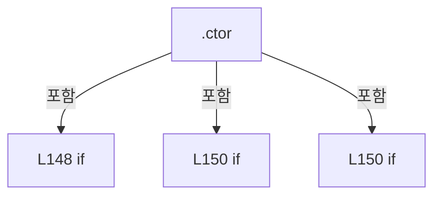

변경 전 점검: 입력/반환 타입, 위 호출자, 예외/취소 경로, 공유 상태와 저장·전송 소비자를 함께 확인합니다. 값의 단위나 물리 방향을 이름만으로 확정하지 않습니다.

### LocalFunctionStatement `SelectOutputViewerCellCallback` · L162–165

[Drilling.UI/Menu/Menus/CMenuCorrection.cs:162–165](https://github.com/kjuws10-rgb/A3Drilling/blob/5aee8e58439c9b455cae7c9593c9be986c3e682e/Drilling.UI/Menu/Menus/CMenuCorrection.cs#L162-L165)

| 항목 | 실제 추출 값 |
| --- | --- |
| 서명 | void SelectOutputViewerCellCallback(object?) |
| 접근/수식자 | Private / async |
| 반환/값 타입 | void |
| 소속 타입 | NamedType:Drilling.UI.Menu.Menus.CMenuCorrection |

입력 계약:

| 이름 | 타입 | 전달 | 선택/기본값 |
| --- | --- | --- | --- |
| parameter | object? | None | False /  |

현재 부분 분석에서 직접 연결된 호출자는 없습니다. XAML/이벤트/인터페이스·델리게이트·외부 진입을 추가 확인해야 하며, 미사용으로 판정한 것이 아닙니다.

호출하는 대상과 해석 범위:

| 원본 행 | 표현식 | 분석 상태 | 대상/소스 위치 |
| --- | --- | --- | --- |
| 164 | SelectOutputViewerCell | resolved | System.Threading.Tasks.Task Drilling.UI.Menu.Menus.CMenuCorrection.SelectOutputViewerCell(object?) · Drilling.UI/Menu/Menus/CMenuCorrection.cs:494 |

본문의 실제 연산·분기·예외·반환 순서(원문 위치 순):

| 원본 행 | 종류 | 주석 해설 |
| --- | --- | --- |
| 164 | await | 비동기 완료를 기다립니다: await SelectOutputViewerCell(parameter) |
| 164 | call | 함수·델리게이트 또는 객체 생성자를 호출합니다: SelectOutputViewerCell(parameter) |

변경 전 점검: 입력/반환 타입, 위 호출자, 예외/취소 경로, 공유 상태와 저장·전송 소비자를 함께 확인합니다. 값의 단위나 물리 방향을 이름만으로 확정하지 않습니다.

### LocalFunctionStatement `BackToOutputViewerGlassCallback` · L169–172

[Drilling.UI/Menu/Menus/CMenuCorrection.cs:169–172](https://github.com/kjuws10-rgb/A3Drilling/blob/5aee8e58439c9b455cae7c9593c9be986c3e682e/Drilling.UI/Menu/Menus/CMenuCorrection.cs#L169-L172)

| 항목 | 실제 추출 값 |
| --- | --- |
| 서명 | void BackToOutputViewerGlassCallback(object?) |
| 접근/수식자 | Private / async |
| 반환/값 타입 | void |
| 소속 타입 | NamedType:Drilling.UI.Menu.Menus.CMenuCorrection |

입력 계약:

| 이름 | 타입 | 전달 | 선택/기본값 |
| --- | --- | --- | --- |
| parameter | object? | None | False /  |

현재 부분 분석에서 직접 연결된 호출자는 없습니다. XAML/이벤트/인터페이스·델리게이트·외부 진입을 추가 확인해야 하며, 미사용으로 판정한 것이 아닙니다.

호출하는 대상과 해석 범위:

| 원본 행 | 표현식 | 분석 상태 | 대상/소스 위치 |
| --- | --- | --- | --- |
| 171 | BackToOutputViewerGlass | resolved | System.Threading.Tasks.Task Drilling.UI.Menu.Menus.CMenuCorrection.BackToOutputViewerGlass(object?) · Drilling.UI/Menu/Menus/CMenuCorrection.cs:563 |

본문의 실제 연산·분기·예외·반환 순서(원문 위치 순):

| 원본 행 | 종류 | 주석 해설 |
| --- | --- | --- |
| 171 | await | 비동기 완료를 기다립니다: await BackToOutputViewerGlass(parameter) |
| 171 | call | 함수·델리게이트 또는 객체 생성자를 호출합니다: BackToOutputViewerGlass(parameter) |

변경 전 점검: 입력/반환 타입, 위 호출자, 예외/취소 경로, 공유 상태와 저장·전송 소비자를 함께 확인합니다. 값의 단위나 물리 방향을 이름만으로 확정하지 않습니다.

### MethodDeclaration `TryConfirmInitialReviewStart` · L177–209

[Drilling.UI/Menu/Menus/CMenuCorrection.cs:177–209](https://github.com/kjuws10-rgb/A3Drilling/blob/5aee8e58439c9b455cae7c9593c9be986c3e682e/Drilling.UI/Menu/Menus/CMenuCorrection.cs#L177-L209)

| 항목 | 실제 추출 값 |
| --- | --- |
| 서명 | bool Drilling.UI.Menu.Menus.CMenuCorrection.TryConfirmInitialReviewStart(string, string, string, System.Func<string, string, bool>?, out double, out double) |
| 접근/수식자 | Private / private |
| 반환/값 타입 | bool |
| 소속 타입 | NamedType:Drilling.UI.Menu.Menus.CMenuCorrection |

입력 계약:

| 이름 | 타입 | 전달 | 선택/기본값 |
| --- | --- | --- | --- |
| title | string | None | False /  |
| context | string | None | False /  |
| fallbackMessage | string | None | False /  |
| injectedConfirmation | System.Func<string, string, bool>? | None | False /  |
| shiftOffsetX | double | Out | False /  |
| shiftOffsetY | double | Out | False /  |

정적 호출자로 확인된 위치:

| 호출 파일/행 | 호출 표현식 | 런타임 분기 가능 |
| --- | --- | --- |
| [Drilling.UI/Menu/Menus/CMenuCorrection.cs:2913–2919](https://github.com/kjuws10-rgb/A3Drilling/blob/5aee8e58439c9b455cae7c9593c9be986c3e682e/Drilling.UI/Menu/Menus/CMenuCorrection.cs#L2913-L2919) | TryConfirmInitialReviewStart | False |
| [Drilling.UI/Menu/Menus/CMenuCorrection.cs:3894–3900](https://github.com/kjuws10-rgb/A3Drilling/blob/5aee8e58439c9b455cae7c9593c9be986c3e682e/Drilling.UI/Menu/Menus/CMenuCorrection.cs#L3894-L3900) | TryConfirmInitialReviewStart | False |

호출하는 대상과 해석 범위:

| 원본 행 | 표현식 | 분석 상태 | 대상/소스 위치 |
| --- | --- | --- | --- |
| 188 | injectedConfirmation | resolved · 동적 구현 선택 가능 | bool System.Func<string, string, bool>.Invoke(string, string) |
| 190 | .Station | resolved | Drilling.Common.Station.CStationManager Drilling.Common.Managers.CManager.Station() · Drilling.Common/Managers/CManager.cs:322 |
| 193 | CRecipeConfirmDialog.ShowConfirmation | resolved | bool Drilling.UI.Popup.CRecipeConfirmDialog.ShowConfirmation(string, string, string, bool) · Drilling.UI/Popup/CRecipeConfirmDialog.xaml.cs:11 |
| 199 | CReviewShiftOffsetDialog.Show | resolved | Drilling.UI.Popup.EN_REVIEW_SHIFT_OFFSET_CHOICE Drilling.UI.Popup.CReviewShiftOffsetDialog.Show(Drilling.Common.Station.ST_MANUAL_MOF_COMPLETION, string) · Drilling.UI/Popup/CReviewShiftOffsetDialog.xaml.cs:27 |

본문의 실제 연산·분기·예외·반환 순서(원문 위치 순):

| 원본 행 | 종류 | 주석 해설 |
| --- | --- | --- |
| 185 | assignment | 값을 대상에 대입합니다: shiftOffsetX = 0.0 |
| 186 | assignment | 값을 대상에 대입합니다: shiftOffsetY = 0.0 |
| 187 | if | 조건에 따라 분기합니다: if (injectedConfirmation is not null) |
| 188 | call | 함수·델리게이트 또는 객체 생성자를 호출합니다: injectedConfirmation(title, fallbackMessage) |
| 188 | return | 호출자에게 값 또는 제어를 반환합니다: return injectedConfirmation(title, fallbackMessage); |
| 190 | call | 함수·델리게이트 또는 객체 생성자를 호출합니다: .Station() |
| 190 | local-declaration | 지역 변수를 선언합니다: var completion = _defaultManager?.Station().LastCompletedManualMof; |
| 190 | variable-initializer | 변수의 초기값을 지정합니다: completion = _defaultManager?.Station().LastCompletedManualMof |
| 191 | if | 조건에 따라 분기합니다: if (completion is null) |
| 193 | call | 함수·델리게이트 또는 객체 생성자를 호출합니다: CRecipeConfirmDialog.ShowConfirmation( title, fallbackMessage + "\n\n성공 완료한 Manual MOF 이력이 없습니다.\nShift Offset 0.000 / 0.000 mm로 검사를 시작합니다.", "시작") |
| 193 | return | 호출자에게 값 또는 제어를 반환합니다: return CRecipeConfirmDialog.ShowConfirmation( title, fallbackMessage + "\n\n성공 완료한 Manual MOF 이력이 없습니다.\nShift Offset 0.000 / 0.000 mm로 검사를 시작합니다.", "시작"); |
| 199 | call | 함수·델리게이트 또는 객체 생성자를 호출합니다: CReviewShiftOffsetDialog.Show(completion, context) |
| 199 | local-declaration | 지역 변수를 선언합니다: var choice = CReviewShiftOffsetDialog.Show(completion, context); |
| 199 | variable-initializer | 변수의 초기값을 지정합니다: choice = CReviewShiftOffsetDialog.Show(completion, context) |
| 200 | if | 조건에 따라 분기합니다: if (choice == EN_REVIEW_SHIFT_OFFSET_CHOICE.Cancel) |
| 201 | return | 호출자에게 값 또는 제어를 반환합니다: return false; |
| 202 | if | 조건에 따라 분기합니다: if (choice == EN_REVIEW_SHIFT_OFFSET_CHOICE.Apply) |
| 204 | assignment | 값을 대상에 대입합니다: shiftOffsetX = completion.ShiftOffsetX |
| 205 | assignment | 값을 대상에 대입합니다: shiftOffsetY = completion.ShiftOffsetY |
| 208 | return | 호출자에게 값 또는 제어를 반환합니다: return true; |

제어 구문의 포함 구조(실제 실행 순서/CFG가 아닌 구문 탐색 그림):

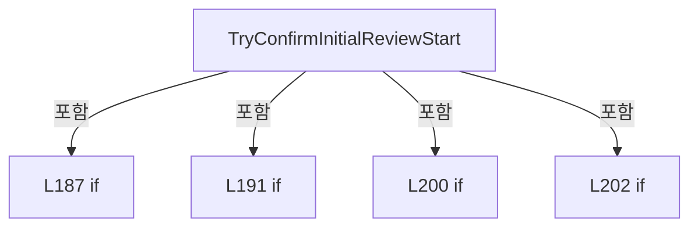

변경 전 점검: 입력/반환 타입, 위 호출자, 예외/취소 경로, 공유 상태와 저장·전송 소비자를 함께 확인합니다. 값의 단위나 물리 방향을 이름만으로 확정하지 않습니다.

### PropertyDeclaration `Menu` · L213–219

[Drilling.UI/Menu/Menus/CMenuCorrection.cs:213–219](https://github.com/kjuws10-rgb/A3Drilling/blob/5aee8e58439c9b455cae7c9593c9be986c3e682e/Drilling.UI/Menu/Menus/CMenuCorrection.cs#L213-L219)

| 항목 | 실제 추출 값 |
| --- | --- |
| 서명 | Drilling.UI.Menu.Menus.EN_MENU Drilling.UI.Menu.Menus.CMenuCorrection.Menu |
| 접근/수식자 | Public / public, override |
| 반환/값 타입 | Drilling.UI.Menu.Menus.EN_MENU |
| 소속 타입 | NamedType:Drilling.UI.Menu.Menus.CMenuCorrection |

현재 부분 분석에서 직접 연결된 호출자는 없습니다. XAML/이벤트/인터페이스·델리게이트·외부 진입을 추가 확인해야 하며, 미사용으로 판정한 것이 아닙니다.

변경 전 점검: 입력/반환 타입, 위 호출자, 예외/취소 경로, 공유 상태와 저장·전송 소비자를 함께 확인합니다. 값의 단위나 물리 방향을 이름만으로 확정하지 않습니다.

### GetAccessorDeclaration `get_Menu` · L215–218

[Drilling.UI/Menu/Menus/CMenuCorrection.cs:215–218](https://github.com/kjuws10-rgb/A3Drilling/blob/5aee8e58439c9b455cae7c9593c9be986c3e682e/Drilling.UI/Menu/Menus/CMenuCorrection.cs#L215-L218)

| 항목 | 실제 추출 값 |
| --- | --- |
| 서명 | Drilling.UI.Menu.Menus.EN_MENU Drilling.UI.Menu.Menus.CMenuCorrection.Menu.get |
| 접근/수식자 | Public / get |
| 반환/값 타입 | Drilling.UI.Menu.Menus.EN_MENU |
| 소속 타입 | NamedType:Drilling.UI.Menu.Menus.CMenuCorrection |

현재 부분 분석에서 직접 연결된 호출자는 없습니다. XAML/이벤트/인터페이스·델리게이트·외부 진입을 추가 확인해야 하며, 미사용으로 판정한 것이 아닙니다.

본문의 실제 연산·분기·예외·반환 순서(원문 위치 순):

| 원본 행 | 종류 | 주석 해설 |
| --- | --- | --- |
| 217 | return | 호출자에게 값 또는 제어를 반환합니다: return EN_MENU.Correction; |

변경 전 점검: 입력/반환 타입, 위 호출자, 예외/취소 경로, 공유 상태와 저장·전송 소비자를 함께 확인합니다. 값의 단위나 물리 방향을 이름만으로 확정하지 않습니다.

### PropertyDeclaration `Title` · L221–227

[Drilling.UI/Menu/Menus/CMenuCorrection.cs:221–227](https://github.com/kjuws10-rgb/A3Drilling/blob/5aee8e58439c9b455cae7c9593c9be986c3e682e/Drilling.UI/Menu/Menus/CMenuCorrection.cs#L221-L227)

| 항목 | 실제 추출 값 |
| --- | --- |
| 서명 | string Drilling.UI.Menu.Menus.CMenuCorrection.Title |
| 접근/수식자 | Public / public |
| 반환/값 타입 | string |
| 소속 타입 | NamedType:Drilling.UI.Menu.Menus.CMenuCorrection |

현재 부분 분석에서 직접 연결된 호출자는 없습니다. XAML/이벤트/인터페이스·델리게이트·외부 진입을 추가 확인해야 하며, 미사용으로 판정한 것이 아닙니다.

변경 전 점검: 입력/반환 타입, 위 호출자, 예외/취소 경로, 공유 상태와 저장·전송 소비자를 함께 확인합니다. 값의 단위나 물리 방향을 이름만으로 확정하지 않습니다.

### GetAccessorDeclaration `get_Title` · L223–226

[Drilling.UI/Menu/Menus/CMenuCorrection.cs:223–226](https://github.com/kjuws10-rgb/A3Drilling/blob/5aee8e58439c9b455cae7c9593c9be986c3e682e/Drilling.UI/Menu/Menus/CMenuCorrection.cs#L223-L226)

| 항목 | 실제 추출 값 |
| --- | --- |
| 서명 | string Drilling.UI.Menu.Menus.CMenuCorrection.Title.get |
| 접근/수식자 | Public / get |
| 반환/값 타입 | string |
| 소속 타입 | NamedType:Drilling.UI.Menu.Menus.CMenuCorrection |

현재 부분 분석에서 직접 연결된 호출자는 없습니다. XAML/이벤트/인터페이스·델리게이트·외부 진입을 추가 확인해야 하며, 미사용으로 판정한 것이 아닙니다.

본문의 실제 연산·분기·예외·반환 순서(원문 위치 순):

| 원본 행 | 종류 | 주석 해설 |
| --- | --- | --- |
| 225 | return | 호출자에게 값 또는 제어를 반환합니다: return $"CORRECTION / {_selectedTab}"; |

변경 전 점검: 입력/반환 타입, 위 호출자, 예외/취소 경로, 공유 상태와 저장·전송 소비자를 함께 확인합니다. 값의 단위나 물리 방향을 이름만으로 확정하지 않습니다.

### PropertyDeclaration `Subtitle` · L229–235

[Drilling.UI/Menu/Menus/CMenuCorrection.cs:229–235](https://github.com/kjuws10-rgb/A3Drilling/blob/5aee8e58439c9b455cae7c9593c9be986c3e682e/Drilling.UI/Menu/Menus/CMenuCorrection.cs#L229-L235)

| 항목 | 실제 추출 값 |
| --- | --- |
| 서명 | string Drilling.UI.Menu.Menus.CMenuCorrection.Subtitle |
| 접근/수식자 | Public / public |
| 반환/값 타입 | string |
| 소속 타입 | NamedType:Drilling.UI.Menu.Menus.CMenuCorrection |

현재 부분 분석에서 직접 연결된 호출자는 없습니다. XAML/이벤트/인터페이스·델리게이트·외부 진입을 추가 확인해야 하며, 미사용으로 판정한 것이 아닙니다.

변경 전 점검: 입력/반환 타입, 위 호출자, 예외/취소 경로, 공유 상태와 저장·전송 소비자를 함께 확인합니다. 값의 단위나 물리 방향을 이름만으로 확정하지 않습니다.

### GetAccessorDeclaration `get_Subtitle` · L231–234

[Drilling.UI/Menu/Menus/CMenuCorrection.cs:231–234](https://github.com/kjuws10-rgb/A3Drilling/blob/5aee8e58439c9b455cae7c9593c9be986c3e682e/Drilling.UI/Menu/Menus/CMenuCorrection.cs#L231-L234)

| 항목 | 실제 추출 값 |
| --- | --- |
| 서명 | string Drilling.UI.Menu.Menus.CMenuCorrection.Subtitle.get |
| 접근/수식자 | Public / get |
| 반환/값 타입 | string |
| 소속 타입 | NamedType:Drilling.UI.Menu.Menus.CMenuCorrection |

현재 부분 분석에서 직접 연결된 호출자는 없습니다. XAML/이벤트/인터페이스·델리게이트·외부 진입을 추가 확인해야 하며, 미사용으로 판정한 것이 아닙니다.

호출하는 대상과 해석 범위:

| 원본 행 | 표현식 | 분석 상태 | 대상/소스 위치 |
| --- | --- | --- | --- |
| 233 | GetSubtitle | resolved | string Drilling.UI.Menu.Menus.CMenuCorrection.GetSubtitle(string) · Drilling.UI/Menu/Menus/CMenuCorrection.cs:2499 |

본문의 실제 연산·분기·예외·반환 순서(원문 위치 순):

| 원본 행 | 종류 | 주석 해설 |
| --- | --- | --- |
| 233 | call | 함수·델리게이트 또는 객체 생성자를 호출합니다: GetSubtitle(_selectedTab) |
| 233 | return | 호출자에게 값 또는 제어를 반환합니다: return GetSubtitle(_selectedTab); |

변경 전 점검: 입력/반환 타입, 위 호출자, 예외/취소 경로, 공유 상태와 저장·전송 소비자를 함께 확인합니다. 값의 단위나 물리 방향을 이름만으로 확정하지 않습니다.

### PropertyDeclaration `SelectedTab` · L237–243

[Drilling.UI/Menu/Menus/CMenuCorrection.cs:237–243](https://github.com/kjuws10-rgb/A3Drilling/blob/5aee8e58439c9b455cae7c9593c9be986c3e682e/Drilling.UI/Menu/Menus/CMenuCorrection.cs#L237-L243)

| 항목 | 실제 추출 값 |
| --- | --- |
| 서명 | string Drilling.UI.Menu.Menus.CMenuCorrection.SelectedTab |
| 접근/수식자 | Public / public |
| 반환/값 타입 | string |
| 소속 타입 | NamedType:Drilling.UI.Menu.Menus.CMenuCorrection |

현재 부분 분석에서 직접 연결된 호출자는 없습니다. XAML/이벤트/인터페이스·델리게이트·외부 진입을 추가 확인해야 하며, 미사용으로 판정한 것이 아닙니다.

변경 전 점검: 입력/반환 타입, 위 호출자, 예외/취소 경로, 공유 상태와 저장·전송 소비자를 함께 확인합니다. 값의 단위나 물리 방향을 이름만으로 확정하지 않습니다.

### GetAccessorDeclaration `get_SelectedTab` · L239–242

[Drilling.UI/Menu/Menus/CMenuCorrection.cs:239–242](https://github.com/kjuws10-rgb/A3Drilling/blob/5aee8e58439c9b455cae7c9593c9be986c3e682e/Drilling.UI/Menu/Menus/CMenuCorrection.cs#L239-L242)

| 항목 | 실제 추출 값 |
| --- | --- |
| 서명 | string Drilling.UI.Menu.Menus.CMenuCorrection.SelectedTab.get |
| 접근/수식자 | Public / get |
| 반환/값 타입 | string |
| 소속 타입 | NamedType:Drilling.UI.Menu.Menus.CMenuCorrection |

현재 부분 분석에서 직접 연결된 호출자는 없습니다. XAML/이벤트/인터페이스·델리게이트·외부 진입을 추가 확인해야 하며, 미사용으로 판정한 것이 아닙니다.

본문의 실제 연산·분기·예외·반환 순서(원문 위치 순):

| 원본 행 | 종류 | 주석 해설 |
| --- | --- | --- |
| 241 | return | 호출자에게 값 또는 제어를 반환합니다: return _selectedTab; |

변경 전 점검: 입력/반환 타입, 위 호출자, 예외/취소 경로, 공유 상태와 저장·전송 소비자를 함께 확인합니다. 값의 단위나 물리 방향을 이름만으로 확정하지 않습니다.

### PropertyDeclaration `IsOtherCorrectionTab` · L245–251

[Drilling.UI/Menu/Menus/CMenuCorrection.cs:245–251](https://github.com/kjuws10-rgb/A3Drilling/blob/5aee8e58439c9b455cae7c9593c9be986c3e682e/Drilling.UI/Menu/Menus/CMenuCorrection.cs#L245-L251)

| 항목 | 실제 추출 값 |
| --- | --- |
| 서명 | bool Drilling.UI.Menu.Menus.CMenuCorrection.IsOtherCorrectionTab |
| 접근/수식자 | Public / public |
| 반환/값 타입 | bool |
| 소속 타입 | NamedType:Drilling.UI.Menu.Menus.CMenuCorrection |

현재 부분 분석에서 직접 연결된 호출자는 없습니다. XAML/이벤트/인터페이스·델리게이트·외부 진입을 추가 확인해야 하며, 미사용으로 판정한 것이 아닙니다.

변경 전 점검: 입력/반환 타입, 위 호출자, 예외/취소 경로, 공유 상태와 저장·전송 소비자를 함께 확인합니다. 값의 단위나 물리 방향을 이름만으로 확정하지 않습니다.

### GetAccessorDeclaration `get_IsOtherCorrectionTab` · L247–250

[Drilling.UI/Menu/Menus/CMenuCorrection.cs:247–250](https://github.com/kjuws10-rgb/A3Drilling/blob/5aee8e58439c9b455cae7c9593c9be986c3e682e/Drilling.UI/Menu/Menus/CMenuCorrection.cs#L247-L250)

| 항목 | 실제 추출 값 |
| --- | --- |
| 서명 | bool Drilling.UI.Menu.Menus.CMenuCorrection.IsOtherCorrectionTab.get |
| 접근/수식자 | Public / get |
| 반환/값 타입 | bool |
| 소속 타입 | NamedType:Drilling.UI.Menu.Menus.CMenuCorrection |

현재 부분 분석에서 직접 연결된 호출자는 없습니다. XAML/이벤트/인터페이스·델리게이트·외부 진입을 추가 확인해야 하며, 미사용으로 판정한 것이 아닙니다.

본문의 실제 연산·분기·예외·반환 순서(원문 위치 순):

| 원본 행 | 종류 | 주석 해설 |
| --- | --- | --- |
| 249 | return | 호출자에게 값 또는 제어를 반환합니다: return !IsDefaultTab && !IsOutputHistoryTab && !IsAlignDistortionTab && !IsReviewCorrectionTab; |

변경 전 점검: 입력/반환 타입, 위 호출자, 예외/취소 경로, 공유 상태와 저장·전송 소비자를 함께 확인합니다. 값의 단위나 물리 방향을 이름만으로 확정하지 않습니다.

### PropertyDeclaration `IsDefaultTab` · L253–253

[Drilling.UI/Menu/Menus/CMenuCorrection.cs:253–253](https://github.com/kjuws10-rgb/A3Drilling/blob/5aee8e58439c9b455cae7c9593c9be986c3e682e/Drilling.UI/Menu/Menus/CMenuCorrection.cs#L253-L253)

| 항목 | 실제 추출 값 |
| --- | --- |
| 서명 | bool Drilling.UI.Menu.Menus.CMenuCorrection.IsDefaultTab |
| 접근/수식자 | Public / public |
| 반환/값 타입 | bool |
| 소속 타입 | NamedType:Drilling.UI.Menu.Menus.CMenuCorrection |

현재 부분 분석에서 직접 연결된 호출자는 없습니다. XAML/이벤트/인터페이스·델리게이트·외부 진입을 추가 확인해야 하며, 미사용으로 판정한 것이 아닙니다.

변경 전 점검: 입력/반환 타입, 위 호출자, 예외/취소 경로, 공유 상태와 저장·전송 소비자를 함께 확인합니다. 값의 단위나 물리 방향을 이름만으로 확정하지 않습니다.

### PropertyDeclaration `IsAlignDistortionTab` · L254–254

[Drilling.UI/Menu/Menus/CMenuCorrection.cs:254–254](https://github.com/kjuws10-rgb/A3Drilling/blob/5aee8e58439c9b455cae7c9593c9be986c3e682e/Drilling.UI/Menu/Menus/CMenuCorrection.cs#L254-L254)

| 항목 | 실제 추출 값 |
| --- | --- |
| 서명 | bool Drilling.UI.Menu.Menus.CMenuCorrection.IsAlignDistortionTab |
| 접근/수식자 | Public / public |
| 반환/값 타입 | bool |
| 소속 타입 | NamedType:Drilling.UI.Menu.Menus.CMenuCorrection |

현재 부분 분석에서 직접 연결된 호출자는 없습니다. XAML/이벤트/인터페이스·델리게이트·외부 진입을 추가 확인해야 하며, 미사용으로 판정한 것이 아닙니다.

변경 전 점검: 입력/반환 타입, 위 호출자, 예외/취소 경로, 공유 상태와 저장·전송 소비자를 함께 확인합니다. 값의 단위나 물리 방향을 이름만으로 확정하지 않습니다.

### PropertyDeclaration `IsReviewCorrectionTab` · L255–255

[Drilling.UI/Menu/Menus/CMenuCorrection.cs:255–255](https://github.com/kjuws10-rgb/A3Drilling/blob/5aee8e58439c9b455cae7c9593c9be986c3e682e/Drilling.UI/Menu/Menus/CMenuCorrection.cs#L255-L255)

| 항목 | 실제 추출 값 |
| --- | --- |
| 서명 | bool Drilling.UI.Menu.Menus.CMenuCorrection.IsReviewCorrectionTab |
| 접근/수식자 | Public / public |
| 반환/값 타입 | bool |
| 소속 타입 | NamedType:Drilling.UI.Menu.Menus.CMenuCorrection |

현재 부분 분석에서 직접 연결된 호출자는 없습니다. XAML/이벤트/인터페이스·델리게이트·외부 진입을 추가 확인해야 하며, 미사용으로 판정한 것이 아닙니다.

변경 전 점검: 입력/반환 타입, 위 호출자, 예외/취소 경로, 공유 상태와 저장·전송 소비자를 함께 확인합니다. 값의 단위나 물리 방향을 이름만으로 확정하지 않습니다.

### PropertyDeclaration `Simple` · L256–256

[Drilling.UI/Menu/Menus/CMenuCorrection.cs:256–256](https://github.com/kjuws10-rgb/A3Drilling/blob/5aee8e58439c9b455cae7c9593c9be986c3e682e/Drilling.UI/Menu/Menus/CMenuCorrection.cs#L256-L256)

| 항목 | 실제 추출 값 |
| --- | --- |
| 서명 | Drilling.UI.Menu.Menus.CSimpleCorrectionPanel Drilling.UI.Menu.Menus.CMenuCorrection.Simple |
| 접근/수식자 | Public / public |
| 반환/값 타입 | Drilling.UI.Menu.Menus.CSimpleCorrectionPanel |
| 소속 타입 | NamedType:Drilling.UI.Menu.Menus.CMenuCorrection |

현재 부분 분석에서 직접 연결된 호출자는 없습니다. XAML/이벤트/인터페이스·델리게이트·외부 진입을 추가 확인해야 하며, 미사용으로 판정한 것이 아닙니다.

변경 전 점검: 입력/반환 타입, 위 호출자, 예외/취소 경로, 공유 상태와 저장·전송 소비자를 함께 확인합니다. 값의 단위나 물리 방향을 이름만으로 확정하지 않습니다.

### GetAccessorDeclaration `get_Simple` · L256–256

[Drilling.UI/Menu/Menus/CMenuCorrection.cs:256–256](https://github.com/kjuws10-rgb/A3Drilling/blob/5aee8e58439c9b455cae7c9593c9be986c3e682e/Drilling.UI/Menu/Menus/CMenuCorrection.cs#L256-L256)

| 항목 | 실제 추출 값 |
| --- | --- |
| 서명 | Drilling.UI.Menu.Menus.CSimpleCorrectionPanel Drilling.UI.Menu.Menus.CMenuCorrection.Simple.get |
| 접근/수식자 | Public / get |
| 반환/값 타입 | Drilling.UI.Menu.Menus.CSimpleCorrectionPanel |
| 소속 타입 | NamedType:Drilling.UI.Menu.Menus.CMenuCorrection |

현재 부분 분석에서 직접 연결된 호출자는 없습니다. XAML/이벤트/인터페이스·델리게이트·외부 진입을 추가 확인해야 하며, 미사용으로 판정한 것이 아닙니다.

변경 전 점검: 입력/반환 타입, 위 호출자, 예외/취소 경로, 공유 상태와 저장·전송 소비자를 함께 확인합니다. 값의 단위나 물리 방향을 이름만으로 확정하지 않습니다.

### PropertyDeclaration `Rough` · L257–257

[Drilling.UI/Menu/Menus/CMenuCorrection.cs:257–257](https://github.com/kjuws10-rgb/A3Drilling/blob/5aee8e58439c9b455cae7c9593c9be986c3e682e/Drilling.UI/Menu/Menus/CMenuCorrection.cs#L257-L257)

| 항목 | 실제 추출 값 |
| --- | --- |
| 서명 | Drilling.UI.Menu.Menus.CSimpleCorrectionPanel Drilling.UI.Menu.Menus.CMenuCorrection.Rough |
| 접근/수식자 | Public / public |
| 반환/값 타입 | Drilling.UI.Menu.Menus.CSimpleCorrectionPanel |
| 소속 타입 | NamedType:Drilling.UI.Menu.Menus.CMenuCorrection |

현재 부분 분석에서 직접 연결된 호출자는 없습니다. XAML/이벤트/인터페이스·델리게이트·외부 진입을 추가 확인해야 하며, 미사용으로 판정한 것이 아닙니다.

변경 전 점검: 입력/반환 타입, 위 호출자, 예외/취소 경로, 공유 상태와 저장·전송 소비자를 함께 확인합니다. 값의 단위나 물리 방향을 이름만으로 확정하지 않습니다.

### GetAccessorDeclaration `get_Rough` · L257–257

[Drilling.UI/Menu/Menus/CMenuCorrection.cs:257–257](https://github.com/kjuws10-rgb/A3Drilling/blob/5aee8e58439c9b455cae7c9593c9be986c3e682e/Drilling.UI/Menu/Menus/CMenuCorrection.cs#L257-L257)

| 항목 | 실제 추출 값 |
| --- | --- |
| 서명 | Drilling.UI.Menu.Menus.CSimpleCorrectionPanel Drilling.UI.Menu.Menus.CMenuCorrection.Rough.get |
| 접근/수식자 | Public / get |
| 반환/값 타입 | Drilling.UI.Menu.Menus.CSimpleCorrectionPanel |
| 소속 타입 | NamedType:Drilling.UI.Menu.Menus.CMenuCorrection |

현재 부분 분석에서 직접 연결된 호출자는 없습니다. XAML/이벤트/인터페이스·델리게이트·외부 진입을 추가 확인해야 하며, 미사용으로 판정한 것이 아닙니다.

변경 전 점검: 입력/반환 타입, 위 호출자, 예외/취소 경로, 공유 상태와 저장·전송 소비자를 함께 확인합니다. 값의 단위나 물리 방향을 이름만으로 확정하지 않습니다.

### PropertyDeclaration `Fine` · L258–258

[Drilling.UI/Menu/Menus/CMenuCorrection.cs:258–258](https://github.com/kjuws10-rgb/A3Drilling/blob/5aee8e58439c9b455cae7c9593c9be986c3e682e/Drilling.UI/Menu/Menus/CMenuCorrection.cs#L258-L258)

| 항목 | 실제 추출 값 |
| --- | --- |
| 서명 | Drilling.UI.Menu.Menus.CFineCorrectionPanel Drilling.UI.Menu.Menus.CMenuCorrection.Fine |
| 접근/수식자 | Public / public |
| 반환/값 타입 | Drilling.UI.Menu.Menus.CFineCorrectionPanel |
| 소속 타입 | NamedType:Drilling.UI.Menu.Menus.CMenuCorrection |

현재 부분 분석에서 직접 연결된 호출자는 없습니다. XAML/이벤트/인터페이스·델리게이트·외부 진입을 추가 확인해야 하며, 미사용으로 판정한 것이 아닙니다.

변경 전 점검: 입력/반환 타입, 위 호출자, 예외/취소 경로, 공유 상태와 저장·전송 소비자를 함께 확인합니다. 값의 단위나 물리 방향을 이름만으로 확정하지 않습니다.

### GetAccessorDeclaration `get_Fine` · L258–258

[Drilling.UI/Menu/Menus/CMenuCorrection.cs:258–258](https://github.com/kjuws10-rgb/A3Drilling/blob/5aee8e58439c9b455cae7c9593c9be986c3e682e/Drilling.UI/Menu/Menus/CMenuCorrection.cs#L258-L258)

| 항목 | 실제 추출 값 |
| --- | --- |
| 서명 | Drilling.UI.Menu.Menus.CFineCorrectionPanel Drilling.UI.Menu.Menus.CMenuCorrection.Fine.get |
| 접근/수식자 | Public / get |
| 반환/값 타입 | Drilling.UI.Menu.Menus.CFineCorrectionPanel |
| 소속 타입 | NamedType:Drilling.UI.Menu.Menus.CMenuCorrection |

현재 부분 분석에서 직접 연결된 호출자는 없습니다. XAML/이벤트/인터페이스·델리게이트·외부 진입을 추가 확인해야 하며, 미사용으로 판정한 것이 아닙니다.

변경 전 점검: 입력/반환 타입, 위 호출자, 예외/취소 경로, 공유 상태와 저장·전송 소비자를 함께 확인합니다. 값의 단위나 물리 방향을 이름만으로 확정하지 않습니다.

### PropertyDeclaration `IsCorrectionCommandsVisible` · L259–259

[Drilling.UI/Menu/Menus/CMenuCorrection.cs:259–259](https://github.com/kjuws10-rgb/A3Drilling/blob/5aee8e58439c9b455cae7c9593c9be986c3e682e/Drilling.UI/Menu/Menus/CMenuCorrection.cs#L259-L259)

| 항목 | 실제 추출 값 |
| --- | --- |
| 서명 | bool Drilling.UI.Menu.Menus.CMenuCorrection.IsCorrectionCommandsVisible |
| 접근/수식자 | Public / public |
| 반환/값 타입 | bool |
| 소속 타입 | NamedType:Drilling.UI.Menu.Menus.CMenuCorrection |

현재 부분 분석에서 직접 연결된 호출자는 없습니다. XAML/이벤트/인터페이스·델리게이트·외부 진입을 추가 확인해야 하며, 미사용으로 판정한 것이 아닙니다.

변경 전 점검: 입력/반환 타입, 위 호출자, 예외/취소 경로, 공유 상태와 저장·전송 소비자를 함께 확인합니다. 값의 단위나 물리 방향을 이름만으로 확정하지 않습니다.

### PropertyDeclaration `AlignDistortion` · L260–260

[Drilling.UI/Menu/Menus/CMenuCorrection.cs:260–260](https://github.com/kjuws10-rgb/A3Drilling/blob/5aee8e58439c9b455cae7c9593c9be986c3e682e/Drilling.UI/Menu/Menus/CMenuCorrection.cs#L260-L260)

| 항목 | 실제 추출 값 |
| --- | --- |
| 서명 | Drilling.UI.Menu.Menus.CAlignDistortionPanel Drilling.UI.Menu.Menus.CMenuCorrection.AlignDistortion |
| 접근/수식자 | Public / public |
| 반환/값 타입 | Drilling.UI.Menu.Menus.CAlignDistortionPanel |
| 소속 타입 | NamedType:Drilling.UI.Menu.Menus.CMenuCorrection |

현재 부분 분석에서 직접 연결된 호출자는 없습니다. XAML/이벤트/인터페이스·델리게이트·외부 진입을 추가 확인해야 하며, 미사용으로 판정한 것이 아닙니다.

변경 전 점검: 입력/반환 타입, 위 호출자, 예외/취소 경로, 공유 상태와 저장·전송 소비자를 함께 확인합니다. 값의 단위나 물리 방향을 이름만으로 확정하지 않습니다.

### GetAccessorDeclaration `get_AlignDistortion` · L260–260

[Drilling.UI/Menu/Menus/CMenuCorrection.cs:260–260](https://github.com/kjuws10-rgb/A3Drilling/blob/5aee8e58439c9b455cae7c9593c9be986c3e682e/Drilling.UI/Menu/Menus/CMenuCorrection.cs#L260-L260)

| 항목 | 실제 추출 값 |
| --- | --- |
| 서명 | Drilling.UI.Menu.Menus.CAlignDistortionPanel Drilling.UI.Menu.Menus.CMenuCorrection.AlignDistortion.get |
| 접근/수식자 | Public / get |
| 반환/값 타입 | Drilling.UI.Menu.Menus.CAlignDistortionPanel |
| 소속 타입 | NamedType:Drilling.UI.Menu.Menus.CMenuCorrection |

현재 부분 분석에서 직접 연결된 호출자는 없습니다. XAML/이벤트/인터페이스·델리게이트·외부 진입을 추가 확인해야 하며, 미사용으로 판정한 것이 아닙니다.

변경 전 점검: 입력/반환 타입, 위 호출자, 예외/취소 경로, 공유 상태와 저장·전송 소비자를 함께 확인합니다. 값의 단위나 물리 방향을 이름만으로 확정하지 않습니다.

### PropertyDeclaration `IsOutputHistoryTab` · L262–268

[Drilling.UI/Menu/Menus/CMenuCorrection.cs:262–268](https://github.com/kjuws10-rgb/A3Drilling/blob/5aee8e58439c9b455cae7c9593c9be986c3e682e/Drilling.UI/Menu/Menus/CMenuCorrection.cs#L262-L268)

| 항목 | 실제 추출 값 |
| --- | --- |
| 서명 | bool Drilling.UI.Menu.Menus.CMenuCorrection.IsOutputHistoryTab |
| 접근/수식자 | Public / public |
| 반환/값 타입 | bool |
| 소속 타입 | NamedType:Drilling.UI.Menu.Menus.CMenuCorrection |

현재 부분 분석에서 직접 연결된 호출자는 없습니다. XAML/이벤트/인터페이스·델리게이트·외부 진입을 추가 확인해야 하며, 미사용으로 판정한 것이 아닙니다.

변경 전 점검: 입력/반환 타입, 위 호출자, 예외/취소 경로, 공유 상태와 저장·전송 소비자를 함께 확인합니다. 값의 단위나 물리 방향을 이름만으로 확정하지 않습니다.

### GetAccessorDeclaration `get_IsOutputHistoryTab` · L264–267

[Drilling.UI/Menu/Menus/CMenuCorrection.cs:264–267](https://github.com/kjuws10-rgb/A3Drilling/blob/5aee8e58439c9b455cae7c9593c9be986c3e682e/Drilling.UI/Menu/Menus/CMenuCorrection.cs#L264-L267)

| 항목 | 실제 추출 값 |
| --- | --- |
| 서명 | bool Drilling.UI.Menu.Menus.CMenuCorrection.IsOutputHistoryTab.get |
| 접근/수식자 | Public / get |
| 반환/값 타입 | bool |
| 소속 타입 | NamedType:Drilling.UI.Menu.Menus.CMenuCorrection |

현재 부분 분석에서 직접 연결된 호출자는 없습니다. XAML/이벤트/인터페이스·델리게이트·외부 진입을 추가 확인해야 하며, 미사용으로 판정한 것이 아닙니다.

호출하는 대상과 해석 범위:

| 원본 행 | 표현식 | 분석 상태 | 대상/소스 위치 |
| --- | --- | --- | --- |
| 266 | _selectedTab.Equals | resolved | bool string.Equals(string?, System.StringComparison) |

본문의 실제 연산·분기·예외·반환 순서(원문 위치 순):

| 원본 행 | 종류 | 주석 해설 |
| --- | --- | --- |
| 266 | call | 함수·델리게이트 또는 객체 생성자를 호출합니다: _selectedTab.Equals("VIEWER", StringComparison.OrdinalIgnoreCase) |
| 266 | return | 호출자에게 값 또는 제어를 반환합니다: return _selectedTab.Equals("VIEWER", StringComparison.OrdinalIgnoreCase); |

변경 전 점검: 입력/반환 타입, 위 호출자, 예외/취소 경로, 공유 상태와 저장·전송 소비자를 함께 확인합니다. 값의 단위나 물리 방향을 이름만으로 확정하지 않습니다.

### PropertyDeclaration `IsCorrectionHistoryVisible` · L270–276

[Drilling.UI/Menu/Menus/CMenuCorrection.cs:270–276](https://github.com/kjuws10-rgb/A3Drilling/blob/5aee8e58439c9b455cae7c9593c9be986c3e682e/Drilling.UI/Menu/Menus/CMenuCorrection.cs#L270-L276)

| 항목 | 실제 추출 값 |
| --- | --- |
| 서명 | bool Drilling.UI.Menu.Menus.CMenuCorrection.IsCorrectionHistoryVisible |
| 접근/수식자 | Public / public |
| 반환/값 타입 | bool |
| 소속 타입 | NamedType:Drilling.UI.Menu.Menus.CMenuCorrection |

현재 부분 분석에서 직접 연결된 호출자는 없습니다. XAML/이벤트/인터페이스·델리게이트·외부 진입을 추가 확인해야 하며, 미사용으로 판정한 것이 아닙니다.

변경 전 점검: 입력/반환 타입, 위 호출자, 예외/취소 경로, 공유 상태와 저장·전송 소비자를 함께 확인합니다. 값의 단위나 물리 방향을 이름만으로 확정하지 않습니다.

### GetAccessorDeclaration `get_IsCorrectionHistoryVisible` · L272–275

[Drilling.UI/Menu/Menus/CMenuCorrection.cs:272–275](https://github.com/kjuws10-rgb/A3Drilling/blob/5aee8e58439c9b455cae7c9593c9be986c3e682e/Drilling.UI/Menu/Menus/CMenuCorrection.cs#L272-L275)

| 항목 | 실제 추출 값 |
| --- | --- |
| 서명 | bool Drilling.UI.Menu.Menus.CMenuCorrection.IsCorrectionHistoryVisible.get |
| 접근/수식자 | Public / get |
| 반환/값 타입 | bool |
| 소속 타입 | NamedType:Drilling.UI.Menu.Menus.CMenuCorrection |

현재 부분 분석에서 직접 연결된 호출자는 없습니다. XAML/이벤트/인터페이스·델리게이트·외부 진입을 추가 확인해야 하며, 미사용으로 판정한 것이 아닙니다.

본문의 실제 연산·분기·예외·반환 순서(원문 위치 순):

| 원본 행 | 종류 | 주석 해설 |
| --- | --- | --- |
| 274 | return | 호출자에게 값 또는 제어를 반환합니다: return !IsDefaultTab && !IsOutputHistoryTab; |

변경 전 점검: 입력/반환 타입, 위 호출자, 예외/취소 경로, 공유 상태와 저장·전송 소비자를 함께 확인합니다. 값의 단위나 물리 방향을 이름만으로 확정하지 않습니다.

### PropertyDeclaration `OutputViewerGlassPreviewImage` · L278–278

[Drilling.UI/Menu/Menus/CMenuCorrection.cs:278–278](https://github.com/kjuws10-rgb/A3Drilling/blob/5aee8e58439c9b455cae7c9593c9be986c3e682e/Drilling.UI/Menu/Menus/CMenuCorrection.cs#L278-L278)

| 항목 | 실제 추출 값 |
| --- | --- |
| 서명 | ImageSource? Drilling.UI.Menu.Menus.CMenuCorrection.OutputViewerGlassPreviewImage |
| 접근/수식자 | Public / public |
| 반환/값 타입 | ImageSource? |
| 소속 타입 | NamedType:Drilling.UI.Menu.Menus.CMenuCorrection |

현재 부분 분석에서 직접 연결된 호출자는 없습니다. XAML/이벤트/인터페이스·델리게이트·외부 진입을 추가 확인해야 하며, 미사용으로 판정한 것이 아닙니다.

변경 전 점검: 입력/반환 타입, 위 호출자, 예외/취소 경로, 공유 상태와 저장·전송 소비자를 함께 확인합니다. 값의 단위나 물리 방향을 이름만으로 확정하지 않습니다.

### GetAccessorDeclaration `get_OutputViewerGlassPreviewImage` · L278–278

[Drilling.UI/Menu/Menus/CMenuCorrection.cs:278–278](https://github.com/kjuws10-rgb/A3Drilling/blob/5aee8e58439c9b455cae7c9593c9be986c3e682e/Drilling.UI/Menu/Menus/CMenuCorrection.cs#L278-L278)

| 항목 | 실제 추출 값 |
| --- | --- |
| 서명 | ImageSource? Drilling.UI.Menu.Menus.CMenuCorrection.OutputViewerGlassPreviewImage.get |
| 접근/수식자 | Public / get |
| 반환/값 타입 | ImageSource? |
| 소속 타입 | NamedType:Drilling.UI.Menu.Menus.CMenuCorrection |

현재 부분 분석에서 직접 연결된 호출자는 없습니다. XAML/이벤트/인터페이스·델리게이트·외부 진입을 추가 확인해야 하며, 미사용으로 판정한 것이 아닙니다.

변경 전 점검: 입력/반환 타입, 위 호출자, 예외/취소 경로, 공유 상태와 저장·전송 소비자를 함께 확인합니다. 값의 단위나 물리 방향을 이름만으로 확정하지 않습니다.

### SetAccessorDeclaration `set_OutputViewerGlassPreviewImage` · L278–278

[Drilling.UI/Menu/Menus/CMenuCorrection.cs:278–278](https://github.com/kjuws10-rgb/A3Drilling/blob/5aee8e58439c9b455cae7c9593c9be986c3e682e/Drilling.UI/Menu/Menus/CMenuCorrection.cs#L278-L278)

| 항목 | 실제 추출 값 |
| --- | --- |
| 서명 | void Drilling.UI.Menu.Menus.CMenuCorrection.OutputViewerGlassPreviewImage.set |
| 접근/수식자 | Private / private, set |
| 반환/값 타입 | void |
| 소속 타입 | NamedType:Drilling.UI.Menu.Menus.CMenuCorrection |

입력 계약:

| 이름 | 타입 | 전달 | 선택/기본값 |
| --- | --- | --- | --- |
| value | ImageSource? | None | False /  |

현재 부분 분석에서 직접 연결된 호출자는 없습니다. XAML/이벤트/인터페이스·델리게이트·외부 진입을 추가 확인해야 하며, 미사용으로 판정한 것이 아닙니다.

변경 전 점검: 입력/반환 타입, 위 호출자, 예외/취소 경로, 공유 상태와 저장·전송 소비자를 함께 확인합니다. 값의 단위나 물리 방향을 이름만으로 확정하지 않습니다.

### PropertyDeclaration `OutputViewerSelectedCellName` · L279–279

[Drilling.UI/Menu/Menus/CMenuCorrection.cs:279–279](https://github.com/kjuws10-rgb/A3Drilling/blob/5aee8e58439c9b455cae7c9593c9be986c3e682e/Drilling.UI/Menu/Menus/CMenuCorrection.cs#L279-L279)

| 항목 | 실제 추출 값 |
| --- | --- |
| 서명 | string Drilling.UI.Menu.Menus.CMenuCorrection.OutputViewerSelectedCellName |
| 접근/수식자 | Public / public |
| 반환/값 타입 | string |
| 소속 타입 | NamedType:Drilling.UI.Menu.Menus.CMenuCorrection |

현재 부분 분석에서 직접 연결된 호출자는 없습니다. XAML/이벤트/인터페이스·델리게이트·외부 진입을 추가 확인해야 하며, 미사용으로 판정한 것이 아닙니다.

본문의 실제 연산·분기·예외·반환 순서(원문 위치 순):

| 원본 행 | 종류 | 주석 해설 |
| --- | --- | --- |
| 279 | conditional-expression | 조건에 따라 결과식을 선택합니다: _outputViewerIsCellDetailVisible && _outputViewerSelectedCellNo > 0 ? $"CELL{_outputViewerSelectedCellNo:00}" : "NO CELL SELECTED" |

변경 전 점검: 입력/반환 타입, 위 호출자, 예외/취소 경로, 공유 상태와 저장·전송 소비자를 함께 확인합니다. 값의 단위나 물리 방향을 이름만으로 확정하지 않습니다.

### PropertyDeclaration `OutputViewerSelectedShotName` · L280–280

[Drilling.UI/Menu/Menus/CMenuCorrection.cs:280–280](https://github.com/kjuws10-rgb/A3Drilling/blob/5aee8e58439c9b455cae7c9593c9be986c3e682e/Drilling.UI/Menu/Menus/CMenuCorrection.cs#L280-L280)

| 항목 | 실제 추출 값 |
| --- | --- |
| 서명 | string Drilling.UI.Menu.Menus.CMenuCorrection.OutputViewerSelectedShotName |
| 접근/수식자 | Public / public |
| 반환/값 타입 | string |
| 소속 타입 | NamedType:Drilling.UI.Menu.Menus.CMenuCorrection |

현재 부분 분석에서 직접 연결된 호출자는 없습니다. XAML/이벤트/인터페이스·델리게이트·외부 진입을 추가 확인해야 하며, 미사용으로 판정한 것이 아닙니다.

호출하는 대상과 해석 범위:

| 원본 행 | 표현식 | 분석 상태 | 대상/소스 위치 |
| --- | --- | --- | --- |
| 280 | GetOutputViewerSelectedShot | resolved | Drilling.Common.Recipe.ST_HEAD_SHOT_POINT? Drilling.UI.Menu.Menus.CMenuCorrection.GetOutputViewerSelectedShot() · Drilling.UI/Menu/Menus/CMenuCorrection.cs:785 |
| 280 | CReviewShotNameFormatter.ToMatrixName | resolved | string Drilling.Common.Review.CReviewShotNameFormatter.ToMatrixName(int, int) · Drilling.Common/Review/CReviewManager.cs:3897 |

본문의 실제 연산·분기·예외·반환 순서(원문 위치 순):

| 원본 행 | 종류 | 주석 해설 |
| --- | --- | --- |
| 280 | call | 함수·델리게이트 또는 객체 생성자를 호출합니다: GetOutputViewerSelectedShot() |
| 280 | call | 함수·델리게이트 또는 객체 생성자를 호출합니다: CReviewShotNameFormatter.ToMatrixName(shot.CellShotNo, shot.GroupCountX) |
| 280 | conditional-expression | 조건에 따라 결과식을 선택합니다: GetOutputViewerSelectedShot() is { } shot ? $"{CReviewShotNameFormatter.ToMatrixName(shot.CellShotNo, shot.GroupCountX)} · H{shot.HeadNo:00}" : "NO SHOT SELECTED" |

변경 전 점검: 입력/반환 타입, 위 호출자, 예외/취소 경로, 공유 상태와 저장·전송 소비자를 함께 확인합니다. 값의 단위나 물리 방향을 이름만으로 확정하지 않습니다.

### PropertyDeclaration `OutputViewerSelectedShotDetail` · L281–281

[Drilling.UI/Menu/Menus/CMenuCorrection.cs:281–281](https://github.com/kjuws10-rgb/A3Drilling/blob/5aee8e58439c9b455cae7c9593c9be986c3e682e/Drilling.UI/Menu/Menus/CMenuCorrection.cs#L281-L281)

| 항목 | 실제 추출 값 |
| --- | --- |
| 서명 | string Drilling.UI.Menu.Menus.CMenuCorrection.OutputViewerSelectedShotDetail |
| 접근/수식자 | Public / public |
| 반환/값 타입 | string |
| 소속 타입 | NamedType:Drilling.UI.Menu.Menus.CMenuCorrection |

현재 부분 분석에서 직접 연결된 호출자는 없습니다. XAML/이벤트/인터페이스·델리게이트·외부 진입을 추가 확인해야 하며, 미사용으로 판정한 것이 아닙니다.

호출하는 대상과 해석 범위:

| 원본 행 | 표현식 | 분석 상태 | 대상/소스 위치 |
| --- | --- | --- | --- |
| 281 | GetOutputViewerSelectedShot | resolved | Drilling.Common.Recipe.ST_HEAD_SHOT_POINT? Drilling.UI.Menu.Menus.CMenuCorrection.GetOutputViewerSelectedShot() · Drilling.UI/Menu/Menus/CMenuCorrection.cs:785 |

본문의 실제 연산·분기·예외·반환 순서(원문 위치 순):

| 원본 행 | 종류 | 주석 해설 |
| --- | --- | --- |
| 281 | call | 함수·델리게이트 또는 객체 생성자를 호출합니다: GetOutputViewerSelectedShot() |
| 281 | conditional-expression | 조건에 따라 결과식을 선택합니다: GetOutputViewerSelectedShot() is { } shot ? $"CELL{shot.CellNo:00} · ROW {shot.GroupRow + 1:N0} · COL {shot.GroupColumn + 1:N0}" : "-" |

변경 전 점검: 입력/반환 타입, 위 호출자, 예외/취소 경로, 공유 상태와 저장·전송 소비자를 함께 확인합니다. 값의 단위나 물리 방향을 이름만으로 확정하지 않습니다.

### PropertyDeclaration `OutputViewerCellShotMapSurfaceWidth` · L282–282

[Drilling.UI/Menu/Menus/CMenuCorrection.cs:282–282](https://github.com/kjuws10-rgb/A3Drilling/blob/5aee8e58439c9b455cae7c9593c9be986c3e682e/Drilling.UI/Menu/Menus/CMenuCorrection.cs#L282-L282)

| 항목 | 실제 추출 값 |
| --- | --- |
| 서명 | double Drilling.UI.Menu.Menus.CMenuCorrection.OutputViewerCellShotMapSurfaceWidth |
| 접근/수식자 | Public / public |
| 반환/값 타입 | double |
| 소속 타입 | NamedType:Drilling.UI.Menu.Menus.CMenuCorrection |

현재 부분 분석에서 직접 연결된 호출자는 없습니다. XAML/이벤트/인터페이스·델리게이트·외부 진입을 추가 확인해야 하며, 미사용으로 판정한 것이 아닙니다.

호출하는 대상과 해석 범위:

| 원본 행 | 표현식 | 분석 상태 | 대상/소스 위치 |
| --- | --- | --- | --- |
| 282 | GetOutputViewerShotMapSize | resolved | Size Drilling.UI.Menu.Menus.CMenuCorrection.GetOutputViewerShotMapSize() · Drilling.UI/Menu/Menus/CMenuCorrection.cs:795 |

본문의 실제 연산·분기·예외·반환 순서(원문 위치 순):

| 원본 행 | 종류 | 주석 해설 |
| --- | --- | --- |
| 282 | call | 함수·델리게이트 또는 객체 생성자를 호출합니다: GetOutputViewerShotMapSize() |

변경 전 점검: 입력/반환 타입, 위 호출자, 예외/취소 경로, 공유 상태와 저장·전송 소비자를 함께 확인합니다. 값의 단위나 물리 방향을 이름만으로 확정하지 않습니다.

### PropertyDeclaration `OutputViewerCellShotMapSurfaceHeight` · L283–283

[Drilling.UI/Menu/Menus/CMenuCorrection.cs:283–283](https://github.com/kjuws10-rgb/A3Drilling/blob/5aee8e58439c9b455cae7c9593c9be986c3e682e/Drilling.UI/Menu/Menus/CMenuCorrection.cs#L283-L283)

| 항목 | 실제 추출 값 |
| --- | --- |
| 서명 | double Drilling.UI.Menu.Menus.CMenuCorrection.OutputViewerCellShotMapSurfaceHeight |
| 접근/수식자 | Public / public |
| 반환/값 타입 | double |
| 소속 타입 | NamedType:Drilling.UI.Menu.Menus.CMenuCorrection |

현재 부분 분석에서 직접 연결된 호출자는 없습니다. XAML/이벤트/인터페이스·델리게이트·외부 진입을 추가 확인해야 하며, 미사용으로 판정한 것이 아닙니다.

호출하는 대상과 해석 범위:

| 원본 행 | 표현식 | 분석 상태 | 대상/소스 위치 |
| --- | --- | --- | --- |
| 283 | GetOutputViewerShotMapSize | resolved | Size Drilling.UI.Menu.Menus.CMenuCorrection.GetOutputViewerShotMapSize() · Drilling.UI/Menu/Menus/CMenuCorrection.cs:795 |

본문의 실제 연산·분기·예외·반환 순서(원문 위치 순):

| 원본 행 | 종류 | 주석 해설 |
| --- | --- | --- |
| 283 | call | 함수·델리게이트 또는 객체 생성자를 호출합니다: GetOutputViewerShotMapSize() |

변경 전 점검: 입력/반환 타입, 위 호출자, 예외/취소 경로, 공유 상태와 저장·전송 소비자를 함께 확인합니다. 값의 단위나 물리 방향을 이름만으로 확정하지 않습니다.

### PropertyDeclaration `OutputViewerIsGlassPreviewVisible` · L284–284

[Drilling.UI/Menu/Menus/CMenuCorrection.cs:284–284](https://github.com/kjuws10-rgb/A3Drilling/blob/5aee8e58439c9b455cae7c9593c9be986c3e682e/Drilling.UI/Menu/Menus/CMenuCorrection.cs#L284-L284)

| 항목 | 실제 추출 값 |
| --- | --- |
| 서명 | bool Drilling.UI.Menu.Menus.CMenuCorrection.OutputViewerIsGlassPreviewVisible |
| 접근/수식자 | Public / public |
| 반환/값 타입 | bool |
| 소속 타입 | NamedType:Drilling.UI.Menu.Menus.CMenuCorrection |

현재 부분 분석에서 직접 연결된 호출자는 없습니다. XAML/이벤트/인터페이스·델리게이트·외부 진입을 추가 확인해야 하며, 미사용으로 판정한 것이 아닙니다.

변경 전 점검: 입력/반환 타입, 위 호출자, 예외/취소 경로, 공유 상태와 저장·전송 소비자를 함께 확인합니다. 값의 단위나 물리 방향을 이름만으로 확정하지 않습니다.

### PropertyDeclaration `OutputViewerIsCellDetailVisible` · L285–285

[Drilling.UI/Menu/Menus/CMenuCorrection.cs:285–285](https://github.com/kjuws10-rgb/A3Drilling/blob/5aee8e58439c9b455cae7c9593c9be986c3e682e/Drilling.UI/Menu/Menus/CMenuCorrection.cs#L285-L285)

| 항목 | 실제 추출 값 |
| --- | --- |
| 서명 | bool Drilling.UI.Menu.Menus.CMenuCorrection.OutputViewerIsCellDetailVisible |
| 접근/수식자 | Public / public |
| 반환/값 타입 | bool |
| 소속 타입 | NamedType:Drilling.UI.Menu.Menus.CMenuCorrection |

현재 부분 분석에서 직접 연결된 호출자는 없습니다. XAML/이벤트/인터페이스·델리게이트·외부 진입을 추가 확인해야 하며, 미사용으로 판정한 것이 아닙니다.

변경 전 점검: 입력/반환 타입, 위 호출자, 예외/취소 경로, 공유 상태와 저장·전송 소비자를 함께 확인합니다. 값의 단위나 물리 방향을 이름만으로 확정하지 않습니다.

### PropertyDeclaration `OutputViewerHasNoCellSelection` · L286–286

[Drilling.UI/Menu/Menus/CMenuCorrection.cs:286–286](https://github.com/kjuws10-rgb/A3Drilling/blob/5aee8e58439c9b455cae7c9593c9be986c3e682e/Drilling.UI/Menu/Menus/CMenuCorrection.cs#L286-L286)

| 항목 | 실제 추출 값 |
| --- | --- |
| 서명 | bool Drilling.UI.Menu.Menus.CMenuCorrection.OutputViewerHasNoCellSelection |
| 접근/수식자 | Public / public |
| 반환/값 타입 | bool |
| 소속 타입 | NamedType:Drilling.UI.Menu.Menus.CMenuCorrection |

현재 부분 분석에서 직접 연결된 호출자는 없습니다. XAML/이벤트/인터페이스·델리게이트·외부 진입을 추가 확인해야 하며, 미사용으로 판정한 것이 아닙니다.

변경 전 점검: 입력/반환 타입, 위 호출자, 예외/취소 경로, 공유 상태와 저장·전송 소비자를 함께 확인합니다. 값의 단위나 물리 방향을 이름만으로 확정하지 않습니다.

### PropertyDeclaration `LoadedReviewFileName` · L288–294

[Drilling.UI/Menu/Menus/CMenuCorrection.cs:288–294](https://github.com/kjuws10-rgb/A3Drilling/blob/5aee8e58439c9b455cae7c9593c9be986c3e682e/Drilling.UI/Menu/Menus/CMenuCorrection.cs#L288-L294)

| 항목 | 실제 추출 값 |
| --- | --- |
| 서명 | string Drilling.UI.Menu.Menus.CMenuCorrection.LoadedReviewFileName |
| 접근/수식자 | Public / public |
| 반환/값 타입 | string |
| 소속 타입 | NamedType:Drilling.UI.Menu.Menus.CMenuCorrection |

현재 부분 분석에서 직접 연결된 호출자는 없습니다. XAML/이벤트/인터페이스·델리게이트·외부 진입을 추가 확인해야 하며, 미사용으로 판정한 것이 아닙니다.

변경 전 점검: 입력/반환 타입, 위 호출자, 예외/취소 경로, 공유 상태와 저장·전송 소비자를 함께 확인합니다. 값의 단위나 물리 방향을 이름만으로 확정하지 않습니다.

### GetAccessorDeclaration `get_LoadedReviewFileName` · L290–293

[Drilling.UI/Menu/Menus/CMenuCorrection.cs:290–293](https://github.com/kjuws10-rgb/A3Drilling/blob/5aee8e58439c9b455cae7c9593c9be986c3e682e/Drilling.UI/Menu/Menus/CMenuCorrection.cs#L290-L293)

| 항목 | 실제 추출 값 |
| --- | --- |
| 서명 | string Drilling.UI.Menu.Menus.CMenuCorrection.LoadedReviewFileName.get |
| 접근/수식자 | Public / get |
| 반환/값 타입 | string |
| 소속 타입 | NamedType:Drilling.UI.Menu.Menus.CMenuCorrection |

현재 부분 분석에서 직접 연결된 호출자는 없습니다. XAML/이벤트/인터페이스·델리게이트·외부 진입을 추가 확인해야 하며, 미사용으로 판정한 것이 아닙니다.

본문의 실제 연산·분기·예외·반환 순서(원문 위치 순):

| 원본 행 | 종류 | 주석 해설 |
| --- | --- | --- |
| 292 | return | 호출자에게 값 또는 제어를 반환합니다: return _loadedReviewResult?.FileName ?? "Not loaded"; |

변경 전 점검: 입력/반환 타입, 위 호출자, 예외/취소 경로, 공유 상태와 저장·전송 소비자를 함께 확인합니다. 값의 단위나 물리 방향을 이름만으로 확정하지 않습니다.

### PropertyDeclaration `LoadedReviewSettingSummary` · L296–303

[Drilling.UI/Menu/Menus/CMenuCorrection.cs:296–303](https://github.com/kjuws10-rgb/A3Drilling/blob/5aee8e58439c9b455cae7c9593c9be986c3e682e/Drilling.UI/Menu/Menus/CMenuCorrection.cs#L296-L303)

| 항목 | 실제 추출 값 |
| --- | --- |
| 서명 | string Drilling.UI.Menu.Menus.CMenuCorrection.LoadedReviewSettingSummary |
| 접근/수식자 | Public / public |
| 반환/값 타입 | string |
| 소속 타입 | NamedType:Drilling.UI.Menu.Menus.CMenuCorrection |

현재 부분 분석에서 직접 연결된 호출자는 없습니다. XAML/이벤트/인터페이스·델리게이트·외부 진입을 추가 확인해야 하며, 미사용으로 판정한 것이 아닙니다.

변경 전 점검: 입력/반환 타입, 위 호출자, 예외/취소 경로, 공유 상태와 저장·전송 소비자를 함께 확인합니다. 값의 단위나 물리 방향을 이름만으로 확정하지 않습니다.

### GetAccessorDeclaration `get_LoadedReviewSettingSummary` · L298–302

[Drilling.UI/Menu/Menus/CMenuCorrection.cs:298–302](https://github.com/kjuws10-rgb/A3Drilling/blob/5aee8e58439c9b455cae7c9593c9be986c3e682e/Drilling.UI/Menu/Menus/CMenuCorrection.cs#L298-L302)

| 항목 | 실제 추출 값 |
| --- | --- |
| 서명 | string Drilling.UI.Menu.Menus.CMenuCorrection.LoadedReviewSettingSummary.get |
| 접근/수식자 | Public / get |
| 반환/값 타입 | string |
| 소속 타입 | NamedType:Drilling.UI.Menu.Menus.CMenuCorrection |

현재 부분 분석에서 직접 연결된 호출자는 없습니다. XAML/이벤트/인터페이스·델리게이트·외부 진입을 추가 확인해야 하며, 미사용으로 판정한 것이 아닙니다.

호출하는 대상과 해석 범위:

| 원본 행 | 표현식 | 분석 상태 | 대상/소스 위치 |
| --- | --- | --- | --- |
| 300 | FormatReviewSettingDetail | resolved | string Drilling.UI.Menu.Menus.CMenuCorrection.FormatReviewSettingDetail(Drilling.Common.Review.ST_REVIEW_RESULT_FILE_DATA?) · Drilling.UI/Menu/Menus/CMenuCorrection.cs:1966 |
| 301 | string.IsNullOrWhiteSpace | resolved | bool string.IsNullOrWhiteSpace(string?) |

본문의 실제 연산·분기·예외·반환 순서(원문 위치 순):

| 원본 행 | 종류 | 주석 해설 |
| --- | --- | --- |
| 300 | call | 함수·델리게이트 또는 객체 생성자를 호출합니다: FormatReviewSettingDetail(_loadedReviewResult) |
| 300 | local-declaration | 지역 변수를 선언합니다: var detail = FormatReviewSettingDetail(_loadedReviewResult); |
| 300 | variable-initializer | 변수의 초기값을 지정합니다: detail = FormatReviewSettingDetail(_loadedReviewResult) |
| 301 | call | 함수·델리게이트 또는 객체 생성자를 호출합니다: string.IsNullOrWhiteSpace(detail) |
| 301 | conditional-expression | 조건에 따라 결과식을 선택합니다: string.IsNullOrWhiteSpace(detail) ? LoadedReviewRule : $"{LoadedReviewRule} · {detail}" |
| 301 | return | 호출자에게 값 또는 제어를 반환합니다: return string.IsNullOrWhiteSpace(detail) ? LoadedReviewRule : $"{LoadedReviewRule} · {detail}"; |

변경 전 점검: 입력/반환 타입, 위 호출자, 예외/취소 경로, 공유 상태와 저장·전송 소비자를 함께 확인합니다. 값의 단위나 물리 방향을 이름만으로 확정하지 않습니다.

### PropertyDeclaration `LoadedReviewRule` · L305–305

[Drilling.UI/Menu/Menus/CMenuCorrection.cs:305–305](https://github.com/kjuws10-rgb/A3Drilling/blob/5aee8e58439c9b455cae7c9593c9be986c3e682e/Drilling.UI/Menu/Menus/CMenuCorrection.cs#L305-L305)

| 항목 | 실제 추출 값 |
| --- | --- |
| 서명 | string Drilling.UI.Menu.Menus.CMenuCorrection.LoadedReviewRule |
| 접근/수식자 | Public / public |
| 반환/값 타입 | string |
| 소속 타입 | NamedType:Drilling.UI.Menu.Menus.CMenuCorrection |

현재 부분 분석에서 직접 연결된 호출자는 없습니다. XAML/이벤트/인터페이스·델리게이트·외부 진입을 추가 확인해야 하며, 미사용으로 판정한 것이 아닙니다.

호출하는 대상과 해석 범위:

| 원본 행 | 표현식 | 분석 상태 | 대상/소스 위치 |
| --- | --- | --- | --- |
| 305 | string.IsNullOrWhiteSpace | resolved | bool string.IsNullOrWhiteSpace(string?) |
| 305 | _loadedReviewResult.Rule.ToUpperInvariant | resolved | string string.ToUpperInvariant() |

본문의 실제 연산·분기·예외·반환 순서(원문 위치 순):

| 원본 행 | 종류 | 주석 해설 |
| --- | --- | --- |
| 305 | call | 함수·델리게이트 또는 객체 생성자를 호출합니다: string.IsNullOrWhiteSpace(_loadedReviewResult?.Rule) |
| 305 | call | 함수·델리게이트 또는 객체 생성자를 호출합니다: _loadedReviewResult.Rule.ToUpperInvariant() |
| 305 | conditional-expression | 조건에 따라 결과식을 선택합니다: string.IsNullOrWhiteSpace(_loadedReviewResult?.Rule) ? "-" : _loadedReviewResult.Rule.ToUpperInvariant() |

변경 전 점검: 입력/반환 타입, 위 호출자, 예외/취소 경로, 공유 상태와 저장·전송 소비자를 함께 확인합니다. 값의 단위나 물리 방향을 이름만으로 확정하지 않습니다.

### PropertyDeclaration `LoadedReviewSettingDetail` · L306–306

[Drilling.UI/Menu/Menus/CMenuCorrection.cs:306–306](https://github.com/kjuws10-rgb/A3Drilling/blob/5aee8e58439c9b455cae7c9593c9be986c3e682e/Drilling.UI/Menu/Menus/CMenuCorrection.cs#L306-L306)

| 항목 | 실제 추출 값 |
| --- | --- |
| 서명 | string Drilling.UI.Menu.Menus.CMenuCorrection.LoadedReviewSettingDetail |
| 접근/수식자 | Public / public |
| 반환/값 타입 | string |
| 소속 타입 | NamedType:Drilling.UI.Menu.Menus.CMenuCorrection |

현재 부분 분석에서 직접 연결된 호출자는 없습니다. XAML/이벤트/인터페이스·델리게이트·외부 진입을 추가 확인해야 하며, 미사용으로 판정한 것이 아닙니다.

호출하는 대상과 해석 범위:

| 원본 행 | 표현식 | 분석 상태 | 대상/소스 위치 |
| --- | --- | --- | --- |
| 306 | FormatReviewSettingDetail | resolved | string Drilling.UI.Menu.Menus.CMenuCorrection.FormatReviewSettingDetail(Drilling.Common.Review.ST_REVIEW_RESULT_FILE_DATA?) · Drilling.UI/Menu/Menus/CMenuCorrection.cs:1966 |

본문의 실제 연산·분기·예외·반환 순서(원문 위치 순):

| 원본 행 | 종류 | 주석 해설 |
| --- | --- | --- |
| 306 | call | 함수·델리게이트 또는 객체 생성자를 호출합니다: FormatReviewSettingDetail(_loadedReviewResult) |

변경 전 점검: 입력/반환 타입, 위 호출자, 예외/취소 경로, 공유 상태와 저장·전송 소비자를 함께 확인합니다. 값의 단위나 물리 방향을 이름만으로 확정하지 않습니다.

### PropertyDeclaration `ReviewLoadStatus` · L308–314

[Drilling.UI/Menu/Menus/CMenuCorrection.cs:308–314](https://github.com/kjuws10-rgb/A3Drilling/blob/5aee8e58439c9b455cae7c9593c9be986c3e682e/Drilling.UI/Menu/Menus/CMenuCorrection.cs#L308-L314)

| 항목 | 실제 추출 값 |
| --- | --- |
| 서명 | string Drilling.UI.Menu.Menus.CMenuCorrection.ReviewLoadStatus |
| 접근/수식자 | Public / public |
| 반환/값 타입 | string |
| 소속 타입 | NamedType:Drilling.UI.Menu.Menus.CMenuCorrection |

현재 부분 분석에서 직접 연결된 호출자는 없습니다. XAML/이벤트/인터페이스·델리게이트·외부 진입을 추가 확인해야 하며, 미사용으로 판정한 것이 아닙니다.

변경 전 점검: 입력/반환 타입, 위 호출자, 예외/취소 경로, 공유 상태와 저장·전송 소비자를 함께 확인합니다. 값의 단위나 물리 방향을 이름만으로 확정하지 않습니다.

### GetAccessorDeclaration `get_ReviewLoadStatus` · L310–313

[Drilling.UI/Menu/Menus/CMenuCorrection.cs:310–313](https://github.com/kjuws10-rgb/A3Drilling/blob/5aee8e58439c9b455cae7c9593c9be986c3e682e/Drilling.UI/Menu/Menus/CMenuCorrection.cs#L310-L313)

| 항목 | 실제 추출 값 |
| --- | --- |
| 서명 | string Drilling.UI.Menu.Menus.CMenuCorrection.ReviewLoadStatus.get |
| 접근/수식자 | Public / get |
| 반환/값 타입 | string |
| 소속 타입 | NamedType:Drilling.UI.Menu.Menus.CMenuCorrection |

현재 부분 분석에서 직접 연결된 호출자는 없습니다. XAML/이벤트/인터페이스·델리게이트·외부 진입을 추가 확인해야 하며, 미사용으로 판정한 것이 아닙니다.

본문의 실제 연산·분기·예외·반환 순서(원문 위치 순):

| 원본 행 | 종류 | 주석 해설 |
| --- | --- | --- |
| 312 | return | 호출자에게 값 또는 제어를 반환합니다: return _reviewLoadStatus; |

변경 전 점검: 입력/반환 타입, 위 호출자, 예외/취소 경로, 공유 상태와 저장·전송 소비자를 함께 확인합니다. 값의 단위나 물리 방향을 이름만으로 확정하지 않습니다.

### PropertyDeclaration `ReviewLoadStatusBrush` · L316–322

[Drilling.UI/Menu/Menus/CMenuCorrection.cs:316–322](https://github.com/kjuws10-rgb/A3Drilling/blob/5aee8e58439c9b455cae7c9593c9be986c3e682e/Drilling.UI/Menu/Menus/CMenuCorrection.cs#L316-L322)

| 항목 | 실제 추출 값 |
| --- | --- |
| 서명 | Brush Drilling.UI.Menu.Menus.CMenuCorrection.ReviewLoadStatusBrush |
| 접근/수식자 | Public / public |
| 반환/값 타입 | Brush |
| 소속 타입 | NamedType:Drilling.UI.Menu.Menus.CMenuCorrection |

현재 부분 분석에서 직접 연결된 호출자는 없습니다. XAML/이벤트/인터페이스·델리게이트·외부 진입을 추가 확인해야 하며, 미사용으로 판정한 것이 아닙니다.

변경 전 점검: 입력/반환 타입, 위 호출자, 예외/취소 경로, 공유 상태와 저장·전송 소비자를 함께 확인합니다. 값의 단위나 물리 방향을 이름만으로 확정하지 않습니다.

### GetAccessorDeclaration `get_ReviewLoadStatusBrush` · L318–321

[Drilling.UI/Menu/Menus/CMenuCorrection.cs:318–321](https://github.com/kjuws10-rgb/A3Drilling/blob/5aee8e58439c9b455cae7c9593c9be986c3e682e/Drilling.UI/Menu/Menus/CMenuCorrection.cs#L318-L321)

| 항목 | 실제 추출 값 |
| --- | --- |
| 서명 | Brush Drilling.UI.Menu.Menus.CMenuCorrection.ReviewLoadStatusBrush.get |
| 접근/수식자 | Public / get |
| 반환/값 타입 | Brush |
| 소속 타입 | NamedType:Drilling.UI.Menu.Menus.CMenuCorrection |

현재 부분 분석에서 직접 연결된 호출자는 없습니다. XAML/이벤트/인터페이스·델리게이트·외부 진입을 추가 확인해야 하며, 미사용으로 판정한 것이 아닙니다.

호출하는 대상과 해석 범위:

| 원본 행 | 표현식 | 분석 상태 | 대상/소스 위치 |
| --- | --- | --- | --- |
| 320 | CStatusBrush.ForDisplayState | resolved | Brush Drilling.UI.Menu.Menus.CStatusBrush.ForDisplayState(string) · Drilling.UI/Menu/Menus/CMenuBase.cs:294 |

본문의 실제 연산·분기·예외·반환 순서(원문 위치 순):

| 원본 행 | 종류 | 주석 해설 |
| --- | --- | --- |
| 320 | call | 함수·델리게이트 또는 객체 생성자를 호출합니다: CStatusBrush.ForDisplayState(_reviewLoadState) |
| 320 | return | 호출자에게 값 또는 제어를 반환합니다: return CStatusBrush.ForDisplayState(_reviewLoadState); |

변경 전 점검: 입력/반환 타입, 위 호출자, 예외/취소 경로, 공유 상태와 저장·전송 소비자를 함께 확인합니다. 값의 단위나 물리 방향을 이름만으로 확정하지 않습니다.

### PropertyDeclaration `CurrentSettingState` · L324–330

[Drilling.UI/Menu/Menus/CMenuCorrection.cs:324–330](https://github.com/kjuws10-rgb/A3Drilling/blob/5aee8e58439c9b455cae7c9593c9be986c3e682e/Drilling.UI/Menu/Menus/CMenuCorrection.cs#L324-L330)

| 항목 | 실제 추출 값 |
| --- | --- |
| 서명 | string Drilling.UI.Menu.Menus.CMenuCorrection.CurrentSettingState |
| 접근/수식자 | Public / public |
| 반환/값 타입 | string |
| 소속 타입 | NamedType:Drilling.UI.Menu.Menus.CMenuCorrection |

현재 부분 분석에서 직접 연결된 호출자는 없습니다. XAML/이벤트/인터페이스·델리게이트·외부 진입을 추가 확인해야 하며, 미사용으로 판정한 것이 아닙니다.

변경 전 점검: 입력/반환 타입, 위 호출자, 예외/취소 경로, 공유 상태와 저장·전송 소비자를 함께 확인합니다. 값의 단위나 물리 방향을 이름만으로 확정하지 않습니다.

### GetAccessorDeclaration `get_CurrentSettingState` · L326–329

[Drilling.UI/Menu/Menus/CMenuCorrection.cs:326–329](https://github.com/kjuws10-rgb/A3Drilling/blob/5aee8e58439c9b455cae7c9593c9be986c3e682e/Drilling.UI/Menu/Menus/CMenuCorrection.cs#L326-L329)

| 항목 | 실제 추출 값 |
| --- | --- |
| 서명 | string Drilling.UI.Menu.Menus.CMenuCorrection.CurrentSettingState.get |
| 접근/수식자 | Public / get |
| 반환/값 타입 | string |
| 소속 타입 | NamedType:Drilling.UI.Menu.Menus.CMenuCorrection |

현재 부분 분석에서 직접 연결된 호출자는 없습니다. XAML/이벤트/인터페이스·델리게이트·외부 진입을 추가 확인해야 하며, 미사용으로 판정한 것이 아닙니다.

본문의 실제 연산·분기·예외·반환 순서(원문 위치 순):

| 원본 행 | 종류 | 주석 해설 |
| --- | --- | --- |
| 328 | return | 호출자에게 값 또는 제어를 반환합니다: return _currentSettingState; |

변경 전 점검: 입력/반환 타입, 위 호출자, 예외/취소 경로, 공유 상태와 저장·전송 소비자를 함께 확인합니다. 값의 단위나 물리 방향을 이름만으로 확정하지 않습니다.

### PropertyDeclaration `CurrentSettingDetail` · L332–338

[Drilling.UI/Menu/Menus/CMenuCorrection.cs:332–338](https://github.com/kjuws10-rgb/A3Drilling/blob/5aee8e58439c9b455cae7c9593c9be986c3e682e/Drilling.UI/Menu/Menus/CMenuCorrection.cs#L332-L338)

| 항목 | 실제 추출 값 |
| --- | --- |
| 서명 | string Drilling.UI.Menu.Menus.CMenuCorrection.CurrentSettingDetail |
| 접근/수식자 | Public / public |
| 반환/값 타입 | string |
| 소속 타입 | NamedType:Drilling.UI.Menu.Menus.CMenuCorrection |

현재 부분 분석에서 직접 연결된 호출자는 없습니다. XAML/이벤트/인터페이스·델리게이트·외부 진입을 추가 확인해야 하며, 미사용으로 판정한 것이 아닙니다.

변경 전 점검: 입력/반환 타입, 위 호출자, 예외/취소 경로, 공유 상태와 저장·전송 소비자를 함께 확인합니다. 값의 단위나 물리 방향을 이름만으로 확정하지 않습니다.

### GetAccessorDeclaration `get_CurrentSettingDetail` · L334–337

[Drilling.UI/Menu/Menus/CMenuCorrection.cs:334–337](https://github.com/kjuws10-rgb/A3Drilling/blob/5aee8e58439c9b455cae7c9593c9be986c3e682e/Drilling.UI/Menu/Menus/CMenuCorrection.cs#L334-L337)

| 항목 | 실제 추출 값 |
| --- | --- |
| 서명 | string Drilling.UI.Menu.Menus.CMenuCorrection.CurrentSettingDetail.get |
| 접근/수식자 | Public / get |
| 반환/값 타입 | string |
| 소속 타입 | NamedType:Drilling.UI.Menu.Menus.CMenuCorrection |

현재 부분 분석에서 직접 연결된 호출자는 없습니다. XAML/이벤트/인터페이스·델리게이트·외부 진입을 추가 확인해야 하며, 미사용으로 판정한 것이 아닙니다.

본문의 실제 연산·분기·예외·반환 순서(원문 위치 순):

| 원본 행 | 종류 | 주석 해설 |
| --- | --- | --- |
| 336 | return | 호출자에게 값 또는 제어를 반환합니다: return _currentSettingDetail; |

변경 전 점검: 입력/반환 타입, 위 호출자, 예외/취소 경로, 공유 상태와 저장·전송 소비자를 함께 확인합니다. 값의 단위나 물리 방향을 이름만으로 확정하지 않습니다.

### PropertyDeclaration `CurrentVisionSettingState` · L340–346

[Drilling.UI/Menu/Menus/CMenuCorrection.cs:340–346](https://github.com/kjuws10-rgb/A3Drilling/blob/5aee8e58439c9b455cae7c9593c9be986c3e682e/Drilling.UI/Menu/Menus/CMenuCorrection.cs#L340-L346)

| 항목 | 실제 추출 값 |
| --- | --- |
| 서명 | string Drilling.UI.Menu.Menus.CMenuCorrection.CurrentVisionSettingState |
| 접근/수식자 | Public / public |
| 반환/값 타입 | string |
| 소속 타입 | NamedType:Drilling.UI.Menu.Menus.CMenuCorrection |

현재 부분 분석에서 직접 연결된 호출자는 없습니다. XAML/이벤트/인터페이스·델리게이트·외부 진입을 추가 확인해야 하며, 미사용으로 판정한 것이 아닙니다.

변경 전 점검: 입력/반환 타입, 위 호출자, 예외/취소 경로, 공유 상태와 저장·전송 소비자를 함께 확인합니다. 값의 단위나 물리 방향을 이름만으로 확정하지 않습니다.

### GetAccessorDeclaration `get_CurrentVisionSettingState` · L342–345

[Drilling.UI/Menu/Menus/CMenuCorrection.cs:342–345](https://github.com/kjuws10-rgb/A3Drilling/blob/5aee8e58439c9b455cae7c9593c9be986c3e682e/Drilling.UI/Menu/Menus/CMenuCorrection.cs#L342-L345)

| 항목 | 실제 추출 값 |
| --- | --- |
| 서명 | string Drilling.UI.Menu.Menus.CMenuCorrection.CurrentVisionSettingState.get |
| 접근/수식자 | Public / get |
| 반환/값 타입 | string |
| 소속 타입 | NamedType:Drilling.UI.Menu.Menus.CMenuCorrection |

현재 부분 분석에서 직접 연결된 호출자는 없습니다. XAML/이벤트/인터페이스·델리게이트·외부 진입을 추가 확인해야 하며, 미사용으로 판정한 것이 아닙니다.

본문의 실제 연산·분기·예외·반환 순서(원문 위치 순):

| 원본 행 | 종류 | 주석 해설 |
| --- | --- | --- |
| 344 | return | 호출자에게 값 또는 제어를 반환합니다: return _currentVisionSettingState; |

변경 전 점검: 입력/반환 타입, 위 호출자, 예외/취소 경로, 공유 상태와 저장·전송 소비자를 함께 확인합니다. 값의 단위나 물리 방향을 이름만으로 확정하지 않습니다.

### PropertyDeclaration `CurrentScannerSettingState` · L348–354

[Drilling.UI/Menu/Menus/CMenuCorrection.cs:348–354](https://github.com/kjuws10-rgb/A3Drilling/blob/5aee8e58439c9b455cae7c9593c9be986c3e682e/Drilling.UI/Menu/Menus/CMenuCorrection.cs#L348-L354)

| 항목 | 실제 추출 값 |
| --- | --- |
| 서명 | string Drilling.UI.Menu.Menus.CMenuCorrection.CurrentScannerSettingState |
| 접근/수식자 | Public / public |
| 반환/값 타입 | string |
| 소속 타입 | NamedType:Drilling.UI.Menu.Menus.CMenuCorrection |

현재 부분 분석에서 직접 연결된 호출자는 없습니다. XAML/이벤트/인터페이스·델리게이트·외부 진입을 추가 확인해야 하며, 미사용으로 판정한 것이 아닙니다.

변경 전 점검: 입력/반환 타입, 위 호출자, 예외/취소 경로, 공유 상태와 저장·전송 소비자를 함께 확인합니다. 값의 단위나 물리 방향을 이름만으로 확정하지 않습니다.

### GetAccessorDeclaration `get_CurrentScannerSettingState` · L350–353

[Drilling.UI/Menu/Menus/CMenuCorrection.cs:350–353](https://github.com/kjuws10-rgb/A3Drilling/blob/5aee8e58439c9b455cae7c9593c9be986c3e682e/Drilling.UI/Menu/Menus/CMenuCorrection.cs#L350-L353)

| 항목 | 실제 추출 값 |
| --- | --- |
| 서명 | string Drilling.UI.Menu.Menus.CMenuCorrection.CurrentScannerSettingState.get |
| 접근/수식자 | Public / get |
| 반환/값 타입 | string |
| 소속 타입 | NamedType:Drilling.UI.Menu.Menus.CMenuCorrection |

현재 부분 분석에서 직접 연결된 호출자는 없습니다. XAML/이벤트/인터페이스·델리게이트·외부 진입을 추가 확인해야 하며, 미사용으로 판정한 것이 아닙니다.

본문의 실제 연산·분기·예외·반환 순서(원문 위치 순):

| 원본 행 | 종류 | 주석 해설 |
| --- | --- | --- |
| 352 | return | 호출자에게 값 또는 제어를 반환합니다: return _currentScannerSettingState; |

변경 전 점검: 입력/반환 타입, 위 호출자, 예외/취소 경로, 공유 상태와 저장·전송 소비자를 함께 확인합니다. 값의 단위나 물리 방향을 이름만으로 확정하지 않습니다.

### PropertyDeclaration `CurrentReviewOffsetRecipeName` · L356–362

[Drilling.UI/Menu/Menus/CMenuCorrection.cs:356–362](https://github.com/kjuws10-rgb/A3Drilling/blob/5aee8e58439c9b455cae7c9593c9be986c3e682e/Drilling.UI/Menu/Menus/CMenuCorrection.cs#L356-L362)

| 항목 | 실제 추출 값 |
| --- | --- |
| 서명 | string Drilling.UI.Menu.Menus.CMenuCorrection.CurrentReviewOffsetRecipeName |
| 접근/수식자 | Public / public |
| 반환/값 타입 | string |
| 소속 타입 | NamedType:Drilling.UI.Menu.Menus.CMenuCorrection |

현재 부분 분석에서 직접 연결된 호출자는 없습니다. XAML/이벤트/인터페이스·델리게이트·외부 진입을 추가 확인해야 하며, 미사용으로 판정한 것이 아닙니다.

변경 전 점검: 입력/반환 타입, 위 호출자, 예외/취소 경로, 공유 상태와 저장·전송 소비자를 함께 확인합니다. 값의 단위나 물리 방향을 이름만으로 확정하지 않습니다.

### GetAccessorDeclaration `get_CurrentReviewOffsetRecipeName` · L358–361

[Drilling.UI/Menu/Menus/CMenuCorrection.cs:358–361](https://github.com/kjuws10-rgb/A3Drilling/blob/5aee8e58439c9b455cae7c9593c9be986c3e682e/Drilling.UI/Menu/Menus/CMenuCorrection.cs#L358-L361)

| 항목 | 실제 추출 값 |
| --- | --- |
| 서명 | string Drilling.UI.Menu.Menus.CMenuCorrection.CurrentReviewOffsetRecipeName.get |
| 접근/수식자 | Public / get |
| 반환/값 타입 | string |
| 소속 타입 | NamedType:Drilling.UI.Menu.Menus.CMenuCorrection |

현재 부분 분석에서 직접 연결된 호출자는 없습니다. XAML/이벤트/인터페이스·델리게이트·외부 진입을 추가 확인해야 하며, 미사용으로 판정한 것이 아닙니다.

본문의 실제 연산·분기·예외·반환 순서(원문 위치 순):

| 원본 행 | 종류 | 주석 해설 |
| --- | --- | --- |
| 360 | return | 호출자에게 값 또는 제어를 반환합니다: return _currentReviewOffsetRecipeName; |

변경 전 점검: 입력/반환 타입, 위 호출자, 예외/취소 경로, 공유 상태와 저장·전송 소비자를 함께 확인합니다. 값의 단위나 물리 방향을 이름만으로 확정하지 않습니다.

### PropertyDeclaration `SelectTabCommand` · L364–364

[Drilling.UI/Menu/Menus/CMenuCorrection.cs:364–364](https://github.com/kjuws10-rgb/A3Drilling/blob/5aee8e58439c9b455cae7c9593c9be986c3e682e/Drilling.UI/Menu/Menus/CMenuCorrection.cs#L364-L364)

| 항목 | 실제 추출 값 |
| --- | --- |
| 서명 | Drilling.UI.Menu.CButtonCommand Drilling.UI.Menu.Menus.CMenuCorrection.SelectTabCommand |
| 접근/수식자 | Public / public |
| 반환/값 타입 | Drilling.UI.Menu.CButtonCommand |
| 소속 타입 | NamedType:Drilling.UI.Menu.Menus.CMenuCorrection |

현재 부분 분석에서 직접 연결된 호출자는 없습니다. XAML/이벤트/인터페이스·델리게이트·외부 진입을 추가 확인해야 하며, 미사용으로 판정한 것이 아닙니다.

변경 전 점검: 입력/반환 타입, 위 호출자, 예외/취소 경로, 공유 상태와 저장·전송 소비자를 함께 확인합니다. 값의 단위나 물리 방향을 이름만으로 확정하지 않습니다.

### GetAccessorDeclaration `get_SelectTabCommand` · L364–364

[Drilling.UI/Menu/Menus/CMenuCorrection.cs:364–364](https://github.com/kjuws10-rgb/A3Drilling/blob/5aee8e58439c9b455cae7c9593c9be986c3e682e/Drilling.UI/Menu/Menus/CMenuCorrection.cs#L364-L364)

| 항목 | 실제 추출 값 |
| --- | --- |
| 서명 | Drilling.UI.Menu.CButtonCommand Drilling.UI.Menu.Menus.CMenuCorrection.SelectTabCommand.get |
| 접근/수식자 | Public / get |
| 반환/값 타입 | Drilling.UI.Menu.CButtonCommand |
| 소속 타입 | NamedType:Drilling.UI.Menu.Menus.CMenuCorrection |

현재 부분 분석에서 직접 연결된 호출자는 없습니다. XAML/이벤트/인터페이스·델리게이트·외부 진입을 추가 확인해야 하며, 미사용으로 판정한 것이 아닙니다.

변경 전 점검: 입력/반환 타입, 위 호출자, 예외/취소 경로, 공유 상태와 저장·전송 소비자를 함께 확인합니다. 값의 단위나 물리 방향을 이름만으로 확정하지 않습니다.

### PropertyDeclaration `ExecuteCommand` · L365–365

[Drilling.UI/Menu/Menus/CMenuCorrection.cs:365–365](https://github.com/kjuws10-rgb/A3Drilling/blob/5aee8e58439c9b455cae7c9593c9be986c3e682e/Drilling.UI/Menu/Menus/CMenuCorrection.cs#L365-L365)

| 항목 | 실제 추출 값 |
| --- | --- |
| 서명 | Drilling.UI.Menu.CButtonCommand Drilling.UI.Menu.Menus.CMenuCorrection.ExecuteCommand |
| 접근/수식자 | Public / public |
| 반환/값 타입 | Drilling.UI.Menu.CButtonCommand |
| 소속 타입 | NamedType:Drilling.UI.Menu.Menus.CMenuCorrection |

현재 부분 분석에서 직접 연결된 호출자는 없습니다. XAML/이벤트/인터페이스·델리게이트·외부 진입을 추가 확인해야 하며, 미사용으로 판정한 것이 아닙니다.

변경 전 점검: 입력/반환 타입, 위 호출자, 예외/취소 경로, 공유 상태와 저장·전송 소비자를 함께 확인합니다. 값의 단위나 물리 방향을 이름만으로 확정하지 않습니다.

### GetAccessorDeclaration `get_ExecuteCommand` · L365–365

[Drilling.UI/Menu/Menus/CMenuCorrection.cs:365–365](https://github.com/kjuws10-rgb/A3Drilling/blob/5aee8e58439c9b455cae7c9593c9be986c3e682e/Drilling.UI/Menu/Menus/CMenuCorrection.cs#L365-L365)

| 항목 | 실제 추출 값 |
| --- | --- |
| 서명 | Drilling.UI.Menu.CButtonCommand Drilling.UI.Menu.Menus.CMenuCorrection.ExecuteCommand.get |
| 접근/수식자 | Public / get |
| 반환/값 타입 | Drilling.UI.Menu.CButtonCommand |
| 소속 타입 | NamedType:Drilling.UI.Menu.Menus.CMenuCorrection |

현재 부분 분석에서 직접 연결된 호출자는 없습니다. XAML/이벤트/인터페이스·델리게이트·외부 진입을 추가 확인해야 하며, 미사용으로 판정한 것이 아닙니다.

변경 전 점검: 입력/반환 타입, 위 호출자, 예외/취소 경로, 공유 상태와 저장·전송 소비자를 함께 확인합니다. 값의 단위나 물리 방향을 이름만으로 확정하지 않습니다.

### PropertyDeclaration `SelectOutputViewerCellCommand` · L366–366

[Drilling.UI/Menu/Menus/CMenuCorrection.cs:366–366](https://github.com/kjuws10-rgb/A3Drilling/blob/5aee8e58439c9b455cae7c9593c9be986c3e682e/Drilling.UI/Menu/Menus/CMenuCorrection.cs#L366-L366)

| 항목 | 실제 추출 값 |
| --- | --- |
| 서명 | Drilling.UI.Menu.CButtonCommand Drilling.UI.Menu.Menus.CMenuCorrection.SelectOutputViewerCellCommand |
| 접근/수식자 | Public / public |
| 반환/값 타입 | Drilling.UI.Menu.CButtonCommand |
| 소속 타입 | NamedType:Drilling.UI.Menu.Menus.CMenuCorrection |

현재 부분 분석에서 직접 연결된 호출자는 없습니다. XAML/이벤트/인터페이스·델리게이트·외부 진입을 추가 확인해야 하며, 미사용으로 판정한 것이 아닙니다.

변경 전 점검: 입력/반환 타입, 위 호출자, 예외/취소 경로, 공유 상태와 저장·전송 소비자를 함께 확인합니다. 값의 단위나 물리 방향을 이름만으로 확정하지 않습니다.

### GetAccessorDeclaration `get_SelectOutputViewerCellCommand` · L366–366

[Drilling.UI/Menu/Menus/CMenuCorrection.cs:366–366](https://github.com/kjuws10-rgb/A3Drilling/blob/5aee8e58439c9b455cae7c9593c9be986c3e682e/Drilling.UI/Menu/Menus/CMenuCorrection.cs#L366-L366)

| 항목 | 실제 추출 값 |
| --- | --- |
| 서명 | Drilling.UI.Menu.CButtonCommand Drilling.UI.Menu.Menus.CMenuCorrection.SelectOutputViewerCellCommand.get |
| 접근/수식자 | Public / get |
| 반환/값 타입 | Drilling.UI.Menu.CButtonCommand |
| 소속 타입 | NamedType:Drilling.UI.Menu.Menus.CMenuCorrection |

현재 부분 분석에서 직접 연결된 호출자는 없습니다. XAML/이벤트/인터페이스·델리게이트·외부 진입을 추가 확인해야 하며, 미사용으로 판정한 것이 아닙니다.

변경 전 점검: 입력/반환 타입, 위 호출자, 예외/취소 경로, 공유 상태와 저장·전송 소비자를 함께 확인합니다. 값의 단위나 물리 방향을 이름만으로 확정하지 않습니다.

### PropertyDeclaration `SelectOutputViewerShotCommand` · L367–367

[Drilling.UI/Menu/Menus/CMenuCorrection.cs:367–367](https://github.com/kjuws10-rgb/A3Drilling/blob/5aee8e58439c9b455cae7c9593c9be986c3e682e/Drilling.UI/Menu/Menus/CMenuCorrection.cs#L367-L367)

| 항목 | 실제 추출 값 |
| --- | --- |
| 서명 | Drilling.UI.Menu.CButtonCommand Drilling.UI.Menu.Menus.CMenuCorrection.SelectOutputViewerShotCommand |
| 접근/수식자 | Public / public |
| 반환/값 타입 | Drilling.UI.Menu.CButtonCommand |
| 소속 타입 | NamedType:Drilling.UI.Menu.Menus.CMenuCorrection |

현재 부분 분석에서 직접 연결된 호출자는 없습니다. XAML/이벤트/인터페이스·델리게이트·외부 진입을 추가 확인해야 하며, 미사용으로 판정한 것이 아닙니다.

변경 전 점검: 입력/반환 타입, 위 호출자, 예외/취소 경로, 공유 상태와 저장·전송 소비자를 함께 확인합니다. 값의 단위나 물리 방향을 이름만으로 확정하지 않습니다.

### GetAccessorDeclaration `get_SelectOutputViewerShotCommand` · L367–367

[Drilling.UI/Menu/Menus/CMenuCorrection.cs:367–367](https://github.com/kjuws10-rgb/A3Drilling/blob/5aee8e58439c9b455cae7c9593c9be986c3e682e/Drilling.UI/Menu/Menus/CMenuCorrection.cs#L367-L367)

| 항목 | 실제 추출 값 |
| --- | --- |
| 서명 | Drilling.UI.Menu.CButtonCommand Drilling.UI.Menu.Menus.CMenuCorrection.SelectOutputViewerShotCommand.get |
| 접근/수식자 | Public / get |
| 반환/값 타입 | Drilling.UI.Menu.CButtonCommand |
| 소속 타입 | NamedType:Drilling.UI.Menu.Menus.CMenuCorrection |

현재 부분 분석에서 직접 연결된 호출자는 없습니다. XAML/이벤트/인터페이스·델리게이트·외부 진입을 추가 확인해야 하며, 미사용으로 판정한 것이 아닙니다.

변경 전 점검: 입력/반환 타입, 위 호출자, 예외/취소 경로, 공유 상태와 저장·전송 소비자를 함께 확인합니다. 값의 단위나 물리 방향을 이름만으로 확정하지 않습니다.

### PropertyDeclaration `BackToOutputViewerGlassCommand` · L368–368

[Drilling.UI/Menu/Menus/CMenuCorrection.cs:368–368](https://github.com/kjuws10-rgb/A3Drilling/blob/5aee8e58439c9b455cae7c9593c9be986c3e682e/Drilling.UI/Menu/Menus/CMenuCorrection.cs#L368-L368)

| 항목 | 실제 추출 값 |
| --- | --- |
| 서명 | Drilling.UI.Menu.CButtonCommand Drilling.UI.Menu.Menus.CMenuCorrection.BackToOutputViewerGlassCommand |
| 접근/수식자 | Public / public |
| 반환/값 타입 | Drilling.UI.Menu.CButtonCommand |
| 소속 타입 | NamedType:Drilling.UI.Menu.Menus.CMenuCorrection |

현재 부분 분석에서 직접 연결된 호출자는 없습니다. XAML/이벤트/인터페이스·델리게이트·외부 진입을 추가 확인해야 하며, 미사용으로 판정한 것이 아닙니다.

변경 전 점검: 입력/반환 타입, 위 호출자, 예외/취소 경로, 공유 상태와 저장·전송 소비자를 함께 확인합니다. 값의 단위나 물리 방향을 이름만으로 확정하지 않습니다.

### GetAccessorDeclaration `get_BackToOutputViewerGlassCommand` · L368–368

[Drilling.UI/Menu/Menus/CMenuCorrection.cs:368–368](https://github.com/kjuws10-rgb/A3Drilling/blob/5aee8e58439c9b455cae7c9593c9be986c3e682e/Drilling.UI/Menu/Menus/CMenuCorrection.cs#L368-L368)

| 항목 | 실제 추출 값 |
| --- | --- |
| 서명 | Drilling.UI.Menu.CButtonCommand Drilling.UI.Menu.Menus.CMenuCorrection.BackToOutputViewerGlassCommand.get |
| 접근/수식자 | Public / get |
| 반환/값 타입 | Drilling.UI.Menu.CButtonCommand |
| 소속 타입 | NamedType:Drilling.UI.Menu.Menus.CMenuCorrection |

현재 부분 분석에서 직접 연결된 호출자는 없습니다. XAML/이벤트/인터페이스·델리게이트·외부 진입을 추가 확인해야 하며, 미사용으로 판정한 것이 아닙니다.

변경 전 점검: 입력/반환 타입, 위 호출자, 예외/취소 경로, 공유 상태와 저장·전송 소비자를 함께 확인합니다. 값의 단위나 물리 방향을 이름만으로 확정하지 않습니다.

### MethodDeclaration `Build` · L370–462

[Drilling.UI/Menu/Menus/CMenuCorrection.cs:370–462](https://github.com/kjuws10-rgb/A3Drilling/blob/5aee8e58439c9b455cae7c9593c9be986c3e682e/Drilling.UI/Menu/Menus/CMenuCorrection.cs#L370-L462)

| 항목 | 실제 추출 값 |
| --- | --- |
| 서명 | System.Threading.Tasks.Task<Drilling.UI.Menu.Menus.CScreenViewModel> Drilling.UI.Menu.Menus.CMenuCorrection.Build(System.Threading.CancellationToken) |
| 접근/수식자 | Public / public, override, async |
| 반환/값 타입 | System.Threading.Tasks.Task<Drilling.UI.Menu.Menus.CScreenViewModel> |
| 소속 타입 | NamedType:Drilling.UI.Menu.Menus.CMenuCorrection |

입력 계약:

| 이름 | 타입 | 전달 | 선택/기본값 |
| --- | --- | --- | --- |
| cancellationToken | System.Threading.CancellationToken | None | True / null |

현재 부분 분석에서 직접 연결된 호출자는 없습니다. XAML/이벤트/인터페이스·델리게이트·외부 진입을 추가 확인해야 하며, 미사용으로 판정한 것이 아닙니다.

호출하는 대상과 해석 범위:

| 원본 행 | 표현식 | 분석 상태 | 대상/소스 위치 |
| --- | --- | --- | --- |
| 372 | cancellationToken.ThrowIfCancellationRequested | resolved | void System.Threading.CancellationToken.ThrowIfCancellationRequested() |
| 373 | ApplyTabData | resolved | void Drilling.UI.Menu.Menus.CMenuCorrection.ApplyTabData(string) · Drilling.UI/Menu/Menus/CMenuCorrection.cs:1284 |
| 378 | LoadSelectedOutputViewerRecipe | resolved | System.Threading.Tasks.Task<Drilling.Common.Managers.ST_RECIPE_DEFINITION?> Drilling.UI.Menu.Menus.CMenuCorrection.LoadSelectedOutputViewerRecipe(System.Threading.CancellationToken, bool) · Drilling.UI/Menu/Menus/CMenuCorrection.cs:709 |
| 379 | _settingManager.LoadSection(EN_SETTING_TAB.Option, cancellationToken) .Concat(_settingManager.LoadSection(EN_SETTING_TAB.Motor, cancellationToken)).ToArray | resolved | Drilling.Common.Managers.ST_SYSTEM_PARAMETER[] System.Collections.Generic.IEnumerable<Drilling.Common.Managers.ST_SYSTEM_PARAMETER>.ToArray<Drilling.Common.Managers.ST_SYSTEM_PARAMETER>() |
| 379 | _settingManager.LoadSection(EN_SETTING_TAB.Option, cancellationToken) .Concat | resolved | System.Collections.Generic.IEnumerable<Drilling.Common.Managers.ST_SYSTEM_PARAMETER> System.Collections.Generic.IEnumerable<Drilling.Common.Managers.ST_SYSTEM_PARAMETER>.Concat<Drilling.Common.Managers.ST_SYSTEM_PARAMETER>(System.Collections.Generic.IEnumerable<Drilling.Common.Managers.ST_SYSTEM_PARAMETER>) |
| 379 | _settingManager.LoadSection | resolved | System.Collections.Generic.IReadOnlyList<Drilling.Common.Managers.ST_SYSTEM_PARAMETER> Drilling.Common.Managers.CSettingManager.LoadSection(Drilling.Common.Managers.EN_SETTING_TAB, System.Threading.CancellationToken) · Drilling.Common/Managers/CSettingManager.cs:26 |
| 380 | _settingManager.LoadSection | resolved | System.Collections.Generic.IReadOnlyList<Drilling.Common.Managers.ST_SYSTEM_PARAMETER> Drilling.Common.Managers.CSettingManager.LoadSection(Drilling.Common.Managers.EN_SETTING_TAB, System.Threading.CancellationToken) · Drilling.Common/Managers/CSettingManager.cs:26 |
| 381 | DefaultOffset.Update | resolved | void Drilling.UI.Menu.Menus.CDefaultOffsetPanel.Update(Drilling.Common.Managers.ST_RECIPE_DEFINITION?, System.Collections.Generic.IReadOnlyList<Drilling.Common.Managers.ST_SYSTEM_PARAMETER>) · Drilling.UI/Menu/Menus/CMenuCorrection.cs:4410 |
| 384 | DefaultOffset.Clear | resolved | void Drilling.UI.Menu.Menus.CDefaultOffsetPanel.Clear(string) · Drilling.UI/Menu/Menus/CMenuCorrection.cs:4441 |
| 390 | UpdateAlignPreview | resolved | void Drilling.UI.Menu.Menus.CMenuCorrection.UpdateAlignPreview(Drilling.Common.Managers.ST_RECIPE_DEFINITION?) · Drilling.UI/Menu/Menus/CMenuCorrection.cs:2831 |
| 390 | LoadSelectedOutputViewerRecipe | resolved | System.Threading.Tasks.Task<Drilling.Common.Managers.ST_RECIPE_DEFINITION?> Drilling.UI.Menu.Menus.CMenuCorrection.LoadSelectedOutputViewerRecipe(System.Threading.CancellationToken, bool) · Drilling.UI/Menu/Menus/CMenuCorrection.cs:709 |
| 391 | RefreshAlignOffsetTolerance | resolved | double? Drilling.UI.Menu.Menus.CMenuCorrection.RefreshAlignOffsetTolerance() · Drilling.UI/Menu/Menus/CMenuCorrection.cs:2834 |
| 392 | AlignDistortion.Wapage.UpdateSettings | resolved | void Drilling.UI.Menu.Menus.CAlignWapagePanel.UpdateSettings(System.Collections.Generic.IReadOnlyList<Drilling.Common.Managers.ST_SYSTEM_PARAMETER>) · Drilling.UI/Menu/Menus/CMenuCorrection.cs:5349 |
| 392 | _settingManager.LoadSection | resolved | System.Collections.Generic.IReadOnlyList<Drilling.Common.Managers.ST_SYSTEM_PARAMETER> Drilling.Common.Managers.CSettingManager.LoadSection(Drilling.Common.Managers.EN_SETTING_TAB, System.Threading.CancellationToken) · Drilling.Common/Managers/CSettingManager.cs:26 |
| 400 | AlignDistortion.Clear | resolved | void Drilling.UI.Menu.Menus.CAlignDistortionPanel.Clear(string, Drilling.Common.Managers.ST_RECIPE_DEFINITION?) · Drilling.UI/Menu/Menus/CMenuCorrection.cs:5124 |
| 408 | LoadSelectedOutputViewerRecipe | resolved | System.Threading.Tasks.Task<Drilling.Common.Managers.ST_RECIPE_DEFINITION?> Drilling.UI.Menu.Menus.CMenuCorrection.LoadSelectedOutputViewerRecipe(System.Threading.CancellationToken, bool) · Drilling.UI/Menu/Menus/CMenuCorrection.cs:709 |
| 409 | _settingManager.LoadSection(EN_SETTING_TAB.Option, cancellationToken).Concat(_settingManager.LoadSection(EN_SETTING_TAB.Motor, cancellationToken)).ToArray | resolved | Drilling.Common.Managers.ST_SYSTEM_PARAMETER[] System.Collections.Generic.IEnumerable<Drilling.Common.Managers.ST_SYSTEM_PARAMETER>.ToArray<Drilling.Common.Managers.ST_SYSTEM_PARAMETER>() |
| 409 | _settingManager.LoadSection(EN_SETTING_TAB.Option, cancellationToken).Concat | resolved | System.Collections.Generic.IEnumerable<Drilling.Common.Managers.ST_SYSTEM_PARAMETER> System.Collections.Generic.IEnumerable<Drilling.Common.Managers.ST_SYSTEM_PARAMETER>.Concat<Drilling.Common.Managers.ST_SYSTEM_PARAMETER>(System.Collections.Generic.IEnumerable<Drilling.Common.Managers.ST_SYSTEM_PARAMETER>) |
| 409 | _settingManager.LoadSection | resolved | System.Collections.Generic.IReadOnlyList<Drilling.Common.Managers.ST_SYSTEM_PARAMETER> Drilling.Common.Managers.CSettingManager.LoadSection(Drilling.Common.Managers.EN_SETTING_TAB, System.Threading.CancellationToken) · Drilling.Common/Managers/CSettingManager.cs:26 |
| 409 | _settingManager.LoadSection | resolved | System.Collections.Generic.IReadOnlyList<Drilling.Common.Managers.ST_SYSTEM_PARAMETER> Drilling.Common.Managers.CSettingManager.LoadSection(Drilling.Common.Managers.EN_SETTING_TAB, System.Threading.CancellationToken) · Drilling.Common/Managers/CSettingManager.cs:26 |
| 413 | .GetBaseException | resolved · 동적 구현 선택 가능 | System.Exception System.AggregateException.GetBaseException() |
| 417 | Task.FromResult | resolved | System.Threading.Tasks.Task<Drilling.Common.Review.ST_REVIEW_OFFSET_FILE_DATA> System.Threading.Tasks.Task.FromResult<Drilling.Common.Review.ST_REVIEW_OFFSET_FILE_DATA>(Drilling.Common.Review.ST_REVIEW_OFFSET_FILE_DATA) |
| 417 | ST_REVIEW_OFFSET_FILE_DATA.Empty | resolved | Drilling.Common.Review.ST_REVIEW_OFFSET_FILE_DATA Drilling.Common.Review.ST_REVIEW_OFFSET_FILE_DATA.Empty(string) · Drilling.Common/Review/CReviewManager.cs:4107 |
| 417 | Task.Run | resolved | System.Threading.Tasks.Task<Drilling.Common.Review.ST_REVIEW_OFFSET_FILE_DATA> System.Threading.Tasks.Task.Run<Drilling.Common.Review.ST_REVIEW_OFFSET_FILE_DATA>(System.Func<System.Threading.Tasks.Task<Drilling.Common.Review.ST_REVIEW_OFFSET_FILE_DATA>?>, System.Threading.CancellationToken) |
| 417 | _reviewOffsetFile.LoadLatest | resolved | System.Threading.Tasks.Task<Drilling.Common.Review.ST_REVIEW_OFFSET_FILE_DATA> Drilling.Common.Review.CReviewOffsetFileBase.LoadLatest(string, System.Threading.CancellationToken) · Drilling.Common/Review/CReviewManager.cs:4139 |
| 420 | _simpleOffsetLoad.WaitAsync | resolved | System.Threading.Tasks.Task<Drilling.Common.Review.ST_REVIEW_OFFSET_FILE_DATA> System.Threading.Tasks.Task<Drilling.Common.Review.ST_REVIEW_OFFSET_FILE_DATA>.WaitAsync(System.Threading.CancellationToken) |
| 424 | Simple.Update | resolved | void Drilling.UI.Menu.Menus.CSimpleCorrectionPanel.Update(Drilling.Common.Managers.ST_RECIPE_DEFINITION?, System.Collections.Generic.IReadOnlyList<Drilling.Common.Managers.ST_SYSTEM_PARAMETER>, Drilling.Common.Review.ST_REVIEW_OFFSET_FILE_DATA?) · Drilling.UI/Menu/Menus/CMenuCorrection.cs:7506 |
| 425 | Rough.Update | resolved | void Drilling.UI.Menu.Menus.CSimpleCorrectionPanel.Update(Drilling.Common.Managers.ST_RECIPE_DEFINITION?, System.Collections.Generic.IReadOnlyList<Drilling.Common.Managers.ST_SYSTEM_PARAMETER>, Drilling.Common.Review.ST_REVIEW_OFFSET_FILE_DATA?) · Drilling.UI/Menu/Menus/CMenuCorrection.cs:7506 |
| 428 | Fine.Update | resolved | void Drilling.UI.Menu.Menus.CFineCorrectionPanel.Update(Drilling.Common.Managers.ST_RECIPE_DEFINITION?, System.Collections.Generic.IReadOnlyList<Drilling.Common.Managers.ST_SYSTEM_PARAMETER>) · Drilling.UI/Menu/Menus/CMenuCorrection.cs:5957 |
| 432 | Fine.Clear | resolved | void Drilling.UI.Menu.Menus.CFineCorrectionPanel.Clear(string) · Drilling.UI/Menu/Menus/CMenuCorrection.cs:6033 |
| 441 | ReportInvalidReviewOffset | resolved | void Drilling.UI.Menu.Menus.CMenuCorrection.ReportInvalidReviewOffset(System.Exception) · Drilling.UI/Menu/Menus/CMenuCorrection.cs:3104 |
| 442 | Simple.Clear | resolved | void Drilling.UI.Menu.Menus.CSimpleCorrectionPanel.Clear(string) · Drilling.UI/Menu/Menus/CMenuCorrection.cs:7598 |
| 443 | Rough.Clear | resolved | void Drilling.UI.Menu.Menus.CSimpleCorrectionPanel.Clear(string) · Drilling.UI/Menu/Menus/CMenuCorrection.cs:7598 |
| 444 | Fine.Clear | resolved | void Drilling.UI.Menu.Menus.CFineCorrectionPanel.Clear(string) · Drilling.UI/Menu/Menus/CMenuCorrection.cs:6033 |
| 450 | RefreshOutputViewerData | resolved | System.Threading.Tasks.Task Drilling.UI.Menu.Menus.CMenuCorrection.RefreshOutputViewerData(System.Threading.CancellationToken) · Drilling.UI/Menu/Menus/CMenuCorrection.cs:572 |
| 453 | new CScreenViewModel | resolved | Drilling.UI.Menu.Menus.CScreenViewModel.CScreenViewModel(Drilling.UI.Menu.Menus.EN_MENU, string, string, System.Collections.Generic.IReadOnlyList<Drilling.UI.Menu.Menus.ST_DISPLAY_ITEM>, System.Collections.Generic.IReadOnlyList<Drilling.UI.Menu.Menus.ST_SCREEN_SECTION>, bool, Drilling.UI.Menu.Menus.CMenuMain?, Drilling.UI.Menu.Menus.CMenuManual?, Drilling.UI.Menu.Menus.CMenuRecipe?, Drilling.UI.Menu.Menus.CMenuSetting?, Drilling.UI.Menu.Menus.CMenuAlarm?, Drilling.UI.Menu.Menus.CMenuMonitor?, Drilling.UI.Menu.Menus.CMenuReview?, Drilling.UI.Menu.Menus.CMenuCorrection?, Drilling.UI.Menu.Menus.CMenuPm?) · Drilling.UI/Menu/Menus/CMenuBase.cs:411 |
| 457 | new | resolved | Drilling.UI.Menu.Menus.ST_DISPLAY_ITEM.ST_DISPLAY_ITEM(string, string, string) · Drilling.UI/Menu/Menus/CMenuBase.cs:43 |
| 457 | new | resolved | Drilling.UI.Menu.Menus.ST_DISPLAY_ITEM.ST_DISPLAY_ITEM(string, string, string) · Drilling.UI/Menu/Menus/CMenuBase.cs:43 |
| 457 | GetSourceName | resolved | string Drilling.UI.Menu.Menus.CMenuCorrection.GetSourceName(string) · Drilling.UI/Menu/Menus/CMenuCorrection.cs:2513 |
| 457 | new | resolved | Drilling.UI.Menu.Menus.ST_DISPLAY_ITEM.ST_DISPLAY_ITEM(string, string, string) · Drilling.UI/Menu/Menus/CMenuBase.cs:43 |
| 457 | GetStateName | resolved | string Drilling.UI.Menu.Menus.CMenuCorrection.GetStateName(string) · Drilling.UI/Menu/Menus/CMenuCorrection.cs:2526 |
| 458 | new | resolved | Drilling.UI.Menu.Menus.ST_SCREEN_SECTION.ST_SCREEN_SECTION(string, System.Collections.Generic.IReadOnlyList<Drilling.UI.Menu.Menus.ST_DISPLAY_ITEM>) · Drilling.UI/Menu/Menus/CMenuBase.cs:410 |
| 458 | new | resolved | Drilling.UI.Menu.Menus.ST_SCREEN_SECTION.ST_SCREEN_SECTION(string, System.Collections.Generic.IReadOnlyList<Drilling.UI.Menu.Menus.ST_DISPLAY_ITEM>) · Drilling.UI/Menu/Menus/CMenuBase.cs:410 |
| 458 | new | resolved | Drilling.UI.Menu.Menus.ST_SCREEN_SECTION.ST_SCREEN_SECTION(string, System.Collections.Generic.IReadOnlyList<Drilling.UI.Menu.Menus.ST_DISPLAY_ITEM>) · Drilling.UI/Menu/Menus/CMenuBase.cs:410 |

본문의 실제 연산·분기·예외·반환 순서(원문 위치 순):

| 원본 행 | 종류 | 주석 해설 |
| --- | --- | --- |
| 372 | call | 함수·델리게이트 또는 객체 생성자를 호출합니다: cancellationToken.ThrowIfCancellationRequested() |
| 373 | call | 함수·델리게이트 또는 객체 생성자를 호출합니다: ApplyTabData(_selectedTab) |
| 374 | if | 조건에 따라 분기합니다: if (IsDefaultTab) |
| 376 | try | 예외 처리 범위입니다: try |
| 378 | await | 비동기 완료를 기다립니다: await LoadSelectedOutputViewerRecipe(cancellationToken, fallbackToFirst: false) |
| 378 | call | 함수·델리게이트 또는 객체 생성자를 호출합니다: LoadSelectedOutputViewerRecipe(cancellationToken, fallbackToFirst: false) |
| 378 | local-declaration | 지역 변수를 선언합니다: var recipe = await LoadSelectedOutputViewerRecipe(cancellationToken, fallbackToFirst: false); |
| 378 | variable-initializer | 변수의 초기값을 지정합니다: recipe = await LoadSelectedOutputViewerRecipe(cancellationToken, fallbackToFirst: false) |
| 379 | call | 함수·델리게이트 또는 객체 생성자를 호출합니다: _settingManager.LoadSection(EN_SETTING_TAB.Option, cancellationToken) |
| 379 | call | 함수·델리게이트 또는 객체 생성자를 호출합니다: _settingManager.LoadSection(EN_SETTING_TAB.Option, cancellationToken) .Concat(_settingManager.LoadSection(EN_SETTING_TAB.Motor, cancellationToken)).ToArray() |
| 379 | call | 함수·델리게이트 또는 객체 생성자를 호출합니다: _settingManager.LoadSection(EN_SETTING_TAB.Option, cancellationToken) .Concat(_settingManager.LoadSection(EN_SETTING_TAB.Motor, cancellationToken)) |
| 379 | local-declaration | 지역 변수를 선언합니다: var settings = _settingManager.LoadSection(EN_SETTING_TAB.Option, cancellationToken) .Concat(_settingManager.LoadSection(EN_SETTING_TAB.Motor, cancellationToken)).ToArray(); |
| 379 | variable-initializer | 변수의 초기값을 지정합니다: settings = _settingManager.LoadSection(EN_SETTING_TAB.Option, cancellationToken) .Concat(_settingManager.LoadSection(EN_SETTING_TAB.Motor, cancellationToken)).ToArray() |
| 380 | call | 함수·델리게이트 또는 객체 생성자를 호출합니다: _settingManager.LoadSection(EN_SETTING_TAB.Motor, cancellationToken) |
| 381 | call | 함수·델리게이트 또는 객체 생성자를 호출합니다: DefaultOffset.Update(recipe, settings) |
| 383 | catch | 지정 예외를 처리합니다: catch (OperationCanceledException) when (cancellationToken.IsCancellationRequested) |
| 383 | throw | 예외를 발생/전달합니다: throw; |
| 384 | call | 함수·델리게이트 또는 객체 생성자를 호출합니다: DefaultOffset.Clear(exception.Message) |
| 384 | catch | 지정 예외를 처리합니다: catch (Exception exception) |
| 386 | if | 조건에 따라 분기합니다: if (IsAlignDistortionTab) |
| 388 | try | 예외 처리 범위입니다: try |
| 390 | await | 비동기 완료를 기다립니다: await LoadSelectedOutputViewerRecipe(cancellationToken, fallbackToFirst: false) |
| 390 | call | 함수·델리게이트 또는 객체 생성자를 호출합니다: UpdateAlignPreview(await LoadSelectedOutputViewerRecipe(cancellationToken, fallbackToFirst: false)) |
| 390 | call | 함수·델리게이트 또는 객체 생성자를 호출합니다: LoadSelectedOutputViewerRecipe(cancellationToken, fallbackToFirst: false) |
| 391 | call | 함수·델리게이트 또는 객체 생성자를 호출합니다: RefreshAlignOffsetTolerance() |
| 392 | call | 함수·델리게이트 또는 객체 생성자를 호출합니다: AlignDistortion.Wapage.UpdateSettings(_settingManager.LoadSection(EN_SETTING_TAB.Option, cancellationToken)) |
| 392 | call | 함수·델리게이트 또는 객체 생성자를 호출합니다: _settingManager.LoadSection(EN_SETTING_TAB.Option, cancellationToken) |
| 394 | catch | 지정 예외를 처리합니다: catch (OperationCanceledException) when (cancellationToken.IsCancellationRequested) |
| 396 | throw | 예외를 발생/전달합니다: throw; |
| 398 | catch | 지정 예외를 처리합니다: catch (Exception exception) |
| 400 | call | 함수·델리게이트 또는 객체 생성자를 호출합니다: AlignDistortion.Clear($"Glass preview unavailable: {exception.Message}") |
| 404 | if | 조건에 따라 분기합니다: if (IsReviewCorrectionTab) |
| 406 | try | 예외 처리 범위입니다: try |
| 408 | await | 비동기 완료를 기다립니다: await LoadSelectedOutputViewerRecipe(cancellationToken, fallbackToFirst: false) |
| 408 | call | 함수·델리게이트 또는 객체 생성자를 호출합니다: LoadSelectedOutputViewerRecipe(cancellationToken, fallbackToFirst: false) |
| 408 | local-declaration | 지역 변수를 선언합니다: var recipe = await LoadSelectedOutputViewerRecipe(cancellationToken, fallbackToFirst: false); |
| 408 | variable-initializer | 변수의 초기값을 지정합니다: recipe = await LoadSelectedOutputViewerRecipe(cancellationToken, fallbackToFirst: false) |
| 409 | call | 함수·델리게이트 또는 객체 생성자를 호출합니다: _settingManager.LoadSection(EN_SETTING_TAB.Option, cancellationToken).Concat(_settingManager.LoadSection(EN_SETTING_TAB.Motor, cancellationToken)).ToArray() |
| 409 | call | 함수·델리게이트 또는 객체 생성자를 호출합니다: _settingManager.LoadSection(EN_SETTING_TAB.Option, cancellationToken).Concat(_settingManager.LoadSection(EN_SETTING_TAB.Motor, cancellationToken)) |
| 409 | call | 함수·델리게이트 또는 객체 생성자를 호출합니다: _settingManager.LoadSection(EN_SETTING_TAB.Option, cancellationToken) |
| 409 | call | 함수·델리게이트 또는 객체 생성자를 호출합니다: _settingManager.LoadSection(EN_SETTING_TAB.Motor, cancellationToken) |
| 409 | local-declaration | 지역 변수를 선언합니다: var settings = _settingManager.LoadSection(EN_SETTING_TAB.Option, cancellationToken).Concat(_settingManager.LoadSection(EN_SETTING_TAB.Motor, cancellationToken)).ToArray(); |
| 409 | variable-initializer | 변수의 초기값을 지정합니다: settings = _settingManager.LoadSection(EN_SETTING_TAB.Option, cancellationToken).Concat(_settingManager.LoadSection(EN_SETTING_TAB.Motor, cancellationToken)).ToArray() |
| 410 | local-declaration | 지역 변수를 선언합니다: ST_REVIEW_OFFSET_FILE_DATA? current = null; |
| 410 | variable-initializer | 변수의 초기값을 지정합니다: current = null |
| 411 | if | 조건에 따라 분기합니다: if (recipe is not null) |
| 413 | call | 함수·델리게이트 또는 객체 생성자를 호출합니다: .GetBaseException() |
| 413 | if | 조건에 따라 분기합니다: if (_simpleOffsetLoad is null &#124;&#124; _simpleOffsetLoad.IsCanceled &#124;&#124; _simpleOffsetRecipeId != recipe.Id &#124;&#124; (_simpleOffsetLoad.IsFaulted && _simpleOffsetLoad.Exception?.GetBaseException()is not CReviewOffsetValidationException)) |
| 415 | assignment | 값을 대상에 대입합니다: _lastReviewOffsetWarning = "" |
| 416 | assignment | 값을 대상에 대입합니다: _simpleOffsetRecipeId = recipe.Id |
| 417 | assignment | 값을 대상에 대입합니다: _simpleOffsetLoad = _reviewOffsetFile is null ? Task.FromResult(ST_REVIEW_OFFSET_FILE_DATA.Empty(recipe.Id)) : Task.Run(() => _reviewOffsetFile.LoadLatest(recipe.Id, cancellationToken), cancellationToken) |
| 417 | call | 함수·델리게이트 또는 객체 생성자를 호출합니다: Task.FromResult(ST_REVIEW_OFFSET_FILE_DATA.Empty(recipe.Id)) |
| 417 | call | 함수·델리게이트 또는 객체 생성자를 호출합니다: ST_REVIEW_OFFSET_FILE_DATA.Empty(recipe.Id) |
| 417 | call | 함수·델리게이트 또는 객체 생성자를 호출합니다: Task.Run(() => _reviewOffsetFile.LoadLatest(recipe.Id, cancellationToken), cancellationToken) |
| 417 | call | 함수·델리게이트 또는 객체 생성자를 호출합니다: _reviewOffsetFile.LoadLatest(recipe.Id, cancellationToken) |
| 417 | conditional-expression | 조건에 따라 결과식을 선택합니다: _reviewOffsetFile is null ? Task.FromResult(ST_REVIEW_OFFSET_FILE_DATA.Empty(recipe.Id)) : Task.Run(() => _reviewOffsetFile.LoadLatest(recipe.Id, cancellationToken), cancellationToken) |
| 420 | assignment | 값을 대상에 대입합니다: current = await _simpleOffsetLoad.WaitAsync(cancellationToken) |
| 420 | await | 비동기 완료를 기다립니다: await _simpleOffsetLoad.WaitAsync(cancellationToken) |
| 420 | call | 함수·델리게이트 또는 객체 생성자를 호출합니다: _simpleOffsetLoad.WaitAsync(cancellationToken) |
| 421 | assignment | 값을 대상에 대입합니다: _lastReviewOffsetWarning = "" |
| 424 | call | 함수·델리게이트 또는 객체 생성자를 호출합니다: Simple.Update(recipe, settings, current) |
| 425 | call | 함수·델리게이트 또는 객체 생성자를 호출합니다: Rough.Update(recipe, settings, current) |
| 426 | try | 예외 처리 범위입니다: try |
| 428 | call | 함수·델리게이트 또는 객체 생성자를 호출합니다: Fine.Update(recipe, settings) |
| 430 | catch | 지정 예외를 처리합니다: catch (Exception exception) |
| 432 | call | 함수·델리게이트 또는 객체 생성자를 호출합니다: Fine.Clear($"Glass preview unavailable: {exception.Message}") |
| 435 | catch | 지정 예외를 처리합니다: catch (OperationCanceledException) when (cancellationToken.IsCancellationRequested) |
| 437 | throw | 예외를 발생/전달합니다: throw; |
| 439 | catch | 지정 예외를 처리합니다: catch (Exception exception) |
| 441 | call | 함수·델리게이트 또는 객체 생성자를 호출합니다: ReportInvalidReviewOffset(exception) |
| 442 | call | 함수·델리게이트 또는 객체 생성자를 호출합니다: Simple.Clear($"Glass preview unavailable: {exception.Message}") |
| 443 | call | 함수·델리게이트 또는 객체 생성자를 호출합니다: Rough.Clear($"Glass preview unavailable: {exception.Message}") |
| 444 | call | 함수·델리게이트 또는 객체 생성자를 호출합니다: Fine.Clear($"Glass preview unavailable: {exception.Message}") |
| 448 | if | 조건에 따라 분기합니다: if (IsOutputHistoryTab) |
| 450 | await | 비동기 완료를 기다립니다: await RefreshOutputViewerData(cancellationToken) |
| 450 | call | 함수·델리게이트 또는 객체 생성자를 호출합니다: RefreshOutputViewerData(cancellationToken) |
| 453 | call | 함수·델리게이트 또는 객체 생성자를 호출합니다: new CScreenViewModel( EN_MENU.Correction, Title, Subtitle, [new("Selected", _selectedTab), new("Source", GetSourceName(_selectedTab)), new("State", GetStateName(_selectedTab))], [new("Correction Source", []), new("Correc… |
| 453 | local-declaration | 지역 변수를 선언합니다: var screen = new CScreenViewModel( EN_MENU.Correction, Title, Subtitle, [new("Selected", _selectedTab), new("Source", GetSourceName(_selectedTab)), new("State", GetStateName(_selectedTab))], [new("Correction Source", []), new("Cor |
| 453 | variable-initializer | 변수의 초기값을 지정합니다: screen = new CScreenViewModel( EN_MENU.Correction, Title, Subtitle, [new("Selected", _selectedTab), new("Source", GetSourceName(_selectedTab)), new("State", GetStateName(_selectedTab))], [new("Correction Source", []), new("Correct |
| 457 | call | 함수·델리게이트 또는 객체 생성자를 호출합니다: new("Selected", _selectedTab) |
| 457 | call | 함수·델리게이트 또는 객체 생성자를 호출합니다: new("Source", GetSourceName(_selectedTab)) |
| 457 | call | 함수·델리게이트 또는 객체 생성자를 호출합니다: GetSourceName(_selectedTab) |
| 457 | call | 함수·델리게이트 또는 객체 생성자를 호출합니다: new("State", GetStateName(_selectedTab)) |
| 457 | call | 함수·델리게이트 또는 객체 생성자를 호출합니다: GetStateName(_selectedTab) |
| 458 | call | 함수·델리게이트 또는 객체 생성자를 호출합니다: new("Correction Source", []) |
| 458 | call | 함수·델리게이트 또는 객체 생성자를 호출합니다: new("Correction Candidate", []) |
| 458 | call | 함수·델리게이트 또는 객체 생성자를 호출합니다: new("Apply Preview", []) |
| 461 | return | 호출자에게 값 또는 제어를 반환합니다: return screen; |

제어 구문의 포함 구조(실제 실행 순서/CFG가 아닌 구문 탐색 그림):

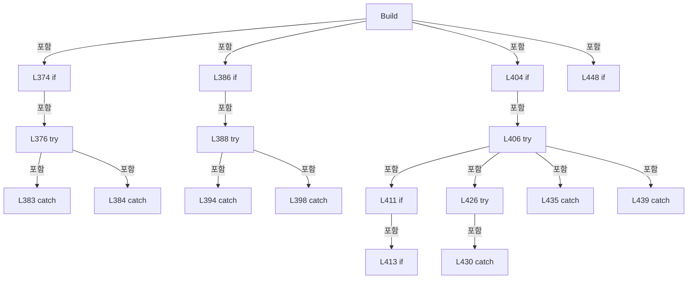

변경 전 점검: 입력/반환 타입, 위 호출자, 예외/취소 경로, 공유 상태와 저장·전송 소비자를 함께 확인합니다. 값의 단위나 물리 방향을 이름만으로 확정하지 않습니다.

### MethodDeclaration `SelectTab` · L464–492

[Drilling.UI/Menu/Menus/CMenuCorrection.cs:464–492](https://github.com/kjuws10-rgb/A3Drilling/blob/5aee8e58439c9b455cae7c9593c9be986c3e682e/Drilling.UI/Menu/Menus/CMenuCorrection.cs#L464-L492)

| 항목 | 실제 추출 값 |
| --- | --- |
| 서명 | void Drilling.UI.Menu.Menus.CMenuCorrection.SelectTab(object?) |
| 접근/수식자 | Private / private |
| 반환/값 타입 | void |
| 소속 타입 | NamedType:Drilling.UI.Menu.Menus.CMenuCorrection |

입력 계약:

| 이름 | 타입 | 전달 | 선택/기본값 |
| --- | --- | --- | --- |
| parameter | object? | None | False /  |

현재 부분 분석에서 직접 연결된 호출자는 없습니다. XAML/이벤트/인터페이스·델리게이트·외부 진입을 추가 확인해야 하며, 미사용으로 판정한 것이 아닙니다.

호출하는 대상과 해석 범위:

| 원본 행 | 표현식 | 분석 상태 | 대상/소스 위치 |
| --- | --- | --- | --- |
| 466 | .ToString | resolved · 동적 구현 선택 가능 | string? object.ToString() |
| 466 | .Trim | resolved | string string.Trim() |
| 467 | string.IsNullOrWhiteSpace | resolved | bool string.IsNullOrWhiteSpace(string?) |
| 477 | CorrectionTabs.FirstOrDefault | resolved | string? System.Collections.Generic.IEnumerable<string>.FirstOrDefault<string>(System.Func<string, bool>) |
| 490 | _statusReporter | resolved · 동적 구현 선택 가능 | void System.Action<string>.Invoke(string) |
| 491 | _refreshCurrentScreen | resolved · 동적 구현 선택 가능 | System.Threading.Tasks.Task System.Func<System.Threading.Tasks.Task>.Invoke() |

본문의 실제 연산·분기·예외·반환 순서(원문 위치 순):

| 원본 행 | 종류 | 주석 해설 |
| --- | --- | --- |
| 466 | call | 함수·델리게이트 또는 객체 생성자를 호출합니다: .ToString() |
| 466 | call | 함수·델리게이트 또는 객체 생성자를 호출합니다: .Trim() |
| 466 | local-declaration | 지역 변수를 선언합니다: var tabName = parameter?.ToString()?.Trim(); |
| 466 | variable-initializer | 변수의 초기값을 지정합니다: tabName = parameter?.ToString()?.Trim() |
| 467 | call | 함수·델리게이트 또는 객체 생성자를 호출합니다: string.IsNullOrWhiteSpace(tabName) |
| 467 | if | 조건에 따라 분기합니다: if (string.IsNullOrWhiteSpace(tabName)) |
| 469 | return | 호출자에게 값 또는 제어를 반환합니다: return; |
| 477 | call | 함수·델리게이트 또는 객체 생성자를 호출합니다: CorrectionTabs.FirstOrDefault(MatchesItem) |
| 477 | local-declaration | 지역 변수를 선언합니다: var normalizedTab = CorrectionTabs.FirstOrDefault(MatchesItem); |
| 477 | variable-initializer | 변수의 초기값을 지정합니다: normalizedTab = CorrectionTabs.FirstOrDefault(MatchesItem) |
| 478 | if | 조건에 따라 분기합니다: if (normalizedTab is null) |
| 480 | return | 호출자에게 값 또는 제어를 반환합니다: return; |
| 483 | if | 조건에 따라 분기합니다: if (normalizedTab == "REVIEW" && (_selectedTab != "REVIEW" &#124;&#124; _simpleOffsetLoad?.IsFaulted == true)) |
| 485 | assignment | 값을 대상에 대입합니다: _simpleOffsetLoad = null |
| 486 | assignment | 값을 대상에 대입합니다: _lastReviewOffsetWarning = "" |
| 489 | assignment | 값을 대상에 대입합니다: _selectedTab = normalizedTab |
| 490 | call | 함수·델리게이트 또는 객체 생성자를 호출합니다: _statusReporter($"Correction tab selected: {_selectedTab}.") |
| 491 | assignment | 값을 대상에 대입합니다: _ = _refreshCurrentScreen() |
| 491 | call | 함수·델리게이트 또는 객체 생성자를 호출합니다: _refreshCurrentScreen() |

제어 구문의 포함 구조(실제 실행 순서/CFG가 아닌 구문 탐색 그림):

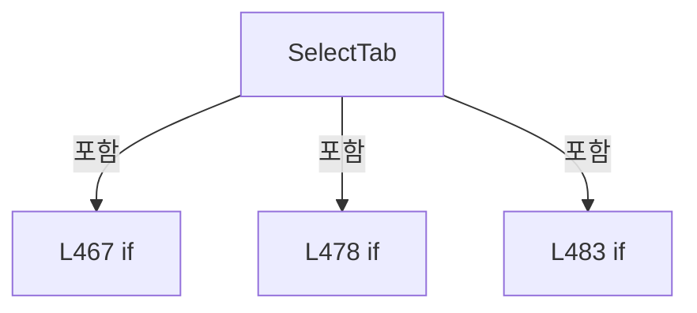

변경 전 점검: 입력/반환 타입, 위 호출자, 예외/취소 경로, 공유 상태와 저장·전송 소비자를 함께 확인합니다. 값의 단위나 물리 방향을 이름만으로 확정하지 않습니다.

### LocalFunctionStatement `MatchesItem` · L472–475

[Drilling.UI/Menu/Menus/CMenuCorrection.cs:472–475](https://github.com/kjuws10-rgb/A3Drilling/blob/5aee8e58439c9b455cae7c9593c9be986c3e682e/Drilling.UI/Menu/Menus/CMenuCorrection.cs#L472-L475)

| 항목 | 실제 추출 값 |
| --- | --- |
| 서명 | bool MatchesItem(string) |
| 접근/수식자 | Private /  |
| 반환/값 타입 | bool |
| 소속 타입 | NamedType:Drilling.UI.Menu.Menus.CMenuCorrection |

입력 계약:

| 이름 | 타입 | 전달 | 선택/기본값 |
| --- | --- | --- | --- |
| tab | string | None | False /  |

현재 부분 분석에서 직접 연결된 호출자는 없습니다. XAML/이벤트/인터페이스·델리게이트·외부 진입을 추가 확인해야 하며, 미사용으로 판정한 것이 아닙니다.

호출하는 대상과 해석 범위:

| 원본 행 | 표현식 | 분석 상태 | 대상/소스 위치 |
| --- | --- | --- | --- |
| 474 | tab.Equals | resolved | bool string.Equals(string?, System.StringComparison) |

본문의 실제 연산·분기·예외·반환 순서(원문 위치 순):

| 원본 행 | 종류 | 주석 해설 |
| --- | --- | --- |
| 474 | call | 함수·델리게이트 또는 객체 생성자를 호출합니다: tab.Equals(tabName, StringComparison.OrdinalIgnoreCase) |
| 474 | return | 호출자에게 값 또는 제어를 반환합니다: return tab.Equals(tabName, StringComparison.OrdinalIgnoreCase); |

변경 전 점검: 입력/반환 타입, 위 호출자, 예외/취소 경로, 공유 상태와 저장·전송 소비자를 함께 확인합니다. 값의 단위나 물리 방향을 이름만으로 확정하지 않습니다.

### MethodDeclaration `SelectOutputViewerCell` · L494–506

[Drilling.UI/Menu/Menus/CMenuCorrection.cs:494–506](https://github.com/kjuws10-rgb/A3Drilling/blob/5aee8e58439c9b455cae7c9593c9be986c3e682e/Drilling.UI/Menu/Menus/CMenuCorrection.cs#L494-L506)

| 항목 | 실제 추출 값 |
| --- | --- |
| 서명 | System.Threading.Tasks.Task Drilling.UI.Menu.Menus.CMenuCorrection.SelectOutputViewerCell(object?) |
| 접근/수식자 | Private / private, async |
| 반환/값 타입 | System.Threading.Tasks.Task |
| 소속 타입 | NamedType:Drilling.UI.Menu.Menus.CMenuCorrection |

입력 계약:

| 이름 | 타입 | 전달 | 선택/기본값 |
| --- | --- | --- | --- |
| parameter | object? | None | False /  |

정적 호출자로 확인된 위치:

| 호출 파일/행 | 호출 표현식 | 런타임 분기 가능 |
| --- | --- | --- |
| [Drilling.UI/Menu/Menus/CMenuCorrection.cs:164–164](https://github.com/kjuws10-rgb/A3Drilling/blob/5aee8e58439c9b455cae7c9593c9be986c3e682e/Drilling.UI/Menu/Menus/CMenuCorrection.cs#L164-L164) | SelectOutputViewerCell | False |

호출하는 대상과 해석 범위:

| 원본 행 | 표현식 | 분석 상태 | 대상/소스 위치 |
| --- | --- | --- | --- |
| 496 | int.TryParse | resolved | bool int.TryParse(string?, System.Globalization.NumberStyles, System.IFormatProvider?, out int) |
| 496 | .ToString | resolved · 동적 구현 선택 가능 | string? object.ToString() |
| 501 | Math.Max | resolved | int System.Math.Max(int, int) |
| 504 | _statusReporter | resolved · 동적 구현 선택 가능 | void System.Action<string>.Invoke(string) |
| 505 | _refreshCurrentScreen | resolved · 동적 구현 선택 가능 | System.Threading.Tasks.Task System.Func<System.Threading.Tasks.Task>.Invoke() |

본문의 실제 연산·분기·예외·반환 순서(원문 위치 순):

| 원본 행 | 종류 | 주석 해설 |
| --- | --- | --- |
| 496 | call | 함수·델리게이트 또는 객체 생성자를 호출합니다: int.TryParse(parameter?.ToString(), NumberStyles.Integer, CultureInfo.InvariantCulture, out var cellNo) |
| 496 | call | 함수·델리게이트 또는 객체 생성자를 호출합니다: .ToString() |
| 496 | if | 조건에 따라 분기합니다: if (!int.TryParse(parameter?.ToString(), NumberStyles.Integer, CultureInfo.InvariantCulture, out var cellNo)) |
| 498 | return | 호출자에게 값 또는 제어를 반환합니다: return; |
| 501 | assignment | 값을 대상에 대입합니다: _outputViewerSelectedCellNo = Math.Max(1, cellNo) |
| 501 | call | 함수·델리게이트 또는 객체 생성자를 호출합니다: Math.Max(1, cellNo) |
| 502 | assignment | 값을 대상에 대입합니다: _outputViewerIsCellDetailVisible = true |
| 503 | assignment | 값을 대상에 대입합니다: _outputViewerSelectedShotKey = "" |
| 504 | call | 함수·델리게이트 또는 객체 생성자를 호출합니다: _statusReporter($"Offset Viewer cell selected: CELL{_outputViewerSelectedCellNo:00}.") |
| 505 | await | 비동기 완료를 기다립니다: await _refreshCurrentScreen() |
| 505 | call | 함수·델리게이트 또는 객체 생성자를 호출합니다: _refreshCurrentScreen() |

제어 구문의 포함 구조(실제 실행 순서/CFG가 아닌 구문 탐색 그림):


변경 전 점검: 입력/반환 타입, 위 호출자, 예외/취소 경로, 공유 상태와 저장·전송 소비자를 함께 확인합니다. 값의 단위나 물리 방향을 이름만으로 확정하지 않습니다.

### MethodDeclaration `SelectOutputViewerShot` · L508–517

[Drilling.UI/Menu/Menus/CMenuCorrection.cs:508–517](https://github.com/kjuws10-rgb/A3Drilling/blob/5aee8e58439c9b455cae7c9593c9be986c3e682e/Drilling.UI/Menu/Menus/CMenuCorrection.cs#L508-L517)

| 항목 | 실제 추출 값 |
| --- | --- |
| 서명 | void Drilling.UI.Menu.Menus.CMenuCorrection.SelectOutputViewerShot(object?) |
| 접근/수식자 | Private / private |
| 반환/값 타입 | void |
| 소속 타입 | NamedType:Drilling.UI.Menu.Menus.CMenuCorrection |

입력 계약:

| 이름 | 타입 | 전달 | 선택/기본값 |
| --- | --- | --- | --- |
| parameter | object? | None | False /  |

정적 호출자로 확인된 위치:

| 호출 파일/행 | 호출 표현식 | 런타임 분기 가능 |
| --- | --- | --- |
| [Drilling.UI/Menu/Menus/CMenuCorrection.cs:521–521](https://github.com/kjuws10-rgb/A3Drilling/blob/5aee8e58439c9b455cae7c9593c9be986c3e682e/Drilling.UI/Menu/Menus/CMenuCorrection.cs#L521-L521) | SelectOutputViewerShot | False |

호출하는 대상과 해석 범위:

| 원본 행 | 표현식 | 분석 상태 | 대상/소스 위치 |
| --- | --- | --- | --- |
| 510 | .ToString | resolved · 동적 구현 선택 가능 | string? object.ToString() |
| 510 | .Trim | resolved | string string.Trim() |
| 511 | string.IsNullOrWhiteSpace | resolved | bool string.IsNullOrWhiteSpace(string?) |
| 511 | _outputViewerSelectedCellShots.Any | resolved | bool System.Collections.Generic.IEnumerable<Drilling.Common.Recipe.ST_HEAD_SHOT_POINT>.Any<Drilling.Common.Recipe.ST_HEAD_SHOT_POINT>(System.Func<Drilling.Common.Recipe.ST_HEAD_SHOT_POINT, bool>) |
| 511 | shot.ShotKey.Equals | resolved | bool string.Equals(string?, System.StringComparison) |
| 516 | ApplyOutputViewerShotSelection | resolved | void Drilling.UI.Menu.Menus.CMenuCorrection.ApplyOutputViewerShotSelection(string) · Drilling.UI/Menu/Menus/CMenuCorrection.cs:547 |

본문의 실제 연산·분기·예외·반환 순서(원문 위치 순):

| 원본 행 | 종류 | 주석 해설 |
| --- | --- | --- |
| 510 | call | 함수·델리게이트 또는 객체 생성자를 호출합니다: .ToString() |
| 510 | call | 함수·델리게이트 또는 객체 생성자를 호출합니다: .Trim() |
| 510 | local-declaration | 지역 변수를 선언합니다: var shotKey = parameter?.ToString()?.Trim(); |
| 510 | variable-initializer | 변수의 초기값을 지정합니다: shotKey = parameter?.ToString()?.Trim() |
| 511 | call | 함수·델리게이트 또는 객체 생성자를 호출합니다: string.IsNullOrWhiteSpace(shotKey) |
| 511 | call | 함수·델리게이트 또는 객체 생성자를 호출합니다: _outputViewerSelectedCellShots.Any(shot => shot.ShotKey.Equals(shotKey, StringComparison.OrdinalIgnoreCase)) |
| 511 | call | 함수·델리게이트 또는 객체 생성자를 호출합니다: shot.ShotKey.Equals(shotKey, StringComparison.OrdinalIgnoreCase) |
| 511 | if | 조건에 따라 분기합니다: if (string.IsNullOrWhiteSpace(shotKey) &#124;&#124; !_outputViewerSelectedCellShots.Any(shot => shot.ShotKey.Equals(shotKey, StringComparison.OrdinalIgnoreCase))) |
| 513 | return | 호출자에게 값 또는 제어를 반환합니다: return; |
| 516 | call | 함수·델리게이트 또는 객체 생성자를 호출합니다: ApplyOutputViewerShotSelection(shotKey) |

제어 구문의 포함 구조(실제 실행 순서/CFG가 아닌 구문 탐색 그림):

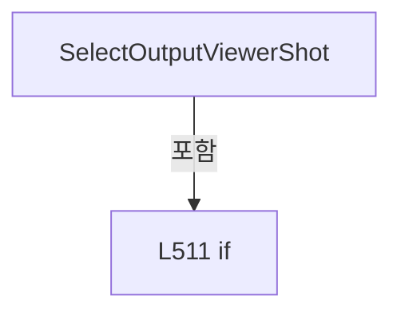

변경 전 점검: 입력/반환 타입, 위 호출자, 예외/취소 경로, 공유 상태와 저장·전송 소비자를 함께 확인합니다. 값의 단위나 물리 방향을 이름만으로 확정하지 않습니다.

### MethodDeclaration `SelectOutputViewerShotByKey` · L519–522

[Drilling.UI/Menu/Menus/CMenuCorrection.cs:519–522](https://github.com/kjuws10-rgb/A3Drilling/blob/5aee8e58439c9b455cae7c9593c9be986c3e682e/Drilling.UI/Menu/Menus/CMenuCorrection.cs#L519-L522)

| 항목 | 실제 추출 값 |
| --- | --- |
| 서명 | void Drilling.UI.Menu.Menus.CMenuCorrection.SelectOutputViewerShotByKey(string) |
| 접근/수식자 | Public / public |
| 반환/값 타입 | void |
| 소속 타입 | NamedType:Drilling.UI.Menu.Menus.CMenuCorrection |

입력 계약:

| 이름 | 타입 | 전달 | 선택/기본값 |
| --- | --- | --- | --- |
| shotKey | string | None | False /  |

정적 호출자로 확인된 위치:

| 호출 파일/행 | 호출 표현식 | 런타임 분기 가능 |
| --- | --- | --- |
| [Drilling.UI/Views/CCorrectionView.xaml.cs:33–33](https://github.com/kjuws10-rgb/A3Drilling/blob/5aee8e58439c9b455cae7c9593c9be986c3e682e/Drilling.UI/Views/CCorrectionView.xaml.cs#L33-L33) | correction.SelectOutputViewerShotByKey | False |

호출하는 대상과 해석 범위:

| 원본 행 | 표현식 | 분석 상태 | 대상/소스 위치 |
| --- | --- | --- | --- |
| 521 | SelectOutputViewerShot | resolved | void Drilling.UI.Menu.Menus.CMenuCorrection.SelectOutputViewerShot(object?) · Drilling.UI/Menu/Menus/CMenuCorrection.cs:508 |

본문의 실제 연산·분기·예외·반환 순서(원문 위치 순):

| 원본 행 | 종류 | 주석 해설 |
| --- | --- | --- |
| 521 | call | 함수·델리게이트 또는 객체 생성자를 호출합니다: SelectOutputViewerShot(shotKey) |

변경 전 점검: 입력/반환 타입, 위 호출자, 예외/취소 경로, 공유 상태와 저장·전송 소비자를 함께 확인합니다. 값의 단위나 물리 방향을 이름만으로 확정하지 않습니다.

### MethodDeclaration `SelectOutputViewerShotAt` · L524–545

[Drilling.UI/Menu/Menus/CMenuCorrection.cs:524–545](https://github.com/kjuws10-rgb/A3Drilling/blob/5aee8e58439c9b455cae7c9593c9be986c3e682e/Drilling.UI/Menu/Menus/CMenuCorrection.cs#L524-L545)

| 항목 | 실제 추출 값 |
| --- | --- |
| 서명 | void Drilling.UI.Menu.Menus.CMenuCorrection.SelectOutputViewerShotAt(double, double) |
| 접근/수식자 | Public / public |
| 반환/값 타입 | void |
| 소속 타입 | NamedType:Drilling.UI.Menu.Menus.CMenuCorrection |

입력 계약:

| 이름 | 타입 | 전달 | 선택/기본값 |
| --- | --- | --- | --- |
| designX | double | None | False /  |
| designY | double | None | False /  |

현재 부분 분석에서 직접 연결된 호출자는 없습니다. XAML/이벤트/인터페이스·델리게이트·외부 진입을 추가 확인해야 하며, 미사용으로 판정한 것이 아닙니다.

호출하는 대상과 해석 범위:

| 원본 행 | 표현식 | 분석 상태 | 대상/소스 위치 |
| --- | --- | --- | --- |
| 532 | GetOutputViewerShotMapRect | resolved | Rect Drilling.UI.Menu.Menus.CMenuCorrection.GetOutputViewerShotMapRect(int, int) · Drilling.UI/Menu/Menus/CMenuCorrection.cs:805 |
| 533 | mapRect.Contains | unresolved | None |
| 533 | new Point | unresolved | None |
| 538 | Math.Clamp | resolved | int System.Math.Clamp(int, int, int) |
| 539 | Math.Clamp | resolved | int System.Math.Clamp(int, int, int) |
| 540 | _outputViewerSelectedCellShots.FirstOrDefault | resolved | Drilling.Common.Recipe.ST_HEAD_SHOT_POINT? System.Collections.Generic.IEnumerable<Drilling.Common.Recipe.ST_HEAD_SHOT_POINT>.FirstOrDefault<Drilling.Common.Recipe.ST_HEAD_SHOT_POINT>(System.Func<Drilling.Common.Recipe.ST_HEAD_SHOT_POINT, bool>) |
| 543 | ApplyOutputViewerShotSelection | resolved | void Drilling.UI.Menu.Menus.CMenuCorrection.ApplyOutputViewerShotSelection(string) · Drilling.UI/Menu/Menus/CMenuCorrection.cs:547 |

본문의 실제 연산·분기·예외·반환 순서(원문 위치 순):

| 원본 행 | 종류 | 주석 해설 |
| --- | --- | --- |
| 526 | if | 조건에 따라 분기합니다: if (!_outputViewerIsCellDetailVisible &#124;&#124; _outputViewerSelectedCellShots.Count == 0) |
| 528 | return | 호출자에게 값 또는 제어를 반환합니다: return; |
| 531 | local-declaration | 지역 변수를 선언합니다: var firstShot = _outputViewerSelectedCellShots[0]; |
| 531 | variable-initializer | 변수의 초기값을 지정합니다: firstShot = _outputViewerSelectedCellShots[0] |
| 532 | call | 함수·델리게이트 또는 객체 생성자를 호출합니다: GetOutputViewerShotMapRect(firstShot.GroupCountX, firstShot.GroupCountY) |
| 532 | local-declaration | 지역 변수를 선언합니다: var mapRect = GetOutputViewerShotMapRect(firstShot.GroupCountX, firstShot.GroupCountY); |
| 532 | variable-initializer | 변수의 초기값을 지정합니다: mapRect = GetOutputViewerShotMapRect(firstShot.GroupCountX, firstShot.GroupCountY) |
| 533 | call | 함수·델리게이트 또는 객체 생성자를 호출합니다: mapRect.Contains(new Point(designX, designY)) |
| 533 | call | 함수·델리게이트 또는 객체 생성자를 호출합니다: new Point(designX, designY) |
| 533 | if | 조건에 따라 분기합니다: if (!mapRect.Contains(new Point(designX, designY))) |
| 535 | return | 호출자에게 값 또는 제어를 반환합니다: return; |
| 538 | call | 함수·델리게이트 또는 객체 생성자를 호출합니다: Math.Clamp((int)((designX - mapRect.Left) / mapRect.Width * firstShot.GroupCountX), 0, firstShot.GroupCountX - 1) |
| 538 | local-declaration | 지역 변수를 선언합니다: var column = Math.Clamp((int)((designX - mapRect.Left) / mapRect.Width * firstShot.GroupCountX), 0, firstShot.GroupCountX - 1); |
| 538 | variable-initializer | 변수의 초기값을 지정합니다: column = Math.Clamp((int)((designX - mapRect.Left) / mapRect.Width * firstShot.GroupCountX), 0, firstShot.GroupCountX - 1) |
| 539 | call | 함수·델리게이트 또는 객체 생성자를 호출합니다: Math.Clamp((int)((designY - mapRect.Top) / mapRect.Height * firstShot.GroupCountY), 0, firstShot.GroupCountY - 1) |
| 539 | local-declaration | 지역 변수를 선언합니다: var row = Math.Clamp((int)((designY - mapRect.Top) / mapRect.Height * firstShot.GroupCountY), 0, firstShot.GroupCountY - 1); |
| 539 | variable-initializer | 변수의 초기값을 지정합니다: row = Math.Clamp((int)((designY - mapRect.Top) / mapRect.Height * firstShot.GroupCountY), 0, firstShot.GroupCountY - 1) |
| 540 | call | 함수·델리게이트 또는 객체 생성자를 호출합니다: _outputViewerSelectedCellShots.FirstOrDefault(item => item.GroupColumn == column && item.GroupRow == row) |
| 540 | local-declaration | 지역 변수를 선언합니다: var shot = _outputViewerSelectedCellShots.FirstOrDefault(item => item.GroupColumn == column && item.GroupRow == row); |
| 540 | variable-initializer | 변수의 초기값을 지정합니다: shot = _outputViewerSelectedCellShots.FirstOrDefault(item => item.GroupColumn == column && item.GroupRow == row) |
| 541 | if | 조건에 따라 분기합니다: if (shot is not null) |
| 543 | call | 함수·델리게이트 또는 객체 생성자를 호출합니다: ApplyOutputViewerShotSelection(shot.ShotKey) |

제어 구문의 포함 구조(실제 실행 순서/CFG가 아닌 구문 탐색 그림):

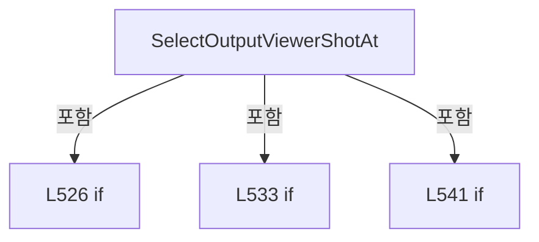

변경 전 점검: 입력/반환 타입, 위 호출자, 예외/취소 경로, 공유 상태와 저장·전송 소비자를 함께 확인합니다. 값의 단위나 물리 방향을 이름만으로 확정하지 않습니다.

### MethodDeclaration `ApplyOutputViewerShotSelection` · L547–561

[Drilling.UI/Menu/Menus/CMenuCorrection.cs:547–561](https://github.com/kjuws10-rgb/A3Drilling/blob/5aee8e58439c9b455cae7c9593c9be986c3e682e/Drilling.UI/Menu/Menus/CMenuCorrection.cs#L547-L561)

| 항목 | 실제 추출 값 |
| --- | --- |
| 서명 | void Drilling.UI.Menu.Menus.CMenuCorrection.ApplyOutputViewerShotSelection(string) |
| 접근/수식자 | Private / private |
| 반환/값 타입 | void |
| 소속 타입 | NamedType:Drilling.UI.Menu.Menus.CMenuCorrection |

입력 계약:

| 이름 | 타입 | 전달 | 선택/기본값 |
| --- | --- | --- | --- |
| shotKey | string | None | False /  |

정적 호출자로 확인된 위치:

| 호출 파일/행 | 호출 표현식 | 런타임 분기 가능 |
| --- | --- | --- |
| [Drilling.UI/Menu/Menus/CMenuCorrection.cs:516–516](https://github.com/kjuws10-rgb/A3Drilling/blob/5aee8e58439c9b455cae7c9593c9be986c3e682e/Drilling.UI/Menu/Menus/CMenuCorrection.cs#L516-L516) | ApplyOutputViewerShotSelection | False |
| [Drilling.UI/Menu/Menus/CMenuCorrection.cs:543–543](https://github.com/kjuws10-rgb/A3Drilling/blob/5aee8e58439c9b455cae7c9593c9be986c3e682e/Drilling.UI/Menu/Menus/CMenuCorrection.cs#L543-L543) | ApplyOutputViewerShotSelection | False |

호출하는 대상과 해석 범위:

| 원본 행 | 표현식 | 분석 상태 | 대상/소스 위치 |
| --- | --- | --- | --- |
| 549 | _outputViewerSelectedShotKey.Equals | resolved | bool string.Equals(string?, System.StringComparison) |
| 555 | BuildOutputViewerCellShotMap | resolved | ImageSource? Drilling.UI.Menu.Menus.CMenuCorrection.BuildOutputViewerCellShotMap(System.Collections.Generic.IReadOnlyList<Drilling.Common.Recipe.ST_HEAD_SHOT_POINT>, System.Collections.Generic.IReadOnlyDictionary<string, Drilling.Common.Recipe.ST_RECIPE_SHOT_MASKING_RESULT>, string) · Drilling.UI/Menu/Menus/CMenuCorrection.cs:832 |
| 556 | OutputOffsets.SelectShot | resolved | void Drilling.UI.Menu.Menus.COutputOffsetViewerPanel.SelectShot(string) · Drilling.UI/Menu/Menus/CMenuCorrection.cs:6955 |
| 557 | .Invoke | resolved · 동적 구현 선택 가능 | void System.EventHandler.Invoke(object?, System.EventArgs) |
| 558 | .Invoke | resolved · 동적 구현 선택 가능 | void System.EventHandler.Invoke(object?, System.EventArgs) |
| 559 | .Invoke | resolved · 동적 구현 선택 가능 | void System.EventHandler.Invoke(object?, System.EventArgs) |
| 560 | _statusReporter | resolved · 동적 구현 선택 가능 | void System.Action<string>.Invoke(string) |

본문의 실제 연산·분기·예외·반환 순서(원문 위치 순):

| 원본 행 | 종류 | 주석 해설 |
| --- | --- | --- |
| 549 | call | 함수·델리게이트 또는 객체 생성자를 호출합니다: _outputViewerSelectedShotKey.Equals(shotKey, StringComparison.OrdinalIgnoreCase) |
| 549 | if | 조건에 따라 분기합니다: if (_outputViewerSelectedShotKey.Equals(shotKey, StringComparison.OrdinalIgnoreCase)) |
| 551 | return | 호출자에게 값 또는 제어를 반환합니다: return; |
| 554 | assignment | 값을 대상에 대입합니다: _outputViewerSelectedShotKey = shotKey |
| 555 | assignment | 값을 대상에 대입합니다: OutputViewerCellShotMapImage = BuildOutputViewerCellShotMap(_outputViewerSelectedCellShots, _outputViewerSelectedShotStates, _outputViewerSelectedShotKey) |
| 555 | call | 함수·델리게이트 또는 객체 생성자를 호출합니다: BuildOutputViewerCellShotMap(_outputViewerSelectedCellShots, _outputViewerSelectedShotStates, _outputViewerSelectedShotKey) |
| 556 | call | 함수·델리게이트 또는 객체 생성자를 호출합니다: OutputOffsets.SelectShot(_outputViewerSelectedShotKey) |
| 557 | call | 함수·델리게이트 또는 객체 생성자를 호출합니다: .Invoke(this, EventArgs.Empty) |
| 558 | call | 함수·델리게이트 또는 객체 생성자를 호출합니다: .Invoke(this, EventArgs.Empty) |
| 559 | call | 함수·델리게이트 또는 객체 생성자를 호출합니다: .Invoke(this, EventArgs.Empty) |
| 560 | call | 함수·델리게이트 또는 객체 생성자를 호출합니다: _statusReporter($"Offset Viewer shot selected: {OutputViewerSelectedShotName}.") |

제어 구문의 포함 구조(실제 실행 순서/CFG가 아닌 구문 탐색 그림):

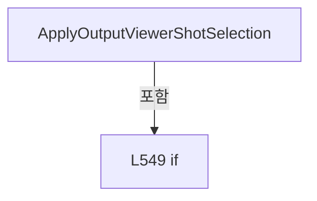

변경 전 점검: 입력/반환 타입, 위 호출자, 예외/취소 경로, 공유 상태와 저장·전송 소비자를 함께 확인합니다. 값의 단위나 물리 방향을 이름만으로 확정하지 않습니다.

### MethodDeclaration `BackToOutputViewerGlass` · L563–570

[Drilling.UI/Menu/Menus/CMenuCorrection.cs:563–570](https://github.com/kjuws10-rgb/A3Drilling/blob/5aee8e58439c9b455cae7c9593c9be986c3e682e/Drilling.UI/Menu/Menus/CMenuCorrection.cs#L563-L570)

| 항목 | 실제 추출 값 |
| --- | --- |
| 서명 | System.Threading.Tasks.Task Drilling.UI.Menu.Menus.CMenuCorrection.BackToOutputViewerGlass(object?) |
| 접근/수식자 | Private / private, async |
| 반환/값 타입 | System.Threading.Tasks.Task |
| 소속 타입 | NamedType:Drilling.UI.Menu.Menus.CMenuCorrection |

입력 계약:

| 이름 | 타입 | 전달 | 선택/기본값 |
| --- | --- | --- | --- |
| parameter | object? | None | False /  |

정적 호출자로 확인된 위치:

| 호출 파일/행 | 호출 표현식 | 런타임 분기 가능 |
| --- | --- | --- |
| [Drilling.UI/Menu/Menus/CMenuCorrection.cs:171–171](https://github.com/kjuws10-rgb/A3Drilling/blob/5aee8e58439c9b455cae7c9593c9be986c3e682e/Drilling.UI/Menu/Menus/CMenuCorrection.cs#L171-L171) | BackToOutputViewerGlass | False |

호출하는 대상과 해석 범위:

| 원본 행 | 표현식 | 분석 상태 | 대상/소스 위치 |
| --- | --- | --- | --- |
| 568 | _statusReporter | resolved · 동적 구현 선택 가능 | void System.Action<string>.Invoke(string) |
| 569 | _refreshCurrentScreen | resolved · 동적 구현 선택 가능 | System.Threading.Tasks.Task System.Func<System.Threading.Tasks.Task>.Invoke() |

본문의 실제 연산·분기·예외·반환 순서(원문 위치 순):

| 원본 행 | 종류 | 주석 해설 |
| --- | --- | --- |
| 565 | assignment | 값을 대상에 대입합니다: _outputViewerIsCellDetailVisible = false |
| 566 | assignment | 값을 대상에 대입합니다: _outputViewerSelectedCellNo = 0 |
| 567 | assignment | 값을 대상에 대입합니다: _outputViewerSelectedShotKey = "" |
| 568 | call | 함수·델리게이트 또는 객체 생성자를 호출합니다: _statusReporter("Offset Viewer glass preview opened.") |
| 569 | await | 비동기 완료를 기다립니다: await _refreshCurrentScreen() |
| 569 | call | 함수·델리게이트 또는 객체 생성자를 호출합니다: _refreshCurrentScreen() |

변경 전 점검: 입력/반환 타입, 위 호출자, 예외/취소 경로, 공유 상태와 저장·전송 소비자를 함께 확인합니다. 값의 단위나 물리 방향을 이름만으로 확정하지 않습니다.

### MethodDeclaration `RefreshOutputViewerData` · L572–707

[Drilling.UI/Menu/Menus/CMenuCorrection.cs:572–707](https://github.com/kjuws10-rgb/A3Drilling/blob/5aee8e58439c9b455cae7c9593c9be986c3e682e/Drilling.UI/Menu/Menus/CMenuCorrection.cs#L572-L707)

| 항목 | 실제 추출 값 |
| --- | --- |
| 서명 | System.Threading.Tasks.Task Drilling.UI.Menu.Menus.CMenuCorrection.RefreshOutputViewerData(System.Threading.CancellationToken) |
| 접근/수식자 | Private / private, async |
| 반환/값 타입 | System.Threading.Tasks.Task |
| 소속 타입 | NamedType:Drilling.UI.Menu.Menus.CMenuCorrection |

입력 계약:

| 이름 | 타입 | 전달 | 선택/기본값 |
| --- | --- | --- | --- |
| cancellationToken | System.Threading.CancellationToken | None | False /  |

정적 호출자로 확인된 위치:

| 호출 파일/행 | 호출 표현식 | 런타임 분기 가능 |
| --- | --- | --- |
| [Drilling.UI/Menu/Menus/CMenuCorrection.cs:450–450](https://github.com/kjuws10-rgb/A3Drilling/blob/5aee8e58439c9b455cae7c9593c9be986c3e682e/Drilling.UI/Menu/Menus/CMenuCorrection.cs#L450-L450) | RefreshOutputViewerData | False |

호출하는 대상과 해석 범위:

| 원본 행 | 표현식 | 분석 상태 | 대상/소스 위치 |
| --- | --- | --- | --- |
| 574 | System.Threading.Interlocked.Increment | resolved | int System.Threading.Interlocked.Increment(ref int) |
| 577 | LoadSelectedOutputViewerRecipe | resolved | System.Threading.Tasks.Task<Drilling.Common.Managers.ST_RECIPE_DEFINITION?> Drilling.UI.Menu.Menus.CMenuCorrection.LoadSelectedOutputViewerRecipe(System.Threading.CancellationToken, bool) · Drilling.UI/Menu/Menus/CMenuCorrection.cs:709 |
| 582 | ClearOutputViewerCellSelectionData | resolved | void Drilling.UI.Menu.Menus.CMenuCorrection.ClearOutputViewerCellSelectionData() · Drilling.UI/Menu/Menus/CMenuCorrection.cs:776 |
| 583 | OutputOffsets.Clear | resolved | void Drilling.UI.Menu.Menus.COutputOffsetViewerPanel.Clear() · Drilling.UI/Menu/Menus/CMenuCorrection.cs:6948 |
| 588 | new List<ST_SYSTEM_PARAMETER> | resolved | System.Collections.Generic.List<Drilling.Common.Managers.ST_SYSTEM_PARAMETER>.List() |
| 589 | settings.AddRange | resolved | void System.Collections.Generic.List<Drilling.Common.Managers.ST_SYSTEM_PARAMETER>.AddRange(System.Collections.Generic.IEnumerable<Drilling.Common.Managers.ST_SYSTEM_PARAMETER>) |
| 589 | _settingManager.LoadSection | resolved | System.Collections.Generic.IReadOnlyList<Drilling.Common.Managers.ST_SYSTEM_PARAMETER> Drilling.Common.Managers.CSettingManager.LoadSection(Drilling.Common.Managers.EN_SETTING_TAB, System.Threading.CancellationToken) · Drilling.Common/Managers/CSettingManager.cs:26 |
| 590 | settings.AddRange | resolved | void System.Collections.Generic.List<Drilling.Common.Managers.ST_SYSTEM_PARAMETER>.AddRange(System.Collections.Generic.IEnumerable<Drilling.Common.Managers.ST_SYSTEM_PARAMETER>) |
| 590 | _settingManager.LoadSection | resolved | System.Collections.Generic.IReadOnlyList<Drilling.Common.Managers.ST_SYSTEM_PARAMETER> Drilling.Common.Managers.CSettingManager.LoadSection(Drilling.Common.Managers.EN_SETTING_TAB, System.Threading.CancellationToken) · Drilling.Common/Managers/CSettingManager.cs:26 |
| 591 | BuildOutputViewerParameterMap | resolved | System.Collections.Generic.Dictionary<string, string> Drilling.UI.Menu.Menus.CMenuCorrection.BuildOutputViewerParameterMap(Drilling.Common.Managers.ST_RECIPE_DEFINITION, System.Collections.Generic.IReadOnlyList<Drilling.Common.Managers.ST_SYSTEM_PARAMETER>) · Drilling.UI/Menu/Menus/CMenuCorrection.cs:726 |
| 592 | _reviewOffsetFile.LoadLatest | resolved | System.Threading.Tasks.Task<Drilling.Common.Review.ST_REVIEW_OFFSET_FILE_DATA> Drilling.Common.Review.CReviewOffsetFileBase.LoadLatest(string, System.Threading.CancellationToken) · Drilling.Common/Review/CReviewManager.cs:4139 |
| 594 | ApplyReviewOffsetsToOutputViewerParameters | resolved | void Drilling.UI.Menu.Menus.CMenuCorrection.ApplyReviewOffsetsToOutputViewerParameters(System.Collections.Generic.IDictionary<string, string>, Drilling.Common.Review.ST_REVIEW_OFFSET_FILE_DATA) · Drilling.UI/Menu/Menus/CMenuCorrection.cs:971 |
| 595 | Math.Max | resolved | int System.Math.Max(int, int) |
| 595 | ReadOutputViewerInt | resolved | int Drilling.UI.Menu.Menus.CMenuCorrection.ReadOutputViewerInt(System.Collections.Generic.IReadOnlyDictionary<string, string>, int, params string[]) · Drilling.UI/Menu/Menus/CMenuCorrection.cs:1186 |
| 598 | Math.Clamp | resolved | int System.Math.Clamp(int, int, int) |
| 598 | Math.Max | resolved | int System.Math.Max(int, int) |
| 607 | OutputViewerParametersMatch | resolved | bool Drilling.UI.Menu.Menus.CMenuCorrection.OutputViewerParametersMatch(System.Collections.Generic.IReadOnlyDictionary<string, string>?, System.Collections.Generic.IReadOnlyDictionary<string, string>) · Drilling.UI/Menu/Menus/CMenuCorrection.cs:758 |
| 609 | Task.Run | resolved | System.Threading.Tasks.Task<Drilling.UI.Menu.Menus.ST_CORRECTION_OFFSET_VIEWER_PREVIEW> System.Threading.Tasks.Task.Run<Drilling.UI.Menu.Menus.ST_CORRECTION_OFFSET_VIEWER_PREVIEW>(System.Func<Drilling.UI.Menu.Menus.ST_CORRECTION_OFFSET_VIEWER_PREVIEW>, System.Threading.CancellationToken) |
| 609 | BuildOutputViewerGlassPreview | resolved | Drilling.UI.Menu.Menus.ST_CORRECTION_OFFSET_VIEWER_PREVIEW Drilling.UI.Menu.Menus.CMenuCorrection.BuildOutputViewerGlassPreview(System.Collections.Generic.IReadOnlyDictionary<string, string>, int, int) · Drilling.UI/Menu/Menus/CMenuCorrection.cs:976 |
| 610 | cancellationToken.ThrowIfCancellationRequested | resolved | void System.Threading.CancellationToken.ThrowIfCancellationRequested() |
| 611 | System.Threading.Volatile.Read | resolved | int System.Threading.Volatile.Read(ref readonly int) |
| 616 | CopyOutputViewerParameters | resolved | System.Collections.Generic.IReadOnlyDictionary<string, string> Drilling.UI.Menu.Menus.CMenuCorrection.CopyOutputViewerParameters(System.Collections.Generic.IReadOnlyDictionary<string, string>) · Drilling.UI/Menu/Menus/CMenuCorrection.cs:753 |
| 622 | System.Threading.Volatile.Read | resolved | int System.Threading.Volatile.Read(ref readonly int) |
| 632 | BuildOutputViewerCoordinateParameterMap | resolved | System.Collections.Generic.IReadOnlyDictionary<string, string> Drilling.UI.Menu.Menus.CMenuCorrection.BuildOutputViewerCoordinateParameterMap(System.Collections.Generic.IReadOnlyDictionary<string, string>) · Drilling.UI/Menu/Menus/CMenuCorrection.cs:1174 |
| 634 | OutputViewerParametersMatch | resolved | bool Drilling.UI.Menu.Menus.CMenuCorrection.OutputViewerParametersMatch(System.Collections.Generic.IReadOnlyDictionary<string, string>?, System.Collections.Generic.IReadOnlyDictionary<string, string>) · Drilling.UI/Menu/Menus/CMenuCorrection.cs:758 |
| 640 | Task.Run<IReadOnlyList<ST_HEAD_SHOT_POINT>> | resolved | System.Threading.Tasks.Task<System.Collections.Generic.IReadOnlyList<Drilling.Common.Recipe.ST_HEAD_SHOT_POINT>> System.Threading.Tasks.Task.Run<System.Collections.Generic.IReadOnlyList<Drilling.Common.Recipe.ST_HEAD_SHOT_POINT>>(System.Func<System.Collections.Generic.IReadOnlyList<Drilling.Common.Recipe.ST_HEAD_SHOT_POINT>>, System.Threading.CancellationToken) |
| 642 | CShotCoordinatePlanBuilder.Build | resolved | Drilling.Common.Recipe.ST_SHOT_COORDINATE_PLAN Drilling.Common.Recipe.CShotCoordinatePlanBuilder.Build(System.Collections.Generic.IReadOnlyDictionary<string, string>) · Drilling.Common/Recipe/CShotCoordinatePlanBuilder.cs:11 |
| 643 | plan.Shots.Where(shot => shot.CellNo == selectedCellNo).ToArray | resolved | Drilling.Common.Recipe.ST_HEAD_SHOT_POINT[] System.Collections.Generic.IEnumerable<Drilling.Common.Recipe.ST_HEAD_SHOT_POINT>.ToArray<Drilling.Common.Recipe.ST_HEAD_SHOT_POINT>() |
| 643 | plan.Shots.Where | resolved | System.Collections.Generic.IEnumerable<Drilling.Common.Recipe.ST_HEAD_SHOT_POINT> System.Collections.Generic.IEnumerable<Drilling.Common.Recipe.ST_HEAD_SHOT_POINT>.Where<Drilling.Common.Recipe.ST_HEAD_SHOT_POINT>(System.Func<Drilling.Common.Recipe.ST_HEAD_SHOT_POINT, bool>) |
| 645 | cancellationToken.ThrowIfCancellationRequested | resolved | void System.Threading.CancellationToken.ThrowIfCancellationRequested() |
| 646 | System.Threading.Volatile.Read | resolved | int System.Threading.Volatile.Read(ref readonly int) |
| 651 | CopyOutputViewerParameters | resolved | System.Collections.Generic.IReadOnlyDictionary<string, string> Drilling.UI.Menu.Menus.CMenuCorrection.CopyOutputViewerParameters(System.Collections.Generic.IReadOnlyDictionary<string, string>) · Drilling.UI/Menu/Menus/CMenuCorrection.cs:753 |
| 656 | _outputViewerSelectedShotKey.Equals | resolved | bool string.Equals(string?, System.StringComparison) |
| 656 | selectedShots.Any | resolved | bool System.Collections.Generic.IEnumerable<Drilling.Common.Recipe.ST_HEAD_SHOT_POINT>.Any<Drilling.Common.Recipe.ST_HEAD_SHOT_POINT>(System.Func<Drilling.Common.Recipe.ST_HEAD_SHOT_POINT, bool>) |
| 656 | shot.ShotKey.Equals | resolved | bool string.Equals(string?, System.StringComparison) |
| 662 | Task.Run | resolved | System.Threading.Tasks.Task<(System.Collections.Generic.IReadOnlyDictionary<string, Drilling.Common.Recipe.ST_RECIPE_SHOT_MASKING_RESULT> States, ImageSource? Image)> System.Threading.Tasks.Task.Run<(System.Collections.Generic.IReadOnlyDictionary<string, Drilling.Common.Recipe.ST_RECIPE_SHOT_MASKING_RESULT> States, ImageSource? Image)>(System.Func<(System.Collections.Generic.IReadOnlyDictionary<string, Drilling.Common.Recipe.ST_RECIPE_SHOT_MASKING_RESULT> States, ImageSource? Image)>, System.Threading.CancellationToken) |
| 664 | CRecipeShotMaskingPlan.Build | resolved | Drilling.Common.Recipe.CRecipeShotMaskingPlan Drilling.Common.Recipe.CRecipeShotMaskingPlan.Build(System.Collections.Generic.IReadOnlyDictionary<string, string>) · Drilling.Common/Recipe/CShotCoordinatePlanBuilder.cs:813 |
| 665 | selectedShots.ToDictionary | resolved | System.Collections.Generic.Dictionary<string, Drilling.Common.Recipe.ST_RECIPE_SHOT_MASKING_RESULT> System.Collections.Generic.IEnumerable<Drilling.Common.Recipe.ST_HEAD_SHOT_POINT>.ToDictionary<Drilling.Common.Recipe.ST_HEAD_SHOT_POINT, string, Drilling.Common.Recipe.ST_RECIPE_SHOT_MASKING_RESULT>(System.Func<Drilling.Common.Recipe.ST_HEAD_SHOT_POINT, string>, System.Func<Drilling.Common.Recipe.ST_HEAD_SHOT_POINT, Drilling.Common.Recipe.ST_RECIPE_SHOT_MASKING_RESULT>, System.Collections.Generic.IEqualityComparer<string>?) |
| 667 | maskingPlan.EvaluateShot | resolved | Drilling.Common.Recipe.ST_RECIPE_SHOT_MASKING_RESULT Drilling.Common.Recipe.CRecipeShotMaskingPlan.EvaluateShot(Drilling.Common.Recipe.ST_HEAD_SHOT_POINT) · Drilling.Common/Recipe/CShotCoordinatePlanBuilder.cs:853 |
| 669 | BuildOutputViewerCellShotMap | resolved | ImageSource? Drilling.UI.Menu.Menus.CMenuCorrection.BuildOutputViewerCellShotMap(System.Collections.Generic.IReadOnlyList<Drilling.Common.Recipe.ST_HEAD_SHOT_POINT>, System.Collections.Generic.IReadOnlyDictionary<string, Drilling.Common.Recipe.ST_RECIPE_SHOT_MASKING_RESULT>, string) · Drilling.UI/Menu/Menus/CMenuCorrection.cs:832 |
| 671 | cancellationToken.ThrowIfCancellationRequested | resolved | void System.Threading.CancellationToken.ThrowIfCancellationRequested() |
| 672 | System.Threading.Volatile.Read | resolved | int System.Threading.Volatile.Read(ref readonly int) |
| 680 | CreateOutputViewerHeadCards | resolved | System.Collections.Generic.IReadOnlyList<Drilling.UI.Menu.Menus.ST_CORRECTION_OUTPUT_VIEWER_HEAD_CARD> Drilling.UI.Menu.Menus.CMenuCorrection.CreateOutputViewerHeadCards(System.Collections.Generic.IReadOnlyList<Drilling.Common.Recipe.ST_HEAD_SHOT_POINT>) · Drilling.UI/Menu/Menus/CMenuCorrection.cs:811 |
| 681 | OutputOffsets.Update | resolved | void Drilling.UI.Menu.Menus.COutputOffsetViewerPanel.Update(System.Collections.Generic.IReadOnlyDictionary<string, string>, System.Collections.Generic.IReadOnlyList<Drilling.Common.Recipe.ST_HEAD_SHOT_POINT>, string) · Drilling.UI/Menu/Menus/CMenuCorrection.cs:6940 |
| 685 | ClearOutputViewerCellSelectionData | resolved | void Drilling.UI.Menu.Menus.CMenuCorrection.ClearOutputViewerCellSelectionData() · Drilling.UI/Menu/Menus/CMenuCorrection.cs:776 |
| 686 | OutputOffsets.Clear | resolved | void Drilling.UI.Menu.Menus.COutputOffsetViewerPanel.Clear() · Drilling.UI/Menu/Menus/CMenuCorrection.cs:6948 |
| 695 | System.Threading.Volatile.Read | resolved | int System.Threading.Volatile.Read(ref readonly int) |
| 700 | ReportInvalidReviewOffset | resolved | void Drilling.UI.Menu.Menus.CMenuCorrection.ReportInvalidReviewOffset(System.Exception) · Drilling.UI/Menu/Menus/CMenuCorrection.cs:3104 |
| 703 | ClearOutputViewerCellSelectionData | resolved | void Drilling.UI.Menu.Menus.CMenuCorrection.ClearOutputViewerCellSelectionData() · Drilling.UI/Menu/Menus/CMenuCorrection.cs:776 |
| 704 | OutputOffsets.Clear | resolved | void Drilling.UI.Menu.Menus.COutputOffsetViewerPanel.Clear() · Drilling.UI/Menu/Menus/CMenuCorrection.cs:6948 |

본문의 실제 연산·분기·예외·반환 순서(원문 위치 순):

| 원본 행 | 종류 | 주석 해설 |
| --- | --- | --- |
| 574 | call | 함수·델리게이트 또는 객체 생성자를 호출합니다: System.Threading.Interlocked.Increment(ref _outputViewerRefreshVersion) |
| 574 | local-declaration | 지역 변수를 선언합니다: var refreshVersion = System.Threading.Interlocked.Increment(ref _outputViewerRefreshVersion); |
| 574 | variable-initializer | 변수의 초기값을 지정합니다: refreshVersion = System.Threading.Interlocked.Increment(ref _outputViewerRefreshVersion) |
| 575 | try | 예외 처리 범위입니다: try |
| 577 | await | 비동기 완료를 기다립니다: await LoadSelectedOutputViewerRecipe(cancellationToken) |
| 577 | call | 함수·델리게이트 또는 객체 생성자를 호출합니다: LoadSelectedOutputViewerRecipe(cancellationToken) |
| 577 | local-declaration | 지역 변수를 선언합니다: var recipe = await LoadSelectedOutputViewerRecipe(cancellationToken); |
| 577 | variable-initializer | 변수의 초기값을 지정합니다: recipe = await LoadSelectedOutputViewerRecipe(cancellationToken) |
| 578 | if | 조건에 따라 분기합니다: if (recipe is null) |
| 580 | assignment | 값을 대상에 대입합니다: OutputViewerGlassPreviewImage = null |
| 581 | assignment | 값을 대상에 대입합니다: OutputViewerCellPreviewLabels = [] |
| 582 | call | 함수·델리게이트 또는 객체 생성자를 호출합니다: ClearOutputViewerCellSelectionData() |
| 583 | call | 함수·델리게이트 또는 객체 생성자를 호출합니다: OutputOffsets.Clear() |
| 584 | assignment | 값을 대상에 대입합니다: OutputViewerSummary = "Recipe not loaded" |
| 585 | return | 호출자에게 값 또는 제어를 반환합니다: return; |
| 588 | call | 함수·델리게이트 또는 객체 생성자를 호출합니다: new List<ST_SYSTEM_PARAMETER>() |
| 588 | local-declaration | 지역 변수를 선언합니다: var settings = new List<ST_SYSTEM_PARAMETER>(); |
| 588 | variable-initializer | 변수의 초기값을 지정합니다: settings = new List<ST_SYSTEM_PARAMETER>() |
| 589 | call | 함수·델리게이트 또는 객체 생성자를 호출합니다: settings.AddRange(_settingManager.LoadSection(EN_SETTING_TAB.Option, cancellationToken)) |
| 589 | call | 함수·델리게이트 또는 객체 생성자를 호출합니다: _settingManager.LoadSection(EN_SETTING_TAB.Option, cancellationToken) |
| 590 | call | 함수·델리게이트 또는 객체 생성자를 호출합니다: settings.AddRange(_settingManager.LoadSection(EN_SETTING_TAB.Motor, cancellationToken)) |
| 590 | call | 함수·델리게이트 또는 객체 생성자를 호출합니다: _settingManager.LoadSection(EN_SETTING_TAB.Motor, cancellationToken) |
| 591 | call | 함수·델리게이트 또는 객체 생성자를 호출합니다: BuildOutputViewerParameterMap(recipe, settings) |
| 591 | local-declaration | 지역 변수를 선언합니다: var parameters = BuildOutputViewerParameterMap(recipe, settings); |
| 591 | variable-initializer | 변수의 초기값을 지정합니다: parameters = BuildOutputViewerParameterMap(recipe, settings) |
| 592 | await | 비동기 완료를 기다립니다: await _reviewOffsetFile.LoadLatest(recipe.Id, cancellationToken) |
| 592 | call | 함수·델리게이트 또는 객체 생성자를 호출합니다: _reviewOffsetFile.LoadLatest(recipe.Id, cancellationToken) |
| 592 | local-declaration | 지역 변수를 선언합니다: var reviewOffsetFile = await _reviewOffsetFile.LoadLatest(recipe.Id, cancellationToken); |
| 592 | variable-initializer | 변수의 초기값을 지정합니다: reviewOffsetFile = await _reviewOffsetFile.LoadLatest(recipe.Id, cancellationToken) |
| 593 | assignment | 값을 대상에 대입합니다: _lastReviewOffsetWarning = "" |
| 594 | call | 함수·델리게이트 또는 객체 생성자를 호출합니다: ApplyReviewOffsetsToOutputViewerParameters(parameters, reviewOffsetFile) |
| 595 | call | 함수·델리게이트 또는 객체 생성자를 호출합니다: Math.Max(CCellPatternCalculator.MinCellCount, ReadOutputViewerInt(parameters, CCellPatternCalculator.MinCellCount, "MAX_CELL_NUMBER")) |
| 595 | call | 함수·델리게이트 또는 객체 생성자를 호출합니다: ReadOutputViewerInt(parameters, CCellPatternCalculator.MinCellCount, "MAX_CELL_NUMBER") |
| 595 | local-declaration | 지역 변수를 선언합니다: var cellCount = Math.Max(CCellPatternCalculator.MinCellCount, ReadOutputViewerInt(parameters, CCellPatternCalculator.MinCellCount, "MAX_CELL_NUMBER")); |
| 595 | variable-initializer | 변수의 초기값을 지정합니다: cellCount = Math.Max(CCellPatternCalculator.MinCellCount, ReadOutputViewerInt(parameters, CCellPatternCalculator.MinCellCount, "MAX_CELL_NUMBER")) |
| 596 | if | 조건에 따라 분기합니다: if (_outputViewerIsCellDetailVisible) |
| 598 | assignment | 값을 대상에 대입합니다: _outputViewerSelectedCellNo = Math.Clamp(Math.Max(1, _outputViewerSelectedCellNo), 1, cellCount) |
| 598 | call | 함수·델리게이트 또는 객체 생성자를 호출합니다: Math.Clamp(Math.Max(1, _outputViewerSelectedCellNo), 1, cellCount) |
| 598 | call | 함수·델리게이트 또는 객체 생성자를 호출합니다: Math.Max(1, _outputViewerSelectedCellNo) |
| 600 | else | 앞 조건이 거짓인 경로입니다: else |
| 602 | assignment | 값을 대상에 대입합니다: _outputViewerSelectedCellNo = 0 |
| 605 | conditional-expression | 조건에 따라 결과식을 선택합니다: _outputViewerIsCellDetailVisible ? _outputViewerSelectedCellNo : 0 |
| 605 | local-declaration | 지역 변수를 선언합니다: var selectedCellNo = _outputViewerIsCellDetailVisible ? _outputViewerSelectedCellNo : 0; |
| 605 | variable-initializer | 변수의 초기값을 지정합니다: selectedCellNo = _outputViewerIsCellDetailVisible ? _outputViewerSelectedCellNo : 0 |
| 606 | local-declaration | 지역 변수를 선언합니다: var preview = _outputViewerPreviewCache; |
| 606 | variable-initializer | 변수의 초기값을 지정합니다: preview = _outputViewerPreviewCache |
| 607 | call | 함수·델리게이트 또는 객체 생성자를 호출합니다: OutputViewerParametersMatch(_outputViewerPreviewParameters, parameters) |
| 607 | if | 조건에 따라 분기합니다: if (preview is null &#124;&#124; _outputViewerPreviewCellCount != cellCount &#124;&#124; _outputViewerPreviewSelectedCellNo != selectedCellNo &#124;&#124; !OutputViewerParametersMatch(_outputViewerPreviewParameters, parameters)) |
| 609 | assignment | 값을 대상에 대입합니다: preview = await Task.Run(() => BuildOutputViewerGlassPreview(parameters, cellCount, selectedCellNo), cancellationToken) |
| 609 | await | 비동기 완료를 기다립니다: await Task.Run(() => BuildOutputViewerGlassPreview(parameters, cellCount, selectedCellNo), cancellationToken) |
| 609 | call | 함수·델리게이트 또는 객체 생성자를 호출합니다: Task.Run(() => BuildOutputViewerGlassPreview(parameters, cellCount, selectedCellNo), cancellationToken) |
| 609 | call | 함수·델리게이트 또는 객체 생성자를 호출합니다: BuildOutputViewerGlassPreview(parameters, cellCount, selectedCellNo) |
| 610 | call | 함수·델리게이트 또는 객체 생성자를 호출합니다: cancellationToken.ThrowIfCancellationRequested() |
| 611 | call | 함수·델리게이트 또는 객체 생성자를 호출합니다: System.Threading.Volatile.Read(ref _outputViewerRefreshVersion) |
| 611 | if | 조건에 따라 분기합니다: if (refreshVersion != System.Threading.Volatile.Read(ref _outputViewerRefreshVersion)) |
| 613 | return | 호출자에게 값 또는 제어를 반환합니다: return; |
| 616 | assignment | 값을 대상에 대입합니다: _outputViewerPreviewParameters = CopyOutputViewerParameters(parameters) |
| 616 | call | 함수·델리게이트 또는 객체 생성자를 호출합니다: CopyOutputViewerParameters(parameters) |
| 617 | assignment | 값을 대상에 대입합니다: _outputViewerPreviewCellCount = cellCount |
| 618 | assignment | 값을 대상에 대입합니다: _outputViewerPreviewSelectedCellNo = selectedCellNo |
| 619 | assignment | 값을 대상에 대입합니다: _outputViewerPreviewCache = preview |
| 622 | call | 함수·델리게이트 또는 객체 생성자를 호출합니다: System.Threading.Volatile.Read(ref _outputViewerRefreshVersion) |
| 622 | if | 조건에 따라 분기합니다: if (refreshVersion != System.Threading.Volatile.Read(ref _outputViewerRefreshVersion)) |
| 624 | return | 호출자에게 값 또는 제어를 반환합니다: return; |
| 627 | assignment | 값을 대상에 대입합니다: OutputViewerGlassPreviewImage = preview.Image |
| 628 | assignment | 값을 대상에 대입합니다: OutputViewerCellPreviewLabels = preview.CellLabels |
| 629 | assignment | 값을 대상에 대입합니다: OutputViewerSummary = preview.Summary |
| 630 | if | 조건에 따라 분기합니다: if (_outputViewerIsCellDetailVisible) |
| 632 | call | 함수·델리게이트 또는 객체 생성자를 호출합니다: BuildOutputViewerCoordinateParameterMap(parameters) |
| 632 | local-declaration | 지역 변수를 선언합니다: var coordinateParameters = BuildOutputViewerCoordinateParameterMap(parameters); |
| 632 | variable-initializer | 변수의 초기값을 지정합니다: coordinateParameters = BuildOutputViewerCoordinateParameterMap(parameters) |
| 633 | local-declaration | 지역 변수를 선언합니다: IReadOnlyList<ST_HEAD_SHOT_POINT> selectedShots; |
| 634 | call | 함수·델리게이트 또는 객체 생성자를 호출합니다: OutputViewerParametersMatch(_outputViewerShotParameters, coordinateParameters) |
| 634 | if | 조건에 따라 분기합니다: if (_outputViewerShotCellNo == selectedCellNo && OutputViewerParametersMatch(_outputViewerShotParameters, coordinateParameters)) |
| 636 | assignment | 값을 대상에 대입합니다: selectedShots = _outputViewerShotCache |
| 638 | else | 앞 조건이 거짓인 경로입니다: else |
| 640 | assignment | 값을 대상에 대입합니다: selectedShots = await Task.Run<IReadOnlyList<ST_HEAD_SHOT_POINT>>(() => { var plan = CShotCoordinatePlanBuilder.Build(coordinateParameters); return plan.Shots.Where(shot => shot.CellNo == selectedCellNo).ToArray(); }, cancellation |
| 640 | await | 비동기 완료를 기다립니다: await Task.Run<IReadOnlyList<ST_HEAD_SHOT_POINT>>(() => { var plan = CShotCoordinatePlanBuilder.Build(coordinateParameters); return plan.Shots.Where(shot => shot.CellNo == selectedCellNo).ToArray(); }, cancellationToken) |
| 640 | call | 함수·델리게이트 또는 객체 생성자를 호출합니다: Task.Run<IReadOnlyList<ST_HEAD_SHOT_POINT>>(() => { var plan = CShotCoordinatePlanBuilder.Build(coordinateParameters); return plan.Shots.Where(shot => shot.CellNo == selectedCellNo).ToArray(); }, cancellationToken) |
| 642 | call | 함수·델리게이트 또는 객체 생성자를 호출합니다: CShotCoordinatePlanBuilder.Build(coordinateParameters) |
| 642 | local-declaration | 지역 변수를 선언합니다: var plan = CShotCoordinatePlanBuilder.Build(coordinateParameters); |
| 642 | variable-initializer | 변수의 초기값을 지정합니다: plan = CShotCoordinatePlanBuilder.Build(coordinateParameters) |
| 643 | call | 함수·델리게이트 또는 객체 생성자를 호출합니다: plan.Shots.Where(shot => shot.CellNo == selectedCellNo).ToArray() |
| 643 | call | 함수·델리게이트 또는 객체 생성자를 호출합니다: plan.Shots.Where(shot => shot.CellNo == selectedCellNo) |
| 643 | return | 호출자에게 값 또는 제어를 반환합니다: return plan.Shots.Where(shot => shot.CellNo == selectedCellNo).ToArray(); |
| 645 | call | 함수·델리게이트 또는 객체 생성자를 호출합니다: cancellationToken.ThrowIfCancellationRequested() |
| 646 | call | 함수·델리게이트 또는 객체 생성자를 호출합니다: System.Threading.Volatile.Read(ref _outputViewerRefreshVersion) |
| 646 | if | 조건에 따라 분기합니다: if (refreshVersion != System.Threading.Volatile.Read(ref _outputViewerRefreshVersion)) |
| 648 | return | 호출자에게 값 또는 제어를 반환합니다: return; |
| 651 | assignment | 값을 대상에 대입합니다: _outputViewerShotParameters = CopyOutputViewerParameters(coordinateParameters) |
| 651 | call | 함수·델리게이트 또는 객체 생성자를 호출합니다: CopyOutputViewerParameters(coordinateParameters) |
| 652 | assignment | 값을 대상에 대입합니다: _outputViewerShotCellNo = selectedCellNo |
| 653 | assignment | 값을 대상에 대입합니다: _outputViewerShotCache = selectedShots |
| 656 | call | 함수·델리게이트 또는 객체 생성자를 호출합니다: _outputViewerSelectedShotKey.Equals("", StringComparison.Ordinal) |
| 656 | call | 함수·델리게이트 또는 객체 생성자를 호출합니다: selectedShots.Any(shot => shot.ShotKey.Equals(_outputViewerSelectedShotKey, StringComparison.OrdinalIgnoreCase)) |
| 656 | call | 함수·델리게이트 또는 객체 생성자를 호출합니다: shot.ShotKey.Equals(_outputViewerSelectedShotKey, StringComparison.OrdinalIgnoreCase) |
| 656 | if | 조건에 따라 분기합니다: if (!_outputViewerSelectedShotKey.Equals("", StringComparison.Ordinal) && !selectedShots.Any(shot => shot.ShotKey.Equals(_outputViewerSelectedShotKey, StringComparison.OrdinalIgnoreCase))) |
| 658 | assignment | 값을 대상에 대입합니다: _outputViewerSelectedShotKey = "" |
| 661 | local-declaration | 지역 변수를 선언합니다: var selectedShotKey = _outputViewerSelectedShotKey; |
| 661 | variable-initializer | 변수의 초기값을 지정합니다: selectedShotKey = _outputViewerSelectedShotKey |
| 662 | await | 비동기 완료를 기다립니다: await Task.Run(() => { var maskingPlan = CRecipeShotMaskingPlan.Build(coordinateParameters); IReadOnlyDictionary<string, ST_RECIPE_SHOT_MASKING_RESULT> states = selectedShots.ToDictionary( shot => shot.ShotKey, shot => maskingPlan |
| 662 | call | 함수·델리게이트 또는 객체 생성자를 호출합니다: Task.Run(() => { var maskingPlan = CRecipeShotMaskingPlan.Build(coordinateParameters); IReadOnlyDictionary<string, ST_RECIPE_SHOT_MASKING_RESULT> states = selectedShots.ToDictionary( shot => shot.ShotKey, shot => masking… |
| 662 | local-declaration | 지역 변수를 선언합니다: var shotPreview = await Task.Run(() => { var maskingPlan = CRecipeShotMaskingPlan.Build(coordinateParameters); IReadOnlyDictionary<string, ST_RECIPE_SHOT_MASKING_RESULT> states = selectedShots.ToDictionary( shot => shot.ShotKey, s |
| 662 | variable-initializer | 변수의 초기값을 지정합니다: shotPreview = await Task.Run(() => { var maskingPlan = CRecipeShotMaskingPlan.Build(coordinateParameters); IReadOnlyDictionary<string, ST_RECIPE_SHOT_MASKING_RESULT> states = selectedShots.ToDictionary( shot => shot.ShotKey, shot  |
| 664 | call | 함수·델리게이트 또는 객체 생성자를 호출합니다: CRecipeShotMaskingPlan.Build(coordinateParameters) |
| 664 | local-declaration | 지역 변수를 선언합니다: var maskingPlan = CRecipeShotMaskingPlan.Build(coordinateParameters); |
| 664 | variable-initializer | 변수의 초기값을 지정합니다: maskingPlan = CRecipeShotMaskingPlan.Build(coordinateParameters) |
| 665 | call | 함수·델리게이트 또는 객체 생성자를 호출합니다: selectedShots.ToDictionary( shot => shot.ShotKey, shot => maskingPlan.EvaluateShot(shot), StringComparer.OrdinalIgnoreCase) |
| 665 | local-declaration | 지역 변수를 선언합니다: IReadOnlyDictionary<string, ST_RECIPE_SHOT_MASKING_RESULT> states = selectedShots.ToDictionary( shot => shot.ShotKey, shot => maskingPlan.EvaluateShot(shot), StringComparer.OrdinalIgnoreCase); |
| 665 | variable-initializer | 변수의 초기값을 지정합니다: states = selectedShots.ToDictionary( shot => shot.ShotKey, shot => maskingPlan.EvaluateShot(shot), StringComparer.OrdinalIgnoreCase) |
| 667 | call | 함수·델리게이트 또는 객체 생성자를 호출합니다: maskingPlan.EvaluateShot(shot) |
| 669 | call | 함수·델리게이트 또는 객체 생성자를 호출합니다: BuildOutputViewerCellShotMap(selectedShots, states, selectedShotKey) |
| 669 | return | 호출자에게 값 또는 제어를 반환합니다: return (States: states, Image: BuildOutputViewerCellShotMap(selectedShots, states, selectedShotKey)); |
| 671 | call | 함수·델리게이트 또는 객체 생성자를 호출합니다: cancellationToken.ThrowIfCancellationRequested() |
| 672 | call | 함수·델리게이트 또는 객체 생성자를 호출합니다: System.Threading.Volatile.Read(ref _outputViewerRefreshVersion) |
| 672 | if | 조건에 따라 분기합니다: if (refreshVersion != System.Threading.Volatile.Read(ref _outputViewerRefreshVersion)) |
| 674 | return | 호출자에게 값 또는 제어를 반환합니다: return; |
| 677 | assignment | 값을 대상에 대입합니다: _outputViewerSelectedCellShots = selectedShots |
| 678 | assignment | 값을 대상에 대입합니다: _outputViewerSelectedShotStates = shotPreview.States |
| 679 | assignment | 값을 대상에 대입합니다: OutputViewerCellShotMapImage = shotPreview.Image |
| 680 | assignment | 값을 대상에 대입합니다: OutputViewerHeadCards = CreateOutputViewerHeadCards(selectedShots) |
| 680 | call | 함수·델리게이트 또는 객체 생성자를 호출합니다: CreateOutputViewerHeadCards(selectedShots) |
| 681 | call | 함수·델리게이트 또는 객체 생성자를 호출합니다: OutputOffsets.Update(coordinateParameters, selectedShots, selectedShotKey) |
| 683 | else | 앞 조건이 거짓인 경로입니다: else |
| 685 | call | 함수·델리게이트 또는 객체 생성자를 호출합니다: ClearOutputViewerCellSelectionData() |
| 686 | call | 함수·델리게이트 또는 객체 생성자를 호출합니다: OutputOffsets.Clear() |
| 689 | catch | 지정 예외를 처리합니다: catch (OperationCanceledException) when (cancellationToken.IsCancellationRequested) |
| 691 | throw | 예외를 발생/전달합니다: throw; |
| 693 | catch | 지정 예외를 처리합니다: catch (Exception exception) |
| 695 | call | 함수·델리게이트 또는 객체 생성자를 호출합니다: System.Threading.Volatile.Read(ref _outputViewerRefreshVersion) |
| 695 | if | 조건에 따라 분기합니다: if (refreshVersion != System.Threading.Volatile.Read(ref _outputViewerRefreshVersion)) |
| 697 | return | 호출자에게 값 또는 제어를 반환합니다: return; |
| 700 | call | 함수·델리게이트 또는 객체 생성자를 호출합니다: ReportInvalidReviewOffset(exception) |
| 701 | assignment | 값을 대상에 대입합니다: OutputViewerGlassPreviewImage = null |
| 702 | assignment | 값을 대상에 대입합니다: OutputViewerCellPreviewLabels = [] |
| 703 | call | 함수·델리게이트 또는 객체 생성자를 호출합니다: ClearOutputViewerCellSelectionData() |
| 704 | call | 함수·델리게이트 또는 객체 생성자를 호출합니다: OutputOffsets.Clear() |
| 705 | assignment | 값을 대상에 대입합니다: OutputViewerSummary = $"Offset Viewer unavailable: {exception.Message}" |

제어 구문의 포함 구조(실제 실행 순서/CFG가 아닌 구문 탐색 그림):

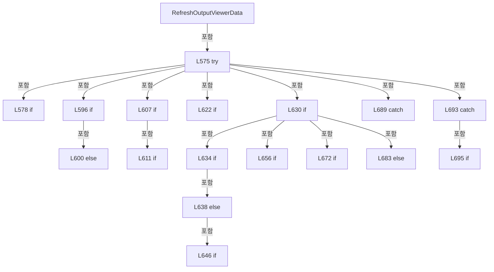

변경 전 점검: 입력/반환 타입, 위 호출자, 예외/취소 경로, 공유 상태와 저장·전송 소비자를 함께 확인합니다. 값의 단위나 물리 방향을 이름만으로 확정하지 않습니다.

### MethodDeclaration `LoadSelectedOutputViewerRecipe` · L709–724

[Drilling.UI/Menu/Menus/CMenuCorrection.cs:709–724](https://github.com/kjuws10-rgb/A3Drilling/blob/5aee8e58439c9b455cae7c9593c9be986c3e682e/Drilling.UI/Menu/Menus/CMenuCorrection.cs#L709-L724)

| 항목 | 실제 추출 값 |
| --- | --- |
| 서명 | System.Threading.Tasks.Task<Drilling.Common.Managers.ST_RECIPE_DEFINITION?> Drilling.UI.Menu.Menus.CMenuCorrection.LoadSelectedOutputViewerRecipe(System.Threading.CancellationToken, bool) |
| 접근/수식자 | Private / private, async |
| 반환/값 타입 | System.Threading.Tasks.Task<Drilling.Common.Managers.ST_RECIPE_DEFINITION?> |
| 소속 타입 | NamedType:Drilling.UI.Menu.Menus.CMenuCorrection |

입력 계약:

| 이름 | 타입 | 전달 | 선택/기본값 |
| --- | --- | --- | --- |
| cancellationToken | System.Threading.CancellationToken | None | False /  |
| fallbackToFirst | bool | None | True / true |

정적 호출자로 확인된 위치:

| 호출 파일/행 | 호출 표현식 | 런타임 분기 가능 |
| --- | --- | --- |
| [Drilling.UI/Menu/Menus/CMenuCorrection.cs:378–378](https://github.com/kjuws10-rgb/A3Drilling/blob/5aee8e58439c9b455cae7c9593c9be986c3e682e/Drilling.UI/Menu/Menus/CMenuCorrection.cs#L378-L378) | LoadSelectedOutputViewerRecipe | False |
| [Drilling.UI/Menu/Menus/CMenuCorrection.cs:390–390](https://github.com/kjuws10-rgb/A3Drilling/blob/5aee8e58439c9b455cae7c9593c9be986c3e682e/Drilling.UI/Menu/Menus/CMenuCorrection.cs#L390-L390) | LoadSelectedOutputViewerRecipe | False |
| [Drilling.UI/Menu/Menus/CMenuCorrection.cs:408–408](https://github.com/kjuws10-rgb/A3Drilling/blob/5aee8e58439c9b455cae7c9593c9be986c3e682e/Drilling.UI/Menu/Menus/CMenuCorrection.cs#L408-L408) | LoadSelectedOutputViewerRecipe | False |
| [Drilling.UI/Menu/Menus/CMenuCorrection.cs:577–577](https://github.com/kjuws10-rgb/A3Drilling/blob/5aee8e58439c9b455cae7c9593c9be986c3e682e/Drilling.UI/Menu/Menus/CMenuCorrection.cs#L577-L577) | LoadSelectedOutputViewerRecipe | False |
| [Drilling.UI/Menu/Menus/CMenuCorrection.cs:2585–2585](https://github.com/kjuws10-rgb/A3Drilling/blob/5aee8e58439c9b455cae7c9593c9be986c3e682e/Drilling.UI/Menu/Menus/CMenuCorrection.cs#L2585-L2585) | LoadSelectedOutputViewerRecipe | False |
| [Drilling.UI/Menu/Menus/CMenuCorrection.cs:2680–2680](https://github.com/kjuws10-rgb/A3Drilling/blob/5aee8e58439c9b455cae7c9593c9be986c3e682e/Drilling.UI/Menu/Menus/CMenuCorrection.cs#L2680-L2680) | LoadSelectedOutputViewerRecipe | False |
| [Drilling.UI/Menu/Menus/CMenuCorrection.cs:2701–2701](https://github.com/kjuws10-rgb/A3Drilling/blob/5aee8e58439c9b455cae7c9593c9be986c3e682e/Drilling.UI/Menu/Menus/CMenuCorrection.cs#L2701-L2701) | LoadSelectedOutputViewerRecipe | False |
| [Drilling.UI/Menu/Menus/CMenuCorrection.cs:2713–2713](https://github.com/kjuws10-rgb/A3Drilling/blob/5aee8e58439c9b455cae7c9593c9be986c3e682e/Drilling.UI/Menu/Menus/CMenuCorrection.cs#L2713-L2713) | LoadSelectedOutputViewerRecipe | False |
| [Drilling.UI/Menu/Menus/CMenuCorrection.cs:2740–2740](https://github.com/kjuws10-rgb/A3Drilling/blob/5aee8e58439c9b455cae7c9593c9be986c3e682e/Drilling.UI/Menu/Menus/CMenuCorrection.cs#L2740-L2740) | LoadSelectedOutputViewerRecipe | False |
| [Drilling.UI/Menu/Menus/CMenuCorrection.cs:2821–2821](https://github.com/kjuws10-rgb/A3Drilling/blob/5aee8e58439c9b455cae7c9593c9be986c3e682e/Drilling.UI/Menu/Menus/CMenuCorrection.cs#L2821-L2821) | LoadSelectedOutputViewerRecipe | False |
| [Drilling.UI/Menu/Menus/CMenuCorrection.cs:2852–2852](https://github.com/kjuws10-rgb/A3Drilling/blob/5aee8e58439c9b455cae7c9593c9be986c3e682e/Drilling.UI/Menu/Menus/CMenuCorrection.cs#L2852-L2852) | LoadSelectedOutputViewerRecipe | False |
| [Drilling.UI/Menu/Menus/CMenuCorrection.cs:2934–2934](https://github.com/kjuws10-rgb/A3Drilling/blob/5aee8e58439c9b455cae7c9593c9be986c3e682e/Drilling.UI/Menu/Menus/CMenuCorrection.cs#L2934-L2934) | LoadSelectedOutputViewerRecipe | False |
| [Drilling.UI/Menu/Menus/CMenuCorrection.cs:3016–3016](https://github.com/kjuws10-rgb/A3Drilling/blob/5aee8e58439c9b455cae7c9593c9be986c3e682e/Drilling.UI/Menu/Menus/CMenuCorrection.cs#L3016-L3016) | LoadSelectedOutputViewerRecipe | False |
| [Drilling.UI/Menu/Menus/CMenuCorrection.cs:3028–3028](https://github.com/kjuws10-rgb/A3Drilling/blob/5aee8e58439c9b455cae7c9593c9be986c3e682e/Drilling.UI/Menu/Menus/CMenuCorrection.cs#L3028-L3028) | LoadSelectedOutputViewerRecipe | False |
| [Drilling.UI/Menu/Menus/CMenuCorrection.cs:3128–3128](https://github.com/kjuws10-rgb/A3Drilling/blob/5aee8e58439c9b455cae7c9593c9be986c3e682e/Drilling.UI/Menu/Menus/CMenuCorrection.cs#L3128-L3128) | LoadSelectedOutputViewerRecipe | False |
| [Drilling.UI/Menu/Menus/CMenuCorrection.cs:3552–3552](https://github.com/kjuws10-rgb/A3Drilling/blob/5aee8e58439c9b455cae7c9593c9be986c3e682e/Drilling.UI/Menu/Menus/CMenuCorrection.cs#L3552-L3552) | LoadSelectedOutputViewerRecipe | False |
| [Drilling.UI/Menu/Menus/CMenuCorrection.cs:3877–3877](https://github.com/kjuws10-rgb/A3Drilling/blob/5aee8e58439c9b455cae7c9593c9be986c3e682e/Drilling.UI/Menu/Menus/CMenuCorrection.cs#L3877-L3877) | LoadSelectedOutputViewerRecipe | False |
| [Drilling.UI/Menu/Menus/CMenuCorrection.cs:3908–3908](https://github.com/kjuws10-rgb/A3Drilling/blob/5aee8e58439c9b455cae7c9593c9be986c3e682e/Drilling.UI/Menu/Menus/CMenuCorrection.cs#L3908-L3908) | LoadSelectedOutputViewerRecipe | False |
| [Drilling.UI/Menu/Menus/CMenuCorrection.cs:3935–3935](https://github.com/kjuws10-rgb/A3Drilling/blob/5aee8e58439c9b455cae7c9593c9be986c3e682e/Drilling.UI/Menu/Menus/CMenuCorrection.cs#L3935-L3935) | LoadSelectedOutputViewerRecipe | False |
| [Drilling.UI/Menu/Menus/CMenuCorrection.cs:4029–4029](https://github.com/kjuws10-rgb/A3Drilling/blob/5aee8e58439c9b455cae7c9593c9be986c3e682e/Drilling.UI/Menu/Menus/CMenuCorrection.cs#L4029-L4029) | LoadSelectedOutputViewerRecipe | False |
| [Drilling.UI/Menu/Menus/CMenuCorrection.cs:4045–4045](https://github.com/kjuws10-rgb/A3Drilling/blob/5aee8e58439c9b455cae7c9593c9be986c3e682e/Drilling.UI/Menu/Menus/CMenuCorrection.cs#L4045-L4045) | LoadSelectedOutputViewerRecipe | False |
| [Drilling.UI/Menu/Menus/CMenuCorrection.cs:4122–4122](https://github.com/kjuws10-rgb/A3Drilling/blob/5aee8e58439c9b455cae7c9593c9be986c3e682e/Drilling.UI/Menu/Menus/CMenuCorrection.cs#L4122-L4122) | LoadSelectedOutputViewerRecipe | False |
| [Drilling.UI/Menu/Menus/CMenuCorrection.cs:4145–4145](https://github.com/kjuws10-rgb/A3Drilling/blob/5aee8e58439c9b455cae7c9593c9be986c3e682e/Drilling.UI/Menu/Menus/CMenuCorrection.cs#L4145-L4145) | LoadSelectedOutputViewerRecipe | False |

호출하는 대상과 해석 범위:

| 원본 행 | 표현식 | 분석 상태 | 대상/소스 위치 |
| --- | --- | --- | --- |
| 711 | _recipeManager.LoadRecipes | resolved | System.Threading.Tasks.Task<System.Collections.Generic.IReadOnlyList<Drilling.Common.Managers.ST_RECIPE_DEFINITION>> Drilling.Common.Managers.CRecipeManager.LoadRecipes(System.Threading.CancellationToken) · Drilling.Common/Managers/CRecipeManager.cs:40 |
| 712 | NormalizeRecipeId | resolved | string Drilling.UI.Menu.Menus.CMenuCorrection.NormalizeRecipeId(string) · Drilling.UI/Menu/Menus/CMenuCorrection.cs:2239 |
| 712 | _selectedRecipeIdProvider | resolved · 동적 구현 선택 가능 | string System.Func<string>.Invoke() |
| 723 | string.IsNullOrWhiteSpace | resolved | bool string.IsNullOrWhiteSpace(string?) |
| 723 | recipes.FirstOrDefault | resolved | Drilling.Common.Managers.ST_RECIPE_DEFINITION? System.Collections.Generic.IEnumerable<Drilling.Common.Managers.ST_RECIPE_DEFINITION>.FirstOrDefault<Drilling.Common.Managers.ST_RECIPE_DEFINITION>() |
| 723 | recipes.FirstOrDefault | resolved | Drilling.Common.Managers.ST_RECIPE_DEFINITION? System.Collections.Generic.IEnumerable<Drilling.Common.Managers.ST_RECIPE_DEFINITION>.FirstOrDefault<Drilling.Common.Managers.ST_RECIPE_DEFINITION>(System.Func<Drilling.Common.Managers.ST_RECIPE_DEFINITION, bool>) |
| 723 | recipes.FirstOrDefault | resolved | Drilling.Common.Managers.ST_RECIPE_DEFINITION? System.Collections.Generic.IEnumerable<Drilling.Common.Managers.ST_RECIPE_DEFINITION>.FirstOrDefault<Drilling.Common.Managers.ST_RECIPE_DEFINITION>(System.Func<Drilling.Common.Managers.ST_RECIPE_DEFINITION, bool>) |
| 723 | recipes.FirstOrDefault | resolved | Drilling.Common.Managers.ST_RECIPE_DEFINITION? System.Collections.Generic.IEnumerable<Drilling.Common.Managers.ST_RECIPE_DEFINITION>.FirstOrDefault<Drilling.Common.Managers.ST_RECIPE_DEFINITION>() |

본문의 실제 연산·분기·예외·반환 순서(원문 위치 순):

| 원본 행 | 종류 | 주석 해설 |
| --- | --- | --- |
| 711 | await | 비동기 완료를 기다립니다: await _recipeManager.LoadRecipes(cancellationToken) |
| 711 | call | 함수·델리게이트 또는 객체 생성자를 호출합니다: _recipeManager.LoadRecipes(cancellationToken) |
| 711 | local-declaration | 지역 변수를 선언합니다: var recipes = await _recipeManager.LoadRecipes(cancellationToken); |
| 711 | variable-initializer | 변수의 초기값을 지정합니다: recipes = await _recipeManager.LoadRecipes(cancellationToken) |
| 712 | call | 함수·델리게이트 또는 객체 생성자를 호출합니다: NormalizeRecipeId(_selectedRecipeIdProvider()) |
| 712 | call | 함수·델리게이트 또는 객체 생성자를 호출합니다: _selectedRecipeIdProvider() |
| 712 | local-declaration | 지역 변수를 선언합니다: var selectedRecipeId = NormalizeRecipeId(_selectedRecipeIdProvider()); |
| 712 | variable-initializer | 변수의 초기값을 지정합니다: selectedRecipeId = NormalizeRecipeId(_selectedRecipeIdProvider()) |
| 723 | call | 함수·델리게이트 또는 객체 생성자를 호출합니다: string.IsNullOrWhiteSpace(selectedRecipeId) |
| 723 | call | 함수·델리게이트 또는 객체 생성자를 호출합니다: recipes.FirstOrDefault() |
| 723 | call | 함수·델리게이트 또는 객체 생성자를 호출합니다: recipes.FirstOrDefault(MatchById) |
| 723 | call | 함수·델리게이트 또는 객체 생성자를 호출합니다: recipes.FirstOrDefault(MatchByName) |
| 723 | call | 함수·델리게이트 또는 객체 생성자를 호출합니다: recipes.FirstOrDefault() |
| 723 | conditional-expression | 조건에 따라 결과식을 선택합니다: string.IsNullOrWhiteSpace(selectedRecipeId) ? (fallbackToFirst ? recipes.FirstOrDefault() : null) : recipes.FirstOrDefault(MatchById) ?? recipes.FirstOrDefault(MatchByName) ?? (fallbackToFirst ? recipes.FirstOrDefault() : null) |
| 723 | conditional-expression | 조건에 따라 결과식을 선택합니다: fallbackToFirst ? recipes.FirstOrDefault() : null |
| 723 | conditional-expression | 조건에 따라 결과식을 선택합니다: fallbackToFirst ? recipes.FirstOrDefault() : null |
| 723 | return | 호출자에게 값 또는 제어를 반환합니다: return string.IsNullOrWhiteSpace(selectedRecipeId) ? (fallbackToFirst ? recipes.FirstOrDefault() : null) : recipes.FirstOrDefault(MatchById) ?? recipes.FirstOrDefault(MatchByName) ?? (fallbackToFirst ? recipes.FirstOrDefault() : n |

변경 전 점검: 입력/반환 타입, 위 호출자, 예외/취소 경로, 공유 상태와 저장·전송 소비자를 함께 확인합니다. 값의 단위나 물리 방향을 이름만으로 확정하지 않습니다.

### LocalFunctionStatement `MatchById` · L713–716

[Drilling.UI/Menu/Menus/CMenuCorrection.cs:713–716](https://github.com/kjuws10-rgb/A3Drilling/blob/5aee8e58439c9b455cae7c9593c9be986c3e682e/Drilling.UI/Menu/Menus/CMenuCorrection.cs#L713-L716)

| 항목 | 실제 추출 값 |
| --- | --- |
| 서명 | bool MatchById(Drilling.Common.Managers.ST_RECIPE_DEFINITION) |
| 접근/수식자 | Private /  |
| 반환/값 타입 | bool |
| 소속 타입 | NamedType:Drilling.UI.Menu.Menus.CMenuCorrection |

입력 계약:

| 이름 | 타입 | 전달 | 선택/기본값 |
| --- | --- | --- | --- |
| recipe | Drilling.Common.Managers.ST_RECIPE_DEFINITION | None | False /  |

현재 부분 분석에서 직접 연결된 호출자는 없습니다. XAML/이벤트/인터페이스·델리게이트·외부 진입을 추가 확인해야 하며, 미사용으로 판정한 것이 아닙니다.

호출하는 대상과 해석 범위:

| 원본 행 | 표현식 | 분석 상태 | 대상/소스 위치 |
| --- | --- | --- | --- |
| 715 | recipe.Id.Equals | resolved | bool string.Equals(string?, System.StringComparison) |

본문의 실제 연산·분기·예외·반환 순서(원문 위치 순):

| 원본 행 | 종류 | 주석 해설 |
| --- | --- | --- |
| 715 | call | 함수·델리게이트 또는 객체 생성자를 호출합니다: recipe.Id.Equals(selectedRecipeId, StringComparison.OrdinalIgnoreCase) |
| 715 | return | 호출자에게 값 또는 제어를 반환합니다: return recipe.Id.Equals(selectedRecipeId, StringComparison.OrdinalIgnoreCase); |

변경 전 점검: 입력/반환 타입, 위 호출자, 예외/취소 경로, 공유 상태와 저장·전송 소비자를 함께 확인합니다. 값의 단위나 물리 방향을 이름만으로 확정하지 않습니다.

### LocalFunctionStatement `MatchByName` · L718–721

[Drilling.UI/Menu/Menus/CMenuCorrection.cs:718–721](https://github.com/kjuws10-rgb/A3Drilling/blob/5aee8e58439c9b455cae7c9593c9be986c3e682e/Drilling.UI/Menu/Menus/CMenuCorrection.cs#L718-L721)

| 항목 | 실제 추출 값 |
| --- | --- |
| 서명 | bool MatchByName(Drilling.Common.Managers.ST_RECIPE_DEFINITION) |
| 접근/수식자 | Private /  |
| 반환/값 타입 | bool |
| 소속 타입 | NamedType:Drilling.UI.Menu.Menus.CMenuCorrection |

입력 계약:

| 이름 | 타입 | 전달 | 선택/기본값 |
| --- | --- | --- | --- |
| recipe | Drilling.Common.Managers.ST_RECIPE_DEFINITION | None | False /  |

현재 부분 분석에서 직접 연결된 호출자는 없습니다. XAML/이벤트/인터페이스·델리게이트·외부 진입을 추가 확인해야 하며, 미사용으로 판정한 것이 아닙니다.

호출하는 대상과 해석 범위:

| 원본 행 | 표현식 | 분석 상태 | 대상/소스 위치 |
| --- | --- | --- | --- |
| 720 | recipe.Name.Equals | resolved | bool string.Equals(string?, System.StringComparison) |

본문의 실제 연산·분기·예외·반환 순서(원문 위치 순):

| 원본 행 | 종류 | 주석 해설 |
| --- | --- | --- |
| 720 | call | 함수·델리게이트 또는 객체 생성자를 호출합니다: recipe.Name.Equals(selectedRecipeId, StringComparison.OrdinalIgnoreCase) |
| 720 | return | 호출자에게 값 또는 제어를 반환합니다: return recipe.Name.Equals(selectedRecipeId, StringComparison.OrdinalIgnoreCase); |

변경 전 점검: 입력/반환 타입, 위 호출자, 예외/취소 경로, 공유 상태와 저장·전송 소비자를 함께 확인합니다. 값의 단위나 물리 방향을 이름만으로 확정하지 않습니다.

### MethodDeclaration `BuildOutputViewerParameterMap` · L726–743

[Drilling.UI/Menu/Menus/CMenuCorrection.cs:726–743](https://github.com/kjuws10-rgb/A3Drilling/blob/5aee8e58439c9b455cae7c9593c9be986c3e682e/Drilling.UI/Menu/Menus/CMenuCorrection.cs#L726-L743)

| 항목 | 실제 추출 값 |
| --- | --- |
| 서명 | System.Collections.Generic.Dictionary<string, string> Drilling.UI.Menu.Menus.CMenuCorrection.BuildOutputViewerParameterMap(Drilling.Common.Managers.ST_RECIPE_DEFINITION, System.Collections.Generic.IReadOnlyList<Drilling.Common.Managers.ST_SYSTEM_PARAMETER>) |
| 접근/수식자 | Private / private, static |
| 반환/값 타입 | System.Collections.Generic.Dictionary<string, string> |
| 소속 타입 | NamedType:Drilling.UI.Menu.Menus.CMenuCorrection |

입력 계약:

| 이름 | 타입 | 전달 | 선택/기본값 |
| --- | --- | --- | --- |
| recipe | Drilling.Common.Managers.ST_RECIPE_DEFINITION | None | False /  |
| settings | System.Collections.Generic.IReadOnlyList<Drilling.Common.Managers.ST_SYSTEM_PARAMETER> | None | False /  |

정적 호출자로 확인된 위치:

| 호출 파일/행 | 호출 표현식 | 런타임 분기 가능 |
| --- | --- | --- |
| [Drilling.UI/Menu/Menus/CMenuCorrection.ReviewData.Display.cs:137–137](https://github.com/kjuws10-rgb/A3Drilling/blob/5aee8e58439c9b455cae7c9593c9be986c3e682e/Drilling.UI/Menu/Menus/CMenuCorrection.ReviewData.Display.cs#L137-L137) | BuildOutputViewerParameterMap | False |
| [Drilling.UI/Menu/Menus/CMenuCorrection.cs:591–591](https://github.com/kjuws10-rgb/A3Drilling/blob/5aee8e58439c9b455cae7c9593c9be986c3e682e/Drilling.UI/Menu/Menus/CMenuCorrection.cs#L591-L591) | BuildOutputViewerParameterMap | False |
| [Drilling.UI/Menu/Menus/CMenuCorrection.cs:1453–1453](https://github.com/kjuws10-rgb/A3Drilling/blob/5aee8e58439c9b455cae7c9593c9be986c3e682e/Drilling.UI/Menu/Menus/CMenuCorrection.cs#L1453-L1453) | BuildOutputViewerParameterMap | False |
| [Drilling.UI/Menu/Menus/CMenuCorrection.cs:1685–1685](https://github.com/kjuws10-rgb/A3Drilling/blob/5aee8e58439c9b455cae7c9593c9be986c3e682e/Drilling.UI/Menu/Menus/CMenuCorrection.cs#L1685-L1685) | BuildOutputViewerParameterMap | False |
| [Drilling.UI/Menu/Menus/CMenuCorrection.cs:1772–1772](https://github.com/kjuws10-rgb/A3Drilling/blob/5aee8e58439c9b455cae7c9593c9be986c3e682e/Drilling.UI/Menu/Menus/CMenuCorrection.cs#L1772-L1772) | BuildOutputViewerParameterMap | False |
| [Drilling.UI/Menu/Menus/CMenuCorrection.cs:2746–2746](https://github.com/kjuws10-rgb/A3Drilling/blob/5aee8e58439c9b455cae7c9593c9be986c3e682e/Drilling.UI/Menu/Menus/CMenuCorrection.cs#L2746-L2746) | BuildOutputViewerParameterMap | False |
| [Drilling.UI/Menu/Menus/CMenuCorrection.cs:3031–3031](https://github.com/kjuws10-rgb/A3Drilling/blob/5aee8e58439c9b455cae7c9593c9be986c3e682e/Drilling.UI/Menu/Menus/CMenuCorrection.cs#L3031-L3031) | BuildOutputViewerParameterMap | False |
| [Drilling.UI/Menu/Menus/CMenuCorrection.cs:3936–3936](https://github.com/kjuws10-rgb/A3Drilling/blob/5aee8e58439c9b455cae7c9593c9be986c3e682e/Drilling.UI/Menu/Menus/CMenuCorrection.cs#L3936-L3936) | BuildOutputViewerParameterMap | False |
| [Drilling.UI/Menu/Menus/CMenuCorrection.cs:4127–4127](https://github.com/kjuws10-rgb/A3Drilling/blob/5aee8e58439c9b455cae7c9593c9be986c3e682e/Drilling.UI/Menu/Menus/CMenuCorrection.cs#L4127-L4127) | BuildOutputViewerParameterMap | False |

호출하는 대상과 해석 범위:

| 원본 행 | 표현식 | 분석 상태 | 대상/소스 위치 |
| --- | --- | --- | --- |
| 728 | new Dictionary<string, string> | resolved | System.Collections.Generic.Dictionary<string, string>.Dictionary(System.Collections.Generic.IEqualityComparer<string>?) |
| 731 | SetOutputViewerParameter | resolved | void Drilling.UI.Menu.Menus.CMenuCorrection.SetOutputViewerParameter(System.Collections.Generic.IDictionary<string, string>, string, string) · Drilling.UI/Menu/Menus/CMenuCorrection.cs:745 |
| 732 | SetOutputViewerParameter | resolved | void Drilling.UI.Menu.Menus.CMenuCorrection.SetOutputViewerParameter(System.Collections.Generic.IDictionary<string, string>, string, string) · Drilling.UI/Menu/Menus/CMenuCorrection.cs:745 |
| 737 | SetOutputViewerParameter | resolved | void Drilling.UI.Menu.Menus.CMenuCorrection.SetOutputViewerParameter(System.Collections.Generic.IDictionary<string, string>, string, string) · Drilling.UI/Menu/Menus/CMenuCorrection.cs:745 |
| 738 | SetOutputViewerParameter | resolved | void Drilling.UI.Menu.Menus.CMenuCorrection.SetOutputViewerParameter(System.Collections.Generic.IDictionary<string, string>, string, string) · Drilling.UI/Menu/Menus/CMenuCorrection.cs:745 |
| 741 | parameters.TryAdd | resolved | bool System.Collections.Generic.Dictionary<string, string>.TryAdd(string, string) |

본문의 실제 연산·분기·예외·반환 순서(원문 위치 순):

| 원본 행 | 종류 | 주석 해설 |
| --- | --- | --- |
| 728 | call | 함수·델리게이트 또는 객체 생성자를 호출합니다: new Dictionary<string, string>(StringComparer.OrdinalIgnoreCase) |
| 728 | local-declaration | 지역 변수를 선언합니다: var parameters = new Dictionary<string, string>(StringComparer.OrdinalIgnoreCase); |
| 728 | variable-initializer | 변수의 초기값을 지정합니다: parameters = new Dictionary<string, string>(StringComparer.OrdinalIgnoreCase) |
| 729 | foreach | 컬렉션 요소를 순회합니다: foreach (var parameter in recipe.Parameters) |
| 731 | call | 함수·델리게이트 또는 객체 생성자를 호출합니다: SetOutputViewerParameter(parameters, parameter.Key, parameter.Value) |
| 732 | call | 함수·델리게이트 또는 객체 생성자를 호출합니다: SetOutputViewerParameter(parameters, parameter.Name, parameter.Value) |
| 735 | foreach | 컬렉션 요소를 순회합니다: foreach (var setting in settings) |
| 737 | call | 함수·델리게이트 또는 객체 생성자를 호출합니다: SetOutputViewerParameter(parameters, setting.Key, setting.Value) |
| 738 | call | 함수·델리게이트 또는 객체 생성자를 호출합니다: SetOutputViewerParameter(parameters, setting.Name, setting.Value) |
| 741 | call | 함수·델리게이트 또는 객체 생성자를 호출합니다: parameters.TryAdd("HEAD_COUNT", "8") |
| 742 | return | 호출자에게 값 또는 제어를 반환합니다: return parameters; |

제어 구문의 포함 구조(실제 실행 순서/CFG가 아닌 구문 탐색 그림):

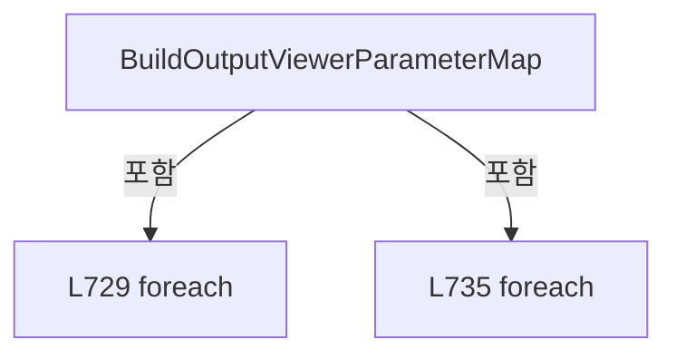

변경 전 점검: 입력/반환 타입, 위 호출자, 예외/취소 경로, 공유 상태와 저장·전송 소비자를 함께 확인합니다. 값의 단위나 물리 방향을 이름만으로 확정하지 않습니다.

### MethodDeclaration `SetOutputViewerParameter` · L745–751

[Drilling.UI/Menu/Menus/CMenuCorrection.cs:745–751](https://github.com/kjuws10-rgb/A3Drilling/blob/5aee8e58439c9b455cae7c9593c9be986c3e682e/Drilling.UI/Menu/Menus/CMenuCorrection.cs#L745-L751)

| 항목 | 실제 추출 값 |
| --- | --- |
| 서명 | void Drilling.UI.Menu.Menus.CMenuCorrection.SetOutputViewerParameter(System.Collections.Generic.IDictionary<string, string>, string, string) |
| 접근/수식자 | Private / private, static |
| 반환/값 타입 | void |
| 소속 타입 | NamedType:Drilling.UI.Menu.Menus.CMenuCorrection |

입력 계약:

| 이름 | 타입 | 전달 | 선택/기본값 |
| --- | --- | --- | --- |
| parameters | System.Collections.Generic.IDictionary<string, string> | None | False /  |
| key | string | None | False /  |
| value | string | None | False /  |

정적 호출자로 확인된 위치:

| 호출 파일/행 | 호출 표현식 | 런타임 분기 가능 |
| --- | --- | --- |
| [Drilling.UI/Menu/Menus/CMenuCorrection.cs:731–731](https://github.com/kjuws10-rgb/A3Drilling/blob/5aee8e58439c9b455cae7c9593c9be986c3e682e/Drilling.UI/Menu/Menus/CMenuCorrection.cs#L731-L731) | SetOutputViewerParameter | False |
| [Drilling.UI/Menu/Menus/CMenuCorrection.cs:732–732](https://github.com/kjuws10-rgb/A3Drilling/blob/5aee8e58439c9b455cae7c9593c9be986c3e682e/Drilling.UI/Menu/Menus/CMenuCorrection.cs#L732-L732) | SetOutputViewerParameter | False |
| [Drilling.UI/Menu/Menus/CMenuCorrection.cs:737–737](https://github.com/kjuws10-rgb/A3Drilling/blob/5aee8e58439c9b455cae7c9593c9be986c3e682e/Drilling.UI/Menu/Menus/CMenuCorrection.cs#L737-L737) | SetOutputViewerParameter | False |
| [Drilling.UI/Menu/Menus/CMenuCorrection.cs:738–738](https://github.com/kjuws10-rgb/A3Drilling/blob/5aee8e58439c9b455cae7c9593c9be986c3e682e/Drilling.UI/Menu/Menus/CMenuCorrection.cs#L738-L738) | SetOutputViewerParameter | False |

호출하는 대상과 해석 범위:

| 원본 행 | 표현식 | 분석 상태 | 대상/소스 위치 |
| --- | --- | --- | --- |
| 747 | string.IsNullOrWhiteSpace | resolved | bool string.IsNullOrWhiteSpace(string?) |
| 749 | key.Trim | resolved | string string.Trim() |

본문의 실제 연산·분기·예외·반환 순서(원문 위치 순):

| 원본 행 | 종류 | 주석 해설 |
| --- | --- | --- |
| 747 | call | 함수·델리게이트 또는 객체 생성자를 호출합니다: string.IsNullOrWhiteSpace(key) |
| 747 | if | 조건에 따라 분기합니다: if (!string.IsNullOrWhiteSpace(key)) |
| 749 | assignment | 값을 대상에 대입합니다: parameters[key.Trim()] = value |
| 749 | call | 함수·델리게이트 또는 객체 생성자를 호출합니다: key.Trim() |

제어 구문의 포함 구조(실제 실행 순서/CFG가 아닌 구문 탐색 그림):

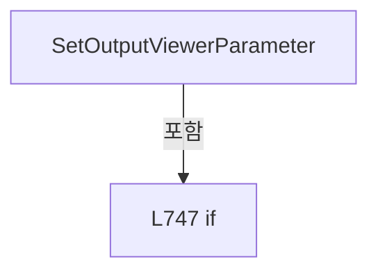

변경 전 점검: 입력/반환 타입, 위 호출자, 예외/취소 경로, 공유 상태와 저장·전송 소비자를 함께 확인합니다. 값의 단위나 물리 방향을 이름만으로 확정하지 않습니다.

### MethodDeclaration `CopyOutputViewerParameters` · L753–756

[Drilling.UI/Menu/Menus/CMenuCorrection.cs:753–756](https://github.com/kjuws10-rgb/A3Drilling/blob/5aee8e58439c9b455cae7c9593c9be986c3e682e/Drilling.UI/Menu/Menus/CMenuCorrection.cs#L753-L756)

| 항목 | 실제 추출 값 |
| --- | --- |
| 서명 | System.Collections.Generic.IReadOnlyDictionary<string, string> Drilling.UI.Menu.Menus.CMenuCorrection.CopyOutputViewerParameters(System.Collections.Generic.IReadOnlyDictionary<string, string>) |
| 접근/수식자 | Private / private, static |
| 반환/값 타입 | System.Collections.Generic.IReadOnlyDictionary<string, string> |
| 소속 타입 | NamedType:Drilling.UI.Menu.Menus.CMenuCorrection |

입력 계약:

| 이름 | 타입 | 전달 | 선택/기본값 |
| --- | --- | --- | --- |
| parameters | System.Collections.Generic.IReadOnlyDictionary<string, string> | None | False /  |

정적 호출자로 확인된 위치:

| 호출 파일/행 | 호출 표현식 | 런타임 분기 가능 |
| --- | --- | --- |
| [Drilling.UI/Menu/Menus/CMenuCorrection.cs:616–616](https://github.com/kjuws10-rgb/A3Drilling/blob/5aee8e58439c9b455cae7c9593c9be986c3e682e/Drilling.UI/Menu/Menus/CMenuCorrection.cs#L616-L616) | CopyOutputViewerParameters | False |
| [Drilling.UI/Menu/Menus/CMenuCorrection.cs:651–651](https://github.com/kjuws10-rgb/A3Drilling/blob/5aee8e58439c9b455cae7c9593c9be986c3e682e/Drilling.UI/Menu/Menus/CMenuCorrection.cs#L651-L651) | CopyOutputViewerParameters | False |

호출하는 대상과 해석 범위:

| 원본 행 | 표현식 | 분석 상태 | 대상/소스 위치 |
| --- | --- | --- | --- |
| 755 | new Dictionary<string, string> | resolved | System.Collections.Generic.Dictionary<string, string>.Dictionary(System.Collections.Generic.IEnumerable<System.Collections.Generic.KeyValuePair<string, string>>, System.Collections.Generic.IEqualityComparer<string>?) |

본문의 실제 연산·분기·예외·반환 순서(원문 위치 순):

| 원본 행 | 종류 | 주석 해설 |
| --- | --- | --- |
| 755 | call | 함수·델리게이트 또는 객체 생성자를 호출합니다: new Dictionary<string, string>(parameters, StringComparer.OrdinalIgnoreCase) |
| 755 | return | 호출자에게 값 또는 제어를 반환합니다: return new Dictionary<string, string>(parameters, StringComparer.OrdinalIgnoreCase); |

변경 전 점검: 입력/반환 타입, 위 호출자, 예외/취소 경로, 공유 상태와 저장·전송 소비자를 함께 확인합니다. 값의 단위나 물리 방향을 이름만으로 확정하지 않습니다.

### MethodDeclaration `OutputViewerParametersMatch` · L758–774

[Drilling.UI/Menu/Menus/CMenuCorrection.cs:758–774](https://github.com/kjuws10-rgb/A3Drilling/blob/5aee8e58439c9b455cae7c9593c9be986c3e682e/Drilling.UI/Menu/Menus/CMenuCorrection.cs#L758-L774)

| 항목 | 실제 추출 값 |
| --- | --- |
| 서명 | bool Drilling.UI.Menu.Menus.CMenuCorrection.OutputViewerParametersMatch(System.Collections.Generic.IReadOnlyDictionary<string, string>?, System.Collections.Generic.IReadOnlyDictionary<string, string>) |
| 접근/수식자 | Private / private, static |
| 반환/값 타입 | bool |
| 소속 타입 | NamedType:Drilling.UI.Menu.Menus.CMenuCorrection |

입력 계약:

| 이름 | 타입 | 전달 | 선택/기본값 |
| --- | --- | --- | --- |
| cached | System.Collections.Generic.IReadOnlyDictionary<string, string>? | None | False /  |
| current | System.Collections.Generic.IReadOnlyDictionary<string, string> | None | False /  |

정적 호출자로 확인된 위치:

| 호출 파일/행 | 호출 표현식 | 런타임 분기 가능 |
| --- | --- | --- |
| [Drilling.UI/Menu/Menus/CMenuCorrection.cs:607–607](https://github.com/kjuws10-rgb/A3Drilling/blob/5aee8e58439c9b455cae7c9593c9be986c3e682e/Drilling.UI/Menu/Menus/CMenuCorrection.cs#L607-L607) | OutputViewerParametersMatch | False |
| [Drilling.UI/Menu/Menus/CMenuCorrection.cs:634–634](https://github.com/kjuws10-rgb/A3Drilling/blob/5aee8e58439c9b455cae7c9593c9be986c3e682e/Drilling.UI/Menu/Menus/CMenuCorrection.cs#L634-L634) | OutputViewerParametersMatch | False |

호출하는 대상과 해석 범위:

| 원본 행 | 표현식 | 분석 상태 | 대상/소스 위치 |
| --- | --- | --- | --- |
| 767 | cached.TryGetValue | resolved · 동적 구현 선택 가능 | bool System.Collections.Generic.IReadOnlyDictionary<string, string>.TryGetValue(string, out string) |
| 767 | value.Equals | resolved | bool string.Equals(string?, System.StringComparison) |

본문의 실제 연산·분기·예외·반환 순서(원문 위치 순):

| 원본 행 | 종류 | 주석 해설 |
| --- | --- | --- |
| 760 | if | 조건에 따라 분기합니다: if (cached is null &#124;&#124; cached.Count != current.Count) |
| 762 | return | 호출자에게 값 또는 제어를 반환합니다: return false; |
| 765 | foreach | 컬렉션 요소를 순회합니다: foreach (var parameter in current) |
| 767 | call | 함수·델리게이트 또는 객체 생성자를 호출합니다: cached.TryGetValue(parameter.Key, out var value) |
| 767 | call | 함수·델리게이트 또는 객체 생성자를 호출합니다: value.Equals(parameter.Value, StringComparison.Ordinal) |
| 767 | if | 조건에 따라 분기합니다: if (!cached.TryGetValue(parameter.Key, out var value) &#124;&#124; !value.Equals(parameter.Value, StringComparison.Ordinal)) |
| 769 | return | 호출자에게 값 또는 제어를 반환합니다: return false; |
| 773 | return | 호출자에게 값 또는 제어를 반환합니다: return true; |

제어 구문의 포함 구조(실제 실행 순서/CFG가 아닌 구문 탐색 그림):

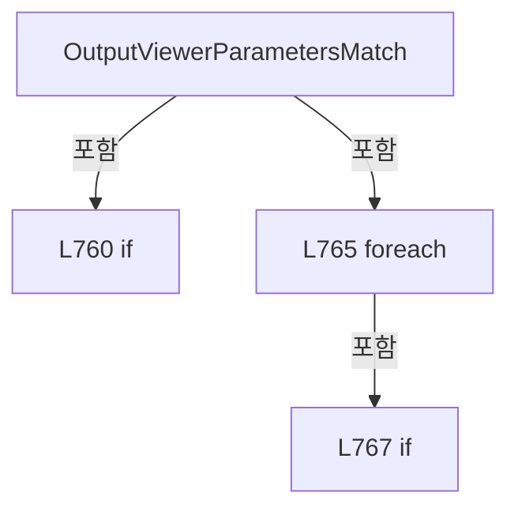

변경 전 점검: 입력/반환 타입, 위 호출자, 예외/취소 경로, 공유 상태와 저장·전송 소비자를 함께 확인합니다. 값의 단위나 물리 방향을 이름만으로 확정하지 않습니다.

### MethodDeclaration `ClearOutputViewerCellSelectionData` · L776–783

[Drilling.UI/Menu/Menus/CMenuCorrection.cs:776–783](https://github.com/kjuws10-rgb/A3Drilling/blob/5aee8e58439c9b455cae7c9593c9be986c3e682e/Drilling.UI/Menu/Menus/CMenuCorrection.cs#L776-L783)

| 항목 | 실제 추출 값 |
| --- | --- |
| 서명 | void Drilling.UI.Menu.Menus.CMenuCorrection.ClearOutputViewerCellSelectionData() |
| 접근/수식자 | Private / private |
| 반환/값 타입 | void |
| 소속 타입 | NamedType:Drilling.UI.Menu.Menus.CMenuCorrection |

정적 호출자로 확인된 위치:

| 호출 파일/행 | 호출 표현식 | 런타임 분기 가능 |
| --- | --- | --- |
| [Drilling.UI/Menu/Menus/CMenuCorrection.cs:582–582](https://github.com/kjuws10-rgb/A3Drilling/blob/5aee8e58439c9b455cae7c9593c9be986c3e682e/Drilling.UI/Menu/Menus/CMenuCorrection.cs#L582-L582) | ClearOutputViewerCellSelectionData | False |
| [Drilling.UI/Menu/Menus/CMenuCorrection.cs:685–685](https://github.com/kjuws10-rgb/A3Drilling/blob/5aee8e58439c9b455cae7c9593c9be986c3e682e/Drilling.UI/Menu/Menus/CMenuCorrection.cs#L685-L685) | ClearOutputViewerCellSelectionData | False |
| [Drilling.UI/Menu/Menus/CMenuCorrection.cs:703–703](https://github.com/kjuws10-rgb/A3Drilling/blob/5aee8e58439c9b455cae7c9593c9be986c3e682e/Drilling.UI/Menu/Menus/CMenuCorrection.cs#L703-L703) | ClearOutputViewerCellSelectionData | False |

호출하는 대상과 해석 범위:

| 원본 행 | 표현식 | 분석 상태 | 대상/소스 위치 |
| --- | --- | --- | --- |
| 779 | new Dictionary<string, ST_RECIPE_SHOT_MASKING_RESULT> | resolved | System.Collections.Generic.Dictionary<string, Drilling.Common.Recipe.ST_RECIPE_SHOT_MASKING_RESULT>.Dictionary(System.Collections.Generic.IEqualityComparer<string>?) |
| 782 | CreateOutputViewerHeadCards | resolved | System.Collections.Generic.IReadOnlyList<Drilling.UI.Menu.Menus.ST_CORRECTION_OUTPUT_VIEWER_HEAD_CARD> Drilling.UI.Menu.Menus.CMenuCorrection.CreateOutputViewerHeadCards(System.Collections.Generic.IReadOnlyList<Drilling.Common.Recipe.ST_HEAD_SHOT_POINT>) · Drilling.UI/Menu/Menus/CMenuCorrection.cs:811 |

본문의 실제 연산·분기·예외·반환 순서(원문 위치 순):

| 원본 행 | 종류 | 주석 해설 |
| --- | --- | --- |
| 778 | assignment | 값을 대상에 대입합니다: _outputViewerSelectedCellShots = [] |
| 779 | assignment | 값을 대상에 대입합니다: _outputViewerSelectedShotStates = new Dictionary<string, ST_RECIPE_SHOT_MASKING_RESULT>(StringComparer.OrdinalIgnoreCase) |
| 779 | call | 함수·델리게이트 또는 객체 생성자를 호출합니다: new Dictionary<string, ST_RECIPE_SHOT_MASKING_RESULT>(StringComparer.OrdinalIgnoreCase) |
| 780 | assignment | 값을 대상에 대입합니다: _outputViewerSelectedShotKey = "" |
| 781 | assignment | 값을 대상에 대입합니다: OutputViewerCellShotMapImage = null |
| 782 | assignment | 값을 대상에 대입합니다: OutputViewerHeadCards = CreateOutputViewerHeadCards([]) |
| 782 | call | 함수·델리게이트 또는 객체 생성자를 호출합니다: CreateOutputViewerHeadCards([]) |

변경 전 점검: 입력/반환 타입, 위 호출자, 예외/취소 경로, 공유 상태와 저장·전송 소비자를 함께 확인합니다. 값의 단위나 물리 방향을 이름만으로 확정하지 않습니다.

### MethodDeclaration `GetOutputViewerSelectedShot` · L785–793

[Drilling.UI/Menu/Menus/CMenuCorrection.cs:785–793](https://github.com/kjuws10-rgb/A3Drilling/blob/5aee8e58439c9b455cae7c9593c9be986c3e682e/Drilling.UI/Menu/Menus/CMenuCorrection.cs#L785-L793)

| 항목 | 실제 추출 값 |
| --- | --- |
| 서명 | Drilling.Common.Recipe.ST_HEAD_SHOT_POINT? Drilling.UI.Menu.Menus.CMenuCorrection.GetOutputViewerSelectedShot() |
| 접근/수식자 | Private / private |
| 반환/값 타입 | Drilling.Common.Recipe.ST_HEAD_SHOT_POINT? |
| 소속 타입 | NamedType:Drilling.UI.Menu.Menus.CMenuCorrection |

정적 호출자로 확인된 위치:

| 호출 파일/행 | 호출 표현식 | 런타임 분기 가능 |
| --- | --- | --- |
| [Drilling.UI/Menu/Menus/CMenuCorrection.cs:280–280](https://github.com/kjuws10-rgb/A3Drilling/blob/5aee8e58439c9b455cae7c9593c9be986c3e682e/Drilling.UI/Menu/Menus/CMenuCorrection.cs#L280-L280) | GetOutputViewerSelectedShot | False |
| [Drilling.UI/Menu/Menus/CMenuCorrection.cs:281–281](https://github.com/kjuws10-rgb/A3Drilling/blob/5aee8e58439c9b455cae7c9593c9be986c3e682e/Drilling.UI/Menu/Menus/CMenuCorrection.cs#L281-L281) | GetOutputViewerSelectedShot | False |

호출하는 대상과 해석 범위:

| 원본 행 | 표현식 | 분석 상태 | 대상/소스 위치 |
| --- | --- | --- | --- |
| 787 | string.IsNullOrWhiteSpace | resolved | bool string.IsNullOrWhiteSpace(string?) |
| 792 | _outputViewerSelectedCellShots.FirstOrDefault | resolved | Drilling.Common.Recipe.ST_HEAD_SHOT_POINT? System.Collections.Generic.IEnumerable<Drilling.Common.Recipe.ST_HEAD_SHOT_POINT>.FirstOrDefault<Drilling.Common.Recipe.ST_HEAD_SHOT_POINT>(System.Func<Drilling.Common.Recipe.ST_HEAD_SHOT_POINT, bool>) |
| 792 | shot.ShotKey.Equals | resolved | bool string.Equals(string?, System.StringComparison) |

본문의 실제 연산·분기·예외·반환 순서(원문 위치 순):

| 원본 행 | 종류 | 주석 해설 |
| --- | --- | --- |
| 787 | call | 함수·델리게이트 또는 객체 생성자를 호출합니다: string.IsNullOrWhiteSpace(_outputViewerSelectedShotKey) |
| 787 | if | 조건에 따라 분기합니다: if (string.IsNullOrWhiteSpace(_outputViewerSelectedShotKey)) |
| 789 | return | 호출자에게 값 또는 제어를 반환합니다: return null; |
| 792 | call | 함수·델리게이트 또는 객체 생성자를 호출합니다: _outputViewerSelectedCellShots.FirstOrDefault(shot => shot.ShotKey.Equals(_outputViewerSelectedShotKey, StringComparison.OrdinalIgnoreCase)) |
| 792 | call | 함수·델리게이트 또는 객체 생성자를 호출합니다: shot.ShotKey.Equals(_outputViewerSelectedShotKey, StringComparison.OrdinalIgnoreCase) |
| 792 | return | 호출자에게 값 또는 제어를 반환합니다: return _outputViewerSelectedCellShots.FirstOrDefault(shot => shot.ShotKey.Equals(_outputViewerSelectedShotKey, StringComparison.OrdinalIgnoreCase)); |

제어 구문의 포함 구조(실제 실행 순서/CFG가 아닌 구문 탐색 그림):

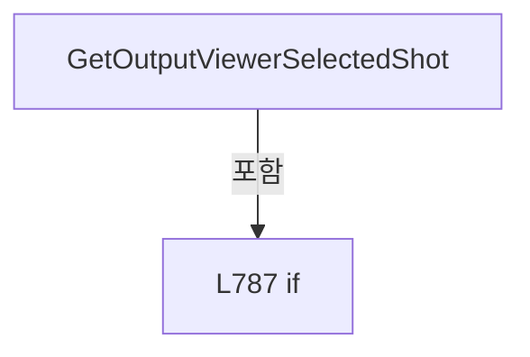

변경 전 점검: 입력/반환 타입, 위 호출자, 예외/취소 경로, 공유 상태와 저장·전송 소비자를 함께 확인합니다. 값의 단위나 물리 방향을 이름만으로 확정하지 않습니다.

### MethodDeclaration `GetOutputViewerShotMapSize` · L795–803

[Drilling.UI/Menu/Menus/CMenuCorrection.cs:795–803](https://github.com/kjuws10-rgb/A3Drilling/blob/5aee8e58439c9b455cae7c9593c9be986c3e682e/Drilling.UI/Menu/Menus/CMenuCorrection.cs#L795-L803)

| 항목 | 실제 추출 값 |
| --- | --- |
| 서명 | Size Drilling.UI.Menu.Menus.CMenuCorrection.GetOutputViewerShotMapSize() |
| 접근/수식자 | Private / private |
| 반환/값 타입 | Size |
| 소속 타입 | NamedType:Drilling.UI.Menu.Menus.CMenuCorrection |

정적 호출자로 확인된 위치:

| 호출 파일/행 | 호출 표현식 | 런타임 분기 가능 |
| --- | --- | --- |
| [Drilling.UI/Menu/Menus/CMenuCorrection.cs:282–282](https://github.com/kjuws10-rgb/A3Drilling/blob/5aee8e58439c9b455cae7c9593c9be986c3e682e/Drilling.UI/Menu/Menus/CMenuCorrection.cs#L282-L282) | GetOutputViewerShotMapSize | False |
| [Drilling.UI/Menu/Menus/CMenuCorrection.cs:283–283](https://github.com/kjuws10-rgb/A3Drilling/blob/5aee8e58439c9b455cae7c9593c9be986c3e682e/Drilling.UI/Menu/Menus/CMenuCorrection.cs#L283-L283) | GetOutputViewerShotMapSize | False |

호출하는 대상과 해석 범위:

| 원본 행 | 표현식 | 분석 상태 | 대상/소스 위치 |
| --- | --- | --- | --- |
| 797 | _outputViewerSelectedCellShots.FirstOrDefault | resolved | Drilling.Common.Recipe.ST_HEAD_SHOT_POINT? System.Collections.Generic.IEnumerable<Drilling.Common.Recipe.ST_HEAD_SHOT_POINT>.FirstOrDefault<Drilling.Common.Recipe.ST_HEAD_SHOT_POINT>() |
| 799 | new Size | unresolved | None |
| 802 | new Size | unresolved | None |
| 802 | new Size | unresolved | None |

본문의 실제 연산·분기·예외·반환 순서(원문 위치 순):

| 원본 행 | 종류 | 주석 해설 |
| --- | --- | --- |
| 797 | call | 함수·델리게이트 또는 객체 생성자를 호출합니다: _outputViewerSelectedCellShots.FirstOrDefault() |
| 797 | if | 조건에 따라 분기합니다: if (_outputViewerSelectedCellShots.FirstOrDefault() is not { } firstShot) |
| 799 | call | 함수·델리게이트 또는 객체 생성자를 호출합니다: new Size(680.0, 420.0) |
| 799 | return | 호출자에게 값 또는 제어를 반환합니다: return new Size(680.0, 420.0); |
| 802 | call | 함수·델리게이트 또는 객체 생성자를 호출합니다: new Size(680.0, 420.0) |
| 802 | call | 함수·델리게이트 또는 객체 생성자를 호출합니다: new Size(420.0, 680.0) |
| 802 | conditional-expression | 조건에 따라 결과식을 선택합니다: firstShot.GroupCountX > firstShot.GroupCountY ? new Size(680.0, 420.0) : new Size(420.0, 680.0) |
| 802 | return | 호출자에게 값 또는 제어를 반환합니다: return firstShot.GroupCountX > firstShot.GroupCountY ? new Size(680.0, 420.0) : new Size(420.0, 680.0); |

제어 구문의 포함 구조(실제 실행 순서/CFG가 아닌 구문 탐색 그림):

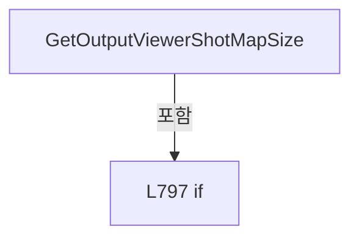

변경 전 점검: 입력/반환 타입, 위 호출자, 예외/취소 경로, 공유 상태와 저장·전송 소비자를 함께 확인합니다. 값의 단위나 물리 방향을 이름만으로 확정하지 않습니다.

### MethodDeclaration `GetOutputViewerShotMapRect` · L805–809

[Drilling.UI/Menu/Menus/CMenuCorrection.cs:805–809](https://github.com/kjuws10-rgb/A3Drilling/blob/5aee8e58439c9b455cae7c9593c9be986c3e682e/Drilling.UI/Menu/Menus/CMenuCorrection.cs#L805-L809)

| 항목 | 실제 추출 값 |
| --- | --- |
| 서명 | Rect Drilling.UI.Menu.Menus.CMenuCorrection.GetOutputViewerShotMapRect(int, int) |
| 접근/수식자 | Private / private, static |
| 반환/값 타입 | Rect |
| 소속 타입 | NamedType:Drilling.UI.Menu.Menus.CMenuCorrection |

입력 계약:

| 이름 | 타입 | 전달 | 선택/기본값 |
| --- | --- | --- | --- |
| groupCountX | int | None | False /  |
| groupCountY | int | None | False /  |

정적 호출자로 확인된 위치:

| 호출 파일/행 | 호출 표현식 | 런타임 분기 가능 |
| --- | --- | --- |
| [Drilling.UI/Menu/Menus/CMenuCorrection.cs:532–532](https://github.com/kjuws10-rgb/A3Drilling/blob/5aee8e58439c9b455cae7c9593c9be986c3e682e/Drilling.UI/Menu/Menus/CMenuCorrection.cs#L532-L532) | GetOutputViewerShotMapRect | False |
| [Drilling.UI/Menu/Menus/CMenuCorrection.cs:844–844](https://github.com/kjuws10-rgb/A3Drilling/blob/5aee8e58439c9b455cae7c9593c9be986c3e682e/Drilling.UI/Menu/Menus/CMenuCorrection.cs#L844-L844) | GetOutputViewerShotMapRect | False |

호출하는 대상과 해석 범위:

| 원본 행 | 표현식 | 분석 상태 | 대상/소스 위치 |
| --- | --- | --- | --- |
| 807 | new Size | unresolved | None |
| 807 | new Size | unresolved | None |
| 808 | new Rect | unresolved | None |

본문의 실제 연산·분기·예외·반환 순서(원문 위치 순):

| 원본 행 | 종류 | 주석 해설 |
| --- | --- | --- |
| 807 | call | 함수·델리게이트 또는 객체 생성자를 호출합니다: new Size(680.0, 420.0) |
| 807 | call | 함수·델리게이트 또는 객체 생성자를 호출합니다: new Size(420.0, 680.0) |
| 807 | conditional-expression | 조건에 따라 결과식을 선택합니다: groupCountX > groupCountY ? new Size(680.0, 420.0) : new Size(420.0, 680.0) |
| 807 | local-declaration | 지역 변수를 선언합니다: var size = groupCountX > groupCountY ? new Size(680.0, 420.0) : new Size(420.0, 680.0); |
| 807 | variable-initializer | 변수의 초기값을 지정합니다: size = groupCountX > groupCountY ? new Size(680.0, 420.0) : new Size(420.0, 680.0) |
| 808 | call | 함수·델리게이트 또는 객체 생성자를 호출합니다: new Rect(28.0, 28.0, size.Width - 56.0, size.Height - 56.0) |
| 808 | return | 호출자에게 값 또는 제어를 반환합니다: return new Rect(28.0, 28.0, size.Width - 56.0, size.Height - 56.0); |

변경 전 점검: 입력/반환 타입, 위 호출자, 예외/취소 경로, 공유 상태와 저장·전송 소비자를 함께 확인합니다. 값의 단위나 물리 방향을 이름만으로 확정하지 않습니다.

### MethodDeclaration `CreateOutputViewerHeadCards` · L811–830

[Drilling.UI/Menu/Menus/CMenuCorrection.cs:811–830](https://github.com/kjuws10-rgb/A3Drilling/blob/5aee8e58439c9b455cae7c9593c9be986c3e682e/Drilling.UI/Menu/Menus/CMenuCorrection.cs#L811-L830)

| 항목 | 실제 추출 값 |
| --- | --- |
| 서명 | System.Collections.Generic.IReadOnlyList<Drilling.UI.Menu.Menus.ST_CORRECTION_OUTPUT_VIEWER_HEAD_CARD> Drilling.UI.Menu.Menus.CMenuCorrection.CreateOutputViewerHeadCards(System.Collections.Generic.IReadOnlyList<Drilling.Common.Recipe.ST_HEAD_SHOT_POINT>) |
| 접근/수식자 | Private / private, static |
| 반환/값 타입 | System.Collections.Generic.IReadOnlyList<Drilling.UI.Menu.Menus.ST_CORRECTION_OUTPUT_VIEWER_HEAD_CARD> |
| 소속 타입 | NamedType:Drilling.UI.Menu.Menus.CMenuCorrection |

입력 계약:

| 이름 | 타입 | 전달 | 선택/기본값 |
| --- | --- | --- | --- |
| shots | System.Collections.Generic.IReadOnlyList<Drilling.Common.Recipe.ST_HEAD_SHOT_POINT> | None | False /  |

정적 호출자로 확인된 위치:

| 호출 파일/행 | 호출 표현식 | 런타임 분기 가능 |
| --- | --- | --- |
| [Drilling.UI/Menu/Menus/CMenuCorrection.cs:76–76](https://github.com/kjuws10-rgb/A3Drilling/blob/5aee8e58439c9b455cae7c9593c9be986c3e682e/Drilling.UI/Menu/Menus/CMenuCorrection.cs#L76-L76) | CreateOutputViewerHeadCards | False |
| [Drilling.UI/Menu/Menus/CMenuCorrection.cs:680–680](https://github.com/kjuws10-rgb/A3Drilling/blob/5aee8e58439c9b455cae7c9593c9be986c3e682e/Drilling.UI/Menu/Menus/CMenuCorrection.cs#L680-L680) | CreateOutputViewerHeadCards | False |
| [Drilling.UI/Menu/Menus/CMenuCorrection.cs:782–782](https://github.com/kjuws10-rgb/A3Drilling/blob/5aee8e58439c9b455cae7c9593c9be986c3e682e/Drilling.UI/Menu/Menus/CMenuCorrection.cs#L782-L782) | CreateOutputViewerHeadCards | False |

호출하는 대상과 해석 범위:

| 원본 행 | 표현식 | 분석 상태 | 대상/소스 위치 |
| --- | --- | --- | --- |
| 813 | shots.Select(shot => shot.HeadNo).ToHashSet | resolved | System.Collections.Generic.HashSet<int> System.Collections.Generic.IEnumerable<int>.ToHashSet<int>() |
| 813 | shots.Select | resolved | System.Collections.Generic.IEnumerable<int> System.Collections.Generic.IEnumerable<Drilling.Common.Recipe.ST_HEAD_SHOT_POINT>.Select<Drilling.Common.Recipe.ST_HEAD_SHOT_POINT, int>(System.Func<Drilling.Common.Recipe.ST_HEAD_SHOT_POINT, int>) |
| 814 | new SolidColorBrush | unresolved | None |
| 814 | Color.FromRgb | unresolved | None |
| 815 | new SolidColorBrush | unresolved | None |
| 815 | Color.FromRgb | unresolved | None |
| 816 | new SolidColorBrush | unresolved | None |
| 816 | Color.FromRgb | unresolved | None |
| 817 | inactiveBackground.Freeze | unresolved | None |
| 818 | inactiveBorder.Freeze | unresolved | None |
| 819 | inactiveText.Freeze | unresolved | None |
| 820 | Enumerable.Range(1, 8).Select(headNo => { var isAssigned = assignedHeads.Contains(headNo); return new ST_CORRECTION_OUTPUT_VIEWER_HEAD_CARD( headNo, isAssigned, isAssigned ? CMenuMain.CreateHeadBrush(headNo) : inactiveBackground, isAssigned ? Brushes.White : inactiveBorder, isAssigned ? Brushes.White : inactiveText); }).ToArray | unresolved | None |
| 820 | Enumerable.Range(1, 8).Select | candidate | OverloadResolutionFailure |
| 820 | Enumerable.Range | resolved | System.Collections.Generic.IEnumerable<int> System.Linq.Enumerable.Range(int, int) |
| 822 | assignedHeads.Contains | resolved | bool System.Collections.Generic.HashSet<int>.Contains(int) |
| 823 | new ST_CORRECTION_OUTPUT_VIEWER_HEAD_CARD | candidate | OverloadResolutionFailure |
| 826 | CMenuMain.CreateHeadBrush | resolved | Brush Drilling.UI.Menu.Menus.CMenuMain.CreateHeadBrush(int, byte) · Drilling.UI/Menu/Menus/CMenuMain.cs:2246 |

본문의 실제 연산·분기·예외·반환 순서(원문 위치 순):

| 원본 행 | 종류 | 주석 해설 |
| --- | --- | --- |
| 813 | call | 함수·델리게이트 또는 객체 생성자를 호출합니다: shots.Select(shot => shot.HeadNo).ToHashSet() |
| 813 | call | 함수·델리게이트 또는 객체 생성자를 호출합니다: shots.Select(shot => shot.HeadNo) |
| 813 | local-declaration | 지역 변수를 선언합니다: var assignedHeads = shots.Select(shot => shot.HeadNo).ToHashSet(); |
| 813 | variable-initializer | 변수의 초기값을 지정합니다: assignedHeads = shots.Select(shot => shot.HeadNo).ToHashSet() |
| 814 | call | 함수·델리게이트 또는 객체 생성자를 호출합니다: new SolidColorBrush(Color.FromRgb(76, 91, 105)) |
| 814 | call | 함수·델리게이트 또는 객체 생성자를 호출합니다: Color.FromRgb(76, 91, 105) |
| 814 | local-declaration | 지역 변수를 선언합니다: var inactiveBackground = new SolidColorBrush(Color.FromRgb(76, 91, 105)); |
| 814 | variable-initializer | 변수의 초기값을 지정합니다: inactiveBackground = new SolidColorBrush(Color.FromRgb(76, 91, 105)) |
| 815 | call | 함수·델리게이트 또는 객체 생성자를 호출합니다: new SolidColorBrush(Color.FromRgb(139, 157, 174)) |
| 815 | call | 함수·델리게이트 또는 객체 생성자를 호출합니다: Color.FromRgb(139, 157, 174) |
| 815 | local-declaration | 지역 변수를 선언합니다: var inactiveBorder = new SolidColorBrush(Color.FromRgb(139, 157, 174)); |
| 815 | variable-initializer | 변수의 초기값을 지정합니다: inactiveBorder = new SolidColorBrush(Color.FromRgb(139, 157, 174)) |
| 816 | call | 함수·델리게이트 또는 객체 생성자를 호출합니다: new SolidColorBrush(Color.FromRgb(248, 250, 252)) |
| 816 | call | 함수·델리게이트 또는 객체 생성자를 호출합니다: Color.FromRgb(248, 250, 252) |
| 816 | local-declaration | 지역 변수를 선언합니다: var inactiveText = new SolidColorBrush(Color.FromRgb(248, 250, 252)); |
| 816 | variable-initializer | 변수의 초기값을 지정합니다: inactiveText = new SolidColorBrush(Color.FromRgb(248, 250, 252)) |
| 817 | call | 함수·델리게이트 또는 객체 생성자를 호출합니다: inactiveBackground.Freeze() |
| 818 | call | 함수·델리게이트 또는 객체 생성자를 호출합니다: inactiveBorder.Freeze() |
| 819 | call | 함수·델리게이트 또는 객체 생성자를 호출합니다: inactiveText.Freeze() |
| 820 | call | 함수·델리게이트 또는 객체 생성자를 호출합니다: Enumerable.Range(1, 8) |
| 820 | call | 함수·델리게이트 또는 객체 생성자를 호출합니다: Enumerable.Range(1, 8).Select(headNo => { var isAssigned = assignedHeads.Contains(headNo); return new ST_CORRECTION_OUTPUT_VIEWER_HEAD_CARD( headNo, isAssigned, isAssigned ? CMenuMain.CreateHeadBrush(headNo) : inactiveBa… |
| 820 | call | 함수·델리게이트 또는 객체 생성자를 호출합니다: Enumerable.Range(1, 8).Select(headNo => { var isAssigned = assignedHeads.Contains(headNo); return new ST_CORRECTION_OUTPUT_VIEWER_HEAD_CARD( headNo, isAssigned, isAssigned ? CMenuMain.CreateHeadBrush(headNo) : inactiveBa… |
| 820 | return | 호출자에게 값 또는 제어를 반환합니다: return Enumerable.Range(1, 8).Select(headNo => { var isAssigned = assignedHeads.Contains(headNo); return new ST_CORRECTION_OUTPUT_VIEWER_HEAD_CARD( headNo, isAssigned, isAssigned ? CMenuMain.CreateHeadBrush(headNo) : inactiveBackg |
| 822 | call | 함수·델리게이트 또는 객체 생성자를 호출합니다: assignedHeads.Contains(headNo) |
| 822 | local-declaration | 지역 변수를 선언합니다: var isAssigned = assignedHeads.Contains(headNo); |
| 822 | variable-initializer | 변수의 초기값을 지정합니다: isAssigned = assignedHeads.Contains(headNo) |
| 823 | call | 함수·델리게이트 또는 객체 생성자를 호출합니다: new ST_CORRECTION_OUTPUT_VIEWER_HEAD_CARD( headNo, isAssigned, isAssigned ? CMenuMain.CreateHeadBrush(headNo) : inactiveBackground, isAssigned ? Brushes.White : inactiveBorder, isAssigned ? Brushes.White : inactiveText) |
| 823 | return | 호출자에게 값 또는 제어를 반환합니다: return new ST_CORRECTION_OUTPUT_VIEWER_HEAD_CARD( headNo, isAssigned, isAssigned ? CMenuMain.CreateHeadBrush(headNo) : inactiveBackground, isAssigned ? Brushes.White : inactiveBorder, isAssigned ? Brushes.White : inactiveText); |
| 826 | call | 함수·델리게이트 또는 객체 생성자를 호출합니다: CMenuMain.CreateHeadBrush(headNo) |
| 826 | conditional-expression | 조건에 따라 결과식을 선택합니다: isAssigned ? CMenuMain.CreateHeadBrush(headNo) : inactiveBackground |
| 827 | conditional-expression | 조건에 따라 결과식을 선택합니다: isAssigned ? Brushes.White : inactiveBorder |
| 828 | conditional-expression | 조건에 따라 결과식을 선택합니다: isAssigned ? Brushes.White : inactiveText |

변경 전 점검: 입력/반환 타입, 위 호출자, 예외/취소 경로, 공유 상태와 저장·전송 소비자를 함께 확인합니다. 값의 단위나 물리 방향을 이름만으로 확정하지 않습니다.

### MethodDeclaration `BuildOutputViewerCellShotMap` · L832–942

[Drilling.UI/Menu/Menus/CMenuCorrection.cs:832–942](https://github.com/kjuws10-rgb/A3Drilling/blob/5aee8e58439c9b455cae7c9593c9be986c3e682e/Drilling.UI/Menu/Menus/CMenuCorrection.cs#L832-L942)

| 항목 | 실제 추출 값 |
| --- | --- |
| 서명 | ImageSource? Drilling.UI.Menu.Menus.CMenuCorrection.BuildOutputViewerCellShotMap(System.Collections.Generic.IReadOnlyList<Drilling.Common.Recipe.ST_HEAD_SHOT_POINT>, System.Collections.Generic.IReadOnlyDictionary<string, Drilling.Common.Recipe.ST_RECIPE_SHOT_MASKING_RESULT>, string) |
| 접근/수식자 | Private / private, static |
| 반환/값 타입 | ImageSource? |
| 소속 타입 | NamedType:Drilling.UI.Menu.Menus.CMenuCorrection |

입력 계약:

| 이름 | 타입 | 전달 | 선택/기본값 |
| --- | --- | --- | --- |
| shots | System.Collections.Generic.IReadOnlyList<Drilling.Common.Recipe.ST_HEAD_SHOT_POINT> | None | False /  |
| shotStates | System.Collections.Generic.IReadOnlyDictionary<string, Drilling.Common.Recipe.ST_RECIPE_SHOT_MASKING_RESULT> | None | False /  |
| selectedShotKey | string | None | False /  |

정적 호출자로 확인된 위치:

| 호출 파일/행 | 호출 표현식 | 런타임 분기 가능 |
| --- | --- | --- |
| [Drilling.UI/Menu/Menus/CMenuCorrection.cs:555–555](https://github.com/kjuws10-rgb/A3Drilling/blob/5aee8e58439c9b455cae7c9593c9be986c3e682e/Drilling.UI/Menu/Menus/CMenuCorrection.cs#L555-L555) | BuildOutputViewerCellShotMap | False |
| [Drilling.UI/Menu/Menus/CMenuCorrection.cs:669–669](https://github.com/kjuws10-rgb/A3Drilling/blob/5aee8e58439c9b455cae7c9593c9be986c3e682e/Drilling.UI/Menu/Menus/CMenuCorrection.cs#L669-L669) | BuildOutputViewerCellShotMap | False |

호출하는 대상과 해석 범위:

| 원본 행 | 표현식 | 분석 상태 | 대상/소스 위치 |
| --- | --- | --- | --- |
| 843 | new Size | unresolved | None |
| 843 | new Size | unresolved | None |
| 844 | GetOutputViewerShotMapRect | resolved | Rect Drilling.UI.Menu.Menus.CMenuCorrection.GetOutputViewerShotMapRect(int, int) · Drilling.UI/Menu/Menus/CMenuCorrection.cs:805 |
| 847 | Math.Clamp | candidate | OverloadResolutionFailure |
| 847 | Math.Min | candidate | OverloadResolutionFailure |
| 848 | new DrawingGroup | unresolved | None |
| 849 | drawing.Open | unresolved | None |
| 851 | context.DrawRectangle | unresolved | None |
| 851 | new SolidColorBrush | unresolved | None |
| 851 | Color.FromArgb | unresolved | None |
| 851 | new Rect | unresolved | None |
| 852 | context.DrawRectangle | unresolved | None |
| 852 | new SolidColorBrush | unresolved | None |
| 852 | Color.FromRgb | unresolved | None |
| 854 | new Pen | unresolved | None |
| 854 | new SolidColorBrush | unresolved | None |
| 854 | Color.FromArgb | unresolved | None |
| 855 | gridPen.Freeze | unresolved | None |
| 856 | Math.Max | resolved | int System.Math.Max(int, int) |
| 857 | Math.Max | resolved | int System.Math.Max(int, int) |
| 861 | context.DrawLine | unresolved | None |
| 861 | new Point | unresolved | None |
| 861 | new Point | unresolved | None |
| 867 | context.DrawLine | unresolved | None |
| 867 | new Point | unresolved | None |
| 867 | new Point | unresolved | None |
| 871 | Math.Max | resolved | int System.Math.Max(int, int) |
| 871 | Math.Ceiling | resolved | double System.Math.Ceiling(double) |
| 872 | new StreamGeometry | unresolved | None |
| 873 | new StreamGeometry | unresolved | None |
| 874 | new StreamGeometry | unresolved | None |
| 875 | shotGeometry.Open | unresolved | None |
| 876 | maskingGeometry.Open | unresolved | None |
| 877 | chessGeometry.Open | unresolved | None |
| 884 | shotStates.TryGetValue | resolved · 동적 구현 선택 가능 | bool System.Collections.Generic.IReadOnlyDictionary<string, Drilling.Common.Recipe.ST_RECIPE_SHOT_MASKING_RESULT>.TryGetValue(string, out Drilling.Common.Recipe.ST_RECIPE_SHOT_MASKING_RESULT) |
| 887 | AddOutputViewerShotCircle | candidate | OverloadResolutionFailure |
| 892 | AddOutputViewerMaskCross | candidate | OverloadResolutionFailure |
| 892 | Math.Max | candidate | OverloadResolutionFailure |
| 897 | AddOutputViewerChessDiamond | candidate | OverloadResolutionFailure |
| 897 | Math.Max | candidate | OverloadResolutionFailure |
| 902 | shotGeometry.Freeze | unresolved | None |
| 903 | maskingGeometry.Freeze | unresolved | None |
| 904 | chessGeometry.Freeze | unresolved | None |
| 905 | new SolidColorBrush | unresolved | None |
| 905 | Color.FromRgb | unresolved | None |
| 906 | shotBrush.Freeze | unresolved | None |
| 907 | context.DrawGeometry | unresolved | None |
| 908 | new SolidColorBrush | unresolved | None |
| 908 | Color.FromRgb | unresolved | None |
| 909 | new SolidColorBrush | unresolved | None |
| 909 | Color.FromRgb | unresolved | None |
| 910 | maskingBrush.Freeze | unresolved | None |
| 911 | chessBrush.Freeze | unresolved | None |
| 912 | new Pen | unresolved | None |
| 913 | new Pen | unresolved | None |
| 914 | maskingPen.Freeze | unresolved | None |
| 915 | chessPen.Freeze | unresolved | None |
| 916 | context.DrawGeometry | unresolved | None |
| 917 | context.DrawGeometry | unresolved | None |
| 917 | new SolidColorBrush | unresolved | None |
| 917 | Color.FromArgb | unresolved | None |
| 919 | string.IsNullOrWhiteSpace | resolved | bool string.IsNullOrWhiteSpace(string?) |
| 919 | shots.FirstOrDefault | resolved | Drilling.Common.Recipe.ST_HEAD_SHOT_POINT? System.Collections.Generic.IEnumerable<Drilling.Common.Recipe.ST_HEAD_SHOT_POINT>.FirstOrDefault<Drilling.Common.Recipe.ST_HEAD_SHOT_POINT>(System.Func<Drilling.Common.Recipe.ST_HEAD_SHOT_POINT, bool>) |
| 919 | shot.ShotKey.Equals | resolved | bool string.Equals(string?, System.StringComparison) |
| 924 | new SolidColorBrush | unresolved | None |
| 924 | Color.FromRgb | unresolved | None |
| 925 | selectedBrush.Freeze | unresolved | None |
| 926 | new Pen | unresolved | None |
| 927 | selectedPen.Freeze | unresolved | None |
| 928 | context.DrawEllipse | unresolved | None |
| 928 | new SolidColorBrush | unresolved | None |
| 928 | Color.FromArgb | unresolved | None |
| 928 | new Point | unresolved | None |
| 929 | context.DrawLine | unresolved | None |
| 929 | new Point | unresolved | None |
| 929 | new Point | unresolved | None |
| 930 | context.DrawLine | unresolved | None |
| 930 | new Point | unresolved | None |
| 930 | new Point | unresolved | None |
| 933 | new Pen | unresolved | None |
| 933 | new SolidColorBrush | unresolved | None |
| 933 | Color.FromRgb | unresolved | None |
| 934 | framePen.Freeze | unresolved | None |
| 935 | context.DrawRectangle | unresolved | None |
| 938 | drawing.Freeze | unresolved | None |
| 939 | new DrawingImage | unresolved | None |
| 940 | image.Freeze | unresolved | None |

본문의 실제 연산·분기·예외·반환 순서(원문 위치 순):

| 원본 행 | 종류 | 주석 해설 |
| --- | --- | --- |
| 837 | if | 조건에 따라 분기합니다: if (shots.Count == 0 &#124;&#124; shots[0].GroupCountX <= 0 &#124;&#124; shots[0].GroupCountY <= 0) |
| 839 | return | 호출자에게 값 또는 제어를 반환합니다: return null; |
| 842 | local-declaration | 지역 변수를 선언합니다: var firstShot = shots[0]; |
| 842 | variable-initializer | 변수의 초기값을 지정합니다: firstShot = shots[0] |
| 843 | call | 함수·델리게이트 또는 객체 생성자를 호출합니다: new Size(680.0, 420.0) |
| 843 | call | 함수·델리게이트 또는 객체 생성자를 호출합니다: new Size(420.0, 680.0) |
| 843 | conditional-expression | 조건에 따라 결과식을 선택합니다: firstShot.GroupCountX > firstShot.GroupCountY ? new Size(680.0, 420.0) : new Size(420.0, 680.0) |
| 843 | local-declaration | 지역 변수를 선언합니다: var mapSize = firstShot.GroupCountX > firstShot.GroupCountY ? new Size(680.0, 420.0) : new Size(420.0, 680.0); |
| 843 | variable-initializer | 변수의 초기값을 지정합니다: mapSize = firstShot.GroupCountX > firstShot.GroupCountY ? new Size(680.0, 420.0) : new Size(420.0, 680.0) |
| 844 | call | 함수·델리게이트 또는 객체 생성자를 호출합니다: GetOutputViewerShotMapRect(firstShot.GroupCountX, firstShot.GroupCountY) |
| 844 | local-declaration | 지역 변수를 선언합니다: var mapRect = GetOutputViewerShotMapRect(firstShot.GroupCountX, firstShot.GroupCountY); |
| 844 | variable-initializer | 변수의 초기값을 지정합니다: mapRect = GetOutputViewerShotMapRect(firstShot.GroupCountX, firstShot.GroupCountY) |
| 845 | local-declaration | 지역 변수를 선언합니다: var cellWidth = mapRect.Width / firstShot.GroupCountX; |
| 845 | variable-initializer | 변수의 초기값을 지정합니다: cellWidth = mapRect.Width / firstShot.GroupCountX |
| 846 | local-declaration | 지역 변수를 선언합니다: var cellHeight = mapRect.Height / firstShot.GroupCountY; |
| 846 | variable-initializer | 변수의 초기값을 지정합니다: cellHeight = mapRect.Height / firstShot.GroupCountY |
| 847 | call | 함수·델리게이트 또는 객체 생성자를 호출합니다: Math.Clamp(Math.Min(cellWidth, cellHeight) * 0.30, 1.2, 3.8) |
| 847 | call | 함수·델리게이트 또는 객체 생성자를 호출합니다: Math.Min(cellWidth, cellHeight) |
| 847 | local-declaration | 지역 변수를 선언합니다: var pointRadius = Math.Clamp(Math.Min(cellWidth, cellHeight) * 0.30, 1.2, 3.8); |
| 847 | variable-initializer | 변수의 초기값을 지정합니다: pointRadius = Math.Clamp(Math.Min(cellWidth, cellHeight) * 0.30, 1.2, 3.8) |
| 848 | call | 함수·델리게이트 또는 객체 생성자를 호출합니다: new DrawingGroup() |
| 848 | local-declaration | 지역 변수를 선언합니다: var drawing = new DrawingGroup(); |
| 848 | variable-initializer | 변수의 초기값을 지정합니다: drawing = new DrawingGroup() |
| 849 | call | 함수·델리게이트 또는 객체 생성자를 호출합니다: drawing.Open() |
| 849 | variable-initializer | 변수의 초기값을 지정합니다: context = drawing.Open() |
| 849 | using | 자원 사용과 정리 범위를 지정합니다: using (var context = drawing.Open()) |
| 851 | call | 함수·델리게이트 또는 객체 생성자를 호출합니다: context.DrawRectangle(new SolidColorBrush(Color.FromArgb(1, 0, 0, 0)), null, new Rect(0.0, 0.0, mapSize.Width, mapSize.Height)) |
| 851 | call | 함수·델리게이트 또는 객체 생성자를 호출합니다: new SolidColorBrush(Color.FromArgb(1, 0, 0, 0)) |
| 851 | call | 함수·델리게이트 또는 객체 생성자를 호출합니다: Color.FromArgb(1, 0, 0, 0) |
| 851 | call | 함수·델리게이트 또는 객체 생성자를 호출합니다: new Rect(0.0, 0.0, mapSize.Width, mapSize.Height) |
| 852 | call | 함수·델리게이트 또는 객체 생성자를 호출합니다: context.DrawRectangle(new SolidColorBrush(Color.FromRgb(17, 24, 32)), null, mapRect) |
| 852 | call | 함수·델리게이트 또는 객체 생성자를 호출합니다: new SolidColorBrush(Color.FromRgb(17, 24, 32)) |
| 852 | call | 함수·델리게이트 또는 객체 생성자를 호출합니다: Color.FromRgb(17, 24, 32) |
| 854 | call | 함수·델리게이트 또는 객체 생성자를 호출합니다: new Pen(new SolidColorBrush(Color.FromArgb(72, 102, 136, 164)), 0.8) |
| 854 | call | 함수·델리게이트 또는 객체 생성자를 호출합니다: new SolidColorBrush(Color.FromArgb(72, 102, 136, 164)) |
| 854 | call | 함수·델리게이트 또는 객체 생성자를 호출합니다: Color.FromArgb(72, 102, 136, 164) |
| 854 | local-declaration | 지역 변수를 선언합니다: var gridPen = new Pen(new SolidColorBrush(Color.FromArgb(72, 102, 136, 164)), 0.8); |
| 854 | variable-initializer | 변수의 초기값을 지정합니다: gridPen = new Pen(new SolidColorBrush(Color.FromArgb(72, 102, 136, 164)), 0.8) |
| 855 | call | 함수·델리게이트 또는 객체 생성자를 호출합니다: gridPen.Freeze() |
| 856 | call | 함수·델리게이트 또는 객체 생성자를 호출합니다: Math.Max(1, firstShot.GroupCountX / 6) |
| 856 | local-declaration | 지역 변수를 선언합니다: var columnStep = Math.Max(1, firstShot.GroupCountX / 6); |
| 856 | variable-initializer | 변수의 초기값을 지정합니다: columnStep = Math.Max(1, firstShot.GroupCountX / 6) |
| 857 | call | 함수·델리게이트 또는 객체 생성자를 호출합니다: Math.Max(1, firstShot.GroupCountY / 8) |
| 857 | local-declaration | 지역 변수를 선언합니다: var rowStep = Math.Max(1, firstShot.GroupCountY / 8); |
| 857 | variable-initializer | 변수의 초기값을 지정합니다: rowStep = Math.Max(1, firstShot.GroupCountY / 8) |
| 858 | compound-assignment-or-event-subscription | 복합 대입 또는 이벤트 구독/해지 표현입니다: column += columnStep |
| 858 | variable-initializer | 변수의 초기값을 지정합니다: column = columnStep |
| 858 | for | 초기화·조건·증감이 있는 반복입니다: for (var column = columnStep; column < firstShot.GroupCountX; column += columnStep) |
| 860 | local-declaration | 지역 변수를 선언합니다: var x = mapRect.Left + (mapRect.Width * column / firstShot.GroupCountX); |
| 860 | variable-initializer | 변수의 초기값을 지정합니다: x = mapRect.Left + (mapRect.Width * column / firstShot.GroupCountX) |
| 861 | call | 함수·델리게이트 또는 객체 생성자를 호출합니다: context.DrawLine(gridPen, new Point(x, mapRect.Top), new Point(x, mapRect.Bottom)) |
| 861 | call | 함수·델리게이트 또는 객체 생성자를 호출합니다: new Point(x, mapRect.Top) |
| 861 | call | 함수·델리게이트 또는 객체 생성자를 호출합니다: new Point(x, mapRect.Bottom) |
| 864 | compound-assignment-or-event-subscription | 복합 대입 또는 이벤트 구독/해지 표현입니다: row += rowStep |
| 864 | variable-initializer | 변수의 초기값을 지정합니다: row = rowStep |
| 864 | for | 초기화·조건·증감이 있는 반복입니다: for (var row = rowStep; row < firstShot.GroupCountY; row += rowStep) |
| 866 | local-declaration | 지역 변수를 선언합니다: var y = mapRect.Top + (mapRect.Height * row / firstShot.GroupCountY); |
| 866 | variable-initializer | 변수의 초기값을 지정합니다: y = mapRect.Top + (mapRect.Height * row / firstShot.GroupCountY) |
| 867 | call | 함수·델리게이트 또는 객체 생성자를 호출합니다: context.DrawLine(gridPen, new Point(mapRect.Left, y), new Point(mapRect.Right, y)) |
| 867 | call | 함수·델리게이트 또는 객체 생성자를 호출합니다: new Point(mapRect.Left, y) |
| 867 | call | 함수·델리게이트 또는 객체 생성자를 호출합니다: new Point(mapRect.Right, y) |
| 870 | local-declaration | 지역 변수를 선언합니다: const int maximumPreviewPoints = 10_000; |
| 870 | variable-initializer | 변수의 초기값을 지정합니다: maximumPreviewPoints = 10_000 |
| 871 | call | 함수·델리게이트 또는 객체 생성자를 호출합니다: Math.Max(1, (int)Math.Ceiling(shots.Count / (double)maximumPreviewPoints)) |
| 871 | call | 함수·델리게이트 또는 객체 생성자를 호출합니다: Math.Ceiling(shots.Count / (double)maximumPreviewPoints) |
| 871 | local-declaration | 지역 변수를 선언합니다: var sampleStep = Math.Max(1, (int)Math.Ceiling(shots.Count / (double)maximumPreviewPoints)); |
| 871 | variable-initializer | 변수의 초기값을 지정합니다: sampleStep = Math.Max(1, (int)Math.Ceiling(shots.Count / (double)maximumPreviewPoints)) |
| 872 | call | 함수·델리게이트 또는 객체 생성자를 호출합니다: new StreamGeometry() |
| 872 | local-declaration | 지역 변수를 선언합니다: var shotGeometry = new StreamGeometry(); |
| 872 | variable-initializer | 변수의 초기값을 지정합니다: shotGeometry = new StreamGeometry() |
| 873 | call | 함수·델리게이트 또는 객체 생성자를 호출합니다: new StreamGeometry() |
| 873 | local-declaration | 지역 변수를 선언합니다: var maskingGeometry = new StreamGeometry(); |
| 873 | variable-initializer | 변수의 초기값을 지정합니다: maskingGeometry = new StreamGeometry() |
| 874 | call | 함수·델리게이트 또는 객체 생성자를 호출합니다: new StreamGeometry() |
| 874 | local-declaration | 지역 변수를 선언합니다: var chessGeometry = new StreamGeometry(); |
| 874 | variable-initializer | 변수의 초기값을 지정합니다: chessGeometry = new StreamGeometry() |
| 875 | call | 함수·델리게이트 또는 객체 생성자를 호출합니다: shotGeometry.Open() |
| 875 | variable-initializer | 변수의 초기값을 지정합니다: shotContext = shotGeometry.Open() |
| 875 | using | 자원 사용과 정리 범위를 지정합니다: using (var shotContext = shotGeometry.Open()) |
| 876 | call | 함수·델리게이트 또는 객체 생성자를 호출합니다: maskingGeometry.Open() |
| 876 | variable-initializer | 변수의 초기값을 지정합니다: maskingContext = maskingGeometry.Open() |
| 876 | using | 자원 사용과 정리 범위를 지정합니다: using (var maskingContext = maskingGeometry.Open()) |
| 877 | call | 함수·델리게이트 또는 객체 생성자를 호출합니다: chessGeometry.Open() |
| 877 | variable-initializer | 변수의 초기값을 지정합니다: chessContext = chessGeometry.Open() |
| 877 | using | 자원 사용과 정리 범위를 지정합니다: using (var chessContext = chessGeometry.Open()) |
| 879 | compound-assignment-or-event-subscription | 복합 대입 또는 이벤트 구독/해지 표현입니다: index += sampleStep |
| 879 | variable-initializer | 변수의 초기값을 지정합니다: index = 0 |
| 879 | for | 초기화·조건·증감이 있는 반복입니다: for (var index = 0; index < shots.Count; index += sampleStep) |
| 881 | local-declaration | 지역 변수를 선언합니다: var shot = shots[index]; |
| 881 | variable-initializer | 변수의 초기값을 지정합니다: shot = shots[index] |
| 882 | local-declaration | 지역 변수를 선언합니다: var x = mapRect.Left + ((shot.GroupColumn + 0.5) * cellWidth); |
| 882 | variable-initializer | 변수의 초기값을 지정합니다: x = mapRect.Left + ((shot.GroupColumn + 0.5) * cellWidth) |
| 883 | local-declaration | 지역 변수를 선언합니다: var y = mapRect.Top + ((shot.GroupRow + 0.5) * cellHeight); |
| 883 | variable-initializer | 변수의 초기값을 지정합니다: y = mapRect.Top + ((shot.GroupRow + 0.5) * cellHeight) |
| 884 | call | 함수·델리게이트 또는 객체 생성자를 호출합니다: shotStates.TryGetValue(shot.ShotKey, out var value) |
| 884 | conditional-expression | 조건에 따라 결과식을 선택합니다: shotStates.TryGetValue(shot.ShotKey, out var value) ? value : ST_RECIPE_SHOT_MASKING_RESULT.Empty |
| 884 | local-declaration | 지역 변수를 선언합니다: var state = shotStates.TryGetValue(shot.ShotKey, out var value) ? value : ST_RECIPE_SHOT_MASKING_RESULT.Empty; |
| 884 | variable-initializer | 변수의 초기값을 지정합니다: state = shotStates.TryGetValue(shot.ShotKey, out var value) ? value : ST_RECIPE_SHOT_MASKING_RESULT.Empty |
| 885 | if | 조건에 따라 분기합니다: if (!state.IsMasked && !state.IsChessSkipped) |
| 887 | call | 함수·델리게이트 또는 객체 생성자를 호출합니다: AddOutputViewerShotCircle(shotContext, x, y, pointRadius) |
| 890 | if | 조건에 따라 분기합니다: if (state.IsMasked) |
| 892 | call | 함수·델리게이트 또는 객체 생성자를 호출합니다: AddOutputViewerMaskCross(maskingContext, x, y, Math.Max(2.2, pointRadius * 1.8)) |
| 892 | call | 함수·델리게이트 또는 객체 생성자를 호출합니다: Math.Max(2.2, pointRadius * 1.8) |
| 895 | if | 조건에 따라 분기합니다: if (state.IsChessSkipped) |
| 897 | call | 함수·델리게이트 또는 객체 생성자를 호출합니다: AddOutputViewerChessDiamond(chessContext, x, y, Math.Max(2.2, pointRadius * 1.8)) |
| 897 | call | 함수·델리게이트 또는 객체 생성자를 호출합니다: Math.Max(2.2, pointRadius * 1.8) |
| 902 | call | 함수·델리게이트 또는 객체 생성자를 호출합니다: shotGeometry.Freeze() |
| 903 | call | 함수·델리게이트 또는 객체 생성자를 호출합니다: maskingGeometry.Freeze() |
| 904 | call | 함수·델리게이트 또는 객체 생성자를 호출합니다: chessGeometry.Freeze() |
| 905 | call | 함수·델리게이트 또는 객체 생성자를 호출합니다: new SolidColorBrush(Color.FromRgb(45, 212, 191)) |
| 905 | call | 함수·델리게이트 또는 객체 생성자를 호출합니다: Color.FromRgb(45, 212, 191) |
| 905 | local-declaration | 지역 변수를 선언합니다: var shotBrush = new SolidColorBrush(Color.FromRgb(45, 212, 191)); |
| 905 | variable-initializer | 변수의 초기값을 지정합니다: shotBrush = new SolidColorBrush(Color.FromRgb(45, 212, 191)) |
| 906 | call | 함수·델리게이트 또는 객체 생성자를 호출합니다: shotBrush.Freeze() |
| 907 | call | 함수·델리게이트 또는 객체 생성자를 호출합니다: context.DrawGeometry(shotBrush, null, shotGeometry) |
| 908 | call | 함수·델리게이트 또는 객체 생성자를 호출합니다: new SolidColorBrush(Color.FromRgb(248, 113, 113)) |
| 908 | call | 함수·델리게이트 또는 객체 생성자를 호출합니다: Color.FromRgb(248, 113, 113) |
| 908 | local-declaration | 지역 변수를 선언합니다: var maskingBrush = new SolidColorBrush(Color.FromRgb(248, 113, 113)); |
| 908 | variable-initializer | 변수의 초기값을 지정합니다: maskingBrush = new SolidColorBrush(Color.FromRgb(248, 113, 113)) |
| 909 | call | 함수·델리게이트 또는 객체 생성자를 호출합니다: new SolidColorBrush(Color.FromRgb(192, 132, 252)) |
| 909 | call | 함수·델리게이트 또는 객체 생성자를 호출합니다: Color.FromRgb(192, 132, 252) |
| 909 | local-declaration | 지역 변수를 선언합니다: var chessBrush = new SolidColorBrush(Color.FromRgb(192, 132, 252)); |
| 909 | variable-initializer | 변수의 초기값을 지정합니다: chessBrush = new SolidColorBrush(Color.FromRgb(192, 132, 252)) |
| 910 | call | 함수·델리게이트 또는 객체 생성자를 호출합니다: maskingBrush.Freeze() |
| 911 | call | 함수·델리게이트 또는 객체 생성자를 호출합니다: chessBrush.Freeze() |
| 912 | call | 함수·델리게이트 또는 객체 생성자를 호출합니다: new Pen(maskingBrush, 1.8) |
| 912 | local-declaration | 지역 변수를 선언합니다: var maskingPen = new Pen(maskingBrush, 1.8); |
| 912 | variable-initializer | 변수의 초기값을 지정합니다: maskingPen = new Pen(maskingBrush, 1.8) |
| 913 | call | 함수·델리게이트 또는 객체 생성자를 호출합니다: new Pen(chessBrush, 1.5) |
| 913 | local-declaration | 지역 변수를 선언합니다: var chessPen = new Pen(chessBrush, 1.5); |
| 913 | variable-initializer | 변수의 초기값을 지정합니다: chessPen = new Pen(chessBrush, 1.5) |
| 914 | call | 함수·델리게이트 또는 객체 생성자를 호출합니다: maskingPen.Freeze() |
| 915 | call | 함수·델리게이트 또는 객체 생성자를 호출합니다: chessPen.Freeze() |
| 916 | call | 함수·델리게이트 또는 객체 생성자를 호출합니다: context.DrawGeometry(null, maskingPen, maskingGeometry) |
| 917 | call | 함수·델리게이트 또는 객체 생성자를 호출합니다: context.DrawGeometry(new SolidColorBrush(Color.FromArgb(76, 192, 132, 252)), chessPen, chessGeometry) |
| 917 | call | 함수·델리게이트 또는 객체 생성자를 호출합니다: new SolidColorBrush(Color.FromArgb(76, 192, 132, 252)) |
| 917 | call | 함수·델리게이트 또는 객체 생성자를 호출합니다: Color.FromArgb(76, 192, 132, 252) |
| 919 | call | 함수·델리게이트 또는 객체 생성자를 호출합니다: string.IsNullOrWhiteSpace(selectedShotKey) |
| 919 | call | 함수·델리게이트 또는 객체 생성자를 호출합니다: shots.FirstOrDefault(shot => shot.ShotKey.Equals(selectedShotKey, StringComparison.OrdinalIgnoreCase)) |
| 919 | call | 함수·델리게이트 또는 객체 생성자를 호출합니다: shot.ShotKey.Equals(selectedShotKey, StringComparison.OrdinalIgnoreCase) |
| 919 | conditional-expression | 조건에 따라 결과식을 선택합니다: string.IsNullOrWhiteSpace(selectedShotKey) ? null : shots.FirstOrDefault(shot => shot.ShotKey.Equals(selectedShotKey, StringComparison.OrdinalIgnoreCase)) |
| 919 | local-declaration | 지역 변수를 선언합니다: var selectedShot = string.IsNullOrWhiteSpace(selectedShotKey) ? null : shots.FirstOrDefault(shot => shot.ShotKey.Equals(selectedShotKey, StringComparison.OrdinalIgnoreCase)); |
| 919 | variable-initializer | 변수의 초기값을 지정합니다: selectedShot = string.IsNullOrWhiteSpace(selectedShotKey) ? null : shots.FirstOrDefault(shot => shot.ShotKey.Equals(selectedShotKey, StringComparison.OrdinalIgnoreCase)) |
| 920 | if | 조건에 따라 분기합니다: if (selectedShot is not null) |
| 922 | local-declaration | 지역 변수를 선언합니다: var selectedX = mapRect.Left + ((selectedShot.GroupColumn + 0.5) * cellWidth); |
| 922 | variable-initializer | 변수의 초기값을 지정합니다: selectedX = mapRect.Left + ((selectedShot.GroupColumn + 0.5) * cellWidth) |
| 923 | local-declaration | 지역 변수를 선언합니다: var selectedY = mapRect.Top + ((selectedShot.GroupRow + 0.5) * cellHeight); |
| 923 | variable-initializer | 변수의 초기값을 지정합니다: selectedY = mapRect.Top + ((selectedShot.GroupRow + 0.5) * cellHeight) |
| 924 | call | 함수·델리게이트 또는 객체 생성자를 호출합니다: new SolidColorBrush(Color.FromRgb(251, 191, 36)) |
| 924 | call | 함수·델리게이트 또는 객체 생성자를 호출합니다: Color.FromRgb(251, 191, 36) |
| 924 | local-declaration | 지역 변수를 선언합니다: var selectedBrush = new SolidColorBrush(Color.FromRgb(251, 191, 36)); |
| 924 | variable-initializer | 변수의 초기값을 지정합니다: selectedBrush = new SolidColorBrush(Color.FromRgb(251, 191, 36)) |
| 925 | call | 함수·델리게이트 또는 객체 생성자를 호출합니다: selectedBrush.Freeze() |
| 926 | call | 함수·델리게이트 또는 객체 생성자를 호출합니다: new Pen(selectedBrush, 2.0) |
| 926 | local-declaration | 지역 변수를 선언합니다: var selectedPen = new Pen(selectedBrush, 2.0); |
| 926 | variable-initializer | 변수의 초기값을 지정합니다: selectedPen = new Pen(selectedBrush, 2.0) |
| 927 | call | 함수·델리게이트 또는 객체 생성자를 호출합니다: selectedPen.Freeze() |
| 928 | call | 함수·델리게이트 또는 객체 생성자를 호출합니다: context.DrawEllipse(new SolidColorBrush(Color.FromArgb(165, 17, 24, 32)), selectedPen, new Point(selectedX, selectedY), 8.0, 8.0) |
| 928 | call | 함수·델리게이트 또는 객체 생성자를 호출합니다: new SolidColorBrush(Color.FromArgb(165, 17, 24, 32)) |
| 928 | call | 함수·델리게이트 또는 객체 생성자를 호출합니다: Color.FromArgb(165, 17, 24, 32) |
| 928 | call | 함수·델리게이트 또는 객체 생성자를 호출합니다: new Point(selectedX, selectedY) |
| 929 | call | 함수·델리게이트 또는 객체 생성자를 호출합니다: context.DrawLine(selectedPen, new Point(selectedX - 12.0, selectedY), new Point(selectedX + 12.0, selectedY)) |
| 929 | call | 함수·델리게이트 또는 객체 생성자를 호출합니다: new Point(selectedX - 12.0, selectedY) |
| 929 | call | 함수·델리게이트 또는 객체 생성자를 호출합니다: new Point(selectedX + 12.0, selectedY) |
| 930 | call | 함수·델리게이트 또는 객체 생성자를 호출합니다: context.DrawLine(selectedPen, new Point(selectedX, selectedY - 12.0), new Point(selectedX, selectedY + 12.0)) |
| 930 | call | 함수·델리게이트 또는 객체 생성자를 호출합니다: new Point(selectedX, selectedY - 12.0) |
| 930 | call | 함수·델리게이트 또는 객체 생성자를 호출합니다: new Point(selectedX, selectedY + 12.0) |
| 933 | call | 함수·델리게이트 또는 객체 생성자를 호출합니다: new Pen(new SolidColorBrush(Color.FromRgb(102, 136, 164)), 1.4) |
| 933 | call | 함수·델리게이트 또는 객체 생성자를 호출합니다: new SolidColorBrush(Color.FromRgb(102, 136, 164)) |
| 933 | call | 함수·델리게이트 또는 객체 생성자를 호출합니다: Color.FromRgb(102, 136, 164) |
| 933 | local-declaration | 지역 변수를 선언합니다: var framePen = new Pen(new SolidColorBrush(Color.FromRgb(102, 136, 164)), 1.4); |
| 933 | variable-initializer | 변수의 초기값을 지정합니다: framePen = new Pen(new SolidColorBrush(Color.FromRgb(102, 136, 164)), 1.4) |
| 934 | call | 함수·델리게이트 또는 객체 생성자를 호출합니다: framePen.Freeze() |
| 935 | call | 함수·델리게이트 또는 객체 생성자를 호출합니다: context.DrawRectangle(null, framePen, mapRect) |
| 938 | call | 함수·델리게이트 또는 객체 생성자를 호출합니다: drawing.Freeze() |
| 939 | call | 함수·델리게이트 또는 객체 생성자를 호출합니다: new DrawingImage(drawing) |
| 939 | local-declaration | 지역 변수를 선언합니다: var image = new DrawingImage(drawing); |
| 939 | variable-initializer | 변수의 초기값을 지정합니다: image = new DrawingImage(drawing) |
| 940 | call | 함수·델리게이트 또는 객체 생성자를 호출합니다: image.Freeze() |
| 941 | return | 호출자에게 값 또는 제어를 반환합니다: return image; |

제어 구문의 포함 구조(실제 실행 순서/CFG가 아닌 구문 탐색 그림):

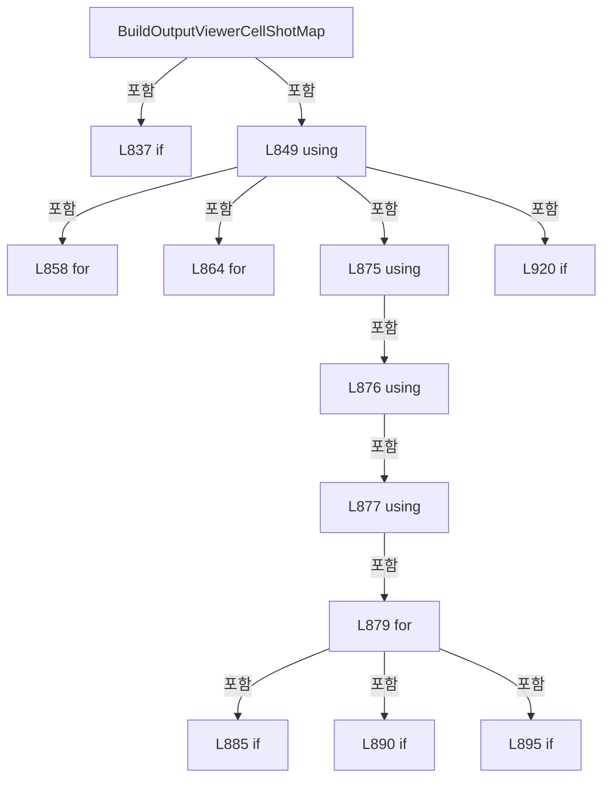

변경 전 점검: 입력/반환 타입, 위 호출자, 예외/취소 경로, 공유 상태와 저장·전송 소비자를 함께 확인합니다. 값의 단위나 물리 방향을 이름만으로 확정하지 않습니다.

### MethodDeclaration `AddOutputViewerShotCircle` · L944–953

[Drilling.UI/Menu/Menus/CMenuCorrection.cs:944–953](https://github.com/kjuws10-rgb/A3Drilling/blob/5aee8e58439c9b455cae7c9593c9be986c3e682e/Drilling.UI/Menu/Menus/CMenuCorrection.cs#L944-L953)

| 항목 | 실제 추출 값 |
| --- | --- |
| 서명 | void Drilling.UI.Menu.Menus.CMenuCorrection.AddOutputViewerShotCircle(StreamGeometryContext, double, double, double) |
| 접근/수식자 | Private / private, static |
| 반환/값 타입 | void |
| 소속 타입 | NamedType:Drilling.UI.Menu.Menus.CMenuCorrection |

입력 계약:

| 이름 | 타입 | 전달 | 선택/기본값 |
| --- | --- | --- | --- |
| context | StreamGeometryContext | None | False /  |
| centerX | double | None | False /  |
| centerY | double | None | False /  |
| radius | double | None | False /  |

현재 부분 분석에서 직접 연결된 호출자는 없습니다. XAML/이벤트/인터페이스·델리게이트·외부 진입을 추가 확인해야 하며, 미사용으로 판정한 것이 아닙니다.

호출하는 대상과 해석 범위:

| 원본 행 | 표현식 | 분석 상태 | 대상/소스 위치 |
| --- | --- | --- | --- |
| 948 | context.BeginFigure | unresolved | None |
| 948 | new Point | unresolved | None |
| 949 | context.BezierTo | unresolved | None |
| 949 | new Point | unresolved | None |
| 949 | new Point | unresolved | None |
| 949 | new Point | unresolved | None |
| 950 | context.BezierTo | unresolved | None |
| 950 | new Point | unresolved | None |
| 950 | new Point | unresolved | None |
| 950 | new Point | unresolved | None |
| 951 | context.BezierTo | unresolved | None |
| 951 | new Point | unresolved | None |
| 951 | new Point | unresolved | None |
| 951 | new Point | unresolved | None |
| 952 | context.BezierTo | unresolved | None |
| 952 | new Point | unresolved | None |
| 952 | new Point | unresolved | None |
| 952 | new Point | unresolved | None |

본문의 실제 연산·분기·예외·반환 순서(원문 위치 순):

| 원본 행 | 종류 | 주석 해설 |
| --- | --- | --- |
| 946 | local-declaration | 지역 변수를 선언합니다: const double bezierCircle = 0.5522847498307936; |
| 946 | variable-initializer | 변수의 초기값을 지정합니다: bezierCircle = 0.5522847498307936 |
| 947 | local-declaration | 지역 변수를 선언합니다: var control = radius * bezierCircle; |
| 947 | variable-initializer | 변수의 초기값을 지정합니다: control = radius * bezierCircle |
| 948 | call | 함수·델리게이트 또는 객체 생성자를 호출합니다: context.BeginFigure(new Point(centerX + radius, centerY), true, true) |
| 948 | call | 함수·델리게이트 또는 객체 생성자를 호출합니다: new Point(centerX + radius, centerY) |
| 949 | call | 함수·델리게이트 또는 객체 생성자를 호출합니다: context.BezierTo(new Point(centerX + radius, centerY + control), new Point(centerX + control, centerY + radius), new Point(centerX, centerY + radius), true, false) |
| 949 | call | 함수·델리게이트 또는 객체 생성자를 호출합니다: new Point(centerX + radius, centerY + control) |
| 949 | call | 함수·델리게이트 또는 객체 생성자를 호출합니다: new Point(centerX + control, centerY + radius) |
| 949 | call | 함수·델리게이트 또는 객체 생성자를 호출합니다: new Point(centerX, centerY + radius) |
| 950 | call | 함수·델리게이트 또는 객체 생성자를 호출합니다: context.BezierTo(new Point(centerX - control, centerY + radius), new Point(centerX - radius, centerY + control), new Point(centerX - radius, centerY), true, false) |
| 950 | call | 함수·델리게이트 또는 객체 생성자를 호출합니다: new Point(centerX - control, centerY + radius) |
| 950 | call | 함수·델리게이트 또는 객체 생성자를 호출합니다: new Point(centerX - radius, centerY + control) |
| 950 | call | 함수·델리게이트 또는 객체 생성자를 호출합니다: new Point(centerX - radius, centerY) |
| 951 | call | 함수·델리게이트 또는 객체 생성자를 호출합니다: context.BezierTo(new Point(centerX - radius, centerY - control), new Point(centerX - control, centerY - radius), new Point(centerX, centerY - radius), true, false) |
| 951 | call | 함수·델리게이트 또는 객체 생성자를 호출합니다: new Point(centerX - radius, centerY - control) |
| 951 | call | 함수·델리게이트 또는 객체 생성자를 호출합니다: new Point(centerX - control, centerY - radius) |
| 951 | call | 함수·델리게이트 또는 객체 생성자를 호출합니다: new Point(centerX, centerY - radius) |
| 952 | call | 함수·델리게이트 또는 객체 생성자를 호출합니다: context.BezierTo(new Point(centerX + control, centerY - radius), new Point(centerX + radius, centerY - control), new Point(centerX + radius, centerY), true, false) |
| 952 | call | 함수·델리게이트 또는 객체 생성자를 호출합니다: new Point(centerX + control, centerY - radius) |
| 952 | call | 함수·델리게이트 또는 객체 생성자를 호출합니다: new Point(centerX + radius, centerY - control) |
| 952 | call | 함수·델리게이트 또는 객체 생성자를 호출합니다: new Point(centerX + radius, centerY) |

변경 전 점검: 입력/반환 타입, 위 호출자, 예외/취소 경로, 공유 상태와 저장·전송 소비자를 함께 확인합니다. 값의 단위나 물리 방향을 이름만으로 확정하지 않습니다.

### MethodDeclaration `AddOutputViewerMaskCross` · L955–961

[Drilling.UI/Menu/Menus/CMenuCorrection.cs:955–961](https://github.com/kjuws10-rgb/A3Drilling/blob/5aee8e58439c9b455cae7c9593c9be986c3e682e/Drilling.UI/Menu/Menus/CMenuCorrection.cs#L955-L961)

| 항목 | 실제 추출 값 |
| --- | --- |
| 서명 | void Drilling.UI.Menu.Menus.CMenuCorrection.AddOutputViewerMaskCross(StreamGeometryContext, double, double, double) |
| 접근/수식자 | Private / private, static |
| 반환/값 타입 | void |
| 소속 타입 | NamedType:Drilling.UI.Menu.Menus.CMenuCorrection |

입력 계약:

| 이름 | 타입 | 전달 | 선택/기본값 |
| --- | --- | --- | --- |
| context | StreamGeometryContext | None | False /  |
| centerX | double | None | False /  |
| centerY | double | None | False /  |
| radius | double | None | False /  |

현재 부분 분석에서 직접 연결된 호출자는 없습니다. XAML/이벤트/인터페이스·델리게이트·외부 진입을 추가 확인해야 하며, 미사용으로 판정한 것이 아닙니다.

호출하는 대상과 해석 범위:

| 원본 행 | 표현식 | 분석 상태 | 대상/소스 위치 |
| --- | --- | --- | --- |
| 957 | context.BeginFigure | unresolved | None |
| 957 | new Point | unresolved | None |
| 958 | context.LineTo | unresolved | None |
| 958 | new Point | unresolved | None |
| 959 | context.BeginFigure | unresolved | None |
| 959 | new Point | unresolved | None |
| 960 | context.LineTo | unresolved | None |
| 960 | new Point | unresolved | None |

본문의 실제 연산·분기·예외·반환 순서(원문 위치 순):

| 원본 행 | 종류 | 주석 해설 |
| --- | --- | --- |
| 957 | call | 함수·델리게이트 또는 객체 생성자를 호출합니다: context.BeginFigure(new Point(centerX - radius, centerY - radius), false, false) |
| 957 | call | 함수·델리게이트 또는 객체 생성자를 호출합니다: new Point(centerX - radius, centerY - radius) |
| 958 | call | 함수·델리게이트 또는 객체 생성자를 호출합니다: context.LineTo(new Point(centerX + radius, centerY + radius), true, false) |
| 958 | call | 함수·델리게이트 또는 객체 생성자를 호출합니다: new Point(centerX + radius, centerY + radius) |
| 959 | call | 함수·델리게이트 또는 객체 생성자를 호출합니다: context.BeginFigure(new Point(centerX - radius, centerY + radius), false, false) |
| 959 | call | 함수·델리게이트 또는 객체 생성자를 호출합니다: new Point(centerX - radius, centerY + radius) |
| 960 | call | 함수·델리게이트 또는 객체 생성자를 호출합니다: context.LineTo(new Point(centerX + radius, centerY - radius), true, false) |
| 960 | call | 함수·델리게이트 또는 객체 생성자를 호출합니다: new Point(centerX + radius, centerY - radius) |

변경 전 점검: 입력/반환 타입, 위 호출자, 예외/취소 경로, 공유 상태와 저장·전송 소비자를 함께 확인합니다. 값의 단위나 물리 방향을 이름만으로 확정하지 않습니다.

### MethodDeclaration `AddOutputViewerChessDiamond` · L963–969

[Drilling.UI/Menu/Menus/CMenuCorrection.cs:963–969](https://github.com/kjuws10-rgb/A3Drilling/blob/5aee8e58439c9b455cae7c9593c9be986c3e682e/Drilling.UI/Menu/Menus/CMenuCorrection.cs#L963-L969)

| 항목 | 실제 추출 값 |
| --- | --- |
| 서명 | void Drilling.UI.Menu.Menus.CMenuCorrection.AddOutputViewerChessDiamond(StreamGeometryContext, double, double, double) |
| 접근/수식자 | Private / private, static |
| 반환/값 타입 | void |
| 소속 타입 | NamedType:Drilling.UI.Menu.Menus.CMenuCorrection |

입력 계약:

| 이름 | 타입 | 전달 | 선택/기본값 |
| --- | --- | --- | --- |
| context | StreamGeometryContext | None | False /  |
| centerX | double | None | False /  |
| centerY | double | None | False /  |
| radius | double | None | False /  |

현재 부분 분석에서 직접 연결된 호출자는 없습니다. XAML/이벤트/인터페이스·델리게이트·외부 진입을 추가 확인해야 하며, 미사용으로 판정한 것이 아닙니다.

호출하는 대상과 해석 범위:

| 원본 행 | 표현식 | 분석 상태 | 대상/소스 위치 |
| --- | --- | --- | --- |
| 965 | context.BeginFigure | unresolved | None |
| 965 | new Point | unresolved | None |
| 966 | context.LineTo | unresolved | None |
| 966 | new Point | unresolved | None |
| 967 | context.LineTo | unresolved | None |
| 967 | new Point | unresolved | None |
| 968 | context.LineTo | unresolved | None |
| 968 | new Point | unresolved | None |

본문의 실제 연산·분기·예외·반환 순서(원문 위치 순):

| 원본 행 | 종류 | 주석 해설 |
| --- | --- | --- |
| 965 | call | 함수·델리게이트 또는 객체 생성자를 호출합니다: context.BeginFigure(new Point(centerX, centerY - radius), true, true) |
| 965 | call | 함수·델리게이트 또는 객체 생성자를 호출합니다: new Point(centerX, centerY - radius) |
| 966 | call | 함수·델리게이트 또는 객체 생성자를 호출합니다: context.LineTo(new Point(centerX + radius, centerY), true, false) |
| 966 | call | 함수·델리게이트 또는 객체 생성자를 호출합니다: new Point(centerX + radius, centerY) |
| 967 | call | 함수·델리게이트 또는 객체 생성자를 호출합니다: context.LineTo(new Point(centerX, centerY + radius), true, false) |
| 967 | call | 함수·델리게이트 또는 객체 생성자를 호출합니다: new Point(centerX, centerY + radius) |
| 968 | call | 함수·델리게이트 또는 객체 생성자를 호출합니다: context.LineTo(new Point(centerX - radius, centerY), true, false) |
| 968 | call | 함수·델리게이트 또는 객체 생성자를 호출합니다: new Point(centerX - radius, centerY) |

변경 전 점검: 입력/반환 타입, 위 호출자, 예외/취소 경로, 공유 상태와 저장·전송 소비자를 함께 확인합니다. 값의 단위나 물리 방향을 이름만으로 확정하지 않습니다.

### MethodDeclaration `ApplyReviewOffsetsToOutputViewerParameters` · L971–974

[Drilling.UI/Menu/Menus/CMenuCorrection.cs:971–974](https://github.com/kjuws10-rgb/A3Drilling/blob/5aee8e58439c9b455cae7c9593c9be986c3e682e/Drilling.UI/Menu/Menus/CMenuCorrection.cs#L971-L974)

| 항목 | 실제 추출 값 |
| --- | --- |
| 서명 | void Drilling.UI.Menu.Menus.CMenuCorrection.ApplyReviewOffsetsToOutputViewerParameters(System.Collections.Generic.IDictionary<string, string>, Drilling.Common.Review.ST_REVIEW_OFFSET_FILE_DATA) |
| 접근/수식자 | Internal / internal, static |
| 반환/값 타입 | void |
| 소속 타입 | NamedType:Drilling.UI.Menu.Menus.CMenuCorrection |

입력 계약:

| 이름 | 타입 | 전달 | 선택/기본값 |
| --- | --- | --- | --- |
| parameters | System.Collections.Generic.IDictionary<string, string> | None | False /  |
| reviewOffsetFile | Drilling.Common.Review.ST_REVIEW_OFFSET_FILE_DATA | None | False /  |

정적 호출자로 확인된 위치:

| 호출 파일/행 | 호출 표현식 | 런타임 분기 가능 |
| --- | --- | --- |
| [Drilling.UI/Menu/Menus/CMenuCorrection.cs:594–594](https://github.com/kjuws10-rgb/A3Drilling/blob/5aee8e58439c9b455cae7c9593c9be986c3e682e/Drilling.UI/Menu/Menus/CMenuCorrection.cs#L594-L594) | ApplyReviewOffsetsToOutputViewerParameters | False |
| [Drilling.UI/Menu/Menus/CMenuCorrection.cs:7523–7523](https://github.com/kjuws10-rgb/A3Drilling/blob/5aee8e58439c9b455cae7c9593c9be986c3e682e/Drilling.UI/Menu/Menus/CMenuCorrection.cs#L7523-L7523) | CMenuCorrection.ApplyReviewOffsetsToOutputViewerParameters | False |

호출하는 대상과 해석 범위:

| 원본 행 | 표현식 | 분석 상태 | 대상/소스 위치 |
| --- | --- | --- | --- |
| 973 | CReviewOffsetData.ApplyToParameters | resolved | void Drilling.Common.Recipe.CReviewOffsetData.ApplyToParameters(System.Collections.Generic.IDictionary<string, string>, Drilling.Common.Review.ST_REVIEW_OFFSET_FILE_DATA) · Drilling.Common/Recipe/CShotCoordinatePlanBuilder.cs:1167 |

본문의 실제 연산·분기·예외·반환 순서(원문 위치 순):

| 원본 행 | 종류 | 주석 해설 |
| --- | --- | --- |
| 973 | call | 함수·델리게이트 또는 객체 생성자를 호출합니다: CReviewOffsetData.ApplyToParameters(parameters, reviewOffsetFile) |

변경 전 점검: 입력/반환 타입, 위 호출자, 예외/취소 경로, 공유 상태와 저장·전송 소비자를 함께 확인합니다. 값의 단위나 물리 방향을 이름만으로 확정하지 않습니다.

### MethodDeclaration `BuildOutputViewerGlassPreview` · L976–1106

[Drilling.UI/Menu/Menus/CMenuCorrection.cs:976–1106](https://github.com/kjuws10-rgb/A3Drilling/blob/5aee8e58439c9b455cae7c9593c9be986c3e682e/Drilling.UI/Menu/Menus/CMenuCorrection.cs#L976-L1106)

| 항목 | 실제 추출 값 |
| --- | --- |
| 서명 | Drilling.UI.Menu.Menus.ST_CORRECTION_OFFSET_VIEWER_PREVIEW Drilling.UI.Menu.Menus.CMenuCorrection.BuildOutputViewerGlassPreview(System.Collections.Generic.IReadOnlyDictionary<string, string>, int, int) |
| 접근/수식자 | Private / private, static |
| 반환/값 타입 | Drilling.UI.Menu.Menus.ST_CORRECTION_OFFSET_VIEWER_PREVIEW |
| 소속 타입 | NamedType:Drilling.UI.Menu.Menus.CMenuCorrection |

입력 계약:

| 이름 | 타입 | 전달 | 선택/기본값 |
| --- | --- | --- | --- |
| parameters | System.Collections.Generic.IReadOnlyDictionary<string, string> | None | False /  |
| cellCount | int | None | False /  |
| selectedCellNo | int | None | False /  |

정적 호출자로 확인된 위치:

| 호출 파일/행 | 호출 표현식 | 런타임 분기 가능 |
| --- | --- | --- |
| [Drilling.UI/Menu/Menus/CMenuCorrection.ReviewData.Offset.cs:232–232](https://github.com/kjuws10-rgb/A3Drilling/blob/5aee8e58439c9b455cae7c9593c9be986c3e682e/Drilling.UI/Menu/Menus/CMenuCorrection.ReviewData.Offset.cs#L232-L232) | BuildOutputViewerGlassPreview | False |
| [Drilling.UI/Menu/Menus/CMenuCorrection.cs:609–609](https://github.com/kjuws10-rgb/A3Drilling/blob/5aee8e58439c9b455cae7c9593c9be986c3e682e/Drilling.UI/Menu/Menus/CMenuCorrection.cs#L609-L609) | BuildOutputViewerGlassPreview | False |
| [Drilling.UI/Menu/Menus/CMenuCorrection.cs:2748–2748](https://github.com/kjuws10-rgb/A3Drilling/blob/5aee8e58439c9b455cae7c9593c9be986c3e682e/Drilling.UI/Menu/Menus/CMenuCorrection.cs#L2748-L2748) | BuildOutputViewerGlassPreview | False |
| [Drilling.UI/Menu/Menus/CMenuCorrection.cs:4130–4130](https://github.com/kjuws10-rgb/A3Drilling/blob/5aee8e58439c9b455cae7c9593c9be986c3e682e/Drilling.UI/Menu/Menus/CMenuCorrection.cs#L4130-L4130) | BuildOutputViewerGlassPreview | False |

호출하는 대상과 해석 범위:

| 원본 행 | 표현식 | 분석 상태 | 대상/소스 위치 |
| --- | --- | --- | --- |
| 984 | ReadOutputViewerDouble | resolved | double Drilling.UI.Menu.Menus.CMenuCorrection.ReadOutputViewerDouble(System.Collections.Generic.IReadOnlyDictionary<string, string>, double, params string[]) · Drilling.UI/Menu/Menus/CMenuCorrection.cs:1209 |
| 985 | ReadOutputViewerDouble | resolved | double Drilling.UI.Menu.Menus.CMenuCorrection.ReadOutputViewerDouble(System.Collections.Generic.IReadOnlyDictionary<string, string>, double, params string[]) · Drilling.UI/Menu/Menus/CMenuCorrection.cs:1209 |
| 986 | ReadOutputViewerDouble | resolved | double Drilling.UI.Menu.Menus.CMenuCorrection.ReadOutputViewerDouble(System.Collections.Generic.IReadOnlyDictionary<string, string>, double, params string[]) · Drilling.UI/Menu/Menus/CMenuCorrection.cs:1209 |
| 987 | ReadOutputViewerDouble | resolved | double Drilling.UI.Menu.Menus.CMenuCorrection.ReadOutputViewerDouble(System.Collections.Generic.IReadOnlyDictionary<string, string>, double, params string[]) · Drilling.UI/Menu/Menus/CMenuCorrection.cs:1209 |
| 988 | ReadOutputViewerDouble | resolved | double Drilling.UI.Menu.Menus.CMenuCorrection.ReadOutputViewerDouble(System.Collections.Generic.IReadOnlyDictionary<string, string>, double, params string[]) · Drilling.UI/Menu/Menus/CMenuCorrection.cs:1209 |
| 989 | ReadOutputViewerInt | resolved | int Drilling.UI.Menu.Menus.CMenuCorrection.ReadOutputViewerInt(System.Collections.Generic.IReadOnlyDictionary<string, string>, int, params string[]) · Drilling.UI/Menu/Menus/CMenuCorrection.cs:1186 |
| 990 | CRecipeModelPixelCountReader.ReadModelTypeCount | resolved | int Drilling.Common.Recipe.CRecipeModelPixelCountReader.ReadModelTypeCount(System.Collections.Generic.IReadOnlyDictionary<string, string>) · Drilling.Common/Recipe/CCellPatternCalculator.cs:428 |
| 993 | new ST_CORRECTION_OFFSET_VIEWER_PREVIEW | resolved | Drilling.UI.Menu.Menus.ST_CORRECTION_OFFSET_VIEWER_PREVIEW.ST_CORRECTION_OFFSET_VIEWER_PREVIEW(ImageSource?, System.Collections.Generic.IReadOnlyList<Drilling.UI.Menu.Menus.ST_CELL_PREVIEW_LABEL>, string) · Drilling.UI/Menu/Menus/CMenuCorrection.cs:6837 |
| 1001 | CCellPreviewDrawing.CreateDistortionKeyPreviews | resolved | System.Collections.Generic.IReadOnlyList<Drilling.UI.Menu.Menus.ST_DISTORTION_KEY_PREVIEW> Drilling.UI.Menu.Menus.CCellPreviewDrawing.CreateDistortionKeyPreviews(double, double, double, double, System.Func<string, double?>) · Drilling.UI/Menu/Menus/CCellPreviewDrawing.cs:61 |
| 1002 | Math.Min | resolved | double System.Math.Min(double, double) |
| 1007 | new ST_GLASS_PREVIEW_FRAME | resolved | Drilling.UI.Menu.Menus.ST_GLASS_PREVIEW_FRAME.ST_GLASS_PREVIEW_FRAME(double, double, double, double) · Drilling.UI/Menu/Menus/CMenuMain.cs:3462 |
| 1008 | new Rect | unresolved | None |
| 1009 | new DrawingGroup | unresolved | None |
| 1010 | new List<ST_CELL_PREVIEW_LABEL> | resolved | System.Collections.Generic.List<Drilling.UI.Menu.Menus.ST_CELL_PREVIEW_LABEL>.List() |
| 1011 | new List<(StreamGeometry Boundary, Pen Pen)> | resolved | System.Collections.Generic.List<(StreamGeometry Boundary, Pen Pen)>.List() |
| 1014 | drawing.Open | unresolved | None |
| 1016 | context.DrawRectangle | unresolved | None |
| 1016 | new SolidColorBrush | unresolved | None |
| 1016 | Color.FromArgb | unresolved | None |
| 1016 | new Rect | unresolved | None |
| 1017 | context.PushClip | unresolved | None |
| 1017 | new RectangleGeometry | unresolved | None |
| 1020 | ReadOutputViewerDouble | resolved | double Drilling.UI.Menu.Menus.CMenuCorrection.ReadOutputViewerDouble(System.Collections.Generic.IReadOnlyDictionary<string, string>, double, params string[]) · Drilling.UI/Menu/Menus/CMenuCorrection.cs:1209 |
| 1021 | ReadOutputViewerDouble | resolved | double Drilling.UI.Menu.Menus.CMenuCorrection.ReadOutputViewerDouble(System.Collections.Generic.IReadOnlyDictionary<string, string>, double, params string[]) · Drilling.UI/Menu/Menus/CMenuCorrection.cs:1209 |
| 1022 | ReadOutputViewerDouble | resolved | double Drilling.UI.Menu.Menus.CMenuCorrection.ReadOutputViewerDouble(System.Collections.Generic.IReadOnlyDictionary<string, string>, double, params string[]) · Drilling.UI/Menu/Menus/CMenuCorrection.cs:1209 |
| 1023 | CRecipeModelPixelCountReader.ReadCellModelType | resolved | int Drilling.Common.Recipe.CRecipeModelPixelCountReader.ReadCellModelType(System.Collections.Generic.IReadOnlyDictionary<string, string>, int, int) · Drilling.Common/Recipe/CCellPatternCalculator.cs:433 |
| 1024 | CRecipeModelPixelCountReader.ReadPatternForModel | resolved | Drilling.Common.Recipe.ST_RECIPE_MODEL_PATTERN Drilling.Common.Recipe.CRecipeModelPixelCountReader.ReadPatternForModel(System.Collections.Generic.IReadOnlyDictionary<string, string>, int) · Drilling.Common/Recipe/CCellPatternCalculator.cs:455 |
| 1025 | CCellPatternCalculator.Calculate | resolved | Drilling.Common.Recipe.ST_CELL_PATTERN_LAYOUT Drilling.Common.Recipe.CCellPatternCalculator.Calculate(Drilling.Common.Recipe.ST_CELL_PATTERN_DEFINITION, bool) · Drilling.Common/Recipe/CCellPatternCalculator.cs:66 |
| 1025 | new ST_CELL_PATTERN_DEFINITION | resolved | Drilling.Common.Recipe.ST_CELL_PATTERN_DEFINITION.ST_CELL_PATTERN_DEFINITION(int, double, double, double, double, int, int, int, int, double, double) · Drilling.Common/Recipe/CCellPatternCalculator.cs:277 |
| 1032 | BuildOutputViewerCellBoundaryGeometry | resolved | StreamGeometry? Drilling.UI.Menu.Menus.CMenuCorrection.BuildOutputViewerCellBoundaryGeometry(double, double, double, double, int, int, double, double, double) · Drilling.UI/Menu/Menus/CMenuCorrection.cs:1108 |
| 1040 | CMenuMain.CreateHeadBrush | resolved | Brush Drilling.UI.Menu.Menus.CMenuMain.CreateHeadBrush(int, byte) · Drilling.UI/Menu/Menus/CMenuMain.cs:2246 |
| 1042 | new SolidColorBrush | unresolved | None |
| 1042 | Color.FromRgb | unresolved | None |
| 1043 | CMenuMain.CreateHeadBrush | resolved | Brush Drilling.UI.Menu.Menus.CMenuMain.CreateHeadBrush(int, byte) · Drilling.UI/Menu/Menus/CMenuMain.cs:2246 |
| 1046 | boundaryBrush.Freeze | unresolved | None |
| 1049 | new Pen | unresolved | None |
| 1050 | boundaryPen.Freeze | unresolved | None |
| 1051 | context.DrawGeometry | unresolved | None |
| 1052 | drawnCellBoundaries.Add | candidate | OverloadResolutionFailure |
| 1053 | CCellPreviewDrawing.CreateCellLabel | candidate | OverloadResolutionFailure |
| 1056 | cellLabels.Add | resolved | void System.Collections.Generic.List<Drilling.UI.Menu.Menus.ST_CELL_PREVIEW_LABEL>.Add(Drilling.UI.Menu.Menus.ST_CELL_PREVIEW_LABEL) |
| 1062 | context.DrawGeometry | unresolved | None |
| 1065 | context.Pop | unresolved | None |
| 1066 | CCellPreviewDrawing.DrawAlignKeys | candidate | OverloadResolutionFailure |
| 1067 | CCellPreviewDrawing.DrawDistortionKeys | candidate | OverloadResolutionFailure |
| 1070 | drawing.Freeze | unresolved | None |
| 1072 | Math.Max | resolved | double System.Math.Max(double, double) |
| 1073 | new Rect | unresolved | None |
| 1074 | new Rect | unresolved | None |
| 1075 | cellLabels.Select(label => label with { CanvasCenterX = label.CanvasCenterX - frameLeft + paddingX, CanvasCenterY = label.CanvasCenterY - frameTop + paddingY, Width = Math.Max(18.0, label.CellNo.ToString(CultureInfo.InvariantCulture).Length * 6.2 + 8.0), DesignWidth = cellRect.Width, DesignHeight = cellRect.Height }).ToArray | resolved | Drilling.UI.Menu.Menus.ST_CELL_PREVIEW_LABEL[] System.Collections.Generic.IEnumerable<Drilling.UI.Menu.Menus.ST_CELL_PREVIEW_LABEL>.ToArray<Drilling.UI.Menu.Menus.ST_CELL_PREVIEW_LABEL>() |
| 1075 | cellLabels.Select | resolved | System.Collections.Generic.IEnumerable<Drilling.UI.Menu.Menus.ST_CELL_PREVIEW_LABEL> System.Collections.Generic.IEnumerable<Drilling.UI.Menu.Menus.ST_CELL_PREVIEW_LABEL>.Select<Drilling.UI.Menu.Menus.ST_CELL_PREVIEW_LABEL, Drilling.UI.Menu.Menus.ST_CELL_PREVIEW_LABEL>(System.Func<Drilling.UI.Menu.Menus.ST_CELL_PREVIEW_LABEL, Drilling.UI.Menu.Menus.ST_CELL_PREVIEW_LABEL>) |
| 1079 | Math.Max | resolved | double System.Math.Max(double, double) |
| 1079 | label.CellNo.ToString | resolved | string int.ToString(System.IFormatProvider?) |
| 1083 | new DrawingGroup | unresolved | None |
| 1084 | cellDrawing.Open | unresolved | None |
| 1086 | cellContext.DrawRectangle | unresolved | None |
| 1086 | new SolidColorBrush | unresolved | None |
| 1086 | Color.FromArgb | unresolved | None |
| 1087 | cellContext.DrawRectangle | unresolved | None |
| 1087 | new Pen | unresolved | None |
| 1087 | new SolidColorBrush | unresolved | None |
| 1087 | Color.FromRgb | unresolved | None |
| 1088 | cellContext.PushClip | unresolved | None |
| 1088 | new RectangleGeometry | unresolved | None |
| 1089 | cellContext.PushTransform | unresolved | None |
| 1089 | new TranslateTransform | unresolved | None |
| 1090 | cellContext.DrawDrawing | unresolved | None |
| 1091 | cellContext.Pop | unresolved | None |
| 1092 | cellContext.Pop | unresolved | None |
| 1093 | DrawOutputViewerPreviewAxisIndicator | candidate | OverloadResolutionFailure |
| 1096 | cellDrawing.Freeze | unresolved | None |
| 1097 | new DrawingImage | unresolved | None |
| 1098 | cellImage.Freeze | unresolved | None |
| 1099 | FormatOutputViewerPreviewDouble | resolved | string Drilling.UI.Menu.Menus.CMenuCorrection.FormatOutputViewerPreviewDouble(double) · Drilling.UI/Menu/Menus/CMenuCorrection.cs:1232 |
| 1099 | FormatOutputViewerPreviewDouble | resolved | string Drilling.UI.Menu.Menus.CMenuCorrection.FormatOutputViewerPreviewDouble(double) · Drilling.UI/Menu/Menus/CMenuCorrection.cs:1232 |
| 1105 | new ST_CORRECTION_OFFSET_VIEWER_PREVIEW | candidate | OverloadResolutionFailure |

본문의 실제 연산·분기·예외·반환 순서(원문 위치 순):

| 원본 행 | 종류 | 주석 해설 |
| --- | --- | --- |
| 978 | local-declaration | 지역 변수를 선언합니다: const double canvasWidth = 860.0; |
| 978 | variable-initializer | 변수의 초기값을 지정합니다: canvasWidth = 860.0 |
| 979 | local-declaration | 지역 변수를 선언합니다: const double canvasHeight = 430.0; |
| 979 | variable-initializer | 변수의 초기값을 지정합니다: canvasHeight = 430.0 |
| 980 | local-declaration | 지역 변수를 선언합니다: const double maxLeft = 44.0; |
| 980 | variable-initializer | 변수의 초기값을 지정합니다: maxLeft = 44.0 |
| 981 | local-declaration | 지역 변수를 선언합니다: const double maxTop = 50.0; |
| 981 | variable-initializer | 변수의 초기값을 지정합니다: maxTop = 50.0 |
| 982 | local-declaration | 지역 변수를 선언합니다: const double maxWidth = 772.0; |
| 982 | variable-initializer | 변수의 초기값을 지정합니다: maxWidth = 772.0 |
| 983 | local-declaration | 지역 변수를 선언합니다: const double maxHeight = 340.0; |
| 983 | variable-initializer | 변수의 초기값을 지정합니다: maxHeight = 340.0 |
| 984 | call | 함수·델리게이트 또는 객체 생성자를 호출합니다: ReadOutputViewerDouble(parameters, 500.0, "GLASS_SIZE_X") |
| 984 | local-declaration | 지역 변수를 선언합니다: var glassWidth = ReadOutputViewerDouble(parameters, 500.0, "GLASS_SIZE_X"); |
| 984 | variable-initializer | 변수의 초기값을 지정합니다: glassWidth = ReadOutputViewerDouble(parameters, 500.0, "GLASS_SIZE_X") |
| 985 | call | 함수·델리게이트 또는 객체 생성자를 호출합니다: ReadOutputViewerDouble(parameters, 300.0, "GLASS_SIZE_Y") |
| 985 | local-declaration | 지역 변수를 선언합니다: var glassHeight = ReadOutputViewerDouble(parameters, 300.0, "GLASS_SIZE_Y"); |
| 985 | variable-initializer | 변수의 초기값을 지정합니다: glassHeight = ReadOutputViewerDouble(parameters, 300.0, "GLASS_SIZE_Y") |
| 986 | call | 함수·델리게이트 또는 객체 생성자를 호출합니다: ReadOutputViewerDouble(parameters, 55.0, "AK_MARGIN_X") |
| 986 | local-declaration | 지역 변수를 선언합니다: var akMarginX = ReadOutputViewerDouble(parameters, 55.0, "AK_MARGIN_X"); |
| 986 | variable-initializer | 변수의 초기값을 지정합니다: akMarginX = ReadOutputViewerDouble(parameters, 55.0, "AK_MARGIN_X") |
| 987 | call | 함수·델리게이트 또는 객체 생성자를 호출합니다: ReadOutputViewerDouble(parameters, 45.0, "AK_MARGIN_Y") |
| 987 | local-declaration | 지역 변수를 선언합니다: var akMarginY = ReadOutputViewerDouble(parameters, 45.0, "AK_MARGIN_Y"); |
| 987 | variable-initializer | 변수의 초기값을 지정합니다: akMarginY = ReadOutputViewerDouble(parameters, 45.0, "AK_MARGIN_Y") |
| 988 | call | 함수·델리게이트 또는 객체 생성자를 호출합니다: ReadOutputViewerDouble(parameters, 0.09, "PIXEL_SIZE") |
| 988 | local-declaration | 지역 변수를 선언합니다: var pixelSize = ReadOutputViewerDouble(parameters, 0.09, "PIXEL_SIZE"); |
| 988 | variable-initializer | 변수의 초기값을 지정합니다: pixelSize = ReadOutputViewerDouble(parameters, 0.09, "PIXEL_SIZE") |
| 989 | call | 함수·델리게이트 또는 객체 생성자를 호출합니다: ReadOutputViewerInt(parameters, 1, "SPLITED_BEAM_COUNT") |
| 989 | local-declaration | 지역 변수를 선언합니다: var splitBeamCount = ReadOutputViewerInt(parameters, 1, "SPLITED_BEAM_COUNT"); |
| 989 | variable-initializer | 변수의 초기값을 지정합니다: splitBeamCount = ReadOutputViewerInt(parameters, 1, "SPLITED_BEAM_COUNT") |
| 990 | call | 함수·델리게이트 또는 객체 생성자를 호출합니다: CRecipeModelPixelCountReader.ReadModelTypeCount(parameters) |
| 990 | local-declaration | 지역 변수를 선언합니다: var modelTypeCount = CRecipeModelPixelCountReader.ReadModelTypeCount(parameters); |
| 990 | variable-initializer | 변수의 초기값을 지정합니다: modelTypeCount = CRecipeModelPixelCountReader.ReadModelTypeCount(parameters) |
| 991 | if | 조건에 따라 분기합니다: if (glassWidth <= 0.0 &#124;&#124; glassHeight <= 0.0) |
| 993 | call | 함수·델리게이트 또는 객체 생성자를 호출합니다: new ST_CORRECTION_OFFSET_VIEWER_PREVIEW(null, [], "Glass size is not valid.") |
| 993 | return | 호출자에게 값 또는 제어를 반환합니다: return new ST_CORRECTION_OFFSET_VIEWER_PREVIEW(null, [], "Glass size is not valid."); |
| 1001 | call | 함수·델리게이트 또는 객체 생성자를 호출합니다: CCellPreviewDrawing.CreateDistortionKeyPreviews(glassWidth, glassHeight, akMarginX, akMarginY, ReadDistortionValue) |
| 1001 | local-declaration | 지역 변수를 선언합니다: var distortionKeys = CCellPreviewDrawing.CreateDistortionKeyPreviews(glassWidth, glassHeight, akMarginX, akMarginY, ReadDistortionValue); |
| 1001 | variable-initializer | 변수의 초기값을 지정합니다: distortionKeys = CCellPreviewDrawing.CreateDistortionKeyPreviews(glassWidth, glassHeight, akMarginX, akMarginY, ReadDistortionValue) |
| 1002 | call | 함수·델리게이트 또는 객체 생성자를 호출합니다: Math.Min(maxWidth / glassWidth, maxHeight / glassHeight) |
| 1002 | local-declaration | 지역 변수를 선언합니다: var scale = Math.Min(maxWidth / glassWidth, maxHeight / glassHeight); |
| 1002 | variable-initializer | 변수의 초기값을 지정합니다: scale = Math.Min(maxWidth / glassWidth, maxHeight / glassHeight) |
| 1003 | local-declaration | 지역 변수를 선언합니다: var frameWidth = glassWidth * scale; |
| 1003 | variable-initializer | 변수의 초기값을 지정합니다: frameWidth = glassWidth * scale |
| 1004 | local-declaration | 지역 변수를 선언합니다: var frameHeight = glassHeight * scale; |
| 1004 | variable-initializer | 변수의 초기값을 지정합니다: frameHeight = glassHeight * scale |
| 1005 | local-declaration | 지역 변수를 선언합니다: var frameLeft = maxLeft + (maxWidth - frameWidth) / 2.0; |
| 1005 | variable-initializer | 변수의 초기값을 지정합니다: frameLeft = maxLeft + (maxWidth - frameWidth) / 2.0 |
| 1006 | local-declaration | 지역 변수를 선언합니다: var frameTop = maxTop + (maxHeight - frameHeight) / 2.0; |
| 1006 | variable-initializer | 변수의 초기값을 지정합니다: frameTop = maxTop + (maxHeight - frameHeight) / 2.0 |
| 1007 | call | 함수·델리게이트 또는 객체 생성자를 호출합니다: new ST_GLASS_PREVIEW_FRAME(frameLeft, frameTop, frameWidth, frameHeight) |
| 1007 | local-declaration | 지역 변수를 선언합니다: var frame = new ST_GLASS_PREVIEW_FRAME(frameLeft, frameTop, frameWidth, frameHeight); |
| 1007 | variable-initializer | 변수의 초기값을 지정합니다: frame = new ST_GLASS_PREVIEW_FRAME(frameLeft, frameTop, frameWidth, frameHeight) |
| 1008 | call | 함수·델리게이트 또는 객체 생성자를 호출합니다: new Rect(frameLeft, frameTop, frameWidth, frameHeight) |
| 1008 | local-declaration | 지역 변수를 선언합니다: var frameBounds = new Rect(frameLeft, frameTop, frameWidth, frameHeight); |
| 1008 | variable-initializer | 변수의 초기값을 지정합니다: frameBounds = new Rect(frameLeft, frameTop, frameWidth, frameHeight) |
| 1009 | call | 함수·델리게이트 또는 객체 생성자를 호출합니다: new DrawingGroup() |
| 1009 | local-declaration | 지역 변수를 선언합니다: var drawing = new DrawingGroup(); |
| 1009 | variable-initializer | 변수의 초기값을 지정합니다: drawing = new DrawingGroup() |
| 1010 | call | 함수·델리게이트 또는 객체 생성자를 호출합니다: new List<ST_CELL_PREVIEW_LABEL>() |
| 1010 | local-declaration | 지역 변수를 선언합니다: var cellLabels = new List<ST_CELL_PREVIEW_LABEL>(); |
| 1010 | variable-initializer | 변수의 초기값을 지정합니다: cellLabels = new List<ST_CELL_PREVIEW_LABEL>() |
| 1011 | call | 함수·델리게이트 또는 객체 생성자를 호출합니다: new List<(StreamGeometry Boundary, Pen Pen)>() |
| 1011 | local-declaration | 지역 변수를 선언합니다: var drawnCellBoundaries = new List<(StreamGeometry Boundary, Pen Pen)>(); |
| 1011 | variable-initializer | 변수의 초기값을 지정합니다: drawnCellBoundaries = new List<(StreamGeometry Boundary, Pen Pen)>() |
| 1012 | local-declaration | 지역 변수를 선언합니다: long totalShotGroupCount = 0; |
| 1012 | variable-initializer | 변수의 초기값을 지정합니다: totalShotGroupCount = 0 |
| 1013 | local-declaration | 지역 변수를 선언합니다: var invalidCellCount = 0; |
| 1013 | variable-initializer | 변수의 초기값을 지정합니다: invalidCellCount = 0 |
| 1014 | call | 함수·델리게이트 또는 객체 생성자를 호출합니다: drawing.Open() |
| 1014 | variable-initializer | 변수의 초기값을 지정합니다: context = drawing.Open() |
| 1014 | using | 자원 사용과 정리 범위를 지정합니다: using (var context = drawing.Open()) |
| 1016 | call | 함수·델리게이트 또는 객체 생성자를 호출합니다: context.DrawRectangle(new SolidColorBrush(Color.FromArgb(1, 0, 0, 0)), null, new Rect(0, 0, canvasWidth, canvasHeight)) |
| 1016 | call | 함수·델리게이트 또는 객체 생성자를 호출합니다: new SolidColorBrush(Color.FromArgb(1, 0, 0, 0)) |
| 1016 | call | 함수·델리게이트 또는 객체 생성자를 호출합니다: Color.FromArgb(1, 0, 0, 0) |
| 1016 | call | 함수·델리게이트 또는 객체 생성자를 호출합니다: new Rect(0, 0, canvasWidth, canvasHeight) |
| 1017 | call | 함수·델리게이트 또는 객체 생성자를 호출합니다: context.PushClip(new RectangleGeometry(frameBounds)) |
| 1017 | call | 함수·델리게이트 또는 객체 생성자를 호출합니다: new RectangleGeometry(frameBounds) |
| 1018 | variable-initializer | 변수의 초기값을 지정합니다: cellNo = 1 |
| 1018 | for | 초기화·조건·증감이 있는 반복입니다: for (var cellNo = 1; cellNo <= cellCount; cellNo++) |
| 1020 | call | 함수·델리게이트 또는 객체 생성자를 호출합니다: ReadOutputViewerDouble(parameters, 0.0, $"CELL{cellNo}_ALIGN_TO_1ST_PIXEL_X") |
| 1020 | local-declaration | 지역 변수를 선언합니다: var firstPixelX = ReadOutputViewerDouble(parameters, 0.0, $"CELL{cellNo}_ALIGN_TO_1ST_PIXEL_X"); |
| 1020 | variable-initializer | 변수의 초기값을 지정합니다: firstPixelX = ReadOutputViewerDouble(parameters, 0.0, $"CELL{cellNo}_ALIGN_TO_1ST_PIXEL_X") |
| 1021 | call | 함수·델리게이트 또는 객체 생성자를 호출합니다: ReadOutputViewerDouble(parameters, 0.0, $"CELL{cellNo}_ALIGN_TO_1ST_PIXEL_Y") |
| 1021 | local-declaration | 지역 변수를 선언합니다: var firstPixelY = ReadOutputViewerDouble(parameters, 0.0, $"CELL{cellNo}_ALIGN_TO_1ST_PIXEL_Y"); |
| 1021 | variable-initializer | 변수의 초기값을 지정합니다: firstPixelY = ReadOutputViewerDouble(parameters, 0.0, $"CELL{cellNo}_ALIGN_TO_1ST_PIXEL_Y") |
| 1022 | call | 함수·델리게이트 또는 객체 생성자를 호출합니다: ReadOutputViewerDouble(parameters, 0.0, $"CELL{cellNo}_ROTATION") |
| 1022 | local-declaration | 지역 변수를 선언합니다: var rotation = ReadOutputViewerDouble(parameters, 0.0, $"CELL{cellNo}_ROTATION"); |
| 1022 | variable-initializer | 변수의 초기값을 지정합니다: rotation = ReadOutputViewerDouble(parameters, 0.0, $"CELL{cellNo}_ROTATION") |
| 1023 | call | 함수·델리게이트 또는 객체 생성자를 호출합니다: CRecipeModelPixelCountReader.ReadCellModelType(parameters, cellNo, modelTypeCount) |
| 1023 | local-declaration | 지역 변수를 선언합니다: var modelType = CRecipeModelPixelCountReader.ReadCellModelType(parameters, cellNo, modelTypeCount); |
| 1023 | variable-initializer | 변수의 초기값을 지정합니다: modelType = CRecipeModelPixelCountReader.ReadCellModelType(parameters, cellNo, modelTypeCount) |
| 1024 | call | 함수·델리게이트 또는 객체 생성자를 호출합니다: CRecipeModelPixelCountReader.ReadPatternForModel(parameters, modelType) |
| 1024 | local-declaration | 지역 변수를 선언합니다: var modelPattern = CRecipeModelPixelCountReader.ReadPatternForModel(parameters, modelType); |
| 1024 | variable-initializer | 변수의 초기값을 지정합니다: modelPattern = CRecipeModelPixelCountReader.ReadPatternForModel(parameters, modelType) |
| 1025 | call | 함수·델리게이트 또는 객체 생성자를 호출합니다: CCellPatternCalculator.Calculate(new ST_CELL_PATTERN_DEFINITION(cellNo, firstPixelX, firstPixelY, rotation, pixelSize, modelPattern.PixelCountX, modelPattern.PixelCountY, modelPattern.ProcessPitch, splitBeamCount, akMarg… |
| 1025 | call | 함수·델리게이트 또는 객체 생성자를 호출합니다: new ST_CELL_PATTERN_DEFINITION(cellNo, firstPixelX, firstPixelY, rotation, pixelSize, modelPattern.PixelCountX, modelPattern.PixelCountY, modelPattern.ProcessPitch, splitBeamCount, akMarginX, akMarginY) |
| 1025 | local-declaration | 지역 변수를 선언합니다: var layout = CCellPatternCalculator.Calculate(new ST_CELL_PATTERN_DEFINITION(cellNo, firstPixelX, firstPixelY, rotation, pixelSize, modelPattern.PixelCountX, modelPattern.PixelCountY, modelPattern.ProcessPitch, splitBeamCount, akM |
| 1025 | variable-initializer | 변수의 초기값을 지정합니다: layout = CCellPatternCalculator.Calculate(new ST_CELL_PATTERN_DEFINITION(cellNo, firstPixelX, firstPixelY, rotation, pixelSize, modelPattern.PixelCountX, modelPattern.PixelCountY, modelPattern.ProcessPitch, splitBeamCount, akMargi |
| 1026 | if | 조건에 따라 분기합니다: if (!layout.IsValid) |
| 1031 | compound-assignment-or-event-subscription | 복합 대입 또는 이벤트 구독/해지 표현입니다: totalShotGroupCount += (long)layout.GroupCountX * layout.GroupCountY |
| 1032 | call | 함수·델리게이트 또는 객체 생성자를 호출합니다: BuildOutputViewerCellBoundaryGeometry(frameLeft, frameTop, scale, pixelSize, modelPattern.PixelCountX, modelPattern.PixelCountY, akMarginX + firstPixelX, akMarginY + firstPixelY, rotation) |
| 1032 | local-declaration | 지역 변수를 선언합니다: var boundary = BuildOutputViewerCellBoundaryGeometry(frameLeft, frameTop, scale, pixelSize, modelPattern.PixelCountX, modelPattern.PixelCountY, akMarginX + firstPixelX, akMarginY + firstPixelY, rotation); |
| 1032 | variable-initializer | 변수의 초기값을 지정합니다: boundary = BuildOutputViewerCellBoundaryGeometry(frameLeft, frameTop, scale, pixelSize, modelPattern.PixelCountX, modelPattern.PixelCountY, akMarginX + firstPixelX, akMarginY + firstPixelY, rotation) |
| 1033 | if | 조건에 따라 분기합니다: if (boundary is null) |
| 1035 | continue | 다음 반복으로 진행합니다: continue; |
| 1038 | local-declaration | 지역 변수를 선언합니다: var isSelectedCell = selectedCellNo > 0 && cellNo == selectedCellNo; |
| 1038 | variable-initializer | 변수의 초기값을 지정합니다: isSelectedCell = selectedCellNo > 0 && cellNo == selectedCellNo |
| 1039 | conditional-expression | 조건에 따라 결과식을 선택합니다: selectedCellNo <= 0 ? (byte)180 : isSelectedCell ? (byte)170 : (byte)80 |
| 1039 | conditional-expression | 조건에 따라 결과식을 선택합니다: isSelectedCell ? (byte)170 : (byte)80 |
| 1039 | local-declaration | 지역 변수를 선언합니다: var cellAlpha = selectedCellNo <= 0 ? (byte)180 : isSelectedCell ? (byte)170 : (byte)80; |
| 1039 | variable-initializer | 변수의 초기값을 지정합니다: cellAlpha = selectedCellNo <= 0 ? (byte)180 : isSelectedCell ? (byte)170 : (byte)80 |
| 1040 | call | 함수·델리게이트 또는 객체 생성자를 호출합니다: CMenuMain.CreateHeadBrush(((cellNo - 1) % 8) + 1, cellAlpha) |
| 1040 | local-declaration | 지역 변수를 선언합니다: var cellBrush = CMenuMain.CreateHeadBrush(((cellNo - 1) % 8) + 1, cellAlpha); |
| 1040 | variable-initializer | 변수의 초기값을 지정합니다: cellBrush = CMenuMain.CreateHeadBrush(((cellNo - 1) % 8) + 1, cellAlpha) |
| 1041 | conditional-expression | 조건에 따라 결과식을 선택합니다: isSelectedCell ? new SolidColorBrush(Color.FromRgb(246, 196, 83)) : CMenuMain.CreateHeadBrush(((cellNo - 1) % 8) + 1, 150) |
| 1041 | local-declaration | 지역 변수를 선언합니다: var boundaryBrush = isSelectedCell ? new SolidColorBrush(Color.FromRgb(246, 196, 83)) : CMenuMain.CreateHeadBrush(((cellNo - 1) % 8) + 1, 150); |
| 1041 | variable-initializer | 변수의 초기값을 지정합니다: boundaryBrush = isSelectedCell ? new SolidColorBrush(Color.FromRgb(246, 196, 83)) : CMenuMain.CreateHeadBrush(((cellNo - 1) % 8) + 1, 150) |
| 1042 | call | 함수·델리게이트 또는 객체 생성자를 호출합니다: new SolidColorBrush(Color.FromRgb(246, 196, 83)) |
| 1042 | call | 함수·델리게이트 또는 객체 생성자를 호출합니다: Color.FromRgb(246, 196, 83) |
| 1043 | call | 함수·델리게이트 또는 객체 생성자를 호출합니다: CMenuMain.CreateHeadBrush(((cellNo - 1) % 8) + 1, 150) |
| 1044 | if | 조건에 따라 분기합니다: if (boundaryBrush.CanFreeze) |
| 1046 | call | 함수·델리게이트 또는 객체 생성자를 호출합니다: boundaryBrush.Freeze() |
| 1049 | call | 함수·델리게이트 또는 객체 생성자를 호출합니다: new Pen(boundaryBrush, isSelectedCell ? 3.0 : 1.2) |
| 1049 | conditional-expression | 조건에 따라 결과식을 선택합니다: isSelectedCell ? 3.0 : 1.2 |
| 1049 | local-declaration | 지역 변수를 선언합니다: var boundaryPen = new Pen(boundaryBrush, isSelectedCell ? 3.0 : 1.2); |
| 1049 | variable-initializer | 변수의 초기값을 지정합니다: boundaryPen = new Pen(boundaryBrush, isSelectedCell ? 3.0 : 1.2) |
| 1050 | call | 함수·델리게이트 또는 객체 생성자를 호출합니다: boundaryPen.Freeze() |
| 1051 | call | 함수·델리게이트 또는 객체 생성자를 호출합니다: context.DrawGeometry(cellBrush, null, boundary) |
| 1052 | call | 함수·델리게이트 또는 객체 생성자를 호출합니다: drawnCellBoundaries.Add((boundary, boundaryPen)) |
| 1053 | call | 함수·델리게이트 또는 객체 생성자를 호출합니다: CCellPreviewDrawing.CreateCellLabel(cellNo, boundary.Bounds, canvasWidth, canvasHeight, isSelectedCell) |
| 1053 | local-declaration | 지역 변수를 선언합니다: var label = CCellPreviewDrawing.CreateCellLabel(cellNo, boundary.Bounds, canvasWidth, canvasHeight, isSelectedCell); |
| 1053 | variable-initializer | 변수의 초기값을 지정합니다: label = CCellPreviewDrawing.CreateCellLabel(cellNo, boundary.Bounds, canvasWidth, canvasHeight, isSelectedCell) |
| 1054 | if | 조건에 따라 분기합니다: if (label is not null) |
| 1056 | call | 함수·델리게이트 또는 객체 생성자를 호출합니다: cellLabels.Add(label) |
| 1060 | foreach | 컬렉션 요소를 순회합니다: foreach (var drawnCell in drawnCellBoundaries) |
| 1062 | call | 함수·델리게이트 또는 객체 생성자를 호출합니다: context.DrawGeometry(null, drawnCell.Pen, drawnCell.Boundary) |
| 1065 | call | 함수·델리게이트 또는 객체 생성자를 호출합니다: context.Pop() |
| 1066 | call | 함수·델리게이트 또는 객체 생성자를 호출합니다: CCellPreviewDrawing.DrawAlignKeys(context, frame, glassWidth, glassHeight, akMarginX, akMarginY) |
| 1067 | call | 함수·델리게이트 또는 객체 생성자를 호출합니다: CCellPreviewDrawing.DrawDistortionKeys(context, frame, glassWidth, glassHeight, distortionKeys) |
| 1070 | call | 함수·델리게이트 또는 객체 생성자를 호출합니다: drawing.Freeze() |
| 1071 | local-declaration | 지역 변수를 선언합니다: var paddingX = frameWidth * 0.03; |
| 1071 | variable-initializer | 변수의 초기값을 지정합니다: paddingX = frameWidth * 0.03 |
| 1072 | call | 함수·델리게이트 또는 객체 생성자를 호출합니다: Math.Max(22.0, frameHeight * 0.03) |
| 1072 | local-declaration | 지역 변수를 선언합니다: var paddingY = Math.Max(22.0, frameHeight * 0.03); |
| 1072 | variable-initializer | 변수의 초기값을 지정합니다: paddingY = Math.Max(22.0, frameHeight * 0.03) |
| 1073 | call | 함수·델리게이트 또는 객체 생성자를 호출합니다: new Rect(0, 0, frameWidth + (paddingX * 2.0), frameHeight + (paddingY * 2.0)) |
| 1073 | local-declaration | 지역 변수를 선언합니다: var cellRect = new Rect(0, 0, frameWidth + (paddingX * 2.0), frameHeight + (paddingY * 2.0)); |
| 1073 | variable-initializer | 변수의 초기값을 지정합니다: cellRect = new Rect(0, 0, frameWidth + (paddingX * 2.0), frameHeight + (paddingY * 2.0)) |
| 1074 | call | 함수·델리게이트 또는 객체 생성자를 호출합니다: new Rect(paddingX, paddingY, frameWidth, frameHeight) |
| 1074 | local-declaration | 지역 변수를 선언합니다: var glassRect = new Rect(paddingX, paddingY, frameWidth, frameHeight); |
| 1074 | variable-initializer | 변수의 초기값을 지정합니다: glassRect = new Rect(paddingX, paddingY, frameWidth, frameHeight) |
| 1075 | call | 함수·델리게이트 또는 객체 생성자를 호출합니다: cellLabels.Select(label => label with { CanvasCenterX = label.CanvasCenterX - frameLeft + paddingX, CanvasCenterY = label.CanvasCenterY - frameTop + paddingY, Width = Math.Max(18.0, label.CellNo.ToString(CultureInfo.Inva… |
| 1075 | call | 함수·델리게이트 또는 객체 생성자를 호출합니다: cellLabels.Select(label => label with { CanvasCenterX = label.CanvasCenterX - frameLeft + paddingX, CanvasCenterY = label.CanvasCenterY - frameTop + paddingY, Width = Math.Max(18.0, label.CellNo.ToString(CultureInfo.Inva… |
| 1075 | local-declaration | 지역 변수를 선언합니다: var translatedCellLabels = cellLabels.Select(label => label with { CanvasCenterX = label.CanvasCenterX - frameLeft + paddingX, CanvasCenterY = label.CanvasCenterY - frameTop + paddingY, Width = Math.Max(18.0, label.CellNo.ToString |
| 1075 | variable-initializer | 변수의 초기값을 지정합니다: translatedCellLabels = cellLabels.Select(label => label with { CanvasCenterX = label.CanvasCenterX - frameLeft + paddingX, CanvasCenterY = label.CanvasCenterY - frameTop + paddingY, Width = Math.Max(18.0, label.CellNo.ToString(Cul |
| 1077 | assignment | 값을 대상에 대입합니다: CanvasCenterX = label.CanvasCenterX - frameLeft + paddingX |
| 1078 | assignment | 값을 대상에 대입합니다: CanvasCenterY = label.CanvasCenterY - frameTop + paddingY |
| 1079 | assignment | 값을 대상에 대입합니다: Width = Math.Max(18.0, label.CellNo.ToString(CultureInfo.InvariantCulture).Length * 6.2 + 8.0) |
| 1079 | call | 함수·델리게이트 또는 객체 생성자를 호출합니다: Math.Max(18.0, label.CellNo.ToString(CultureInfo.InvariantCulture).Length * 6.2 + 8.0) |
| 1079 | call | 함수·델리게이트 또는 객체 생성자를 호출합니다: label.CellNo.ToString(CultureInfo.InvariantCulture) |
| 1080 | assignment | 값을 대상에 대입합니다: DesignWidth = cellRect.Width |
| 1081 | assignment | 값을 대상에 대입합니다: DesignHeight = cellRect.Height |
| 1083 | call | 함수·델리게이트 또는 객체 생성자를 호출합니다: new DrawingGroup() |
| 1083 | local-declaration | 지역 변수를 선언합니다: var cellDrawing = new DrawingGroup(); |
| 1083 | variable-initializer | 변수의 초기값을 지정합니다: cellDrawing = new DrawingGroup() |
| 1084 | call | 함수·델리게이트 또는 객체 생성자를 호출합니다: cellDrawing.Open() |
| 1084 | variable-initializer | 변수의 초기값을 지정합니다: cellContext = cellDrawing.Open() |
| 1084 | using | 자원 사용과 정리 범위를 지정합니다: using (var cellContext = cellDrawing.Open()) |
| 1086 | call | 함수·델리게이트 또는 객체 생성자를 호출합니다: cellContext.DrawRectangle(new SolidColorBrush(Color.FromArgb(1, 0, 0, 0)), null, cellRect) |
| 1086 | call | 함수·델리게이트 또는 객체 생성자를 호출합니다: new SolidColorBrush(Color.FromArgb(1, 0, 0, 0)) |
| 1086 | call | 함수·델리게이트 또는 객체 생성자를 호출합니다: Color.FromArgb(1, 0, 0, 0) |
| 1087 | call | 함수·델리게이트 또는 객체 생성자를 호출합니다: cellContext.DrawRectangle(null, new Pen(new SolidColorBrush(Color.FromRgb(102, 136, 164)), 1.8), glassRect) |
| 1087 | call | 함수·델리게이트 또는 객체 생성자를 호출합니다: new Pen(new SolidColorBrush(Color.FromRgb(102, 136, 164)), 1.8) |
| 1087 | call | 함수·델리게이트 또는 객체 생성자를 호출합니다: new SolidColorBrush(Color.FromRgb(102, 136, 164)) |
| 1087 | call | 함수·델리게이트 또는 객체 생성자를 호출합니다: Color.FromRgb(102, 136, 164) |
| 1088 | call | 함수·델리게이트 또는 객체 생성자를 호출합니다: cellContext.PushClip(new RectangleGeometry(cellRect)) |
| 1088 | call | 함수·델리게이트 또는 객체 생성자를 호출합니다: new RectangleGeometry(cellRect) |
| 1089 | call | 함수·델리게이트 또는 객체 생성자를 호출합니다: cellContext.PushTransform(new TranslateTransform(-(frameLeft - paddingX), -(frameTop - paddingY))) |
| 1089 | call | 함수·델리게이트 또는 객체 생성자를 호출합니다: new TranslateTransform(-(frameLeft - paddingX), -(frameTop - paddingY)) |
| 1090 | call | 함수·델리게이트 또는 객체 생성자를 호출합니다: cellContext.DrawDrawing(drawing) |
| 1091 | call | 함수·델리게이트 또는 객체 생성자를 호출합니다: cellContext.Pop() |
| 1092 | call | 함수·델리게이트 또는 객체 생성자를 호출합니다: cellContext.Pop() |
| 1093 | call | 함수·델리게이트 또는 객체 생성자를 호출합니다: DrawOutputViewerPreviewAxisIndicator(cellContext, glassRect) |
| 1096 | call | 함수·델리게이트 또는 객체 생성자를 호출합니다: cellDrawing.Freeze() |
| 1097 | call | 함수·델리게이트 또는 객체 생성자를 호출합니다: new DrawingImage(cellDrawing) |
| 1097 | local-declaration | 지역 변수를 선언합니다: var cellImage = new DrawingImage(cellDrawing); |
| 1097 | variable-initializer | 변수의 초기값을 지정합니다: cellImage = new DrawingImage(cellDrawing) |
| 1098 | call | 함수·델리게이트 또는 객체 생성자를 호출합니다: cellImage.Freeze() |
| 1099 | call | 함수·델리게이트 또는 객체 생성자를 호출합니다: FormatOutputViewerPreviewDouble(glassWidth) |
| 1099 | call | 함수·델리게이트 또는 객체 생성자를 호출합니다: FormatOutputViewerPreviewDouble(glassHeight) |
| 1099 | local-declaration | 지역 변수를 선언합니다: var summary = $"{cellCount:N0} Cells / {totalShotGroupCount:N0} Shot Centers / Glass {FormatOutputViewerPreviewDouble(glassWidth)} x {FormatOutputViewerPreviewDouble(glassHeight)} mm"; |
| 1099 | variable-initializer | 변수의 초기값을 지정합니다: summary = $"{cellCount:N0} Cells / {totalShotGroupCount:N0} Shot Centers / Glass {FormatOutputViewerPreviewDouble(glassWidth)} x {FormatOutputViewerPreviewDouble(glassHeight)} mm" |
| 1100 | if | 조건에 따라 분기합니다: if (invalidCellCount > 0) |
| 1102 | compound-assignment-or-event-subscription | 복합 대입 또는 이벤트 구독/해지 표현입니다: summary += $" / {invalidCellCount:N0} Invalid Cells" |
| 1105 | call | 함수·델리게이트 또는 객체 생성자를 호출합니다: new ST_CORRECTION_OFFSET_VIEWER_PREVIEW(cellImage, translatedCellLabels, summary) |
| 1105 | return | 호출자에게 값 또는 제어를 반환합니다: return new ST_CORRECTION_OFFSET_VIEWER_PREVIEW(cellImage, translatedCellLabels, summary); |

제어 구문의 포함 구조(실제 실행 순서/CFG가 아닌 구문 탐색 그림):

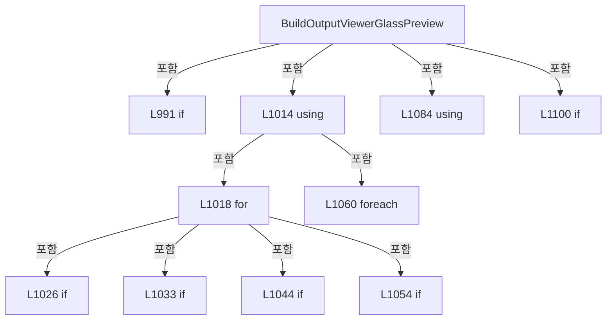

변경 전 점검: 입력/반환 타입, 위 호출자, 예외/취소 경로, 공유 상태와 저장·전송 소비자를 함께 확인합니다. 값의 단위나 물리 방향을 이름만으로 확정하지 않습니다.

### LocalFunctionStatement `ReadDistortionValue` · L996–999

[Drilling.UI/Menu/Menus/CMenuCorrection.cs:996–999](https://github.com/kjuws10-rgb/A3Drilling/blob/5aee8e58439c9b455cae7c9593c9be986c3e682e/Drilling.UI/Menu/Menus/CMenuCorrection.cs#L996-L999)

| 항목 | 실제 추출 값 |
| --- | --- |
| 서명 | double? ReadDistortionValue(string) |
| 접근/수식자 | Private /  |
| 반환/값 타입 | double? |
| 소속 타입 | NamedType:Drilling.UI.Menu.Menus.CMenuCorrection |

입력 계약:

| 이름 | 타입 | 전달 | 선택/기본값 |
| --- | --- | --- | --- |
| key | string | None | False /  |

현재 부분 분석에서 직접 연결된 호출자는 없습니다. XAML/이벤트/인터페이스·델리게이트·외부 진입을 추가 확인해야 하며, 미사용으로 판정한 것이 아닙니다.

호출하는 대상과 해석 범위:

| 원본 행 | 표현식 | 분석 상태 | 대상/소스 위치 |
| --- | --- | --- | --- |
| 998 | ReadOutputViewerNullableDouble | resolved | double? Drilling.UI.Menu.Menus.CMenuCorrection.ReadOutputViewerNullableDouble(System.Collections.Generic.IReadOnlyDictionary<string, string>, string) · Drilling.UI/Menu/Menus/CMenuCorrection.cs:1227 |

본문의 실제 연산·분기·예외·반환 순서(원문 위치 순):

| 원본 행 | 종류 | 주석 해설 |
| --- | --- | --- |
| 998 | call | 함수·델리게이트 또는 객체 생성자를 호출합니다: ReadOutputViewerNullableDouble(parameters, key) |
| 998 | return | 호출자에게 값 또는 제어를 반환합니다: return ReadOutputViewerNullableDouble(parameters, key); |

변경 전 점검: 입력/반환 타입, 위 호출자, 예외/취소 경로, 공유 상태와 저장·전송 소비자를 함께 확인합니다. 값의 단위나 물리 방향을 이름만으로 확정하지 않습니다.

### MethodDeclaration `BuildOutputViewerCellBoundaryGeometry` · L1108–1143

[Drilling.UI/Menu/Menus/CMenuCorrection.cs:1108–1143](https://github.com/kjuws10-rgb/A3Drilling/blob/5aee8e58439c9b455cae7c9593c9be986c3e682e/Drilling.UI/Menu/Menus/CMenuCorrection.cs#L1108-L1143)

| 항목 | 실제 추출 값 |
| --- | --- |
| 서명 | StreamGeometry? Drilling.UI.Menu.Menus.CMenuCorrection.BuildOutputViewerCellBoundaryGeometry(double, double, double, double, int, int, double, double, double) |
| 접근/수식자 | Private / private, static |
| 반환/값 타입 | StreamGeometry? |
| 소속 타입 | NamedType:Drilling.UI.Menu.Menus.CMenuCorrection |

입력 계약:

| 이름 | 타입 | 전달 | 선택/기본값 |
| --- | --- | --- | --- |
| frameLeft | double | None | False /  |
| frameTop | double | None | False /  |
| scale | double | None | False /  |
| pixelSize | double | None | False /  |
| pixelCountX | int | None | False /  |
| pixelCountY | int | None | False /  |
| firstX | double | None | False /  |
| firstY | double | None | False /  |
| rotationDegrees | double | None | False /  |

정적 호출자로 확인된 위치:

| 호출 파일/행 | 호출 표현식 | 런타임 분기 가능 |
| --- | --- | --- |
| [Drilling.UI/Menu/Menus/CMenuCorrection.ReviewData.Display.cs:696–705](https://github.com/kjuws10-rgb/A3Drilling/blob/5aee8e58439c9b455cae7c9593c9be986c3e682e/Drilling.UI/Menu/Menus/CMenuCorrection.ReviewData.Display.cs#L696-L705) | BuildOutputViewerCellBoundaryGeometry | False |
| [Drilling.UI/Menu/Menus/CMenuCorrection.cs:1032–1032](https://github.com/kjuws10-rgb/A3Drilling/blob/5aee8e58439c9b455cae7c9593c9be986c3e682e/Drilling.UI/Menu/Menus/CMenuCorrection.cs#L1032-L1032) | BuildOutputViewerCellBoundaryGeometry | False |

호출하는 대상과 해석 범위:

| 원본 행 | 표현식 | 분석 상태 | 대상/소스 위치 |
| --- | --- | --- | --- |
| 1110 | double.IsFinite | resolved | bool double.IsFinite(double) |
| 1116 | Math.Cos | resolved | double System.Math.Cos(double) |
| 1117 | Math.Sin | resolved | double System.Math.Sin(double) |
| 1123 | new Point | unresolved | None |
| 1124 | new Point | unresolved | None |
| 1125 | new Point | unresolved | None |
| 1126 | new Point | unresolved | None |
| 1128 | localCorners.Select(local => { var x = firstX + (local.X * cos) - (local.Y * sin); var y = firstY + (local.X * sin) + (local.Y * cos); return new Point(frameLeft + (x * scale), frameTop + (y * scale)); }).ToArray | unresolved | None |
| 1128 | localCorners.Select | candidate | OverloadResolutionFailure |
| 1132 | new Point | unresolved | None |
| 1134 | new StreamGeometry | unresolved | None |
| 1135 | geometry.Open | unresolved | None |
| 1137 | geometryContext.BeginFigure | unresolved | None |
| 1138 | geometryContext.PolyLineTo | unresolved | None |
| 1138 | canvasCorners.Skip(1).ToArray | unresolved | None |
| 1138 | canvasCorners.Skip | unresolved | None |
| 1141 | geometry.Freeze | unresolved | None |

본문의 실제 연산·분기·예외·반환 순서(원문 위치 순):

| 원본 행 | 종류 | 주석 해설 |
| --- | --- | --- |
| 1110 | call | 함수·델리게이트 또는 객체 생성자를 호출합니다: double.IsFinite(pixelSize) |
| 1110 | if | 조건에 따라 분기합니다: if (pixelCountX <= 0 &#124;&#124; pixelCountY <= 0 &#124;&#124; !double.IsFinite(pixelSize) &#124;&#124; pixelSize <= 0.0) |
| 1112 | return | 호출자에게 값 또는 제어를 반환합니다: return null; |
| 1115 | local-declaration | 지역 변수를 선언합니다: var radians = rotationDegrees * Math.PI / 180.0; |
| 1115 | variable-initializer | 변수의 초기값을 지정합니다: radians = rotationDegrees * Math.PI / 180.0 |
| 1116 | call | 함수·델리게이트 또는 객체 생성자를 호출합니다: Math.Cos(radians) |
| 1116 | local-declaration | 지역 변수를 선언합니다: var cos = Math.Cos(radians); |
| 1116 | variable-initializer | 변수의 초기값을 지정합니다: cos = Math.Cos(radians) |
| 1117 | call | 함수·델리게이트 또는 객체 생성자를 호출합니다: Math.Sin(radians) |
| 1117 | local-declaration | 지역 변수를 선언합니다: var sin = Math.Sin(radians); |
| 1117 | variable-initializer | 변수의 초기값을 지정합니다: sin = Math.Sin(radians) |
| 1118 | local-declaration | 지역 변수를 선언합니다: var halfPixel = pixelSize / 2.0; |
| 1118 | variable-initializer | 변수의 초기값을 지정합니다: halfPixel = pixelSize / 2.0 |
| 1119 | local-declaration | 지역 변수를 선언합니다: var localMaxX = ((pixelCountX - 1) * pixelSize) + halfPixel; |
| 1119 | variable-initializer | 변수의 초기값을 지정합니다: localMaxX = ((pixelCountX - 1) * pixelSize) + halfPixel |
| 1120 | local-declaration | 지역 변수를 선언합니다: var localMaxY = ((pixelCountY - 1) * pixelSize) + halfPixel; |
| 1120 | variable-initializer | 변수의 초기값을 지정합니다: localMaxY = ((pixelCountY - 1) * pixelSize) + halfPixel |
| 1121 | local-declaration | 지역 변수를 선언합니다: var localCorners = new[] { new Point(-halfPixel, -halfPixel), new Point(localMaxX, -halfPixel), new Point(localMaxX, localMaxY), new Point(-halfPixel, localMaxY) }; |
| 1121 | variable-initializer | 변수의 초기값을 지정합니다: localCorners = new[] { new Point(-halfPixel, -halfPixel), new Point(localMaxX, -halfPixel), new Point(localMaxX, localMaxY), new Point(-halfPixel, localMaxY) } |
| 1123 | call | 함수·델리게이트 또는 객체 생성자를 호출합니다: new Point(-halfPixel, -halfPixel) |
| 1124 | call | 함수·델리게이트 또는 객체 생성자를 호출합니다: new Point(localMaxX, -halfPixel) |
| 1125 | call | 함수·델리게이트 또는 객체 생성자를 호출합니다: new Point(localMaxX, localMaxY) |
| 1126 | call | 함수·델리게이트 또는 객체 생성자를 호출합니다: new Point(-halfPixel, localMaxY) |
| 1128 | call | 함수·델리게이트 또는 객체 생성자를 호출합니다: localCorners.Select(local => { var x = firstX + (local.X * cos) - (local.Y * sin); var y = firstY + (local.X * sin) + (local.Y * cos); return new Point(frameLeft + (x * scale), frameTop + (y * scale)); }).ToArray() |
| 1128 | call | 함수·델리게이트 또는 객체 생성자를 호출합니다: localCorners.Select(local => { var x = firstX + (local.X * cos) - (local.Y * sin); var y = firstY + (local.X * sin) + (local.Y * cos); return new Point(frameLeft + (x * scale), frameTop + (y * scale)); }) |
| 1128 | local-declaration | 지역 변수를 선언합니다: var canvasCorners = localCorners.Select(local => { var x = firstX + (local.X * cos) - (local.Y * sin); var y = firstY + (local.X * sin) + (local.Y * cos); return new Point(frameLeft + (x * scale), frameTop + (y * scale)); }).ToArr |
| 1128 | variable-initializer | 변수의 초기값을 지정합니다: canvasCorners = localCorners.Select(local => { var x = firstX + (local.X * cos) - (local.Y * sin); var y = firstY + (local.X * sin) + (local.Y * cos); return new Point(frameLeft + (x * scale), frameTop + (y * scale)); }).ToArray() |
| 1130 | local-declaration | 지역 변수를 선언합니다: var x = firstX + (local.X * cos) - (local.Y * sin); |
| 1130 | variable-initializer | 변수의 초기값을 지정합니다: x = firstX + (local.X * cos) - (local.Y * sin) |
| 1131 | local-declaration | 지역 변수를 선언합니다: var y = firstY + (local.X * sin) + (local.Y * cos); |
| 1131 | variable-initializer | 변수의 초기값을 지정합니다: y = firstY + (local.X * sin) + (local.Y * cos) |
| 1132 | call | 함수·델리게이트 또는 객체 생성자를 호출합니다: new Point(frameLeft + (x * scale), frameTop + (y * scale)) |
| 1132 | return | 호출자에게 값 또는 제어를 반환합니다: return new Point(frameLeft + (x * scale), frameTop + (y * scale)); |
| 1134 | call | 함수·델리게이트 또는 객체 생성자를 호출합니다: new StreamGeometry() |
| 1134 | local-declaration | 지역 변수를 선언합니다: var geometry = new StreamGeometry(); |
| 1134 | variable-initializer | 변수의 초기값을 지정합니다: geometry = new StreamGeometry() |
| 1135 | call | 함수·델리게이트 또는 객체 생성자를 호출합니다: geometry.Open() |
| 1135 | variable-initializer | 변수의 초기값을 지정합니다: geometryContext = geometry.Open() |
| 1135 | using | 자원 사용과 정리 범위를 지정합니다: using (var geometryContext = geometry.Open()) |
| 1137 | call | 함수·델리게이트 또는 객체 생성자를 호출합니다: geometryContext.BeginFigure(canvasCorners[0], false, true) |
| 1138 | call | 함수·델리게이트 또는 객체 생성자를 호출합니다: geometryContext.PolyLineTo(canvasCorners.Skip(1).ToArray(), true, false) |
| 1138 | call | 함수·델리게이트 또는 객체 생성자를 호출합니다: canvasCorners.Skip(1).ToArray() |
| 1138 | call | 함수·델리게이트 또는 객체 생성자를 호출합니다: canvasCorners.Skip(1) |
| 1141 | call | 함수·델리게이트 또는 객체 생성자를 호출합니다: geometry.Freeze() |
| 1142 | return | 호출자에게 값 또는 제어를 반환합니다: return geometry; |

제어 구문의 포함 구조(실제 실행 순서/CFG가 아닌 구문 탐색 그림):

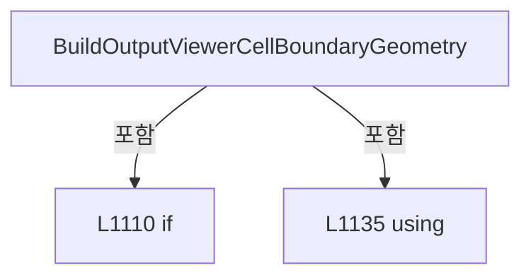

변경 전 점검: 입력/반환 타입, 위 호출자, 예외/취소 경로, 공유 상태와 저장·전송 소비자를 함께 확인합니다. 값의 단위나 물리 방향을 이름만으로 확정하지 않습니다.

### MethodDeclaration `DrawOutputViewerPreviewAxisIndicator` · L1145–1166

[Drilling.UI/Menu/Menus/CMenuCorrection.cs:1145–1166](https://github.com/kjuws10-rgb/A3Drilling/blob/5aee8e58439c9b455cae7c9593c9be986c3e682e/Drilling.UI/Menu/Menus/CMenuCorrection.cs#L1145-L1166)

| 항목 | 실제 추출 값 |
| --- | --- |
| 서명 | void Drilling.UI.Menu.Menus.CMenuCorrection.DrawOutputViewerPreviewAxisIndicator(DrawingContext, Rect) |
| 접근/수식자 | Private / private, static |
| 반환/값 타입 | void |
| 소속 타입 | NamedType:Drilling.UI.Menu.Menus.CMenuCorrection |

입력 계약:

| 이름 | 타입 | 전달 | 선택/기본값 |
| --- | --- | --- | --- |
| context | DrawingContext | None | False /  |
| glassRect | Rect | None | False /  |

현재 부분 분석에서 직접 연결된 호출자는 없습니다. XAML/이벤트/인터페이스·델리게이트·외부 진입을 추가 확인해야 하며, 미사용으로 판정한 것이 아닙니다.

호출하는 대상과 해석 범위:

| 원본 행 | 표현식 | 분석 상태 | 대상/소스 위치 |
| --- | --- | --- | --- |
| 1147 | new SolidColorBrush | unresolved | None |
| 1147 | Color.FromRgb | unresolved | None |
| 1148 | axisBrush.Freeze | unresolved | None |
| 1149 | new Pen | unresolved | None |
| 1154 | axisPen.Freeze | unresolved | None |
| 1155 | new Point | unresolved | None |
| 1155 | Math.Max | candidate | OverloadResolutionFailure |
| 1155 | Math.Max | candidate | OverloadResolutionFailure |
| 1156 | new Point | unresolved | None |
| 1157 | new Point | unresolved | None |
| 1158 | context.DrawLine | unresolved | None |
| 1159 | context.DrawLine | unresolved | None |
| 1159 | new Point | unresolved | None |
| 1160 | context.DrawLine | unresolved | None |
| 1160 | new Point | unresolved | None |
| 1161 | context.DrawLine | unresolved | None |
| 1162 | context.DrawLine | unresolved | None |
| 1162 | new Point | unresolved | None |
| 1163 | context.DrawLine | unresolved | None |
| 1163 | new Point | unresolved | None |
| 1164 | DrawOutputViewerPreviewAxisText | candidate | OverloadResolutionFailure |
| 1164 | new Point | unresolved | None |
| 1164 | Math.Max | candidate | OverloadResolutionFailure |
| 1165 | DrawOutputViewerPreviewAxisText | candidate | OverloadResolutionFailure |
| 1165 | new Point | unresolved | None |

본문의 실제 연산·분기·예외·반환 순서(원문 위치 순):

| 원본 행 | 종류 | 주석 해설 |
| --- | --- | --- |
| 1147 | call | 함수·델리게이트 또는 객체 생성자를 호출합니다: new SolidColorBrush(Color.FromRgb(248, 250, 252)) |
| 1147 | call | 함수·델리게이트 또는 객체 생성자를 호출합니다: Color.FromRgb(248, 250, 252) |
| 1147 | local-declaration | 지역 변수를 선언합니다: var axisBrush = new SolidColorBrush(Color.FromRgb(248, 250, 252)); |
| 1147 | variable-initializer | 변수의 초기값을 지정합니다: axisBrush = new SolidColorBrush(Color.FromRgb(248, 250, 252)) |
| 1148 | call | 함수·델리게이트 또는 객체 생성자를 호출합니다: axisBrush.Freeze() |
| 1149 | call | 함수·델리게이트 또는 객체 생성자를 호출합니다: new Pen(axisBrush, 2.0) { StartLineCap = PenLineCap.Round, EndLineCap = PenLineCap.Round } |
| 1149 | local-declaration | 지역 변수를 선언합니다: var axisPen = new Pen(axisBrush, 2.0) { StartLineCap = PenLineCap.Round, EndLineCap = PenLineCap.Round }; |
| 1149 | variable-initializer | 변수의 초기값을 지정합니다: axisPen = new Pen(axisBrush, 2.0) { StartLineCap = PenLineCap.Round, EndLineCap = PenLineCap.Round } |
| 1151 | assignment | 값을 대상에 대입합니다: StartLineCap = PenLineCap.Round |
| 1152 | assignment | 값을 대상에 대입합니다: EndLineCap = PenLineCap.Round |
| 1154 | call | 함수·델리게이트 또는 객체 생성자를 호출합니다: axisPen.Freeze() |
| 1155 | call | 함수·델리게이트 또는 객체 생성자를 호출합니다: new Point(Math.Max(4.0, glassRect.Left - 8.0), Math.Max(4.0, glassRect.Top - 12.0)) |
| 1155 | call | 함수·델리게이트 또는 객체 생성자를 호출합니다: Math.Max(4.0, glassRect.Left - 8.0) |
| 1155 | call | 함수·델리게이트 또는 객체 생성자를 호출합니다: Math.Max(4.0, glassRect.Top - 12.0) |
| 1155 | local-declaration | 지역 변수를 선언합니다: var origin = new Point(Math.Max(4.0, glassRect.Left - 8.0), Math.Max(4.0, glassRect.Top - 12.0)); |
| 1155 | variable-initializer | 변수의 초기값을 지정합니다: origin = new Point(Math.Max(4.0, glassRect.Left - 8.0), Math.Max(4.0, glassRect.Top - 12.0)) |
| 1156 | call | 함수·델리게이트 또는 객체 생성자를 호출합니다: new Point(origin.X + 46.0, origin.Y) |
| 1156 | local-declaration | 지역 변수를 선언합니다: var xEnd = new Point(origin.X + 46.0, origin.Y); |
| 1156 | variable-initializer | 변수의 초기값을 지정합니다: xEnd = new Point(origin.X + 46.0, origin.Y) |
| 1157 | call | 함수·델리게이트 또는 객체 생성자를 호출합니다: new Point(origin.X, origin.Y + 42.0) |
| 1157 | local-declaration | 지역 변수를 선언합니다: var yEnd = new Point(origin.X, origin.Y + 42.0); |
| 1157 | variable-initializer | 변수의 초기값을 지정합니다: yEnd = new Point(origin.X, origin.Y + 42.0) |
| 1158 | call | 함수·델리게이트 또는 객체 생성자를 호출합니다: context.DrawLine(axisPen, origin, xEnd) |
| 1159 | call | 함수·델리게이트 또는 객체 생성자를 호출합니다: context.DrawLine(axisPen, new Point(xEnd.X - 8.0, xEnd.Y - 4.0), xEnd) |
| 1159 | call | 함수·델리게이트 또는 객체 생성자를 호출합니다: new Point(xEnd.X - 8.0, xEnd.Y - 4.0) |
| 1160 | call | 함수·델리게이트 또는 객체 생성자를 호출합니다: context.DrawLine(axisPen, new Point(xEnd.X - 8.0, xEnd.Y + 4.0), xEnd) |
| 1160 | call | 함수·델리게이트 또는 객체 생성자를 호출합니다: new Point(xEnd.X - 8.0, xEnd.Y + 4.0) |
| 1161 | call | 함수·델리게이트 또는 객체 생성자를 호출합니다: context.DrawLine(axisPen, origin, yEnd) |
| 1162 | call | 함수·델리게이트 또는 객체 생성자를 호출합니다: context.DrawLine(axisPen, new Point(yEnd.X - 4.0, yEnd.Y - 8.0), yEnd) |
| 1162 | call | 함수·델리게이트 또는 객체 생성자를 호출합니다: new Point(yEnd.X - 4.0, yEnd.Y - 8.0) |
| 1163 | call | 함수·델리게이트 또는 객체 생성자를 호출합니다: context.DrawLine(axisPen, new Point(yEnd.X + 4.0, yEnd.Y - 8.0), yEnd) |
| 1163 | call | 함수·델리게이트 또는 객체 생성자를 호출합니다: new Point(yEnd.X + 4.0, yEnd.Y - 8.0) |
| 1164 | call | 함수·델리게이트 또는 객체 생성자를 호출합니다: DrawOutputViewerPreviewAxisText(context, "X+", new Point(xEnd.X + 4.0, Math.Max(2.0, xEnd.Y - 10.0)), axisBrush) |
| 1164 | call | 함수·델리게이트 또는 객체 생성자를 호출합니다: new Point(xEnd.X + 4.0, Math.Max(2.0, xEnd.Y - 10.0)) |
| 1164 | call | 함수·델리게이트 또는 객체 생성자를 호출합니다: Math.Max(2.0, xEnd.Y - 10.0) |
| 1165 | call | 함수·델리게이트 또는 객체 생성자를 호출합니다: DrawOutputViewerPreviewAxisText(context, "Y+", new Point(yEnd.X + 4.0, yEnd.Y - 4.0), axisBrush) |
| 1165 | call | 함수·델리게이트 또는 객체 생성자를 호출합니다: new Point(yEnd.X + 4.0, yEnd.Y - 4.0) |

변경 전 점검: 입력/반환 타입, 위 호출자, 예외/취소 경로, 공유 상태와 저장·전송 소비자를 함께 확인합니다. 값의 단위나 물리 방향을 이름만으로 확정하지 않습니다.

### MethodDeclaration `DrawOutputViewerPreviewAxisText` · L1168–1172

[Drilling.UI/Menu/Menus/CMenuCorrection.cs:1168–1172](https://github.com/kjuws10-rgb/A3Drilling/blob/5aee8e58439c9b455cae7c9593c9be986c3e682e/Drilling.UI/Menu/Menus/CMenuCorrection.cs#L1168-L1172)

| 항목 | 실제 추출 값 |
| --- | --- |
| 서명 | void Drilling.UI.Menu.Menus.CMenuCorrection.DrawOutputViewerPreviewAxisText(DrawingContext, string, Point, Brush) |
| 접근/수식자 | Private / private, static |
| 반환/값 타입 | void |
| 소속 타입 | NamedType:Drilling.UI.Menu.Menus.CMenuCorrection |

입력 계약:

| 이름 | 타입 | 전달 | 선택/기본값 |
| --- | --- | --- | --- |
| context | DrawingContext | None | False /  |
| text | string | None | False /  |
| point | Point | None | False /  |
| brush | Brush | None | False /  |

현재 부분 분석에서 직접 연결된 호출자는 없습니다. XAML/이벤트/인터페이스·델리게이트·외부 진입을 추가 확인해야 하며, 미사용으로 판정한 것이 아닙니다.

호출하는 대상과 해석 범위:

| 원본 행 | 표현식 | 분석 상태 | 대상/소스 위치 |
| --- | --- | --- | --- |
| 1170 | new FormattedText | unresolved | None |
| 1170 | new Typeface | unresolved | None |
| 1171 | context.DrawText | unresolved | None |

본문의 실제 연산·분기·예외·반환 순서(원문 위치 순):

| 원본 행 | 종류 | 주석 해설 |
| --- | --- | --- |
| 1170 | call | 함수·델리게이트 또는 객체 생성자를 호출합니다: new FormattedText(text, CultureInfo.InvariantCulture, FlowDirection.LeftToRight, new Typeface("Segoe UI Semibold"), 13.0, brush, 1.0) |
| 1170 | call | 함수·델리게이트 또는 객체 생성자를 호출합니다: new Typeface("Segoe UI Semibold") |
| 1170 | local-declaration | 지역 변수를 선언합니다: var label = new FormattedText(text, CultureInfo.InvariantCulture, FlowDirection.LeftToRight, new Typeface("Segoe UI Semibold"), 13.0, brush, 1.0); |
| 1170 | variable-initializer | 변수의 초기값을 지정합니다: label = new FormattedText(text, CultureInfo.InvariantCulture, FlowDirection.LeftToRight, new Typeface("Segoe UI Semibold"), 13.0, brush, 1.0) |
| 1171 | call | 함수·델리게이트 또는 객체 생성자를 호출합니다: context.DrawText(label, point) |

변경 전 점검: 입력/반환 타입, 위 호출자, 예외/취소 경로, 공유 상태와 저장·전송 소비자를 함께 확인합니다. 값의 단위나 물리 방향을 이름만으로 확정하지 않습니다.

### MethodDeclaration `BuildOutputViewerCoordinateParameterMap` · L1174–1184

[Drilling.UI/Menu/Menus/CMenuCorrection.cs:1174–1184](https://github.com/kjuws10-rgb/A3Drilling/blob/5aee8e58439c9b455cae7c9593c9be986c3e682e/Drilling.UI/Menu/Menus/CMenuCorrection.cs#L1174-L1184)

| 항목 | 실제 추출 값 |
| --- | --- |
| 서명 | System.Collections.Generic.IReadOnlyDictionary<string, string> Drilling.UI.Menu.Menus.CMenuCorrection.BuildOutputViewerCoordinateParameterMap(System.Collections.Generic.IReadOnlyDictionary<string, string>) |
| 접근/수식자 | Private / private, static |
| 반환/값 타입 | System.Collections.Generic.IReadOnlyDictionary<string, string> |
| 소속 타입 | NamedType:Drilling.UI.Menu.Menus.CMenuCorrection |

입력 계약:

| 이름 | 타입 | 전달 | 선택/기본값 |
| --- | --- | --- | --- |
| parameters | System.Collections.Generic.IReadOnlyDictionary<string, string> | None | False /  |

정적 호출자로 확인된 위치:

| 호출 파일/행 | 호출 표현식 | 런타임 분기 가능 |
| --- | --- | --- |
| [Drilling.UI/Menu/Menus/CMenuCorrection.cs:632–632](https://github.com/kjuws10-rgb/A3Drilling/blob/5aee8e58439c9b455cae7c9593c9be986c3e682e/Drilling.UI/Menu/Menus/CMenuCorrection.cs#L632-L632) | BuildOutputViewerCoordinateParameterMap | False |

호출하는 대상과 해석 범위:

| 원본 행 | 표현식 | 분석 상태 | 대상/소스 위치 |
| --- | --- | --- | --- |
| 1176 | new Dictionary<string, string> | resolved | System.Collections.Generic.Dictionary<string, string>.Dictionary(System.Collections.Generic.IEnumerable<System.Collections.Generic.KeyValuePair<string, string>>, System.Collections.Generic.IEqualityComparer<string>?) |
| 1177 | Math.Clamp | resolved | int System.Math.Clamp(int, int, int) |
| 1177 | ReadOutputViewerInt | resolved | int Drilling.UI.Menu.Menus.CMenuCorrection.ReadOutputViewerInt(System.Collections.Generic.IReadOnlyDictionary<string, string>, int, params string[]) · Drilling.UI/Menu/Menus/CMenuCorrection.cs:1186 |

본문의 실제 연산·분기·예외·반환 순서(원문 위치 순):

| 원본 행 | 종류 | 주석 해설 |
| --- | --- | --- |
| 1176 | call | 함수·델리게이트 또는 객체 생성자를 호출합니다: new Dictionary<string, string>(parameters, StringComparer.OrdinalIgnoreCase) |
| 1176 | local-declaration | 지역 변수를 선언합니다: var viewerParameters = new Dictionary<string, string>(parameters, StringComparer.OrdinalIgnoreCase); |
| 1176 | variable-initializer | 변수의 초기값을 지정합니다: viewerParameters = new Dictionary<string, string>(parameters, StringComparer.OrdinalIgnoreCase) |
| 1177 | call | 함수·델리게이트 또는 객체 생성자를 호출합니다: Math.Clamp(ReadOutputViewerInt(viewerParameters, 8, "HEAD_COUNT"), 1, 8) |
| 1177 | call | 함수·델리게이트 또는 객체 생성자를 호출합니다: ReadOutputViewerInt(viewerParameters, 8, "HEAD_COUNT") |
| 1177 | local-declaration | 지역 변수를 선언합니다: var headCount = Math.Clamp(ReadOutputViewerInt(viewerParameters, 8, "HEAD_COUNT"), 1, 8); |
| 1177 | variable-initializer | 변수의 초기값을 지정합니다: headCount = Math.Clamp(ReadOutputViewerInt(viewerParameters, 8, "HEAD_COUNT"), 1, 8) |
| 1178 | variable-initializer | 변수의 초기값을 지정합니다: headNo = 1 |
| 1178 | for | 초기화·조건·증감이 있는 반복입니다: for (var headNo = 1; headNo <= headCount; headNo++) |
| 1180 | assignment | 값을 대상에 대입합니다: viewerParameters[$"H{headNo:00}_USE"] = "ON" |
| 1183 | return | 호출자에게 값 또는 제어를 반환합니다: return viewerParameters; |

제어 구문의 포함 구조(실제 실행 순서/CFG가 아닌 구문 탐색 그림):

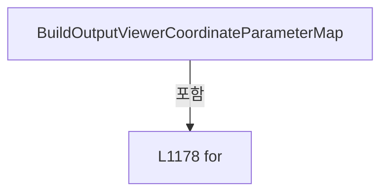

변경 전 점검: 입력/반환 타입, 위 호출자, 예외/취소 경로, 공유 상태와 저장·전송 소비자를 함께 확인합니다. 값의 단위나 물리 방향을 이름만으로 확정하지 않습니다.

### MethodDeclaration `ReadOutputViewerInt` · L1186–1207

[Drilling.UI/Menu/Menus/CMenuCorrection.cs:1186–1207](https://github.com/kjuws10-rgb/A3Drilling/blob/5aee8e58439c9b455cae7c9593c9be986c3e682e/Drilling.UI/Menu/Menus/CMenuCorrection.cs#L1186-L1207)

| 항목 | 실제 추출 값 |
| --- | --- |
| 서명 | int Drilling.UI.Menu.Menus.CMenuCorrection.ReadOutputViewerInt(System.Collections.Generic.IReadOnlyDictionary<string, string>, int, params string[]) |
| 접근/수식자 | Private / private, static |
| 반환/값 타입 | int |
| 소속 타입 | NamedType:Drilling.UI.Menu.Menus.CMenuCorrection |

입력 계약:

| 이름 | 타입 | 전달 | 선택/기본값 |
| --- | --- | --- | --- |
| parameters | System.Collections.Generic.IReadOnlyDictionary<string, string> | None | False /  |
| defaultValue | int | None | False /  |
| keys | string[] | None | False /  |

정적 호출자로 확인된 위치:

| 호출 파일/행 | 호출 표현식 | 런타임 분기 가능 |
| --- | --- | --- |
| [Drilling.UI/Menu/Menus/CMenuCorrection.ReviewData.Display.cs:181–181](https://github.com/kjuws10-rgb/A3Drilling/blob/5aee8e58439c9b455cae7c9593c9be986c3e682e/Drilling.UI/Menu/Menus/CMenuCorrection.ReviewData.Display.cs#L181-L181) | ReadOutputViewerInt | False |
| [Drilling.UI/Menu/Menus/CMenuCorrection.ReviewData.Display.cs:310–310](https://github.com/kjuws10-rgb/A3Drilling/blob/5aee8e58439c9b455cae7c9593c9be986c3e682e/Drilling.UI/Menu/Menus/CMenuCorrection.ReviewData.Display.cs#L310-L310) | ReadOutputViewerInt | False |
| [Drilling.UI/Menu/Menus/CMenuCorrection.ReviewData.Offset.cs:223–223](https://github.com/kjuws10-rgb/A3Drilling/blob/5aee8e58439c9b455cae7c9593c9be986c3e682e/Drilling.UI/Menu/Menus/CMenuCorrection.ReviewData.Offset.cs#L223-L223) | ReadOutputViewerInt | False |
| [Drilling.UI/Menu/Menus/CMenuCorrection.ReviewData.Offset.cs:368–368](https://github.com/kjuws10-rgb/A3Drilling/blob/5aee8e58439c9b455cae7c9593c9be986c3e682e/Drilling.UI/Menu/Menus/CMenuCorrection.ReviewData.Offset.cs#L368-L368) | ReadOutputViewerInt | False |
| [Drilling.UI/Menu/Menus/CMenuCorrection.cs:595–595](https://github.com/kjuws10-rgb/A3Drilling/blob/5aee8e58439c9b455cae7c9593c9be986c3e682e/Drilling.UI/Menu/Menus/CMenuCorrection.cs#L595-L595) | ReadOutputViewerInt | False |
| [Drilling.UI/Menu/Menus/CMenuCorrection.cs:989–989](https://github.com/kjuws10-rgb/A3Drilling/blob/5aee8e58439c9b455cae7c9593c9be986c3e682e/Drilling.UI/Menu/Menus/CMenuCorrection.cs#L989-L989) | ReadOutputViewerInt | False |
| [Drilling.UI/Menu/Menus/CMenuCorrection.cs:1177–1177](https://github.com/kjuws10-rgb/A3Drilling/blob/5aee8e58439c9b455cae7c9593c9be986c3e682e/Drilling.UI/Menu/Menus/CMenuCorrection.cs#L1177-L1177) | ReadOutputViewerInt | False |

호출하는 대상과 해석 범위:

| 원본 행 | 표현식 | 분석 상태 | 대상/소스 위치 |
| --- | --- | --- | --- |
| 1190 | parameters.TryGetValue | resolved · 동적 구현 선택 가능 | bool System.Collections.Generic.IReadOnlyDictionary<string, string>.TryGetValue(string, out string) |
| 1195 | int.TryParse | resolved | bool int.TryParse(string?, System.Globalization.NumberStyles, System.IFormatProvider?, out int) |
| 1200 | double.TryParse | resolved | bool double.TryParse(string?, System.Globalization.NumberStyles, System.IFormatProvider?, out double) |
| 1202 | Math.Round | resolved | double System.Math.Round(double) |

본문의 실제 연산·분기·예외·반환 순서(원문 위치 순):

| 원본 행 | 종류 | 주석 해설 |
| --- | --- | --- |
| 1188 | foreach | 컬렉션 요소를 순회합니다: foreach (var key in keys) |
| 1190 | call | 함수·델리게이트 또는 객체 생성자를 호출합니다: parameters.TryGetValue(key, out var value) |
| 1190 | if | 조건에 따라 분기합니다: if (!parameters.TryGetValue(key, out var value)) |
| 1192 | continue | 다음 반복으로 진행합니다: continue; |
| 1195 | call | 함수·델리게이트 또는 객체 생성자를 호출합니다: int.TryParse(value, NumberStyles.Integer, CultureInfo.InvariantCulture, out var intResult) |
| 1195 | if | 조건에 따라 분기합니다: if (int.TryParse(value, NumberStyles.Integer, CultureInfo.InvariantCulture, out var intResult)) |
| 1197 | return | 호출자에게 값 또는 제어를 반환합니다: return intResult; |
| 1200 | call | 함수·델리게이트 또는 객체 생성자를 호출합니다: double.TryParse(value, NumberStyles.Float, CultureInfo.InvariantCulture, out var doubleResult) |
| 1200 | if | 조건에 따라 분기합니다: if (double.TryParse(value, NumberStyles.Float, CultureInfo.InvariantCulture, out var doubleResult)) |
| 1202 | call | 함수·델리게이트 또는 객체 생성자를 호출합니다: Math.Round(doubleResult) |
| 1202 | return | 호출자에게 값 또는 제어를 반환합니다: return (int)Math.Round(doubleResult); |
| 1206 | return | 호출자에게 값 또는 제어를 반환합니다: return defaultValue; |

제어 구문의 포함 구조(실제 실행 순서/CFG가 아닌 구문 탐색 그림):

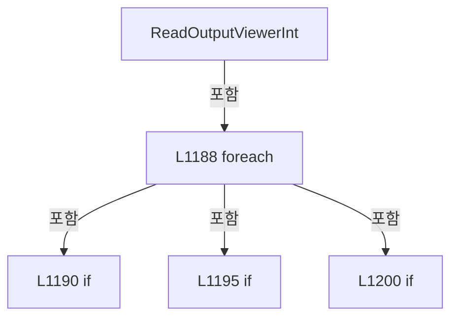

변경 전 점검: 입력/반환 타입, 위 호출자, 예외/취소 경로, 공유 상태와 저장·전송 소비자를 함께 확인합니다. 값의 단위나 물리 방향을 이름만으로 확정하지 않습니다.

### MethodDeclaration `ReadOutputViewerDouble` · L1209–1225

[Drilling.UI/Menu/Menus/CMenuCorrection.cs:1209–1225](https://github.com/kjuws10-rgb/A3Drilling/blob/5aee8e58439c9b455cae7c9593c9be986c3e682e/Drilling.UI/Menu/Menus/CMenuCorrection.cs#L1209-L1225)

| 항목 | 실제 추출 값 |
| --- | --- |
| 서명 | double Drilling.UI.Menu.Menus.CMenuCorrection.ReadOutputViewerDouble(System.Collections.Generic.IReadOnlyDictionary<string, string>, double, params string[]) |
| 접근/수식자 | Private / private, static |
| 반환/값 타입 | double |
| 소속 타입 | NamedType:Drilling.UI.Menu.Menus.CMenuCorrection |

입력 계약:

| 이름 | 타입 | 전달 | 선택/기본값 |
| --- | --- | --- | --- |
| parameters | System.Collections.Generic.IReadOnlyDictionary<string, string> | None | False /  |
| defaultValue | double | None | False /  |
| keys | string[] | None | False /  |

정적 호출자로 확인된 위치:

| 호출 파일/행 | 호출 표현식 | 런타임 분기 가능 |
| --- | --- | --- |
| [Drilling.UI/Menu/Menus/CMenuCorrection.ReviewData.Display.cs:309–309](https://github.com/kjuws10-rgb/A3Drilling/blob/5aee8e58439c9b455cae7c9593c9be986c3e682e/Drilling.UI/Menu/Menus/CMenuCorrection.ReviewData.Display.cs#L309-L309) | ReadOutputViewerDouble | False |
| [Drilling.UI/Menu/Menus/CMenuCorrection.ReviewData.Display.cs:311–311](https://github.com/kjuws10-rgb/A3Drilling/blob/5aee8e58439c9b455cae7c9593c9be986c3e682e/Drilling.UI/Menu/Menus/CMenuCorrection.ReviewData.Display.cs#L311-L311) | ReadOutputViewerDouble | False |
| [Drilling.UI/Menu/Menus/CMenuCorrection.ReviewData.Display.cs:312–312](https://github.com/kjuws10-rgb/A3Drilling/blob/5aee8e58439c9b455cae7c9593c9be986c3e682e/Drilling.UI/Menu/Menus/CMenuCorrection.ReviewData.Display.cs#L312-L312) | ReadOutputViewerDouble | False |
| [Drilling.UI/Menu/Menus/CMenuCorrection.ReviewData.Display.cs:319–319](https://github.com/kjuws10-rgb/A3Drilling/blob/5aee8e58439c9b455cae7c9593c9be986c3e682e/Drilling.UI/Menu/Menus/CMenuCorrection.ReviewData.Display.cs#L319-L319) | ReadOutputViewerDouble | False |
| [Drilling.UI/Menu/Menus/CMenuCorrection.ReviewData.Display.cs:320–320](https://github.com/kjuws10-rgb/A3Drilling/blob/5aee8e58439c9b455cae7c9593c9be986c3e682e/Drilling.UI/Menu/Menus/CMenuCorrection.ReviewData.Display.cs#L320-L320) | ReadOutputViewerDouble | False |
| [Drilling.UI/Menu/Menus/CMenuCorrection.ReviewData.Display.cs:321–321](https://github.com/kjuws10-rgb/A3Drilling/blob/5aee8e58439c9b455cae7c9593c9be986c3e682e/Drilling.UI/Menu/Menus/CMenuCorrection.ReviewData.Display.cs#L321-L321) | ReadOutputViewerDouble | False |
| [Drilling.UI/Menu/Menus/CMenuCorrection.ReviewData.Display.cs:658–658](https://github.com/kjuws10-rgb/A3Drilling/blob/5aee8e58439c9b455cae7c9593c9be986c3e682e/Drilling.UI/Menu/Menus/CMenuCorrection.ReviewData.Display.cs#L658-L658) | ReadOutputViewerDouble | False |
| [Drilling.UI/Menu/Menus/CMenuCorrection.ReviewData.Display.cs:659–659](https://github.com/kjuws10-rgb/A3Drilling/blob/5aee8e58439c9b455cae7c9593c9be986c3e682e/Drilling.UI/Menu/Menus/CMenuCorrection.ReviewData.Display.cs#L659-L659) | ReadOutputViewerDouble | False |
| [Drilling.UI/Menu/Menus/CMenuCorrection.ReviewData.Display.cs:681–681](https://github.com/kjuws10-rgb/A3Drilling/blob/5aee8e58439c9b455cae7c9593c9be986c3e682e/Drilling.UI/Menu/Menus/CMenuCorrection.ReviewData.Display.cs#L681-L681) | ReadOutputViewerDouble | False |
| [Drilling.UI/Menu/Menus/CMenuCorrection.ReviewData.Display.cs:682–682](https://github.com/kjuws10-rgb/A3Drilling/blob/5aee8e58439c9b455cae7c9593c9be986c3e682e/Drilling.UI/Menu/Menus/CMenuCorrection.ReviewData.Display.cs#L682-L682) | ReadOutputViewerDouble | False |
| [Drilling.UI/Menu/Menus/CMenuCorrection.ReviewData.Display.cs:683–683](https://github.com/kjuws10-rgb/A3Drilling/blob/5aee8e58439c9b455cae7c9593c9be986c3e682e/Drilling.UI/Menu/Menus/CMenuCorrection.ReviewData.Display.cs#L683-L683) | ReadOutputViewerDouble | False |
| [Drilling.UI/Menu/Menus/CMenuCorrection.ReviewData.Display.cs:703–703](https://github.com/kjuws10-rgb/A3Drilling/blob/5aee8e58439c9b455cae7c9593c9be986c3e682e/Drilling.UI/Menu/Menus/CMenuCorrection.ReviewData.Display.cs#L703-L703) | ReadOutputViewerDouble | False |
| [Drilling.UI/Menu/Menus/CMenuCorrection.ReviewData.Display.cs:704–704](https://github.com/kjuws10-rgb/A3Drilling/blob/5aee8e58439c9b455cae7c9593c9be986c3e682e/Drilling.UI/Menu/Menus/CMenuCorrection.ReviewData.Display.cs#L704-L704) | ReadOutputViewerDouble | False |
| [Drilling.UI/Menu/Menus/CMenuCorrection.ReviewData.Display.cs:705–705](https://github.com/kjuws10-rgb/A3Drilling/blob/5aee8e58439c9b455cae7c9593c9be986c3e682e/Drilling.UI/Menu/Menus/CMenuCorrection.ReviewData.Display.cs#L705-L705) | ReadOutputViewerDouble | False |
| [Drilling.UI/Menu/Menus/CMenuCorrection.cs:984–984](https://github.com/kjuws10-rgb/A3Drilling/blob/5aee8e58439c9b455cae7c9593c9be986c3e682e/Drilling.UI/Menu/Menus/CMenuCorrection.cs#L984-L984) | ReadOutputViewerDouble | False |
| [Drilling.UI/Menu/Menus/CMenuCorrection.cs:985–985](https://github.com/kjuws10-rgb/A3Drilling/blob/5aee8e58439c9b455cae7c9593c9be986c3e682e/Drilling.UI/Menu/Menus/CMenuCorrection.cs#L985-L985) | ReadOutputViewerDouble | False |
| [Drilling.UI/Menu/Menus/CMenuCorrection.cs:986–986](https://github.com/kjuws10-rgb/A3Drilling/blob/5aee8e58439c9b455cae7c9593c9be986c3e682e/Drilling.UI/Menu/Menus/CMenuCorrection.cs#L986-L986) | ReadOutputViewerDouble | False |
| [Drilling.UI/Menu/Menus/CMenuCorrection.cs:987–987](https://github.com/kjuws10-rgb/A3Drilling/blob/5aee8e58439c9b455cae7c9593c9be986c3e682e/Drilling.UI/Menu/Menus/CMenuCorrection.cs#L987-L987) | ReadOutputViewerDouble | False |
| [Drilling.UI/Menu/Menus/CMenuCorrection.cs:988–988](https://github.com/kjuws10-rgb/A3Drilling/blob/5aee8e58439c9b455cae7c9593c9be986c3e682e/Drilling.UI/Menu/Menus/CMenuCorrection.cs#L988-L988) | ReadOutputViewerDouble | False |
| [Drilling.UI/Menu/Menus/CMenuCorrection.cs:1020–1020](https://github.com/kjuws10-rgb/A3Drilling/blob/5aee8e58439c9b455cae7c9593c9be986c3e682e/Drilling.UI/Menu/Menus/CMenuCorrection.cs#L1020-L1020) | ReadOutputViewerDouble | False |
| [Drilling.UI/Menu/Menus/CMenuCorrection.cs:1021–1021](https://github.com/kjuws10-rgb/A3Drilling/blob/5aee8e58439c9b455cae7c9593c9be986c3e682e/Drilling.UI/Menu/Menus/CMenuCorrection.cs#L1021-L1021) | ReadOutputViewerDouble | False |
| [Drilling.UI/Menu/Menus/CMenuCorrection.cs:1022–1022](https://github.com/kjuws10-rgb/A3Drilling/blob/5aee8e58439c9b455cae7c9593c9be986c3e682e/Drilling.UI/Menu/Menus/CMenuCorrection.cs#L1022-L1022) | ReadOutputViewerDouble | False |

호출하는 대상과 해석 범위:

| 원본 행 | 표현식 | 분석 상태 | 대상/소스 위치 |
| --- | --- | --- | --- |
| 1213 | parameters.TryGetValue | resolved · 동적 구현 선택 가능 | bool System.Collections.Generic.IReadOnlyDictionary<string, string>.TryGetValue(string, out string) |
| 1218 | double.TryParse | resolved | bool double.TryParse(string?, System.Globalization.NumberStyles, System.IFormatProvider?, out double) |
| 1218 | double.IsFinite | resolved | bool double.IsFinite(double) |

본문의 실제 연산·분기·예외·반환 순서(원문 위치 순):

| 원본 행 | 종류 | 주석 해설 |
| --- | --- | --- |
| 1211 | foreach | 컬렉션 요소를 순회합니다: foreach (var key in keys) |
| 1213 | call | 함수·델리게이트 또는 객체 생성자를 호출합니다: parameters.TryGetValue(key, out var value) |
| 1213 | if | 조건에 따라 분기합니다: if (!parameters.TryGetValue(key, out var value)) |
| 1215 | continue | 다음 반복으로 진행합니다: continue; |
| 1218 | call | 함수·델리게이트 또는 객체 생성자를 호출합니다: double.TryParse(value, NumberStyles.Float, CultureInfo.InvariantCulture, out var result) |
| 1218 | call | 함수·델리게이트 또는 객체 생성자를 호출합니다: double.IsFinite(result) |
| 1218 | if | 조건에 따라 분기합니다: if (double.TryParse(value, NumberStyles.Float, CultureInfo.InvariantCulture, out var result) && double.IsFinite(result)) |
| 1220 | return | 호출자에게 값 또는 제어를 반환합니다: return result; |
| 1224 | return | 호출자에게 값 또는 제어를 반환합니다: return defaultValue; |

제어 구문의 포함 구조(실제 실행 순서/CFG가 아닌 구문 탐색 그림):

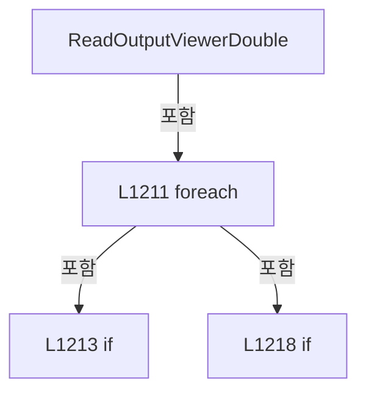

변경 전 점검: 입력/반환 타입, 위 호출자, 예외/취소 경로, 공유 상태와 저장·전송 소비자를 함께 확인합니다. 값의 단위나 물리 방향을 이름만으로 확정하지 않습니다.

### MethodDeclaration `ReadOutputViewerNullableDouble` · L1227–1230

[Drilling.UI/Menu/Menus/CMenuCorrection.cs:1227–1230](https://github.com/kjuws10-rgb/A3Drilling/blob/5aee8e58439c9b455cae7c9593c9be986c3e682e/Drilling.UI/Menu/Menus/CMenuCorrection.cs#L1227-L1230)

| 항목 | 실제 추출 값 |
| --- | --- |
| 서명 | double? Drilling.UI.Menu.Menus.CMenuCorrection.ReadOutputViewerNullableDouble(System.Collections.Generic.IReadOnlyDictionary<string, string>, string) |
| 접근/수식자 | Private / private, static |
| 반환/값 타입 | double? |
| 소속 타입 | NamedType:Drilling.UI.Menu.Menus.CMenuCorrection |

입력 계약:

| 이름 | 타입 | 전달 | 선택/기본값 |
| --- | --- | --- | --- |
| parameters | System.Collections.Generic.IReadOnlyDictionary<string, string> | None | False /  |
| key | string | None | False /  |

정적 호출자로 확인된 위치:

| 호출 파일/행 | 호출 표현식 | 런타임 분기 가능 |
| --- | --- | --- |
| [Drilling.UI/Menu/Menus/CMenuCorrection.cs:998–998](https://github.com/kjuws10-rgb/A3Drilling/blob/5aee8e58439c9b455cae7c9593c9be986c3e682e/Drilling.UI/Menu/Menus/CMenuCorrection.cs#L998-L998) | ReadOutputViewerNullableDouble | False |

호출하는 대상과 해석 범위:

| 원본 행 | 표현식 | 분석 상태 | 대상/소스 위치 |
| --- | --- | --- | --- |
| 1229 | parameters.TryGetValue | resolved · 동적 구현 선택 가능 | bool System.Collections.Generic.IReadOnlyDictionary<string, string>.TryGetValue(string, out string) |
| 1229 | double.TryParse | resolved | bool double.TryParse(string?, System.Globalization.NumberStyles, System.IFormatProvider?, out double) |
| 1229 | double.IsFinite | resolved | bool double.IsFinite(double) |

본문의 실제 연산·분기·예외·반환 순서(원문 위치 순):

| 원본 행 | 종류 | 주석 해설 |
| --- | --- | --- |
| 1229 | call | 함수·델리게이트 또는 객체 생성자를 호출합니다: parameters.TryGetValue(key, out var value) |
| 1229 | call | 함수·델리게이트 또는 객체 생성자를 호출합니다: double.TryParse(value, NumberStyles.Float, CultureInfo.InvariantCulture, out var result) |
| 1229 | call | 함수·델리게이트 또는 객체 생성자를 호출합니다: double.IsFinite(result) |
| 1229 | conditional-expression | 조건에 따라 결과식을 선택합니다: parameters.TryGetValue(key, out var value) && double.TryParse(value, NumberStyles.Float, CultureInfo.InvariantCulture, out var result) && double.IsFinite(result) ? result : null |
| 1229 | return | 호출자에게 값 또는 제어를 반환합니다: return parameters.TryGetValue(key, out var value) && double.TryParse(value, NumberStyles.Float, CultureInfo.InvariantCulture, out var result) && double.IsFinite(result) ? result : null; |

변경 전 점검: 입력/반환 타입, 위 호출자, 예외/취소 경로, 공유 상태와 저장·전송 소비자를 함께 확인합니다. 값의 단위나 물리 방향을 이름만으로 확정하지 않습니다.

### MethodDeclaration `FormatOutputViewerPreviewDouble` · L1232–1235

[Drilling.UI/Menu/Menus/CMenuCorrection.cs:1232–1235](https://github.com/kjuws10-rgb/A3Drilling/blob/5aee8e58439c9b455cae7c9593c9be986c3e682e/Drilling.UI/Menu/Menus/CMenuCorrection.cs#L1232-L1235)

| 항목 | 실제 추출 값 |
| --- | --- |
| 서명 | string Drilling.UI.Menu.Menus.CMenuCorrection.FormatOutputViewerPreviewDouble(double) |
| 접근/수식자 | Private / private, static |
| 반환/값 타입 | string |
| 소속 타입 | NamedType:Drilling.UI.Menu.Menus.CMenuCorrection |

입력 계약:

| 이름 | 타입 | 전달 | 선택/기본값 |
| --- | --- | --- | --- |
| value | double | None | False /  |

정적 호출자로 확인된 위치:

| 호출 파일/행 | 호출 표현식 | 런타임 분기 가능 |
| --- | --- | --- |
| [Drilling.UI/Menu/Menus/CMenuCorrection.cs:1099–1099](https://github.com/kjuws10-rgb/A3Drilling/blob/5aee8e58439c9b455cae7c9593c9be986c3e682e/Drilling.UI/Menu/Menus/CMenuCorrection.cs#L1099-L1099) | FormatOutputViewerPreviewDouble | False |
| [Drilling.UI/Menu/Menus/CMenuCorrection.cs:1099–1099](https://github.com/kjuws10-rgb/A3Drilling/blob/5aee8e58439c9b455cae7c9593c9be986c3e682e/Drilling.UI/Menu/Menus/CMenuCorrection.cs#L1099-L1099) | FormatOutputViewerPreviewDouble | False |

호출하는 대상과 해석 범위:

| 원본 행 | 표현식 | 분석 상태 | 대상/소스 위치 |
| --- | --- | --- | --- |
| 1234 | value.ToString | resolved | string double.ToString(string?, System.IFormatProvider?) |

본문의 실제 연산·분기·예외·반환 순서(원문 위치 순):

| 원본 행 | 종류 | 주석 해설 |
| --- | --- | --- |
| 1234 | call | 함수·델리게이트 또는 객체 생성자를 호출합니다: value.ToString("0.###", CultureInfo.InvariantCulture) |
| 1234 | return | 호출자에게 값 또는 제어를 반환합니다: return value.ToString("0.###", CultureInfo.InvariantCulture); |

변경 전 점검: 입력/반환 타입, 위 호출자, 예외/취소 경로, 공유 상태와 저장·전송 소비자를 함께 확인합니다. 값의 단위나 물리 방향을 이름만으로 확정하지 않습니다.

### MethodDeclaration `FormatOffsetPair` · L1237–1240

[Drilling.UI/Menu/Menus/CMenuCorrection.cs:1237–1240](https://github.com/kjuws10-rgb/A3Drilling/blob/5aee8e58439c9b455cae7c9593c9be986c3e682e/Drilling.UI/Menu/Menus/CMenuCorrection.cs#L1237-L1240)

| 항목 | 실제 추출 값 |
| --- | --- |
| 서명 | string Drilling.UI.Menu.Menus.CMenuCorrection.FormatOffsetPair(double, double) |
| 접근/수식자 | Private / private, static |
| 반환/값 타입 | string |
| 소속 타입 | NamedType:Drilling.UI.Menu.Menus.CMenuCorrection |

입력 계약:

| 이름 | 타입 | 전달 | 선택/기본값 |
| --- | --- | --- | --- |
| x | double | None | False /  |
| y | double | None | False /  |

현재 부분 분석에서 직접 연결된 호출자는 없습니다. XAML/이벤트/인터페이스·델리게이트·외부 진입을 추가 확인해야 하며, 미사용으로 판정한 것이 아닙니다.

호출하는 대상과 해석 범위:

| 원본 행 | 표현식 | 분석 상태 | 대상/소스 위치 |
| --- | --- | --- | --- |
| 1239 | FormatOffsetValue | resolved | string Drilling.UI.Menu.Menus.CMenuCorrection.FormatOffsetValue(double) · Drilling.UI/Menu/Menus/CMenuCorrection.cs:1242 |
| 1239 | FormatOffsetValue | resolved | string Drilling.UI.Menu.Menus.CMenuCorrection.FormatOffsetValue(double) · Drilling.UI/Menu/Menus/CMenuCorrection.cs:1242 |

본문의 실제 연산·분기·예외·반환 순서(원문 위치 순):

| 원본 행 | 종류 | 주석 해설 |
| --- | --- | --- |
| 1239 | call | 함수·델리게이트 또는 객체 생성자를 호출합니다: FormatOffsetValue(x) |
| 1239 | call | 함수·델리게이트 또는 객체 생성자를 호출합니다: FormatOffsetValue(y) |
| 1239 | return | 호출자에게 값 또는 제어를 반환합니다: return $"{FormatOffsetValue(x)} / {FormatOffsetValue(y)}"; |

변경 전 점검: 입력/반환 타입, 위 호출자, 예외/취소 경로, 공유 상태와 저장·전송 소비자를 함께 확인합니다. 값의 단위나 물리 방향을 이름만으로 확정하지 않습니다.

### MethodDeclaration `FormatOffsetValue` · L1242–1245

[Drilling.UI/Menu/Menus/CMenuCorrection.cs:1242–1245](https://github.com/kjuws10-rgb/A3Drilling/blob/5aee8e58439c9b455cae7c9593c9be986c3e682e/Drilling.UI/Menu/Menus/CMenuCorrection.cs#L1242-L1245)

| 항목 | 실제 추출 값 |
| --- | --- |
| 서명 | string Drilling.UI.Menu.Menus.CMenuCorrection.FormatOffsetValue(double) |
| 접근/수식자 | Private / private, static |
| 반환/값 타입 | string |
| 소속 타입 | NamedType:Drilling.UI.Menu.Menus.CMenuCorrection |

입력 계약:

| 이름 | 타입 | 전달 | 선택/기본값 |
| --- | --- | --- | --- |
| value | double | None | False /  |

정적 호출자로 확인된 위치:

| 호출 파일/행 | 호출 표현식 | 런타임 분기 가능 |
| --- | --- | --- |
| [Drilling.UI/Menu/Menus/CMenuCorrection.cs:1239–1239](https://github.com/kjuws10-rgb/A3Drilling/blob/5aee8e58439c9b455cae7c9593c9be986c3e682e/Drilling.UI/Menu/Menus/CMenuCorrection.cs#L1239-L1239) | FormatOffsetValue | False |
| [Drilling.UI/Menu/Menus/CMenuCorrection.cs:1239–1239](https://github.com/kjuws10-rgb/A3Drilling/blob/5aee8e58439c9b455cae7c9593c9be986c3e682e/Drilling.UI/Menu/Menus/CMenuCorrection.cs#L1239-L1239) | FormatOffsetValue | False |

호출하는 대상과 해석 범위:

| 원본 행 | 표현식 | 분석 상태 | 대상/소스 위치 |
| --- | --- | --- | --- |
| 1244 | value.ToString | resolved | string double.ToString(string?, System.IFormatProvider?) |

본문의 실제 연산·분기·예외·반환 순서(원문 위치 순):

| 원본 행 | 종류 | 주석 해설 |
| --- | --- | --- |
| 1244 | call | 함수·델리게이트 또는 객체 생성자를 호출합니다: value.ToString("+0.000;-0.000;0.000", CultureInfo.InvariantCulture) |
| 1244 | return | 호출자에게 값 또는 제어를 반환합니다: return value.ToString("+0.000;-0.000;0.000", CultureInfo.InvariantCulture); |

변경 전 점검: 입력/반환 타입, 위 호출자, 예외/취소 경로, 공유 상태와 저장·전송 소비자를 함께 확인합니다. 값의 단위나 물리 방향을 이름만으로 확정하지 않습니다.

### MethodDeclaration `Execute` · L1247–1282

[Drilling.UI/Menu/Menus/CMenuCorrection.cs:1247–1282](https://github.com/kjuws10-rgb/A3Drilling/blob/5aee8e58439c9b455cae7c9593c9be986c3e682e/Drilling.UI/Menu/Menus/CMenuCorrection.cs#L1247-L1282)

| 항목 | 실제 추출 값 |
| --- | --- |
| 서명 | void Drilling.UI.Menu.Menus.CMenuCorrection.Execute(object?) |
| 접근/수식자 | Private / private |
| 반환/값 타입 | void |
| 소속 타입 | NamedType:Drilling.UI.Menu.Menus.CMenuCorrection |

입력 계약:

| 이름 | 타입 | 전달 | 선택/기본값 |
| --- | --- | --- | --- |
| parameter | object? | None | False /  |

현재 부분 분석에서 직접 연결된 호출자는 없습니다. XAML/이벤트/인터페이스·델리게이트·외부 진입을 추가 확인해야 하며, 미사용으로 판정한 것이 아닙니다.

호출하는 대상과 해석 범위:

| 원본 행 | 표현식 | 분석 상태 | 대상/소스 위치 |
| --- | --- | --- | --- |
| 1249 | .ToString | resolved · 동적 구현 선택 가능 | string? object.ToString() |
| 1249 | .Trim().ToUpperInvariant | resolved | string string.ToUpperInvariant() |
| 1249 | .Trim | resolved | string string.Trim() |
| 1250 | string.IsNullOrWhiteSpace | resolved | bool string.IsNullOrWhiteSpace(string?) |
| 1257 | CRecipeConfirmDialog.ShowConfirmation | resolved | bool Drilling.UI.Popup.CRecipeConfirmDialog.ShowConfirmation(string, string, string, bool) · Drilling.UI/Popup/CRecipeConfirmDialog.xaml.cs:11 |
| 1265 | CRecipeConfirmDialog.ShowConfirmation | resolved | bool Drilling.UI.Popup.CRecipeConfirmDialog.ShowConfirmation(string, string, string, bool) · Drilling.UI/Popup/CRecipeConfirmDialog.xaml.cs:11 |
| 1275 | CRecipeConfirmDialog.ShowConfirmation | resolved | bool Drilling.UI.Popup.CRecipeConfirmDialog.ShowConfirmation(string, string, string, bool) · Drilling.UI/Popup/CRecipeConfirmDialog.xaml.cs:11 |
| 1281 | _statusReporter | resolved · 동적 구현 선택 가능 | void System.Action<string>.Invoke(string) |

본문의 실제 연산·분기·예외·반환 순서(원문 위치 순):

| 원본 행 | 종류 | 주석 해설 |
| --- | --- | --- |
| 1249 | call | 함수·델리게이트 또는 객체 생성자를 호출합니다: .ToString() |
| 1249 | call | 함수·델리게이트 또는 객체 생성자를 호출합니다: .Trim().ToUpperInvariant() |
| 1249 | call | 함수·델리게이트 또는 객체 생성자를 호출합니다: .Trim() |
| 1249 | local-declaration | 지역 변수를 선언합니다: var command = parameter?.ToString()?.Trim().ToUpperInvariant(); |
| 1249 | variable-initializer | 변수의 초기값을 지정합니다: command = parameter?.ToString()?.Trim().ToUpperInvariant() |
| 1250 | call | 함수·델리게이트 또는 객체 생성자를 호출합니다: string.IsNullOrWhiteSpace(command) |
| 1250 | if | 조건에 따라 분기합니다: if (string.IsNullOrWhiteSpace(command)) |
| 1252 | return | 호출자에게 값 또는 제어를 반환합니다: return; |
| 1255 | if | 조건에 따라 분기합니다: if (command == "CALCULATE") |
| 1257 | call | 함수·델리게이트 또는 객체 생성자를 호출합니다: CRecipeConfirmDialog.ShowConfirmation("보정값 계산", "보정값을 계산하시겠습니까?") |
| 1257 | if | 조건에 따라 분기합니다: if (!CRecipeConfirmDialog.ShowConfirmation("보정값 계산", "보정값을 계산하시겠습니까?")) |
| 1259 | return | 호출자에게 값 또는 제어를 반환합니다: return; |
| 1263 | if | 조건에 따라 분기합니다: if (command == "APPLY") |
| 1265 | call | 함수·델리게이트 또는 객체 생성자를 호출합니다: CRecipeConfirmDialog.ShowConfirmation("보정값 적용", "계산된 보정값을 적용하시겠습니까?") |
| 1265 | if | 조건에 따라 분기합니다: if (!CRecipeConfirmDialog.ShowConfirmation("보정값 적용", "계산된 보정값을 적용하시겠습니까?")) |
| 1267 | return | 호출자에게 값 또는 제어를 반환합니다: return; |
| 1271 | if | 조건에 따라 분기합니다: if (command == "SAVE") |
| 1273 | local-declaration | 지역 변수를 선언합니다: var saveTitle = "보정값 저장"; |
| 1273 | variable-initializer | 변수의 초기값을 지정합니다: saveTitle = "보정값 저장" |
| 1274 | local-declaration | 지역 변수를 선언합니다: var saveMessage = "적용된 보정값을 저장하시겠습니까?"; |
| 1274 | variable-initializer | 변수의 초기값을 지정합니다: saveMessage = "적용된 보정값을 저장하시겠습니까?" |
| 1275 | call | 함수·델리게이트 또는 객체 생성자를 호출합니다: CRecipeConfirmDialog.ShowConfirmation(saveTitle, saveMessage) |
| 1275 | if | 조건에 따라 분기합니다: if (!CRecipeConfirmDialog.ShowConfirmation(saveTitle, saveMessage)) |
| 1277 | return | 호출자에게 값 또는 제어를 반환합니다: return; |
| 1281 | call | 함수·델리게이트 또는 객체 생성자를 호출합니다: _statusReporter($"Correction {command} requested. Tab={_selectedTab}.") |

제어 구문의 포함 구조(실제 실행 순서/CFG가 아닌 구문 탐색 그림):

```mermaid
flowchart TD
 M["Execute"]
 N0["L1250 if"]
 M -->|포함| N0
 N1["L1255 if"]
 M -->|포함| N1
 N2["L1257 if"]
 N1 -->|포함| N2
 N3["L1263 if"]
 M -->|포함| N3
 N4["L1265 if"]
 N3 -->|포함| N4
 N5["L1271 if"]
 M -->|포함| N5
 N6["L1275 if"]
 N5 -->|포함| N6
```

변경 전 점검: 입력/반환 타입, 위 호출자, 예외/취소 경로, 공유 상태와 저장·전송 소비자를 함께 확인합니다. 값의 단위나 물리 방향을 이름만으로 확정하지 않습니다.

### MethodDeclaration `ApplyTabData` · L1284–1309

[Drilling.UI/Menu/Menus/CMenuCorrection.cs:1284–1309](https://github.com/kjuws10-rgb/A3Drilling/blob/5aee8e58439c9b455cae7c9593c9be986c3e682e/Drilling.UI/Menu/Menus/CMenuCorrection.cs#L1284-L1309)

| 항목 | 실제 추출 값 |
| --- | --- |
| 서명 | void Drilling.UI.Menu.Menus.CMenuCorrection.ApplyTabData(string) |
| 접근/수식자 | Private / private |
| 반환/값 타입 | void |
| 소속 타입 | NamedType:Drilling.UI.Menu.Menus.CMenuCorrection |

입력 계약:

| 이름 | 타입 | 전달 | 선택/기본값 |
| --- | --- | --- | --- |
| selectedTab | string | None | False /  |

정적 호출자로 확인된 위치:

| 호출 파일/행 | 호출 표현식 | 런타임 분기 가능 |
| --- | --- | --- |
| [Drilling.UI/Menu/Menus/CMenuCorrection.cs:373–373](https://github.com/kjuws10-rgb/A3Drilling/blob/5aee8e58439c9b455cae7c9593c9be986c3e682e/Drilling.UI/Menu/Menus/CMenuCorrection.cs#L373-L373) | ApplyTabData | False |
| [Drilling.UI/Menu/Menus/CMenuCorrection.cs:1379–1379](https://github.com/kjuws10-rgb/A3Drilling/blob/5aee8e58439c9b455cae7c9593c9be986c3e682e/Drilling.UI/Menu/Menus/CMenuCorrection.cs#L1379-L1379) | ApplyTabData | False |
| [Drilling.UI/Menu/Menus/CMenuCorrection.cs:1395–1395](https://github.com/kjuws10-rgb/A3Drilling/blob/5aee8e58439c9b455cae7c9593c9be986c3e682e/Drilling.UI/Menu/Menus/CMenuCorrection.cs#L1395-L1395) | ApplyTabData | False |
| [Drilling.UI/Menu/Menus/CMenuCorrection.cs:1432–1432](https://github.com/kjuws10-rgb/A3Drilling/blob/5aee8e58439c9b455cae7c9593c9be986c3e682e/Drilling.UI/Menu/Menus/CMenuCorrection.cs#L1432-L1432) | ApplyTabData | False |
| [Drilling.UI/Menu/Menus/CMenuCorrection.cs:1672–1672](https://github.com/kjuws10-rgb/A3Drilling/blob/5aee8e58439c9b455cae7c9593c9be986c3e682e/Drilling.UI/Menu/Menus/CMenuCorrection.cs#L1672-L1672) | ApplyTabData | False |
| [Drilling.UI/Menu/Menus/CMenuCorrection.cs:1733–1733](https://github.com/kjuws10-rgb/A3Drilling/blob/5aee8e58439c9b455cae7c9593c9be986c3e682e/Drilling.UI/Menu/Menus/CMenuCorrection.cs#L1733-L1733) | ApplyTabData | False |

호출하는 대상과 해석 범위:

| 원본 행 | 표현식 | 분석 상태 | 대상/소스 위치 |
| --- | --- | --- | --- |
| 1291 | CorrectionTabs.Select(BuildCORRECTION_TAB).ToArray | resolved | Drilling.UI.Menu.Menus.ST_CORRECTION_TAB[] System.Collections.Generic.IEnumerable<Drilling.UI.Menu.Menus.ST_CORRECTION_TAB>.ToArray<Drilling.UI.Menu.Menus.ST_CORRECTION_TAB>() |
| 1291 | CorrectionTabs.Select | resolved | System.Collections.Generic.IEnumerable<Drilling.UI.Menu.Menus.ST_CORRECTION_TAB> System.Collections.Generic.IEnumerable<string>.Select<string, Drilling.UI.Menu.Menus.ST_CORRECTION_TAB>(System.Func<string, Drilling.UI.Menu.Menus.ST_CORRECTION_TAB>) |
| 1295 | CreateApcIcrData | resolved | (System.Collections.Generic.IReadOnlyList<Drilling.UI.Menu.Menus.ST_DISPLAY_ITEM> Summary, System.Collections.Generic.IReadOnlyList<Drilling.UI.Menu.Menus.ST_CORRECTION_SOURCE_ROW> Source, System.Collections.Generic.IReadOnlyList<Drilling.UI.Menu.Menus.ST_CORRECTION_VALUE_ROW> Candidate, System.Collections.Generic.IReadOnlyList<Drilling.UI.Menu.Menus.ST_CORRECTION_VALUE_ROW> Apply, System.Collections.Generic.IReadOnlyList<Drilling.UI.Menu.Menus.ST_DISPLAY_ITEM> Detail, System.Collections.Generic.IReadOnlyList<Drilling.UI.Menu.Menus.ST_CORRECTION_HISTORY_ROW> History) Drilling.UI.Menu.Menus.CMenuCorrection.CreateApcIcrData() · Drilling.UI/Menu/Menus/CMenuCorrection.cs:2445 |
| 1296 | CreateOutputHistoryData | resolved | (System.Collections.Generic.IReadOnlyList<Drilling.UI.Menu.Menus.ST_DISPLAY_ITEM> Summary, System.Collections.Generic.IReadOnlyList<Drilling.UI.Menu.Menus.ST_CORRECTION_SOURCE_ROW> Source, System.Collections.Generic.IReadOnlyList<Drilling.UI.Menu.Menus.ST_CORRECTION_VALUE_ROW> Candidate, System.Collections.Generic.IReadOnlyList<Drilling.UI.Menu.Menus.ST_CORRECTION_VALUE_ROW> Apply, System.Collections.Generic.IReadOnlyList<Drilling.UI.Menu.Menus.ST_DISPLAY_ITEM> Detail, System.Collections.Generic.IReadOnlyList<Drilling.UI.Menu.Menus.ST_CORRECTION_HISTORY_ROW> History) Drilling.UI.Menu.Menus.CMenuCorrection.CreateOutputHistoryData() · Drilling.UI/Menu/Menus/CMenuCorrection.cs:2467 |
| 1298 | OnPropertyChanged | resolved | void Drilling.UI.Menu.CBindingBase.OnPropertyChanged(string?) · Drilling.UI/Menu/CBindingBase.cs:759 |
| 1298 | nameof | unresolved | None |
| 1299 | OnPropertyChanged | resolved | void Drilling.UI.Menu.CBindingBase.OnPropertyChanged(string?) · Drilling.UI/Menu/CBindingBase.cs:759 |
| 1299 | nameof | unresolved | None |
| 1300 | OnPropertyChanged | resolved | void Drilling.UI.Menu.CBindingBase.OnPropertyChanged(string?) · Drilling.UI/Menu/CBindingBase.cs:759 |
| 1300 | nameof | unresolved | None |
| 1301 | OnPropertyChanged | resolved | void Drilling.UI.Menu.CBindingBase.OnPropertyChanged(string?) · Drilling.UI/Menu/CBindingBase.cs:759 |
| 1301 | nameof | unresolved | None |
| 1302 | OnPropertyChanged | resolved | void Drilling.UI.Menu.CBindingBase.OnPropertyChanged(string?) · Drilling.UI/Menu/CBindingBase.cs:759 |
| 1302 | nameof | unresolved | None |
| 1303 | OnPropertyChanged | resolved | void Drilling.UI.Menu.CBindingBase.OnPropertyChanged(string?) · Drilling.UI/Menu/CBindingBase.cs:759 |
| 1303 | nameof | unresolved | None |
| 1304 | OnPropertyChanged | resolved | void Drilling.UI.Menu.CBindingBase.OnPropertyChanged(string?) · Drilling.UI/Menu/CBindingBase.cs:759 |
| 1304 | nameof | unresolved | None |
| 1305 | OnPropertyChanged | resolved | void Drilling.UI.Menu.CBindingBase.OnPropertyChanged(string?) · Drilling.UI/Menu/CBindingBase.cs:759 |
| 1305 | nameof | unresolved | None |
| 1306 | OnPropertyChanged | resolved | void Drilling.UI.Menu.CBindingBase.OnPropertyChanged(string?) · Drilling.UI/Menu/CBindingBase.cs:759 |
| 1306 | nameof | unresolved | None |
| 1307 | OnPropertyChanged | resolved | void Drilling.UI.Menu.CBindingBase.OnPropertyChanged(string?) · Drilling.UI/Menu/CBindingBase.cs:759 |
| 1307 | nameof | unresolved | None |
| 1308 | OnPropertyChanged | resolved | void Drilling.UI.Menu.CBindingBase.OnPropertyChanged(string?) · Drilling.UI/Menu/CBindingBase.cs:759 |
| 1308 | nameof | unresolved | None |

본문의 실제 연산·분기·예외·반환 순서(원문 위치 순):

| 원본 행 | 종류 | 주석 해설 |
| --- | --- | --- |
| 1291 | assignment | 값을 대상에 대입합니다: Tabs = CorrectionTabs.Select(BuildCORRECTION_TAB).ToArray() |
| 1291 | call | 함수·델리게이트 또는 객체 생성자를 호출합니다: CorrectionTabs.Select(BuildCORRECTION_TAB).ToArray() |
| 1291 | call | 함수·델리게이트 또는 객체 생성자를 호출합니다: CorrectionTabs.Select(BuildCORRECTION_TAB) |
| 1292 | assignment | 값을 대상에 대입합니다: (SummaryItems, SourceRows, CandidateRows, ApplyRows, DetailItems, HistoryRows) = selectedTab switch { "DEFAULT" or "ALIGN/DISTORTION" or "REVIEW" => ([], [], [], [], [], []), "APC / ICR" => CreateApcIcrData(), "VIEWER" => CreateOu |
| 1292 | switch-expression | 값별 결과식을 선택합니다: selectedTab switch { "DEFAULT" or "ALIGN/DISTORTION" or "REVIEW" => ([], [], [], [], [], []), "APC / ICR" => CreateApcIcrData(), "VIEWER" => CreateOutputHistoryData(), _ => ([], [], [], [], [], [])} |
| 1295 | call | 함수·델리게이트 또는 객체 생성자를 호출합니다: CreateApcIcrData() |
| 1296 | call | 함수·델리게이트 또는 객체 생성자를 호출합니다: CreateOutputHistoryData() |
| 1298 | call | 함수·델리게이트 또는 객체 생성자를 호출합니다: OnPropertyChanged(nameof(Tabs)) |
| 1298 | call | 함수·델리게이트 또는 객체 생성자를 호출합니다: nameof(Tabs) |
| 1299 | call | 함수·델리게이트 또는 객체 생성자를 호출합니다: OnPropertyChanged(nameof(IsDefaultTab)) |
| 1299 | call | 함수·델리게이트 또는 객체 생성자를 호출합니다: nameof(IsDefaultTab) |
| 1300 | call | 함수·델리게이트 또는 객체 생성자를 호출합니다: OnPropertyChanged(nameof(IsAlignDistortionTab)) |
| 1300 | call | 함수·델리게이트 또는 객체 생성자를 호출합니다: nameof(IsAlignDistortionTab) |
| 1301 | call | 함수·델리게이트 또는 객체 생성자를 호출합니다: OnPropertyChanged(nameof(IsReviewCorrectionTab)) |
| 1301 | call | 함수·델리게이트 또는 객체 생성자를 호출합니다: nameof(IsReviewCorrectionTab) |
| 1302 | call | 함수·델리게이트 또는 객체 생성자를 호출합니다: OnPropertyChanged(nameof(IsCorrectionCommandsVisible)) |
| 1302 | call | 함수·델리게이트 또는 객체 생성자를 호출합니다: nameof(IsCorrectionCommandsVisible) |
| 1303 | call | 함수·델리게이트 또는 객체 생성자를 호출합니다: OnPropertyChanged(nameof(IsOtherCorrectionTab)) |
| 1303 | call | 함수·델리게이트 또는 객체 생성자를 호출합니다: nameof(IsOtherCorrectionTab) |
| 1304 | call | 함수·델리게이트 또는 객체 생성자를 호출합니다: OnPropertyChanged(nameof(IsOutputHistoryTab)) |
| 1304 | call | 함수·델리게이트 또는 객체 생성자를 호출합니다: nameof(IsOutputHistoryTab) |
| 1305 | call | 함수·델리게이트 또는 객체 생성자를 호출합니다: OnPropertyChanged(nameof(IsCorrectionHistoryVisible)) |
| 1305 | call | 함수·델리게이트 또는 객체 생성자를 호출합니다: nameof(IsCorrectionHistoryVisible) |
| 1306 | call | 함수·델리게이트 또는 객체 생성자를 호출합니다: OnPropertyChanged(nameof(SelectedTab)) |
| 1306 | call | 함수·델리게이트 또는 객체 생성자를 호출합니다: nameof(SelectedTab) |
| 1307 | call | 함수·델리게이트 또는 객체 생성자를 호출합니다: OnPropertyChanged(nameof(Title)) |
| 1307 | call | 함수·델리게이트 또는 객체 생성자를 호출합니다: nameof(Title) |
| 1308 | call | 함수·델리게이트 또는 객체 생성자를 호출합니다: OnPropertyChanged(nameof(Subtitle)) |
| 1308 | call | 함수·델리게이트 또는 객체 생성자를 호출합니다: nameof(Subtitle) |

제어 구문의 포함 구조(실제 실행 순서/CFG가 아닌 구문 탐색 그림):

```mermaid
flowchart TD
 M["ApplyTabData"]
 N0["L1292 switch-expression"]
 M -->|포함| N0
```

변경 전 점검: 입력/반환 타입, 위 호출자, 예외/취소 경로, 공유 상태와 저장·전송 소비자를 함께 확인합니다. 값의 단위나 물리 방향을 이름만으로 확정하지 않습니다.

### LocalFunctionStatement `BuildCORRECTION_TAB` · L1286–1289

[Drilling.UI/Menu/Menus/CMenuCorrection.cs:1286–1289](https://github.com/kjuws10-rgb/A3Drilling/blob/5aee8e58439c9b455cae7c9593c9be986c3e682e/Drilling.UI/Menu/Menus/CMenuCorrection.cs#L1286-L1289)

| 항목 | 실제 추출 값 |
| --- | --- |
| 서명 | Drilling.UI.Menu.Menus.ST_CORRECTION_TAB BuildCORRECTION_TAB(string) |
| 접근/수식자 | Private /  |
| 반환/값 타입 | Drilling.UI.Menu.Menus.ST_CORRECTION_TAB |
| 소속 타입 | NamedType:Drilling.UI.Menu.Menus.CMenuCorrection |

입력 계약:

| 이름 | 타입 | 전달 | 선택/기본값 |
| --- | --- | --- | --- |
| tab | string | None | False /  |

현재 부분 분석에서 직접 연결된 호출자는 없습니다. XAML/이벤트/인터페이스·델리게이트·외부 진입을 추가 확인해야 하며, 미사용으로 판정한 것이 아닙니다.

호출하는 대상과 해석 범위:

| 원본 행 | 표현식 | 분석 상태 | 대상/소스 위치 |
| --- | --- | --- | --- |
| 1288 | new ST_CORRECTION_TAB | resolved | Drilling.UI.Menu.Menus.ST_CORRECTION_TAB.ST_CORRECTION_TAB(string, bool) · Drilling.UI/Menu/Menus/CMenuCorrection.cs:6735 |
| 1288 | tab.Equals | resolved | bool string.Equals(string?, System.StringComparison) |

본문의 실제 연산·분기·예외·반환 순서(원문 위치 순):

| 원본 행 | 종류 | 주석 해설 |
| --- | --- | --- |
| 1288 | call | 함수·델리게이트 또는 객체 생성자를 호출합니다: new ST_CORRECTION_TAB(tab, tab.Equals(selectedTab, StringComparison.OrdinalIgnoreCase)) |
| 1288 | call | 함수·델리게이트 또는 객체 생성자를 호출합니다: tab.Equals(selectedTab, StringComparison.OrdinalIgnoreCase) |
| 1288 | return | 호출자에게 값 또는 제어를 반환합니다: return new ST_CORRECTION_TAB(tab, tab.Equals(selectedTab, StringComparison.OrdinalIgnoreCase)); |

변경 전 점검: 입력/반환 타입, 위 호출자, 예외/취소 경로, 공유 상태와 저장·전송 소비자를 함께 확인합니다. 값의 단위나 물리 방향을 이름만으로 확정하지 않습니다.

### MethodDeclaration `LoadReviewResult` · L1311–1328

[Drilling.UI/Menu/Menus/CMenuCorrection.cs:1311–1328](https://github.com/kjuws10-rgb/A3Drilling/blob/5aee8e58439c9b455cae7c9593c9be986c3e682e/Drilling.UI/Menu/Menus/CMenuCorrection.cs#L1311-L1328)

| 항목 | 실제 추출 값 |
| --- | --- |
| 서명 | System.Threading.Tasks.Task Drilling.UI.Menu.Menus.CMenuCorrection.LoadReviewResult() |
| 접근/수식자 | Private / private, async |
| 반환/값 타입 | System.Threading.Tasks.Task |
| 소속 타입 | NamedType:Drilling.UI.Menu.Menus.CMenuCorrection |

현재 부분 분석에서 직접 연결된 호출자는 없습니다. XAML/이벤트/인터페이스·델리게이트·외부 진입을 추가 확인해야 하며, 미사용으로 판정한 것이 아닙니다.

호출하는 대상과 해석 범위:

| 원본 행 | 표현식 | 분석 상태 | 대상/소스 위치 |
| --- | --- | --- | --- |
| 1313 | new OpenFileDialog | unresolved | None |
| 1319 | Directory.Exists | resolved | bool System.IO.Directory.Exists(string?) |
| 1321 | dialog.ShowDialog | unresolved | None |
| 1323 | _statusReporter | resolved · 동적 구현 선택 가능 | void System.Action<string>.Invoke(string) |
| 1327 | LoadReviewResultFile | candidate | OverloadResolutionFailure |

본문의 실제 연산·분기·예외·반환 순서(원문 위치 순):

| 원본 행 | 종류 | 주석 해설 |
| --- | --- | --- |
| 1313 | call | 함수·델리게이트 또는 객체 생성자를 호출합니다: new OpenFileDialog { Title = "Load Review Result", Filter = "Review Result CSV (*.csv)&#124;*.csv&#124;All Files (*.*)&#124;*.*", CheckFileExists = true, Multiselect = false, InitialDirectory = Directory.Exists(_reviewResultFile.RootPa… |
| 1313 | local-declaration | 지역 변수를 선언합니다: var dialog = new OpenFileDialog { Title = "Load Review Result", Filter = "Review Result CSV (*.csv)&#124;*.csv&#124;All Files (*.*)&#124;*.*", CheckFileExists = true, Multiselect = false, InitialDirectory = Directory.Exists(_reviewResultFile.Roo |
| 1313 | variable-initializer | 변수의 초기값을 지정합니다: dialog = new OpenFileDialog { Title = "Load Review Result", Filter = "Review Result CSV (*.csv)&#124;*.csv&#124;All Files (*.*)&#124;*.*", CheckFileExists = true, Multiselect = false, InitialDirectory = Directory.Exists(_reviewResultFile.RootPat |
| 1315 | assignment | 값을 대상에 대입합니다: Title = "Load Review Result" |
| 1316 | assignment | 값을 대상에 대입합니다: Filter = "Review Result CSV (*.csv)&#124;*.csv&#124;All Files (*.*)&#124;*.*" |
| 1317 | assignment | 값을 대상에 대입합니다: CheckFileExists = true |
| 1318 | assignment | 값을 대상에 대입합니다: Multiselect = false |
| 1319 | assignment | 값을 대상에 대입합니다: InitialDirectory = Directory.Exists(_reviewResultFile.RootPath) ? _reviewResultFile.RootPath : AppContext.BaseDirectory |
| 1319 | call | 함수·델리게이트 또는 객체 생성자를 호출합니다: Directory.Exists(_reviewResultFile.RootPath) |
| 1319 | conditional-expression | 조건에 따라 결과식을 선택합니다: Directory.Exists(_reviewResultFile.RootPath) ? _reviewResultFile.RootPath : AppContext.BaseDirectory |
| 1321 | call | 함수·델리게이트 또는 객체 생성자를 호출합니다: dialog.ShowDialog() |
| 1321 | if | 조건에 따라 분기합니다: if (dialog.ShowDialog() != true) |
| 1323 | call | 함수·델리게이트 또는 객체 생성자를 호출합니다: _statusReporter("Review Result load canceled.") |
| 1324 | return | 호출자에게 값 또는 제어를 반환합니다: return; |
| 1327 | await | 비동기 완료를 기다립니다: await LoadReviewResultFile(dialog.FileName, showCompletionDialog: true, confirmRecipeMismatch: true) |
| 1327 | call | 함수·델리게이트 또는 객체 생성자를 호출합니다: LoadReviewResultFile(dialog.FileName, showCompletionDialog: true, confirmRecipeMismatch: true) |

제어 구문의 포함 구조(실제 실행 순서/CFG가 아닌 구문 탐색 그림):

```mermaid
flowchart TD
 M["LoadReviewResult"]
 N0["L1321 if"]
 M -->|포함| N0
```

변경 전 점검: 입력/반환 타입, 위 호출자, 예외/취소 경로, 공유 상태와 저장·전송 소비자를 함께 확인합니다. 값의 단위나 물리 방향을 이름만으로 확정하지 않습니다.

### MethodDeclaration `LoadReviewResultFile` · L1330–1400

[Drilling.UI/Menu/Menus/CMenuCorrection.cs:1330–1400](https://github.com/kjuws10-rgb/A3Drilling/blob/5aee8e58439c9b455cae7c9593c9be986c3e682e/Drilling.UI/Menu/Menus/CMenuCorrection.cs#L1330-L1400)

| 항목 | 실제 추출 값 |
| --- | --- |
| 서명 | System.Threading.Tasks.Task<bool> Drilling.UI.Menu.Menus.CMenuCorrection.LoadReviewResultFile(string, bool, bool) |
| 접근/수식자 | Private / private, async |
| 반환/값 타입 | System.Threading.Tasks.Task<bool> |
| 소속 타입 | NamedType:Drilling.UI.Menu.Menus.CMenuCorrection |

입력 계약:

| 이름 | 타입 | 전달 | 선택/기본값 |
| --- | --- | --- | --- |
| filePath | string | None | False /  |
| showCompletionDialog | bool | None | True / false |
| confirmRecipeMismatch | bool | None | True / false |

현재 부분 분석에서 직접 연결된 호출자는 없습니다. XAML/이벤트/인터페이스·델리게이트·외부 진입을 추가 확인해야 하며, 미사용으로 판정한 것이 아닙니다.

호출하는 대상과 해석 범위:

| 원본 행 | 표현식 | 분석 상태 | 대상/소스 위치 |
| --- | --- | --- | --- |
| 1334 | _reviewResultFile.Load | resolved | System.Threading.Tasks.Task<Drilling.Common.Review.ST_REVIEW_RESULT_FILE_DATA> Drilling.Common.Review.CReviewResultFileBase.Load(string, System.Threading.CancellationToken) · Drilling.Common/Review/CReviewManager.cs:4095 |
| 1335 | HasSelectedRecipeMismatch | resolved | bool Drilling.UI.Menu.Menus.CMenuCorrection.HasSelectedRecipeMismatch(Drilling.Common.Review.ST_REVIEW_RESULT_FILE_DATA) · Drilling.UI/Menu/Menus/CMenuCorrection.cs:2206 |
| 1340 | CreateRecipeMismatchException | resolved | System.IO.InvalidDataException Drilling.UI.Menu.Menus.CMenuCorrection.CreateRecipeMismatchException(Drilling.Common.Review.ST_REVIEW_RESULT_FILE_DATA) · Drilling.UI/Menu/Menus/CMenuCorrection.cs:2217 |
| 1343 | NormalizeRecipeId | resolved | string Drilling.UI.Menu.Menus.CMenuCorrection.NormalizeRecipeId(string) · Drilling.UI/Menu/Menus/CMenuCorrection.cs:2239 |
| 1343 | _selectedRecipeIdProvider | resolved · 동적 구현 선택 가능 | string System.Func<string>.Invoke() |
| 1344 | CRecipeConfirmDialog.ShowConfirmation | resolved | bool Drilling.UI.Popup.CRecipeConfirmDialog.ShowConfirmation(string, string, string, bool) · Drilling.UI/Popup/CRecipeConfirmDialog.xaml.cs:11 |
| 1344 | NormalizeRecipeId | resolved | string Drilling.UI.Menu.Menus.CMenuCorrection.NormalizeRecipeId(string) · Drilling.UI/Menu/Menus/CMenuCorrection.cs:2239 |
| 1346 | _statusReporter | resolved · 동적 구현 선택 가능 | void System.Action<string>.Invoke(string) |
| 1352 | LoadCurrentSettingState | resolved | System.Threading.Tasks.Task<Drilling.UI.Menu.Menus.ST_CORRECTION_AXIS_SETTING_STATE> Drilling.UI.Menu.Menus.CMenuCorrection.LoadCurrentSettingState(System.Collections.Generic.IEnumerable<int>) · Drilling.UI/Menu/Menus/CMenuCorrection.cs:1942 |
| 1352 | GetReviewResultHeadNos | resolved | System.Collections.Generic.IEnumerable<int> Drilling.UI.Menu.Menus.CMenuCorrection.GetReviewResultHeadNos(Drilling.Common.Review.ST_REVIEW_RESULT_FILE_DATA) · Drilling.UI/Menu/Menus/CMenuCorrection.cs:2020 |
| 1360 | result.Rows.Select(row => new ST_CORRECTION_REVIEW_RESULT_ROW(row.ShotKey, $"H{row.HeadNo:00}", row.CellNo, row.ErrorX, row.ErrorY, row.Judge)).ToArray | resolved | Drilling.UI.Menu.Menus.ST_CORRECTION_REVIEW_RESULT_ROW[] System.Collections.Generic.IEnumerable<Drilling.UI.Menu.Menus.ST_CORRECTION_REVIEW_RESULT_ROW>.ToArray<Drilling.UI.Menu.Menus.ST_CORRECTION_REVIEW_RESULT_ROW>() |
| 1360 | result.Rows.Select | resolved | System.Collections.Generic.IEnumerable<Drilling.UI.Menu.Menus.ST_CORRECTION_REVIEW_RESULT_ROW> System.Collections.Generic.IEnumerable<Drilling.Common.Review.ST_REVIEW_RESULT_FILE_ROW>.Select<Drilling.Common.Review.ST_REVIEW_RESULT_FILE_ROW, Drilling.UI.Menu.Menus.ST_CORRECTION_REVIEW_RESULT_ROW>(System.Func<Drilling.Common.Review.ST_REVIEW_RESULT_FILE_ROW, Drilling.UI.Menu.Menus.ST_CORRECTION_REVIEW_RESULT_ROW>) |
| 1360 | new ST_CORRECTION_REVIEW_RESULT_ROW | resolved | Drilling.UI.Menu.Menus.ST_CORRECTION_REVIEW_RESULT_ROW.ST_CORRECTION_REVIEW_RESULT_ROW(string, string, int, double, double, string) · Drilling.UI/Menu/Menus/CMenuCorrection.cs:6846 |
| 1364 | LoadCurrentReviewOffsets | resolved | System.Threading.Tasks.Task<System.Collections.Generic.IReadOnlyList<Drilling.UI.Menu.Menus.ST_CORRECTION_REVIEW_OFFSET_ROW>> Drilling.UI.Menu.Menus.CMenuCorrection.LoadCurrentReviewOffsets(Drilling.Common.Review.ST_REVIEW_RESULT_FILE_DATA) · Drilling.UI/Menu/Menus/CMenuCorrection.cs:1766 |
| 1378 | _reviewDataHistory.Insert | resolved | void System.Collections.Generic.List<Drilling.UI.Menu.Menus.ST_CORRECTION_HISTORY_ROW>.Insert(int, Drilling.UI.Menu.Menus.ST_CORRECTION_HISTORY_ROW) |
| 1378 | new ST_CORRECTION_HISTORY_ROW | resolved | Drilling.UI.Menu.Menus.ST_CORRECTION_HISTORY_ROW.ST_CORRECTION_HISTORY_ROW(string, string, string, string, string, string, string) · Drilling.UI/Menu/Menus/CMenuCorrection.cs:6766 |
| 1378 | DateTime.Now.ToString | resolved | string System.DateTime.ToString(string?, System.IFormatProvider?) |
| 1379 | ApplyTabData | resolved | void Drilling.UI.Menu.Menus.CMenuCorrection.ApplyTabData(string) · Drilling.UI/Menu/Menus/CMenuCorrection.cs:1284 |
| 1380 | _statusReporter | resolved · 동적 구현 선택 가능 | void System.Action<string>.Invoke(string) |
| 1381 | _refreshCurrentScreen | resolved · 동적 구현 선택 가능 | System.Threading.Tasks.Task System.Func<System.Threading.Tasks.Task>.Invoke() |
| 1384 | CRecipeConfirmDialog.ShowCompletion | resolved | void Drilling.UI.Popup.CRecipeConfirmDialog.ShowCompletion(string, string, Window?) · Drilling.UI/Popup/CRecipeConfirmDialog.xaml.cs:81 |
| 1394 | _reviewDataHistory.Insert | resolved | void System.Collections.Generic.List<Drilling.UI.Menu.Menus.ST_CORRECTION_HISTORY_ROW>.Insert(int, Drilling.UI.Menu.Menus.ST_CORRECTION_HISTORY_ROW) |
| 1394 | new ST_CORRECTION_HISTORY_ROW | resolved | Drilling.UI.Menu.Menus.ST_CORRECTION_HISTORY_ROW.ST_CORRECTION_HISTORY_ROW(string, string, string, string, string, string, string) · Drilling.UI/Menu/Menus/CMenuCorrection.cs:6766 |
| 1394 | DateTime.Now.ToString | resolved | string System.DateTime.ToString(string?, System.IFormatProvider?) |
| 1394 | Path.GetFileName | resolved | string? System.IO.Path.GetFileName(string?) |
| 1395 | ApplyTabData | resolved | void Drilling.UI.Menu.Menus.CMenuCorrection.ApplyTabData(string) · Drilling.UI/Menu/Menus/CMenuCorrection.cs:1284 |
| 1396 | _statusReporter | resolved · 동적 구현 선택 가능 | void System.Action<string>.Invoke(string) |
| 1397 | _refreshCurrentScreen | resolved · 동적 구현 선택 가능 | System.Threading.Tasks.Task System.Func<System.Threading.Tasks.Task>.Invoke() |

본문의 실제 연산·분기·예외·반환 순서(원문 위치 순):

| 원본 행 | 종류 | 주석 해설 |
| --- | --- | --- |
| 1332 | try | 예외 처리 범위입니다: try |
| 1334 | await | 비동기 완료를 기다립니다: await _reviewResultFile.Load(filePath) |
| 1334 | call | 함수·델리게이트 또는 객체 생성자를 호출합니다: _reviewResultFile.Load(filePath) |
| 1334 | local-declaration | 지역 변수를 선언합니다: var result = await _reviewResultFile.Load(filePath); |
| 1334 | variable-initializer | 변수의 초기값을 지정합니다: result = await _reviewResultFile.Load(filePath) |
| 1335 | call | 함수·델리게이트 또는 객체 생성자를 호출합니다: HasSelectedRecipeMismatch(result) |
| 1335 | local-declaration | 지역 변수를 선언합니다: var recipeMismatch = HasSelectedRecipeMismatch(result); |
| 1335 | variable-initializer | 변수의 초기값을 지정합니다: recipeMismatch = HasSelectedRecipeMismatch(result) |
| 1336 | if | 조건에 따라 분기합니다: if (recipeMismatch) |
| 1338 | if | 조건에 따라 분기합니다: if (!confirmRecipeMismatch) |
| 1340 | call | 함수·델리게이트 또는 객체 생성자를 호출합니다: CreateRecipeMismatchException(result) |
| 1340 | throw | 예외를 발생/전달합니다: throw CreateRecipeMismatchException(result); |
| 1343 | call | 함수·델리게이트 또는 객체 생성자를 호출합니다: NormalizeRecipeId(_selectedRecipeIdProvider()) |
| 1343 | call | 함수·델리게이트 또는 객체 생성자를 호출합니다: _selectedRecipeIdProvider() |
| 1343 | local-declaration | 지역 변수를 선언합니다: var selectedRecipeId = NormalizeRecipeId(_selectedRecipeIdProvider()); |
| 1343 | variable-initializer | 변수의 초기값을 지정합니다: selectedRecipeId = NormalizeRecipeId(_selectedRecipeIdProvider()) |
| 1344 | call | 함수·델리게이트 또는 객체 생성자를 호출합니다: CRecipeConfirmDialog.ShowConfirmation("Recipe 불일치", $"현재 Recipe: {selectedRecipeId}\nReview Result Recipe: {NormalizeRecipeId(result.RecipeId)}\n\nRecipe가 서로 다릅니다. 조회하시겠습니까?", "조회") |
| 1344 | call | 함수·델리게이트 또는 객체 생성자를 호출합니다: NormalizeRecipeId(result.RecipeId) |
| 1344 | if | 조건에 따라 분기합니다: if (!CRecipeConfirmDialog.ShowConfirmation("Recipe 불일치", $"현재 Recipe: {selectedRecipeId}\nReview Result Recipe: {NormalizeRecipeId(result.RecipeId)}\n\nRecipe가 서로 다릅니다. 조회하시겠습니까?", "조회")) |
| 1346 | call | 함수·델리게이트 또는 객체 생성자를 호출합니다: _statusReporter("Review Result load canceled because the Recipe does not match.") |
| 1347 | return | 호출자에게 값 또는 제어를 반환합니다: return false; |
| 1351 | assignment | 값을 대상에 대입합니다: _loadedReviewResult = result |
| 1352 | await | 비동기 완료를 기다립니다: await LoadCurrentSettingState(GetReviewResultHeadNos(result)) |
| 1352 | call | 함수·델리게이트 또는 객체 생성자를 호출합니다: LoadCurrentSettingState(GetReviewResultHeadNos(result)) |
| 1352 | call | 함수·델리게이트 또는 객체 생성자를 호출합니다: GetReviewResultHeadNos(result) |
| 1352 | local-declaration | 지역 변수를 선언합니다: var settingState = await LoadCurrentSettingState(GetReviewResultHeadNos(result)); |
| 1352 | variable-initializer | 변수의 초기값을 지정합니다: settingState = await LoadCurrentSettingState(GetReviewResultHeadNos(result)) |
| 1353 | assignment | 값을 대상에 대입합니다: _currentSettingState = settingState.Summary |
| 1354 | assignment | 값을 대상에 대입합니다: _currentSettingDetail = settingState.Detail |
| 1355 | assignment | 값을 대상에 대입합니다: _currentVisionSettingState = settingState.Vision |
| 1356 | assignment | 값을 대상에 대입합니다: _currentScannerSettingState = settingState.Scanner |
| 1357 | assignment | 값을 대상에 대입합니다: CurrentVisionFlipRow = settingState.VisionRow |
| 1358 | assignment | 값을 대상에 대입합니다: CurrentScannerFlipRows = settingState.ScannerRows |
| 1359 | assignment | 값을 대상에 대입합니다: _currentReviewOffsetRecipeName = "Recipe: -" |
| 1360 | assignment | 값을 대상에 대입합니다: ReviewResultRows = result.Rows.Select(row => new ST_CORRECTION_REVIEW_RESULT_ROW(row.ShotKey, $"H{row.HeadNo:00}", row.CellNo, row.ErrorX, row.ErrorY, row.Judge)).ToArray() |
| 1360 | call | 함수·델리게이트 또는 객체 생성자를 호출합니다: result.Rows.Select(row => new ST_CORRECTION_REVIEW_RESULT_ROW(row.ShotKey, $"H{row.HeadNo:00}", row.CellNo, row.ErrorX, row.ErrorY, row.Judge)).ToArray() |
| 1360 | call | 함수·델리게이트 또는 객체 생성자를 호출합니다: result.Rows.Select(row => new ST_CORRECTION_REVIEW_RESULT_ROW(row.ShotKey, $"H{row.HeadNo:00}", row.CellNo, row.ErrorX, row.ErrorY, row.Judge)) |
| 1360 | call | 함수·델리게이트 또는 객체 생성자를 호출합니다: new ST_CORRECTION_REVIEW_RESULT_ROW(row.ShotKey, $"H{row.HeadNo:00}", row.CellNo, row.ErrorX, row.ErrorY, row.Judge) |
| 1361 | local-declaration | 지역 변수를 선언합니다: string? offsetLoadWarning = null; |
| 1361 | variable-initializer | 변수의 초기값을 지정합니다: offsetLoadWarning = null |
| 1362 | try | 예외 처리 범위입니다: try |
| 1364 | assignment | 값을 대상에 대입합니다: CurrentOffsetRows = await LoadCurrentReviewOffsets(result) |
| 1364 | await | 비동기 완료를 기다립니다: await LoadCurrentReviewOffsets(result) |
| 1364 | call | 함수·델리게이트 또는 객체 생성자를 호출합니다: LoadCurrentReviewOffsets(result) |
| 1366 | catch | 지정 예외를 처리합니다: catch (Exception exception) |
| 1368 | assignment | 값을 대상에 대입합니다: CurrentOffsetRows = [] |
| 1369 | assignment | 값을 대상에 대입합니다: offsetLoadWarning = exception.Message |
| 1372 | assignment | 값을 대상에 대입합니다: CalculatedOffsetRows = [] |
| 1373 | assignment | 값을 대상에 대입합니다: ApplyPreviewRows = [] |
| 1374 | assignment | 값을 대상에 대입합니다: _calculatedSettingDetail = "" |
| 1375 | assignment | 값을 대상에 대입합니다: _hasPendingReviewOffsetApply = false |
| 1376 | assignment | 값을 대상에 대입합니다: _reviewLoadStatus = recipeMismatch ? $"{result.Rows.Count} rows loaded. Recipe mismatch: view only." : offsetLoadWarning is null ? $"{result.Rows.Count} rows loaded." : $"{result.Rows.Count} rows loaded. Current Review Offset unav |
| 1376 | conditional-expression | 조건에 따라 결과식을 선택합니다: recipeMismatch ? $"{result.Rows.Count} rows loaded. Recipe mismatch: view only." : offsetLoadWarning is null ? $"{result.Rows.Count} rows loaded." : $"{result.Rows.Count} rows loaded. Current Review Offset unavailable: {offsetLoad |
| 1376 | conditional-expression | 조건에 따라 결과식을 선택합니다: offsetLoadWarning is null ? $"{result.Rows.Count} rows loaded." : $"{result.Rows.Count} rows loaded. Current Review Offset unavailable: {offsetLoadWarning}" |
| 1377 | assignment | 값을 대상에 대입합니다: _reviewLoadState = recipeMismatch &#124;&#124; offsetLoadWarning is not null ? "WARN" : "OK" |
| 1377 | conditional-expression | 조건에 따라 결과식을 선택합니다: recipeMismatch &#124;&#124; offsetLoadWarning is not null ? "WARN" : "OK" |
| 1378 | call | 함수·델리게이트 또는 객체 생성자를 호출합니다: _reviewDataHistory.Insert(0, new ST_CORRECTION_HISTORY_ROW(DateTime.Now.ToString("HH:mm:ss", CultureInfo.InvariantCulture), Environment.UserName, "REVIEW DATA", result.FileName, "-", $"{result.Rows.Count} Rows", "Loaded"… |
| 1378 | call | 함수·델리게이트 또는 객체 생성자를 호출합니다: new ST_CORRECTION_HISTORY_ROW(DateTime.Now.ToString("HH:mm:ss", CultureInfo.InvariantCulture), Environment.UserName, "REVIEW DATA", result.FileName, "-", $"{result.Rows.Count} Rows", "Loaded") |
| 1378 | call | 함수·델리게이트 또는 객체 생성자를 호출합니다: DateTime.Now.ToString("HH:mm:ss", CultureInfo.InvariantCulture) |
| 1379 | call | 함수·델리게이트 또는 객체 생성자를 호출합니다: ApplyTabData(_selectedTab) |
| 1380 | call | 함수·델리게이트 또는 객체 생성자를 호출합니다: _statusReporter($"Review Result loaded: {result.FileName} / {result.Rows.Count} rows.") |
| 1381 | await | 비동기 완료를 기다립니다: await _refreshCurrentScreen() |
| 1381 | call | 함수·델리게이트 또는 객체 생성자를 호출합니다: _refreshCurrentScreen() |
| 1382 | if | 조건에 따라 분기합니다: if (showCompletionDialog) |
| 1384 | call | 함수·델리게이트 또는 객체 생성자를 호출합니다: CRecipeConfirmDialog.ShowCompletion("검사 결과 불러오기 완료", $"{result.FileName} 파일을 불러왔습니다.") |
| 1387 | return | 호출자에게 값 또는 제어를 반환합니다: return true; |
| 1389 | catch | 지정 예외를 처리합니다: catch (Exception exception) |
| 1391 | local-declaration | 지역 변수를 선언합니다: var message = $"Review Result load failed: {exception.Message}"; |
| 1391 | variable-initializer | 변수의 초기값을 지정합니다: message = $"Review Result load failed: {exception.Message}" |
| 1392 | assignment | 값을 대상에 대입합니다: _reviewLoadStatus = message |
| 1393 | assignment | 값을 대상에 대입합니다: _reviewLoadState = "NG" |
| 1394 | call | 함수·델리게이트 또는 객체 생성자를 호출합니다: _reviewDataHistory.Insert(0, new ST_CORRECTION_HISTORY_ROW(DateTime.Now.ToString("HH:mm:ss", CultureInfo.InvariantCulture), Environment.UserName, "REVIEW DATA", Path.GetFileName(filePath), "-", "Not Loaded", "NG")) |
| 1394 | call | 함수·델리게이트 또는 객체 생성자를 호출합니다: new ST_CORRECTION_HISTORY_ROW(DateTime.Now.ToString("HH:mm:ss", CultureInfo.InvariantCulture), Environment.UserName, "REVIEW DATA", Path.GetFileName(filePath), "-", "Not Loaded", "NG") |
| 1394 | call | 함수·델리게이트 또는 객체 생성자를 호출합니다: DateTime.Now.ToString("HH:mm:ss", CultureInfo.InvariantCulture) |
| 1394 | call | 함수·델리게이트 또는 객체 생성자를 호출합니다: Path.GetFileName(filePath) |
| 1395 | call | 함수·델리게이트 또는 객체 생성자를 호출합니다: ApplyTabData(_selectedTab) |
| 1396 | call | 함수·델리게이트 또는 객체 생성자를 호출합니다: _statusReporter(message) |
| 1397 | await | 비동기 완료를 기다립니다: await _refreshCurrentScreen() |
| 1397 | call | 함수·델리게이트 또는 객체 생성자를 호출합니다: _refreshCurrentScreen() |
| 1398 | return | 호출자에게 값 또는 제어를 반환합니다: return false; |

제어 구문의 포함 구조(실제 실행 순서/CFG가 아닌 구문 탐색 그림):

```mermaid
flowchart TD
 M["LoadReviewResultFile"]
 N0["L1332 try"]
 M -->|포함| N0
 N1["L1336 if"]
 N0 -->|포함| N1
 N2["L1338 if"]
 N1 -->|포함| N2
 N3["L1344 if"]
 N1 -->|포함| N3
 N4["L1362 try"]
 N0 -->|포함| N4
 N5["L1366 catch"]
 N4 -->|포함| N5
 N6["L1382 if"]
 N0 -->|포함| N6
 N7["L1389 catch"]
 N0 -->|포함| N7
```

변경 전 점검: 입력/반환 타입, 위 호출자, 예외/취소 경로, 공유 상태와 저장·전송 소비자를 함께 확인합니다. 값의 단위나 물리 방향을 이름만으로 확정하지 않습니다.

### MethodDeclaration `CalculateReviewOffsets` · L1402–1486

[Drilling.UI/Menu/Menus/CMenuCorrection.cs:1402–1486](https://github.com/kjuws10-rgb/A3Drilling/blob/5aee8e58439c9b455cae7c9593c9be986c3e682e/Drilling.UI/Menu/Menus/CMenuCorrection.cs#L1402-L1486)

| 항목 | 실제 추출 값 |
| --- | --- |
| 서명 | System.Threading.Tasks.Task Drilling.UI.Menu.Menus.CMenuCorrection.CalculateReviewOffsets(bool) |
| 접근/수식자 | Private / private, async |
| 반환/값 타입 | System.Threading.Tasks.Task |
| 소속 타입 | NamedType:Drilling.UI.Menu.Menus.CMenuCorrection |

입력 계약:

| 이름 | 타입 | 전달 | 선택/기본값 |
| --- | --- | --- | --- |
| replacePendingApply | bool | None | True / false |

정적 호출자로 확인된 위치:

| 호출 파일/행 | 호출 표현식 | 런타임 분기 가능 |
| --- | --- | --- |
| [Drilling.UI/Menu/Menus/CMenuCorrection.cs:1529–1529](https://github.com/kjuws10-rgb/A3Drilling/blob/5aee8e58439c9b455cae7c9593c9be986c3e682e/Drilling.UI/Menu/Menus/CMenuCorrection.cs#L1529-L1529) | CalculateReviewOffsets | False |

호출하는 대상과 해석 범위:

| 원본 행 | 표현식 | 분석 상태 | 대상/소스 위치 |
| --- | --- | --- | --- |
| 1406 | ReportReviewDataCommand | resolved | System.Threading.Tasks.Task Drilling.UI.Menu.Menus.CMenuCorrection.ReportReviewDataCommand(string, string, string, string?) · Drilling.UI/Menu/Menus/CMenuCorrection.cs:1728 |
| 1410 | HasSelectedRecipeMismatch | resolved | bool Drilling.UI.Menu.Menus.CMenuCorrection.HasSelectedRecipeMismatch(Drilling.Common.Review.ST_REVIEW_RESULT_FILE_DATA) · Drilling.UI/Menu/Menus/CMenuCorrection.cs:2206 |
| 1412 | ReportReviewDataCommand | resolved | System.Threading.Tasks.Task Drilling.UI.Menu.Menus.CMenuCorrection.ReportReviewDataCommand(string, string, string, string?) · Drilling.UI/Menu/Menus/CMenuCorrection.cs:1728 |
| 1420 | ReportReviewDataCommand | resolved | System.Threading.Tasks.Task Drilling.UI.Menu.Menus.CMenuCorrection.ReportReviewDataCommand(string, string, string, string?) · Drilling.UI/Menu/Menus/CMenuCorrection.cs:1728 |
| 1429 | ExecuteCommand.NotifyCanExecuteChanged | resolved | void Drilling.UI.Menu.CButtonCommand.NotifyCanExecuteChanged() · Drilling.UI/Menu/CButtonCommand.cs:24 |
| 1432 | ApplyTabData | resolved | void Drilling.UI.Menu.Menus.CMenuCorrection.ApplyTabData(string) · Drilling.UI/Menu/Menus/CMenuCorrection.cs:1284 |
| 1433 | NotifyReviewDataPropertiesChanged | resolved | void Drilling.UI.Menu.Menus.CMenuCorrection.NotifyReviewDataPropertiesChanged() · Drilling.UI/Menu/Menus/CMenuCorrection.cs:1739 |
| 1434 | _statusReporter | resolved · 동적 구현 선택 가능 | void System.Action<string>.Invoke(string) |
| 1438 | LoadReviewResultRecipe | resolved | System.Threading.Tasks.Task<Drilling.Common.Managers.ST_RECIPE_DEFINITION> Drilling.UI.Menu.Menus.CMenuCorrection.LoadReviewResultRecipe(Drilling.Common.Review.ST_REVIEW_RESULT_FILE_DATA) · Drilling.UI/Menu/Menus/CMenuCorrection.cs:1785 |
| 1442 | Task.Run | resolved | System.Threading.Tasks.Task<System.Collections.Generic.IReadOnlyList<Drilling.Common.Review.ST_REVIEW_PLAN_POINT>> System.Threading.Tasks.Task.Run<System.Collections.Generic.IReadOnlyList<Drilling.Common.Review.ST_REVIEW_PLAN_POINT>>(System.Func<System.Collections.Generic.IReadOnlyList<Drilling.Common.Review.ST_REVIEW_PLAN_POINT>>) |
| 1442 | CreateCorrectionRows | resolved | System.Collections.Generic.IReadOnlyList<Drilling.Common.Review.ST_REVIEW_PLAN_POINT> Drilling.UI.Menu.Menus.CMenuCorrection.CreateCorrectionRows(Drilling.Common.Review.ST_REVIEW_RESULT_FILE_DATA, Drilling.Common.Managers.ST_RECIPE_DEFINITION) · Drilling.UI/Menu/Menus/CMenuCorrection.cs:1802 |
| 1443 | LoadCurrentVisionFlipType | resolved | System.Threading.Tasks.Task<Drilling.Common.Review.EN_VISION_FLIP_TYPE> Drilling.UI.Menu.Menus.CMenuCorrection.LoadCurrentVisionFlipType() · Drilling.UI/Menu/Menus/CMenuCorrection.cs:2167 |
| 1444 | LoadCurrentScannerAxisTransforms | resolved | System.Collections.Generic.IReadOnlyDictionary<int, Drilling.Common.Recipe.ST_SCANNER_AXIS_TRANSFORM> Drilling.UI.Menu.Menus.CMenuCorrection.LoadCurrentScannerAxisTransforms(System.Collections.Generic.IEnumerable<int>) · Drilling.UI/Menu/Menus/CMenuCorrection.cs:2175 |
| 1444 | GetCorrectionHeadNos | resolved | System.Collections.Generic.IEnumerable<int> Drilling.UI.Menu.Menus.CMenuCorrection.GetCorrectionHeadNos(System.Collections.Generic.IReadOnlyList<Drilling.Common.Review.ST_REVIEW_PLAN_POINT>) · Drilling.UI/Menu/Menus/CMenuCorrection.cs:1934 |
| 1445 | FormatVisionFlipSummary | resolved | string Drilling.UI.Menu.Menus.CMenuCorrection.FormatVisionFlipSummary(Drilling.Common.Review.EN_VISION_FLIP_TYPE) · Drilling.UI/Menu/Menus/CMenuCorrection.cs:2100 |
| 1446 | FormatScannerSettingSummary | resolved | string Drilling.UI.Menu.Menus.CMenuCorrection.FormatScannerSettingSummary(System.Collections.Generic.IReadOnlyDictionary<int, Drilling.Common.Recipe.ST_SCANNER_AXIS_TRANSFORM>) · Drilling.UI/Menu/Menus/CMenuCorrection.cs:2033 |
| 1447 | FormatAxisSettingSummary | resolved | string Drilling.UI.Menu.Menus.CMenuCorrection.FormatAxisSettingSummary(string, string) · Drilling.UI/Menu/Menus/CMenuCorrection.cs:2028 |
| 1448 | FormatAxisSettingDetail | resolved | string Drilling.UI.Menu.Menus.CMenuCorrection.FormatAxisSettingDetail(Drilling.Common.Review.EN_VISION_FLIP_TYPE, System.Collections.Generic.IReadOnlyDictionary<int, Drilling.Common.Recipe.ST_SCANNER_AXIS_TRANSFORM>) · Drilling.UI/Menu/Menus/CMenuCorrection.cs:2142 |
| 1449 | CreateVisionFlipRow | resolved | Drilling.UI.Menu.Menus.ST_CORRECTION_AXIS_FLIP_ROW Drilling.UI.Menu.Menus.CMenuCorrection.CreateVisionFlipRow(Drilling.Common.Review.EN_VISION_FLIP_TYPE) · Drilling.UI/Menu/Menus/CMenuCorrection.cs:1961 |
| 1450 | CreateScannerFlipRows | resolved | System.Collections.Generic.IReadOnlyList<Drilling.UI.Menu.Menus.ST_CORRECTION_AXIS_FLIP_ROW> Drilling.UI.Menu.Menus.CMenuCorrection.CreateScannerFlipRows(System.Collections.Generic.IReadOnlyDictionary<int, Drilling.Common.Recipe.ST_SCANNER_AXIS_TRANSFORM>) · Drilling.UI/Menu/Menus/CMenuCorrection.cs:2004 |
| 1451 | _reviewOffsetFile.LoadLatest | resolved | System.Threading.Tasks.Task<Drilling.Common.Review.ST_REVIEW_OFFSET_FILE_DATA> Drilling.Common.Review.CReviewOffsetFileBase.LoadLatest(string, System.Threading.CancellationToken) · Drilling.Common/Review/CReviewManager.cs:4139 |
| 1452 | FormatReviewOffsetSource | resolved | string Drilling.UI.Menu.Menus.CMenuCorrection.FormatReviewOffsetSource(string, Drilling.Common.Review.ST_REVIEW_OFFSET_FILE_DATA) · Drilling.UI/Menu/Menus/CMenuCorrection.cs:2314 |
| 1453 | BuildOutputViewerParameterMap | resolved | System.Collections.Generic.Dictionary<string, string> Drilling.UI.Menu.Menus.CMenuCorrection.BuildOutputViewerParameterMap(Drilling.Common.Managers.ST_RECIPE_DEFINITION, System.Collections.Generic.IReadOnlyList<Drilling.Common.Managers.ST_SYSTEM_PARAMETER>) · Drilling.UI/Menu/Menus/CMenuCorrection.cs:726 |
| 1453 | LoadSimpleOffsetSettings | resolved | Drilling.Common.Managers.ST_SYSTEM_PARAMETER[] Drilling.UI.Menu.Menus.CMenuCorrection.LoadSimpleOffsetSettings() · Drilling.UI/Menu/Menus/CMenuCorrection.cs:4186 |
| 1454 | Task.Run | resolved | System.Threading.Tasks.Task<(System.Collections.Generic.IReadOnlyList<Drilling.UI.Menu.Menus.ST_CORRECTION_REVIEW_OFFSET_ROW> CurrentRows, System.Collections.Generic.List<Drilling.UI.Menu.Menus.ST_CORRECTION_REVIEW_OFFSET_ROW> CalculatedRows)> System.Threading.Tasks.Task.Run<(System.Collections.Generic.IReadOnlyList<Drilling.UI.Menu.Menus.ST_CORRECTION_REVIEW_OFFSET_ROW> CurrentRows, System.Collections.Generic.List<Drilling.UI.Menu.Menus.ST_CORRECTION_REVIEW_OFFSET_ROW> CalculatedRows)>(System.Func<(System.Collections.Generic.IReadOnlyList<Drilling.UI.Menu.Menus.ST_CORRECTION_REVIEW_OFFSET_ROW> CurrentRows, System.Collections.Generic.List<Drilling.UI.Menu.Menus.ST_CORRECTION_REVIEW_OFFSET_ROW> CalculatedRows)>) |
| 1456 | CreateCurrentReviewOffsets | resolved | System.Collections.Generic.IReadOnlyList<Drilling.UI.Menu.Menus.ST_CORRECTION_REVIEW_OFFSET_ROW> Drilling.UI.Menu.Menus.CMenuCorrection.CreateCurrentReviewOffsets(Drilling.Common.Review.ST_REVIEW_OFFSET_FILE_DATA, System.Collections.Generic.IReadOnlyList<Drilling.Common.Review.ST_REVIEW_PLAN_POINT>, System.Collections.Generic.IReadOnlyDictionary<string, string>) · Drilling.UI/Menu/Menus/CMenuCorrection.cs:1919 |
| 1457 | new List<ST_CORRECTION_REVIEW_OFFSET_ROW> | resolved | System.Collections.Generic.List<Drilling.UI.Menu.Menus.ST_CORRECTION_REVIEW_OFFSET_ROW>.List(int) |
| 1460 | NormalizeReviewShotKey | resolved | string Drilling.UI.Menu.Menus.CMenuCorrection.NormalizeReviewShotKey(string, int) · Drilling.UI/Menu/Menus/CMenuCorrection.cs:2244 |
| 1461 | CReviewManager.VisionErrorToScannerOffset | resolved | Drilling.Common.Review.ST_REVIEW_COORDINATE_OFFSET Drilling.Common.Review.CReviewManager.VisionErrorToScannerOffset(double, double, Drilling.Common.Review.EN_VISION_FLIP_TYPE, Drilling.Common.Recipe.ST_SCANNER_AXIS_TRANSFORM) · Drilling.Common/Review/CReviewManager.cs:3508 |
| 1462 | row.Judge.Equals | resolved | bool string.Equals(string?, System.StringComparison) |
| 1463 | calculatedRows.Add | resolved | void System.Collections.Generic.List<Drilling.UI.Menu.Menus.ST_CORRECTION_REVIEW_OFFSET_ROW>.Add(Drilling.UI.Menu.Menus.ST_CORRECTION_REVIEW_OFFSET_ROW) |
| 1463 | new ST_CORRECTION_REVIEW_OFFSET_ROW | resolved | Drilling.UI.Menu.Menus.ST_CORRECTION_REVIEW_OFFSET_ROW.ST_CORRECTION_REVIEW_OFFSET_ROW(string, string, double, double, string) · Drilling.UI/Menu/Menus/CMenuCorrection.cs:6878 |
| 1472 | ReportReviewDataCommand | resolved | System.Threading.Tasks.Task Drilling.UI.Menu.Menus.CMenuCorrection.ReportReviewDataCommand(string, string, string, string?) · Drilling.UI/Menu/Menus/CMenuCorrection.cs:1728 |
| 1479 | ReportReviewDataCommand | resolved | System.Threading.Tasks.Task Drilling.UI.Menu.Menus.CMenuCorrection.ReportReviewDataCommand(string, string, string, string?) · Drilling.UI/Menu/Menus/CMenuCorrection.cs:1728 |
| 1484 | ExecuteCommand.NotifyCanExecuteChanged | resolved | void Drilling.UI.Menu.CButtonCommand.NotifyCanExecuteChanged() · Drilling.UI/Menu/CButtonCommand.cs:24 |

본문의 실제 연산·분기·예외·반환 순서(원문 위치 순):

| 원본 행 | 종류 | 주석 해설 |
| --- | --- | --- |
| 1404 | if | 조건에 따라 분기합니다: if (_loadedReviewResult is null) |
| 1406 | await | 비동기 완료를 기다립니다: await ReportReviewDataCommand("Calculate", "Load a Review Result CSV before calculating.", "WARN") |
| 1406 | call | 함수·델리게이트 또는 객체 생성자를 호출합니다: ReportReviewDataCommand("Calculate", "Load a Review Result CSV before calculating.", "WARN") |
| 1407 | return | 호출자에게 값 또는 제어를 반환합니다: return; |
| 1410 | call | 함수·델리게이트 또는 객체 생성자를 호출합니다: HasSelectedRecipeMismatch(_loadedReviewResult) |
| 1410 | if | 조건에 따라 분기합니다: if (HasSelectedRecipeMismatch(_loadedReviewResult)) |
| 1412 | await | 비동기 완료를 기다립니다: await ReportReviewDataCommand("Calculate", "Review Result Recipe와 현재 Recipe가 다릅니다. 조회만 가능하며 계산하려면 같은 Recipe를 선택해 주세요.", "WARN") |
| 1412 | call | 함수·델리게이트 또는 객체 생성자를 호출합니다: ReportReviewDataCommand("Calculate", "Review Result Recipe와 현재 Recipe가 다릅니다. 조회만 가능하며 계산하려면 같은 Recipe를 선택해 주세요.", "WARN") |
| 1413 | return | 호출자에게 값 또는 제어를 반환합니다: return; |
| 1416 | if | 조건에 따라 분기합니다: if (_hasPendingReviewOffsetApply) |
| 1418 | if | 조건에 따라 분기합니다: if (!replacePendingApply) |
| 1420 | await | 비동기 완료를 기다립니다: await ReportReviewDataCommand("Calculate", "Review Offsets are pending save. Save or load the Review Result again before recalculating.", "WARN") |
| 1420 | call | 함수·델리게이트 또는 객체 생성자를 호출합니다: ReportReviewDataCommand("Calculate", "Review Offsets are pending save. Save or load the Review Result again before recalculating.", "WARN") |
| 1421 | return | 호출자에게 값 또는 제어를 반환합니다: return; |
| 1424 | assignment | 값을 대상에 대입합니다: _hasPendingReviewOffsetApply = false |
| 1425 | assignment | 값을 대상에 대입합니다: ApplyPreviewRows = [] |
| 1428 | assignment | 값을 대상에 대입합니다: _isReviewOperationRunning = true |
| 1429 | call | 함수·델리게이트 또는 객체 생성자를 호출합니다: ExecuteCommand.NotifyCanExecuteChanged() |
| 1430 | assignment | 값을 대상에 대입합니다: _reviewLoadStatus = "Calculating Review Offsets..." |
| 1431 | assignment | 값을 대상에 대입합니다: _reviewLoadState = "WAIT" |
| 1432 | call | 함수·델리게이트 또는 객체 생성자를 호출합니다: ApplyTabData(_selectedTab) |
| 1433 | call | 함수·델리게이트 또는 객체 생성자를 호출합니다: NotifyReviewDataPropertiesChanged() |
| 1434 | call | 함수·델리게이트 또는 객체 생성자를 호출합니다: _statusReporter(_reviewLoadStatus) |
| 1435 | try | 예외 처리 범위입니다: try |
| 1437 | local-declaration | 지역 변수를 선언합니다: var result = _loadedReviewResult; |
| 1437 | variable-initializer | 변수의 초기값을 지정합니다: result = _loadedReviewResult |
| 1438 | await | 비동기 완료를 기다립니다: await LoadReviewResultRecipe(_loadedReviewResult) |
| 1438 | call | 함수·델리게이트 또는 객체 생성자를 호출합니다: LoadReviewResultRecipe(_loadedReviewResult) |
| 1438 | local-declaration | 지역 변수를 선언합니다: var recipe = await LoadReviewResultRecipe(_loadedReviewResult); |
| 1438 | variable-initializer | 변수의 초기값을 지정합니다: recipe = await LoadReviewResultRecipe(_loadedReviewResult) |
| 1442 | await | 비동기 완료를 기다립니다: await Task.Run(() => CreateCorrectionRows(result, recipe)) |
| 1442 | call | 함수·델리게이트 또는 객체 생성자를 호출합니다: Task.Run(() => CreateCorrectionRows(result, recipe)) |
| 1442 | call | 함수·델리게이트 또는 객체 생성자를 호출합니다: CreateCorrectionRows(result, recipe) |
| 1442 | local-declaration | 지역 변수를 선언합니다: var correctionRows = await Task.Run(() => CreateCorrectionRows(result, recipe)); |
| 1442 | variable-initializer | 변수의 초기값을 지정합니다: correctionRows = await Task.Run(() => CreateCorrectionRows(result, recipe)) |
| 1443 | await | 비동기 완료를 기다립니다: await LoadCurrentVisionFlipType() |
| 1443 | call | 함수·델리게이트 또는 객체 생성자를 호출합니다: LoadCurrentVisionFlipType() |
| 1443 | local-declaration | 지역 변수를 선언합니다: var flipType = await LoadCurrentVisionFlipType(); |
| 1443 | variable-initializer | 변수의 초기값을 지정합니다: flipType = await LoadCurrentVisionFlipType() |
| 1444 | call | 함수·델리게이트 또는 객체 생성자를 호출합니다: LoadCurrentScannerAxisTransforms(GetCorrectionHeadNos(correctionRows)) |
| 1444 | call | 함수·델리게이트 또는 객체 생성자를 호출합니다: GetCorrectionHeadNos(correctionRows) |
| 1444 | local-declaration | 지역 변수를 선언합니다: var scannerAxisTransforms = LoadCurrentScannerAxisTransforms(GetCorrectionHeadNos(correctionRows)); |
| 1444 | variable-initializer | 변수의 초기값을 지정합니다: scannerAxisTransforms = LoadCurrentScannerAxisTransforms(GetCorrectionHeadNos(correctionRows)) |
| 1445 | assignment | 값을 대상에 대입합니다: _currentVisionSettingState = FormatVisionFlipSummary(flipType) |
| 1445 | call | 함수·델리게이트 또는 객체 생성자를 호출합니다: FormatVisionFlipSummary(flipType) |
| 1446 | assignment | 값을 대상에 대입합니다: _currentScannerSettingState = FormatScannerSettingSummary(scannerAxisTransforms) |
| 1446 | call | 함수·델리게이트 또는 객체 생성자를 호출합니다: FormatScannerSettingSummary(scannerAxisTransforms) |
| 1447 | assignment | 값을 대상에 대입합니다: _currentSettingState = FormatAxisSettingSummary(_currentVisionSettingState, _currentScannerSettingState) |
| 1447 | call | 함수·델리게이트 또는 객체 생성자를 호출합니다: FormatAxisSettingSummary(_currentVisionSettingState, _currentScannerSettingState) |
| 1448 | assignment | 값을 대상에 대입합니다: _currentSettingDetail = FormatAxisSettingDetail(flipType, scannerAxisTransforms) |
| 1448 | call | 함수·델리게이트 또는 객체 생성자를 호출합니다: FormatAxisSettingDetail(flipType, scannerAxisTransforms) |
| 1449 | assignment | 값을 대상에 대입합니다: CurrentVisionFlipRow = CreateVisionFlipRow(flipType) |
| 1449 | call | 함수·델리게이트 또는 객체 생성자를 호출합니다: CreateVisionFlipRow(flipType) |
| 1450 | assignment | 값을 대상에 대입합니다: CurrentScannerFlipRows = CreateScannerFlipRows(scannerAxisTransforms) |
| 1450 | call | 함수·델리게이트 또는 객체 생성자를 호출합니다: CreateScannerFlipRows(scannerAxisTransforms) |
| 1451 | await | 비동기 완료를 기다립니다: await _reviewOffsetFile.LoadLatest(recipe.Id) |
| 1451 | call | 함수·델리게이트 또는 객체 생성자를 호출합니다: _reviewOffsetFile.LoadLatest(recipe.Id) |
| 1451 | local-declaration | 지역 변수를 선언합니다: var currentReviewOffsetFile = await _reviewOffsetFile.LoadLatest(recipe.Id); |
| 1451 | variable-initializer | 변수의 초기값을 지정합니다: currentReviewOffsetFile = await _reviewOffsetFile.LoadLatest(recipe.Id) |
| 1452 | assignment | 값을 대상에 대입합니다: _currentReviewOffsetRecipeName = FormatReviewOffsetSource(recipe.Id, currentReviewOffsetFile) |
| 1452 | call | 함수·델리게이트 또는 객체 생성자를 호출합니다: FormatReviewOffsetSource(recipe.Id, currentReviewOffsetFile) |
| 1453 | call | 함수·델리게이트 또는 객체 생성자를 호출합니다: BuildOutputViewerParameterMap(recipe, LoadSimpleOffsetSettings()) |
| 1453 | call | 함수·델리게이트 또는 객체 생성자를 호출합니다: LoadSimpleOffsetSettings() |
| 1453 | local-declaration | 지역 변수를 선언합니다: var offsetParameters = BuildOutputViewerParameterMap(recipe, LoadSimpleOffsetSettings()); |
| 1453 | variable-initializer | 변수의 초기값을 지정합니다: offsetParameters = BuildOutputViewerParameterMap(recipe, LoadSimpleOffsetSettings()) |
| 1454 | await | 비동기 완료를 기다립니다: await Task.Run(() => { var currentRows = CreateCurrentReviewOffsets(currentReviewOffsetFile, correctionRows, offsetParameters); var calculatedRows = new List<ST_CORRECTION_REVIEW_OFFSET_ROW>(correctionRows.Count); foreach (var row |
| 1454 | call | 함수·델리게이트 또는 객체 생성자를 호출합니다: Task.Run(() => { var currentRows = CreateCurrentReviewOffsets(currentReviewOffsetFile, correctionRows, offsetParameters); var calculatedRows = new List<ST_CORRECTION_REVIEW_OFFSET_ROW>(correctionRows.Count); foreach (var… |
| 1454 | local-declaration | 지역 변수를 선언합니다: var calculation = await Task.Run(() => { var currentRows = CreateCurrentReviewOffsets(currentReviewOffsetFile, correctionRows, offsetParameters); var calculatedRows = new List<ST_CORRECTION_REVIEW_OFFSET_ROW>(correctionRows.Count) |
| 1454 | variable-initializer | 변수의 초기값을 지정합니다: calculation = await Task.Run(() => { var currentRows = CreateCurrentReviewOffsets(currentReviewOffsetFile, correctionRows, offsetParameters); var calculatedRows = new List<ST_CORRECTION_REVIEW_OFFSET_ROW>(correctionRows.Count); fo |
| 1456 | call | 함수·델리게이트 또는 객체 생성자를 호출합니다: CreateCurrentReviewOffsets(currentReviewOffsetFile, correctionRows, offsetParameters) |
| 1456 | local-declaration | 지역 변수를 선언합니다: var currentRows = CreateCurrentReviewOffsets(currentReviewOffsetFile, correctionRows, offsetParameters); |
| 1456 | variable-initializer | 변수의 초기값을 지정합니다: currentRows = CreateCurrentReviewOffsets(currentReviewOffsetFile, correctionRows, offsetParameters) |
| 1457 | call | 함수·델리게이트 또는 객체 생성자를 호출합니다: new List<ST_CORRECTION_REVIEW_OFFSET_ROW>(correctionRows.Count) |
| 1457 | local-declaration | 지역 변수를 선언합니다: var calculatedRows = new List<ST_CORRECTION_REVIEW_OFFSET_ROW>(correctionRows.Count); |
| 1457 | variable-initializer | 변수의 초기값을 지정합니다: calculatedRows = new List<ST_CORRECTION_REVIEW_OFFSET_ROW>(correctionRows.Count) |
| 1458 | foreach | 컬렉션 요소를 순회합니다: foreach (var row in correctionRows) |
| 1460 | call | 함수·델리게이트 또는 객체 생성자를 호출합니다: NormalizeReviewShotKey(row.ShotKey, row.CellNo) |
| 1460 | local-declaration | 지역 변수를 선언합니다: var shotKey = NormalizeReviewShotKey(row.ShotKey, row.CellNo); |
| 1460 | variable-initializer | 변수의 초기값을 지정합니다: shotKey = NormalizeReviewShotKey(row.ShotKey, row.CellNo) |
| 1461 | call | 함수·델리게이트 또는 객체 생성자를 호출합니다: CReviewManager.VisionErrorToScannerOffset(row.ErrorX, row.ErrorY, flipType, scannerAxisTransforms[row.HeadNo]) |
| 1461 | local-declaration | 지역 변수를 선언합니다: var calculated = CReviewManager.VisionErrorToScannerOffset(row.ErrorX, row.ErrorY, flipType, scannerAxisTransforms[row.HeadNo]); |
| 1461 | variable-initializer | 변수의 초기값을 지정합니다: calculated = CReviewManager.VisionErrorToScannerOffset(row.ErrorX, row.ErrorY, flipType, scannerAxisTransforms[row.HeadNo]) |
| 1462 | call | 함수·델리게이트 또는 객체 생성자를 호출합니다: row.Judge.Equals("NG", StringComparison.OrdinalIgnoreCase) |
| 1462 | conditional-expression | 조건에 따라 결과식을 선택합니다: row.Judge.Equals("NG", StringComparison.OrdinalIgnoreCase) ? "NG" : "OK" |
| 1462 | local-declaration | 지역 변수를 선언합니다: var judge = row.Judge.Equals("NG", StringComparison.OrdinalIgnoreCase) ? "NG" : "OK"; |
| 1462 | variable-initializer | 변수의 초기값을 지정합니다: judge = row.Judge.Equals("NG", StringComparison.OrdinalIgnoreCase) ? "NG" : "OK" |
| 1463 | call | 함수·델리게이트 또는 객체 생성자를 호출합니다: calculatedRows.Add(new ST_CORRECTION_REVIEW_OFFSET_ROW(shotKey, $"H{row.HeadNo:00}", calculated.X, calculated.Y, judge)) |
| 1463 | call | 함수·델리게이트 또는 객체 생성자를 호출합니다: new ST_CORRECTION_REVIEW_OFFSET_ROW(shotKey, $"H{row.HeadNo:00}", calculated.X, calculated.Y, judge) |
| 1466 | return | 호출자에게 값 또는 제어를 반환합니다: return (CurrentRows: currentRows, CalculatedRows: calculatedRows); |
| 1468 | assignment | 값을 대상에 대입합니다: CurrentOffsetRows = calculation.CurrentRows |
| 1469 | assignment | 값을 대상에 대입합니다: CalculatedOffsetRows = calculation.CalculatedRows |
| 1470 | assignment | 값을 대상에 대입합니다: ApplyPreviewRows = [] |
| 1471 | assignment | 값을 대상에 대입합니다: _calculatedSettingDetail = _currentSettingDetail |
| 1472 | await | 비동기 완료를 기다립니다: await ReportReviewDataCommand("Calculate", $"{calculation.CalculatedRows.Count} Review Offsets calculated. Select Apply to create Apply Preview.", "OK", $"{_currentSettingState} / {calculation.CalculatedRows.Count} Rows") |
| 1472 | call | 함수·델리게이트 또는 객체 생성자를 호출합니다: ReportReviewDataCommand("Calculate", $"{calculation.CalculatedRows.Count} Review Offsets calculated. Select Apply to create Apply Preview.", "OK", $"{_currentSettingState} / {calculation.CalculatedRows.Count} Rows") |
| 1474 | catch | 지정 예외를 처리합니다: catch (Exception exception) |
| 1476 | assignment | 값을 대상에 대입합니다: CalculatedOffsetRows = [] |
| 1477 | assignment | 값을 대상에 대입합니다: ApplyPreviewRows = [] |
| 1478 | assignment | 값을 대상에 대입합니다: _calculatedSettingDetail = "" |
| 1479 | await | 비동기 완료를 기다립니다: await ReportReviewDataCommand("Calculate", $"Review Offset calculation failed: {exception.Message}", "NG") |
| 1479 | call | 함수·델리게이트 또는 객체 생성자를 호출합니다: ReportReviewDataCommand("Calculate", $"Review Offset calculation failed: {exception.Message}", "NG") |
| 1481 | finally | 종료 정리 구간입니다: finally |
| 1483 | assignment | 값을 대상에 대입합니다: _isReviewOperationRunning = false |
| 1484 | call | 함수·델리게이트 또는 객체 생성자를 호출합니다: ExecuteCommand.NotifyCanExecuteChanged() |

제어 구문의 포함 구조(실제 실행 순서/CFG가 아닌 구문 탐색 그림):

```mermaid
flowchart TD
 M["CalculateReviewOffsets"]
 N0["L1404 if"]
 M -->|포함| N0
 N1["L1410 if"]
 M -->|포함| N1
 N2["L1416 if"]
 M -->|포함| N2
 N3["L1418 if"]
 N2 -->|포함| N3
 N4["L1435 try"]
 M -->|포함| N4
 N5["L1458 foreach"]
 N4 -->|포함| N5
 N6["L1474 catch"]
 N4 -->|포함| N6
 N7["L1481 finally"]
 N4 -->|포함| N7
```

변경 전 점검: 입력/반환 타입, 위 호출자, 예외/취소 경로, 공유 상태와 저장·전송 소비자를 함께 확인합니다. 값의 단위나 물리 방향을 이름만으로 확정하지 않습니다.

### MethodDeclaration `ApplyReviewOffsets` · L1488–1617

[Drilling.UI/Menu/Menus/CMenuCorrection.cs:1488–1617](https://github.com/kjuws10-rgb/A3Drilling/blob/5aee8e58439c9b455cae7c9593c9be986c3e682e/Drilling.UI/Menu/Menus/CMenuCorrection.cs#L1488-L1617)

| 항목 | 실제 추출 값 |
| --- | --- |
| 서명 | System.Threading.Tasks.Task Drilling.UI.Menu.Menus.CMenuCorrection.ApplyReviewOffsets() |
| 접근/수식자 | Private / private, async |
| 반환/값 타입 | System.Threading.Tasks.Task |
| 소속 타입 | NamedType:Drilling.UI.Menu.Menus.CMenuCorrection |

현재 부분 분석에서 직접 연결된 호출자는 없습니다. XAML/이벤트/인터페이스·델리게이트·외부 진입을 추가 확인해야 하며, 미사용으로 판정한 것이 아닙니다.

호출하는 대상과 해석 범위:

| 원본 행 | 표현식 | 분석 상태 | 대상/소스 위치 |
| --- | --- | --- | --- |
| 1492 | ReportReviewDataCommand | resolved | System.Threading.Tasks.Task Drilling.UI.Menu.Menus.CMenuCorrection.ReportReviewDataCommand(string, string, string, string?) · Drilling.UI/Menu/Menus/CMenuCorrection.cs:1728 |
| 1498 | ReportReviewDataCommand | resolved | System.Threading.Tasks.Task Drilling.UI.Menu.Menus.CMenuCorrection.ReportReviewDataCommand(string, string, string, string?) · Drilling.UI/Menu/Menus/CMenuCorrection.cs:1728 |
| 1502 | HasSelectedRecipeMismatch | resolved | bool Drilling.UI.Menu.Menus.CMenuCorrection.HasSelectedRecipeMismatch(Drilling.Common.Review.ST_REVIEW_RESULT_FILE_DATA) · Drilling.UI/Menu/Menus/CMenuCorrection.cs:2206 |
| 1504 | ReportReviewDataCommand | resolved | System.Threading.Tasks.Task Drilling.UI.Menu.Menus.CMenuCorrection.ReportReviewDataCommand(string, string, string, string?) · Drilling.UI/Menu/Menus/CMenuCorrection.cs:1728 |
| 1511 | LoadCurrentSettingState | resolved | System.Threading.Tasks.Task<Drilling.UI.Menu.Menus.ST_CORRECTION_AXIS_SETTING_STATE> Drilling.UI.Menu.Menus.CMenuCorrection.LoadCurrentSettingState(System.Collections.Generic.IEnumerable<int>) · Drilling.UI/Menu/Menus/CMenuCorrection.cs:1942 |
| 1511 | GetReviewResultHeadNos | resolved | System.Collections.Generic.IEnumerable<int> Drilling.UI.Menu.Menus.CMenuCorrection.GetReviewResultHeadNos(Drilling.Common.Review.ST_REVIEW_RESULT_FILE_DATA) · Drilling.UI/Menu/Menus/CMenuCorrection.cs:2020 |
| 1515 | ReportReviewDataCommand | resolved | System.Threading.Tasks.Task Drilling.UI.Menu.Menus.CMenuCorrection.ReportReviewDataCommand(string, string, string, string?) · Drilling.UI/Menu/Menus/CMenuCorrection.cs:1728 |
| 1519 | _calculatedSettingDetail.Equals | resolved | bool string.Equals(string?, System.StringComparison) |
| 1522 | ApplyCurrentSettingState | resolved | void Drilling.UI.Menu.Menus.CMenuCorrection.ApplyCurrentSettingState(Drilling.UI.Menu.Menus.ST_CORRECTION_AXIS_SETTING_STATE) · Drilling.UI/Menu/Menus/CMenuCorrection.cs:1951 |
| 1523 | CRecipeConfirmDialog.ShowConfirmation | resolved | bool Drilling.UI.Popup.CRecipeConfirmDialog.ShowConfirmation(string, string, string, bool) · Drilling.UI/Popup/CRecipeConfirmDialog.xaml.cs:11 |
| 1525 | ReportReviewDataCommand | resolved | System.Threading.Tasks.Task Drilling.UI.Menu.Menus.CMenuCorrection.ReportReviewDataCommand(string, string, string, string?) · Drilling.UI/Menu/Menus/CMenuCorrection.cs:1728 |
| 1529 | CalculateReviewOffsets | resolved | System.Threading.Tasks.Task Drilling.UI.Menu.Menus.CMenuCorrection.CalculateReviewOffsets(bool) · Drilling.UI/Menu/Menus/CMenuCorrection.cs:1402 |
| 1530 | _calculatedSettingDetail.Equals | resolved | bool string.Equals(string?, System.StringComparison) |
| 1535 | CRecipeConfirmDialog.ShowConfirmation | resolved | bool Drilling.UI.Popup.CRecipeConfirmDialog.ShowConfirmation(string, string, string, bool) · Drilling.UI/Popup/CRecipeConfirmDialog.xaml.cs:11 |
| 1542 | ReportReviewDataCommand | resolved | System.Threading.Tasks.Task Drilling.UI.Menu.Menus.CMenuCorrection.ReportReviewDataCommand(string, string, string, string?) · Drilling.UI/Menu/Menus/CMenuCorrection.cs:1728 |
| 1551 | CurrentOffsetRows.Select(SelectShotKey).ToHashSet | resolved | System.Collections.Generic.HashSet<string> System.Collections.Generic.IEnumerable<string>.ToHashSet<string>(System.Collections.Generic.IEqualityComparer<string>?) |
| 1551 | CurrentOffsetRows.Select | resolved | System.Collections.Generic.IEnumerable<string> System.Collections.Generic.IEnumerable<Drilling.UI.Menu.Menus.ST_CORRECTION_REVIEW_OFFSET_ROW>.Select<Drilling.UI.Menu.Menus.ST_CORRECTION_REVIEW_OFFSET_ROW, string>(System.Func<Drilling.UI.Menu.Menus.ST_CORRECTION_REVIEW_OFFSET_ROW, string>) |
| 1557 | CalculatedOffsetRows.Any | resolved | bool System.Collections.Generic.IEnumerable<Drilling.UI.Menu.Menus.ST_CORRECTION_REVIEW_OFFSET_ROW>.Any<Drilling.UI.Menu.Menus.ST_CORRECTION_REVIEW_OFFSET_ROW>(System.Func<Drilling.UI.Menu.Menus.ST_CORRECTION_REVIEW_OFFSET_ROW, bool>) |
| 1559 | ReportReviewDataCommand | resolved | System.Threading.Tasks.Task Drilling.UI.Menu.Menus.CMenuCorrection.ReportReviewDataCommand(string, string, string, string?) · Drilling.UI/Menu/Menus/CMenuCorrection.cs:1728 |
| 1578 | CurrentOffsetRows.GroupBy(SelectShotKey2, StringComparer.OrdinalIgnoreCase).ToDictionary | resolved | System.Collections.Generic.Dictionary<string, Drilling.UI.Menu.Menus.ST_CORRECTION_REVIEW_OFFSET_ROW> System.Collections.Generic.IEnumerable<System.Linq.IGrouping<string, Drilling.UI.Menu.Menus.ST_CORRECTION_REVIEW_OFFSET_ROW>>.ToDictionary<System.Linq.IGrouping<string, Drilling.UI.Menu.Menus.ST_CORRECTION_REVIEW_OFFSET_ROW>, string, Drilling.UI.Menu.Menus.ST_CORRECTION_REVIEW_OFFSET_ROW>(System.Func<System.Linq.IGrouping<string, Drilling.UI.Menu.Menus.ST_CORRECTION_REVIEW_OFFSET_ROW>, string>, System.Func<System.Linq.IGrouping<string, Drilling.UI.Menu.Menus.ST_CORRECTION_REVIEW_OFFSET_ROW>, Drilling.UI.Menu.Menus.ST_CORRECTION_REVIEW_OFFSET_ROW>, System.Collections.Generic.IEqualityComparer<string>?) |
| 1578 | CurrentOffsetRows.GroupBy | resolved | System.Collections.Generic.IEnumerable<System.Linq.IGrouping<string, Drilling.UI.Menu.Menus.ST_CORRECTION_REVIEW_OFFSET_ROW>> System.Collections.Generic.IEnumerable<Drilling.UI.Menu.Menus.ST_CORRECTION_REVIEW_OFFSET_ROW>.GroupBy<Drilling.UI.Menu.Menus.ST_CORRECTION_REVIEW_OFFSET_ROW, string>(System.Func<Drilling.UI.Menu.Menus.ST_CORRECTION_REVIEW_OFFSET_ROW, string>, System.Collections.Generic.IEqualityComparer<string>?) |
| 1593 | CalculatedOffsetRows.Select(SelectItem).ToArray | resolved | Drilling.UI.Menu.Menus.ST_CORRECTION_REVIEW_OFFSET_ROW[] System.Collections.Generic.IEnumerable<Drilling.UI.Menu.Menus.ST_CORRECTION_REVIEW_OFFSET_ROW>.ToArray<Drilling.UI.Menu.Menus.ST_CORRECTION_REVIEW_OFFSET_ROW>() |
| 1593 | CalculatedOffsetRows.Select | resolved | System.Collections.Generic.IEnumerable<Drilling.UI.Menu.Menus.ST_CORRECTION_REVIEW_OFFSET_ROW> System.Collections.Generic.IEnumerable<Drilling.UI.Menu.Menus.ST_CORRECTION_REVIEW_OFFSET_ROW>.Select<Drilling.UI.Menu.Menus.ST_CORRECTION_REVIEW_OFFSET_ROW, Drilling.UI.Menu.Menus.ST_CORRECTION_REVIEW_OFFSET_ROW>(System.Func<Drilling.UI.Menu.Menus.ST_CORRECTION_REVIEW_OFFSET_ROW, Drilling.UI.Menu.Menus.ST_CORRECTION_REVIEW_OFFSET_ROW>) |
| 1599 | ApplyPreviewRows.Any | resolved | bool System.Collections.Generic.IEnumerable<Drilling.UI.Menu.Menus.ST_CORRECTION_REVIEW_OFFSET_ROW>.Any<Drilling.UI.Menu.Menus.ST_CORRECTION_REVIEW_OFFSET_ROW>(System.Func<Drilling.UI.Menu.Menus.ST_CORRECTION_REVIEW_OFFSET_ROW, bool>) |
| 1602 | ReportReviewDataCommand | resolved | System.Threading.Tasks.Task Drilling.UI.Menu.Menus.CMenuCorrection.ReportReviewDataCommand(string, string, string, string?) · Drilling.UI/Menu/Menus/CMenuCorrection.cs:1728 |
| 1616 | ReportReviewDataCommand | resolved | System.Threading.Tasks.Task Drilling.UI.Menu.Menus.CMenuCorrection.ReportReviewDataCommand(string, string, string, string?) · Drilling.UI/Menu/Menus/CMenuCorrection.cs:1728 |
| 1616 | ApplyPreviewRows.Count | resolved | int System.Collections.Generic.IEnumerable<Drilling.UI.Menu.Menus.ST_CORRECTION_REVIEW_OFFSET_ROW>.Count<Drilling.UI.Menu.Menus.ST_CORRECTION_REVIEW_OFFSET_ROW>(System.Func<Drilling.UI.Menu.Menus.ST_CORRECTION_REVIEW_OFFSET_ROW, bool>) |
| 1616 | ApplyPreviewRows.Count | resolved | int System.Collections.Generic.IEnumerable<Drilling.UI.Menu.Menus.ST_CORRECTION_REVIEW_OFFSET_ROW>.Count<Drilling.UI.Menu.Menus.ST_CORRECTION_REVIEW_OFFSET_ROW>(System.Func<Drilling.UI.Menu.Menus.ST_CORRECTION_REVIEW_OFFSET_ROW, bool>) |

본문의 실제 연산·분기·예외·반환 순서(원문 위치 순):

| 원본 행 | 종류 | 주석 해설 |
| --- | --- | --- |
| 1490 | if | 조건에 따라 분기합니다: if (_loadedReviewResult is null) |
| 1492 | await | 비동기 완료를 기다립니다: await ReportReviewDataCommand("Apply", "Load and calculate a Review Result before applying.", "WARN") |
| 1492 | call | 함수·델리게이트 또는 객체 생성자를 호출합니다: ReportReviewDataCommand("Apply", "Load and calculate a Review Result before applying.", "WARN") |
| 1493 | return | 호출자에게 값 또는 제어를 반환합니다: return; |
| 1496 | if | 조건에 따라 분기합니다: if (CalculatedOffsetRows.Count == 0) |
| 1498 | await | 비동기 완료를 기다립니다: await ReportReviewDataCommand("Apply", "Calculate the Review Offsets before applying.", "WARN") |
| 1498 | call | 함수·델리게이트 또는 객체 생성자를 호출합니다: ReportReviewDataCommand("Apply", "Calculate the Review Offsets before applying.", "WARN") |
| 1499 | return | 호출자에게 값 또는 제어를 반환합니다: return; |
| 1502 | call | 함수·델리게이트 또는 객체 생성자를 호출합니다: HasSelectedRecipeMismatch(_loadedReviewResult) |
| 1502 | if | 조건에 따라 분기합니다: if (HasSelectedRecipeMismatch(_loadedReviewResult)) |
| 1504 | await | 비동기 완료를 기다립니다: await ReportReviewDataCommand("Apply", "Review Result Recipe와 현재 Recipe가 다릅니다. 보정값을 적용할 수 없습니다.", "WARN") |
| 1504 | call | 함수·델리게이트 또는 객체 생성자를 호출합니다: ReportReviewDataCommand("Apply", "Review Result Recipe와 현재 Recipe가 다릅니다. 보정값을 적용할 수 없습니다.", "WARN") |
| 1505 | return | 호출자에게 값 또는 제어를 반환합니다: return; |
| 1508 | local-declaration | 지역 변수를 선언합니다: ST_CORRECTION_AXIS_SETTING_STATE currentSettingState; |
| 1509 | try | 예외 처리 범위입니다: try |
| 1511 | assignment | 값을 대상에 대입합니다: currentSettingState = await LoadCurrentSettingState(GetReviewResultHeadNos(_loadedReviewResult)) |
| 1511 | await | 비동기 완료를 기다립니다: await LoadCurrentSettingState(GetReviewResultHeadNos(_loadedReviewResult)) |
| 1511 | call | 함수·델리게이트 또는 객체 생성자를 호출합니다: LoadCurrentSettingState(GetReviewResultHeadNos(_loadedReviewResult)) |
| 1511 | call | 함수·델리게이트 또는 객체 생성자를 호출합니다: GetReviewResultHeadNos(_loadedReviewResult) |
| 1513 | catch | 지정 예외를 처리합니다: catch (Exception exception) |
| 1515 | await | 비동기 완료를 기다립니다: await ReportReviewDataCommand("Apply", $"현재 Flip 설정을 확인하지 못했습니다: {exception.Message}", "NG") |
| 1515 | call | 함수·델리게이트 또는 객체 생성자를 호출합니다: ReportReviewDataCommand("Apply", $"현재 Flip 설정을 확인하지 못했습니다: {exception.Message}", "NG") |
| 1516 | return | 호출자에게 값 또는 제어를 반환합니다: return; |
| 1519 | call | 함수·델리게이트 또는 객체 생성자를 호출합니다: _calculatedSettingDetail.Equals(currentSettingState.Detail, StringComparison.Ordinal) |
| 1519 | local-declaration | 지역 변수를 선언합니다: var flipSettingsChanged = !_calculatedSettingDetail.Equals(currentSettingState.Detail, StringComparison.Ordinal); |
| 1519 | variable-initializer | 변수의 초기값을 지정합니다: flipSettingsChanged = !_calculatedSettingDetail.Equals(currentSettingState.Detail, StringComparison.Ordinal) |
| 1520 | if | 조건에 따라 분기합니다: if (flipSettingsChanged) |
| 1522 | call | 함수·델리게이트 또는 객체 생성자를 호출합니다: ApplyCurrentSettingState(currentSettingState) |
| 1523 | call | 함수·델리게이트 또는 객체 생성자를 호출합니다: CRecipeConfirmDialog.ShowConfirmation("Flip 설정 변경 확인", "Calculate 이후 Vision 또는 Scanner Flip 설정이 변경되었습니다.\n변경된 Flip 설정으로 다시 계산한 뒤 적용하시겠습니까?", "재계산 후 적용") |
| 1523 | if | 조건에 따라 분기합니다: if (!CRecipeConfirmDialog.ShowConfirmation("Flip 설정 변경 확인", "Calculate 이후 Vision 또는 Scanner Flip 설정이 변경되었습니다.\n변경된 Flip 설정으로 다시 계산한 뒤 적용하시겠습니까?", "재계산 후 적용")) |
| 1525 | await | 비동기 완료를 기다립니다: await ReportReviewDataCommand("Apply", "Flip 설정 변경으로 적용을 취소했습니다. 기존 계산값은 적용되지 않았습니다.", "WARN") |
| 1525 | call | 함수·델리게이트 또는 객체 생성자를 호출합니다: ReportReviewDataCommand("Apply", "Flip 설정 변경으로 적용을 취소했습니다. 기존 계산값은 적용되지 않았습니다.", "WARN") |
| 1526 | return | 호출자에게 값 또는 제어를 반환합니다: return; |
| 1529 | await | 비동기 완료를 기다립니다: await CalculateReviewOffsets(replacePendingApply: true) |
| 1529 | call | 함수·델리게이트 또는 객체 생성자를 호출합니다: CalculateReviewOffsets(replacePendingApply: true) |
| 1530 | call | 함수·델리게이트 또는 객체 생성자를 호출합니다: _calculatedSettingDetail.Equals(currentSettingState.Detail, StringComparison.Ordinal) |
| 1530 | if | 조건에 따라 분기합니다: if (CalculatedOffsetRows.Count == 0 &#124;&#124; !_calculatedSettingDetail.Equals(currentSettingState.Detail, StringComparison.Ordinal)) |
| 1532 | return | 호출자에게 값 또는 제어를 반환합니다: return; |
| 1535 | call | 함수·델리게이트 또는 객체 생성자를 호출합니다: CRecipeConfirmDialog.ShowConfirmation("보정값 적용", "계산된 보정값을 적용하시겠습니까?") |
| 1535 | else | 앞 조건이 거짓인 경로입니다: else |
| 1535 | if | 조건에 따라 분기합니다: if (!CRecipeConfirmDialog.ShowConfirmation("보정값 적용", "계산된 보정값을 적용하시겠습니까?")) |
| 1537 | return | 호출자에게 값 또는 제어를 반환합니다: return; |
| 1540 | if | 조건에 따라 분기합니다: if (CalculatedOffsetRows.Count != CurrentOffsetRows.Count) |
| 1542 | await | 비동기 완료를 기다립니다: await ReportReviewDataCommand("Apply", $"Current Review Offset is incomplete: {CurrentOffsetRows.Count}/{CalculatedOffsetRows.Count} rows.", "NG") |
| 1542 | call | 함수·델리게이트 또는 객체 생성자를 호출합니다: ReportReviewDataCommand("Apply", $"Current Review Offset is incomplete: {CurrentOffsetRows.Count}/{CalculatedOffsetRows.Count} rows.", "NG") |
| 1543 | return | 호출자에게 값 또는 제어를 반환합니다: return; |
| 1551 | call | 함수·델리게이트 또는 객체 생성자를 호출합니다: CurrentOffsetRows.Select(SelectShotKey).ToHashSet(StringComparer.OrdinalIgnoreCase) |
| 1551 | call | 함수·델리게이트 또는 객체 생성자를 호출합니다: CurrentOffsetRows.Select(SelectShotKey) |
| 1551 | local-declaration | 지역 변수를 선언합니다: var currentKeys = CurrentOffsetRows.Select(SelectShotKey).ToHashSet(StringComparer.OrdinalIgnoreCase); |
| 1551 | variable-initializer | 변수의 초기값을 지정합니다: currentKeys = CurrentOffsetRows.Select(SelectShotKey).ToHashSet(StringComparer.OrdinalIgnoreCase) |
| 1557 | call | 함수·델리게이트 또는 객체 생성자를 호출합니다: CalculatedOffsetRows.Any(MatchesItem) |
| 1557 | if | 조건에 따라 분기합니다: if (CalculatedOffsetRows.Any(MatchesItem)) |
| 1559 | await | 비동기 완료를 기다립니다: await ReportReviewDataCommand("Apply", "Calculated Review Offset contains a Shot that is not present in the current Review Offsets.", "NG") |
| 1559 | call | 함수·델리게이트 또는 객체 생성자를 호출합니다: ReportReviewDataCommand("Apply", "Calculated Review Offset contains a Shot that is not present in the current Review Offsets.", "NG") |
| 1560 | return | 호출자에게 값 또는 제어를 반환합니다: return; |
| 1578 | call | 함수·델리게이트 또는 객체 생성자를 호출합니다: CurrentOffsetRows.GroupBy(SelectShotKey2, StringComparer.OrdinalIgnoreCase).ToDictionary(SelectKey, SelectValue, StringComparer.OrdinalIgnoreCase) |
| 1578 | call | 함수·델리게이트 또는 객체 생성자를 호출합니다: CurrentOffsetRows.GroupBy(SelectShotKey2, StringComparer.OrdinalIgnoreCase) |
| 1578 | local-declaration | 지역 변수를 선언합니다: var currentOffsets = CurrentOffsetRows.GroupBy(SelectShotKey2, StringComparer.OrdinalIgnoreCase).ToDictionary(SelectKey, SelectValue, StringComparer.OrdinalIgnoreCase); |
| 1578 | variable-initializer | 변수의 초기값을 지정합니다: currentOffsets = CurrentOffsetRows.GroupBy(SelectShotKey2, StringComparer.OrdinalIgnoreCase).ToDictionary(SelectKey, SelectValue, StringComparer.OrdinalIgnoreCase) |
| 1593 | assignment | 값을 대상에 대입합니다: ApplyPreviewRows = CalculatedOffsetRows.Select(SelectItem).ToArray() |
| 1593 | call | 함수·델리게이트 또는 객체 생성자를 호출합니다: CalculatedOffsetRows.Select(SelectItem).ToArray() |
| 1593 | call | 함수·델리게이트 또는 객체 생성자를 호출합니다: CalculatedOffsetRows.Select(SelectItem) |
| 1599 | assignment | 값을 대상에 대입합니다: _hasPendingReviewOffsetApply = ApplyPreviewRows.Any(MatchesItem2) |
| 1599 | call | 함수·델리게이트 또는 객체 생성자를 호출합니다: ApplyPreviewRows.Any(MatchesItem2) |
| 1600 | if | 조건에 따라 분기합니다: if (!_hasPendingReviewOffsetApply) |
| 1602 | await | 비동기 완료를 기다립니다: await ReportReviewDataCommand("Apply", "There are no Review Offset changes to apply.", "OK", "0 Rows / No Change") |
| 1602 | call | 함수·델리게이트 또는 객체 생성자를 호출합니다: ReportReviewDataCommand("Apply", "There are no Review Offset changes to apply.", "OK", "0 Rows / No Change") |
| 1603 | return | 호출자에게 값 또는 제어를 반환합니다: return; |
| 1616 | await | 비동기 완료를 기다립니다: await ReportReviewDataCommand("Apply", $"{ApplyPreviewRows.Count(MatchesState)} calculated values are shown in Apply Preview. Save is required.", "WARN", $"{ApplyPreviewRows.Count(MatchesState2)} Rows / Pending Save") |
| 1616 | call | 함수·델리게이트 또는 객체 생성자를 호출합니다: ReportReviewDataCommand("Apply", $"{ApplyPreviewRows.Count(MatchesState)} calculated values are shown in Apply Preview. Save is required.", "WARN", $"{ApplyPreviewRows.Count(MatchesState2)} Rows / Pending Save") |
| 1616 | call | 함수·델리게이트 또는 객체 생성자를 호출합니다: ApplyPreviewRows.Count(MatchesState) |
| 1616 | call | 함수·델리게이트 또는 객체 생성자를 호출합니다: ApplyPreviewRows.Count(MatchesState2) |

제어 구문의 포함 구조(실제 실행 순서/CFG가 아닌 구문 탐색 그림):

```mermaid
flowchart TD
 M["ApplyReviewOffsets"]
 N0["L1490 if"]
 M -->|포함| N0
 N1["L1496 if"]
 M -->|포함| N1
 N2["L1502 if"]
 M -->|포함| N2
 N3["L1509 try"]
 M -->|포함| N3
 N4["L1513 catch"]
 N3 -->|포함| N4
 N5["L1520 if"]
 M -->|포함| N5
 N6["L1523 if"]
 N5 -->|포함| N6
 N7["L1530 if"]
 N5 -->|포함| N7
 N8["L1535 else"]
 N5 -->|포함| N8
 N9["L1535 if"]
 N5 -->|포함| N9
 N10["L1540 if"]
 M -->|포함| N10
 N11["L1557 if"]
 M -->|포함| N11
 N12["L1600 if"]
 M -->|포함| N12
```

변경 전 점검: 입력/반환 타입, 위 호출자, 예외/취소 경로, 공유 상태와 저장·전송 소비자를 함께 확인합니다. 값의 단위나 물리 방향을 이름만으로 확정하지 않습니다.

### LocalFunctionStatement `SelectShotKey` · L1546–1549

[Drilling.UI/Menu/Menus/CMenuCorrection.cs:1546–1549](https://github.com/kjuws10-rgb/A3Drilling/blob/5aee8e58439c9b455cae7c9593c9be986c3e682e/Drilling.UI/Menu/Menus/CMenuCorrection.cs#L1546-L1549)

| 항목 | 실제 추출 값 |
| --- | --- |
| 서명 | string SelectShotKey(Drilling.UI.Menu.Menus.ST_CORRECTION_REVIEW_OFFSET_ROW) |
| 접근/수식자 | Private /  |
| 반환/값 타입 | string |
| 소속 타입 | NamedType:Drilling.UI.Menu.Menus.CMenuCorrection |

입력 계약:

| 이름 | 타입 | 전달 | 선택/기본값 |
| --- | --- | --- | --- |
| row | Drilling.UI.Menu.Menus.ST_CORRECTION_REVIEW_OFFSET_ROW | None | False /  |

현재 부분 분석에서 직접 연결된 호출자는 없습니다. XAML/이벤트/인터페이스·델리게이트·외부 진입을 추가 확인해야 하며, 미사용으로 판정한 것이 아닙니다.

본문의 실제 연산·분기·예외·반환 순서(원문 위치 순):

| 원본 행 | 종류 | 주석 해설 |
| --- | --- | --- |
| 1548 | return | 호출자에게 값 또는 제어를 반환합니다: return row.ShotKey; |

변경 전 점검: 입력/반환 타입, 위 호출자, 예외/취소 경로, 공유 상태와 저장·전송 소비자를 함께 확인합니다. 값의 단위나 물리 방향을 이름만으로 확정하지 않습니다.

### LocalFunctionStatement `MatchesItem` · L1552–1555

[Drilling.UI/Menu/Menus/CMenuCorrection.cs:1552–1555](https://github.com/kjuws10-rgb/A3Drilling/blob/5aee8e58439c9b455cae7c9593c9be986c3e682e/Drilling.UI/Menu/Menus/CMenuCorrection.cs#L1552-L1555)

| 항목 | 실제 추출 값 |
| --- | --- |
| 서명 | bool MatchesItem(Drilling.UI.Menu.Menus.ST_CORRECTION_REVIEW_OFFSET_ROW) |
| 접근/수식자 | Private /  |
| 반환/값 타입 | bool |
| 소속 타입 | NamedType:Drilling.UI.Menu.Menus.CMenuCorrection |

입력 계약:

| 이름 | 타입 | 전달 | 선택/기본값 |
| --- | --- | --- | --- |
| row | Drilling.UI.Menu.Menus.ST_CORRECTION_REVIEW_OFFSET_ROW | None | False /  |

현재 부분 분석에서 직접 연결된 호출자는 없습니다. XAML/이벤트/인터페이스·델리게이트·외부 진입을 추가 확인해야 하며, 미사용으로 판정한 것이 아닙니다.

호출하는 대상과 해석 범위:

| 원본 행 | 표현식 | 분석 상태 | 대상/소스 위치 |
| --- | --- | --- | --- |
| 1554 | currentKeys.Contains | resolved | bool System.Collections.Generic.HashSet<string>.Contains(string) |

본문의 실제 연산·분기·예외·반환 순서(원문 위치 순):

| 원본 행 | 종류 | 주석 해설 |
| --- | --- | --- |
| 1554 | call | 함수·델리게이트 또는 객체 생성자를 호출합니다: currentKeys.Contains(row.ShotKey) |
| 1554 | return | 호출자에게 값 또는 제어를 반환합니다: return !currentKeys.Contains(row.ShotKey); |

변경 전 점검: 입력/반환 타입, 위 호출자, 예외/취소 경로, 공유 상태와 저장·전송 소비자를 함께 확인합니다. 값의 단위나 물리 방향을 이름만으로 확정하지 않습니다.

### LocalFunctionStatement `SelectShotKey2` · L1563–1566

[Drilling.UI/Menu/Menus/CMenuCorrection.cs:1563–1566](https://github.com/kjuws10-rgb/A3Drilling/blob/5aee8e58439c9b455cae7c9593c9be986c3e682e/Drilling.UI/Menu/Menus/CMenuCorrection.cs#L1563-L1566)

| 항목 | 실제 추출 값 |
| --- | --- |
| 서명 | string SelectShotKey2(Drilling.UI.Menu.Menus.ST_CORRECTION_REVIEW_OFFSET_ROW) |
| 접근/수식자 | Private /  |
| 반환/값 타입 | string |
| 소속 타입 | NamedType:Drilling.UI.Menu.Menus.CMenuCorrection |

입력 계약:

| 이름 | 타입 | 전달 | 선택/기본값 |
| --- | --- | --- | --- |
| row | Drilling.UI.Menu.Menus.ST_CORRECTION_REVIEW_OFFSET_ROW | None | False /  |

현재 부분 분석에서 직접 연결된 호출자는 없습니다. XAML/이벤트/인터페이스·델리게이트·외부 진입을 추가 확인해야 하며, 미사용으로 판정한 것이 아닙니다.

본문의 실제 연산·분기·예외·반환 순서(원문 위치 순):

| 원본 행 | 종류 | 주석 해설 |
| --- | --- | --- |
| 1565 | return | 호출자에게 값 또는 제어를 반환합니다: return row.ShotKey; |

변경 전 점검: 입력/반환 타입, 위 호출자, 예외/취소 경로, 공유 상태와 저장·전송 소비자를 함께 확인합니다. 값의 단위나 물리 방향을 이름만으로 확정하지 않습니다.

### LocalFunctionStatement `SelectKey` · L1568–1571

[Drilling.UI/Menu/Menus/CMenuCorrection.cs:1568–1571](https://github.com/kjuws10-rgb/A3Drilling/blob/5aee8e58439c9b455cae7c9593c9be986c3e682e/Drilling.UI/Menu/Menus/CMenuCorrection.cs#L1568-L1571)

| 항목 | 실제 추출 값 |
| --- | --- |
| 서명 | string SelectKey(System.Linq.IGrouping<string, Drilling.UI.Menu.Menus.ST_CORRECTION_REVIEW_OFFSET_ROW>) |
| 접근/수식자 | Private /  |
| 반환/값 타입 | string |
| 소속 타입 | NamedType:Drilling.UI.Menu.Menus.CMenuCorrection |

입력 계약:

| 이름 | 타입 | 전달 | 선택/기본값 |
| --- | --- | --- | --- |
| group | System.Linq.IGrouping<string, Drilling.UI.Menu.Menus.ST_CORRECTION_REVIEW_OFFSET_ROW> | None | False /  |

현재 부분 분석에서 직접 연결된 호출자는 없습니다. XAML/이벤트/인터페이스·델리게이트·외부 진입을 추가 확인해야 하며, 미사용으로 판정한 것이 아닙니다.

본문의 실제 연산·분기·예외·반환 순서(원문 위치 순):

| 원본 행 | 종류 | 주석 해설 |
| --- | --- | --- |
| 1570 | return | 호출자에게 값 또는 제어를 반환합니다: return group.Key; |

변경 전 점검: 입력/반환 타입, 위 호출자, 예외/취소 경로, 공유 상태와 저장·전송 소비자를 함께 확인합니다. 값의 단위나 물리 방향을 이름만으로 확정하지 않습니다.

### LocalFunctionStatement `SelectValue` · L1573–1576

[Drilling.UI/Menu/Menus/CMenuCorrection.cs:1573–1576](https://github.com/kjuws10-rgb/A3Drilling/blob/5aee8e58439c9b455cae7c9593c9be986c3e682e/Drilling.UI/Menu/Menus/CMenuCorrection.cs#L1573-L1576)

| 항목 | 실제 추출 값 |
| --- | --- |
| 서명 | Drilling.UI.Menu.Menus.ST_CORRECTION_REVIEW_OFFSET_ROW SelectValue(System.Linq.IGrouping<string, Drilling.UI.Menu.Menus.ST_CORRECTION_REVIEW_OFFSET_ROW>) |
| 접근/수식자 | Private /  |
| 반환/값 타입 | Drilling.UI.Menu.Menus.ST_CORRECTION_REVIEW_OFFSET_ROW |
| 소속 타입 | NamedType:Drilling.UI.Menu.Menus.CMenuCorrection |

입력 계약:

| 이름 | 타입 | 전달 | 선택/기본값 |
| --- | --- | --- | --- |
| group | System.Linq.IGrouping<string, Drilling.UI.Menu.Menus.ST_CORRECTION_REVIEW_OFFSET_ROW> | None | False /  |

현재 부분 분석에서 직접 연결된 호출자는 없습니다. XAML/이벤트/인터페이스·델리게이트·외부 진입을 추가 확인해야 하며, 미사용으로 판정한 것이 아닙니다.

호출하는 대상과 해석 범위:

| 원본 행 | 표현식 | 분석 상태 | 대상/소스 위치 |
| --- | --- | --- | --- |
| 1575 | group.Last | resolved | Drilling.UI.Menu.Menus.ST_CORRECTION_REVIEW_OFFSET_ROW System.Collections.Generic.IEnumerable<Drilling.UI.Menu.Menus.ST_CORRECTION_REVIEW_OFFSET_ROW>.Last<Drilling.UI.Menu.Menus.ST_CORRECTION_REVIEW_OFFSET_ROW>() |

본문의 실제 연산·분기·예외·반환 순서(원문 위치 순):

| 원본 행 | 종류 | 주석 해설 |
| --- | --- | --- |
| 1575 | call | 함수·델리게이트 또는 객체 생성자를 호출합니다: group.Last() |
| 1575 | return | 호출자에게 값 또는 제어를 반환합니다: return group.Last(); |

변경 전 점검: 입력/반환 타입, 위 호출자, 예외/취소 경로, 공유 상태와 저장·전송 소비자를 함께 확인합니다. 값의 단위나 물리 방향을 이름만으로 확정하지 않습니다.

### LocalFunctionStatement `SelectItem` · L1579–1591

[Drilling.UI/Menu/Menus/CMenuCorrection.cs:1579–1591](https://github.com/kjuws10-rgb/A3Drilling/blob/5aee8e58439c9b455cae7c9593c9be986c3e682e/Drilling.UI/Menu/Menus/CMenuCorrection.cs#L1579-L1591)

| 항목 | 실제 추출 값 |
| --- | --- |
| 서명 | Drilling.UI.Menu.Menus.ST_CORRECTION_REVIEW_OFFSET_ROW SelectItem(Drilling.UI.Menu.Menus.ST_CORRECTION_REVIEW_OFFSET_ROW) |
| 접근/수식자 | Private /  |
| 반환/값 타입 | Drilling.UI.Menu.Menus.ST_CORRECTION_REVIEW_OFFSET_ROW |
| 소속 타입 | NamedType:Drilling.UI.Menu.Menus.CMenuCorrection |

입력 계약:

| 이름 | 타입 | 전달 | 선택/기본값 |
| --- | --- | --- | --- |
| row | Drilling.UI.Menu.Menus.ST_CORRECTION_REVIEW_OFFSET_ROW | None | False /  |

현재 부분 분석에서 직접 연결된 호출자는 없습니다. XAML/이벤트/인터페이스·델리게이트·외부 진입을 추가 확인해야 하며, 미사용으로 판정한 것이 아닙니다.

호출하는 대상과 해석 범위:

| 원본 행 | 표현식 | 분석 상태 | 대상/소스 위치 |
| --- | --- | --- | --- |
| 1589 | HasOffsetChanged | resolved | bool Drilling.UI.Menu.Menus.CMenuCorrection.HasOffsetChanged(Drilling.UI.Menu.Menus.ST_CORRECTION_REVIEW_OFFSET_ROW, Drilling.UI.Menu.Menus.ST_CORRECTION_REVIEW_OFFSET_ROW) · Drilling.UI/Menu/Menus/CMenuCorrection.cs:1722 |

본문의 실제 연산·분기·예외·반환 순서(원문 위치 순):

| 원본 행 | 종류 | 주석 해설 |
| --- | --- | --- |
| 1581 | local-declaration | 지역 변수를 선언합니다: var current = currentOffsets[row.ShotKey]; |
| 1581 | variable-initializer | 변수의 초기값을 지정합니다: current = currentOffsets[row.ShotKey] |
| 1582 | local-declaration | 지역 변수를 선언합니다: var preview = row with { OffsetXValue = current.OffsetXValue + row.OffsetXValue, OffsetYValue = current.OffsetYValue + row.OffsetYValue }; |
| 1582 | variable-initializer | 변수의 초기값을 지정합니다: preview = row with { OffsetXValue = current.OffsetXValue + row.OffsetXValue, OffsetYValue = current.OffsetYValue + row.OffsetYValue } |
| 1584 | assignment | 값을 대상에 대입합니다: OffsetXValue = current.OffsetXValue + row.OffsetXValue |
| 1585 | assignment | 값을 대상에 대입합니다: OffsetYValue = current.OffsetYValue + row.OffsetYValue |
| 1587 | return | 호출자에게 값 또는 제어를 반환합니다: return preview with { State = HasOffsetChanged(current, preview) ? "PENDING" : "CURRENT" }; |
| 1589 | assignment | 값을 대상에 대입합니다: State = HasOffsetChanged(current, preview) ? "PENDING" : "CURRENT" |
| 1589 | call | 함수·델리게이트 또는 객체 생성자를 호출합니다: HasOffsetChanged(current, preview) |
| 1589 | conditional-expression | 조건에 따라 결과식을 선택합니다: HasOffsetChanged(current, preview) ? "PENDING" : "CURRENT" |

변경 전 점검: 입력/반환 타입, 위 호출자, 예외/취소 경로, 공유 상태와 저장·전송 소비자를 함께 확인합니다. 값의 단위나 물리 방향을 이름만으로 확정하지 않습니다.

### LocalFunctionStatement `MatchesItem2` · L1594–1597

[Drilling.UI/Menu/Menus/CMenuCorrection.cs:1594–1597](https://github.com/kjuws10-rgb/A3Drilling/blob/5aee8e58439c9b455cae7c9593c9be986c3e682e/Drilling.UI/Menu/Menus/CMenuCorrection.cs#L1594-L1597)

| 항목 | 실제 추출 값 |
| --- | --- |
| 서명 | bool MatchesItem2(Drilling.UI.Menu.Menus.ST_CORRECTION_REVIEW_OFFSET_ROW) |
| 접근/수식자 | Private /  |
| 반환/값 타입 | bool |
| 소속 타입 | NamedType:Drilling.UI.Menu.Menus.CMenuCorrection |

입력 계약:

| 이름 | 타입 | 전달 | 선택/기본값 |
| --- | --- | --- | --- |
| row | Drilling.UI.Menu.Menus.ST_CORRECTION_REVIEW_OFFSET_ROW | None | False /  |

현재 부분 분석에서 직접 연결된 호출자는 없습니다. XAML/이벤트/인터페이스·델리게이트·외부 진입을 추가 확인해야 하며, 미사용으로 판정한 것이 아닙니다.

호출하는 대상과 해석 범위:

| 원본 행 | 표현식 | 분석 상태 | 대상/소스 위치 |
| --- | --- | --- | --- |
| 1596 | row.State.Equals | resolved | bool string.Equals(string?, System.StringComparison) |

본문의 실제 연산·분기·예외·반환 순서(원문 위치 순):

| 원본 행 | 종류 | 주석 해설 |
| --- | --- | --- |
| 1596 | call | 함수·델리게이트 또는 객체 생성자를 호출합니다: row.State.Equals("PENDING", StringComparison.OrdinalIgnoreCase) |
| 1596 | return | 호출자에게 값 또는 제어를 반환합니다: return row.State.Equals("PENDING", StringComparison.OrdinalIgnoreCase); |

변경 전 점검: 입력/반환 타입, 위 호출자, 예외/취소 경로, 공유 상태와 저장·전송 소비자를 함께 확인합니다. 값의 단위나 물리 방향을 이름만으로 확정하지 않습니다.

### LocalFunctionStatement `MatchesState` · L1606–1609

[Drilling.UI/Menu/Menus/CMenuCorrection.cs:1606–1609](https://github.com/kjuws10-rgb/A3Drilling/blob/5aee8e58439c9b455cae7c9593c9be986c3e682e/Drilling.UI/Menu/Menus/CMenuCorrection.cs#L1606-L1609)

| 항목 | 실제 추출 값 |
| --- | --- |
| 서명 | bool MatchesState(Drilling.UI.Menu.Menus.ST_CORRECTION_REVIEW_OFFSET_ROW) |
| 접근/수식자 | Private /  |
| 반환/값 타입 | bool |
| 소속 타입 | NamedType:Drilling.UI.Menu.Menus.CMenuCorrection |

입력 계약:

| 이름 | 타입 | 전달 | 선택/기본값 |
| --- | --- | --- | --- |
| row | Drilling.UI.Menu.Menus.ST_CORRECTION_REVIEW_OFFSET_ROW | None | False /  |

현재 부분 분석에서 직접 연결된 호출자는 없습니다. XAML/이벤트/인터페이스·델리게이트·외부 진입을 추가 확인해야 하며, 미사용으로 판정한 것이 아닙니다.

호출하는 대상과 해석 범위:

| 원본 행 | 표현식 | 분석 상태 | 대상/소스 위치 |
| --- | --- | --- | --- |
| 1608 | row.State.Equals | resolved | bool string.Equals(string?, System.StringComparison) |

본문의 실제 연산·분기·예외·반환 순서(원문 위치 순):

| 원본 행 | 종류 | 주석 해설 |
| --- | --- | --- |
| 1608 | call | 함수·델리게이트 또는 객체 생성자를 호출합니다: row.State.Equals("PENDING", StringComparison.OrdinalIgnoreCase) |
| 1608 | return | 호출자에게 값 또는 제어를 반환합니다: return row.State.Equals("PENDING", StringComparison.OrdinalIgnoreCase); |

변경 전 점검: 입력/반환 타입, 위 호출자, 예외/취소 경로, 공유 상태와 저장·전송 소비자를 함께 확인합니다. 값의 단위나 물리 방향을 이름만으로 확정하지 않습니다.

### LocalFunctionStatement `MatchesState2` · L1611–1614

[Drilling.UI/Menu/Menus/CMenuCorrection.cs:1611–1614](https://github.com/kjuws10-rgb/A3Drilling/blob/5aee8e58439c9b455cae7c9593c9be986c3e682e/Drilling.UI/Menu/Menus/CMenuCorrection.cs#L1611-L1614)

| 항목 | 실제 추출 값 |
| --- | --- |
| 서명 | bool MatchesState2(Drilling.UI.Menu.Menus.ST_CORRECTION_REVIEW_OFFSET_ROW) |
| 접근/수식자 | Private /  |
| 반환/값 타입 | bool |
| 소속 타입 | NamedType:Drilling.UI.Menu.Menus.CMenuCorrection |

입력 계약:

| 이름 | 타입 | 전달 | 선택/기본값 |
| --- | --- | --- | --- |
| row | Drilling.UI.Menu.Menus.ST_CORRECTION_REVIEW_OFFSET_ROW | None | False /  |

현재 부분 분석에서 직접 연결된 호출자는 없습니다. XAML/이벤트/인터페이스·델리게이트·외부 진입을 추가 확인해야 하며, 미사용으로 판정한 것이 아닙니다.

호출하는 대상과 해석 범위:

| 원본 행 | 표현식 | 분석 상태 | 대상/소스 위치 |
| --- | --- | --- | --- |
| 1613 | row.State.Equals | resolved | bool string.Equals(string?, System.StringComparison) |

본문의 실제 연산·분기·예외·반환 순서(원문 위치 순):

| 원본 행 | 종류 | 주석 해설 |
| --- | --- | --- |
| 1613 | call | 함수·델리게이트 또는 객체 생성자를 호출합니다: row.State.Equals("PENDING", StringComparison.OrdinalIgnoreCase) |
| 1613 | return | 호출자에게 값 또는 제어를 반환합니다: return row.State.Equals("PENDING", StringComparison.OrdinalIgnoreCase); |

변경 전 점검: 입력/반환 타입, 위 호출자, 예외/취소 경로, 공유 상태와 저장·전송 소비자를 함께 확인합니다. 값의 단위나 물리 방향을 이름만으로 확정하지 않습니다.

### MethodDeclaration `SaveAppliedReviewOffsets` · L1619–1720

[Drilling.UI/Menu/Menus/CMenuCorrection.cs:1619–1720](https://github.com/kjuws10-rgb/A3Drilling/blob/5aee8e58439c9b455cae7c9593c9be986c3e682e/Drilling.UI/Menu/Menus/CMenuCorrection.cs#L1619-L1720)

| 항목 | 실제 추출 값 |
| --- | --- |
| 서명 | System.Threading.Tasks.Task Drilling.UI.Menu.Menus.CMenuCorrection.SaveAppliedReviewOffsets() |
| 접근/수식자 | Private / private, async |
| 반환/값 타입 | System.Threading.Tasks.Task |
| 소속 타입 | NamedType:Drilling.UI.Menu.Menus.CMenuCorrection |

현재 부분 분석에서 직접 연결된 호출자는 없습니다. XAML/이벤트/인터페이스·델리게이트·외부 진입을 추가 확인해야 하며, 미사용으로 판정한 것이 아닙니다.

호출하는 대상과 해석 범위:

| 원본 행 | 표현식 | 분석 상태 | 대상/소스 위치 |
| --- | --- | --- | --- |
| 1623 | ReportReviewDataCommand | resolved | System.Threading.Tasks.Task Drilling.UI.Menu.Menus.CMenuCorrection.ReportReviewDataCommand(string, string, string, string?) · Drilling.UI/Menu/Menus/CMenuCorrection.cs:1728 |
| 1627 | HasSelectedRecipeMismatch | resolved | bool Drilling.UI.Menu.Menus.CMenuCorrection.HasSelectedRecipeMismatch(Drilling.Common.Review.ST_REVIEW_RESULT_FILE_DATA) · Drilling.UI/Menu/Menus/CMenuCorrection.cs:2206 |
| 1629 | ReportReviewDataCommand | resolved | System.Threading.Tasks.Task Drilling.UI.Menu.Menus.CMenuCorrection.ReportReviewDataCommand(string, string, string, string?) · Drilling.UI/Menu/Menus/CMenuCorrection.cs:1728 |
| 1635 | ReportReviewDataCommand | resolved | System.Threading.Tasks.Task Drilling.UI.Menu.Menus.CMenuCorrection.ReportReviewDataCommand(string, string, string, string?) · Drilling.UI/Menu/Menus/CMenuCorrection.cs:1728 |
| 1660 | ApplyPreviewRows.Where(MatchesState).ToArray | resolved | Drilling.UI.Menu.Menus.ST_CORRECTION_REVIEW_OFFSET_ROW[] System.Collections.Generic.IEnumerable<Drilling.UI.Menu.Menus.ST_CORRECTION_REVIEW_OFFSET_ROW>.ToArray<Drilling.UI.Menu.Menus.ST_CORRECTION_REVIEW_OFFSET_ROW>() |
| 1660 | ApplyPreviewRows.Where | resolved | System.Collections.Generic.IEnumerable<Drilling.UI.Menu.Menus.ST_CORRECTION_REVIEW_OFFSET_ROW> System.Collections.Generic.IEnumerable<Drilling.UI.Menu.Menus.ST_CORRECTION_REVIEW_OFFSET_ROW>.Where<Drilling.UI.Menu.Menus.ST_CORRECTION_REVIEW_OFFSET_ROW>(System.Func<Drilling.UI.Menu.Menus.ST_CORRECTION_REVIEW_OFFSET_ROW, bool>) |
| 1664 | ReportReviewDataCommand | resolved | System.Threading.Tasks.Task Drilling.UI.Menu.Menus.CMenuCorrection.ReportReviewDataCommand(string, string, string, string?) · Drilling.UI/Menu/Menus/CMenuCorrection.cs:1728 |
| 1669 | ExecuteCommand.NotifyCanExecuteChanged | resolved | void Drilling.UI.Menu.CButtonCommand.NotifyCanExecuteChanged() · Drilling.UI/Menu/CButtonCommand.cs:24 |
| 1672 | ApplyTabData | resolved | void Drilling.UI.Menu.Menus.CMenuCorrection.ApplyTabData(string) · Drilling.UI/Menu/Menus/CMenuCorrection.cs:1284 |
| 1673 | NotifyReviewDataPropertiesChanged | resolved | void Drilling.UI.Menu.Menus.CMenuCorrection.NotifyReviewDataPropertiesChanged() · Drilling.UI/Menu/Menus/CMenuCorrection.cs:1739 |
| 1674 | _statusReporter | resolved · 동적 구현 선택 가능 | void System.Action<string>.Invoke(string) |
| 1677 | NormalizeRecipeId | resolved | string Drilling.UI.Menu.Menus.CMenuCorrection.NormalizeRecipeId(string) · Drilling.UI/Menu/Menus/CMenuCorrection.cs:2239 |
| 1677 | _selectedRecipeIdProvider | resolved · 동적 구현 선택 가능 | string System.Func<string>.Invoke() |
| 1678 | string.IsNullOrWhiteSpace | resolved | bool string.IsNullOrWhiteSpace(string?) |
| 1680 | NormalizeRecipeId | resolved | string Drilling.UI.Menu.Menus.CMenuCorrection.NormalizeRecipeId(string) · Drilling.UI/Menu/Menus/CMenuCorrection.cs:2239 |
| 1683 | _reviewOffsetFile.LoadLatest | resolved | System.Threading.Tasks.Task<Drilling.Common.Review.ST_REVIEW_OFFSET_FILE_DATA> Drilling.Common.Review.CReviewOffsetFileBase.LoadLatest(string, System.Threading.CancellationToken) · Drilling.Common/Review/CReviewManager.cs:4139 |
| 1684 | LoadReviewResultRecipe | resolved | System.Threading.Tasks.Task<Drilling.Common.Managers.ST_RECIPE_DEFINITION> Drilling.UI.Menu.Menus.CMenuCorrection.LoadReviewResultRecipe(Drilling.Common.Review.ST_REVIEW_RESULT_FILE_DATA) · Drilling.UI/Menu/Menus/CMenuCorrection.cs:1785 |
| 1685 | BuildOutputViewerParameterMap | resolved | System.Collections.Generic.Dictionary<string, string> Drilling.UI.Menu.Menus.CMenuCorrection.BuildOutputViewerParameterMap(Drilling.Common.Managers.ST_RECIPE_DEFINITION, System.Collections.Generic.IReadOnlyList<Drilling.Common.Managers.ST_SYSTEM_PARAMETER>) · Drilling.UI/Menu/Menus/CMenuCorrection.cs:726 |
| 1685 | LoadSimpleOffsetSettings | resolved | Drilling.Common.Managers.ST_SYSTEM_PARAMETER[] Drilling.UI.Menu.Menus.CMenuCorrection.LoadSimpleOffsetSettings() · Drilling.UI/Menu/Menus/CMenuCorrection.cs:4186 |
| 1686 | Task.Run | resolved | System.Threading.Tasks.Task<System.Collections.Generic.IReadOnlyList<Drilling.Common.Review.ST_REVIEW_OFFSET_ROW>> System.Threading.Tasks.Task.Run<System.Collections.Generic.IReadOnlyList<Drilling.Common.Review.ST_REVIEW_OFFSET_ROW>>(System.Func<System.Collections.Generic.IReadOnlyList<Drilling.Common.Review.ST_REVIEW_OFFSET_ROW>>) |
| 1686 | MergeReviewOffsetRows | resolved | System.Collections.Generic.IReadOnlyList<Drilling.Common.Review.ST_REVIEW_OFFSET_ROW> Drilling.UI.Menu.Menus.CMenuCorrection.MergeReviewOffsetRows(System.Collections.Generic.IReadOnlyList<Drilling.Common.Review.ST_REVIEW_OFFSET_ROW>, System.Collections.Generic.IReadOnlyList<Drilling.UI.Menu.Menus.ST_CORRECTION_REVIEW_OFFSET_ROW>, System.Collections.Generic.IReadOnlyDictionary<string, string>) · Drilling.UI/Menu/Menus/CMenuCorrection.cs:2337 |
| 1690 | SaveReviewOffsetFromResult | resolved | System.Threading.Tasks.Task<Drilling.Common.Review.ST_REVIEW_OFFSET_FILE_DATA?> Drilling.UI.Menu.Menus.CMenuCorrection.SaveReviewOffsetFromResult(string, System.Collections.Generic.IReadOnlyList<Drilling.Common.Review.ST_REVIEW_OFFSET_ROW>, string) · Drilling.UI/Menu/Menus/CMenuCorrection.cs:2250 |
| 1696 | ReportReviewDataCommand | resolved | System.Threading.Tasks.Task Drilling.UI.Menu.Menus.CMenuCorrection.ReportReviewDataCommand(string, string, string, string?) · Drilling.UI/Menu/Menus/CMenuCorrection.cs:1728 |
| 1704 | ApplyPreviewRows.Select(SelectValue).ToArray | resolved | Drilling.UI.Menu.Menus.ST_CORRECTION_REVIEW_OFFSET_ROW[] System.Collections.Generic.IEnumerable<Drilling.UI.Menu.Menus.ST_CORRECTION_REVIEW_OFFSET_ROW>.ToArray<Drilling.UI.Menu.Menus.ST_CORRECTION_REVIEW_OFFSET_ROW>() |
| 1704 | ApplyPreviewRows.Select | resolved | System.Collections.Generic.IEnumerable<Drilling.UI.Menu.Menus.ST_CORRECTION_REVIEW_OFFSET_ROW> System.Collections.Generic.IEnumerable<Drilling.UI.Menu.Menus.ST_CORRECTION_REVIEW_OFFSET_ROW>.Select<Drilling.UI.Menu.Menus.ST_CORRECTION_REVIEW_OFFSET_ROW, Drilling.UI.Menu.Menus.ST_CORRECTION_REVIEW_OFFSET_ROW>(System.Func<Drilling.UI.Menu.Menus.ST_CORRECTION_REVIEW_OFFSET_ROW, Drilling.UI.Menu.Menus.ST_CORRECTION_REVIEW_OFFSET_ROW>) |
| 1705 | ApplyPreviewRows.Select(SelectCORRECTION_REVIEW_OFFSET_ROW).ToArray | resolved | Drilling.UI.Menu.Menus.ST_CORRECTION_REVIEW_OFFSET_ROW[] System.Collections.Generic.IEnumerable<Drilling.UI.Menu.Menus.ST_CORRECTION_REVIEW_OFFSET_ROW>.ToArray<Drilling.UI.Menu.Menus.ST_CORRECTION_REVIEW_OFFSET_ROW>() |
| 1705 | ApplyPreviewRows.Select | resolved | System.Collections.Generic.IEnumerable<Drilling.UI.Menu.Menus.ST_CORRECTION_REVIEW_OFFSET_ROW> System.Collections.Generic.IEnumerable<Drilling.UI.Menu.Menus.ST_CORRECTION_REVIEW_OFFSET_ROW>.Select<Drilling.UI.Menu.Menus.ST_CORRECTION_REVIEW_OFFSET_ROW, Drilling.UI.Menu.Menus.ST_CORRECTION_REVIEW_OFFSET_ROW>(System.Func<Drilling.UI.Menu.Menus.ST_CORRECTION_REVIEW_OFFSET_ROW, Drilling.UI.Menu.Menus.ST_CORRECTION_REVIEW_OFFSET_ROW>) |
| 1707 | FormatReviewOffsetSource | resolved | string Drilling.UI.Menu.Menus.CMenuCorrection.FormatReviewOffsetSource(string, Drilling.Common.Review.ST_REVIEW_OFFSET_FILE_DATA) · Drilling.UI/Menu/Menus/CMenuCorrection.cs:2314 |
| 1708 | ReportReviewDataCommand | resolved | System.Threading.Tasks.Task Drilling.UI.Menu.Menus.CMenuCorrection.ReportReviewDataCommand(string, string, string, string?) · Drilling.UI/Menu/Menus/CMenuCorrection.cs:1728 |
| 1709 | CRecipeConfirmDialog.ShowCompletion | resolved | void Drilling.UI.Popup.CRecipeConfirmDialog.ShowCompletion(string, string, Window?) · Drilling.UI/Popup/CRecipeConfirmDialog.xaml.cs:81 |
| 1713 | ReportReviewDataCommand | resolved | System.Threading.Tasks.Task Drilling.UI.Menu.Menus.CMenuCorrection.ReportReviewDataCommand(string, string, string, string?) · Drilling.UI/Menu/Menus/CMenuCorrection.cs:1728 |
| 1718 | ExecuteCommand.NotifyCanExecuteChanged | resolved | void Drilling.UI.Menu.CButtonCommand.NotifyCanExecuteChanged() · Drilling.UI/Menu/CButtonCommand.cs:24 |

본문의 실제 연산·분기·예외·반환 순서(원문 위치 순):

| 원본 행 | 종류 | 주석 해설 |
| --- | --- | --- |
| 1621 | if | 조건에 따라 분기합니다: if (_loadedReviewResult is null) |
| 1623 | await | 비동기 완료를 기다립니다: await ReportReviewDataCommand("Save", "Apply the calculated Review Offsets before saving.", "WARN") |
| 1623 | call | 함수·델리게이트 또는 객체 생성자를 호출합니다: ReportReviewDataCommand("Save", "Apply the calculated Review Offsets before saving.", "WARN") |
| 1624 | return | 호출자에게 값 또는 제어를 반환합니다: return; |
| 1627 | call | 함수·델리게이트 또는 객체 생성자를 호출합니다: HasSelectedRecipeMismatch(_loadedReviewResult) |
| 1627 | if | 조건에 따라 분기합니다: if (HasSelectedRecipeMismatch(_loadedReviewResult)) |
| 1629 | await | 비동기 완료를 기다립니다: await ReportReviewDataCommand("Save", "Review Result Recipe와 현재 Recipe가 다릅니다. 보정값을 저장할 수 없습니다.", "WARN") |
| 1629 | call | 함수·델리게이트 또는 객체 생성자를 호출합니다: ReportReviewDataCommand("Save", "Review Result Recipe와 현재 Recipe가 다릅니다. 보정값을 저장할 수 없습니다.", "WARN") |
| 1630 | return | 호출자에게 값 또는 제어를 반환합니다: return; |
| 1633 | if | 조건에 따라 분기합니다: if (!_hasPendingReviewOffsetApply) |
| 1635 | await | 비동기 완료를 기다립니다: await ReportReviewDataCommand("Save", "Apply the calculated Review Offsets before saving.", "WARN") |
| 1635 | call | 함수·델리게이트 또는 객체 생성자를 호출합니다: ReportReviewDataCommand("Save", "Apply the calculated Review Offsets before saving.", "WARN") |
| 1636 | return | 호출자에게 값 또는 제어를 반환합니다: return; |
| 1660 | call | 함수·델리게이트 또는 객체 생성자를 호출합니다: ApplyPreviewRows.Where(MatchesState).ToArray() |
| 1660 | call | 함수·델리게이트 또는 객체 생성자를 호출합니다: ApplyPreviewRows.Where(MatchesState) |
| 1660 | local-declaration | 지역 변수를 선언합니다: var pendingRows = ApplyPreviewRows.Where(MatchesState).ToArray(); |
| 1660 | variable-initializer | 변수의 초기값을 지정합니다: pendingRows = ApplyPreviewRows.Where(MatchesState).ToArray() |
| 1661 | if | 조건에 따라 분기합니다: if (pendingRows.Length == 0) |
| 1663 | assignment | 값을 대상에 대입합니다: _hasPendingReviewOffsetApply = false |
| 1664 | await | 비동기 완료를 기다립니다: await ReportReviewDataCommand("Save", "There are no pending Review Offsets to save.", "OK", "0 Rows / No Change") |
| 1664 | call | 함수·델리게이트 또는 객체 생성자를 호출합니다: ReportReviewDataCommand("Save", "There are no pending Review Offsets to save.", "OK", "0 Rows / No Change") |
| 1665 | return | 호출자에게 값 또는 제어를 반환합니다: return; |
| 1668 | assignment | 값을 대상에 대입합니다: _isReviewOperationRunning = true |
| 1669 | call | 함수·델리게이트 또는 객체 생성자를 호출합니다: ExecuteCommand.NotifyCanExecuteChanged() |
| 1670 | assignment | 값을 대상에 대입합니다: _reviewLoadStatus = "Saving Review Offsets..." |
| 1671 | assignment | 값을 대상에 대입합니다: _reviewLoadState = "WAIT" |
| 1672 | call | 함수·델리게이트 또는 객체 생성자를 호출합니다: ApplyTabData(_selectedTab) |
| 1673 | call | 함수·델리게이트 또는 객체 생성자를 호출합니다: NotifyReviewDataPropertiesChanged() |
| 1674 | call | 함수·델리게이트 또는 객체 생성자를 호출합니다: _statusReporter(_reviewLoadStatus) |
| 1675 | try | 예외 처리 범위입니다: try |
| 1677 | call | 함수·델리게이트 또는 객체 생성자를 호출합니다: NormalizeRecipeId(_selectedRecipeIdProvider()) |
| 1677 | call | 함수·델리게이트 또는 객체 생성자를 호출합니다: _selectedRecipeIdProvider() |
| 1677 | local-declaration | 지역 변수를 선언합니다: var selectedRecipeId = NormalizeRecipeId(_selectedRecipeIdProvider()); |
| 1677 | variable-initializer | 변수의 초기값을 지정합니다: selectedRecipeId = NormalizeRecipeId(_selectedRecipeIdProvider()) |
| 1678 | call | 함수·델리게이트 또는 객체 생성자를 호출합니다: string.IsNullOrWhiteSpace(selectedRecipeId) |
| 1678 | if | 조건에 따라 분기합니다: if (string.IsNullOrWhiteSpace(selectedRecipeId)) |
| 1680 | assignment | 값을 대상에 대입합니다: selectedRecipeId = NormalizeRecipeId(_loadedReviewResult.RecipeId) |
| 1680 | call | 함수·델리게이트 또는 객체 생성자를 호출합니다: NormalizeRecipeId(_loadedReviewResult.RecipeId) |
| 1683 | await | 비동기 완료를 기다립니다: await _reviewOffsetFile.LoadLatest(selectedRecipeId) |
| 1683 | call | 함수·델리게이트 또는 객체 생성자를 호출합니다: _reviewOffsetFile.LoadLatest(selectedRecipeId) |
| 1683 | local-declaration | 지역 변수를 선언합니다: var latestOffsets = await _reviewOffsetFile.LoadLatest(selectedRecipeId); |
| 1683 | variable-initializer | 변수의 초기값을 지정합니다: latestOffsets = await _reviewOffsetFile.LoadLatest(selectedRecipeId) |
| 1684 | await | 비동기 완료를 기다립니다: await LoadReviewResultRecipe(_loadedReviewResult) |
| 1684 | call | 함수·델리게이트 또는 객체 생성자를 호출합니다: LoadReviewResultRecipe(_loadedReviewResult) |
| 1684 | local-declaration | 지역 변수를 선언합니다: var offsetRecipe = await LoadReviewResultRecipe(_loadedReviewResult); |
| 1684 | variable-initializer | 변수의 초기값을 지정합니다: offsetRecipe = await LoadReviewResultRecipe(_loadedReviewResult) |
| 1685 | call | 함수·델리게이트 또는 객체 생성자를 호출합니다: BuildOutputViewerParameterMap(offsetRecipe, LoadSimpleOffsetSettings()) |
| 1685 | call | 함수·델리게이트 또는 객체 생성자를 호출합니다: LoadSimpleOffsetSettings() |
| 1685 | local-declaration | 지역 변수를 선언합니다: var offsetParameters = BuildOutputViewerParameterMap(offsetRecipe, LoadSimpleOffsetSettings()); |
| 1685 | variable-initializer | 변수의 초기값을 지정합니다: offsetParameters = BuildOutputViewerParameterMap(offsetRecipe, LoadSimpleOffsetSettings()) |
| 1686 | await | 비동기 완료를 기다립니다: await Task.Run(() => MergeReviewOffsetRows( latestOffsets.Rows, ApplyPreviewRows, offsetParameters)) |
| 1686 | call | 함수·델리게이트 또는 객체 생성자를 호출합니다: Task.Run(() => MergeReviewOffsetRows( latestOffsets.Rows, ApplyPreviewRows, offsetParameters)) |
| 1686 | call | 함수·델리게이트 또는 객체 생성자를 호출합니다: MergeReviewOffsetRows( latestOffsets.Rows, ApplyPreviewRows, offsetParameters) |
| 1686 | local-declaration | 지역 변수를 선언합니다: var mergedRows = await Task.Run(() => MergeReviewOffsetRows( latestOffsets.Rows, ApplyPreviewRows, offsetParameters)); |
| 1686 | variable-initializer | 변수의 초기값을 지정합니다: mergedRows = await Task.Run(() => MergeReviewOffsetRows( latestOffsets.Rows, ApplyPreviewRows, offsetParameters)) |
| 1690 | await | 비동기 완료를 기다립니다: await SaveReviewOffsetFromResult( selectedRecipeId, mergedRows, _loadedReviewResult.FilePath) |
| 1690 | call | 함수·델리게이트 또는 객체 생성자를 호출합니다: SaveReviewOffsetFromResult( selectedRecipeId, mergedRows, _loadedReviewResult.FilePath) |
| 1690 | local-declaration | 지역 변수를 선언합니다: var savedOffsetFile = await SaveReviewOffsetFromResult( selectedRecipeId, mergedRows, _loadedReviewResult.FilePath); |
| 1690 | variable-initializer | 변수의 초기값을 지정합니다: savedOffsetFile = await SaveReviewOffsetFromResult( selectedRecipeId, mergedRows, _loadedReviewResult.FilePath) |
| 1694 | if | 조건에 따라 분기합니다: if (savedOffsetFile is null) |
| 1696 | await | 비동기 완료를 기다립니다: await ReportReviewDataCommand( "Save", "동일한 검사 결과의 Review Offset 중복 적용을 취소했습니다.", "WARN", $"{pendingRows.Length:N0} Rows / Pending Save") |
| 1696 | call | 함수·델리게이트 또는 객체 생성자를 호출합니다: ReportReviewDataCommand( "Save", "동일한 검사 결과의 Review Offset 중복 적용을 취소했습니다.", "WARN", $"{pendingRows.Length:N0} Rows / Pending Save") |
| 1701 | return | 호출자에게 값 또는 제어를 반환합니다: return; |
| 1704 | assignment | 값을 대상에 대입합니다: ApplyPreviewRows = ApplyPreviewRows.Select(SelectValue).ToArray() |
| 1704 | call | 함수·델리게이트 또는 객체 생성자를 호출합니다: ApplyPreviewRows.Select(SelectValue).ToArray() |
| 1704 | call | 함수·델리게이트 또는 객체 생성자를 호출합니다: ApplyPreviewRows.Select(SelectValue) |
| 1705 | assignment | 값을 대상에 대입합니다: CurrentOffsetRows = ApplyPreviewRows.Select(SelectCORRECTION_REVIEW_OFFSET_ROW).ToArray() |
| 1705 | call | 함수·델리게이트 또는 객체 생성자를 호출합니다: ApplyPreviewRows.Select(SelectCORRECTION_REVIEW_OFFSET_ROW).ToArray() |
| 1705 | call | 함수·델리게이트 또는 객체 생성자를 호출합니다: ApplyPreviewRows.Select(SelectCORRECTION_REVIEW_OFFSET_ROW) |
| 1706 | assignment | 값을 대상에 대입합니다: _hasPendingReviewOffsetApply = false |
| 1707 | assignment | 값을 대상에 대입합니다: _currentReviewOffsetRecipeName = FormatReviewOffsetSource(selectedRecipeId, savedOffsetFile) |
| 1707 | call | 함수·델리게이트 또는 객체 생성자를 호출합니다: FormatReviewOffsetSource(selectedRecipeId, savedOffsetFile) |
| 1708 | await | 비동기 완료를 기다립니다: await ReportReviewDataCommand("Save", $"{pendingRows.Length} Review Offsets saved to {savedOffsetFile.FileName}.", "OK", $"{savedOffsetFile.FileName} / {savedOffsetFile.Rows.Count} Rows") |
| 1708 | call | 함수·델리게이트 또는 객체 생성자를 호출합니다: ReportReviewDataCommand("Save", $"{pendingRows.Length} Review Offsets saved to {savedOffsetFile.FileName}.", "OK", $"{savedOffsetFile.FileName} / {savedOffsetFile.Rows.Count} Rows") |
| 1709 | call | 함수·델리게이트 또는 객체 생성자를 호출합니다: CRecipeConfirmDialog.ShowCompletion("Review Offset 저장 완료", $"{savedOffsetFile.FileName} 파일에 Review Offset을 저장하였습니다.") |
| 1711 | catch | 지정 예외를 처리합니다: catch (Exception exception) |
| 1713 | await | 비동기 완료를 기다립니다: await ReportReviewDataCommand("Save", $"Review Offset save failed: {exception.Message}", "NG") |
| 1713 | call | 함수·델리게이트 또는 객체 생성자를 호출합니다: ReportReviewDataCommand("Save", $"Review Offset save failed: {exception.Message}", "NG") |
| 1715 | finally | 종료 정리 구간입니다: finally |
| 1717 | assignment | 값을 대상에 대입합니다: _isReviewOperationRunning = false |
| 1718 | call | 함수·델리게이트 또는 객체 생성자를 호출합니다: ExecuteCommand.NotifyCanExecuteChanged() |

제어 구문의 포함 구조(실제 실행 순서/CFG가 아닌 구문 탐색 그림):

```mermaid
flowchart TD
 M["SaveAppliedReviewOffsets"]
 N0["L1621 if"]
 M -->|포함| N0
 N1["L1627 if"]
 M -->|포함| N1
 N2["L1633 if"]
 M -->|포함| N2
 N3["L1661 if"]
 M -->|포함| N3
 N4["L1675 try"]
 M -->|포함| N4
 N5["L1678 if"]
 N4 -->|포함| N5
 N6["L1694 if"]
 N4 -->|포함| N6
 N7["L1711 catch"]
 N4 -->|포함| N7
 N8["L1715 finally"]
 N4 -->|포함| N8
```

변경 전 점검: 입력/반환 타입, 위 호출자, 예외/취소 경로, 공유 상태와 저장·전송 소비자를 함께 확인합니다. 값의 단위나 물리 방향을 이름만으로 확정하지 않습니다.

### LocalFunctionStatement `MatchesState` · L1639–1642

[Drilling.UI/Menu/Menus/CMenuCorrection.cs:1639–1642](https://github.com/kjuws10-rgb/A3Drilling/blob/5aee8e58439c9b455cae7c9593c9be986c3e682e/Drilling.UI/Menu/Menus/CMenuCorrection.cs#L1639-L1642)

| 항목 | 실제 추출 값 |
| --- | --- |
| 서명 | bool MatchesState(Drilling.UI.Menu.Menus.ST_CORRECTION_REVIEW_OFFSET_ROW) |
| 접근/수식자 | Private /  |
| 반환/값 타입 | bool |
| 소속 타입 | NamedType:Drilling.UI.Menu.Menus.CMenuCorrection |

입력 계약:

| 이름 | 타입 | 전달 | 선택/기본값 |
| --- | --- | --- | --- |
| row | Drilling.UI.Menu.Menus.ST_CORRECTION_REVIEW_OFFSET_ROW | None | False /  |

현재 부분 분석에서 직접 연결된 호출자는 없습니다. XAML/이벤트/인터페이스·델리게이트·외부 진입을 추가 확인해야 하며, 미사용으로 판정한 것이 아닙니다.

호출하는 대상과 해석 범위:

| 원본 행 | 표현식 | 분석 상태 | 대상/소스 위치 |
| --- | --- | --- | --- |
| 1641 | row.State.Equals | resolved | bool string.Equals(string?, System.StringComparison) |

본문의 실제 연산·분기·예외·반환 순서(원문 위치 순):

| 원본 행 | 종류 | 주석 해설 |
| --- | --- | --- |
| 1641 | call | 함수·델리게이트 또는 객체 생성자를 호출합니다: row.State.Equals("PENDING", StringComparison.OrdinalIgnoreCase) |
| 1641 | return | 호출자에게 값 또는 제어를 반환합니다: return row.State.Equals("PENDING", StringComparison.OrdinalIgnoreCase); |

변경 전 점검: 입력/반환 타입, 위 호출자, 예외/취소 경로, 공유 상태와 저장·전송 소비자를 함께 확인합니다. 값의 단위나 물리 방향을 이름만으로 확정하지 않습니다.

### LocalFunctionStatement `SelectValue` · L1644–1650

[Drilling.UI/Menu/Menus/CMenuCorrection.cs:1644–1650](https://github.com/kjuws10-rgb/A3Drilling/blob/5aee8e58439c9b455cae7c9593c9be986c3e682e/Drilling.UI/Menu/Menus/CMenuCorrection.cs#L1644-L1650)

| 항목 | 실제 추출 값 |
| --- | --- |
| 서명 | Drilling.UI.Menu.Menus.ST_CORRECTION_REVIEW_OFFSET_ROW SelectValue(Drilling.UI.Menu.Menus.ST_CORRECTION_REVIEW_OFFSET_ROW) |
| 접근/수식자 | Private /  |
| 반환/값 타입 | Drilling.UI.Menu.Menus.ST_CORRECTION_REVIEW_OFFSET_ROW |
| 소속 타입 | NamedType:Drilling.UI.Menu.Menus.CMenuCorrection |

입력 계약:

| 이름 | 타입 | 전달 | 선택/기본값 |
| --- | --- | --- | --- |
| row | Drilling.UI.Menu.Menus.ST_CORRECTION_REVIEW_OFFSET_ROW | None | False /  |

현재 부분 분석에서 직접 연결된 호출자는 없습니다. XAML/이벤트/인터페이스·델리게이트·외부 진입을 추가 확인해야 하며, 미사용으로 판정한 것이 아닙니다.

호출하는 대상과 해석 범위:

| 원본 행 | 표현식 | 분석 상태 | 대상/소스 위치 |
| --- | --- | --- | --- |
| 1648 | row.State.Equals | resolved | bool string.Equals(string?, System.StringComparison) |

본문의 실제 연산·분기·예외·반환 순서(원문 위치 순):

| 원본 행 | 종류 | 주석 해설 |
| --- | --- | --- |
| 1646 | return | 호출자에게 값 또는 제어를 반환합니다: return row with { State = row.State.Equals("PENDING", StringComparison.OrdinalIgnoreCase) ? "SAVED" : row.State }; |
| 1648 | assignment | 값을 대상에 대입합니다: State = row.State.Equals("PENDING", StringComparison.OrdinalIgnoreCase) ? "SAVED" : row.State |
| 1648 | call | 함수·델리게이트 또는 객체 생성자를 호출합니다: row.State.Equals("PENDING", StringComparison.OrdinalIgnoreCase) |
| 1648 | conditional-expression | 조건에 따라 결과식을 선택합니다: row.State.Equals("PENDING", StringComparison.OrdinalIgnoreCase) ? "SAVED" : row.State |

변경 전 점검: 입력/반환 타입, 위 호출자, 예외/취소 경로, 공유 상태와 저장·전송 소비자를 함께 확인합니다. 값의 단위나 물리 방향을 이름만으로 확정하지 않습니다.

### LocalFunctionStatement `SelectCORRECTION_REVIEW_OFFSET_ROW` · L1652–1658

[Drilling.UI/Menu/Menus/CMenuCorrection.cs:1652–1658](https://github.com/kjuws10-rgb/A3Drilling/blob/5aee8e58439c9b455cae7c9593c9be986c3e682e/Drilling.UI/Menu/Menus/CMenuCorrection.cs#L1652-L1658)

| 항목 | 실제 추출 값 |
| --- | --- |
| 서명 | Drilling.UI.Menu.Menus.ST_CORRECTION_REVIEW_OFFSET_ROW SelectCORRECTION_REVIEW_OFFSET_ROW(Drilling.UI.Menu.Menus.ST_CORRECTION_REVIEW_OFFSET_ROW) |
| 접근/수식자 | Private /  |
| 반환/값 타입 | Drilling.UI.Menu.Menus.ST_CORRECTION_REVIEW_OFFSET_ROW |
| 소속 타입 | NamedType:Drilling.UI.Menu.Menus.CMenuCorrection |

입력 계약:

| 이름 | 타입 | 전달 | 선택/기본값 |
| --- | --- | --- | --- |
| row | Drilling.UI.Menu.Menus.ST_CORRECTION_REVIEW_OFFSET_ROW | None | False /  |

현재 부분 분석에서 직접 연결된 호출자는 없습니다. XAML/이벤트/인터페이스·델리게이트·외부 진입을 추가 확인해야 하며, 미사용으로 판정한 것이 아닙니다.

본문의 실제 연산·분기·예외·반환 순서(원문 위치 순):

| 원본 행 | 종류 | 주석 해설 |
| --- | --- | --- |
| 1654 | return | 호출자에게 값 또는 제어를 반환합니다: return row with { State = "CURRENT" }; |
| 1656 | assignment | 값을 대상에 대입합니다: State = "CURRENT" |

변경 전 점검: 입력/반환 타입, 위 호출자, 예외/취소 경로, 공유 상태와 저장·전송 소비자를 함께 확인합니다. 값의 단위나 물리 방향을 이름만으로 확정하지 않습니다.

### MethodDeclaration `HasOffsetChanged` · L1722–1726

[Drilling.UI/Menu/Menus/CMenuCorrection.cs:1722–1726](https://github.com/kjuws10-rgb/A3Drilling/blob/5aee8e58439c9b455cae7c9593c9be986c3e682e/Drilling.UI/Menu/Menus/CMenuCorrection.cs#L1722-L1726)

| 항목 | 실제 추출 값 |
| --- | --- |
| 서명 | bool Drilling.UI.Menu.Menus.CMenuCorrection.HasOffsetChanged(Drilling.UI.Menu.Menus.ST_CORRECTION_REVIEW_OFFSET_ROW, Drilling.UI.Menu.Menus.ST_CORRECTION_REVIEW_OFFSET_ROW) |
| 접근/수식자 | Private / private, static |
| 반환/값 타입 | bool |
| 소속 타입 | NamedType:Drilling.UI.Menu.Menus.CMenuCorrection |

입력 계약:

| 이름 | 타입 | 전달 | 선택/기본값 |
| --- | --- | --- | --- |
| before | Drilling.UI.Menu.Menus.ST_CORRECTION_REVIEW_OFFSET_ROW | None | False /  |
| after | Drilling.UI.Menu.Menus.ST_CORRECTION_REVIEW_OFFSET_ROW | None | False /  |

정적 호출자로 확인된 위치:

| 호출 파일/행 | 호출 표현식 | 런타임 분기 가능 |
| --- | --- | --- |
| [Drilling.UI/Menu/Menus/CMenuCorrection.cs:1589–1589](https://github.com/kjuws10-rgb/A3Drilling/blob/5aee8e58439c9b455cae7c9593c9be986c3e682e/Drilling.UI/Menu/Menus/CMenuCorrection.cs#L1589-L1589) | HasOffsetChanged | False |

호출하는 대상과 해석 범위:

| 원본 행 | 표현식 | 분석 상태 | 대상/소스 위치 |
| --- | --- | --- | --- |
| 1725 | Math.Abs | resolved | double System.Math.Abs(double) |
| 1725 | Math.Abs | resolved | double System.Math.Abs(double) |

본문의 실제 연산·분기·예외·반환 순서(원문 위치 순):

| 원본 행 | 종류 | 주석 해설 |
| --- | --- | --- |
| 1724 | local-declaration | 지역 변수를 선언합니다: const double comparisonTolerance = 0.0000005; |
| 1724 | variable-initializer | 변수의 초기값을 지정합니다: comparisonTolerance = 0.0000005 |
| 1725 | call | 함수·델리게이트 또는 객체 생성자를 호출합니다: Math.Abs(before.OffsetXValue - after.OffsetXValue) |
| 1725 | call | 함수·델리게이트 또는 객체 생성자를 호출합니다: Math.Abs(before.OffsetYValue - after.OffsetYValue) |
| 1725 | return | 호출자에게 값 또는 제어를 반환합니다: return Math.Abs(before.OffsetXValue - after.OffsetXValue) >= comparisonTolerance &#124;&#124; Math.Abs(before.OffsetYValue - after.OffsetYValue) >= comparisonTolerance; |

변경 전 점검: 입력/반환 타입, 위 호출자, 예외/취소 경로, 공유 상태와 저장·전송 소비자를 함께 확인합니다. 값의 단위나 물리 방향을 이름만으로 확정하지 않습니다.

### MethodDeclaration `ReportReviewDataCommand` · L1728–1737

[Drilling.UI/Menu/Menus/CMenuCorrection.cs:1728–1737](https://github.com/kjuws10-rgb/A3Drilling/blob/5aee8e58439c9b455cae7c9593c9be986c3e682e/Drilling.UI/Menu/Menus/CMenuCorrection.cs#L1728-L1737)

| 항목 | 실제 추출 값 |
| --- | --- |
| 서명 | System.Threading.Tasks.Task Drilling.UI.Menu.Menus.CMenuCorrection.ReportReviewDataCommand(string, string, string, string?) |
| 접근/수식자 | Private / private |
| 반환/값 타입 | System.Threading.Tasks.Task |
| 소속 타입 | NamedType:Drilling.UI.Menu.Menus.CMenuCorrection |

입력 계약:

| 이름 | 타입 | 전달 | 선택/기본값 |
| --- | --- | --- | --- |
| item | string | None | False /  |
| message | string | None | False /  |
| result | string | None | False /  |
| historyAfter | string? | None | True / null |

정적 호출자로 확인된 위치:

| 호출 파일/행 | 호출 표현식 | 런타임 분기 가능 |
| --- | --- | --- |
| [Drilling.UI/Menu/Menus/CMenuCorrection.cs:1406–1406](https://github.com/kjuws10-rgb/A3Drilling/blob/5aee8e58439c9b455cae7c9593c9be986c3e682e/Drilling.UI/Menu/Menus/CMenuCorrection.cs#L1406-L1406) | ReportReviewDataCommand | False |
| [Drilling.UI/Menu/Menus/CMenuCorrection.cs:1412–1412](https://github.com/kjuws10-rgb/A3Drilling/blob/5aee8e58439c9b455cae7c9593c9be986c3e682e/Drilling.UI/Menu/Menus/CMenuCorrection.cs#L1412-L1412) | ReportReviewDataCommand | False |
| [Drilling.UI/Menu/Menus/CMenuCorrection.cs:1420–1420](https://github.com/kjuws10-rgb/A3Drilling/blob/5aee8e58439c9b455cae7c9593c9be986c3e682e/Drilling.UI/Menu/Menus/CMenuCorrection.cs#L1420-L1420) | ReportReviewDataCommand | False |
| [Drilling.UI/Menu/Menus/CMenuCorrection.cs:1472–1472](https://github.com/kjuws10-rgb/A3Drilling/blob/5aee8e58439c9b455cae7c9593c9be986c3e682e/Drilling.UI/Menu/Menus/CMenuCorrection.cs#L1472-L1472) | ReportReviewDataCommand | False |
| [Drilling.UI/Menu/Menus/CMenuCorrection.cs:1479–1479](https://github.com/kjuws10-rgb/A3Drilling/blob/5aee8e58439c9b455cae7c9593c9be986c3e682e/Drilling.UI/Menu/Menus/CMenuCorrection.cs#L1479-L1479) | ReportReviewDataCommand | False |
| [Drilling.UI/Menu/Menus/CMenuCorrection.cs:1492–1492](https://github.com/kjuws10-rgb/A3Drilling/blob/5aee8e58439c9b455cae7c9593c9be986c3e682e/Drilling.UI/Menu/Menus/CMenuCorrection.cs#L1492-L1492) | ReportReviewDataCommand | False |
| [Drilling.UI/Menu/Menus/CMenuCorrection.cs:1498–1498](https://github.com/kjuws10-rgb/A3Drilling/blob/5aee8e58439c9b455cae7c9593c9be986c3e682e/Drilling.UI/Menu/Menus/CMenuCorrection.cs#L1498-L1498) | ReportReviewDataCommand | False |
| [Drilling.UI/Menu/Menus/CMenuCorrection.cs:1504–1504](https://github.com/kjuws10-rgb/A3Drilling/blob/5aee8e58439c9b455cae7c9593c9be986c3e682e/Drilling.UI/Menu/Menus/CMenuCorrection.cs#L1504-L1504) | ReportReviewDataCommand | False |
| [Drilling.UI/Menu/Menus/CMenuCorrection.cs:1515–1515](https://github.com/kjuws10-rgb/A3Drilling/blob/5aee8e58439c9b455cae7c9593c9be986c3e682e/Drilling.UI/Menu/Menus/CMenuCorrection.cs#L1515-L1515) | ReportReviewDataCommand | False |
| [Drilling.UI/Menu/Menus/CMenuCorrection.cs:1525–1525](https://github.com/kjuws10-rgb/A3Drilling/blob/5aee8e58439c9b455cae7c9593c9be986c3e682e/Drilling.UI/Menu/Menus/CMenuCorrection.cs#L1525-L1525) | ReportReviewDataCommand | False |
| [Drilling.UI/Menu/Menus/CMenuCorrection.cs:1542–1542](https://github.com/kjuws10-rgb/A3Drilling/blob/5aee8e58439c9b455cae7c9593c9be986c3e682e/Drilling.UI/Menu/Menus/CMenuCorrection.cs#L1542-L1542) | ReportReviewDataCommand | False |
| [Drilling.UI/Menu/Menus/CMenuCorrection.cs:1559–1559](https://github.com/kjuws10-rgb/A3Drilling/blob/5aee8e58439c9b455cae7c9593c9be986c3e682e/Drilling.UI/Menu/Menus/CMenuCorrection.cs#L1559-L1559) | ReportReviewDataCommand | False |
| [Drilling.UI/Menu/Menus/CMenuCorrection.cs:1602–1602](https://github.com/kjuws10-rgb/A3Drilling/blob/5aee8e58439c9b455cae7c9593c9be986c3e682e/Drilling.UI/Menu/Menus/CMenuCorrection.cs#L1602-L1602) | ReportReviewDataCommand | False |
| [Drilling.UI/Menu/Menus/CMenuCorrection.cs:1616–1616](https://github.com/kjuws10-rgb/A3Drilling/blob/5aee8e58439c9b455cae7c9593c9be986c3e682e/Drilling.UI/Menu/Menus/CMenuCorrection.cs#L1616-L1616) | ReportReviewDataCommand | False |
| [Drilling.UI/Menu/Menus/CMenuCorrection.cs:1623–1623](https://github.com/kjuws10-rgb/A3Drilling/blob/5aee8e58439c9b455cae7c9593c9be986c3e682e/Drilling.UI/Menu/Menus/CMenuCorrection.cs#L1623-L1623) | ReportReviewDataCommand | False |
| [Drilling.UI/Menu/Menus/CMenuCorrection.cs:1629–1629](https://github.com/kjuws10-rgb/A3Drilling/blob/5aee8e58439c9b455cae7c9593c9be986c3e682e/Drilling.UI/Menu/Menus/CMenuCorrection.cs#L1629-L1629) | ReportReviewDataCommand | False |
| [Drilling.UI/Menu/Menus/CMenuCorrection.cs:1635–1635](https://github.com/kjuws10-rgb/A3Drilling/blob/5aee8e58439c9b455cae7c9593c9be986c3e682e/Drilling.UI/Menu/Menus/CMenuCorrection.cs#L1635-L1635) | ReportReviewDataCommand | False |
| [Drilling.UI/Menu/Menus/CMenuCorrection.cs:1664–1664](https://github.com/kjuws10-rgb/A3Drilling/blob/5aee8e58439c9b455cae7c9593c9be986c3e682e/Drilling.UI/Menu/Menus/CMenuCorrection.cs#L1664-L1664) | ReportReviewDataCommand | False |
| [Drilling.UI/Menu/Menus/CMenuCorrection.cs:1696–1700](https://github.com/kjuws10-rgb/A3Drilling/blob/5aee8e58439c9b455cae7c9593c9be986c3e682e/Drilling.UI/Menu/Menus/CMenuCorrection.cs#L1696-L1700) | ReportReviewDataCommand | False |
| [Drilling.UI/Menu/Menus/CMenuCorrection.cs:1708–1708](https://github.com/kjuws10-rgb/A3Drilling/blob/5aee8e58439c9b455cae7c9593c9be986c3e682e/Drilling.UI/Menu/Menus/CMenuCorrection.cs#L1708-L1708) | ReportReviewDataCommand | False |
| [Drilling.UI/Menu/Menus/CMenuCorrection.cs:1713–1713](https://github.com/kjuws10-rgb/A3Drilling/blob/5aee8e58439c9b455cae7c9593c9be986c3e682e/Drilling.UI/Menu/Menus/CMenuCorrection.cs#L1713-L1713) | ReportReviewDataCommand | False |

호출하는 대상과 해석 범위:

| 원본 행 | 표현식 | 분석 상태 | 대상/소스 위치 |
| --- | --- | --- | --- |
| 1732 | _reviewDataHistory.Insert | resolved | void System.Collections.Generic.List<Drilling.UI.Menu.Menus.ST_CORRECTION_HISTORY_ROW>.Insert(int, Drilling.UI.Menu.Menus.ST_CORRECTION_HISTORY_ROW) |
| 1732 | new ST_CORRECTION_HISTORY_ROW | resolved | Drilling.UI.Menu.Menus.ST_CORRECTION_HISTORY_ROW.ST_CORRECTION_HISTORY_ROW(string, string, string, string, string, string, string) · Drilling.UI/Menu/Menus/CMenuCorrection.cs:6766 |
| 1732 | DateTime.Now.ToString | resolved | string System.DateTime.ToString(string?, System.IFormatProvider?) |
| 1733 | ApplyTabData | resolved | void Drilling.UI.Menu.Menus.CMenuCorrection.ApplyTabData(string) · Drilling.UI/Menu/Menus/CMenuCorrection.cs:1284 |
| 1734 | _statusReporter | resolved · 동적 구현 선택 가능 | void System.Action<string>.Invoke(string) |
| 1735 | NotifyReviewDataPropertiesChanged | resolved | void Drilling.UI.Menu.Menus.CMenuCorrection.NotifyReviewDataPropertiesChanged() · Drilling.UI/Menu/Menus/CMenuCorrection.cs:1739 |

본문의 실제 연산·분기·예외·반환 순서(원문 위치 순):

| 원본 행 | 종류 | 주석 해설 |
| --- | --- | --- |
| 1730 | assignment | 값을 대상에 대입합니다: _reviewLoadStatus = message |
| 1731 | assignment | 값을 대상에 대입합니다: _reviewLoadState = result |
| 1732 | call | 함수·델리게이트 또는 객체 생성자를 호출합니다: _reviewDataHistory.Insert(0, new ST_CORRECTION_HISTORY_ROW(DateTime.Now.ToString("HH:mm:ss", CultureInfo.InvariantCulture), Environment.UserName, "REVIEW DATA", item, LoadedReviewFileName, historyAfter ?? message, result… |
| 1732 | call | 함수·델리게이트 또는 객체 생성자를 호출합니다: new ST_CORRECTION_HISTORY_ROW(DateTime.Now.ToString("HH:mm:ss", CultureInfo.InvariantCulture), Environment.UserName, "REVIEW DATA", item, LoadedReviewFileName, historyAfter ?? message, result) |
| 1732 | call | 함수·델리게이트 또는 객체 생성자를 호출합니다: DateTime.Now.ToString("HH:mm:ss", CultureInfo.InvariantCulture) |
| 1733 | call | 함수·델리게이트 또는 객체 생성자를 호출합니다: ApplyTabData(_selectedTab) |
| 1734 | call | 함수·델리게이트 또는 객체 생성자를 호출합니다: _statusReporter(message) |
| 1735 | call | 함수·델리게이트 또는 객체 생성자를 호출합니다: NotifyReviewDataPropertiesChanged() |
| 1736 | return | 호출자에게 값 또는 제어를 반환합니다: return Task.CompletedTask; |

변경 전 점검: 입력/반환 타입, 위 호출자, 예외/취소 경로, 공유 상태와 저장·전송 소비자를 함께 확인합니다. 값의 단위나 물리 방향을 이름만으로 확정하지 않습니다.

### MethodDeclaration `NotifyReviewDataPropertiesChanged` · L1739–1764

[Drilling.UI/Menu/Menus/CMenuCorrection.cs:1739–1764](https://github.com/kjuws10-rgb/A3Drilling/blob/5aee8e58439c9b455cae7c9593c9be986c3e682e/Drilling.UI/Menu/Menus/CMenuCorrection.cs#L1739-L1764)

| 항목 | 실제 추출 값 |
| --- | --- |
| 서명 | void Drilling.UI.Menu.Menus.CMenuCorrection.NotifyReviewDataPropertiesChanged() |
| 접근/수식자 | Private / private |
| 반환/값 타입 | void |
| 소속 타입 | NamedType:Drilling.UI.Menu.Menus.CMenuCorrection |

정적 호출자로 확인된 위치:

| 호출 파일/행 | 호출 표현식 | 런타임 분기 가능 |
| --- | --- | --- |
| [Drilling.UI/Menu/Menus/CMenuCorrection.cs:1433–1433](https://github.com/kjuws10-rgb/A3Drilling/blob/5aee8e58439c9b455cae7c9593c9be986c3e682e/Drilling.UI/Menu/Menus/CMenuCorrection.cs#L1433-L1433) | NotifyReviewDataPropertiesChanged | False |
| [Drilling.UI/Menu/Menus/CMenuCorrection.cs:1673–1673](https://github.com/kjuws10-rgb/A3Drilling/blob/5aee8e58439c9b455cae7c9593c9be986c3e682e/Drilling.UI/Menu/Menus/CMenuCorrection.cs#L1673-L1673) | NotifyReviewDataPropertiesChanged | False |
| [Drilling.UI/Menu/Menus/CMenuCorrection.cs:1735–1735](https://github.com/kjuws10-rgb/A3Drilling/blob/5aee8e58439c9b455cae7c9593c9be986c3e682e/Drilling.UI/Menu/Menus/CMenuCorrection.cs#L1735-L1735) | NotifyReviewDataPropertiesChanged | False |

호출하는 대상과 해석 범위:

| 원본 행 | 표현식 | 분석 상태 | 대상/소스 위치 |
| --- | --- | --- | --- |
| 1741 | OnPropertyChanged | resolved | void Drilling.UI.Menu.CBindingBase.OnPropertyChanged(string?) · Drilling.UI/Menu/CBindingBase.cs:759 |
| 1741 | nameof | unresolved | None |
| 1742 | OnPropertyChanged | resolved | void Drilling.UI.Menu.CBindingBase.OnPropertyChanged(string?) · Drilling.UI/Menu/CBindingBase.cs:759 |
| 1742 | nameof | unresolved | None |
| 1743 | OnPropertyChanged | resolved | void Drilling.UI.Menu.CBindingBase.OnPropertyChanged(string?) · Drilling.UI/Menu/CBindingBase.cs:759 |
| 1743 | nameof | unresolved | None |
| 1744 | OnPropertyChanged | resolved | void Drilling.UI.Menu.CBindingBase.OnPropertyChanged(string?) · Drilling.UI/Menu/CBindingBase.cs:759 |
| 1744 | nameof | unresolved | None |
| 1745 | OnPropertyChanged | resolved | void Drilling.UI.Menu.CBindingBase.OnPropertyChanged(string?) · Drilling.UI/Menu/CBindingBase.cs:759 |
| 1745 | nameof | unresolved | None |
| 1746 | OnPropertyChanged | resolved | void Drilling.UI.Menu.CBindingBase.OnPropertyChanged(string?) · Drilling.UI/Menu/CBindingBase.cs:759 |
| 1746 | nameof | unresolved | None |
| 1747 | OnPropertyChanged | resolved | void Drilling.UI.Menu.CBindingBase.OnPropertyChanged(string?) · Drilling.UI/Menu/CBindingBase.cs:759 |
| 1747 | nameof | unresolved | None |
| 1748 | OnPropertyChanged | resolved | void Drilling.UI.Menu.CBindingBase.OnPropertyChanged(string?) · Drilling.UI/Menu/CBindingBase.cs:759 |
| 1748 | nameof | unresolved | None |
| 1749 | OnPropertyChanged | resolved | void Drilling.UI.Menu.CBindingBase.OnPropertyChanged(string?) · Drilling.UI/Menu/CBindingBase.cs:759 |
| 1749 | nameof | unresolved | None |
| 1750 | OnPropertyChanged | resolved | void Drilling.UI.Menu.CBindingBase.OnPropertyChanged(string?) · Drilling.UI/Menu/CBindingBase.cs:759 |
| 1750 | nameof | unresolved | None |
| 1751 | OnPropertyChanged | resolved | void Drilling.UI.Menu.CBindingBase.OnPropertyChanged(string?) · Drilling.UI/Menu/CBindingBase.cs:759 |
| 1751 | nameof | unresolved | None |
| 1752 | OnPropertyChanged | resolved | void Drilling.UI.Menu.CBindingBase.OnPropertyChanged(string?) · Drilling.UI/Menu/CBindingBase.cs:759 |
| 1752 | nameof | unresolved | None |
| 1753 | OnPropertyChanged | resolved | void Drilling.UI.Menu.CBindingBase.OnPropertyChanged(string?) · Drilling.UI/Menu/CBindingBase.cs:759 |
| 1753 | nameof | unresolved | None |
| 1754 | OnPropertyChanged | resolved | void Drilling.UI.Menu.CBindingBase.OnPropertyChanged(string?) · Drilling.UI/Menu/CBindingBase.cs:759 |
| 1754 | nameof | unresolved | None |
| 1755 | OnPropertyChanged | resolved | void Drilling.UI.Menu.CBindingBase.OnPropertyChanged(string?) · Drilling.UI/Menu/CBindingBase.cs:759 |
| 1755 | nameof | unresolved | None |
| 1756 | OnPropertyChanged | resolved | void Drilling.UI.Menu.CBindingBase.OnPropertyChanged(string?) · Drilling.UI/Menu/CBindingBase.cs:759 |
| 1756 | nameof | unresolved | None |
| 1757 | OnPropertyChanged | resolved | void Drilling.UI.Menu.CBindingBase.OnPropertyChanged(string?) · Drilling.UI/Menu/CBindingBase.cs:759 |
| 1757 | nameof | unresolved | None |
| 1758 | OnPropertyChanged | resolved | void Drilling.UI.Menu.CBindingBase.OnPropertyChanged(string?) · Drilling.UI/Menu/CBindingBase.cs:759 |
| 1758 | nameof | unresolved | None |
| 1759 | OnPropertyChanged | resolved | void Drilling.UI.Menu.CBindingBase.OnPropertyChanged(string?) · Drilling.UI/Menu/CBindingBase.cs:759 |
| 1759 | nameof | unresolved | None |
| 1760 | OnPropertyChanged | resolved | void Drilling.UI.Menu.CBindingBase.OnPropertyChanged(string?) · Drilling.UI/Menu/CBindingBase.cs:759 |
| 1760 | nameof | unresolved | None |
| 1761 | OnPropertyChanged | resolved | void Drilling.UI.Menu.CBindingBase.OnPropertyChanged(string?) · Drilling.UI/Menu/CBindingBase.cs:759 |
| 1761 | nameof | unresolved | None |
| 1762 | OnPropertyChanged | resolved | void Drilling.UI.Menu.CBindingBase.OnPropertyChanged(string?) · Drilling.UI/Menu/CBindingBase.cs:759 |
| 1762 | nameof | unresolved | None |
| 1763 | OnPropertyChanged | resolved | void Drilling.UI.Menu.CBindingBase.OnPropertyChanged(string?) · Drilling.UI/Menu/CBindingBase.cs:759 |
| 1763 | nameof | unresolved | None |

본문의 실제 연산·분기·예외·반환 순서(원문 위치 순):

| 원본 행 | 종류 | 주석 해설 |
| --- | --- | --- |
| 1741 | call | 함수·델리게이트 또는 객체 생성자를 호출합니다: OnPropertyChanged(nameof(SummaryItems)) |
| 1741 | call | 함수·델리게이트 또는 객체 생성자를 호출합니다: nameof(SummaryItems) |
| 1742 | call | 함수·델리게이트 또는 객체 생성자를 호출합니다: OnPropertyChanged(nameof(SourceRows)) |
| 1742 | call | 함수·델리게이트 또는 객체 생성자를 호출합니다: nameof(SourceRows) |
| 1743 | call | 함수·델리게이트 또는 객체 생성자를 호출합니다: OnPropertyChanged(nameof(CandidateRows)) |
| 1743 | call | 함수·델리게이트 또는 객체 생성자를 호출합니다: nameof(CandidateRows) |
| 1744 | call | 함수·델리게이트 또는 객체 생성자를 호출합니다: OnPropertyChanged(nameof(ApplyRows)) |
| 1744 | call | 함수·델리게이트 또는 객체 생성자를 호출합니다: nameof(ApplyRows) |
| 1745 | call | 함수·델리게이트 또는 객체 생성자를 호출합니다: OnPropertyChanged(nameof(DetailItems)) |
| 1745 | call | 함수·델리게이트 또는 객체 생성자를 호출합니다: nameof(DetailItems) |
| 1746 | call | 함수·델리게이트 또는 객체 생성자를 호출합니다: OnPropertyChanged(nameof(HistoryRows)) |
| 1746 | call | 함수·델리게이트 또는 객체 생성자를 호출합니다: nameof(HistoryRows) |
| 1747 | call | 함수·델리게이트 또는 객체 생성자를 호출합니다: OnPropertyChanged(nameof(ReviewResultRows)) |
| 1747 | call | 함수·델리게이트 또는 객체 생성자를 호출합니다: nameof(ReviewResultRows) |
| 1748 | call | 함수·델리게이트 또는 객체 생성자를 호출합니다: OnPropertyChanged(nameof(CalculatedOffsetRows)) |
| 1748 | call | 함수·델리게이트 또는 객체 생성자를 호출합니다: nameof(CalculatedOffsetRows) |
| 1749 | call | 함수·델리게이트 또는 객체 생성자를 호출합니다: OnPropertyChanged(nameof(CurrentOffsetRows)) |
| 1749 | call | 함수·델리게이트 또는 객체 생성자를 호출합니다: nameof(CurrentOffsetRows) |
| 1750 | call | 함수·델리게이트 또는 객체 생성자를 호출합니다: OnPropertyChanged(nameof(ApplyPreviewRows)) |
| 1750 | call | 함수·델리게이트 또는 객체 생성자를 호출합니다: nameof(ApplyPreviewRows) |
| 1751 | call | 함수·델리게이트 또는 객체 생성자를 호출합니다: OnPropertyChanged(nameof(CurrentVisionFlipRow)) |
| 1751 | call | 함수·델리게이트 또는 객체 생성자를 호출합니다: nameof(CurrentVisionFlipRow) |
| 1752 | call | 함수·델리게이트 또는 객체 생성자를 호출합니다: OnPropertyChanged(nameof(CurrentScannerFlipRows)) |
| 1752 | call | 함수·델리게이트 또는 객체 생성자를 호출합니다: nameof(CurrentScannerFlipRows) |
| 1753 | call | 함수·델리게이트 또는 객체 생성자를 호출합니다: OnPropertyChanged(nameof(LoadedReviewFileName)) |
| 1753 | call | 함수·델리게이트 또는 객체 생성자를 호출합니다: nameof(LoadedReviewFileName) |
| 1754 | call | 함수·델리게이트 또는 객체 생성자를 호출합니다: OnPropertyChanged(nameof(LoadedReviewSettingSummary)) |
| 1754 | call | 함수·델리게이트 또는 객체 생성자를 호출합니다: nameof(LoadedReviewSettingSummary) |
| 1755 | call | 함수·델리게이트 또는 객체 생성자를 호출합니다: OnPropertyChanged(nameof(LoadedReviewRule)) |
| 1755 | call | 함수·델리게이트 또는 객체 생성자를 호출합니다: nameof(LoadedReviewRule) |
| 1756 | call | 함수·델리게이트 또는 객체 생성자를 호출합니다: OnPropertyChanged(nameof(LoadedReviewSettingDetail)) |
| 1756 | call | 함수·델리게이트 또는 객체 생성자를 호출합니다: nameof(LoadedReviewSettingDetail) |
| 1757 | call | 함수·델리게이트 또는 객체 생성자를 호출합니다: OnPropertyChanged(nameof(ReviewLoadStatus)) |
| 1757 | call | 함수·델리게이트 또는 객체 생성자를 호출합니다: nameof(ReviewLoadStatus) |
| 1758 | call | 함수·델리게이트 또는 객체 생성자를 호출합니다: OnPropertyChanged(nameof(ReviewLoadStatusBrush)) |
| 1758 | call | 함수·델리게이트 또는 객체 생성자를 호출합니다: nameof(ReviewLoadStatusBrush) |
| 1759 | call | 함수·델리게이트 또는 객체 생성자를 호출합니다: OnPropertyChanged(nameof(CurrentSettingState)) |
| 1759 | call | 함수·델리게이트 또는 객체 생성자를 호출합니다: nameof(CurrentSettingState) |
| 1760 | call | 함수·델리게이트 또는 객체 생성자를 호출합니다: OnPropertyChanged(nameof(CurrentSettingDetail)) |
| 1760 | call | 함수·델리게이트 또는 객체 생성자를 호출합니다: nameof(CurrentSettingDetail) |
| 1761 | call | 함수·델리게이트 또는 객체 생성자를 호출합니다: OnPropertyChanged(nameof(CurrentVisionSettingState)) |
| 1761 | call | 함수·델리게이트 또는 객체 생성자를 호출합니다: nameof(CurrentVisionSettingState) |
| 1762 | call | 함수·델리게이트 또는 객체 생성자를 호출합니다: OnPropertyChanged(nameof(CurrentScannerSettingState)) |
| 1762 | call | 함수·델리게이트 또는 객체 생성자를 호출합니다: nameof(CurrentScannerSettingState) |
| 1763 | call | 함수·델리게이트 또는 객체 생성자를 호출합니다: OnPropertyChanged(nameof(CurrentReviewOffsetRecipeName)) |
| 1763 | call | 함수·델리게이트 또는 객체 생성자를 호출합니다: nameof(CurrentReviewOffsetRecipeName) |

변경 전 점검: 입력/반환 타입, 위 호출자, 예외/취소 경로, 공유 상태와 저장·전송 소비자를 함께 확인합니다. 값의 단위나 물리 방향을 이름만으로 확정하지 않습니다.

### MethodDeclaration `LoadCurrentReviewOffsets` · L1766–1783

[Drilling.UI/Menu/Menus/CMenuCorrection.cs:1766–1783](https://github.com/kjuws10-rgb/A3Drilling/blob/5aee8e58439c9b455cae7c9593c9be986c3e682e/Drilling.UI/Menu/Menus/CMenuCorrection.cs#L1766-L1783)

| 항목 | 실제 추출 값 |
| --- | --- |
| 서명 | System.Threading.Tasks.Task<System.Collections.Generic.IReadOnlyList<Drilling.UI.Menu.Menus.ST_CORRECTION_REVIEW_OFFSET_ROW>> Drilling.UI.Menu.Menus.CMenuCorrection.LoadCurrentReviewOffsets(Drilling.Common.Review.ST_REVIEW_RESULT_FILE_DATA) |
| 접근/수식자 | Private / private, async |
| 반환/값 타입 | System.Threading.Tasks.Task<System.Collections.Generic.IReadOnlyList<Drilling.UI.Menu.Menus.ST_CORRECTION_REVIEW_OFFSET_ROW>> |
| 소속 타입 | NamedType:Drilling.UI.Menu.Menus.CMenuCorrection |

입력 계약:

| 이름 | 타입 | 전달 | 선택/기본값 |
| --- | --- | --- | --- |
| result | Drilling.Common.Review.ST_REVIEW_RESULT_FILE_DATA | None | False /  |

정적 호출자로 확인된 위치:

| 호출 파일/행 | 호출 표현식 | 런타임 분기 가능 |
| --- | --- | --- |
| [Drilling.UI/Menu/Menus/CMenuCorrection.cs:1364–1364](https://github.com/kjuws10-rgb/A3Drilling/blob/5aee8e58439c9b455cae7c9593c9be986c3e682e/Drilling.UI/Menu/Menus/CMenuCorrection.cs#L1364-L1364) | LoadCurrentReviewOffsets | False |

호출하는 대상과 해석 범위:

| 원본 행 | 표현식 | 분석 상태 | 대상/소스 위치 |
| --- | --- | --- | --- |
| 1768 | LoadReviewResultRecipe | resolved | System.Threading.Tasks.Task<Drilling.Common.Managers.ST_RECIPE_DEFINITION> Drilling.UI.Menu.Menus.CMenuCorrection.LoadReviewResultRecipe(Drilling.Common.Review.ST_REVIEW_RESULT_FILE_DATA) · Drilling.UI/Menu/Menus/CMenuCorrection.cs:1785 |
| 1769 | _reviewOffsetFile.LoadLatest | resolved | System.Threading.Tasks.Task<Drilling.Common.Review.ST_REVIEW_OFFSET_FILE_DATA> Drilling.Common.Review.CReviewOffsetFileBase.LoadLatest(string, System.Threading.CancellationToken) · Drilling.Common/Review/CReviewManager.cs:4139 |
| 1770 | FormatReviewOffsetSource | resolved | string Drilling.UI.Menu.Menus.CMenuCorrection.FormatReviewOffsetSource(string, Drilling.Common.Review.ST_REVIEW_OFFSET_FILE_DATA) · Drilling.UI/Menu/Menus/CMenuCorrection.cs:2314 |
| 1771 | CreateReviewOffsetLookup | resolved | System.Collections.Generic.IReadOnlyDictionary<string, Drilling.Common.Review.ST_REVIEW_OFFSET_ROW> Drilling.UI.Menu.Menus.CMenuCorrection.CreateReviewOffsetLookup(System.Collections.Generic.IReadOnlyList<Drilling.Common.Review.ST_REVIEW_OFFSET_ROW>) · Drilling.UI/Menu/Menus/CMenuCorrection.cs:2320 |
| 1772 | BuildOutputViewerParameterMap | resolved | System.Collections.Generic.Dictionary<string, string> Drilling.UI.Menu.Menus.CMenuCorrection.BuildOutputViewerParameterMap(Drilling.Common.Managers.ST_RECIPE_DEFINITION, System.Collections.Generic.IReadOnlyList<Drilling.Common.Managers.ST_SYSTEM_PARAMETER>) · Drilling.UI/Menu/Menus/CMenuCorrection.cs:726 |
| 1772 | LoadSimpleOffsetSettings | resolved | Drilling.Common.Managers.ST_SYSTEM_PARAMETER[] Drilling.UI.Menu.Menus.CMenuCorrection.LoadSimpleOffsetSettings() · Drilling.UI/Menu/Menus/CMenuCorrection.cs:4186 |
| 1773 | new List<ST_CORRECTION_REVIEW_OFFSET_ROW> | resolved | System.Collections.Generic.List<Drilling.UI.Menu.Menus.ST_CORRECTION_REVIEW_OFFSET_ROW>.List(int) |
| 1776 | NormalizeReviewShotKey | resolved | string Drilling.UI.Menu.Menus.CMenuCorrection.NormalizeReviewShotKey(string, int) · Drilling.UI/Menu/Menus/CMenuCorrection.cs:2244 |
| 1777 | offsetValues.GetValueOrDefault | resolved | Drilling.Common.Review.ST_REVIEW_OFFSET_ROW? System.Collections.Generic.IReadOnlyDictionary<string, Drilling.Common.Review.ST_REVIEW_OFFSET_ROW>.GetValueOrDefault<string, Drilling.Common.Review.ST_REVIEW_OFFSET_ROW>(string) |
| 1778 | CReviewOffsetData.ToScanner | resolved | (double X, double Y) Drilling.Common.Recipe.CReviewOffsetData.ToScanner(System.Collections.Generic.IReadOnlyDictionary<string, string>, int, double, double, bool) · Drilling.Common/Recipe/CShotCoordinatePlanBuilder.cs:1192 |
| 1779 | rows.Add | resolved | void System.Collections.Generic.List<Drilling.UI.Menu.Menus.ST_CORRECTION_REVIEW_OFFSET_ROW>.Add(Drilling.UI.Menu.Menus.ST_CORRECTION_REVIEW_OFFSET_ROW) |
| 1779 | new ST_CORRECTION_REVIEW_OFFSET_ROW | resolved | Drilling.UI.Menu.Menus.ST_CORRECTION_REVIEW_OFFSET_ROW.ST_CORRECTION_REVIEW_OFFSET_ROW(string, string, double, double, string) · Drilling.UI/Menu/Menus/CMenuCorrection.cs:6878 |

본문의 실제 연산·분기·예외·반환 순서(원문 위치 순):

| 원본 행 | 종류 | 주석 해설 |
| --- | --- | --- |
| 1768 | await | 비동기 완료를 기다립니다: await LoadReviewResultRecipe(result) |
| 1768 | call | 함수·델리게이트 또는 객체 생성자를 호출합니다: LoadReviewResultRecipe(result) |
| 1768 | local-declaration | 지역 변수를 선언합니다: var recipe = await LoadReviewResultRecipe(result); |
| 1768 | variable-initializer | 변수의 초기값을 지정합니다: recipe = await LoadReviewResultRecipe(result) |
| 1769 | await | 비동기 완료를 기다립니다: await _reviewOffsetFile.LoadLatest(recipe.Id) |
| 1769 | call | 함수·델리게이트 또는 객체 생성자를 호출합니다: _reviewOffsetFile.LoadLatest(recipe.Id) |
| 1769 | local-declaration | 지역 변수를 선언합니다: var reviewOffsetFile = await _reviewOffsetFile.LoadLatest(recipe.Id); |
| 1769 | variable-initializer | 변수의 초기값을 지정합니다: reviewOffsetFile = await _reviewOffsetFile.LoadLatest(recipe.Id) |
| 1770 | assignment | 값을 대상에 대입합니다: _currentReviewOffsetRecipeName = FormatReviewOffsetSource(recipe.Id, reviewOffsetFile) |
| 1770 | call | 함수·델리게이트 또는 객체 생성자를 호출합니다: FormatReviewOffsetSource(recipe.Id, reviewOffsetFile) |
| 1771 | call | 함수·델리게이트 또는 객체 생성자를 호출합니다: CreateReviewOffsetLookup(reviewOffsetFile.Rows) |
| 1771 | local-declaration | 지역 변수를 선언합니다: var offsetValues = CreateReviewOffsetLookup(reviewOffsetFile.Rows); |
| 1771 | variable-initializer | 변수의 초기값을 지정합니다: offsetValues = CreateReviewOffsetLookup(reviewOffsetFile.Rows) |
| 1772 | call | 함수·델리게이트 또는 객체 생성자를 호출합니다: BuildOutputViewerParameterMap(recipe, LoadSimpleOffsetSettings()) |
| 1772 | call | 함수·델리게이트 또는 객체 생성자를 호출합니다: LoadSimpleOffsetSettings() |
| 1772 | local-declaration | 지역 변수를 선언합니다: var parameters = BuildOutputViewerParameterMap(recipe, LoadSimpleOffsetSettings()); |
| 1772 | variable-initializer | 변수의 초기값을 지정합니다: parameters = BuildOutputViewerParameterMap(recipe, LoadSimpleOffsetSettings()) |
| 1773 | call | 함수·델리게이트 또는 객체 생성자를 호출합니다: new List<ST_CORRECTION_REVIEW_OFFSET_ROW>(result.Rows.Count) |
| 1773 | local-declaration | 지역 변수를 선언합니다: var rows = new List<ST_CORRECTION_REVIEW_OFFSET_ROW>(result.Rows.Count); |
| 1773 | variable-initializer | 변수의 초기값을 지정합니다: rows = new List<ST_CORRECTION_REVIEW_OFFSET_ROW>(result.Rows.Count) |
| 1774 | foreach | 컬렉션 요소를 순회합니다: foreach (var row in result.Rows) |
| 1776 | call | 함수·델리게이트 또는 객체 생성자를 호출합니다: NormalizeReviewShotKey(row.ShotKey, row.CellNo) |
| 1776 | local-declaration | 지역 변수를 선언합니다: var shotKey = NormalizeReviewShotKey(row.ShotKey, row.CellNo); |
| 1776 | variable-initializer | 변수의 초기값을 지정합니다: shotKey = NormalizeReviewShotKey(row.ShotKey, row.CellNo) |
| 1777 | call | 함수·델리게이트 또는 객체 생성자를 호출합니다: offsetValues.GetValueOrDefault(shotKey) |
| 1777 | local-declaration | 지역 변수를 선언합니다: var saved = offsetValues.GetValueOrDefault(shotKey); |
| 1777 | variable-initializer | 변수의 초기값을 지정합니다: saved = offsetValues.GetValueOrDefault(shotKey) |
| 1778 | call | 함수·델리게이트 또는 객체 생성자를 호출합니다: CReviewOffsetData.ToScanner(parameters, row.HeadNo, saved.ReviewOffsetX, saved.ReviewOffsetY, saved.IsDesignCoordinate) |
| 1778 | conditional-expression | 조건에 따라 결과식을 선택합니다: saved is null ? (0.0, 0.0) : CReviewOffsetData.ToScanner(parameters, row.HeadNo, saved.ReviewOffsetX, saved.ReviewOffsetY, saved.IsDesignCoordinate) |
| 1778 | local-declaration | 지역 변수를 선언합니다: var offset = saved is null ? (0.0, 0.0) : CReviewOffsetData.ToScanner(parameters, row.HeadNo, saved.ReviewOffsetX, saved.ReviewOffsetY, saved.IsDesignCoordinate); |
| 1778 | variable-initializer | 변수의 초기값을 지정합니다: offset = saved is null ? (0.0, 0.0) : CReviewOffsetData.ToScanner(parameters, row.HeadNo, saved.ReviewOffsetX, saved.ReviewOffsetY, saved.IsDesignCoordinate) |
| 1779 | call | 함수·델리게이트 또는 객체 생성자를 호출합니다: rows.Add(new ST_CORRECTION_REVIEW_OFFSET_ROW(shotKey, $"H{row.HeadNo:00}", offset.Item1, offset.Item2, "CURRENT")) |
| 1779 | call | 함수·델리게이트 또는 객체 생성자를 호출합니다: new ST_CORRECTION_REVIEW_OFFSET_ROW(shotKey, $"H{row.HeadNo:00}", offset.Item1, offset.Item2, "CURRENT") |
| 1782 | return | 호출자에게 값 또는 제어를 반환합니다: return rows; |

제어 구문의 포함 구조(실제 실행 순서/CFG가 아닌 구문 탐색 그림):

```mermaid
flowchart TD
 M["LoadCurrentReviewOffsets"]
 N0["L1774 foreach"]
 M -->|포함| N0
```

변경 전 점검: 입력/반환 타입, 위 호출자, 예외/취소 경로, 공유 상태와 저장·전송 소비자를 함께 확인합니다. 값의 단위나 물리 방향을 이름만으로 확정하지 않습니다.

### MethodDeclaration `LoadReviewResultRecipe` · L1785–1800

[Drilling.UI/Menu/Menus/CMenuCorrection.cs:1785–1800](https://github.com/kjuws10-rgb/A3Drilling/blob/5aee8e58439c9b455cae7c9593c9be986c3e682e/Drilling.UI/Menu/Menus/CMenuCorrection.cs#L1785-L1800)

| 항목 | 실제 추출 값 |
| --- | --- |
| 서명 | System.Threading.Tasks.Task<Drilling.Common.Managers.ST_RECIPE_DEFINITION> Drilling.UI.Menu.Menus.CMenuCorrection.LoadReviewResultRecipe(Drilling.Common.Review.ST_REVIEW_RESULT_FILE_DATA) |
| 접근/수식자 | Private / private, async |
| 반환/값 타입 | System.Threading.Tasks.Task<Drilling.Common.Managers.ST_RECIPE_DEFINITION> |
| 소속 타입 | NamedType:Drilling.UI.Menu.Menus.CMenuCorrection |

입력 계약:

| 이름 | 타입 | 전달 | 선택/기본값 |
| --- | --- | --- | --- |
| result | Drilling.Common.Review.ST_REVIEW_RESULT_FILE_DATA | None | False /  |

정적 호출자로 확인된 위치:

| 호출 파일/행 | 호출 표현식 | 런타임 분기 가능 |
| --- | --- | --- |
| [Drilling.UI/Menu/Menus/CMenuCorrection.cs:1438–1438](https://github.com/kjuws10-rgb/A3Drilling/blob/5aee8e58439c9b455cae7c9593c9be986c3e682e/Drilling.UI/Menu/Menus/CMenuCorrection.cs#L1438-L1438) | LoadReviewResultRecipe | False |
| [Drilling.UI/Menu/Menus/CMenuCorrection.cs:1684–1684](https://github.com/kjuws10-rgb/A3Drilling/blob/5aee8e58439c9b455cae7c9593c9be986c3e682e/Drilling.UI/Menu/Menus/CMenuCorrection.cs#L1684-L1684) | LoadReviewResultRecipe | False |
| [Drilling.UI/Menu/Menus/CMenuCorrection.cs:1768–1768](https://github.com/kjuws10-rgb/A3Drilling/blob/5aee8e58439c9b455cae7c9593c9be986c3e682e/Drilling.UI/Menu/Menus/CMenuCorrection.cs#L1768-L1768) | LoadReviewResultRecipe | False |

호출하는 대상과 해석 범위:

| 원본 행 | 표현식 | 분석 상태 | 대상/소스 위치 |
| --- | --- | --- | --- |
| 1787 | NormalizeRecipeId | resolved | string Drilling.UI.Menu.Menus.CMenuCorrection.NormalizeRecipeId(string) · Drilling.UI/Menu/Menus/CMenuCorrection.cs:2239 |
| 1793 | (await _recipeManager.LoadRecipes()).FirstOrDefault | resolved | Drilling.Common.Managers.ST_RECIPE_DEFINITION? System.Collections.Generic.IEnumerable<Drilling.Common.Managers.ST_RECIPE_DEFINITION>.FirstOrDefault<Drilling.Common.Managers.ST_RECIPE_DEFINITION>(System.Func<Drilling.Common.Managers.ST_RECIPE_DEFINITION, bool>) |
| 1793 | _recipeManager.LoadRecipes | resolved | System.Threading.Tasks.Task<System.Collections.Generic.IReadOnlyList<Drilling.Common.Managers.ST_RECIPE_DEFINITION>> Drilling.Common.Managers.CRecipeManager.LoadRecipes(System.Threading.CancellationToken) · Drilling.Common/Managers/CRecipeManager.cs:40 |
| 1796 | new InvalidOperationException | resolved | System.InvalidOperationException.InvalidOperationException(string?) |

본문의 실제 연산·분기·예외·반환 순서(원문 위치 순):

| 원본 행 | 종류 | 주석 해설 |
| --- | --- | --- |
| 1787 | call | 함수·델리게이트 또는 객체 생성자를 호출합니다: NormalizeRecipeId(result.RecipeId) |
| 1787 | local-declaration | 지역 변수를 선언합니다: var reviewRecipeId = NormalizeRecipeId(result.RecipeId); |
| 1787 | variable-initializer | 변수의 초기값을 지정합니다: reviewRecipeId = NormalizeRecipeId(result.RecipeId) |
| 1793 | await | 비동기 완료를 기다립니다: await _recipeManager.LoadRecipes() |
| 1793 | call | 함수·델리게이트 또는 객체 생성자를 호출합니다: (await _recipeManager.LoadRecipes()).FirstOrDefault(MatchesItem) |
| 1793 | call | 함수·델리게이트 또는 객체 생성자를 호출합니다: _recipeManager.LoadRecipes() |
| 1793 | local-declaration | 지역 변수를 선언합니다: var recipe = (await _recipeManager.LoadRecipes()).FirstOrDefault(MatchesItem); |
| 1793 | variable-initializer | 변수의 초기값을 지정합니다: recipe = (await _recipeManager.LoadRecipes()).FirstOrDefault(MatchesItem) |
| 1794 | if | 조건에 따라 분기합니다: if (recipe is null) |
| 1796 | call | 함수·델리게이트 또는 객체 생성자를 호출합니다: new InvalidOperationException($"Review Result recipe could not be loaded: {reviewRecipeId}.") |
| 1796 | throw | 예외를 발생/전달합니다: throw new InvalidOperationException($"Review Result recipe could not be loaded: {reviewRecipeId}."); |
| 1799 | return | 호출자에게 값 또는 제어를 반환합니다: return recipe; |

제어 구문의 포함 구조(실제 실행 순서/CFG가 아닌 구문 탐색 그림):

```mermaid
flowchart TD
 M["LoadReviewResultRecipe"]
 N0["L1794 if"]
 M -->|포함| N0
```

변경 전 점검: 입력/반환 타입, 위 호출자, 예외/취소 경로, 공유 상태와 저장·전송 소비자를 함께 확인합니다. 값의 단위나 물리 방향을 이름만으로 확정하지 않습니다.

### LocalFunctionStatement `MatchesItem` · L1788–1791

[Drilling.UI/Menu/Menus/CMenuCorrection.cs:1788–1791](https://github.com/kjuws10-rgb/A3Drilling/blob/5aee8e58439c9b455cae7c9593c9be986c3e682e/Drilling.UI/Menu/Menus/CMenuCorrection.cs#L1788-L1791)

| 항목 | 실제 추출 값 |
| --- | --- |
| 서명 | bool MatchesItem(Drilling.Common.Managers.ST_RECIPE_DEFINITION) |
| 접근/수식자 | Private /  |
| 반환/값 타입 | bool |
| 소속 타입 | NamedType:Drilling.UI.Menu.Menus.CMenuCorrection |

입력 계약:

| 이름 | 타입 | 전달 | 선택/기본값 |
| --- | --- | --- | --- |
| item | Drilling.Common.Managers.ST_RECIPE_DEFINITION | None | False /  |

현재 부분 분석에서 직접 연결된 호출자는 없습니다. XAML/이벤트/인터페이스·델리게이트·외부 진입을 추가 확인해야 하며, 미사용으로 판정한 것이 아닙니다.

호출하는 대상과 해석 범위:

| 원본 행 | 표현식 | 분석 상태 | 대상/소스 위치 |
| --- | --- | --- | --- |
| 1790 | NormalizeRecipeId(item.Id).Equals | resolved | bool string.Equals(string?, System.StringComparison) |
| 1790 | NormalizeRecipeId | resolved | string Drilling.UI.Menu.Menus.CMenuCorrection.NormalizeRecipeId(string) · Drilling.UI/Menu/Menus/CMenuCorrection.cs:2239 |

본문의 실제 연산·분기·예외·반환 순서(원문 위치 순):

| 원본 행 | 종류 | 주석 해설 |
| --- | --- | --- |
| 1790 | call | 함수·델리게이트 또는 객체 생성자를 호출합니다: NormalizeRecipeId(item.Id).Equals(reviewRecipeId, StringComparison.OrdinalIgnoreCase) |
| 1790 | call | 함수·델리게이트 또는 객체 생성자를 호출합니다: NormalizeRecipeId(item.Id) |
| 1790 | return | 호출자에게 값 또는 제어를 반환합니다: return NormalizeRecipeId(item.Id).Equals(reviewRecipeId, StringComparison.OrdinalIgnoreCase); |

변경 전 점검: 입력/반환 타입, 위 호출자, 예외/취소 경로, 공유 상태와 저장·전송 소비자를 함께 확인합니다. 값의 단위나 물리 방향을 이름만으로 확정하지 않습니다.

### MethodDeclaration `CreateCorrectionRows` · L1802–1866

[Drilling.UI/Menu/Menus/CMenuCorrection.cs:1802–1866](https://github.com/kjuws10-rgb/A3Drilling/blob/5aee8e58439c9b455cae7c9593c9be986c3e682e/Drilling.UI/Menu/Menus/CMenuCorrection.cs#L1802-L1866)

| 항목 | 실제 추출 값 |
| --- | --- |
| 서명 | System.Collections.Generic.IReadOnlyList<Drilling.Common.Review.ST_REVIEW_PLAN_POINT> Drilling.UI.Menu.Menus.CMenuCorrection.CreateCorrectionRows(Drilling.Common.Review.ST_REVIEW_RESULT_FILE_DATA, Drilling.Common.Managers.ST_RECIPE_DEFINITION) |
| 접근/수식자 | Private / private |
| 반환/값 타입 | System.Collections.Generic.IReadOnlyList<Drilling.Common.Review.ST_REVIEW_PLAN_POINT> |
| 소속 타입 | NamedType:Drilling.UI.Menu.Menus.CMenuCorrection |

입력 계약:

| 이름 | 타입 | 전달 | 선택/기본값 |
| --- | --- | --- | --- |
| result | Drilling.Common.Review.ST_REVIEW_RESULT_FILE_DATA | None | False /  |
| recipe | Drilling.Common.Managers.ST_RECIPE_DEFINITION | None | False /  |

정적 호출자로 확인된 위치:

| 호출 파일/행 | 호출 표현식 | 런타임 분기 가능 |
| --- | --- | --- |
| [Drilling.UI/Menu/Menus/CMenuCorrection.cs:1442–1442](https://github.com/kjuws10-rgb/A3Drilling/blob/5aee8e58439c9b455cae7c9593c9be986c3e682e/Drilling.UI/Menu/Menus/CMenuCorrection.cs#L1442-L1442) | CreateCorrectionRows | False |

호출하는 대상과 해석 범위:

| 원본 행 | 표현식 | 분석 상태 | 대상/소스 위치 |
| --- | --- | --- | --- |
| 1804 | Math.Max | resolved | int System.Math.Max(int, int) |
| 1805 | new HashSet<string> | resolved | System.Collections.Generic.HashSet<string>.HashSet(System.Collections.Generic.IEqualityComparer<string>?) |
| 1808 | requestedShotKeys.Add | resolved | bool System.Collections.Generic.HashSet<string>.Add(string) |
| 1808 | NormalizeReviewShotKey | resolved | string Drilling.UI.Menu.Menus.CMenuCorrection.NormalizeReviewShotKey(string, int) · Drilling.UI/Menu/Menus/CMenuCorrection.cs:2244 |
| 1811 | _reviewManager.CreateAllPlan | resolved | Drilling.Common.Review.ST_REVIEW_PLAN Drilling.Common.Review.CReviewManager.CreateAllPlan(Drilling.Common.Managers.ST_RECIPE_DEFINITION, int) · Drilling.Common/Review/CReviewManager.cs:195 |
| 1812 | new Dictionary<string, ST_REVIEW_PLAN_POINT> | resolved | System.Collections.Generic.Dictionary<string, Drilling.Common.Review.ST_REVIEW_PLAN_POINT>.Dictionary(System.Collections.Generic.IEqualityComparer<string>?) |
| 1815 | NormalizeReviewShotKey | resolved | string Drilling.UI.Menu.Menus.CMenuCorrection.NormalizeReviewShotKey(string, int) · Drilling.UI/Menu/Menus/CMenuCorrection.cs:2244 |
| 1816 | NormalizeReviewShotKey | resolved | string Drilling.UI.Menu.Menus.CMenuCorrection.NormalizeReviewShotKey(string, int) · Drilling.UI/Menu/Menus/CMenuCorrection.cs:2244 |
| 1816 | FormatReviewShotName | resolved | string Drilling.UI.Menu.Menus.CMenuCorrection.FormatReviewShotName(Drilling.Common.Review.ST_REVIEW_PLAN_POINT) · Drilling.UI/Menu/Menus/CMenuCorrection.cs:2403 |
| 1817 | requestedShotKeys.Contains | resolved | bool System.Collections.Generic.HashSet<string>.Contains(string) |
| 1822 | requestedShotKeys.Contains | resolved | bool System.Collections.Generic.HashSet<string>.Contains(string) |
| 1833 | new List<ST_REVIEW_PLAN_POINT> | resolved | System.Collections.Generic.List<Drilling.Common.Review.ST_REVIEW_PLAN_POINT>.List(int) |
| 1836 | NormalizeReviewShotKey | resolved | string Drilling.UI.Menu.Menus.CMenuCorrection.NormalizeReviewShotKey(string, int) · Drilling.UI/Menu/Menus/CMenuCorrection.cs:2244 |
| 1837 | sourceByShotKey.TryGetValue | resolved | bool System.Collections.Generic.Dictionary<string, Drilling.Common.Review.ST_REVIEW_PLAN_POINT>.TryGetValue(string, out Drilling.Common.Review.ST_REVIEW_PLAN_POINT) |
| 1839 | new InvalidDataException | resolved | System.IO.InvalidDataException.InvalidDataException(string?) |
| 1844 | new InvalidDataException | resolved | System.IO.InvalidDataException.InvalidDataException(string?) |
| 1847 | row.Judge.Equals | resolved | bool string.Equals(string?, System.StringComparison) |
| 1848 | measuredRows.Add | resolved | void System.Collections.Generic.List<Drilling.Common.Review.ST_REVIEW_PLAN_POINT>.Add(Drilling.Common.Review.ST_REVIEW_PLAN_POINT) |
| 1851 | ParseCorrectionRule | resolved | Drilling.Common.Review.EN_REVIEW_CORRECTION_RULE? Drilling.UI.Menu.Menus.CMenuCorrection.ParseCorrectionRule(string) · Drilling.UI/Menu/Menus/CMenuCorrection.cs:1879 |
| 1854 | UseDisplayShotKeys | resolved | System.Collections.Generic.IReadOnlyList<Drilling.Common.Review.ST_REVIEW_PLAN_POINT> Drilling.UI.Menu.Menus.CMenuCorrection.UseDisplayShotKeys(System.Collections.Generic.IReadOnlyList<Drilling.Common.Review.ST_REVIEW_PLAN_POINT>) · Drilling.UI/Menu/Menus/CMenuCorrection.cs:1868 |
| 1857 | result.RuleScope.Equals | resolved | bool string.Equals(string?, System.StringComparison) |
| 1858 | ParseRoughReference | resolved | Drilling.Common.Review.EN_REVIEW_REFERENCE_LINE Drilling.UI.Menu.Menus.CMenuCorrection.ParseRoughReference(string) · Drilling.UI/Menu/Menus/CMenuCorrection.cs:1904 |
| 1859 | new ST_REVIEW_CORRECTION_PLAN | resolved | Drilling.Common.Review.ST_REVIEW_CORRECTION_PLAN.ST_REVIEW_CORRECTION_PLAN(Drilling.Common.Review.EN_REVIEW_CORRECTION_RULE, Drilling.Common.Review.EN_REVIEW_CORRECTION_SCOPE, System.Collections.Generic.IReadOnlyList<Drilling.Common.Review.ST_REVIEW_PLAN_POINT>, Drilling.Common.Review.EN_REVIEW_REFERENCE_LINE, int) · Drilling.Common/Review/CReviewManager.cs:4001 |
| 1865 | UseDisplayShotKeys | resolved | System.Collections.Generic.IReadOnlyList<Drilling.Common.Review.ST_REVIEW_PLAN_POINT> Drilling.UI.Menu.Menus.CMenuCorrection.UseDisplayShotKeys(System.Collections.Generic.IReadOnlyList<Drilling.Common.Review.ST_REVIEW_PLAN_POINT>) · Drilling.UI/Menu/Menus/CMenuCorrection.cs:1868 |
| 1865 | CReviewManager.ProjectCorrectionRows | resolved | System.Collections.Generic.IReadOnlyList<Drilling.Common.Review.ST_REVIEW_PLAN_POINT> Drilling.Common.Review.CReviewManager.ProjectCorrectionRows(Drilling.Common.Review.ST_REVIEW_PLAN, System.Collections.Generic.IReadOnlyList<Drilling.Common.Review.ST_REVIEW_PLAN_POINT>) · Drilling.Common/Review/CReviewManager.cs:747 |

본문의 실제 연산·분기·예외·반환 순서(원문 위치 순):

| 원본 행 | 종류 | 주석 해설 |
| --- | --- | --- |
| 1804 | call | 함수·델리게이트 또는 객체 생성자를 호출합니다: Math.Max(1, result.BeamNo) |
| 1804 | local-declaration | 지역 변수를 선언합니다: var beamNo = Math.Max(1, result.BeamNo); |
| 1804 | variable-initializer | 변수의 초기값을 지정합니다: beamNo = Math.Max(1, result.BeamNo) |
| 1805 | call | 함수·델리게이트 또는 객체 생성자를 호출합니다: new HashSet<string>(StringComparer.OrdinalIgnoreCase) |
| 1805 | local-declaration | 지역 변수를 선언합니다: var requestedShotKeys = new HashSet<string>(StringComparer.OrdinalIgnoreCase); |
| 1805 | variable-initializer | 변수의 초기값을 지정합니다: requestedShotKeys = new HashSet<string>(StringComparer.OrdinalIgnoreCase) |
| 1806 | foreach | 컬렉션 요소를 순회합니다: foreach (var row in result.Rows) |
| 1808 | call | 함수·델리게이트 또는 객체 생성자를 호출합니다: requestedShotKeys.Add(NormalizeReviewShotKey(row.ShotKey, row.CellNo)) |
| 1808 | call | 함수·델리게이트 또는 객체 생성자를 호출합니다: NormalizeReviewShotKey(row.ShotKey, row.CellNo) |
| 1811 | call | 함수·델리게이트 또는 객체 생성자를 호출합니다: _reviewManager.CreateAllPlan(recipe, beamNo) |
| 1811 | local-declaration | 지역 변수를 선언합니다: var allPlan = _reviewManager.CreateAllPlan(recipe, beamNo); |
| 1811 | variable-initializer | 변수의 초기값을 지정합니다: allPlan = _reviewManager.CreateAllPlan(recipe, beamNo) |
| 1812 | call | 함수·델리게이트 또는 객체 생성자를 호출합니다: new Dictionary<string, ST_REVIEW_PLAN_POINT>(StringComparer.OrdinalIgnoreCase) |
| 1812 | local-declaration | 지역 변수를 선언합니다: var sourceByShotKey = new Dictionary<string, ST_REVIEW_PLAN_POINT>(StringComparer.OrdinalIgnoreCase); |
| 1812 | variable-initializer | 변수의 초기값을 지정합니다: sourceByShotKey = new Dictionary<string, ST_REVIEW_PLAN_POINT>(StringComparer.OrdinalIgnoreCase) |
| 1813 | foreach | 컬렉션 요소를 순회합니다: foreach (var point in allPlan.Points) |
| 1815 | call | 함수·델리게이트 또는 객체 생성자를 호출합니다: NormalizeReviewShotKey(point.ShotKey, point.CellNo) |
| 1815 | local-declaration | 지역 변수를 선언합니다: var numericShotKey = NormalizeReviewShotKey(point.ShotKey, point.CellNo); |
| 1815 | variable-initializer | 변수의 초기값을 지정합니다: numericShotKey = NormalizeReviewShotKey(point.ShotKey, point.CellNo) |
| 1816 | call | 함수·델리게이트 또는 객체 생성자를 호출합니다: NormalizeReviewShotKey($"CELL{point.CellNo}_{FormatReviewShotName(point)}", point.CellNo) |
| 1816 | call | 함수·델리게이트 또는 객체 생성자를 호출합니다: FormatReviewShotName(point) |
| 1816 | local-declaration | 지역 변수를 선언합니다: var displayShotKey = NormalizeReviewShotKey($"CELL{point.CellNo}_{FormatReviewShotName(point)}", point.CellNo); |
| 1816 | variable-initializer | 변수의 초기값을 지정합니다: displayShotKey = NormalizeReviewShotKey($"CELL{point.CellNo}_{FormatReviewShotName(point)}", point.CellNo) |
| 1817 | call | 함수·델리게이트 또는 객체 생성자를 호출합니다: requestedShotKeys.Contains(numericShotKey) |
| 1817 | if | 조건에 따라 분기합니다: if (requestedShotKeys.Contains(numericShotKey)) |
| 1819 | assignment | 값을 대상에 대입합니다: sourceByShotKey[numericShotKey] = point |
| 1822 | call | 함수·델리게이트 또는 객체 생성자를 호출합니다: requestedShotKeys.Contains(displayShotKey) |
| 1822 | if | 조건에 따라 분기합니다: if (requestedShotKeys.Contains(displayShotKey)) |
| 1824 | assignment | 값을 대상에 대입합니다: sourceByShotKey[displayShotKey] = point |
| 1827 | if | 조건에 따라 분기합니다: if (sourceByShotKey.Count == requestedShotKeys.Count) |
| 1829 | break | 해당 반복/분기 구간을 종료합니다: break; |
| 1833 | call | 함수·델리게이트 또는 객체 생성자를 호출합니다: new List<ST_REVIEW_PLAN_POINT>(result.Rows.Count) |
| 1833 | local-declaration | 지역 변수를 선언합니다: var measuredRows = new List<ST_REVIEW_PLAN_POINT>(result.Rows.Count); |
| 1833 | variable-initializer | 변수의 초기값을 지정합니다: measuredRows = new List<ST_REVIEW_PLAN_POINT>(result.Rows.Count) |
| 1834 | foreach | 컬렉션 요소를 순회합니다: foreach (var row in result.Rows) |
| 1836 | call | 함수·델리게이트 또는 객체 생성자를 호출합니다: NormalizeReviewShotKey(row.ShotKey, row.CellNo) |
| 1836 | local-declaration | 지역 변수를 선언합니다: var shotKey = NormalizeReviewShotKey(row.ShotKey, row.CellNo); |
| 1836 | variable-initializer | 변수의 초기값을 지정합니다: shotKey = NormalizeReviewShotKey(row.ShotKey, row.CellNo) |
| 1837 | call | 함수·델리게이트 또는 객체 생성자를 호출합니다: sourceByShotKey.TryGetValue(shotKey, out var sourcePoint) |
| 1837 | if | 조건에 따라 분기합니다: if (!sourceByShotKey.TryGetValue(shotKey, out var sourcePoint)) |
| 1839 | call | 함수·델리게이트 또는 객체 생성자를 호출합니다: new InvalidDataException($"Review Result Shot is not present in the selected Recipe: {shotKey}.") |
| 1839 | throw | 예외를 발생/전달합니다: throw new InvalidDataException($"Review Result Shot is not present in the selected Recipe: {shotKey}."); |
| 1842 | if | 조건에 따라 분기합니다: if (sourcePoint.HeadNo != row.HeadNo) |
| 1844 | call | 함수·델리게이트 또는 객체 생성자를 호출합니다: new InvalidDataException($"Review Result Head does not match the selected Recipe: {shotKey} / File=H{row.HeadNo:00}, Recipe=H{sourcePoint.HeadNo:00}.") |
| 1844 | throw | 예외를 발생/전달합니다: throw new InvalidDataException($"Review Result Head does not match the selected Recipe: {shotKey} / File=H{row.HeadNo:00}, Recipe=H{sourcePoint.HeadNo:00}."); |
| 1847 | call | 함수·델리게이트 또는 객체 생성자를 호출합니다: row.Judge.Equals("NG", StringComparison.OrdinalIgnoreCase) |
| 1847 | local-declaration | 지역 변수를 선언합니다: var isNg = row.Judge.Equals("NG", StringComparison.OrdinalIgnoreCase); |
| 1847 | variable-initializer | 변수의 초기값을 지정합니다: isNg = row.Judge.Equals("NG", StringComparison.OrdinalIgnoreCase) |
| 1848 | assignment | 값을 대상에 대입합니다: Use = true |
| 1848 | assignment | 값을 대상에 대입합니다: BeamNo = beamNo |
| 1848 | assignment | 값을 대상에 대입합니다: ErrorX = row.ErrorX |
| 1848 | assignment | 값을 대상에 대입합니다: ErrorY = row.ErrorY |
| 1848 | assignment | 값을 대상에 대입합니다: State = isNg ? EN_REVIEW_POINT_STATE.Ng : EN_REVIEW_POINT_STATE.Ok |
| 1848 | assignment | 값을 대상에 대입합니다: Judge = isNg ? "NG" : "OK" |
| 1848 | call | 함수·델리게이트 또는 객체 생성자를 호출합니다: measuredRows.Add(sourcePoint with { Use = true, BeamNo = beamNo, ErrorX = row.ErrorX, ErrorY = row.ErrorY, State = isNg ? EN_REVIEW_POINT_STATE.Ng : EN_REVIEW_POINT_STATE.Ok, Judge = isNg ? "NG" : "OK" }) |
| 1848 | conditional-expression | 조건에 따라 결과식을 선택합니다: isNg ? EN_REVIEW_POINT_STATE.Ng : EN_REVIEW_POINT_STATE.Ok |
| 1848 | conditional-expression | 조건에 따라 결과식을 선택합니다: isNg ? "NG" : "OK" |
| 1851 | call | 함수·델리게이트 또는 객체 생성자를 호출합니다: ParseCorrectionRule(result.Rule) |
| 1851 | local-declaration | 지역 변수를 선언합니다: var rule = ParseCorrectionRule(result.Rule); |
| 1851 | variable-initializer | 변수의 초기값을 지정합니다: rule = ParseCorrectionRule(result.Rule) |
| 1852 | if | 조건에 따라 분기합니다: if (rule is null) |
| 1854 | call | 함수·델리게이트 또는 객체 생성자를 호출합니다: UseDisplayShotKeys(measuredRows) |
| 1854 | return | 호출자에게 값 또는 제어를 반환합니다: return UseDisplayShotKeys(measuredRows); |
| 1857 | call | 함수·델리게이트 또는 객체 생성자를 호출합니다: result.RuleScope.Equals("HEAD_CELL", StringComparison.OrdinalIgnoreCase) |
| 1857 | conditional-expression | 조건에 따라 결과식을 선택합니다: result.RuleScope.Equals("HEAD_CELL", StringComparison.OrdinalIgnoreCase) ? EN_REVIEW_CORRECTION_SCOPE.HeadCell : EN_REVIEW_CORRECTION_SCOPE.Head |
| 1857 | local-declaration | 지역 변수를 선언합니다: var scope = result.RuleScope.Equals("HEAD_CELL", StringComparison.OrdinalIgnoreCase) ? EN_REVIEW_CORRECTION_SCOPE.HeadCell : EN_REVIEW_CORRECTION_SCOPE.Head; |
| 1857 | variable-initializer | 변수의 초기값을 지정합니다: scope = result.RuleScope.Equals("HEAD_CELL", StringComparison.OrdinalIgnoreCase) ? EN_REVIEW_CORRECTION_SCOPE.HeadCell : EN_REVIEW_CORRECTION_SCOPE.Head |
| 1858 | call | 함수·델리게이트 또는 객체 생성자를 호출합니다: ParseRoughReference(result.RoughReference) |
| 1858 | local-declaration | 지역 변수를 선언합니다: var roughReference = ParseRoughReference(result.RoughReference); |
| 1858 | variable-initializer | 변수의 초기값을 지정합니다: roughReference = ParseRoughReference(result.RoughReference) |
| 1859 | call | 함수·델리게이트 또는 객체 생성자를 호출합니다: new ST_REVIEW_CORRECTION_PLAN(rule.Value, scope, allPlan.Points, roughReference, result.FineLineCount) |
| 1859 | local-declaration | 지역 변수를 선언합니다: var reviewCorrectionPlan = new ST_REVIEW_CORRECTION_PLAN(rule.Value, scope, allPlan.Points, roughReference, result.FineLineCount); |
| 1859 | variable-initializer | 변수의 초기값을 지정합니다: reviewCorrectionPlan = new ST_REVIEW_CORRECTION_PLAN(rule.Value, scope, allPlan.Points, roughReference, result.FineLineCount) |
| 1860 | local-declaration | 지역 변수를 선언합니다: var correctionPlan = allPlan with { Points = measuredRows, CorrectionPlan = reviewCorrectionPlan }; |
| 1860 | variable-initializer | 변수의 초기값을 지정합니다: correctionPlan = allPlan with { Points = measuredRows, CorrectionPlan = reviewCorrectionPlan } |
| 1862 | assignment | 값을 대상에 대입합니다: Points = measuredRows |
| 1863 | assignment | 값을 대상에 대입합니다: CorrectionPlan = reviewCorrectionPlan |
| 1865 | call | 함수·델리게이트 또는 객체 생성자를 호출합니다: UseDisplayShotKeys(CReviewManager.ProjectCorrectionRows(correctionPlan, measuredRows)) |
| 1865 | call | 함수·델리게이트 또는 객체 생성자를 호출합니다: CReviewManager.ProjectCorrectionRows(correctionPlan, measuredRows) |
| 1865 | return | 호출자에게 값 또는 제어를 반환합니다: return UseDisplayShotKeys(CReviewManager.ProjectCorrectionRows(correctionPlan, measuredRows)); |

제어 구문의 포함 구조(실제 실행 순서/CFG가 아닌 구문 탐색 그림):

```mermaid
flowchart TD
 M["CreateCorrectionRows"]
 N0["L1806 foreach"]
 M -->|포함| N0
 N1["L1813 foreach"]
 M -->|포함| N1
 N2["L1817 if"]
 N1 -->|포함| N2
 N3["L1822 if"]
 N1 -->|포함| N3
 N4["L1827 if"]
 N1 -->|포함| N4
 N5["L1834 foreach"]
 M -->|포함| N5
 N6["L1837 if"]
 N5 -->|포함| N6
 N7["L1842 if"]
 N5 -->|포함| N7
 N8["L1852 if"]
 M -->|포함| N8
```

변경 전 점검: 입력/반환 타입, 위 호출자, 예외/취소 경로, 공유 상태와 저장·전송 소비자를 함께 확인합니다. 값의 단위나 물리 방향을 이름만으로 확정하지 않습니다.

### MethodDeclaration `UseDisplayShotKeys` · L1868–1877

[Drilling.UI/Menu/Menus/CMenuCorrection.cs:1868–1877](https://github.com/kjuws10-rgb/A3Drilling/blob/5aee8e58439c9b455cae7c9593c9be986c3e682e/Drilling.UI/Menu/Menus/CMenuCorrection.cs#L1868-L1877)

| 항목 | 실제 추출 값 |
| --- | --- |
| 서명 | System.Collections.Generic.IReadOnlyList<Drilling.Common.Review.ST_REVIEW_PLAN_POINT> Drilling.UI.Menu.Menus.CMenuCorrection.UseDisplayShotKeys(System.Collections.Generic.IReadOnlyList<Drilling.Common.Review.ST_REVIEW_PLAN_POINT>) |
| 접근/수식자 | Private / private, static |
| 반환/값 타입 | System.Collections.Generic.IReadOnlyList<Drilling.Common.Review.ST_REVIEW_PLAN_POINT> |
| 소속 타입 | NamedType:Drilling.UI.Menu.Menus.CMenuCorrection |

입력 계약:

| 이름 | 타입 | 전달 | 선택/기본값 |
| --- | --- | --- | --- |
| rows | System.Collections.Generic.IReadOnlyList<Drilling.Common.Review.ST_REVIEW_PLAN_POINT> | None | False /  |

정적 호출자로 확인된 위치:

| 호출 파일/행 | 호출 표현식 | 런타임 분기 가능 |
| --- | --- | --- |
| [Drilling.UI/Menu/Menus/CMenuCorrection.cs:1854–1854](https://github.com/kjuws10-rgb/A3Drilling/blob/5aee8e58439c9b455cae7c9593c9be986c3e682e/Drilling.UI/Menu/Menus/CMenuCorrection.cs#L1854-L1854) | UseDisplayShotKeys | False |
| [Drilling.UI/Menu/Menus/CMenuCorrection.cs:1865–1865](https://github.com/kjuws10-rgb/A3Drilling/blob/5aee8e58439c9b455cae7c9593c9be986c3e682e/Drilling.UI/Menu/Menus/CMenuCorrection.cs#L1865-L1865) | UseDisplayShotKeys | False |

호출하는 대상과 해석 범위:

| 원본 행 | 표현식 | 분석 상태 | 대상/소스 위치 |
| --- | --- | --- | --- |
| 1870 | new List<ST_REVIEW_PLAN_POINT> | resolved | System.Collections.Generic.List<Drilling.Common.Review.ST_REVIEW_PLAN_POINT>.List(int) |
| 1873 | displayRows.Add | resolved | void System.Collections.Generic.List<Drilling.Common.Review.ST_REVIEW_PLAN_POINT>.Add(Drilling.Common.Review.ST_REVIEW_PLAN_POINT) |
| 1873 | FormatReviewShotName | resolved | string Drilling.UI.Menu.Menus.CMenuCorrection.FormatReviewShotName(Drilling.Common.Review.ST_REVIEW_PLAN_POINT) · Drilling.UI/Menu/Menus/CMenuCorrection.cs:2403 |

본문의 실제 연산·분기·예외·반환 순서(원문 위치 순):

| 원본 행 | 종류 | 주석 해설 |
| --- | --- | --- |
| 1870 | call | 함수·델리게이트 또는 객체 생성자를 호출합니다: new List<ST_REVIEW_PLAN_POINT>(rows.Count) |
| 1870 | local-declaration | 지역 변수를 선언합니다: var displayRows = new List<ST_REVIEW_PLAN_POINT>(rows.Count); |
| 1870 | variable-initializer | 변수의 초기값을 지정합니다: displayRows = new List<ST_REVIEW_PLAN_POINT>(rows.Count) |
| 1871 | foreach | 컬렉션 요소를 순회합니다: foreach (var row in rows) |
| 1873 | assignment | 값을 대상에 대입합니다: ShotKey = $"CELL{row.CellNo}_{FormatReviewShotName(row)}" |
| 1873 | call | 함수·델리게이트 또는 객체 생성자를 호출합니다: displayRows.Add(row with { ShotKey = $"CELL{row.CellNo}_{FormatReviewShotName(row)}" }) |
| 1873 | call | 함수·델리게이트 또는 객체 생성자를 호출합니다: FormatReviewShotName(row) |
| 1876 | return | 호출자에게 값 또는 제어를 반환합니다: return displayRows; |

제어 구문의 포함 구조(실제 실행 순서/CFG가 아닌 구문 탐색 그림):

```mermaid
flowchart TD
 M["UseDisplayShotKeys"]
 N0["L1871 foreach"]
 M -->|포함| N0
```

변경 전 점검: 입력/반환 타입, 위 호출자, 예외/취소 경로, 공유 상태와 저장·전송 소비자를 함께 확인합니다. 값의 단위나 물리 방향을 이름만으로 확정하지 않습니다.

### MethodDeclaration `ParseCorrectionRule` · L1879–1902

[Drilling.UI/Menu/Menus/CMenuCorrection.cs:1879–1902](https://github.com/kjuws10-rgb/A3Drilling/blob/5aee8e58439c9b455cae7c9593c9be986c3e682e/Drilling.UI/Menu/Menus/CMenuCorrection.cs#L1879-L1902)

| 항목 | 실제 추출 값 |
| --- | --- |
| 서명 | Drilling.Common.Review.EN_REVIEW_CORRECTION_RULE? Drilling.UI.Menu.Menus.CMenuCorrection.ParseCorrectionRule(string) |
| 접근/수식자 | Private / private, static |
| 반환/값 타입 | Drilling.Common.Review.EN_REVIEW_CORRECTION_RULE? |
| 소속 타입 | NamedType:Drilling.UI.Menu.Menus.CMenuCorrection |

입력 계약:

| 이름 | 타입 | 전달 | 선택/기본값 |
| --- | --- | --- | --- |
| rule | string | None | False /  |

정적 호출자로 확인된 위치:

| 호출 파일/행 | 호출 표현식 | 런타임 분기 가능 |
| --- | --- | --- |
| [Drilling.UI/Menu/Menus/CMenuCorrection.cs:1851–1851](https://github.com/kjuws10-rgb/A3Drilling/blob/5aee8e58439c9b455cae7c9593c9be986c3e682e/Drilling.UI/Menu/Menus/CMenuCorrection.cs#L1851-L1851) | ParseCorrectionRule | False |

호출하는 대상과 해석 범위:

| 원본 행 | 표현식 | 분석 상태 | 대상/소스 위치 |
| --- | --- | --- | --- |
| 1881 | rule.Equals | resolved | bool string.Equals(string?, System.StringComparison) |
| 1886 | rule.Equals | resolved | bool string.Equals(string?, System.StringComparison) |
| 1891 | rule.Equals | resolved | bool string.Equals(string?, System.StringComparison) |
| 1896 | rule.Equals | resolved | bool string.Equals(string?, System.StringComparison) |

본문의 실제 연산·분기·예외·반환 순서(원문 위치 순):

| 원본 행 | 종류 | 주석 해설 |
| --- | --- | --- |
| 1881 | call | 함수·델리게이트 또는 객체 생성자를 호출합니다: rule.Equals("SIMPLE", StringComparison.OrdinalIgnoreCase) |
| 1881 | if | 조건에 따라 분기합니다: if (rule.Equals("SIMPLE", StringComparison.OrdinalIgnoreCase)) |
| 1883 | return | 호출자에게 값 또는 제어를 반환합니다: return EN_REVIEW_CORRECTION_RULE.Simple; |
| 1886 | call | 함수·델리게이트 또는 객체 생성자를 호출합니다: rule.Equals("ROUGH", StringComparison.OrdinalIgnoreCase) |
| 1886 | if | 조건에 따라 분기합니다: if (rule.Equals("ROUGH", StringComparison.OrdinalIgnoreCase)) |
| 1888 | return | 호출자에게 값 또는 제어를 반환합니다: return EN_REVIEW_CORRECTION_RULE.Rough; |
| 1891 | call | 함수·델리게이트 또는 객체 생성자를 호출합니다: rule.Equals("FINE", StringComparison.OrdinalIgnoreCase) |
| 1891 | if | 조건에 따라 분기합니다: if (rule.Equals("FINE", StringComparison.OrdinalIgnoreCase)) |
| 1893 | return | 호출자에게 값 또는 제어를 반환합니다: return EN_REVIEW_CORRECTION_RULE.Fine; |
| 1896 | call | 함수·델리게이트 또는 객체 생성자를 호출합니다: rule.Equals("EDGE", StringComparison.OrdinalIgnoreCase) |
| 1896 | if | 조건에 따라 분기합니다: if (rule.Equals("EDGE", StringComparison.OrdinalIgnoreCase)) |
| 1898 | return | 호출자에게 값 또는 제어를 반환합니다: return EN_REVIEW_CORRECTION_RULE.Edge; |
| 1901 | return | 호출자에게 값 또는 제어를 반환합니다: return null; |

제어 구문의 포함 구조(실제 실행 순서/CFG가 아닌 구문 탐색 그림):

```mermaid
flowchart TD
 M["ParseCorrectionRule"]
 N0["L1881 if"]
 M -->|포함| N0
 N1["L1886 if"]
 M -->|포함| N1
 N2["L1891 if"]
 M -->|포함| N2
 N3["L1896 if"]
 M -->|포함| N3
```

변경 전 점검: 입력/반환 타입, 위 호출자, 예외/취소 경로, 공유 상태와 저장·전송 소비자를 함께 확인합니다. 값의 단위나 물리 방향을 이름만으로 확정하지 않습니다.

### MethodDeclaration `ParseRoughReference` · L1904–1917

[Drilling.UI/Menu/Menus/CMenuCorrection.cs:1904–1917](https://github.com/kjuws10-rgb/A3Drilling/blob/5aee8e58439c9b455cae7c9593c9be986c3e682e/Drilling.UI/Menu/Menus/CMenuCorrection.cs#L1904-L1917)

| 항목 | 실제 추출 값 |
| --- | --- |
| 서명 | Drilling.Common.Review.EN_REVIEW_REFERENCE_LINE Drilling.UI.Menu.Menus.CMenuCorrection.ParseRoughReference(string) |
| 접근/수식자 | Private / private, static |
| 반환/값 타입 | Drilling.Common.Review.EN_REVIEW_REFERENCE_LINE |
| 소속 타입 | NamedType:Drilling.UI.Menu.Menus.CMenuCorrection |

입력 계약:

| 이름 | 타입 | 전달 | 선택/기본값 |
| --- | --- | --- | --- |
| reference | string | None | False /  |

정적 호출자로 확인된 위치:

| 호출 파일/행 | 호출 표현식 | 런타임 분기 가능 |
| --- | --- | --- |
| [Drilling.UI/Menu/Menus/CMenuCorrection.cs:1858–1858](https://github.com/kjuws10-rgb/A3Drilling/blob/5aee8e58439c9b455cae7c9593c9be986c3e682e/Drilling.UI/Menu/Menus/CMenuCorrection.cs#L1858-L1858) | ParseRoughReference | False |

호출하는 대상과 해석 범위:

| 원본 행 | 표현식 | 분석 상태 | 대상/소스 위치 |
| --- | --- | --- | --- |
| 1906 | reference.Equals | resolved | bool string.Equals(string?, System.StringComparison) |
| 1911 | reference.Equals | resolved | bool string.Equals(string?, System.StringComparison) |

본문의 실제 연산·분기·예외·반환 순서(원문 위치 순):

| 원본 행 | 종류 | 주석 해설 |
| --- | --- | --- |
| 1906 | call | 함수·델리게이트 또는 객체 생성자를 호출합니다: reference.Equals("CENTER", StringComparison.OrdinalIgnoreCase) |
| 1906 | if | 조건에 따라 분기합니다: if (reference.Equals("CENTER", StringComparison.OrdinalIgnoreCase)) |
| 1908 | return | 호출자에게 값 또는 제어를 반환합니다: return EN_REVIEW_REFERENCE_LINE.Center; |
| 1911 | call | 함수·델리게이트 또는 객체 생성자를 호출합니다: reference.Equals("LAST", StringComparison.OrdinalIgnoreCase) |
| 1911 | if | 조건에 따라 분기합니다: if (reference.Equals("LAST", StringComparison.OrdinalIgnoreCase)) |
| 1913 | return | 호출자에게 값 또는 제어를 반환합니다: return EN_REVIEW_REFERENCE_LINE.Last; |
| 1916 | return | 호출자에게 값 또는 제어를 반환합니다: return EN_REVIEW_REFERENCE_LINE.First; |

제어 구문의 포함 구조(실제 실행 순서/CFG가 아닌 구문 탐색 그림):

```mermaid
flowchart TD
 M["ParseRoughReference"]
 N0["L1906 if"]
 M -->|포함| N0
 N1["L1911 if"]
 M -->|포함| N1
```

변경 전 점검: 입력/반환 타입, 위 호출자, 예외/취소 경로, 공유 상태와 저장·전송 소비자를 함께 확인합니다. 값의 단위나 물리 방향을 이름만으로 확정하지 않습니다.

### MethodDeclaration `CreateCurrentReviewOffsets` · L1919–1932

[Drilling.UI/Menu/Menus/CMenuCorrection.cs:1919–1932](https://github.com/kjuws10-rgb/A3Drilling/blob/5aee8e58439c9b455cae7c9593c9be986c3e682e/Drilling.UI/Menu/Menus/CMenuCorrection.cs#L1919-L1932)

| 항목 | 실제 추출 값 |
| --- | --- |
| 서명 | System.Collections.Generic.IReadOnlyList<Drilling.UI.Menu.Menus.ST_CORRECTION_REVIEW_OFFSET_ROW> Drilling.UI.Menu.Menus.CMenuCorrection.CreateCurrentReviewOffsets(Drilling.Common.Review.ST_REVIEW_OFFSET_FILE_DATA, System.Collections.Generic.IReadOnlyList<Drilling.Common.Review.ST_REVIEW_PLAN_POINT>, System.Collections.Generic.IReadOnlyDictionary<string, string>) |
| 접근/수식자 | Private / private, static |
| 반환/값 타입 | System.Collections.Generic.IReadOnlyList<Drilling.UI.Menu.Menus.ST_CORRECTION_REVIEW_OFFSET_ROW> |
| 소속 타입 | NamedType:Drilling.UI.Menu.Menus.CMenuCorrection |

입력 계약:

| 이름 | 타입 | 전달 | 선택/기본값 |
| --- | --- | --- | --- |
| reviewOffsetFile | Drilling.Common.Review.ST_REVIEW_OFFSET_FILE_DATA | None | False /  |
| correctionRows | System.Collections.Generic.IReadOnlyList<Drilling.Common.Review.ST_REVIEW_PLAN_POINT> | None | False /  |
| parameters | System.Collections.Generic.IReadOnlyDictionary<string, string> | None | False /  |

정적 호출자로 확인된 위치:

| 호출 파일/행 | 호출 표현식 | 런타임 분기 가능 |
| --- | --- | --- |
| [Drilling.UI/Menu/Menus/CMenuCorrection.cs:1456–1456](https://github.com/kjuws10-rgb/A3Drilling/blob/5aee8e58439c9b455cae7c9593c9be986c3e682e/Drilling.UI/Menu/Menus/CMenuCorrection.cs#L1456-L1456) | CreateCurrentReviewOffsets | False |

호출하는 대상과 해석 범위:

| 원본 행 | 표현식 | 분석 상태 | 대상/소스 위치 |
| --- | --- | --- | --- |
| 1921 | CreateReviewOffsetLookup | resolved | System.Collections.Generic.IReadOnlyDictionary<string, Drilling.Common.Review.ST_REVIEW_OFFSET_ROW> Drilling.UI.Menu.Menus.CMenuCorrection.CreateReviewOffsetLookup(System.Collections.Generic.IReadOnlyList<Drilling.Common.Review.ST_REVIEW_OFFSET_ROW>) · Drilling.UI/Menu/Menus/CMenuCorrection.cs:2320 |
| 1922 | new List<ST_CORRECTION_REVIEW_OFFSET_ROW> | resolved | System.Collections.Generic.List<Drilling.UI.Menu.Menus.ST_CORRECTION_REVIEW_OFFSET_ROW>.List(int) |
| 1925 | NormalizeReviewShotKey | resolved | string Drilling.UI.Menu.Menus.CMenuCorrection.NormalizeReviewShotKey(string, int) · Drilling.UI/Menu/Menus/CMenuCorrection.cs:2244 |
| 1926 | offsetValues.GetValueOrDefault | resolved | Drilling.Common.Review.ST_REVIEW_OFFSET_ROW? System.Collections.Generic.IReadOnlyDictionary<string, Drilling.Common.Review.ST_REVIEW_OFFSET_ROW>.GetValueOrDefault<string, Drilling.Common.Review.ST_REVIEW_OFFSET_ROW>(string) |
| 1927 | CReviewOffsetData.ToScanner | resolved | (double X, double Y) Drilling.Common.Recipe.CReviewOffsetData.ToScanner(System.Collections.Generic.IReadOnlyDictionary<string, string>, int, double, double, bool) · Drilling.Common/Recipe/CShotCoordinatePlanBuilder.cs:1192 |
| 1928 | rows.Add | resolved | void System.Collections.Generic.List<Drilling.UI.Menu.Menus.ST_CORRECTION_REVIEW_OFFSET_ROW>.Add(Drilling.UI.Menu.Menus.ST_CORRECTION_REVIEW_OFFSET_ROW) |
| 1928 | new ST_CORRECTION_REVIEW_OFFSET_ROW | resolved | Drilling.UI.Menu.Menus.ST_CORRECTION_REVIEW_OFFSET_ROW.ST_CORRECTION_REVIEW_OFFSET_ROW(string, string, double, double, string) · Drilling.UI/Menu/Menus/CMenuCorrection.cs:6878 |

본문의 실제 연산·분기·예외·반환 순서(원문 위치 순):

| 원본 행 | 종류 | 주석 해설 |
| --- | --- | --- |
| 1921 | call | 함수·델리게이트 또는 객체 생성자를 호출합니다: CreateReviewOffsetLookup(reviewOffsetFile.Rows) |
| 1921 | local-declaration | 지역 변수를 선언합니다: var offsetValues = CreateReviewOffsetLookup(reviewOffsetFile.Rows); |
| 1921 | variable-initializer | 변수의 초기값을 지정합니다: offsetValues = CreateReviewOffsetLookup(reviewOffsetFile.Rows) |
| 1922 | call | 함수·델리게이트 또는 객체 생성자를 호출합니다: new List<ST_CORRECTION_REVIEW_OFFSET_ROW>(correctionRows.Count) |
| 1922 | local-declaration | 지역 변수를 선언합니다: var rows = new List<ST_CORRECTION_REVIEW_OFFSET_ROW>(correctionRows.Count); |
| 1922 | variable-initializer | 변수의 초기값을 지정합니다: rows = new List<ST_CORRECTION_REVIEW_OFFSET_ROW>(correctionRows.Count) |
| 1923 | foreach | 컬렉션 요소를 순회합니다: foreach (var point in correctionRows) |
| 1925 | call | 함수·델리게이트 또는 객체 생성자를 호출합니다: NormalizeReviewShotKey(point.ShotKey, point.CellNo) |
| 1925 | local-declaration | 지역 변수를 선언합니다: var shotKey = NormalizeReviewShotKey(point.ShotKey, point.CellNo); |
| 1925 | variable-initializer | 변수의 초기값을 지정합니다: shotKey = NormalizeReviewShotKey(point.ShotKey, point.CellNo) |
| 1926 | call | 함수·델리게이트 또는 객체 생성자를 호출합니다: offsetValues.GetValueOrDefault(shotKey) |
| 1926 | local-declaration | 지역 변수를 선언합니다: var saved = offsetValues.GetValueOrDefault(shotKey); |
| 1926 | variable-initializer | 변수의 초기값을 지정합니다: saved = offsetValues.GetValueOrDefault(shotKey) |
| 1927 | call | 함수·델리게이트 또는 객체 생성자를 호출합니다: CReviewOffsetData.ToScanner(parameters, point.HeadNo, saved.ReviewOffsetX, saved.ReviewOffsetY, saved.IsDesignCoordinate) |
| 1927 | conditional-expression | 조건에 따라 결과식을 선택합니다: saved is null ? (0.0, 0.0) : CReviewOffsetData.ToScanner(parameters, point.HeadNo, saved.ReviewOffsetX, saved.ReviewOffsetY, saved.IsDesignCoordinate) |
| 1927 | local-declaration | 지역 변수를 선언합니다: var offset = saved is null ? (0.0, 0.0) : CReviewOffsetData.ToScanner(parameters, point.HeadNo, saved.ReviewOffsetX, saved.ReviewOffsetY, saved.IsDesignCoordinate); |
| 1927 | variable-initializer | 변수의 초기값을 지정합니다: offset = saved is null ? (0.0, 0.0) : CReviewOffsetData.ToScanner(parameters, point.HeadNo, saved.ReviewOffsetX, saved.ReviewOffsetY, saved.IsDesignCoordinate) |
| 1928 | call | 함수·델리게이트 또는 객체 생성자를 호출합니다: rows.Add(new ST_CORRECTION_REVIEW_OFFSET_ROW(shotKey, $"H{point.HeadNo:00}", offset.Item1, offset.Item2, "CURRENT")) |
| 1928 | call | 함수·델리게이트 또는 객체 생성자를 호출합니다: new ST_CORRECTION_REVIEW_OFFSET_ROW(shotKey, $"H{point.HeadNo:00}", offset.Item1, offset.Item2, "CURRENT") |
| 1931 | return | 호출자에게 값 또는 제어를 반환합니다: return rows; |

제어 구문의 포함 구조(실제 실행 순서/CFG가 아닌 구문 탐색 그림):

```mermaid
flowchart TD
 M["CreateCurrentReviewOffsets"]
 N0["L1923 foreach"]
 M -->|포함| N0
```

변경 전 점검: 입력/반환 타입, 위 호출자, 예외/취소 경로, 공유 상태와 저장·전송 소비자를 함께 확인합니다. 값의 단위나 물리 방향을 이름만으로 확정하지 않습니다.

### MethodDeclaration `GetCorrectionHeadNos` · L1934–1940

[Drilling.UI/Menu/Menus/CMenuCorrection.cs:1934–1940](https://github.com/kjuws10-rgb/A3Drilling/blob/5aee8e58439c9b455cae7c9593c9be986c3e682e/Drilling.UI/Menu/Menus/CMenuCorrection.cs#L1934-L1940)

| 항목 | 실제 추출 값 |
| --- | --- |
| 서명 | System.Collections.Generic.IEnumerable<int> Drilling.UI.Menu.Menus.CMenuCorrection.GetCorrectionHeadNos(System.Collections.Generic.IReadOnlyList<Drilling.Common.Review.ST_REVIEW_PLAN_POINT>) |
| 접근/수식자 | Private / private, static |
| 반환/값 타입 | System.Collections.Generic.IEnumerable<int> |
| 소속 타입 | NamedType:Drilling.UI.Menu.Menus.CMenuCorrection |

입력 계약:

| 이름 | 타입 | 전달 | 선택/기본값 |
| --- | --- | --- | --- |
| correctionRows | System.Collections.Generic.IReadOnlyList<Drilling.Common.Review.ST_REVIEW_PLAN_POINT> | None | False /  |

정적 호출자로 확인된 위치:

| 호출 파일/행 | 호출 표현식 | 런타임 분기 가능 |
| --- | --- | --- |
| [Drilling.UI/Menu/Menus/CMenuCorrection.cs:1444–1444](https://github.com/kjuws10-rgb/A3Drilling/blob/5aee8e58439c9b455cae7c9593c9be986c3e682e/Drilling.UI/Menu/Menus/CMenuCorrection.cs#L1444-L1444) | GetCorrectionHeadNos | False |

본문의 실제 연산·분기·예외·반환 순서(원문 위치 순):

| 원본 행 | 종류 | 주석 해설 |
| --- | --- | --- |
| 1936 | foreach | 컬렉션 요소를 순회합니다: foreach (var row in correctionRows) |
| 1938 | yield | 열거값/종료를 전달합니다: yield return row.HeadNo; |

제어 구문의 포함 구조(실제 실행 순서/CFG가 아닌 구문 탐색 그림):

```mermaid
flowchart TD
 M["GetCorrectionHeadNos"]
 N0["L1936 foreach"]
 M -->|포함| N0
```

변경 전 점검: 입력/반환 타입, 위 호출자, 예외/취소 경로, 공유 상태와 저장·전송 소비자를 함께 확인합니다. 값의 단위나 물리 방향을 이름만으로 확정하지 않습니다.

### MethodDeclaration `LoadCurrentSettingState` · L1942–1949

[Drilling.UI/Menu/Menus/CMenuCorrection.cs:1942–1949](https://github.com/kjuws10-rgb/A3Drilling/blob/5aee8e58439c9b455cae7c9593c9be986c3e682e/Drilling.UI/Menu/Menus/CMenuCorrection.cs#L1942-L1949)

| 항목 | 실제 추출 값 |
| --- | --- |
| 서명 | System.Threading.Tasks.Task<Drilling.UI.Menu.Menus.ST_CORRECTION_AXIS_SETTING_STATE> Drilling.UI.Menu.Menus.CMenuCorrection.LoadCurrentSettingState(System.Collections.Generic.IEnumerable<int>) |
| 접근/수식자 | Private / private, async |
| 반환/값 타입 | System.Threading.Tasks.Task<Drilling.UI.Menu.Menus.ST_CORRECTION_AXIS_SETTING_STATE> |
| 소속 타입 | NamedType:Drilling.UI.Menu.Menus.CMenuCorrection |

입력 계약:

| 이름 | 타입 | 전달 | 선택/기본값 |
| --- | --- | --- | --- |
| headNos | System.Collections.Generic.IEnumerable<int> | None | False /  |

정적 호출자로 확인된 위치:

| 호출 파일/행 | 호출 표현식 | 런타임 분기 가능 |
| --- | --- | --- |
| [Drilling.UI/Menu/Menus/CMenuCorrection.cs:1352–1352](https://github.com/kjuws10-rgb/A3Drilling/blob/5aee8e58439c9b455cae7c9593c9be986c3e682e/Drilling.UI/Menu/Menus/CMenuCorrection.cs#L1352-L1352) | LoadCurrentSettingState | False |
| [Drilling.UI/Menu/Menus/CMenuCorrection.cs:1511–1511](https://github.com/kjuws10-rgb/A3Drilling/blob/5aee8e58439c9b455cae7c9593c9be986c3e682e/Drilling.UI/Menu/Menus/CMenuCorrection.cs#L1511-L1511) | LoadCurrentSettingState | False |

호출하는 대상과 해석 범위:

| 원본 행 | 표현식 | 분석 상태 | 대상/소스 위치 |
| --- | --- | --- | --- |
| 1944 | LoadCurrentVisionFlipType | resolved | System.Threading.Tasks.Task<Drilling.Common.Review.EN_VISION_FLIP_TYPE> Drilling.UI.Menu.Menus.CMenuCorrection.LoadCurrentVisionFlipType() · Drilling.UI/Menu/Menus/CMenuCorrection.cs:2167 |
| 1945 | LoadCurrentScannerAxisTransforms | resolved | System.Collections.Generic.IReadOnlyDictionary<int, Drilling.Common.Recipe.ST_SCANNER_AXIS_TRANSFORM> Drilling.UI.Menu.Menus.CMenuCorrection.LoadCurrentScannerAxisTransforms(System.Collections.Generic.IEnumerable<int>) · Drilling.UI/Menu/Menus/CMenuCorrection.cs:2175 |
| 1946 | FormatVisionFlipSummary | resolved | string Drilling.UI.Menu.Menus.CMenuCorrection.FormatVisionFlipSummary(Drilling.Common.Review.EN_VISION_FLIP_TYPE) · Drilling.UI/Menu/Menus/CMenuCorrection.cs:2100 |
| 1947 | FormatScannerSettingSummary | resolved | string Drilling.UI.Menu.Menus.CMenuCorrection.FormatScannerSettingSummary(System.Collections.Generic.IReadOnlyDictionary<int, Drilling.Common.Recipe.ST_SCANNER_AXIS_TRANSFORM>) · Drilling.UI/Menu/Menus/CMenuCorrection.cs:2033 |
| 1948 | new ST_CORRECTION_AXIS_SETTING_STATE | resolved | Drilling.UI.Menu.Menus.ST_CORRECTION_AXIS_SETTING_STATE.ST_CORRECTION_AXIS_SETTING_STATE(string, string, string, string, Drilling.UI.Menu.Menus.ST_CORRECTION_AXIS_FLIP_ROW, System.Collections.Generic.IReadOnlyList<Drilling.UI.Menu.Menus.ST_CORRECTION_AXIS_FLIP_ROW>) · Drilling.UI/Menu/Menus/CMenuCorrection.cs:6838 |
| 1948 | FormatAxisSettingSummary | resolved | string Drilling.UI.Menu.Menus.CMenuCorrection.FormatAxisSettingSummary(string, string) · Drilling.UI/Menu/Menus/CMenuCorrection.cs:2028 |
| 1948 | FormatAxisSettingDetail | resolved | string Drilling.UI.Menu.Menus.CMenuCorrection.FormatAxisSettingDetail(Drilling.Common.Review.EN_VISION_FLIP_TYPE, System.Collections.Generic.IReadOnlyDictionary<int, Drilling.Common.Recipe.ST_SCANNER_AXIS_TRANSFORM>) · Drilling.UI/Menu/Menus/CMenuCorrection.cs:2142 |
| 1948 | CreateVisionFlipRow | resolved | Drilling.UI.Menu.Menus.ST_CORRECTION_AXIS_FLIP_ROW Drilling.UI.Menu.Menus.CMenuCorrection.CreateVisionFlipRow(Drilling.Common.Review.EN_VISION_FLIP_TYPE) · Drilling.UI/Menu/Menus/CMenuCorrection.cs:1961 |
| 1948 | CreateScannerFlipRows | resolved | System.Collections.Generic.IReadOnlyList<Drilling.UI.Menu.Menus.ST_CORRECTION_AXIS_FLIP_ROW> Drilling.UI.Menu.Menus.CMenuCorrection.CreateScannerFlipRows(System.Collections.Generic.IReadOnlyDictionary<int, Drilling.Common.Recipe.ST_SCANNER_AXIS_TRANSFORM>) · Drilling.UI/Menu/Menus/CMenuCorrection.cs:2004 |

본문의 실제 연산·분기·예외·반환 순서(원문 위치 순):

| 원본 행 | 종류 | 주석 해설 |
| --- | --- | --- |
| 1944 | await | 비동기 완료를 기다립니다: await LoadCurrentVisionFlipType() |
| 1944 | call | 함수·델리게이트 또는 객체 생성자를 호출합니다: LoadCurrentVisionFlipType() |
| 1944 | local-declaration | 지역 변수를 선언합니다: var flipType = await LoadCurrentVisionFlipType(); |
| 1944 | variable-initializer | 변수의 초기값을 지정합니다: flipType = await LoadCurrentVisionFlipType() |
| 1945 | call | 함수·델리게이트 또는 객체 생성자를 호출합니다: LoadCurrentScannerAxisTransforms(headNos) |
| 1945 | local-declaration | 지역 변수를 선언합니다: var scannerAxisTransforms = LoadCurrentScannerAxisTransforms(headNos); |
| 1945 | variable-initializer | 변수의 초기값을 지정합니다: scannerAxisTransforms = LoadCurrentScannerAxisTransforms(headNos) |
| 1946 | call | 함수·델리게이트 또는 객체 생성자를 호출합니다: FormatVisionFlipSummary(flipType) |
| 1946 | local-declaration | 지역 변수를 선언합니다: var vision = FormatVisionFlipSummary(flipType); |
| 1946 | variable-initializer | 변수의 초기값을 지정합니다: vision = FormatVisionFlipSummary(flipType) |
| 1947 | call | 함수·델리게이트 또는 객체 생성자를 호출합니다: FormatScannerSettingSummary(scannerAxisTransforms) |
| 1947 | local-declaration | 지역 변수를 선언합니다: var scanner = FormatScannerSettingSummary(scannerAxisTransforms); |
| 1947 | variable-initializer | 변수의 초기값을 지정합니다: scanner = FormatScannerSettingSummary(scannerAxisTransforms) |
| 1948 | call | 함수·델리게이트 또는 객체 생성자를 호출합니다: new ST_CORRECTION_AXIS_SETTING_STATE(FormatAxisSettingSummary(vision, scanner), FormatAxisSettingDetail(flipType, scannerAxisTransforms), vision, scanner, CreateVisionFlipRow(flipType), CreateScannerFlipRows(scannerAxisT… |
| 1948 | call | 함수·델리게이트 또는 객체 생성자를 호출합니다: FormatAxisSettingSummary(vision, scanner) |
| 1948 | call | 함수·델리게이트 또는 객체 생성자를 호출합니다: FormatAxisSettingDetail(flipType, scannerAxisTransforms) |
| 1948 | call | 함수·델리게이트 또는 객체 생성자를 호출합니다: CreateVisionFlipRow(flipType) |
| 1948 | call | 함수·델리게이트 또는 객체 생성자를 호출합니다: CreateScannerFlipRows(scannerAxisTransforms) |
| 1948 | return | 호출자에게 값 또는 제어를 반환합니다: return new ST_CORRECTION_AXIS_SETTING_STATE(FormatAxisSettingSummary(vision, scanner), FormatAxisSettingDetail(flipType, scannerAxisTransforms), vision, scanner, CreateVisionFlipRow(flipType), CreateScannerFlipRows(scannerAxisTran |

변경 전 점검: 입력/반환 타입, 위 호출자, 예외/취소 경로, 공유 상태와 저장·전송 소비자를 함께 확인합니다. 값의 단위나 물리 방향을 이름만으로 확정하지 않습니다.

### MethodDeclaration `ApplyCurrentSettingState` · L1951–1959

[Drilling.UI/Menu/Menus/CMenuCorrection.cs:1951–1959](https://github.com/kjuws10-rgb/A3Drilling/blob/5aee8e58439c9b455cae7c9593c9be986c3e682e/Drilling.UI/Menu/Menus/CMenuCorrection.cs#L1951-L1959)

| 항목 | 실제 추출 값 |
| --- | --- |
| 서명 | void Drilling.UI.Menu.Menus.CMenuCorrection.ApplyCurrentSettingState(Drilling.UI.Menu.Menus.ST_CORRECTION_AXIS_SETTING_STATE) |
| 접근/수식자 | Private / private |
| 반환/값 타입 | void |
| 소속 타입 | NamedType:Drilling.UI.Menu.Menus.CMenuCorrection |

입력 계약:

| 이름 | 타입 | 전달 | 선택/기본값 |
| --- | --- | --- | --- |
| settingState | Drilling.UI.Menu.Menus.ST_CORRECTION_AXIS_SETTING_STATE | None | False /  |

정적 호출자로 확인된 위치:

| 호출 파일/행 | 호출 표현식 | 런타임 분기 가능 |
| --- | --- | --- |
| [Drilling.UI/Menu/Menus/CMenuCorrection.cs:1522–1522](https://github.com/kjuws10-rgb/A3Drilling/blob/5aee8e58439c9b455cae7c9593c9be986c3e682e/Drilling.UI/Menu/Menus/CMenuCorrection.cs#L1522-L1522) | ApplyCurrentSettingState | False |

본문의 실제 연산·분기·예외·반환 순서(원문 위치 순):

| 원본 행 | 종류 | 주석 해설 |
| --- | --- | --- |
| 1953 | assignment | 값을 대상에 대입합니다: _currentSettingState = settingState.Summary |
| 1954 | assignment | 값을 대상에 대입합니다: _currentSettingDetail = settingState.Detail |
| 1955 | assignment | 값을 대상에 대입합니다: _currentVisionSettingState = settingState.Vision |
| 1956 | assignment | 값을 대상에 대입합니다: _currentScannerSettingState = settingState.Scanner |
| 1957 | assignment | 값을 대상에 대입합니다: CurrentVisionFlipRow = settingState.VisionRow |
| 1958 | assignment | 값을 대상에 대입합니다: CurrentScannerFlipRows = settingState.ScannerRows |

변경 전 점검: 입력/반환 타입, 위 호출자, 예외/취소 경로, 공유 상태와 저장·전송 소비자를 함께 확인합니다. 값의 단위나 물리 방향을 이름만으로 확정하지 않습니다.

### MethodDeclaration `CreateVisionFlipRow` · L1961–1964

[Drilling.UI/Menu/Menus/CMenuCorrection.cs:1961–1964](https://github.com/kjuws10-rgb/A3Drilling/blob/5aee8e58439c9b455cae7c9593c9be986c3e682e/Drilling.UI/Menu/Menus/CMenuCorrection.cs#L1961-L1964)

| 항목 | 실제 추출 값 |
| --- | --- |
| 서명 | Drilling.UI.Menu.Menus.ST_CORRECTION_AXIS_FLIP_ROW Drilling.UI.Menu.Menus.CMenuCorrection.CreateVisionFlipRow(Drilling.Common.Review.EN_VISION_FLIP_TYPE) |
| 접근/수식자 | Private / private, static |
| 반환/값 타입 | Drilling.UI.Menu.Menus.ST_CORRECTION_AXIS_FLIP_ROW |
| 소속 타입 | NamedType:Drilling.UI.Menu.Menus.CMenuCorrection |

입력 계약:

| 이름 | 타입 | 전달 | 선택/기본값 |
| --- | --- | --- | --- |
| flipType | Drilling.Common.Review.EN_VISION_FLIP_TYPE | None | False /  |

정적 호출자로 확인된 위치:

| 호출 파일/행 | 호출 표현식 | 런타임 분기 가능 |
| --- | --- | --- |
| [Drilling.UI/Menu/Menus/CMenuCorrection.cs:1449–1449](https://github.com/kjuws10-rgb/A3Drilling/blob/5aee8e58439c9b455cae7c9593c9be986c3e682e/Drilling.UI/Menu/Menus/CMenuCorrection.cs#L1449-L1449) | CreateVisionFlipRow | False |
| [Drilling.UI/Menu/Menus/CMenuCorrection.cs:1948–1948](https://github.com/kjuws10-rgb/A3Drilling/blob/5aee8e58439c9b455cae7c9593c9be986c3e682e/Drilling.UI/Menu/Menus/CMenuCorrection.cs#L1948-L1948) | CreateVisionFlipRow | False |

호출하는 대상과 해석 범위:

| 원본 행 | 표현식 | 분석 상태 | 대상/소스 위치 |
| --- | --- | --- | --- |
| 1963 | new ST_CORRECTION_AXIS_FLIP_ROW | resolved | Drilling.UI.Menu.Menus.ST_CORRECTION_AXIS_FLIP_ROW.ST_CORRECTION_AXIS_FLIP_ROW(string, bool, bool, bool) · Drilling.UI/Menu/Menus/CMenuCorrection.cs:6839 |
| 1963 | flipType.HasFlag | resolved | bool System.Enum.HasFlag(System.Enum) |
| 1963 | flipType.HasFlag | resolved | bool System.Enum.HasFlag(System.Enum) |
| 1963 | flipType.HasFlag | resolved | bool System.Enum.HasFlag(System.Enum) |

본문의 실제 연산·분기·예외·반환 순서(원문 위치 순):

| 원본 행 | 종류 | 주석 해설 |
| --- | --- | --- |
| 1963 | call | 함수·델리게이트 또는 객체 생성자를 호출합니다: new ST_CORRECTION_AXIS_FLIP_ROW("VISION", flipType.HasFlag(EN_VISION_FLIP_TYPE.XFlip), flipType.HasFlag(EN_VISION_FLIP_TYPE.YFlip), flipType.HasFlag(EN_VISION_FLIP_TYPE.XyFlip)) |
| 1963 | call | 함수·델리게이트 또는 객체 생성자를 호출합니다: flipType.HasFlag(EN_VISION_FLIP_TYPE.XFlip) |
| 1963 | call | 함수·델리게이트 또는 객체 생성자를 호출합니다: flipType.HasFlag(EN_VISION_FLIP_TYPE.YFlip) |
| 1963 | call | 함수·델리게이트 또는 객체 생성자를 호출합니다: flipType.HasFlag(EN_VISION_FLIP_TYPE.XyFlip) |
| 1963 | return | 호출자에게 값 또는 제어를 반환합니다: return new ST_CORRECTION_AXIS_FLIP_ROW("VISION", flipType.HasFlag(EN_VISION_FLIP_TYPE.XFlip), flipType.HasFlag(EN_VISION_FLIP_TYPE.YFlip), flipType.HasFlag(EN_VISION_FLIP_TYPE.XyFlip)); |

변경 전 점검: 입력/반환 타입, 위 호출자, 예외/취소 경로, 공유 상태와 저장·전송 소비자를 함께 확인합니다. 값의 단위나 물리 방향을 이름만으로 확정하지 않습니다.

### MethodDeclaration `FormatReviewSettingDetail` · L1966–2002

[Drilling.UI/Menu/Menus/CMenuCorrection.cs:1966–2002](https://github.com/kjuws10-rgb/A3Drilling/blob/5aee8e58439c9b455cae7c9593c9be986c3e682e/Drilling.UI/Menu/Menus/CMenuCorrection.cs#L1966-L2002)

| 항목 | 실제 추출 값 |
| --- | --- |
| 서명 | string Drilling.UI.Menu.Menus.CMenuCorrection.FormatReviewSettingDetail(Drilling.Common.Review.ST_REVIEW_RESULT_FILE_DATA?) |
| 접근/수식자 | Private / private, static |
| 반환/값 타입 | string |
| 소속 타입 | NamedType:Drilling.UI.Menu.Menus.CMenuCorrection |

입력 계약:

| 이름 | 타입 | 전달 | 선택/기본값 |
| --- | --- | --- | --- |
| result | Drilling.Common.Review.ST_REVIEW_RESULT_FILE_DATA? | None | False /  |

정적 호출자로 확인된 위치:

| 호출 파일/행 | 호출 표현식 | 런타임 분기 가능 |
| --- | --- | --- |
| [Drilling.UI/Menu/Menus/CMenuCorrection.cs:300–300](https://github.com/kjuws10-rgb/A3Drilling/blob/5aee8e58439c9b455cae7c9593c9be986c3e682e/Drilling.UI/Menu/Menus/CMenuCorrection.cs#L300-L300) | FormatReviewSettingDetail | False |
| [Drilling.UI/Menu/Menus/CMenuCorrection.cs:306–306](https://github.com/kjuws10-rgb/A3Drilling/blob/5aee8e58439c9b455cae7c9593c9be986c3e682e/Drilling.UI/Menu/Menus/CMenuCorrection.cs#L306-L306) | FormatReviewSettingDetail | False |

호출하는 대상과 해석 범위:

| 원본 행 | 표현식 | 분석 상태 | 대상/소스 위치 |
| --- | --- | --- | --- |
| 1973 | string.IsNullOrWhiteSpace | resolved | bool string.IsNullOrWhiteSpace(string?) |
| 1973 | result.Rule.ToUpperInvariant | resolved | string string.ToUpperInvariant() |
| 1974 | new List<string> | resolved | System.Collections.Generic.List<string>.List() |
| 1975 | string.IsNullOrWhiteSpace | resolved | bool string.IsNullOrWhiteSpace(string?) |
| 1977 | parts.Add | resolved | void System.Collections.Generic.List<string>.Add(string) |
| 1977 | result.RuleScope.Replace | resolved | string string.Replace(string, string?, System.StringComparison) |
| 1983 | string.IsNullOrWhiteSpace | resolved | bool string.IsNullOrWhiteSpace(string?) |
| 1984 | parts.Add | resolved | void System.Collections.Generic.List<string>.Add(string) |
| 1986 | string.IsNullOrWhiteSpace | resolved | bool string.IsNullOrWhiteSpace(string?) |
| 1988 | parts.Add | resolved | void System.Collections.Generic.List<string>.Add(string) |
| 1988 | result.RoughReference.ToUpperInvariant | resolved | string string.ToUpperInvariant() |
| 1992 | parts.Add | resolved | void System.Collections.Generic.List<string>.Add(string) |
| 1995 | parts.Add | resolved | void System.Collections.Generic.List<string>.Add(string) |
| 1995 | Math.Max | resolved | int System.Math.Max(int, int) |
| 1996 | string.IsNullOrWhiteSpace | resolved | bool string.IsNullOrWhiteSpace(string?) |
| 1998 | parts.Add | resolved | void System.Collections.Generic.List<string>.Add(string) |
| 1998 | result.InspectionMethod.ToUpperInvariant | resolved | string string.ToUpperInvariant() |
| 2001 | string.Join | resolved | string string.Join(string?, System.Collections.Generic.IEnumerable<string?>) |

본문의 실제 연산·분기·예외·반환 순서(원문 위치 순):

| 원본 행 | 종류 | 주석 해설 |
| --- | --- | --- |
| 1968 | if | 조건에 따라 분기합니다: if (result is null) |
| 1970 | return | 호출자에게 값 또는 제어를 반환합니다: return ""; |
| 1973 | call | 함수·델리게이트 또는 객체 생성자를 호출합니다: string.IsNullOrWhiteSpace(result.Rule) |
| 1973 | call | 함수·델리게이트 또는 객체 생성자를 호출합니다: result.Rule.ToUpperInvariant() |
| 1973 | conditional-expression | 조건에 따라 결과식을 선택합니다: string.IsNullOrWhiteSpace(result.Rule) ? "ALL" : result.Rule.ToUpperInvariant() |
| 1973 | local-declaration | 지역 변수를 선언합니다: var rule = string.IsNullOrWhiteSpace(result.Rule) ? "ALL" : result.Rule.ToUpperInvariant(); |
| 1973 | variable-initializer | 변수의 초기값을 지정합니다: rule = string.IsNullOrWhiteSpace(result.Rule) ? "ALL" : result.Rule.ToUpperInvariant() |
| 1974 | call | 함수·델리게이트 또는 객체 생성자를 호출합니다: new List<string>() |
| 1974 | local-declaration | 지역 변수를 선언합니다: var parts = new List<string>(); |
| 1974 | variable-initializer | 변수의 초기값을 지정합니다: parts = new List<string>() |
| 1975 | call | 함수·델리게이트 또는 객체 생성자를 호출합니다: string.IsNullOrWhiteSpace(result.RuleScope) |
| 1975 | if | 조건에 따라 분기합니다: if (!string.IsNullOrWhiteSpace(result.RuleScope)) |
| 1977 | call | 함수·델리게이트 또는 객체 생성자를 호출합니다: parts.Add(result.RuleScope.Replace("_", " + ", StringComparison.Ordinal)) |
| 1977 | call | 함수·델리게이트 또는 객체 생성자를 호출합니다: result.RuleScope.Replace("_", " + ", StringComparison.Ordinal) |
| 1980 | if | 조건에 따라 분기합니다: if (rule == "SIMPLE") |
| 1982 | conditional-expression | 조건에 따라 결과식을 선택합니다: result.ReferenceCellNo is null ? "Cell-" : $"Cell{result.ReferenceCellNo.Value}" |
| 1982 | local-declaration | 지역 변수를 선언합니다: var cell = result.ReferenceCellNo is null ? "Cell-" : $"Cell{result.ReferenceCellNo.Value}"; |
| 1982 | variable-initializer | 변수의 초기값을 지정합니다: cell = result.ReferenceCellNo is null ? "Cell-" : $"Cell{result.ReferenceCellNo.Value}" |
| 1983 | call | 함수·델리게이트 또는 객체 생성자를 호출합니다: string.IsNullOrWhiteSpace(result.ReferenceShot) |
| 1983 | conditional-expression | 조건에 따라 결과식을 선택합니다: string.IsNullOrWhiteSpace(result.ReferenceShot) ? "-" : result.ReferenceShot |
| 1983 | local-declaration | 지역 변수를 선언합니다: var shot = string.IsNullOrWhiteSpace(result.ReferenceShot) ? "-" : result.ReferenceShot; |
| 1983 | variable-initializer | 변수의 초기값을 지정합니다: shot = string.IsNullOrWhiteSpace(result.ReferenceShot) ? "-" : result.ReferenceShot |
| 1984 | call | 함수·델리게이트 또는 객체 생성자를 호출합니다: parts.Add($"{cell} / {shot}") |
| 1986 | call | 함수·델리게이트 또는 객체 생성자를 호출합니다: string.IsNullOrWhiteSpace(result.RoughReference) |
| 1986 | else | 앞 조건이 거짓인 경로입니다: else |
| 1986 | if | 조건에 따라 분기합니다: if (rule == "ROUGH" && !string.IsNullOrWhiteSpace(result.RoughReference)) |
| 1988 | call | 함수·델리게이트 또는 객체 생성자를 호출합니다: parts.Add(result.RoughReference.ToUpperInvariant()) |
| 1988 | call | 함수·델리게이트 또는 객체 생성자를 호출합니다: result.RoughReference.ToUpperInvariant() |
| 1990 | else | 앞 조건이 거짓인 경로입니다: else |
| 1990 | if | 조건에 따라 분기합니다: if (rule == "FINE" && result.FineLineCount > 0) |
| 1992 | call | 함수·델리게이트 또는 객체 생성자를 호출합니다: parts.Add(result.FineLineCount == 1 ? "1 Line" : $"{result.FineLineCount} Lines") |
| 1992 | conditional-expression | 조건에 따라 결과식을 선택합니다: result.FineLineCount == 1 ? "1 Line" : $"{result.FineLineCount} Lines" |
| 1995 | call | 함수·델리게이트 또는 객체 생성자를 호출합니다: parts.Add($"Beam{Math.Max(1, result.BeamNo)}") |
| 1995 | call | 함수·델리게이트 또는 객체 생성자를 호출합니다: Math.Max(1, result.BeamNo) |
| 1996 | call | 함수·델리게이트 또는 객체 생성자를 호출합니다: string.IsNullOrWhiteSpace(result.InspectionMethod) |
| 1996 | if | 조건에 따라 분기합니다: if (!string.IsNullOrWhiteSpace(result.InspectionMethod)) |
| 1998 | call | 함수·델리게이트 또는 객체 생성자를 호출합니다: parts.Add(result.InspectionMethod.ToUpperInvariant()) |
| 1998 | call | 함수·델리게이트 또는 객체 생성자를 호출합니다: result.InspectionMethod.ToUpperInvariant() |
| 2001 | call | 함수·델리게이트 또는 객체 생성자를 호출합니다: string.Join(" · ", parts) |
| 2001 | return | 호출자에게 값 또는 제어를 반환합니다: return string.Join(" · ", parts); |

제어 구문의 포함 구조(실제 실행 순서/CFG가 아닌 구문 탐색 그림):

```mermaid
flowchart TD
 M["FormatReviewSettingDetail"]
 N0["L1968 if"]
 M -->|포함| N0
 N1["L1975 if"]
 M -->|포함| N1
 N2["L1980 if"]
 M -->|포함| N2
 N3["L1986 else"]
 N2 -->|포함| N3
 N4["L1986 if"]
 N2 -->|포함| N4
 N5["L1990 else"]
 N3 -->|포함| N5
 N6["L1990 if"]
 N3 -->|포함| N6
 N7["L1996 if"]
 M -->|포함| N7
```

변경 전 점검: 입력/반환 타입, 위 호출자, 예외/취소 경로, 공유 상태와 저장·전송 소비자를 함께 확인합니다. 값의 단위나 물리 방향을 이름만으로 확정하지 않습니다.

### MethodDeclaration `CreateScannerFlipRows` · L2004–2018

[Drilling.UI/Menu/Menus/CMenuCorrection.cs:2004–2018](https://github.com/kjuws10-rgb/A3Drilling/blob/5aee8e58439c9b455cae7c9593c9be986c3e682e/Drilling.UI/Menu/Menus/CMenuCorrection.cs#L2004-L2018)

| 항목 | 실제 추출 값 |
| --- | --- |
| 서명 | System.Collections.Generic.IReadOnlyList<Drilling.UI.Menu.Menus.ST_CORRECTION_AXIS_FLIP_ROW> Drilling.UI.Menu.Menus.CMenuCorrection.CreateScannerFlipRows(System.Collections.Generic.IReadOnlyDictionary<int, Drilling.Common.Recipe.ST_SCANNER_AXIS_TRANSFORM>) |
| 접근/수식자 | Private / private, static |
| 반환/값 타입 | System.Collections.Generic.IReadOnlyList<Drilling.UI.Menu.Menus.ST_CORRECTION_AXIS_FLIP_ROW> |
| 소속 타입 | NamedType:Drilling.UI.Menu.Menus.CMenuCorrection |

입력 계약:

| 이름 | 타입 | 전달 | 선택/기본값 |
| --- | --- | --- | --- |
| scannerAxisTransforms | System.Collections.Generic.IReadOnlyDictionary<int, Drilling.Common.Recipe.ST_SCANNER_AXIS_TRANSFORM> | None | False /  |

정적 호출자로 확인된 위치:

| 호출 파일/행 | 호출 표현식 | 런타임 분기 가능 |
| --- | --- | --- |
| [Drilling.UI/Menu/Menus/CMenuCorrection.cs:1450–1450](https://github.com/kjuws10-rgb/A3Drilling/blob/5aee8e58439c9b455cae7c9593c9be986c3e682e/Drilling.UI/Menu/Menus/CMenuCorrection.cs#L1450-L1450) | CreateScannerFlipRows | False |
| [Drilling.UI/Menu/Menus/CMenuCorrection.cs:1948–1948](https://github.com/kjuws10-rgb/A3Drilling/blob/5aee8e58439c9b455cae7c9593c9be986c3e682e/Drilling.UI/Menu/Menus/CMenuCorrection.cs#L1948-L1948) | CreateScannerFlipRows | False |

호출하는 대상과 해석 범위:

| 원본 행 | 표현식 | 분석 상태 | 대상/소스 위치 |
| --- | --- | --- | --- |
| 2011 | new List<ST_CORRECTION_AXIS_FLIP_ROW> | resolved | System.Collections.Generic.List<Drilling.UI.Menu.Menus.ST_CORRECTION_AXIS_FLIP_ROW>.List(int) |
| 2012 | scannerAxisTransforms.OrderBy | resolved | System.Linq.IOrderedEnumerable<System.Collections.Generic.KeyValuePair<int, Drilling.Common.Recipe.ST_SCANNER_AXIS_TRANSFORM>> System.Collections.Generic.IEnumerable<System.Collections.Generic.KeyValuePair<int, Drilling.Common.Recipe.ST_SCANNER_AXIS_TRANSFORM>>.OrderBy<System.Collections.Generic.KeyValuePair<int, Drilling.Common.Recipe.ST_SCANNER_AXIS_TRANSFORM>, int>(System.Func<System.Collections.Generic.KeyValuePair<int, Drilling.Common.Recipe.ST_SCANNER_AXIS_TRANSFORM>, int>) |
| 2014 | rows.Add | resolved | void System.Collections.Generic.List<Drilling.UI.Menu.Menus.ST_CORRECTION_AXIS_FLIP_ROW>.Add(Drilling.UI.Menu.Menus.ST_CORRECTION_AXIS_FLIP_ROW) |
| 2014 | new ST_CORRECTION_AXIS_FLIP_ROW | resolved | Drilling.UI.Menu.Menus.ST_CORRECTION_AXIS_FLIP_ROW.ST_CORRECTION_AXIS_FLIP_ROW(string, bool, bool, bool) · Drilling.UI/Menu/Menus/CMenuCorrection.cs:6839 |

본문의 실제 연산·분기·예외·반환 순서(원문 위치 순):

| 원본 행 | 종류 | 주석 해설 |
| --- | --- | --- |
| 2011 | call | 함수·델리게이트 또는 객체 생성자를 호출합니다: new List<ST_CORRECTION_AXIS_FLIP_ROW>(scannerAxisTransforms.Count) |
| 2011 | local-declaration | 지역 변수를 선언합니다: var rows = new List<ST_CORRECTION_AXIS_FLIP_ROW>(scannerAxisTransforms.Count); |
| 2011 | variable-initializer | 변수의 초기값을 지정합니다: rows = new List<ST_CORRECTION_AXIS_FLIP_ROW>(scannerAxisTransforms.Count) |
| 2012 | call | 함수·델리게이트 또는 객체 생성자를 호출합니다: scannerAxisTransforms.OrderBy(GetHeadNo) |
| 2012 | foreach | 컬렉션 요소를 순회합니다: foreach (var item in scannerAxisTransforms.OrderBy(GetHeadNo)) |
| 2014 | call | 함수·델리게이트 또는 객체 생성자를 호출합니다: rows.Add(new ST_CORRECTION_AXIS_FLIP_ROW($"H{item.Key:00}", item.Value.XFlip, item.Value.YFlip, item.Value.XyFlip)) |
| 2014 | call | 함수·델리게이트 또는 객체 생성자를 호출합니다: new ST_CORRECTION_AXIS_FLIP_ROW($"H{item.Key:00}", item.Value.XFlip, item.Value.YFlip, item.Value.XyFlip) |
| 2017 | return | 호출자에게 값 또는 제어를 반환합니다: return rows; |

제어 구문의 포함 구조(실제 실행 순서/CFG가 아닌 구문 탐색 그림):

```mermaid
flowchart TD
 M["CreateScannerFlipRows"]
 N0["L2012 foreach"]
 M -->|포함| N0
```

변경 전 점검: 입력/반환 타입, 위 호출자, 예외/취소 경로, 공유 상태와 저장·전송 소비자를 함께 확인합니다. 값의 단위나 물리 방향을 이름만으로 확정하지 않습니다.

### LocalFunctionStatement `GetHeadNo` · L2006–2009

[Drilling.UI/Menu/Menus/CMenuCorrection.cs:2006–2009](https://github.com/kjuws10-rgb/A3Drilling/blob/5aee8e58439c9b455cae7c9593c9be986c3e682e/Drilling.UI/Menu/Menus/CMenuCorrection.cs#L2006-L2009)

| 항목 | 실제 추출 값 |
| --- | --- |
| 서명 | int GetHeadNo(System.Collections.Generic.KeyValuePair<int, Drilling.Common.Recipe.ST_SCANNER_AXIS_TRANSFORM>) |
| 접근/수식자 | Private / static |
| 반환/값 타입 | int |
| 소속 타입 | NamedType:Drilling.UI.Menu.Menus.CMenuCorrection |

입력 계약:

| 이름 | 타입 | 전달 | 선택/기본값 |
| --- | --- | --- | --- |
| item | System.Collections.Generic.KeyValuePair<int, Drilling.Common.Recipe.ST_SCANNER_AXIS_TRANSFORM> | None | False /  |

현재 부분 분석에서 직접 연결된 호출자는 없습니다. XAML/이벤트/인터페이스·델리게이트·외부 진입을 추가 확인해야 하며, 미사용으로 판정한 것이 아닙니다.

본문의 실제 연산·분기·예외·반환 순서(원문 위치 순):

| 원본 행 | 종류 | 주석 해설 |
| --- | --- | --- |
| 2008 | return | 호출자에게 값 또는 제어를 반환합니다: return item.Key; |

변경 전 점검: 입력/반환 타입, 위 호출자, 예외/취소 경로, 공유 상태와 저장·전송 소비자를 함께 확인합니다. 값의 단위나 물리 방향을 이름만으로 확정하지 않습니다.

### MethodDeclaration `GetReviewResultHeadNos` · L2020–2026

[Drilling.UI/Menu/Menus/CMenuCorrection.cs:2020–2026](https://github.com/kjuws10-rgb/A3Drilling/blob/5aee8e58439c9b455cae7c9593c9be986c3e682e/Drilling.UI/Menu/Menus/CMenuCorrection.cs#L2020-L2026)

| 항목 | 실제 추출 값 |
| --- | --- |
| 서명 | System.Collections.Generic.IEnumerable<int> Drilling.UI.Menu.Menus.CMenuCorrection.GetReviewResultHeadNos(Drilling.Common.Review.ST_REVIEW_RESULT_FILE_DATA) |
| 접근/수식자 | Private / private, static |
| 반환/값 타입 | System.Collections.Generic.IEnumerable<int> |
| 소속 타입 | NamedType:Drilling.UI.Menu.Menus.CMenuCorrection |

입력 계약:

| 이름 | 타입 | 전달 | 선택/기본값 |
| --- | --- | --- | --- |
| result | Drilling.Common.Review.ST_REVIEW_RESULT_FILE_DATA | None | False /  |

정적 호출자로 확인된 위치:

| 호출 파일/행 | 호출 표현식 | 런타임 분기 가능 |
| --- | --- | --- |
| [Drilling.UI/Menu/Menus/CMenuCorrection.cs:1352–1352](https://github.com/kjuws10-rgb/A3Drilling/blob/5aee8e58439c9b455cae7c9593c9be986c3e682e/Drilling.UI/Menu/Menus/CMenuCorrection.cs#L1352-L1352) | GetReviewResultHeadNos | False |
| [Drilling.UI/Menu/Menus/CMenuCorrection.cs:1511–1511](https://github.com/kjuws10-rgb/A3Drilling/blob/5aee8e58439c9b455cae7c9593c9be986c3e682e/Drilling.UI/Menu/Menus/CMenuCorrection.cs#L1511-L1511) | GetReviewResultHeadNos | False |

본문의 실제 연산·분기·예외·반환 순서(원문 위치 순):

| 원본 행 | 종류 | 주석 해설 |
| --- | --- | --- |
| 2022 | foreach | 컬렉션 요소를 순회합니다: foreach (var row in result.Rows) |
| 2024 | yield | 열거값/종료를 전달합니다: yield return row.HeadNo; |

제어 구문의 포함 구조(실제 실행 순서/CFG가 아닌 구문 탐색 그림):

```mermaid
flowchart TD
 M["GetReviewResultHeadNos"]
 N0["L2022 foreach"]
 M -->|포함| N0
```

변경 전 점검: 입력/반환 타입, 위 호출자, 예외/취소 경로, 공유 상태와 저장·전송 소비자를 함께 확인합니다. 값의 단위나 물리 방향을 이름만으로 확정하지 않습니다.

### MethodDeclaration `FormatAxisSettingSummary` · L2028–2031

[Drilling.UI/Menu/Menus/CMenuCorrection.cs:2028–2031](https://github.com/kjuws10-rgb/A3Drilling/blob/5aee8e58439c9b455cae7c9593c9be986c3e682e/Drilling.UI/Menu/Menus/CMenuCorrection.cs#L2028-L2031)

| 항목 | 실제 추출 값 |
| --- | --- |
| 서명 | string Drilling.UI.Menu.Menus.CMenuCorrection.FormatAxisSettingSummary(string, string) |
| 접근/수식자 | Private / private, static |
| 반환/값 타입 | string |
| 소속 타입 | NamedType:Drilling.UI.Menu.Menus.CMenuCorrection |

입력 계약:

| 이름 | 타입 | 전달 | 선택/기본값 |
| --- | --- | --- | --- |
| vision | string | None | False /  |
| scanner | string | None | False /  |

정적 호출자로 확인된 위치:

| 호출 파일/행 | 호출 표현식 | 런타임 분기 가능 |
| --- | --- | --- |
| [Drilling.UI/Menu/Menus/CMenuCorrection.cs:1447–1447](https://github.com/kjuws10-rgb/A3Drilling/blob/5aee8e58439c9b455cae7c9593c9be986c3e682e/Drilling.UI/Menu/Menus/CMenuCorrection.cs#L1447-L1447) | FormatAxisSettingSummary | False |
| [Drilling.UI/Menu/Menus/CMenuCorrection.cs:1948–1948](https://github.com/kjuws10-rgb/A3Drilling/blob/5aee8e58439c9b455cae7c9593c9be986c3e682e/Drilling.UI/Menu/Menus/CMenuCorrection.cs#L1948-L1948) | FormatAxisSettingSummary | False |

본문의 실제 연산·분기·예외·반환 순서(원문 위치 순):

| 원본 행 | 종류 | 주석 해설 |
| --- | --- | --- |
| 2030 | return | 호출자에게 값 또는 제어를 반환합니다: return $"Vision: {vision} &#124; Scanner: {scanner}"; |

변경 전 점검: 입력/반환 타입, 위 호출자, 예외/취소 경로, 공유 상태와 저장·전송 소비자를 함께 확인합니다. 값의 단위나 물리 방향을 이름만으로 확정하지 않습니다.

### MethodDeclaration `FormatScannerSettingSummary` · L2033–2065

[Drilling.UI/Menu/Menus/CMenuCorrection.cs:2033–2065](https://github.com/kjuws10-rgb/A3Drilling/blob/5aee8e58439c9b455cae7c9593c9be986c3e682e/Drilling.UI/Menu/Menus/CMenuCorrection.cs#L2033-L2065)

| 항목 | 실제 추출 값 |
| --- | --- |
| 서명 | string Drilling.UI.Menu.Menus.CMenuCorrection.FormatScannerSettingSummary(System.Collections.Generic.IReadOnlyDictionary<int, Drilling.Common.Recipe.ST_SCANNER_AXIS_TRANSFORM>) |
| 접근/수식자 | Private / private, static |
| 반환/값 타입 | string |
| 소속 타입 | NamedType:Drilling.UI.Menu.Menus.CMenuCorrection |

입력 계약:

| 이름 | 타입 | 전달 | 선택/기본값 |
| --- | --- | --- | --- |
| scannerAxisTransforms | System.Collections.Generic.IReadOnlyDictionary<int, Drilling.Common.Recipe.ST_SCANNER_AXIS_TRANSFORM> | None | False /  |

정적 호출자로 확인된 위치:

| 호출 파일/행 | 호출 표현식 | 런타임 분기 가능 |
| --- | --- | --- |
| [Drilling.UI/Menu/Menus/CMenuCorrection.cs:1446–1446](https://github.com/kjuws10-rgb/A3Drilling/blob/5aee8e58439c9b455cae7c9593c9be986c3e682e/Drilling.UI/Menu/Menus/CMenuCorrection.cs#L1446-L1446) | FormatScannerSettingSummary | False |
| [Drilling.UI/Menu/Menus/CMenuCorrection.cs:1947–1947](https://github.com/kjuws10-rgb/A3Drilling/blob/5aee8e58439c9b455cae7c9593c9be986c3e682e/Drilling.UI/Menu/Menus/CMenuCorrection.cs#L1947-L1947) | FormatScannerSettingSummary | False |

호출하는 대상과 해석 범위:

| 원본 행 | 표현식 | 분석 상태 | 대상/소스 위치 |
| --- | --- | --- | --- |
| 2045 | scannerAxisTransforms.OrderBy(GetHeadNo).ToArray | resolved | System.Collections.Generic.KeyValuePair<int, Drilling.Common.Recipe.ST_SCANNER_AXIS_TRANSFORM>[] System.Collections.Generic.IEnumerable<System.Collections.Generic.KeyValuePair<int, Drilling.Common.Recipe.ST_SCANNER_AXIS_TRANSFORM>>.ToArray<System.Collections.Generic.KeyValuePair<int, Drilling.Common.Recipe.ST_SCANNER_AXIS_TRANSFORM>>() |
| 2045 | scannerAxisTransforms.OrderBy | resolved | System.Linq.IOrderedEnumerable<System.Collections.Generic.KeyValuePair<int, Drilling.Common.Recipe.ST_SCANNER_AXIS_TRANSFORM>> System.Collections.Generic.IEnumerable<System.Collections.Generic.KeyValuePair<int, Drilling.Common.Recipe.ST_SCANNER_AXIS_TRANSFORM>>.OrderBy<System.Collections.Generic.KeyValuePair<int, Drilling.Common.Recipe.ST_SCANNER_AXIS_TRANSFORM>, int>(System.Func<System.Collections.Generic.KeyValuePair<int, Drilling.Common.Recipe.ST_SCANNER_AXIS_TRANSFORM>, int>) |
| 2046 | new Dictionary<ST_SCANNER_AXIS_TRANSFORM, List<int>> | resolved | System.Collections.Generic.Dictionary<Drilling.Common.Recipe.ST_SCANNER_AXIS_TRANSFORM, System.Collections.Generic.List<int>>.Dictionary() |
| 2049 | groupedHeadNos.TryGetValue | resolved | bool System.Collections.Generic.Dictionary<Drilling.Common.Recipe.ST_SCANNER_AXIS_TRANSFORM, System.Collections.Generic.List<int>>.TryGetValue(Drilling.Common.Recipe.ST_SCANNER_AXIS_TRANSFORM, out System.Collections.Generic.List<int>) |
| 2052 | groupedHeadNos.Add | resolved | void System.Collections.Generic.Dictionary<Drilling.Common.Recipe.ST_SCANNER_AXIS_TRANSFORM, System.Collections.Generic.List<int>>.Add(Drilling.Common.Recipe.ST_SCANNER_AXIS_TRANSFORM, System.Collections.Generic.List<int>) |
| 2055 | headNos.Add | resolved | void System.Collections.Generic.List<int>.Add(int) |
| 2058 | new List<string> | resolved | System.Collections.Generic.List<string>.List() |
| 2061 | settingGroups.Add | resolved | void System.Collections.Generic.List<string>.Add(string) |
| 2061 | FormatHeadRange | resolved | string Drilling.UI.Menu.Menus.CMenuCorrection.FormatHeadRange(System.Collections.Generic.IReadOnlyList<int>) · Drilling.UI/Menu/Menus/CMenuCorrection.cs:2067 |
| 2061 | FormatScannerFlipSummary | resolved | string Drilling.UI.Menu.Menus.CMenuCorrection.FormatScannerFlipSummary(Drilling.Common.Recipe.ST_SCANNER_AXIS_TRANSFORM) · Drilling.UI/Menu/Menus/CMenuCorrection.cs:2121 |
| 2064 | string.Join | resolved | string string.Join(string?, System.Collections.Generic.IEnumerable<string?>) |

본문의 실제 연산·분기·예외·반환 순서(원문 위치 순):

| 원본 행 | 종류 | 주석 해설 |
| --- | --- | --- |
| 2040 | if | 조건에 따라 분기합니다: if (scannerAxisTransforms.Count == 0) |
| 2042 | return | 호출자에게 값 또는 제어를 반환합니다: return "-"; |
| 2045 | call | 함수·델리게이트 또는 객체 생성자를 호출합니다: scannerAxisTransforms.OrderBy(GetHeadNo).ToArray() |
| 2045 | call | 함수·델리게이트 또는 객체 생성자를 호출합니다: scannerAxisTransforms.OrderBy(GetHeadNo) |
| 2045 | local-declaration | 지역 변수를 선언합니다: var orderedTransforms = scannerAxisTransforms.OrderBy(GetHeadNo).ToArray(); |
| 2045 | variable-initializer | 변수의 초기값을 지정합니다: orderedTransforms = scannerAxisTransforms.OrderBy(GetHeadNo).ToArray() |
| 2046 | call | 함수·델리게이트 또는 객체 생성자를 호출합니다: new Dictionary<ST_SCANNER_AXIS_TRANSFORM, List<int>>() |
| 2046 | local-declaration | 지역 변수를 선언합니다: var groupedHeadNos = new Dictionary<ST_SCANNER_AXIS_TRANSFORM, List<int>>(); |
| 2046 | variable-initializer | 변수의 초기값을 지정합니다: groupedHeadNos = new Dictionary<ST_SCANNER_AXIS_TRANSFORM, List<int>>() |
| 2047 | foreach | 컬렉션 요소를 순회합니다: foreach (var item in orderedTransforms) |
| 2049 | call | 함수·델리게이트 또는 객체 생성자를 호출합니다: groupedHeadNos.TryGetValue(item.Value, out var headNos) |
| 2049 | if | 조건에 따라 분기합니다: if (!groupedHeadNos.TryGetValue(item.Value, out var headNos)) |
| 2051 | assignment | 값을 대상에 대입합니다: headNos = [] |
| 2052 | call | 함수·델리게이트 또는 객체 생성자를 호출합니다: groupedHeadNos.Add(item.Value, headNos) |
| 2055 | call | 함수·델리게이트 또는 객체 생성자를 호출합니다: headNos.Add(item.Key) |
| 2058 | call | 함수·델리게이트 또는 객체 생성자를 호출합니다: new List<string>() |
| 2058 | local-declaration | 지역 변수를 선언합니다: var settingGroups = new List<string>(); |
| 2058 | variable-initializer | 변수의 초기값을 지정합니다: settingGroups = new List<string>() |
| 2059 | foreach | 컬렉션 요소를 순회합니다: foreach (var group in groupedHeadNos) |
| 2061 | call | 함수·델리게이트 또는 객체 생성자를 호출합니다: settingGroups.Add($"{FormatHeadRange(group.Value)} · {FormatScannerFlipSummary(group.Key)}") |
| 2061 | call | 함수·델리게이트 또는 객체 생성자를 호출합니다: FormatHeadRange(group.Value) |
| 2061 | call | 함수·델리게이트 또는 객체 생성자를 호출합니다: FormatScannerFlipSummary(group.Key) |
| 2064 | call | 함수·델리게이트 또는 객체 생성자를 호출합니다: string.Join(" / ", settingGroups) |
| 2064 | return | 호출자에게 값 또는 제어를 반환합니다: return string.Join(" / ", settingGroups); |

제어 구문의 포함 구조(실제 실행 순서/CFG가 아닌 구문 탐색 그림):

```mermaid
flowchart TD
 M["FormatScannerSettingSummary"]
 N0["L2040 if"]
 M -->|포함| N0
 N1["L2047 foreach"]
 M -->|포함| N1
 N2["L2049 if"]
 N1 -->|포함| N2
 N3["L2059 foreach"]
 M -->|포함| N3
```

변경 전 점검: 입력/반환 타입, 위 호출자, 예외/취소 경로, 공유 상태와 저장·전송 소비자를 함께 확인합니다. 값의 단위나 물리 방향을 이름만으로 확정하지 않습니다.

### LocalFunctionStatement `GetHeadNo` · L2035–2038

[Drilling.UI/Menu/Menus/CMenuCorrection.cs:2035–2038](https://github.com/kjuws10-rgb/A3Drilling/blob/5aee8e58439c9b455cae7c9593c9be986c3e682e/Drilling.UI/Menu/Menus/CMenuCorrection.cs#L2035-L2038)

| 항목 | 실제 추출 값 |
| --- | --- |
| 서명 | int GetHeadNo(System.Collections.Generic.KeyValuePair<int, Drilling.Common.Recipe.ST_SCANNER_AXIS_TRANSFORM>) |
| 접근/수식자 | Private / static |
| 반환/값 타입 | int |
| 소속 타입 | NamedType:Drilling.UI.Menu.Menus.CMenuCorrection |

입력 계약:

| 이름 | 타입 | 전달 | 선택/기본값 |
| --- | --- | --- | --- |
| item | System.Collections.Generic.KeyValuePair<int, Drilling.Common.Recipe.ST_SCANNER_AXIS_TRANSFORM> | None | False /  |

현재 부분 분석에서 직접 연결된 호출자는 없습니다. XAML/이벤트/인터페이스·델리게이트·외부 진입을 추가 확인해야 하며, 미사용으로 판정한 것이 아닙니다.

본문의 실제 연산·분기·예외·반환 순서(원문 위치 순):

| 원본 행 | 종류 | 주석 해설 |
| --- | --- | --- |
| 2037 | return | 호출자에게 값 또는 제어를 반환합니다: return item.Key; |

변경 전 점검: 입력/반환 타입, 위 호출자, 예외/취소 경로, 공유 상태와 저장·전송 소비자를 함께 확인합니다. 값의 단위나 물리 방향을 이름만으로 확정하지 않습니다.

### MethodDeclaration `FormatHeadRange` · L2067–2093

[Drilling.UI/Menu/Menus/CMenuCorrection.cs:2067–2093](https://github.com/kjuws10-rgb/A3Drilling/blob/5aee8e58439c9b455cae7c9593c9be986c3e682e/Drilling.UI/Menu/Menus/CMenuCorrection.cs#L2067-L2093)

| 항목 | 실제 추출 값 |
| --- | --- |
| 서명 | string Drilling.UI.Menu.Menus.CMenuCorrection.FormatHeadRange(System.Collections.Generic.IReadOnlyList<int>) |
| 접근/수식자 | Private / private, static |
| 반환/값 타입 | string |
| 소속 타입 | NamedType:Drilling.UI.Menu.Menus.CMenuCorrection |

입력 계약:

| 이름 | 타입 | 전달 | 선택/기본값 |
| --- | --- | --- | --- |
| headNos | System.Collections.Generic.IReadOnlyList<int> | None | False /  |

정적 호출자로 확인된 위치:

| 호출 파일/행 | 호출 표현식 | 런타임 분기 가능 |
| --- | --- | --- |
| [Drilling.UI/Menu/Menus/CMenuCorrection.cs:2061–2061](https://github.com/kjuws10-rgb/A3Drilling/blob/5aee8e58439c9b455cae7c9593c9be986c3e682e/Drilling.UI/Menu/Menus/CMenuCorrection.cs#L2061-L2061) | FormatHeadRange | False |

호출하는 대상과 해석 범위:

| 원본 행 | 표현식 | 분석 상태 | 대상/소스 위치 |
| --- | --- | --- | --- |
| 2074 | new List<string> | resolved | System.Collections.Generic.List<string>.List() |
| 2086 | ranges.Add | resolved | void System.Collections.Generic.List<string>.Add(string) |
| 2086 | FormatHeadRangePart | resolved | string Drilling.UI.Menu.Menus.CMenuCorrection.FormatHeadRangePart(int, int) · Drilling.UI/Menu/Menus/CMenuCorrection.cs:2095 |
| 2091 | ranges.Add | resolved | void System.Collections.Generic.List<string>.Add(string) |
| 2091 | FormatHeadRangePart | resolved | string Drilling.UI.Menu.Menus.CMenuCorrection.FormatHeadRangePart(int, int) · Drilling.UI/Menu/Menus/CMenuCorrection.cs:2095 |
| 2092 | string.Join | resolved | string string.Join(string?, System.Collections.Generic.IEnumerable<string?>) |

본문의 실제 연산·분기·예외·반환 순서(원문 위치 순):

| 원본 행 | 종류 | 주석 해설 |
| --- | --- | --- |
| 2069 | if | 조건에 따라 분기합니다: if (headNos.Count == 0) |
| 2071 | return | 호출자에게 값 또는 제어를 반환합니다: return "-"; |
| 2074 | call | 함수·델리게이트 또는 객체 생성자를 호출합니다: new List<string>() |
| 2074 | local-declaration | 지역 변수를 선언합니다: var ranges = new List<string>(); |
| 2074 | variable-initializer | 변수의 초기값을 지정합니다: ranges = new List<string>() |
| 2075 | local-declaration | 지역 변수를 선언합니다: var rangeStart = headNos[0]; |
| 2075 | variable-initializer | 변수의 초기값을 지정합니다: rangeStart = headNos[0] |
| 2076 | local-declaration | 지역 변수를 선언합니다: var rangeEnd = rangeStart; |
| 2076 | variable-initializer | 변수의 초기값을 지정합니다: rangeEnd = rangeStart |
| 2077 | variable-initializer | 변수의 초기값을 지정합니다: index = 1 |
| 2077 | for | 초기화·조건·증감이 있는 반복입니다: for (var index = 1; index < headNos.Count; index++) |
| 2079 | local-declaration | 지역 변수를 선언합니다: var headNo = headNos[index]; |
| 2079 | variable-initializer | 변수의 초기값을 지정합니다: headNo = headNos[index] |
| 2080 | if | 조건에 따라 분기합니다: if (headNo == rangeEnd + 1) |
| 2082 | assignment | 값을 대상에 대입합니다: rangeEnd = headNo |
| 2083 | continue | 다음 반복으로 진행합니다: continue; |
| 2086 | call | 함수·델리게이트 또는 객체 생성자를 호출합니다: ranges.Add(FormatHeadRangePart(rangeStart, rangeEnd)) |
| 2086 | call | 함수·델리게이트 또는 객체 생성자를 호출합니다: FormatHeadRangePart(rangeStart, rangeEnd) |
| 2087 | assignment | 값을 대상에 대입합니다: rangeStart = headNo |
| 2088 | assignment | 값을 대상에 대입합니다: rangeEnd = headNo |
| 2091 | call | 함수·델리게이트 또는 객체 생성자를 호출합니다: ranges.Add(FormatHeadRangePart(rangeStart, rangeEnd)) |
| 2091 | call | 함수·델리게이트 또는 객체 생성자를 호출합니다: FormatHeadRangePart(rangeStart, rangeEnd) |
| 2092 | call | 함수·델리게이트 또는 객체 생성자를 호출합니다: string.Join(", ", ranges) |
| 2092 | return | 호출자에게 값 또는 제어를 반환합니다: return string.Join(", ", ranges); |

제어 구문의 포함 구조(실제 실행 순서/CFG가 아닌 구문 탐색 그림):

```mermaid
flowchart TD
 M["FormatHeadRange"]
 N0["L2069 if"]
 M -->|포함| N0
 N1["L2077 for"]
 M -->|포함| N1
 N2["L2080 if"]
 N1 -->|포함| N2
```

변경 전 점검: 입력/반환 타입, 위 호출자, 예외/취소 경로, 공유 상태와 저장·전송 소비자를 함께 확인합니다. 값의 단위나 물리 방향을 이름만으로 확정하지 않습니다.

### MethodDeclaration `FormatHeadRangePart` · L2095–2098

[Drilling.UI/Menu/Menus/CMenuCorrection.cs:2095–2098](https://github.com/kjuws10-rgb/A3Drilling/blob/5aee8e58439c9b455cae7c9593c9be986c3e682e/Drilling.UI/Menu/Menus/CMenuCorrection.cs#L2095-L2098)

| 항목 | 실제 추출 값 |
| --- | --- |
| 서명 | string Drilling.UI.Menu.Menus.CMenuCorrection.FormatHeadRangePart(int, int) |
| 접근/수식자 | Private / private, static |
| 반환/값 타입 | string |
| 소속 타입 | NamedType:Drilling.UI.Menu.Menus.CMenuCorrection |

입력 계약:

| 이름 | 타입 | 전달 | 선택/기본값 |
| --- | --- | --- | --- |
| rangeStart | int | None | False /  |
| rangeEnd | int | None | False /  |

정적 호출자로 확인된 위치:

| 호출 파일/행 | 호출 표현식 | 런타임 분기 가능 |
| --- | --- | --- |
| [Drilling.UI/Menu/Menus/CMenuCorrection.cs:2086–2086](https://github.com/kjuws10-rgb/A3Drilling/blob/5aee8e58439c9b455cae7c9593c9be986c3e682e/Drilling.UI/Menu/Menus/CMenuCorrection.cs#L2086-L2086) | FormatHeadRangePart | False |
| [Drilling.UI/Menu/Menus/CMenuCorrection.cs:2091–2091](https://github.com/kjuws10-rgb/A3Drilling/blob/5aee8e58439c9b455cae7c9593c9be986c3e682e/Drilling.UI/Menu/Menus/CMenuCorrection.cs#L2091-L2091) | FormatHeadRangePart | False |

본문의 실제 연산·분기·예외·반환 순서(원문 위치 순):

| 원본 행 | 종류 | 주석 해설 |
| --- | --- | --- |
| 2097 | conditional-expression | 조건에 따라 결과식을 선택합니다: rangeStart == rangeEnd ? $"H{rangeStart:00}" : $"H{rangeStart:00}-H{rangeEnd:00}" |
| 2097 | return | 호출자에게 값 또는 제어를 반환합니다: return rangeStart == rangeEnd ? $"H{rangeStart:00}" : $"H{rangeStart:00}-H{rangeEnd:00}"; |

변경 전 점검: 입력/반환 타입, 위 호출자, 예외/취소 경로, 공유 상태와 저장·전송 소비자를 함께 확인합니다. 값의 단위나 물리 방향을 이름만으로 확정하지 않습니다.

### MethodDeclaration `FormatVisionFlipSummary` · L2100–2119

[Drilling.UI/Menu/Menus/CMenuCorrection.cs:2100–2119](https://github.com/kjuws10-rgb/A3Drilling/blob/5aee8e58439c9b455cae7c9593c9be986c3e682e/Drilling.UI/Menu/Menus/CMenuCorrection.cs#L2100-L2119)

| 항목 | 실제 추출 값 |
| --- | --- |
| 서명 | string Drilling.UI.Menu.Menus.CMenuCorrection.FormatVisionFlipSummary(Drilling.Common.Review.EN_VISION_FLIP_TYPE) |
| 접근/수식자 | Private / private, static |
| 반환/값 타입 | string |
| 소속 타입 | NamedType:Drilling.UI.Menu.Menus.CMenuCorrection |

입력 계약:

| 이름 | 타입 | 전달 | 선택/기본값 |
| --- | --- | --- | --- |
| flipType | Drilling.Common.Review.EN_VISION_FLIP_TYPE | None | False /  |

정적 호출자로 확인된 위치:

| 호출 파일/행 | 호출 표현식 | 런타임 분기 가능 |
| --- | --- | --- |
| [Drilling.UI/Menu/Menus/CMenuCorrection.cs:1445–1445](https://github.com/kjuws10-rgb/A3Drilling/blob/5aee8e58439c9b455cae7c9593c9be986c3e682e/Drilling.UI/Menu/Menus/CMenuCorrection.cs#L1445-L1445) | FormatVisionFlipSummary | False |
| [Drilling.UI/Menu/Menus/CMenuCorrection.cs:1946–1946](https://github.com/kjuws10-rgb/A3Drilling/blob/5aee8e58439c9b455cae7c9593c9be986c3e682e/Drilling.UI/Menu/Menus/CMenuCorrection.cs#L1946-L1946) | FormatVisionFlipSummary | False |

호출하는 대상과 해석 범위:

| 원본 행 | 표현식 | 분석 상태 | 대상/소스 위치 |
| --- | --- | --- | --- |
| 2102 | new List<string> | resolved | System.Collections.Generic.List<string>.List() |
| 2103 | flipType.HasFlag | resolved | bool System.Enum.HasFlag(System.Enum) |
| 2105 | items.Add | resolved | void System.Collections.Generic.List<string>.Add(string) |
| 2108 | flipType.HasFlag | resolved | bool System.Enum.HasFlag(System.Enum) |
| 2110 | items.Add | resolved | void System.Collections.Generic.List<string>.Add(string) |
| 2113 | flipType.HasFlag | resolved | bool System.Enum.HasFlag(System.Enum) |
| 2115 | items.Add | resolved | void System.Collections.Generic.List<string>.Add(string) |
| 2118 | string.Join | resolved | string string.Join(string?, System.Collections.Generic.IEnumerable<string?>) |

본문의 실제 연산·분기·예외·반환 순서(원문 위치 순):

| 원본 행 | 종류 | 주석 해설 |
| --- | --- | --- |
| 2102 | call | 함수·델리게이트 또는 객체 생성자를 호출합니다: new List<string>() |
| 2102 | local-declaration | 지역 변수를 선언합니다: var items = new List<string>(); |
| 2102 | variable-initializer | 변수의 초기값을 지정합니다: items = new List<string>() |
| 2103 | call | 함수·델리게이트 또는 객체 생성자를 호출합니다: flipType.HasFlag(EN_VISION_FLIP_TYPE.XFlip) |
| 2103 | if | 조건에 따라 분기합니다: if (flipType.HasFlag(EN_VISION_FLIP_TYPE.XFlip)) |
| 2105 | call | 함수·델리게이트 또는 객체 생성자를 호출합니다: items.Add("X") |
| 2108 | call | 함수·델리게이트 또는 객체 생성자를 호출합니다: flipType.HasFlag(EN_VISION_FLIP_TYPE.YFlip) |
| 2108 | if | 조건에 따라 분기합니다: if (flipType.HasFlag(EN_VISION_FLIP_TYPE.YFlip)) |
| 2110 | call | 함수·델리게이트 또는 객체 생성자를 호출합니다: items.Add("Y") |
| 2113 | call | 함수·델리게이트 또는 객체 생성자를 호출합니다: flipType.HasFlag(EN_VISION_FLIP_TYPE.XyFlip) |
| 2113 | if | 조건에 따라 분기합니다: if (flipType.HasFlag(EN_VISION_FLIP_TYPE.XyFlip)) |
| 2115 | call | 함수·델리게이트 또는 객체 생성자를 호출합니다: items.Add("XY") |
| 2118 | call | 함수·델리게이트 또는 객체 생성자를 호출합니다: string.Join("+", items) |
| 2118 | conditional-expression | 조건에 따라 결과식을 선택합니다: items.Count == 0 ? "OFF" : string.Join("+", items) |
| 2118 | return | 호출자에게 값 또는 제어를 반환합니다: return items.Count == 0 ? "OFF" : string.Join("+", items); |

제어 구문의 포함 구조(실제 실행 순서/CFG가 아닌 구문 탐색 그림):

```mermaid
flowchart TD
 M["FormatVisionFlipSummary"]
 N0["L2103 if"]
 M -->|포함| N0
 N1["L2108 if"]
 M -->|포함| N1
 N2["L2113 if"]
 M -->|포함| N2
```

변경 전 점검: 입력/반환 타입, 위 호출자, 예외/취소 경로, 공유 상태와 저장·전송 소비자를 함께 확인합니다. 값의 단위나 물리 방향을 이름만으로 확정하지 않습니다.

### MethodDeclaration `FormatScannerFlipSummary` · L2121–2140

[Drilling.UI/Menu/Menus/CMenuCorrection.cs:2121–2140](https://github.com/kjuws10-rgb/A3Drilling/blob/5aee8e58439c9b455cae7c9593c9be986c3e682e/Drilling.UI/Menu/Menus/CMenuCorrection.cs#L2121-L2140)

| 항목 | 실제 추출 값 |
| --- | --- |
| 서명 | string Drilling.UI.Menu.Menus.CMenuCorrection.FormatScannerFlipSummary(Drilling.Common.Recipe.ST_SCANNER_AXIS_TRANSFORM) |
| 접근/수식자 | Private / private, static |
| 반환/값 타입 | string |
| 소속 타입 | NamedType:Drilling.UI.Menu.Menus.CMenuCorrection |

입력 계약:

| 이름 | 타입 | 전달 | 선택/기본값 |
| --- | --- | --- | --- |
| transform | Drilling.Common.Recipe.ST_SCANNER_AXIS_TRANSFORM | None | False /  |

정적 호출자로 확인된 위치:

| 호출 파일/행 | 호출 표현식 | 런타임 분기 가능 |
| --- | --- | --- |
| [Drilling.UI/Menu/Menus/CMenuCorrection.cs:2061–2061](https://github.com/kjuws10-rgb/A3Drilling/blob/5aee8e58439c9b455cae7c9593c9be986c3e682e/Drilling.UI/Menu/Menus/CMenuCorrection.cs#L2061-L2061) | FormatScannerFlipSummary | False |

호출하는 대상과 해석 범위:

| 원본 행 | 표현식 | 분석 상태 | 대상/소스 위치 |
| --- | --- | --- | --- |
| 2123 | new List<string> | resolved | System.Collections.Generic.List<string>.List() |
| 2126 | items.Add | resolved | void System.Collections.Generic.List<string>.Add(string) |
| 2131 | items.Add | resolved | void System.Collections.Generic.List<string>.Add(string) |
| 2136 | items.Add | resolved | void System.Collections.Generic.List<string>.Add(string) |
| 2139 | string.Join | resolved | string string.Join(string?, System.Collections.Generic.IEnumerable<string?>) |

본문의 실제 연산·분기·예외·반환 순서(원문 위치 순):

| 원본 행 | 종류 | 주석 해설 |
| --- | --- | --- |
| 2123 | call | 함수·델리게이트 또는 객체 생성자를 호출합니다: new List<string>() |
| 2123 | local-declaration | 지역 변수를 선언합니다: var items = new List<string>(); |
| 2123 | variable-initializer | 변수의 초기값을 지정합니다: items = new List<string>() |
| 2124 | if | 조건에 따라 분기합니다: if (transform.XFlip) |
| 2126 | call | 함수·델리게이트 또는 객체 생성자를 호출합니다: items.Add("X") |
| 2129 | if | 조건에 따라 분기합니다: if (transform.YFlip) |
| 2131 | call | 함수·델리게이트 또는 객체 생성자를 호출합니다: items.Add("Y") |
| 2134 | if | 조건에 따라 분기합니다: if (transform.XyFlip) |
| 2136 | call | 함수·델리게이트 또는 객체 생성자를 호출합니다: items.Add("XY") |
| 2139 | call | 함수·델리게이트 또는 객체 생성자를 호출합니다: string.Join("+", items) |
| 2139 | conditional-expression | 조건에 따라 결과식을 선택합니다: items.Count == 0 ? "OFF" : string.Join("+", items) |
| 2139 | return | 호출자에게 값 또는 제어를 반환합니다: return items.Count == 0 ? "OFF" : string.Join("+", items); |

제어 구문의 포함 구조(실제 실행 순서/CFG가 아닌 구문 탐색 그림):

```mermaid
flowchart TD
 M["FormatScannerFlipSummary"]
 N0["L2124 if"]
 M -->|포함| N0
 N1["L2129 if"]
 M -->|포함| N1
 N2["L2134 if"]
 M -->|포함| N2
```

변경 전 점검: 입력/반환 타입, 위 호출자, 예외/취소 경로, 공유 상태와 저장·전송 소비자를 함께 확인합니다. 값의 단위나 물리 방향을 이름만으로 확정하지 않습니다.

### MethodDeclaration `FormatAxisSettingDetail` · L2142–2165

[Drilling.UI/Menu/Menus/CMenuCorrection.cs:2142–2165](https://github.com/kjuws10-rgb/A3Drilling/blob/5aee8e58439c9b455cae7c9593c9be986c3e682e/Drilling.UI/Menu/Menus/CMenuCorrection.cs#L2142-L2165)

| 항목 | 실제 추출 값 |
| --- | --- |
| 서명 | string Drilling.UI.Menu.Menus.CMenuCorrection.FormatAxisSettingDetail(Drilling.Common.Review.EN_VISION_FLIP_TYPE, System.Collections.Generic.IReadOnlyDictionary<int, Drilling.Common.Recipe.ST_SCANNER_AXIS_TRANSFORM>) |
| 접근/수식자 | Private / private, static |
| 반환/값 타입 | string |
| 소속 타입 | NamedType:Drilling.UI.Menu.Menus.CMenuCorrection |

입력 계약:

| 이름 | 타입 | 전달 | 선택/기본값 |
| --- | --- | --- | --- |
| visionFlipType | Drilling.Common.Review.EN_VISION_FLIP_TYPE | None | False /  |
| scannerAxisTransforms | System.Collections.Generic.IReadOnlyDictionary<int, Drilling.Common.Recipe.ST_SCANNER_AXIS_TRANSFORM> | None | False /  |

정적 호출자로 확인된 위치:

| 호출 파일/행 | 호출 표현식 | 런타임 분기 가능 |
| --- | --- | --- |
| [Drilling.UI/Menu/Menus/CMenuCorrection.cs:1448–1448](https://github.com/kjuws10-rgb/A3Drilling/blob/5aee8e58439c9b455cae7c9593c9be986c3e682e/Drilling.UI/Menu/Menus/CMenuCorrection.cs#L1448-L1448) | FormatAxisSettingDetail | False |
| [Drilling.UI/Menu/Menus/CMenuCorrection.cs:1948–1948](https://github.com/kjuws10-rgb/A3Drilling/blob/5aee8e58439c9b455cae7c9593c9be986c3e682e/Drilling.UI/Menu/Menus/CMenuCorrection.cs#L1948-L1948) | FormatAxisSettingDetail | False |

호출하는 대상과 해석 범위:

| 원본 행 | 표현식 | 분석 상태 | 대상/소스 위치 |
| --- | --- | --- | --- |
| 2149 | new List<string> | resolved | System.Collections.Generic.List<string>.List() |
| 2151 | CReviewManager.FormatVisionFlipType | resolved | string Drilling.Common.Review.CReviewManager.FormatVisionFlipType(Drilling.Common.Review.EN_VISION_FLIP_TYPE) · Drilling.Common/Review/CReviewManager.cs:3548 |
| 2154 | scannerAxisTransforms.OrderBy | resolved | System.Linq.IOrderedEnumerable<System.Collections.Generic.KeyValuePair<int, Drilling.Common.Recipe.ST_SCANNER_AXIS_TRANSFORM>> System.Collections.Generic.IEnumerable<System.Collections.Generic.KeyValuePair<int, Drilling.Common.Recipe.ST_SCANNER_AXIS_TRANSFORM>>.OrderBy<System.Collections.Generic.KeyValuePair<int, Drilling.Common.Recipe.ST_SCANNER_AXIS_TRANSFORM>, int>(System.Func<System.Collections.Generic.KeyValuePair<int, Drilling.Common.Recipe.ST_SCANNER_AXIS_TRANSFORM>, int>) |
| 2156 | lines.Add | resolved | void System.Collections.Generic.List<string>.Add(string) |
| 2156 | CScannerAxisTransform.Format | resolved | string Drilling.Common.Recipe.CScannerAxisTransform.Format(Drilling.Common.Recipe.ST_SCANNER_AXIS_TRANSFORM) · Drilling.Common/Recipe/CShotCoordinatePlanBuilder.cs:1267 |
| 2161 | lines.Add | resolved | void System.Collections.Generic.List<string>.Add(string) |
| 2164 | string.Join | resolved | string string.Join(string?, System.Collections.Generic.IEnumerable<string?>) |

본문의 실제 연산·분기·예외·반환 순서(원문 위치 순):

| 원본 행 | 종류 | 주석 해설 |
| --- | --- | --- |
| 2149 | call | 함수·델리게이트 또는 객체 생성자를 호출합니다: new List<string> { $"Vision Flip: {CReviewManager.FormatVisionFlipType(visionFlipType)}", "Scanner Flip:" } |
| 2149 | local-declaration | 지역 변수를 선언합니다: var lines = new List<string> { $"Vision Flip: {CReviewManager.FormatVisionFlipType(visionFlipType)}", "Scanner Flip:" }; |
| 2149 | variable-initializer | 변수의 초기값을 지정합니다: lines = new List<string> { $"Vision Flip: {CReviewManager.FormatVisionFlipType(visionFlipType)}", "Scanner Flip:" } |
| 2151 | call | 함수·델리게이트 또는 객체 생성자를 호출합니다: CReviewManager.FormatVisionFlipType(visionFlipType) |
| 2154 | call | 함수·델리게이트 또는 객체 생성자를 호출합니다: scannerAxisTransforms.OrderBy(GetHeadNo) |
| 2154 | foreach | 컬렉션 요소를 순회합니다: foreach (var item in scannerAxisTransforms.OrderBy(GetHeadNo)) |
| 2156 | call | 함수·델리게이트 또는 객체 생성자를 호출합니다: lines.Add($"H{item.Key:00}: {CScannerAxisTransform.Format(item.Value)}") |
| 2156 | call | 함수·델리게이트 또는 객체 생성자를 호출합니다: CScannerAxisTransform.Format(item.Value) |
| 2159 | if | 조건에 따라 분기합니다: if (scannerAxisTransforms.Count == 0) |
| 2161 | call | 함수·델리게이트 또는 객체 생성자를 호출합니다: lines.Add("-") |
| 2164 | call | 함수·델리게이트 또는 객체 생성자를 호출합니다: string.Join(Environment.NewLine, lines) |
| 2164 | return | 호출자에게 값 또는 제어를 반환합니다: return string.Join(Environment.NewLine, lines); |

제어 구문의 포함 구조(실제 실행 순서/CFG가 아닌 구문 탐색 그림):

```mermaid
flowchart TD
 M["FormatAxisSettingDetail"]
 N0["L2154 foreach"]
 M -->|포함| N0
 N1["L2159 if"]
 M -->|포함| N1
```

변경 전 점검: 입력/반환 타입, 위 호출자, 예외/취소 경로, 공유 상태와 저장·전송 소비자를 함께 확인합니다. 값의 단위나 물리 방향을 이름만으로 확정하지 않습니다.

### LocalFunctionStatement `GetHeadNo` · L2144–2147

[Drilling.UI/Menu/Menus/CMenuCorrection.cs:2144–2147](https://github.com/kjuws10-rgb/A3Drilling/blob/5aee8e58439c9b455cae7c9593c9be986c3e682e/Drilling.UI/Menu/Menus/CMenuCorrection.cs#L2144-L2147)

| 항목 | 실제 추출 값 |
| --- | --- |
| 서명 | int GetHeadNo(System.Collections.Generic.KeyValuePair<int, Drilling.Common.Recipe.ST_SCANNER_AXIS_TRANSFORM>) |
| 접근/수식자 | Private / static |
| 반환/값 타입 | int |
| 소속 타입 | NamedType:Drilling.UI.Menu.Menus.CMenuCorrection |

입력 계약:

| 이름 | 타입 | 전달 | 선택/기본값 |
| --- | --- | --- | --- |
| item | System.Collections.Generic.KeyValuePair<int, Drilling.Common.Recipe.ST_SCANNER_AXIS_TRANSFORM> | None | False /  |

현재 부분 분석에서 직접 연결된 호출자는 없습니다. XAML/이벤트/인터페이스·델리게이트·외부 진입을 추가 확인해야 하며, 미사용으로 판정한 것이 아닙니다.

본문의 실제 연산·분기·예외·반환 순서(원문 위치 순):

| 원본 행 | 종류 | 주석 해설 |
| --- | --- | --- |
| 2146 | return | 호출자에게 값 또는 제어를 반환합니다: return item.Key; |

변경 전 점검: 입력/반환 타입, 위 호출자, 예외/취소 경로, 공유 상태와 저장·전송 소비자를 함께 확인합니다. 값의 단위나 물리 방향을 이름만으로 확정하지 않습니다.

### MethodDeclaration `LoadCurrentVisionFlipType` · L2167–2173

[Drilling.UI/Menu/Menus/CMenuCorrection.cs:2167–2173](https://github.com/kjuws10-rgb/A3Drilling/blob/5aee8e58439c9b455cae7c9593c9be986c3e682e/Drilling.UI/Menu/Menus/CMenuCorrection.cs#L2167-L2173)

| 항목 | 실제 추출 값 |
| --- | --- |
| 서명 | System.Threading.Tasks.Task<Drilling.Common.Review.EN_VISION_FLIP_TYPE> Drilling.UI.Menu.Menus.CMenuCorrection.LoadCurrentVisionFlipType() |
| 접근/수식자 | Private / private |
| 반환/값 타입 | System.Threading.Tasks.Task<Drilling.Common.Review.EN_VISION_FLIP_TYPE> |
| 소속 타입 | NamedType:Drilling.UI.Menu.Menus.CMenuCorrection |

정적 호출자로 확인된 위치:

| 호출 파일/행 | 호출 표현식 | 런타임 분기 가능 |
| --- | --- | --- |
| [Drilling.UI/Menu/Menus/CMenuCorrection.cs:1443–1443](https://github.com/kjuws10-rgb/A3Drilling/blob/5aee8e58439c9b455cae7c9593c9be986c3e682e/Drilling.UI/Menu/Menus/CMenuCorrection.cs#L1443-L1443) | LoadCurrentVisionFlipType | False |
| [Drilling.UI/Menu/Menus/CMenuCorrection.cs:1944–1944](https://github.com/kjuws10-rgb/A3Drilling/blob/5aee8e58439c9b455cae7c9593c9be986c3e682e/Drilling.UI/Menu/Menus/CMenuCorrection.cs#L1944-L1944) | LoadCurrentVisionFlipType | False |

호출하는 대상과 해석 범위:

| 원본 행 | 표현식 | 분석 상태 | 대상/소스 위치 |
| --- | --- | --- | --- |
| 2169 | _settingManager.GetValue | resolved | string Drilling.Common.Managers.CSettingManager.GetValue(Drilling.Common.Managers.EN_SETTING_TAB, string, string, System.Threading.CancellationToken) · Drilling.Common/Managers/CSettingManager.cs:59 |
| 2170 | _settingManager.GetValue | resolved | string Drilling.Common.Managers.CSettingManager.GetValue(Drilling.Common.Managers.EN_SETTING_TAB, string, string, System.Threading.CancellationToken) · Drilling.Common/Managers/CSettingManager.cs:59 |
| 2171 | _settingManager.GetValue | resolved | string Drilling.Common.Managers.CSettingManager.GetValue(Drilling.Common.Managers.EN_SETTING_TAB, string, string, System.Threading.CancellationToken) · Drilling.Common/Managers/CSettingManager.cs:59 |
| 2172 | Task.FromResult | resolved | System.Threading.Tasks.Task<Drilling.Common.Review.EN_VISION_FLIP_TYPE> System.Threading.Tasks.Task.FromResult<Drilling.Common.Review.EN_VISION_FLIP_TYPE>(Drilling.Common.Review.EN_VISION_FLIP_TYPE) |
| 2172 | CReviewManager.ParseVisionFlipType | resolved | Drilling.Common.Review.EN_VISION_FLIP_TYPE Drilling.Common.Review.CReviewManager.ParseVisionFlipType(string?, string?, string?) · Drilling.Common/Review/CReviewManager.cs:3543 |

본문의 실제 연산·분기·예외·반환 순서(원문 위치 순):

| 원본 행 | 종류 | 주석 해설 |
| --- | --- | --- |
| 2169 | call | 함수·델리게이트 또는 객체 생성자를 호출합니다: _settingManager.GetValue(EN_SETTING_TAB.Option, "VisionXFlip", "") |
| 2169 | local-declaration | 지역 변수를 선언합니다: var xFlipValue = _settingManager.GetValue(EN_SETTING_TAB.Option, "VisionXFlip", ""); |
| 2169 | variable-initializer | 변수의 초기값을 지정합니다: xFlipValue = _settingManager.GetValue(EN_SETTING_TAB.Option, "VisionXFlip", "") |
| 2170 | call | 함수·델리게이트 또는 객체 생성자를 호출합니다: _settingManager.GetValue(EN_SETTING_TAB.Option, "VisionYFlip", "") |
| 2170 | local-declaration | 지역 변수를 선언합니다: var yFlipValue = _settingManager.GetValue(EN_SETTING_TAB.Option, "VisionYFlip", ""); |
| 2170 | variable-initializer | 변수의 초기값을 지정합니다: yFlipValue = _settingManager.GetValue(EN_SETTING_TAB.Option, "VisionYFlip", "") |
| 2171 | call | 함수·델리게이트 또는 객체 생성자를 호출합니다: _settingManager.GetValue(EN_SETTING_TAB.Option, "VisionXyFlip", "") |
| 2171 | local-declaration | 지역 변수를 선언합니다: var xyFlipValue = _settingManager.GetValue(EN_SETTING_TAB.Option, "VisionXyFlip", ""); |
| 2171 | variable-initializer | 변수의 초기값을 지정합니다: xyFlipValue = _settingManager.GetValue(EN_SETTING_TAB.Option, "VisionXyFlip", "") |
| 2172 | call | 함수·델리게이트 또는 객체 생성자를 호출합니다: Task.FromResult(CReviewManager.ParseVisionFlipType(xFlipValue, yFlipValue, xyFlipValue)) |
| 2172 | call | 함수·델리게이트 또는 객체 생성자를 호출합니다: CReviewManager.ParseVisionFlipType(xFlipValue, yFlipValue, xyFlipValue) |
| 2172 | return | 호출자에게 값 또는 제어를 반환합니다: return Task.FromResult(CReviewManager.ParseVisionFlipType(xFlipValue, yFlipValue, xyFlipValue)); |

변경 전 점검: 입력/반환 타입, 위 호출자, 예외/취소 경로, 공유 상태와 저장·전송 소비자를 함께 확인합니다. 값의 단위나 물리 방향을 이름만으로 확정하지 않습니다.

### MethodDeclaration `LoadCurrentScannerAxisTransforms` · L2175–2204

[Drilling.UI/Menu/Menus/CMenuCorrection.cs:2175–2204](https://github.com/kjuws10-rgb/A3Drilling/blob/5aee8e58439c9b455cae7c9593c9be986c3e682e/Drilling.UI/Menu/Menus/CMenuCorrection.cs#L2175-L2204)

| 항목 | 실제 추출 값 |
| --- | --- |
| 서명 | System.Collections.Generic.IReadOnlyDictionary<int, Drilling.Common.Recipe.ST_SCANNER_AXIS_TRANSFORM> Drilling.UI.Menu.Menus.CMenuCorrection.LoadCurrentScannerAxisTransforms(System.Collections.Generic.IEnumerable<int>) |
| 접근/수식자 | Private / private |
| 반환/값 타입 | System.Collections.Generic.IReadOnlyDictionary<int, Drilling.Common.Recipe.ST_SCANNER_AXIS_TRANSFORM> |
| 소속 타입 | NamedType:Drilling.UI.Menu.Menus.CMenuCorrection |

입력 계약:

| 이름 | 타입 | 전달 | 선택/기본값 |
| --- | --- | --- | --- |
| headNos | System.Collections.Generic.IEnumerable<int> | None | False /  |

정적 호출자로 확인된 위치:

| 호출 파일/행 | 호출 표현식 | 런타임 분기 가능 |
| --- | --- | --- |
| [Drilling.UI/Menu/Menus/CMenuCorrection.cs:1444–1444](https://github.com/kjuws10-rgb/A3Drilling/blob/5aee8e58439c9b455cae7c9593c9be986c3e682e/Drilling.UI/Menu/Menus/CMenuCorrection.cs#L1444-L1444) | LoadCurrentScannerAxisTransforms | False |
| [Drilling.UI/Menu/Menus/CMenuCorrection.cs:1945–1945](https://github.com/kjuws10-rgb/A3Drilling/blob/5aee8e58439c9b455cae7c9593c9be986c3e682e/Drilling.UI/Menu/Menus/CMenuCorrection.cs#L1945-L1945) | LoadCurrentScannerAxisTransforms | False |

호출하는 대상과 해석 범위:

| 원본 행 | 표현식 | 분석 상태 | 대상/소스 위치 |
| --- | --- | --- | --- |
| 2187 | headNos.Distinct().OrderBy(GetHeadNo).ToArray | resolved | int[] System.Collections.Generic.IEnumerable<int>.ToArray<int>() |
| 2187 | headNos.Distinct().OrderBy | resolved | System.Linq.IOrderedEnumerable<int> System.Collections.Generic.IEnumerable<int>.OrderBy<int, int>(System.Func<int, int>) |
| 2187 | headNos.Distinct | resolved | System.Collections.Generic.IEnumerable<int> System.Collections.Generic.IEnumerable<int>.Distinct<int>() |
| 2188 | distinctHeadNos.FirstOrDefault | resolved | int System.Collections.Generic.IEnumerable<int>.FirstOrDefault<int>(System.Func<int, bool>) |
| 2191 | new InvalidOperationException | resolved | System.InvalidOperationException.InvalidOperationException(string?) |
| 2194 | _settingManager.LoadSection | resolved | System.Collections.Generic.IReadOnlyList<Drilling.Common.Managers.ST_SYSTEM_PARAMETER> Drilling.Common.Managers.CSettingManager.LoadSection(Drilling.Common.Managers.EN_SETTING_TAB, System.Threading.CancellationToken) · Drilling.Common/Managers/CSettingManager.cs:26 |
| 2197 | new Dictionary<int, ST_SCANNER_AXIS_TRANSFORM> | resolved | System.Collections.Generic.Dictionary<int, Drilling.Common.Recipe.ST_SCANNER_AXIS_TRANSFORM>.Dictionary(int) |
| 2200 | CScannerAxisTransform.Read | resolved | Drilling.Common.Recipe.ST_SCANNER_AXIS_TRANSFORM Drilling.Common.Recipe.CScannerAxisTransform.Read(System.Collections.Generic.IReadOnlyList<Drilling.Common.Managers.ST_SYSTEM_PARAMETER>, int) · Drilling.Common/Recipe/CShotCoordinatePlanBuilder.cs:1246 |

본문의 실제 연산·분기·예외·반환 순서(원문 위치 순):

| 원본 행 | 종류 | 주석 해설 |
| --- | --- | --- |
| 2187 | call | 함수·델리게이트 또는 객체 생성자를 호출합니다: headNos.Distinct().OrderBy(GetHeadNo).ToArray() |
| 2187 | call | 함수·델리게이트 또는 객체 생성자를 호출합니다: headNos.Distinct().OrderBy(GetHeadNo) |
| 2187 | call | 함수·델리게이트 또는 객체 생성자를 호출합니다: headNos.Distinct() |
| 2187 | local-declaration | 지역 변수를 선언합니다: var distinctHeadNos = headNos.Distinct().OrderBy(GetHeadNo).ToArray(); |
| 2187 | variable-initializer | 변수의 초기값을 지정합니다: distinctHeadNos = headNos.Distinct().OrderBy(GetHeadNo).ToArray() |
| 2188 | call | 함수·델리게이트 또는 객체 생성자를 호출합니다: distinctHeadNos.FirstOrDefault(IsInvalidHeadNo) |
| 2188 | local-declaration | 지역 변수를 선언합니다: var invalidHeadNo = distinctHeadNos.FirstOrDefault(IsInvalidHeadNo); |
| 2188 | variable-initializer | 변수의 초기값을 지정합니다: invalidHeadNo = distinctHeadNos.FirstOrDefault(IsInvalidHeadNo) |
| 2189 | if | 조건에 따라 분기합니다: if (invalidHeadNo != 0) |
| 2191 | call | 함수·델리게이트 또는 객체 생성자를 호출합니다: new InvalidOperationException($"Review Result Head number must be between 1 and 8. Current value: {invalidHeadNo}.") |
| 2191 | throw | 예외를 발생/전달합니다: throw new InvalidOperationException($"Review Result Head number must be between 1 and 8. Current value: {invalidHeadNo}."); |
| 2194 | call | 함수·델리게이트 또는 객체 생성자를 호출합니다: _settingManager.LoadSection(EN_SETTING_TAB.Option) |
| 2194 | local-declaration | 지역 변수를 선언합니다: var optionSettings = _settingManager.LoadSection(EN_SETTING_TAB.Option); |
| 2194 | variable-initializer | 변수의 초기값을 지정합니다: optionSettings = _settingManager.LoadSection(EN_SETTING_TAB.Option) |
| 2195 | local-declaration | 지역 변수를 선언합니다: const int firstHeadNo = 1; |
| 2195 | variable-initializer | 변수의 초기값을 지정합니다: firstHeadNo = 1 |
| 2196 | local-declaration | 지역 변수를 선언합니다: const int lastHeadNo = 8; |
| 2196 | variable-initializer | 변수의 초기값을 지정합니다: lastHeadNo = 8 |
| 2197 | call | 함수·델리게이트 또는 객체 생성자를 호출합니다: new Dictionary<int, ST_SCANNER_AXIS_TRANSFORM>(lastHeadNo) |
| 2197 | local-declaration | 지역 변수를 선언합니다: var transforms = new Dictionary<int, ST_SCANNER_AXIS_TRANSFORM>(lastHeadNo); |
| 2197 | variable-initializer | 변수의 초기값을 지정합니다: transforms = new Dictionary<int, ST_SCANNER_AXIS_TRANSFORM>(lastHeadNo) |
| 2198 | variable-initializer | 변수의 초기값을 지정합니다: headNo = firstHeadNo |
| 2198 | for | 초기화·조건·증감이 있는 반복입니다: for (var headNo = firstHeadNo; headNo <= lastHeadNo; headNo++) |
| 2200 | assignment | 값을 대상에 대입합니다: transforms[headNo] = CScannerAxisTransform.Read(optionSettings, headNo) |
| 2200 | call | 함수·델리게이트 또는 객체 생성자를 호출합니다: CScannerAxisTransform.Read(optionSettings, headNo) |
| 2203 | return | 호출자에게 값 또는 제어를 반환합니다: return transforms; |

제어 구문의 포함 구조(실제 실행 순서/CFG가 아닌 구문 탐색 그림):

```mermaid
flowchart TD
 M["LoadCurrentScannerAxisTransforms"]
 N0["L2189 if"]
 M -->|포함| N0
 N1["L2198 for"]
 M -->|포함| N1
```

변경 전 점검: 입력/반환 타입, 위 호출자, 예외/취소 경로, 공유 상태와 저장·전송 소비자를 함께 확인합니다. 값의 단위나 물리 방향을 이름만으로 확정하지 않습니다.

### LocalFunctionStatement `GetHeadNo` · L2177–2180

[Drilling.UI/Menu/Menus/CMenuCorrection.cs:2177–2180](https://github.com/kjuws10-rgb/A3Drilling/blob/5aee8e58439c9b455cae7c9593c9be986c3e682e/Drilling.UI/Menu/Menus/CMenuCorrection.cs#L2177-L2180)

| 항목 | 실제 추출 값 |
| --- | --- |
| 서명 | int GetHeadNo(int) |
| 접근/수식자 | Private / static |
| 반환/값 타입 | int |
| 소속 타입 | NamedType:Drilling.UI.Menu.Menus.CMenuCorrection |

입력 계약:

| 이름 | 타입 | 전달 | 선택/기본값 |
| --- | --- | --- | --- |
| headNo | int | None | False /  |

현재 부분 분석에서 직접 연결된 호출자는 없습니다. XAML/이벤트/인터페이스·델리게이트·외부 진입을 추가 확인해야 하며, 미사용으로 판정한 것이 아닙니다.

본문의 실제 연산·분기·예외·반환 순서(원문 위치 순):

| 원본 행 | 종류 | 주석 해설 |
| --- | --- | --- |
| 2179 | return | 호출자에게 값 또는 제어를 반환합니다: return headNo; |

변경 전 점검: 입력/반환 타입, 위 호출자, 예외/취소 경로, 공유 상태와 저장·전송 소비자를 함께 확인합니다. 값의 단위나 물리 방향을 이름만으로 확정하지 않습니다.

### LocalFunctionStatement `IsInvalidHeadNo` · L2182–2185

[Drilling.UI/Menu/Menus/CMenuCorrection.cs:2182–2185](https://github.com/kjuws10-rgb/A3Drilling/blob/5aee8e58439c9b455cae7c9593c9be986c3e682e/Drilling.UI/Menu/Menus/CMenuCorrection.cs#L2182-L2185)

| 항목 | 실제 추출 값 |
| --- | --- |
| 서명 | bool IsInvalidHeadNo(int) |
| 접근/수식자 | Private / static |
| 반환/값 타입 | bool |
| 소속 타입 | NamedType:Drilling.UI.Menu.Menus.CMenuCorrection |

입력 계약:

| 이름 | 타입 | 전달 | 선택/기본값 |
| --- | --- | --- | --- |
| headNo | int | None | False /  |

현재 부분 분석에서 직접 연결된 호출자는 없습니다. XAML/이벤트/인터페이스·델리게이트·외부 진입을 추가 확인해야 하며, 미사용으로 판정한 것이 아닙니다.

본문의 실제 연산·분기·예외·반환 순서(원문 위치 순):

| 원본 행 | 종류 | 주석 해설 |
| --- | --- | --- |
| 2184 | return | 호출자에게 값 또는 제어를 반환합니다: return headNo is < 1 or > 8; |

변경 전 점검: 입력/반환 타입, 위 호출자, 예외/취소 경로, 공유 상태와 저장·전송 소비자를 함께 확인합니다. 값의 단위나 물리 방향을 이름만으로 확정하지 않습니다.

### MethodDeclaration `HasSelectedRecipeMismatch` · L2206–2215

[Drilling.UI/Menu/Menus/CMenuCorrection.cs:2206–2215](https://github.com/kjuws10-rgb/A3Drilling/blob/5aee8e58439c9b455cae7c9593c9be986c3e682e/Drilling.UI/Menu/Menus/CMenuCorrection.cs#L2206-L2215)

| 항목 | 실제 추출 값 |
| --- | --- |
| 서명 | bool Drilling.UI.Menu.Menus.CMenuCorrection.HasSelectedRecipeMismatch(Drilling.Common.Review.ST_REVIEW_RESULT_FILE_DATA) |
| 접근/수식자 | Private / private |
| 반환/값 타입 | bool |
| 소속 타입 | NamedType:Drilling.UI.Menu.Menus.CMenuCorrection |

입력 계약:

| 이름 | 타입 | 전달 | 선택/기본값 |
| --- | --- | --- | --- |
| result | Drilling.Common.Review.ST_REVIEW_RESULT_FILE_DATA | None | False /  |

정적 호출자로 확인된 위치:

| 호출 파일/행 | 호출 표현식 | 런타임 분기 가능 |
| --- | --- | --- |
| [Drilling.UI/Menu/Menus/CMenuCorrection.cs:1335–1335](https://github.com/kjuws10-rgb/A3Drilling/blob/5aee8e58439c9b455cae7c9593c9be986c3e682e/Drilling.UI/Menu/Menus/CMenuCorrection.cs#L1335-L1335) | HasSelectedRecipeMismatch | False |
| [Drilling.UI/Menu/Menus/CMenuCorrection.cs:1410–1410](https://github.com/kjuws10-rgb/A3Drilling/blob/5aee8e58439c9b455cae7c9593c9be986c3e682e/Drilling.UI/Menu/Menus/CMenuCorrection.cs#L1410-L1410) | HasSelectedRecipeMismatch | False |
| [Drilling.UI/Menu/Menus/CMenuCorrection.cs:1502–1502](https://github.com/kjuws10-rgb/A3Drilling/blob/5aee8e58439c9b455cae7c9593c9be986c3e682e/Drilling.UI/Menu/Menus/CMenuCorrection.cs#L1502-L1502) | HasSelectedRecipeMismatch | False |
| [Drilling.UI/Menu/Menus/CMenuCorrection.cs:1627–1627](https://github.com/kjuws10-rgb/A3Drilling/blob/5aee8e58439c9b455cae7c9593c9be986c3e682e/Drilling.UI/Menu/Menus/CMenuCorrection.cs#L1627-L1627) | HasSelectedRecipeMismatch | False |

호출하는 대상과 해석 범위:

| 원본 행 | 표현식 | 분석 상태 | 대상/소스 위치 |
| --- | --- | --- | --- |
| 2208 | NormalizeRecipeId | resolved | string Drilling.UI.Menu.Menus.CMenuCorrection.NormalizeRecipeId(string) · Drilling.UI/Menu/Menus/CMenuCorrection.cs:2239 |
| 2208 | _selectedRecipeIdProvider | resolved · 동적 구현 선택 가능 | string System.Func<string>.Invoke() |
| 2209 | string.IsNullOrWhiteSpace | resolved | bool string.IsNullOrWhiteSpace(string?) |
| 2214 | selectedRecipeId.Equals | resolved | bool string.Equals(string?, System.StringComparison) |
| 2214 | NormalizeRecipeId | resolved | string Drilling.UI.Menu.Menus.CMenuCorrection.NormalizeRecipeId(string) · Drilling.UI/Menu/Menus/CMenuCorrection.cs:2239 |

본문의 실제 연산·분기·예외·반환 순서(원문 위치 순):

| 원본 행 | 종류 | 주석 해설 |
| --- | --- | --- |
| 2208 | call | 함수·델리게이트 또는 객체 생성자를 호출합니다: NormalizeRecipeId(_selectedRecipeIdProvider()) |
| 2208 | call | 함수·델리게이트 또는 객체 생성자를 호출합니다: _selectedRecipeIdProvider() |
| 2208 | local-declaration | 지역 변수를 선언합니다: var selectedRecipeId = NormalizeRecipeId(_selectedRecipeIdProvider()); |
| 2208 | variable-initializer | 변수의 초기값을 지정합니다: selectedRecipeId = NormalizeRecipeId(_selectedRecipeIdProvider()) |
| 2209 | call | 함수·델리게이트 또는 객체 생성자를 호출합니다: string.IsNullOrWhiteSpace(selectedRecipeId) |
| 2209 | if | 조건에 따라 분기합니다: if (string.IsNullOrWhiteSpace(selectedRecipeId)) |
| 2211 | return | 호출자에게 값 또는 제어를 반환합니다: return false; |
| 2214 | call | 함수·델리게이트 또는 객체 생성자를 호출합니다: selectedRecipeId.Equals(NormalizeRecipeId(result.RecipeId), StringComparison.OrdinalIgnoreCase) |
| 2214 | call | 함수·델리게이트 또는 객체 생성자를 호출합니다: NormalizeRecipeId(result.RecipeId) |
| 2214 | return | 호출자에게 값 또는 제어를 반환합니다: return !selectedRecipeId.Equals(NormalizeRecipeId(result.RecipeId), StringComparison.OrdinalIgnoreCase); |

제어 구문의 포함 구조(실제 실행 순서/CFG가 아닌 구문 탐색 그림):

```mermaid
flowchart TD
 M["HasSelectedRecipeMismatch"]
 N0["L2209 if"]
 M -->|포함| N0
```

변경 전 점검: 입력/반환 타입, 위 호출자, 예외/취소 경로, 공유 상태와 저장·전송 소비자를 함께 확인합니다. 값의 단위나 물리 방향을 이름만으로 확정하지 않습니다.

### MethodDeclaration `CreateRecipeMismatchException` · L2217–2220

[Drilling.UI/Menu/Menus/CMenuCorrection.cs:2217–2220](https://github.com/kjuws10-rgb/A3Drilling/blob/5aee8e58439c9b455cae7c9593c9be986c3e682e/Drilling.UI/Menu/Menus/CMenuCorrection.cs#L2217-L2220)

| 항목 | 실제 추출 값 |
| --- | --- |
| 서명 | System.IO.InvalidDataException Drilling.UI.Menu.Menus.CMenuCorrection.CreateRecipeMismatchException(Drilling.Common.Review.ST_REVIEW_RESULT_FILE_DATA) |
| 접근/수식자 | Private / private |
| 반환/값 타입 | System.IO.InvalidDataException |
| 소속 타입 | NamedType:Drilling.UI.Menu.Menus.CMenuCorrection |

입력 계약:

| 이름 | 타입 | 전달 | 선택/기본값 |
| --- | --- | --- | --- |
| result | Drilling.Common.Review.ST_REVIEW_RESULT_FILE_DATA | None | False /  |

정적 호출자로 확인된 위치:

| 호출 파일/행 | 호출 표현식 | 런타임 분기 가능 |
| --- | --- | --- |
| [Drilling.UI/Menu/Menus/CMenuCorrection.cs:1340–1340](https://github.com/kjuws10-rgb/A3Drilling/blob/5aee8e58439c9b455cae7c9593c9be986c3e682e/Drilling.UI/Menu/Menus/CMenuCorrection.cs#L1340-L1340) | CreateRecipeMismatchException | False |

호출하는 대상과 해석 범위:

| 원본 행 | 표현식 | 분석 상태 | 대상/소스 위치 |
| --- | --- | --- | --- |
| 2219 | new InvalidDataException | resolved | System.IO.InvalidDataException.InvalidDataException(string?) |
| 2219 | NormalizeRecipeId | resolved | string Drilling.UI.Menu.Menus.CMenuCorrection.NormalizeRecipeId(string) · Drilling.UI/Menu/Menus/CMenuCorrection.cs:2239 |
| 2219 | _selectedRecipeIdProvider | resolved · 동적 구현 선택 가능 | string System.Func<string>.Invoke() |

본문의 실제 연산·분기·예외·반환 순서(원문 위치 순):

| 원본 행 | 종류 | 주석 해설 |
| --- | --- | --- |
| 2219 | call | 함수·델리게이트 또는 객체 생성자를 호출합니다: new InvalidDataException($"Review Result recipe mismatch. Selected={NormalizeRecipeId(_selectedRecipeIdProvider())}, File={result.RecipeId}.") |
| 2219 | call | 함수·델리게이트 또는 객체 생성자를 호출합니다: NormalizeRecipeId(_selectedRecipeIdProvider()) |
| 2219 | call | 함수·델리게이트 또는 객체 생성자를 호출합니다: _selectedRecipeIdProvider() |
| 2219 | return | 호출자에게 값 또는 제어를 반환합니다: return new InvalidDataException($"Review Result recipe mismatch. Selected={NormalizeRecipeId(_selectedRecipeIdProvider())}, File={result.RecipeId}."); |

변경 전 점검: 입력/반환 타입, 위 호출자, 예외/취소 경로, 공유 상태와 저장·전송 소비자를 함께 확인합니다. 값의 단위나 물리 방향을 이름만으로 확정하지 않습니다.

### MethodDeclaration `CreateReviewData` · L2222–2237

[Drilling.UI/Menu/Menus/CMenuCorrection.cs:2222–2237](https://github.com/kjuws10-rgb/A3Drilling/blob/5aee8e58439c9b455cae7c9593c9be986c3e682e/Drilling.UI/Menu/Menus/CMenuCorrection.cs#L2222-L2237)

| 항목 | 실제 추출 값 |
| --- | --- |
| 서명 | (System.Collections.Generic.IReadOnlyList<Drilling.UI.Menu.Menus.ST_DISPLAY_ITEM> Summary, System.Collections.Generic.IReadOnlyList<Drilling.UI.Menu.Menus.ST_CORRECTION_SOURCE_ROW> Source, System.Collections.Generic.IReadOnlyList<Drilling.UI.Menu.Menus.ST_CORRECTION_VALUE_ROW> Candidate, System.Collections.Generic.IReadOnlyList<Drilling.UI.Menu.Menus.ST_CORRECTION_VALUE_ROW> Apply, System.Collections.Generic.IReadOnlyList<Drilling.UI.Menu.Menus.ST_DISPLAY_ITEM> Detail, System.Collections.Generic.IReadOnlyList<Drilling.UI.Menu.Menus.ST_CORRECTION_HISTORY_ROW> History) Drilling.UI.Menu.Menus.CMenuCorrection.CreateReviewData() |
| 접근/수식자 | Private / private |
| 반환/값 타입 | (System.Collections.Generic.IReadOnlyList<Drilling.UI.Menu.Menus.ST_DISPLAY_ITEM> Summary, System.Collections.Generic.IReadOnlyList<Drilling.UI.Menu.Menus.ST_CORRECTION_SOURCE_ROW> Source, System.Collections.Generic.IReadOnlyList<Drilling.UI.Menu.Menus.ST_CORRECTION_VALUE_ROW> Candidate, System.Collections.Generic.IReadOnlyList<Drilling.UI.Menu.Menus.ST_CORRECTION_VALUE_ROW> Apply, System.Collections.Generic.IReadOnlyList<Drilling.UI.Menu.Menus.ST_DISPLAY_ITEM> Detail, System.Collections.Generic.IReadOnlyList<Drilling.UI.Menu.Menus.ST_CORRECTION_HISTORY_ROW> History) |
| 소속 타입 | NamedType:Drilling.UI.Menu.Menus.CMenuCorrection |

현재 부분 분석에서 직접 연결된 호출자는 없습니다. XAML/이벤트/인터페이스·델리게이트·외부 진입을 추가 확인해야 하며, 미사용으로 판정한 것이 아닙니다.

호출하는 대상과 해석 범위:

| 원본 행 | 표현식 | 분석 상태 | 대상/소스 위치 |
| --- | --- | --- | --- |
| 2230 | .Rows.Count | resolved | int System.Collections.Generic.IEnumerable<Drilling.Common.Review.ST_REVIEW_RESULT_FILE_ROW>.Count<Drilling.Common.Review.ST_REVIEW_RESULT_FILE_ROW>(System.Func<Drilling.Common.Review.ST_REVIEW_RESULT_FILE_ROW, bool>) |
| 2232 | new | resolved | Drilling.UI.Menu.Menus.ST_DISPLAY_ITEM.ST_DISPLAY_ITEM(string, string, string) · Drilling.UI/Menu/Menus/CMenuBase.cs:43 |
| 2233 | new | resolved | Drilling.UI.Menu.Menus.ST_DISPLAY_ITEM.ST_DISPLAY_ITEM(string, string, string) · Drilling.UI/Menu/Menus/CMenuBase.cs:43 |
| 2233 | .Rows.Count.ToString | resolved | string int.ToString(System.IFormatProvider?) |
| 2234 | new | resolved | Drilling.UI.Menu.Menus.ST_DISPLAY_ITEM.ST_DISPLAY_ITEM(string, string, string) · Drilling.UI/Menu/Menus/CMenuBase.cs:43 |
| 2234 | ngCount.ToString | resolved | string int.ToString(System.IFormatProvider?) |
| 2235 | new | resolved | Drilling.UI.Menu.Menus.ST_DISPLAY_ITEM.ST_DISPLAY_ITEM(string, string, string) · Drilling.UI/Menu/Menus/CMenuBase.cs:43 |
| 2235 | NormalizeRecipeId | resolved | string Drilling.UI.Menu.Menus.CMenuCorrection.NormalizeRecipeId(string) · Drilling.UI/Menu/Menus/CMenuCorrection.cs:2239 |
| 2235 | _selectedRecipeIdProvider | resolved · 동적 구현 선택 가능 | string System.Func<string>.Invoke() |
| 2236 | _reviewDataHistory.ToArray | resolved | Drilling.UI.Menu.Menus.ST_CORRECTION_HISTORY_ROW[] System.Collections.Generic.List<Drilling.UI.Menu.Menus.ST_CORRECTION_HISTORY_ROW>.ToArray() |

본문의 실제 연산·분기·예외·반환 순서(원문 위치 순):

| 원본 행 | 종류 | 주석 해설 |
| --- | --- | --- |
| 2224 | local-declaration | 지역 변수를 선언합니다: var result = _loadedReviewResult; |
| 2224 | variable-initializer | 변수의 초기값을 지정합니다: result = _loadedReviewResult |
| 2230 | call | 함수·델리게이트 또는 객체 생성자를 호출합니다: .Rows.Count(MatchesJudge) |
| 2230 | local-declaration | 지역 변수를 선언합니다: var ngCount = result?.Rows.Count(MatchesJudge) ?? 0; |
| 2230 | variable-initializer | 변수의 초기값을 지정합니다: ngCount = result?.Rows.Count(MatchesJudge) ?? 0 |
| 2231 | return | 호출자에게 값 또는 제어를 반환합니다: return ([ new("Review Result", result?.FileName ?? "Not Loaded"), new("Shot Count", result?.Rows.Count.ToString(CultureInfo.InvariantCulture) ?? "0"), new("NG Count", ngCount.ToString(CultureInfo.InvariantCulture), ngCount > 0 ? " |
| 2232 | call | 함수·델리게이트 또는 객체 생성자를 호출합니다: new("Review Result", result?.FileName ?? "Not Loaded") |
| 2233 | call | 함수·델리게이트 또는 객체 생성자를 호출합니다: new("Shot Count", result?.Rows.Count.ToString(CultureInfo.InvariantCulture) ?? "0") |
| 2233 | call | 함수·델리게이트 또는 객체 생성자를 호출합니다: .Rows.Count.ToString(CultureInfo.InvariantCulture) |
| 2234 | call | 함수·델리게이트 또는 객체 생성자를 호출합니다: new("NG Count", ngCount.ToString(CultureInfo.InvariantCulture), ngCount > 0 ? "WARN" : "OK") |
| 2234 | call | 함수·델리게이트 또는 객체 생성자를 호출합니다: ngCount.ToString(CultureInfo.InvariantCulture) |
| 2234 | conditional-expression | 조건에 따라 결과식을 선택합니다: ngCount > 0 ? "WARN" : "OK" |
| 2235 | call | 함수·델리게이트 또는 객체 생성자를 호출합니다: new("Recipe", result?.RecipeId ?? NormalizeRecipeId(_selectedRecipeIdProvider())) |
| 2235 | call | 함수·델리게이트 또는 객체 생성자를 호출합니다: NormalizeRecipeId(_selectedRecipeIdProvider()) |
| 2235 | call | 함수·델리게이트 또는 객체 생성자를 호출합니다: _selectedRecipeIdProvider() |
| 2236 | call | 함수·델리게이트 또는 객체 생성자를 호출합니다: _reviewDataHistory.ToArray() |

변경 전 점검: 입력/반환 타입, 위 호출자, 예외/취소 경로, 공유 상태와 저장·전송 소비자를 함께 확인합니다. 값의 단위나 물리 방향을 이름만으로 확정하지 않습니다.

### LocalFunctionStatement `MatchesJudge` · L2225–2228

[Drilling.UI/Menu/Menus/CMenuCorrection.cs:2225–2228](https://github.com/kjuws10-rgb/A3Drilling/blob/5aee8e58439c9b455cae7c9593c9be986c3e682e/Drilling.UI/Menu/Menus/CMenuCorrection.cs#L2225-L2228)

| 항목 | 실제 추출 값 |
| --- | --- |
| 서명 | bool MatchesJudge(Drilling.Common.Review.ST_REVIEW_RESULT_FILE_ROW) |
| 접근/수식자 | Private /  |
| 반환/값 타입 | bool |
| 소속 타입 | NamedType:Drilling.UI.Menu.Menus.CMenuCorrection |

입력 계약:

| 이름 | 타입 | 전달 | 선택/기본값 |
| --- | --- | --- | --- |
| row | Drilling.Common.Review.ST_REVIEW_RESULT_FILE_ROW | None | False /  |

현재 부분 분석에서 직접 연결된 호출자는 없습니다. XAML/이벤트/인터페이스·델리게이트·외부 진입을 추가 확인해야 하며, 미사용으로 판정한 것이 아닙니다.

호출하는 대상과 해석 범위:

| 원본 행 | 표현식 | 분석 상태 | 대상/소스 위치 |
| --- | --- | --- | --- |
| 2227 | row.Judge.Equals | resolved | bool string.Equals(string?, System.StringComparison) |

본문의 실제 연산·분기·예외·반환 순서(원문 위치 순):

| 원본 행 | 종류 | 주석 해설 |
| --- | --- | --- |
| 2227 | call | 함수·델리게이트 또는 객체 생성자를 호출합니다: row.Judge.Equals("NG", StringComparison.OrdinalIgnoreCase) |
| 2227 | return | 호출자에게 값 또는 제어를 반환합니다: return row.Judge.Equals("NG", StringComparison.OrdinalIgnoreCase); |

변경 전 점검: 입력/반환 타입, 위 호출자, 예외/취소 경로, 공유 상태와 저장·전송 소비자를 함께 확인합니다. 값의 단위나 물리 방향을 이름만으로 확정하지 않습니다.

### MethodDeclaration `NormalizeRecipeId` · L2239–2242

[Drilling.UI/Menu/Menus/CMenuCorrection.cs:2239–2242](https://github.com/kjuws10-rgb/A3Drilling/blob/5aee8e58439c9b455cae7c9593c9be986c3e682e/Drilling.UI/Menu/Menus/CMenuCorrection.cs#L2239-L2242)

| 항목 | 실제 추출 값 |
| --- | --- |
| 서명 | string Drilling.UI.Menu.Menus.CMenuCorrection.NormalizeRecipeId(string) |
| 접근/수식자 | Private / private, static |
| 반환/값 타입 | string |
| 소속 타입 | NamedType:Drilling.UI.Menu.Menus.CMenuCorrection |

입력 계약:

| 이름 | 타입 | 전달 | 선택/기본값 |
| --- | --- | --- | --- |
| value | string | None | False /  |

정적 호출자로 확인된 위치:

| 호출 파일/행 | 호출 표현식 | 런타임 분기 가능 |
| --- | --- | --- |
| [Drilling.UI/Menu/Menus/CMenuCorrection.ReviewData.cs:138–138](https://github.com/kjuws10-rgb/A3Drilling/blob/5aee8e58439c9b455cae7c9593c9be986c3e682e/Drilling.UI/Menu/Menus/CMenuCorrection.ReviewData.cs#L138-L138) | NormalizeRecipeId | False |
| [Drilling.UI/Menu/Menus/CMenuCorrection.ReviewData.cs:143–143](https://github.com/kjuws10-rgb/A3Drilling/blob/5aee8e58439c9b455cae7c9593c9be986c3e682e/Drilling.UI/Menu/Menus/CMenuCorrection.ReviewData.cs#L143-L143) | NormalizeRecipeId | False |
| [Drilling.UI/Menu/Menus/CMenuCorrection.cs:712–712](https://github.com/kjuws10-rgb/A3Drilling/blob/5aee8e58439c9b455cae7c9593c9be986c3e682e/Drilling.UI/Menu/Menus/CMenuCorrection.cs#L712-L712) | NormalizeRecipeId | False |
| [Drilling.UI/Menu/Menus/CMenuCorrection.cs:1343–1343](https://github.com/kjuws10-rgb/A3Drilling/blob/5aee8e58439c9b455cae7c9593c9be986c3e682e/Drilling.UI/Menu/Menus/CMenuCorrection.cs#L1343-L1343) | NormalizeRecipeId | False |
| [Drilling.UI/Menu/Menus/CMenuCorrection.cs:1344–1344](https://github.com/kjuws10-rgb/A3Drilling/blob/5aee8e58439c9b455cae7c9593c9be986c3e682e/Drilling.UI/Menu/Menus/CMenuCorrection.cs#L1344-L1344) | NormalizeRecipeId | False |
| [Drilling.UI/Menu/Menus/CMenuCorrection.cs:1677–1677](https://github.com/kjuws10-rgb/A3Drilling/blob/5aee8e58439c9b455cae7c9593c9be986c3e682e/Drilling.UI/Menu/Menus/CMenuCorrection.cs#L1677-L1677) | NormalizeRecipeId | False |
| [Drilling.UI/Menu/Menus/CMenuCorrection.cs:1680–1680](https://github.com/kjuws10-rgb/A3Drilling/blob/5aee8e58439c9b455cae7c9593c9be986c3e682e/Drilling.UI/Menu/Menus/CMenuCorrection.cs#L1680-L1680) | NormalizeRecipeId | False |
| [Drilling.UI/Menu/Menus/CMenuCorrection.cs:1787–1787](https://github.com/kjuws10-rgb/A3Drilling/blob/5aee8e58439c9b455cae7c9593c9be986c3e682e/Drilling.UI/Menu/Menus/CMenuCorrection.cs#L1787-L1787) | NormalizeRecipeId | False |
| [Drilling.UI/Menu/Menus/CMenuCorrection.cs:1790–1790](https://github.com/kjuws10-rgb/A3Drilling/blob/5aee8e58439c9b455cae7c9593c9be986c3e682e/Drilling.UI/Menu/Menus/CMenuCorrection.cs#L1790-L1790) | NormalizeRecipeId | False |
| [Drilling.UI/Menu/Menus/CMenuCorrection.cs:2208–2208](https://github.com/kjuws10-rgb/A3Drilling/blob/5aee8e58439c9b455cae7c9593c9be986c3e682e/Drilling.UI/Menu/Menus/CMenuCorrection.cs#L2208-L2208) | NormalizeRecipeId | False |
| [Drilling.UI/Menu/Menus/CMenuCorrection.cs:2214–2214](https://github.com/kjuws10-rgb/A3Drilling/blob/5aee8e58439c9b455cae7c9593c9be986c3e682e/Drilling.UI/Menu/Menus/CMenuCorrection.cs#L2214-L2214) | NormalizeRecipeId | False |
| [Drilling.UI/Menu/Menus/CMenuCorrection.cs:2219–2219](https://github.com/kjuws10-rgb/A3Drilling/blob/5aee8e58439c9b455cae7c9593c9be986c3e682e/Drilling.UI/Menu/Menus/CMenuCorrection.cs#L2219-L2219) | NormalizeRecipeId | False |
| [Drilling.UI/Menu/Menus/CMenuCorrection.cs:2235–2235](https://github.com/kjuws10-rgb/A3Drilling/blob/5aee8e58439c9b455cae7c9593c9be986c3e682e/Drilling.UI/Menu/Menus/CMenuCorrection.cs#L2235-L2235) | NormalizeRecipeId | False |
| [Drilling.UI/Menu/Menus/CMenuCorrection.cs:2316–2316](https://github.com/kjuws10-rgb/A3Drilling/blob/5aee8e58439c9b455cae7c9593c9be986c3e682e/Drilling.UI/Menu/Menus/CMenuCorrection.cs#L2316-L2316) | NormalizeRecipeId | False |
| [Drilling.UI/Menu/Menus/CMenuCorrection.cs:2568–2568](https://github.com/kjuws10-rgb/A3Drilling/blob/5aee8e58439c9b455cae7c9593c9be986c3e682e/Drilling.UI/Menu/Menus/CMenuCorrection.cs#L2568-L2568) | NormalizeRecipeId | False |
| [Drilling.UI/Menu/Menus/CMenuCorrection.cs:2572–2572](https://github.com/kjuws10-rgb/A3Drilling/blob/5aee8e58439c9b455cae7c9593c9be986c3e682e/Drilling.UI/Menu/Menus/CMenuCorrection.cs#L2572-L2572) | NormalizeRecipeId | False |
| [Drilling.UI/Menu/Menus/CMenuCorrection.cs:4047–4047](https://github.com/kjuws10-rgb/A3Drilling/blob/5aee8e58439c9b455cae7c9593c9be986c3e682e/Drilling.UI/Menu/Menus/CMenuCorrection.cs#L4047-L4047) | NormalizeRecipeId | False |
| [Drilling.UI/Menu/Menus/CMenuCorrection.cs:4047–4047](https://github.com/kjuws10-rgb/A3Drilling/blob/5aee8e58439c9b455cae7c9593c9be986c3e682e/Drilling.UI/Menu/Menus/CMenuCorrection.cs#L4047-L4047) | NormalizeRecipeId | False |

호출하는 대상과 해석 범위:

| 원본 행 | 표현식 | 분석 상태 | 대상/소스 위치 |
| --- | --- | --- | --- |
| 2241 | Path.GetFileNameWithoutExtension | resolved | string? System.IO.Path.GetFileNameWithoutExtension(string?) |
| 2241 | .Trim | resolved | string string.Trim() |

본문의 실제 연산·분기·예외·반환 순서(원문 위치 순):

| 원본 행 | 종류 | 주석 해설 |
| --- | --- | --- |
| 2241 | call | 함수·델리게이트 또는 객체 생성자를 호출합니다: Path.GetFileNameWithoutExtension(value?.Trim() ?? "") |
| 2241 | call | 함수·델리게이트 또는 객체 생성자를 호출합니다: .Trim() |
| 2241 | return | 호출자에게 값 또는 제어를 반환합니다: return Path.GetFileNameWithoutExtension(value?.Trim() ?? ""); |

변경 전 점검: 입력/반환 타입, 위 호출자, 예외/취소 경로, 공유 상태와 저장·전송 소비자를 함께 확인합니다. 값의 단위나 물리 방향을 이름만으로 확정하지 않습니다.

### MethodDeclaration `NormalizeReviewShotKey` · L2244–2248

[Drilling.UI/Menu/Menus/CMenuCorrection.cs:2244–2248](https://github.com/kjuws10-rgb/A3Drilling/blob/5aee8e58439c9b455cae7c9593c9be986c3e682e/Drilling.UI/Menu/Menus/CMenuCorrection.cs#L2244-L2248)

| 항목 | 실제 추출 값 |
| --- | --- |
| 서명 | string Drilling.UI.Menu.Menus.CMenuCorrection.NormalizeReviewShotKey(string, int) |
| 접근/수식자 | Private / private, static |
| 반환/값 타입 | string |
| 소속 타입 | NamedType:Drilling.UI.Menu.Menus.CMenuCorrection |

입력 계약:

| 이름 | 타입 | 전달 | 선택/기본값 |
| --- | --- | --- | --- |
| value | string | None | False /  |
| cellNo | int | None | False /  |

정적 호출자로 확인된 위치:

| 호출 파일/행 | 호출 표현식 | 런타임 분기 가능 |
| --- | --- | --- |
| [Drilling.UI/Menu/Menus/CMenuCorrection.ReviewData.Offset.cs:339–339](https://github.com/kjuws10-rgb/A3Drilling/blob/5aee8e58439c9b455cae7c9593c9be986c3e682e/Drilling.UI/Menu/Menus/CMenuCorrection.ReviewData.Offset.cs#L339-L339) | NormalizeReviewShotKey | False |
| [Drilling.UI/Menu/Menus/CMenuCorrection.ReviewData.Offset.cs:355–355](https://github.com/kjuws10-rgb/A3Drilling/blob/5aee8e58439c9b455cae7c9593c9be986c3e682e/Drilling.UI/Menu/Menus/CMenuCorrection.ReviewData.Offset.cs#L355-L355) | NormalizeReviewShotKey | False |
| [Drilling.UI/Menu/Menus/CMenuCorrection.ReviewData.Offset.cs:474–474](https://github.com/kjuws10-rgb/A3Drilling/blob/5aee8e58439c9b455cae7c9593c9be986c3e682e/Drilling.UI/Menu/Menus/CMenuCorrection.ReviewData.Offset.cs#L474-L474) | NormalizeReviewShotKey | False |
| [Drilling.UI/Menu/Menus/CMenuCorrection.ReviewData.Offset.cs:476–476](https://github.com/kjuws10-rgb/A3Drilling/blob/5aee8e58439c9b455cae7c9593c9be986c3e682e/Drilling.UI/Menu/Menus/CMenuCorrection.ReviewData.Offset.cs#L476-L476) | NormalizeReviewShotKey | False |
| [Drilling.UI/Menu/Menus/CMenuCorrection.ReviewData.Offset.cs:486–486](https://github.com/kjuws10-rgb/A3Drilling/blob/5aee8e58439c9b455cae7c9593c9be986c3e682e/Drilling.UI/Menu/Menus/CMenuCorrection.ReviewData.Offset.cs#L486-L486) | NormalizeReviewShotKey | False |
| [Drilling.UI/Menu/Menus/CMenuCorrection.ReviewData.Offset.cs:488–488](https://github.com/kjuws10-rgb/A3Drilling/blob/5aee8e58439c9b455cae7c9593c9be986c3e682e/Drilling.UI/Menu/Menus/CMenuCorrection.ReviewData.Offset.cs#L488-L488) | NormalizeReviewShotKey | False |
| [Drilling.UI/Menu/Menus/CMenuCorrection.cs:1460–1460](https://github.com/kjuws10-rgb/A3Drilling/blob/5aee8e58439c9b455cae7c9593c9be986c3e682e/Drilling.UI/Menu/Menus/CMenuCorrection.cs#L1460-L1460) | NormalizeReviewShotKey | False |
| [Drilling.UI/Menu/Menus/CMenuCorrection.cs:1776–1776](https://github.com/kjuws10-rgb/A3Drilling/blob/5aee8e58439c9b455cae7c9593c9be986c3e682e/Drilling.UI/Menu/Menus/CMenuCorrection.cs#L1776-L1776) | NormalizeReviewShotKey | False |
| [Drilling.UI/Menu/Menus/CMenuCorrection.cs:1808–1808](https://github.com/kjuws10-rgb/A3Drilling/blob/5aee8e58439c9b455cae7c9593c9be986c3e682e/Drilling.UI/Menu/Menus/CMenuCorrection.cs#L1808-L1808) | NormalizeReviewShotKey | False |
| [Drilling.UI/Menu/Menus/CMenuCorrection.cs:1815–1815](https://github.com/kjuws10-rgb/A3Drilling/blob/5aee8e58439c9b455cae7c9593c9be986c3e682e/Drilling.UI/Menu/Menus/CMenuCorrection.cs#L1815-L1815) | NormalizeReviewShotKey | False |
| [Drilling.UI/Menu/Menus/CMenuCorrection.cs:1816–1816](https://github.com/kjuws10-rgb/A3Drilling/blob/5aee8e58439c9b455cae7c9593c9be986c3e682e/Drilling.UI/Menu/Menus/CMenuCorrection.cs#L1816-L1816) | NormalizeReviewShotKey | False |
| [Drilling.UI/Menu/Menus/CMenuCorrection.cs:1836–1836](https://github.com/kjuws10-rgb/A3Drilling/blob/5aee8e58439c9b455cae7c9593c9be986c3e682e/Drilling.UI/Menu/Menus/CMenuCorrection.cs#L1836-L1836) | NormalizeReviewShotKey | False |
| [Drilling.UI/Menu/Menus/CMenuCorrection.cs:1925–1925](https://github.com/kjuws10-rgb/A3Drilling/blob/5aee8e58439c9b455cae7c9593c9be986c3e682e/Drilling.UI/Menu/Menus/CMenuCorrection.cs#L1925-L1925) | NormalizeReviewShotKey | False |

호출하는 대상과 해석 범위:

| 원본 행 | 표현식 | 분석 상태 | 대상/소스 위치 |
| --- | --- | --- | --- |
| 2246 | (value ?? "").Trim().Replace("-", "_", StringComparison.Ordinal).Replace(".", "_", StringComparison.Ordinal).ToUpperInvariant | resolved | string string.ToUpperInvariant() |
| 2246 | (value ?? "").Trim().Replace("-", "_", StringComparison.Ordinal).Replace | resolved | string string.Replace(string, string?, System.StringComparison) |
| 2246 | (value ?? "").Trim().Replace | resolved | string string.Replace(string, string?, System.StringComparison) |
| 2246 | (value ?? "").Trim | resolved | string string.Trim() |
| 2247 | normalized.StartsWith | resolved | bool string.StartsWith(string, System.StringComparison) |

본문의 실제 연산·분기·예외·반환 순서(원문 위치 순):

| 원본 행 | 종류 | 주석 해설 |
| --- | --- | --- |
| 2246 | call | 함수·델리게이트 또는 객체 생성자를 호출합니다: (value ?? "").Trim().Replace("-", "_", StringComparison.Ordinal).Replace(".", "_", StringComparison.Ordinal).ToUpperInvariant() |
| 2246 | call | 함수·델리게이트 또는 객체 생성자를 호출합니다: (value ?? "").Trim().Replace("-", "_", StringComparison.Ordinal).Replace(".", "_", StringComparison.Ordinal) |
| 2246 | call | 함수·델리게이트 또는 객체 생성자를 호출합니다: (value ?? "").Trim().Replace("-", "_", StringComparison.Ordinal) |
| 2246 | call | 함수·델리게이트 또는 객체 생성자를 호출합니다: (value ?? "").Trim() |
| 2246 | local-declaration | 지역 변수를 선언합니다: var normalized = (value ?? "").Trim().Replace("-", "_", StringComparison.Ordinal).Replace(".", "_", StringComparison.Ordinal).ToUpperInvariant(); |
| 2246 | variable-initializer | 변수의 초기값을 지정합니다: normalized = (value ?? "").Trim().Replace("-", "_", StringComparison.Ordinal).Replace(".", "_", StringComparison.Ordinal).ToUpperInvariant() |
| 2247 | call | 함수·델리게이트 또는 객체 생성자를 호출합니다: normalized.StartsWith("CELL", StringComparison.Ordinal) |
| 2247 | conditional-expression | 조건에 따라 결과식을 선택합니다: normalized.StartsWith("CELL", StringComparison.Ordinal) ? normalized : $"CELL{cellNo}_{normalized}" |
| 2247 | return | 호출자에게 값 또는 제어를 반환합니다: return normalized.StartsWith("CELL", StringComparison.Ordinal) ? normalized : $"CELL{cellNo}_{normalized}"; |

변경 전 점검: 입력/반환 타입, 위 호출자, 예외/취소 경로, 공유 상태와 저장·전송 소비자를 함께 확인합니다. 값의 단위나 물리 방향을 이름만으로 확정하지 않습니다.

### MethodDeclaration `SaveReviewOffsetFromResult` · L2250–2297

[Drilling.UI/Menu/Menus/CMenuCorrection.cs:2250–2297](https://github.com/kjuws10-rgb/A3Drilling/blob/5aee8e58439c9b455cae7c9593c9be986c3e682e/Drilling.UI/Menu/Menus/CMenuCorrection.cs#L2250-L2297)

| 항목 | 실제 추출 값 |
| --- | --- |
| 서명 | System.Threading.Tasks.Task<Drilling.Common.Review.ST_REVIEW_OFFSET_FILE_DATA?> Drilling.UI.Menu.Menus.CMenuCorrection.SaveReviewOffsetFromResult(string, System.Collections.Generic.IReadOnlyList<Drilling.Common.Review.ST_REVIEW_OFFSET_ROW>, string) |
| 접근/수식자 | Private / private, async |
| 반환/값 타입 | System.Threading.Tasks.Task<Drilling.Common.Review.ST_REVIEW_OFFSET_FILE_DATA?> |
| 소속 타입 | NamedType:Drilling.UI.Menu.Menus.CMenuCorrection |

입력 계약:

| 이름 | 타입 | 전달 | 선택/기본값 |
| --- | --- | --- | --- |
| recipeId | string | None | False /  |
| rows | System.Collections.Generic.IReadOnlyList<Drilling.Common.Review.ST_REVIEW_OFFSET_ROW> | None | False /  |
| sourceResultFile | string | None | False /  |

정적 호출자로 확인된 위치:

| 호출 파일/행 | 호출 표현식 | 런타임 분기 가능 |
| --- | --- | --- |
| [Drilling.UI/Menu/Menus/CMenuCorrection.cs:1690–1693](https://github.com/kjuws10-rgb/A3Drilling/blob/5aee8e58439c9b455cae7c9593c9be986c3e682e/Drilling.UI/Menu/Menus/CMenuCorrection.cs#L1690-L1693) | SaveReviewOffsetFromResult | False |
| [Drilling.UI/Menu/Menus/CMenuCorrection.cs:3059–3059](https://github.com/kjuws10-rgb/A3Drilling/blob/5aee8e58439c9b455cae7c9593c9be986c3e682e/Drilling.UI/Menu/Menus/CMenuCorrection.cs#L3059-L3059) | SaveReviewOffsetFromResult | False |
| [Drilling.UI/Menu/Menus/CMenuCorrection.cs:3964–3964](https://github.com/kjuws10-rgb/A3Drilling/blob/5aee8e58439c9b455cae7c9593c9be986c3e682e/Drilling.UI/Menu/Menus/CMenuCorrection.cs#L3964-L3964) | SaveReviewOffsetFromResult | False |

호출하는 대상과 해석 범위:

| 원본 행 | 표현식 | 분석 상태 | 대상/소스 위치 |
| --- | --- | --- | --- |
| 2255 | string.IsNullOrWhiteSpace | resolved | bool string.IsNullOrWhiteSpace(string?) |
| 2257 | new InvalidOperationException | resolved | System.InvalidOperationException.InvalidOperationException(string?) |
| 2261 | Task.Run | resolved | System.Threading.Tasks.Task<Drilling.Common.Review.ST_REVIEW_OFFSET_SOURCE_APPLICATION?> System.Threading.Tasks.Task.Run<Drilling.Common.Review.ST_REVIEW_OFFSET_SOURCE_APPLICATION?>(System.Func<System.Threading.Tasks.Task<Drilling.Common.Review.ST_REVIEW_OFFSET_SOURCE_APPLICATION?>?>) |
| 2261 | _reviewOffsetFile.FindSourceApplication | resolved | System.Threading.Tasks.Task<Drilling.Common.Review.ST_REVIEW_OFFSET_SOURCE_APPLICATION?> Drilling.Common.Review.CReviewOffsetFileBase.FindSourceApplication(string, string, System.Threading.CancellationToken) · Drilling.Common/Review/CReviewManager.cs:4141 |
| 2267 | ConfirmDuplicateReviewOffset | resolved | bool Drilling.UI.Menu.Menus.CMenuCorrection.ConfirmDuplicateReviewOffset(Drilling.Common.Review.ST_REVIEW_OFFSET_SOURCE_APPLICATION) · Drilling.UI/Menu/Menus/CMenuCorrection.cs:2299 |
| 2277 | Task.Run | resolved | System.Threading.Tasks.Task<Drilling.Common.Review.ST_REVIEW_OFFSET_FILE_DATA> System.Threading.Tasks.Task.Run<Drilling.Common.Review.ST_REVIEW_OFFSET_FILE_DATA>(System.Func<System.Threading.Tasks.Task<Drilling.Common.Review.ST_REVIEW_OFFSET_FILE_DATA>?>) |
| 2277 | _reviewOffsetFile.SaveNewFromSource | resolved | System.Threading.Tasks.Task<Drilling.Common.Review.ST_REVIEW_OFFSET_FILE_DATA> Drilling.Common.Review.CReviewOffsetFileBase.SaveNewFromSource(string, System.Collections.Generic.IReadOnlyList<Drilling.Common.Review.ST_REVIEW_OFFSET_ROW>, string, bool, System.Threading.CancellationToken) · Drilling.Common/Review/CReviewManager.cs:4145 |
| 2286 | ConfirmDuplicateReviewOffset | resolved | bool Drilling.UI.Menu.Menus.CMenuCorrection.ConfirmDuplicateReviewOffset(Drilling.Common.Review.ST_REVIEW_OFFSET_SOURCE_APPLICATION) · Drilling.UI/Menu/Menus/CMenuCorrection.cs:2299 |
| 2291 | Task.Run | resolved | System.Threading.Tasks.Task<Drilling.Common.Review.ST_REVIEW_OFFSET_FILE_DATA> System.Threading.Tasks.Task.Run<Drilling.Common.Review.ST_REVIEW_OFFSET_FILE_DATA>(System.Func<System.Threading.Tasks.Task<Drilling.Common.Review.ST_REVIEW_OFFSET_FILE_DATA>?>) |
| 2291 | _reviewOffsetFile.SaveNewFromSource | resolved | System.Threading.Tasks.Task<Drilling.Common.Review.ST_REVIEW_OFFSET_FILE_DATA> Drilling.Common.Review.CReviewOffsetFileBase.SaveNewFromSource(string, System.Collections.Generic.IReadOnlyList<Drilling.Common.Review.ST_REVIEW_OFFSET_ROW>, string, bool, System.Threading.CancellationToken) · Drilling.Common/Review/CReviewManager.cs:4145 |

본문의 실제 연산·분기·예외·반환 순서(원문 위치 순):

| 원본 행 | 종류 | 주석 해설 |
| --- | --- | --- |
| 2255 | call | 함수·델리게이트 또는 객체 생성자를 호출합니다: string.IsNullOrWhiteSpace(sourceResultFile) |
| 2255 | if | 조건에 따라 분기합니다: if (string.IsNullOrWhiteSpace(sourceResultFile)) |
| 2257 | call | 함수·델리게이트 또는 객체 생성자를 호출합니다: new InvalidOperationException( "검사 결과 파일이 저장되지 않아 Review Offset 적용 이력을 기록할 수 없습니다.") |
| 2257 | throw | 예외를 발생/전달합니다: throw new InvalidOperationException( "검사 결과 파일이 저장되지 않아 Review Offset 적용 이력을 기록할 수 없습니다."); |
| 2261 | await | 비동기 완료를 기다립니다: await Task.Run(() => _reviewOffsetFile.FindSourceApplication( recipeId, sourceResultFile)) |
| 2261 | call | 함수·델리게이트 또는 객체 생성자를 호출합니다: Task.Run(() => _reviewOffsetFile.FindSourceApplication( recipeId, sourceResultFile)) |
| 2261 | call | 함수·델리게이트 또는 객체 생성자를 호출합니다: _reviewOffsetFile.FindSourceApplication( recipeId, sourceResultFile) |
| 2261 | local-declaration | 지역 변수를 선언합니다: var existing = await Task.Run(() => _reviewOffsetFile.FindSourceApplication( recipeId, sourceResultFile)); |
| 2261 | variable-initializer | 변수의 초기값을 지정합니다: existing = await Task.Run(() => _reviewOffsetFile.FindSourceApplication( recipeId, sourceResultFile)) |
| 2264 | local-declaration | 지역 변수를 선언합니다: var allowDuplicate = false; |
| 2264 | variable-initializer | 변수의 초기값을 지정합니다: allowDuplicate = false |
| 2265 | if | 조건에 따라 분기합니다: if (existing is not null) |
| 2267 | call | 함수·델리게이트 또는 객체 생성자를 호출합니다: ConfirmDuplicateReviewOffset(existing) |
| 2267 | if | 조건에 따라 분기합니다: if (!ConfirmDuplicateReviewOffset(existing)) |
| 2269 | return | 호출자에게 값 또는 제어를 반환합니다: return null; |
| 2272 | assignment | 값을 대상에 대입합니다: allowDuplicate = true |
| 2275 | try | 예외 처리 범위입니다: try |
| 2277 | await | 비동기 완료를 기다립니다: await Task.Run(() => _reviewOffsetFile.SaveNewFromSource( recipeId, rows, sourceResultFile, allowDuplicate)) |
| 2277 | call | 함수·델리게이트 또는 객체 생성자를 호출합니다: Task.Run(() => _reviewOffsetFile.SaveNewFromSource( recipeId, rows, sourceResultFile, allowDuplicate)) |
| 2277 | call | 함수·델리게이트 또는 객체 생성자를 호출합니다: _reviewOffsetFile.SaveNewFromSource( recipeId, rows, sourceResultFile, allowDuplicate) |
| 2277 | return | 호출자에게 값 또는 제어를 반환합니다: return await Task.Run(() => _reviewOffsetFile.SaveNewFromSource( recipeId, rows, sourceResultFile, allowDuplicate)); |
| 2283 | catch | 지정 예외를 처리합니다: catch (CReviewOffsetDuplicateSourceException duplicate) when (!allowDuplicate) |
| 2286 | call | 함수·델리게이트 또는 객체 생성자를 호출합니다: ConfirmDuplicateReviewOffset(duplicate.ExistingApplication) |
| 2286 | if | 조건에 따라 분기합니다: if (!ConfirmDuplicateReviewOffset(duplicate.ExistingApplication)) |
| 2288 | return | 호출자에게 값 또는 제어를 반환합니다: return null; |
| 2291 | await | 비동기 완료를 기다립니다: await Task.Run(() => _reviewOffsetFile.SaveNewFromSource( recipeId, rows, sourceResultFile, allowDuplicate: true)) |
| 2291 | call | 함수·델리게이트 또는 객체 생성자를 호출합니다: Task.Run(() => _reviewOffsetFile.SaveNewFromSource( recipeId, rows, sourceResultFile, allowDuplicate: true)) |
| 2291 | call | 함수·델리게이트 또는 객체 생성자를 호출합니다: _reviewOffsetFile.SaveNewFromSource( recipeId, rows, sourceResultFile, allowDuplicate: true) |
| 2291 | return | 호출자에게 값 또는 제어를 반환합니다: return await Task.Run(() => _reviewOffsetFile.SaveNewFromSource( recipeId, rows, sourceResultFile, allowDuplicate: true)); |

제어 구문의 포함 구조(실제 실행 순서/CFG가 아닌 구문 탐색 그림):

```mermaid
flowchart TD
 M["SaveReviewOffsetFromResult"]
 N0["L2255 if"]
 M -->|포함| N0
 N1["L2265 if"]
 M -->|포함| N1
 N2["L2267 if"]
 N1 -->|포함| N2
 N3["L2275 try"]
 M -->|포함| N3
 N4["L2283 catch"]
 N3 -->|포함| N4
 N5["L2286 if"]
 N4 -->|포함| N5
```

변경 전 점검: 입력/반환 타입, 위 호출자, 예외/취소 경로, 공유 상태와 저장·전송 소비자를 함께 확인합니다. 값의 단위나 물리 방향을 이름만으로 확정하지 않습니다.

### MethodDeclaration `ConfirmDuplicateReviewOffset` · L2299–2312

[Drilling.UI/Menu/Menus/CMenuCorrection.cs:2299–2312](https://github.com/kjuws10-rgb/A3Drilling/blob/5aee8e58439c9b455cae7c9593c9be986c3e682e/Drilling.UI/Menu/Menus/CMenuCorrection.cs#L2299-L2312)

| 항목 | 실제 추출 값 |
| --- | --- |
| 서명 | bool Drilling.UI.Menu.Menus.CMenuCorrection.ConfirmDuplicateReviewOffset(Drilling.Common.Review.ST_REVIEW_OFFSET_SOURCE_APPLICATION) |
| 접근/수식자 | Private / private |
| 반환/값 타입 | bool |
| 소속 타입 | NamedType:Drilling.UI.Menu.Menus.CMenuCorrection |

입력 계약:

| 이름 | 타입 | 전달 | 선택/기본값 |
| --- | --- | --- | --- |
| existing | Drilling.Common.Review.ST_REVIEW_OFFSET_SOURCE_APPLICATION | None | False /  |

정적 호출자로 확인된 위치:

| 호출 파일/행 | 호출 표현식 | 런타임 분기 가능 |
| --- | --- | --- |
| [Drilling.UI/Menu/Menus/CMenuCorrection.cs:2267–2267](https://github.com/kjuws10-rgb/A3Drilling/blob/5aee8e58439c9b455cae7c9593c9be986c3e682e/Drilling.UI/Menu/Menus/CMenuCorrection.cs#L2267-L2267) | ConfirmDuplicateReviewOffset | False |
| [Drilling.UI/Menu/Menus/CMenuCorrection.cs:2286–2286](https://github.com/kjuws10-rgb/A3Drilling/blob/5aee8e58439c9b455cae7c9593c9be986c3e682e/Drilling.UI/Menu/Menus/CMenuCorrection.cs#L2286-L2286) | ConfirmDuplicateReviewOffset | False |

호출하는 대상과 해석 범위:

| 원본 행 | 표현식 | 분석 상태 | 대상/소스 위치 |
| --- | --- | --- | --- |
| 2302 | existing.AppliedAt.ToLocalTime | resolved | System.DateTimeOffset System.DateTimeOffset.ToLocalTime() |
| 2309 | DuplicateReviewOffsetConfirmation | resolved · 동적 구현 선택 가능 | bool System.Func<string, string, bool>.Invoke(string, string) |

본문의 실제 연산·분기·예외·반환 순서(원문 위치 순):

| 원본 행 | 종류 | 주석 해설 |
| --- | --- | --- |
| 2302 | call | 함수·델리게이트 또는 객체 생성자를 호출합니다: existing.AppliedAt.ToLocalTime() |
| 2302 | local-declaration | 지역 변수를 선언합니다: var appliedAt = existing.AppliedAt.ToLocalTime(); |
| 2302 | variable-initializer | 변수의 초기값을 지정합니다: appliedAt = existing.AppliedAt.ToLocalTime() |
| 2303 | local-declaration | 지역 변수를 선언합니다: var message = $"{appliedAt:yyyy년 MM월 dd일} 이력 파일 내에 동일한 파일로 " + "Review Offset을 적용한 이력이 있습니다.\n\n" + $"Source Result: {existing.SourceResultFile}\n" + $"기존 Offset: {existing.OffsetFile}\n" + $"적용 시각: {appliedAt:yyyy-MM-dd HH:mm:ss} |
| 2303 | variable-initializer | 변수의 초기값을 지정합니다: message = $"{appliedAt:yyyy년 MM월 dd일} 이력 파일 내에 동일한 파일로 " + "Review Offset을 적용한 이력이 있습니다.\n\n" + $"Source Result: {existing.SourceResultFile}\n" + $"기존 Offset: {existing.OffsetFile}\n" + $"적용 시각: {appliedAt:yyyy-MM-dd HH:mm:ss}\n\n |
| 2309 | call | 함수·델리게이트 또는 객체 생성자를 호출합니다: DuplicateReviewOffsetConfirmation( "Review Offset 중복 적용 확인", message) |
| 2309 | return | 호출자에게 값 또는 제어를 반환합니다: return DuplicateReviewOffsetConfirmation( "Review Offset 중복 적용 확인", message); |

변경 전 점검: 입력/반환 타입, 위 호출자, 예외/취소 경로, 공유 상태와 저장·전송 소비자를 함께 확인합니다. 값의 단위나 물리 방향을 이름만으로 확정하지 않습니다.

### MethodDeclaration `FormatReviewOffsetSource` · L2314–2318

[Drilling.UI/Menu/Menus/CMenuCorrection.cs:2314–2318](https://github.com/kjuws10-rgb/A3Drilling/blob/5aee8e58439c9b455cae7c9593c9be986c3e682e/Drilling.UI/Menu/Menus/CMenuCorrection.cs#L2314-L2318)

| 항목 | 실제 추출 값 |
| --- | --- |
| 서명 | string Drilling.UI.Menu.Menus.CMenuCorrection.FormatReviewOffsetSource(string, Drilling.Common.Review.ST_REVIEW_OFFSET_FILE_DATA) |
| 접근/수식자 | Private / private, static |
| 반환/값 타입 | string |
| 소속 타입 | NamedType:Drilling.UI.Menu.Menus.CMenuCorrection |

입력 계약:

| 이름 | 타입 | 전달 | 선택/기본값 |
| --- | --- | --- | --- |
| recipeId | string | None | False /  |
| reviewOffsetFile | Drilling.Common.Review.ST_REVIEW_OFFSET_FILE_DATA | None | False /  |

정적 호출자로 확인된 위치:

| 호출 파일/행 | 호출 표현식 | 런타임 분기 가능 |
| --- | --- | --- |
| [Drilling.UI/Menu/Menus/CMenuCorrection.cs:1452–1452](https://github.com/kjuws10-rgb/A3Drilling/blob/5aee8e58439c9b455cae7c9593c9be986c3e682e/Drilling.UI/Menu/Menus/CMenuCorrection.cs#L1452-L1452) | FormatReviewOffsetSource | False |
| [Drilling.UI/Menu/Menus/CMenuCorrection.cs:1707–1707](https://github.com/kjuws10-rgb/A3Drilling/blob/5aee8e58439c9b455cae7c9593c9be986c3e682e/Drilling.UI/Menu/Menus/CMenuCorrection.cs#L1707-L1707) | FormatReviewOffsetSource | False |
| [Drilling.UI/Menu/Menus/CMenuCorrection.cs:1770–1770](https://github.com/kjuws10-rgb/A3Drilling/blob/5aee8e58439c9b455cae7c9593c9be986c3e682e/Drilling.UI/Menu/Menus/CMenuCorrection.cs#L1770-L1770) | FormatReviewOffsetSource | False |

호출하는 대상과 해석 범위:

| 원본 행 | 표현식 | 분석 상태 | 대상/소스 위치 |
| --- | --- | --- | --- |
| 2316 | NormalizeRecipeId | resolved | string Drilling.UI.Menu.Menus.CMenuCorrection.NormalizeRecipeId(string) · Drilling.UI/Menu/Menus/CMenuCorrection.cs:2239 |
| 2317 | string.IsNullOrWhiteSpace | resolved | bool string.IsNullOrWhiteSpace(string?) |

본문의 실제 연산·분기·예외·반환 순서(원문 위치 순):

| 원본 행 | 종류 | 주석 해설 |
| --- | --- | --- |
| 2316 | call | 함수·델리게이트 또는 객체 생성자를 호출합니다: NormalizeRecipeId(recipeId) |
| 2316 | local-declaration | 지역 변수를 선언합니다: var normalizedRecipeId = NormalizeRecipeId(recipeId); |
| 2316 | variable-initializer | 변수의 초기값을 지정합니다: normalizedRecipeId = NormalizeRecipeId(recipeId) |
| 2317 | call | 함수·델리게이트 또는 객체 생성자를 호출합니다: string.IsNullOrWhiteSpace(reviewOffsetFile.FileName) |
| 2317 | conditional-expression | 조건에 따라 결과식을 선택합니다: string.IsNullOrWhiteSpace(reviewOffsetFile.FileName) ? $"{normalizedRecipeId}_reviewoffset / NONE" : $"{normalizedRecipeId}_reviewoffset / {reviewOffsetFile.FileName}" |
| 2317 | return | 호출자에게 값 또는 제어를 반환합니다: return string.IsNullOrWhiteSpace(reviewOffsetFile.FileName) ? $"{normalizedRecipeId}_reviewoffset / NONE" : $"{normalizedRecipeId}_reviewoffset / {reviewOffsetFile.FileName}"; |

변경 전 점검: 입력/반환 타입, 위 호출자, 예외/취소 경로, 공유 상태와 저장·전송 소비자를 함께 확인합니다. 값의 단위나 물리 방향을 이름만으로 확정하지 않습니다.

### MethodDeclaration `CreateReviewOffsetLookup` · L2320–2335

[Drilling.UI/Menu/Menus/CMenuCorrection.cs:2320–2335](https://github.com/kjuws10-rgb/A3Drilling/blob/5aee8e58439c9b455cae7c9593c9be986c3e682e/Drilling.UI/Menu/Menus/CMenuCorrection.cs#L2320-L2335)

| 항목 | 실제 추출 값 |
| --- | --- |
| 서명 | System.Collections.Generic.IReadOnlyDictionary<string, Drilling.Common.Review.ST_REVIEW_OFFSET_ROW> Drilling.UI.Menu.Menus.CMenuCorrection.CreateReviewOffsetLookup(System.Collections.Generic.IReadOnlyList<Drilling.Common.Review.ST_REVIEW_OFFSET_ROW>) |
| 접근/수식자 | Private / private, static |
| 반환/값 타입 | System.Collections.Generic.IReadOnlyDictionary<string, Drilling.Common.Review.ST_REVIEW_OFFSET_ROW> |
| 소속 타입 | NamedType:Drilling.UI.Menu.Menus.CMenuCorrection |

입력 계약:

| 이름 | 타입 | 전달 | 선택/기본값 |
| --- | --- | --- | --- |
| rows | System.Collections.Generic.IReadOnlyList<Drilling.Common.Review.ST_REVIEW_OFFSET_ROW> | None | False /  |

정적 호출자로 확인된 위치:

| 호출 파일/행 | 호출 표현식 | 런타임 분기 가능 |
| --- | --- | --- |
| [Drilling.UI/Menu/Menus/CMenuCorrection.cs:1771–1771](https://github.com/kjuws10-rgb/A3Drilling/blob/5aee8e58439c9b455cae7c9593c9be986c3e682e/Drilling.UI/Menu/Menus/CMenuCorrection.cs#L1771-L1771) | CreateReviewOffsetLookup | False |
| [Drilling.UI/Menu/Menus/CMenuCorrection.cs:1921–1921](https://github.com/kjuws10-rgb/A3Drilling/blob/5aee8e58439c9b455cae7c9593c9be986c3e682e/Drilling.UI/Menu/Menus/CMenuCorrection.cs#L1921-L1921) | CreateReviewOffsetLookup | False |

호출하는 대상과 해석 범위:

| 원본 행 | 표현식 | 분석 상태 | 대상/소스 위치 |
| --- | --- | --- | --- |
| 2322 | new Dictionary<string, ST_REVIEW_OFFSET_ROW> | resolved | System.Collections.Generic.Dictionary<string, Drilling.Common.Review.ST_REVIEW_OFFSET_ROW>.Dictionary(System.Collections.Generic.IEqualityComparer<string>?) |
| 2325 | NormalizeReviewOffsetShotId | resolved | string Drilling.UI.Menu.Menus.CMenuCorrection.NormalizeReviewOffsetShotId(string) · Drilling.UI/Menu/Menus/CMenuCorrection.cs:2398 |
| 2326 | string.IsNullOrWhiteSpace | resolved | bool string.IsNullOrWhiteSpace(string?) |

본문의 실제 연산·분기·예외·반환 순서(원문 위치 순):

| 원본 행 | 종류 | 주석 해설 |
| --- | --- | --- |
| 2322 | call | 함수·델리게이트 또는 객체 생성자를 호출합니다: new Dictionary<string, ST_REVIEW_OFFSET_ROW>(StringComparer.OrdinalIgnoreCase) |
| 2322 | local-declaration | 지역 변수를 선언합니다: var values = new Dictionary<string, ST_REVIEW_OFFSET_ROW>(StringComparer.OrdinalIgnoreCase); |
| 2322 | variable-initializer | 변수의 초기값을 지정합니다: values = new Dictionary<string, ST_REVIEW_OFFSET_ROW>(StringComparer.OrdinalIgnoreCase) |
| 2323 | foreach | 컬렉션 요소를 순회합니다: foreach (var row in rows) |
| 2325 | call | 함수·델리게이트 또는 객체 생성자를 호출합니다: NormalizeReviewOffsetShotId(row.ShotId) |
| 2325 | local-declaration | 지역 변수를 선언합니다: var shotId = NormalizeReviewOffsetShotId(row.ShotId); |
| 2325 | variable-initializer | 변수의 초기값을 지정합니다: shotId = NormalizeReviewOffsetShotId(row.ShotId) |
| 2326 | call | 함수·델리게이트 또는 객체 생성자를 호출합니다: string.IsNullOrWhiteSpace(shotId) |
| 2326 | if | 조건에 따라 분기합니다: if (row.CellId <= 0 &#124;&#124; string.IsNullOrWhiteSpace(shotId)) |
| 2328 | continue | 다음 반복으로 진행합니다: continue; |
| 2331 | assignment | 값을 대상에 대입합니다: values[$"CELL{row.CellId}_{shotId}"] = row |
| 2334 | return | 호출자에게 값 또는 제어를 반환합니다: return values; |

제어 구문의 포함 구조(실제 실행 순서/CFG가 아닌 구문 탐색 그림):

```mermaid
flowchart TD
 M["CreateReviewOffsetLookup"]
 N0["L2323 foreach"]
 M -->|포함| N0
 N1["L2326 if"]
 N0 -->|포함| N1
```

변경 전 점검: 입력/반환 타입, 위 호출자, 예외/취소 경로, 공유 상태와 저장·전송 소비자를 함께 확인합니다. 값의 단위나 물리 방향을 이름만으로 확정하지 않습니다.

### MethodDeclaration `MergeReviewOffsetRows` · L2337–2371

[Drilling.UI/Menu/Menus/CMenuCorrection.cs:2337–2371](https://github.com/kjuws10-rgb/A3Drilling/blob/5aee8e58439c9b455cae7c9593c9be986c3e682e/Drilling.UI/Menu/Menus/CMenuCorrection.cs#L2337-L2371)

| 항목 | 실제 추출 값 |
| --- | --- |
| 서명 | System.Collections.Generic.IReadOnlyList<Drilling.Common.Review.ST_REVIEW_OFFSET_ROW> Drilling.UI.Menu.Menus.CMenuCorrection.MergeReviewOffsetRows(System.Collections.Generic.IReadOnlyList<Drilling.Common.Review.ST_REVIEW_OFFSET_ROW>, System.Collections.Generic.IReadOnlyList<Drilling.UI.Menu.Menus.ST_CORRECTION_REVIEW_OFFSET_ROW>, System.Collections.Generic.IReadOnlyDictionary<string, string>) |
| 접근/수식자 | Private / private, static |
| 반환/값 타입 | System.Collections.Generic.IReadOnlyList<Drilling.Common.Review.ST_REVIEW_OFFSET_ROW> |
| 소속 타입 | NamedType:Drilling.UI.Menu.Menus.CMenuCorrection |

입력 계약:

| 이름 | 타입 | 전달 | 선택/기본값 |
| --- | --- | --- | --- |
| currentRows | System.Collections.Generic.IReadOnlyList<Drilling.Common.Review.ST_REVIEW_OFFSET_ROW> | None | False /  |
| appliedRows | System.Collections.Generic.IReadOnlyList<Drilling.UI.Menu.Menus.ST_CORRECTION_REVIEW_OFFSET_ROW> | None | False /  |
| parameters | System.Collections.Generic.IReadOnlyDictionary<string, string> | None | False /  |

정적 호출자로 확인된 위치:

| 호출 파일/행 | 호출 표현식 | 런타임 분기 가능 |
| --- | --- | --- |
| [Drilling.UI/Menu/Menus/CMenuCorrection.cs:1686–1689](https://github.com/kjuws10-rgb/A3Drilling/blob/5aee8e58439c9b455cae7c9593c9be986c3e682e/Drilling.UI/Menu/Menus/CMenuCorrection.cs#L1686-L1689) | MergeReviewOffsetRows | False |

호출하는 대상과 해석 범위:

| 원본 행 | 표현식 | 분석 상태 | 대상/소스 위치 |
| --- | --- | --- | --- |
| 2339 | new Dictionary<string, ST_REVIEW_OFFSET_ROW> | resolved | System.Collections.Generic.Dictionary<string, Drilling.Common.Review.ST_REVIEW_OFFSET_ROW>.Dictionary(System.Collections.Generic.IEqualityComparer<string>?) |
| 2342 | NormalizeReviewOffsetShotId | resolved | string Drilling.UI.Menu.Menus.CMenuCorrection.NormalizeReviewOffsetShotId(string) · Drilling.UI/Menu/Menus/CMenuCorrection.cs:2398 |
| 2343 | string.IsNullOrWhiteSpace | resolved | bool string.IsNullOrWhiteSpace(string?) |
| 2356 | TryParseReviewOffsetShotKey | resolved | bool Drilling.UI.Menu.Menus.CMenuCorrection.TryParseReviewOffsetShotKey(string, out int, out string) · Drilling.UI/Menu/Menus/CMenuCorrection.cs:2373 |
| 2361 | int.TryParse | resolved | bool int.TryParse(string?, System.Globalization.NumberStyles, System.IFormatProvider?, out int) |
| 2361 | row.Head.Trim().TrimStart | resolved | string string.TrimStart(params System.ReadOnlySpan<char>) |
| 2361 | row.Head.Trim | resolved | string string.Trim() |
| 2362 | new InvalidOperationException | resolved | System.InvalidOperationException.InvalidOperationException(string?) |
| 2363 | CScannerAxisTransform.ScannerOffsetToDesign | resolved | (double X, double Y) Drilling.Common.Recipe.CScannerAxisTransform.ScannerOffsetToDesign(System.Collections.Generic.IReadOnlyDictionary<string, string>, int, double, double) · Drilling.Common/Recipe/CShotCoordinatePlanBuilder.cs:1272 |
| 2364 | new ST_REVIEW_OFFSET_ROW | resolved | Drilling.Common.Review.ST_REVIEW_OFFSET_ROW.ST_REVIEW_OFFSET_ROW(int, string, double, double) · Drilling.Common/Review/CReviewManager.cs:4099 |
| 2370 | rows.Values.OrderBy(row => row.CellId).ThenBy(row => row.ShotId, StringComparer.OrdinalIgnoreCase).ToArray | resolved | Drilling.Common.Review.ST_REVIEW_OFFSET_ROW[] System.Collections.Generic.IEnumerable<Drilling.Common.Review.ST_REVIEW_OFFSET_ROW>.ToArray<Drilling.Common.Review.ST_REVIEW_OFFSET_ROW>() |
| 2370 | rows.Values.OrderBy(row => row.CellId).ThenBy | resolved | System.Linq.IOrderedEnumerable<Drilling.Common.Review.ST_REVIEW_OFFSET_ROW> System.Linq.IOrderedEnumerable<Drilling.Common.Review.ST_REVIEW_OFFSET_ROW>.ThenBy<Drilling.Common.Review.ST_REVIEW_OFFSET_ROW, string>(System.Func<Drilling.Common.Review.ST_REVIEW_OFFSET_ROW, string>, System.Collections.Generic.IComparer<string>?) |
| 2370 | rows.Values.OrderBy | resolved | System.Linq.IOrderedEnumerable<Drilling.Common.Review.ST_REVIEW_OFFSET_ROW> System.Collections.Generic.IEnumerable<Drilling.Common.Review.ST_REVIEW_OFFSET_ROW>.OrderBy<Drilling.Common.Review.ST_REVIEW_OFFSET_ROW, int>(System.Func<Drilling.Common.Review.ST_REVIEW_OFFSET_ROW, int>) |

본문의 실제 연산·분기·예외·반환 순서(원문 위치 순):

| 원본 행 | 종류 | 주석 해설 |
| --- | --- | --- |
| 2339 | call | 함수·델리게이트 또는 객체 생성자를 호출합니다: new Dictionary<string, ST_REVIEW_OFFSET_ROW>(StringComparer.OrdinalIgnoreCase) |
| 2339 | local-declaration | 지역 변수를 선언합니다: var rows = new Dictionary<string, ST_REVIEW_OFFSET_ROW>(StringComparer.OrdinalIgnoreCase); |
| 2339 | variable-initializer | 변수의 초기값을 지정합니다: rows = new Dictionary<string, ST_REVIEW_OFFSET_ROW>(StringComparer.OrdinalIgnoreCase) |
| 2340 | foreach | 컬렉션 요소를 순회합니다: foreach (var row in currentRows) |
| 2342 | call | 함수·델리게이트 또는 객체 생성자를 호출합니다: NormalizeReviewOffsetShotId(row.ShotId) |
| 2342 | local-declaration | 지역 변수를 선언합니다: var shotId = NormalizeReviewOffsetShotId(row.ShotId); |
| 2342 | variable-initializer | 변수의 초기값을 지정합니다: shotId = NormalizeReviewOffsetShotId(row.ShotId) |
| 2343 | call | 함수·델리게이트 또는 객체 생성자를 호출합니다: string.IsNullOrWhiteSpace(shotId) |
| 2343 | if | 조건에 따라 분기합니다: if (row.CellId <= 0 &#124;&#124; string.IsNullOrWhiteSpace(shotId)) |
| 2345 | continue | 다음 반복으로 진행합니다: continue; |
| 2348 | assignment | 값을 대상에 대입합니다: rows[$"CELL{row.CellId}_{shotId}"] = row with { ShotId = shotId } |
| 2350 | assignment | 값을 대상에 대입합니다: ShotId = shotId |
| 2354 | foreach | 컬렉션 요소를 순회합니다: foreach (var row in appliedRows) |
| 2356 | call | 함수·델리게이트 또는 객체 생성자를 호출합니다: TryParseReviewOffsetShotKey(row.ShotKey, out var cellId, out var shotId) |
| 2356 | if | 조건에 따라 분기합니다: if (!TryParseReviewOffsetShotKey(row.ShotKey, out var cellId, out var shotId)) |
| 2358 | continue | 다음 반복으로 진행합니다: continue; |
| 2361 | call | 함수·델리게이트 또는 객체 생성자를 호출합니다: int.TryParse(row.Head.Trim().TrimStart('H', 'h'), NumberStyles.Integer, CultureInfo.InvariantCulture, out var headNo) |
| 2361 | call | 함수·델리게이트 또는 객체 생성자를 호출합니다: row.Head.Trim().TrimStart('H', 'h') |
| 2361 | call | 함수·델리게이트 또는 객체 생성자를 호출합니다: row.Head.Trim() |
| 2361 | if | 조건에 따라 분기합니다: if (!int.TryParse(row.Head.Trim().TrimStart('H', 'h'), NumberStyles.Integer, CultureInfo.InvariantCulture, out var headNo) &#124;&#124; headNo is < 1 or > 8) |
| 2362 | call | 함수·델리게이트 또는 객체 생성자를 호출합니다: new InvalidOperationException($"Review Offset Head를 확인할 수 없습니다: {row.Head} / {row.ShotKey}") |
| 2362 | throw | 예외를 발생/전달합니다: throw new InvalidOperationException($"Review Offset Head를 확인할 수 없습니다: {row.Head} / {row.ShotKey}"); |
| 2363 | call | 함수·델리게이트 또는 객체 생성자를 호출합니다: CScannerAxisTransform.ScannerOffsetToDesign(parameters, headNo, row.OffsetXValue, row.OffsetYValue) |
| 2363 | local-declaration | 지역 변수를 선언합니다: var design = CScannerAxisTransform.ScannerOffsetToDesign(parameters, headNo, row.OffsetXValue, row.OffsetYValue); |
| 2363 | variable-initializer | 변수의 초기값을 지정합니다: design = CScannerAxisTransform.ScannerOffsetToDesign(parameters, headNo, row.OffsetXValue, row.OffsetYValue) |
| 2364 | assignment | 값을 대상에 대입합니다: rows[$"CELL{cellId}_{shotId}"] = new ST_REVIEW_OFFSET_ROW(cellId, shotId, design.X, design.Y) { IsDesignCoordinate = true } |
| 2364 | call | 함수·델리게이트 또는 객체 생성자를 호출합니다: new ST_REVIEW_OFFSET_ROW(cellId, shotId, design.X, design.Y) { IsDesignCoordinate = true } |
| 2366 | assignment | 값을 대상에 대입합니다: IsDesignCoordinate = true |
| 2370 | call | 함수·델리게이트 또는 객체 생성자를 호출합니다: rows.Values.OrderBy(row => row.CellId).ThenBy(row => row.ShotId, StringComparer.OrdinalIgnoreCase).ToArray() |
| 2370 | call | 함수·델리게이트 또는 객체 생성자를 호출합니다: rows.Values.OrderBy(row => row.CellId).ThenBy(row => row.ShotId, StringComparer.OrdinalIgnoreCase) |
| 2370 | call | 함수·델리게이트 또는 객체 생성자를 호출합니다: rows.Values.OrderBy(row => row.CellId) |
| 2370 | return | 호출자에게 값 또는 제어를 반환합니다: return rows.Values.OrderBy(row => row.CellId).ThenBy(row => row.ShotId, StringComparer.OrdinalIgnoreCase).ToArray(); |

제어 구문의 포함 구조(실제 실행 순서/CFG가 아닌 구문 탐색 그림):

```mermaid
flowchart TD
 M["MergeReviewOffsetRows"]
 N0["L2340 foreach"]
 M -->|포함| N0
 N1["L2343 if"]
 N0 -->|포함| N1
 N2["L2354 foreach"]
 M -->|포함| N2
 N3["L2356 if"]
 N2 -->|포함| N3
 N4["L2361 if"]
 N2 -->|포함| N4
```

변경 전 점검: 입력/반환 타입, 위 호출자, 예외/취소 경로, 공유 상태와 저장·전송 소비자를 함께 확인합니다. 값의 단위나 물리 방향을 이름만으로 확정하지 않습니다.

### MethodDeclaration `TryParseReviewOffsetShotKey` · L2373–2396

[Drilling.UI/Menu/Menus/CMenuCorrection.cs:2373–2396](https://github.com/kjuws10-rgb/A3Drilling/blob/5aee8e58439c9b455cae7c9593c9be986c3e682e/Drilling.UI/Menu/Menus/CMenuCorrection.cs#L2373-L2396)

| 항목 | 실제 추출 값 |
| --- | --- |
| 서명 | bool Drilling.UI.Menu.Menus.CMenuCorrection.TryParseReviewOffsetShotKey(string, out int, out string) |
| 접근/수식자 | Private / private, static |
| 반환/값 타입 | bool |
| 소속 타입 | NamedType:Drilling.UI.Menu.Menus.CMenuCorrection |

입력 계약:

| 이름 | 타입 | 전달 | 선택/기본값 |
| --- | --- | --- | --- |
| value | string | None | False /  |
| cellId | int | Out | False /  |
| shotId | string | Out | False /  |

정적 호출자로 확인된 위치:

| 호출 파일/행 | 호출 표현식 | 런타임 분기 가능 |
| --- | --- | --- |
| [Drilling.UI/Menu/Menus/CMenuCorrection.cs:2356–2356](https://github.com/kjuws10-rgb/A3Drilling/blob/5aee8e58439c9b455cae7c9593c9be986c3e682e/Drilling.UI/Menu/Menus/CMenuCorrection.cs#L2356-L2356) | TryParseReviewOffsetShotKey | False |

호출하는 대상과 해석 범위:

| 원본 행 | 표현식 | 분석 상태 | 대상/소스 위치 |
| --- | --- | --- | --- |
| 2377 | (value ?? "").Trim().Replace("-", "_", StringComparison.Ordinal).Replace(".", "_", StringComparison.Ordinal).ToUpperInvariant | resolved | string string.ToUpperInvariant() |
| 2377 | (value ?? "").Trim().Replace("-", "_", StringComparison.Ordinal).Replace | resolved | string string.Replace(string, string?, System.StringComparison) |
| 2377 | (value ?? "").Trim().Replace | resolved | string string.Replace(string, string?, System.StringComparison) |
| 2377 | (value ?? "").Trim | resolved | string string.Trim() |
| 2378 | normalized.StartsWith | resolved | bool string.StartsWith(string, System.StringComparison) |
| 2383 | normalized.IndexOf | resolved | int string.IndexOf(char) |
| 2389 | int.TryParse | resolved | bool int.TryParse(string?, System.Globalization.NumberStyles, System.IFormatProvider?, out int) |
| 2394 | NormalizeReviewOffsetShotId | resolved | string Drilling.UI.Menu.Menus.CMenuCorrection.NormalizeReviewOffsetShotId(string) · Drilling.UI/Menu/Menus/CMenuCorrection.cs:2398 |
| 2395 | string.IsNullOrWhiteSpace | resolved | bool string.IsNullOrWhiteSpace(string?) |

본문의 실제 연산·분기·예외·반환 순서(원문 위치 순):

| 원본 행 | 종류 | 주석 해설 |
| --- | --- | --- |
| 2375 | assignment | 값을 대상에 대입합니다: cellId = 0 |
| 2376 | assignment | 값을 대상에 대입합니다: shotId = "" |
| 2377 | call | 함수·델리게이트 또는 객체 생성자를 호출합니다: (value ?? "").Trim().Replace("-", "_", StringComparison.Ordinal).Replace(".", "_", StringComparison.Ordinal).ToUpperInvariant() |
| 2377 | call | 함수·델리게이트 또는 객체 생성자를 호출합니다: (value ?? "").Trim().Replace("-", "_", StringComparison.Ordinal).Replace(".", "_", StringComparison.Ordinal) |
| 2377 | call | 함수·델리게이트 또는 객체 생성자를 호출합니다: (value ?? "").Trim().Replace("-", "_", StringComparison.Ordinal) |
| 2377 | call | 함수·델리게이트 또는 객체 생성자를 호출합니다: (value ?? "").Trim() |
| 2377 | local-declaration | 지역 변수를 선언합니다: var normalized = (value ?? "").Trim().Replace("-", "_", StringComparison.Ordinal).Replace(".", "_", StringComparison.Ordinal).ToUpperInvariant(); |
| 2377 | variable-initializer | 변수의 초기값을 지정합니다: normalized = (value ?? "").Trim().Replace("-", "_", StringComparison.Ordinal).Replace(".", "_", StringComparison.Ordinal).ToUpperInvariant() |
| 2378 | call | 함수·델리게이트 또는 객체 생성자를 호출합니다: normalized.StartsWith("CELL", StringComparison.Ordinal) |
| 2378 | if | 조건에 따라 분기합니다: if (!normalized.StartsWith("CELL", StringComparison.Ordinal)) |
| 2380 | return | 호출자에게 값 또는 제어를 반환합니다: return false; |
| 2383 | call | 함수·델리게이트 또는 객체 생성자를 호출합니다: normalized.IndexOf('_') |
| 2383 | local-declaration | 지역 변수를 선언합니다: var separatorIndex = normalized.IndexOf('_'); |
| 2383 | variable-initializer | 변수의 초기값을 지정합니다: separatorIndex = normalized.IndexOf('_') |
| 2384 | if | 조건에 따라 분기합니다: if (separatorIndex <= 4 &#124;&#124; separatorIndex >= normalized.Length - 1) |
| 2386 | return | 호출자에게 값 또는 제어를 반환합니다: return false; |
| 2389 | call | 함수·델리게이트 또는 객체 생성자를 호출합니다: int.TryParse(normalized[4..separatorIndex], NumberStyles.Integer, CultureInfo.InvariantCulture, out cellId) |
| 2389 | if | 조건에 따라 분기합니다: if (!int.TryParse(normalized[4..separatorIndex], NumberStyles.Integer, CultureInfo.InvariantCulture, out cellId)) |
| 2391 | return | 호출자에게 값 또는 제어를 반환합니다: return false; |
| 2394 | assignment | 값을 대상에 대입합니다: shotId = NormalizeReviewOffsetShotId(normalized[(separatorIndex + 1)..]) |
| 2394 | call | 함수·델리게이트 또는 객체 생성자를 호출합니다: NormalizeReviewOffsetShotId(normalized[(separatorIndex + 1)..]) |
| 2395 | call | 함수·델리게이트 또는 객체 생성자를 호출합니다: string.IsNullOrWhiteSpace(shotId) |
| 2395 | return | 호출자에게 값 또는 제어를 반환합니다: return cellId > 0 && !string.IsNullOrWhiteSpace(shotId); |

제어 구문의 포함 구조(실제 실행 순서/CFG가 아닌 구문 탐색 그림):

```mermaid
flowchart TD
 M["TryParseReviewOffsetShotKey"]
 N0["L2378 if"]
 M -->|포함| N0
 N1["L2384 if"]
 M -->|포함| N1
 N2["L2389 if"]
 M -->|포함| N2
```

변경 전 점검: 입력/반환 타입, 위 호출자, 예외/취소 경로, 공유 상태와 저장·전송 소비자를 함께 확인합니다. 값의 단위나 물리 방향을 이름만으로 확정하지 않습니다.

### MethodDeclaration `NormalizeReviewOffsetShotId` · L2398–2401

[Drilling.UI/Menu/Menus/CMenuCorrection.cs:2398–2401](https://github.com/kjuws10-rgb/A3Drilling/blob/5aee8e58439c9b455cae7c9593c9be986c3e682e/Drilling.UI/Menu/Menus/CMenuCorrection.cs#L2398-L2401)

| 항목 | 실제 추출 값 |
| --- | --- |
| 서명 | string Drilling.UI.Menu.Menus.CMenuCorrection.NormalizeReviewOffsetShotId(string) |
| 접근/수식자 | Private / private, static |
| 반환/값 타입 | string |
| 소속 타입 | NamedType:Drilling.UI.Menu.Menus.CMenuCorrection |

입력 계약:

| 이름 | 타입 | 전달 | 선택/기본값 |
| --- | --- | --- | --- |
| value | string | None | False /  |

정적 호출자로 확인된 위치:

| 호출 파일/행 | 호출 표현식 | 런타임 분기 가능 |
| --- | --- | --- |
| [Drilling.UI/Menu/Menus/CMenuCorrection.ReviewData.Offset.cs:169–169](https://github.com/kjuws10-rgb/A3Drilling/blob/5aee8e58439c9b455cae7c9593c9be986c3e682e/Drilling.UI/Menu/Menus/CMenuCorrection.ReviewData.Offset.cs#L169-L169) | NormalizeReviewOffsetShotId | False |
| [Drilling.UI/Menu/Menus/CMenuCorrection.ReviewData.Offset.cs:181–181](https://github.com/kjuws10-rgb/A3Drilling/blob/5aee8e58439c9b455cae7c9593c9be986c3e682e/Drilling.UI/Menu/Menus/CMenuCorrection.ReviewData.Offset.cs#L181-L181) | NormalizeReviewOffsetShotId | False |
| [Drilling.UI/Menu/Menus/CMenuCorrection.ReviewData.Offset.cs:292–292](https://github.com/kjuws10-rgb/A3Drilling/blob/5aee8e58439c9b455cae7c9593c9be986c3e682e/Drilling.UI/Menu/Menus/CMenuCorrection.ReviewData.Offset.cs#L292-L292) | NormalizeReviewOffsetShotId | False |
| [Drilling.UI/Menu/Menus/CMenuCorrection.ReviewData.Offset.cs:304–304](https://github.com/kjuws10-rgb/A3Drilling/blob/5aee8e58439c9b455cae7c9593c9be986c3e682e/Drilling.UI/Menu/Menus/CMenuCorrection.ReviewData.Offset.cs#L304-L304) | NormalizeReviewOffsetShotId | False |
| [Drilling.UI/Menu/Menus/CMenuCorrection.cs:2325–2325](https://github.com/kjuws10-rgb/A3Drilling/blob/5aee8e58439c9b455cae7c9593c9be986c3e682e/Drilling.UI/Menu/Menus/CMenuCorrection.cs#L2325-L2325) | NormalizeReviewOffsetShotId | False |
| [Drilling.UI/Menu/Menus/CMenuCorrection.cs:2342–2342](https://github.com/kjuws10-rgb/A3Drilling/blob/5aee8e58439c9b455cae7c9593c9be986c3e682e/Drilling.UI/Menu/Menus/CMenuCorrection.cs#L2342-L2342) | NormalizeReviewOffsetShotId | False |
| [Drilling.UI/Menu/Menus/CMenuCorrection.cs:2394–2394](https://github.com/kjuws10-rgb/A3Drilling/blob/5aee8e58439c9b455cae7c9593c9be986c3e682e/Drilling.UI/Menu/Menus/CMenuCorrection.cs#L2394-L2394) | NormalizeReviewOffsetShotId | False |
| [Drilling.UI/Menu/Menus/CMenuCorrection.cs:3038–3038](https://github.com/kjuws10-rgb/A3Drilling/blob/5aee8e58439c9b455cae7c9593c9be986c3e682e/Drilling.UI/Menu/Menus/CMenuCorrection.cs#L3038-L3038) | NormalizeReviewOffsetShotId | False |
| [Drilling.UI/Menu/Menus/CMenuCorrection.cs:3043–3043](https://github.com/kjuws10-rgb/A3Drilling/blob/5aee8e58439c9b455cae7c9593c9be986c3e682e/Drilling.UI/Menu/Menus/CMenuCorrection.cs#L3043-L3043) | NormalizeReviewOffsetShotId | False |
| [Drilling.UI/Menu/Menus/CMenuCorrection.cs:3943–3943](https://github.com/kjuws10-rgb/A3Drilling/blob/5aee8e58439c9b455cae7c9593c9be986c3e682e/Drilling.UI/Menu/Menus/CMenuCorrection.cs#L3943-L3943) | NormalizeReviewOffsetShotId | False |
| [Drilling.UI/Menu/Menus/CMenuCorrection.cs:4155–4155](https://github.com/kjuws10-rgb/A3Drilling/blob/5aee8e58439c9b455cae7c9593c9be986c3e682e/Drilling.UI/Menu/Menus/CMenuCorrection.cs#L4155-L4155) | NormalizeReviewOffsetShotId | False |

호출하는 대상과 해석 범위:

| 원본 행 | 표현식 | 분석 상태 | 대상/소스 위치 |
| --- | --- | --- | --- |
| 2400 | (value ?? "").Trim().Replace("-", "_", StringComparison.Ordinal).Replace(".", "_", StringComparison.Ordinal).ToUpperInvariant | resolved | string string.ToUpperInvariant() |
| 2400 | (value ?? "").Trim().Replace("-", "_", StringComparison.Ordinal).Replace | resolved | string string.Replace(string, string?, System.StringComparison) |
| 2400 | (value ?? "").Trim().Replace | resolved | string string.Replace(string, string?, System.StringComparison) |
| 2400 | (value ?? "").Trim | resolved | string string.Trim() |

본문의 실제 연산·분기·예외·반환 순서(원문 위치 순):

| 원본 행 | 종류 | 주석 해설 |
| --- | --- | --- |
| 2400 | call | 함수·델리게이트 또는 객체 생성자를 호출합니다: (value ?? "").Trim().Replace("-", "_", StringComparison.Ordinal).Replace(".", "_", StringComparison.Ordinal).ToUpperInvariant() |
| 2400 | call | 함수·델리게이트 또는 객체 생성자를 호출합니다: (value ?? "").Trim().Replace("-", "_", StringComparison.Ordinal).Replace(".", "_", StringComparison.Ordinal) |
| 2400 | call | 함수·델리게이트 또는 객체 생성자를 호출합니다: (value ?? "").Trim().Replace("-", "_", StringComparison.Ordinal) |
| 2400 | call | 함수·델리게이트 또는 객체 생성자를 호출합니다: (value ?? "").Trim() |
| 2400 | return | 호출자에게 값 또는 제어를 반환합니다: return (value ?? "").Trim().Replace("-", "_", StringComparison.Ordinal).Replace(".", "_", StringComparison.Ordinal).ToUpperInvariant(); |

변경 전 점검: 입력/반환 타입, 위 호출자, 예외/취소 경로, 공유 상태와 저장·전송 소비자를 함께 확인합니다. 값의 단위나 물리 방향을 이름만으로 확정하지 않습니다.

### MethodDeclaration `FormatReviewShotName` · L2403–2406

[Drilling.UI/Menu/Menus/CMenuCorrection.cs:2403–2406](https://github.com/kjuws10-rgb/A3Drilling/blob/5aee8e58439c9b455cae7c9593c9be986c3e682e/Drilling.UI/Menu/Menus/CMenuCorrection.cs#L2403-L2406)

| 항목 | 실제 추출 값 |
| --- | --- |
| 서명 | string Drilling.UI.Menu.Menus.CMenuCorrection.FormatReviewShotName(Drilling.Common.Review.ST_REVIEW_PLAN_POINT) |
| 접근/수식자 | Private / private, static |
| 반환/값 타입 | string |
| 소속 타입 | NamedType:Drilling.UI.Menu.Menus.CMenuCorrection |

입력 계약:

| 이름 | 타입 | 전달 | 선택/기본값 |
| --- | --- | --- | --- |
| point | Drilling.Common.Review.ST_REVIEW_PLAN_POINT | None | False /  |

정적 호출자로 확인된 위치:

| 호출 파일/행 | 호출 표현식 | 런타임 분기 가능 |
| --- | --- | --- |
| [Drilling.UI/Menu/Menus/CMenuCorrection.cs:1816–1816](https://github.com/kjuws10-rgb/A3Drilling/blob/5aee8e58439c9b455cae7c9593c9be986c3e682e/Drilling.UI/Menu/Menus/CMenuCorrection.cs#L1816-L1816) | FormatReviewShotName | False |
| [Drilling.UI/Menu/Menus/CMenuCorrection.cs:1873–1873](https://github.com/kjuws10-rgb/A3Drilling/blob/5aee8e58439c9b455cae7c9593c9be986c3e682e/Drilling.UI/Menu/Menus/CMenuCorrection.cs#L1873-L1873) | FormatReviewShotName | False |

호출하는 대상과 해석 범위:

| 원본 행 | 표현식 | 분석 상태 | 대상/소스 위치 |
| --- | --- | --- | --- |
| 2405 | CReviewShotNameFormatter.ToMatrixName | resolved | string Drilling.Common.Review.CReviewShotNameFormatter.ToMatrixName(int, int) · Drilling.Common/Review/CReviewManager.cs:3897 |

본문의 실제 연산·분기·예외·반환 순서(원문 위치 순):

| 원본 행 | 종류 | 주석 해설 |
| --- | --- | --- |
| 2405 | call | 함수·델리게이트 또는 객체 생성자를 호출합니다: CReviewShotNameFormatter.ToMatrixName(point.ShotNo, point.PixelCountX) |
| 2405 | return | 호출자에게 값 또는 제어를 반환합니다: return CReviewShotNameFormatter.ToMatrixName(point.ShotNo, point.PixelCountX); |

변경 전 점검: 입력/반환 타입, 위 호출자, 예외/취소 경로, 공유 상태와 저장·전송 소비자를 함께 확인합니다. 값의 단위나 물리 방향을 이름만으로 확정하지 않습니다.

### MethodDeclaration `CreateAlignCompData` · L2408–2425

[Drilling.UI/Menu/Menus/CMenuCorrection.cs:2408–2425](https://github.com/kjuws10-rgb/A3Drilling/blob/5aee8e58439c9b455cae7c9593c9be986c3e682e/Drilling.UI/Menu/Menus/CMenuCorrection.cs#L2408-L2425)

| 항목 | 실제 추출 값 |
| --- | --- |
| 서명 | (System.Collections.Generic.IReadOnlyList<Drilling.UI.Menu.Menus.ST_DISPLAY_ITEM> Summary, System.Collections.Generic.IReadOnlyList<Drilling.UI.Menu.Menus.ST_CORRECTION_SOURCE_ROW> Source, System.Collections.Generic.IReadOnlyList<Drilling.UI.Menu.Menus.ST_CORRECTION_VALUE_ROW> Candidate, System.Collections.Generic.IReadOnlyList<Drilling.UI.Menu.Menus.ST_CORRECTION_VALUE_ROW> Apply, System.Collections.Generic.IReadOnlyList<Drilling.UI.Menu.Menus.ST_DISPLAY_ITEM> Detail, System.Collections.Generic.IReadOnlyList<Drilling.UI.Menu.Menus.ST_CORRECTION_HISTORY_ROW> History) Drilling.UI.Menu.Menus.CMenuCorrection.CreateAlignCompData() |
| 접근/수식자 | Private / private, static |
| 반환/값 타입 | (System.Collections.Generic.IReadOnlyList<Drilling.UI.Menu.Menus.ST_DISPLAY_ITEM> Summary, System.Collections.Generic.IReadOnlyList<Drilling.UI.Menu.Menus.ST_CORRECTION_SOURCE_ROW> Source, System.Collections.Generic.IReadOnlyList<Drilling.UI.Menu.Menus.ST_CORRECTION_VALUE_ROW> Candidate, System.Collections.Generic.IReadOnlyList<Drilling.UI.Menu.Menus.ST_CORRECTION_VALUE_ROW> Apply, System.Collections.Generic.IReadOnlyList<Drilling.UI.Menu.Menus.ST_DISPLAY_ITEM> Detail, System.Collections.Generic.IReadOnlyList<Drilling.UI.Menu.Menus.ST_CORRECTION_HISTORY_ROW> History) |
| 소속 타입 | NamedType:Drilling.UI.Menu.Menus.CMenuCorrection |

현재 부분 분석에서 직접 연결된 호출자는 없습니다. XAML/이벤트/인터페이스·델리게이트·외부 진입을 추가 확인해야 하며, 미사용으로 판정한 것이 아닙니다.

호출하는 대상과 해석 범위:

| 원본 행 | 표현식 | 분석 상태 | 대상/소스 위치 |
| --- | --- | --- | --- |
| 2410 | new | resolved | Drilling.UI.Menu.Menus.ST_DISPLAY_ITEM.ST_DISPLAY_ITEM(string, string, string) · Drilling.UI/Menu/Menus/CMenuBase.cs:43 |
| 2410 | new | resolved | Drilling.UI.Menu.Menus.ST_DISPLAY_ITEM.ST_DISPLAY_ITEM(string, string, string) · Drilling.UI/Menu/Menus/CMenuBase.cs:43 |
| 2410 | new | resolved | Drilling.UI.Menu.Menus.ST_DISPLAY_ITEM.ST_DISPLAY_ITEM(string, string, string) · Drilling.UI/Menu/Menus/CMenuBase.cs:43 |
| 2410 | new | resolved | Drilling.UI.Menu.Menus.ST_DISPLAY_ITEM.ST_DISPLAY_ITEM(string, string, string) · Drilling.UI/Menu/Menus/CMenuBase.cs:43 |
| 2411 | new | resolved | Drilling.UI.Menu.Menus.ST_CORRECTION_SOURCE_ROW.ST_CORRECTION_SOURCE_ROW(string, string, string, string, string) · Drilling.UI/Menu/Menus/CMenuCorrection.cs:6736 |
| 2412 | new | resolved | Drilling.UI.Menu.Menus.ST_CORRECTION_SOURCE_ROW.ST_CORRECTION_SOURCE_ROW(string, string, string, string, string) · Drilling.UI/Menu/Menus/CMenuCorrection.cs:6736 |
| 2413 | new | resolved | Drilling.UI.Menu.Menus.ST_CORRECTION_SOURCE_ROW.ST_CORRECTION_SOURCE_ROW(string, string, string, string, string) · Drilling.UI/Menu/Menus/CMenuCorrection.cs:6736 |
| 2415 | new | resolved | Drilling.UI.Menu.Menus.ST_CORRECTION_VALUE_ROW.ST_CORRECTION_VALUE_ROW(string, string, string, string, string) · Drilling.UI/Menu/Menus/CMenuCorrection.cs:6747 |
| 2416 | new | resolved | Drilling.UI.Menu.Menus.ST_CORRECTION_VALUE_ROW.ST_CORRECTION_VALUE_ROW(string, string, string, string, string) · Drilling.UI/Menu/Menus/CMenuCorrection.cs:6747 |
| 2417 | new | resolved | Drilling.UI.Menu.Menus.ST_CORRECTION_VALUE_ROW.ST_CORRECTION_VALUE_ROW(string, string, string, string, string) · Drilling.UI/Menu/Menus/CMenuCorrection.cs:6747 |
| 2418 | new | resolved | Drilling.UI.Menu.Menus.ST_CORRECTION_VALUE_ROW.ST_CORRECTION_VALUE_ROW(string, string, string, string, string) · Drilling.UI/Menu/Menus/CMenuCorrection.cs:6747 |
| 2420 | new | resolved | Drilling.UI.Menu.Menus.ST_CORRECTION_VALUE_ROW.ST_CORRECTION_VALUE_ROW(string, string, string, string, string) · Drilling.UI/Menu/Menus/CMenuCorrection.cs:6747 |
| 2421 | new | resolved | Drilling.UI.Menu.Menus.ST_CORRECTION_VALUE_ROW.ST_CORRECTION_VALUE_ROW(string, string, string, string, string) · Drilling.UI/Menu/Menus/CMenuCorrection.cs:6747 |
| 2422 | new | resolved | Drilling.UI.Menu.Menus.ST_CORRECTION_VALUE_ROW.ST_CORRECTION_VALUE_ROW(string, string, string, string, string) · Drilling.UI/Menu/Menus/CMenuCorrection.cs:6747 |
| 2423 | new | resolved | Drilling.UI.Menu.Menus.ST_CORRECTION_VALUE_ROW.ST_CORRECTION_VALUE_ROW(string, string, string, string, string) · Drilling.UI/Menu/Menus/CMenuCorrection.cs:6747 |
| 2424 | new | resolved | Drilling.UI.Menu.Menus.ST_DISPLAY_ITEM.ST_DISPLAY_ITEM(string, string, string) · Drilling.UI/Menu/Menus/CMenuBase.cs:43 |
| 2424 | new | resolved | Drilling.UI.Menu.Menus.ST_DISPLAY_ITEM.ST_DISPLAY_ITEM(string, string, string) · Drilling.UI/Menu/Menus/CMenuBase.cs:43 |
| 2424 | new | resolved | Drilling.UI.Menu.Menus.ST_DISPLAY_ITEM.ST_DISPLAY_ITEM(string, string, string) · Drilling.UI/Menu/Menus/CMenuBase.cs:43 |
| 2424 | CreateCommonHistory | resolved | System.Collections.Generic.IReadOnlyList<Drilling.UI.Menu.Menus.ST_CORRECTION_HISTORY_ROW> Drilling.UI.Menu.Menus.CMenuCorrection.CreateCommonHistory() · Drilling.UI/Menu/Menus/CMenuCorrection.cs:2489 |

본문의 실제 연산·분기·예외·반환 순서(원문 위치 순):

| 원본 행 | 종류 | 주석 해설 |
| --- | --- | --- |
| 2410 | call | 함수·델리게이트 또는 객체 생성자를 호출합니다: new("Align Result", "Ready") |
| 2410 | call | 함수·델리게이트 또는 객체 생성자를 호출합니다: new("Distortion Key", "6") |
| 2410 | call | 함수·델리게이트 또는 객체 생성자를 호출합니다: new("Theta", "+0.002 deg") |
| 2410 | call | 함수·델리게이트 또는 객체 생성자를 호출합니다: new("Weight", "X 0.80 / Y 0.80") |
| 2410 | return | 호출자에게 값 또는 제어를 반환합니다: return ([new("Align Result", "Ready"), new("Distortion Key", "6"), new("Theta", "+0.002 deg"), new("Weight", "X 0.80 / Y 0.80")], [ new("Align", "Front Key", "X +0.012 / Y -0.006", "OK", "Vision PC"), new("Align", "Rear Key", "X + |
| 2411 | call | 함수·델리게이트 또는 객체 생성자를 호출합니다: new("Align", "Front Key", "X +0.012 / Y -0.006", "OK", "Vision PC") |
| 2412 | call | 함수·델리게이트 또는 객체 생성자를 호출합니다: new("Align", "Rear Key", "X +0.009 / Y -0.004", "OK", "Vision PC") |
| 2413 | call | 함수·델리게이트 또는 객체 생성자를 호출합니다: new("Distortion", "KEY 01-06", "6 point", "Ready", "Vision Result") |
| 2415 | call | 함수·델리게이트 또는 객체 생성자를 호출합니다: new("Align X", "Weighted", "+0.010", "mm", "Ready") |
| 2416 | call | 함수·델리게이트 또는 객체 생성자를 호출합니다: new("Align Y", "Weighted", "-0.005", "mm", "Ready") |
| 2417 | call | 함수·델리게이트 또는 객체 생성자를 호출합니다: new("Align Theta", "Rotation", "+0.002", "deg", "Ready") |
| 2418 | call | 함수·델리게이트 또는 객체 생성자를 호출합니다: new("Distortion", "Max DA", "42.0", "um", "OK") |
| 2420 | call | 함수·델리게이트 또는 객체 생성자를 호출합니다: new("X Start Weight", "Recipe", "0.80", "-", "Ready") |
| 2421 | call | 함수·델리게이트 또는 객체 생성자를 호출합니다: new("X End Weight", "Recipe", "0.80", "-", "Ready") |
| 2422 | call | 함수·델리게이트 또는 객체 생성자를 호출합니다: new("Y Start Weight", "Recipe", "0.80", "-", "Ready") |
| 2423 | call | 함수·델리게이트 또는 객체 생성자를 호출합니다: new("Y End Weight", "Recipe", "0.80", "-", "Ready") |
| 2424 | call | 함수·델리게이트 또는 객체 생성자를 호출합니다: new("Target", "Align result compensation") |
| 2424 | call | 함수·델리게이트 또는 객체 생성자를 호출합니다: new("Apply To", "Process coordinate transform") |
| 2424 | call | 함수·델리게이트 또는 객체 생성자를 호출합니다: new("Distortion Key", "6 key display / result storage") |
| 2424 | call | 함수·델리게이트 또는 객체 생성자를 호출합니다: CreateCommonHistory() |

변경 전 점검: 입력/반환 타입, 위 호출자, 예외/취소 경로, 공유 상태와 저장·전송 소비자를 함께 확인합니다. 값의 단위나 물리 방향을 이름만으로 확정하지 않습니다.

### MethodDeclaration `CreateOffsetCompData` · L2427–2443

[Drilling.UI/Menu/Menus/CMenuCorrection.cs:2427–2443](https://github.com/kjuws10-rgb/A3Drilling/blob/5aee8e58439c9b455cae7c9593c9be986c3e682e/Drilling.UI/Menu/Menus/CMenuCorrection.cs#L2427-L2443)

| 항목 | 실제 추출 값 |
| --- | --- |
| 서명 | (System.Collections.Generic.IReadOnlyList<Drilling.UI.Menu.Menus.ST_DISPLAY_ITEM> Summary, System.Collections.Generic.IReadOnlyList<Drilling.UI.Menu.Menus.ST_CORRECTION_SOURCE_ROW> Source, System.Collections.Generic.IReadOnlyList<Drilling.UI.Menu.Menus.ST_CORRECTION_VALUE_ROW> Candidate, System.Collections.Generic.IReadOnlyList<Drilling.UI.Menu.Menus.ST_CORRECTION_VALUE_ROW> Apply, System.Collections.Generic.IReadOnlyList<Drilling.UI.Menu.Menus.ST_DISPLAY_ITEM> Detail, System.Collections.Generic.IReadOnlyList<Drilling.UI.Menu.Menus.ST_CORRECTION_HISTORY_ROW> History) Drilling.UI.Menu.Menus.CMenuCorrection.CreateOffsetCompData() |
| 접근/수식자 | Private / private, static |
| 반환/값 타입 | (System.Collections.Generic.IReadOnlyList<Drilling.UI.Menu.Menus.ST_DISPLAY_ITEM> Summary, System.Collections.Generic.IReadOnlyList<Drilling.UI.Menu.Menus.ST_CORRECTION_SOURCE_ROW> Source, System.Collections.Generic.IReadOnlyList<Drilling.UI.Menu.Menus.ST_CORRECTION_VALUE_ROW> Candidate, System.Collections.Generic.IReadOnlyList<Drilling.UI.Menu.Menus.ST_CORRECTION_VALUE_ROW> Apply, System.Collections.Generic.IReadOnlyList<Drilling.UI.Menu.Menus.ST_DISPLAY_ITEM> Detail, System.Collections.Generic.IReadOnlyList<Drilling.UI.Menu.Menus.ST_CORRECTION_HISTORY_ROW> History) |
| 소속 타입 | NamedType:Drilling.UI.Menu.Menus.CMenuCorrection |

현재 부분 분석에서 직접 연결된 호출자는 없습니다. XAML/이벤트/인터페이스·델리게이트·외부 진입을 추가 확인해야 하며, 미사용으로 판정한 것이 아닙니다.

호출하는 대상과 해석 범위:

| 원본 행 | 표현식 | 분석 상태 | 대상/소스 위치 |
| --- | --- | --- | --- |
| 2429 | new | resolved | Drilling.UI.Menu.Menus.ST_DISPLAY_ITEM.ST_DISPLAY_ITEM(string, string, string) · Drilling.UI/Menu/Menus/CMenuBase.cs:43 |
| 2429 | new | resolved | Drilling.UI.Menu.Menus.ST_DISPLAY_ITEM.ST_DISPLAY_ITEM(string, string, string) · Drilling.UI/Menu/Menus/CMenuBase.cs:43 |
| 2429 | new | resolved | Drilling.UI.Menu.Menus.ST_DISPLAY_ITEM.ST_DISPLAY_ITEM(string, string, string) · Drilling.UI/Menu/Menus/CMenuBase.cs:43 |
| 2429 | new | resolved | Drilling.UI.Menu.Menus.ST_DISPLAY_ITEM.ST_DISPLAY_ITEM(string, string, string) · Drilling.UI/Menu/Menus/CMenuBase.cs:43 |
| 2430 | new | resolved | Drilling.UI.Menu.Menus.ST_CORRECTION_SOURCE_ROW.ST_CORRECTION_SOURCE_ROW(string, string, string, string, string) · Drilling.UI/Menu/Menus/CMenuCorrection.cs:6736 |
| 2431 | new | resolved | Drilling.UI.Menu.Menus.ST_CORRECTION_SOURCE_ROW.ST_CORRECTION_SOURCE_ROW(string, string, string, string, string) · Drilling.UI/Menu/Menus/CMenuCorrection.cs:6736 |
| 2432 | new | resolved | Drilling.UI.Menu.Menus.ST_CORRECTION_SOURCE_ROW.ST_CORRECTION_SOURCE_ROW(string, string, string, string, string) · Drilling.UI/Menu/Menus/CMenuCorrection.cs:6736 |
| 2434 | new | resolved | Drilling.UI.Menu.Menus.ST_CORRECTION_VALUE_ROW.ST_CORRECTION_VALUE_ROW(string, string, string, string, string) · Drilling.UI/Menu/Menus/CMenuCorrection.cs:6747 |
| 2435 | new | resolved | Drilling.UI.Menu.Menus.ST_CORRECTION_VALUE_ROW.ST_CORRECTION_VALUE_ROW(string, string, string, string, string) · Drilling.UI/Menu/Menus/CMenuCorrection.cs:6747 |
| 2436 | new | resolved | Drilling.UI.Menu.Menus.ST_CORRECTION_VALUE_ROW.ST_CORRECTION_VALUE_ROW(string, string, string, string, string) · Drilling.UI/Menu/Menus/CMenuCorrection.cs:6747 |
| 2437 | new | resolved | Drilling.UI.Menu.Menus.ST_CORRECTION_VALUE_ROW.ST_CORRECTION_VALUE_ROW(string, string, string, string, string) · Drilling.UI/Menu/Menus/CMenuCorrection.cs:6747 |
| 2439 | new | resolved | Drilling.UI.Menu.Menus.ST_CORRECTION_VALUE_ROW.ST_CORRECTION_VALUE_ROW(string, string, string, string, string) · Drilling.UI/Menu/Menus/CMenuCorrection.cs:6747 |
| 2440 | new | resolved | Drilling.UI.Menu.Menus.ST_CORRECTION_VALUE_ROW.ST_CORRECTION_VALUE_ROW(string, string, string, string, string) · Drilling.UI/Menu/Menus/CMenuCorrection.cs:6747 |
| 2441 | new | resolved | Drilling.UI.Menu.Menus.ST_CORRECTION_VALUE_ROW.ST_CORRECTION_VALUE_ROW(string, string, string, string, string) · Drilling.UI/Menu/Menus/CMenuCorrection.cs:6747 |
| 2442 | new | resolved | Drilling.UI.Menu.Menus.ST_DISPLAY_ITEM.ST_DISPLAY_ITEM(string, string, string) · Drilling.UI/Menu/Menus/CMenuBase.cs:43 |
| 2442 | new | resolved | Drilling.UI.Menu.Menus.ST_DISPLAY_ITEM.ST_DISPLAY_ITEM(string, string, string) · Drilling.UI/Menu/Menus/CMenuBase.cs:43 |
| 2442 | new | resolved | Drilling.UI.Menu.Menus.ST_DISPLAY_ITEM.ST_DISPLAY_ITEM(string, string, string) · Drilling.UI/Menu/Menus/CMenuBase.cs:43 |
| 2442 | CreateCommonHistory | resolved | System.Collections.Generic.IReadOnlyList<Drilling.UI.Menu.Menus.ST_CORRECTION_HISTORY_ROW> Drilling.UI.Menu.Menus.CMenuCorrection.CreateCommonHistory() · Drilling.UI/Menu/Menus/CMenuCorrection.cs:2489 |

본문의 실제 연산·분기·예외·반환 순서(원문 위치 순):

| 원본 행 | 종류 | 주석 해설 |
| --- | --- | --- |
| 2429 | call | 함수·델리게이트 또는 객체 생성자를 호출합니다: new("Mode", "Recipe Offset") |
| 2429 | call | 함수·델리게이트 또는 객체 생성자를 호출합니다: new("Review Offset", "Ready") |
| 2429 | call | 함수·델리게이트 또는 객체 생성자를 호출합니다: new("Cell Shift", "50") |
| 2429 | call | 함수·델리게이트 또는 객체 생성자를 호출합니다: new("Default Offset", "Ready") |
| 2429 | return | 호출자에게 값 또는 제어를 반환합니다: return ([new("Mode", "Recipe Offset"), new("Review Offset", "Ready"), new("Cell Shift", "50"), new("Default Offset", "Ready")], [ new("Recipe", "Shot Offset", "Cell / Shot", "Loaded", "JHMI_RCP"), new("Recipe", "Cell Shift", "CELL |
| 2430 | call | 함수·델리게이트 또는 객체 생성자를 호출합니다: new("Recipe", "Shot Offset", "Cell / Shot", "Loaded", "JHMI_RCP") |
| 2431 | call | 함수·델리게이트 또는 객체 생성자를 호출합니다: new("Recipe", "Cell Shift", "CELL01-CELL50", "Loaded", "JHMI_RCP") |
| 2432 | call | 함수·델리게이트 또는 객체 생성자를 호출합니다: new("Setup", "Scanner Default Offset", "8 scanner", "Ready", "Default Offset") |
| 2434 | call | 함수·델리게이트 또는 객체 생성자를 호출합니다: new("CELL1_A1_RECIPE_OFFSET_X", "Shot", "+0.003", "mm", "Ready") |
| 2435 | call | 함수·델리게이트 또는 객체 생성자를 호출합니다: new("CELL7_A1_RECIPE_OFFSET_Y", "Shot", "+0.002", "mm", "Ready") |
| 2436 | call | 함수·델리게이트 또는 객체 생성자를 호출합니다: new("CELL12_ALIGN_X", "Cell", "-0.010", "mm", "Ready") |
| 2437 | call | 함수·델리게이트 또는 객체 생성자를 호출합니다: new("SCANNER_04_DEFAULT_X", "Default", "+0.006", "mm", "Ready") |
| 2439 | call | 함수·델리게이트 또는 객체 생성자를 호출합니다: new("Simple Offset", "Key-in", "Recipe value edit", "-", "Ready") |
| 2440 | call | 함수·델리게이트 또는 객체 생성자를 호출합니다: new("Rough Offset", "Cell 1 Point", "Cell batch apply", "-", "Pending") |
| 2441 | call | 함수·델리게이트 또는 객체 생성자를 호출합니다: new("Default Offset", "Scanner interval", "Head default apply", "-", "Ready") |
| 2442 | call | 함수·델리게이트 또는 객체 생성자를 호출합니다: new("Target", "Recipe offset parameter") |
| 2442 | call | 함수·델리게이트 또는 객체 생성자를 호출합니다: new("Simple Offset", "Direct key-in value") |
| 2442 | call | 함수·델리게이트 또는 객체 생성자를 호출합니다: new("Excluded", "Scanner Field Correction / Scan Comp") |
| 2442 | call | 함수·델리게이트 또는 객체 생성자를 호출합니다: CreateCommonHistory() |

변경 전 점검: 입력/반환 타입, 위 호출자, 예외/취소 경로, 공유 상태와 저장·전송 소비자를 함께 확인합니다. 값의 단위나 물리 방향을 이름만으로 확정하지 않습니다.

### MethodDeclaration `CreateApcIcrData` · L2445–2456

[Drilling.UI/Menu/Menus/CMenuCorrection.cs:2445–2456](https://github.com/kjuws10-rgb/A3Drilling/blob/5aee8e58439c9b455cae7c9593c9be986c3e682e/Drilling.UI/Menu/Menus/CMenuCorrection.cs#L2445-L2456)

| 항목 | 실제 추출 값 |
| --- | --- |
| 서명 | (System.Collections.Generic.IReadOnlyList<Drilling.UI.Menu.Menus.ST_DISPLAY_ITEM> Summary, System.Collections.Generic.IReadOnlyList<Drilling.UI.Menu.Menus.ST_CORRECTION_SOURCE_ROW> Source, System.Collections.Generic.IReadOnlyList<Drilling.UI.Menu.Menus.ST_CORRECTION_VALUE_ROW> Candidate, System.Collections.Generic.IReadOnlyList<Drilling.UI.Menu.Menus.ST_CORRECTION_VALUE_ROW> Apply, System.Collections.Generic.IReadOnlyList<Drilling.UI.Menu.Menus.ST_DISPLAY_ITEM> Detail, System.Collections.Generic.IReadOnlyList<Drilling.UI.Menu.Menus.ST_CORRECTION_HISTORY_ROW> History) Drilling.UI.Menu.Menus.CMenuCorrection.CreateApcIcrData() |
| 접근/수식자 | Private / private, static |
| 반환/값 타입 | (System.Collections.Generic.IReadOnlyList<Drilling.UI.Menu.Menus.ST_DISPLAY_ITEM> Summary, System.Collections.Generic.IReadOnlyList<Drilling.UI.Menu.Menus.ST_CORRECTION_SOURCE_ROW> Source, System.Collections.Generic.IReadOnlyList<Drilling.UI.Menu.Menus.ST_CORRECTION_VALUE_ROW> Candidate, System.Collections.Generic.IReadOnlyList<Drilling.UI.Menu.Menus.ST_CORRECTION_VALUE_ROW> Apply, System.Collections.Generic.IReadOnlyList<Drilling.UI.Menu.Menus.ST_DISPLAY_ITEM> Detail, System.Collections.Generic.IReadOnlyList<Drilling.UI.Menu.Menus.ST_CORRECTION_HISTORY_ROW> History) |
| 소속 타입 | NamedType:Drilling.UI.Menu.Menus.CMenuCorrection |

정적 호출자로 확인된 위치:

| 호출 파일/행 | 호출 표현식 | 런타임 분기 가능 |
| --- | --- | --- |
| [Drilling.UI/Menu/Menus/CMenuCorrection.cs:1295–1295](https://github.com/kjuws10-rgb/A3Drilling/blob/5aee8e58439c9b455cae7c9593c9be986c3e682e/Drilling.UI/Menu/Menus/CMenuCorrection.cs#L1295-L1295) | CreateApcIcrData | False |

호출하는 대상과 해석 범위:

| 원본 행 | 표현식 | 분석 상태 | 대상/소스 위치 |
| --- | --- | --- | --- |
| 2447 | new | resolved | Drilling.UI.Menu.Menus.ST_DISPLAY_ITEM.ST_DISPLAY_ITEM(string, string, string) · Drilling.UI/Menu/Menus/CMenuBase.cs:43 |
| 2447 | new | resolved | Drilling.UI.Menu.Menus.ST_DISPLAY_ITEM.ST_DISPLAY_ITEM(string, string, string) · Drilling.UI/Menu/Menus/CMenuBase.cs:43 |
| 2447 | new | resolved | Drilling.UI.Menu.Menus.ST_DISPLAY_ITEM.ST_DISPLAY_ITEM(string, string, string) · Drilling.UI/Menu/Menus/CMenuBase.cs:43 |
| 2447 | new | resolved | Drilling.UI.Menu.Menus.ST_DISPLAY_ITEM.ST_DISPLAY_ITEM(string, string, string) · Drilling.UI/Menu/Menus/CMenuBase.cs:43 |
| 2448 | new | resolved | Drilling.UI.Menu.Menus.ST_CORRECTION_SOURCE_ROW.ST_CORRECTION_SOURCE_ROW(string, string, string, string, string) · Drilling.UI/Menu/Menus/CMenuCorrection.cs:6736 |
| 2449 | new | resolved | Drilling.UI.Menu.Menus.ST_CORRECTION_SOURCE_ROW.ST_CORRECTION_SOURCE_ROW(string, string, string, string, string) · Drilling.UI/Menu/Menus/CMenuCorrection.cs:6736 |
| 2450 | new | resolved | Drilling.UI.Menu.Menus.ST_CORRECTION_SOURCE_ROW.ST_CORRECTION_SOURCE_ROW(string, string, string, string, string) · Drilling.UI/Menu/Menus/CMenuCorrection.cs:6736 |
| 2451 | new | resolved | Drilling.UI.Menu.Menus.ST_CORRECTION_VALUE_ROW.ST_CORRECTION_VALUE_ROW(string, string, string, string, string) · Drilling.UI/Menu/Menus/CMenuCorrection.cs:6747 |
| 2451 | new | resolved | Drilling.UI.Menu.Menus.ST_CORRECTION_VALUE_ROW.ST_CORRECTION_VALUE_ROW(string, string, string, string, string) · Drilling.UI/Menu/Menus/CMenuCorrection.cs:6747 |
| 2451 | new | resolved | Drilling.UI.Menu.Menus.ST_CORRECTION_VALUE_ROW.ST_CORRECTION_VALUE_ROW(string, string, string, string, string) · Drilling.UI/Menu/Menus/CMenuCorrection.cs:6747 |
| 2452 | new | resolved | Drilling.UI.Menu.Menus.ST_CORRECTION_VALUE_ROW.ST_CORRECTION_VALUE_ROW(string, string, string, string, string) · Drilling.UI/Menu/Menus/CMenuCorrection.cs:6747 |
| 2453 | new | resolved | Drilling.UI.Menu.Menus.ST_CORRECTION_VALUE_ROW.ST_CORRECTION_VALUE_ROW(string, string, string, string, string) · Drilling.UI/Menu/Menus/CMenuCorrection.cs:6747 |
| 2454 | new | resolved | Drilling.UI.Menu.Menus.ST_CORRECTION_VALUE_ROW.ST_CORRECTION_VALUE_ROW(string, string, string, string, string) · Drilling.UI/Menu/Menus/CMenuCorrection.cs:6747 |
| 2455 | new | resolved | Drilling.UI.Menu.Menus.ST_DISPLAY_ITEM.ST_DISPLAY_ITEM(string, string, string) · Drilling.UI/Menu/Menus/CMenuBase.cs:43 |
| 2455 | new | resolved | Drilling.UI.Menu.Menus.ST_DISPLAY_ITEM.ST_DISPLAY_ITEM(string, string, string) · Drilling.UI/Menu/Menus/CMenuBase.cs:43 |
| 2455 | new | resolved | Drilling.UI.Menu.Menus.ST_DISPLAY_ITEM.ST_DISPLAY_ITEM(string, string, string) · Drilling.UI/Menu/Menus/CMenuBase.cs:43 |
| 2455 | CreateCommonHistory | resolved | System.Collections.Generic.IReadOnlyList<Drilling.UI.Menu.Menus.ST_CORRECTION_HISTORY_ROW> Drilling.UI.Menu.Menus.CMenuCorrection.CreateCommonHistory() · Drilling.UI/Menu/Menus/CMenuCorrection.cs:2489 |

본문의 실제 연산·분기·예외·반환 순서(원문 위치 순):

| 원본 행 | 종류 | 주석 해설 |
| --- | --- | --- |
| 2447 | call | 함수·델리게이트 또는 객체 생성자를 호출합니다: new("APC", "OFF", "WAIT") |
| 2447 | call | 함수·델리게이트 또는 객체 생성자를 호출합니다: new("ICR", "OFF", "WAIT") |
| 2447 | call | 함수·델리게이트 또는 객체 생성자를 호출합니다: new("Precision", "+/-13 um") |
| 2447 | call | 함수·델리게이트 또는 객체 생성자를 호출합니다: new("Source", "CIM Share") |
| 2447 | return | 호출자에게 값 또는 제어를 반환합니다: return ([new("APC", "OFF", "WAIT"), new("ICR", "OFF", "WAIT"), new("Precision", "+/-13 um"), new("Source", "CIM Share")], [ new("APC", "APC File", "Not Loaded", "WAIT", "CIM PC Share"), new("ICR", "ICR File", "Not Loaded", "WAIT", |
| 2448 | call | 함수·델리게이트 또는 객체 생성자를 호출합니다: new("APC", "APC File", "Not Loaded", "WAIT", "CIM PC Share") |
| 2449 | call | 함수·델리게이트 또는 객체 생성자를 호출합니다: new("ICR", "ICR File", "Not Loaded", "WAIT", "CIM PC Share") |
| 2450 | call | 함수·델리게이트 또는 객체 생성자를 호출합니다: new("Setting", "OFFSET_PRECISION", "+/-13", "Ready", "EC_LD") |
| 2451 | call | 함수·델리게이트 또는 객체 생성자를 호출합니다: new("APC_USE", "External", "0", "-", "WAIT") |
| 2451 | call | 함수·델리게이트 또는 객체 생성자를 호출합니다: new("ICR_USE", "External", "0", "-", "WAIT") |
| 2451 | call | 함수·델리게이트 또는 객체 생성자를 호출합니다: new("OFFSET_PRECISION", "Limit", "13", "um", "Ready") |
| 2452 | call | 함수·델리게이트 또는 객체 생성자를 호출합니다: new("APC Apply", "Correction Table", "Standby", "-", "WAIT") |
| 2453 | call | 함수·델리게이트 또는 객체 생성자를 호출합니다: new("ICR Apply", "Correction Table", "Standby", "-", "WAIT") |
| 2454 | call | 함수·델리게이트 또는 객체 생성자를 호출합니다: new("Source Backup", "History", "Required", "-", "Ready") |
| 2455 | call | 함수·델리게이트 또는 객체 생성자를 호출합니다: new("Target", "External precision compensation") |
| 2455 | call | 함수·델리게이트 또는 객체 생성자를 호출합니다: new("Input", "CIM/shared folder file") |
| 2455 | call | 함수·델리게이트 또는 객체 생성자를 호출합니다: new("Apply To", "Correction table / process model") |
| 2455 | call | 함수·델리게이트 또는 객체 생성자를 호출합니다: CreateCommonHistory() |

변경 전 점검: 입력/반환 타입, 위 호출자, 예외/취소 경로, 공유 상태와 저장·전송 소비자를 함께 확인합니다. 값의 단위나 물리 방향을 이름만으로 확정하지 않습니다.

### MethodDeclaration `CreateZeroDefenseData` · L2458–2465

[Drilling.UI/Menu/Menus/CMenuCorrection.cs:2458–2465](https://github.com/kjuws10-rgb/A3Drilling/blob/5aee8e58439c9b455cae7c9593c9be986c3e682e/Drilling.UI/Menu/Menus/CMenuCorrection.cs#L2458-L2465)

| 항목 | 실제 추출 값 |
| --- | --- |
| 서명 | (System.Collections.Generic.IReadOnlyList<Drilling.UI.Menu.Menus.ST_DISPLAY_ITEM> Summary, System.Collections.Generic.IReadOnlyList<Drilling.UI.Menu.Menus.ST_CORRECTION_SOURCE_ROW> Source, System.Collections.Generic.IReadOnlyList<Drilling.UI.Menu.Menus.ST_CORRECTION_VALUE_ROW> Candidate, System.Collections.Generic.IReadOnlyList<Drilling.UI.Menu.Menus.ST_CORRECTION_VALUE_ROW> Apply, System.Collections.Generic.IReadOnlyList<Drilling.UI.Menu.Menus.ST_DISPLAY_ITEM> Detail, System.Collections.Generic.IReadOnlyList<Drilling.UI.Menu.Menus.ST_CORRECTION_HISTORY_ROW> History) Drilling.UI.Menu.Menus.CMenuCorrection.CreateZeroDefenseData() |
| 접근/수식자 | Private / private, static |
| 반환/값 타입 | (System.Collections.Generic.IReadOnlyList<Drilling.UI.Menu.Menus.ST_DISPLAY_ITEM> Summary, System.Collections.Generic.IReadOnlyList<Drilling.UI.Menu.Menus.ST_CORRECTION_SOURCE_ROW> Source, System.Collections.Generic.IReadOnlyList<Drilling.UI.Menu.Menus.ST_CORRECTION_VALUE_ROW> Candidate, System.Collections.Generic.IReadOnlyList<Drilling.UI.Menu.Menus.ST_CORRECTION_VALUE_ROW> Apply, System.Collections.Generic.IReadOnlyList<Drilling.UI.Menu.Menus.ST_DISPLAY_ITEM> Detail, System.Collections.Generic.IReadOnlyList<Drilling.UI.Menu.Menus.ST_CORRECTION_HISTORY_ROW> History) |
| 소속 타입 | NamedType:Drilling.UI.Menu.Menus.CMenuCorrection |

현재 부분 분석에서 직접 연결된 호출자는 없습니다. XAML/이벤트/인터페이스·델리게이트·외부 진입을 추가 확인해야 하며, 미사용으로 판정한 것이 아닙니다.

호출하는 대상과 해석 범위:

| 원본 행 | 표현식 | 분석 상태 | 대상/소스 위치 |
| --- | --- | --- | --- |
| 2460 | new | resolved | Drilling.UI.Menu.Menus.ST_DISPLAY_ITEM.ST_DISPLAY_ITEM(string, string, string) · Drilling.UI/Menu/Menus/CMenuBase.cs:43 |
| 2460 | new | resolved | Drilling.UI.Menu.Menus.ST_DISPLAY_ITEM.ST_DISPLAY_ITEM(string, string, string) · Drilling.UI/Menu/Menus/CMenuBase.cs:43 |
| 2460 | new | resolved | Drilling.UI.Menu.Menus.ST_DISPLAY_ITEM.ST_DISPLAY_ITEM(string, string, string) · Drilling.UI/Menu/Menus/CMenuBase.cs:43 |
| 2460 | new | resolved | Drilling.UI.Menu.Menus.ST_DISPLAY_ITEM.ST_DISPLAY_ITEM(string, string, string) · Drilling.UI/Menu/Menus/CMenuBase.cs:43 |
| 2461 | new | resolved | Drilling.UI.Menu.Menus.ST_CORRECTION_SOURCE_ROW.ST_CORRECTION_SOURCE_ROW(string, string, string, string, string) · Drilling.UI/Menu/Menus/CMenuCorrection.cs:6736 |
| 2462 | new | resolved | Drilling.UI.Menu.Menus.ST_CORRECTION_SOURCE_ROW.ST_CORRECTION_SOURCE_ROW(string, string, string, string, string) · Drilling.UI/Menu/Menus/CMenuCorrection.cs:6736 |
| 2463 | new | resolved | Drilling.UI.Menu.Menus.ST_CORRECTION_SOURCE_ROW.ST_CORRECTION_SOURCE_ROW(string, string, string, string, string) · Drilling.UI/Menu/Menus/CMenuCorrection.cs:6736 |
| 2464 | new | resolved | Drilling.UI.Menu.Menus.ST_CORRECTION_VALUE_ROW.ST_CORRECTION_VALUE_ROW(string, string, string, string, string) · Drilling.UI/Menu/Menus/CMenuCorrection.cs:6747 |
| 2464 | new | resolved | Drilling.UI.Menu.Menus.ST_CORRECTION_VALUE_ROW.ST_CORRECTION_VALUE_ROW(string, string, string, string, string) · Drilling.UI/Menu/Menus/CMenuCorrection.cs:6747 |
| 2464 | new | resolved | Drilling.UI.Menu.Menus.ST_CORRECTION_VALUE_ROW.ST_CORRECTION_VALUE_ROW(string, string, string, string, string) · Drilling.UI/Menu/Menus/CMenuCorrection.cs:6747 |
| 2464 | new | resolved | Drilling.UI.Menu.Menus.ST_CORRECTION_VALUE_ROW.ST_CORRECTION_VALUE_ROW(string, string, string, string, string) · Drilling.UI/Menu/Menus/CMenuCorrection.cs:6747 |
| 2464 | new | resolved | Drilling.UI.Menu.Menus.ST_CORRECTION_VALUE_ROW.ST_CORRECTION_VALUE_ROW(string, string, string, string, string) · Drilling.UI/Menu/Menus/CMenuCorrection.cs:6747 |
| 2464 | new | resolved | Drilling.UI.Menu.Menus.ST_CORRECTION_VALUE_ROW.ST_CORRECTION_VALUE_ROW(string, string, string, string, string) · Drilling.UI/Menu/Menus/CMenuCorrection.cs:6747 |
| 2464 | new | resolved | Drilling.UI.Menu.Menus.ST_DISPLAY_ITEM.ST_DISPLAY_ITEM(string, string, string) · Drilling.UI/Menu/Menus/CMenuBase.cs:43 |
| 2464 | new | resolved | Drilling.UI.Menu.Menus.ST_DISPLAY_ITEM.ST_DISPLAY_ITEM(string, string, string) · Drilling.UI/Menu/Menus/CMenuBase.cs:43 |
| 2464 | new | resolved | Drilling.UI.Menu.Menus.ST_DISPLAY_ITEM.ST_DISPLAY_ITEM(string, string, string) · Drilling.UI/Menu/Menus/CMenuBase.cs:43 |
| 2464 | CreateCommonHistory | resolved | System.Collections.Generic.IReadOnlyList<Drilling.UI.Menu.Menus.ST_CORRECTION_HISTORY_ROW> Drilling.UI.Menu.Menus.CMenuCorrection.CreateCommonHistory() · Drilling.UI/Menu/Menus/CMenuCorrection.cs:2489 |

본문의 실제 연산·분기·예외·반환 순서(원문 위치 순):

| 원본 행 | 종류 | 주석 해설 |
| --- | --- | --- |
| 2460 | call | 함수·델리게이트 또는 객체 생성자를 호출합니다: new("0-Line Point", "5") |
| 2460 | call | 함수·델리게이트 또는 객체 생성자를 호출합니다: new("Mode", "Review") |
| 2460 | call | 함수·델리게이트 또는 객체 생성자를 호출합니다: new("Judge", "Ready") |
| 2460 | call | 함수·델리게이트 또는 객체 생성자를 호출합니다: new("Apply", "Standby") |
| 2460 | return | 호출자에게 값 또는 제어를 반환합니다: return ([new("0-Line Point", "5"), new("Mode", "Review"), new("Judge", "Ready"), new("Apply", "Standby")], [ new("Recipe", "ZERO_DEFENCE_REVIEW_POINT", "5", "Loaded", "JHMI_RCP"), new("Review", "0-Line Result", "5 point", "Ready", |
| 2461 | call | 함수·델리게이트 또는 객체 생성자를 호출합니다: new("Recipe", "ZERO_DEFENCE_REVIEW_POINT", "5", "Loaded", "JHMI_RCP") |
| 2462 | call | 함수·델리게이트 또는 객체 생성자를 호출합니다: new("Review", "0-Line Result", "5 point", "Ready", "Review Result") |
| 2463 | call | 함수·델리게이트 또는 객체 생성자를 호출합니다: new("Stage", "Line Move", "Stage PC", "Ready", "Melsec / Stage PC") |
| 2464 | call | 함수·델리게이트 또는 객체 생성자를 호출합니다: new("Line Error X", "Average", "+0.008", "mm", "OK") |
| 2464 | call | 함수·델리게이트 또는 객체 생성자를 호출합니다: new("Line Error Y", "Average", "-0.006", "mm", "OK") |
| 2464 | call | 함수·델리게이트 또는 객체 생성자를 호출합니다: new("Max Deviation", "0-Line", "0.018", "mm", "OK") |
| 2464 | call | 함수·델리게이트 또는 객체 생성자를 호출합니다: new("0-Line Offset X", "Recipe", "+0.008", "mm", "Ready") |
| 2464 | call | 함수·델리게이트 또는 객체 생성자를 호출합니다: new("0-Line Offset Y", "Recipe", "-0.006", "mm", "Ready") |
| 2464 | call | 함수·델리게이트 또는 객체 생성자를 호출합니다: new("Defense Result", "Interlock", "OK", "-", "Ready") |
| 2464 | call | 함수·델리게이트 또는 객체 생성자를 호출합니다: new("Target", "0-line defense review") |
| 2464 | call | 함수·델리게이트 또는 객체 생성자를 호출합니다: new("Review Point", "Recipe ZERO_DEFENCE_REVIEW_POINT") |
| 2464 | call | 함수·델리게이트 또는 객체 생성자를 호출합니다: new("Apply To", "Recipe offset / process model") |
| 2464 | call | 함수·델리게이트 또는 객체 생성자를 호출합니다: CreateCommonHistory() |

변경 전 점검: 입력/반환 타입, 위 호출자, 예외/취소 경로, 공유 상태와 저장·전송 소비자를 함께 확인합니다. 값의 단위나 물리 방향을 이름만으로 확정하지 않습니다.

### MethodDeclaration `CreateOutputHistoryData` · L2467–2487

[Drilling.UI/Menu/Menus/CMenuCorrection.cs:2467–2487](https://github.com/kjuws10-rgb/A3Drilling/blob/5aee8e58439c9b455cae7c9593c9be986c3e682e/Drilling.UI/Menu/Menus/CMenuCorrection.cs#L2467-L2487)

| 항목 | 실제 추출 값 |
| --- | --- |
| 서명 | (System.Collections.Generic.IReadOnlyList<Drilling.UI.Menu.Menus.ST_DISPLAY_ITEM> Summary, System.Collections.Generic.IReadOnlyList<Drilling.UI.Menu.Menus.ST_CORRECTION_SOURCE_ROW> Source, System.Collections.Generic.IReadOnlyList<Drilling.UI.Menu.Menus.ST_CORRECTION_VALUE_ROW> Candidate, System.Collections.Generic.IReadOnlyList<Drilling.UI.Menu.Menus.ST_CORRECTION_VALUE_ROW> Apply, System.Collections.Generic.IReadOnlyList<Drilling.UI.Menu.Menus.ST_DISPLAY_ITEM> Detail, System.Collections.Generic.IReadOnlyList<Drilling.UI.Menu.Menus.ST_CORRECTION_HISTORY_ROW> History) Drilling.UI.Menu.Menus.CMenuCorrection.CreateOutputHistoryData() |
| 접근/수식자 | Private / private, static |
| 반환/값 타입 | (System.Collections.Generic.IReadOnlyList<Drilling.UI.Menu.Menus.ST_DISPLAY_ITEM> Summary, System.Collections.Generic.IReadOnlyList<Drilling.UI.Menu.Menus.ST_CORRECTION_SOURCE_ROW> Source, System.Collections.Generic.IReadOnlyList<Drilling.UI.Menu.Menus.ST_CORRECTION_VALUE_ROW> Candidate, System.Collections.Generic.IReadOnlyList<Drilling.UI.Menu.Menus.ST_CORRECTION_VALUE_ROW> Apply, System.Collections.Generic.IReadOnlyList<Drilling.UI.Menu.Menus.ST_DISPLAY_ITEM> Detail, System.Collections.Generic.IReadOnlyList<Drilling.UI.Menu.Menus.ST_CORRECTION_HISTORY_ROW> History) |
| 소속 타입 | NamedType:Drilling.UI.Menu.Menus.CMenuCorrection |

정적 호출자로 확인된 위치:

| 호출 파일/행 | 호출 표현식 | 런타임 분기 가능 |
| --- | --- | --- |
| [Drilling.UI/Menu/Menus/CMenuCorrection.cs:1296–1296](https://github.com/kjuws10-rgb/A3Drilling/blob/5aee8e58439c9b455cae7c9593c9be986c3e682e/Drilling.UI/Menu/Menus/CMenuCorrection.cs#L1296-L1296) | CreateOutputHistoryData | False |

호출하는 대상과 해석 범위:

| 원본 행 | 표현식 | 분석 상태 | 대상/소스 위치 |
| --- | --- | --- | --- |
| 2469 | new | resolved | Drilling.UI.Menu.Menus.ST_DISPLAY_ITEM.ST_DISPLAY_ITEM(string, string, string) · Drilling.UI/Menu/Menus/CMenuBase.cs:43 |
| 2469 | new | resolved | Drilling.UI.Menu.Menus.ST_DISPLAY_ITEM.ST_DISPLAY_ITEM(string, string, string) · Drilling.UI/Menu/Menus/CMenuBase.cs:43 |
| 2469 | new | resolved | Drilling.UI.Menu.Menus.ST_DISPLAY_ITEM.ST_DISPLAY_ITEM(string, string, string) · Drilling.UI/Menu/Menus/CMenuBase.cs:43 |
| 2469 | new | resolved | Drilling.UI.Menu.Menus.ST_DISPLAY_ITEM.ST_DISPLAY_ITEM(string, string, string) · Drilling.UI/Menu/Menus/CMenuBase.cs:43 |
| 2470 | new | resolved | Drilling.UI.Menu.Menus.ST_CORRECTION_SOURCE_ROW.ST_CORRECTION_SOURCE_ROW(string, string, string, string, string) · Drilling.UI/Menu/Menus/CMenuCorrection.cs:6736 |
| 2471 | new | resolved | Drilling.UI.Menu.Menus.ST_CORRECTION_SOURCE_ROW.ST_CORRECTION_SOURCE_ROW(string, string, string, string, string) · Drilling.UI/Menu/Menus/CMenuCorrection.cs:6736 |
| 2472 | new | resolved | Drilling.UI.Menu.Menus.ST_CORRECTION_SOURCE_ROW.ST_CORRECTION_SOURCE_ROW(string, string, string, string, string) · Drilling.UI/Menu/Menus/CMenuCorrection.cs:6736 |
| 2474 | new | resolved | Drilling.UI.Menu.Menus.ST_CORRECTION_VALUE_ROW.ST_CORRECTION_VALUE_ROW(string, string, string, string, string) · Drilling.UI/Menu/Menus/CMenuCorrection.cs:6747 |
| 2475 | new | resolved | Drilling.UI.Menu.Menus.ST_CORRECTION_VALUE_ROW.ST_CORRECTION_VALUE_ROW(string, string, string, string, string) · Drilling.UI/Menu/Menus/CMenuCorrection.cs:6747 |
| 2476 | new | resolved | Drilling.UI.Menu.Menus.ST_CORRECTION_VALUE_ROW.ST_CORRECTION_VALUE_ROW(string, string, string, string, string) · Drilling.UI/Menu/Menus/CMenuCorrection.cs:6747 |
| 2478 | new | resolved | Drilling.UI.Menu.Menus.ST_CORRECTION_VALUE_ROW.ST_CORRECTION_VALUE_ROW(string, string, string, string, string) · Drilling.UI/Menu/Menus/CMenuCorrection.cs:6747 |
| 2479 | new | resolved | Drilling.UI.Menu.Menus.ST_CORRECTION_VALUE_ROW.ST_CORRECTION_VALUE_ROW(string, string, string, string, string) · Drilling.UI/Menu/Menus/CMenuCorrection.cs:6747 |
| 2480 | new | resolved | Drilling.UI.Menu.Menus.ST_CORRECTION_VALUE_ROW.ST_CORRECTION_VALUE_ROW(string, string, string, string, string) · Drilling.UI/Menu/Menus/CMenuCorrection.cs:6747 |
| 2481 | new | resolved | Drilling.UI.Menu.Menus.ST_DISPLAY_ITEM.ST_DISPLAY_ITEM(string, string, string) · Drilling.UI/Menu/Menus/CMenuBase.cs:43 |
| 2481 | new | resolved | Drilling.UI.Menu.Menus.ST_DISPLAY_ITEM.ST_DISPLAY_ITEM(string, string, string) · Drilling.UI/Menu/Menus/CMenuBase.cs:43 |
| 2481 | new | resolved | Drilling.UI.Menu.Menus.ST_DISPLAY_ITEM.ST_DISPLAY_ITEM(string, string, string) · Drilling.UI/Menu/Menus/CMenuBase.cs:43 |
| 2482 | new | resolved | Drilling.UI.Menu.Menus.ST_CORRECTION_HISTORY_ROW.ST_CORRECTION_HISTORY_ROW(string, string, string, string, string, string, string) · Drilling.UI/Menu/Menus/CMenuCorrection.cs:6766 |
| 2483 | new | resolved | Drilling.UI.Menu.Menus.ST_CORRECTION_HISTORY_ROW.ST_CORRECTION_HISTORY_ROW(string, string, string, string, string, string, string) · Drilling.UI/Menu/Menus/CMenuCorrection.cs:6766 |
| 2484 | new | resolved | Drilling.UI.Menu.Menus.ST_CORRECTION_HISTORY_ROW.ST_CORRECTION_HISTORY_ROW(string, string, string, string, string, string, string) · Drilling.UI/Menu/Menus/CMenuCorrection.cs:6766 |
| 2485 | new | resolved | Drilling.UI.Menu.Menus.ST_CORRECTION_HISTORY_ROW.ST_CORRECTION_HISTORY_ROW(string, string, string, string, string, string, string) · Drilling.UI/Menu/Menus/CMenuCorrection.cs:6766 |

본문의 실제 연산·분기·예외·반환 순서(원문 위치 순):

| 원본 행 | 종류 | 주석 해설 |
| --- | --- | --- |
| 2469 | call | 함수·델리게이트 또는 객체 생성자를 호출합니다: new("Output", "Correction Table") |
| 2469 | call | 함수·델리게이트 또는 객체 생성자를 호출합니다: new("Recipe", "DRILL_A01") |
| 2469 | call | 함수·델리게이트 또는 객체 생성자를 호출합니다: new("Last Apply", "10:24:36") |
| 2469 | call | 함수·델리게이트 또는 객체 생성자를 호출합니다: new("State", "Modified", "WARN") |
| 2469 | return | 호출자에게 값 또는 제어를 반환합니다: return ([new("Output", "Correction Table"), new("Recipe", "DRILL_A01"), new("Last Apply", "10:24:36"), new("State", "Modified", "WARN")], [ new("Output", "Recipe", "DRILL_A01.csv", "Modified", "Config\\RECIPE"), new("Output", "Cor |
| 2470 | call | 함수·델리게이트 또는 객체 생성자를 호출합니다: new("Output", "Recipe", "DRILL_A01.csv", "Modified", "Config\\RECIPE") |
| 2471 | call | 함수·델리게이트 또는 객체 생성자를 호출합니다: new("Output", "Correction Table", "Current", "Ready", "Config\\Correction") |
| 2472 | call | 함수·델리게이트 또는 객체 생성자를 호출합니다: new("Log", "Correction History", "Today", "Ready", "Data\\Log") |
| 2474 | call | 함수·델리게이트 또는 객체 생성자를 호출합니다: new("Review Offset", "Recipe", "+0.006 / -0.004", "mm", "Ready") |
| 2475 | call | 함수·델리게이트 또는 객체 생성자를 호출합니다: new("Align Offset", "Transform", "+0.010 / -0.005", "mm", "Ready") |
| 2476 | call | 함수·델리게이트 또는 객체 생성자를 호출합니다: new("Zero Defense", "Recipe", "+0.008 / -0.006", "mm", "Ready") |
| 2478 | call | 함수·델리게이트 또는 객체 생성자를 호출합니다: new("Recipe Save", "DRILL_A01.csv", "Required", "-", "Pending") |
| 2479 | call | 함수·델리게이트 또는 객체 생성자를 호출합니다: new("Script Build", "Process Model", "Correction applied", "-", "Ready") |
| 2480 | call | 함수·델리게이트 또는 객체 생성자를 호출합니다: new("History Write", "Correction Log", "Required", "-", "Ready") |
| 2481 | call | 함수·델리게이트 또는 객체 생성자를 호출합니다: new("Target", "Final correction output") |
| 2481 | call | 함수·델리게이트 또는 객체 생성자를 호출합니다: new("Apply Order", "Review / Align / Offset / APC-ICR / Zero") |
| 2481 | call | 함수·델리게이트 또는 객체 생성자를 호출합니다: new("History", "Before / After / User / Time") |
| 2482 | call | 함수·델리게이트 또는 객체 생성자를 호출합니다: new("10:24:36", "ENG1", "ZERO DEFENSE", "Line Offset", "0.000 / 0.000", "+0.008 / -0.006", "Pending") |
| 2483 | call | 함수·델리게이트 또는 객체 생성자를 호출합니다: new("10:18:11", "ENG1", "OFFSET COMP", "CELL1_A1_RECIPE_OFFSET_X", "0.000", "+0.003", "Saved") |
| 2484 | call | 함수·델리게이트 또는 객체 생성자를 호출합니다: new("10:12:40", "ENG1", "ALIGN/DISTORTION", "Theta", "0.000", "+0.002", "Saved") |
| 2485 | call | 함수·델리게이트 또는 객체 생성자를 호출합니다: new("10:04:29", "ENG1", "REVIEW DATA", "Review Result", "-", "Loaded", "OK") |

변경 전 점검: 입력/반환 타입, 위 호출자, 예외/취소 경로, 공유 상태와 저장·전송 소비자를 함께 확인합니다. 값의 단위나 물리 방향을 이름만으로 확정하지 않습니다.

### MethodDeclaration `CreateCommonHistory` · L2489–2497

[Drilling.UI/Menu/Menus/CMenuCorrection.cs:2489–2497](https://github.com/kjuws10-rgb/A3Drilling/blob/5aee8e58439c9b455cae7c9593c9be986c3e682e/Drilling.UI/Menu/Menus/CMenuCorrection.cs#L2489-L2497)

| 항목 | 실제 추출 값 |
| --- | --- |
| 서명 | System.Collections.Generic.IReadOnlyList<Drilling.UI.Menu.Menus.ST_CORRECTION_HISTORY_ROW> Drilling.UI.Menu.Menus.CMenuCorrection.CreateCommonHistory() |
| 접근/수식자 | Private / private, static |
| 반환/값 타입 | System.Collections.Generic.IReadOnlyList<Drilling.UI.Menu.Menus.ST_CORRECTION_HISTORY_ROW> |
| 소속 타입 | NamedType:Drilling.UI.Menu.Menus.CMenuCorrection |

정적 호출자로 확인된 위치:

| 호출 파일/행 | 호출 표현식 | 런타임 분기 가능 |
| --- | --- | --- |
| [Drilling.UI/Menu/Menus/CMenuCorrection.cs:2424–2424](https://github.com/kjuws10-rgb/A3Drilling/blob/5aee8e58439c9b455cae7c9593c9be986c3e682e/Drilling.UI/Menu/Menus/CMenuCorrection.cs#L2424-L2424) | CreateCommonHistory | False |
| [Drilling.UI/Menu/Menus/CMenuCorrection.cs:2442–2442](https://github.com/kjuws10-rgb/A3Drilling/blob/5aee8e58439c9b455cae7c9593c9be986c3e682e/Drilling.UI/Menu/Menus/CMenuCorrection.cs#L2442-L2442) | CreateCommonHistory | False |
| [Drilling.UI/Menu/Menus/CMenuCorrection.cs:2455–2455](https://github.com/kjuws10-rgb/A3Drilling/blob/5aee8e58439c9b455cae7c9593c9be986c3e682e/Drilling.UI/Menu/Menus/CMenuCorrection.cs#L2455-L2455) | CreateCommonHistory | False |
| [Drilling.UI/Menu/Menus/CMenuCorrection.cs:2464–2464](https://github.com/kjuws10-rgb/A3Drilling/blob/5aee8e58439c9b455cae7c9593c9be986c3e682e/Drilling.UI/Menu/Menus/CMenuCorrection.cs#L2464-L2464) | CreateCommonHistory | False |

호출하는 대상과 해석 범위:

| 원본 행 | 표현식 | 분석 상태 | 대상/소스 위치 |
| --- | --- | --- | --- |
| 2492 | new | resolved | Drilling.UI.Menu.Menus.ST_CORRECTION_HISTORY_ROW.ST_CORRECTION_HISTORY_ROW(string, string, string, string, string, string, string) · Drilling.UI/Menu/Menus/CMenuCorrection.cs:6766 |
| 2493 | new | resolved | Drilling.UI.Menu.Menus.ST_CORRECTION_HISTORY_ROW.ST_CORRECTION_HISTORY_ROW(string, string, string, string, string, string, string) · Drilling.UI/Menu/Menus/CMenuCorrection.cs:6766 |
| 2494 | new | resolved | Drilling.UI.Menu.Menus.ST_CORRECTION_HISTORY_ROW.ST_CORRECTION_HISTORY_ROW(string, string, string, string, string, string, string) · Drilling.UI/Menu/Menus/CMenuCorrection.cs:6766 |
| 2495 | new | resolved | Drilling.UI.Menu.Menus.ST_CORRECTION_HISTORY_ROW.ST_CORRECTION_HISTORY_ROW(string, string, string, string, string, string, string) · Drilling.UI/Menu/Menus/CMenuCorrection.cs:6766 |

본문의 실제 연산·분기·예외·반환 순서(원문 위치 순):

| 원본 행 | 종류 | 주석 해설 |
| --- | --- | --- |
| 2491 | return | 호출자에게 값 또는 제어를 반환합니다: return[ new("10:24:36", "ENG1", "REVIEW DATA", "Review Result", "-", "Loaded", "OK"), new("10:18:11", "ENG1", "OFFSET COMP", "CELL1_A1_RECIPE_OFFSET_X", "0.000", "+0.003", "Saved"), new("10:12:40", "ENG1", "ALIGN/DISTORTION", "The |
| 2492 | call | 함수·델리게이트 또는 객체 생성자를 호출합니다: new("10:24:36", "ENG1", "REVIEW DATA", "Review Result", "-", "Loaded", "OK") |
| 2493 | call | 함수·델리게이트 또는 객체 생성자를 호출합니다: new("10:18:11", "ENG1", "OFFSET COMP", "CELL1_A1_RECIPE_OFFSET_X", "0.000", "+0.003", "Saved") |
| 2494 | call | 함수·델리게이트 또는 객체 생성자를 호출합니다: new("10:12:40", "ENG1", "ALIGN/DISTORTION", "Theta", "0.000", "+0.002", "Saved") |
| 2495 | call | 함수·델리게이트 또는 객체 생성자를 호출합니다: new("10:05:09", "ENG1", "APC / ICR", "APC File", "-", "Standby", "WAIT") |

변경 전 점검: 입력/반환 타입, 위 호출자, 예외/취소 경로, 공유 상태와 저장·전송 소비자를 함께 확인합니다. 값의 단위나 물리 방향을 이름만으로 확정하지 않습니다.

### MethodDeclaration `GetSubtitle` · L2499–2511

[Drilling.UI/Menu/Menus/CMenuCorrection.cs:2499–2511](https://github.com/kjuws10-rgb/A3Drilling/blob/5aee8e58439c9b455cae7c9593c9be986c3e682e/Drilling.UI/Menu/Menus/CMenuCorrection.cs#L2499-L2511)

| 항목 | 실제 추출 값 |
| --- | --- |
| 서명 | string Drilling.UI.Menu.Menus.CMenuCorrection.GetSubtitle(string) |
| 접근/수식자 | Private / private, static |
| 반환/값 타입 | string |
| 소속 타입 | NamedType:Drilling.UI.Menu.Menus.CMenuCorrection |

입력 계약:

| 이름 | 타입 | 전달 | 선택/기본값 |
| --- | --- | --- | --- |
| selectedTab | string | None | False /  |

정적 호출자로 확인된 위치:

| 호출 파일/행 | 호출 표현식 | 런타임 분기 가능 |
| --- | --- | --- |
| [Drilling.UI/Menu/Menus/CMenuCorrection.cs:233–233](https://github.com/kjuws10-rgb/A3Drilling/blob/5aee8e58439c9b455cae7c9593c9be986c3e682e/Drilling.UI/Menu/Menus/CMenuCorrection.cs#L233-L233) | GetSubtitle | False |

본문의 실제 연산·분기·예외·반환 순서(원문 위치 순):

| 원본 행 | 종류 | 주석 해설 |
| --- | --- | --- |
| 2501 | return | 호출자에게 값 또는 제어를 반환합니다: return selectedTab switch { "DEFAULT" => "", "REVIEW DATA" => "Review result load, measurement error review and compensation point selection", "ALIGN/DISTORTION" => "Align Key / Distortion Key base coordinates", "REVIEW" => "User- |
| 2501 | switch-expression | 값별 결과식을 선택합니다: selectedTab switch { "DEFAULT" => "", "REVIEW DATA" => "Review result load, measurement error review and compensation point selection", "ALIGN/DISTORTION" => "Align Key / Distortion Key base coordinates", "REVIEW" => "User-entered |

제어 구문의 포함 구조(실제 실행 순서/CFG가 아닌 구문 탐색 그림):

```mermaid
flowchart TD
 M["GetSubtitle"]
 N0["L2501 switch-expression"]
 M -->|포함| N0
```

변경 전 점검: 입력/반환 타입, 위 호출자, 예외/취소 경로, 공유 상태와 저장·전송 소비자를 함께 확인합니다. 값의 단위나 물리 방향을 이름만으로 확정하지 않습니다.

### MethodDeclaration `GetSourceName` · L2513–2524

[Drilling.UI/Menu/Menus/CMenuCorrection.cs:2513–2524](https://github.com/kjuws10-rgb/A3Drilling/blob/5aee8e58439c9b455cae7c9593c9be986c3e682e/Drilling.UI/Menu/Menus/CMenuCorrection.cs#L2513-L2524)

| 항목 | 실제 추출 값 |
| --- | --- |
| 서명 | string Drilling.UI.Menu.Menus.CMenuCorrection.GetSourceName(string) |
| 접근/수식자 | Private / private, static |
| 반환/값 타입 | string |
| 소속 타입 | NamedType:Drilling.UI.Menu.Menus.CMenuCorrection |

입력 계약:

| 이름 | 타입 | 전달 | 선택/기본값 |
| --- | --- | --- | --- |
| selectedTab | string | None | False /  |

정적 호출자로 확인된 위치:

| 호출 파일/행 | 호출 표현식 | 런타임 분기 가능 |
| --- | --- | --- |
| [Drilling.UI/Menu/Menus/CMenuCorrection.cs:457–457](https://github.com/kjuws10-rgb/A3Drilling/blob/5aee8e58439c9b455cae7c9593c9be986c3e682e/Drilling.UI/Menu/Menus/CMenuCorrection.cs#L457-L457) | GetSourceName | False |

본문의 실제 연산·분기·예외·반환 순서(원문 위치 순):

| 원본 행 | 종류 | 주석 해설 |
| --- | --- | --- |
| 2515 | return | 호출자에게 값 또는 제어를 반환합니다: return selectedTab switch { "DEFAULT" => "Recipe", "APC / ICR" => "External", "ALIGN/DISTORTION" => "Vision", "REVIEW" => "Recipe", "VIEWER" => "Mixed", _ => "Review" }; |
| 2515 | switch-expression | 값별 결과식을 선택합니다: selectedTab switch { "DEFAULT" => "Recipe", "APC / ICR" => "External", "ALIGN/DISTORTION" => "Vision", "REVIEW" => "Recipe", "VIEWER" => "Mixed", _ => "Review" } |

제어 구문의 포함 구조(실제 실행 순서/CFG가 아닌 구문 탐색 그림):

```mermaid
flowchart TD
 M["GetSourceName"]
 N0["L2515 switch-expression"]
 M -->|포함| N0
```

변경 전 점검: 입력/반환 타입, 위 호출자, 예외/취소 경로, 공유 상태와 저장·전송 소비자를 함께 확인합니다. 값의 단위나 물리 방향을 이름만으로 확정하지 않습니다.

### MethodDeclaration `GetStateName` · L2526–2529

[Drilling.UI/Menu/Menus/CMenuCorrection.cs:2526–2529](https://github.com/kjuws10-rgb/A3Drilling/blob/5aee8e58439c9b455cae7c9593c9be986c3e682e/Drilling.UI/Menu/Menus/CMenuCorrection.cs#L2526-L2529)

| 항목 | 실제 추출 값 |
| --- | --- |
| 서명 | string Drilling.UI.Menu.Menus.CMenuCorrection.GetStateName(string) |
| 접근/수식자 | Private / private, static |
| 반환/값 타입 | string |
| 소속 타입 | NamedType:Drilling.UI.Menu.Menus.CMenuCorrection |

입력 계약:

| 이름 | 타입 | 전달 | 선택/기본값 |
| --- | --- | --- | --- |
| selectedTab | string | None | False /  |

정적 호출자로 확인된 위치:

| 호출 파일/행 | 호출 표현식 | 런타임 분기 가능 |
| --- | --- | --- |
| [Drilling.UI/Menu/Menus/CMenuCorrection.cs:457–457](https://github.com/kjuws10-rgb/A3Drilling/blob/5aee8e58439c9b455cae7c9593c9be986c3e682e/Drilling.UI/Menu/Menus/CMenuCorrection.cs#L457-L457) | GetStateName | False |

본문의 실제 연산·분기·예외·반환 순서(원문 위치 순):

| 원본 행 | 종류 | 주석 해설 |
| --- | --- | --- |
| 2528 | conditional-expression | 조건에 따라 결과식을 선택합니다: selectedTab is "APC / ICR" ? "WAIT" : "Ready" |
| 2528 | return | 호출자에게 값 또는 제어를 반환합니다: return selectedTab is "APC / ICR" ? "WAIT" : "Ready"; |

변경 전 점검: 입력/반환 타입, 위 호출자, 예외/취소 경로, 공유 상태와 저장·전송 소비자를 함께 확인합니다. 값의 단위나 물리 방향을 이름만으로 확정하지 않습니다.

### MethodDeclaration `StopForHeavyAlarm` · L2533–2541

[Drilling.UI/Menu/Menus/CMenuCorrection.cs:2533–2541](https://github.com/kjuws10-rgb/A3Drilling/blob/5aee8e58439c9b455cae7c9593c9be986c3e682e/Drilling.UI/Menu/Menus/CMenuCorrection.cs#L2533-L2541)

| 항목 | 실제 추출 값 |
| --- | --- |
| 서명 | System.Threading.Tasks.Task Drilling.UI.Menu.Menus.CMenuCorrection.StopForHeavyAlarm() |
| 접근/수식자 | Public / public, override, async |
| 반환/값 타입 | System.Threading.Tasks.Task |
| 소속 타입 | NamedType:Drilling.UI.Menu.Menus.CMenuCorrection |

현재 부분 분석에서 직접 연결된 호출자는 없습니다. XAML/이벤트/인터페이스·델리게이트·외부 진입을 추가 확인해야 하며, 미사용으로 판정한 것이 아닙니다.

호출하는 대상과 해석 범위:

| 원본 행 | 표현식 | 분석 상태 | 대상/소스 위치 |
| --- | --- | --- | --- |
| 2535 | .Cancel | resolved | void System.Threading.CancellationTokenSource.Cancel() |
| 2536 | .Cancel | resolved | void System.Threading.CancellationTokenSource.Cancel() |
| 2537 | .Cancel | resolved | void System.Threading.CancellationTokenSource.Cancel() |
| 2539 | _reviewManager.Stop | resolved | void Drilling.Common.Review.CReviewManager.Stop() · Drilling.Common/Review/CReviewManager.cs:401 |
| 2540 | stopped.Task.WaitAsync | resolved | System.Threading.Tasks.Task System.Threading.Tasks.Task.WaitAsync(System.TimeSpan) |
| 2540 | TimeSpan.FromSeconds | resolved | System.TimeSpan System.TimeSpan.FromSeconds(long) |

본문의 실제 연산·분기·예외·반환 순서(원문 위치 순):

| 원본 행 | 종류 | 주석 해설 |
| --- | --- | --- |
| 2535 | call | 함수·델리게이트 또는 객체 생성자를 호출합니다: .Cancel() |
| 2536 | call | 함수·델리게이트 또는 객체 생성자를 호출합니다: .Cancel() |
| 2537 | call | 함수·델리게이트 또는 객체 생성자를 호출합니다: .Cancel() |
| 2538 | if | 조건에 따라 분기합니다: if (_isReviewOperationRunning) |
| 2539 | call | 함수·델리게이트 또는 객체 생성자를 호출합니다: _reviewManager.Stop() |
| 2540 | await | 비동기 완료를 기다립니다: await stopped.Task.WaitAsync(TimeSpan.FromSeconds(15)) |
| 2540 | call | 함수·델리게이트 또는 객체 생성자를 호출합니다: stopped.Task.WaitAsync(TimeSpan.FromSeconds(15)) |
| 2540 | call | 함수·델리게이트 또는 객체 생성자를 호출합니다: TimeSpan.FromSeconds(15) |
| 2540 | if | 조건에 따라 분기합니다: if (_defaultStopped is { } stopped) |

제어 구문의 포함 구조(실제 실행 순서/CFG가 아닌 구문 탐색 그림):

```mermaid
flowchart TD
 M["StopForHeavyAlarm"]
 N0["L2538 if"]
 M -->|포함| N0
 N1["L2540 if"]
 M -->|포함| N1
```

변경 전 점검: 입력/반환 타입, 위 호출자, 예외/취소 경로, 공유 상태와 저장·전송 소비자를 함께 확인합니다. 값의 단위나 물리 방향을 이름만으로 확정하지 않습니다.

### MethodDeclaration `ExecuteAlignBaseAction` · L2545–2635

[Drilling.UI/Menu/Menus/CMenuCorrection.cs:2545–2635](https://github.com/kjuws10-rgb/A3Drilling/blob/5aee8e58439c9b455cae7c9593c9be986c3e682e/Drilling.UI/Menu/Menus/CMenuCorrection.cs#L2545-L2635)

| 항목 | 실제 추출 값 |
| --- | --- |
| 서명 | System.Threading.Tasks.Task Drilling.UI.Menu.Menus.CMenuCorrection.ExecuteAlignBaseAction(string) |
| 접근/수식자 | Private / private, async |
| 반환/값 타입 | System.Threading.Tasks.Task |
| 소속 타입 | NamedType:Drilling.UI.Menu.Menus.CMenuCorrection |

입력 계약:

| 이름 | 타입 | 전달 | 선택/기본값 |
| --- | --- | --- | --- |
| action | string | None | False /  |

현재 부분 분석에서 직접 연결된 호출자는 없습니다. XAML/이벤트/인터페이스·델리게이트·외부 진입을 추가 확인해야 하며, 미사용으로 판정한 것이 아닙니다.

호출하는 대상과 해석 범위:

| 원본 행 | 표현식 | 분석 상태 | 대상/소스 위치 |
| --- | --- | --- | --- |
| 2549 | action.StartsWith | resolved | bool string.StartsWith(string, System.StringComparison) |
| 2551 | ExecuteWapageAction | resolved | System.Threading.Tasks.Task Drilling.UI.Menu.Menus.CMenuCorrection.ExecuteWapageAction(string) · Drilling.UI/Menu/Menus/CMenuCorrection.cs:2637 |
| 2556 | ExecuteAlignOffsetAction | resolved | System.Threading.Tasks.Task Drilling.UI.Menu.Menus.CMenuCorrection.ExecuteAlignOffsetAction(string, System.Func<string, string, bool>?, System.Action<string, string>?, System.Action<Drilling.UI.Menu.Menus.CAlignOffsetViewerPanel>?, System.Func<Drilling.Common.Correction.ST_ALIGN_OFFSET_TOLERANCE_CHECK, bool>?) · Drilling.UI/Menu/Menus/CMenuCorrection.cs:2726 |
| 2562 | LoadAlignLastData | resolved | System.Threading.Tasks.Task Drilling.UI.Menu.Menus.CMenuCorrection.LoadAlignLastData(System.Func<string, string, bool>?, System.Action<string, string>?) · Drilling.UI/Menu/Menus/CMenuCorrection.cs:2676 |
| 2568 | NormalizeRecipeId | resolved | string Drilling.UI.Menu.Menus.CMenuCorrection.NormalizeRecipeId(string) · Drilling.UI/Menu/Menus/CMenuCorrection.cs:2239 |
| 2568 | _selectedRecipeIdProvider | resolved · 동적 구현 선택 가능 | string System.Func<string>.Invoke() |
| 2569 | string.IsNullOrWhiteSpace | resolved | bool string.IsNullOrWhiteSpace(string?) |
| 2570 | new InvalidOperationException | resolved | System.InvalidOperationException.InvalidOperationException(string?) |
| 2571 | _recipeManager.RefreshRecipe | resolved | System.Threading.Tasks.Task<Drilling.Common.Managers.ST_RECIPE_DEFINITION?> Drilling.Common.Managers.CRecipeManager.RefreshRecipe(string, System.Threading.CancellationToken) · Drilling.Common/Managers/CRecipeManager.cs:159 |
| 2572 | recipeId.Equals | resolved | bool string.Equals(string?, System.StringComparison) |
| 2572 | NormalizeRecipeId | resolved | string Drilling.UI.Menu.Menus.CMenuCorrection.NormalizeRecipeId(string) · Drilling.UI/Menu/Menus/CMenuCorrection.cs:2239 |
| 2572 | _selectedRecipeIdProvider | resolved · 동적 구현 선택 가능 | string System.Func<string>.Invoke() |
| 2576 | AlignDistortion.Clear | resolved | void Drilling.UI.Menu.Menus.CAlignDistortionPanel.Clear(string, Drilling.Common.Managers.ST_RECIPE_DEFINITION?) · Drilling.UI/Menu/Menus/CMenuCorrection.cs:5124 |
| 2577 | new InvalidOperationException | resolved | System.InvalidOperationException.InvalidOperationException(string?) |
| 2580 | UpdateAlignPreview | resolved | void Drilling.UI.Menu.Menus.CMenuCorrection.UpdateAlignPreview(Drilling.Common.Managers.ST_RECIPE_DEFINITION?) · Drilling.UI/Menu/Menus/CMenuCorrection.cs:2831 |
| 2581 | _statusReporter | resolved · 동적 구현 선택 가능 | void System.Action<string>.Invoke(string) |
| 2585 | LoadSelectedOutputViewerRecipe | resolved | System.Threading.Tasks.Task<Drilling.Common.Managers.ST_RECIPE_DEFINITION?> Drilling.UI.Menu.Menus.CMenuCorrection.LoadSelectedOutputViewerRecipe(System.Threading.CancellationToken, bool) · Drilling.UI/Menu/Menus/CMenuCorrection.cs:709 |
| 2585 | new InvalidOperationException | resolved | System.InvalidOperationException.InvalidOperationException(string?) |
| 2586 | UpdateAlignPreview | resolved | void Drilling.UI.Menu.Menus.CMenuCorrection.UpdateAlignPreview(Drilling.Common.Managers.ST_RECIPE_DEFINITION?) · Drilling.UI/Menu/Menus/CMenuCorrection.cs:2831 |
| 2590 | CRecipeConfirmDialog.ShowConfirmation | resolved | bool Drilling.UI.Popup.CRecipeConfirmDialog.ShowConfirmation(string, string, string, bool) · Drilling.UI/Popup/CRecipeConfirmDialog.xaml.cs:11 |
| 2592 | SaveAlignBaseValues | resolved | System.Threading.Tasks.Task Drilling.UI.Menu.Menus.CMenuCorrection.SaveAlignBaseValues(string, System.Collections.Generic.IReadOnlyDictionary<string, string>) · Drilling.UI/Menu/Menus/CMenuCorrection.cs:2711 |
| 2592 | CAlignBaseData.ZeroValues | resolved | System.Collections.Generic.IReadOnlyDictionary<string, string> Drilling.UI.Menu.Menus.CAlignBaseData.ZeroValues() · Drilling.UI/Menu/Menus/CMenuCorrection.cs:4206 |
| 2593 | CRecipeConfirmDialog.ShowCompletion | resolved | void Drilling.UI.Popup.CRecipeConfirmDialog.ShowCompletion(string, string, Window?) · Drilling.UI/Popup/CRecipeConfirmDialog.xaml.cs:81 |
| 2596 | new CAlignBaseEditPanel | resolved | Drilling.UI.Menu.Menus.CAlignBaseEditPanel.CAlignBaseEditPanel(Drilling.Common.Managers.ST_RECIPE_DEFINITION, Drilling.UI.Menu.Menus.CAlignDistortionPanel) · Drilling.UI/Menu/Menus/CMenuCorrection.cs:4264 |
| 2597 | new CAlignBaseEditDialog | resolved | Drilling.UI.Popup.CAlignBaseEditDialog.CAlignBaseEditDialog(Drilling.UI.Menu.Menus.CAlignBaseEditPanel, System.Func<System.Collections.Generic.IReadOnlyDictionary<string, string>, System.Threading.Tasks.Task>) · Drilling.UI/Popup/CAlignBaseEditDialog.xaml.cs:16 |
| 2597 | SaveAlignBaseValues | resolved | System.Threading.Tasks.Task Drilling.UI.Menu.Menus.CMenuCorrection.SaveAlignBaseValues(string, System.Collections.Generic.IReadOnlyDictionary<string, string>) · Drilling.UI/Menu/Menus/CMenuCorrection.cs:2711 |
| 2601 | dialog.ShowDialog | unresolved | None |
| 2602 | CRecipeConfirmDialog.ShowCompletion | resolved | void Drilling.UI.Popup.CRecipeConfirmDialog.ShowCompletion(string, string, Window?) · Drilling.UI/Popup/CRecipeConfirmDialog.xaml.cs:81 |
| 2605 | CAlignBaseData.ReadLastLoads | resolved | System.Collections.Generic.IReadOnlyDictionary<string, string> Drilling.UI.Menu.Menus.CAlignBaseData.ReadLastLoads(Drilling.UI.Menu.Menus.CAlignDistortionPanel) · Drilling.UI/Menu/Menus/CMenuCorrection.cs:4207 |
| 2606 | CAlignBaseData.Apply | resolved | Drilling.Common.Managers.ST_RECIPE_DEFINITION Drilling.UI.Menu.Menus.CAlignBaseData.Apply(Drilling.Common.Managers.ST_RECIPE_DEFINITION, System.Collections.Generic.IReadOnlyDictionary<string, string>) · Drilling.UI/Menu/Menus/CMenuCorrection.cs:4227 |
| 2607 | CRecipeConfirmDialog.ShowConfirmation | resolved | bool Drilling.UI.Popup.CRecipeConfirmDialog.ShowConfirmation(string, string, string, bool) · Drilling.UI/Popup/CRecipeConfirmDialog.xaml.cs:11 |
| 2614 | SaveAlignBaseValues | resolved | System.Threading.Tasks.Task Drilling.UI.Menu.Menus.CMenuCorrection.SaveAlignBaseValues(string, System.Collections.Generic.IReadOnlyDictionary<string, string>) · Drilling.UI/Menu/Menus/CMenuCorrection.cs:2711 |
| 2615 | CRecipeConfirmDialog.ShowCompletion | resolved | void Drilling.UI.Popup.CRecipeConfirmDialog.ShowCompletion(string, string, Window?) · Drilling.UI/Popup/CRecipeConfirmDialog.xaml.cs:81 |
| 2627 | action.StartsWith | resolved | bool string.StartsWith(string, System.StringComparison) |
| 2630 | action.StartsWith | resolved | bool string.StartsWith(string, System.StringComparison) |
| 2631 | AlignDistortion.Wapage.SetStatus | resolved | void Drilling.UI.Menu.Menus.CAlignWapagePanel.SetStatus(string) · Drilling.UI/Menu/Menus/CMenuCorrection.cs:5390 |
| 2632 | _statusReporter | resolved · 동적 구현 선택 가능 | void System.Action<string>.Invoke(string) |
| 2633 | CRecipeConfirmDialog.ShowWarning | resolved | void Drilling.UI.Popup.CRecipeConfirmDialog.ShowWarning(string, string, Window?) · Drilling.UI/Popup/CRecipeConfirmDialog.xaml.cs:86 |

본문의 실제 연산·분기·예외·반환 순서(원문 위치 순):

| 원본 행 | 종류 | 주석 해설 |
| --- | --- | --- |
| 2547 | try | 예외 처리 범위입니다: try |
| 2549 | call | 함수·델리게이트 또는 객체 생성자를 호출합니다: action.StartsWith("WAPAGE_", StringComparison.Ordinal) |
| 2549 | if | 조건에 따라 분기합니다: if (action.StartsWith("WAPAGE_", StringComparison.Ordinal)) |
| 2551 | await | 비동기 완료를 기다립니다: await ExecuteWapageAction(action) |
| 2551 | call | 함수·델리게이트 또는 객체 생성자를 호출합니다: ExecuteWapageAction(action) |
| 2552 | return | 호출자에게 값 또는 제어를 반환합니다: return; |
| 2554 | if | 조건에 따라 분기합니다: if (action is "OFFSET_APPLY" or "OFFSET_INIT" or "OFFSET_VIEW") |
| 2556 | await | 비동기 완료를 기다립니다: await ExecuteAlignOffsetAction(action) |
| 2556 | call | 함수·델리게이트 또는 객체 생성자를 호출합니다: ExecuteAlignOffsetAction(action) |
| 2557 | return | 호출자에게 값 또는 제어를 반환합니다: return; |
| 2560 | if | 조건에 따라 분기합니다: if (action == "LOAD") |
| 2562 | await | 비동기 완료를 기다립니다: await LoadAlignLastData() |
| 2562 | call | 함수·델리게이트 또는 객체 생성자를 호출합니다: LoadAlignLastData() |
| 2563 | return | 호출자에게 값 또는 제어를 반환합니다: return; |
| 2566 | if | 조건에 따라 분기합니다: if (action == "REFRESH") |
| 2568 | call | 함수·델리게이트 또는 객체 생성자를 호출합니다: NormalizeRecipeId(_selectedRecipeIdProvider()) |
| 2568 | call | 함수·델리게이트 또는 객체 생성자를 호출합니다: _selectedRecipeIdProvider() |
| 2568 | local-declaration | 지역 변수를 선언합니다: var recipeId = NormalizeRecipeId(_selectedRecipeIdProvider()); |
| 2568 | variable-initializer | 변수의 초기값을 지정합니다: recipeId = NormalizeRecipeId(_selectedRecipeIdProvider()) |
| 2569 | call | 함수·델리게이트 또는 객체 생성자를 호출합니다: string.IsNullOrWhiteSpace(recipeId) |
| 2569 | if | 조건에 따라 분기합니다: if (string.IsNullOrWhiteSpace(recipeId)) |
| 2570 | call | 함수·델리게이트 또는 객체 생성자를 호출합니다: new InvalidOperationException("현재 선택된 레시피가 없습니다.") |
| 2570 | throw | 예외를 발생/전달합니다: throw new InvalidOperationException("현재 선택된 레시피가 없습니다."); |
| 2571 | await | 비동기 완료를 기다립니다: await _recipeManager.RefreshRecipe(recipeId) |
| 2571 | call | 함수·델리게이트 또는 객체 생성자를 호출합니다: _recipeManager.RefreshRecipe(recipeId) |
| 2571 | local-declaration | 지역 변수를 선언합니다: var refreshed = await _recipeManager.RefreshRecipe(recipeId); |
| 2571 | variable-initializer | 변수의 초기값을 지정합니다: refreshed = await _recipeManager.RefreshRecipe(recipeId) |
| 2572 | call | 함수·델리게이트 또는 객체 생성자를 호출합니다: recipeId.Equals(NormalizeRecipeId(_selectedRecipeIdProvider()), StringComparison.OrdinalIgnoreCase) |
| 2572 | call | 함수·델리게이트 또는 객체 생성자를 호출합니다: NormalizeRecipeId(_selectedRecipeIdProvider()) |
| 2572 | call | 함수·델리게이트 또는 객체 생성자를 호출합니다: _selectedRecipeIdProvider() |
| 2572 | if | 조건에 따라 분기합니다: if (!recipeId.Equals(NormalizeRecipeId(_selectedRecipeIdProvider()), StringComparison.OrdinalIgnoreCase)) |
| 2573 | return | 호출자에게 값 또는 제어를 반환합니다: return; |
| 2574 | if | 조건에 따라 분기합니다: if (refreshed is null) |
| 2576 | call | 함수·델리게이트 또는 객체 생성자를 호출합니다: AlignDistortion.Clear("현재 레시피 파일을 찾을 수 없습니다.") |
| 2577 | call | 함수·델리게이트 또는 객체 생성자를 호출합니다: new InvalidOperationException("현재 레시피 파일을 찾을 수 없습니다.") |
| 2577 | throw | 예외를 발생/전달합니다: throw new InvalidOperationException("현재 레시피 파일을 찾을 수 없습니다."); |
| 2580 | call | 함수·델리게이트 또는 객체 생성자를 호출합니다: UpdateAlignPreview(refreshed) |
| 2581 | call | 함수·델리게이트 또는 객체 생성자를 호출합니다: _statusReporter($"{refreshed.Name} 레시피에서 Base 값을 다시 읽었습니다.") |
| 2582 | return | 호출자에게 값 또는 제어를 반환합니다: return; |
| 2585 | await | 비동기 완료를 기다립니다: await LoadSelectedOutputViewerRecipe(CancellationToken.None, fallbackToFirst: false) |
| 2585 | call | 함수·델리게이트 또는 객체 생성자를 호출합니다: LoadSelectedOutputViewerRecipe(CancellationToken.None, fallbackToFirst: false) |
| 2585 | call | 함수·델리게이트 또는 객체 생성자를 호출합니다: new InvalidOperationException("현재 선택된 레시피가 없습니다.") |
| 2585 | local-declaration | 지역 변수를 선언합니다: var recipe = await LoadSelectedOutputViewerRecipe(CancellationToken.None, fallbackToFirst: false) ?? throw new InvalidOperationException("현재 선택된 레시피가 없습니다."); |
| 2585 | throw | 예외를 발생/전달합니다: throw new InvalidOperationException("현재 선택된 레시피가 없습니다.") |
| 2585 | variable-initializer | 변수의 초기값을 지정합니다: recipe = await LoadSelectedOutputViewerRecipe(CancellationToken.None, fallbackToFirst: false) ?? throw new InvalidOperationException("현재 선택된 레시피가 없습니다.") |
| 2586 | call | 함수·델리게이트 또는 객체 생성자를 호출합니다: UpdateAlignPreview(recipe) |
| 2587 | switch | 값에 따라 분기합니다: switch (action) |
| 2589 | case | 분기값/패턴의 구간입니다: case "INIT": |
| 2590 | call | 함수·델리게이트 또는 객체 생성자를 호출합니다: CRecipeConfirmDialog.ShowConfirmation("Base 초기화", $"현재 레시피: {recipe.Name}\n\nAK1~AK4, DK1~DK6의 Base X/Y 20개 값을 모두 0.0으로 초기화하시겠습니까?\n레시피에 즉시 저장되며 되돌릴 수 없습니다.", "초기화", useDangerStyle: true) |
| 2590 | if | 조건에 따라 분기합니다: if (!CRecipeConfirmDialog.ShowConfirmation("Base 초기화", $"현재 레시피: {recipe.Name}\n\nAK1~AK4, DK1~DK6의 Base X/Y 20개 값을 모두 0.0으로 초기화하시겠습니까?\n레시피에 즉시 저장되며 되돌릴 수 없습니다.", "초기화", useDangerStyle: true)) |
| 2591 | return | 호출자에게 값 또는 제어를 반환합니다: return; |
| 2592 | await | 비동기 완료를 기다립니다: await SaveAlignBaseValues(recipe.Id, CAlignBaseData.ZeroValues()) |
| 2592 | call | 함수·델리게이트 또는 객체 생성자를 호출합니다: SaveAlignBaseValues(recipe.Id, CAlignBaseData.ZeroValues()) |
| 2592 | call | 함수·델리게이트 또는 객체 생성자를 호출합니다: CAlignBaseData.ZeroValues() |
| 2593 | call | 함수·델리게이트 또는 객체 생성자를 호출합니다: CRecipeConfirmDialog.ShowCompletion("Base 초기화 완료", "Base X/Y 20개 값을 0.0으로 초기화하고 레시피에 저장했습니다.") |
| 2594 | break | 해당 반복/분기 구간을 종료합니다: break; |
| 2595 | case | 분기값/패턴의 구간입니다: case "EDIT": |
| 2596 | call | 함수·델리게이트 또는 객체 생성자를 호출합니다: new CAlignBaseEditPanel(recipe, AlignDistortion) |
| 2596 | local-declaration | 지역 변수를 선언합니다: var editor = new CAlignBaseEditPanel(recipe, AlignDistortion); |
| 2596 | variable-initializer | 변수의 초기값을 지정합니다: editor = new CAlignBaseEditPanel(recipe, AlignDistortion) |
| 2597 | call | 함수·델리게이트 또는 객체 생성자를 호출합니다: SaveAlignBaseValues(recipe.Id, values) |
| 2597 | call | 함수·델리게이트 또는 객체 생성자를 호출합니다: new CAlignBaseEditDialog(editor, values => SaveAlignBaseValues(recipe.Id, values)) { Owner = Application.Current?.MainWindow } |
| 2597 | local-declaration | 지역 변수를 선언합니다: var dialog = new CAlignBaseEditDialog(editor, values => SaveAlignBaseValues(recipe.Id, values)) { Owner = Application.Current?.MainWindow }; |
| 2597 | variable-initializer | 변수의 초기값을 지정합니다: dialog = new CAlignBaseEditDialog(editor, values => SaveAlignBaseValues(recipe.Id, values)) { Owner = Application.Current?.MainWindow } |
| 2599 | assignment | 값을 대상에 대입합니다: Owner = Application.Current?.MainWindow |
| 2601 | call | 함수·델리게이트 또는 객체 생성자를 호출합니다: dialog.ShowDialog() |
| 2601 | if | 조건에 따라 분기합니다: if (dialog.ShowDialog() == true) |
| 2602 | call | 함수·델리게이트 또는 객체 생성자를 호출합니다: CRecipeConfirmDialog.ShowCompletion("Base 저장 완료", $"{recipe.Name} 레시피에 Base 값을 저장했습니다.") |
| 2603 | break | 해당 반복/분기 구간을 종료합니다: break; |
| 2604 | case | 분기값/패턴의 구간입니다: case "LOAD_TO_BASE": |
| 2605 | call | 함수·델리게이트 또는 객체 생성자를 호출합니다: CAlignBaseData.ReadLastLoads(AlignDistortion) |
| 2605 | local-declaration | 지역 변수를 선언합니다: var loaded = CAlignBaseData.ReadLastLoads(AlignDistortion); |
| 2605 | variable-initializer | 변수의 초기값을 지정합니다: loaded = CAlignBaseData.ReadLastLoads(AlignDistortion) |
| 2606 | call | 함수·델리게이트 또는 객체 생성자를 호출합니다: CAlignBaseData.Apply(recipe, loaded) |
| 2607 | call | 함수·델리게이트 또는 객체 생성자를 호출합니다: CRecipeConfirmDialog.ShowConfirmation( "Load to Base", $"현재 레시피: {recipe.Name}\n\nAK 및 선택한 DK {AlignDistortion.LoadKeyNames.Count}개 키의 Base X/Y를 화면의 LastLoad 값으로 덮어쓰시겠습니까?\n선택하지 않은 DK의 Base는 유지됩니다.\n레시피에 즉시 저장되며 되돌릴 수 없습… |
| 2607 | if | 조건에 따라 분기합니다: if (!CRecipeConfirmDialog.ShowConfirmation( "Load to Base", $"현재 레시피: {recipe.Name}\n\nAK 및 선택한 DK {AlignDistortion.LoadKeyNames.Count}개 키의 Base X/Y를 화면의 LastLoad 값으로 덮어쓰시겠습니까?\n선택하지 않은 DK의 Base는 유지됩니다.\n레시피에 즉시 저장되며 되돌릴 수 없…) |
| 2613 | return | 호출자에게 값 또는 제어를 반환합니다: return; |
| 2614 | await | 비동기 완료를 기다립니다: await SaveAlignBaseValues(recipe.Id, loaded) |
| 2614 | call | 함수·델리게이트 또는 객체 생성자를 호출합니다: SaveAlignBaseValues(recipe.Id, loaded) |
| 2615 | call | 함수·델리게이트 또는 객체 생성자를 호출합니다: CRecipeConfirmDialog.ShowCompletion("Load to Base 완료", "LastLoad X/Y 값을 Base에 반영하고 레시피에 저장했습니다.") |
| 2616 | break | 해당 반복/분기 구간을 종료합니다: break; |
| 2619 | catch | 지정 예외를 처리합니다: catch (Exception exception) |
| 2621 | local-declaration | 지역 변수를 선언합니다: var title = action switch { "LOAD" => "Load 확인", "OFFSET_APPLY" => "Offset Apply 확인", "OFFSET_INIT" => "Offset Init 확인", "OFFSET_VIEW" => "Current Offset View 확인", _ when action.StartsWith("WAPAGE_", StringComparison.Ordinal) => " |
| 2621 | switch-expression | 값별 결과식을 선택합니다: action switch { "LOAD" => "Load 확인", "OFFSET_APPLY" => "Offset Apply 확인", "OFFSET_INIT" => "Offset Init 확인", "OFFSET_VIEW" => "Current Offset View 확인", _ when action.StartsWith("WAPAGE_", StringComparison.Ordinal) => "Wapage 확인",  |
| 2621 | variable-initializer | 변수의 초기값을 지정합니다: title = action switch { "LOAD" => "Load 확인", "OFFSET_APPLY" => "Offset Apply 확인", "OFFSET_INIT" => "Offset Init 확인", "OFFSET_VIEW" => "Current Offset View 확인", _ when action.StartsWith("WAPAGE_", StringComparison.Ordinal) => "Wapa |
| 2627 | call | 함수·델리게이트 또는 객체 생성자를 호출합니다: action.StartsWith("WAPAGE_", StringComparison.Ordinal) |
| 2630 | call | 함수·델리게이트 또는 객체 생성자를 호출합니다: action.StartsWith("WAPAGE_", StringComparison.Ordinal) |
| 2630 | if | 조건에 따라 분기합니다: if (action.StartsWith("WAPAGE_", StringComparison.Ordinal)) |
| 2631 | call | 함수·델리게이트 또는 객체 생성자를 호출합니다: AlignDistortion.Wapage.SetStatus(exception.Message) |
| 2632 | call | 함수·델리게이트 또는 객체 생성자를 호출합니다: _statusReporter($"{title}: {exception.Message}") |
| 2633 | call | 함수·델리게이트 또는 객체 생성자를 호출합니다: CRecipeConfirmDialog.ShowWarning(title, exception.Message) |

제어 구문의 포함 구조(실제 실행 순서/CFG가 아닌 구문 탐색 그림):

```mermaid
flowchart TD
 M["ExecuteAlignBaseAction"]
 N0["L2547 try"]
 M -->|포함| N0
 N1["L2549 if"]
 N0 -->|포함| N1
 N2["L2554 if"]
 N0 -->|포함| N2
 N3["L2560 if"]
 N0 -->|포함| N3
 N4["L2566 if"]
 N0 -->|포함| N4
 N5["L2569 if"]
 N4 -->|포함| N5
 N6["L2572 if"]
 N4 -->|포함| N6
 N7["L2574 if"]
 N4 -->|포함| N7
 N8["L2587 switch"]
 N0 -->|포함| N8
 N9["L2590 if"]
 N8 -->|포함| N9
 N10["L2601 if"]
 N8 -->|포함| N10
 N11["L2607 if"]
 N8 -->|포함| N11
 N12["L2619 catch"]
 N0 -->|포함| N12
 N13["L2621 switch-expression"]
 N12 -->|포함| N13
 N14["L2630 if"]
 N12 -->|포함| N14
```

변경 전 점검: 입력/반환 타입, 위 호출자, 예외/취소 경로, 공유 상태와 저장·전송 소비자를 함께 확인합니다. 값의 단위나 물리 방향을 이름만으로 확정하지 않습니다.

### MethodDeclaration `ExecuteWapageAction` · L2637–2674

[Drilling.UI/Menu/Menus/CMenuCorrection.cs:2637–2674](https://github.com/kjuws10-rgb/A3Drilling/blob/5aee8e58439c9b455cae7c9593c9be986c3e682e/Drilling.UI/Menu/Menus/CMenuCorrection.cs#L2637-L2674)

| 항목 | 실제 추출 값 |
| --- | --- |
| 서명 | System.Threading.Tasks.Task Drilling.UI.Menu.Menus.CMenuCorrection.ExecuteWapageAction(string) |
| 접근/수식자 | Private / private, async |
| 반환/값 타입 | System.Threading.Tasks.Task |
| 소속 타입 | NamedType:Drilling.UI.Menu.Menus.CMenuCorrection |

입력 계약:

| 이름 | 타입 | 전달 | 선택/기본값 |
| --- | --- | --- | --- |
| action | string | None | False /  |

정적 호출자로 확인된 위치:

| 호출 파일/행 | 호출 표현식 | 런타임 분기 가능 |
| --- | --- | --- |
| [Drilling.UI/Menu/Menus/CMenuCorrection.cs:2551–2551](https://github.com/kjuws10-rgb/A3Drilling/blob/5aee8e58439c9b455cae7c9593c9be986c3e682e/Drilling.UI/Menu/Menus/CMenuCorrection.cs#L2551-L2551) | ExecuteWapageAction | False |

호출하는 대상과 해석 범위:

| 원본 행 | 표현식 | 분석 상태 | 대상/소스 위치 |
| --- | --- | --- | --- |
| 2640 | panel.UpdateSettings | resolved | void Drilling.UI.Menu.Menus.CAlignWapagePanel.UpdateSettings(System.Collections.Generic.IReadOnlyList<Drilling.Common.Managers.ST_SYSTEM_PARAMETER>) · Drilling.UI/Menu/Menus/CMenuCorrection.cs:5349 |
| 2640 | _settingManager.LoadSection | resolved | System.Collections.Generic.IReadOnlyList<Drilling.Common.Managers.ST_SYSTEM_PARAMETER> Drilling.Common.Managers.CSettingManager.LoadSection(Drilling.Common.Managers.EN_SETTING_TAB, System.Threading.CancellationToken) · Drilling.Common/Managers/CSettingManager.cs:26 |
| 2643 | panel.SetStatus | resolved | void Drilling.UI.Menu.Menus.CAlignWapagePanel.SetStatus(string) · Drilling.UI/Menu/Menus/CMenuCorrection.cs:5390 |
| 2644 | new CancellationTokenSource | resolved | System.Threading.CancellationTokenSource.CancellationTokenSource(System.TimeSpan) |
| 2644 | TimeSpan.FromSeconds | resolved | System.TimeSpan System.TimeSpan.FromSeconds(long) |
| 2645 | _wapage.Load | resolved | System.Threading.Tasks.Task<System.Collections.Generic.IReadOnlyDictionary<string, double>> Drilling.Common.Correction.CAlignWapageService.Load(System.Threading.CancellationToken) · Drilling.Common/Correction/CAlignInterpolation.cs:408 |
| 2646 | panel.ApplyLoad | resolved | void Drilling.UI.Menu.Menus.CAlignWapagePanel.ApplyLoad(System.Collections.Generic.IReadOnlyDictionary<string, double>, System.DateTimeOffset) · Drilling.UI/Menu/Menus/CMenuCorrection.cs:5369 |
| 2647 | _statusReporter | resolved · 동적 구현 선택 가능 | void System.Action<string>.Invoke(string) |
| 2648 | AlignDistortion.BaseActionCommand.NotifyCanExecuteChanged | resolved | void Drilling.UI.Menu.CButtonCommand.NotifyCanExecuteChanged() · Drilling.UI/Menu/CButtonCommand.cs:24 |
| 2655 | new InvalidOperationException | resolved | System.InvalidOperationException.InvalidOperationException(string?) |
| 2656 | CRecipeConfirmDialog.ShowConfirmation | resolved | bool Drilling.UI.Popup.CRecipeConfirmDialog.ShowConfirmation(string, string, string, bool) · Drilling.UI/Popup/CRecipeConfirmDialog.xaml.cs:11 |
| 2656 | string.Join | resolved | string string.Join(string?, System.Collections.Generic.IEnumerable<string?>) |
| 2656 | CAlignWapageService.Points.Select | resolved | System.Collections.Generic.IEnumerable<string> System.Collections.Generic.IEnumerable<Drilling.Common.Correction.ST_WAPAGE_ALIGNBASE_POINT>.Select<Drilling.Common.Correction.ST_WAPAGE_ALIGNBASE_POINT, string>(System.Func<Drilling.Common.Correction.ST_WAPAGE_ALIGNBASE_POINT, string>) |
| 2658 | panel.SetStatus | resolved | void Drilling.UI.Menu.Menus.CAlignWapagePanel.SetStatus(string) · Drilling.UI/Menu/Menus/CMenuCorrection.cs:5390 |
| 2659 | new CancellationTokenSource | resolved | System.Threading.CancellationTokenSource.CancellationTokenSource(System.TimeSpan) |
| 2659 | TimeSpan.FromSeconds | resolved | System.TimeSpan System.TimeSpan.FromSeconds(long) |
| 2660 | panel.ApplyBase | resolved | void Drilling.UI.Menu.Menus.CAlignWapagePanel.ApplyBase(System.Collections.Generic.IReadOnlyDictionary<string, double>) · Drilling.UI/Menu/Menus/CMenuCorrection.cs:5380 |
| 2660 | _wapage.SetBase | resolved | System.Threading.Tasks.Task<System.Collections.Generic.IReadOnlyDictionary<string, double>> Drilling.Common.Correction.CAlignWapageService.SetBase(System.Collections.Generic.IReadOnlyDictionary<string, double>, System.Threading.CancellationToken) · Drilling.Common/Correction/CAlignInterpolation.cs:433 |
| 2661 | _statusReporter | resolved · 동적 구현 선택 가능 | void System.Action<string>.Invoke(string) |
| 2666 | new InvalidOperationException | resolved | System.InvalidOperationException.InvalidOperationException(string?) |
| 2667 | CRecipeConfirmDialog.ShowConfirmation | resolved | bool Drilling.UI.Popup.CRecipeConfirmDialog.ShowConfirmation(string, string, string, bool) · Drilling.UI/Popup/CRecipeConfirmDialog.xaml.cs:11 |
| 2669 | panel.SetStatus | resolved | void Drilling.UI.Menu.Menus.CAlignWapagePanel.SetStatus(string) · Drilling.UI/Menu/Menus/CMenuCorrection.cs:5390 |
| 2670 | new CancellationTokenSource | resolved | System.Threading.CancellationTokenSource.CancellationTokenSource(System.TimeSpan) |
| 2670 | TimeSpan.FromSeconds | resolved | System.TimeSpan System.TimeSpan.FromSeconds(long) |
| 2671 | panel.ApplyRange | resolved | void Drilling.UI.Menu.Menus.CAlignWapagePanel.ApplyRange(System.Collections.Generic.IReadOnlyDictionary<string, double>) · Drilling.UI/Menu/Menus/CMenuCorrection.cs:5385 |
| 2671 | _wapage.SetRange | resolved | System.Threading.Tasks.Task<System.Collections.Generic.IReadOnlyDictionary<string, double>> Drilling.Common.Correction.CAlignWapageService.SetRange(double, System.Threading.CancellationToken) · Drilling.Common/Correction/CAlignInterpolation.cs:439 |
| 2672 | _statusReporter | resolved · 동적 구현 선택 가능 | void System.Action<string>.Invoke(string) |

본문의 실제 연산·분기·예외·반환 순서(원문 위치 순):

| 원본 행 | 종류 | 주석 해설 |
| --- | --- | --- |
| 2639 | local-declaration | 지역 변수를 선언합니다: var panel = AlignDistortion.Wapage; |
| 2639 | variable-initializer | 변수의 초기값을 지정합니다: panel = AlignDistortion.Wapage |
| 2640 | call | 함수·델리게이트 또는 객체 생성자를 호출합니다: panel.UpdateSettings(_settingManager.LoadSection(EN_SETTING_TAB.Option)) |
| 2640 | call | 함수·델리게이트 또는 객체 생성자를 호출합니다: _settingManager.LoadSection(EN_SETTING_TAB.Option) |
| 2641 | if | 조건에 따라 분기합니다: if (action == "WAPAGE_LOAD") |
| 2643 | call | 함수·델리게이트 또는 객체 생성자를 호출합니다: panel.SetStatus("MELSEC 값을 읽는 중...") |
| 2644 | call | 함수·델리게이트 또는 객체 생성자를 호출합니다: new CancellationTokenSource(TimeSpan.FromSeconds(10)) |
| 2644 | call | 함수·델리게이트 또는 객체 생성자를 호출합니다: TimeSpan.FromSeconds(10) |
| 2644 | using-declaration | 정리할 자원을 선언합니다: using var loadTimeout = new CancellationTokenSource(TimeSpan.FromSeconds(10)); |
| 2644 | variable-initializer | 변수의 초기값을 지정합니다: loadTimeout = new CancellationTokenSource(TimeSpan.FromSeconds(10)) |
| 2645 | await | 비동기 완료를 기다립니다: await _wapage.Load(loadTimeout.Token) |
| 2645 | call | 함수·델리게이트 또는 객체 생성자를 호출합니다: _wapage.Load(loadTimeout.Token) |
| 2645 | local-declaration | 지역 변수를 선언합니다: var values = await _wapage.Load(loadTimeout.Token); |
| 2645 | variable-initializer | 변수의 초기값을 지정합니다: values = await _wapage.Load(loadTimeout.Token) |
| 2646 | call | 함수·델리게이트 또는 객체 생성자를 호출합니다: panel.ApplyLoad(values, DateTimeOffset.Now) |
| 2647 | call | 함수·델리게이트 또는 객체 생성자를 호출합니다: _statusReporter("Wapage: Vision 원본 / AlignBase / Range 24개 값을 한 번 읽었습니다.") |
| 2648 | call | 함수·델리게이트 또는 객체 생성자를 호출합니다: AlignDistortion.BaseActionCommand.NotifyCanExecuteChanged() |
| 2649 | return | 호출자에게 값 또는 제어를 반환합니다: return; |
| 2651 | if | 조건에 따라 분기합니다: if (action == "WAPAGE_SET_BASE") |
| 2653 | local-declaration | 지역 변수를 선언합니다: var vision = panel.LoadedVisionValues; |
| 2653 | variable-initializer | 변수의 초기값을 지정합니다: vision = panel.LoadedVisionValues |
| 2654 | if | 조건에 따라 분기합니다: if (vision is null) |
| 2655 | call | 함수·델리게이트 또는 객체 생성자를 호출합니다: new InvalidOperationException("Vision 값을 먼저 Load해 주세요.") |
| 2655 | throw | 예외를 발생/전달합니다: throw new InvalidOperationException("Vision 값을 먼저 Load해 주세요."); |
| 2656 | call | 함수·델리게이트 또는 객체 생성자를 호출합니다: CRecipeConfirmDialog.ShowConfirmation("Vision → Wapage Set", $"마지막 Load: {panel.LastLoadTime}\n화면의 Vision X/Y 8개 값을 Wapage AlignBase에 그대로 기록하시겠습니까?\n\n" + string.Join("\n", CAlignWapageService.Points.Select(point => $"{p… |
| 2656 | call | 함수·델리게이트 또는 객체 생성자를 호출합니다: string.Join("\n", CAlignWapageService.Points.Select(point => $"{point.Label}: {vision[point.VisionId]:0.####} pixel → {point.BaseId}")) |
| 2656 | call | 함수·델리게이트 또는 객체 생성자를 호출합니다: CAlignWapageService.Points.Select(point => $"{point.Label}: {vision[point.VisionId]:0.####} pixel → {point.BaseId}") |
| 2656 | if | 조건에 따라 분기합니다: if (!CRecipeConfirmDialog.ShowConfirmation("Vision → Wapage Set", $"마지막 Load: {panel.LastLoadTime}\n화면의 Vision X/Y 8개 값을 Wapage AlignBase에 그대로 기록하시겠습니까?\n\n" + string.Join("\n", CAlignWapageService.Points.Select(point => $"{…) |
| 2657 | return | 호출자에게 값 또는 제어를 반환합니다: return; |
| 2658 | call | 함수·델리게이트 또는 객체 생성자를 호출합니다: panel.SetStatus("Vision → Wapage 값을 기록하고 확인하는 중...") |
| 2659 | call | 함수·델리게이트 또는 객체 생성자를 호출합니다: new CancellationTokenSource(TimeSpan.FromSeconds(10)) |
| 2659 | call | 함수·델리게이트 또는 객체 생성자를 호출합니다: TimeSpan.FromSeconds(10) |
| 2659 | using-declaration | 정리할 자원을 선언합니다: using var baseTimeout = new CancellationTokenSource(TimeSpan.FromSeconds(10)); |
| 2659 | variable-initializer | 변수의 초기값을 지정합니다: baseTimeout = new CancellationTokenSource(TimeSpan.FromSeconds(10)) |
| 2660 | await | 비동기 완료를 기다립니다: await _wapage.SetBase(vision, baseTimeout.Token) |
| 2660 | call | 함수·델리게이트 또는 객체 생성자를 호출합니다: panel.ApplyBase(await _wapage.SetBase(vision, baseTimeout.Token)) |
| 2660 | call | 함수·델리게이트 또는 객체 생성자를 호출합니다: _wapage.SetBase(vision, baseTimeout.Token) |
| 2661 | call | 함수·델리게이트 또는 객체 생성자를 호출합니다: _statusReporter("Wapage AlignBase 8개 값 기록 및 읽기 확인 완료.") |
| 2662 | return | 호출자에게 값 또는 제어를 반환합니다: return; |
| 2664 | if | 조건에 따라 분기합니다: if (action == "WAPAGE_SET_RANGE") |
| 2666 | call | 함수·델리게이트 또는 객체 생성자를 호출합니다: new InvalidOperationException("Align Camera Resolution과 Wapage AlignBase Tolerance 설정을 확인하세요.") |
| 2666 | local-declaration | 지역 변수를 선언합니다: var pixels = panel.CalculatedPixels ?? throw new InvalidOperationException("Align Camera Resolution과 Wapage AlignBase Tolerance 설정을 확인하세요."); |
| 2666 | throw | 예외를 발생/전달합니다: throw new InvalidOperationException("Align Camera Resolution과 Wapage AlignBase Tolerance 설정을 확인하세요.") |
| 2666 | variable-initializer | 변수의 초기값을 지정합니다: pixels = panel.CalculatedPixels ?? throw new InvalidOperationException("Align Camera Resolution과 Wapage AlignBase Tolerance 설정을 확인하세요.") |
| 2667 | call | 함수·델리게이트 또는 객체 생성자를 호출합니다: CRecipeConfirmDialog.ShowConfirmation("Wapage Range Set", $"{panel.CalculationText}\n\n계산된 {pixels:0.####} pixel을 Wapage AlignBase Range X1~X4 / Y1~Y4에 기록하시겠습니까?", "Set") |
| 2667 | if | 조건에 따라 분기합니다: if (!CRecipeConfirmDialog.ShowConfirmation("Wapage Range Set", $"{panel.CalculationText}\n\n계산된 {pixels:0.####} pixel을 Wapage AlignBase Range X1~X4 / Y1~Y4에 기록하시겠습니까?", "Set")) |
| 2668 | return | 호출자에게 값 또는 제어를 반환합니다: return; |
| 2669 | call | 함수·델리게이트 또는 객체 생성자를 호출합니다: panel.SetStatus("Wapage Range를 기록하고 확인하는 중...") |
| 2670 | call | 함수·델리게이트 또는 객체 생성자를 호출합니다: new CancellationTokenSource(TimeSpan.FromSeconds(10)) |
| 2670 | call | 함수·델리게이트 또는 객체 생성자를 호출합니다: TimeSpan.FromSeconds(10) |
| 2670 | using-declaration | 정리할 자원을 선언합니다: using var rangeTimeout = new CancellationTokenSource(TimeSpan.FromSeconds(10)); |
| 2670 | variable-initializer | 변수의 초기값을 지정합니다: rangeTimeout = new CancellationTokenSource(TimeSpan.FromSeconds(10)) |
| 2671 | await | 비동기 완료를 기다립니다: await _wapage.SetRange(pixels, rangeTimeout.Token) |
| 2671 | call | 함수·델리게이트 또는 객체 생성자를 호출합니다: panel.ApplyRange(await _wapage.SetRange(pixels, rangeTimeout.Token)) |
| 2671 | call | 함수·델리게이트 또는 객체 생성자를 호출합니다: _wapage.SetRange(pixels, rangeTimeout.Token) |
| 2672 | call | 함수·델리게이트 또는 객체 생성자를 호출합니다: _statusReporter("Wapage AlignBase Range 8개 값 기록 및 읽기 확인 완료.") |

제어 구문의 포함 구조(실제 실행 순서/CFG가 아닌 구문 탐색 그림):

```mermaid
flowchart TD
 M["ExecuteWapageAction"]
 N0["L2641 if"]
 M -->|포함| N0
 N1["L2651 if"]
 M -->|포함| N1
 N2["L2654 if"]
 N1 -->|포함| N2
 N3["L2656 if"]
 N1 -->|포함| N3
 N4["L2664 if"]
 M -->|포함| N4
 N5["L2667 if"]
 N4 -->|포함| N5
```

변경 전 점검: 입력/반환 타입, 위 호출자, 예외/취소 경로, 공유 상태와 저장·전송 소비자를 함께 확인합니다. 값의 단위나 물리 방향을 이름만으로 확정하지 않습니다.

### MethodDeclaration `LoadAlignLastData` · L2676–2709

[Drilling.UI/Menu/Menus/CMenuCorrection.cs:2676–2709](https://github.com/kjuws10-rgb/A3Drilling/blob/5aee8e58439c9b455cae7c9593c9be986c3e682e/Drilling.UI/Menu/Menus/CMenuCorrection.cs#L2676-L2709)

| 항목 | 실제 추출 값 |
| --- | --- |
| 서명 | System.Threading.Tasks.Task Drilling.UI.Menu.Menus.CMenuCorrection.LoadAlignLastData(System.Func<string, string, bool>?, System.Action<string, string>?) |
| 접근/수식자 | Private / private, async |
| 반환/값 타입 | System.Threading.Tasks.Task |
| 소속 타입 | NamedType:Drilling.UI.Menu.Menus.CMenuCorrection |

입력 계약:

| 이름 | 타입 | 전달 | 선택/기본값 |
| --- | --- | --- | --- |
| confirm | System.Func<string, string, bool>? | None | True / null |
| warn | System.Action<string, string>? | None | True / null |

정적 호출자로 확인된 위치:

| 호출 파일/행 | 호출 표현식 | 런타임 분기 가능 |
| --- | --- | --- |
| [Drilling.UI/Menu/Menus/CMenuCorrection.cs:2562–2562](https://github.com/kjuws10-rgb/A3Drilling/blob/5aee8e58439c9b455cae7c9593c9be986c3e682e/Drilling.UI/Menu/Menus/CMenuCorrection.cs#L2562-L2562) | LoadAlignLastData | False |

호출하는 대상과 해석 범위:

| 원본 행 | 표현식 | 분석 상태 | 대상/소스 위치 |
| --- | --- | --- | --- |
| 2678 | CRecipeConfirmDialog.ShowConfirmation | resolved | bool Drilling.UI.Popup.CRecipeConfirmDialog.ShowConfirmation(string, string, string, bool) · Drilling.UI/Popup/CRecipeConfirmDialog.xaml.cs:11 |
| 2679 | CRecipeConfirmDialog.ShowWarning | resolved | void Drilling.UI.Popup.CRecipeConfirmDialog.ShowWarning(string, string, Window?) · Drilling.UI/Popup/CRecipeConfirmDialog.xaml.cs:86 |
| 2680 | LoadSelectedOutputViewerRecipe | resolved | System.Threading.Tasks.Task<Drilling.Common.Managers.ST_RECIPE_DEFINITION?> Drilling.UI.Menu.Menus.CMenuCorrection.LoadSelectedOutputViewerRecipe(System.Threading.CancellationToken, bool) · Drilling.UI/Menu/Menus/CMenuCorrection.cs:709 |
| 2680 | new InvalidOperationException | resolved | System.InvalidOperationException.InvalidOperationException(string?) |
| 2681 | UpdateAlignPreview | resolved | void Drilling.UI.Menu.Menus.CMenuCorrection.UpdateAlignPreview(Drilling.Common.Managers.ST_RECIPE_DEFINITION?) · Drilling.UI/Menu/Menus/CMenuCorrection.cs:2831 |
| 2682 | AlignDistortion.LoadParameterKeys.ToArray | resolved | string[] System.Collections.Generic.IEnumerable<string>.ToArray<string>() |
| 2684 | _alignLastLoad.GetMode | resolved | Drilling.Common.Interface.EN_COMM_STATE Drilling.UI.Menu.Menus.CAlignLastLoadService.GetMode(System.Collections.Generic.IReadOnlyCollection<string>?) · Drilling.UI/Menu/Menus/CMenuCorrection.cs:5411 |
| 2687 | warn | resolved · 동적 구현 선택 가능 | void System.Action<string, string>.Invoke(string, string) |
| 2692 | string.Join | resolved | string string.Join(string?, System.Collections.Generic.IEnumerable<string?>) |
| 2692 | string.Join | resolved | string string.Join(string?, System.Collections.Generic.IEnumerable<string?>) |
| 2693 | confirm | resolved · 동적 구현 선택 가능 | bool System.Func<string, string, bool>.Invoke(string, string) |
| 2696 | new InvalidOperationException | resolved | System.InvalidOperationException.InvalidOperationException(string?) |
| 2697 | _alignLastLoad.GetMode | resolved | Drilling.Common.Interface.EN_COMM_STATE Drilling.UI.Menu.Menus.CAlignLastLoadService.GetMode(System.Collections.Generic.IReadOnlyCollection<string>?) · Drilling.UI/Menu/Menus/CMenuCorrection.cs:5411 |
| 2698 | new InvalidOperationException | resolved | System.InvalidOperationException.InvalidOperationException(string?) |
| 2699 | new CancellationTokenSource | resolved | System.Threading.CancellationTokenSource.CancellationTokenSource(System.TimeSpan) |
| 2699 | TimeSpan.FromSeconds | resolved | System.TimeSpan System.TimeSpan.FromSeconds(long) |
| 2700 | CAlignLastLoadService.CreateSimulationValues | resolved | System.Collections.Generic.IReadOnlyDictionary<string, double> Drilling.UI.Menu.Menus.CAlignLastLoadService.CreateSimulationValues(Drilling.Common.Managers.ST_RECIPE_DEFINITION, System.Func<double>?, System.Collections.Generic.IReadOnlyCollection<string>?) · Drilling.UI/Menu/Menus/CMenuCorrection.cs:5423 |
| 2700 | _alignLastLoad.ReadOnlineAsync | resolved | System.Threading.Tasks.Task<System.Collections.Generic.IReadOnlyDictionary<string, double>> Drilling.UI.Menu.Menus.CAlignLastLoadService.ReadOnlineAsync(System.Threading.CancellationToken, System.Collections.Generic.IReadOnlyCollection<string>?) · Drilling.UI/Menu/Menus/CMenuCorrection.cs:5441 |
| 2701 | LoadSelectedOutputViewerRecipe | resolved | System.Threading.Tasks.Task<Drilling.Common.Managers.ST_RECIPE_DEFINITION?> Drilling.UI.Menu.Menus.CMenuCorrection.LoadSelectedOutputViewerRecipe(System.Threading.CancellationToken, bool) · Drilling.UI/Menu/Menus/CMenuCorrection.cs:709 |
| 2702 | current.Id.Equals | resolved | bool string.Equals(string?, System.StringComparison) |
| 2703 | new InvalidOperationException | resolved | System.InvalidOperationException.InvalidOperationException(string?) |
| 2704 | UpdateAlignPreview | resolved | void Drilling.UI.Menu.Menus.CMenuCorrection.UpdateAlignPreview(Drilling.Common.Managers.ST_RECIPE_DEFINITION?) · Drilling.UI/Menu/Menus/CMenuCorrection.cs:2831 |
| 2706 | new InvalidOperationException | resolved | System.InvalidOperationException.InvalidOperationException(string?) |
| 2707 | AlignDistortion.ApplyLastLoad | resolved | void Drilling.UI.Menu.Menus.CAlignDistortionPanel.ApplyLastLoad(string, System.Collections.Generic.IReadOnlyDictionary<string, double>, System.DateTimeOffset, System.Collections.Generic.IReadOnlyCollection<string>?, bool) · Drilling.UI/Menu/Menus/CMenuCorrection.cs:4882 |
| 2708 | _statusReporter | resolved · 동적 구현 선택 가능 | void System.Action<string>.Invoke(string) |

본문의 실제 연산·분기·예외·반환 순서(원문 위치 순):

| 원본 행 | 종류 | 주석 해설 |
| --- | --- | --- |
| 2678 | assignment | 값을 대상에 대입합니다: confirm ??= (title, message) => CRecipeConfirmDialog.ShowConfirmation(title, message, "Load") |
| 2678 | call | 함수·델리게이트 또는 객체 생성자를 호출합니다: CRecipeConfirmDialog.ShowConfirmation(title, message, "Load") |
| 2679 | assignment | 값을 대상에 대입합니다: warn ??= (title, message) => CRecipeConfirmDialog.ShowWarning(title, message) |
| 2679 | call | 함수·델리게이트 또는 객체 생성자를 호출합니다: CRecipeConfirmDialog.ShowWarning(title, message) |
| 2680 | await | 비동기 완료를 기다립니다: await LoadSelectedOutputViewerRecipe(CancellationToken.None, fallbackToFirst: false) |
| 2680 | call | 함수·델리게이트 또는 객체 생성자를 호출합니다: LoadSelectedOutputViewerRecipe(CancellationToken.None, fallbackToFirst: false) |
| 2680 | call | 함수·델리게이트 또는 객체 생성자를 호출합니다: new InvalidOperationException("현재 선택된 레시피가 없습니다.") |
| 2680 | local-declaration | 지역 변수를 선언합니다: var recipe = await LoadSelectedOutputViewerRecipe(CancellationToken.None, fallbackToFirst: false) ?? throw new InvalidOperationException("현재 선택된 레시피가 없습니다."); |
| 2680 | throw | 예외를 발생/전달합니다: throw new InvalidOperationException("현재 선택된 레시피가 없습니다.") |
| 2680 | variable-initializer | 변수의 초기값을 지정합니다: recipe = await LoadSelectedOutputViewerRecipe(CancellationToken.None, fallbackToFirst: false) ?? throw new InvalidOperationException("현재 선택된 레시피가 없습니다.") |
| 2681 | call | 함수·델리게이트 또는 객체 생성자를 호출합니다: UpdateAlignPreview(recipe) |
| 2682 | call | 함수·델리게이트 또는 객체 생성자를 호출합니다: AlignDistortion.LoadParameterKeys.ToArray() |
| 2682 | local-declaration | 지역 변수를 선언합니다: var targets = AlignDistortion.LoadParameterKeys.ToArray(); |
| 2682 | variable-initializer | 변수의 초기값을 지정합니다: targets = AlignDistortion.LoadParameterKeys.ToArray() |
| 2683 | local-declaration | 지역 변수를 선언합니다: var selectionSignature = AlignDistortion.LoadSelectionSignature; |
| 2683 | variable-initializer | 변수의 초기값을 지정합니다: selectionSignature = AlignDistortion.LoadSelectionSignature |
| 2684 | call | 함수·델리게이트 또는 객체 생성자를 호출합니다: _alignLastLoad.GetMode(targets) |
| 2684 | local-declaration | 지역 변수를 선언합니다: var mode = _alignLastLoad.GetMode(targets); |
| 2684 | variable-initializer | 변수의 초기값을 지정합니다: mode = _alignLastLoad.GetMode(targets) |
| 2685 | if | 조건에 따라 분기합니다: if (mode == EN_COMM_STATE.Offline) |
| 2687 | call | 함수·델리게이트 또는 객체 생성자를 호출합니다: warn("MELSEC 연결 확인", "MELSEC이 연결되어 있지 않습니다.") |
| 2688 | return | 호출자에게 값 또는 제어를 반환합니다: return; |
| 2691 | local-declaration | 지역 변수를 선언합니다: var simulation = mode == EN_COMM_STATE.Simulation; |
| 2691 | variable-initializer | 변수의 초기값을 지정합니다: simulation = mode == EN_COMM_STATE.Simulation |
| 2692 | call | 함수·델리게이트 또는 객체 생성자를 호출합니다: string.Join(", ", AlignDistortion.LoadKeyNames) |
| 2692 | call | 함수·델리게이트 또는 객체 생성자를 호출합니다: string.Join(", ", AlignDistortion.LoadKeyNames) |
| 2692 | conditional-expression | 조건에 따라 결과식을 선택합니다: simulation ? $"시뮬레이션 랜덤값을 불러오시겠습니까?\n대상: {string.Join(", ", AlignDistortion.LoadKeyNames)} (X/Y {targets.Length}개 값)\n각 Base X/Y 값을 기준으로 -1 ~ +1 mm 범위의 랜덤값을 불러옵니다." : $"MELSEC Data를 Load하시겠습니까?\n대상: {string.Join(", ", AlignDistort |
| 2692 | local-declaration | 지역 변수를 선언합니다: var prompt = simulation ? $"시뮬레이션 랜덤값을 불러오시겠습니까?\n대상: {string.Join(", ", AlignDistortion.LoadKeyNames)} (X/Y {targets.Length}개 값)\n각 Base X/Y 값을 기준으로 -1 ~ +1 mm 범위의 랜덤값을 불러옵니다." : $"MELSEC Data를 Load하시겠습니까?\n대상: {string.Join(", ", |
| 2692 | variable-initializer | 변수의 초기값을 지정합니다: prompt = simulation ? $"시뮬레이션 랜덤값을 불러오시겠습니까?\n대상: {string.Join(", ", AlignDistortion.LoadKeyNames)} (X/Y {targets.Length}개 값)\n각 Base X/Y 값을 기준으로 -1 ~ +1 mm 범위의 랜덤값을 불러옵니다." : $"MELSEC Data를 Load하시겠습니까?\n대상: {string.Join(", ", Ali |
| 2693 | call | 함수·델리게이트 또는 객체 생성자를 호출합니다: confirm(simulation ? "Simulation Load" : "MELSEC Data Load", prompt) |
| 2693 | conditional-expression | 조건에 따라 결과식을 선택합니다: simulation ? "Simulation Load" : "MELSEC Data Load" |
| 2693 | if | 조건에 따라 분기합니다: if (!confirm(simulation ? "Simulation Load" : "MELSEC Data Load", prompt)) |
| 2694 | return | 호출자에게 값 또는 제어를 반환합니다: return; |
| 2695 | if | 조건에 따라 분기합니다: if (selectionSignature != AlignDistortion.LoadSelectionSignature) |
| 2696 | call | 함수·델리게이트 또는 객체 생성자를 호출합니다: new InvalidOperationException("선택한 DK 또는 키 위치가 변경되었습니다. Load를 다시 실행하세요.") |
| 2696 | throw | 예외를 발생/전달합니다: throw new InvalidOperationException("선택한 DK 또는 키 위치가 변경되었습니다. Load를 다시 실행하세요."); |
| 2697 | call | 함수·델리게이트 또는 객체 생성자를 호출합니다: _alignLastLoad.GetMode(targets) |
| 2697 | if | 조건에 따라 분기합니다: if (_alignLastLoad.GetMode(targets) != mode) |
| 2698 | call | 함수·델리게이트 또는 객체 생성자를 호출합니다: new InvalidOperationException("MELSEC 상태가 변경되었습니다. Load를 다시 실행하세요.") |
| 2698 | throw | 예외를 발생/전달합니다: throw new InvalidOperationException("MELSEC 상태가 변경되었습니다. Load를 다시 실행하세요."); |
| 2699 | call | 함수·델리게이트 또는 객체 생성자를 호출합니다: new CancellationTokenSource(TimeSpan.FromSeconds(10)) |
| 2699 | call | 함수·델리게이트 또는 객체 생성자를 호출합니다: TimeSpan.FromSeconds(10) |
| 2699 | using-declaration | 정리할 자원을 선언합니다: using var timeout = new CancellationTokenSource(TimeSpan.FromSeconds(10)); |
| 2699 | variable-initializer | 변수의 초기값을 지정합니다: timeout = new CancellationTokenSource(TimeSpan.FromSeconds(10)) |
| 2700 | await | 비동기 완료를 기다립니다: await _alignLastLoad.ReadOnlineAsync(timeout.Token, targets) |
| 2700 | call | 함수·델리게이트 또는 객체 생성자를 호출합니다: CAlignLastLoadService.CreateSimulationValues(recipe, parameterKeys: targets) |
| 2700 | call | 함수·델리게이트 또는 객체 생성자를 호출합니다: _alignLastLoad.ReadOnlineAsync(timeout.Token, targets) |
| 2700 | conditional-expression | 조건에 따라 결과식을 선택합니다: simulation ? CAlignLastLoadService.CreateSimulationValues(recipe, parameterKeys: targets) : await _alignLastLoad.ReadOnlineAsync(timeout.Token, targets) |
| 2700 | local-declaration | 지역 변수를 선언합니다: var values = simulation ? CAlignLastLoadService.CreateSimulationValues(recipe, parameterKeys: targets) : await _alignLastLoad.ReadOnlineAsync(timeout.Token, targets); |
| 2700 | variable-initializer | 변수의 초기값을 지정합니다: values = simulation ? CAlignLastLoadService.CreateSimulationValues(recipe, parameterKeys: targets) : await _alignLastLoad.ReadOnlineAsync(timeout.Token, targets) |
| 2701 | await | 비동기 완료를 기다립니다: await LoadSelectedOutputViewerRecipe(CancellationToken.None, fallbackToFirst: false) |
| 2701 | call | 함수·델리게이트 또는 객체 생성자를 호출합니다: LoadSelectedOutputViewerRecipe(CancellationToken.None, fallbackToFirst: false) |
| 2701 | local-declaration | 지역 변수를 선언합니다: var current = await LoadSelectedOutputViewerRecipe(CancellationToken.None, fallbackToFirst: false); |
| 2701 | variable-initializer | 변수의 초기값을 지정합니다: current = await LoadSelectedOutputViewerRecipe(CancellationToken.None, fallbackToFirst: false) |
| 2702 | call | 함수·델리게이트 또는 객체 생성자를 호출합니다: current.Id.Equals(recipe.Id, StringComparison.OrdinalIgnoreCase) |
| 2702 | if | 조건에 따라 분기합니다: if (current is null &#124;&#124; !current.Id.Equals(recipe.Id, StringComparison.OrdinalIgnoreCase)) |
| 2703 | call | 함수·델리게이트 또는 객체 생성자를 호출합니다: new InvalidOperationException("현재 레시피가 변경되었습니다. Load를 다시 실행하세요.") |
| 2703 | throw | 예외를 발생/전달합니다: throw new InvalidOperationException("현재 레시피가 변경되었습니다. Load를 다시 실행하세요."); |
| 2704 | call | 함수·델리게이트 또는 객체 생성자를 호출합니다: UpdateAlignPreview(current) |
| 2705 | if | 조건에 따라 분기합니다: if (selectionSignature != AlignDistortion.LoadSelectionSignature) |
| 2706 | call | 함수·델리게이트 또는 객체 생성자를 호출합니다: new InvalidOperationException("Load 중 선택한 DK 또는 키 위치가 변경되었습니다. 다시 Load해 주세요.") |
| 2706 | throw | 예외를 발생/전달합니다: throw new InvalidOperationException("Load 중 선택한 DK 또는 키 위치가 변경되었습니다. 다시 Load해 주세요."); |
| 2707 | call | 함수·델리게이트 또는 객체 생성자를 호출합니다: AlignDistortion.ApplyLastLoad(recipe.Id, values, DateTimeOffset.Now, targets, simulation) |
| 2708 | call | 함수·델리게이트 또는 객체 생성자를 호출합니다: _statusReporter($"{(simulation ? "Simulation" : "MELSEC")} LastLoad X/Y {targets.Length}개 값을 불러왔습니다.") |
| 2708 | conditional-expression | 조건에 따라 결과식을 선택합니다: simulation ? "Simulation" : "MELSEC" |

제어 구문의 포함 구조(실제 실행 순서/CFG가 아닌 구문 탐색 그림):

```mermaid
flowchart TD
 M["LoadAlignLastData"]
 N0["L2685 if"]
 M -->|포함| N0
 N1["L2693 if"]
 M -->|포함| N1
 N2["L2695 if"]
 M -->|포함| N2
 N3["L2697 if"]
 M -->|포함| N3
 N4["L2702 if"]
 M -->|포함| N4
 N5["L2705 if"]
 M -->|포함| N5
```

변경 전 점검: 입력/반환 타입, 위 호출자, 예외/취소 경로, 공유 상태와 저장·전송 소비자를 함께 확인합니다. 값의 단위나 물리 방향을 이름만으로 확정하지 않습니다.

### MethodDeclaration `SaveAlignBaseValues` · L2711–2722

[Drilling.UI/Menu/Menus/CMenuCorrection.cs:2711–2722](https://github.com/kjuws10-rgb/A3Drilling/blob/5aee8e58439c9b455cae7c9593c9be986c3e682e/Drilling.UI/Menu/Menus/CMenuCorrection.cs#L2711-L2722)

| 항목 | 실제 추출 값 |
| --- | --- |
| 서명 | System.Threading.Tasks.Task Drilling.UI.Menu.Menus.CMenuCorrection.SaveAlignBaseValues(string, System.Collections.Generic.IReadOnlyDictionary<string, string>) |
| 접근/수식자 | Private / private, async |
| 반환/값 타입 | System.Threading.Tasks.Task |
| 소속 타입 | NamedType:Drilling.UI.Menu.Menus.CMenuCorrection |

입력 계약:

| 이름 | 타입 | 전달 | 선택/기본값 |
| --- | --- | --- | --- |
| recipeId | string | None | False /  |
| values | System.Collections.Generic.IReadOnlyDictionary<string, string> | None | False /  |

정적 호출자로 확인된 위치:

| 호출 파일/행 | 호출 표현식 | 런타임 분기 가능 |
| --- | --- | --- |
| [Drilling.UI/Menu/Menus/CMenuCorrection.cs:2592–2592](https://github.com/kjuws10-rgb/A3Drilling/blob/5aee8e58439c9b455cae7c9593c9be986c3e682e/Drilling.UI/Menu/Menus/CMenuCorrection.cs#L2592-L2592) | SaveAlignBaseValues | False |
| [Drilling.UI/Menu/Menus/CMenuCorrection.cs:2597–2597](https://github.com/kjuws10-rgb/A3Drilling/blob/5aee8e58439c9b455cae7c9593c9be986c3e682e/Drilling.UI/Menu/Menus/CMenuCorrection.cs#L2597-L2597) | SaveAlignBaseValues | False |
| [Drilling.UI/Menu/Menus/CMenuCorrection.cs:2614–2614](https://github.com/kjuws10-rgb/A3Drilling/blob/5aee8e58439c9b455cae7c9593c9be986c3e682e/Drilling.UI/Menu/Menus/CMenuCorrection.cs#L2614-L2614) | SaveAlignBaseValues | False |

호출하는 대상과 해석 범위:

| 원본 행 | 표현식 | 분석 상태 | 대상/소스 위치 |
| --- | --- | --- | --- |
| 2713 | LoadSelectedOutputViewerRecipe | resolved | System.Threading.Tasks.Task<Drilling.Common.Managers.ST_RECIPE_DEFINITION?> Drilling.UI.Menu.Menus.CMenuCorrection.LoadSelectedOutputViewerRecipe(System.Threading.CancellationToken, bool) · Drilling.UI/Menu/Menus/CMenuCorrection.cs:709 |
| 2714 | current.Id.Equals | resolved | bool string.Equals(string?, System.StringComparison) |
| 2715 | new InvalidOperationException | resolved | System.InvalidOperationException.InvalidOperationException(string?) |
| 2717 | CAlignBaseData.Apply | resolved | Drilling.Common.Managers.ST_RECIPE_DEFINITION Drilling.UI.Menu.Menus.CAlignBaseData.Apply(Drilling.Common.Managers.ST_RECIPE_DEFINITION, System.Collections.Generic.IReadOnlyDictionary<string, string>) · Drilling.UI/Menu/Menus/CMenuCorrection.cs:4227 |
| 2718 | _recipeManager.SaveRecipe | resolved | System.Threading.Tasks.Task Drilling.Common.Managers.CRecipeManager.SaveRecipe(Drilling.Common.Managers.ST_RECIPE_DEFINITION, System.Threading.CancellationToken) · Drilling.Common/Managers/CRecipeManager.cs:73 |
| 2719 | (await _recipeManager.LoadRecipes()).Single | resolved | Drilling.Common.Managers.ST_RECIPE_DEFINITION System.Collections.Generic.IEnumerable<Drilling.Common.Managers.ST_RECIPE_DEFINITION>.Single<Drilling.Common.Managers.ST_RECIPE_DEFINITION>(System.Func<Drilling.Common.Managers.ST_RECIPE_DEFINITION, bool>) |
| 2719 | _recipeManager.LoadRecipes | resolved | System.Threading.Tasks.Task<System.Collections.Generic.IReadOnlyList<Drilling.Common.Managers.ST_RECIPE_DEFINITION>> Drilling.Common.Managers.CRecipeManager.LoadRecipes(System.Threading.CancellationToken) · Drilling.Common/Managers/CRecipeManager.cs:40 |
| 2719 | recipe.Id.Equals | resolved | bool string.Equals(string?, System.StringComparison) |
| 2720 | UpdateAlignPreview | resolved | void Drilling.UI.Menu.Menus.CMenuCorrection.UpdateAlignPreview(Drilling.Common.Managers.ST_RECIPE_DEFINITION?) · Drilling.UI/Menu/Menus/CMenuCorrection.cs:2831 |
| 2721 | _statusReporter | resolved · 동적 구현 선택 가능 | void System.Action<string>.Invoke(string) |

본문의 실제 연산·분기·예외·반환 순서(원문 위치 순):

| 원본 행 | 종류 | 주석 해설 |
| --- | --- | --- |
| 2713 | await | 비동기 완료를 기다립니다: await LoadSelectedOutputViewerRecipe(CancellationToken.None, fallbackToFirst: false) |
| 2713 | call | 함수·델리게이트 또는 객체 생성자를 호출합니다: LoadSelectedOutputViewerRecipe(CancellationToken.None, fallbackToFirst: false) |
| 2713 | local-declaration | 지역 변수를 선언합니다: var current = await LoadSelectedOutputViewerRecipe(CancellationToken.None, fallbackToFirst: false); |
| 2713 | variable-initializer | 변수의 초기값을 지정합니다: current = await LoadSelectedOutputViewerRecipe(CancellationToken.None, fallbackToFirst: false) |
| 2714 | call | 함수·델리게이트 또는 객체 생성자를 호출합니다: current.Id.Equals(recipeId, StringComparison.OrdinalIgnoreCase) |
| 2714 | if | 조건에 따라 분기합니다: if (current is null &#124;&#124; !current.Id.Equals(recipeId, StringComparison.OrdinalIgnoreCase)) |
| 2715 | call | 함수·델리게이트 또는 객체 생성자를 호출합니다: new InvalidOperationException("현재 레시피가 변경되었습니다. Base 작업을 다시 실행하세요.") |
| 2715 | throw | 예외를 발생/전달합니다: throw new InvalidOperationException("현재 레시피가 변경되었습니다. Base 작업을 다시 실행하세요."); |
| 2717 | call | 함수·델리게이트 또는 객체 생성자를 호출합니다: CAlignBaseData.Apply(current, values) |
| 2717 | local-declaration | 지역 변수를 선언합니다: var updated = CAlignBaseData.Apply(current, values); |
| 2717 | variable-initializer | 변수의 초기값을 지정합니다: updated = CAlignBaseData.Apply(current, values) |
| 2718 | await | 비동기 완료를 기다립니다: await _recipeManager.SaveRecipe(updated) |
| 2718 | call | 함수·델리게이트 또는 객체 생성자를 호출합니다: _recipeManager.SaveRecipe(updated) |
| 2719 | await | 비동기 완료를 기다립니다: await _recipeManager.LoadRecipes() |
| 2719 | call | 함수·델리게이트 또는 객체 생성자를 호출합니다: (await _recipeManager.LoadRecipes()).Single(recipe => recipe.Id.Equals(recipeId, StringComparison.OrdinalIgnoreCase)) |
| 2719 | call | 함수·델리게이트 또는 객체 생성자를 호출합니다: _recipeManager.LoadRecipes() |
| 2719 | call | 함수·델리게이트 또는 객체 생성자를 호출합니다: recipe.Id.Equals(recipeId, StringComparison.OrdinalIgnoreCase) |
| 2719 | local-declaration | 지역 변수를 선언합니다: var saved = (await _recipeManager.LoadRecipes()).Single(recipe => recipe.Id.Equals(recipeId, StringComparison.OrdinalIgnoreCase)); |
| 2719 | variable-initializer | 변수의 초기값을 지정합니다: saved = (await _recipeManager.LoadRecipes()).Single(recipe => recipe.Id.Equals(recipeId, StringComparison.OrdinalIgnoreCase)) |
| 2720 | call | 함수·델리게이트 또는 객체 생성자를 호출합니다: UpdateAlignPreview(saved) |
| 2721 | call | 함수·델리게이트 또는 객체 생성자를 호출합니다: _statusReporter($"{saved.Name} 레시피의 Base 값을 저장했습니다.") |

제어 구문의 포함 구조(실제 실행 순서/CFG가 아닌 구문 탐색 그림):

```mermaid
flowchart TD
 M["SaveAlignBaseValues"]
 N0["L2714 if"]
 M -->|포함| N0
```

변경 전 점검: 입력/반환 타입, 위 호출자, 예외/취소 경로, 공유 상태와 저장·전송 소비자를 함께 확인합니다. 값의 단위나 물리 방향을 이름만으로 확정하지 않습니다.

### MethodDeclaration `ExecuteAlignOffsetAction` · L2726–2829

[Drilling.UI/Menu/Menus/CMenuCorrection.cs:2726–2829](https://github.com/kjuws10-rgb/A3Drilling/blob/5aee8e58439c9b455cae7c9593c9be986c3e682e/Drilling.UI/Menu/Menus/CMenuCorrection.cs#L2726-L2829)

| 항목 | 실제 추출 값 |
| --- | --- |
| 서명 | System.Threading.Tasks.Task Drilling.UI.Menu.Menus.CMenuCorrection.ExecuteAlignOffsetAction(string, System.Func<string, string, bool>?, System.Action<string, string>?, System.Action<Drilling.UI.Menu.Menus.CAlignOffsetViewerPanel>?, System.Func<Drilling.Common.Correction.ST_ALIGN_OFFSET_TOLERANCE_CHECK, bool>?) |
| 접근/수식자 | Private / private, async |
| 반환/값 타입 | System.Threading.Tasks.Task |
| 소속 타입 | NamedType:Drilling.UI.Menu.Menus.CMenuCorrection |

입력 계약:

| 이름 | 타입 | 전달 | 선택/기본값 |
| --- | --- | --- | --- |
| action | string | None | False /  |
| confirm | System.Func<string, string, bool>? | None | True / null |
| completed | System.Action<string, string>? | None | True / null |
| showViewer | System.Action<Drilling.UI.Menu.Menus.CAlignOffsetViewerPanel>? | None | True / null |
| resolveExceeded | System.Func<Drilling.Common.Correction.ST_ALIGN_OFFSET_TOLERANCE_CHECK, bool>? | None | True / null |

정적 호출자로 확인된 위치:

| 호출 파일/행 | 호출 표현식 | 런타임 분기 가능 |
| --- | --- | --- |
| [Drilling.UI/Menu/Menus/CMenuCorrection.cs:2556–2556](https://github.com/kjuws10-rgb/A3Drilling/blob/5aee8e58439c9b455cae7c9593c9be986c3e682e/Drilling.UI/Menu/Menus/CMenuCorrection.cs#L2556-L2556) | ExecuteAlignOffsetAction | False |

호출하는 대상과 해석 범위:

| 원본 행 | 표현식 | 분석 상태 | 대상/소스 위치 |
| --- | --- | --- | --- |
| 2734 | CRecipeConfirmDialog.ShowConfirmation | resolved | bool Drilling.UI.Popup.CRecipeConfirmDialog.ShowConfirmation(string, string, string, bool) · Drilling.UI/Popup/CRecipeConfirmDialog.xaml.cs:11 |
| 2735 | CRecipeConfirmDialog.ShowCompletion | resolved | void Drilling.UI.Popup.CRecipeConfirmDialog.ShowCompletion(string, string, Window?) · Drilling.UI/Popup/CRecipeConfirmDialog.xaml.cs:81 |
| 2736 | new CAlignOffsetToleranceDialog(review) { Owner = Application.Current?.MainWindow }.ShowDialog | unresolved | None |
| 2736 | new CAlignOffsetToleranceDialog | resolved | Drilling.UI.Popup.CAlignOffsetToleranceDialog.CAlignOffsetToleranceDialog(Drilling.Common.Correction.ST_ALIGN_OFFSET_TOLERANCE_CHECK) · Drilling.UI/Popup/CAlignOffsetToleranceDialog.xaml.cs:9 |
| 2740 | LoadSelectedOutputViewerRecipe | resolved | System.Threading.Tasks.Task<Drilling.Common.Managers.ST_RECIPE_DEFINITION?> Drilling.UI.Menu.Menus.CMenuCorrection.LoadSelectedOutputViewerRecipe(System.Threading.CancellationToken, bool) · Drilling.UI/Menu/Menus/CMenuCorrection.cs:709 |
| 2740 | new InvalidOperationException | resolved | System.InvalidOperationException.InvalidOperationException(string?) |
| 2741 | UpdateAlignPreview | resolved | void Drilling.UI.Menu.Menus.CMenuCorrection.UpdateAlignPreview(Drilling.Common.Managers.ST_RECIPE_DEFINITION?) · Drilling.UI/Menu/Menus/CMenuCorrection.cs:2831 |
| 2742 | RefreshAlignOffsetTolerance | resolved | double? Drilling.UI.Menu.Menus.CMenuCorrection.RefreshAlignOffsetTolerance() · Drilling.UI/Menu/Menus/CMenuCorrection.cs:2834 |
| 2745 | _settingManager.LoadSection(EN_SETTING_TAB.Option).Concat(_settingManager.LoadSection(EN_SETTING_TAB.Motor)).ToArray | resolved | Drilling.Common.Managers.ST_SYSTEM_PARAMETER[] System.Collections.Generic.IEnumerable<Drilling.Common.Managers.ST_SYSTEM_PARAMETER>.ToArray<Drilling.Common.Managers.ST_SYSTEM_PARAMETER>() |
| 2745 | _settingManager.LoadSection(EN_SETTING_TAB.Option).Concat | resolved | System.Collections.Generic.IEnumerable<Drilling.Common.Managers.ST_SYSTEM_PARAMETER> System.Collections.Generic.IEnumerable<Drilling.Common.Managers.ST_SYSTEM_PARAMETER>.Concat<Drilling.Common.Managers.ST_SYSTEM_PARAMETER>(System.Collections.Generic.IEnumerable<Drilling.Common.Managers.ST_SYSTEM_PARAMETER>) |
| 2745 | _settingManager.LoadSection | resolved | System.Collections.Generic.IReadOnlyList<Drilling.Common.Managers.ST_SYSTEM_PARAMETER> Drilling.Common.Managers.CSettingManager.LoadSection(Drilling.Common.Managers.EN_SETTING_TAB, System.Threading.CancellationToken) · Drilling.Common/Managers/CSettingManager.cs:26 |
| 2745 | _settingManager.LoadSection | resolved | System.Collections.Generic.IReadOnlyList<Drilling.Common.Managers.ST_SYSTEM_PARAMETER> Drilling.Common.Managers.CSettingManager.LoadSection(Drilling.Common.Managers.EN_SETTING_TAB, System.Threading.CancellationToken) · Drilling.Common/Managers/CSettingManager.cs:26 |
| 2746 | BuildOutputViewerParameterMap | resolved | System.Collections.Generic.Dictionary<string, string> Drilling.UI.Menu.Menus.CMenuCorrection.BuildOutputViewerParameterMap(Drilling.Common.Managers.ST_RECIPE_DEFINITION, System.Collections.Generic.IReadOnlyList<Drilling.Common.Managers.ST_SYSTEM_PARAMETER>) · Drilling.UI/Menu/Menus/CMenuCorrection.cs:726 |
| 2747 | int.Parse | resolved | int int.Parse(string, System.IFormatProvider?) |
| 2748 | new CAlignOffsetViewerPanel | resolved | Drilling.UI.Menu.Menus.CAlignOffsetViewerPanel.CAlignOffsetViewerPanel(Drilling.Common.Managers.ST_RECIPE_DEFINITION, System.Collections.Generic.IReadOnlyDictionary<string, string>, System.Func<int, Drilling.UI.Menu.Menus.ST_CORRECTION_OFFSET_VIEWER_PREVIEW>, bool) · Drilling.UI/Menu/Menus/CMenuCorrection.cs:5503 |
| 2748 | BuildOutputViewerGlassPreview | resolved | Drilling.UI.Menu.Menus.ST_CORRECTION_OFFSET_VIEWER_PREVIEW Drilling.UI.Menu.Menus.CMenuCorrection.BuildOutputViewerGlassPreview(System.Collections.Generic.IReadOnlyDictionary<string, string>, int, int) · Drilling.UI/Menu/Menus/CMenuCorrection.cs:976 |
| 2750 | showViewer | resolved · 동적 구현 선택 가능 | void System.Action<Drilling.UI.Menu.Menus.CAlignOffsetViewerPanel>.Invoke(Drilling.UI.Menu.Menus.CAlignOffsetViewerPanel) |
| 2752 | new CAlignOffsetViewerDialog(viewer) { Owner = Application.Current?.MainWindow }.ShowDialog | unresolved | None |
| 2752 | new CAlignOffsetViewerDialog | resolved | Drilling.UI.Popup.CAlignOffsetViewerDialog.CAlignOffsetViewerDialog(Drilling.UI.Menu.Menus.CAlignOffsetViewerPanel) · Drilling.UI/Popup/CAlignOffsetViewerDialog.xaml.cs:10 |
| 2760 | new InvalidOperationException | resolved | System.InvalidOperationException.InvalidOperationException(string?) |
| 2762 | AlignDistortion.CreateLoadedInterpolationModel | resolved | Drilling.Common.Correction.CAlignInterpolation Drilling.UI.Menu.Menus.CAlignDistortionPanel.CreateLoadedInterpolationModel() · Drilling.UI/Menu/Menus/CMenuCorrection.cs:5177 |
| 2763 | Task.Run | resolved | System.Threading.Tasks.Task<System.Collections.Generic.IReadOnlyList<Drilling.Common.Recipe.ST_ALIGN_SHOT_OFFSET>> System.Threading.Tasks.Task.Run<System.Collections.Generic.IReadOnlyList<Drilling.Common.Recipe.ST_ALIGN_SHOT_OFFSET>>(System.Func<System.Collections.Generic.IReadOnlyList<Drilling.Common.Recipe.ST_ALIGN_SHOT_OFFSET>>) |
| 2763 | CAlignShotOffsetData.Calculate | resolved | System.Collections.Generic.IReadOnlyList<Drilling.Common.Recipe.ST_ALIGN_SHOT_OFFSET> Drilling.Common.Recipe.CAlignShotOffsetData.Calculate(Drilling.Common.Managers.ST_RECIPE_DEFINITION, Drilling.Common.Correction.CAlignInterpolation) · Drilling.Common/Recipe/CShotCoordinatePlanBuilder.cs:678 |
| 2763 | CAlignShotOffsetData.ZeroValues | resolved | System.Collections.Generic.IReadOnlyList<Drilling.Common.Recipe.ST_ALIGN_SHOT_OFFSET> Drilling.Common.Recipe.CAlignShotOffsetData.ZeroValues(Drilling.Common.Managers.ST_RECIPE_DEFINITION) · Drilling.Common/Recipe/CShotCoordinatePlanBuilder.cs:700 |
| 2765 | EnsureAlignOffsetRecipeUnchanged | resolved | System.Threading.Tasks.Task Drilling.UI.Menu.Menus.CMenuCorrection.EnsureAlignOffsetRecipeUnchanged(Drilling.Common.Managers.ST_RECIPE_DEFINITION) · Drilling.UI/Menu/Menus/CMenuCorrection.cs:2850 |
| 2767 | new InvalidOperationException | resolved | System.InvalidOperationException.InvalidOperationException(string?) |
| 2770 | CAlignOffsetTolerance.Check | resolved | Drilling.Common.Correction.ST_ALIGN_OFFSET_TOLERANCE_CHECK Drilling.Common.Correction.CAlignOffsetTolerance.Check(double, System.Collections.Generic.IReadOnlyList<Drilling.Common.Recipe.ST_ALIGN_SHOT_OFFSET>) · Drilling.Common/Correction/CAlignInterpolation.cs:176 |
| 2773 | resolveExceeded | resolved · 동적 구현 선택 가능 | bool System.Func<Drilling.Common.Correction.ST_ALIGN_OFFSET_TOLERANCE_CHECK, bool>.Invoke(Drilling.Common.Correction.ST_ALIGN_OFFSET_TOLERANCE_CHECK) |
| 2775 | _statusReporter | resolved · 동적 구현 선택 가능 | void System.Action<string>.Invoke(string) |
| 2780 | calculatedOffsets.Where(shot => !CAlignOffsetTolerance.Exceeds(shot, check.Tolerance)).ToArray | resolved | Drilling.Common.Recipe.ST_ALIGN_SHOT_OFFSET[] System.Collections.Generic.IEnumerable<Drilling.Common.Recipe.ST_ALIGN_SHOT_OFFSET>.ToArray<Drilling.Common.Recipe.ST_ALIGN_SHOT_OFFSET>() |
| 2780 | calculatedOffsets.Where | resolved | System.Collections.Generic.IEnumerable<Drilling.Common.Recipe.ST_ALIGN_SHOT_OFFSET> System.Collections.Generic.IEnumerable<Drilling.Common.Recipe.ST_ALIGN_SHOT_OFFSET>.Where<Drilling.Common.Recipe.ST_ALIGN_SHOT_OFFSET>(System.Func<Drilling.Common.Recipe.ST_ALIGN_SHOT_OFFSET, bool>) |
| 2780 | CAlignOffsetTolerance.Exceeds | resolved | bool Drilling.Common.Correction.CAlignOffsetTolerance.Exceeds(Drilling.Common.Recipe.ST_ALIGN_SHOT_OFFSET, double) · Drilling.Common/Correction/CAlignInterpolation.cs:175 |
| 2782 | confirm | resolved · 동적 구현 선택 가능 | bool System.Func<string, string, bool>.Invoke(string, string) |
| 2784 | EnsureAlignOffsetRecipeUnchanged | resolved | System.Threading.Tasks.Task Drilling.UI.Menu.Menus.CMenuCorrection.EnsureAlignOffsetRecipeUnchanged(Drilling.Common.Managers.ST_RECIPE_DEFINITION) · Drilling.UI/Menu/Menus/CMenuCorrection.cs:2850 |
| 2786 | new InvalidOperationException | resolved | System.InvalidOperationException.InvalidOperationException(string?) |
| 2787 | RefreshAlignOffsetTolerance | resolved | double? Drilling.UI.Menu.Menus.CMenuCorrection.RefreshAlignOffsetTolerance() · Drilling.UI/Menu/Menus/CMenuCorrection.cs:2834 |
| 2788 | new InvalidOperationException | resolved | System.InvalidOperationException.InvalidOperationException(string?) |
| 2789 | new InvalidOperationException | resolved | System.InvalidOperationException.InvalidOperationException(string?) |
| 2791 | AlignDistortion.LoadKeyNames.ToHashSet | resolved | System.Collections.Generic.HashSet<string> System.Collections.Generic.IEnumerable<string>.ToHashSet<string>(System.Collections.Generic.IEqualityComparer<string>?) |
| 2792 | AlignDistortion.Keys.Select(key => { var correction = action == "OFFSET_INIT" ? new ST_ALIGN_CORRECTION(0, 0) : model!.Contains(key.GlassX, key.GlassY) ? model.Evaluate(key.GlassX, key.GlassY) : (ST_ALIGN_CORRECTION? )null; if (correction is { } result) correction = new ST_ALIGN_CORRECTION(CAlignShotOffsetData.RoundValue(result.X), CAlignShotOffset… | resolved | Drilling.Common.Correction.ST_ALIGN_OFFSET_KEY_LOG[] System.Collections.Generic.IEnumerable<Drilling.Common.Correction.ST_ALIGN_OFFSET_KEY_LOG>.ToArray<Drilling.Common.Correction.ST_ALIGN_OFFSET_KEY_LOG>() |
| 2792 | AlignDistortion.Keys.Select | resolved | System.Collections.Generic.IEnumerable<Drilling.Common.Correction.ST_ALIGN_OFFSET_KEY_LOG> System.Collections.Generic.IEnumerable<Drilling.UI.Menu.Menus.ST_ALIGN_DISTORTION_KEY>.Select<Drilling.UI.Menu.Menus.ST_ALIGN_DISTORTION_KEY, Drilling.Common.Correction.ST_ALIGN_OFFSET_KEY_LOG>(System.Func<Drilling.UI.Menu.Menus.ST_ALIGN_DISTORTION_KEY, Drilling.Common.Correction.ST_ALIGN_OFFSET_KEY_LOG>) |
| 2794 | new ST_ALIGN_CORRECTION | resolved | Drilling.Common.Correction.ST_ALIGN_CORRECTION.ST_ALIGN_CORRECTION(double, double) · Drilling.Common/Correction/CAlignInterpolation.cs:122 |
| 2794 | model!.Contains | resolved | bool Drilling.Common.Correction.CAlignInterpolation.Contains(double, double) · Drilling.Common/Correction/CAlignInterpolation.cs:55 |
| 2794 | model.Evaluate | resolved | Drilling.Common.Correction.ST_ALIGN_CORRECTION Drilling.Common.Correction.CAlignInterpolation.Evaluate(double, double) · Drilling.Common/Correction/CAlignInterpolation.cs:74 |
| 2796 | new ST_ALIGN_CORRECTION | resolved | Drilling.Common.Correction.ST_ALIGN_CORRECTION.ST_ALIGN_CORRECTION(double, double) · Drilling.Common/Correction/CAlignInterpolation.cs:122 |
| 2796 | CAlignShotOffsetData.RoundValue | resolved | double Drilling.Common.Recipe.CAlignShotOffsetData.RoundValue(double) · Drilling.Common/Recipe/CShotCoordinatePlanBuilder.cs:659 |
| 2796 | CAlignShotOffsetData.RoundValue | resolved | double Drilling.Common.Recipe.CAlignShotOffsetData.RoundValue(double) · Drilling.Common/Recipe/CShotCoordinatePlanBuilder.cs:659 |
| 2797 | new ST_ALIGN_OFFSET_KEY_LOG | resolved | Drilling.Common.Correction.ST_ALIGN_OFFSET_KEY_LOG.ST_ALIGN_OFFSET_KEY_LOG(string, bool, double, double, double?, double?, double?, double?, double?, double?) · Drilling.Common/Correction/CAlignInterpolation.cs:123 |
| 2797 | includedKeys.Contains | resolved | bool System.Collections.Generic.HashSet<string>.Contains(string) |
| 2800 | excluded.Select(shot => (shot.CellNo, shot.ShotName)).ToHashSet | resolved | System.Collections.Generic.HashSet<(int CellNo, string ShotName)> System.Collections.Generic.IEnumerable<(int CellNo, string ShotName)>.ToHashSet<(int CellNo, string ShotName)>() |
| 2800 | excluded.Select | resolved | System.Collections.Generic.IEnumerable<(int CellNo, string ShotName)> System.Collections.Generic.IEnumerable<Drilling.Common.Recipe.ST_ALIGN_SHOT_OFFSET>.Select<Drilling.Common.Recipe.ST_ALIGN_SHOT_OFFSET, (int CellNo, string ShotName)>(System.Func<Drilling.Common.Recipe.ST_ALIGN_SHOT_OFFSET, (int CellNo, string ShotName)>) |
| 2801 | recipe.Parameters.ToDictionary | resolved | System.Collections.Generic.Dictionary<string, string> System.Collections.Generic.IEnumerable<Drilling.Common.Managers.ST_RECIPE_PARAMETER>.ToDictionary<Drilling.Common.Managers.ST_RECIPE_PARAMETER, string, string>(System.Func<Drilling.Common.Managers.ST_RECIPE_PARAMETER, string>, System.Func<Drilling.Common.Managers.ST_RECIPE_PARAMETER, string>, System.Collections.Generic.IEqualityComparer<string>?) |
| 2802 | calculatedOffsets.Select(shot => !excludedKeys.Contains((shot.CellNo, shot.ShotName)) ? shot : shot with { X = CAlignShotOffsetData.ReadValue(previousValues, CAlignShotOffsetData.ParameterKey(shot.CellNo, shot.ShotName, "X")), Y = CAlignShotOffsetData.ReadValue(previousValues, CAlignShotOffsetData.ParameterKey(shot.CellNo, shot.ShotName, "Y")) }).T… | resolved | Drilling.Common.Recipe.ST_ALIGN_SHOT_OFFSET[] System.Collections.Generic.IEnumerable<Drilling.Common.Recipe.ST_ALIGN_SHOT_OFFSET>.ToArray<Drilling.Common.Recipe.ST_ALIGN_SHOT_OFFSET>() |
| 2802 | calculatedOffsets.Select | resolved | System.Collections.Generic.IEnumerable<Drilling.Common.Recipe.ST_ALIGN_SHOT_OFFSET> System.Collections.Generic.IEnumerable<Drilling.Common.Recipe.ST_ALIGN_SHOT_OFFSET>.Select<Drilling.Common.Recipe.ST_ALIGN_SHOT_OFFSET, Drilling.Common.Recipe.ST_ALIGN_SHOT_OFFSET>(System.Func<Drilling.Common.Recipe.ST_ALIGN_SHOT_OFFSET, Drilling.Common.Recipe.ST_ALIGN_SHOT_OFFSET>) |
| 2802 | excludedKeys.Contains | resolved | bool System.Collections.Generic.HashSet<(int CellNo, string ShotName)>.Contains((int CellNo, string ShotName)) |
| 2802 | CAlignShotOffsetData.ReadValue | resolved | double Drilling.Common.Recipe.CAlignShotOffsetData.ReadValue(System.Collections.Generic.IReadOnlyDictionary<string, string>, string) · Drilling.Common/Recipe/CShotCoordinatePlanBuilder.cs:669 |
| 2802 | CAlignShotOffsetData.ParameterKey | resolved | string Drilling.Common.Recipe.CAlignShotOffsetData.ParameterKey(int, string, string) · Drilling.Common/Recipe/CShotCoordinatePlanBuilder.cs:658 |
| 2802 | CAlignShotOffsetData.ReadValue | resolved | double Drilling.Common.Recipe.CAlignShotOffsetData.ReadValue(System.Collections.Generic.IReadOnlyDictionary<string, string>, string) · Drilling.Common/Recipe/CShotCoordinatePlanBuilder.cs:669 |
| 2802 | CAlignShotOffsetData.ParameterKey | resolved | string Drilling.Common.Recipe.CAlignShotOffsetData.ParameterKey(int, string, string) · Drilling.Common/Recipe/CShotCoordinatePlanBuilder.cs:658 |
| 2803 | new ST_ALIGN_OFFSET_LOG | resolved | Drilling.Common.Correction.ST_ALIGN_OFFSET_LOG.ST_ALIGN_OFFSET_LOG(string, string, bool, System.DateTimeOffset, System.DateTimeOffset?, bool, System.Collections.Generic.IReadOnlyList<Drilling.Common.Correction.ST_ALIGN_OFFSET_KEY_LOG>, System.Collections.Generic.IReadOnlyList<Drilling.Common.Recipe.ST_ALIGN_SHOT_OFFSET>) · Drilling.Common/Correction/CAlignInterpolation.cs:135 |
| 2809 | CAlignShotOffsetData.Apply | resolved | Drilling.Common.Managers.ST_RECIPE_DEFINITION Drilling.Common.Recipe.CAlignShotOffsetData.Apply(Drilling.Common.Managers.ST_RECIPE_DEFINITION, System.Collections.Generic.IReadOnlyList<Drilling.Common.Recipe.ST_ALIGN_SHOT_OFFSET>) · Drilling.Common/Recipe/CShotCoordinatePlanBuilder.cs:707 |
| 2810 | _recipeManager.SaveRecipe | resolved | System.Threading.Tasks.Task Drilling.Common.Managers.CRecipeManager.SaveRecipe(Drilling.Common.Managers.ST_RECIPE_DEFINITION, System.Threading.CancellationToken) · Drilling.Common/Managers/CRecipeManager.cs:73 |
| 2814 | logFile.Save | resolved | System.Threading.Tasks.Task<string> Drilling.Common.Correction.CAlignOffsetLogFileBase.Save(Drilling.Common.Correction.ST_ALIGN_OFFSET_LOG, System.Threading.CancellationToken) · Drilling.Common/Correction/CAlignInterpolation.cs:153 |
| 2821 | LoadSelectedOutputViewerRecipe | resolved | System.Threading.Tasks.Task<Drilling.Common.Managers.ST_RECIPE_DEFINITION?> Drilling.UI.Menu.Menus.CMenuCorrection.LoadSelectedOutputViewerRecipe(System.Threading.CancellationToken, bool) · Drilling.UI/Menu/Menus/CMenuCorrection.cs:709 |
| 2822 | UpdateAlignPreview | resolved | void Drilling.UI.Menu.Menus.CMenuCorrection.UpdateAlignPreview(Drilling.Common.Managers.ST_RECIPE_DEFINITION?) · Drilling.UI/Menu/Menus/CMenuCorrection.cs:2831 |
| 2823 | _refreshCurrentScreen | resolved · 동적 구현 선택 가능 | System.Threading.Tasks.Task System.Func<System.Threading.Tasks.Task>.Invoke() |
| 2825 | new InvalidOperationException | resolved | System.InvalidOperationException.InvalidOperationException(string?, System.Exception?) |
| 2827 | _statusReporter | resolved · 동적 구현 선택 가능 | void System.Action<string>.Invoke(string) |
| 2828 | completed | resolved · 동적 구현 선택 가능 | void System.Action<string, string>.Invoke(string, string) |

본문의 실제 연산·분기·예외·반환 순서(원문 위치 순):

| 원본 행 | 종류 | 주석 해설 |
| --- | --- | --- |
| 2734 | assignment | 값을 대상에 대입합니다: confirm ??= (title, message) => CRecipeConfirmDialog.ShowConfirmation(title, message, action == "OFFSET_INIT" ? "초기화" : "적용", useDangerStyle: action == "OFFSET_INIT") |
| 2734 | call | 함수·델리게이트 또는 객체 생성자를 호출합니다: CRecipeConfirmDialog.ShowConfirmation(title, message, action == "OFFSET_INIT" ? "초기화" : "적용", useDangerStyle: action == "OFFSET_INIT") |
| 2734 | conditional-expression | 조건에 따라 결과식을 선택합니다: action == "OFFSET_INIT" ? "초기화" : "적용" |
| 2735 | assignment | 값을 대상에 대입합니다: completed ??= (title, message) => CRecipeConfirmDialog.ShowCompletion(title, message) |
| 2735 | call | 함수·델리게이트 또는 객체 생성자를 호출합니다: CRecipeConfirmDialog.ShowCompletion(title, message) |
| 2736 | assignment | 값을 대상에 대입합니다: resolveExceeded ??= review => new CAlignOffsetToleranceDialog(review) { Owner = Application.Current?.MainWindow }.ShowDialog() == true |
| 2736 | call | 함수·델리게이트 또는 객체 생성자를 호출합니다: new CAlignOffsetToleranceDialog(review) { Owner = Application.Current?.MainWindow }.ShowDialog() |
| 2736 | call | 함수·델리게이트 또는 객체 생성자를 호출합니다: new CAlignOffsetToleranceDialog(review) { Owner = Application.Current?.MainWindow } |
| 2738 | assignment | 값을 대상에 대입합니다: Owner = Application.Current?.MainWindow |
| 2740 | await | 비동기 완료를 기다립니다: await LoadSelectedOutputViewerRecipe(CancellationToken.None, fallbackToFirst: false) |
| 2740 | call | 함수·델리게이트 또는 객체 생성자를 호출합니다: LoadSelectedOutputViewerRecipe(CancellationToken.None, fallbackToFirst: false) |
| 2740 | call | 함수·델리게이트 또는 객체 생성자를 호출합니다: new InvalidOperationException("현재 선택된 레시피가 없습니다.") |
| 2740 | local-declaration | 지역 변수를 선언합니다: var recipe = await LoadSelectedOutputViewerRecipe(CancellationToken.None, fallbackToFirst: false) ?? throw new InvalidOperationException("현재 선택된 레시피가 없습니다."); |
| 2740 | throw | 예외를 발생/전달합니다: throw new InvalidOperationException("현재 선택된 레시피가 없습니다.") |
| 2740 | variable-initializer | 변수의 초기값을 지정합니다: recipe = await LoadSelectedOutputViewerRecipe(CancellationToken.None, fallbackToFirst: false) ?? throw new InvalidOperationException("현재 선택된 레시피가 없습니다.") |
| 2741 | call | 함수·델리게이트 또는 객체 생성자를 호출합니다: UpdateAlignPreview(recipe) |
| 2742 | call | 함수·델리게이트 또는 객체 생성자를 호출합니다: RefreshAlignOffsetTolerance() |
| 2742 | local-declaration | 지역 변수를 선언합니다: var tolerance = RefreshAlignOffsetTolerance(); |
| 2742 | variable-initializer | 변수의 초기값을 지정합니다: tolerance = RefreshAlignOffsetTolerance() |
| 2743 | if | 조건에 따라 분기합니다: if (action == "OFFSET_VIEW") |
| 2745 | call | 함수·델리게이트 또는 객체 생성자를 호출합니다: _settingManager.LoadSection(EN_SETTING_TAB.Option).Concat(_settingManager.LoadSection(EN_SETTING_TAB.Motor)).ToArray() |
| 2745 | call | 함수·델리게이트 또는 객체 생성자를 호출합니다: _settingManager.LoadSection(EN_SETTING_TAB.Option).Concat(_settingManager.LoadSection(EN_SETTING_TAB.Motor)) |
| 2745 | call | 함수·델리게이트 또는 객체 생성자를 호출합니다: _settingManager.LoadSection(EN_SETTING_TAB.Option) |
| 2745 | call | 함수·델리게이트 또는 객체 생성자를 호출합니다: _settingManager.LoadSection(EN_SETTING_TAB.Motor) |
| 2745 | local-declaration | 지역 변수를 선언합니다: var settings = _settingManager.LoadSection(EN_SETTING_TAB.Option).Concat(_settingManager.LoadSection(EN_SETTING_TAB.Motor)).ToArray(); |
| 2745 | variable-initializer | 변수의 초기값을 지정합니다: settings = _settingManager.LoadSection(EN_SETTING_TAB.Option).Concat(_settingManager.LoadSection(EN_SETTING_TAB.Motor)).ToArray() |
| 2746 | call | 함수·델리게이트 또는 객체 생성자를 호출합니다: BuildOutputViewerParameterMap(recipe, settings) |
| 2746 | local-declaration | 지역 변수를 선언합니다: var parameters = BuildOutputViewerParameterMap(recipe, settings); |
| 2746 | variable-initializer | 변수의 초기값을 지정합니다: parameters = BuildOutputViewerParameterMap(recipe, settings) |
| 2747 | call | 함수·델리게이트 또는 객체 생성자를 호출합니다: int.Parse(parameters["MAX_CELL_NUMBER"], System.Globalization.CultureInfo.InvariantCulture) |
| 2747 | local-declaration | 지역 변수를 선언합니다: var cellCount = int.Parse(parameters["MAX_CELL_NUMBER"], System.Globalization.CultureInfo.InvariantCulture); |
| 2747 | variable-initializer | 변수의 초기값을 지정합니다: cellCount = int.Parse(parameters["MAX_CELL_NUMBER"], System.Globalization.CultureInfo.InvariantCulture) |
| 2748 | call | 함수·델리게이트 또는 객체 생성자를 호출합니다: new CAlignOffsetViewerPanel(recipe, parameters, cellNo => BuildOutputViewerGlassPreview(parameters, cellCount, cellNo)) |
| 2748 | call | 함수·델리게이트 또는 객체 생성자를 호출합니다: BuildOutputViewerGlassPreview(parameters, cellCount, cellNo) |
| 2748 | local-declaration | 지역 변수를 선언합니다: var viewer = new CAlignOffsetViewerPanel(recipe, parameters, cellNo => BuildOutputViewerGlassPreview(parameters, cellCount, cellNo)); |
| 2748 | variable-initializer | 변수의 초기값을 지정합니다: viewer = new CAlignOffsetViewerPanel(recipe, parameters, cellNo => BuildOutputViewerGlassPreview(parameters, cellCount, cellNo)) |
| 2749 | if | 조건에 따라 분기합니다: if (showViewer is not null) |
| 2750 | call | 함수·델리게이트 또는 객체 생성자를 호출합니다: showViewer(viewer) |
| 2751 | else | 앞 조건이 거짓인 경로입니다: else |
| 2752 | call | 함수·델리게이트 또는 객체 생성자를 호출합니다: new CAlignOffsetViewerDialog(viewer) { Owner = Application.Current?.MainWindow }.ShowDialog() |
| 2752 | call | 함수·델리게이트 또는 객체 생성자를 호출합니다: new CAlignOffsetViewerDialog(viewer) { Owner = Application.Current?.MainWindow } |
| 2754 | assignment | 값을 대상에 대입합니다: Owner = Application.Current?.MainWindow |
| 2756 | return | 호출자에게 값 또는 제어를 반환합니다: return; |
| 2759 | if | 조건에 따라 분기합니다: if (action == "OFFSET_APPLY" && tolerance is null) |
| 2760 | call | 함수·델리게이트 또는 객체 생성자를 호출합니다: new InvalidOperationException("Setting > COMMON > ALIGN의 Align Offset Tolerance를 확인해 주세요.") |
| 2760 | throw | 예외를 발생/전달합니다: throw new InvalidOperationException("Setting > COMMON > ALIGN의 Align Offset Tolerance를 확인해 주세요."); |
| 2761 | local-declaration | 지역 변수를 선언합니다: var inputSignature = AlignDistortion.OffsetInputSignature; |
| 2761 | variable-initializer | 변수의 초기값을 지정합니다: inputSignature = AlignDistortion.OffsetInputSignature |
| 2762 | call | 함수·델리게이트 또는 객체 생성자를 호출합니다: AlignDistortion.CreateLoadedInterpolationModel() |
| 2762 | conditional-expression | 조건에 따라 결과식을 선택합니다: action == "OFFSET_APPLY" ? AlignDistortion.CreateLoadedInterpolationModel() : null |
| 2762 | local-declaration | 지역 변수를 선언합니다: var model = action == "OFFSET_APPLY" ? AlignDistortion.CreateLoadedInterpolationModel() : null; |
| 2762 | variable-initializer | 변수의 초기값을 지정합니다: model = action == "OFFSET_APPLY" ? AlignDistortion.CreateLoadedInterpolationModel() : null |
| 2763 | await | 비동기 완료를 기다립니다: await Task.Run(() => action == "OFFSET_APPLY" ? CAlignShotOffsetData.Calculate(recipe, model!) : CAlignShotOffsetData.ZeroValues(recipe)) |
| 2763 | call | 함수·델리게이트 또는 객체 생성자를 호출합니다: Task.Run(() => action == "OFFSET_APPLY" ? CAlignShotOffsetData.Calculate(recipe, model!) : CAlignShotOffsetData.ZeroValues(recipe)) |
| 2763 | call | 함수·델리게이트 또는 객체 생성자를 호출합니다: CAlignShotOffsetData.Calculate(recipe, model!) |
| 2763 | call | 함수·델리게이트 또는 객체 생성자를 호출합니다: CAlignShotOffsetData.ZeroValues(recipe) |
| 2763 | conditional-expression | 조건에 따라 결과식을 선택합니다: action == "OFFSET_APPLY" ? CAlignShotOffsetData.Calculate(recipe, model!) : CAlignShotOffsetData.ZeroValues(recipe) |
| 2763 | local-declaration | 지역 변수를 선언합니다: var calculatedOffsets = await Task.Run(() => action == "OFFSET_APPLY" ? CAlignShotOffsetData.Calculate(recipe, model!) : CAlignShotOffsetData.ZeroValues(recipe)); |
| 2763 | variable-initializer | 변수의 초기값을 지정합니다: calculatedOffsets = await Task.Run(() => action == "OFFSET_APPLY" ? CAlignShotOffsetData.Calculate(recipe, model!) : CAlignShotOffsetData.ZeroValues(recipe)) |
| 2764 | local-declaration | 지역 변수를 선언합니다: var offsets = calculatedOffsets; |
| 2764 | variable-initializer | 변수의 초기값을 지정합니다: offsets = calculatedOffsets |
| 2765 | await | 비동기 완료를 기다립니다: await EnsureAlignOffsetRecipeUnchanged(recipe) |
| 2765 | call | 함수·델리게이트 또는 객체 생성자를 호출합니다: EnsureAlignOffsetRecipeUnchanged(recipe) |
| 2766 | if | 조건에 따라 분기합니다: if (action == "OFFSET_APPLY" && inputSignature != AlignDistortion.OffsetInputSignature) |
| 2767 | call | 함수·델리게이트 또는 객체 생성자를 호출합니다: new InvalidOperationException("계산 중 키 선택 또는 Load 값이 변경되었습니다. 다시 Apply해 주세요.") |
| 2767 | throw | 예외를 발생/전달합니다: throw new InvalidOperationException("계산 중 키 선택 또는 Load 값이 변경되었습니다. 다시 Apply해 주세요."); |
| 2768 | conditional-expression | 조건에 따라 결과식을 선택합니다: action == "OFFSET_APPLY" ? "Offset Apply" : "Offset Init" |
| 2768 | local-declaration | 지역 변수를 선언합니다: var title = action == "OFFSET_APPLY" ? "Offset Apply" : "Offset Init"; |
| 2768 | variable-initializer | 변수의 초기값을 지정합니다: title = action == "OFFSET_APPLY" ? "Offset Apply" : "Offset Init" |
| 2769 | conditional-expression | 조건에 따라 결과식을 선택합니다: action == "OFFSET_APPLY" ? $"Lagrange 알고리즘 방식으로 전체 {offsets.Count:N0}개 Shot에 Align Offset을 적용하시겠습니까?\n기존 Align Offset은 새 계산값으로 대체됩니다." : $"전체 {offsets.Count:N0}개 Shot의 저장된 Align Offset X/Y를 0.000으로 초기화하시겠습니까?\n이 작업은 되돌릴 수 없습니다." |
| 2769 | local-declaration | 지역 변수를 선언합니다: var message = action == "OFFSET_APPLY" ? $"Lagrange 알고리즘 방식으로 전체 {offsets.Count:N0}개 Shot에 Align Offset을 적용하시겠습니까?\n기존 Align Offset은 새 계산값으로 대체됩니다." : $"전체 {offsets.Count:N0}개 Shot의 저장된 Align Offset X/Y를 0.000으로 초기화하시겠습니까?\n이 작업은  |
| 2769 | variable-initializer | 변수의 초기값을 지정합니다: message = action == "OFFSET_APPLY" ? $"Lagrange 알고리즘 방식으로 전체 {offsets.Count:N0}개 Shot에 Align Offset을 적용하시겠습니까?\n기존 Align Offset은 새 계산값으로 대체됩니다." : $"전체 {offsets.Count:N0}개 Shot의 저장된 Align Offset X/Y를 0.000으로 초기화하시겠습니까?\n이 작업은 되돌릴  |
| 2770 | call | 함수·델리게이트 또는 객체 생성자를 호출합니다: CAlignOffsetTolerance.Check(tolerance!.Value, calculatedOffsets) |
| 2770 | conditional-expression | 조건에 따라 결과식을 선택합니다: action == "OFFSET_APPLY" ? CAlignOffsetTolerance.Check(tolerance!.Value, calculatedOffsets) : null |
| 2770 | local-declaration | 지역 변수를 선언합니다: var check = action == "OFFSET_APPLY" ? CAlignOffsetTolerance.Check(tolerance!.Value, calculatedOffsets) : null; |
| 2770 | variable-initializer | 변수의 초기값을 지정합니다: check = action == "OFFSET_APPLY" ? CAlignOffsetTolerance.Check(tolerance!.Value, calculatedOffsets) : null |
| 2771 | if | 조건에 따라 분기합니다: if (check is { ExceededShots.Count: > 0 }) |
| 2773 | call | 함수·델리게이트 또는 객체 생성자를 호출합니다: resolveExceeded(check) |
| 2773 | if | 조건에 따라 분기합니다: if (!resolveExceeded(check) &#124;&#124; !check.CanApplyRemaining) |
| 2775 | call | 함수·델리게이트 또는 객체 생성자를 호출합니다: _statusReporter("Align Offset 적용을 취소했습니다. 기존 레시피 값은 유지됩니다.") |
| 2776 | return | 호출자에게 값 또는 제어를 반환합니다: return; |
| 2780 | assignment | 값을 대상에 대입합니다: offsets = calculatedOffsets.Where(shot => !CAlignOffsetTolerance.Exceeds(shot, check.Tolerance)).ToArray() |
| 2780 | call | 함수·델리게이트 또는 객체 생성자를 호출합니다: calculatedOffsets.Where(shot => !CAlignOffsetTolerance.Exceeds(shot, check.Tolerance)).ToArray() |
| 2780 | call | 함수·델리게이트 또는 객체 생성자를 호출합니다: calculatedOffsets.Where(shot => !CAlignOffsetTolerance.Exceeds(shot, check.Tolerance)) |
| 2780 | call | 함수·델리게이트 또는 객체 생성자를 호출합니다: CAlignOffsetTolerance.Exceeds(shot, check.Tolerance) |
| 2782 | call | 함수·델리게이트 또는 객체 생성자를 호출합니다: confirm(title, message) |
| 2782 | else | 앞 조건이 거짓인 경로입니다: else |
| 2782 | if | 조건에 따라 분기합니다: if (!confirm(title, message)) |
| 2783 | return | 호출자에게 값 또는 제어를 반환합니다: return; |
| 2784 | await | 비동기 완료를 기다립니다: await EnsureAlignOffsetRecipeUnchanged(recipe) |
| 2784 | call | 함수·델리게이트 또는 객체 생성자를 호출합니다: EnsureAlignOffsetRecipeUnchanged(recipe) |
| 2785 | if | 조건에 따라 분기합니다: if (action == "OFFSET_APPLY" && inputSignature != AlignDistortion.OffsetInputSignature) |
| 2786 | call | 함수·델리게이트 또는 객체 생성자를 호출합니다: new InvalidOperationException("키 선택 또는 Load 값이 변경되었습니다. 다시 Apply해 주세요.") |
| 2786 | throw | 예외를 발생/전달합니다: throw new InvalidOperationException("키 선택 또는 Load 값이 변경되었습니다. 다시 Apply해 주세요."); |
| 2787 | call | 함수·델리게이트 또는 객체 생성자를 호출합니다: RefreshAlignOffsetTolerance() |
| 2787 | if | 조건에 따라 분기합니다: if (action == "OFFSET_APPLY" && RefreshAlignOffsetTolerance() != tolerance) |
| 2788 | call | 함수·델리게이트 또는 객체 생성자를 호출합니다: new InvalidOperationException("확인 중 Align Offset Tolerance가 변경되었습니다. 다시 Apply해 주세요.") |
| 2788 | throw | 예외를 발생/전달합니다: throw new InvalidOperationException("확인 중 Align Offset Tolerance가 변경되었습니다. 다시 Apply해 주세요."); |
| 2789 | call | 함수·델리게이트 또는 객체 생성자를 호출합니다: new InvalidOperationException("Align Offset 로그 저장 경로가 설정되지 않았습니다.") |
| 2789 | local-declaration | 지역 변수를 선언합니다: var logFile = _alignOffsetLogFile ?? throw new InvalidOperationException("Align Offset 로그 저장 경로가 설정되지 않았습니다."); |
| 2789 | throw | 예외를 발생/전달합니다: throw new InvalidOperationException("Align Offset 로그 저장 경로가 설정되지 않았습니다.") |
| 2789 | variable-initializer | 변수의 초기값을 지정합니다: logFile = _alignOffsetLogFile ?? throw new InvalidOperationException("Align Offset 로그 저장 경로가 설정되지 않았습니다.") |
| 2791 | call | 함수·델리게이트 또는 객체 생성자를 호출합니다: AlignDistortion.LoadKeyNames.ToHashSet(StringComparer.Ordinal) |
| 2791 | local-declaration | 지역 변수를 선언합니다: var includedKeys = AlignDistortion.LoadKeyNames.ToHashSet(StringComparer.Ordinal); |
| 2791 | variable-initializer | 변수의 초기값을 지정합니다: includedKeys = AlignDistortion.LoadKeyNames.ToHashSet(StringComparer.Ordinal) |
| 2792 | call | 함수·델리게이트 또는 객체 생성자를 호출합니다: AlignDistortion.Keys.Select(key => { var correction = action == "OFFSET_INIT" ? new ST_ALIGN_CORRECTION(0, 0) : model!.Contains(key.GlassX, key.GlassY) ? model.Evaluate(key.GlassX, key.GlassY) : (ST_ALIGN_CORRECTION? )nu… |
| 2792 | call | 함수·델리게이트 또는 객체 생성자를 호출합니다: AlignDistortion.Keys.Select(key => { var correction = action == "OFFSET_INIT" ? new ST_ALIGN_CORRECTION(0, 0) : model!.Contains(key.GlassX, key.GlassY) ? model.Evaluate(key.GlassX, key.GlassY) : (ST_ALIGN_CORRECTION? )nu… |
| 2792 | local-declaration | 지역 변수를 선언합니다: var keyLog = AlignDistortion.Keys.Select(key => { var correction = action == "OFFSET_INIT" ? new ST_ALIGN_CORRECTION(0, 0) : model!.Contains(key.GlassX, key.GlassY) ? model.Evaluate(key.GlassX, key.GlassY) : (ST_ALIGN_CORRECTION?  |
| 2792 | variable-initializer | 변수의 초기값을 지정합니다: keyLog = AlignDistortion.Keys.Select(key => { var correction = action == "OFFSET_INIT" ? new ST_ALIGN_CORRECTION(0, 0) : model!.Contains(key.GlassX, key.GlassY) ? model.Evaluate(key.GlassX, key.GlassY) : (ST_ALIGN_CORRECTION? )nul |
| 2794 | call | 함수·델리게이트 또는 객체 생성자를 호출합니다: new ST_ALIGN_CORRECTION(0, 0) |
| 2794 | call | 함수·델리게이트 또는 객체 생성자를 호출합니다: model!.Contains(key.GlassX, key.GlassY) |
| 2794 | call | 함수·델리게이트 또는 객체 생성자를 호출합니다: model.Evaluate(key.GlassX, key.GlassY) |
| 2794 | conditional-expression | 조건에 따라 결과식을 선택합니다: action == "OFFSET_INIT" ? new ST_ALIGN_CORRECTION(0, 0) : model!.Contains(key.GlassX, key.GlassY) ? model.Evaluate(key.GlassX, key.GlassY) : (ST_ALIGN_CORRECTION? )null |
| 2794 | conditional-expression | 조건에 따라 결과식을 선택합니다: model!.Contains(key.GlassX, key.GlassY) ? model.Evaluate(key.GlassX, key.GlassY) : (ST_ALIGN_CORRECTION? )null |
| 2794 | local-declaration | 지역 변수를 선언합니다: var correction = action == "OFFSET_INIT" ? new ST_ALIGN_CORRECTION(0, 0) : model!.Contains(key.GlassX, key.GlassY) ? model.Evaluate(key.GlassX, key.GlassY) : (ST_ALIGN_CORRECTION? )null; |
| 2794 | variable-initializer | 변수의 초기값을 지정합니다: correction = action == "OFFSET_INIT" ? new ST_ALIGN_CORRECTION(0, 0) : model!.Contains(key.GlassX, key.GlassY) ? model.Evaluate(key.GlassX, key.GlassY) : (ST_ALIGN_CORRECTION? )null |
| 2795 | if | 조건에 따라 분기합니다: if (correction is { } result) |
| 2796 | assignment | 값을 대상에 대입합니다: correction = new ST_ALIGN_CORRECTION(CAlignShotOffsetData.RoundValue(result.X), CAlignShotOffsetData.RoundValue(result.Y)) |
| 2796 | call | 함수·델리게이트 또는 객체 생성자를 호출합니다: new ST_ALIGN_CORRECTION(CAlignShotOffsetData.RoundValue(result.X), CAlignShotOffsetData.RoundValue(result.Y)) |
| 2796 | call | 함수·델리게이트 또는 객체 생성자를 호출합니다: CAlignShotOffsetData.RoundValue(result.X) |
| 2796 | call | 함수·델리게이트 또는 객체 생성자를 호출합니다: CAlignShotOffsetData.RoundValue(result.Y) |
| 2797 | call | 함수·델리게이트 또는 객체 생성자를 호출합니다: new ST_ALIGN_OFFSET_KEY_LOG(key.Name, includedKeys.Contains(key.Name), key.GlassX, key.GlassY, key.BaseRawX, key.BaseRawY, key.LastLoadRawX, key.LastLoadRawY, correction?.X, correction?.Y) |
| 2797 | call | 함수·델리게이트 또는 객체 생성자를 호출합니다: includedKeys.Contains(key.Name) |
| 2797 | return | 호출자에게 값 또는 제어를 반환합니다: return new ST_ALIGN_OFFSET_KEY_LOG(key.Name, includedKeys.Contains(key.Name), key.GlassX, key.GlassY, key.BaseRawX, key.BaseRawY, key.LastLoadRawX, key.LastLoadRawY, correction?.X, correction?.Y); |
| 2799 | local-declaration | 지역 변수를 선언합니다: var excluded = check?.ExceededShots ?? []; |
| 2799 | variable-initializer | 변수의 초기값을 지정합니다: excluded = check?.ExceededShots ?? [] |
| 2800 | call | 함수·델리게이트 또는 객체 생성자를 호출합니다: excluded.Select(shot => (shot.CellNo, shot.ShotName)).ToHashSet() |
| 2800 | call | 함수·델리게이트 또는 객체 생성자를 호출합니다: excluded.Select(shot => (shot.CellNo, shot.ShotName)) |
| 2800 | local-declaration | 지역 변수를 선언합니다: var excludedKeys = excluded.Select(shot => (shot.CellNo, shot.ShotName)).ToHashSet(); |
| 2800 | variable-initializer | 변수의 초기값을 지정합니다: excludedKeys = excluded.Select(shot => (shot.CellNo, shot.ShotName)).ToHashSet() |
| 2801 | call | 함수·델리게이트 또는 객체 생성자를 호출합니다: recipe.Parameters.ToDictionary(parameter => parameter.Key, parameter => parameter.Value, StringComparer.OrdinalIgnoreCase) |
| 2801 | local-declaration | 지역 변수를 선언합니다: var previousValues = recipe.Parameters.ToDictionary(parameter => parameter.Key, parameter => parameter.Value, StringComparer.OrdinalIgnoreCase); |
| 2801 | variable-initializer | 변수의 초기값을 지정합니다: previousValues = recipe.Parameters.ToDictionary(parameter => parameter.Key, parameter => parameter.Value, StringComparer.OrdinalIgnoreCase) |
| 2802 | assignment | 값을 대상에 대입합니다: X = CAlignShotOffsetData.ReadValue(previousValues, CAlignShotOffsetData.ParameterKey(shot.CellNo, shot.ShotName, "X")) |
| 2802 | assignment | 값을 대상에 대입합니다: Y = CAlignShotOffsetData.ReadValue(previousValues, CAlignShotOffsetData.ParameterKey(shot.CellNo, shot.ShotName, "Y")) |
| 2802 | call | 함수·델리게이트 또는 객체 생성자를 호출합니다: calculatedOffsets.Select(shot => !excludedKeys.Contains((shot.CellNo, shot.ShotName)) ? shot : shot with { X = CAlignShotOffsetData.ReadValue(previousValues, CAlignShotOffsetData.ParameterKey(shot.CellNo, shot.ShotName, … |
| 2802 | call | 함수·델리게이트 또는 객체 생성자를 호출합니다: calculatedOffsets.Select(shot => !excludedKeys.Contains((shot.CellNo, shot.ShotName)) ? shot : shot with { X = CAlignShotOffsetData.ReadValue(previousValues, CAlignShotOffsetData.ParameterKey(shot.CellNo, shot.ShotName, … |
| 2802 | call | 함수·델리게이트 또는 객체 생성자를 호출합니다: excludedKeys.Contains((shot.CellNo, shot.ShotName)) |
| 2802 | call | 함수·델리게이트 또는 객체 생성자를 호출합니다: CAlignShotOffsetData.ReadValue(previousValues, CAlignShotOffsetData.ParameterKey(shot.CellNo, shot.ShotName, "X")) |
| 2802 | call | 함수·델리게이트 또는 객체 생성자를 호출합니다: CAlignShotOffsetData.ParameterKey(shot.CellNo, shot.ShotName, "X") |
| 2802 | call | 함수·델리게이트 또는 객체 생성자를 호출합니다: CAlignShotOffsetData.ReadValue(previousValues, CAlignShotOffsetData.ParameterKey(shot.CellNo, shot.ShotName, "Y")) |
| 2802 | call | 함수·델리게이트 또는 객체 생성자를 호출합니다: CAlignShotOffsetData.ParameterKey(shot.CellNo, shot.ShotName, "Y") |
| 2802 | conditional-expression | 조건에 따라 결과식을 선택합니다: !excludedKeys.Contains((shot.CellNo, shot.ShotName)) ? shot : shot with { X = CAlignShotOffsetData.ReadValue(previousValues, CAlignShotOffsetData.ParameterKey(shot.CellNo, shot.ShotName, "X")), Y = CAlignShotOffsetData.ReadValue(p |
| 2802 | local-declaration | 지역 변수를 선언합니다: var savedOffsets = calculatedOffsets.Select(shot => !excludedKeys.Contains((shot.CellNo, shot.ShotName)) ? shot : shot with { X = CAlignShotOffsetData.ReadValue(previousValues, CAlignShotOffsetData.ParameterKey(shot.CellNo, shot.S |
| 2802 | variable-initializer | 변수의 초기값을 지정합니다: savedOffsets = calculatedOffsets.Select(shot => !excludedKeys.Contains((shot.CellNo, shot.ShotName)) ? shot : shot with { X = CAlignShotOffsetData.ReadValue(previousValues, CAlignShotOffsetData.ParameterKey(shot.CellNo, shot.ShotN |
| 2803 | call | 함수·델리게이트 또는 객체 생성자를 호출합니다: new ST_ALIGN_OFFSET_LOG(recipe.Id, recipe.Name, action == "OFFSET_INIT", default, AlignDistortion.LastLoadedAt, AlignDistortion.LastLoadIsSimulation, keyLog, savedOffsets) { Tolerance = action == "OFFSET_APPLY" ? toleran… |
| 2803 | local-declaration | 지역 변수를 선언합니다: var log = new ST_ALIGN_OFFSET_LOG(recipe.Id, recipe.Name, action == "OFFSET_INIT", default, AlignDistortion.LastLoadedAt, AlignDistortion.LastLoadIsSimulation, keyLog, savedOffsets) { Tolerance = action == "OFFSET_APPLY" ? toleran |
| 2803 | variable-initializer | 변수의 초기값을 지정합니다: log = new ST_ALIGN_OFFSET_LOG(recipe.Id, recipe.Name, action == "OFFSET_INIT", default, AlignDistortion.LastLoadedAt, AlignDistortion.LastLoadIsSimulation, keyLog, savedOffsets) { Tolerance = action == "OFFSET_APPLY" ? tolerance : |
| 2805 | assignment | 값을 대상에 대입합니다: Tolerance = action == "OFFSET_APPLY" ? tolerance : null |
| 2805 | conditional-expression | 조건에 따라 결과식을 선택합니다: action == "OFFSET_APPLY" ? tolerance : null |
| 2806 | assignment | 값을 대상에 대입합니다: CalculatedOffsets = calculatedOffsets |
| 2807 | assignment | 값을 대상에 대입합니다: ExcludedOffsets = excluded |
| 2809 | call | 함수·델리게이트 또는 객체 생성자를 호출합니다: CAlignShotOffsetData.Apply(recipe, offsets) |
| 2809 | local-declaration | 지역 변수를 선언합니다: var updated = CAlignShotOffsetData.Apply(recipe, offsets); |
| 2809 | variable-initializer | 변수의 초기값을 지정합니다: updated = CAlignShotOffsetData.Apply(recipe, offsets) |
| 2810 | await | 비동기 완료를 기다립니다: await _recipeManager.SaveRecipe(updated) |
| 2810 | call | 함수·델리게이트 또는 객체 생성자를 호출합니다: _recipeManager.SaveRecipe(updated) |
| 2811 | local-declaration | 지역 변수를 선언합니다: Exception? logError = null; |
| 2811 | variable-initializer | 변수의 초기값을 지정합니다: logError = null |
| 2812 | try | 예외 처리 범위입니다: try |
| 2814 | assignment | 값을 대상에 대입합니다: ChangedAt = DateTimeOffset.Now |
| 2814 | await | 비동기 완료를 기다립니다: await logFile.Save(log with { ChangedAt = DateTimeOffset.Now }) |
| 2814 | call | 함수·델리게이트 또는 객체 생성자를 호출합니다: logFile.Save(log with { ChangedAt = DateTimeOffset.Now }) |
| 2816 | catch | 지정 예외를 처리합니다: catch (Exception exception) |
| 2818 | assignment | 값을 대상에 대입합니다: logError = exception |
| 2821 | await | 비동기 완료를 기다립니다: await LoadSelectedOutputViewerRecipe(CancellationToken.None, fallbackToFirst: false) |
| 2821 | call | 함수·델리게이트 또는 객체 생성자를 호출합니다: LoadSelectedOutputViewerRecipe(CancellationToken.None, fallbackToFirst: false) |
| 2821 | local-declaration | 지역 변수를 선언합니다: var current = await LoadSelectedOutputViewerRecipe(CancellationToken.None, fallbackToFirst: false); |
| 2821 | variable-initializer | 변수의 초기값을 지정합니다: current = await LoadSelectedOutputViewerRecipe(CancellationToken.None, fallbackToFirst: false) |
| 2822 | call | 함수·델리게이트 또는 객체 생성자를 호출합니다: UpdateAlignPreview(current) |
| 2823 | await | 비동기 완료를 기다립니다: await _refreshCurrentScreen() |
| 2823 | call | 함수·델리게이트 또는 객체 생성자를 호출합니다: _refreshCurrentScreen() |
| 2824 | if | 조건에 따라 분기합니다: if (logError is not null) |
| 2825 | call | 함수·델리게이트 또는 객체 생성자를 호출합니다: new InvalidOperationException($"레시피의 Align Offset {(action == "OFFSET_APPLY" ? "저장" : "초기화")}은 완료됐지만 CSV 로그를 저장하지 못했습니다.\n{logError.Message}", logError) |
| 2825 | conditional-expression | 조건에 따라 결과식을 선택합니다: action == "OFFSET_APPLY" ? "저장" : "초기화" |
| 2825 | throw | 예외를 발생/전달합니다: throw new InvalidOperationException($"레시피의 Align Offset {(action == "OFFSET_APPLY" ? "저장" : "초기화")}은 완료됐지만 CSV 로그를 저장하지 못했습니다.\n{logError.Message}", logError); |
| 2826 | conditional-expression | 조건에 따라 결과식을 선택합니다: action == "OFFSET_INIT" ? $"{recipe.Name} 레시피의 전체 Shot Align Offset을 0.000으로 초기화했습니다." : $"{recipe.Name}: {offsets.Count:N0}개 Shot Align Offset을 저장했습니다." + (excluded.Count > 0 ? $"\nTolerance 초과 {excluded.Count:N0}개 Shot의 X/Y는 모두  |
| 2826 | conditional-expression | 조건에 따라 결과식을 선택합니다: excluded.Count > 0 ? $"\nTolerance 초과 {excluded.Count:N0}개 Shot의 X/Y는 모두 기존 저장값을 유지했습니다." : "" |
| 2826 | local-declaration | 지역 변수를 선언합니다: var resultMessage = action == "OFFSET_INIT" ? $"{recipe.Name} 레시피의 전체 Shot Align Offset을 0.000으로 초기화했습니다." : $"{recipe.Name}: {offsets.Count:N0}개 Shot Align Offset을 저장했습니다." + (excluded.Count > 0 ? $"\nTolerance 초과 {excluded.Count |
| 2826 | variable-initializer | 변수의 초기값을 지정합니다: resultMessage = action == "OFFSET_INIT" ? $"{recipe.Name} 레시피의 전체 Shot Align Offset을 0.000으로 초기화했습니다." : $"{recipe.Name}: {offsets.Count:N0}개 Shot Align Offset을 저장했습니다." + (excluded.Count > 0 ? $"\nTolerance 초과 {excluded.Count:N0} |
| 2827 | call | 함수·델리게이트 또는 객체 생성자를 호출합니다: _statusReporter(resultMessage) |
| 2828 | call | 함수·델리게이트 또는 객체 생성자를 호출합니다: completed($"{title} 완료", resultMessage) |

제어 구문의 포함 구조(실제 실행 순서/CFG가 아닌 구문 탐색 그림):

```mermaid
flowchart TD
 M["ExecuteAlignOffsetAction"]
 N0["L2743 if"]
 M -->|포함| N0
 N1["L2749 if"]
 N0 -->|포함| N1
 N2["L2751 else"]
 N1 -->|포함| N2
 N3["L2759 if"]
 M -->|포함| N3
 N4["L2766 if"]
 M -->|포함| N4
 N5["L2771 if"]
 M -->|포함| N5
 N6["L2773 if"]
 N5 -->|포함| N6
 N7["L2782 else"]
 N5 -->|포함| N7
 N8["L2782 if"]
 N5 -->|포함| N8
 N9["L2785 if"]
 M -->|포함| N9
 N10["L2787 if"]
 M -->|포함| N10
 N11["L2795 if"]
 M -->|포함| N11
 N12["L2812 try"]
 M -->|포함| N12
 N13["L2816 catch"]
 N12 -->|포함| N13
 N14["L2824 if"]
 M -->|포함| N14
```

변경 전 점검: 입력/반환 타입, 위 호출자, 예외/취소 경로, 공유 상태와 저장·전송 소비자를 함께 확인합니다. 값의 단위나 물리 방향을 이름만으로 확정하지 않습니다.

### MethodDeclaration `UpdateAlignPreview` · L2831–2832

[Drilling.UI/Menu/Menus/CMenuCorrection.cs:2831–2832](https://github.com/kjuws10-rgb/A3Drilling/blob/5aee8e58439c9b455cae7c9593c9be986c3e682e/Drilling.UI/Menu/Menus/CMenuCorrection.cs#L2831-L2832)

| 항목 | 실제 추출 값 |
| --- | --- |
| 서명 | void Drilling.UI.Menu.Menus.CMenuCorrection.UpdateAlignPreview(Drilling.Common.Managers.ST_RECIPE_DEFINITION?) |
| 접근/수식자 | Private / private |
| 반환/값 타입 | void |
| 소속 타입 | NamedType:Drilling.UI.Menu.Menus.CMenuCorrection |

입력 계약:

| 이름 | 타입 | 전달 | 선택/기본값 |
| --- | --- | --- | --- |
| recipe | Drilling.Common.Managers.ST_RECIPE_DEFINITION? | None | False /  |

정적 호출자로 확인된 위치:

| 호출 파일/행 | 호출 표현식 | 런타임 분기 가능 |
| --- | --- | --- |
| [Drilling.UI/Menu/Menus/CMenuCorrection.cs:390–390](https://github.com/kjuws10-rgb/A3Drilling/blob/5aee8e58439c9b455cae7c9593c9be986c3e682e/Drilling.UI/Menu/Menus/CMenuCorrection.cs#L390-L390) | UpdateAlignPreview | False |
| [Drilling.UI/Menu/Menus/CMenuCorrection.cs:2580–2580](https://github.com/kjuws10-rgb/A3Drilling/blob/5aee8e58439c9b455cae7c9593c9be986c3e682e/Drilling.UI/Menu/Menus/CMenuCorrection.cs#L2580-L2580) | UpdateAlignPreview | False |
| [Drilling.UI/Menu/Menus/CMenuCorrection.cs:2586–2586](https://github.com/kjuws10-rgb/A3Drilling/blob/5aee8e58439c9b455cae7c9593c9be986c3e682e/Drilling.UI/Menu/Menus/CMenuCorrection.cs#L2586-L2586) | UpdateAlignPreview | False |
| [Drilling.UI/Menu/Menus/CMenuCorrection.cs:2681–2681](https://github.com/kjuws10-rgb/A3Drilling/blob/5aee8e58439c9b455cae7c9593c9be986c3e682e/Drilling.UI/Menu/Menus/CMenuCorrection.cs#L2681-L2681) | UpdateAlignPreview | False |
| [Drilling.UI/Menu/Menus/CMenuCorrection.cs:2704–2704](https://github.com/kjuws10-rgb/A3Drilling/blob/5aee8e58439c9b455cae7c9593c9be986c3e682e/Drilling.UI/Menu/Menus/CMenuCorrection.cs#L2704-L2704) | UpdateAlignPreview | False |
| [Drilling.UI/Menu/Menus/CMenuCorrection.cs:2720–2720](https://github.com/kjuws10-rgb/A3Drilling/blob/5aee8e58439c9b455cae7c9593c9be986c3e682e/Drilling.UI/Menu/Menus/CMenuCorrection.cs#L2720-L2720) | UpdateAlignPreview | False |
| [Drilling.UI/Menu/Menus/CMenuCorrection.cs:2741–2741](https://github.com/kjuws10-rgb/A3Drilling/blob/5aee8e58439c9b455cae7c9593c9be986c3e682e/Drilling.UI/Menu/Menus/CMenuCorrection.cs#L2741-L2741) | UpdateAlignPreview | False |
| [Drilling.UI/Menu/Menus/CMenuCorrection.cs:2822–2822](https://github.com/kjuws10-rgb/A3Drilling/blob/5aee8e58439c9b455cae7c9593c9be986c3e682e/Drilling.UI/Menu/Menus/CMenuCorrection.cs#L2822-L2822) | UpdateAlignPreview | False |

호출하는 대상과 해석 범위:

| 원본 행 | 표현식 | 분석 상태 | 대상/소스 위치 |
| --- | --- | --- | --- |
| 2831 | AlignDistortion.Update | resolved | void Drilling.UI.Menu.Menus.CAlignDistortionPanel.Update(Drilling.Common.Managers.ST_RECIPE_DEFINITION?, System.Collections.Generic.IReadOnlyList<double>?) · Drilling.UI/Menu/Menus/CMenuCorrection.cs:4902 |
| 2832 | CAlignKeyGeometry.ReadStagePositions | resolved | double[] Drilling.Common.Correction.CAlignKeyGeometry.ReadStagePositions(System.Collections.Generic.IReadOnlyList<Drilling.Common.Managers.ST_SYSTEM_PARAMETER>) · Drilling.Common/Correction/CAlignInterpolation.cs:184 |
| 2832 | _settingManager.LoadSection | resolved | System.Collections.Generic.IReadOnlyList<Drilling.Common.Managers.ST_SYSTEM_PARAMETER> Drilling.Common.Managers.CSettingManager.LoadSection(Drilling.Common.Managers.EN_SETTING_TAB, System.Threading.CancellationToken) · Drilling.Common/Managers/CSettingManager.cs:26 |

본문의 실제 연산·분기·예외·반환 순서(원문 위치 순):

| 원본 행 | 종류 | 주석 해설 |
| --- | --- | --- |
| 2831 | call | 함수·델리게이트 또는 객체 생성자를 호출합니다: AlignDistortion.Update(recipe, CAlignKeyGeometry.ReadStagePositions(_settingManager.LoadSection(EN_SETTING_TAB.Motor))) |
| 2832 | call | 함수·델리게이트 또는 객체 생성자를 호출합니다: CAlignKeyGeometry.ReadStagePositions(_settingManager.LoadSection(EN_SETTING_TAB.Motor)) |
| 2832 | call | 함수·델리게이트 또는 객체 생성자를 호출합니다: _settingManager.LoadSection(EN_SETTING_TAB.Motor) |

변경 전 점검: 입력/반환 타입, 위 호출자, 예외/취소 경로, 공유 상태와 저장·전송 소비자를 함께 확인합니다. 값의 단위나 물리 방향을 이름만으로 확정하지 않습니다.

### MethodDeclaration `RefreshAlignOffsetTolerance` · L2834–2848

[Drilling.UI/Menu/Menus/CMenuCorrection.cs:2834–2848](https://github.com/kjuws10-rgb/A3Drilling/blob/5aee8e58439c9b455cae7c9593c9be986c3e682e/Drilling.UI/Menu/Menus/CMenuCorrection.cs#L2834-L2848)

| 항목 | 실제 추출 값 |
| --- | --- |
| 서명 | double? Drilling.UI.Menu.Menus.CMenuCorrection.RefreshAlignOffsetTolerance() |
| 접근/수식자 | Private / private |
| 반환/값 타입 | double? |
| 소속 타입 | NamedType:Drilling.UI.Menu.Menus.CMenuCorrection |

정적 호출자로 확인된 위치:

| 호출 파일/행 | 호출 표현식 | 런타임 분기 가능 |
| --- | --- | --- |
| [Drilling.UI/Menu/Menus/CMenuCorrection.cs:391–391](https://github.com/kjuws10-rgb/A3Drilling/blob/5aee8e58439c9b455cae7c9593c9be986c3e682e/Drilling.UI/Menu/Menus/CMenuCorrection.cs#L391-L391) | RefreshAlignOffsetTolerance | False |
| [Drilling.UI/Menu/Menus/CMenuCorrection.cs:2742–2742](https://github.com/kjuws10-rgb/A3Drilling/blob/5aee8e58439c9b455cae7c9593c9be986c3e682e/Drilling.UI/Menu/Menus/CMenuCorrection.cs#L2742-L2742) | RefreshAlignOffsetTolerance | False |
| [Drilling.UI/Menu/Menus/CMenuCorrection.cs:2787–2787](https://github.com/kjuws10-rgb/A3Drilling/blob/5aee8e58439c9b455cae7c9593c9be986c3e682e/Drilling.UI/Menu/Menus/CMenuCorrection.cs#L2787-L2787) | RefreshAlignOffsetTolerance | False |

호출하는 대상과 해석 범위:

| 원본 행 | 표현식 | 분석 상태 | 대상/소스 위치 |
| --- | --- | --- | --- |
| 2839 | CAlignOffsetTolerance.Parse | resolved | double Drilling.Common.Correction.CAlignOffsetTolerance.Parse(string) · Drilling.Common/Correction/CAlignInterpolation.cs:167 |
| 2839 | _settingManager.GetValue | resolved | string Drilling.Common.Managers.CSettingManager.GetValue(Drilling.Common.Managers.EN_SETTING_TAB, string, string, System.Threading.CancellationToken) · Drilling.Common/Managers/CSettingManager.cs:59 |
| 2846 | AlignDistortion.UpdateOffsetTolerance | resolved | void Drilling.UI.Menu.Menus.CAlignDistortionPanel.UpdateOffsetTolerance(double?) · Drilling.UI/Menu/Menus/CMenuCorrection.cs:5156 |

본문의 실제 연산·분기·예외·반환 순서(원문 위치 순):

| 원본 행 | 종류 | 주석 해설 |
| --- | --- | --- |
| 2836 | local-declaration | 지역 변수를 선언합니다: double? tolerance; |
| 2837 | try | 예외 처리 범위입니다: try |
| 2839 | assignment | 값을 대상에 대입합니다: tolerance = CAlignOffsetTolerance.Parse(_settingManager.GetValue(EN_SETTING_TAB.Option, CAlignOffsetTolerance.SettingKey, "0.500")) |
| 2839 | call | 함수·델리게이트 또는 객체 생성자를 호출합니다: CAlignOffsetTolerance.Parse(_settingManager.GetValue(EN_SETTING_TAB.Option, CAlignOffsetTolerance.SettingKey, "0.500")) |
| 2839 | call | 함수·델리게이트 또는 객체 생성자를 호출합니다: _settingManager.GetValue(EN_SETTING_TAB.Option, CAlignOffsetTolerance.SettingKey, "0.500") |
| 2841 | catch | 지정 예외를 처리합니다: catch (InvalidOperationException) |
| 2843 | assignment | 값을 대상에 대입합니다: tolerance = null |
| 2846 | call | 함수·델리게이트 또는 객체 생성자를 호출합니다: AlignDistortion.UpdateOffsetTolerance(tolerance) |
| 2847 | return | 호출자에게 값 또는 제어를 반환합니다: return tolerance; |

제어 구문의 포함 구조(실제 실행 순서/CFG가 아닌 구문 탐색 그림):

```mermaid
flowchart TD
 M["RefreshAlignOffsetTolerance"]
 N0["L2837 try"]
 M -->|포함| N0
 N1["L2841 catch"]
 N0 -->|포함| N1
```

변경 전 점검: 입력/반환 타입, 위 호출자, 예외/취소 경로, 공유 상태와 저장·전송 소비자를 함께 확인합니다. 값의 단위나 물리 방향을 이름만으로 확정하지 않습니다.

### MethodDeclaration `EnsureAlignOffsetRecipeUnchanged` · L2850–2858

[Drilling.UI/Menu/Menus/CMenuCorrection.cs:2850–2858](https://github.com/kjuws10-rgb/A3Drilling/blob/5aee8e58439c9b455cae7c9593c9be986c3e682e/Drilling.UI/Menu/Menus/CMenuCorrection.cs#L2850-L2858)

| 항목 | 실제 추출 값 |
| --- | --- |
| 서명 | System.Threading.Tasks.Task Drilling.UI.Menu.Menus.CMenuCorrection.EnsureAlignOffsetRecipeUnchanged(Drilling.Common.Managers.ST_RECIPE_DEFINITION) |
| 접근/수식자 | Private / private, async |
| 반환/값 타입 | System.Threading.Tasks.Task |
| 소속 타입 | NamedType:Drilling.UI.Menu.Menus.CMenuCorrection |

입력 계약:

| 이름 | 타입 | 전달 | 선택/기본값 |
| --- | --- | --- | --- |
| expected | Drilling.Common.Managers.ST_RECIPE_DEFINITION | None | False /  |

정적 호출자로 확인된 위치:

| 호출 파일/행 | 호출 표현식 | 런타임 분기 가능 |
| --- | --- | --- |
| [Drilling.UI/Menu/Menus/CMenuCorrection.cs:2765–2765](https://github.com/kjuws10-rgb/A3Drilling/blob/5aee8e58439c9b455cae7c9593c9be986c3e682e/Drilling.UI/Menu/Menus/CMenuCorrection.cs#L2765-L2765) | EnsureAlignOffsetRecipeUnchanged | False |
| [Drilling.UI/Menu/Menus/CMenuCorrection.cs:2784–2784](https://github.com/kjuws10-rgb/A3Drilling/blob/5aee8e58439c9b455cae7c9593c9be986c3e682e/Drilling.UI/Menu/Menus/CMenuCorrection.cs#L2784-L2784) | EnsureAlignOffsetRecipeUnchanged | False |

호출하는 대상과 해석 범위:

| 원본 행 | 표현식 | 분석 상태 | 대상/소스 위치 |
| --- | --- | --- | --- |
| 2852 | LoadSelectedOutputViewerRecipe | resolved | System.Threading.Tasks.Task<Drilling.Common.Managers.ST_RECIPE_DEFINITION?> Drilling.UI.Menu.Menus.CMenuCorrection.LoadSelectedOutputViewerRecipe(System.Threading.CancellationToken, bool) · Drilling.UI/Menu/Menus/CMenuCorrection.cs:709 |
| 2853 | current.Id.Equals | resolved | bool string.Equals(string?, System.StringComparison) |
| 2854 | new InvalidOperationException | resolved | System.InvalidOperationException.InvalidOperationException(string?) |
| 2855 | current.Parameters.ToDictionary | resolved | System.Collections.Generic.Dictionary<string, string> System.Collections.Generic.IEnumerable<Drilling.Common.Managers.ST_RECIPE_PARAMETER>.ToDictionary<Drilling.Common.Managers.ST_RECIPE_PARAMETER, string, string>(System.Func<Drilling.Common.Managers.ST_RECIPE_PARAMETER, string>, System.Func<Drilling.Common.Managers.ST_RECIPE_PARAMETER, string>, System.Collections.Generic.IEqualityComparer<string>?) |
| 2856 | expected.Parameters.Any | resolved | bool System.Collections.Generic.IEnumerable<Drilling.Common.Managers.ST_RECIPE_PARAMETER>.Any<Drilling.Common.Managers.ST_RECIPE_PARAMETER>(System.Func<Drilling.Common.Managers.ST_RECIPE_PARAMETER, bool>) |
| 2856 | values.TryGetValue | resolved | bool System.Collections.Generic.Dictionary<string, string>.TryGetValue(string, out string) |
| 2857 | new InvalidOperationException | resolved | System.InvalidOperationException.InvalidOperationException(string?) |

본문의 실제 연산·분기·예외·반환 순서(원문 위치 순):

| 원본 행 | 종류 | 주석 해설 |
| --- | --- | --- |
| 2852 | await | 비동기 완료를 기다립니다: await LoadSelectedOutputViewerRecipe(CancellationToken.None, fallbackToFirst: false) |
| 2852 | call | 함수·델리게이트 또는 객체 생성자를 호출합니다: LoadSelectedOutputViewerRecipe(CancellationToken.None, fallbackToFirst: false) |
| 2852 | local-declaration | 지역 변수를 선언합니다: var current = await LoadSelectedOutputViewerRecipe(CancellationToken.None, fallbackToFirst: false); |
| 2852 | variable-initializer | 변수의 초기값을 지정합니다: current = await LoadSelectedOutputViewerRecipe(CancellationToken.None, fallbackToFirst: false) |
| 2853 | call | 함수·델리게이트 또는 객체 생성자를 호출합니다: current.Id.Equals(expected.Id, StringComparison.OrdinalIgnoreCase) |
| 2853 | if | 조건에 따라 분기합니다: if (current is null &#124;&#124; !current.Id.Equals(expected.Id, StringComparison.OrdinalIgnoreCase) &#124;&#124; current.Parameters.Count != expected.Parameters.Count) |
| 2854 | call | 함수·델리게이트 또는 객체 생성자를 호출합니다: new InvalidOperationException("현재 레시피가 변경되었습니다. Offset 작업을 다시 실행해 주세요.") |
| 2854 | throw | 예외를 발생/전달합니다: throw new InvalidOperationException("현재 레시피가 변경되었습니다. Offset 작업을 다시 실행해 주세요."); |
| 2855 | call | 함수·델리게이트 또는 객체 생성자를 호출합니다: current.Parameters.ToDictionary(parameter => parameter.Key, parameter => parameter.Value, StringComparer.OrdinalIgnoreCase) |
| 2855 | local-declaration | 지역 변수를 선언합니다: var values = current.Parameters.ToDictionary(parameter => parameter.Key, parameter => parameter.Value, StringComparer.OrdinalIgnoreCase); |
| 2855 | variable-initializer | 변수의 초기값을 지정합니다: values = current.Parameters.ToDictionary(parameter => parameter.Key, parameter => parameter.Value, StringComparer.OrdinalIgnoreCase) |
| 2856 | call | 함수·델리게이트 또는 객체 생성자를 호출합니다: expected.Parameters.Any(parameter => !values.TryGetValue(parameter.Key, out var value) &#124;&#124; parameter.Value != value) |
| 2856 | call | 함수·델리게이트 또는 객체 생성자를 호출합니다: values.TryGetValue(parameter.Key, out var value) |
| 2856 | if | 조건에 따라 분기합니다: if (expected.Parameters.Any(parameter => !values.TryGetValue(parameter.Key, out var value) &#124;&#124; parameter.Value != value)) |
| 2857 | call | 함수·델리게이트 또는 객체 생성자를 호출합니다: new InvalidOperationException("현재 레시피 값이 변경되었습니다. Offset 작업을 다시 실행해 주세요.") |
| 2857 | throw | 예외를 발생/전달합니다: throw new InvalidOperationException("현재 레시피 값이 변경되었습니다. Offset 작업을 다시 실행해 주세요."); |

제어 구문의 포함 구조(실제 실행 순서/CFG가 아닌 구문 탐색 그림):

```mermaid
flowchart TD
 M["EnsureAlignOffsetRecipeUnchanged"]
 N0["L2853 if"]
 M -->|포함| N0
 N1["L2856 if"]
 M -->|포함| N1
```

변경 전 점검: 입력/반환 타입, 위 호출자, 예외/취소 경로, 공유 상태와 저장·전송 소비자를 함께 확인합니다. 값의 단위나 물리 방향을 이름만으로 확정하지 않습니다.

### MethodDeclaration `ExecuteFineAction` · L2862–2982

[Drilling.UI/Menu/Menus/CMenuCorrection.cs:2862–2982](https://github.com/kjuws10-rgb/A3Drilling/blob/5aee8e58439c9b455cae7c9593c9be986c3e682e/Drilling.UI/Menu/Menus/CMenuCorrection.cs#L2862-L2982)

| 항목 | 실제 추출 값 |
| --- | --- |
| 서명 | System.Threading.Tasks.Task Drilling.UI.Menu.Menus.CMenuCorrection.ExecuteFineAction(string, System.Func<string, string, bool>?, System.Action<string, string>?, System.Func<System.Collections.Generic.IReadOnlyList<Drilling.Common.Review.ST_REVIEW_PLAN_POINT>, System.Threading.CancellationToken, System.Threading.Tasks.Task<System.Collections.Generic.IReadOnlyList<Drilling.Common.Interface.Vision.ST_VISION_MARK_FIND>>>?) |
| 접근/수식자 | Private / private, async |
| 반환/값 타입 | System.Threading.Tasks.Task |
| 소속 타입 | NamedType:Drilling.UI.Menu.Menus.CMenuCorrection |

입력 계약:

| 이름 | 타입 | 전달 | 선택/기본값 |
| --- | --- | --- | --- |
| action | string | None | False /  |
| confirm | System.Func<string, string, bool>? | None | True / null |
| warn | System.Action<string, string>? | None | True / null |
| simulationMeasurement | System.Func<System.Collections.Generic.IReadOnlyList<Drilling.Common.Review.ST_REVIEW_PLAN_POINT>, System.Threading.CancellationToken, System.Threading.Tasks.Task<System.Collections.Generic.IReadOnlyList<Drilling.Common.Interface.Vision.ST_VISION_MARK_FIND>>>? | None | True / null |

정적 호출자로 확인된 위치:

| 호출 파일/행 | 호출 표현식 | 런타임 분기 가능 |
| --- | --- | --- |
| [Drilling.UI/Menu/Menus/CMenuCorrection.cs:154–154](https://github.com/kjuws10-rgb/A3Drilling/blob/5aee8e58439c9b455cae7c9593c9be986c3e682e/Drilling.UI/Menu/Menus/CMenuCorrection.cs#L154-L154) | ExecuteFineAction | False |

호출하는 대상과 해석 범위:

| 원본 행 | 표현식 | 분석 상태 | 대상/소스 위치 |
| --- | --- | --- | --- |
| 2871 | ExecuteReviewOffsetRollback | resolved | System.Threading.Tasks.Task Drilling.UI.Menu.Menus.CMenuCorrection.ExecuteReviewOffsetRollback(System.Func<string, string, bool>?, System.Action<string, string>?, System.Action<string, string>?) · Drilling.UI/Menu/Menus/CMenuCorrection.cs:4004 |
| 2877 | ExecuteFineOffsetAction | resolved | System.Threading.Tasks.Task Drilling.UI.Menu.Menus.CMenuCorrection.ExecuteFineOffsetAction(string, System.Func<string, string, bool>?, System.Action<string, string>?, System.Action<string, string>?, System.Action<Drilling.UI.Menu.Menus.CAlignOffsetViewerPanel>?) · Drilling.UI/Menu/Menus/CMenuCorrection.cs:2986 |
| 2883 | .Cancel | resolved | void System.Threading.CancellationTokenSource.Cancel() |
| 2887 | CheckOperationAlarm | resolved | bool Drilling.UI.Menu.Menus.CMenuBase.CheckOperationAlarm(string) · Drilling.UI/Menu/Menus/CMenuBase.cs:15 |
| 2892 | CRecipeConfirmDialog.ShowConfirmation | resolved | bool Drilling.UI.Popup.CRecipeConfirmDialog.ShowConfirmation(string, string, string, bool) · Drilling.UI/Popup/CRecipeConfirmDialog.xaml.cs:11 |
| 2893 | CRecipeConfirmDialog.ShowWarning | resolved | void Drilling.UI.Popup.CRecipeConfirmDialog.ShowWarning(string, string, Window?) · Drilling.UI/Popup/CRecipeConfirmDialog.xaml.cs:86 |
| 2895 | Simple.SetOffsetOperationRunning | resolved | void Drilling.UI.Menu.Menus.CSimpleCorrectionPanel.SetOffsetOperationRunning(bool) · Drilling.UI/Menu/Menus/CMenuCorrection.cs:7705 |
| 2896 | Rough.SetOffsetOperationRunning | resolved | void Drilling.UI.Menu.Menus.CSimpleCorrectionPanel.SetOffsetOperationRunning(bool) · Drilling.UI/Menu/Menus/CMenuCorrection.cs:7705 |
| 2897 | Fine.SetOperationRunning | resolved | void Drilling.UI.Menu.Menus.CFineCorrectionPanel.SetOperationRunning(bool) · Drilling.UI/Menu/Menus/CMenuCorrection.cs:6233 |
| 2898 | ExecuteCommand.NotifyCanExecuteChanged | resolved | void Drilling.UI.Menu.CButtonCommand.NotifyCanExecuteChanged() · Drilling.UI/Menu/CButtonCommand.cs:24 |
| 2905 | Fine.Lines.Where(line => line.OrderNo >= start).Sum | resolved | int System.Collections.Generic.IEnumerable<Drilling.UI.Menu.Menus.CFineInspectionLine>.Sum<Drilling.UI.Menu.Menus.CFineInspectionLine>(System.Func<Drilling.UI.Menu.Menus.CFineInspectionLine, int>) |
| 2905 | Fine.Lines.Where | resolved | System.Collections.Generic.IEnumerable<Drilling.UI.Menu.Menus.CFineInspectionLine> System.Collections.Generic.IEnumerable<Drilling.UI.Menu.Menus.CFineInspectionLine>.Where<Drilling.UI.Menu.Menus.CFineInspectionLine>(System.Func<Drilling.UI.Menu.Menus.CFineInspectionLine, bool>) |
| 2913 | TryConfirmInitialReviewStart | resolved | bool Drilling.UI.Menu.Menus.CMenuCorrection.TryConfirmInitialReviewStart(string, string, string, System.Func<string, string, bool>?, out double, out double) · Drilling.UI/Menu/Menus/CMenuCorrection.cs:177 |
| 2922 | confirm | resolved · 동적 구현 선택 가능 | bool System.Func<string, string, bool>.Invoke(string, string) |
| 2926 | CheckOperationAlarm | resolved | bool Drilling.UI.Menu.Menus.CMenuBase.CheckOperationAlarm(string) · Drilling.UI/Menu/Menus/CMenuBase.cs:15 |
| 2928 | new CancellationTokenSource | resolved | System.Threading.CancellationTokenSource.CancellationTokenSource() |
| 2930 | Fine.Prepare | resolved | void Drilling.UI.Menu.Menus.CFineCorrectionPanel.Prepare() · Drilling.UI/Menu/Menus/CMenuCorrection.cs:6239 |
| 2932 | System.Windows.Threading.Dispatcher.Yield | unresolved | None |
| 2933 | token.ThrowIfCancellationRequested | resolved | void System.Threading.CancellationToken.ThrowIfCancellationRequested() |
| 2934 | Fine.Update | resolved | void Drilling.UI.Menu.Menus.CFineCorrectionPanel.Update(Drilling.Common.Managers.ST_RECIPE_DEFINITION?, System.Collections.Generic.IReadOnlyList<Drilling.Common.Managers.ST_SYSTEM_PARAMETER>) · Drilling.UI/Menu/Menus/CMenuCorrection.cs:5957 |
| 2934 | LoadSelectedOutputViewerRecipe | resolved | System.Threading.Tasks.Task<Drilling.Common.Managers.ST_RECIPE_DEFINITION?> Drilling.UI.Menu.Menus.CMenuCorrection.LoadSelectedOutputViewerRecipe(System.Threading.CancellationToken, bool) · Drilling.UI/Menu/Menus/CMenuCorrection.cs:709 |
| 2934 | LoadSimpleOffsetSettings | resolved | Drilling.Common.Managers.ST_SYSTEM_PARAMETER[] Drilling.UI.Menu.Menus.CMenuCorrection.LoadSimpleOffsetSettings() · Drilling.UI/Menu/Menus/CMenuCorrection.cs:4186 |
| 2936 | new InvalidOperationException | resolved | System.InvalidOperationException.InvalidOperationException(string?) |
| 2937 | token.ThrowIfCancellationRequested | resolved | void System.Threading.CancellationToken.ThrowIfCancellationRequested() |
| 2939 | Fine.SetShiftOffset | resolved | void Drilling.UI.Menu.Menus.CFineCorrectionPanel.SetShiftOffset(double, double) · Drilling.UI/Menu/Menus/CMenuCorrection.cs:6209 |
| 2940 | Fine.CreateRequest | resolved | Drilling.Common.Review.ST_FINE_REVIEW_REQUEST Drilling.UI.Menu.Menus.CFineCorrectionPanel.CreateRequest(int, bool) · Drilling.UI/Menu/Menus/CMenuCorrection.cs:6178 |
| 2942 | new InvalidOperationException | resolved | System.InvalidOperationException.InvalidOperationException(string?) |
| 2943 | token.ThrowIfCancellationRequested | resolved | void System.Threading.CancellationToken.ThrowIfCancellationRequested() |
| 2944 | Fine.Begin | resolved | void Drilling.UI.Menu.Menus.CFineCorrectionPanel.Begin() · Drilling.UI/Menu/Menus/CMenuCorrection.cs:6246 |
| 2954 | _reviewManager.StartFineCorrection | resolved | System.Threading.Tasks.Task<Drilling.Common.Review.ST_FINE_REVIEW_SNAPSHOT> Drilling.Common.Review.CReviewManager.StartFineCorrection(Drilling.Common.Review.ST_FINE_REVIEW_REQUEST, System.Action<Drilling.Common.Review.ST_FINE_REVIEW_SNAPSHOT>, System.Threading.CancellationToken, System.Func<System.Collections.Generic.IReadOnlyList<Drilling.Common.Review.ST_REVIEW_PLAN_POINT>, System.Threading.CancellationToken, System.Threading.Tasks.Task<System.Collections.Generic.IReadOnlyList<Drilling.Common.Interface.Vision.ST_VISION_MARK_FIND>>>?) · Drilling.Common/Review/CReviewManager.cs:2521 |
| 2955 | _statusReporter | resolved · 동적 구현 선택 가능 | void System.Action<string>.Invoke(string) |
| 2957 | warn | resolved · 동적 구현 선택 가능 | void System.Action<string, string>.Invoke(string, string) |
| 2959 | warn | resolved · 동적 구현 선택 가능 | void System.Action<string, string>.Invoke(string, string) |
| 2963 | Fine.SetError | resolved | void Drilling.UI.Menu.Menus.CFineCorrectionPanel.SetError(string) · Drilling.UI/Menu/Menus/CMenuCorrection.cs:6263 |
| 2967 | Fine.SetError | resolved | void Drilling.UI.Menu.Menus.CFineCorrectionPanel.SetError(string) · Drilling.UI/Menu/Menus/CMenuCorrection.cs:6263 |
| 2968 | _statusReporter | resolved · 동적 구현 선택 가능 | void System.Action<string>.Invoke(string) |
| 2969 | warn | resolved · 동적 구현 선택 가능 | void System.Action<string, string>.Invoke(string, string) |
| 2973 | .Dispose | resolved | void System.Threading.CancellationTokenSource.Dispose() |
| 2975 | Fine.End | resolved | void Drilling.UI.Menu.Menus.CFineCorrectionPanel.End() · Drilling.UI/Menu/Menus/CMenuCorrection.cs:6257 |
| 2977 | Simple.SetOffsetOperationRunning | resolved | void Drilling.UI.Menu.Menus.CSimpleCorrectionPanel.SetOffsetOperationRunning(bool) · Drilling.UI/Menu/Menus/CMenuCorrection.cs:7705 |
| 2978 | Rough.SetOffsetOperationRunning | resolved | void Drilling.UI.Menu.Menus.CSimpleCorrectionPanel.SetOffsetOperationRunning(bool) · Drilling.UI/Menu/Menus/CMenuCorrection.cs:7705 |
| 2979 | Fine.SetOperationRunning | resolved | void Drilling.UI.Menu.Menus.CFineCorrectionPanel.SetOperationRunning(bool) · Drilling.UI/Menu/Menus/CMenuCorrection.cs:6233 |
| 2980 | ExecuteCommand.NotifyCanExecuteChanged | resolved | void Drilling.UI.Menu.CButtonCommand.NotifyCanExecuteChanged() · Drilling.UI/Menu/CButtonCommand.cs:24 |

본문의 실제 연산·분기·예외·반환 순서(원문 위치 순):

| 원본 행 | 종류 | 주석 해설 |
| --- | --- | --- |
| 2869 | if | 조건에 따라 분기합니다: if (action == "OFFSET_ROLLBACK") |
| 2871 | await | 비동기 완료를 기다립니다: await ExecuteReviewOffsetRollback(confirm, warn: warn) |
| 2871 | call | 함수·델리게이트 또는 객체 생성자를 호출합니다: ExecuteReviewOffsetRollback(confirm, warn: warn) |
| 2872 | return | 호출자에게 값 또는 제어를 반환합니다: return; |
| 2875 | if | 조건에 따라 분기합니다: if (action is "OFFSET_APPLY" or "OFFSET_INIT" or "OFFSET_VIEW") |
| 2877 | await | 비동기 완료를 기다립니다: await ExecuteFineOffsetAction(action, confirm, warn: warn) |
| 2877 | call | 함수·델리게이트 또는 객체 생성자를 호출합니다: ExecuteFineOffsetAction(action, confirm, warn: warn) |
| 2878 | return | 호출자에게 값 또는 제어를 반환합니다: return; |
| 2881 | if | 조건에 따라 분기합니다: if (action == "STOP") |
| 2883 | call | 함수·델리게이트 또는 객체 생성자를 호출합니다: .Cancel() |
| 2884 | return | 호출자에게 값 또는 제어를 반환합니다: return; |
| 2887 | call | 함수·델리게이트 또는 객체 생성자를 호출합니다: CheckOperationAlarm("FINE REVIEW") |
| 2887 | if | 조건에 따라 분기합니다: if (action is "START" or "RESTART" or "RESUME_NG" && !CheckOperationAlarm("FINE REVIEW")) |
| 2888 | return | 호출자에게 값 또는 제어를 반환합니다: return; |
| 2889 | if | 조건에 따라 분기합니다: if (_isReviewOperationRunning &#124;&#124; action is not ("START" or "RESTART" or "RESUME_NG") &#124;&#124; !Fine.CanConfigure &#124;&#124; Fine.Lines.Count == 0) |
| 2890 | return | 호출자에게 값 또는 제어를 반환합니다: return; |
| 2891 | local-declaration | 지역 변수를 선언합니다: var injectedConfirmation = confirm; |
| 2891 | variable-initializer | 변수의 초기값을 지정합니다: injectedConfirmation = confirm |
| 2892 | assignment | 값을 대상에 대입합니다: confirm ??= (title, message) => CRecipeConfirmDialog.ShowConfirmation(title, message) |
| 2892 | call | 함수·델리게이트 또는 객체 생성자를 호출합니다: CRecipeConfirmDialog.ShowConfirmation(title, message) |
| 2893 | assignment | 값을 대상에 대입합니다: warn ??= (title, message) => CRecipeConfirmDialog.ShowWarning(title, message) |
| 2893 | call | 함수·델리게이트 또는 객체 생성자를 호출합니다: CRecipeConfirmDialog.ShowWarning(title, message) |
| 2894 | assignment | 값을 대상에 대입합니다: _isReviewOperationRunning = true |
| 2895 | call | 함수·델리게이트 또는 객체 생성자를 호출합니다: Simple.SetOffsetOperationRunning(true) |
| 2896 | call | 함수·델리게이트 또는 객체 생성자를 호출합니다: Rough.SetOffsetOperationRunning(true) |
| 2897 | call | 함수·델리게이트 또는 객체 생성자를 호출합니다: Fine.SetOperationRunning(true) |
| 2898 | call | 함수·델리게이트 또는 객체 생성자를 호출합니다: ExecuteCommand.NotifyCanExecuteChanged() |
| 2899 | local-declaration | 지역 변수를 선언합니다: var version = Fine.SourceVersion; |
| 2899 | variable-initializer | 변수의 초기값을 지정합니다: version = Fine.SourceVersion |
| 2900 | try | 예외 처리 범위입니다: try |
| 2902 | local-declaration | 지역 변수를 선언합니다: var resume = action == "RESUME_NG"; |
| 2902 | variable-initializer | 변수의 초기값을 지정합니다: resume = action == "RESUME_NG" |
| 2903 | local-declaration | 지역 변수를 선언합니다: var initial = action == "START"; |
| 2903 | variable-initializer | 변수의 초기값을 지정합니다: initial = action == "START" |
| 2904 | conditional-expression | 조건에 따라 결과식을 선택합니다: resume ? Fine.RetryStartLineNo ?? 1 : 1 |
| 2904 | local-declaration | 지역 변수를 선언합니다: var start = resume ? Fine.RetryStartLineNo ?? 1 : 1; |
| 2904 | variable-initializer | 변수의 초기값을 지정합니다: start = resume ? Fine.RetryStartLineNo ?? 1 : 1 |
| 2905 | call | 함수·델리게이트 또는 객체 생성자를 호출합니다: Fine.Lines.Where(line => line.OrderNo >= start).Sum(line => line.Points.Count) |
| 2905 | call | 함수·델리게이트 또는 객체 생성자를 호출합니다: Fine.Lines.Where(line => line.OrderNo >= start) |
| 2905 | local-declaration | 지역 변수를 선언합니다: var count = Fine.Lines.Where(line => line.OrderNo >= start).Sum(line => line.Points.Count); |
| 2905 | variable-initializer | 변수의 초기값을 지정합니다: count = Fine.Lines.Where(line => line.OrderNo >= start).Sum(line => line.Points.Count) |
| 2906 | local-declaration | 지역 변수를 선언합니다: var message = $"{Fine.RecipeName} / {Fine.InspectionMethod} / Beam {Fine.SelectedBeam}\n" + $"Line #{start}부터 {count:N0}개 Shot을 검사하시겠습니까?\n" + "Stage는 공통 Process Move / IOF로 동작하며, MELSEC과 Vision은 각각 해당 장치의 연결·시뮬레이션 설정을 따릅니다."; |
| 2906 | variable-initializer | 변수의 초기값을 지정합니다: message = $"{Fine.RecipeName} / {Fine.InspectionMethod} / Beam {Fine.SelectedBeam}\n" + $"Line #{start}부터 {count:N0}개 Shot을 검사하시겠습니까?\n" + "Stage는 공통 Process Move / IOF로 동작하며, MELSEC과 Vision은 각각 해당 장치의 연결·시뮬레이션 설정을 따릅니다." |
| 2909 | local-declaration | 지역 변수를 선언합니다: var shiftOffsetX = 0.0; |
| 2909 | variable-initializer | 변수의 초기값을 지정합니다: shiftOffsetX = 0.0 |
| 2910 | local-declaration | 지역 변수를 선언합니다: var shiftOffsetY = 0.0; |
| 2910 | variable-initializer | 변수의 초기값을 지정합니다: shiftOffsetY = 0.0 |
| 2911 | if | 조건에 따라 분기합니다: if (initial) |
| 2913 | call | 함수·델리게이트 또는 객체 생성자를 호출합니다: TryConfirmInitialReviewStart( "FINE Review Start", $"FINE / {Fine.RecipeName} / {Fine.InspectionMethod} / Beam {Fine.SelectedBeam} / {count:N0} Shots", message, injectedConfirmation, out shiftOffsetX, out shiftOffsetY) |
| 2913 | if | 조건에 따라 분기합니다: if (!TryConfirmInitialReviewStart( "FINE Review Start", $"FINE / {Fine.RecipeName} / {Fine.InspectionMethod} / Beam {Fine.SelectedBeam} / {count:N0} Shots", message, injectedConfirmation, out shiftOffsetX, out shiftOffsetY)) |
| 2920 | return | 호출자에게 값 또는 제어를 반환합니다: return; |
| 2922 | call | 함수·델리게이트 또는 객체 생성자를 호출합니다: confirm("FINE Review Start", message) |
| 2922 | else | 앞 조건이 거짓인 경로입니다: else |
| 2922 | if | 조건에 따라 분기합니다: if (!confirm("FINE Review Start", message)) |
| 2924 | return | 호출자에게 값 또는 제어를 반환합니다: return; |
| 2926 | call | 함수·델리게이트 또는 객체 생성자를 호출합니다: CheckOperationAlarm("FINE REVIEW") |
| 2926 | if | 조건에 따라 분기합니다: if (!CheckOperationAlarm("FINE REVIEW")) |
| 2927 | return | 호출자에게 값 또는 제어를 반환합니다: return; |
| 2928 | assignment | 값을 대상에 대입합니다: _fineCancellation = new CancellationTokenSource() |
| 2928 | call | 함수·델리게이트 또는 객체 생성자를 호출합니다: new CancellationTokenSource() |
| 2929 | local-declaration | 지역 변수를 선언합니다: var token = _fineCancellation.Token; |
| 2929 | variable-initializer | 변수의 초기값을 지정합니다: token = _fineCancellation.Token |
| 2930 | call | 함수·델리게이트 또는 객체 생성자를 호출합니다: Fine.Prepare() |
| 2932 | await | 비동기 완료를 기다립니다: await System.Windows.Threading.Dispatcher.Yield(System.Windows.Threading.DispatcherPriority.Background) |
| 2932 | call | 함수·델리게이트 또는 객체 생성자를 호출합니다: System.Windows.Threading.Dispatcher.Yield(System.Windows.Threading.DispatcherPriority.Background) |
| 2933 | call | 함수·델리게이트 또는 객체 생성자를 호출합니다: token.ThrowIfCancellationRequested() |
| 2934 | await | 비동기 완료를 기다립니다: await LoadSelectedOutputViewerRecipe(token, fallbackToFirst: false) |
| 2934 | call | 함수·델리게이트 또는 객체 생성자를 호출합니다: Fine.Update(await LoadSelectedOutputViewerRecipe(token, fallbackToFirst: false), LoadSimpleOffsetSettings()) |
| 2934 | call | 함수·델리게이트 또는 객체 생성자를 호출합니다: LoadSelectedOutputViewerRecipe(token, fallbackToFirst: false) |
| 2934 | call | 함수·델리게이트 또는 객체 생성자를 호출합니다: LoadSimpleOffsetSettings() |
| 2935 | if | 조건에 따라 분기합니다: if (version != Fine.SourceVersion) |
| 2936 | call | 함수·델리게이트 또는 객체 생성자를 호출합니다: new InvalidOperationException("레시피 또는 Setting이 변경되었습니다. 검사 대상을 다시 확인해 주세요.") |
| 2936 | throw | 예외를 발생/전달합니다: throw new InvalidOperationException("레시피 또는 Setting이 변경되었습니다. 검사 대상을 다시 확인해 주세요."); |
| 2937 | call | 함수·델리게이트 또는 객체 생성자를 호출합니다: token.ThrowIfCancellationRequested() |
| 2938 | if | 조건에 따라 분기합니다: if (initial) |
| 2939 | call | 함수·델리게이트 또는 객체 생성자를 호출합니다: Fine.SetShiftOffset(shiftOffsetX, shiftOffsetY) |
| 2940 | call | 함수·델리게이트 또는 객체 생성자를 호출합니다: Fine.CreateRequest(start, resume) |
| 2940 | local-declaration | 지역 변수를 선언합니다: var request = Fine.CreateRequest(start, resume); |
| 2940 | variable-initializer | 변수의 초기값을 지정합니다: request = Fine.CreateRequest(start, resume) |
| 2941 | if | 조건에 따라 분기합니다: if (version != Fine.SourceVersion) |
| 2942 | call | 함수·델리게이트 또는 객체 생성자를 호출합니다: new InvalidOperationException("검사 대상이 변경되었습니다. 다시 확인해 주세요.") |
| 2942 | throw | 예외를 발생/전달합니다: throw new InvalidOperationException("검사 대상이 변경되었습니다. 다시 확인해 주세요."); |
| 2943 | call | 함수·델리게이트 또는 객체 생성자를 호출합니다: token.ThrowIfCancellationRequested() |
| 2944 | call | 함수·델리게이트 또는 객체 생성자를 호출합니다: Fine.Begin() |
| 2945 | local-declaration | 지역 변수를 선언합니다: var dispatcher = System.Windows.Application.Current?.Dispatcher; |
| 2945 | variable-initializer | 변수의 초기값을 지정합니다: dispatcher = System.Windows.Application.Current?.Dispatcher |
| 2954 | await | 비동기 완료를 기다립니다: await _reviewManager.StartFineCorrection(request, Publish, token, simulationMeasurement) |
| 2954 | call | 함수·델리게이트 또는 객체 생성자를 호출합니다: _reviewManager.StartFineCorrection(request, Publish, token, simulationMeasurement) |
| 2954 | local-declaration | 지역 변수를 선언합니다: var result = await _reviewManager.StartFineCorrection(request, Publish, token, simulationMeasurement); |
| 2954 | variable-initializer | 변수의 초기값을 지정합니다: result = await _reviewManager.StartFineCorrection(request, Publish, token, simulationMeasurement) |
| 2955 | call | 함수·델리게이트 또는 객체 생성자를 호출합니다: _statusReporter(result.Message) |
| 2956 | if | 조건에 따라 분기합니다: if (result.State == EN_REVIEW_SEQUENCE_STATE.Failed) |
| 2957 | call | 함수·델리게이트 또는 객체 생성자를 호출합니다: warn("FINE 검사 확인", result.Message) |
| 2958 | if | 조건에 따라 분기합니다: if (result.ResultSaveError.Length > 0) |
| 2959 | call | 함수·델리게이트 또는 객체 생성자를 호출합니다: warn("FINE 검사 결과 저장 실패", result.ResultSaveError) |
| 2961 | catch | 지정 예외를 처리합니다: catch (OperationCanceledException) |
| 2963 | call | 함수·델리게이트 또는 객체 생성자를 호출합니다: Fine.SetError("FINE 검사 중지") |
| 2965 | catch | 지정 예외를 처리합니다: catch (Exception error) |
| 2967 | call | 함수·델리게이트 또는 객체 생성자를 호출합니다: Fine.SetError(error.Message) |
| 2968 | call | 함수·델리게이트 또는 객체 생성자를 호출합니다: _statusReporter(error.Message) |
| 2969 | call | 함수·델리게이트 또는 객체 생성자를 호출합니다: warn("FINE 확인", error.Message) |
| 2971 | finally | 종료 정리 구간입니다: finally |
| 2973 | call | 함수·델리게이트 또는 객체 생성자를 호출합니다: .Dispose() |
| 2974 | assignment | 값을 대상에 대입합니다: _fineCancellation = null |
| 2975 | call | 함수·델리게이트 또는 객체 생성자를 호출합니다: Fine.End() |
| 2976 | assignment | 값을 대상에 대입합니다: _isReviewOperationRunning = false |
| 2977 | call | 함수·델리게이트 또는 객체 생성자를 호출합니다: Simple.SetOffsetOperationRunning(false) |
| 2978 | call | 함수·델리게이트 또는 객체 생성자를 호출합니다: Rough.SetOffsetOperationRunning(false) |
| 2979 | call | 함수·델리게이트 또는 객체 생성자를 호출합니다: Fine.SetOperationRunning(false) |
| 2980 | call | 함수·델리게이트 또는 객체 생성자를 호출합니다: ExecuteCommand.NotifyCanExecuteChanged() |

제어 구문의 포함 구조(실제 실행 순서/CFG가 아닌 구문 탐색 그림):

```mermaid
flowchart TD
 M["ExecuteFineAction"]
 N0["L2869 if"]
 M -->|포함| N0
 N1["L2875 if"]
 M -->|포함| N1
 N2["L2881 if"]
 M -->|포함| N2
 N3["L2887 if"]
 M -->|포함| N3
 N4["L2889 if"]
 M -->|포함| N4
 N5["L2900 try"]
 M -->|포함| N5
 N6["L2911 if"]
 N5 -->|포함| N6
 N7["L2913 if"]
 N6 -->|포함| N7
 N8["L2922 else"]
 N6 -->|포함| N8
 N9["L2922 if"]
 N6 -->|포함| N9
 N10["L2926 if"]
 N5 -->|포함| N10
 N11["L2935 if"]
 N5 -->|포함| N11
 N12["L2938 if"]
 N5 -->|포함| N12
 N13["L2941 if"]
 N5 -->|포함| N13
 N14["L2956 if"]
 N5 -->|포함| N14
 N15["L2958 if"]
 N5 -->|포함| N15
 N16["L2961 catch"]
 N5 -->|포함| N16
 N17["L2965 catch"]
 N5 -->|포함| N17
 N18["L2971 finally"]
 N5 -->|포함| N18
```

변경 전 점검: 입력/반환 타입, 위 호출자, 예외/취소 경로, 공유 상태와 저장·전송 소비자를 함께 확인합니다. 값의 단위나 물리 방향을 이름만으로 확정하지 않습니다.

### LocalFunctionStatement `Publish` · L2946–2952

[Drilling.UI/Menu/Menus/CMenuCorrection.cs:2946–2952](https://github.com/kjuws10-rgb/A3Drilling/blob/5aee8e58439c9b455cae7c9593c9be986c3e682e/Drilling.UI/Menu/Menus/CMenuCorrection.cs#L2946-L2952)

| 항목 | 실제 추출 값 |
| --- | --- |
| 서명 | void Publish(Drilling.Common.Review.ST_FINE_REVIEW_SNAPSHOT) |
| 접근/수식자 | Private /  |
| 반환/값 타입 | void |
| 소속 타입 | NamedType:Drilling.UI.Menu.Menus.CMenuCorrection |

입력 계약:

| 이름 | 타입 | 전달 | 선택/기본값 |
| --- | --- | --- | --- |
| snapshot | Drilling.Common.Review.ST_FINE_REVIEW_SNAPSHOT | None | False /  |

현재 부분 분석에서 직접 연결된 호출자는 없습니다. XAML/이벤트/인터페이스·델리게이트·외부 진입을 추가 확인해야 하며, 미사용으로 판정한 것이 아닙니다.

호출하는 대상과 해석 범위:

| 원본 행 | 표현식 | 분석 상태 | 대상/소스 위치 |
| --- | --- | --- | --- |
| 2948 | dispatcher.CheckAccess | unresolved | None |
| 2949 | Fine.ApplyProgress | resolved | void Drilling.UI.Menu.Menus.CFineCorrectionPanel.ApplyProgress(Drilling.Common.Review.ST_FINE_REVIEW_SNAPSHOT, int) · Drilling.UI/Menu/Menus/CMenuCorrection.cs:6269 |
| 2951 | dispatcher.Invoke | unresolved | None |
| 2951 | Fine.ApplyProgress | resolved | void Drilling.UI.Menu.Menus.CFineCorrectionPanel.ApplyProgress(Drilling.Common.Review.ST_FINE_REVIEW_SNAPSHOT, int) · Drilling.UI/Menu/Menus/CMenuCorrection.cs:6269 |

본문의 실제 연산·분기·예외·반환 순서(원문 위치 순):

| 원본 행 | 종류 | 주석 해설 |
| --- | --- | --- |
| 2948 | call | 함수·델리게이트 또는 객체 생성자를 호출합니다: dispatcher.CheckAccess() |
| 2948 | if | 조건에 따라 분기합니다: if (dispatcher is null &#124;&#124; dispatcher.CheckAccess()) |
| 2949 | call | 함수·델리게이트 또는 객체 생성자를 호출합니다: Fine.ApplyProgress(snapshot, version) |
| 2950 | else | 앞 조건이 거짓인 경로입니다: else |
| 2951 | call | 함수·델리게이트 또는 객체 생성자를 호출합니다: dispatcher.Invoke(() => Fine.ApplyProgress(snapshot, version)) |
| 2951 | call | 함수·델리게이트 또는 객체 생성자를 호출합니다: Fine.ApplyProgress(snapshot, version) |

제어 구문의 포함 구조(실제 실행 순서/CFG가 아닌 구문 탐색 그림):

```mermaid
flowchart TD
 M["Publish"]
 N0["L2948 if"]
 M -->|포함| N0
 N1["L2950 else"]
 N0 -->|포함| N1
```

변경 전 점검: 입력/반환 타입, 위 호출자, 예외/취소 경로, 공유 상태와 저장·전송 소비자를 함께 확인합니다. 값의 단위나 물리 방향을 이름만으로 확정하지 않습니다.

### MethodDeclaration `ExecuteFineOffsetAction` · L2986–3100

[Drilling.UI/Menu/Menus/CMenuCorrection.cs:2986–3100](https://github.com/kjuws10-rgb/A3Drilling/blob/5aee8e58439c9b455cae7c9593c9be986c3e682e/Drilling.UI/Menu/Menus/CMenuCorrection.cs#L2986-L3100)

| 항목 | 실제 추출 값 |
| --- | --- |
| 서명 | System.Threading.Tasks.Task Drilling.UI.Menu.Menus.CMenuCorrection.ExecuteFineOffsetAction(string, System.Func<string, string, bool>?, System.Action<string, string>?, System.Action<string, string>?, System.Action<Drilling.UI.Menu.Menus.CAlignOffsetViewerPanel>?) |
| 접근/수식자 | Private / private, async |
| 반환/값 타입 | System.Threading.Tasks.Task |
| 소속 타입 | NamedType:Drilling.UI.Menu.Menus.CMenuCorrection |

입력 계약:

| 이름 | 타입 | 전달 | 선택/기본값 |
| --- | --- | --- | --- |
| action | string | None | False /  |
| confirm | System.Func<string, string, bool>? | None | True / null |
| completed | System.Action<string, string>? | None | True / null |
| warn | System.Action<string, string>? | None | True / null |
| showViewer | System.Action<Drilling.UI.Menu.Menus.CAlignOffsetViewerPanel>? | None | True / null |

정적 호출자로 확인된 위치:

| 호출 파일/행 | 호출 표현식 | 런타임 분기 가능 |
| --- | --- | --- |
| [Drilling.UI/Menu/Menus/CMenuCorrection.cs:2877–2877](https://github.com/kjuws10-rgb/A3Drilling/blob/5aee8e58439c9b455cae7c9593c9be986c3e682e/Drilling.UI/Menu/Menus/CMenuCorrection.cs#L2877-L2877) | ExecuteFineOffsetAction | False |

호출하는 대상과 해석 범위:

| 원본 행 | 표현식 | 분석 상태 | 대상/소스 위치 |
| --- | --- | --- | --- |
| 2998 | ExecuteSimpleOffsetAction | resolved | System.Threading.Tasks.Task Drilling.UI.Menu.Menus.CMenuCorrection.ExecuteSimpleOffsetAction(string, System.Func<string, string, bool>?, System.Action<string, string>?, System.Action<string, string>?, System.Action<Drilling.UI.Menu.Menus.CAlignOffsetViewerPanel>?) · Drilling.UI/Menu/Menus/CMenuCorrection.cs:4090 |
| 3004 | CRecipeConfirmDialog.ShowConfirmation | resolved | bool Drilling.UI.Popup.CRecipeConfirmDialog.ShowConfirmation(string, string, string, bool) · Drilling.UI/Popup/CRecipeConfirmDialog.xaml.cs:11 |
| 3005 | CRecipeConfirmDialog.ShowCompletion | resolved | void Drilling.UI.Popup.CRecipeConfirmDialog.ShowCompletion(string, string, Window?) · Drilling.UI/Popup/CRecipeConfirmDialog.xaml.cs:81 |
| 3006 | CRecipeConfirmDialog.ShowWarning | resolved | void Drilling.UI.Popup.CRecipeConfirmDialog.ShowWarning(string, string, Window?) · Drilling.UI/Popup/CRecipeConfirmDialog.xaml.cs:86 |
| 3010 | Simple.SetOffsetOperationRunning | resolved | void Drilling.UI.Menu.Menus.CSimpleCorrectionPanel.SetOffsetOperationRunning(bool) · Drilling.UI/Menu/Menus/CMenuCorrection.cs:7705 |
| 3011 | Rough.SetOffsetOperationRunning | resolved | void Drilling.UI.Menu.Menus.CSimpleCorrectionPanel.SetOffsetOperationRunning(bool) · Drilling.UI/Menu/Menus/CMenuCorrection.cs:7705 |
| 3012 | Fine.SetOperationRunning | resolved | void Drilling.UI.Menu.Menus.CFineCorrectionPanel.SetOperationRunning(bool) · Drilling.UI/Menu/Menus/CMenuCorrection.cs:6233 |
| 3013 | ExecuteCommand.NotifyCanExecuteChanged | resolved | void Drilling.UI.Menu.CButtonCommand.NotifyCanExecuteChanged() · Drilling.UI/Menu/CButtonCommand.cs:24 |
| 3016 | LoadSelectedOutputViewerRecipe | resolved | System.Threading.Tasks.Task<Drilling.Common.Managers.ST_RECIPE_DEFINITION?> Drilling.UI.Menu.Menus.CMenuCorrection.LoadSelectedOutputViewerRecipe(System.Threading.CancellationToken, bool) · Drilling.UI/Menu/Menus/CMenuCorrection.cs:709 |
| 3016 | new InvalidOperationException | resolved | System.InvalidOperationException.InvalidOperationException(string?) |
| 3017 | LoadSimpleOffsetSettings | resolved | Drilling.Common.Managers.ST_SYSTEM_PARAMETER[] Drilling.UI.Menu.Menus.CMenuCorrection.LoadSimpleOffsetSettings() · Drilling.UI/Menu/Menus/CMenuCorrection.cs:4186 |
| 3018 | EnsureSource | resolved | void EnsureSource(Drilling.Common.Managers.ST_RECIPE_DEFINITION, System.Collections.Generic.IReadOnlyList<Drilling.Common.Managers.ST_SYSTEM_PARAMETER>) · Drilling.UI/Menu/Menus/CMenuCorrection.cs:3094 |
| 3020 | Fine.CreateOffsetInput | resolved | Drilling.UI.Menu.Menus.ST_FINE_OFFSET_INPUT Drilling.UI.Menu.Menus.CFineCorrectionPanel.CreateOffsetInput() · Drilling.UI/Menu/Menus/CMenuCorrection.cs:6516 |
| 3021 | Fine.GetOffsetTargets | resolved | System.Collections.Generic.IReadOnlyList<Drilling.Common.Review.ST_REVIEW_PLAN_POINT> Drilling.UI.Menu.Menus.CFineCorrectionPanel.GetOffsetTargets() · Drilling.UI/Menu/Menus/CMenuCorrection.cs:6515 |
| 3022 | targets.Select(point => new ST_FINE_OFFSET_DELTA(point, 0, 0)).ToArray | resolved | Drilling.Common.Review.ST_FINE_OFFSET_DELTA[] System.Collections.Generic.IEnumerable<Drilling.Common.Review.ST_FINE_OFFSET_DELTA>.ToArray<Drilling.Common.Review.ST_FINE_OFFSET_DELTA>() |
| 3022 | targets.Select | resolved | System.Collections.Generic.IEnumerable<Drilling.Common.Review.ST_FINE_OFFSET_DELTA> System.Collections.Generic.IEnumerable<Drilling.Common.Review.ST_REVIEW_PLAN_POINT>.Select<Drilling.Common.Review.ST_REVIEW_PLAN_POINT, Drilling.Common.Review.ST_FINE_OFFSET_DELTA>(System.Func<Drilling.Common.Review.ST_REVIEW_PLAN_POINT, Drilling.Common.Review.ST_FINE_OFFSET_DELTA>) |
| 3022 | new ST_FINE_OFFSET_DELTA | resolved | Drilling.Common.Review.ST_FINE_OFFSET_DELTA.ST_FINE_OFFSET_DELTA(Drilling.Common.Review.ST_REVIEW_PLAN_POINT, double, double) · Drilling.Common/Review/CReviewManager.cs:3576 |
| 3022 | Task.Run | resolved | System.Threading.Tasks.Task<System.Collections.Generic.IReadOnlyList<Drilling.Common.Review.ST_FINE_OFFSET_DELTA>> System.Threading.Tasks.Task.Run<System.Collections.Generic.IReadOnlyList<Drilling.Common.Review.ST_FINE_OFFSET_DELTA>>(System.Func<System.Collections.Generic.IReadOnlyList<Drilling.Common.Review.ST_FINE_OFFSET_DELTA>>) |
| 3022 | CReviewManager.CalculateFineOffsets | resolved | System.Collections.Generic.IReadOnlyList<Drilling.Common.Review.ST_FINE_OFFSET_DELTA> Drilling.Common.Review.CReviewManager.CalculateFineOffsets(System.Collections.Generic.IReadOnlyList<Drilling.Common.Review.ST_REVIEW_PLAN_POINT>, System.Collections.Generic.IReadOnlyList<Drilling.Common.Review.ST_REVIEW_PLAN_POINT>, Drilling.Common.Review.EN_VISION_FLIP_TYPE) · Drilling.Common/Review/CReviewManager.cs:3416 |
| 3023 | deltas.Select(delta => delta.Shot.CellNo).Distinct().Count | resolved | int System.Collections.Generic.IEnumerable<int>.Count<int>() |
| 3023 | deltas.Select(delta => delta.Shot.CellNo).Distinct | resolved | System.Collections.Generic.IEnumerable<int> System.Collections.Generic.IEnumerable<int>.Distinct<int>() |
| 3023 | deltas.Select | resolved | System.Collections.Generic.IEnumerable<int> System.Collections.Generic.IEnumerable<Drilling.Common.Review.ST_FINE_OFFSET_DELTA>.Select<Drilling.Common.Review.ST_FINE_OFFSET_DELTA, int>(System.Func<Drilling.Common.Review.ST_FINE_OFFSET_DELTA, int>) |
| 3024 | Fine.GetOffsetTargets | resolved | System.Collections.Generic.IReadOnlyList<Drilling.Common.Review.ST_REVIEW_PLAN_POINT> Drilling.UI.Menu.Menus.CFineCorrectionPanel.GetOffsetTargets() · Drilling.UI/Menu/Menus/CMenuCorrection.cs:6515 |
| 3026 | confirm | resolved · 동적 구현 선택 가능 | bool System.Func<string, string, bool>.Invoke(string, string) |
| 3028 | LoadSelectedOutputViewerRecipe | resolved | System.Threading.Tasks.Task<Drilling.Common.Managers.ST_RECIPE_DEFINITION?> Drilling.UI.Menu.Menus.CMenuCorrection.LoadSelectedOutputViewerRecipe(System.Threading.CancellationToken, bool) · Drilling.UI/Menu/Menus/CMenuCorrection.cs:709 |
| 3028 | new InvalidOperationException | resolved | System.InvalidOperationException.InvalidOperationException(string?) |
| 3029 | LoadSimpleOffsetSettings | resolved | Drilling.Common.Managers.ST_SYSTEM_PARAMETER[] Drilling.UI.Menu.Menus.CMenuCorrection.LoadSimpleOffsetSettings() · Drilling.UI/Menu/Menus/CMenuCorrection.cs:4186 |
| 3030 | EnsureSource | resolved | void EnsureSource(Drilling.Common.Managers.ST_RECIPE_DEFINITION, System.Collections.Generic.IReadOnlyList<Drilling.Common.Managers.ST_SYSTEM_PARAMETER>) · Drilling.UI/Menu/Menus/CMenuCorrection.cs:3094 |
| 3031 | BuildOutputViewerParameterMap | resolved | System.Collections.Generic.Dictionary<string, string> Drilling.UI.Menu.Menus.CMenuCorrection.BuildOutputViewerParameterMap(Drilling.Common.Managers.ST_RECIPE_DEFINITION, System.Collections.Generic.IReadOnlyList<Drilling.Common.Managers.ST_SYSTEM_PARAMETER>) · Drilling.UI/Menu/Menus/CMenuCorrection.cs:726 |
| 3033 | Task.Run | resolved | System.Threading.Tasks.Task<Drilling.Common.Review.ST_REVIEW_OFFSET_ROW[]> System.Threading.Tasks.Task.Run<Drilling.Common.Review.ST_REVIEW_OFFSET_ROW[]>(System.Func<System.Threading.Tasks.Task<Drilling.Common.Review.ST_REVIEW_OFFSET_ROW[]>?>) |
| 3035 | _reviewOffsetFile.LoadLatest | resolved | System.Threading.Tasks.Task<Drilling.Common.Review.ST_REVIEW_OFFSET_FILE_DATA> Drilling.Common.Review.CReviewOffsetFileBase.LoadLatest(string, System.Threading.CancellationToken) · Drilling.Common/Review/CReviewManager.cs:4139 |
| 3036 | latest.RecipeId.Equals | resolved | bool string.Equals(string?, System.StringComparison) |
| 3037 | new InvalidOperationException | resolved | System.InvalidOperationException.InvalidOperationException(string?) |
| 3038 | latest.Rows.ToDictionary | resolved | System.Collections.Generic.Dictionary<(int CellId, string), Drilling.Common.Review.ST_REVIEW_OFFSET_ROW> System.Collections.Generic.IEnumerable<Drilling.Common.Review.ST_REVIEW_OFFSET_ROW>.ToDictionary<Drilling.Common.Review.ST_REVIEW_OFFSET_ROW, (int CellId, string)>(System.Func<Drilling.Common.Review.ST_REVIEW_OFFSET_ROW, (int CellId, string)>) |
| 3038 | NormalizeReviewOffsetShotId | resolved | string Drilling.UI.Menu.Menus.CMenuCorrection.NormalizeReviewOffsetShotId(string) · Drilling.UI/Menu/Menus/CMenuCorrection.cs:2398 |
| 3042 | CReviewShotNameFormatter.ToMatrixName | resolved | string Drilling.Common.Review.CReviewShotNameFormatter.ToMatrixName(int, int) · Drilling.Common/Review/CReviewManager.cs:3897 |
| 3043 | NormalizeReviewOffsetShotId | resolved | string Drilling.UI.Menu.Menus.CMenuCorrection.NormalizeReviewOffsetShotId(string) · Drilling.UI/Menu/Menus/CMenuCorrection.cs:2398 |
| 3044 | rows.GetValueOrDefault | resolved | Drilling.Common.Review.ST_REVIEW_OFFSET_ROW? System.Collections.Generic.IReadOnlyDictionary<(int, string), Drilling.Common.Review.ST_REVIEW_OFFSET_ROW>.GetValueOrDefault<(int, string), Drilling.Common.Review.ST_REVIEW_OFFSET_ROW>((int, string)) |
| 3045 | CReviewOffsetData.ToDesign | resolved | (double X, double Y) Drilling.Common.Recipe.CReviewOffsetData.ToDesign(System.Collections.Generic.IReadOnlyDictionary<string, string>, int, double, double, bool) · Drilling.Common/Recipe/CShotCoordinatePlanBuilder.cs:1193 |
| 3046 | new | resolved | Drilling.Common.Review.ST_REVIEW_OFFSET_ROW.ST_REVIEW_OFFSET_ROW(int, string, double, double) · Drilling.Common/Review/CReviewManager.cs:4099 |
| 3046 | CAlignShotOffsetData.RoundValue | resolved | double Drilling.Common.Recipe.CAlignShotOffsetData.RoundValue(double) · Drilling.Common/Recipe/CShotCoordinatePlanBuilder.cs:659 |
| 3046 | CAlignShotOffsetData.RoundValue | resolved | double Drilling.Common.Recipe.CAlignShotOffsetData.RoundValue(double) · Drilling.Common/Recipe/CShotCoordinatePlanBuilder.cs:659 |
| 3052 | rows.Values .OrderBy(row => row.CellId) .ThenBy(row => row.ShotId) .ToArray | resolved | Drilling.Common.Review.ST_REVIEW_OFFSET_ROW[] System.Collections.Generic.IEnumerable<Drilling.Common.Review.ST_REVIEW_OFFSET_ROW>.ToArray<Drilling.Common.Review.ST_REVIEW_OFFSET_ROW>() |
| 3052 | rows.Values .OrderBy(row => row.CellId) .ThenBy | resolved | System.Linq.IOrderedEnumerable<Drilling.Common.Review.ST_REVIEW_OFFSET_ROW> System.Linq.IOrderedEnumerable<Drilling.Common.Review.ST_REVIEW_OFFSET_ROW>.ThenBy<Drilling.Common.Review.ST_REVIEW_OFFSET_ROW, string>(System.Func<Drilling.Common.Review.ST_REVIEW_OFFSET_ROW, string>) |
| 3052 | rows.Values .OrderBy | resolved | System.Linq.IOrderedEnumerable<Drilling.Common.Review.ST_REVIEW_OFFSET_ROW> System.Collections.Generic.IEnumerable<Drilling.Common.Review.ST_REVIEW_OFFSET_ROW>.OrderBy<Drilling.Common.Review.ST_REVIEW_OFFSET_ROW, int>(System.Func<Drilling.Common.Review.ST_REVIEW_OFFSET_ROW, int>) |
| 3058 | Task.Run | resolved | System.Threading.Tasks.Task<Drilling.Common.Review.ST_REVIEW_OFFSET_FILE_DATA> System.Threading.Tasks.Task.Run<Drilling.Common.Review.ST_REVIEW_OFFSET_FILE_DATA>(System.Func<System.Threading.Tasks.Task<Drilling.Common.Review.ST_REVIEW_OFFSET_FILE_DATA>?>) |
| 3058 | _reviewOffsetFile.SaveNew | resolved | System.Threading.Tasks.Task<Drilling.Common.Review.ST_REVIEW_OFFSET_FILE_DATA> Drilling.Common.Review.CReviewOffsetFileBase.SaveNew(string, System.Collections.Generic.IReadOnlyList<Drilling.Common.Review.ST_REVIEW_OFFSET_ROW>, System.Threading.CancellationToken) · Drilling.Common/Review/CReviewManager.cs:4140 |
| 3059 | SaveReviewOffsetFromResult | resolved | System.Threading.Tasks.Task<Drilling.Common.Review.ST_REVIEW_OFFSET_FILE_DATA?> Drilling.UI.Menu.Menus.CMenuCorrection.SaveReviewOffsetFromResult(string, System.Collections.Generic.IReadOnlyList<Drilling.Common.Review.ST_REVIEW_OFFSET_ROW>, string) · Drilling.UI/Menu/Menus/CMenuCorrection.cs:2250 |
| 3062 | _statusReporter | resolved · 동적 구현 선택 가능 | void System.Action<string>.Invoke(string) |
| 3067 | Task.FromResult | resolved | System.Threading.Tasks.Task<Drilling.Common.Review.ST_REVIEW_OFFSET_FILE_DATA> System.Threading.Tasks.Task.FromResult<Drilling.Common.Review.ST_REVIEW_OFFSET_FILE_DATA>(Drilling.Common.Review.ST_REVIEW_OFFSET_FILE_DATA) |
| 3068 | Simple.Update | resolved | void Drilling.UI.Menu.Menus.CSimpleCorrectionPanel.Update(Drilling.Common.Managers.ST_RECIPE_DEFINITION?, System.Collections.Generic.IReadOnlyList<Drilling.Common.Managers.ST_SYSTEM_PARAMETER>, Drilling.Common.Review.ST_REVIEW_OFFSET_FILE_DATA?) · Drilling.UI/Menu/Menus/CMenuCorrection.cs:7506 |
| 3069 | Rough.Update | resolved | void Drilling.UI.Menu.Menus.CSimpleCorrectionPanel.Update(Drilling.Common.Managers.ST_RECIPE_DEFINITION?, System.Collections.Generic.IReadOnlyList<Drilling.Common.Managers.ST_SYSTEM_PARAMETER>, Drilling.Common.Review.ST_REVIEW_OFFSET_FILE_DATA?) · Drilling.UI/Menu/Menus/CMenuCorrection.cs:7506 |
| 3072 | Fine.AcceptOffsetSave | resolved | void Drilling.UI.Menu.Menus.CFineCorrectionPanel.AcceptOffsetSave(bool, string) · Drilling.UI/Menu/Menus/CMenuCorrection.cs:6528 |
| 3074 | .FineMonitor.MarkOffsetSaved | resolved | void Drilling.Common.Review.CFineReviewMonitorStore.MarkOffsetSaved(System.Guid, string) · Drilling.Common/Review/CAutoFineReviewCoordinator.cs:445 |
| 3077 | _statusReporter | resolved · 동적 구현 선택 가능 | void System.Action<string>.Invoke(string) |
| 3078 | completed | resolved · 동적 구현 선택 가능 | void System.Action<string, string>.Invoke(string, string) |
| 3082 | _statusReporter | resolved · 동적 구현 선택 가능 | void System.Action<string>.Invoke(string) |
| 3083 | warn | resolved · 동적 구현 선택 가능 | void System.Action<string, string>.Invoke(string, string) |
| 3088 | Simple.SetOffsetOperationRunning | resolved | void Drilling.UI.Menu.Menus.CSimpleCorrectionPanel.SetOffsetOperationRunning(bool) · Drilling.UI/Menu/Menus/CMenuCorrection.cs:7705 |
| 3089 | Rough.SetOffsetOperationRunning | resolved | void Drilling.UI.Menu.Menus.CSimpleCorrectionPanel.SetOffsetOperationRunning(bool) · Drilling.UI/Menu/Menus/CMenuCorrection.cs:7705 |
| 3090 | Fine.SetOperationRunning | resolved | void Drilling.UI.Menu.Menus.CFineCorrectionPanel.SetOperationRunning(bool) · Drilling.UI/Menu/Menus/CMenuCorrection.cs:6233 |
| 3091 | ExecuteCommand.NotifyCanExecuteChanged | resolved | void Drilling.UI.Menu.CButtonCommand.NotifyCanExecuteChanged() · Drilling.UI/Menu/CButtonCommand.cs:24 |

본문의 실제 연산·분기·예외·반환 순서(원문 위치 순):

| 원본 행 | 종류 | 주석 해설 |
| --- | --- | --- |
| 2994 | if | 조건에 따라 분기합니다: if (_isReviewOperationRunning &#124;&#124; !Fine.CanConfigure &#124;&#124; action is not ("OFFSET_APPLY" or "OFFSET_INIT" or "OFFSET_VIEW")) |
| 2995 | return | 호출자에게 값 또는 제어를 반환합니다: return; |
| 2996 | if | 조건에 따라 분기합니다: if (action == "OFFSET_VIEW") |
| 2998 | await | 비동기 완료를 기다립니다: await ExecuteSimpleOffsetAction(action, confirm, completed, warn, showViewer) |
| 2998 | call | 함수·델리게이트 또는 객체 생성자를 호출합니다: ExecuteSimpleOffsetAction(action, confirm, completed, warn, showViewer) |
| 2999 | return | 호출자에게 값 또는 제어를 반환합니다: return; |
| 3002 | local-declaration | 지역 변수를 선언합니다: var initialize = action == "OFFSET_INIT"; |
| 3002 | variable-initializer | 변수의 초기값을 지정합니다: initialize = action == "OFFSET_INIT" |
| 3003 | conditional-expression | 조건에 따라 결과식을 선택합니다: initialize ? "FINE Offset Init" : "FINE Offset Apply" |
| 3003 | local-declaration | 지역 변수를 선언합니다: var title = initialize ? "FINE Offset Init" : "FINE Offset Apply"; |
| 3003 | variable-initializer | 변수의 초기값을 지정합니다: title = initialize ? "FINE Offset Init" : "FINE Offset Apply" |
| 3004 | assignment | 값을 대상에 대입합니다: confirm ??= (caption, message) => CRecipeConfirmDialog.ShowConfirmation(caption, message, initialize ? "초기화" : "적용", useDangerStyle: initialize) |
| 3004 | call | 함수·델리게이트 또는 객체 생성자를 호출합니다: CRecipeConfirmDialog.ShowConfirmation(caption, message, initialize ? "초기화" : "적용", useDangerStyle: initialize) |
| 3004 | conditional-expression | 조건에 따라 결과식을 선택합니다: initialize ? "초기화" : "적용" |
| 3005 | assignment | 값을 대상에 대입합니다: completed ??= (caption, message) => CRecipeConfirmDialog.ShowCompletion(caption, message) |
| 3005 | call | 함수·델리게이트 또는 객체 생성자를 호출합니다: CRecipeConfirmDialog.ShowCompletion(caption, message) |
| 3006 | assignment | 값을 대상에 대입합니다: warn ??= (caption, message) => CRecipeConfirmDialog.ShowWarning(caption, message) |
| 3006 | call | 함수·델리게이트 또는 객체 생성자를 호출합니다: CRecipeConfirmDialog.ShowWarning(caption, message) |
| 3007 | local-declaration | 지역 변수를 선언합니다: var version = Fine.SourceVersion; |
| 3007 | variable-initializer | 변수의 초기값을 지정합니다: version = Fine.SourceVersion |
| 3008 | local-declaration | 지역 변수를 선언합니다: var recipeId = Fine.RecipeId; |
| 3008 | variable-initializer | 변수의 초기값을 지정합니다: recipeId = Fine.RecipeId |
| 3009 | assignment | 값을 대상에 대입합니다: _isReviewOperationRunning = true |
| 3010 | call | 함수·델리게이트 또는 객체 생성자를 호출합니다: Simple.SetOffsetOperationRunning(true) |
| 3011 | call | 함수·델리게이트 또는 객체 생성자를 호출합니다: Rough.SetOffsetOperationRunning(true) |
| 3012 | call | 함수·델리게이트 또는 객체 생성자를 호출합니다: Fine.SetOperationRunning(true) |
| 3013 | call | 함수·델리게이트 또는 객체 생성자를 호출합니다: ExecuteCommand.NotifyCanExecuteChanged() |
| 3014 | try | 예외 처리 범위입니다: try |
| 3016 | await | 비동기 완료를 기다립니다: await LoadSelectedOutputViewerRecipe(CancellationToken.None, fallbackToFirst: false) |
| 3016 | call | 함수·델리게이트 또는 객체 생성자를 호출합니다: LoadSelectedOutputViewerRecipe(CancellationToken.None, fallbackToFirst: false) |
| 3016 | call | 함수·델리게이트 또는 객체 생성자를 호출합니다: new InvalidOperationException("현재 레시피가 없습니다.") |
| 3016 | local-declaration | 지역 변수를 선언합니다: var recipe = await LoadSelectedOutputViewerRecipe(CancellationToken.None, fallbackToFirst: false) ?? throw new InvalidOperationException("현재 레시피가 없습니다."); |
| 3016 | throw | 예외를 발생/전달합니다: throw new InvalidOperationException("현재 레시피가 없습니다.") |
| 3016 | variable-initializer | 변수의 초기값을 지정합니다: recipe = await LoadSelectedOutputViewerRecipe(CancellationToken.None, fallbackToFirst: false) ?? throw new InvalidOperationException("현재 레시피가 없습니다.") |
| 3017 | call | 함수·델리게이트 또는 객체 생성자를 호출합니다: LoadSimpleOffsetSettings() |
| 3017 | local-declaration | 지역 변수를 선언합니다: var settings = LoadSimpleOffsetSettings(); |
| 3017 | variable-initializer | 변수의 초기값을 지정합니다: settings = LoadSimpleOffsetSettings() |
| 3018 | call | 함수·델리게이트 또는 객체 생성자를 호출합니다: EnsureSource(recipe, settings) |
| 3020 | call | 함수·델리게이트 또는 객체 생성자를 호출합니다: Fine.CreateOffsetInput() |
| 3020 | conditional-expression | 조건에 따라 결과식을 선택합니다: initialize ? null : Fine.CreateOffsetInput() |
| 3020 | local-declaration | 지역 변수를 선언합니다: var input = initialize ? null : Fine.CreateOffsetInput(); |
| 3020 | variable-initializer | 변수의 초기값을 지정합니다: input = initialize ? null : Fine.CreateOffsetInput() |
| 3021 | call | 함수·델리게이트 또는 객체 생성자를 호출합니다: Fine.GetOffsetTargets() |
| 3021 | local-declaration | 지역 변수를 선언합니다: var targets = Fine.GetOffsetTargets(); |
| 3021 | variable-initializer | 변수의 초기값을 지정합니다: targets = Fine.GetOffsetTargets() |
| 3022 | await | 비동기 완료를 기다립니다: await Task.Run(() => CReviewManager.CalculateFineOffsets(input!.Targets, input.Measurements, input.Flip)) |
| 3022 | call | 함수·델리게이트 또는 객체 생성자를 호출합니다: targets.Select(point => new ST_FINE_OFFSET_DELTA(point, 0, 0)).ToArray() |
| 3022 | call | 함수·델리게이트 또는 객체 생성자를 호출합니다: targets.Select(point => new ST_FINE_OFFSET_DELTA(point, 0, 0)) |
| 3022 | call | 함수·델리게이트 또는 객체 생성자를 호출합니다: new ST_FINE_OFFSET_DELTA(point, 0, 0) |
| 3022 | call | 함수·델리게이트 또는 객체 생성자를 호출합니다: Task.Run(() => CReviewManager.CalculateFineOffsets(input!.Targets, input.Measurements, input.Flip)) |
| 3022 | call | 함수·델리게이트 또는 객체 생성자를 호출합니다: CReviewManager.CalculateFineOffsets(input!.Targets, input.Measurements, input.Flip) |
| 3022 | conditional-expression | 조건에 따라 결과식을 선택합니다: initialize ? targets.Select(point => new ST_FINE_OFFSET_DELTA(point, 0, 0)).ToArray() : await Task.Run(() => CReviewManager.CalculateFineOffsets(input!.Targets, input.Measurements, input.Flip)) |
| 3022 | local-declaration | 지역 변수를 선언합니다: var deltas = initialize ? targets.Select(point => new ST_FINE_OFFSET_DELTA(point, 0, 0)).ToArray() : await Task.Run(() => CReviewManager.CalculateFineOffsets(input!.Targets, input.Measurements, input.Flip)); |
| 3022 | variable-initializer | 변수의 초기값을 지정합니다: deltas = initialize ? targets.Select(point => new ST_FINE_OFFSET_DELTA(point, 0, 0)).ToArray() : await Task.Run(() => CReviewManager.CalculateFineOffsets(input!.Targets, input.Measurements, input.Flip)) |
| 3023 | call | 함수·델리게이트 또는 객체 생성자를 호출합니다: deltas.Select(delta => delta.Shot.CellNo).Distinct().Count() |
| 3023 | call | 함수·델리게이트 또는 객체 생성자를 호출합니다: deltas.Select(delta => delta.Shot.CellNo).Distinct() |
| 3023 | call | 함수·델리게이트 또는 객체 생성자를 호출합니다: deltas.Select(delta => delta.Shot.CellNo) |
| 3023 | local-declaration | 지역 변수를 선언합니다: var cells = deltas.Select(delta => delta.Shot.CellNo).Distinct().Count(); |
| 3023 | variable-initializer | 변수의 초기값을 지정합니다: cells = deltas.Select(delta => delta.Shot.CellNo).Distinct().Count() |
| 3024 | call | 함수·델리게이트 또는 객체 생성자를 호출합니다: Fine.GetOffsetTargets() |
| 3024 | local-declaration | 지역 변수를 선언합니다: var preserved = Fine.GetOffsetTargets().Count - deltas.Count; |
| 3024 | variable-initializer | 변수의 초기값을 지정합니다: preserved = Fine.GetOffsetTargets().Count - deltas.Count |
| 3025 | conditional-expression | 조건에 따라 결과식을 선택합니다: initialize ? "레시피 전체 Shot의 Review Offset X/Y를 0.000으로 초기화하시겠습니까?\n되돌릴 수 없습니다." : $"{Fine.LineCount} Line · 같은 Cell/열 기준 " + (Fine.LineCount == 1 ? "측정값" : "Y 방향 Lagrange 보간값") + "을 기존 Review Offset에 누적하시겠습니까?\nVision Flip 변환값을 설계  |
| 3025 | conditional-expression | 조건에 따라 결과식을 선택합니다: Fine.LineCount == 1 ? "측정값" : "Y 방향 Lagrange 보간값" |
| 3025 | conditional-expression | 조건에 따라 결과식을 선택합니다: preserved > 0 ? $"\n검사 기준값이 없는 {preserved:N0}개 Shot은 기존 값을 유지합니다." : "" |
| 3025 | local-declaration | 지역 변수를 선언합니다: var message = $"현재 레시피: {recipe.Name}\n대상: {cells:N0} Cells / {deltas.Count:N0} Shots\n\n" + (initialize ? "레시피 전체 Shot의 Review Offset X/Y를 0.000으로 초기화하시겠습니까?\n되돌릴 수 없습니다." : $"{Fine.LineCount} Line · 같은 Cell/열 기준 " + (Fine.LineCo |
| 3025 | variable-initializer | 변수의 초기값을 지정합니다: message = $"현재 레시피: {recipe.Name}\n대상: {cells:N0} Cells / {deltas.Count:N0} Shots\n\n" + (initialize ? "레시피 전체 Shot의 Review Offset X/Y를 0.000으로 초기화하시겠습니까?\n되돌릴 수 없습니다." : $"{Fine.LineCount} Line · 같은 Cell/열 기준 " + (Fine.LineCount  |
| 3026 | call | 함수·델리게이트 또는 객체 생성자를 호출합니다: confirm(title, message) |
| 3026 | if | 조건에 따라 분기합니다: if (!confirm(title, message)) |
| 3027 | return | 호출자에게 값 또는 제어를 반환합니다: return; |
| 3028 | assignment | 값을 대상에 대입합니다: recipe = await LoadSelectedOutputViewerRecipe(CancellationToken.None, fallbackToFirst: false) ?? throw new InvalidOperationException("현재 레시피가 없습니다.") |
| 3028 | await | 비동기 완료를 기다립니다: await LoadSelectedOutputViewerRecipe(CancellationToken.None, fallbackToFirst: false) |
| 3028 | call | 함수·델리게이트 또는 객체 생성자를 호출합니다: LoadSelectedOutputViewerRecipe(CancellationToken.None, fallbackToFirst: false) |
| 3028 | call | 함수·델리게이트 또는 객체 생성자를 호출합니다: new InvalidOperationException("현재 레시피가 없습니다.") |
| 3028 | throw | 예외를 발생/전달합니다: throw new InvalidOperationException("현재 레시피가 없습니다.") |
| 3029 | assignment | 값을 대상에 대입합니다: settings = LoadSimpleOffsetSettings() |
| 3029 | call | 함수·델리게이트 또는 객체 생성자를 호출합니다: LoadSimpleOffsetSettings() |
| 3030 | call | 함수·델리게이트 또는 객체 생성자를 호출합니다: EnsureSource(recipe, settings) |
| 3031 | call | 함수·델리게이트 또는 객체 생성자를 호출합니다: BuildOutputViewerParameterMap(recipe, settings) |
| 3031 | local-declaration | 지역 변수를 선언합니다: var parameters = BuildOutputViewerParameterMap(recipe, settings); |
| 3031 | variable-initializer | 변수의 초기값을 지정합니다: parameters = BuildOutputViewerParameterMap(recipe, settings) |
| 3032 | conditional-expression | 조건에 따라 결과식을 선택합니다: initialize ? "" : Fine.LastResultPath |
| 3032 | local-declaration | 지역 변수를 선언합니다: var sourceResultFile = initialize ? "" : Fine.LastResultPath; |
| 3032 | variable-initializer | 변수의 초기값을 지정합니다: sourceResultFile = initialize ? "" : Fine.LastResultPath |
| 3033 | await | 비동기 완료를 기다립니다: await Task.Run(async () => { var latest = await _reviewOffsetFile.LoadLatest(recipe.Id); if (!latest.RecipeId.Equals(recipe.Id, StringComparison.OrdinalIgnoreCase)) throw new InvalidOperationException("Review Offset 파일의 레시피가 일치하지  |
| 3033 | call | 함수·델리게이트 또는 객체 생성자를 호출합니다: Task.Run(async () => { var latest = await _reviewOffsetFile.LoadLatest(recipe.Id); if (!latest.RecipeId.Equals(recipe.Id, StringComparison.OrdinalIgnoreCase)) throw new InvalidOperationException("Review Offset 파일의 레시피가 일… |
| 3033 | local-declaration | 지역 변수를 선언합니다: var mergedRows = await Task.Run(async () => { var latest = await _reviewOffsetFile.LoadLatest(recipe.Id); if (!latest.RecipeId.Equals(recipe.Id, StringComparison.OrdinalIgnoreCase)) throw new InvalidOperationException("Review Offs |
| 3033 | variable-initializer | 변수의 초기값을 지정합니다: mergedRows = await Task.Run(async () => { var latest = await _reviewOffsetFile.LoadLatest(recipe.Id); if (!latest.RecipeId.Equals(recipe.Id, StringComparison.OrdinalIgnoreCase)) throw new InvalidOperationException("Review Offset 파 |
| 3035 | await | 비동기 완료를 기다립니다: await _reviewOffsetFile.LoadLatest(recipe.Id) |
| 3035 | call | 함수·델리게이트 또는 객체 생성자를 호출합니다: _reviewOffsetFile.LoadLatest(recipe.Id) |
| 3035 | local-declaration | 지역 변수를 선언합니다: var latest = await _reviewOffsetFile.LoadLatest(recipe.Id); |
| 3035 | variable-initializer | 변수의 초기값을 지정합니다: latest = await _reviewOffsetFile.LoadLatest(recipe.Id) |
| 3036 | call | 함수·델리게이트 또는 객체 생성자를 호출합니다: latest.RecipeId.Equals(recipe.Id, StringComparison.OrdinalIgnoreCase) |
| 3036 | if | 조건에 따라 분기합니다: if (!latest.RecipeId.Equals(recipe.Id, StringComparison.OrdinalIgnoreCase)) |
| 3037 | call | 함수·델리게이트 또는 객체 생성자를 호출합니다: new InvalidOperationException("Review Offset 파일의 레시피가 일치하지 않습니다.") |
| 3037 | throw | 예외를 발생/전달합니다: throw new InvalidOperationException("Review Offset 파일의 레시피가 일치하지 않습니다."); |
| 3038 | call | 함수·델리게이트 또는 객체 생성자를 호출합니다: latest.Rows.ToDictionary(row => (row.CellId, NormalizeReviewOffsetShotId(row.ShotId))) |
| 3038 | call | 함수·델리게이트 또는 객체 생성자를 호출합니다: NormalizeReviewOffsetShotId(row.ShotId) |
| 3038 | local-declaration | 지역 변수를 선언합니다: var rows = latest.Rows.ToDictionary(row => (row.CellId, NormalizeReviewOffsetShotId(row.ShotId))); |
| 3038 | variable-initializer | 변수의 초기값을 지정합니다: rows = latest.Rows.ToDictionary(row => (row.CellId, NormalizeReviewOffsetShotId(row.ShotId))) |
| 3039 | foreach | 컬렉션 요소를 순회합니다: foreach (var delta in deltas) |
| 3041 | local-declaration | 지역 변수를 선언합니다: var point = delta.Shot; |
| 3041 | variable-initializer | 변수의 초기값을 지정합니다: point = delta.Shot |
| 3042 | call | 함수·델리게이트 또는 객체 생성자를 호출합니다: CReviewShotNameFormatter.ToMatrixName(point.ShotNo, point.PixelCountX) |
| 3042 | local-declaration | 지역 변수를 선언합니다: var name = CReviewShotNameFormatter.ToMatrixName(point.ShotNo, point.PixelCountX); |
| 3042 | variable-initializer | 변수의 초기값을 지정합니다: name = CReviewShotNameFormatter.ToMatrixName(point.ShotNo, point.PixelCountX) |
| 3043 | call | 함수·델리게이트 또는 객체 생성자를 호출합니다: NormalizeReviewOffsetShotId(name) |
| 3043 | local-declaration | 지역 변수를 선언합니다: var key = (point.CellNo, NormalizeReviewOffsetShotId(name)); |
| 3043 | variable-initializer | 변수의 초기값을 지정합니다: key = (point.CellNo, NormalizeReviewOffsetShotId(name)) |
| 3044 | call | 함수·델리게이트 또는 객체 생성자를 호출합니다: rows.GetValueOrDefault(key) |
| 3044 | local-declaration | 지역 변수를 선언합니다: var previous = rows.GetValueOrDefault(key); |
| 3044 | variable-initializer | 변수의 초기값을 지정합니다: previous = rows.GetValueOrDefault(key) |
| 3045 | call | 함수·델리게이트 또는 객체 생성자를 호출합니다: CReviewOffsetData.ToDesign(parameters, point.HeadNo, previous.ReviewOffsetX, previous.ReviewOffsetY, previous.IsDesignCoordinate) |
| 3045 | conditional-expression | 조건에 따라 결과식을 선택합니다: initialize &#124;&#124; previous is null ? (X: 0.0, Y: 0.0) : CReviewOffsetData.ToDesign(parameters, point.HeadNo, previous.ReviewOffsetX, previous.ReviewOffsetY, previous.IsDesignCoordinate) |
| 3045 | local-declaration | 지역 변수를 선언합니다: var current = initialize &#124;&#124; previous is null ? (X: 0.0, Y: 0.0) : CReviewOffsetData.ToDesign(parameters, point.HeadNo, previous.ReviewOffsetX, previous.ReviewOffsetY, previous.IsDesignCoordinate); |
| 3045 | variable-initializer | 변수의 초기값을 지정합니다: current = initialize &#124;&#124; previous is null ? (X: 0.0, Y: 0.0) : CReviewOffsetData.ToDesign(parameters, point.HeadNo, previous.ReviewOffsetX, previous.ReviewOffsetY, previous.IsDesignCoordinate) |
| 3046 | call | 함수·델리게이트 또는 객체 생성자를 호출합니다: CAlignShotOffsetData.RoundValue(current.X + delta.X) |
| 3046 | call | 함수·델리게이트 또는 객체 생성자를 호출합니다: CAlignShotOffsetData.RoundValue(current.Y + delta.Y) |
| 3046 | assignment | 값을 대상에 대입합니다: rows[key] = new(point.CellNo, key.Item2, CAlignShotOffsetData.RoundValue(current.X + delta.X), CAlignShotOffsetData.RoundValue(current.Y + delta.Y)) { IsDesignCoordinate = true } |
| 3046 | call | 함수·델리게이트 또는 객체 생성자를 호출합니다: new(point.CellNo, key.Item2, CAlignShotOffsetData.RoundValue(current.X + delta.X), CAlignShotOffsetData.RoundValue(current.Y + delta.Y)) { IsDesignCoordinate = true } |
| 3048 | assignment | 값을 대상에 대입합니다: IsDesignCoordinate = true |
| 3052 | call | 함수·델리게이트 또는 객체 생성자를 호출합니다: rows.Values .OrderBy(row => row.CellId) |
| 3052 | call | 함수·델리게이트 또는 객체 생성자를 호출합니다: rows.Values .OrderBy(row => row.CellId) .ThenBy(row => row.ShotId) |
| 3052 | call | 함수·델리게이트 또는 객체 생성자를 호출합니다: rows.Values .OrderBy(row => row.CellId) .ThenBy(row => row.ShotId) .ToArray() |
| 3052 | return | 호출자에게 값 또는 제어를 반환합니다: return rows.Values .OrderBy(row => row.CellId) .ThenBy(row => row.ShotId) .ToArray(); |
| 3057 | conditional-expression | 조건에 따라 결과식을 선택합니다: initialize ? await Task.Run(() => _reviewOffsetFile.SaveNew(recipe.Id, mergedRows)) : await SaveReviewOffsetFromResult(recipe.Id, mergedRows, sourceResultFile) |
| 3057 | local-declaration | 지역 변수를 선언합니다: var saved = initialize ? await Task.Run(() => _reviewOffsetFile.SaveNew(recipe.Id, mergedRows)) : await SaveReviewOffsetFromResult(recipe.Id, mergedRows, sourceResultFile); |
| 3057 | variable-initializer | 변수의 초기값을 지정합니다: saved = initialize ? await Task.Run(() => _reviewOffsetFile.SaveNew(recipe.Id, mergedRows)) : await SaveReviewOffsetFromResult(recipe.Id, mergedRows, sourceResultFile) |
| 3058 | await | 비동기 완료를 기다립니다: await Task.Run(() => _reviewOffsetFile.SaveNew(recipe.Id, mergedRows)) |
| 3058 | call | 함수·델리게이트 또는 객체 생성자를 호출합니다: Task.Run(() => _reviewOffsetFile.SaveNew(recipe.Id, mergedRows)) |
| 3058 | call | 함수·델리게이트 또는 객체 생성자를 호출합니다: _reviewOffsetFile.SaveNew(recipe.Id, mergedRows) |
| 3059 | await | 비동기 완료를 기다립니다: await SaveReviewOffsetFromResult(recipe.Id, mergedRows, sourceResultFile) |
| 3059 | call | 함수·델리게이트 또는 객체 생성자를 호출합니다: SaveReviewOffsetFromResult(recipe.Id, mergedRows, sourceResultFile) |
| 3060 | if | 조건에 따라 분기합니다: if (saved is null) |
| 3062 | call | 함수·델리게이트 또는 객체 생성자를 호출합니다: _statusReporter("FINE Offset Apply: 동일한 검사 결과의 중복 적용을 취소했습니다.") |
| 3063 | return | 호출자에게 값 또는 제어를 반환합니다: return; |
| 3066 | assignment | 값을 대상에 대입합니다: _simpleOffsetRecipeId = saved.RecipeId |
| 3067 | assignment | 값을 대상에 대입합니다: _simpleOffsetLoad = Task.FromResult(saved) |
| 3067 | call | 함수·델리게이트 또는 객체 생성자를 호출합니다: Task.FromResult(saved) |
| 3068 | call | 함수·델리게이트 또는 객체 생성자를 호출합니다: Simple.Update(recipe, settings, saved) |
| 3069 | call | 함수·델리게이트 또는 객체 생성자를 호출합니다: Rough.Update(recipe, settings, saved) |
| 3070 | if | 조건에 따라 분기합니다: if (version == Fine.SourceVersion && recipeId == Fine.RecipeId) |
| 3072 | call | 함수·델리게이트 또는 객체 생성자를 호출합니다: Fine.AcceptOffsetSave(initialize, saved.FileName) |
| 3073 | if | 조건에 따라 분기합니다: if (!initialize) |
| 3074 | call | 함수·델리게이트 또는 객체 생성자를 호출합니다: .FineMonitor.MarkOffsetSaved(Fine.MonitorRunId, saved.FileName) |
| 3077 | call | 함수·델리게이트 또는 객체 생성자를 호출합니다: _statusReporter($"{title}: {saved.FileName}") |
| 3078 | call | 함수·델리게이트 또는 객체 생성자를 호출합니다: completed($"{title} 완료", $"{deltas.Count:N0}개 Shot의 Review Offset을 {(initialize ? "초기화" : "누적 적용")}했습니다.\n{saved.FileName}") |
| 3078 | conditional-expression | 조건에 따라 결과식을 선택합니다: initialize ? "초기화" : "누적 적용" |
| 3080 | catch | 지정 예외를 처리합니다: catch (Exception error) |
| 3082 | call | 함수·델리게이트 또는 객체 생성자를 호출합니다: _statusReporter($"{title}: {error.Message}") |
| 3083 | call | 함수·델리게이트 또는 객체 생성자를 호출합니다: warn(title, error.Message) |
| 3085 | finally | 종료 정리 구간입니다: finally |
| 3087 | assignment | 값을 대상에 대입합니다: _isReviewOperationRunning = false |
| 3088 | call | 함수·델리게이트 또는 객체 생성자를 호출합니다: Simple.SetOffsetOperationRunning(false) |
| 3089 | call | 함수·델리게이트 또는 객체 생성자를 호출합니다: Rough.SetOffsetOperationRunning(false) |
| 3090 | call | 함수·델리게이트 또는 객체 생성자를 호출합니다: Fine.SetOperationRunning(false) |
| 3091 | call | 함수·델리게이트 또는 객체 생성자를 호출합니다: ExecuteCommand.NotifyCanExecuteChanged() |

제어 구문의 포함 구조(실제 실행 순서/CFG가 아닌 구문 탐색 그림):

```mermaid
flowchart TD
 M["ExecuteFineOffsetAction"]
 N0["L2994 if"]
 M -->|포함| N0
 N1["L2996 if"]
 M -->|포함| N1
 N2["L3014 try"]
 M -->|포함| N2
 N3["L3026 if"]
 N2 -->|포함| N3
 N4["L3036 if"]
 N2 -->|포함| N4
 N5["L3039 foreach"]
 N2 -->|포함| N5
 N6["L3060 if"]
 N2 -->|포함| N6
 N7["L3070 if"]
 N2 -->|포함| N7
 N8["L3073 if"]
 N7 -->|포함| N8
 N9["L3080 catch"]
 N2 -->|포함| N9
 N10["L3085 finally"]
 N2 -->|포함| N10
```

변경 전 점검: 입력/반환 타입, 위 호출자, 예외/취소 경로, 공유 상태와 저장·전송 소비자를 함께 확인합니다. 값의 단위나 물리 방향을 이름만으로 확정하지 않습니다.

### LocalFunctionStatement `EnsureSource` · L3094–3099

[Drilling.UI/Menu/Menus/CMenuCorrection.cs:3094–3099](https://github.com/kjuws10-rgb/A3Drilling/blob/5aee8e58439c9b455cae7c9593c9be986c3e682e/Drilling.UI/Menu/Menus/CMenuCorrection.cs#L3094-L3099)

| 항목 | 실제 추출 값 |
| --- | --- |
| 서명 | void EnsureSource(Drilling.Common.Managers.ST_RECIPE_DEFINITION, System.Collections.Generic.IReadOnlyList<Drilling.Common.Managers.ST_SYSTEM_PARAMETER>) |
| 접근/수식자 | Private /  |
| 반환/값 타입 | void |
| 소속 타입 | NamedType:Drilling.UI.Menu.Menus.CMenuCorrection |

입력 계약:

| 이름 | 타입 | 전달 | 선택/기본값 |
| --- | --- | --- | --- |
| recipe | Drilling.Common.Managers.ST_RECIPE_DEFINITION | None | False /  |
| settings | System.Collections.Generic.IReadOnlyList<Drilling.Common.Managers.ST_SYSTEM_PARAMETER> | None | False /  |

정적 호출자로 확인된 위치:

| 호출 파일/행 | 호출 표현식 | 런타임 분기 가능 |
| --- | --- | --- |
| [Drilling.UI/Menu/Menus/CMenuCorrection.cs:3018–3018](https://github.com/kjuws10-rgb/A3Drilling/blob/5aee8e58439c9b455cae7c9593c9be986c3e682e/Drilling.UI/Menu/Menus/CMenuCorrection.cs#L3018-L3018) | EnsureSource | False |
| [Drilling.UI/Menu/Menus/CMenuCorrection.cs:3030–3030](https://github.com/kjuws10-rgb/A3Drilling/blob/5aee8e58439c9b455cae7c9593c9be986c3e682e/Drilling.UI/Menu/Menus/CMenuCorrection.cs#L3030-L3030) | EnsureSource | False |

호출하는 대상과 해석 범위:

| 원본 행 | 표현식 | 분석 상태 | 대상/소스 위치 |
| --- | --- | --- | --- |
| 3096 | Fine.Update | resolved | void Drilling.UI.Menu.Menus.CFineCorrectionPanel.Update(Drilling.Common.Managers.ST_RECIPE_DEFINITION?, System.Collections.Generic.IReadOnlyList<Drilling.Common.Managers.ST_SYSTEM_PARAMETER>) · Drilling.UI/Menu/Menus/CMenuCorrection.cs:5957 |
| 3098 | new InvalidOperationException | resolved | System.InvalidOperationException.InvalidOperationException(string?) |

본문의 실제 연산·분기·예외·반환 순서(원문 위치 순):

| 원본 행 | 종류 | 주석 해설 |
| --- | --- | --- |
| 3096 | call | 함수·델리게이트 또는 객체 생성자를 호출합니다: Fine.Update(recipe, settings) |
| 3097 | if | 조건에 따라 분기합니다: if (Fine.RecipeId != recipeId &#124;&#124; Fine.SourceVersion != version) |
| 3098 | call | 함수·델리게이트 또는 객체 생성자를 호출합니다: new InvalidOperationException("레시피 또는 Setting이 변경되었습니다. 검사 대상을 다시 확인해 주세요.") |
| 3098 | throw | 예외를 발생/전달합니다: throw new InvalidOperationException("레시피 또는 Setting이 변경되었습니다. 검사 대상을 다시 확인해 주세요."); |

제어 구문의 포함 구조(실제 실행 순서/CFG가 아닌 구문 탐색 그림):

```mermaid
flowchart TD
 M["EnsureSource"]
 N0["L3097 if"]
 M -->|포함| N0
```

변경 전 점검: 입력/반환 타입, 위 호출자, 예외/취소 경로, 공유 상태와 저장·전송 소비자를 함께 확인합니다. 값의 단위나 물리 방향을 이름만으로 확정하지 않습니다.

### MethodDeclaration `ReportInvalidReviewOffset` · L3104–3112

[Drilling.UI/Menu/Menus/CMenuCorrection.cs:3104–3112](https://github.com/kjuws10-rgb/A3Drilling/blob/5aee8e58439c9b455cae7c9593c9be986c3e682e/Drilling.UI/Menu/Menus/CMenuCorrection.cs#L3104-L3112)

| 항목 | 실제 추출 값 |
| --- | --- |
| 서명 | void Drilling.UI.Menu.Menus.CMenuCorrection.ReportInvalidReviewOffset(System.Exception) |
| 접근/수식자 | Private / private |
| 반환/값 타입 | void |
| 소속 타입 | NamedType:Drilling.UI.Menu.Menus.CMenuCorrection |

입력 계약:

| 이름 | 타입 | 전달 | 선택/기본값 |
| --- | --- | --- | --- |
| error | System.Exception | None | False /  |

정적 호출자로 확인된 위치:

| 호출 파일/행 | 호출 표현식 | 런타임 분기 가능 |
| --- | --- | --- |
| [Drilling.UI/Menu/Menus/CMenuCorrection.cs:441–441](https://github.com/kjuws10-rgb/A3Drilling/blob/5aee8e58439c9b455cae7c9593c9be986c3e682e/Drilling.UI/Menu/Menus/CMenuCorrection.cs#L441-L441) | ReportInvalidReviewOffset | False |
| [Drilling.UI/Menu/Menus/CMenuCorrection.cs:700–700](https://github.com/kjuws10-rgb/A3Drilling/blob/5aee8e58439c9b455cae7c9593c9be986c3e682e/Drilling.UI/Menu/Menus/CMenuCorrection.cs#L700-L700) | ReportInvalidReviewOffset | False |

호출하는 대상과 해석 범위:

| 원본 행 | 표현식 | 분석 상태 | 대상/소스 위치 |
| --- | --- | --- | --- |
| 3110 | _statusReporter | resolved · 동적 구현 선택 가능 | void System.Action<string>.Invoke(string) |
| 3111 | ReviewOffsetWarning | resolved · 동적 구현 선택 가능 | void System.Action<string, string>.Invoke(string, string) |

본문의 실제 연산·분기·예외·반환 순서(원문 위치 순):

| 원본 행 | 종류 | 주석 해설 |
| --- | --- | --- |
| 3106 | if | 조건에 따라 분기합니다: if (error is not CReviewOffsetValidationException &#124;&#124; _lastReviewOffsetWarning == error.Message) |
| 3107 | return | 호출자에게 값 또는 제어를 반환합니다: return; |
| 3109 | assignment | 값을 대상에 대입합니다: _lastReviewOffsetWarning = error.Message |
| 3110 | call | 함수·델리게이트 또는 객체 생성자를 호출합니다: _statusReporter(error.Message) |
| 3111 | call | 함수·델리게이트 또는 객체 생성자를 호출합니다: ReviewOffsetWarning("Review Offset 확인", error.Message) |

제어 구문의 포함 구조(실제 실행 순서/CFG가 아닌 구문 탐색 그림):

```mermaid
flowchart TD
 M["ReportInvalidReviewOffset"]
 N0["L3106 if"]
 M -->|포함| N0
```

변경 전 점검: 입력/반환 타입, 위 호출자, 예외/취소 경로, 공유 상태와 저장·전송 소비자를 함께 확인합니다. 값의 단위나 물리 방향을 이름만으로 확정하지 않습니다.

### MethodDeclaration `ExecuteDefaultAction` · L3117–3292

[Drilling.UI/Menu/Menus/CMenuCorrection.cs:3117–3292](https://github.com/kjuws10-rgb/A3Drilling/blob/5aee8e58439c9b455cae7c9593c9be986c3e682e/Drilling.UI/Menu/Menus/CMenuCorrection.cs#L3117-L3292)

| 항목 | 실제 추출 값 |
| --- | --- |
| 서명 | System.Threading.Tasks.Task Drilling.UI.Menu.Menus.CMenuCorrection.ExecuteDefaultAction(string) |
| 접근/수식자 | Private / private, async |
| 반환/값 타입 | System.Threading.Tasks.Task |
| 소속 타입 | NamedType:Drilling.UI.Menu.Menus.CMenuCorrection |

입력 계약:

| 이름 | 타입 | 전달 | 선택/기본값 |
| --- | --- | --- | --- |
| action | string | None | False /  |

현재 부분 분석에서 직접 연결된 호출자는 없습니다. XAML/이벤트/인터페이스·델리게이트·외부 진입을 추가 확인해야 하며, 미사용으로 판정한 것이 아닙니다.

호출하는 대상과 해석 범위:

| 원본 행 | 표현식 | 분석 상태 | 대상/소스 위치 |
| --- | --- | --- | --- |
| 3119 | .Cancel | resolved | void System.Threading.CancellationTokenSource.Cancel() |
| 3122 | new CancellationTokenSource | resolved | System.Threading.CancellationTokenSource.CancellationTokenSource() |
| 3123 | new | resolved | System.Threading.Tasks.TaskCompletionSource.TaskCompletionSource(System.Threading.Tasks.TaskCreationOptions) |
| 3125 | DefaultOffset.SetBusy | resolved | void Drilling.UI.Menu.Menus.CDefaultOffsetPanel.SetBusy(bool) · Drilling.UI/Menu/Menus/CMenuCorrection.cs:4491 |
| 3128 | LoadSelectedOutputViewerRecipe | resolved | System.Threading.Tasks.Task<Drilling.Common.Managers.ST_RECIPE_DEFINITION?> Drilling.UI.Menu.Menus.CMenuCorrection.LoadSelectedOutputViewerRecipe(System.Threading.CancellationToken, bool) · Drilling.UI/Menu/Menus/CMenuCorrection.cs:709 |
| 3128 | new InvalidOperationException | resolved | System.InvalidOperationException.InvalidOperationException(string?) |
| 3129 | LoadSimpleOffsetSettings | resolved | Drilling.Common.Managers.ST_SYSTEM_PARAMETER[] Drilling.UI.Menu.Menus.CMenuCorrection.LoadSimpleOffsetSettings() · Drilling.UI/Menu/Menus/CMenuCorrection.cs:4186 |
| 3130 | CDefaultOffsetCalibration.Parameters | resolved | System.Collections.Generic.IReadOnlyDictionary<string, string> Drilling.Common.Correction.CDefaultOffsetCalibration.Parameters(Drilling.Common.Managers.ST_RECIPE_DEFINITION, System.Collections.Generic.IEnumerable<Drilling.Common.Managers.ST_SYSTEM_PARAMETER>) · Drilling.Common/Correction/CDefaultOffsetCalibration.cs:14 |
| 3131 | GuardDefaultOperation | resolved | void Drilling.UI.Menu.Menus.CMenuCorrection.GuardDefaultOperation() · Drilling.UI/Menu/Menus/CMenuCorrection.cs:3542 |
| 3134 | CreateDefaultOptions | resolved | Drilling.Common.Correction.ST_DEFAULT_OFFSET_OPTIONS Drilling.UI.Menu.Menus.CMenuCorrection.CreateDefaultOptions(System.Collections.Generic.IReadOnlyDictionary<string, string>, double?) · Drilling.UI/Menu/Menus/CMenuCorrection.cs:3294 |
| 3137 | Enumerable.Range(1, 8).ToDictionary | resolved | System.Collections.Generic.Dictionary<int, Drilling.Common.Correction.ST_DEFAULT_HEAD_GEOMETRY> System.Collections.Generic.IEnumerable<int>.ToDictionary<int, int, Drilling.Common.Correction.ST_DEFAULT_HEAD_GEOMETRY>(System.Func<int, int>, System.Func<int, Drilling.Common.Correction.ST_DEFAULT_HEAD_GEOMETRY>) |
| 3137 | Enumerable.Range | resolved | System.Collections.Generic.IEnumerable<int> System.Linq.Enumerable.Range(int, int) |
| 3137 | CDefaultOffsetCalibration.HeadGeometry | resolved | Drilling.Common.Correction.ST_DEFAULT_HEAD_GEOMETRY Drilling.Common.Correction.CDefaultOffsetCalibration.HeadGeometry(System.Collections.Generic.IReadOnlyDictionary<string, string>, int) · Drilling.Common/Correction/CDefaultOffsetCalibration.cs:41 |
| 3138 | Drilling.UI.Views.CDefaultOffsetView.EditConditions | resolved | (Drilling.Common.Correction.ST_DEFAULT_OFFSET_OPTIONS Options, int Model)? Drilling.UI.Views.CDefaultOffsetView.EditConditions(Drilling.Common.Correction.ST_DEFAULT_OFFSET_OPTIONS, System.Collections.Generic.IReadOnlyList<int>, int, System.Collections.Generic.IReadOnlyDictionary<int, Drilling.Common.Correction.ST_DEFAULT_HEAD_GEOMETRY>) · Drilling.UI/Views/CDefaultOffsetView.xaml.cs:60 |
| 3141 | ValidateDefaultOptions | resolved | void Drilling.UI.Menu.Menus.CMenuCorrection.ValidateDefaultOptions(Drilling.Common.Correction.ST_DEFAULT_OFFSET_OPTIONS) · Drilling.UI/Menu/Menus/CMenuCorrection.cs:3423 |
| 3144 | CDefaultOffsetCalibration.Pitch | resolved | double Drilling.Common.Correction.CDefaultOffsetCalibration.Pitch(System.Collections.Generic.IReadOnlyDictionary<string, string>, int) · Drilling.Common/Correction/CDefaultOffsetCalibration.cs:107 |
| 3145 | new CDefaultSetupRun | resolved | Drilling.UI.Menu.Menus.CMenuCorrection.CDefaultSetupRun.CDefaultSetupRun(Drilling.Common.Managers.ST_RECIPE_DEFINITION, Drilling.Common.Managers.ST_SYSTEM_PARAMETER[], System.Collections.Generic.IReadOnlyDictionary<string, string>, Drilling.Common.Correction.ST_DEFAULT_OFFSET_OPTIONS, int, double) · Drilling.UI/Menu/Menus/CMenuCorrection.cs:3795 |
| 3146 | DefaultOffset.ApplyConditions | resolved | void Drilling.UI.Menu.Menus.CDefaultOffsetPanel.ApplyConditions(Drilling.Common.Correction.ST_DEFAULT_OFFSET_OPTIONS, int?) · Drilling.UI/Menu/Menus/CMenuCorrection.cs:4478 |
| 3150 | new InvalidOperationException | resolved | System.InvalidOperationException.InvalidOperationException(string?) |
| 3151 | EnsureDefaultSource | resolved | System.Threading.Tasks.Task Drilling.UI.Menu.Menus.CMenuCorrection.EnsureDefaultSource(Drilling.UI.Menu.Menus.CMenuCorrection.CDefaultSetupRun, System.Threading.CancellationToken) · Drilling.UI/Menu/Menus/CMenuCorrection.cs:3548 |
| 3154 | CDefaultOffsetCalibration.Recommend | resolved | System.Collections.Generic.IReadOnlyDictionary<string, string> Drilling.Common.Correction.CDefaultOffsetCalibration.Recommend(System.Collections.Generic.IReadOnlyDictionary<string, string>, System.Collections.Generic.IReadOnlyCollection<Drilling.Common.Correction.ST_DEFAULT_OFFSET_HEAD_RESULT>, System.Collections.Generic.IReadOnlyCollection<int>?) · Drilling.Common/Correction/CDefaultOffsetCalibration.cs:206 |
| 3154 | run.Results.Values.ToArray | resolved | Drilling.Common.Correction.ST_DEFAULT_OFFSET_HEAD_RESULT[] System.Collections.Generic.IEnumerable<Drilling.Common.Correction.ST_DEFAULT_OFFSET_HEAD_RESULT>.ToArray<Drilling.Common.Correction.ST_DEFAULT_OFFSET_HEAD_RESULT>() |
| 3159 | DefaultOffset.ShowResults | resolved | void Drilling.UI.Menu.Menus.CDefaultOffsetPanel.ShowResults(System.Collections.Generic.IReadOnlyDictionary<int, Drilling.Common.Correction.ST_DEFAULT_OFFSET_HEAD_RESULT>, System.Collections.Generic.IReadOnlyDictionary<string, string>?, string, System.Collections.Generic.IReadOnlySet<int>?) · Drilling.UI/Menu/Menus/CMenuCorrection.cs:4522 |
| 3164 | new InvalidOperationException | resolved | System.InvalidOperationException.InvalidOperationException(string?) |
| 3165 | DefaultConfirmation | resolved · 동적 구현 선택 가능 | bool System.Func<string, string, bool>.Invoke(string, string) |
| 3165 | CDefaultOffsetCalibration.ActiveHeads | resolved | int[] Drilling.Common.Correction.CDefaultOffsetCalibration.ActiveHeads(System.Collections.Generic.IReadOnlyDictionary<string, string>) · Drilling.Common/Correction/CDefaultOffsetCalibration.cs:203 |
| 3165 | DefaultSourceMode | resolved | string Drilling.UI.Menu.Menus.CMenuCorrection.DefaultSourceMode(Drilling.UI.Menu.Menus.CMenuCorrection.CDefaultSetupRun) · Drilling.UI/Menu/Menus/CMenuCorrection.cs:3793 |
| 3166 | ApplyDefaultValues | resolved | System.Threading.Tasks.Task Drilling.UI.Menu.Menus.CMenuCorrection.ApplyDefaultValues(Drilling.UI.Menu.Menus.CMenuCorrection.CDefaultSetupRun, System.Collections.Generic.IReadOnlyDictionary<string, string>, string, System.Threading.CancellationToken) · Drilling.UI/Menu/Menus/CMenuCorrection.cs:3396 |
| 3167 | DefaultOffset.SetMessage | resolved | void Drilling.UI.Menu.Menus.CDefaultOffsetPanel.SetMessage(string, int, bool) · Drilling.UI/Menu/Menus/CMenuCorrection.cs:4497 |
| 3172 | new InvalidOperationException | resolved | System.InvalidOperationException.InvalidOperationException(string?) |
| 3173 | DefaultConfirmation | resolved · 동적 구현 선택 가능 | bool System.Func<string, string, bool>.Invoke(string, string) |
| 3174 | RestoreDefault | resolved | System.Threading.Tasks.Task Drilling.UI.Menu.Menus.CMenuCorrection.RestoreDefault(Drilling.UI.Menu.Menus.CMenuCorrection.CDefaultSetupRun) · Drilling.UI/Menu/Menus/CMenuCorrection.cs:3766 |
| 3177 | new InvalidOperationException | resolved | System.InvalidOperationException.InvalidOperationException(string?) |
| 3180 | RunDefaultPairs | resolved | System.Threading.Tasks.Task Drilling.UI.Menu.Menus.CMenuCorrection.RunDefaultPairs(Drilling.UI.Menu.Menus.CMenuCorrection.CDefaultSetupRun, System.Threading.CancellationToken) · Drilling.UI/Menu/Menus/CMenuCorrection.cs:3296 |
| 3184 | CDefaultOffsetCalibration.ActiveHeads(run.Values).ToHashSet | resolved | System.Collections.Generic.HashSet<int> System.Collections.Generic.IEnumerable<int>.ToHashSet<int>() |
| 3184 | CDefaultOffsetCalibration.ActiveHeads | resolved | int[] Drilling.Common.Correction.CDefaultOffsetCalibration.ActiveHeads(System.Collections.Generic.IReadOnlyDictionary<string, string>) · Drilling.Common/Correction/CDefaultOffsetCalibration.cs:203 |
| 3185 | new[] { 4, 5, 3, 6, 2, 7, 1, 8 }.Where(used.Contains).ToArray | resolved | int[] System.Collections.Generic.IEnumerable<int>.ToArray<int>() |
| 3185 | new[] { 4, 5, 3, 6, 2, 7, 1, 8 }.Where | resolved | System.Collections.Generic.IEnumerable<int> System.Collections.Generic.IEnumerable<int>.Where<int>(System.Func<int, bool>) |
| 3186 | new InvalidOperationException | resolved | System.InvalidOperationException.InvalidOperationException(string?) |
| 3187 | new InvalidOperationException | resolved | System.InvalidOperationException.InvalidOperationException(string?) |
| 3191 | DefaultRestartChoice | resolved · 동적 구현 선택 가능 | Drilling.UI.Popup.EN_DEFAULT_RESTART_CHOICE System.Func<string, Drilling.UI.Popup.EN_DEFAULT_RESTART_CHOICE>.Invoke(string) |
| 3195 | DefaultConfirmation | resolved · 동적 구현 선택 가능 | bool System.Func<string, string, bool>.Invoke(string, string) |
| 3195 | string.Join | resolved | string string.Join<int>(string?, System.Collections.Generic.IEnumerable<int>) |
| 3196 | DefaultOffset.SetMessage | resolved | void Drilling.UI.Menu.Menus.CDefaultOffsetPanel.SetMessage(string, int, bool) · Drilling.UI/Menu/Menus/CMenuCorrection.cs:4497 |
| 3198 | PreflightDefault | resolved | System.Threading.Tasks.Task Drilling.UI.Menu.Menus.CMenuCorrection.PreflightDefault(Drilling.UI.Menu.Menus.CMenuCorrection.CDefaultSetupRun, System.Collections.Generic.IReadOnlyList<int>, System.Collections.Generic.IReadOnlyList<int>, bool, System.Threading.CancellationToken) · Drilling.UI/Menu/Menus/CMenuCorrection.cs:3433 |
| 3199 | EnsureDefaultSource | resolved | System.Threading.Tasks.Task Drilling.UI.Menu.Menus.CMenuCorrection.EnsureDefaultSource(Drilling.UI.Menu.Menus.CMenuCorrection.CDefaultSetupRun, System.Threading.CancellationToken) · Drilling.UI/Menu/Menus/CMenuCorrection.cs:3548 |
| 3200 | run.VerifiedResults.Clear | resolved | void System.Collections.Generic.Dictionary<int, Drilling.Common.Correction.ST_DEFAULT_OFFSET_HEAD_RESULT>.Clear() |
| 3200 | DefaultOffset.SetVerificationCount | resolved | void Drilling.UI.Menu.Menus.CDefaultOffsetPanel.SetVerificationCount(int) · Drilling.UI/Menu/Menus/CMenuCorrection.cs:4509 |
| 3203 | run.Tests.Clear | resolved | void System.Collections.Generic.Dictionary<int, Drilling.UI.Menu.Menus.CMenuCorrection.CDefaultTest>.Clear() |
| 3204 | run.Results.Clear | resolved | void System.Collections.Generic.Dictionary<int, Drilling.Common.Correction.ST_DEFAULT_OFFSET_HEAD_RESULT>.Clear() |
| 3205 | DefaultOffset.ApplyConditions | resolved | void Drilling.UI.Menu.Menus.CDefaultOffsetPanel.ApplyConditions(Drilling.Common.Correction.ST_DEFAULT_OFFSET_OPTIONS, int?) · Drilling.UI/Menu/Menus/CMenuCorrection.cs:4478 |
| 3207 | DefaultOffset.MarkFired | resolved | void Drilling.UI.Menu.Menus.CDefaultOffsetPanel.MarkFired(int, double) · Drilling.UI/Menu/Menus/CMenuCorrection.cs:4514 |
| 3212 | new Dictionary<int, ST_DEFAULT_OFFSET_HEAD_RESULT> | resolved | System.Collections.Generic.Dictionary<int, Drilling.Common.Correction.ST_DEFAULT_OFFSET_HEAD_RESULT>.Dictionary() |
| 3219 | token.ThrowIfCancellationRequested | resolved | void System.Threading.CancellationToken.ThrowIfCancellationRequested() |
| 3220 | DefaultOffset.SelectHeadForRun | resolved | void Drilling.UI.Menu.Menus.CDefaultOffsetPanel.SelectHeadForRun(int) · Drilling.UI/Menu/Menus/CMenuCorrection.cs:4515 |
| 3221 | EnsureDefaultSource | resolved | System.Threading.Tasks.Task Drilling.UI.Menu.Menus.CMenuCorrection.EnsureDefaultSource(Drilling.UI.Menu.Menus.CMenuCorrection.CDefaultSetupRun, System.Threading.CancellationToken) · Drilling.UI/Menu/Menus/CMenuCorrection.cs:3548 |
| 3222 | FireDefaultCenter | resolved | System.Threading.Tasks.Task Drilling.UI.Menu.Menus.CMenuCorrection.FireDefaultCenter(Drilling.UI.Menu.Menus.CMenuCorrection.CDefaultSetupRun, int, System.Threading.CancellationToken) · Drilling.UI/Menu/Menus/CMenuCorrection.cs:3575 |
| 3224 | DefaultOffset.SetMessage | resolved | void Drilling.UI.Menu.Menus.CDefaultOffsetPanel.SetMessage(string, int, bool) · Drilling.UI/Menu/Menus/CMenuCorrection.cs:4497 |
| 3226 | DefaultOffset.SetMessage | resolved | void Drilling.UI.Menu.Menus.CDefaultOffsetPanel.SetMessage(string, int, bool) · Drilling.UI/Menu/Menus/CMenuCorrection.cs:4497 |
| 3229 | token.ThrowIfCancellationRequested | resolved | void System.Threading.CancellationToken.ThrowIfCancellationRequested() |
| 3230 | DefaultOffset.SelectHeadForRun | resolved | void Drilling.UI.Menu.Menus.CDefaultOffsetPanel.SelectHeadForRun(int) · Drilling.UI/Menu/Menus/CMenuCorrection.cs:4515 |
| 3231 | EnsureDefaultSource | resolved | System.Threading.Tasks.Task Drilling.UI.Menu.Menus.CMenuCorrection.EnsureDefaultSource(Drilling.UI.Menu.Menus.CMenuCorrection.CDefaultSetupRun, System.Threading.CancellationToken) · Drilling.UI/Menu/Menus/CMenuCorrection.cs:3548 |
| 3232 | MeasureDefaultCenter | resolved | System.Threading.Tasks.Task<Drilling.Common.Correction.ST_DEFAULT_OFFSET_HEAD_RESULT> Drilling.UI.Menu.Menus.CMenuCorrection.MeasureDefaultCenter(Drilling.UI.Menu.Menus.CMenuCorrection.CDefaultSetupRun, int, System.Threading.CancellationToken) · Drilling.UI/Menu/Menus/CMenuCorrection.cs:3702 |
| 3236 | SaveDefaultLog | resolved | System.Threading.Tasks.Task<string> Drilling.UI.Menu.Menus.CMenuCorrection.SaveDefaultLog(Drilling.UI.Menu.Menus.CMenuCorrection.CDefaultSetupRun, string, System.Collections.Generic.IReadOnlyDictionary<string, string>?, System.Threading.CancellationToken, System.Collections.Generic.IReadOnlyDictionary<int, Drilling.Common.Correction.ST_DEFAULT_OFFSET_HEAD_RESULT>?, System.Collections.Generic.IReadOnlyDictionary<string, string>?) · Drilling.UI/Menu/Menus/CMenuCorrection.cs:3791 |
| 3237 | Math.Abs | resolved | double System.Math.Abs(double) |
| 3237 | Math.Abs | resolved | double System.Math.Abs(double) |
| 3237 | new InvalidOperationException | resolved | System.InvalidOperationException.InvalidOperationException(string?) |
| 3242 | SaveDefaultLog | resolved | System.Threading.Tasks.Task<string> Drilling.UI.Menu.Menus.CMenuCorrection.SaveDefaultLog(Drilling.UI.Menu.Menus.CMenuCorrection.CDefaultSetupRun, string, System.Collections.Generic.IReadOnlyDictionary<string, string>?, System.Threading.CancellationToken, System.Collections.Generic.IReadOnlyDictionary<int, Drilling.Common.Correction.ST_DEFAULT_OFFSET_HEAD_RESULT>?, System.Collections.Generic.IReadOnlyDictionary<string, string>?) · Drilling.UI/Menu/Menus/CMenuCorrection.cs:3791 |
| 3243 | run.Results.Remove | resolved | bool System.Collections.Generic.Dictionary<int, Drilling.Common.Correction.ST_DEFAULT_OFFSET_HEAD_RESULT>.Remove(int) |
| 3246 | DefaultOffset.ShowResults | resolved | void Drilling.UI.Menu.Menus.CDefaultOffsetPanel.ShowResults(System.Collections.Generic.IReadOnlyDictionary<int, Drilling.Common.Correction.ST_DEFAULT_OFFSET_HEAD_RESULT>, System.Collections.Generic.IReadOnlyDictionary<string, string>?, string, System.Collections.Generic.IReadOnlySet<int>?) · Drilling.UI/Menu/Menus/CMenuCorrection.cs:4522 |
| 3246 | verified.Keys.ToHashSet | resolved | System.Collections.Generic.HashSet<int> System.Collections.Generic.IEnumerable<int>.ToHashSet<int>() |
| 3247 | DefaultOffset.SetVerificationCount | resolved | void Drilling.UI.Menu.Menus.CDefaultOffsetPanel.SetVerificationCount(int) · Drilling.UI/Menu/Menus/CMenuCorrection.cs:4509 |
| 3251 | DefaultOffset.SetMessage | resolved | void Drilling.UI.Menu.Menus.CDefaultOffsetPanel.SetMessage(string, int, bool) · Drilling.UI/Menu/Menus/CMenuCorrection.cs:4497 |
| 3257 | DefaultOffset.SetMessage | resolved | void Drilling.UI.Menu.Menus.CDefaultOffsetPanel.SetMessage(string, int, bool) · Drilling.UI/Menu/Menus/CMenuCorrection.cs:4497 |
| 3261 | EnsureDefaultSource | resolved | System.Threading.Tasks.Task Drilling.UI.Menu.Menus.CMenuCorrection.EnsureDefaultSource(Drilling.UI.Menu.Menus.CMenuCorrection.CDefaultSetupRun, System.Threading.CancellationToken) · Drilling.UI/Menu/Menus/CMenuCorrection.cs:3548 |
| 3264 | DefaultOffset.ShowResults | resolved | void Drilling.UI.Menu.Menus.CDefaultOffsetPanel.ShowResults(System.Collections.Generic.IReadOnlyDictionary<int, Drilling.Common.Correction.ST_DEFAULT_OFFSET_HEAD_RESULT>, System.Collections.Generic.IReadOnlyDictionary<string, string>?, string, System.Collections.Generic.IReadOnlySet<int>?) · Drilling.UI/Menu/Menus/CMenuCorrection.cs:4522 |
| 3264 | verified.Keys.ToHashSet | resolved | System.Collections.Generic.HashSet<int> System.Collections.Generic.IEnumerable<int>.ToHashSet<int>() |
| 3265 | DefaultOffset.SetVerificationCount | resolved | void Drilling.UI.Menu.Menus.CDefaultOffsetPanel.SetVerificationCount(int) · Drilling.UI/Menu/Menus/CMenuCorrection.cs:4509 |
| 3266 | DefaultOffset.SetMessage | resolved | void Drilling.UI.Menu.Menus.CDefaultOffsetPanel.SetMessage(string, int, bool) · Drilling.UI/Menu/Menus/CMenuCorrection.cs:4497 |
| 3267 | SaveDefaultLog | resolved | System.Threading.Tasks.Task<string> Drilling.UI.Menu.Menus.CMenuCorrection.SaveDefaultLog(Drilling.UI.Menu.Menus.CMenuCorrection.CDefaultSetupRun, string, System.Collections.Generic.IReadOnlyDictionary<string, string>?, System.Threading.CancellationToken, System.Collections.Generic.IReadOnlyDictionary<int, Drilling.Common.Correction.ST_DEFAULT_OFFSET_HEAD_RESULT>?, System.Collections.Generic.IReadOnlyDictionary<string, string>?) · Drilling.UI/Menu/Menus/CMenuCorrection.cs:3791 |
| 3272 | RestoreDefault | resolved | System.Threading.Tasks.Task Drilling.UI.Menu.Menus.CMenuCorrection.RestoreDefault(Drilling.UI.Menu.Menus.CMenuCorrection.CDefaultSetupRun) · Drilling.UI/Menu/Menus/CMenuCorrection.cs:3766 |
| 3277 | DefaultOffset.SetMessage | resolved | void Drilling.UI.Menu.Menus.CDefaultOffsetPanel.SetMessage(string, int, bool) · Drilling.UI/Menu/Menus/CMenuCorrection.cs:4497 |
| 3280 | DefaultOffset.SetMessage | resolved | void Drilling.UI.Menu.Menus.CDefaultOffsetPanel.SetMessage(string, int, bool) · Drilling.UI/Menu/Menus/CMenuCorrection.cs:4497 |
| 3281 | _statusReporter | resolved · 동적 구현 선택 가능 | void System.Action<string>.Invoke(string) |
| 3282 | DefaultWarning | resolved · 동적 구현 선택 가능 | void System.Action<string, string>.Invoke(string, string) |
| 3286 | _defaultCancellation.Dispose | resolved | void System.Threading.CancellationTokenSource.Dispose() |
| 3288 | DefaultOffset.SetBusy | resolved | void Drilling.UI.Menu.Menus.CDefaultOffsetPanel.SetBusy(bool) · Drilling.UI/Menu/Menus/CMenuCorrection.cs:4491 |
| 3289 | _defaultStopped.TrySetResult | resolved | bool System.Threading.Tasks.TaskCompletionSource.TrySetResult() |
| 3290 | ExecuteCommand.NotifyCanExecuteChanged | resolved | void Drilling.UI.Menu.CButtonCommand.NotifyCanExecuteChanged() · Drilling.UI/Menu/CButtonCommand.cs:24 |

본문의 실제 연산·분기·예외·반환 순서(원문 위치 순):

| 원본 행 | 종류 | 주석 해설 |
| --- | --- | --- |
| 3119 | call | 함수·델리게이트 또는 객체 생성자를 호출합니다: .Cancel() |
| 3119 | if | 조건에 따라 분기합니다: if (action == "STOP") |
| 3119 | return | 호출자에게 값 또는 제어를 반환합니다: return; |
| 3120 | if | 조건에 따라 분기합니다: if (_isReviewOperationRunning &#124;&#124; _defaultManager is null &#124;&#124; _defaultScriptFile is null) |
| 3120 | return | 호출자에게 값 또는 제어를 반환합니다: return; |
| 3121 | assignment | 값을 대상에 대입합니다: _isReviewOperationRunning = true |
| 3122 | assignment | 값을 대상에 대입합니다: _defaultCancellation = new CancellationTokenSource() |
| 3122 | call | 함수·델리게이트 또는 객체 생성자를 호출합니다: new CancellationTokenSource() |
| 3123 | assignment | 값을 대상에 대입합니다: _defaultStopped = new(TaskCreationOptions.RunContinuationsAsynchronously) |
| 3123 | call | 함수·델리게이트 또는 객체 생성자를 호출합니다: new(TaskCreationOptions.RunContinuationsAsynchronously) |
| 3124 | local-declaration | 지역 변수를 선언합니다: var token = _defaultCancellation.Token; |
| 3124 | variable-initializer | 변수의 초기값을 지정합니다: token = _defaultCancellation.Token |
| 3125 | call | 함수·델리게이트 또는 객체 생성자를 호출합니다: DefaultOffset.SetBusy(true) |
| 3126 | try | 예외 처리 범위입니다: try |
| 3128 | await | 비동기 완료를 기다립니다: await LoadSelectedOutputViewerRecipe(token, false) |
| 3128 | call | 함수·델리게이트 또는 객체 생성자를 호출합니다: LoadSelectedOutputViewerRecipe(token, false) |
| 3128 | call | 함수·델리게이트 또는 객체 생성자를 호출합니다: new InvalidOperationException("현재 레시피가 없습니다.") |
| 3128 | local-declaration | 지역 변수를 선언합니다: var recipe = await LoadSelectedOutputViewerRecipe(token, false) ?? throw new InvalidOperationException("현재 레시피가 없습니다."); |
| 3128 | throw | 예외를 발생/전달합니다: throw new InvalidOperationException("현재 레시피가 없습니다.") |
| 3128 | variable-initializer | 변수의 초기값을 지정합니다: recipe = await LoadSelectedOutputViewerRecipe(token, false) ?? throw new InvalidOperationException("현재 레시피가 없습니다.") |
| 3129 | call | 함수·델리게이트 또는 객체 생성자를 호출합니다: LoadSimpleOffsetSettings() |
| 3129 | local-declaration | 지역 변수를 선언합니다: var settings = LoadSimpleOffsetSettings(); |
| 3129 | variable-initializer | 변수의 초기값을 지정합니다: settings = LoadSimpleOffsetSettings() |
| 3130 | call | 함수·델리게이트 또는 객체 생성자를 호출합니다: CDefaultOffsetCalibration.Parameters(recipe, settings) |
| 3130 | local-declaration | 지역 변수를 선언합니다: var values = CDefaultOffsetCalibration.Parameters(recipe, settings); |
| 3130 | variable-initializer | 변수의 초기값을 지정합니다: values = CDefaultOffsetCalibration.Parameters(recipe, settings) |
| 3131 | call | 함수·델리게이트 또는 객체 생성자를 호출합니다: GuardDefaultOperation() |
| 3132 | if | 조건에 따라 분기합니다: if (action == "CONDITIONS") |
| 3134 | call | 함수·델리게이트 또는 객체 생성자를 호출합니다: CreateDefaultOptions(values, DefaultOffset.Options?.TestStageY) |
| 3134 | local-declaration | 지역 변수를 선언합니다: var defaults = CreateDefaultOptions(values, DefaultOffset.Options?.TestStageY); |
| 3134 | variable-initializer | 변수의 초기값을 지정합니다: defaults = CreateDefaultOptions(values, DefaultOffset.Options?.TestStageY) |
| 3135 | if | 조건에 따라 분기합니다: if (DefaultOffset.Options is { } previous) |
| 3136 | assignment | 값을 대상에 대입합니다: defaults = defaults with { MachiningMode = previous.MachiningMode, CrossSize = previous.CrossSize } |
| 3136 | assignment | 값을 대상에 대입합니다: MachiningMode = previous.MachiningMode |
| 3136 | assignment | 값을 대상에 대입합니다: CrossSize = previous.CrossSize |
| 3137 | call | 함수·델리게이트 또는 객체 생성자를 호출합니다: Enumerable.Range(1, 8).ToDictionary(head => head, head => CDefaultOffsetCalibration.HeadGeometry(values, head)) |
| 3137 | call | 함수·델리게이트 또는 객체 생성자를 호출합니다: Enumerable.Range(1, 8) |
| 3137 | call | 함수·델리게이트 또는 객체 생성자를 호출합니다: CDefaultOffsetCalibration.HeadGeometry(values, head) |
| 3137 | local-declaration | 지역 변수를 선언합니다: var geometry = Enumerable.Range(1, 8).ToDictionary(head => head, head => CDefaultOffsetCalibration.HeadGeometry(values, head)); |
| 3137 | variable-initializer | 변수의 초기값을 지정합니다: geometry = Enumerable.Range(1, 8).ToDictionary(head => head, head => CDefaultOffsetCalibration.HeadGeometry(values, head)) |
| 3138 | call | 함수·델리게이트 또는 객체 생성자를 호출합니다: Drilling.UI.Views.CDefaultOffsetView.EditConditions(defaults, DefaultOffset.ModelNumbers, DefaultOffset.SelectedModelNumber, geometry) |
| 3138 | local-declaration | 지역 변수를 선언합니다: var edited = Drilling.UI.Views.CDefaultOffsetView.EditConditions(defaults, DefaultOffset.ModelNumbers, DefaultOffset.SelectedModelNumber, geometry); |
| 3138 | variable-initializer | 변수의 초기값을 지정합니다: edited = Drilling.UI.Views.CDefaultOffsetView.EditConditions(defaults, DefaultOffset.ModelNumbers, DefaultOffset.SelectedModelNumber, geometry) |
| 3139 | if | 조건에 따라 분기합니다: if (edited is not { } condition) |
| 3139 | return | 호출자에게 값 또는 제어를 반환합니다: return; |
| 3140 | local-declaration | 지역 변수를 선언합니다: var options = condition.Options; |
| 3140 | variable-initializer | 변수의 초기값을 지정합니다: options = condition.Options |
| 3141 | call | 함수·델리게이트 또는 객체 생성자를 호출합니다: ValidateDefaultOptions(options) |
| 3142 | conditional-expression | 조건에 따라 결과식을 선택합니다: options.MachiningMode == EN_DEFAULT_MACHINING_MODE.Cross ? 0 : CDefaultOffsetCalibration.Pitch(values, condition.Model) |
| 3142 | local-declaration | 지역 변수를 선언합니다: var pitch = options.MachiningMode == EN_DEFAULT_MACHINING_MODE.Cross ? 0 : CDefaultOffsetCalibration.Pitch(values, condition.Model); |
| 3142 | variable-initializer | 변수의 초기값을 지정합니다: pitch = options.MachiningMode == EN_DEFAULT_MACHINING_MODE.Cross ? 0 : CDefaultOffsetCalibration.Pitch(values, condition.Model) |
| 3144 | call | 함수·델리게이트 또는 객체 생성자를 호출합니다: CDefaultOffsetCalibration.Pitch(values, condition.Model) |
| 3145 | call | 함수·델리게이트 또는 객체 생성자를 호출합니다: new CDefaultSetupRun(recipe, settings, values, options, condition.Model, pitch) |
| 3145 | local-declaration | 지역 변수를 선언합니다: var prepared = new CDefaultSetupRun(recipe, settings, values, options, condition.Model, pitch); |
| 3145 | variable-initializer | 변수의 초기값을 지정합니다: prepared = new CDefaultSetupRun(recipe, settings, values, options, condition.Model, pitch) |
| 3146 | call | 함수·델리게이트 또는 객체 생성자를 호출합니다: DefaultOffset.ApplyConditions(options, condition.Model) |
| 3147 | assignment | 값을 대상에 대입합니다: _defaultRun = prepared |
| 3148 | return | 호출자에게 값 또는 제어를 반환합니다: return; |
| 3150 | call | 함수·델리게이트 또는 객체 생성자를 호출합니다: new InvalidOperationException("먼저 측정 조건을 적용해 주세요.") |
| 3150 | local-declaration | 지역 변수를 선언합니다: var run = _defaultRun ?? throw new InvalidOperationException("먼저 측정 조건을 적용해 주세요."); |
| 3150 | throw | 예외를 발생/전달합니다: throw new InvalidOperationException("먼저 측정 조건을 적용해 주세요.") |
| 3150 | variable-initializer | 변수의 초기값을 지정합니다: run = _defaultRun ?? throw new InvalidOperationException("먼저 측정 조건을 적용해 주세요.") |
| 3151 | await | 비동기 완료를 기다립니다: await EnsureDefaultSource(run, token) |
| 3151 | call | 함수·델리게이트 또는 객체 생성자를 호출합니다: EnsureDefaultSource(run, token) |
| 3152 | if | 조건에 따라 분기합니다: if (action == "RECOMMEND") |
| 3154 | assignment | 값을 대상에 대입합니다: run.Candidate = CDefaultOffsetCalibration.Recommend(run.Values, run.Results.Values.ToArray()) |
| 3154 | call | 함수·델리게이트 또는 객체 생성자를 호출합니다: CDefaultOffsetCalibration.Recommend(run.Values, run.Results.Values.ToArray()) |
| 3154 | call | 함수·델리게이트 또는 객체 생성자를 호출합니다: run.Results.Values.ToArray() |
| 3159 | call | 함수·델리게이트 또는 객체 생성자를 호출합니다: DefaultOffset.ShowResults(run.Results, run.Candidate, "추천 계산 완료 · 아직 레시피에 적용하지 않았습니다.") |
| 3160 | return | 호출자에게 값 또는 제어를 반환합니다: return; |
| 3162 | if | 조건에 따라 분기합니다: if (action == "APPLY") |
| 3164 | call | 함수·델리게이트 또는 객체 생성자를 호출합니다: new InvalidOperationException("새로운 추천 계산을 먼저 실행해 주세요.") |
| 3164 | if | 조건에 따라 분기합니다: if (run.Applied &#124;&#124; run.Candidate is null) |
| 3164 | throw | 예외를 발생/전달합니다: throw new InvalidOperationException("새로운 추천 계산을 먼저 실행해 주세요."); |
| 3165 | call | 함수·델리게이트 또는 객체 생성자를 호출합니다: DefaultConfirmation("Default 일괄 적용", $"{recipe.Name}\nUSE인 {CDefaultOffsetCalibration.ActiveHeads(run.Values).Length}개 Head의 Default를 추천값으로 한 번에 변경하시겠습니까?\n검사 모드: {DefaultSourceMode(run)}\n적용 후에는 새 가공 검증이 필요합니다.") |
| 3165 | call | 함수·델리게이트 또는 객체 생성자를 호출합니다: CDefaultOffsetCalibration.ActiveHeads(run.Values) |
| 3165 | call | 함수·델리게이트 또는 객체 생성자를 호출합니다: DefaultSourceMode(run) |
| 3165 | if | 조건에 따라 분기합니다: if (!DefaultConfirmation("Default 일괄 적용", $"{recipe.Name}\nUSE인 {CDefaultOffsetCalibration.ActiveHeads(run.Values).Length}개 Head의 Default를 추천값으로 한 번에 변경하시겠습니까?\n검사 모드: {DefaultSourceMode(run)}\n적용 후에는 새 가공 검증이 필요합니다.")) |
| 3165 | return | 호출자에게 값 또는 제어를 반환합니다: return; |
| 3166 | await | 비동기 완료를 기다립니다: await ApplyDefaultValues(run, run.Candidate, "APPLY", token) |
| 3166 | call | 함수·델리게이트 또는 객체 생성자를 호출합니다: ApplyDefaultValues(run, run.Candidate, "APPLY", token) |
| 3167 | call | 함수·델리게이트 또는 객체 생성자를 호출합니다: DefaultOffset.SetMessage("USE Head 일괄 적용 완료 · 새 가공 검증을 실행해 주세요.", 5, true) |
| 3168 | return | 호출자에게 값 또는 제어를 반환합니다: return; |
| 3170 | if | 조건에 따라 분기합니다: if (action == "ROLLBACK") |
| 3172 | call | 함수·델리게이트 또는 객체 생성자를 호출합니다: new InvalidOperationException("이번 측정에서 적용한 Default가 없습니다.") |
| 3172 | if | 조건에 따라 분기합니다: if (!run.Applied) |
| 3172 | throw | 예외를 발생/전달합니다: throw new InvalidOperationException("이번 측정에서 적용한 Default가 없습니다."); |
| 3173 | call | 함수·델리게이트 또는 객체 생성자를 호출합니다: DefaultConfirmation("이전 Default 복원", $"{recipe.Name}의 8개 Head Default를 이번 측정 조건 적용 시점의 값으로 복원하시겠습니까?") |
| 3173 | if | 조건에 따라 분기합니다: if (!DefaultConfirmation("이전 Default 복원", $"{recipe.Name}의 8개 Head Default를 이번 측정 조건 적용 시점의 값으로 복원하시겠습니까?")) |
| 3173 | return | 호출자에게 값 또는 제어를 반환합니다: return; |
| 3174 | await | 비동기 완료를 기다립니다: await RestoreDefault(run) |
| 3174 | call | 함수·델리게이트 또는 객체 생성자를 호출합니다: RestoreDefault(run) |
| 3175 | return | 호출자에게 값 또는 제어를 반환합니다: return; |
| 3177 | call | 함수·델리게이트 또는 객체 생성자를 호출합니다: new InvalidOperationException("추천값을 적용한 뒤 새 가공 검증을 실행해 주세요.") |
| 3177 | if | 조건에 따라 분기합니다: if (action == "VERIFY" && !run.Applied) |
| 3177 | throw | 예외를 발생/전달합니다: throw new InvalidOperationException("추천값을 적용한 뒤 새 가공 검증을 실행해 주세요."); |
| 3178 | if | 조건에 따라 분기합니다: if (action == "ALL" && DefaultOffset.IsPairMode) |
| 3180 | await | 비동기 완료를 기다립니다: await RunDefaultPairs(run, token) |
| 3180 | call | 함수·델리게이트 또는 객체 생성자를 호출합니다: RunDefaultPairs(run, token) |
| 3181 | return | 호출자에게 값 또는 제어를 반환합니다: return; |
| 3183 | local-declaration | 지역 변수를 선언합니다: var verify = action == "VERIFY"; |
| 3183 | variable-initializer | 변수의 초기값을 지정합니다: verify = action == "VERIFY" |
| 3184 | call | 함수·델리게이트 또는 객체 생성자를 호출합니다: CDefaultOffsetCalibration.ActiveHeads(run.Values).ToHashSet() |
| 3184 | call | 함수·델리게이트 또는 객체 생성자를 호출합니다: CDefaultOffsetCalibration.ActiveHeads(run.Values) |
| 3184 | local-declaration | 지역 변수를 선언합니다: var used = CDefaultOffsetCalibration.ActiveHeads(run.Values).ToHashSet(); |
| 3184 | variable-initializer | 변수의 초기값을 지정합니다: used = CDefaultOffsetCalibration.ActiveHeads(run.Values).ToHashSet() |
| 3185 | call | 함수·델리게이트 또는 객체 생성자를 호출합니다: new[] { 4, 5, 3, 6, 2, 7, 1, 8 }.Where(used.Contains).ToArray() |
| 3185 | call | 함수·델리게이트 또는 객체 생성자를 호출합니다: new[] { 4, 5, 3, 6, 2, 7, 1, 8 }.Where(used.Contains) |
| 3185 | conditional-expression | 조건에 따라 결과식을 선택합니다: action is "ALL" or "VERIFY" ? new[] { 4, 5, 3, 6, 2, 7, 1, 8 }.Where(used.Contains).ToArray() : new[] { DefaultOffset.SelectedHead.HeadNo } |
| 3185 | local-declaration | 지역 변수를 선언합니다: var heads = action is "ALL" or "VERIFY" ? new[] { 4, 5, 3, 6, 2, 7, 1, 8 }.Where(used.Contains).ToArray() : new[] { DefaultOffset.SelectedHead.HeadNo }; |
| 3185 | variable-initializer | 변수의 초기값을 지정합니다: heads = action is "ALL" or "VERIFY" ? new[] { 4, 5, 3, 6, 2, 7, 1, 8 }.Where(used.Contains).ToArray() : new[] { DefaultOffset.SelectedHead.HeadNo } |
| 3186 | call | 함수·델리게이트 또는 객체 생성자를 호출합니다: new InvalidOperationException("USE인 가공 대상 Head가 없습니다.") |
| 3186 | if | 조건에 따라 분기합니다: if (heads.Length == 0) |
| 3186 | throw | 예외를 발생/전달합니다: throw new InvalidOperationException("USE인 가공 대상 Head가 없습니다."); |
| 3187 | call | 함수·델리게이트 또는 객체 생성자를 호출합니다: new InvalidOperationException("USE Head 전체의 Default 적용을 완료한 뒤 새 가공 검증을 실행해 주세요.") |
| 3187 | if | 조건에 따라 분기합니다: if (verify && run.AppliedDefaults.Count != heads.Length * 2) |
| 3187 | throw | 예외를 발생/전달합니다: throw new InvalidOperationException("USE Head 전체의 Default 적용을 완료한 뒤 새 가공 검증을 실행해 주세요."); |
| 3188 | local-declaration | 지역 변수를 선언합니다: var inspectionOnly = false; |
| 3188 | variable-initializer | 변수의 초기값을 지정합니다: inspectionOnly = false |
| 3189 | if | 조건에 따라 분기합니다: if (action == "ALL" && run.AllInterrupted) |
| 3191 | call | 함수·델리게이트 또는 객체 생성자를 호출합니다: DefaultRestartChoice($"{recipe.Name}\n\n처음부터: 전체 Head를 다시 가공한 뒤 전체 검사합니다.\n검사부터 다시: 재가공 없이 전체 Head의 {run.Options.InspectionDescription}를 처음부터 다시 진행합니다.\n가공 중 중단되어 시험 위치 기록이 없는 Head가 있으면 검사 재시작은 진행하지 않습니다.") |
| 3191 | local-declaration | 지역 변수를 선언합니다: var choice = DefaultRestartChoice($"{recipe.Name}\n\n처음부터: 전체 Head를 다시 가공한 뒤 전체 검사합니다.\n검사부터 다시: 재가공 없이 전체 Head의 {run.Options.InspectionDescription}를 처음부터 다시 진행합니다.\n가공 중 중단되어 시험 위치 기록이 없는 Head가 있으면 검사 재시작은 진행하지 않습니다."); |
| 3191 | variable-initializer | 변수의 초기값을 지정합니다: choice = DefaultRestartChoice($"{recipe.Name}\n\n처음부터: 전체 Head를 다시 가공한 뒤 전체 검사합니다.\n검사부터 다시: 재가공 없이 전체 Head의 {run.Options.InspectionDescription}를 처음부터 다시 진행합니다.\n가공 중 중단되어 시험 위치 기록이 없는 Head가 있으면 검사 재시작은 진행하지 않습니다.") |
| 3192 | if | 조건에 따라 분기합니다: if (choice == EN_DEFAULT_RESTART_CHOICE.Cancel) |
| 3192 | return | 호출자에게 값 또는 제어를 반환합니다: return; |
| 3193 | assignment | 값을 대상에 대입합니다: inspectionOnly = choice == EN_DEFAULT_RESTART_CHOICE.InspectionFromStart |
| 3195 | call | 함수·델리게이트 또는 객체 생성자를 호출합니다: DefaultConfirmation(verify ? "새 가공 검증" : "Default CENTER", $"{recipe.Name} / HEAD {string.Join(", ", heads)}\n{(action == "MEASURE" ? $"이번 CENTER 시험의 {run.Options.InspectionDescription}" : "지정한 Stage Y 위치에서 CENTER 시험 가공"… |
| 3195 | call | 함수·델리게이트 또는 객체 생성자를 호출합니다: string.Join(", ", heads) |
| 3195 | conditional-expression | 조건에 따라 결과식을 선택합니다: verify ? "새 가공 검증" : "Default CENTER" |
| 3195 | conditional-expression | 조건에 따라 결과식을 선택합니다: action == "MEASURE" ? $"이번 CENTER 시험의 {run.Options.InspectionDescription}" : "지정한 Stage Y 위치에서 CENTER 시험 가공" + (action is "ALL" or "VERIFY" ? $"을 모두 마친 후 {run.Options.InspectionDescription}" : "") |
| 3195 | conditional-expression | 조건에 따라 결과식을 선택합니다: action is "ALL" or "VERIFY" ? $"을 모두 마친 후 {run.Options.InspectionDescription}" : "" |
| 3195 | else | 앞 조건이 거짓인 경로입니다: else |
| 3195 | if | 조건에 따라 분기합니다: if (!DefaultConfirmation(verify ? "새 가공 검증" : "Default CENTER", $"{recipe.Name} / HEAD {string.Join(", ", heads)}\n{(action == "MEASURE" ? $"이번 CENTER 시험의 {run.Options.InspectionDescription}" : "지정한 Stage Y 위치에서 CENTER 시험 가공…) |
| 3195 | return | 호출자에게 값 또는 제어를 반환합니다: return; |
| 3196 | call | 함수·델리게이트 또는 객체 생성자를 호출합니다: DefaultOffset.SetMessage("시작 전 대상 Head 전체 확인 중 · 아직 가공하지 않았습니다.") |
| 3197 | conditional-expression | 조건에 따라 결과식을 선택합니다: action == "MEASURE" &#124;&#124; inspectionOnly ? [] : heads |
| 3197 | local-declaration | 지역 변수를 선언합니다: var firingHeads = action == "MEASURE" &#124;&#124; inspectionOnly ? [] : heads; |
| 3197 | variable-initializer | 변수의 초기값을 지정합니다: firingHeads = action == "MEASURE" &#124;&#124; inspectionOnly ? [] : heads |
| 3198 | await | 비동기 완료를 기다립니다: await PreflightDefault(run, heads, firingHeads, action != "FIRE", token) |
| 3198 | call | 함수·델리게이트 또는 객체 생성자를 호출합니다: PreflightDefault(run, heads, firingHeads, action != "FIRE", token) |
| 3199 | await | 비동기 완료를 기다립니다: await EnsureDefaultSource(run, token) |
| 3199 | call | 함수·델리게이트 또는 객체 생성자를 호출합니다: EnsureDefaultSource(run, token) |
| 3200 | assignment | 값을 대상에 대입합니다: run.Verified = false |
| 3200 | call | 함수·델리게이트 또는 객체 생성자를 호출합니다: run.VerifiedResults.Clear() |
| 3200 | call | 함수·델리게이트 또는 객체 생성자를 호출합니다: DefaultOffset.SetVerificationCount(0) |
| 3200 | if | 조건에 따라 분기합니다: if (verify) |
| 3201 | if | 조건에 따라 분기합니다: if (action == "ALL") |
| 3203 | call | 함수·델리게이트 또는 객체 생성자를 호출합니다: run.Tests.Clear() |
| 3203 | if | 조건에 따라 분기합니다: if (!inspectionOnly) |
| 3204 | assignment | 값을 대상에 대입합니다: run.Candidate = null |
| 3204 | call | 함수·델리게이트 또는 객체 생성자를 호출합니다: run.Results.Clear() |
| 3205 | call | 함수·델리게이트 또는 객체 생성자를 호출합니다: DefaultOffset.ApplyConditions(run.Options, run.Model) |
| 3206 | if | 조건에 따라 분기합니다: if (inspectionOnly) |
| 3207 | call | 함수·델리게이트 또는 객체 생성자를 호출합니다: DefaultOffset.MarkFired(head, run.Tests[head].Q) |
| 3207 | foreach | 컬렉션 요소를 순회합니다: foreach (var head in heads) |
| 3210 | assignment | 값을 대상에 대입합니다: run.AllInterrupted = true |
| 3212 | call | 함수·델리게이트 또는 객체 생성자를 호출합니다: new Dictionary<int, ST_DEFAULT_OFFSET_HEAD_RESULT>() |
| 3212 | local-declaration | 지역 변수를 선언합니다: var verified = new Dictionary<int, ST_DEFAULT_OFFSET_HEAD_RESULT>(); |
| 3212 | variable-initializer | 변수의 초기값을 지정합니다: verified = new Dictionary<int, ST_DEFAULT_OFFSET_HEAD_RESULT>() |
| 3213 | local-declaration | 지역 변수를 선언합니다: var completedMachining = 0; |
| 3213 | variable-initializer | 변수의 초기값을 지정합니다: completedMachining = 0 |
| 3214 | try | 예외 처리 범위입니다: try |
| 3217 | foreach | 컬렉션 요소를 순회합니다: foreach (var head in heads) |
| 3217 | if | 조건에 따라 분기합니다: if (action != "MEASURE" && !inspectionOnly) |
| 3219 | call | 함수·델리게이트 또는 객체 생성자를 호출합니다: token.ThrowIfCancellationRequested() |
| 3220 | call | 함수·델리게이트 또는 객체 생성자를 호출합니다: DefaultOffset.SelectHeadForRun(head) |
| 3221 | await | 비동기 완료를 기다립니다: await EnsureDefaultSource(run, token) |
| 3221 | call | 함수·델리게이트 또는 객체 생성자를 호출합니다: EnsureDefaultSource(run, token) |
| 3222 | await | 비동기 완료를 기다립니다: await FireDefaultCenter(run, head, token) |
| 3222 | call | 함수·델리게이트 또는 객체 생성자를 호출합니다: FireDefaultCenter(run, head, token) |
| 3224 | call | 함수·델리게이트 또는 객체 생성자를 호출합니다: DefaultOffset.SetMessage($"전체 가공 {completedMachining}/{heads.Length} Head 완료", 2, completedMachining == heads.Length) |
| 3224 | if | 조건에 따라 분기합니다: if (heads.Length > 1) |
| 3226 | call | 함수·델리게이트 또는 객체 생성자를 호출합니다: DefaultOffset.SetMessage("전체 Head 가공 완료 · 전체 검사를 진행합니다.", 2, true) |
| 3226 | if | 조건에 따라 분기합니다: if (action is "ALL" or "VERIFY") |
| 3227 | foreach | 컬렉션 요소를 순회합니다: foreach (var head in heads) |
| 3227 | if | 조건에 따라 분기합니다: if (action != "FIRE") |
| 3229 | call | 함수·델리게이트 또는 객체 생성자를 호출합니다: token.ThrowIfCancellationRequested() |
| 3230 | call | 함수·델리게이트 또는 객체 생성자를 호출합니다: DefaultOffset.SelectHeadForRun(head) |
| 3231 | await | 비동기 완료를 기다립니다: await EnsureDefaultSource(run, token) |
| 3231 | call | 함수·델리게이트 또는 객체 생성자를 호출합니다: EnsureDefaultSource(run, token) |
| 3232 | await | 비동기 완료를 기다립니다: await MeasureDefaultCenter(run, head, token) |
| 3232 | call | 함수·델리게이트 또는 객체 생성자를 호출합니다: MeasureDefaultCenter(run, head, token) |
| 3232 | local-declaration | 지역 변수를 선언합니다: var result = await MeasureDefaultCenter(run, head, token); |
| 3232 | variable-initializer | 변수의 초기값을 지정합니다: result = await MeasureDefaultCenter(run, head, token) |
| 3233 | if | 조건에 따라 분기합니다: if (verify) |
| 3235 | assignment | 값을 대상에 대입합니다: verified[head] = result |
| 3236 | await | 비동기 완료를 기다립니다: await SaveDefaultLog(run, "VERIFY_HEAD", null, token, verified) |
| 3236 | call | 함수·델리게이트 또는 객체 생성자를 호출합니다: SaveDefaultLog(run, "VERIFY_HEAD", null, token, verified) |
| 3237 | call | 함수·델리게이트 또는 객체 생성자를 호출합니다: Math.Abs(result.CenterErrorX) |
| 3237 | call | 함수·델리게이트 또는 객체 생성자를 호출합니다: Math.Abs(result.CenterErrorY) |
| 3237 | call | 함수·델리게이트 또는 객체 생성자를 호출합니다: new InvalidOperationException($"HEAD {head:00} 글래스 기준 목표 대비 새 가공 중심 오차가 허용값을 초과했습니다.") |
| 3237 | if | 조건에 따라 분기합니다: if (Math.Abs(result.CenterErrorX) > run.Options.Tolerance &#124;&#124; Math.Abs(result.CenterErrorY) > run.Options.Tolerance) |
| 3237 | throw | 예외를 발생/전달합니다: throw new InvalidOperationException($"HEAD {head:00} 글래스 기준 목표 대비 새 가공 중심 오차가 허용값을 초과했습니다."); |
| 3239 | else | 앞 조건이 거짓인 경로입니다: else |
| 3241 | assignment | 값을 대상에 대입합니다: run.Results[head] = result |
| 3242 | await | 비동기 완료를 기다립니다: await SaveDefaultLog(run, "MEASURE_HEAD", null, token) |
| 3242 | call | 함수·델리게이트 또는 객체 생성자를 호출합니다: SaveDefaultLog(run, "MEASURE_HEAD", null, token) |
| 3242 | try | 예외 처리 범위입니다: try |
| 3243 | call | 함수·델리게이트 또는 객체 생성자를 호출합니다: run.Results.Remove(head) |
| 3243 | catch | 지정 예외를 처리합니다: catch  |
| 3243 | throw | 예외를 발생/전달합니다: throw; |
| 3245 | assignment | 값을 대상에 대입합니다: run.Candidate = null |
| 3246 | call | 함수·델리게이트 또는 객체 생성자를 호출합니다: DefaultOffset.ShowResults(verify ? verified : run.Results, null, verify ? "새 가공 검증 중" : "측정 완료 · 전체 Head 측정 후 추천 계산을 실행하세요.", verify ? verified.Keys.ToHashSet() : null) |
| 3246 | call | 함수·델리게이트 또는 객체 생성자를 호출합니다: verified.Keys.ToHashSet() |
| 3246 | conditional-expression | 조건에 따라 결과식을 선택합니다: verify ? verified : run.Results |
| 3246 | conditional-expression | 조건에 따라 결과식을 선택합니다: verify ? "새 가공 검증 중" : "측정 완료 · 전체 Head 측정 후 추천 계산을 실행하세요." |
| 3246 | conditional-expression | 조건에 따라 결과식을 선택합니다: verify ? verified.Keys.ToHashSet() : null |
| 3247 | call | 함수·델리게이트 또는 객체 생성자를 호출합니다: DefaultOffset.SetVerificationCount(verified.Count) |
| 3247 | if | 조건에 따라 분기합니다: if (verify) |
| 3248 | if | 조건에 따라 분기합니다: if (heads.Length > 1) |
| 3250 | conditional-expression | 조건에 따라 결과식을 선택합니다: verify ? verified.Count : run.Results.Count |
| 3250 | local-declaration | 지역 변수를 선언합니다: var completed = verify ? verified.Count : run.Results.Count; |
| 3250 | variable-initializer | 변수의 초기값을 지정합니다: completed = verify ? verified.Count : run.Results.Count |
| 3251 | call | 함수·델리게이트 또는 객체 생성자를 호출합니다: DefaultOffset.SetMessage($"전체 검사 {completed}/{heads.Length} Head 완료", 3, completed == heads.Length) |
| 3254 | if | 조건에 따라 분기합니다: if (action == "ALL") |
| 3256 | assignment | 값을 대상에 대입합니다: run.AllInterrupted = false |
| 3257 | call | 함수·델리게이트 또는 객체 생성자를 호출합니다: DefaultOffset.SetMessage("전체 Head 가공·검사 완료 · 추천 계산을 실행하세요.", 3, true) |
| 3259 | if | 조건에 따라 분기합니다: if (verify) |
| 3261 | await | 비동기 완료를 기다립니다: await EnsureDefaultSource(run, token) |
| 3261 | call | 함수·델리게이트 또는 객체 생성자를 호출합니다: EnsureDefaultSource(run, token) |
| 3262 | assignment | 값을 대상에 대입합니다: run.Verified = true |
| 3263 | assignment | 값을 대상에 대입합니다: run.VerifiedResults[result.Key] = result.Value |
| 3263 | foreach | 컬렉션 요소를 순회합니다: foreach (var result in verified) |
| 3264 | call | 함수·델리게이트 또는 객체 생성자를 호출합니다: DefaultOffset.ShowResults(verified, null, $"USE {heads.Length}개 Head 새 가공 검증 완료", verified.Keys.ToHashSet()) |
| 3264 | call | 함수·델리게이트 또는 객체 생성자를 호출합니다: verified.Keys.ToHashSet() |
| 3265 | call | 함수·델리게이트 또는 객체 생성자를 호출합니다: DefaultOffset.SetVerificationCount(verified.Count) |
| 3266 | call | 함수·델리게이트 또는 객체 생성자를 호출합니다: DefaultOffset.SetMessage($"USE {heads.Length}개 Head 새 가공 검증 완료", 6, true) |
| 3267 | await | 비동기 완료를 기다립니다: await SaveDefaultLog(run, "VERIFIED", null, token, verified) |
| 3267 | call | 함수·델리게이트 또는 객체 생성자를 호출합니다: SaveDefaultLog(run, "VERIFIED", null, token, verified) |
| 3270 | catch | 지정 예외를 처리합니다: catch  when (verify && run.Applied) |
| 3272 | await | 비동기 완료를 기다립니다: await RestoreDefault(run) |
| 3272 | call | 함수·델리게이트 또는 객체 생성자를 호출합니다: RestoreDefault(run) |
| 3273 | throw | 예외를 발생/전달합니다: throw; |
| 3276 | catch | 지정 예외를 처리합니다: catch (OperationCanceledException) |
| 3277 | call | 함수·델리게이트 또는 객체 생성자를 호출합니다: DefaultOffset.SetMessage("중지됨 · 진행 중이던 Head는 완료로 처리하지 않습니다.") |
| 3278 | catch | 지정 예외를 처리합니다: catch (Exception error) |
| 3280 | call | 함수·델리게이트 또는 객체 생성자를 호출합니다: DefaultOffset.SetMessage("실패: " + error.Message) |
| 3281 | call | 함수·델리게이트 또는 객체 생성자를 호출합니다: _statusReporter(error.Message) |
| 3282 | call | 함수·델리게이트 또는 객체 생성자를 호출합니다: DefaultWarning("Default CENTER 확인", error.Message) |
| 3284 | finally | 종료 정리 구간입니다: finally |
| 3286 | assignment | 값을 대상에 대입합니다: _defaultCancellation = null |
| 3286 | call | 함수·델리게이트 또는 객체 생성자를 호출합니다: _defaultCancellation.Dispose() |
| 3287 | assignment | 값을 대상에 대입합니다: _isReviewOperationRunning = false |
| 3288 | call | 함수·델리게이트 또는 객체 생성자를 호출합니다: DefaultOffset.SetBusy(false) |
| 3289 | assignment | 값을 대상에 대입합니다: _defaultStopped = null |
| 3289 | call | 함수·델리게이트 또는 객체 생성자를 호출합니다: _defaultStopped.TrySetResult() |
| 3290 | call | 함수·델리게이트 또는 객체 생성자를 호출합니다: ExecuteCommand.NotifyCanExecuteChanged() |

제어 구문의 포함 구조(실제 실행 순서/CFG가 아닌 구문 탐색 그림):

```mermaid
flowchart TD
 M["ExecuteDefaultAction"]
 N0["L3119 if"]
 M -->|포함| N0
 N1["L3120 if"]
 M -->|포함| N1
 N2["L3126 try"]
 M -->|포함| N2
 N3["L3132 if"]
 N2 -->|포함| N3
 N4["L3135 if"]
 N3 -->|포함| N4
 N5["L3139 if"]
 N3 -->|포함| N5
 N6["L3152 if"]
 N2 -->|포함| N6
 N7["L3162 if"]
 N2 -->|포함| N7
 N8["L3164 if"]
 N7 -->|포함| N8
 N9["L3165 if"]
 N7 -->|포함| N9
 N10["L3170 if"]
 N2 -->|포함| N10
 N11["L3172 if"]
 N10 -->|포함| N11
 N12["L3173 if"]
 N10 -->|포함| N12
 N13["L3177 if"]
 N2 -->|포함| N13
 N14["L3178 if"]
 N2 -->|포함| N14
 N15["L3186 if"]
 N2 -->|포함| N15
 N16["L3187 if"]
 N2 -->|포함| N16
 N17["L3189 if"]
 N2 -->|포함| N17
 N18["L3192 if"]
 N17 -->|포함| N18
 N19["L3195 else"]
 N17 -->|포함| N19
 N20["L3195 if"]
 N17 -->|포함| N20
 N21["L3200 if"]
 N2 -->|포함| N21
 N22["L3201 if"]
 N2 -->|포함| N22
 N23["L3203 if"]
 N22 -->|포함| N23
 N24["L3206 if"]
 N22 -->|포함| N24
 N25["L3207 foreach"]
 N24 -->|포함| N25
 N26["L3214 try"]
 N2 -->|포함| N26
 N27["L3217 foreach"]
 N26 -->|포함| N27
 N28["L3217 if"]
 N26 -->|포함| N28
 N29["L3224 if"]
 N27 -->|포함| N29
 N30["L3226 if"]
 N26 -->|포함| N30
 N31["L3227 foreach"]
 N26 -->|포함| N31
 N32["L3227 if"]
 N26 -->|포함| N32
 N33["L3233 if"]
 N31 -->|포함| N33
 N34["L3237 if"]
 N33 -->|포함| N34
 N35["L3239 else"]
 N33 -->|포함| N35
 N36["L3242 try"]
 N35 -->|포함| N36
 N37["L3243 catch"]
 N36 -->|포함| N37
 N38["L3247 if"]
 N31 -->|포함| N38
 N39["L3248 if"]
 N31 -->|포함| N39
 N40["L3254 if"]
 N26 -->|포함| N40
 N41["L3259 if"]
 N26 -->|포함| N41
 N42["L3263 foreach"]
 N41 -->|포함| N42
 N43["L3270 catch"]
 N26 -->|포함| N43
 N44["L3276 catch"]
 N2 -->|포함| N44
 N45["L3278 catch"]
 N2 -->|포함| N45
 N46["L3284 finally"]
 N2 -->|포함| N46
```

변경 전 점검: 입력/반환 타입, 위 호출자, 예외/취소 경로, 공유 상태와 저장·전송 소비자를 함께 확인합니다. 값의 단위나 물리 방향을 이름만으로 확정하지 않습니다.

### MethodDeclaration `CreateDefaultOptions` · L3294–3294

[Drilling.UI/Menu/Menus/CMenuCorrection.cs:3294–3294](https://github.com/kjuws10-rgb/A3Drilling/blob/5aee8e58439c9b455cae7c9593c9be986c3e682e/Drilling.UI/Menu/Menus/CMenuCorrection.cs#L3294-L3294)

| 항목 | 실제 추출 값 |
| --- | --- |
| 서명 | Drilling.Common.Correction.ST_DEFAULT_OFFSET_OPTIONS Drilling.UI.Menu.Menus.CMenuCorrection.CreateDefaultOptions(System.Collections.Generic.IReadOnlyDictionary<string, string>, double?) |
| 접근/수식자 | Private / private, static |
| 반환/값 타입 | Drilling.Common.Correction.ST_DEFAULT_OFFSET_OPTIONS |
| 소속 타입 | NamedType:Drilling.UI.Menu.Menus.CMenuCorrection |

입력 계약:

| 이름 | 타입 | 전달 | 선택/기본값 |
| --- | --- | --- | --- |
| p | System.Collections.Generic.IReadOnlyDictionary<string, string> | None | False /  |
| stageY | double? | None | True / null |

정적 호출자로 확인된 위치:

| 호출 파일/행 | 호출 표현식 | 런타임 분기 가능 |
| --- | --- | --- |
| [Drilling.UI/Menu/Menus/CMenuCorrection.cs:3134–3134](https://github.com/kjuws10-rgb/A3Drilling/blob/5aee8e58439c9b455cae7c9593c9be986c3e682e/Drilling.UI/Menu/Menus/CMenuCorrection.cs#L3134-L3134) | CreateDefaultOptions | False |

호출하는 대상과 해석 범위:

| 원본 행 | 표현식 | 분석 상태 | 대상/소스 위치 |
| --- | --- | --- | --- |
| 3294 | CDefaultOffsetCalibration.Conditions | resolved | Drilling.Common.Correction.ST_DEFAULT_OFFSET_OPTIONS Drilling.Common.Correction.CDefaultOffsetCalibration.Conditions(System.Collections.Generic.IReadOnlyDictionary<string, string>, double?) · Drilling.Common/Correction/CDefaultOffsetCalibration.cs:31 |

본문의 실제 연산·분기·예외·반환 순서(원문 위치 순):

| 원본 행 | 종류 | 주석 해설 |
| --- | --- | --- |
| 3294 | call | 함수·델리게이트 또는 객체 생성자를 호출합니다: CDefaultOffsetCalibration.Conditions(p, stageY) |

변경 전 점검: 입력/반환 타입, 위 호출자, 예외/취소 경로, 공유 상태와 저장·전송 소비자를 함께 확인합니다. 값의 단위나 물리 방향을 이름만으로 확정하지 않습니다.

### MethodDeclaration `RunDefaultPairs` · L3296–3394

[Drilling.UI/Menu/Menus/CMenuCorrection.cs:3296–3394](https://github.com/kjuws10-rgb/A3Drilling/blob/5aee8e58439c9b455cae7c9593c9be986c3e682e/Drilling.UI/Menu/Menus/CMenuCorrection.cs#L3296-L3394)

| 항목 | 실제 추출 값 |
| --- | --- |
| 서명 | System.Threading.Tasks.Task Drilling.UI.Menu.Menus.CMenuCorrection.RunDefaultPairs(Drilling.UI.Menu.Menus.CMenuCorrection.CDefaultSetupRun, System.Threading.CancellationToken) |
| 접근/수식자 | Private / private, async |
| 반환/값 타입 | System.Threading.Tasks.Task |
| 소속 타입 | NamedType:Drilling.UI.Menu.Menus.CMenuCorrection |

입력 계약:

| 이름 | 타입 | 전달 | 선택/기본값 |
| --- | --- | --- | --- |
| run | Drilling.UI.Menu.Menus.CMenuCorrection.CDefaultSetupRun | None | False /  |
| token | System.Threading.CancellationToken | None | False /  |

정적 호출자로 확인된 위치:

| 호출 파일/행 | 호출 표현식 | 런타임 분기 가능 |
| --- | --- | --- |
| [Drilling.UI/Menu/Menus/CMenuCorrection.cs:3180–3180](https://github.com/kjuws10-rgb/A3Drilling/blob/5aee8e58439c9b455cae7c9593c9be986c3e682e/Drilling.UI/Menu/Menus/CMenuCorrection.cs#L3180-L3180) | RunDefaultPairs | False |

호출하는 대상과 해석 범위:

| 원본 행 | 표현식 | 분석 상태 | 대상/소스 위치 |
| --- | --- | --- | --- |
| 3298 | CDefaultOffsetCalibration.ActiveHeads(run.Values).ToHashSet | resolved | System.Collections.Generic.HashSet<int> System.Collections.Generic.IEnumerable<int>.ToHashSet<int>() |
| 3298 | CDefaultOffsetCalibration.ActiveHeads | resolved | int[] Drilling.Common.Correction.CDefaultOffsetCalibration.ActiveHeads(System.Collections.Generic.IReadOnlyDictionary<string, string>) · Drilling.Common/Correction/CDefaultOffsetCalibration.cs:203 |
| 3299 | new[] { new[] { 4, 5 }, new[] { 3, 6 }, new[] { 2, 7 }, new[] { 1, 8 } } .Select(pair => pair.Where(used.Contains).ToArray()).Where(pair => pair.Length > 0).ToArray | resolved | int[][] System.Collections.Generic.IEnumerable<int[]>.ToArray<int[]>() |
| 3299 | new[] { new[] { 4, 5 }, new[] { 3, 6 }, new[] { 2, 7 }, new[] { 1, 8 } } .Select(pair => pair.Where(used.Contains).ToArray()).Where | resolved | System.Collections.Generic.IEnumerable<int[]> System.Collections.Generic.IEnumerable<int[]>.Where<int[]>(System.Func<int[], bool>) |
| 3299 | new[] { new[] { 4, 5 }, new[] { 3, 6 }, new[] { 2, 7 }, new[] { 1, 8 } } .Select | resolved | System.Collections.Generic.IEnumerable<int[]> System.Collections.Generic.IEnumerable<int[]>.Select<int[], int[]>(System.Func<int[], int[]>) |
| 3300 | pair.Where(used.Contains).ToArray | resolved | int[] System.Collections.Generic.IEnumerable<int>.ToArray<int>() |
| 3300 | pair.Where | resolved | System.Collections.Generic.IEnumerable<int> System.Collections.Generic.IEnumerable<int>.Where<int>(System.Func<int, bool>) |
| 3301 | groups.SelectMany(pair => pair).ToArray | resolved | int[] System.Collections.Generic.IEnumerable<int>.ToArray<int>() |
| 3301 | groups.SelectMany | resolved | System.Collections.Generic.IEnumerable<int> System.Collections.Generic.IEnumerable<int[]>.SelectMany<int[], int>(System.Func<int[], System.Collections.Generic.IEnumerable<int>>) |
| 3302 | new InvalidOperationException | resolved | System.InvalidOperationException.InvalidOperationException(string?) |
| 3303 | string.Join | resolved | string string.Join(string?, System.Collections.Generic.IEnumerable<string?>) |
| 3303 | groups.Select | resolved | System.Collections.Generic.IEnumerable<string> System.Collections.Generic.IEnumerable<int[]>.Select<int[], string>(System.Func<int[], string>) |
| 3303 | string.Join | resolved | string string.Join(string?, System.Collections.Generic.IEnumerable<string?>) |
| 3303 | pair.Select | resolved | System.Collections.Generic.IEnumerable<string> System.Collections.Generic.IEnumerable<int>.Select<int, string>(System.Func<int, string>) |
| 3303 | h.ToString | resolved | string int.ToString(string?) |
| 3305 | DefaultConfirmation | resolved · 동적 구현 선택 가능 | bool System.Func<string, string, bool>.Invoke(string, string) |
| 3306 | RestoreDefault | resolved | System.Threading.Tasks.Task Drilling.UI.Menu.Menus.CMenuCorrection.RestoreDefault(Drilling.UI.Menu.Menus.CMenuCorrection.CDefaultSetupRun) · Drilling.UI/Menu/Menus/CMenuCorrection.cs:3766 |
| 3307 | DefaultOffset.SetMessage | resolved | void Drilling.UI.Menu.Menus.CDefaultOffsetPanel.SetMessage(string, int, bool) · Drilling.UI/Menu/Menus/CMenuCorrection.cs:4497 |
| 3308 | PreflightDefault | resolved | System.Threading.Tasks.Task Drilling.UI.Menu.Menus.CMenuCorrection.PreflightDefault(Drilling.UI.Menu.Menus.CMenuCorrection.CDefaultSetupRun, System.Collections.Generic.IReadOnlyList<int>, System.Collections.Generic.IReadOnlyList<int>, bool, System.Threading.CancellationToken) · Drilling.UI/Menu/Menus/CMenuCorrection.cs:3433 |
| 3309 | EnsureDefaultSource | resolved | System.Threading.Tasks.Task Drilling.UI.Menu.Menus.CMenuCorrection.EnsureDefaultSource(Drilling.UI.Menu.Menus.CMenuCorrection.CDefaultSetupRun, System.Threading.CancellationToken) · Drilling.UI/Menu/Menus/CMenuCorrection.cs:3548 |
| 3310 | run.Tests.Clear | resolved | void System.Collections.Generic.Dictionary<int, Drilling.UI.Menu.Menus.CMenuCorrection.CDefaultTest>.Clear() |
| 3310 | run.Results.Clear | resolved | void System.Collections.Generic.Dictionary<int, Drilling.Common.Correction.ST_DEFAULT_OFFSET_HEAD_RESULT>.Clear() |
| 3310 | run.VerifiedResults.Clear | resolved | void System.Collections.Generic.Dictionary<int, Drilling.Common.Correction.ST_DEFAULT_OFFSET_HEAD_RESULT>.Clear() |
| 3312 | DefaultOffset.ApplyConditions | resolved | void Drilling.UI.Menu.Menus.CDefaultOffsetPanel.ApplyConditions(Drilling.Common.Correction.ST_DEFAULT_OFFSET_OPTIONS, int?) · Drilling.UI/Menu/Menus/CMenuCorrection.cs:4478 |
| 3315 | token.ThrowIfCancellationRequested | resolved | void System.Threading.CancellationToken.ThrowIfCancellationRequested() |
| 3316 | DefaultOffset.Steps[5].Set | resolved | void Drilling.UI.Menu.Menus.CDefaultOffsetStep.Set(string) · Drilling.UI/Menu/Menus/CMenuCorrection.cs:4760 |
| 3317 | string.Join | resolved | string string.Join(string?, System.Collections.Generic.IEnumerable<string?>) |
| 3317 | pair.Select | resolved | System.Collections.Generic.IEnumerable<string> System.Collections.Generic.IEnumerable<int>.Select<int, string>(System.Func<int, string>) |
| 3317 | h.ToString | resolved | string int.ToString(string?) |
| 3320 | DefaultOffset.SelectHeadForRun | resolved | void Drilling.UI.Menu.Menus.CDefaultOffsetPanel.SelectHeadForRun(int) · Drilling.UI/Menu/Menus/CMenuCorrection.cs:4515 |
| 3321 | FireDefaultCenter | resolved | System.Threading.Tasks.Task Drilling.UI.Menu.Menus.CMenuCorrection.FireDefaultCenter(Drilling.UI.Menu.Menus.CMenuCorrection.CDefaultSetupRun, int, System.Threading.CancellationToken) · Drilling.UI/Menu/Menus/CMenuCorrection.cs:3575 |
| 3323 | DefaultOffset.SetMessage | resolved | void Drilling.UI.Menu.Menus.CDefaultOffsetPanel.SetMessage(string, int, bool) · Drilling.UI/Menu/Menus/CMenuCorrection.cs:4497 |
| 3326 | token.ThrowIfCancellationRequested | resolved | void System.Threading.CancellationToken.ThrowIfCancellationRequested() |
| 3327 | DefaultOffset.SelectHeadForRun | resolved | void Drilling.UI.Menu.Menus.CDefaultOffsetPanel.SelectHeadForRun(int) · Drilling.UI/Menu/Menus/CMenuCorrection.cs:4515 |
| 3328 | MeasureDefaultCenter | resolved | System.Threading.Tasks.Task<Drilling.Common.Correction.ST_DEFAULT_OFFSET_HEAD_RESULT> Drilling.UI.Menu.Menus.CMenuCorrection.MeasureDefaultCenter(Drilling.UI.Menu.Menus.CMenuCorrection.CDefaultSetupRun, int, System.Threading.CancellationToken) · Drilling.UI/Menu/Menus/CMenuCorrection.cs:3702 |
| 3330 | SaveDefaultLog | resolved | System.Threading.Tasks.Task<string> Drilling.UI.Menu.Menus.CMenuCorrection.SaveDefaultLog(Drilling.UI.Menu.Menus.CMenuCorrection.CDefaultSetupRun, string, System.Collections.Generic.IReadOnlyDictionary<string, string>?, System.Threading.CancellationToken, System.Collections.Generic.IReadOnlyDictionary<int, Drilling.Common.Correction.ST_DEFAULT_OFFSET_HEAD_RESULT>?, System.Collections.Generic.IReadOnlyDictionary<string, string>?) · Drilling.UI/Menu/Menus/CMenuCorrection.cs:3791 |
| 3331 | run.Results.Remove | resolved | bool System.Collections.Generic.Dictionary<int, Drilling.Common.Correction.ST_DEFAULT_OFFSET_HEAD_RESULT>.Remove(int) |
| 3332 | DefaultOffset.ShowResults | resolved | void Drilling.UI.Menu.Menus.CDefaultOffsetPanel.ShowResults(System.Collections.Generic.IReadOnlyDictionary<int, Drilling.Common.Correction.ST_DEFAULT_OFFSET_HEAD_RESULT>, System.Collections.Generic.IReadOnlyDictionary<string, string>?, string, System.Collections.Generic.IReadOnlySet<int>?) · Drilling.UI/Menu/Menus/CMenuCorrection.cs:4522 |
| 3332 | run.VerifiedResults.Keys.ToHashSet | resolved | System.Collections.Generic.HashSet<int> System.Collections.Generic.IEnumerable<int>.ToHashSet<int>() |
| 3334 | CDefaultOffsetCalibration.Recommend | resolved | System.Collections.Generic.IReadOnlyDictionary<string, string> Drilling.Common.Correction.CDefaultOffsetCalibration.Recommend(System.Collections.Generic.IReadOnlyDictionary<string, string>, System.Collections.Generic.IReadOnlyCollection<Drilling.Common.Correction.ST_DEFAULT_OFFSET_HEAD_RESULT>, System.Collections.Generic.IReadOnlyCollection<int>?) · Drilling.Common/Correction/CDefaultOffsetCalibration.cs:206 |
| 3334 | pair.Select(head => run.Results[head]).ToArray | resolved | Drilling.Common.Correction.ST_DEFAULT_OFFSET_HEAD_RESULT[] System.Collections.Generic.IEnumerable<Drilling.Common.Correction.ST_DEFAULT_OFFSET_HEAD_RESULT>.ToArray<Drilling.Common.Correction.ST_DEFAULT_OFFSET_HEAD_RESULT>() |
| 3334 | pair.Select | resolved | System.Collections.Generic.IEnumerable<Drilling.Common.Correction.ST_DEFAULT_OFFSET_HEAD_RESULT> System.Collections.Generic.IEnumerable<int>.Select<int, Drilling.Common.Correction.ST_DEFAULT_OFFSET_HEAD_RESULT>(System.Func<int, Drilling.Common.Correction.ST_DEFAULT_OFFSET_HEAD_RESULT>) |
| 3335 | changes.Keys.ToDictionary | resolved | System.Collections.Generic.Dictionary<string, string> System.Collections.Generic.IEnumerable<string>.ToDictionary<string, string, string>(System.Func<string, string>, System.Func<string, string>, System.Collections.Generic.IEqualityComparer<string>?) |
| 3336 | string.Join | resolved | string string.Join(string?, System.Collections.Generic.IEnumerable<string?>) |
| 3336 | pair.Select | resolved | System.Collections.Generic.IEnumerable<string> System.Collections.Generic.IEnumerable<int>.Select<int, string>(System.Func<int, string>) |
| 3336 | h.ToString | resolved | string int.ToString(string?) |
| 3339 | DefaultOffset.SetMessage | resolved | void Drilling.UI.Menu.Menus.CDefaultOffsetPanel.SetMessage(string, int, bool) · Drilling.UI/Menu/Menus/CMenuCorrection.cs:4497 |
| 3340 | ApplyDefaultValues | resolved | System.Threading.Tasks.Task Drilling.UI.Menu.Menus.CMenuCorrection.ApplyDefaultValues(Drilling.UI.Menu.Menus.CMenuCorrection.CDefaultSetupRun, System.Collections.Generic.IReadOnlyDictionary<string, string>, string, System.Threading.CancellationToken) · Drilling.UI/Menu/Menus/CMenuCorrection.cs:3396 |
| 3341 | DefaultOffset.SetMessage | resolved | void Drilling.UI.Menu.Menus.CDefaultOffsetPanel.SetMessage(string, int, bool) · Drilling.UI/Menu/Menus/CMenuCorrection.cs:4497 |
| 3344 | token.ThrowIfCancellationRequested | resolved | void System.Threading.CancellationToken.ThrowIfCancellationRequested() |
| 3345 | DefaultOffset.SelectHeadForRun | resolved | void Drilling.UI.Menu.Menus.CDefaultOffsetPanel.SelectHeadForRun(int) · Drilling.UI/Menu/Menus/CMenuCorrection.cs:4515 |
| 3346 | FireDefaultCenter | resolved | System.Threading.Tasks.Task Drilling.UI.Menu.Menus.CMenuCorrection.FireDefaultCenter(Drilling.UI.Menu.Menus.CMenuCorrection.CDefaultSetupRun, int, System.Threading.CancellationToken) · Drilling.UI/Menu/Menus/CMenuCorrection.cs:3575 |
| 3348 | new Dictionary<int, ST_DEFAULT_OFFSET_HEAD_RESULT> | resolved | System.Collections.Generic.Dictionary<int, Drilling.Common.Correction.ST_DEFAULT_OFFSET_HEAD_RESULT>.Dictionary() |
| 3351 | token.ThrowIfCancellationRequested | resolved | void System.Threading.CancellationToken.ThrowIfCancellationRequested() |
| 3352 | DefaultOffset.SelectHeadForRun | resolved | void Drilling.UI.Menu.Menus.CDefaultOffsetPanel.SelectHeadForRun(int) · Drilling.UI/Menu/Menus/CMenuCorrection.cs:4515 |
| 3353 | MeasureDefaultCenter | resolved | System.Threading.Tasks.Task<Drilling.Common.Correction.ST_DEFAULT_OFFSET_HEAD_RESULT> Drilling.UI.Menu.Menus.CMenuCorrection.MeasureDefaultCenter(Drilling.UI.Menu.Menus.CMenuCorrection.CDefaultSetupRun, int, System.Threading.CancellationToken) · Drilling.UI/Menu/Menus/CMenuCorrection.cs:3702 |
| 3355 | SaveDefaultLog | resolved | System.Threading.Tasks.Task<string> Drilling.UI.Menu.Menus.CMenuCorrection.SaveDefaultLog(Drilling.UI.Menu.Menus.CMenuCorrection.CDefaultSetupRun, string, System.Collections.Generic.IReadOnlyDictionary<string, string>?, System.Threading.CancellationToken, System.Collections.Generic.IReadOnlyDictionary<int, Drilling.Common.Correction.ST_DEFAULT_OFFSET_HEAD_RESULT>?, System.Collections.Generic.IReadOnlyDictionary<string, string>?) · Drilling.UI/Menu/Menus/CMenuCorrection.cs:3791 |
| 3356 | DefaultOffset.ShowResults | resolved | void Drilling.UI.Menu.Menus.CDefaultOffsetPanel.ShowResults(System.Collections.Generic.IReadOnlyDictionary<int, Drilling.Common.Correction.ST_DEFAULT_OFFSET_HEAD_RESULT>, System.Collections.Generic.IReadOnlyDictionary<string, string>?, string, System.Collections.Generic.IReadOnlySet<int>?) · Drilling.UI/Menu/Menus/CMenuCorrection.cs:4522 |
| 3356 | run.VerifiedResults.Keys.ToHashSet | resolved | System.Collections.Generic.HashSet<int> System.Collections.Generic.IEnumerable<int>.ToHashSet<int>() |
| 3357 | Math.Abs | resolved | double System.Math.Abs(double) |
| 3357 | Math.Abs | resolved | double System.Math.Abs(double) |
| 3359 | DefaultOffset.Heads.Single(h => h.HeadNo == head).SetResult | resolved | void Drilling.UI.Menu.Menus.CDefaultOffsetHead.SetResult(Drilling.Common.Correction.ST_DEFAULT_OFFSET_HEAD_RESULT?, System.Collections.Generic.IReadOnlyDictionary<string, string>?, string?) · Drilling.UI/Menu/Menus/CMenuCorrection.cs:4738 |
| 3359 | DefaultOffset.Heads.Single | resolved | Drilling.UI.Menu.Menus.CDefaultOffsetHead System.Collections.Generic.IEnumerable<Drilling.UI.Menu.Menus.CDefaultOffsetHead>.Single<Drilling.UI.Menu.Menus.CDefaultOffsetHead>(System.Func<Drilling.UI.Menu.Menus.CDefaultOffsetHead, bool>) |
| 3360 | new InvalidOperationException | resolved | System.InvalidOperationException.InvalidOperationException(string?) |
| 3360 | FormattableString.Invariant | resolved | string System.FormattableString.Invariant(System.FormattableString) |
| 3364 | EnsureDefaultSource | resolved | System.Threading.Tasks.Task Drilling.UI.Menu.Menus.CMenuCorrection.EnsureDefaultSource(Drilling.UI.Menu.Menus.CMenuCorrection.CDefaultSetupRun, System.Threading.CancellationToken) · Drilling.UI/Menu/Menus/CMenuCorrection.cs:3548 |
| 3365 | SaveDefaultLog | resolved | System.Threading.Tasks.Task<string> Drilling.UI.Menu.Menus.CMenuCorrection.SaveDefaultLog(Drilling.UI.Menu.Menus.CMenuCorrection.CDefaultSetupRun, string, System.Collections.Generic.IReadOnlyDictionary<string, string>?, System.Threading.CancellationToken, System.Collections.Generic.IReadOnlyDictionary<int, Drilling.Common.Correction.ST_DEFAULT_OFFSET_HEAD_RESULT>?, System.Collections.Generic.IReadOnlyDictionary<string, string>?) · Drilling.UI/Menu/Menus/CMenuCorrection.cs:3791 |
| 3367 | new Dictionary<string, string> | resolved | System.Collections.Generic.Dictionary<string, string>.Dictionary(System.Collections.Generic.IDictionary<string, string>, System.Collections.Generic.IEqualityComparer<string>?) |
| 3368 | DefaultOffset.ShowResults | resolved | void Drilling.UI.Menu.Menus.CDefaultOffsetPanel.ShowResults(System.Collections.Generic.IReadOnlyDictionary<int, Drilling.Common.Correction.ST_DEFAULT_OFFSET_HEAD_RESULT>, System.Collections.Generic.IReadOnlyDictionary<string, string>?, string, System.Collections.Generic.IReadOnlySet<int>?) · Drilling.UI/Menu/Menus/CMenuCorrection.cs:4522 |
| 3368 | run.VerifiedResults.Keys.ToHashSet | resolved | System.Collections.Generic.HashSet<int> System.Collections.Generic.IEnumerable<int>.ToHashSet<int>() |
| 3369 | DefaultOffset.SetVerificationCount | resolved | void Drilling.UI.Menu.Menus.CDefaultOffsetPanel.SetVerificationCount(int) · Drilling.UI/Menu/Menus/CMenuCorrection.cs:4509 |
| 3370 | DefaultOffset.SetMessage | resolved | void Drilling.UI.Menu.Menus.CDefaultOffsetPanel.SetMessage(string, int, bool) · Drilling.UI/Menu/Menus/CMenuCorrection.cs:4497 |
| 3374 | before.Keys.Any | resolved | bool System.Collections.Generic.IEnumerable<string>.Any<string>(System.Func<string, bool>) |
| 3378 | new CancellationTokenSource | resolved | System.Threading.CancellationTokenSource.CancellationTokenSource(System.TimeSpan) |
| 3378 | TimeSpan.FromSeconds | resolved | System.TimeSpan System.TimeSpan.FromSeconds(long) |
| 3379 | RestoreDefaultValues | resolved | System.Threading.Tasks.Task Drilling.UI.Menu.Menus.CMenuCorrection.RestoreDefaultValues(Drilling.UI.Menu.Menus.CMenuCorrection.CDefaultSetupRun, System.Collections.Generic.IReadOnlyDictionary<string, string>, string, System.Threading.CancellationToken) · Drilling.UI/Menu/Menus/CMenuCorrection.cs:3771 |
| 3380 | new AggregateException | resolved | System.AggregateException.AggregateException(string?, params System.Exception[]) |
| 3382 | run.Results.TryGetValue | resolved | bool System.Collections.Generic.Dictionary<int, Drilling.Common.Correction.ST_DEFAULT_OFFSET_HEAD_RESULT>.TryGetValue(int, out Drilling.Common.Correction.ST_DEFAULT_OFFSET_HEAD_RESULT) |
| 3383 | Math.Abs | resolved | double System.Math.Abs(double) |
| 3383 | Math.Abs | resolved | double System.Math.Abs(double) |
| 3384 | DefaultOffset.Heads.Single(h => h.HeadNo == head).SetResult | resolved | void Drilling.UI.Menu.Menus.CDefaultOffsetHead.SetResult(Drilling.Common.Correction.ST_DEFAULT_OFFSET_HEAD_RESULT?, System.Collections.Generic.IReadOnlyDictionary<string, string>?, string?) · Drilling.UI/Menu/Menus/CMenuCorrection.cs:4738 |
| 3384 | DefaultOffset.Heads.Single | resolved | Drilling.UI.Menu.Menus.CDefaultOffsetHead System.Collections.Generic.IEnumerable<Drilling.UI.Menu.Menus.CDefaultOffsetHead>.Single<Drilling.UI.Menu.Menus.CDefaultOffsetHead>(System.Func<Drilling.UI.Menu.Menus.CDefaultOffsetHead, bool>) |
| 3385 | SaveDefaultLog | resolved | System.Threading.Tasks.Task<string> Drilling.UI.Menu.Menus.CMenuCorrection.SaveDefaultLog(Drilling.UI.Menu.Menus.CMenuCorrection.CDefaultSetupRun, string, System.Collections.Generic.IReadOnlyDictionary<string, string>?, System.Threading.CancellationToken, System.Collections.Generic.IReadOnlyDictionary<int, Drilling.Common.Correction.ST_DEFAULT_OFFSET_HEAD_RESULT>?, System.Collections.Generic.IReadOnlyDictionary<string, string>?) · Drilling.UI/Menu/Menus/CMenuCorrection.cs:3791 |
| 3386 | System.Diagnostics.Trace.TraceError | resolved | void System.Diagnostics.Trace.TraceError(string?) |
| 3393 | DefaultOffset.SetMessage | resolved | void Drilling.UI.Menu.Menus.CDefaultOffsetPanel.SetMessage(string, int, bool) · Drilling.UI/Menu/Menus/CMenuCorrection.cs:4497 |

본문의 실제 연산·분기·예외·반환 순서(원문 위치 순):

| 원본 행 | 종류 | 주석 해설 |
| --- | --- | --- |
| 3298 | call | 함수·델리게이트 또는 객체 생성자를 호출합니다: CDefaultOffsetCalibration.ActiveHeads(run.Values).ToHashSet() |
| 3298 | call | 함수·델리게이트 또는 객체 생성자를 호출합니다: CDefaultOffsetCalibration.ActiveHeads(run.Values) |
| 3298 | local-declaration | 지역 변수를 선언합니다: var used = CDefaultOffsetCalibration.ActiveHeads(run.Values).ToHashSet(); |
| 3298 | variable-initializer | 변수의 초기값을 지정합니다: used = CDefaultOffsetCalibration.ActiveHeads(run.Values).ToHashSet() |
| 3299 | call | 함수·델리게이트 또는 객체 생성자를 호출합니다: new[] { new[] { 4, 5 }, new[] { 3, 6 }, new[] { 2, 7 }, new[] { 1, 8 } } .Select(pair => pair.Where(used.Contains).ToArray()).Where(pair => pair.Length > 0).ToArray() |
| 3299 | call | 함수·델리게이트 또는 객체 생성자를 호출합니다: new[] { new[] { 4, 5 }, new[] { 3, 6 }, new[] { 2, 7 }, new[] { 1, 8 } } .Select(pair => pair.Where(used.Contains).ToArray()).Where(pair => pair.Length > 0) |
| 3299 | call | 함수·델리게이트 또는 객체 생성자를 호출합니다: new[] { new[] { 4, 5 }, new[] { 3, 6 }, new[] { 2, 7 }, new[] { 1, 8 } } .Select(pair => pair.Where(used.Contains).ToArray()) |
| 3299 | local-declaration | 지역 변수를 선언합니다: var groups = new[] { new[] { 4, 5 }, new[] { 3, 6 }, new[] { 2, 7 }, new[] { 1, 8 } } .Select(pair => pair.Where(used.Contains).ToArray()).Where(pair => pair.Length > 0).ToArray(); |
| 3299 | variable-initializer | 변수의 초기값을 지정합니다: groups = new[] { new[] { 4, 5 }, new[] { 3, 6 }, new[] { 2, 7 }, new[] { 1, 8 } } .Select(pair => pair.Where(used.Contains).ToArray()).Where(pair => pair.Length > 0).ToArray() |
| 3300 | call | 함수·델리게이트 또는 객체 생성자를 호출합니다: pair.Where(used.Contains).ToArray() |
| 3300 | call | 함수·델리게이트 또는 객체 생성자를 호출합니다: pair.Where(used.Contains) |
| 3301 | call | 함수·델리게이트 또는 객체 생성자를 호출합니다: groups.SelectMany(pair => pair).ToArray() |
| 3301 | call | 함수·델리게이트 또는 객체 생성자를 호출합니다: groups.SelectMany(pair => pair) |
| 3301 | local-declaration | 지역 변수를 선언합니다: var heads = groups.SelectMany(pair => pair).ToArray(); |
| 3301 | variable-initializer | 변수의 초기값을 지정합니다: heads = groups.SelectMany(pair => pair).ToArray() |
| 3302 | call | 함수·델리게이트 또는 객체 생성자를 호출합니다: new InvalidOperationException("USE인 가공 대상 Head가 없습니다.") |
| 3302 | if | 조건에 따라 분기합니다: if (heads.Length == 0) |
| 3302 | throw | 예외를 발생/전달합니다: throw new InvalidOperationException("USE인 가공 대상 Head가 없습니다."); |
| 3303 | call | 함수·델리게이트 또는 객체 생성자를 호출합니다: string.Join(" → ", groups.Select(pair => "H" + string.Join("/H", pair.Select(h => h.ToString("00"))))) |
| 3303 | call | 함수·델리게이트 또는 객체 생성자를 호출합니다: groups.Select(pair => "H" + string.Join("/H", pair.Select(h => h.ToString("00")))) |
| 3303 | call | 함수·델리게이트 또는 객체 생성자를 호출합니다: string.Join("/H", pair.Select(h => h.ToString("00"))) |
| 3303 | call | 함수·델리게이트 또는 객체 생성자를 호출합니다: pair.Select(h => h.ToString("00")) |
| 3303 | call | 함수·델리게이트 또는 객체 생성자를 호출합니다: h.ToString("00") |
| 3303 | local-declaration | 지역 변수를 선언합니다: var order = string.Join(" → ", groups.Select(pair => "H" + string.Join("/H", pair.Select(h => h.ToString("00"))))); |
| 3303 | variable-initializer | 변수의 초기값을 지정합니다: order = string.Join(" → ", groups.Select(pair => "H" + string.Join("/H", pair.Select(h => h.ToString("00"))))) |
| 3304 | conditional-expression | 조건에 따라 결과식을 선택합니다: run.Applied ? "\n부분 적용된 값은 이번 측정 시작 전 값으로 복원한 뒤 처음 그룹부터 다시 실행합니다." : "" |
| 3304 | local-declaration | 지역 변수를 선언합니다: var restart = run.Applied ? "\n부분 적용된 값은 이번 측정 시작 전 값으로 복원한 뒤 처음 그룹부터 다시 실행합니다." : ""; |
| 3304 | variable-initializer | 변수의 초기값을 지정합니다: restart = run.Applied ? "\n부분 적용된 값은 이번 측정 시작 전 값으로 복원한 뒤 처음 그룹부터 다시 실행합니다." : "" |
| 3305 | call | 함수·델리게이트 또는 객체 생성자를 호출합니다: DefaultConfirmation("두 Head씩 가공·검사·적용", $"{run.Recipe.Name}\n{order}\n{run.Options.MachiningDescription}\nVision: {run.Options.VisionDescription}\n\n각 그룹의 가공 → 검사 → 추천값 적용 → 재가공·재검증을 자동으로 진행합니다.\n두 Head 모두 기존 허용오차 이내임을 확… |
| 3305 | if | 조건에 따라 분기합니다: if (!DefaultConfirmation("두 Head씩 가공·검사·적용", $"{run.Recipe.Name}\n{order}\n{run.Options.MachiningDescription}\nVision: {run.Options.VisionDescription}\n\n각 그룹의 가공 → 검사 → 추천값 적용 → 재가공·재검증을 자동으로 진행합니다.\n두 Head 모두 기존 허용오차 이내임을 …) |
| 3305 | return | 호출자에게 값 또는 제어를 반환합니다: return; |
| 3306 | await | 비동기 완료를 기다립니다: await RestoreDefault(run) |
| 3306 | call | 함수·델리게이트 또는 객체 생성자를 호출합니다: RestoreDefault(run) |
| 3306 | if | 조건에 따라 분기합니다: if (run.Applied) |
| 3307 | call | 함수·델리게이트 또는 객체 생성자를 호출합니다: DefaultOffset.SetMessage("짝별 실행 전 USE Head 전체 확인 중") |
| 3308 | await | 비동기 완료를 기다립니다: await PreflightDefault(run, heads, heads, inspect: true, token) |
| 3308 | call | 함수·델리게이트 또는 객체 생성자를 호출합니다: PreflightDefault(run, heads, heads, inspect: true, token) |
| 3309 | await | 비동기 완료를 기다립니다: await EnsureDefaultSource(run, token) |
| 3309 | call | 함수·델리게이트 또는 객체 생성자를 호출합니다: EnsureDefaultSource(run, token) |
| 3310 | assignment | 값을 대상에 대입합니다: run.Candidate = null |
| 3310 | call | 함수·델리게이트 또는 객체 생성자를 호출합니다: run.Tests.Clear() |
| 3310 | call | 함수·델리게이트 또는 객체 생성자를 호출합니다: run.Results.Clear() |
| 3310 | call | 함수·델리게이트 또는 객체 생성자를 호출합니다: run.VerifiedResults.Clear() |
| 3311 | assignment | 값을 대상에 대입합니다: run.AllInterrupted = true |
| 3312 | call | 함수·델리게이트 또는 객체 생성자를 호출합니다: DefaultOffset.ApplyConditions(run.Options, run.Model) |
| 3313 | foreach | 컬렉션 요소를 순회합니다: foreach (var pair in groups) |
| 3315 | call | 함수·델리게이트 또는 객체 생성자를 호출합니다: token.ThrowIfCancellationRequested() |
| 3316 | call | 함수·델리게이트 또는 객체 생성자를 호출합니다: DefaultOffset.Steps[5].Set("WAIT") |
| 3317 | call | 함수·델리게이트 또는 객체 생성자를 호출합니다: string.Join("/H", pair.Select(h => h.ToString("00"))) |
| 3317 | call | 함수·델리게이트 또는 객체 생성자를 호출합니다: pair.Select(h => h.ToString("00")) |
| 3317 | call | 함수·델리게이트 또는 객체 생성자를 호출합니다: h.ToString("00") |
| 3317 | local-declaration | 지역 변수를 선언합니다: var label = "H" + string.Join("/H", pair.Select(h => h.ToString("00"))); |
| 3317 | variable-initializer | 변수의 초기값을 지정합니다: label = "H" + string.Join("/H", pair.Select(h => h.ToString("00"))) |
| 3318 | foreach | 컬렉션 요소를 순회합니다: foreach (var head in pair) |
| 3320 | call | 함수·델리게이트 또는 객체 생성자를 호출합니다: DefaultOffset.SelectHeadForRun(head) |
| 3321 | await | 비동기 완료를 기다립니다: await FireDefaultCenter(run, head, token) |
| 3321 | call | 함수·델리게이트 또는 객체 생성자를 호출합니다: FireDefaultCenter(run, head, token) |
| 3323 | call | 함수·델리게이트 또는 객체 생성자를 호출합니다: DefaultOffset.SetMessage($"{label} 가공 완료 · 해당 그룹 검사 시작", 2, true) |
| 3324 | foreach | 컬렉션 요소를 순회합니다: foreach (var head in pair) |
| 3326 | call | 함수·델리게이트 또는 객체 생성자를 호출합니다: token.ThrowIfCancellationRequested() |
| 3327 | call | 함수·델리게이트 또는 객체 생성자를 호출합니다: DefaultOffset.SelectHeadForRun(head) |
| 3328 | await | 비동기 완료를 기다립니다: await MeasureDefaultCenter(run, head, token) |
| 3328 | call | 함수·델리게이트 또는 객체 생성자를 호출합니다: MeasureDefaultCenter(run, head, token) |
| 3328 | local-declaration | 지역 변수를 선언합니다: var result = await MeasureDefaultCenter(run, head, token); |
| 3328 | variable-initializer | 변수의 초기값을 지정합니다: result = await MeasureDefaultCenter(run, head, token) |
| 3329 | assignment | 값을 대상에 대입합니다: run.Results[head] = result |
| 3330 | await | 비동기 완료를 기다립니다: await SaveDefaultLog(run, "MEASURE_HEAD", null, token) |
| 3330 | call | 함수·델리게이트 또는 객체 생성자를 호출합니다: SaveDefaultLog(run, "MEASURE_HEAD", null, token) |
| 3330 | try | 예외 처리 범위입니다: try |
| 3331 | call | 함수·델리게이트 또는 객체 생성자를 호출합니다: run.Results.Remove(head) |
| 3331 | catch | 지정 예외를 처리합니다: catch  |
| 3331 | throw | 예외를 발생/전달합니다: throw; |
| 3332 | call | 함수·델리게이트 또는 객체 생성자를 호출합니다: DefaultOffset.ShowResults(run.Results, run.Candidate, $"{label} 측정 중 · USE {run.Results.Count}/{heads.Length} Head 측정 완료", run.VerifiedResults.Keys.ToHashSet()) |
| 3332 | call | 함수·델리게이트 또는 객체 생성자를 호출합니다: run.VerifiedResults.Keys.ToHashSet() |
| 3334 | call | 함수·델리게이트 또는 객체 생성자를 호출합니다: CDefaultOffsetCalibration.Recommend(run.Values, pair.Select(head => run.Results[head]).ToArray(), pair) |
| 3334 | call | 함수·델리게이트 또는 객체 생성자를 호출합니다: pair.Select(head => run.Results[head]).ToArray() |
| 3334 | call | 함수·델리게이트 또는 객체 생성자를 호출합니다: pair.Select(head => run.Results[head]) |
| 3334 | local-declaration | 지역 변수를 선언합니다: var changes = CDefaultOffsetCalibration.Recommend(run.Values, pair.Select(head => run.Results[head]).ToArray(), pair); |
| 3334 | variable-initializer | 변수의 초기값을 지정합니다: changes = CDefaultOffsetCalibration.Recommend(run.Values, pair.Select(head => run.Results[head]).ToArray(), pair) |
| 3335 | call | 함수·델리게이트 또는 객체 생성자를 호출합니다: changes.Keys.ToDictionary(key => key, key => run.Values[key], StringComparer.OrdinalIgnoreCase) |
| 3335 | local-declaration | 지역 변수를 선언합니다: var before = changes.Keys.ToDictionary(key => key, key => run.Values[key], StringComparer.OrdinalIgnoreCase); |
| 3335 | variable-initializer | 변수의 초기값을 지정합니다: before = changes.Keys.ToDictionary(key => key, key => run.Values[key], StringComparer.OrdinalIgnoreCase) |
| 3336 | call | 함수·델리게이트 또는 객체 생성자를 호출합니다: string.Join("_", pair.Select(h => h.ToString("00"))) |
| 3336 | call | 함수·델리게이트 또는 객체 생성자를 호출합니다: pair.Select(h => h.ToString("00")) |
| 3336 | call | 함수·델리게이트 또는 객체 생성자를 호출합니다: h.ToString("00") |
| 3336 | local-declaration | 지역 변수를 선언합니다: var action = "PAIR_" + string.Join("_", pair.Select(h => h.ToString("00"))); |
| 3336 | variable-initializer | 변수의 초기값을 지정합니다: action = "PAIR_" + string.Join("_", pair.Select(h => h.ToString("00"))) |
| 3337 | try | 예외 처리 범위입니다: try |
| 3339 | call | 함수·델리게이트 또는 객체 생성자를 호출합니다: DefaultOffset.SetMessage($"{label} 추천값 적용 중", 5) |
| 3340 | await | 비동기 완료를 기다립니다: await ApplyDefaultValues(run, changes, action, token) |
| 3340 | call | 함수·델리게이트 또는 객체 생성자를 호출합니다: ApplyDefaultValues(run, changes, action, token) |
| 3341 | call | 함수·델리게이트 또는 객체 생성자를 호출합니다: DefaultOffset.SetMessage($"{label} 적용 후 새 CENTER 재가공 시작", 6) |
| 3342 | foreach | 컬렉션 요소를 순회합니다: foreach (var head in pair) |
| 3344 | call | 함수·델리게이트 또는 객체 생성자를 호출합니다: token.ThrowIfCancellationRequested() |
| 3345 | call | 함수·델리게이트 또는 객체 생성자를 호출합니다: DefaultOffset.SelectHeadForRun(head) |
| 3346 | await | 비동기 완료를 기다립니다: await FireDefaultCenter(run, head, token) |
| 3346 | call | 함수·델리게이트 또는 객체 생성자를 호출합니다: FireDefaultCenter(run, head, token) |
| 3348 | call | 함수·델리게이트 또는 객체 생성자를 호출합니다: new Dictionary<int, ST_DEFAULT_OFFSET_HEAD_RESULT>() |
| 3348 | local-declaration | 지역 변수를 선언합니다: var verified = new Dictionary<int, ST_DEFAULT_OFFSET_HEAD_RESULT>(); |
| 3348 | variable-initializer | 변수의 초기값을 지정합니다: verified = new Dictionary<int, ST_DEFAULT_OFFSET_HEAD_RESULT>() |
| 3349 | foreach | 컬렉션 요소를 순회합니다: foreach (var head in pair) |
| 3351 | call | 함수·델리게이트 또는 객체 생성자를 호출합니다: token.ThrowIfCancellationRequested() |
| 3352 | call | 함수·델리게이트 또는 객체 생성자를 호출합니다: DefaultOffset.SelectHeadForRun(head) |
| 3353 | await | 비동기 완료를 기다립니다: await MeasureDefaultCenter(run, head, token) |
| 3353 | call | 함수·델리게이트 또는 객체 생성자를 호출합니다: MeasureDefaultCenter(run, head, token) |
| 3353 | local-declaration | 지역 변수를 선언합니다: var result = await MeasureDefaultCenter(run, head, token); |
| 3353 | variable-initializer | 변수의 초기값을 지정합니다: result = await MeasureDefaultCenter(run, head, token) |
| 3354 | assignment | 값을 대상에 대입합니다: run.Results[head] = result |
| 3355 | await | 비동기 완료를 기다립니다: await SaveDefaultLog(run, action + "_VERIFY_HEAD", run.Values, token) |
| 3355 | call | 함수·델리게이트 또는 객체 생성자를 호출합니다: SaveDefaultLog(run, action + "_VERIFY_HEAD", run.Values, token) |
| 3356 | call | 함수·델리게이트 또는 객체 생성자를 호출합니다: DefaultOffset.ShowResults(run.Results, run.AppliedDefaults, $"{label} 적용 후 재검증 중 · HEAD {head:00}", run.VerifiedResults.Keys.ToHashSet()) |
| 3356 | call | 함수·델리게이트 또는 객체 생성자를 호출합니다: run.VerifiedResults.Keys.ToHashSet() |
| 3357 | call | 함수·델리게이트 또는 객체 생성자를 호출합니다: Math.Abs(result.CenterErrorX) |
| 3357 | call | 함수·델리게이트 또는 객체 생성자를 호출합니다: Math.Abs(result.CenterErrorY) |
| 3357 | if | 조건에 따라 분기합니다: if (Math.Abs(result.CenterErrorX) > run.Options.Tolerance &#124;&#124; Math.Abs(result.CenterErrorY) > run.Options.Tolerance) |
| 3359 | call | 함수·델리게이트 또는 객체 생성자를 호출합니다: DefaultOffset.Heads.Single(h => h.HeadNo == head).SetResult(result, run.AppliedDefaults, "검증 NG") |
| 3359 | call | 함수·델리게이트 또는 객체 생성자를 호출합니다: DefaultOffset.Heads.Single(h => h.HeadNo == head) |
| 3360 | call | 함수·델리게이트 또는 객체 생성자를 호출합니다: new InvalidOperationException(FormattableString.Invariant($"HEAD {head:00} 재검증 오차 X {result.CenterErrorX:0.00000} / Y {result.CenterErrorY:0.00000} mm가 허용오차 ±{run.Options.Tolerance:0.00000} mm를 초과했습니다.")) |
| 3360 | call | 함수·델리게이트 또는 객체 생성자를 호출합니다: FormattableString.Invariant($"HEAD {head:00} 재검증 오차 X {result.CenterErrorX:0.00000} / Y {result.CenterErrorY:0.00000} mm가 허용오차 ±{run.Options.Tolerance:0.00000} mm를 초과했습니다.") |
| 3360 | throw | 예외를 발생/전달합니다: throw new InvalidOperationException(FormattableString.Invariant($"HEAD {head:00} 재검증 오차 X {result.CenterErrorX:0.00000} / Y {result.CenterErrorY:0.00000} mm가 허용오차 ±{run.Options.Tolerance:0.00000} mm를 초과했습니다.")); |
| 3362 | assignment | 값을 대상에 대입합니다: verified[head] = result |
| 3364 | await | 비동기 완료를 기다립니다: await EnsureDefaultSource(run, token) |
| 3364 | call | 함수·델리게이트 또는 객체 생성자를 호출합니다: EnsureDefaultSource(run, token) |
| 3365 | await | 비동기 완료를 기다립니다: await SaveDefaultLog(run, action + "_VERIFIED", run.Values, token) |
| 3365 | call | 함수·델리게이트 또는 객체 생성자를 호출합니다: SaveDefaultLog(run, action + "_VERIFIED", run.Values, token) |
| 3366 | assignment | 값을 대상에 대입합니다: run.VerifiedResults[result.Key] = result.Value |
| 3366 | foreach | 컬렉션 요소를 순회합니다: foreach (var result in verified) |
| 3367 | assignment | 값을 대상에 대입합니다: run.Candidate = new Dictionary<string, string>(run.AppliedDefaults, StringComparer.OrdinalIgnoreCase) |
| 3367 | call | 함수·델리게이트 또는 객체 생성자를 호출합니다: new Dictionary<string, string>(run.AppliedDefaults, StringComparer.OrdinalIgnoreCase) |
| 3368 | call | 함수·델리게이트 또는 객체 생성자를 호출합니다: DefaultOffset.ShowResults(run.Results, run.Candidate, $"{label} 재검증 통과 · {run.VerifiedResults.Count}/{heads.Length} USE Head 검증 완료", run.VerifiedResults.Keys.ToHashSet()) |
| 3368 | call | 함수·델리게이트 또는 객체 생성자를 호출합니다: run.VerifiedResults.Keys.ToHashSet() |
| 3369 | call | 함수·델리게이트 또는 객체 생성자를 호출합니다: DefaultOffset.SetVerificationCount(run.VerifiedResults.Count) |
| 3370 | call | 함수·델리게이트 또는 객체 생성자를 호출합니다: DefaultOffset.SetMessage($"{label} 재검증 통과 · 다음 그룹 진행", 6, true) |
| 3372 | catch | 지정 예외를 처리합니다: catch (Exception failure) |
| 3374 | call | 함수·델리게이트 또는 객체 생성자를 호출합니다: before.Keys.Any(run.AppliedDefaults.ContainsKey) |
| 3374 | if | 조건에 따라 분기합니다: if (before.Keys.Any(run.AppliedDefaults.ContainsKey)) |
| 3378 | call | 함수·델리게이트 또는 객체 생성자를 호출합니다: new CancellationTokenSource(TimeSpan.FromSeconds(7)) |
| 3378 | call | 함수·델리게이트 또는 객체 생성자를 호출합니다: TimeSpan.FromSeconds(7) |
| 3378 | using-declaration | 정리할 자원을 선언합니다: using var cleanup = new CancellationTokenSource(TimeSpan.FromSeconds(7)); |
| 3378 | variable-initializer | 변수의 초기값을 지정합니다: cleanup = new CancellationTokenSource(TimeSpan.FromSeconds(7)) |
| 3379 | await | 비동기 완료를 기다립니다: await RestoreDefaultValues(run, before, action + "_ROLLED_BACK", cleanup.Token) |
| 3379 | call | 함수·델리게이트 또는 객체 생성자를 호출합니다: RestoreDefaultValues(run, before, action + "_ROLLED_BACK", cleanup.Token) |
| 3379 | try | 예외 처리 범위입니다: try |
| 3380 | call | 함수·델리게이트 또는 객체 생성자를 호출합니다: new AggregateException($"{label} 검증 실패/중단 후 적용 전 값 복원을 확인하지 못했습니다.", failure, restoreError) |
| 3380 | catch | 지정 예외를 처리합니다: catch (Exception restoreError) |
| 3380 | throw | 예외를 발생/전달합니다: throw new AggregateException($"{label} 검증 실패/중단 후 적용 전 값 복원을 확인하지 못했습니다.", failure, restoreError); |
| 3381 | foreach | 컬렉션 요소를 순회합니다: foreach (var head in pair) |
| 3382 | call | 함수·델리게이트 또는 객체 생성자를 호출합니다: run.Results.TryGetValue(head, out var result) |
| 3382 | if | 조건에 따라 분기합니다: if (run.Results.TryGetValue(head, out var result) && (Math.Abs(result.CenterErrorX) > run.Options.Tolerance &#124;&#124; Math.Abs(result.CenterErrorY) > run.Options.Tolerance)) |
| 3383 | call | 함수·델리게이트 또는 객체 생성자를 호출합니다: Math.Abs(result.CenterErrorX) |
| 3383 | call | 함수·델리게이트 또는 객체 생성자를 호출합니다: Math.Abs(result.CenterErrorY) |
| 3384 | call | 함수·델리게이트 또는 객체 생성자를 호출합니다: DefaultOffset.Heads.Single(h => h.HeadNo == head).SetResult(result, run.Candidate, "검증 NG") |
| 3384 | call | 함수·델리게이트 또는 객체 생성자를 호출합니다: DefaultOffset.Heads.Single(h => h.HeadNo == head) |
| 3385 | await | 비동기 완료를 기다립니다: await SaveDefaultLog(run, action + "_VERIFY_FAILED", run.Values, CancellationToken.None) |
| 3385 | call | 함수·델리게이트 또는 객체 생성자를 호출합니다: SaveDefaultLog(run, action + "_VERIFY_FAILED", run.Values, CancellationToken.None) |
| 3385 | try | 예외 처리 범위입니다: try |
| 3386 | call | 함수·델리게이트 또는 객체 생성자를 호출합니다: System.Diagnostics.Trace.TraceError("Default group verification failure log: " + logError) |
| 3386 | catch | 지정 예외를 처리합니다: catch (Exception logError) |
| 3388 | throw | 예외를 발생/전달합니다: throw; |
| 3391 | assignment | 값을 대상에 대입합니다: run.AllInterrupted = false |
| 3392 | assignment | 값을 대상에 대입합니다: run.Verified = run.VerifiedResults.Count == heads.Length |
| 3393 | call | 함수·델리게이트 또는 객체 생성자를 호출합니다: DefaultOffset.SetMessage($"USE {heads.Length}개 Head 짝별 가공·검사·적용·재검증 완료", 6, true) |

제어 구문의 포함 구조(실제 실행 순서/CFG가 아닌 구문 탐색 그림):

```mermaid
flowchart TD
 M["RunDefaultPairs"]
 N0["L3302 if"]
 M -->|포함| N0
 N1["L3305 if"]
 M -->|포함| N1
 N2["L3306 if"]
 M -->|포함| N2
 N3["L3313 foreach"]
 M -->|포함| N3
 N4["L3318 foreach"]
 N3 -->|포함| N4
 N5["L3324 foreach"]
 N3 -->|포함| N5
 N6["L3330 try"]
 N5 -->|포함| N6
 N7["L3331 catch"]
 N6 -->|포함| N7
 N8["L3337 try"]
 N3 -->|포함| N8
 N9["L3342 foreach"]
 N8 -->|포함| N9
 N10["L3349 foreach"]
 N8 -->|포함| N10
 N11["L3357 if"]
 N10 -->|포함| N11
 N12["L3366 foreach"]
 N8 -->|포함| N12
 N13["L3372 catch"]
 N8 -->|포함| N13
 N14["L3374 if"]
 N13 -->|포함| N14
 N15["L3379 try"]
 N14 -->|포함| N15
 N16["L3380 catch"]
 N15 -->|포함| N16
 N17["L3381 foreach"]
 N14 -->|포함| N17
 N18["L3382 if"]
 N17 -->|포함| N18
 N19["L3385 try"]
 N14 -->|포함| N19
 N20["L3386 catch"]
 N19 -->|포함| N20
```

변경 전 점검: 입력/반환 타입, 위 호출자, 예외/취소 경로, 공유 상태와 저장·전송 소비자를 함께 확인합니다. 값의 단위나 물리 방향을 이름만으로 확정하지 않습니다.

### MethodDeclaration `ApplyDefaultValues` · L3396–3422

[Drilling.UI/Menu/Menus/CMenuCorrection.cs:3396–3422](https://github.com/kjuws10-rgb/A3Drilling/blob/5aee8e58439c9b455cae7c9593c9be986c3e682e/Drilling.UI/Menu/Menus/CMenuCorrection.cs#L3396-L3422)

| 항목 | 실제 추출 값 |
| --- | --- |
| 서명 | System.Threading.Tasks.Task Drilling.UI.Menu.Menus.CMenuCorrection.ApplyDefaultValues(Drilling.UI.Menu.Menus.CMenuCorrection.CDefaultSetupRun, System.Collections.Generic.IReadOnlyDictionary<string, string>, string, System.Threading.CancellationToken) |
| 접근/수식자 | Private / private, async |
| 반환/값 타입 | System.Threading.Tasks.Task |
| 소속 타입 | NamedType:Drilling.UI.Menu.Menus.CMenuCorrection |

입력 계약:

| 이름 | 타입 | 전달 | 선택/기본값 |
| --- | --- | --- | --- |
| run | Drilling.UI.Menu.Menus.CMenuCorrection.CDefaultSetupRun | None | False /  |
| changes | System.Collections.Generic.IReadOnlyDictionary<string, string> | None | False /  |
| action | string | None | False /  |
| token | System.Threading.CancellationToken | None | False /  |

정적 호출자로 확인된 위치:

| 호출 파일/행 | 호출 표현식 | 런타임 분기 가능 |
| --- | --- | --- |
| [Drilling.UI/Menu/Menus/CMenuCorrection.cs:3166–3166](https://github.com/kjuws10-rgb/A3Drilling/blob/5aee8e58439c9b455cae7c9593c9be986c3e682e/Drilling.UI/Menu/Menus/CMenuCorrection.cs#L3166-L3166) | ApplyDefaultValues | False |
| [Drilling.UI/Menu/Menus/CMenuCorrection.cs:3340–3340](https://github.com/kjuws10-rgb/A3Drilling/blob/5aee8e58439c9b455cae7c9593c9be986c3e682e/Drilling.UI/Menu/Menus/CMenuCorrection.cs#L3340-L3340) | ApplyDefaultValues | False |

호출하는 대상과 해석 범위:

| 원본 행 | 표현식 | 분석 상태 | 대상/소스 위치 |
| --- | --- | --- | --- |
| 3398 | EnsureDefaultSource | resolved | System.Threading.Tasks.Task Drilling.UI.Menu.Menus.CMenuCorrection.EnsureDefaultSource(Drilling.UI.Menu.Menus.CMenuCorrection.CDefaultSetupRun, System.Threading.CancellationToken) · Drilling.UI/Menu/Menus/CMenuCorrection.cs:3548 |
| 3400 | new Dictionary<string, string> | resolved | System.Collections.Generic.Dictionary<string, string>.Dictionary(System.Collections.Generic.IEnumerable<System.Collections.Generic.KeyValuePair<string, string>>, System.Collections.Generic.IEqualityComparer<string>?) |
| 3402 | SaveDefaultLog | resolved | System.Threading.Tasks.Task<string> Drilling.UI.Menu.Menus.CMenuCorrection.SaveDefaultLog(Drilling.UI.Menu.Menus.CMenuCorrection.CDefaultSetupRun, string, System.Collections.Generic.IReadOnlyDictionary<string, string>?, System.Threading.CancellationToken, System.Collections.Generic.IReadOnlyDictionary<int, Drilling.Common.Correction.ST_DEFAULT_OFFSET_HEAD_RESULT>?, System.Collections.Generic.IReadOnlyDictionary<string, string>?) · Drilling.UI/Menu/Menus/CMenuCorrection.cs:3791 |
| 3403 | _recipeManager.SaveParametersIfUnchanged | resolved | System.Threading.Tasks.Task<Drilling.Common.Managers.ST_RECIPE_DEFINITION> Drilling.Common.Managers.CRecipeManager.SaveParametersIfUnchanged(Drilling.Common.Managers.ST_RECIPE_DEFINITION, System.Collections.Generic.IReadOnlyDictionary<string, string>, System.Threading.CancellationToken) · Drilling.Common/Managers/CRecipeManager.cs:74 |
| 3405 | CDefaultOffsetCalibration.Parameters | resolved | System.Collections.Generic.IReadOnlyDictionary<string, string> Drilling.Common.Correction.CDefaultOffsetCalibration.Parameters(Drilling.Common.Managers.ST_RECIPE_DEFINITION, System.Collections.Generic.IEnumerable<Drilling.Common.Managers.ST_SYSTEM_PARAMETER>) · Drilling.Common/Correction/CDefaultOffsetCalibration.cs:14 |
| 3410 | run.VerifiedResults.Remove | resolved | bool System.Collections.Generic.Dictionary<int, Drilling.Common.Correction.ST_DEFAULT_OFFSET_HEAD_RESULT>.Remove(int) |
| 3410 | int.Parse | resolved | int int.Parse(string, System.IFormatProvider?) |
| 3410 | p.Key.Substring | resolved | string string.Substring(int, int) |
| 3412 | new Dictionary<string, string> | resolved | System.Collections.Generic.Dictionary<string, string>.Dictionary(System.Collections.Generic.IDictionary<string, string>, System.Collections.Generic.IEqualityComparer<string>?) |
| 3413 | saved.Parameters.Single | resolved | Drilling.Common.Managers.ST_RECIPE_PARAMETER System.Collections.Generic.IEnumerable<Drilling.Common.Managers.ST_RECIPE_PARAMETER>.Single<Drilling.Common.Managers.ST_RECIPE_PARAMETER>(System.Func<Drilling.Common.Managers.ST_RECIPE_PARAMETER, bool>) |
| 3413 | new IOException | resolved | System.IO.IOException.IOException(string?) |
| 3415 | DefaultOffset.Update | resolved | void Drilling.UI.Menu.Menus.CDefaultOffsetPanel.Update(Drilling.Common.Managers.ST_RECIPE_DEFINITION?, System.Collections.Generic.IReadOnlyList<Drilling.Common.Managers.ST_SYSTEM_PARAMETER>) · Drilling.UI/Menu/Menus/CMenuCorrection.cs:4410 |
| 3416 | DefaultOffset.MarkFired | resolved | void Drilling.UI.Menu.Menus.CDefaultOffsetPanel.MarkFired(int, double) · Drilling.UI/Menu/Menus/CMenuCorrection.cs:4514 |
| 3417 | DefaultOffset.ShowResults | resolved | void Drilling.UI.Menu.Menus.CDefaultOffsetPanel.ShowResults(System.Collections.Generic.IReadOnlyDictionary<int, Drilling.Common.Correction.ST_DEFAULT_OFFSET_HEAD_RESULT>, System.Collections.Generic.IReadOnlyDictionary<string, string>?, string, System.Collections.Generic.IReadOnlySet<int>?) · Drilling.UI/Menu/Menus/CMenuCorrection.cs:4522 |
| 3417 | run.VerifiedResults.Keys.ToHashSet | resolved | System.Collections.Generic.HashSet<int> System.Collections.Generic.IEnumerable<int>.ToHashSet<int>() |
| 3418 | DefaultOffset.SetRunState | resolved | void Drilling.UI.Menu.Menus.CDefaultOffsetPanel.SetRunState(bool, bool, int?) · Drilling.UI/Menu/Menus/CMenuCorrection.cs:4503 |
| 3419 | DefaultOffset.SetVerificationCount | resolved | void Drilling.UI.Menu.Menus.CDefaultOffsetPanel.SetVerificationCount(int) · Drilling.UI/Menu/Menus/CMenuCorrection.cs:4509 |
| 3420 | SaveDefaultLog | resolved | System.Threading.Tasks.Task<string> Drilling.UI.Menu.Menus.CMenuCorrection.SaveDefaultLog(Drilling.UI.Menu.Menus.CMenuCorrection.CDefaultSetupRun, string, System.Collections.Generic.IReadOnlyDictionary<string, string>?, System.Threading.CancellationToken, System.Collections.Generic.IReadOnlyDictionary<int, Drilling.Common.Correction.ST_DEFAULT_OFFSET_HEAD_RESULT>?, System.Collections.Generic.IReadOnlyDictionary<string, string>?) · Drilling.UI/Menu/Menus/CMenuCorrection.cs:3791 |
| 3421 | new IOException | resolved | System.IO.IOException.IOException(string?, System.Exception?) |

본문의 실제 연산·분기·예외·반환 순서(원문 위치 순):

| 원본 행 | 종류 | 주석 해설 |
| --- | --- | --- |
| 3398 | await | 비동기 완료를 기다립니다: await EnsureDefaultSource(run, token) |
| 3398 | call | 함수·델리게이트 또는 객체 생성자를 호출합니다: EnsureDefaultSource(run, token) |
| 3399 | local-declaration | 지역 변수를 선언합니다: var before = run.Values; |
| 3399 | variable-initializer | 변수의 초기값을 지정합니다: before = run.Values |
| 3400 | call | 함수·델리게이트 또는 객체 생성자를 호출합니다: new Dictionary<string, string>(before, StringComparer.OrdinalIgnoreCase) |
| 3400 | local-declaration | 지역 변수를 선언합니다: var after = new Dictionary<string, string>(before, StringComparer.OrdinalIgnoreCase); |
| 3400 | variable-initializer | 변수의 초기값을 지정합니다: after = new Dictionary<string, string>(before, StringComparer.OrdinalIgnoreCase) |
| 3401 | assignment | 값을 대상에 대입합니다: after[p.Key] = p.Value |
| 3401 | foreach | 컬렉션 요소를 순회합니다: foreach (var p in changes) |
| 3402 | await | 비동기 완료를 기다립니다: await SaveDefaultLog(run, action + "_REQUEST", after, token, before: before) |
| 3402 | call | 함수·델리게이트 또는 객체 생성자를 호출합니다: SaveDefaultLog(run, action + "_REQUEST", after, token, before: before) |
| 3403 | await | 비동기 완료를 기다립니다: await _recipeManager.SaveParametersIfUnchanged(run.Recipe, changes, token) |
| 3403 | call | 함수·델리게이트 또는 객체 생성자를 호출합니다: _recipeManager.SaveParametersIfUnchanged(run.Recipe, changes, token) |
| 3403 | local-declaration | 지역 변수를 선언합니다: var saved = await _recipeManager.SaveParametersIfUnchanged(run.Recipe, changes, token); |
| 3403 | variable-initializer | 변수의 초기값을 지정합니다: saved = await _recipeManager.SaveParametersIfUnchanged(run.Recipe, changes, token) |
| 3404 | assignment | 값을 대상에 대입합니다: run.Recipe = saved |
| 3405 | assignment | 값을 대상에 대입합니다: run.Values = CDefaultOffsetCalibration.Parameters(saved, run.Settings) |
| 3405 | call | 함수·델리게이트 또는 객체 생성자를 호출합니다: CDefaultOffsetCalibration.Parameters(saved, run.Settings) |
| 3406 | assignment | 값을 대상에 대입합니다: run.Applied = true |
| 3406 | assignment | 값을 대상에 대입합니다: run.Verified = false |
| 3407 | foreach | 컬렉션 요소를 순회합니다: foreach (var p in changes) |
| 3409 | assignment | 값을 대상에 대입합니다: run.AppliedDefaults[p.Key] = p.Value |
| 3410 | call | 함수·델리게이트 또는 객체 생성자를 호출합니다: run.VerifiedResults.Remove(int.Parse(p.Key.Substring(1, 2), CultureInfo.InvariantCulture)) |
| 3410 | call | 함수·델리게이트 또는 객체 생성자를 호출합니다: int.Parse(p.Key.Substring(1, 2), CultureInfo.InvariantCulture) |
| 3410 | call | 함수·델리게이트 또는 객체 생성자를 호출합니다: p.Key.Substring(1, 2) |
| 3412 | assignment | 값을 대상에 대입합니다: run.Candidate = new Dictionary<string, string>(run.AppliedDefaults, StringComparer.OrdinalIgnoreCase) |
| 3412 | call | 함수·델리게이트 또는 객체 생성자를 호출합니다: new Dictionary<string, string>(run.AppliedDefaults, StringComparer.OrdinalIgnoreCase) |
| 3413 | call | 함수·델리게이트 또는 객체 생성자를 호출합니다: saved.Parameters.Single(v => v.Key == p.Key) |
| 3413 | call | 함수·델리게이트 또는 객체 생성자를 호출합니다: new IOException("Default 저장값의 읽기 검증이 일치하지 않습니다.") |
| 3413 | foreach | 컬렉션 요소를 순회합니다: foreach (var p in changes) |
| 3413 | if | 조건에 따라 분기합니다: if (saved.Parameters.Single(v => v.Key == p.Key).Value != p.Value) |
| 3413 | throw | 예외를 발생/전달합니다: throw new IOException("Default 저장값의 읽기 검증이 일치하지 않습니다."); |
| 3414 | assignment | 값을 대상에 대입합니다: _defaultOwnSave = true |
| 3415 | assignment | 값을 대상에 대입합니다: _defaultOwnSave = false |
| 3415 | call | 함수·델리게이트 또는 객체 생성자를 호출합니다: DefaultOffset.Update(saved, run.Settings) |
| 3415 | finally | 종료 정리 구간입니다: finally |
| 3415 | try | 예외 처리 범위입니다: try |
| 3416 | call | 함수·델리게이트 또는 객체 생성자를 호출합니다: DefaultOffset.MarkFired(test.Key, test.Value.Q) |
| 3416 | foreach | 컬렉션 요소를 순회합니다: foreach (var test in run.Tests) |
| 3417 | call | 함수·델리게이트 또는 객체 생성자를 호출합니다: DefaultOffset.ShowResults(run.Results, run.Candidate, "USE Head Default 저장 완료", run.VerifiedResults.Keys.ToHashSet()) |
| 3417 | call | 함수·델리게이트 또는 객체 생성자를 호출합니다: run.VerifiedResults.Keys.ToHashSet() |
| 3418 | call | 함수·델리게이트 또는 객체 생성자를 호출합니다: DefaultOffset.SetRunState(true, true, run.AppliedDefaults.Count / 2) |
| 3419 | call | 함수·델리게이트 또는 객체 생성자를 호출합니다: DefaultOffset.SetVerificationCount(run.VerifiedResults.Count) |
| 3420 | await | 비동기 완료를 기다립니다: await SaveDefaultLog(run, action + "_APPLIED", run.Values, CancellationToken.None, before: before) |
| 3420 | call | 함수·델리게이트 또는 객체 생성자를 호출합니다: SaveDefaultLog(run, action + "_APPLIED", run.Values, CancellationToken.None, before: before) |
| 3420 | try | 예외 처리 범위입니다: try |
| 3421 | call | 함수·델리게이트 또는 객체 생성자를 호출합니다: new IOException("Default 저장·읽기검증은 완료됐지만 적용 이력 저장에 실패했습니다. 새 가공 검증 또는 이전값 복원이 필요합니다.\n" + error.Message, error) |
| 3421 | catch | 지정 예외를 처리합니다: catch (Exception error) |
| 3421 | throw | 예외를 발생/전달합니다: throw new IOException("Default 저장·읽기검증은 완료됐지만 적용 이력 저장에 실패했습니다. 새 가공 검증 또는 이전값 복원이 필요합니다.\n" + error.Message, error); |

제어 구문의 포함 구조(실제 실행 순서/CFG가 아닌 구문 탐색 그림):

```mermaid
flowchart TD
 M["ApplyDefaultValues"]
 N0["L3401 foreach"]
 M -->|포함| N0
 N1["L3407 foreach"]
 M -->|포함| N1
 N2["L3413 foreach"]
 M -->|포함| N2
 N3["L3413 if"]
 M -->|포함| N3
 N4["L3415 finally"]
 M -->|포함| N4
 N5["L3415 try"]
 M -->|포함| N5
 N6["L3416 foreach"]
 M -->|포함| N6
 N7["L3420 try"]
 M -->|포함| N7
 N8["L3421 catch"]
 N7 -->|포함| N8
```

변경 전 점검: 입력/반환 타입, 위 호출자, 예외/취소 경로, 공유 상태와 저장·전송 소비자를 함께 확인합니다. 값의 단위나 물리 방향을 이름만으로 확정하지 않습니다.

### MethodDeclaration `ValidateDefaultOptions` · L3423–3426

[Drilling.UI/Menu/Menus/CMenuCorrection.cs:3423–3426](https://github.com/kjuws10-rgb/A3Drilling/blob/5aee8e58439c9b455cae7c9593c9be986c3e682e/Drilling.UI/Menu/Menus/CMenuCorrection.cs#L3423-L3426)

| 항목 | 실제 추출 값 |
| --- | --- |
| 서명 | void Drilling.UI.Menu.Menus.CMenuCorrection.ValidateDefaultOptions(Drilling.Common.Correction.ST_DEFAULT_OFFSET_OPTIONS) |
| 접근/수식자 | Private / private, static |
| 반환/값 타입 | void |
| 소속 타입 | NamedType:Drilling.UI.Menu.Menus.CMenuCorrection |

입력 계약:

| 이름 | 타입 | 전달 | 선택/기본값 |
| --- | --- | --- | --- |
| o | Drilling.Common.Correction.ST_DEFAULT_OFFSET_OPTIONS | None | False /  |

정적 호출자로 확인된 위치:

| 호출 파일/행 | 호출 표현식 | 런타임 분기 가능 |
| --- | --- | --- |
| [Drilling.UI/Menu/Menus/CMenuCorrection.cs:3141–3141](https://github.com/kjuws10-rgb/A3Drilling/blob/5aee8e58439c9b455cae7c9593c9be986c3e682e/Drilling.UI/Menu/Menus/CMenuCorrection.cs#L3141-L3141) | ValidateDefaultOptions | False |

호출하는 대상과 해석 범위:

| 원본 행 | 표현식 | 분석 상태 | 대상/소스 위치 |
| --- | --- | --- | --- |
| 3425 | CDefaultOffsetCalibration.ValidateOptions | resolved | void Drilling.Common.Correction.CDefaultOffsetCalibration.ValidateOptions(Drilling.Common.Correction.ST_DEFAULT_OFFSET_OPTIONS) · Drilling.Common/Correction/CDefaultOffsetCalibration.cs:80 |

본문의 실제 연산·분기·예외·반환 순서(원문 위치 순):

| 원본 행 | 종류 | 주석 해설 |
| --- | --- | --- |
| 3425 | call | 함수·델리게이트 또는 객체 생성자를 호출합니다: CDefaultOffsetCalibration.ValidateOptions(o) |

변경 전 점검: 입력/반환 타입, 위 호출자, 예외/취소 경로, 공유 상태와 저장·전송 소비자를 함께 확인합니다. 값의 단위나 물리 방향을 이름만으로 확정하지 않습니다.

### MethodDeclaration `CanRunDefaultTask` · L3428–3429

[Drilling.UI/Menu/Menus/CMenuCorrection.cs:3428–3429](https://github.com/kjuws10-rgb/A3Drilling/blob/5aee8e58439c9b455cae7c9593c9be986c3e682e/Drilling.UI/Menu/Menus/CMenuCorrection.cs#L3428-L3429)

| 항목 | 실제 추출 값 |
| --- | --- |
| 서명 | bool Drilling.UI.Menu.Menus.CMenuCorrection.CanRunDefaultTask(string?, bool) |
| 접근/수식자 | Private / private, static |
| 반환/값 타입 | bool |
| 소속 타입 | NamedType:Drilling.UI.Menu.Menus.CMenuCorrection |

입력 계약:

| 이름 | 타입 | 전달 | 선택/기본값 |
| --- | --- | --- | --- |
| state | string? | None | False /  |
| simulation | bool | None | False /  |

정적 호출자로 확인된 위치:

| 호출 파일/행 | 호출 표현식 | 런타임 분기 가능 |
| --- | --- | --- |
| [Drilling.UI/Menu/Menus/CMenuCorrection.cs:3505–3505](https://github.com/kjuws10-rgb/A3Drilling/blob/5aee8e58439c9b455cae7c9593c9be986c3e682e/Drilling.UI/Menu/Menus/CMenuCorrection.cs#L3505-L3505) | CanRunDefaultTask | False |

변경 전 점검: 입력/반환 타입, 위 호출자, 예외/취소 경로, 공유 상태와 저장·전송 소비자를 함께 확인합니다. 값의 단위나 물리 방향을 이름만으로 확정하지 않습니다.

### MethodDeclaration `PreflightDefault` · L3433–3479

[Drilling.UI/Menu/Menus/CMenuCorrection.cs:3433–3479](https://github.com/kjuws10-rgb/A3Drilling/blob/5aee8e58439c9b455cae7c9593c9be986c3e682e/Drilling.UI/Menu/Menus/CMenuCorrection.cs#L3433-L3479)

| 항목 | 실제 추출 값 |
| --- | --- |
| 서명 | System.Threading.Tasks.Task Drilling.UI.Menu.Menus.CMenuCorrection.PreflightDefault(Drilling.UI.Menu.Menus.CMenuCorrection.CDefaultSetupRun, System.Collections.Generic.IReadOnlyList<int>, System.Collections.Generic.IReadOnlyList<int>, bool, System.Threading.CancellationToken) |
| 접근/수식자 | Private / private, async |
| 반환/값 타입 | System.Threading.Tasks.Task |
| 소속 타입 | NamedType:Drilling.UI.Menu.Menus.CMenuCorrection |

입력 계약:

| 이름 | 타입 | 전달 | 선택/기본값 |
| --- | --- | --- | --- |
| run | Drilling.UI.Menu.Menus.CMenuCorrection.CDefaultSetupRun | None | False /  |
| heads | System.Collections.Generic.IReadOnlyList<int> | None | False /  |
| firingHeads | System.Collections.Generic.IReadOnlyList<int> | None | False /  |
| inspect | bool | None | False /  |
| token | System.Threading.CancellationToken | None | False /  |

정적 호출자로 확인된 위치:

| 호출 파일/행 | 호출 표현식 | 런타임 분기 가능 |
| --- | --- | --- |
| [Drilling.UI/Menu/Menus/CMenuCorrection.cs:3198–3198](https://github.com/kjuws10-rgb/A3Drilling/blob/5aee8e58439c9b455cae7c9593c9be986c3e682e/Drilling.UI/Menu/Menus/CMenuCorrection.cs#L3198-L3198) | PreflightDefault | False |
| [Drilling.UI/Menu/Menus/CMenuCorrection.cs:3308–3308](https://github.com/kjuws10-rgb/A3Drilling/blob/5aee8e58439c9b455cae7c9593c9be986c3e682e/Drilling.UI/Menu/Menus/CMenuCorrection.cs#L3308-L3308) | PreflightDefault | False |

호출하는 대상과 해석 범위:

| 원본 행 | 표현식 | 분석 상태 | 대상/소스 위치 |
| --- | --- | --- | --- |
| 3436 | new List<string> | resolved | System.Collections.Generic.List<string>.List() |
| 3437 | new Drilling.File.PowerTable.CPowerTableFile | resolved | Drilling.File.PowerTable.CPowerTableFile.CPowerTableFile(string, bool) · Drilling.File/PowerTable/CPowerTableFile.cs:19 |
| 3440 | token.ThrowIfCancellationRequested | resolved | void System.Threading.CancellationToken.ThrowIfCancellationRequested() |
| 3443 | DefaultRoute | resolved | (int Controller, int Task, string X, string Y) Drilling.UI.Menu.Menus.CMenuCorrection.DefaultRoute(Drilling.UI.Menu.Menus.CMenuCorrection.CDefaultSetupRun, int) · Drilling.UI/Menu/Menus/CMenuCorrection.cs:3564 |
| 3444 | firingHeads.Contains | resolved | bool System.Collections.Generic.IEnumerable<int>.Contains<int>(int) |
| 3446 | run.Tests.TryGetValue | resolved | bool System.Collections.Generic.Dictionary<int, Drilling.UI.Menu.Menus.CMenuCorrection.CDefaultTest>.TryGetValue(int, out Drilling.UI.Menu.Menus.CMenuCorrection.CDefaultTest) |
| 3446 | new InvalidOperationException | resolved | System.InvalidOperationException.InvalidOperationException(string?) |
| 3447 | test.Defaults.Any | resolved | bool System.Collections.Generic.IEnumerable<System.Collections.Generic.KeyValuePair<string, string>>.Any<System.Collections.Generic.KeyValuePair<string, string>>(System.Func<System.Collections.Generic.KeyValuePair<string, string>, bool>) |
| 3447 | run.Values.GetValueOrDefault | resolved | string? System.Collections.Generic.IReadOnlyDictionary<string, string>.GetValueOrDefault<string, string>(string) |
| 3447 | new InvalidOperationException | resolved | System.InvalidOperationException.InvalidOperationException(string?) |
| 3451 | N | resolved | double N(string) · Drilling.UI/Menu/Menus/CMenuCorrection.cs:3450 |
| 3451 | N | resolved | double N(string) · Drilling.UI/Menu/Menus/CMenuCorrection.cs:3450 |
| 3451 | N | resolved | double N(string) · Drilling.UI/Menu/Menus/CMenuCorrection.cs:3450 |
| 3452 | Math.Truncate | resolved | double System.Math.Truncate(double) |
| 3452 | new InvalidOperationException | resolved | System.InvalidOperationException.InvalidOperationException(string?) |
| 3453 | N | resolved | double N(string) · Drilling.UI/Menu/Menus/CMenuCorrection.cs:3450 |
| 3453 | N | resolved | double N(string) · Drilling.UI/Menu/Menus/CMenuCorrection.cs:3450 |
| 3453 | N | resolved | double N(string) · Drilling.UI/Menu/Menus/CMenuCorrection.cs:3450 |
| 3453 | new InvalidOperationException | resolved | System.InvalidOperationException.InvalidOperationException(string?) |
| 3454 | CDefaultOffsetCalibration.CenterScannerTargets | resolved | System.Collections.Generic.IReadOnlyList<(double X, double Y)> Drilling.Common.Correction.CDefaultOffsetCalibration.CenterScannerTargets(System.Collections.Generic.IReadOnlyDictionary<string, string>, int, Drilling.Common.Correction.ST_DEFAULT_OFFSET_OPTIONS) · Drilling.Common/Correction/CDefaultOffsetCalibration.cs:92 |
| 3455 | Task.Run | resolved | System.Threading.Tasks.Task<double> System.Threading.Tasks.Task.Run<double>(System.Func<double>, System.Threading.CancellationToken) |
| 3455 | table.ResolveAttenuatorAngle | resolved | double Drilling.File.PowerTable.CPowerTableFile.ResolveAttenuatorAngle(int, double, System.Threading.CancellationToken) · Drilling.File/PowerTable/CPowerTableFile.cs:69 |
| 3456 | manager.Interface | resolved | Drilling.Common.Interface.CInterfaceManager Drilling.Common.Managers.CManager.Interface() · Drilling.Common/Managers/CManager.cs:347 |
| 3457 | interfaces.GetInterfaceData | resolved | Drilling.Common.Interface.ST_INTERFACE_DATA? Drilling.Common.Interface.CInterfaceManager.GetInterfaceData(Drilling.Common.Interface.EN_EQP_MODULE, int) · Drilling.Common/Interface/CInterfaceManager.cs:348 |
| 3457 | interfaces.IsSimul | resolved | bool Drilling.Common.Interface.CInterfaceManager.IsSimul(Drilling.Common.Interface.EN_EQP_MODULE, int) · Drilling.Common/Interface/CInterfaceManager.cs:343 |
| 3457 | interfaces.IsConnect | resolved | bool Drilling.Common.Interface.CInterfaceManager.IsConnect(Drilling.Common.Interface.EN_EQP_MODULE, int) · Drilling.Common/Interface/CInterfaceManager.cs:338 |
| 3457 | new InvalidOperationException | resolved | System.InvalidOperationException.InvalidOperationException(string?) |
| 3458 | interfaces.ValidateAttenuatorAbsoluteMoveTarget | resolved | Drilling.Common.Interface.ST_DEVICE_COMMAND_RESULT Drilling.Common.Interface.CInterfaceManager.ValidateAttenuatorAbsoluteMoveTarget(int, double) · Drilling.Common/Interface/CInterfaceManager.cs:1885 |
| 3459 | new InvalidOperationException | resolved | System.InvalidOperationException.InvalidOperationException(string?) |
| 3461 | errors.Add | resolved | void System.Collections.Generic.List<string>.Add(string) |
| 3463 | new InvalidOperationException | resolved | System.InvalidOperationException.InvalidOperationException(string?) |
| 3463 | DefaultReadinessDetails | resolved | string Drilling.UI.Menu.Menus.CMenuCorrection.DefaultReadinessDetails(System.Collections.Generic.IEnumerable<string>) · Drilling.UI/Menu/Menus/CMenuCorrection.cs:3530 |
| 3464 | manager.Interface().StageReviewSequences.ValidateMoveReadiness | resolved | void Drilling.Common.Station.CStageReviewSequences.ValidateMoveReadiness(int) · Drilling.Common/Station/CStageReviewSequences.cs:118 |
| 3464 | manager.Interface | resolved | Drilling.Common.Interface.CInterfaceManager Drilling.Common.Managers.CManager.Interface() · Drilling.Common/Managers/CManager.cs:347 |
| 3465 | manager.Interface().StageReviewSequences.Open | resolved | Drilling.Common.Station.CStageReviewSequences.Session Drilling.Common.Station.CStageReviewSequences.Open(int, System.Func<bool>?, bool, bool) · Drilling.Common/Station/CStageReviewSequences.cs:177 |
| 3465 | manager.Interface | resolved | Drilling.Common.Interface.CInterfaceManager Drilling.Common.Managers.CManager.Interface() · Drilling.Common/Managers/CManager.cs:347 |
| 3466 | manager.Interface().IsSimul | resolved | bool Drilling.Common.Interface.CInterfaceManager.IsSimul(Drilling.Common.Interface.EN_EQP_MODULE, int) · Drilling.Common/Interface/CInterfaceManager.cs:343 |
| 3466 | manager.Interface | resolved | Drilling.Common.Interface.CInterfaceManager Drilling.Common.Managers.CManager.Interface() · Drilling.Common/Managers/CManager.cs:347 |
| 3468 | manager.Interface().Melsec.GetCachedSnapshot | resolved | System.Collections.Generic.IReadOnlyDictionary<string, Drilling.Common.Interface.ST_MELSEC_CACHED_VALUE> Drilling.Common.Interface.CMelsec.GetCachedSnapshot() · Drilling.Common/Interface/Melsec/CMelsec.cs:2535 |
| 3468 | manager.Interface | resolved | Drilling.Common.Interface.CInterfaceManager Drilling.Common.Managers.CManager.Interface() · Drilling.Common/Managers/CManager.cs:347 |
| 3470 | snapshot.GetValueOrDefault | resolved | Drilling.Common.Interface.ST_MELSEC_CACHED_VALUE? System.Collections.Generic.IReadOnlyDictionary<string, Drilling.Common.Interface.ST_MELSEC_CACHED_VALUE>.GetValueOrDefault<string, Drilling.Common.Interface.ST_MELSEC_CACHED_VALUE>(string) |
| 3470 | Convert.ToDouble | resolved | double System.Convert.ToDouble(object?, System.IFormatProvider?) |
| 3471 | new InvalidOperationException | resolved | System.InvalidOperationException.InvalidOperationException(string?) |
| 3475 | DefaultReferenceCell | resolved | int Drilling.UI.Menu.Menus.CMenuCorrection.DefaultReferenceCell(Drilling.UI.Menu.Menus.CMenuCorrection.CDefaultSetupRun) · Drilling.UI/Menu/Menus/CMenuCorrection.cs:3536 |
| 3476 | _reviewManager.OpenDefaultInspection | resolved | System.Threading.Tasks.Task<Drilling.Common.Review.CReviewManager.DefaultInspectionSession> Drilling.Common.Review.CReviewManager.OpenDefaultInspection(System.Threading.CancellationToken) · Drilling.Common/Review/CReviewManager.cs:2962 |
| 3478 | WaitDefaultReadiness | resolved | System.Threading.Tasks.Task Drilling.UI.Menu.Menus.CMenuCorrection.WaitDefaultReadiness(Drilling.UI.Menu.Menus.CMenuCorrection.CDefaultSetupRun, System.Collections.Generic.IReadOnlyList<int>, System.Collections.Generic.IReadOnlyList<int>, System.Threading.CancellationToken) · Drilling.UI/Menu/Menus/CMenuCorrection.cs:3481 |

본문의 실제 연산·분기·예외·반환 순서(원문 위치 순):

| 원본 행 | 종류 | 주석 해설 |
| --- | --- | --- |
| 3435 | local-declaration | 지역 변수를 선언합니다: var manager = _defaultManager!; |
| 3435 | variable-initializer | 변수의 초기값을 지정합니다: manager = _defaultManager! |
| 3436 | call | 함수·델리게이트 또는 객체 생성자를 호출합니다: new List<string>() |
| 3436 | local-declaration | 지역 변수를 선언합니다: var errors = new List<string>(); |
| 3436 | variable-initializer | 변수의 초기값을 지정합니다: errors = new List<string>() |
| 3437 | call | 함수·델리게이트 또는 객체 생성자를 호출합니다: new Drilling.File.PowerTable.CPowerTableFile(manager.ConfigRoot) |
| 3437 | local-declaration | 지역 변수를 선언합니다: var table = new Drilling.File.PowerTable.CPowerTableFile(manager.ConfigRoot); |
| 3437 | variable-initializer | 변수의 초기값을 지정합니다: table = new Drilling.File.PowerTable.CPowerTableFile(manager.ConfigRoot) |
| 3438 | foreach | 컬렉션 요소를 순회합니다: foreach (var head in heads) |
| 3440 | call | 함수·델리게이트 또는 객체 생성자를 호출합니다: token.ThrowIfCancellationRequested() |
| 3441 | try | 예외 처리 범위입니다: try |
| 3443 | call | 함수·델리게이트 또는 객체 생성자를 호출합니다: DefaultRoute(run, head) |
| 3444 | call | 함수·델리게이트 또는 객체 생성자를 호출합니다: firingHeads.Contains(head) |
| 3444 | if | 조건에 따라 분기합니다: if (!firingHeads.Contains(head)) |
| 3446 | call | 함수·델리게이트 또는 객체 생성자를 호출합니다: run.Tests.TryGetValue(head, out var test) |
| 3446 | call | 함수·델리게이트 또는 객체 생성자를 호출합니다: new InvalidOperationException("이번 조건으로 가공이 완료된 기록이 없습니다.") |
| 3446 | if | 조건에 따라 분기합니다: if (!run.Tests.TryGetValue(head, out var test)) |
| 3446 | throw | 예외를 발생/전달합니다: throw new InvalidOperationException("이번 조건으로 가공이 완료된 기록이 없습니다."); |
| 3447 | call | 함수·델리게이트 또는 객체 생성자를 호출합니다: test.Defaults.Any(p => run.Values.GetValueOrDefault(p.Key) != p.Value) |
| 3447 | call | 함수·델리게이트 또는 객체 생성자를 호출합니다: run.Values.GetValueOrDefault(p.Key) |
| 3447 | call | 함수·델리게이트 또는 객체 생성자를 호출합니다: new InvalidOperationException("가공 시점과 현재 Default가 다릅니다. 해당 Head를 다시 가공해 주세요.") |
| 3447 | if | 조건에 따라 분기합니다: if (test.Defaults.Any(p => run.Values.GetValueOrDefault(p.Key) != p.Value)) |
| 3447 | throw | 예외를 발생/전달합니다: throw new InvalidOperationException("가공 시점과 현재 Default가 다릅니다. 해당 Head를 다시 가공해 주세요."); |
| 3448 | continue | 다음 반복으로 진행합니다: continue; |
| 3451 | call | 함수·델리게이트 또는 객체 생성자를 호출합니다: N("LASER_FREQUENCY") |
| 3451 | call | 함수·델리게이트 또는 객체 생성자를 호출합니다: N("SHOT_COUNT") |
| 3451 | call | 함수·델리게이트 또는 객체 생성자를 호출합니다: N("LASER_POWER") |
| 3451 | local-declaration | 지역 변수를 선언합니다: var frequency = N("LASER_FREQUENCY"); |
| 3451 | local-declaration | 지역 변수를 선언합니다: var count = N("SHOT_COUNT"); |
| 3451 | local-declaration | 지역 변수를 선언합니다: var power = N("LASER_POWER"); |
| 3451 | variable-initializer | 변수의 초기값을 지정합니다: frequency = N("LASER_FREQUENCY") |
| 3451 | variable-initializer | 변수의 초기값을 지정합니다: count = N("SHOT_COUNT") |
| 3451 | variable-initializer | 변수의 초기값을 지정합니다: power = N("LASER_POWER") |
| 3452 | call | 함수·델리게이트 또는 객체 생성자를 호출합니다: Math.Truncate(count) |
| 3452 | call | 함수·델리게이트 또는 객체 생성자를 호출합니다: new InvalidOperationException("Recipe Frequency·Shot Count(1~30)·Power를 확인해 주세요.") |
| 3452 | if | 조건에 따라 분기합니다: if (frequency <= 0 &#124;&#124; count < 1 &#124;&#124; count != Math.Truncate(count) &#124;&#124; count > 30 &#124;&#124; power < 0) |
| 3452 | throw | 예외를 발생/전달합니다: throw new InvalidOperationException("Recipe Frequency·Shot Count(1~30)·Power를 확인해 주세요."); |
| 3453 | call | 함수·델리게이트 또는 객체 생성자를 호출합니다: N("SCANNER_JUMP_SPEED") |
| 3453 | call | 함수·델리게이트 또는 객체 생성자를 호출합니다: N("LASER_ON_DELAY") |
| 3453 | call | 함수·델리게이트 또는 객체 생성자를 호출합니다: N("LASER_OFF_DELAY") |
| 3453 | call | 함수·델리게이트 또는 객체 생성자를 호출합니다: new InvalidOperationException("Recipe Jump Speed·Laser On/Off Delay를 확인해 주세요.") |
| 3453 | if | 조건에 따라 분기합니다: if (N("SCANNER_JUMP_SPEED") <= 0 &#124;&#124; N("LASER_ON_DELAY") < 0 &#124;&#124; N("LASER_OFF_DELAY") < 0) |
| 3453 | throw | 예외를 발생/전달합니다: throw new InvalidOperationException("Recipe Jump Speed·Laser On/Off Delay를 확인해 주세요."); |
| 3454 | call | 함수·델리게이트 또는 객체 생성자를 호출합니다: CDefaultOffsetCalibration.CenterScannerTargets(run.Values, head, run.Options) |
| 3455 | await | 비동기 완료를 기다립니다: await Task.Run(() => table.ResolveAttenuatorAngle(head, power, token), token) |
| 3455 | call | 함수·델리게이트 또는 객체 생성자를 호출합니다: Task.Run(() => table.ResolveAttenuatorAngle(head, power, token), token) |
| 3455 | call | 함수·델리게이트 또는 객체 생성자를 호출합니다: table.ResolveAttenuatorAngle(head, power, token) |
| 3455 | local-declaration | 지역 변수를 선언합니다: var angle = await Task.Run(() => table.ResolveAttenuatorAngle(head, power, token), token); |
| 3455 | variable-initializer | 변수의 초기값을 지정합니다: angle = await Task.Run(() => table.ResolveAttenuatorAngle(head, power, token), token) |
| 3456 | call | 함수·델리게이트 또는 객체 생성자를 호출합니다: manager.Interface() |
| 3456 | local-declaration | 지역 변수를 선언합니다: var interfaces = manager.Interface(); |
| 3456 | variable-initializer | 변수의 초기값을 지정합니다: interfaces = manager.Interface() |
| 3457 | call | 함수·델리게이트 또는 객체 생성자를 호출합니다: interfaces.GetInterfaceData(EN_EQP_MODULE.Attenuator, head - 1) |
| 3457 | call | 함수·델리게이트 또는 객체 생성자를 호출합니다: interfaces.IsSimul(EN_EQP_MODULE.Attenuator, head - 1) |
| 3457 | call | 함수·델리게이트 또는 객체 생성자를 호출합니다: interfaces.IsConnect(EN_EQP_MODULE.Attenuator, head - 1) |
| 3457 | call | 함수·델리게이트 또는 객체 생성자를 호출합니다: new InvalidOperationException("ATT가 연결되어 있지 않습니다.") |
| 3457 | if | 조건에 따라 분기합니다: if (interfaces.GetInterfaceData(EN_EQP_MODULE.Attenuator, head - 1) is null &#124;&#124; !interfaces.IsSimul(EN_EQP_MODULE.Attenuator, head - 1) && !interfaces.IsConnect(EN_EQP_MODULE.Attenuator, head - 1)) |
| 3457 | throw | 예외를 발생/전달합니다: throw new InvalidOperationException("ATT가 연결되어 있지 않습니다."); |
| 3458 | call | 함수·델리게이트 또는 객체 생성자를 호출합니다: interfaces.ValidateAttenuatorAbsoluteMoveTarget(head - 1, angle) |
| 3458 | local-declaration | 지역 변수를 선언합니다: var limit = interfaces.ValidateAttenuatorAbsoluteMoveTarget(head - 1, angle); |
| 3458 | variable-initializer | 변수의 초기값을 지정합니다: limit = interfaces.ValidateAttenuatorAbsoluteMoveTarget(head - 1, angle) |
| 3459 | call | 함수·델리게이트 또는 객체 생성자를 호출합니다: new InvalidOperationException(limit.Message) |
| 3459 | if | 조건에 따라 분기합니다: if (!limit.IsSuccess) |
| 3459 | throw | 예외를 발생/전달합니다: throw new InvalidOperationException(limit.Message); |
| 3461 | call | 함수·델리게이트 또는 객체 생성자를 호출합니다: errors.Add($"HEAD {head:00} · {error.Message}") |
| 3461 | catch | 지정 예외를 처리합니다: catch (Exception error) when (error is not OperationCanceledException) |
| 3463 | call | 함수·델리게이트 또는 객체 생성자를 호출합니다: new InvalidOperationException("가공 시작 전 확인에 실패했습니다.\n" + DefaultReadinessDetails(errors)) |
| 3463 | call | 함수·델리게이트 또는 객체 생성자를 호출합니다: DefaultReadinessDetails(errors) |
| 3463 | if | 조건에 따라 분기합니다: if (errors.Count > 0) |
| 3463 | throw | 예외를 발생/전달합니다: throw new InvalidOperationException("가공 시작 전 확인에 실패했습니다.\n" + DefaultReadinessDetails(errors)); |
| 3464 | call | 함수·델리게이트 또는 객체 생성자를 호출합니다: manager.Interface().StageReviewSequences.ValidateMoveReadiness(DefaultStageDevice) |
| 3464 | call | 함수·델리게이트 또는 객체 생성자를 호출합니다: manager.Interface() |
| 3465 | call | 함수·델리게이트 또는 객체 생성자를 호출합니다: manager.Interface().StageReviewSequences.Open(DefaultStageDevice) |
| 3465 | call | 함수·델리게이트 또는 객체 생성자를 호출합니다: manager.Interface() |
| 3465 | using | 자원 사용과 정리 범위를 지정합니다: using (var stage = manager.Interface().StageReviewSequences.Open(DefaultStageDevice)) |
| 3465 | variable-initializer | 변수의 초기값을 지정합니다: stage = manager.Interface().StageReviewSequences.Open(DefaultStageDevice) |
| 3466 | call | 함수·델리게이트 또는 객체 생성자를 호출합니다: manager.Interface().IsSimul(EN_EQP_MODULE.Melsec, DefaultStageDevice) |
| 3466 | call | 함수·델리게이트 또는 객체 생성자를 호출합니다: manager.Interface() |
| 3466 | if | 조건에 따라 분기합니다: if (!manager.Interface().IsSimul(EN_EQP_MODULE.Melsec, DefaultStageDevice)) |
| 3468 | call | 함수·델리게이트 또는 객체 생성자를 호출합니다: manager.Interface().Melsec.GetCachedSnapshot() |
| 3468 | call | 함수·델리게이트 또는 객체 생성자를 호출합니다: manager.Interface() |
| 3468 | local-declaration | 지역 변수를 선언합니다: var snapshot = manager.Interface().Melsec.GetCachedSnapshot(); |
| 3468 | variable-initializer | 변수의 초기값을 지정합니다: snapshot = manager.Interface().Melsec.GetCachedSnapshot() |
| 3469 | foreach | 컬렉션 요소를 순회합니다: foreach (var id in new[] { "MOTOR_STAGE_Y_BUSY", "MOTOR_CAMERA_X_BUSY" }) |
| 3470 | call | 함수·델리게이트 또는 객체 생성자를 호출합니다: snapshot.GetValueOrDefault(id) |
| 3470 | call | 함수·델리게이트 또는 객체 생성자를 호출합니다: Convert.ToDouble(sample.Value, CultureInfo.InvariantCulture) |
| 3470 | if | 조건에 따라 분기합니다: if (snapshot.GetValueOrDefault(id) is not { IsValid: true, Value: not null } sample &#124;&#124; Convert.ToDouble(sample.Value, CultureInfo.InvariantCulture) != 0) |
| 3471 | call | 함수·델리게이트 또는 객체 생성자를 호출합니다: new InvalidOperationException("가공 시작 전 Stage Y / Review X의 정지 상태를 확인해 주세요.") |
| 3471 | throw | 예외를 발생/전달합니다: throw new InvalidOperationException("가공 시작 전 Stage Y / Review X의 정지 상태를 확인해 주세요."); |
| 3473 | if | 조건에 따라 분기합니다: if (inspect) |
| 3475 | call | 함수·델리게이트 또는 객체 생성자를 호출합니다: DefaultReferenceCell(run) |
| 3476 | await | 비동기 완료를 기다립니다: await _reviewManager.OpenDefaultInspection(token) |
| 3476 | call | 함수·델리게이트 또는 객체 생성자를 호출합니다: _reviewManager.OpenDefaultInspection(token) |
| 3476 | using-declaration | 정리할 자원을 선언합니다: using var ready = await _reviewManager.OpenDefaultInspection(token); |
| 3476 | variable-initializer | 변수의 초기값을 지정합니다: ready = await _reviewManager.OpenDefaultInspection(token) |
| 3478 | await | 비동기 완료를 기다립니다: await WaitDefaultReadiness(run, heads, firingHeads, token) |
| 3478 | call | 함수·델리게이트 또는 객체 생성자를 호출합니다: WaitDefaultReadiness(run, heads, firingHeads, token) |

제어 구문의 포함 구조(실제 실행 순서/CFG가 아닌 구문 탐색 그림):

```mermaid
flowchart TD
 M["PreflightDefault"]
 N0["L3438 foreach"]
 M -->|포함| N0
 N1["L3441 try"]
 N0 -->|포함| N1
 N2["L3444 if"]
 N1 -->|포함| N2
 N3["L3446 if"]
 N2 -->|포함| N3
 N4["L3447 if"]
 N2 -->|포함| N4
 N5["L3452 if"]
 N1 -->|포함| N5
 N6["L3453 if"]
 N1 -->|포함| N6
 N7["L3457 if"]
 N1 -->|포함| N7
 N8["L3459 if"]
 N1 -->|포함| N8
 N9["L3461 catch"]
 N1 -->|포함| N9
 N10["L3463 if"]
 M -->|포함| N10
 N11["L3465 using"]
 M -->|포함| N11
 N12["L3466 if"]
 M -->|포함| N12
 N13["L3469 foreach"]
 N12 -->|포함| N13
 N14["L3470 if"]
 N13 -->|포함| N14
 N15["L3473 if"]
 M -->|포함| N15
```

변경 전 점검: 입력/반환 타입, 위 호출자, 예외/취소 경로, 공유 상태와 저장·전송 소비자를 함께 확인합니다. 값의 단위나 물리 방향을 이름만으로 확정하지 않습니다.

### LocalFunctionStatement `N` · L3450–3450

[Drilling.UI/Menu/Menus/CMenuCorrection.cs:3450–3450](https://github.com/kjuws10-rgb/A3Drilling/blob/5aee8e58439c9b455cae7c9593c9be986c3e682e/Drilling.UI/Menu/Menus/CMenuCorrection.cs#L3450-L3450)

| 항목 | 실제 추출 값 |
| --- | --- |
| 서명 | double N(string) |
| 접근/수식자 | Private /  |
| 반환/값 타입 | double |
| 소속 타입 | NamedType:Drilling.UI.Menu.Menus.CMenuCorrection |

입력 계약:

| 이름 | 타입 | 전달 | 선택/기본값 |
| --- | --- | --- | --- |
| suffix | string | None | False /  |

정적 호출자로 확인된 위치:

| 호출 파일/행 | 호출 표현식 | 런타임 분기 가능 |
| --- | --- | --- |
| [Drilling.UI/Menu/Menus/CMenuCorrection.cs:3451–3451](https://github.com/kjuws10-rgb/A3Drilling/blob/5aee8e58439c9b455cae7c9593c9be986c3e682e/Drilling.UI/Menu/Menus/CMenuCorrection.cs#L3451-L3451) | N | False |
| [Drilling.UI/Menu/Menus/CMenuCorrection.cs:3451–3451](https://github.com/kjuws10-rgb/A3Drilling/blob/5aee8e58439c9b455cae7c9593c9be986c3e682e/Drilling.UI/Menu/Menus/CMenuCorrection.cs#L3451-L3451) | N | False |
| [Drilling.UI/Menu/Menus/CMenuCorrection.cs:3451–3451](https://github.com/kjuws10-rgb/A3Drilling/blob/5aee8e58439c9b455cae7c9593c9be986c3e682e/Drilling.UI/Menu/Menus/CMenuCorrection.cs#L3451-L3451) | N | False |
| [Drilling.UI/Menu/Menus/CMenuCorrection.cs:3453–3453](https://github.com/kjuws10-rgb/A3Drilling/blob/5aee8e58439c9b455cae7c9593c9be986c3e682e/Drilling.UI/Menu/Menus/CMenuCorrection.cs#L3453-L3453) | N | False |
| [Drilling.UI/Menu/Menus/CMenuCorrection.cs:3453–3453](https://github.com/kjuws10-rgb/A3Drilling/blob/5aee8e58439c9b455cae7c9593c9be986c3e682e/Drilling.UI/Menu/Menus/CMenuCorrection.cs#L3453-L3453) | N | False |
| [Drilling.UI/Menu/Menus/CMenuCorrection.cs:3453–3453](https://github.com/kjuws10-rgb/A3Drilling/blob/5aee8e58439c9b455cae7c9593c9be986c3e682e/Drilling.UI/Menu/Menus/CMenuCorrection.cs#L3453-L3453) | N | False |

호출하는 대상과 해석 범위:

| 원본 행 | 표현식 | 분석 상태 | 대상/소스 위치 |
| --- | --- | --- | --- |
| 3450 | CDefaultOffsetCalibration.Number | resolved | double Drilling.Common.Correction.CDefaultOffsetCalibration.Number(System.Collections.Generic.IReadOnlyDictionary<string, string>, string) · Drilling.Common/Correction/CDefaultOffsetCalibration.cs:22 |

본문의 실제 연산·분기·예외·반환 순서(원문 위치 순):

| 원본 행 | 종류 | 주석 해설 |
| --- | --- | --- |
| 3450 | call | 함수·델리게이트 또는 객체 생성자를 호출합니다: CDefaultOffsetCalibration.Number(run.Values, $"H{head:00}_{suffix}") |

변경 전 점검: 입력/반환 타입, 위 호출자, 예외/취소 경로, 공유 상태와 저장·전송 소비자를 함께 확인합니다. 값의 단위나 물리 방향을 이름만으로 확정하지 않습니다.

### MethodDeclaration `WaitDefaultReadiness` · L3481–3528

[Drilling.UI/Menu/Menus/CMenuCorrection.cs:3481–3528](https://github.com/kjuws10-rgb/A3Drilling/blob/5aee8e58439c9b455cae7c9593c9be986c3e682e/Drilling.UI/Menu/Menus/CMenuCorrection.cs#L3481-L3528)

| 항목 | 실제 추출 값 |
| --- | --- |
| 서명 | System.Threading.Tasks.Task Drilling.UI.Menu.Menus.CMenuCorrection.WaitDefaultReadiness(Drilling.UI.Menu.Menus.CMenuCorrection.CDefaultSetupRun, System.Collections.Generic.IReadOnlyList<int>, System.Collections.Generic.IReadOnlyList<int>, System.Threading.CancellationToken) |
| 접근/수식자 | Private / private, async |
| 반환/값 타입 | System.Threading.Tasks.Task |
| 소속 타입 | NamedType:Drilling.UI.Menu.Menus.CMenuCorrection |

입력 계약:

| 이름 | 타입 | 전달 | 선택/기본값 |
| --- | --- | --- | --- |
| run | Drilling.UI.Menu.Menus.CMenuCorrection.CDefaultSetupRun | None | False /  |
| heads | System.Collections.Generic.IReadOnlyList<int> | None | False /  |
| firingHeads | System.Collections.Generic.IReadOnlyList<int> | None | False /  |
| token | System.Threading.CancellationToken | None | False /  |

정적 호출자로 확인된 위치:

| 호출 파일/행 | 호출 표현식 | 런타임 분기 가능 |
| --- | --- | --- |
| [Drilling.UI/Menu/Menus/CMenuCorrection.cs:3478–3478](https://github.com/kjuws10-rgb/A3Drilling/blob/5aee8e58439c9b455cae7c9593c9be986c3e682e/Drilling.UI/Menu/Menus/CMenuCorrection.cs#L3478-L3478) | WaitDefaultReadiness | False |
| [Drilling.UI/Menu/Menus/CMenuCorrection.cs:3583–3583](https://github.com/kjuws10-rgb/A3Drilling/blob/5aee8e58439c9b455cae7c9593c9be986c3e682e/Drilling.UI/Menu/Menus/CMenuCorrection.cs#L3583-L3583) | WaitDefaultReadiness | False |

호출하는 대상과 해석 범위:

| 원본 행 | 표현식 | 분석 상태 | 대상/소스 위치 |
| --- | --- | --- | --- |
| 3484 | CancellationTokenSource.CreateLinkedTokenSource | resolved | System.Threading.CancellationTokenSource System.Threading.CancellationTokenSource.CreateLinkedTokenSource(System.Threading.CancellationToken) |
| 3485 | deadline.CancelAfter | resolved | void System.Threading.CancellationTokenSource.CancelAfter(System.TimeSpan) |
| 3485 | TimeSpan.FromSeconds | resolved | System.TimeSpan System.TimeSpan.FromSeconds(long) |
| 3486 | new List<string> | resolved | System.Collections.Generic.List<string>.List() |
| 3486 | new List<string> | resolved | System.Collections.Generic.List<string>.List() |
| 3491 | deadline.Token.ThrowIfCancellationRequested | resolved | void System.Threading.CancellationToken.ThrowIfCancellationRequested() |
| 3491 | GuardDefaultOperation | resolved | void Drilling.UI.Menu.Menus.CMenuCorrection.GuardDefaultOperation() · Drilling.UI/Menu/Menus/CMenuCorrection.cs:3542 |
| 3492 | pending.Clear | resolved | void System.Collections.Generic.List<string>.Clear() |
| 3492 | errors.Clear | resolved | void System.Collections.Generic.List<string>.Clear() |
| 3493 | manager.Station().GetLiveInterlockItems(run.Values, deadline.Token).Where | resolved | System.Collections.Generic.IEnumerable<Drilling.Common.InterLock.ST_INTERLOCK_ITEM> System.Collections.Generic.IEnumerable<Drilling.Common.InterLock.ST_INTERLOCK_ITEM>.Where<Drilling.Common.InterLock.ST_INTERLOCK_ITEM>(System.Func<Drilling.Common.InterLock.ST_INTERLOCK_ITEM, bool>) |
| 3493 | manager.Station().GetLiveInterlockItems | resolved | System.Collections.Generic.IReadOnlyList<Drilling.Common.InterLock.ST_INTERLOCK_ITEM> Drilling.Common.Station.CStationManager.GetLiveInterlockItems(System.Collections.Generic.IReadOnlyDictionary<string, string>, System.Threading.CancellationToken) · Drilling.Common/Station/CStationManager.cs:69 |
| 3493 | manager.Station | resolved | Drilling.Common.Station.CStationManager Drilling.Common.Managers.CManager.Station() · Drilling.Common/Managers/CManager.cs:322 |
| 3493 | i.HeadNo.GetValueOrDefault | resolved | int int?.GetValueOrDefault() |
| 3493 | firingHeads.Contains | resolved | bool System.Collections.Generic.IEnumerable<int>.Contains<int>(int) |
| 3493 | i.HeadNo.GetValueOrDefault | resolved | int int?.GetValueOrDefault() |
| 3493 | i.Signal.EndsWith | resolved | bool string.EndsWith(string, System.StringComparison) |
| 3496 | (item.State is "LOADING" or "STALE" ? pending : errors).Add | resolved | void System.Collections.Generic.List<string>.Add(string) |
| 3500 | DefaultRoute | resolved | (int Controller, int Task, string X, string Y) Drilling.UI.Menu.Menus.CMenuCorrection.DefaultRoute(Drilling.UI.Menu.Menus.CMenuCorrection.CDefaultSetupRun, int) · Drilling.UI/Menu/Menus/CMenuCorrection.cs:3564 |
| 3501 | manager.automation.IsSimul | resolved | bool Drilling.Common.Automation.CAutomationManager.IsSimul(int) · Drilling.Common/Automation/CAutomationManager.cs:63 |
| 3501 | manager.automation.IsConnect | resolved | bool Drilling.Common.Automation.CAutomationManager.IsConnect(int) · Drilling.Common/Automation/CAutomationManager.cs:58 |
| 3501 | errors.Add | resolved | void System.Collections.Generic.List<string>.Add(string) |
| 3502 | manager.automation.StatusSnapshots.GetTask | resolved | Drilling.Common.Automation.ST_AUTOMATION_STATUS_SNAPSHOT<string> Drilling.Common.Automation.CAutomationStatusSnapshotService.GetTask(int, int) · Drilling.Common/Automation/CAutomationStatusSnapshotService.cs:44 |
| 3503 | task.IsFresh | resolved | bool Drilling.Common.Automation.ST_AUTOMATION_STATUS_SNAPSHOT<string>.IsFresh(System.TimeSpan) · Drilling.Common/Automation/CAutomationStatusSnapshotService.cs:399 |
| 3503 | TimeSpan.FromSeconds | resolved | System.TimeSpan System.TimeSpan.FromSeconds(long) |
| 3503 | pending.Add | resolved | void System.Collections.Generic.List<string>.Add(string) |
| 3504 | .Split | resolved | string[] string.Split(char, System.StringSplitOptions) |
| 3505 | int.TryParse | resolved | bool int.TryParse(string?, out int) |
| 3505 | CanRunDefaultTask | resolved | bool Drilling.UI.Menu.Menus.CMenuCorrection.CanRunDefaultTask(string?, bool) · Drilling.UI/Menu/Menus/CMenuCorrection.cs:3428 |
| 3505 | manager.automation.IsSimul | resolved | bool Drilling.Common.Automation.CAutomationManager.IsSimul(int) · Drilling.Common/Automation/CAutomationManager.cs:63 |
| 3506 | errors.Add | resolved | void System.Collections.Generic.List<string>.Add(string) |
| 3506 | .ElementAtOrDefault | resolved | string? System.Collections.Generic.IEnumerable<string>.ElementAtOrDefault<string>(int) |
| 3510 | manager.Interface | resolved | Drilling.Common.Interface.CInterfaceManager Drilling.Common.Managers.CManager.Interface() · Drilling.Common/Managers/CManager.cs:347 |
| 3511 | interfaces.IsSimul | resolved | bool Drilling.Common.Interface.CInterfaceManager.IsSimul(Drilling.Common.Interface.EN_EQP_MODULE, int) · Drilling.Common/Interface/CInterfaceManager.cs:343 |
| 3511 | interfaces.IsConnect | resolved | bool Drilling.Common.Interface.CInterfaceManager.IsConnect(Drilling.Common.Interface.EN_EQP_MODULE, int) · Drilling.Common/Interface/CInterfaceManager.cs:338 |
| 3511 | errors.Add | resolved | void System.Collections.Generic.List<string>.Add(string) |
| 3512 | interfaces.AttenuatorSnapshots.GetSnapshot | resolved | Drilling.Common.Interface.ST_ATTENUATOR_STATUS_SNAPSHOT Drilling.Common.Interface.CAttenuatorStatusSnapshotService.GetSnapshot(int) · Drilling.Common/Interface/CInterfaceManager.cs:2551 |
| 3513 | att.IsFresh | resolved | bool Drilling.Common.Interface.ST_ATTENUATOR_STATUS_SNAPSHOT.IsFresh(System.TimeSpan) · Drilling.Common/Interface/CInterfaceManager.cs:2495 |
| 3513 | TimeSpan.FromSeconds | resolved | System.TimeSpan System.TimeSpan.FromSeconds(long) |
| 3513 | pending.Add | resolved | void System.Collections.Generic.List<string>.Add(string) |
| 3514 | att.IsFresh | resolved | bool Drilling.Common.Interface.ST_ATTENUATOR_STATUS_SNAPSHOT.IsFresh(System.TimeSpan) · Drilling.Common/Interface/CInterfaceManager.cs:2495 |
| 3514 | TimeSpan.FromSeconds | resolved | System.TimeSpan System.TimeSpan.FromSeconds(long) |
| 3514 | errors.Add | resolved | void System.Collections.Generic.List<string>.Add(string) |
| 3518 | new InvalidOperationException | resolved | System.InvalidOperationException.InvalidOperationException(string?) |
| 3518 | DefaultReadinessDetails | resolved | string Drilling.UI.Menu.Menus.CMenuCorrection.DefaultReadinessDetails(System.Collections.Generic.IEnumerable<string>) · Drilling.UI/Menu/Menus/CMenuCorrection.cs:3530 |
| 3522 | DefaultOffset.SetMessage | resolved | void Drilling.UI.Menu.Menus.CDefaultOffsetPanel.SetMessage(string, int, bool) · Drilling.UI/Menu/Menus/CMenuCorrection.cs:4497 |
| 3523 | Task.Delay | resolved | System.Threading.Tasks.Task System.Threading.Tasks.Task.Delay(int, System.Threading.CancellationToken) |
| 3527 | new TimeoutException | resolved | System.TimeoutException.TimeoutException(string?) |
| 3527 | DefaultReadinessDetails | resolved | string Drilling.UI.Menu.Menus.CMenuCorrection.DefaultReadinessDetails(System.Collections.Generic.IEnumerable<string>) · Drilling.UI/Menu/Menus/CMenuCorrection.cs:3530 |
| 3527 | errors.Concat | resolved | System.Collections.Generic.IEnumerable<string> System.Collections.Generic.IEnumerable<string>.Concat<string>(System.Collections.Generic.IEnumerable<string>) |

본문의 실제 연산·분기·예외·반환 순서(원문 위치 순):

| 원본 행 | 종류 | 주석 해설 |
| --- | --- | --- |
| 3483 | local-declaration | 지역 변수를 선언합니다: var manager = _defaultManager!; |
| 3483 | variable-initializer | 변수의 초기값을 지정합니다: manager = _defaultManager! |
| 3484 | call | 함수·델리게이트 또는 객체 생성자를 호출합니다: CancellationTokenSource.CreateLinkedTokenSource(token) |
| 3484 | using-declaration | 정리할 자원을 선언합니다: using var deadline = CancellationTokenSource.CreateLinkedTokenSource(token); |
| 3484 | variable-initializer | 변수의 초기값을 지정합니다: deadline = CancellationTokenSource.CreateLinkedTokenSource(token) |
| 3485 | call | 함수·델리게이트 또는 객체 생성자를 호출합니다: deadline.CancelAfter(TimeSpan.FromSeconds(10)) |
| 3485 | call | 함수·델리게이트 또는 객체 생성자를 호출합니다: TimeSpan.FromSeconds(10) |
| 3486 | call | 함수·델리게이트 또는 객체 생성자를 호출합니다: new List<string>() |
| 3486 | call | 함수·델리게이트 또는 객체 생성자를 호출합니다: new List<string>() |
| 3486 | local-declaration | 지역 변수를 선언합니다: var pending = new List<string>(); |
| 3486 | local-declaration | 지역 변수를 선언합니다: var errors = new List<string>(); |
| 3486 | variable-initializer | 변수의 초기값을 지정합니다: pending = new List<string>() |
| 3486 | variable-initializer | 변수의 초기값을 지정합니다: errors = new List<string>() |
| 3487 | try | 예외 처리 범위입니다: try |
| 3489 | while | 조건을 먼저 확인하며 반복합니다: while (true) |
| 3491 | call | 함수·델리게이트 또는 객체 생성자를 호출합니다: deadline.Token.ThrowIfCancellationRequested() |
| 3491 | call | 함수·델리게이트 또는 객체 생성자를 호출합니다: GuardDefaultOperation() |
| 3492 | call | 함수·델리게이트 또는 객체 생성자를 호출합니다: pending.Clear() |
| 3492 | call | 함수·델리게이트 또는 객체 생성자를 호출합니다: errors.Clear() |
| 3493 | call | 함수·델리게이트 또는 객체 생성자를 호출합니다: manager.Station().GetLiveInterlockItems(run.Values, deadline.Token).Where(i => i.BlocksAutoRun && (i.HeadNo.GetValueOrDefault() <= 0 &#124;&#124; firingHeads.Contains(i.HeadNo.GetValueOrDefault())) && !i.Signal.EndsWith(" ATT Posi… |
| 3493 | call | 함수·델리게이트 또는 객체 생성자를 호출합니다: manager.Station().GetLiveInterlockItems(run.Values, deadline.Token) |
| 3493 | call | 함수·델리게이트 또는 객체 생성자를 호출합니다: manager.Station() |
| 3493 | call | 함수·델리게이트 또는 객체 생성자를 호출합니다: i.HeadNo.GetValueOrDefault() |
| 3493 | call | 함수·델리게이트 또는 객체 생성자를 호출합니다: firingHeads.Contains(i.HeadNo.GetValueOrDefault()) |
| 3493 | call | 함수·델리게이트 또는 객체 생성자를 호출합니다: i.HeadNo.GetValueOrDefault() |
| 3493 | call | 함수·델리게이트 또는 객체 생성자를 호출합니다: i.Signal.EndsWith(" ATT Position", StringComparison.Ordinal) |
| 3493 | foreach | 컬렉션 요소를 순회합니다: foreach (var item in manager.Station().GetLiveInterlockItems(run.Values, deadline.Token).Where(i => i.BlocksAutoRun && (i.HeadNo.GetValueOrDefault() <= 0 &#124;&#124; firingHeads.Contains(i.HeadNo.GetValueOrDefault())) && !i.Signal.EndsWith |
| 3495 | conditional-expression | 조건에 따라 결과식을 선택합니다: item.HeadNo > 0 ? $"HEAD {item.HeadNo:00}" : "공통" |
| 3495 | local-declaration | 지역 변수를 선언합니다: var message = $"{(item.HeadNo > 0 ? $"HEAD {item.HeadNo:00}" : "공통")} · {item.Signal}: {item.State} / {item.Detail}"; |
| 3495 | variable-initializer | 변수의 초기값을 지정합니다: message = $"{(item.HeadNo > 0 ? $"HEAD {item.HeadNo:00}" : "공통")} · {item.Signal}: {item.State} / {item.Detail}" |
| 3496 | call | 함수·델리게이트 또는 객체 생성자를 호출합니다: (item.State is "LOADING" or "STALE" ? pending : errors).Add(message) |
| 3496 | conditional-expression | 조건에 따라 결과식을 선택합니다: item.State is "LOADING" or "STALE" ? pending : errors |
| 3498 | foreach | 컬렉션 요소를 순회합니다: foreach (var head in heads) |
| 3500 | call | 함수·델리게이트 또는 객체 생성자를 호출합니다: DefaultRoute(run, head) |
| 3500 | local-declaration | 지역 변수를 선언합니다: var route = DefaultRoute(run, head); |
| 3500 | variable-initializer | 변수의 초기값을 지정합니다: route = DefaultRoute(run, head) |
| 3501 | call | 함수·델리게이트 또는 객체 생성자를 호출합니다: manager.automation.IsSimul(route.Controller) |
| 3501 | call | 함수·델리게이트 또는 객체 생성자를 호출합니다: manager.automation.IsConnect(route.Controller) |
| 3501 | call | 함수·델리게이트 또는 객체 생성자를 호출합니다: errors.Add($"HEAD {head:00} · Automation이 연결되어 있지 않습니다.") |
| 3501 | continue | 다음 반복으로 진행합니다: continue; |
| 3501 | if | 조건에 따라 분기합니다: if (!manager.automation.IsSimul(route.Controller) && !manager.automation.IsConnect(route.Controller)) |
| 3502 | call | 함수·델리게이트 또는 객체 생성자를 호출합니다: manager.automation.StatusSnapshots.GetTask(route.Task, route.Controller) |
| 3502 | local-declaration | 지역 변수를 선언합니다: var task = manager.automation.StatusSnapshots.GetTask(route.Task, route.Controller); |
| 3502 | variable-initializer | 변수의 초기값을 지정합니다: task = manager.automation.StatusSnapshots.GetTask(route.Task, route.Controller) |
| 3503 | call | 함수·델리게이트 또는 객체 생성자를 호출합니다: task.IsFresh(TimeSpan.FromSeconds(2)) |
| 3503 | call | 함수·델리게이트 또는 객체 생성자를 호출합니다: TimeSpan.FromSeconds(2) |
| 3503 | call | 함수·델리게이트 또는 객체 생성자를 호출합니다: pending.Add($"HEAD {head:00} · Task {route.Task} 상태 수집 대기") |
| 3503 | continue | 다음 반복으로 진행합니다: continue; |
| 3503 | if | 조건에 따라 분기합니다: if (task.State is "LOADING" or "STALE" &#124;&#124; task.State == "OK" && !task.IsFresh(TimeSpan.FromSeconds(2))) |
| 3504 | call | 함수·델리게이트 또는 객체 생성자를 호출합니다: .Split(':') |
| 3504 | local-declaration | 지역 변수를 선언합니다: var fields = task.Value?.Split(':'); |
| 3504 | variable-initializer | 변수의 초기값을 지정합니다: fields = task.Value?.Split(':') |
| 3505 | call | 함수·델리게이트 또는 객체 생성자를 호출합니다: int.TryParse(fields[2], out var taskNo) |
| 3505 | call | 함수·델리게이트 또는 객체 생성자를 호출합니다: CanRunDefaultTask(fields[3], manager.automation.IsSimul(route.Controller)) |
| 3505 | call | 함수·델리게이트 또는 객체 생성자를 호출합니다: manager.automation.IsSimul(route.Controller) |
| 3505 | if | 조건에 따라 분기합니다: if (task.State != "OK" &#124;&#124; fields is not { Length: >= 4 } &#124;&#124; fields[0] != "OK" &#124;&#124; !int.TryParse(fields[2], out var taskNo) &#124;&#124; taskNo != route.Task &#124;&#124; !CanRunDefaultTask(fields[3], manager.automation.IsSimul(route.Controller))) |
| 3506 | call | 함수·델리게이트 또는 객체 생성자를 호출합니다: errors.Add($"HEAD {head:00} · Task {route.Task}: {fields?.ElementAtOrDefault(3) ?? task.State} / {task.Detail}") |
| 3506 | call | 함수·델리게이트 또는 객체 생성자를 호출합니다: .ElementAtOrDefault(3) |
| 3508 | foreach | 컬렉션 요소를 순회합니다: foreach (var head in firingHeads) |
| 3510 | call | 함수·델리게이트 또는 객체 생성자를 호출합니다: manager.Interface() |
| 3510 | local-declaration | 지역 변수를 선언합니다: var interfaces = manager.Interface(); |
| 3510 | variable-initializer | 변수의 초기값을 지정합니다: interfaces = manager.Interface() |
| 3511 | call | 함수·델리게이트 또는 객체 생성자를 호출합니다: interfaces.IsSimul(EN_EQP_MODULE.Attenuator, head - 1) |
| 3511 | call | 함수·델리게이트 또는 객체 생성자를 호출합니다: interfaces.IsConnect(EN_EQP_MODULE.Attenuator, head - 1) |
| 3511 | call | 함수·델리게이트 또는 객체 생성자를 호출합니다: errors.Add($"HEAD {head:00} · ATT가 연결되어 있지 않습니다.") |
| 3511 | continue | 다음 반복으로 진행합니다: continue; |
| 3511 | if | 조건에 따라 분기합니다: if (!interfaces.IsSimul(EN_EQP_MODULE.Attenuator, head - 1) && !interfaces.IsConnect(EN_EQP_MODULE.Attenuator, head - 1)) |
| 3512 | call | 함수·델리게이트 또는 객체 생성자를 호출합니다: interfaces.AttenuatorSnapshots.GetSnapshot(head - 1) |
| 3512 | local-declaration | 지역 변수를 선언합니다: var att = interfaces.AttenuatorSnapshots.GetSnapshot(head - 1); |
| 3512 | variable-initializer | 변수의 초기값을 지정합니다: att = interfaces.AttenuatorSnapshots.GetSnapshot(head - 1) |
| 3513 | call | 함수·델리게이트 또는 객체 생성자를 호출합니다: att.IsFresh(TimeSpan.FromSeconds(2)) |
| 3513 | call | 함수·델리게이트 또는 객체 생성자를 호출합니다: TimeSpan.FromSeconds(2) |
| 3513 | call | 함수·델리게이트 또는 객체 생성자를 호출합니다: pending.Add($"HEAD {head:00} · ATT 상태 수집 대기") |
| 3513 | if | 조건에 따라 분기합니다: if (att.State is "LOADING" or "STALE" &#124;&#124; att.State == "OK" && !att.IsFresh(TimeSpan.FromSeconds(2))) |
| 3514 | call | 함수·델리게이트 또는 객체 생성자를 호출합니다: att.IsFresh(TimeSpan.FromSeconds(2)) |
| 3514 | call | 함수·델리게이트 또는 객체 생성자를 호출합니다: TimeSpan.FromSeconds(2) |
| 3514 | call | 함수·델리게이트 또는 객체 생성자를 호출합니다: errors.Add($"HEAD {head:00} · ATT READY/INPOSITION 확인 필요: {att.State}/{att.Value?.CommandState}") |
| 3514 | else | 앞 조건이 거짓인 경로입니다: else |
| 3514 | if | 조건에 따라 분기합니다: if (!att.IsValid &#124;&#124; !att.IsFresh(TimeSpan.FromSeconds(2)) &#124;&#124; !att.IsInPosition &#124;&#124; att.Value?.CommandState != "READY") |
| 3516 | if | 조건에 따라 분기합니다: if (pending.Count == 0) |
| 3518 | call | 함수·델리게이트 또는 객체 생성자를 호출합니다: new InvalidOperationException("시작 전 Interlock/Task 확인에 실패했습니다.\n" + DefaultReadinessDetails(errors)) |
| 3518 | call | 함수·델리게이트 또는 객체 생성자를 호출합니다: DefaultReadinessDetails(errors) |
| 3518 | if | 조건에 따라 분기합니다: if (errors.Count > 0) |
| 3518 | throw | 예외를 발생/전달합니다: throw new InvalidOperationException("시작 전 Interlock/Task 확인에 실패했습니다.\n" + DefaultReadinessDetails(errors)); |
| 3519 | return | 호출자에게 값 또는 제어를 반환합니다: return; |
| 3521 | local-declaration | 지역 변수를 선언합니다: var progressMessage = $"시작 전 확인 중 · 공통 스냅샷 {pending.Count}개 수집 대기 (최대 10초)"; |
| 3521 | variable-initializer | 변수의 초기값을 지정합니다: progressMessage = $"시작 전 확인 중 · 공통 스냅샷 {pending.Count}개 수집 대기 (최대 10초)" |
| 3522 | call | 함수·델리게이트 또는 객체 생성자를 호출합니다: DefaultOffset.SetMessage(progressMessage) |
| 3522 | if | 조건에 따라 분기합니다: if (DefaultOffset.StatusText != progressMessage) |
| 3523 | await | 비동기 완료를 기다립니다: await Task.Delay(100, deadline.Token) |
| 3523 | call | 함수·델리게이트 또는 객체 생성자를 호출합니다: Task.Delay(100, deadline.Token) |
| 3526 | catch | 지정 예외를 처리합니다: catch (OperationCanceledException) when (!token.IsCancellationRequested) |
| 3527 | call | 함수·델리게이트 또는 객체 생성자를 호출합니다: new TimeoutException("10초 동안 시작 전 상태를 확인하지 못했습니다.\n" + DefaultReadinessDetails(errors.Concat(pending))) |
| 3527 | call | 함수·델리게이트 또는 객체 생성자를 호출합니다: DefaultReadinessDetails(errors.Concat(pending)) |
| 3527 | call | 함수·델리게이트 또는 객체 생성자를 호출합니다: errors.Concat(pending) |
| 3527 | throw | 예외를 발생/전달합니다: throw new TimeoutException("10초 동안 시작 전 상태를 확인하지 못했습니다.\n" + DefaultReadinessDetails(errors.Concat(pending))); |

제어 구문의 포함 구조(실제 실행 순서/CFG가 아닌 구문 탐색 그림):

```mermaid
flowchart TD
 M["WaitDefaultReadiness"]
 N0["L3487 try"]
 M -->|포함| N0
 N1["L3489 while"]
 N0 -->|포함| N1
 N2["L3493 foreach"]
 N1 -->|포함| N2
 N3["L3498 foreach"]
 N1 -->|포함| N3
 N4["L3501 if"]
 N3 -->|포함| N4
 N5["L3503 if"]
 N3 -->|포함| N5
 N6["L3505 if"]
 N3 -->|포함| N6
 N7["L3508 foreach"]
 N1 -->|포함| N7
 N8["L3511 if"]
 N7 -->|포함| N8
 N9["L3513 if"]
 N7 -->|포함| N9
 N10["L3514 else"]
 N9 -->|포함| N10
 N11["L3514 if"]
 N9 -->|포함| N11
 N12["L3516 if"]
 N1 -->|포함| N12
 N13["L3518 if"]
 N12 -->|포함| N13
 N14["L3522 if"]
 N1 -->|포함| N14
 N15["L3526 catch"]
 N0 -->|포함| N15
```

변경 전 점검: 입력/반환 타입, 위 호출자, 예외/취소 경로, 공유 상태와 저장·전송 소비자를 함께 확인합니다. 값의 단위나 물리 방향을 이름만으로 확정하지 않습니다.

### MethodDeclaration `DefaultReadinessDetails` · L3530–3534

[Drilling.UI/Menu/Menus/CMenuCorrection.cs:3530–3534](https://github.com/kjuws10-rgb/A3Drilling/blob/5aee8e58439c9b455cae7c9593c9be986c3e682e/Drilling.UI/Menu/Menus/CMenuCorrection.cs#L3530-L3534)

| 항목 | 실제 추출 값 |
| --- | --- |
| 서명 | string Drilling.UI.Menu.Menus.CMenuCorrection.DefaultReadinessDetails(System.Collections.Generic.IEnumerable<string>) |
| 접근/수식자 | Private / private, static |
| 반환/값 타입 | string |
| 소속 타입 | NamedType:Drilling.UI.Menu.Menus.CMenuCorrection |

입력 계약:

| 이름 | 타입 | 전달 | 선택/기본값 |
| --- | --- | --- | --- |
| issues | System.Collections.Generic.IEnumerable<string> | None | False /  |

정적 호출자로 확인된 위치:

| 호출 파일/행 | 호출 표현식 | 런타임 분기 가능 |
| --- | --- | --- |
| [Drilling.UI/Menu/Menus/CMenuCorrection.cs:3463–3463](https://github.com/kjuws10-rgb/A3Drilling/blob/5aee8e58439c9b455cae7c9593c9be986c3e682e/Drilling.UI/Menu/Menus/CMenuCorrection.cs#L3463-L3463) | DefaultReadinessDetails | False |
| [Drilling.UI/Menu/Menus/CMenuCorrection.cs:3518–3518](https://github.com/kjuws10-rgb/A3Drilling/blob/5aee8e58439c9b455cae7c9593c9be986c3e682e/Drilling.UI/Menu/Menus/CMenuCorrection.cs#L3518-L3518) | DefaultReadinessDetails | False |
| [Drilling.UI/Menu/Menus/CMenuCorrection.cs:3527–3527](https://github.com/kjuws10-rgb/A3Drilling/blob/5aee8e58439c9b455cae7c9593c9be986c3e682e/Drilling.UI/Menu/Menus/CMenuCorrection.cs#L3527-L3527) | DefaultReadinessDetails | False |

호출하는 대상과 해석 범위:

| 원본 행 | 표현식 | 분석 상태 | 대상/소스 위치 |
| --- | --- | --- | --- |
| 3532 | issues.Distinct().ToArray | resolved | string[] System.Collections.Generic.IEnumerable<string>.ToArray<string>() |
| 3532 | issues.Distinct | resolved | System.Collections.Generic.IEnumerable<string> System.Collections.Generic.IEnumerable<string>.Distinct<string>() |
| 3533 | string.Join | resolved | string string.Join(string?, System.Collections.Generic.IEnumerable<string?>) |
| 3533 | lines.Take | resolved | System.Collections.Generic.IEnumerable<string> System.Collections.Generic.IEnumerable<string>.Take<string>(int) |

본문의 실제 연산·분기·예외·반환 순서(원문 위치 순):

| 원본 행 | 종류 | 주석 해설 |
| --- | --- | --- |
| 3532 | call | 함수·델리게이트 또는 객체 생성자를 호출합니다: issues.Distinct().ToArray() |
| 3532 | call | 함수·델리게이트 또는 객체 생성자를 호출합니다: issues.Distinct() |
| 3532 | local-declaration | 지역 변수를 선언합니다: var lines = issues.Distinct().ToArray(); |
| 3532 | variable-initializer | 변수의 초기값을 지정합니다: lines = issues.Distinct().ToArray() |
| 3533 | call | 함수·델리게이트 또는 객체 생성자를 호출합니다: string.Join("\n", lines.Take(16)) |
| 3533 | call | 함수·델리게이트 또는 객체 생성자를 호출합니다: lines.Take(16) |
| 3533 | conditional-expression | 조건에 따라 결과식을 선택합니다: lines.Length > 16 ? $"\n외 {lines.Length - 16}개 항목" : "" |
| 3533 | return | 호출자에게 값 또는 제어를 반환합니다: return string.Join("\n", lines.Take(16)) + (lines.Length > 16 ? $"\n외 {lines.Length - 16}개 항목" : ""); |

변경 전 점검: 입력/반환 타입, 위 호출자, 예외/취소 경로, 공유 상태와 저장·전송 소비자를 함께 확인합니다. 값의 단위나 물리 방향을 이름만으로 확정하지 않습니다.

### MethodDeclaration `DefaultReferenceCell` · L3536–3541

[Drilling.UI/Menu/Menus/CMenuCorrection.cs:3536–3541](https://github.com/kjuws10-rgb/A3Drilling/blob/5aee8e58439c9b455cae7c9593c9be986c3e682e/Drilling.UI/Menu/Menus/CMenuCorrection.cs#L3536-L3541)

| 항목 | 실제 추출 값 |
| --- | --- |
| 서명 | int Drilling.UI.Menu.Menus.CMenuCorrection.DefaultReferenceCell(Drilling.UI.Menu.Menus.CMenuCorrection.CDefaultSetupRun) |
| 접근/수식자 | Private / private, static |
| 반환/값 타입 | int |
| 소속 타입 | NamedType:Drilling.UI.Menu.Menus.CMenuCorrection |

입력 계약:

| 이름 | 타입 | 전달 | 선택/기본값 |
| --- | --- | --- | --- |
| run | Drilling.UI.Menu.Menus.CMenuCorrection.CDefaultSetupRun | None | False /  |

정적 호출자로 확인된 위치:

| 호출 파일/행 | 호출 표현식 | 런타임 분기 가능 |
| --- | --- | --- |
| [Drilling.UI/Menu/Menus/CMenuCorrection.cs:3475–3475](https://github.com/kjuws10-rgb/A3Drilling/blob/5aee8e58439c9b455cae7c9593c9be986c3e682e/Drilling.UI/Menu/Menus/CMenuCorrection.cs#L3475-L3475) | DefaultReferenceCell | False |
| [Drilling.UI/Menu/Menus/CMenuCorrection.cs:3734–3734](https://github.com/kjuws10-rgb/A3Drilling/blob/5aee8e58439c9b455cae7c9593c9be986c3e682e/Drilling.UI/Menu/Menus/CMenuCorrection.cs#L3734-L3734) | DefaultReferenceCell | False |

호출하는 대상과 해석 범위:

| 원본 행 | 표현식 | 분석 상태 | 대상/소스 위치 |
| --- | --- | --- | --- |
| 3538 | Enumerable.Range(1, (int)CDefaultOffsetCalibration.Number(run.Values, "MAX_CELL_NUMBER")) .FirstOrDefault | resolved | int System.Collections.Generic.IEnumerable<int>.FirstOrDefault<int>(System.Func<int, bool>) |
| 3538 | Enumerable.Range | resolved | System.Collections.Generic.IEnumerable<int> System.Linq.Enumerable.Range(int, int) |
| 3538 | CDefaultOffsetCalibration.Number | resolved | double Drilling.Common.Correction.CDefaultOffsetCalibration.Number(System.Collections.Generic.IReadOnlyDictionary<string, string>, string) · Drilling.Common/Correction/CDefaultOffsetCalibration.cs:22 |
| 3539 | run.Values.GetValueOrDefault | resolved | string System.Collections.Generic.IReadOnlyDictionary<string, string>.GetValueOrDefault<string, string>(string, string) |
| 3539 | run.Model.ToString | resolved | string int.ToString(System.IFormatProvider?) |
| 3540 | new InvalidOperationException | resolved | System.InvalidOperationException.InvalidOperationException(string?) |

본문의 실제 연산·분기·예외·반환 순서(원문 위치 순):

| 원본 행 | 종류 | 주석 해설 |
| --- | --- | --- |
| 3538 | call | 함수·델리게이트 또는 객체 생성자를 호출합니다: Enumerable.Range(1, (int)CDefaultOffsetCalibration.Number(run.Values, "MAX_CELL_NUMBER")) |
| 3538 | call | 함수·델리게이트 또는 객체 생성자를 호출합니다: CDefaultOffsetCalibration.Number(run.Values, "MAX_CELL_NUMBER") |
| 3538 | call | 함수·델리게이트 또는 객체 생성자를 호출합니다: Enumerable.Range(1, (int)CDefaultOffsetCalibration.Number(run.Values, "MAX_CELL_NUMBER")) .FirstOrDefault(c => run.Values.GetValueOrDefault($"CELL{c}_MODEL_TYPE", "1") == run.Model.ToString(CultureInfo.InvariantCulture)) |
| 3538 | local-declaration | 지역 변수를 선언합니다: var cell = Enumerable.Range(1, (int)CDefaultOffsetCalibration.Number(run.Values, "MAX_CELL_NUMBER")) .FirstOrDefault(c => run.Values.GetValueOrDefault($"CELL{c}_MODEL_TYPE", "1") == run.Model.ToString(CultureInfo.InvariantCulture) |
| 3538 | variable-initializer | 변수의 초기값을 지정합니다: cell = Enumerable.Range(1, (int)CDefaultOffsetCalibration.Number(run.Values, "MAX_CELL_NUMBER")) .FirstOrDefault(c => run.Values.GetValueOrDefault($"CELL{c}_MODEL_TYPE", "1") == run.Model.ToString(CultureInfo.InvariantCulture)) |
| 3539 | call | 함수·델리게이트 또는 객체 생성자를 호출합니다: run.Values.GetValueOrDefault($"CELL{c}_MODEL_TYPE", "1") |
| 3539 | call | 함수·델리게이트 또는 객체 생성자를 호출합니다: run.Model.ToString(CultureInfo.InvariantCulture) |
| 3540 | call | 함수·델리게이트 또는 객체 생성자를 호출합니다: new InvalidOperationException("선택한 MODEL을 사용하는 Cell이 없습니다. Vision의 모델 참조 Cell을 확인해 주세요.") |
| 3540 | conditional-expression | 조건에 따라 결과식을 선택합니다: cell > 0 ? cell : throw new InvalidOperationException("선택한 MODEL을 사용하는 Cell이 없습니다. Vision의 모델 참조 Cell을 확인해 주세요.") |
| 3540 | return | 호출자에게 값 또는 제어를 반환합니다: return cell > 0 ? cell : throw new InvalidOperationException("선택한 MODEL을 사용하는 Cell이 없습니다. Vision의 모델 참조 Cell을 확인해 주세요."); |
| 3540 | throw | 예외를 발생/전달합니다: throw new InvalidOperationException("선택한 MODEL을 사용하는 Cell이 없습니다. Vision의 모델 참조 Cell을 확인해 주세요.") |

변경 전 점검: 입력/반환 타입, 위 호출자, 예외/취소 경로, 공유 상태와 저장·전송 소비자를 함께 확인합니다. 값의 단위나 물리 방향을 이름만으로 확정하지 않습니다.

### MethodDeclaration `GuardDefaultOperation` · L3542–3547

[Drilling.UI/Menu/Menus/CMenuCorrection.cs:3542–3547](https://github.com/kjuws10-rgb/A3Drilling/blob/5aee8e58439c9b455cae7c9593c9be986c3e682e/Drilling.UI/Menu/Menus/CMenuCorrection.cs#L3542-L3547)

| 항목 | 실제 추출 값 |
| --- | --- |
| 서명 | void Drilling.UI.Menu.Menus.CMenuCorrection.GuardDefaultOperation() |
| 접근/수식자 | Private / private |
| 반환/값 타입 | void |
| 소속 타입 | NamedType:Drilling.UI.Menu.Menus.CMenuCorrection |

정적 호출자로 확인된 위치:

| 호출 파일/행 | 호출 표현식 | 런타임 분기 가능 |
| --- | --- | --- |
| [Drilling.UI/Menu/Menus/CMenuCorrection.cs:3131–3131](https://github.com/kjuws10-rgb/A3Drilling/blob/5aee8e58439c9b455cae7c9593c9be986c3e682e/Drilling.UI/Menu/Menus/CMenuCorrection.cs#L3131-L3131) | GuardDefaultOperation | False |
| [Drilling.UI/Menu/Menus/CMenuCorrection.cs:3491–3491](https://github.com/kjuws10-rgb/A3Drilling/blob/5aee8e58439c9b455cae7c9593c9be986c3e682e/Drilling.UI/Menu/Menus/CMenuCorrection.cs#L3491-L3491) | GuardDefaultOperation | False |
| [Drilling.UI/Menu/Menus/CMenuCorrection.cs:3550–3550](https://github.com/kjuws10-rgb/A3Drilling/blob/5aee8e58439c9b455cae7c9593c9be986c3e682e/Drilling.UI/Menu/Menus/CMenuCorrection.cs#L3550-L3550) | GuardDefaultOperation | False |
| [Drilling.UI/Menu/Menus/CMenuCorrection.cs:3640–3640](https://github.com/kjuws10-rgb/A3Drilling/blob/5aee8e58439c9b455cae7c9593c9be986c3e682e/Drilling.UI/Menu/Menus/CMenuCorrection.cs#L3640-L3640) | GuardDefaultOperation | False |

호출하는 대상과 해석 범위:

| 원본 행 | 표현식 | 분석 상태 | 대상/소스 위치 |
| --- | --- | --- | --- |
| 3545 | manager.Station | resolved | Drilling.Common.Station.CStationManager Drilling.Common.Managers.CManager.Station() · Drilling.Common/Managers/CManager.cs:322 |
| 3545 | manager.Station | resolved | Drilling.Common.Station.CStationManager Drilling.Common.Managers.CManager.Station() · Drilling.Common/Managers/CManager.cs:322 |
| 3545 | manager.Station | resolved | Drilling.Common.Station.CStationManager Drilling.Common.Managers.CManager.Station() · Drilling.Common/Managers/CManager.cs:322 |
| 3545 | new InvalidOperationException | resolved | System.InvalidOperationException.InvalidOperationException(string?) |
| 3546 | manager.Alarm().CurAlarm.Any | resolved | bool System.Collections.Generic.IEnumerable<Drilling.Common.Alarm.ST_ALARM_DATA>.Any<Drilling.Common.Alarm.ST_ALARM_DATA>(System.Func<Drilling.Common.Alarm.ST_ALARM_DATA, bool>) |
| 3546 | manager.Alarm | resolved | Drilling.Common.Alarm.CAlarmManager Drilling.Common.Managers.CManager.Alarm() · Drilling.Common/Managers/CManager.cs:370 |
| 3546 | new InvalidOperationException | resolved | System.InvalidOperationException.InvalidOperationException(string?) |

본문의 실제 연산·분기·예외·반환 순서(원문 위치 순):

| 원본 행 | 종류 | 주석 해설 |
| --- | --- | --- |
| 3544 | local-declaration | 지역 변수를 선언합니다: var manager = _defaultManager!; |
| 3544 | variable-initializer | 변수의 초기값을 지정합니다: manager = _defaultManager! |
| 3545 | call | 함수·델리게이트 또는 객체 생성자를 호출합니다: manager.Station() |
| 3545 | call | 함수·델리게이트 또는 객체 생성자를 호출합니다: manager.Station() |
| 3545 | call | 함수·델리게이트 또는 객체 생성자를 호출합니다: manager.Station() |
| 3545 | call | 함수·델리게이트 또는 객체 생성자를 호출합니다: new InvalidOperationException("AUTO 또는 Manual MOF 동작 중이거나 정지 확인이 필요하여 Default 측정을 실행할 수 없습니다.") |
| 3545 | if | 조건에 따라 분기합니다: if (manager.Station().StageRequests.IsRunning &#124;&#124; manager.Station().StageRequests.NeedsCleanup &#124;&#124; manager.Station().ManualMofStatus is { IsRunning: true } or { RequiresStop: true }) |
| 3545 | throw | 예외를 발생/전달합니다: throw new InvalidOperationException("AUTO 또는 Manual MOF 동작 중이거나 정지 확인이 필요하여 Default 측정을 실행할 수 없습니다."); |
| 3546 | call | 함수·델리게이트 또는 객체 생성자를 호출합니다: manager.Alarm().CurAlarm.Any(a => a.Severity == EN_ALARM_LEVEL.Critical) |
| 3546 | call | 함수·델리게이트 또는 객체 생성자를 호출합니다: manager.Alarm() |
| 3546 | call | 함수·델리게이트 또는 객체 생성자를 호출합니다: new InvalidOperationException("현재 알람을 확인하고 RESET한 뒤 다시 실행해 주세요.") |
| 3546 | if | 조건에 따라 분기합니다: if (manager.Alarm().CurAlarm.Any(a => a.Severity == EN_ALARM_LEVEL.Critical)) |
| 3546 | throw | 예외를 발생/전달합니다: throw new InvalidOperationException("현재 알람을 확인하고 RESET한 뒤 다시 실행해 주세요."); |

제어 구문의 포함 구조(실제 실행 순서/CFG가 아닌 구문 탐색 그림):

```mermaid
flowchart TD
 M["GuardDefaultOperation"]
 N0["L3545 if"]
 M -->|포함| N0
 N1["L3546 if"]
 M -->|포함| N1
```

변경 전 점검: 입력/반환 타입, 위 호출자, 예외/취소 경로, 공유 상태와 저장·전송 소비자를 함께 확인합니다. 값의 단위나 물리 방향을 이름만으로 확정하지 않습니다.

### MethodDeclaration `EnsureDefaultSource` · L3548–3563

[Drilling.UI/Menu/Menus/CMenuCorrection.cs:3548–3563](https://github.com/kjuws10-rgb/A3Drilling/blob/5aee8e58439c9b455cae7c9593c9be986c3e682e/Drilling.UI/Menu/Menus/CMenuCorrection.cs#L3548-L3563)

| 항목 | 실제 추출 값 |
| --- | --- |
| 서명 | System.Threading.Tasks.Task Drilling.UI.Menu.Menus.CMenuCorrection.EnsureDefaultSource(Drilling.UI.Menu.Menus.CMenuCorrection.CDefaultSetupRun, System.Threading.CancellationToken) |
| 접근/수식자 | Private / private, async |
| 반환/값 타입 | System.Threading.Tasks.Task |
| 소속 타입 | NamedType:Drilling.UI.Menu.Menus.CMenuCorrection |

입력 계약:

| 이름 | 타입 | 전달 | 선택/기본값 |
| --- | --- | --- | --- |
| run | Drilling.UI.Menu.Menus.CMenuCorrection.CDefaultSetupRun | None | False /  |
| token | System.Threading.CancellationToken | None | False /  |

정적 호출자로 확인된 위치:

| 호출 파일/행 | 호출 표현식 | 런타임 분기 가능 |
| --- | --- | --- |
| [Drilling.UI/Menu/Menus/CMenuCorrection.cs:3151–3151](https://github.com/kjuws10-rgb/A3Drilling/blob/5aee8e58439c9b455cae7c9593c9be986c3e682e/Drilling.UI/Menu/Menus/CMenuCorrection.cs#L3151-L3151) | EnsureDefaultSource | False |
| [Drilling.UI/Menu/Menus/CMenuCorrection.cs:3199–3199](https://github.com/kjuws10-rgb/A3Drilling/blob/5aee8e58439c9b455cae7c9593c9be986c3e682e/Drilling.UI/Menu/Menus/CMenuCorrection.cs#L3199-L3199) | EnsureDefaultSource | False |
| [Drilling.UI/Menu/Menus/CMenuCorrection.cs:3221–3221](https://github.com/kjuws10-rgb/A3Drilling/blob/5aee8e58439c9b455cae7c9593c9be986c3e682e/Drilling.UI/Menu/Menus/CMenuCorrection.cs#L3221-L3221) | EnsureDefaultSource | False |
| [Drilling.UI/Menu/Menus/CMenuCorrection.cs:3231–3231](https://github.com/kjuws10-rgb/A3Drilling/blob/5aee8e58439c9b455cae7c9593c9be986c3e682e/Drilling.UI/Menu/Menus/CMenuCorrection.cs#L3231-L3231) | EnsureDefaultSource | False |
| [Drilling.UI/Menu/Menus/CMenuCorrection.cs:3261–3261](https://github.com/kjuws10-rgb/A3Drilling/blob/5aee8e58439c9b455cae7c9593c9be986c3e682e/Drilling.UI/Menu/Menus/CMenuCorrection.cs#L3261-L3261) | EnsureDefaultSource | False |
| [Drilling.UI/Menu/Menus/CMenuCorrection.cs:3309–3309](https://github.com/kjuws10-rgb/A3Drilling/blob/5aee8e58439c9b455cae7c9593c9be986c3e682e/Drilling.UI/Menu/Menus/CMenuCorrection.cs#L3309-L3309) | EnsureDefaultSource | False |
| [Drilling.UI/Menu/Menus/CMenuCorrection.cs:3364–3364](https://github.com/kjuws10-rgb/A3Drilling/blob/5aee8e58439c9b455cae7c9593c9be986c3e682e/Drilling.UI/Menu/Menus/CMenuCorrection.cs#L3364-L3364) | EnsureDefaultSource | False |
| [Drilling.UI/Menu/Menus/CMenuCorrection.cs:3398–3398](https://github.com/kjuws10-rgb/A3Drilling/blob/5aee8e58439c9b455cae7c9593c9be986c3e682e/Drilling.UI/Menu/Menus/CMenuCorrection.cs#L3398-L3398) | EnsureDefaultSource | False |
| [Drilling.UI/Menu/Menus/CMenuCorrection.cs:3580–3580](https://github.com/kjuws10-rgb/A3Drilling/blob/5aee8e58439c9b455cae7c9593c9be986c3e682e/Drilling.UI/Menu/Menus/CMenuCorrection.cs#L3580-L3580) | EnsureDefaultSource | False |
| [Drilling.UI/Menu/Menus/CMenuCorrection.cs:3603–3603](https://github.com/kjuws10-rgb/A3Drilling/blob/5aee8e58439c9b455cae7c9593c9be986c3e682e/Drilling.UI/Menu/Menus/CMenuCorrection.cs#L3603-L3603) | EnsureDefaultSource | False |
| [Drilling.UI/Menu/Menus/CMenuCorrection.cs:3621–3621](https://github.com/kjuws10-rgb/A3Drilling/blob/5aee8e58439c9b455cae7c9593c9be986c3e682e/Drilling.UI/Menu/Menus/CMenuCorrection.cs#L3621-L3621) | EnsureDefaultSource | False |
| [Drilling.UI/Menu/Menus/CMenuCorrection.cs:3742–3742](https://github.com/kjuws10-rgb/A3Drilling/blob/5aee8e58439c9b455cae7c9593c9be986c3e682e/Drilling.UI/Menu/Menus/CMenuCorrection.cs#L3742-L3742) | EnsureDefaultSource | False |
| [Drilling.UI/Menu/Menus/CMenuCorrection.cs:3752–3752](https://github.com/kjuws10-rgb/A3Drilling/blob/5aee8e58439c9b455cae7c9593c9be986c3e682e/Drilling.UI/Menu/Menus/CMenuCorrection.cs#L3752-L3752) | EnsureDefaultSource | False |

호출하는 대상과 해석 범위:

| 원본 행 | 표현식 | 분석 상태 | 대상/소스 위치 |
| --- | --- | --- | --- |
| 3550 | GuardDefaultOperation | resolved | void Drilling.UI.Menu.Menus.CMenuCorrection.GuardDefaultOperation() · Drilling.UI/Menu/Menus/CMenuCorrection.cs:3542 |
| 3551 | token.ThrowIfCancellationRequested | resolved | void System.Threading.CancellationToken.ThrowIfCancellationRequested() |
| 3552 | LoadSelectedOutputViewerRecipe | resolved | System.Threading.Tasks.Task<Drilling.Common.Managers.ST_RECIPE_DEFINITION?> Drilling.UI.Menu.Menus.CMenuCorrection.LoadSelectedOutputViewerRecipe(System.Threading.CancellationToken, bool) · Drilling.UI/Menu/Menus/CMenuCorrection.cs:709 |
| 3553 | ReferenceEquals | resolved | bool object.ReferenceEquals(object?, object?) |
| 3558 | run.Recipe.Parameters.Where(p => p.Key != "CURRENT_PROCESS_COUNT").ToDictionary | resolved | System.Collections.Generic.Dictionary<string, string> System.Collections.Generic.IEnumerable<Drilling.Common.Managers.ST_RECIPE_PARAMETER>.ToDictionary<Drilling.Common.Managers.ST_RECIPE_PARAMETER, string, string>(System.Func<Drilling.Common.Managers.ST_RECIPE_PARAMETER, string>, System.Func<Drilling.Common.Managers.ST_RECIPE_PARAMETER, string>) |
| 3558 | run.Recipe.Parameters.Where | resolved | System.Collections.Generic.IEnumerable<Drilling.Common.Managers.ST_RECIPE_PARAMETER> System.Collections.Generic.IEnumerable<Drilling.Common.Managers.ST_RECIPE_PARAMETER>.Where<Drilling.Common.Managers.ST_RECIPE_PARAMETER>(System.Func<Drilling.Common.Managers.ST_RECIPE_PARAMETER, bool>) |
| 3559 | current.Parameters.Count | resolved | int System.Collections.Generic.IEnumerable<Drilling.Common.Managers.ST_RECIPE_PARAMETER>.Count<Drilling.Common.Managers.ST_RECIPE_PARAMETER>(System.Func<Drilling.Common.Managers.ST_RECIPE_PARAMETER, bool>) |
| 3559 | current.Parameters.Where(p => p.Key != "CURRENT_PROCESS_COUNT").All | resolved | bool System.Collections.Generic.IEnumerable<Drilling.Common.Managers.ST_RECIPE_PARAMETER>.All<Drilling.Common.Managers.ST_RECIPE_PARAMETER>(System.Func<Drilling.Common.Managers.ST_RECIPE_PARAMETER, bool>) |
| 3559 | current.Parameters.Where | resolved | System.Collections.Generic.IEnumerable<Drilling.Common.Managers.ST_RECIPE_PARAMETER> System.Collections.Generic.IEnumerable<Drilling.Common.Managers.ST_RECIPE_PARAMETER>.Where<Drilling.Common.Managers.ST_RECIPE_PARAMETER>(System.Func<Drilling.Common.Managers.ST_RECIPE_PARAMETER, bool>) |
| 3559 | expected.TryGetValue | resolved | bool System.Collections.Generic.Dictionary<string, string>.TryGetValue(string, out string) |
| 3561 | run.Settings.Select(p => (p.Key, p.Value)).SequenceEqual | resolved | bool System.Collections.Generic.IEnumerable<(string Key, string Value)>.SequenceEqual<(string Key, string Value)>(System.Collections.Generic.IEnumerable<(string Key, string Value)>) |
| 3561 | run.Settings.Select | resolved | System.Collections.Generic.IEnumerable<(string Key, string Value)> System.Collections.Generic.IEnumerable<Drilling.Common.Managers.ST_SYSTEM_PARAMETER>.Select<Drilling.Common.Managers.ST_SYSTEM_PARAMETER, (string Key, string Value)>(System.Func<Drilling.Common.Managers.ST_SYSTEM_PARAMETER, (string Key, string Value)>) |
| 3561 | LoadSimpleOffsetSettings().Select | resolved | System.Collections.Generic.IEnumerable<(string Key, string Value)> System.Collections.Generic.IEnumerable<Drilling.Common.Managers.ST_SYSTEM_PARAMETER>.Select<Drilling.Common.Managers.ST_SYSTEM_PARAMETER, (string Key, string Value)>(System.Func<Drilling.Common.Managers.ST_SYSTEM_PARAMETER, (string Key, string Value)>) |
| 3561 | LoadSimpleOffsetSettings | resolved | Drilling.Common.Managers.ST_SYSTEM_PARAMETER[] Drilling.UI.Menu.Menus.CMenuCorrection.LoadSimpleOffsetSettings() · Drilling.UI/Menu/Menus/CMenuCorrection.cs:4186 |
| 3562 | new InvalidOperationException | resolved | System.InvalidOperationException.InvalidOperationException(string?) |

본문의 실제 연산·분기·예외·반환 순서(원문 위치 순):

| 원본 행 | 종류 | 주석 해설 |
| --- | --- | --- |
| 3550 | call | 함수·델리게이트 또는 객체 생성자를 호출합니다: GuardDefaultOperation() |
| 3551 | call | 함수·델리게이트 또는 객체 생성자를 호출합니다: token.ThrowIfCancellationRequested() |
| 3552 | await | 비동기 완료를 기다립니다: await LoadSelectedOutputViewerRecipe(token, false) |
| 3552 | call | 함수·델리게이트 또는 객체 생성자를 호출합니다: LoadSelectedOutputViewerRecipe(token, false) |
| 3552 | local-declaration | 지역 변수를 선언합니다: var current = await LoadSelectedOutputViewerRecipe(token, false); |
| 3552 | variable-initializer | 변수의 초기값을 지정합니다: current = await LoadSelectedOutputViewerRecipe(token, false) |
| 3553 | call | 함수·델리게이트 또는 객체 생성자를 호출합니다: ReferenceEquals(current, run.Recipe) |
| 3553 | local-declaration | 지역 변수를 선언합니다: var sameRecipe = ReferenceEquals(current, run.Recipe); |
| 3553 | variable-initializer | 변수의 초기값을 지정합니다: sameRecipe = ReferenceEquals(current, run.Recipe) |
| 3554 | if | 조건에 따라 분기합니다: if (!sameRecipe && current?.Id == run.Recipe.Id) |
| 3558 | call | 함수·델리게이트 또는 객체 생성자를 호출합니다: run.Recipe.Parameters.Where(p => p.Key != "CURRENT_PROCESS_COUNT").ToDictionary(p => p.Key, p => p.Value) |
| 3558 | call | 함수·델리게이트 또는 객체 생성자를 호출합니다: run.Recipe.Parameters.Where(p => p.Key != "CURRENT_PROCESS_COUNT") |
| 3558 | local-declaration | 지역 변수를 선언합니다: var expected = run.Recipe.Parameters.Where(p => p.Key != "CURRENT_PROCESS_COUNT").ToDictionary(p => p.Key, p => p.Value); |
| 3558 | variable-initializer | 변수의 초기값을 지정합니다: expected = run.Recipe.Parameters.Where(p => p.Key != "CURRENT_PROCESS_COUNT").ToDictionary(p => p.Key, p => p.Value) |
| 3559 | assignment | 값을 대상에 대입합니다: sameRecipe = current.Parameters.Count(p => p.Key != "CURRENT_PROCESS_COUNT") == expected.Count && current.Parameters.Where(p => p.Key != "CURRENT_PROCESS_COUNT").All(p => expected.TryGetValue(p.Key, out var value) && p.Value == va |
| 3559 | call | 함수·델리게이트 또는 객체 생성자를 호출합니다: current.Parameters.Count(p => p.Key != "CURRENT_PROCESS_COUNT") |
| 3559 | call | 함수·델리게이트 또는 객체 생성자를 호출합니다: current.Parameters.Where(p => p.Key != "CURRENT_PROCESS_COUNT").All(p => expected.TryGetValue(p.Key, out var value) && p.Value == value) |
| 3559 | call | 함수·델리게이트 또는 객체 생성자를 호출합니다: current.Parameters.Where(p => p.Key != "CURRENT_PROCESS_COUNT") |
| 3559 | call | 함수·델리게이트 또는 객체 생성자를 호출합니다: expected.TryGetValue(p.Key, out var value) |
| 3561 | call | 함수·델리게이트 또는 객체 생성자를 호출합니다: run.Settings.Select(p => (p.Key, p.Value)).SequenceEqual(LoadSimpleOffsetSettings().Select(p => (p.Key, p.Value))) |
| 3561 | call | 함수·델리게이트 또는 객체 생성자를 호출합니다: run.Settings.Select(p => (p.Key, p.Value)) |
| 3561 | call | 함수·델리게이트 또는 객체 생성자를 호출합니다: LoadSimpleOffsetSettings().Select(p => (p.Key, p.Value)) |
| 3561 | call | 함수·델리게이트 또는 객체 생성자를 호출합니다: LoadSimpleOffsetSettings() |
| 3561 | if | 조건에 따라 분기합니다: if (!sameRecipe &#124;&#124; !run.Settings.Select(p => (p.Key, p.Value)).SequenceEqual(LoadSimpleOffsetSettings().Select(p => (p.Key, p.Value)))) |
| 3562 | call | 함수·델리게이트 또는 객체 생성자를 호출합니다: new InvalidOperationException("레시피 또는 장비 설정이 변경되었습니다. 기존 측정·추천은 재사용할 수 없습니다. 측정 조건을 다시 적용해 주세요.") |
| 3562 | throw | 예외를 발생/전달합니다: throw new InvalidOperationException("레시피 또는 장비 설정이 변경되었습니다. 기존 측정·추천은 재사용할 수 없습니다. 측정 조건을 다시 적용해 주세요."); |

제어 구문의 포함 구조(실제 실행 순서/CFG가 아닌 구문 탐색 그림):

```mermaid
flowchart TD
 M["EnsureDefaultSource"]
 N0["L3554 if"]
 M -->|포함| N0
 N1["L3561 if"]
 M -->|포함| N1
```

변경 전 점검: 입력/반환 타입, 위 호출자, 예외/취소 경로, 공유 상태와 저장·전송 소비자를 함께 확인합니다. 값의 단위나 물리 방향을 이름만으로 확정하지 않습니다.

### MethodDeclaration `DefaultRoute` · L3564–3573

[Drilling.UI/Menu/Menus/CMenuCorrection.cs:3564–3573](https://github.com/kjuws10-rgb/A3Drilling/blob/5aee8e58439c9b455cae7c9593c9be986c3e682e/Drilling.UI/Menu/Menus/CMenuCorrection.cs#L3564-L3573)

| 항목 | 실제 추출 값 |
| --- | --- |
| 서명 | (int Controller, int Task, string X, string Y) Drilling.UI.Menu.Menus.CMenuCorrection.DefaultRoute(Drilling.UI.Menu.Menus.CMenuCorrection.CDefaultSetupRun, int) |
| 접근/수식자 | Private / private |
| 반환/값 타입 | (int Controller, int Task, string X, string Y) |
| 소속 타입 | NamedType:Drilling.UI.Menu.Menus.CMenuCorrection |

입력 계약:

| 이름 | 타입 | 전달 | 선택/기본값 |
| --- | --- | --- | --- |
| run | Drilling.UI.Menu.Menus.CMenuCorrection.CDefaultSetupRun | None | False /  |
| head | int | None | False /  |

정적 호출자로 확인된 위치:

| 호출 파일/행 | 호출 표현식 | 런타임 분기 가능 |
| --- | --- | --- |
| [Drilling.UI/Menu/Menus/CMenuCorrection.cs:3443–3443](https://github.com/kjuws10-rgb/A3Drilling/blob/5aee8e58439c9b455cae7c9593c9be986c3e682e/Drilling.UI/Menu/Menus/CMenuCorrection.cs#L3443-L3443) | DefaultRoute | False |
| [Drilling.UI/Menu/Menus/CMenuCorrection.cs:3500–3500](https://github.com/kjuws10-rgb/A3Drilling/blob/5aee8e58439c9b455cae7c9593c9be986c3e682e/Drilling.UI/Menu/Menus/CMenuCorrection.cs#L3500-L3500) | DefaultRoute | False |
| [Drilling.UI/Menu/Menus/CMenuCorrection.cs:3577–3577](https://github.com/kjuws10-rgb/A3Drilling/blob/5aee8e58439c9b455cae7c9593c9be986c3e682e/Drilling.UI/Menu/Menus/CMenuCorrection.cs#L3577-L3577) | DefaultRoute | False |
| [Drilling.UI/Menu/Menus/CMenuCorrection.cs:3707–3707](https://github.com/kjuws10-rgb/A3Drilling/blob/5aee8e58439c9b455cae7c9593c9be986c3e682e/Drilling.UI/Menu/Menus/CMenuCorrection.cs#L3707-L3707) | DefaultRoute | False |

호출하는 대상과 해석 범위:

| 원본 행 | 표현식 | 분석 상태 | 대상/소스 위치 |
| --- | --- | --- | --- |
| 3567 | run.Values.GetValueOrDefault($"H{head:00}_USE", "OFF").Trim().ToUpperInvariant | resolved | string string.ToUpperInvariant() |
| 3567 | run.Values.GetValueOrDefault($"H{head:00}_USE", "OFF").Trim | resolved | string string.Trim() |
| 3567 | run.Values.GetValueOrDefault | resolved | string System.Collections.Generic.IReadOnlyDictionary<string, string>.GetValueOrDefault<string, string>(string, string) |
| 3567 | new InvalidOperationException | resolved | System.InvalidOperationException.InvalidOperationException(string?) |
| 3568 | CScannerAxisConfiguration.BuildAxisDefinitions | resolved | System.Collections.Generic.IReadOnlyList<Drilling.Common.Automation.ST_SCANNER_AXIS_SETTING> Drilling.Common.Automation.CScannerAxisConfiguration.BuildAxisDefinitions(System.Collections.Generic.IReadOnlyList<Drilling.Common.Managers.ST_SYSTEM_PARAMETER>, int) · Drilling.Common/Automation/CScannerAxisConfiguration.cs:8 |
| 3569 | axes.Single | resolved | Drilling.Common.Automation.ST_SCANNER_AXIS_SETTING System.Collections.Generic.IEnumerable<Drilling.Common.Automation.ST_SCANNER_AXIS_SETTING>.Single<Drilling.Common.Automation.ST_SCANNER_AXIS_SETTING>(System.Func<Drilling.Common.Automation.ST_SCANNER_AXIS_SETTING, bool>) |
| 3569 | axes.Single | resolved | Drilling.Common.Automation.ST_SCANNER_AXIS_SETTING System.Collections.Generic.IEnumerable<Drilling.Common.Automation.ST_SCANNER_AXIS_SETTING>.Single<Drilling.Common.Automation.ST_SCANNER_AXIS_SETTING>(System.Func<Drilling.Common.Automation.ST_SCANNER_AXIS_SETTING, bool>) |
| 3570 | Read | resolved | double Read(string) · Drilling.UI/Menu/Menus/CMenuCorrection.cs:3566 |
| 3571 | Math.Truncate | resolved | double System.Math.Truncate(double) |
| 3571 | string.IsNullOrEmpty | resolved | bool string.IsNullOrEmpty(string?) |
| 3571 | new InvalidOperationException | resolved | System.InvalidOperationException.InvalidOperationException(string?) |

본문의 실제 연산·분기·예외·반환 순서(원문 위치 순):

| 원본 행 | 종류 | 주석 해설 |
| --- | --- | --- |
| 3567 | call | 함수·델리게이트 또는 객체 생성자를 호출합니다: run.Values.GetValueOrDefault($"H{head:00}_USE", "OFF").Trim().ToUpperInvariant() |
| 3567 | call | 함수·델리게이트 또는 객체 생성자를 호출합니다: run.Values.GetValueOrDefault($"H{head:00}_USE", "OFF").Trim() |
| 3567 | call | 함수·델리게이트 또는 객체 생성자를 호출합니다: run.Values.GetValueOrDefault($"H{head:00}_USE", "OFF") |
| 3567 | call | 함수·델리게이트 또는 객체 생성자를 호출합니다: new InvalidOperationException($"HEAD {head:00}가 USE 상태가 아닙니다.") |
| 3567 | if | 조건에 따라 분기합니다: if (run.Values.GetValueOrDefault($"H{head:00}_USE", "OFF").Trim().ToUpperInvariant() is not ("ON" or "TRUE" or "1")) |
| 3567 | throw | 예외를 발생/전달합니다: throw new InvalidOperationException($"HEAD {head:00}가 USE 상태가 아닙니다."); |
| 3568 | call | 함수·델리게이트 또는 객체 생성자를 호출합니다: CScannerAxisConfiguration.BuildAxisDefinitions(run.Settings, head) |
| 3568 | local-declaration | 지역 변수를 선언합니다: var axes = CScannerAxisConfiguration.BuildAxisDefinitions(run.Settings, head); |
| 3568 | variable-initializer | 변수의 초기값을 지정합니다: axes = CScannerAxisConfiguration.BuildAxisDefinitions(run.Settings, head) |
| 3569 | call | 함수·델리게이트 또는 객체 생성자를 호출합니다: axes.Single(a => a.AxisName == "X" && a.IsUsed) |
| 3569 | call | 함수·델리게이트 또는 객체 생성자를 호출합니다: axes.Single(a => a.AxisName == "Y" && a.IsUsed) |
| 3569 | local-declaration | 지역 변수를 선언합니다: var x = axes.Single(a => a.AxisName == "X" && a.IsUsed); |
| 3569 | local-declaration | 지역 변수를 선언합니다: var y = axes.Single(a => a.AxisName == "Y" && a.IsUsed); |
| 3569 | variable-initializer | 변수의 초기값을 지정합니다: x = axes.Single(a => a.AxisName == "X" && a.IsUsed) |
| 3569 | variable-initializer | 변수의 초기값을 지정합니다: y = axes.Single(a => a.AxisName == "Y" && a.IsUsed) |
| 3570 | call | 함수·델리게이트 또는 객체 생성자를 호출합니다: Read($"H{head:00}_AUTOMATION_TASK_NO") |
| 3570 | local-declaration | 지역 변수를 선언합니다: var taskValue = Read($"H{head:00}_AUTOMATION_TASK_NO"); |
| 3570 | variable-initializer | 변수의 초기값을 지정합니다: taskValue = Read($"H{head:00}_AUTOMATION_TASK_NO") |
| 3571 | call | 함수·델리게이트 또는 객체 생성자를 호출합니다: Math.Truncate(taskValue) |
| 3571 | call | 함수·델리게이트 또는 객체 생성자를 호출합니다: string.IsNullOrEmpty(x.ConfigurationError + y.ConfigurationError) |
| 3571 | call | 함수·델리게이트 또는 객체 생성자를 호출합니다: new InvalidOperationException("Head의 Automation/Task/축 설정을 확인해 주세요.") |
| 3571 | if | 조건에 따라 분기합니다: if (taskValue != Math.Truncate(taskValue) &#124;&#124; taskValue < 1 &#124;&#124; x.AutomationNo != y.AutomationNo &#124;&#124; !string.IsNullOrEmpty(x.ConfigurationError + y.ConfigurationError)) |
| 3571 | throw | 예외를 발생/전달합니다: throw new InvalidOperationException("Head의 Automation/Task/축 설정을 확인해 주세요."); |
| 3572 | return | 호출자에게 값 또는 제어를 반환합니다: return (x.AutomationNo, (int)taskValue, x.AxisReference, y.AxisReference); |

제어 구문의 포함 구조(실제 실행 순서/CFG가 아닌 구문 탐색 그림):

```mermaid
flowchart TD
 M["DefaultRoute"]
 N0["L3567 if"]
 M -->|포함| N0
 N1["L3571 if"]
 M -->|포함| N1
```

변경 전 점검: 입력/반환 타입, 위 호출자, 예외/취소 경로, 공유 상태와 저장·전송 소비자를 함께 확인합니다. 값의 단위나 물리 방향을 이름만으로 확정하지 않습니다.

### LocalFunctionStatement `Read` · L3566–3566

[Drilling.UI/Menu/Menus/CMenuCorrection.cs:3566–3566](https://github.com/kjuws10-rgb/A3Drilling/blob/5aee8e58439c9b455cae7c9593c9be986c3e682e/Drilling.UI/Menu/Menus/CMenuCorrection.cs#L3566-L3566)

| 항목 | 실제 추출 값 |
| --- | --- |
| 서명 | double Read(string) |
| 접근/수식자 | Private /  |
| 반환/값 타입 | double |
| 소속 타입 | NamedType:Drilling.UI.Menu.Menus.CMenuCorrection |

입력 계약:

| 이름 | 타입 | 전달 | 선택/기본값 |
| --- | --- | --- | --- |
| key | string | None | False /  |

정적 호출자로 확인된 위치:

| 호출 파일/행 | 호출 표현식 | 런타임 분기 가능 |
| --- | --- | --- |
| [Drilling.UI/Menu/Menus/CMenuCorrection.cs:3570–3570](https://github.com/kjuws10-rgb/A3Drilling/blob/5aee8e58439c9b455cae7c9593c9be986c3e682e/Drilling.UI/Menu/Menus/CMenuCorrection.cs#L3570-L3570) | Read | False |

호출하는 대상과 해석 범위:

| 원본 행 | 표현식 | 분석 상태 | 대상/소스 위치 |
| --- | --- | --- | --- |
| 3566 | CDefaultOffsetCalibration.Number | resolved | double Drilling.Common.Correction.CDefaultOffsetCalibration.Number(System.Collections.Generic.IReadOnlyDictionary<string, string>, string) · Drilling.Common/Correction/CDefaultOffsetCalibration.cs:22 |

본문의 실제 연산·분기·예외·반환 순서(원문 위치 순):

| 원본 행 | 종류 | 주석 해설 |
| --- | --- | --- |
| 3566 | call | 함수·델리게이트 또는 객체 생성자를 호출합니다: CDefaultOffsetCalibration.Number(run.Values, key) |

변경 전 점검: 입력/반환 타입, 위 호출자, 예외/취소 경로, 공유 상태와 저장·전송 소비자를 함께 확인합니다. 값의 단위나 물리 방향을 이름만으로 확정하지 않습니다.

### PropertyDeclaration `DefaultStageDevice` · L3574–3574

[Drilling.UI/Menu/Menus/CMenuCorrection.cs:3574–3574](https://github.com/kjuws10-rgb/A3Drilling/blob/5aee8e58439c9b455cae7c9593c9be986c3e682e/Drilling.UI/Menu/Menus/CMenuCorrection.cs#L3574-L3574)

| 항목 | 실제 추출 값 |
| --- | --- |
| 서명 | int Drilling.UI.Menu.Menus.CMenuCorrection.DefaultStageDevice |
| 접근/수식자 | Private / private |
| 반환/값 타입 | int |
| 소속 타입 | NamedType:Drilling.UI.Menu.Menus.CMenuCorrection |

현재 부분 분석에서 직접 연결된 호출자는 없습니다. XAML/이벤트/인터페이스·델리게이트·외부 진입을 추가 확인해야 하며, 미사용으로 판정한 것이 아닙니다.

호출하는 대상과 해석 범위:

| 원본 행 | 표현식 | 분석 상태 | 대상/소스 위치 |
| --- | --- | --- | --- |
| 3574 | _defaultManager!.Interface().Melsec.Map.Single | resolved | Drilling.Common.Interface.ST_MELSEC_MAP_DATA System.Collections.Generic.IEnumerable<Drilling.Common.Interface.ST_MELSEC_MAP_DATA>.Single<Drilling.Common.Interface.ST_MELSEC_MAP_DATA>(System.Func<Drilling.Common.Interface.ST_MELSEC_MAP_DATA, bool>) |
| 3574 | _defaultManager!.Interface | resolved | Drilling.Common.Interface.CInterfaceManager Drilling.Common.Managers.CManager.Interface() · Drilling.Common/Managers/CManager.cs:347 |

본문의 실제 연산·분기·예외·반환 순서(원문 위치 순):

| 원본 행 | 종류 | 주석 해설 |
| --- | --- | --- |
| 3574 | call | 함수·델리게이트 또는 객체 생성자를 호출합니다: _defaultManager!.Interface().Melsec.Map.Single(p => p.Use && p.Id == "MOTOR_STAGE_Y_CUR_POS") |
| 3574 | call | 함수·델리게이트 또는 객체 생성자를 호출합니다: _defaultManager!.Interface() |

변경 전 점검: 입력/반환 타입, 위 호출자, 예외/취소 경로, 공유 상태와 저장·전송 소비자를 함께 확인합니다. 값의 단위나 물리 방향을 이름만으로 확정하지 않습니다.

### MethodDeclaration `FireDefaultCenter` · L3575–3673

[Drilling.UI/Menu/Menus/CMenuCorrection.cs:3575–3673](https://github.com/kjuws10-rgb/A3Drilling/blob/5aee8e58439c9b455cae7c9593c9be986c3e682e/Drilling.UI/Menu/Menus/CMenuCorrection.cs#L3575-L3673)

| 항목 | 실제 추출 값 |
| --- | --- |
| 서명 | System.Threading.Tasks.Task Drilling.UI.Menu.Menus.CMenuCorrection.FireDefaultCenter(Drilling.UI.Menu.Menus.CMenuCorrection.CDefaultSetupRun, int, System.Threading.CancellationToken) |
| 접근/수식자 | Private / private, async |
| 반환/값 타입 | System.Threading.Tasks.Task |
| 소속 타입 | NamedType:Drilling.UI.Menu.Menus.CMenuCorrection |

입력 계약:

| 이름 | 타입 | 전달 | 선택/기본값 |
| --- | --- | --- | --- |
| run | Drilling.UI.Menu.Menus.CMenuCorrection.CDefaultSetupRun | None | False /  |
| head | int | None | False /  |
| token | System.Threading.CancellationToken | None | False /  |

정적 호출자로 확인된 위치:

| 호출 파일/행 | 호출 표현식 | 런타임 분기 가능 |
| --- | --- | --- |
| [Drilling.UI/Menu/Menus/CMenuCorrection.cs:3222–3222](https://github.com/kjuws10-rgb/A3Drilling/blob/5aee8e58439c9b455cae7c9593c9be986c3e682e/Drilling.UI/Menu/Menus/CMenuCorrection.cs#L3222-L3222) | FireDefaultCenter | False |
| [Drilling.UI/Menu/Menus/CMenuCorrection.cs:3321–3321](https://github.com/kjuws10-rgb/A3Drilling/blob/5aee8e58439c9b455cae7c9593c9be986c3e682e/Drilling.UI/Menu/Menus/CMenuCorrection.cs#L3321-L3321) | FireDefaultCenter | False |
| [Drilling.UI/Menu/Menus/CMenuCorrection.cs:3346–3346](https://github.com/kjuws10-rgb/A3Drilling/blob/5aee8e58439c9b455cae7c9593c9be986c3e682e/Drilling.UI/Menu/Menus/CMenuCorrection.cs#L3346-L3346) | FireDefaultCenter | False |

호출하는 대상과 해석 범위:

| 원본 행 | 표현식 | 분석 상태 | 대상/소스 위치 |
| --- | --- | --- | --- |
| 3577 | DefaultRoute | resolved | (int Controller, int Task, string X, string Y) Drilling.UI.Menu.Menus.CMenuCorrection.DefaultRoute(Drilling.UI.Menu.Menus.CMenuCorrection.CDefaultSetupRun, int) · Drilling.UI/Menu/Menus/CMenuCorrection.cs:3564 |
| 3578 | CDefaultOffsetCalibration.HeadGeometry | resolved | Drilling.Common.Correction.ST_DEFAULT_HEAD_GEOMETRY Drilling.Common.Correction.CDefaultOffsetCalibration.HeadGeometry(System.Collections.Generic.IReadOnlyDictionary<string, string>, int) · Drilling.Common/Correction/CDefaultOffsetCalibration.cs:41 |
| 3579 | DefaultOffset.SetMessage | resolved | void Drilling.UI.Menu.Menus.CDefaultOffsetPanel.SetMessage(string, int, bool) · Drilling.UI/Menu/Menus/CMenuCorrection.cs:4497 |
| 3580 | EnsureDefaultSource | resolved | System.Threading.Tasks.Task Drilling.UI.Menu.Menus.CMenuCorrection.EnsureDefaultSource(Drilling.UI.Menu.Menus.CMenuCorrection.CDefaultSetupRun, System.Threading.CancellationToken) · Drilling.UI/Menu/Menus/CMenuCorrection.cs:3548 |
| 3583 | WaitDefaultReadiness | resolved | System.Threading.Tasks.Task Drilling.UI.Menu.Menus.CMenuCorrection.WaitDefaultReadiness(Drilling.UI.Menu.Menus.CMenuCorrection.CDefaultSetupRun, System.Collections.Generic.IReadOnlyList<int>, System.Collections.Generic.IReadOnlyList<int>, System.Threading.CancellationToken) · Drilling.UI/Menu/Menus/CMenuCorrection.cs:3481 |
| 3584 | run.Results.Remove | resolved | bool System.Collections.Generic.Dictionary<int, Drilling.Common.Correction.ST_DEFAULT_OFFSET_HEAD_RESULT>.Remove(int) |
| 3584 | run.Tests.Remove | resolved | bool System.Collections.Generic.Dictionary<int, Drilling.UI.Menu.Menus.CMenuCorrection.CDefaultTest>.Remove(int) |
| 3586 | N | resolved | double N(string) · Drilling.UI/Menu/Menus/CMenuCorrection.cs:3585 |
| 3586 | N | resolved | double N(string) · Drilling.UI/Menu/Menus/CMenuCorrection.cs:3585 |
| 3586 | N | resolved | double N(string) · Drilling.UI/Menu/Menus/CMenuCorrection.cs:3585 |
| 3587 | Math.Truncate | resolved | double System.Math.Truncate(double) |
| 3587 | new InvalidOperationException | resolved | System.InvalidOperationException.InvalidOperationException(string?) |
| 3588 | CDefaultOffsetCalibration.CenterScannerTargets | resolved | System.Collections.Generic.IReadOnlyList<(double X, double Y)> Drilling.Common.Correction.CDefaultOffsetCalibration.CenterScannerTargets(System.Collections.Generic.IReadOnlyDictionary<string, string>, int, Drilling.Common.Correction.ST_DEFAULT_OFFSET_OPTIONS) · Drilling.Common/Correction/CDefaultOffsetCalibration.cs:92 |
| 3589 | new Drilling.File.PowerTable.CPowerTableFile | resolved | Drilling.File.PowerTable.CPowerTableFile.CPowerTableFile(string, bool) · Drilling.File/PowerTable/CPowerTableFile.cs:19 |
| 3590 | Task.Run | resolved | System.Threading.Tasks.Task<double> System.Threading.Tasks.Task.Run<double>(System.Func<double>, System.Threading.CancellationToken) |
| 3590 | table.ResolveAttenuatorAngle | resolved | double Drilling.File.PowerTable.CPowerTableFile.ResolveAttenuatorAngle(int, double, System.Threading.CancellationToken) · Drilling.File/PowerTable/CPowerTableFile.cs:69 |
| 3591 | new CAttenuatorPositioningService | resolved | Drilling.Common.Interface.CAttenuatorPositioningService.CAttenuatorPositioningService(Drilling.Common.Interface.CInterfaceManager) · Drilling.Common/Interface/CInterfaceManager.cs:2203 |
| 3591 | manager.Interface | resolved | Drilling.Common.Interface.CInterfaceManager Drilling.Common.Managers.CManager.Interface() · Drilling.Common/Managers/CManager.cs:347 |
| 3592 | att.MoveAndWaitAsync | resolved | System.Threading.Tasks.Task Drilling.Common.Interface.CAttenuatorPositioningService.MoveAndWaitAsync(System.Collections.Generic.IReadOnlyList<Drilling.Common.Interface.ST_ATTENUATOR_MOVE_TARGET>, System.Threading.CancellationToken) · Drilling.Common/Interface/CInterfaceManager.cs:2244 |
| 3592 | new ST_ATTENUATOR_MOVE_TARGET | resolved | Drilling.Common.Interface.ST_ATTENUATOR_MOVE_TARGET.ST_ATTENUATOR_MOVE_TARGET(int, double) · Drilling.Common/Interface/CInterfaceManager.cs:2188 |
| 3595 | new CancellationTokenSource | resolved | System.Threading.CancellationTokenSource.CancellationTokenSource(System.TimeSpan) |
| 3595 | TimeSpan.FromSeconds | resolved | System.TimeSpan System.TimeSpan.FromSeconds(long) |
| 3596 | att.StopPendingAsync | resolved | System.Threading.Tasks.Task Drilling.Common.Interface.CAttenuatorPositioningService.StopPendingAsync(System.Threading.CancellationToken) · Drilling.Common/Interface/CInterfaceManager.cs:2294 |
| 3599 | manager.Interface().StageReviewSequences.Open | resolved | Drilling.Common.Station.CStageReviewSequences.Session Drilling.Common.Station.CStageReviewSequences.Open(int, System.Func<bool>?, bool, bool) · Drilling.Common/Station/CStageReviewSequences.cs:177 |
| 3599 | manager.Interface | resolved | Drilling.Common.Interface.CInterfaceManager Drilling.Common.Managers.CManager.Interface() · Drilling.Common/Managers/CManager.cs:347 |
| 3601 | ST_REVIEW_MOTION_PARAMETERS.Read | resolved | Drilling.Common.Review.ST_REVIEW_MOTION_PARAMETERS Drilling.Common.Review.ST_REVIEW_MOTION_PARAMETERS.Read(System.Collections.Generic.IEnumerable<Drilling.Common.Managers.ST_SYSTEM_PARAMETER>) · Drilling.Common/Review/CReviewManager.cs:4264 |
| 3602 | stage.Move | resolved | System.Threading.Tasks.Task Drilling.Common.Station.CStageReviewSequences.Session.Move(Drilling.Common.Station.ST_STAGE_MOVE_TARGET, System.Threading.CancellationToken) · Drilling.Common/Station/CStageReviewSequences.cs:538 |
| 3602 | new | resolved | Drilling.Common.Station.ST_STAGE_MOVE_TARGET.ST_STAGE_MOVE_TARGET(double, double, double, double, double, Drilling.Common.Station.EN_STAGE_MOVE_MODE) · Drilling.Common/Station/CStageReviewSequences.cs:941 |
| 3603 | EnsureDefaultSource | resolved | System.Threading.Tasks.Task Drilling.UI.Menu.Menus.CMenuCorrection.EnsureDefaultSource(Drilling.UI.Menu.Menus.CMenuCorrection.CDefaultSetupRun, System.Threading.CancellationToken) · Drilling.UI/Menu/Menus/CMenuCorrection.cs:3548 |
| 3604 | Guid.NewGuid | resolved | System.Guid System.Guid.NewGuid() |
| 3605 | DateTime.Now.ToString | resolved | string System.DateTime.ToString(string?, System.IFormatProvider?) |
| 3606 | _defaultScriptFile!.Create | resolved | Drilling.Common.Station.CAutomation1ScriptBase Drilling.Common.Station.CAutomationScriptFileBase.Create(string?) · Drilling.Common/Station/CStationManager.cs:485 |
| 3607 | script.SetDeviceNo | resolved | void Drilling.Common.Station.CAutomation1ScriptBase.SetDeviceNo(int) · Drilling.Common/Station/CStationManager.cs:364 |
| 3607 | script.SetAxis | resolved | void Drilling.Common.Station.CAutomation1ScriptBase.SetAxis(string, string, string?) · Drilling.Common/Station/CStationManager.cs:369 |
| 3607 | script.Start | resolved | void Drilling.Common.Station.CAutomation1ScriptBase.Start(string) · Drilling.Common/Station/CStationManager.cs:363 |
| 3608 | script.AddLine | resolved | void Drilling.Common.Station.CAutomation1ScriptBase.AddLine(string) · Drilling.Common/Station/CStationManager.cs:362 |
| 3609 | script.AddLine | resolved | void Drilling.Common.Station.CAutomation1ScriptBase.AddLine(string) · Drilling.Common/Station/CStationManager.cs:362 |
| 3609 | FormattableString.Invariant | resolved | string System.FormattableString.Invariant(System.FormattableString) |
| 3610 | script.LaserOff | resolved | void Drilling.Common.Station.CAutomation1ScriptBase.LaserOff() · Drilling.Common/Station/CStationManager.cs:452 |
| 3610 | script.DefaultFigureScanSetting | resolved | void Drilling.Common.Station.CAutomation1ScriptBase.DefaultFigureScanSetting(int, int, bool) · Drilling.Common/Station/CStationManager.cs:368 |
| 3610 | script.SetFrequency | resolved | void Drilling.Common.Station.CAutomation1ScriptBase.SetFrequency(double) · Drilling.Common/Station/CStationManager.cs:371 |
| 3610 | script.SetLaserPower | resolved | void Drilling.Common.Station.CAutomation1ScriptBase.SetLaserPower(double, double, bool) · Drilling.Common/Station/CStationManager.cs:372 |
| 3611 | script.SetJumpSpeed | resolved | void Drilling.Common.Station.CAutomation1ScriptBase.SetJumpSpeed(double) · Drilling.Common/Station/CStationManager.cs:377 |
| 3611 | N | resolved | double N(string) · Drilling.UI/Menu/Menus/CMenuCorrection.cs:3585 |
| 3612 | AppendDefaultCenterPattern | resolved | void Drilling.UI.Menu.Menus.CMenuCorrection.AppendDefaultCenterPattern(Drilling.Common.Station.CAutomation1ScriptBase, System.Collections.Generic.IReadOnlyDictionary<string, string>, int, Drilling.Common.Correction.ST_DEFAULT_OFFSET_OPTIONS, string, string) · Drilling.UI/Menu/Menus/CMenuCorrection.cs:3674 |
| 3613 | script.End | resolved | void Drilling.Common.Station.CAutomation1ScriptBase.End(bool) · Drilling.Common/Station/CStationManager.cs:477 |
| 3614 | Task.Run | resolved | System.Threading.Tasks.Task<Drilling.Common.Station.ST_SCRIPT_BUILD_RESULT> System.Threading.Tasks.Task.Run<Drilling.Common.Station.ST_SCRIPT_BUILD_RESULT>(System.Func<Drilling.Common.Station.ST_SCRIPT_BUILD_RESULT>, System.Threading.CancellationToken) |
| 3614 | script.Save | resolved | Drilling.Common.Station.ST_SCRIPT_BUILD_RESULT Drilling.Common.Station.CAutomation1ScriptBase.Save(System.Threading.CancellationToken) · Drilling.Common/Station/CStationManager.cs:478 |
| 3618 | manager.automation.UploadScript | resolved · 동적 구현 선택 가능 | System.Threading.Tasks.Task<string> Drilling.Common.Automation.CAutomationManager.UploadScript(string, string, int, System.Threading.CancellationToken) · Drilling.Common/Automation/CAutomationManager.cs:315 |
| 3618 | Path.GetFileName | resolved | string? System.IO.Path.GetFileName(string?) |
| 3619 | manager.automation.IsSimul | resolved | bool Drilling.Common.Automation.CAutomationManager.IsSimul(int) · Drilling.Common/Automation/CAutomationManager.cs:63 |
| 3619 | upload.StartsWith | resolved | bool string.StartsWith(string, System.StringComparison) |
| 3619 | upload.EndsWith | resolved | bool string.EndsWith(string, System.StringComparison) |
| 3620 | upload.StartsWith | resolved | bool string.StartsWith(string, System.StringComparison) |
| 3620 | new IOException | resolved | System.IO.IOException.IOException(string?) |
| 3621 | EnsureDefaultSource | resolved | System.Threading.Tasks.Task Drilling.UI.Menu.Menus.CMenuCorrection.EnsureDefaultSource(Drilling.UI.Menu.Menus.CMenuCorrection.CDefaultSetupRun, System.Threading.CancellationToken) · Drilling.UI/Menu/Menus/CMenuCorrection.cs:3548 |
| 3625 | manager.automation.IsSimul | resolved | bool Drilling.Common.Automation.CAutomationManager.IsSimul(int) · Drilling.Common/Automation/CAutomationManager.cs:63 |
| 3627 | manager.automation.RunStagePreparedScript | resolved | System.Threading.Tasks.Task Drilling.Common.Automation.CAutomationManager.RunStagePreparedScript(string, int, int, System.Threading.CancellationToken) · Drilling.Common/Automation/CAutomationManager.cs:1098 |
| 3627 | Path.GetFileName | resolved | string? System.IO.Path.GetFileName(string?) |
| 3628 | manager.automation.StartStageMachiningSimulation | resolved | void Drilling.Common.Automation.CAutomationManager.StartStageMachiningSimulation(System.Collections.Generic.IReadOnlyList<Drilling.Common.Automation.ST_STAGE_TASK_SIMULATION_TARGET>, System.Threading.CancellationToken) · Drilling.Common/Automation/CAutomationManager.cs:1298 |
| 3628 | new ST_STAGE_TASK_SIMULATION_TARGET | resolved | Drilling.Common.Automation.ST_STAGE_TASK_SIMULATION_TARGET.ST_STAGE_TASK_SIMULATION_TARGET(int, int, int) · Drilling.Common/Automation/CAutomationManager.cs:1532 |
| 3631 | manager.automation.RunScriptIfIdle | resolved | System.Threading.Tasks.Task<string> Drilling.Common.Automation.CAutomationManager.RunScriptIfIdle(string, int, int, System.Threading.CancellationToken) · Drilling.Common/Automation/CAutomationManager.cs:336 |
| 3631 | Path.GetFileName | resolved | string? System.IO.Path.GetFileName(string?) |
| 3632 | response.StartsWith | resolved | bool string.StartsWith(string, System.StringComparison) |
| 3632 | new IOException | resolved | System.IO.IOException.IOException(string?) |
| 3633 | manager.automation.StatusSnapshots.InvalidateTask | resolved | void Drilling.Common.Automation.CAutomationStatusSnapshotService.InvalidateTask(int, int) · Drilling.Common/Automation/CAutomationStatusSnapshotService.cs:361 |
| 3634 | CancellationTokenSource.CreateLinkedTokenSource | resolved | System.Threading.CancellationTokenSource System.Threading.CancellationTokenSource.CreateLinkedTokenSource(System.Threading.CancellationToken) |
| 3634 | limit.CancelAfter | resolved | void System.Threading.CancellationTokenSource.CancelAfter(System.TimeSpan) |
| 3634 | TimeSpan.FromSeconds | resolved | System.TimeSpan System.TimeSpan.FromSeconds(long) |
| 3640 | GuardDefaultOperation | resolved | void Drilling.UI.Menu.Menus.CMenuCorrection.GuardDefaultOperation() · Drilling.UI/Menu/Menus/CMenuCorrection.cs:3542 |
| 3640 | limit.Token.ThrowIfCancellationRequested | resolved | void System.Threading.CancellationToken.ThrowIfCancellationRequested() |
| 3641 | manager.automation.StatusSnapshots.GetTask | resolved | Drilling.Common.Automation.ST_AUTOMATION_STATUS_SNAPSHOT<string> Drilling.Common.Automation.CAutomationStatusSnapshotService.GetTask(int, int) · Drilling.Common/Automation/CAutomationStatusSnapshotService.cs:44 |
| 3642 | .Split | resolved | string[] string.Split(char, System.StringSplitOptions) |
| 3643 | status.IsFresh | resolved | bool Drilling.Common.Automation.ST_AUTOMATION_STATUS_SNAPSHOT<string>.IsFresh(System.TimeSpan) · Drilling.Common/Automation/CAutomationStatusSnapshotService.cs:399 |
| 3643 | TimeSpan.FromSeconds | resolved | System.TimeSpan System.TimeSpan.FromSeconds(long) |
| 3645 | .ElementAtOrDefault | resolved | string? System.Collections.Generic.IEnumerable<string>.ElementAtOrDefault<string>(int) |
| 3646 | .ElementAtOrDefault | resolved | string? System.Collections.Generic.IEnumerable<string>.ElementAtOrDefault<string>(int) |
| 3648 | Path.GetFileName(source).Equals | resolved | bool string.Equals(string?, System.StringComparison) |
| 3648 | Path.GetFileName | resolved | string? System.IO.Path.GetFileName(string?) |
| 3648 | Path.GetFileName | resolved | string? System.IO.Path.GetFileName(string?) |
| 3650 | .ElementAtOrDefault | resolved | string? System.Collections.Generic.IEnumerable<string>.ElementAtOrDefault<string>(int) |
| 3650 | new InvalidOperationException | resolved | System.InvalidOperationException.InvalidOperationException(string?) |
| 3651 | Task.Delay | resolved | System.Threading.Tasks.Task System.Threading.Tasks.Task.Delay(int, System.Threading.CancellationToken) |
| 3654 | new TimeoutException | resolved | System.TimeoutException.TimeoutException(string?) |
| 3655 | new | resolved | Drilling.UI.Menu.Menus.CMenuCorrection.CDefaultTest.CDefaultTest(System.Guid, double, bool, System.Collections.Generic.IReadOnlyDictionary<string, string>) · Drilling.UI/Menu/Menus/CMenuCorrection.cs:3794 |
| 3655 | manager.automation.IsSimul | resolved | bool Drilling.Common.Automation.CAutomationManager.IsSimul(int) · Drilling.Common/Automation/CAutomationManager.cs:63 |
| 3655 | run.Values.Where(p => p.Key.StartsWith($"H{head:00}_DEFAULT_OFFSET_")).ToDictionary | resolved | System.Collections.Generic.Dictionary<string, string> System.Collections.Generic.IEnumerable<System.Collections.Generic.KeyValuePair<string, string>>.ToDictionary<System.Collections.Generic.KeyValuePair<string, string>, string, string>(System.Func<System.Collections.Generic.KeyValuePair<string, string>, string>, System.Func<System.Collections.Generic.KeyValuePair<string, string>, string>) |
| 3655 | run.Values.Where | resolved | System.Collections.Generic.IEnumerable<System.Collections.Generic.KeyValuePair<string, string>> System.Collections.Generic.IEnumerable<System.Collections.Generic.KeyValuePair<string, string>>.Where<System.Collections.Generic.KeyValuePair<string, string>>(System.Func<System.Collections.Generic.KeyValuePair<string, string>, bool>) |
| 3655 | p.Key.StartsWith | resolved | bool string.StartsWith(string) |
| 3661 | new CancellationTokenSource | resolved | System.Threading.CancellationTokenSource.CancellationTokenSource(System.TimeSpan) |
| 3661 | TimeSpan.FromSeconds | resolved | System.TimeSpan System.TimeSpan.FromSeconds(long) |
| 3662 | new List<Exception> | resolved | System.Collections.Generic.List<System.Exception>.List() |
| 3663 | manager.automation.SetGalvoLaserOutput | resolved · 동적 구현 선택 가능 | System.Threading.Tasks.Task<string> Drilling.Common.Automation.CAutomationManager.SetGalvoLaserOutput(string, bool, int, int, System.Threading.CancellationToken) · Drilling.Common/Automation/CAutomationManager.cs:554 |
| 3663 | errors.Add | resolved | void System.Collections.Generic.List<System.Exception>.Add(System.Exception) |
| 3664 | run.Tests.ContainsKey | resolved | bool System.Collections.Generic.Dictionary<int, Drilling.UI.Menu.Menus.CMenuCorrection.CDefaultTest>.ContainsKey(int) |
| 3666 | manager.automation.StopStagePreparedTask | resolved | System.Threading.Tasks.Task Drilling.Common.Automation.CAutomationManager.StopStagePreparedTask(int, int, System.Threading.CancellationToken) · Drilling.Common/Automation/CAutomationManager.cs:1107 |
| 3666 | errors.Add | resolved | void System.Collections.Generic.List<System.Exception>.Add(System.Exception) |
| 3668 | run.Tests.Remove | resolved | bool System.Collections.Generic.Dictionary<int, Drilling.UI.Menu.Menus.CMenuCorrection.CDefaultTest>.Remove(int) |
| 3668 | new AggregateException | resolved | System.AggregateException.AggregateException(string?, System.Collections.Generic.IEnumerable<System.Exception>) |
| 3671 | DefaultOffset.MarkFired | resolved | void Drilling.UI.Menu.Menus.CDefaultOffsetPanel.MarkFired(int, double) · Drilling.UI/Menu/Menus/CMenuCorrection.cs:4514 |
| 3672 | DefaultOffset.SetMessage | resolved | void Drilling.UI.Menu.Menus.CDefaultOffsetPanel.SetMessage(string, int, bool) · Drilling.UI/Menu/Menus/CMenuCorrection.cs:4497 |

본문의 실제 연산·분기·예외·반환 순서(원문 위치 순):

| 원본 행 | 종류 | 주석 해설 |
| --- | --- | --- |
| 3577 | call | 함수·델리게이트 또는 객체 생성자를 호출합니다: DefaultRoute(run, head) |
| 3577 | local-declaration | 지역 변수를 선언합니다: var manager = _defaultManager!; |
| 3577 | local-declaration | 지역 변수를 선언합니다: var route = DefaultRoute(run, head); |
| 3577 | variable-initializer | 변수의 초기값을 지정합니다: manager = _defaultManager! |
| 3577 | variable-initializer | 변수의 초기값을 지정합니다: route = DefaultRoute(run, head) |
| 3578 | call | 함수·델리게이트 또는 객체 생성자를 호출합니다: CDefaultOffsetCalibration.HeadGeometry(run.Values, head) |
| 3579 | call | 함수·델리게이트 또는 객체 생성자를 호출합니다: DefaultOffset.SetMessage($"HEAD {head:00} CENTER 시험 가공 준비", 2) |
| 3580 | await | 비동기 완료를 기다립니다: await EnsureDefaultSource(run, token) |
| 3580 | call | 함수·델리게이트 또는 객체 생성자를 호출합니다: EnsureDefaultSource(run, token) |
| 3583 | await | 비동기 완료를 기다립니다: await WaitDefaultReadiness(run, [head], [head], token) |
| 3583 | call | 함수·델리게이트 또는 객체 생성자를 호출합니다: WaitDefaultReadiness(run, [head], [head], token) |
| 3584 | assignment | 값을 대상에 대입합니다: run.Candidate = null |
| 3584 | call | 함수·델리게이트 또는 객체 생성자를 호출합니다: run.Results.Remove(head) |
| 3584 | call | 함수·델리게이트 또는 객체 생성자를 호출합니다: run.Tests.Remove(head) |
| 3586 | call | 함수·델리게이트 또는 객체 생성자를 호출합니다: N("LASER_FREQUENCY") |
| 3586 | call | 함수·델리게이트 또는 객체 생성자를 호출합니다: N("SHOT_COUNT") |
| 3586 | call | 함수·델리게이트 또는 객체 생성자를 호출합니다: N("LASER_POWER") |
| 3586 | local-declaration | 지역 변수를 선언합니다: var frequency = N("LASER_FREQUENCY"); |
| 3586 | local-declaration | 지역 변수를 선언합니다: var count = N("SHOT_COUNT"); |
| 3586 | local-declaration | 지역 변수를 선언합니다: var power = N("LASER_POWER"); |
| 3586 | variable-initializer | 변수의 초기값을 지정합니다: frequency = N("LASER_FREQUENCY") |
| 3586 | variable-initializer | 변수의 초기값을 지정합니다: count = N("SHOT_COUNT") |
| 3586 | variable-initializer | 변수의 초기값을 지정합니다: power = N("LASER_POWER") |
| 3587 | call | 함수·델리게이트 또는 객체 생성자를 호출합니다: Math.Truncate(count) |
| 3587 | call | 함수·델리게이트 또는 객체 생성자를 호출합니다: new InvalidOperationException("Recipe의 Frequency·Shot Count·Power를 확인해 주세요.") |
| 3587 | if | 조건에 따라 분기합니다: if (frequency <= 0 &#124;&#124; count < 1 &#124;&#124; count != Math.Truncate(count) &#124;&#124; count > 30 &#124;&#124; power < 0) |
| 3587 | throw | 예외를 발생/전달합니다: throw new InvalidOperationException("Recipe의 Frequency·Shot Count·Power를 확인해 주세요."); |
| 3588 | call | 함수·델리게이트 또는 객체 생성자를 호출합니다: CDefaultOffsetCalibration.CenterScannerTargets(run.Values, head, run.Options) |
| 3589 | call | 함수·델리게이트 또는 객체 생성자를 호출합니다: new Drilling.File.PowerTable.CPowerTableFile(manager.ConfigRoot) |
| 3589 | local-declaration | 지역 변수를 선언합니다: var table = new Drilling.File.PowerTable.CPowerTableFile(manager.ConfigRoot); |
| 3589 | variable-initializer | 변수의 초기값을 지정합니다: table = new Drilling.File.PowerTable.CPowerTableFile(manager.ConfigRoot) |
| 3590 | await | 비동기 완료를 기다립니다: await Task.Run(() => table.ResolveAttenuatorAngle(head, power, token), token) |
| 3590 | call | 함수·델리게이트 또는 객체 생성자를 호출합니다: Task.Run(() => table.ResolveAttenuatorAngle(head, power, token), token) |
| 3590 | call | 함수·델리게이트 또는 객체 생성자를 호출합니다: table.ResolveAttenuatorAngle(head, power, token) |
| 3590 | local-declaration | 지역 변수를 선언합니다: var angle = await Task.Run(() => table.ResolveAttenuatorAngle(head, power, token), token); |
| 3590 | variable-initializer | 변수의 초기값을 지정합니다: angle = await Task.Run(() => table.ResolveAttenuatorAngle(head, power, token), token) |
| 3591 | call | 함수·델리게이트 또는 객체 생성자를 호출합니다: new CAttenuatorPositioningService(manager.Interface()) |
| 3591 | call | 함수·델리게이트 또는 객체 생성자를 호출합니다: manager.Interface() |
| 3591 | local-declaration | 지역 변수를 선언합니다: var att = new CAttenuatorPositioningService(manager.Interface()); |
| 3591 | variable-initializer | 변수의 초기값을 지정합니다: att = new CAttenuatorPositioningService(manager.Interface()) |
| 3592 | await | 비동기 완료를 기다립니다: await att.MoveAndWaitAsync(new[] { new ST_ATTENUATOR_MOVE_TARGET(head, angle) }, token) |
| 3592 | call | 함수·델리게이트 또는 객체 생성자를 호출합니다: att.MoveAndWaitAsync(new[] { new ST_ATTENUATOR_MOVE_TARGET(head, angle) }, token) |
| 3592 | call | 함수·델리게이트 또는 객체 생성자를 호출합니다: new ST_ATTENUATOR_MOVE_TARGET(head, angle) |
| 3592 | try | 예외 처리 범위입니다: try |
| 3593 | catch | 지정 예외를 처리합니다: catch  |
| 3595 | call | 함수·델리게이트 또는 객체 생성자를 호출합니다: new CancellationTokenSource(TimeSpan.FromSeconds(7)) |
| 3595 | call | 함수·델리게이트 또는 객체 생성자를 호출합니다: TimeSpan.FromSeconds(7) |
| 3595 | using-declaration | 정리할 자원을 선언합니다: using var stopAtt = new CancellationTokenSource(TimeSpan.FromSeconds(7)); |
| 3595 | variable-initializer | 변수의 초기값을 지정합니다: stopAtt = new CancellationTokenSource(TimeSpan.FromSeconds(7)) |
| 3596 | await | 비동기 완료를 기다립니다: await att.StopPendingAsync(stopAtt.Token) |
| 3596 | call | 함수·델리게이트 또는 객체 생성자를 호출합니다: att.StopPendingAsync(stopAtt.Token) |
| 3597 | throw | 예외를 발생/전달합니다: throw; |
| 3599 | call | 함수·델리게이트 또는 객체 생성자를 호출합니다: manager.Interface().StageReviewSequences.Open(DefaultStageDevice) |
| 3599 | call | 함수·델리게이트 또는 객체 생성자를 호출합니다: manager.Interface() |
| 3599 | using-declaration | 정리할 자원을 선언합니다: using var stage = manager.Interface().StageReviewSequences.Open(DefaultStageDevice); |
| 3599 | variable-initializer | 변수의 초기값을 지정합니다: stage = manager.Interface().StageReviewSequences.Open(DefaultStageDevice) |
| 3600 | local-declaration | 지역 변수를 선언합니다: var q = run.Options.TestStageY; |
| 3600 | variable-initializer | 변수의 초기값을 지정합니다: q = run.Options.TestStageY |
| 3601 | call | 함수·델리게이트 또는 객체 생성자를 호출합니다: ST_REVIEW_MOTION_PARAMETERS.Read(run.Settings) |
| 3601 | local-declaration | 지역 변수를 선언합니다: var motion = ST_REVIEW_MOTION_PARAMETERS.Read(run.Settings); |
| 3601 | variable-initializer | 변수의 초기값을 지정합니다: motion = ST_REVIEW_MOTION_PARAMETERS.Read(run.Settings) |
| 3602 | await | 비동기 완료를 기다립니다: await stage.Move(new(stage.CurrentX, q, motion.Speed, 80, motion.Acceleration, EN_STAGE_MOVE_MODE.StageY), token) |
| 3602 | call | 함수·델리게이트 또는 객체 생성자를 호출합니다: stage.Move(new(stage.CurrentX, q, motion.Speed, 80, motion.Acceleration, EN_STAGE_MOVE_MODE.StageY), token) |
| 3602 | call | 함수·델리게이트 또는 객체 생성자를 호출합니다: new(stage.CurrentX, q, motion.Speed, 80, motion.Acceleration, EN_STAGE_MOVE_MODE.StageY) |
| 3603 | await | 비동기 완료를 기다립니다: await EnsureDefaultSource(run, token) |
| 3603 | call | 함수·델리게이트 또는 객체 생성자를 호출합니다: EnsureDefaultSource(run, token) |
| 3604 | call | 함수·델리게이트 또는 객체 생성자를 호출합니다: Guid.NewGuid() |
| 3604 | local-declaration | 지역 변수를 선언합니다: var testId = Guid.NewGuid(); |
| 3604 | variable-initializer | 변수의 초기값을 지정합니다: testId = Guid.NewGuid() |
| 3605 | call | 함수·델리게이트 또는 객체 생성자를 호출합니다: DateTime.Now.ToString("yyyyMMdd_HHmmss_fff", CultureInfo.InvariantCulture) |
| 3605 | local-declaration | 지역 변수를 선언합니다: var scriptName = $"H{head:00}_DEFAULTOFFSET_{DateTime.Now.ToString("yyyyMMdd_HHmmss_fff", CultureInfo.InvariantCulture)}.ascript"; |
| 3605 | variable-initializer | 변수의 초기값을 지정합니다: scriptName = $"H{head:00}_DEFAULTOFFSET_{DateTime.Now.ToString("yyyyMMdd_HHmmss_fff", CultureInfo.InvariantCulture)}.ascript" |
| 3606 | call | 함수·델리게이트 또는 객체 생성자를 호출합니다: _defaultScriptFile!.Create(scriptName) |
| 3606 | local-declaration | 지역 변수를 선언합니다: var script = _defaultScriptFile!.Create(scriptName); |
| 3606 | variable-initializer | 변수의 초기값을 지정합니다: script = _defaultScriptFile!.Create(scriptName) |
| 3607 | call | 함수·델리게이트 또는 객체 생성자를 호출합니다: script.SetDeviceNo(head - 1) |
| 3607 | call | 함수·델리게이트 또는 객체 생성자를 호출합니다: script.SetAxis(route.X, route.Y) |
| 3607 | call | 함수·델리게이트 또는 객체 생성자를 호출합니다: script.Start("Default SETUP_CENTER · no Cell/Align/Review/Shift offsets") |
| 3608 | call | 함수·델리게이트 또는 객체 생성자를 호출합니다: script.AddLine($"// Session={run.Id:N}, TestId={testId:N}") |
| 3609 | call | 함수·델리게이트 또는 객체 생성자를 호출합니다: script.AddLine(FormattableString.Invariant($"// Machining={run.Options.MachiningMode}, CrossFullSize={run.Options.CrossSize:R} mm, Vision={run.Options.VisionMethod}")) |
| 3609 | call | 함수·델리게이트 또는 객체 생성자를 호출합니다: FormattableString.Invariant($"// Machining={run.Options.MachiningMode}, CrossFullSize={run.Options.CrossSize:R} mm, Vision={run.Options.VisionMethod}") |
| 3610 | call | 함수·델리게이트 또는 객체 생성자를 호출합니다: script.LaserOff() |
| 3610 | call | 함수·델리게이트 또는 객체 생성자를 호출합니다: script.DefaultFigureScanSetting(moveToCenter: false) |
| 3610 | call | 함수·델리게이트 또는 객체 생성자를 호출합니다: script.SetFrequency(frequency) |
| 3610 | call | 함수·델리게이트 또는 객체 생성자를 호출합니다: script.SetLaserPower(100) |
| 3611 | call | 함수·델리게이트 또는 객체 생성자를 호출합니다: script.SetJumpSpeed(N("SCANNER_JUMP_SPEED") / 1000) |
| 3611 | call | 함수·델리게이트 또는 객체 생성자를 호출합니다: N("SCANNER_JUMP_SPEED") |
| 3612 | call | 함수·델리게이트 또는 객체 생성자를 호출합니다: AppendDefaultCenterPattern(script, run.Values, head, run.Options, route.X, route.Y) |
| 3613 | call | 함수·델리게이트 또는 객체 생성자를 호출합니다: script.End() |
| 3614 | await | 비동기 완료를 기다립니다: await Task.Run(() => script.Save(token), token) |
| 3614 | call | 함수·델리게이트 또는 객체 생성자를 호출합니다: Task.Run(() => script.Save(token), token) |
| 3614 | call | 함수·델리게이트 또는 객체 생성자를 호출합니다: script.Save(token) |
| 3614 | local-declaration | 지역 변수를 선언합니다: var built = await Task.Run(() => script.Save(token), token); |
| 3614 | variable-initializer | 변수의 초기값을 지정합니다: built = await Task.Run(() => script.Save(token), token) |
| 3615 | local-declaration | 지역 변수를 선언합니다: var started = false; |
| 3615 | variable-initializer | 변수의 초기값을 지정합니다: started = false |
| 3616 | try | 예외 처리 범위입니다: try |
| 3618 | await | 비동기 완료를 기다립니다: await manager.automation.UploadScript(built.FilePath, Path.GetFileName(built.FileName), route.Controller, token) |
| 3618 | call | 함수·델리게이트 또는 객체 생성자를 호출합니다: manager.automation.UploadScript(built.FilePath, Path.GetFileName(built.FileName), route.Controller, token) |
| 3618 | call | 함수·델리게이트 또는 객체 생성자를 호출합니다: Path.GetFileName(built.FileName) |
| 3618 | local-declaration | 지역 변수를 선언합니다: var upload = await manager.automation.UploadScript(built.FilePath, Path.GetFileName(built.FileName), route.Controller, token); |
| 3618 | variable-initializer | 변수의 초기값을 지정합니다: upload = await manager.automation.UploadScript(built.FilePath, Path.GetFileName(built.FileName), route.Controller, token) |
| 3619 | call | 함수·델리게이트 또는 객체 생성자를 호출합니다: manager.automation.IsSimul(route.Controller) |
| 3619 | call | 함수·델리게이트 또는 객체 생성자를 호출합니다: upload.StartsWith("SIM:", StringComparison.OrdinalIgnoreCase) |
| 3619 | call | 함수·델리게이트 또는 객체 생성자를 호출합니다: upload.EndsWith(":OK", StringComparison.OrdinalIgnoreCase) |
| 3619 | local-declaration | 지역 변수를 선언합니다: var simulatedUpload = manager.automation.IsSimul(route.Controller) && upload.StartsWith("SIM:", StringComparison.OrdinalIgnoreCase) && upload.EndsWith(":OK", StringComparison.OrdinalIgnoreCase); |
| 3619 | variable-initializer | 변수의 초기값을 지정합니다: simulatedUpload = manager.automation.IsSimul(route.Controller) && upload.StartsWith("SIM:", StringComparison.OrdinalIgnoreCase) && upload.EndsWith(":OK", StringComparison.OrdinalIgnoreCase) |
| 3620 | call | 함수·델리게이트 또는 객체 생성자를 호출합니다: upload.StartsWith("OK", StringComparison.OrdinalIgnoreCase) |
| 3620 | call | 함수·델리게이트 또는 객체 생성자를 호출합니다: new IOException("CENTER 스크립트 업로드 실패: " + upload) |
| 3620 | if | 조건에 따라 분기합니다: if (!upload.StartsWith("OK", StringComparison.OrdinalIgnoreCase) && !simulatedUpload) |
| 3620 | throw | 예외를 발생/전달합니다: throw new IOException("CENTER 스크립트 업로드 실패: " + upload); |
| 3621 | await | 비동기 완료를 기다립니다: await EnsureDefaultSource(run, token) |
| 3621 | call | 함수·델리게이트 또는 객체 생성자를 호출합니다: EnsureDefaultSource(run, token) |
| 3622 | assignment | 값을 대상에 대입합니다: started = true |
| 3623 | local-declaration | 지역 변수를 선언합니다: var startedAt = DateTimeOffset.Now; |
| 3623 | variable-initializer | 변수의 초기값을 지정합니다: startedAt = DateTimeOffset.Now |
| 3624 | local-declaration | 지역 변수를 선언합니다: string response; |
| 3625 | call | 함수·델리게이트 또는 객체 생성자를 호출합니다: manager.automation.IsSimul(route.Controller) |
| 3625 | if | 조건에 따라 분기합니다: if (manager.automation.IsSimul(route.Controller)) |
| 3627 | await | 비동기 완료를 기다립니다: await manager.automation.RunStagePreparedScript(Path.GetFileName(built.FileName), route.Task, route.Controller, token) |
| 3627 | call | 함수·델리게이트 또는 객체 생성자를 호출합니다: manager.automation.RunStagePreparedScript(Path.GetFileName(built.FileName), route.Task, route.Controller, token) |
| 3627 | call | 함수·델리게이트 또는 객체 생성자를 호출합니다: Path.GetFileName(built.FileName) |
| 3628 | call | 함수·델리게이트 또는 객체 생성자를 호출합니다: manager.automation.StartStageMachiningSimulation(new[] { new ST_STAGE_TASK_SIMULATION_TARGET(head, route.Controller, route.Task) }, token) |
| 3628 | call | 함수·델리게이트 또는 객체 생성자를 호출합니다: new ST_STAGE_TASK_SIMULATION_TARGET(head, route.Controller, route.Task) |
| 3629 | assignment | 값을 대상에 대입합니다: response = "OK" |
| 3631 | assignment | 값을 대상에 대입합니다: response = await manager.automation.RunScriptIfIdle(Path.GetFileName(built.FileName), route.Task, route.Controller, token) |
| 3631 | await | 비동기 완료를 기다립니다: await manager.automation.RunScriptIfIdle(Path.GetFileName(built.FileName), route.Task, route.Controller, token) |
| 3631 | call | 함수·델리게이트 또는 객체 생성자를 호출합니다: manager.automation.RunScriptIfIdle(Path.GetFileName(built.FileName), route.Task, route.Controller, token) |
| 3631 | call | 함수·델리게이트 또는 객체 생성자를 호출합니다: Path.GetFileName(built.FileName) |
| 3631 | else | 앞 조건이 거짓인 경로입니다: else |
| 3632 | call | 함수·델리게이트 또는 객체 생성자를 호출합니다: response.StartsWith("OK", StringComparison.OrdinalIgnoreCase) |
| 3632 | call | 함수·델리게이트 또는 객체 생성자를 호출합니다: new IOException(response) |
| 3632 | if | 조건에 따라 분기합니다: if (!response.StartsWith("OK", StringComparison.OrdinalIgnoreCase)) |
| 3632 | throw | 예외를 발생/전달합니다: throw new IOException(response); |
| 3633 | call | 함수·델리게이트 또는 객체 생성자를 호출합니다: manager.automation.StatusSnapshots.InvalidateTask(route.Task, route.Controller) |
| 3634 | call | 함수·델리게이트 또는 객체 생성자를 호출합니다: CancellationTokenSource.CreateLinkedTokenSource(token) |
| 3634 | call | 함수·델리게이트 또는 객체 생성자를 호출합니다: limit.CancelAfter(TimeSpan.FromSeconds(30)) |
| 3634 | call | 함수·델리게이트 또는 객체 생성자를 호출합니다: TimeSpan.FromSeconds(30) |
| 3634 | using-declaration | 정리할 자원을 선언합니다: using var limit = CancellationTokenSource.CreateLinkedTokenSource(token); |
| 3634 | variable-initializer | 변수의 초기값을 지정합니다: limit = CancellationTokenSource.CreateLinkedTokenSource(token) |
| 3635 | local-declaration | 지역 변수를 선언합니다: var observedRun = false; |
| 3635 | variable-initializer | 변수의 초기값을 지정합니다: observedRun = false |
| 3636 | try | 예외 처리 범위입니다: try |
| 3638 | while | 조건을 먼저 확인하며 반복합니다: while (true) |
| 3640 | call | 함수·델리게이트 또는 객체 생성자를 호출합니다: GuardDefaultOperation() |
| 3640 | call | 함수·델리게이트 또는 객체 생성자를 호출합니다: limit.Token.ThrowIfCancellationRequested() |
| 3641 | call | 함수·델리게이트 또는 객체 생성자를 호출합니다: manager.automation.StatusSnapshots.GetTask(route.Task, route.Controller) |
| 3641 | local-declaration | 지역 변수를 선언합니다: var status = manager.automation.StatusSnapshots.GetTask(route.Task, route.Controller); |
| 3641 | variable-initializer | 변수의 초기값을 지정합니다: status = manager.automation.StatusSnapshots.GetTask(route.Task, route.Controller) |
| 3642 | call | 함수·델리게이트 또는 객체 생성자를 호출합니다: .Split(':') |
| 3642 | local-declaration | 지역 변수를 선언합니다: var fields = status.Value?.Split(':'); |
| 3642 | variable-initializer | 변수의 초기값을 지정합니다: fields = status.Value?.Split(':') |
| 3643 | call | 함수·델리게이트 또는 객체 생성자를 호출합니다: status.IsFresh(TimeSpan.FromSeconds(2)) |
| 3643 | call | 함수·델리게이트 또는 객체 생성자를 호출합니다: TimeSpan.FromSeconds(2) |
| 3643 | if | 조건에 따라 분기합니다: if (status.IsFresh(TimeSpan.FromSeconds(2)) && status.UpdatedAt >= startedAt) |
| 3645 | call | 함수·델리게이트 또는 객체 생성자를 호출합니다: .ElementAtOrDefault(3) |
| 3645 | local-declaration | 지역 변수를 선언합니다: var taskState = fields?.ElementAtOrDefault(3); |
| 3645 | variable-initializer | 변수의 초기값을 지정합니다: taskState = fields?.ElementAtOrDefault(3) |
| 3646 | call | 함수·델리게이트 또는 객체 생성자를 호출합니다: .ElementAtOrDefault(4) |
| 3646 | local-declaration | 지역 변수를 선언합니다: var source = fields?.ElementAtOrDefault(4) ?? ""; |
| 3646 | variable-initializer | 변수의 초기값을 지정합니다: source = fields?.ElementAtOrDefault(4) ?? "" |
| 3647 | assignment | 값을 대상에 대입합니다: observedRun = true |
| 3647 | if | 조건에 따라 분기합니다: if (taskState is "ProgramRunning" or "QueueRunning") |
| 3648 | break | 해당 반복/분기 구간을 종료합니다: break; |
| 3648 | call | 함수·델리게이트 또는 객체 생성자를 호출합니다: Path.GetFileName(source).Equals(Path.GetFileName(built.FileName), StringComparison.OrdinalIgnoreCase) |
| 3648 | call | 함수·델리게이트 또는 객체 생성자를 호출합니다: Path.GetFileName(source) |
| 3648 | call | 함수·델리게이트 또는 객체 생성자를 호출합니다: Path.GetFileName(built.FileName) |
| 3648 | if | 조건에 따라 분기합니다: if (taskState == "ProgramComplete" && (Path.GetFileName(source).Equals(Path.GetFileName(built.FileName), StringComparison.OrdinalIgnoreCase) &#124;&#124; source.Length == 0 && observedRun)) |
| 3650 | call | 함수·델리게이트 또는 객체 생성자를 호출합니다: .ElementAtOrDefault(3) |
| 3650 | call | 함수·델리게이트 또는 객체 생성자를 호출합니다: new InvalidOperationException("CENTER 시험 Task 실행 실패: " + status.Detail + status.Value) |
| 3650 | if | 조건에 따라 분기합니다: if (status.State is "ERROR" or "OFFLINE" &#124;&#124; fields?.ElementAtOrDefault(3) is "Error" or "ProgramError" or "Stopped") |
| 3650 | throw | 예외를 발생/전달합니다: throw new InvalidOperationException("CENTER 시험 Task 실행 실패: " + status.Detail + status.Value); |
| 3651 | await | 비동기 완료를 기다립니다: await Task.Delay(50, limit.Token) |
| 3651 | call | 함수·델리게이트 또는 객체 생성자를 호출합니다: Task.Delay(50, limit.Token) |
| 3654 | call | 함수·델리게이트 또는 객체 생성자를 호출합니다: new TimeoutException("CENTER 시험 Task 완료 확인 30초 초과") |
| 3654 | catch | 지정 예외를 처리합니다: catch (OperationCanceledException) when (!token.IsCancellationRequested) |
| 3654 | throw | 예외를 발생/전달합니다: throw new TimeoutException("CENTER 시험 Task 완료 확인 30초 초과"); |
| 3655 | assignment | 값을 대상에 대입합니다: run.Tests[head] = new(testId, stage.CurrentY, manager.automation.IsSimul(route.Controller), run.Values.Where(p => p.Key.StartsWith($"H{head:00}_DEFAULT_OFFSET_")).ToDictionary(p => p.Key, p => p.Value)) |
| 3655 | call | 함수·델리게이트 또는 객체 생성자를 호출합니다: new(testId, stage.CurrentY, manager.automation.IsSimul(route.Controller), run.Values.Where(p => p.Key.StartsWith($"H{head:00}_DEFAULT_OFFSET_")).ToDictionary(p => p.Key, p => p.Value)) |
| 3655 | call | 함수·델리게이트 또는 객체 생성자를 호출합니다: manager.automation.IsSimul(route.Controller) |
| 3655 | call | 함수·델리게이트 또는 객체 생성자를 호출합니다: run.Values.Where(p => p.Key.StartsWith($"H{head:00}_DEFAULT_OFFSET_")).ToDictionary(p => p.Key, p => p.Value) |
| 3655 | call | 함수·델리게이트 또는 객체 생성자를 호출합니다: run.Values.Where(p => p.Key.StartsWith($"H{head:00}_DEFAULT_OFFSET_")) |
| 3655 | call | 함수·델리게이트 또는 객체 생성자를 호출합니다: p.Key.StartsWith($"H{head:00}_DEFAULT_OFFSET_") |
| 3657 | finally | 종료 정리 구간입니다: finally |
| 3659 | if | 조건에 따라 분기합니다: if (started) |
| 3661 | call | 함수·델리게이트 또는 객체 생성자를 호출합니다: new CancellationTokenSource(TimeSpan.FromSeconds(7)) |
| 3661 | call | 함수·델리게이트 또는 객체 생성자를 호출합니다: TimeSpan.FromSeconds(7) |
| 3661 | using-declaration | 정리할 자원을 선언합니다: using var cleanup = new CancellationTokenSource(TimeSpan.FromSeconds(7)); |
| 3661 | variable-initializer | 변수의 초기값을 지정합니다: cleanup = new CancellationTokenSource(TimeSpan.FromSeconds(7)) |
| 3662 | call | 함수·델리게이트 또는 객체 생성자를 호출합니다: new List<Exception>() |
| 3662 | local-declaration | 지역 변수를 선언합니다: var errors = new List<Exception>(); |
| 3662 | variable-initializer | 변수의 초기값을 지정합니다: errors = new List<Exception>() |
| 3663 | await | 비동기 완료를 기다립니다: await manager.automation.SetGalvoLaserOutput(route.X, false, route.Task, route.Controller, cleanup.Token) |
| 3663 | call | 함수·델리게이트 또는 객체 생성자를 호출합니다: manager.automation.SetGalvoLaserOutput(route.X, false, route.Task, route.Controller, cleanup.Token) |
| 3663 | call | 함수·델리게이트 또는 객체 생성자를 호출합니다: errors.Add(e) |
| 3663 | catch | 지정 예외를 처리합니다: catch (Exception e) |
| 3663 | try | 예외 처리 범위입니다: try |
| 3664 | call | 함수·델리게이트 또는 객체 생성자를 호출합니다: run.Tests.ContainsKey(head) |
| 3664 | if | 조건에 따라 분기합니다: if (!run.Tests.ContainsKey(head)) |
| 3666 | await | 비동기 완료를 기다립니다: await manager.automation.StopStagePreparedTask(route.Task, route.Controller, cleanup.Token) |
| 3666 | call | 함수·델리게이트 또는 객체 생성자를 호출합니다: manager.automation.StopStagePreparedTask(route.Task, route.Controller, cleanup.Token) |
| 3666 | call | 함수·델리게이트 또는 객체 생성자를 호출합니다: errors.Add(e) |
| 3666 | catch | 지정 예외를 처리합니다: catch (Exception e) |
| 3666 | try | 예외 처리 범위입니다: try |
| 3668 | call | 함수·델리게이트 또는 객체 생성자를 호출합니다: run.Tests.Remove(head) |
| 3668 | call | 함수·델리게이트 또는 객체 생성자를 호출합니다: new AggregateException("CENTER 시험 정지/LASER OFF 확인 실패", errors) |
| 3668 | if | 조건에 따라 분기합니다: if (errors.Count > 0) |
| 3668 | throw | 예외를 발생/전달합니다: throw new AggregateException("CENTER 시험 정지/LASER OFF 확인 실패", errors); |
| 3671 | call | 함수·델리게이트 또는 객체 생성자를 호출합니다: DefaultOffset.MarkFired(head, run.Tests[head].Q) |
| 3672 | call | 함수·델리게이트 또는 객체 생성자를 호출합니다: DefaultOffset.SetMessage($"HEAD {head:00} 시험 가공 완료 · {run.Options.InspectionDescription} 가능", 2, true) |

제어 구문의 포함 구조(실제 실행 순서/CFG가 아닌 구문 탐색 그림):

```mermaid
flowchart TD
 M["FireDefaultCenter"]
 N0["L3587 if"]
 M -->|포함| N0
 N1["L3592 try"]
 M -->|포함| N1
 N2["L3593 catch"]
 N1 -->|포함| N2
 N3["L3616 try"]
 M -->|포함| N3
 N4["L3620 if"]
 N3 -->|포함| N4
 N5["L3625 if"]
 N3 -->|포함| N5
 N6["L3631 else"]
 N5 -->|포함| N6
 N7["L3632 if"]
 N3 -->|포함| N7
 N8["L3636 try"]
 N3 -->|포함| N8
 N9["L3638 while"]
 N8 -->|포함| N9
 N10["L3643 if"]
 N9 -->|포함| N10
 N11["L3647 if"]
 N10 -->|포함| N11
 N12["L3648 if"]
 N10 -->|포함| N12
 N13["L3650 if"]
 N9 -->|포함| N13
 N14["L3654 catch"]
 N8 -->|포함| N14
 N15["L3657 finally"]
 N3 -->|포함| N15
 N16["L3659 if"]
 N15 -->|포함| N16
 N17["L3663 catch"]
 N16 -->|포함| N17
 N18["L3663 try"]
 N16 -->|포함| N18
 N19["L3664 if"]
 N16 -->|포함| N19
 N20["L3666 catch"]
 N19 -->|포함| N20
 N21["L3666 try"]
 N19 -->|포함| N21
 N22["L3668 if"]
 N16 -->|포함| N22
```

변경 전 점검: 입력/반환 타입, 위 호출자, 예외/취소 경로, 공유 상태와 저장·전송 소비자를 함께 확인합니다. 값의 단위나 물리 방향을 이름만으로 확정하지 않습니다.

### LocalFunctionStatement `N` · L3585–3585

[Drilling.UI/Menu/Menus/CMenuCorrection.cs:3585–3585](https://github.com/kjuws10-rgb/A3Drilling/blob/5aee8e58439c9b455cae7c9593c9be986c3e682e/Drilling.UI/Menu/Menus/CMenuCorrection.cs#L3585-L3585)

| 항목 | 실제 추출 값 |
| --- | --- |
| 서명 | double N(string) |
| 접근/수식자 | Private /  |
| 반환/값 타입 | double |
| 소속 타입 | NamedType:Drilling.UI.Menu.Menus.CMenuCorrection |

입력 계약:

| 이름 | 타입 | 전달 | 선택/기본값 |
| --- | --- | --- | --- |
| suffix | string | None | False /  |

정적 호출자로 확인된 위치:

| 호출 파일/행 | 호출 표현식 | 런타임 분기 가능 |
| --- | --- | --- |
| [Drilling.UI/Menu/Menus/CMenuCorrection.cs:3586–3586](https://github.com/kjuws10-rgb/A3Drilling/blob/5aee8e58439c9b455cae7c9593c9be986c3e682e/Drilling.UI/Menu/Menus/CMenuCorrection.cs#L3586-L3586) | N | False |
| [Drilling.UI/Menu/Menus/CMenuCorrection.cs:3586–3586](https://github.com/kjuws10-rgb/A3Drilling/blob/5aee8e58439c9b455cae7c9593c9be986c3e682e/Drilling.UI/Menu/Menus/CMenuCorrection.cs#L3586-L3586) | N | False |
| [Drilling.UI/Menu/Menus/CMenuCorrection.cs:3586–3586](https://github.com/kjuws10-rgb/A3Drilling/blob/5aee8e58439c9b455cae7c9593c9be986c3e682e/Drilling.UI/Menu/Menus/CMenuCorrection.cs#L3586-L3586) | N | False |
| [Drilling.UI/Menu/Menus/CMenuCorrection.cs:3611–3611](https://github.com/kjuws10-rgb/A3Drilling/blob/5aee8e58439c9b455cae7c9593c9be986c3e682e/Drilling.UI/Menu/Menus/CMenuCorrection.cs#L3611-L3611) | N | False |

호출하는 대상과 해석 범위:

| 원본 행 | 표현식 | 분석 상태 | 대상/소스 위치 |
| --- | --- | --- | --- |
| 3585 | CDefaultOffsetCalibration.Number | resolved | double Drilling.Common.Correction.CDefaultOffsetCalibration.Number(System.Collections.Generic.IReadOnlyDictionary<string, string>, string) · Drilling.Common/Correction/CDefaultOffsetCalibration.cs:22 |

본문의 실제 연산·분기·예외·반환 순서(원문 위치 순):

| 원본 행 | 종류 | 주석 해설 |
| --- | --- | --- |
| 3585 | call | 함수·델리게이트 또는 객체 생성자를 호출합니다: CDefaultOffsetCalibration.Number(run.Values, $"H{head:00}_{suffix}") |

변경 전 점검: 입력/반환 타입, 위 호출자, 예외/취소 경로, 공유 상태와 저장·전송 소비자를 함께 확인합니다. 값의 단위나 물리 방향을 이름만으로 확정하지 않습니다.

### MethodDeclaration `AppendDefaultCenterPattern` · L3674–3701

[Drilling.UI/Menu/Menus/CMenuCorrection.cs:3674–3701](https://github.com/kjuws10-rgb/A3Drilling/blob/5aee8e58439c9b455cae7c9593c9be986c3e682e/Drilling.UI/Menu/Menus/CMenuCorrection.cs#L3674-L3701)

| 항목 | 실제 추출 값 |
| --- | --- |
| 서명 | void Drilling.UI.Menu.Menus.CMenuCorrection.AppendDefaultCenterPattern(Drilling.Common.Station.CAutomation1ScriptBase, System.Collections.Generic.IReadOnlyDictionary<string, string>, int, Drilling.Common.Correction.ST_DEFAULT_OFFSET_OPTIONS, string, string) |
| 접근/수식자 | Private / private, static |
| 반환/값 타입 | void |
| 소속 타입 | NamedType:Drilling.UI.Menu.Menus.CMenuCorrection |

입력 계약:

| 이름 | 타입 | 전달 | 선택/기본값 |
| --- | --- | --- | --- |
| script | Drilling.Common.Station.CAutomation1ScriptBase | None | False /  |
| values | System.Collections.Generic.IReadOnlyDictionary<string, string> | None | False /  |
| head | int | None | False /  |
| options | Drilling.Common.Correction.ST_DEFAULT_OFFSET_OPTIONS | None | False /  |
| xAxis | string | None | False /  |
| yAxis | string | None | False /  |

정적 호출자로 확인된 위치:

| 호출 파일/행 | 호출 표현식 | 런타임 분기 가능 |
| --- | --- | --- |
| [Drilling.UI/Menu/Menus/CMenuCorrection.cs:3612–3612](https://github.com/kjuws10-rgb/A3Drilling/blob/5aee8e58439c9b455cae7c9593c9be986c3e682e/Drilling.UI/Menu/Menus/CMenuCorrection.cs#L3612-L3612) | AppendDefaultCenterPattern | False |

호출하는 대상과 해석 범위:

| 원본 행 | 표현식 | 분석 상태 | 대상/소스 위치 |
| --- | --- | --- | --- |
| 3676 | CDefaultOffsetCalibration.CenterScannerTargets | resolved | System.Collections.Generic.IReadOnlyList<(double X, double Y)> Drilling.Common.Correction.CDefaultOffsetCalibration.CenterScannerTargets(System.Collections.Generic.IReadOnlyDictionary<string, string>, int, Drilling.Common.Correction.ST_DEFAULT_OFFSET_OPTIONS) · Drilling.Common/Correction/CDefaultOffsetCalibration.cs:92 |
| 3682 | script.SetMarkSpeed | resolved | void Drilling.Common.Station.CAutomation1ScriptBase.SetMarkSpeed(double) · Drilling.Common/Station/CStationManager.cs:379 |
| 3682 | N | resolved | double N(string) · Drilling.UI/Menu/Menus/CMenuCorrection.cs:3677 |
| 3685 | script.LaserOff | resolved | void Drilling.Common.Station.CAutomation1ScriptBase.LaserOff() · Drilling.Common/Station/CStationManager.cs:452 |
| 3686 | script.Jump | resolved | void Drilling.Common.Station.CAutomation1ScriptBase.Jump(double, double) · Drilling.Common/Station/CStationManager.cs:455 |
| 3686 | script.WaitMoveDone | resolved | void Drilling.Common.Station.CAutomation1ScriptBase.WaitMoveDone() · Drilling.Common/Station/CStationManager.cs:462 |
| 3687 | Delay | resolved | void Delay(double) · Drilling.UI/Menu/Menus/CMenuCorrection.cs:3678 |
| 3687 | N | resolved | double N(string) · Drilling.UI/Menu/Menus/CMenuCorrection.cs:3677 |
| 3688 | script.LaserOn | resolved | void Drilling.Common.Station.CAutomation1ScriptBase.LaserOn() · Drilling.Common/Station/CStationManager.cs:451 |
| 3689 | script.Mark | resolved | void Drilling.Common.Station.CAutomation1ScriptBase.Mark(double, double) · Drilling.Common/Station/CStationManager.cs:456 |
| 3689 | script.WaitMoveDone | resolved | void Drilling.Common.Station.CAutomation1ScriptBase.WaitMoveDone() · Drilling.Common/Station/CStationManager.cs:462 |
| 3690 | script.LaserOff | resolved | void Drilling.Common.Station.CAutomation1ScriptBase.LaserOff() · Drilling.Common/Station/CStationManager.cs:452 |
| 3690 | Delay | resolved | void Delay(double) · Drilling.UI/Menu/Menus/CMenuCorrection.cs:3678 |
| 3690 | N | resolved | double N(string) · Drilling.UI/Menu/Menus/CMenuCorrection.cs:3677 |
| 3695 | script.Jump | resolved | void Drilling.Common.Station.CAutomation1ScriptBase.Jump(double, double) · Drilling.Common/Station/CStationManager.cs:455 |
| 3695 | script.WaitMoveDone | resolved | void Drilling.Common.Station.CAutomation1ScriptBase.WaitMoveDone() · Drilling.Common/Station/CStationManager.cs:462 |
| 3696 | Delay | resolved | void Delay(double) · Drilling.UI/Menu/Menus/CMenuCorrection.cs:3678 |
| 3696 | N | resolved | double N(string) · Drilling.UI/Menu/Menus/CMenuCorrection.cs:3677 |
| 3698 | script.LaserOn | resolved | void Drilling.Common.Station.CAutomation1ScriptBase.LaserOn() · Drilling.Common/Station/CStationManager.cs:451 |
| 3698 | Delay | resolved | void Delay(double) · Drilling.UI/Menu/Menus/CMenuCorrection.cs:3678 |
| 3698 | N | resolved | double N(string) · Drilling.UI/Menu/Menus/CMenuCorrection.cs:3677 |
| 3698 | N | resolved | double N(string) · Drilling.UI/Menu/Menus/CMenuCorrection.cs:3677 |
| 3698 | script.LaserOff | resolved | void Drilling.Common.Station.CAutomation1ScriptBase.LaserOff() · Drilling.Common/Station/CStationManager.cs:452 |
| 3699 | Delay | resolved | void Delay(double) · Drilling.UI/Menu/Menus/CMenuCorrection.cs:3678 |
| 3699 | N | resolved | double N(string) · Drilling.UI/Menu/Menus/CMenuCorrection.cs:3677 |

본문의 실제 연산·분기·예외·반환 순서(원문 위치 순):

| 원본 행 | 종류 | 주석 해설 |
| --- | --- | --- |
| 3676 | call | 함수·델리게이트 또는 객체 생성자를 호출합니다: CDefaultOffsetCalibration.CenterScannerTargets(values, head, options) |
| 3676 | local-declaration | 지역 변수를 선언합니다: var targets = CDefaultOffsetCalibration.CenterScannerTargets(values, head, options); |
| 3676 | variable-initializer | 변수의 초기값을 지정합니다: targets = CDefaultOffsetCalibration.CenterScannerTargets(values, head, options) |
| 3679 | if | 조건에 따라 분기합니다: if (options.MachiningMode == EN_DEFAULT_MACHINING_MODE.Cross) |
| 3682 | call | 함수·델리게이트 또는 객체 생성자를 호출합니다: script.SetMarkSpeed(N("SCANNER_JUMP_SPEED") / 1000) |
| 3682 | call | 함수·델리게이트 또는 객체 생성자를 호출합니다: N("SCANNER_JUMP_SPEED") |
| 3683 | compound-assignment-or-event-subscription | 복합 대입 또는 이벤트 구독/해지 표현입니다: index += 2 |
| 3683 | variable-initializer | 변수의 초기값을 지정합니다: index = 0 |
| 3683 | for | 초기화·조건·증감이 있는 반복입니다: for (var index = 0; index < targets.Count; index += 2) |
| 3685 | call | 함수·델리게이트 또는 객체 생성자를 호출합니다: script.LaserOff() |
| 3686 | call | 함수·델리게이트 또는 객체 생성자를 호출합니다: script.Jump(targets[index].X, targets[index].Y) |
| 3686 | call | 함수·델리게이트 또는 객체 생성자를 호출합니다: script.WaitMoveDone() |
| 3687 | call | 함수·델리게이트 또는 객체 생성자를 호출합니다: Delay(N("LASER_ON_DELAY")) |
| 3687 | call | 함수·델리게이트 또는 객체 생성자를 호출합니다: N("LASER_ON_DELAY") |
| 3688 | call | 함수·델리게이트 또는 객체 생성자를 호출합니다: script.LaserOn() |
| 3689 | call | 함수·델리게이트 또는 객체 생성자를 호출합니다: script.Mark(targets[index + 1].X, targets[index + 1].Y) |
| 3689 | call | 함수·델리게이트 또는 객체 생성자를 호출합니다: script.WaitMoveDone() |
| 3690 | call | 함수·델리게이트 또는 객체 생성자를 호출합니다: script.LaserOff() |
| 3690 | call | 함수·델리게이트 또는 객체 생성자를 호출합니다: Delay(N("LASER_OFF_DELAY")) |
| 3690 | call | 함수·델리게이트 또는 객체 생성자를 호출합니다: N("LASER_OFF_DELAY") |
| 3693 | else | 앞 조건이 거짓인 경로입니다: else |
| 3695 | call | 함수·델리게이트 또는 객체 생성자를 호출합니다: script.Jump(targets[0].X, targets[0].Y) |
| 3695 | call | 함수·델리게이트 또는 객체 생성자를 호출합니다: script.WaitMoveDone() |
| 3696 | call | 함수·델리게이트 또는 객체 생성자를 호출합니다: Delay(N("LASER_ON_DELAY")) |
| 3696 | call | 함수·델리게이트 또는 객체 생성자를 호출합니다: N("LASER_ON_DELAY") |
| 3698 | call | 함수·델리게이트 또는 객체 생성자를 호출합니다: script.LaserOn() |
| 3698 | call | 함수·델리게이트 또는 객체 생성자를 호출합니다: Delay((N("SHOT_COUNT") + 1) / N("LASER_FREQUENCY")) |
| 3698 | call | 함수·델리게이트 또는 객체 생성자를 호출합니다: N("SHOT_COUNT") |
| 3698 | call | 함수·델리게이트 또는 객체 생성자를 호출합니다: N("LASER_FREQUENCY") |
| 3698 | call | 함수·델리게이트 또는 객체 생성자를 호출합니다: script.LaserOff() |
| 3699 | call | 함수·델리게이트 또는 객체 생성자를 호출합니다: Delay(N("LASER_OFF_DELAY")) |
| 3699 | call | 함수·델리게이트 또는 객체 생성자를 호출합니다: N("LASER_OFF_DELAY") |

제어 구문의 포함 구조(실제 실행 순서/CFG가 아닌 구문 탐색 그림):

```mermaid
flowchart TD
 M["AppendDefaultCenterPattern"]
 N0["L3679 if"]
 M -->|포함| N0
 N1["L3683 for"]
 N0 -->|포함| N1
 N2["L3693 else"]
 N0 -->|포함| N2
```

변경 전 점검: 입력/반환 타입, 위 호출자, 예외/취소 경로, 공유 상태와 저장·전송 소비자를 함께 확인합니다. 값의 단위나 물리 방향을 이름만으로 확정하지 않습니다.

### LocalFunctionStatement `N` · L3677–3677

[Drilling.UI/Menu/Menus/CMenuCorrection.cs:3677–3677](https://github.com/kjuws10-rgb/A3Drilling/blob/5aee8e58439c9b455cae7c9593c9be986c3e682e/Drilling.UI/Menu/Menus/CMenuCorrection.cs#L3677-L3677)

| 항목 | 실제 추출 값 |
| --- | --- |
| 서명 | double N(string) |
| 접근/수식자 | Private /  |
| 반환/값 타입 | double |
| 소속 타입 | NamedType:Drilling.UI.Menu.Menus.CMenuCorrection |

입력 계약:

| 이름 | 타입 | 전달 | 선택/기본값 |
| --- | --- | --- | --- |
| suffix | string | None | False /  |

정적 호출자로 확인된 위치:

| 호출 파일/행 | 호출 표현식 | 런타임 분기 가능 |
| --- | --- | --- |
| [Drilling.UI/Menu/Menus/CMenuCorrection.cs:3682–3682](https://github.com/kjuws10-rgb/A3Drilling/blob/5aee8e58439c9b455cae7c9593c9be986c3e682e/Drilling.UI/Menu/Menus/CMenuCorrection.cs#L3682-L3682) | N | False |
| [Drilling.UI/Menu/Menus/CMenuCorrection.cs:3687–3687](https://github.com/kjuws10-rgb/A3Drilling/blob/5aee8e58439c9b455cae7c9593c9be986c3e682e/Drilling.UI/Menu/Menus/CMenuCorrection.cs#L3687-L3687) | N | False |
| [Drilling.UI/Menu/Menus/CMenuCorrection.cs:3690–3690](https://github.com/kjuws10-rgb/A3Drilling/blob/5aee8e58439c9b455cae7c9593c9be986c3e682e/Drilling.UI/Menu/Menus/CMenuCorrection.cs#L3690-L3690) | N | False |
| [Drilling.UI/Menu/Menus/CMenuCorrection.cs:3696–3696](https://github.com/kjuws10-rgb/A3Drilling/blob/5aee8e58439c9b455cae7c9593c9be986c3e682e/Drilling.UI/Menu/Menus/CMenuCorrection.cs#L3696-L3696) | N | False |
| [Drilling.UI/Menu/Menus/CMenuCorrection.cs:3698–3698](https://github.com/kjuws10-rgb/A3Drilling/blob/5aee8e58439c9b455cae7c9593c9be986c3e682e/Drilling.UI/Menu/Menus/CMenuCorrection.cs#L3698-L3698) | N | False |
| [Drilling.UI/Menu/Menus/CMenuCorrection.cs:3698–3698](https://github.com/kjuws10-rgb/A3Drilling/blob/5aee8e58439c9b455cae7c9593c9be986c3e682e/Drilling.UI/Menu/Menus/CMenuCorrection.cs#L3698-L3698) | N | False |
| [Drilling.UI/Menu/Menus/CMenuCorrection.cs:3699–3699](https://github.com/kjuws10-rgb/A3Drilling/blob/5aee8e58439c9b455cae7c9593c9be986c3e682e/Drilling.UI/Menu/Menus/CMenuCorrection.cs#L3699-L3699) | N | False |

호출하는 대상과 해석 범위:

| 원본 행 | 표현식 | 분석 상태 | 대상/소스 위치 |
| --- | --- | --- | --- |
| 3677 | CDefaultOffsetCalibration.Number | resolved | double Drilling.Common.Correction.CDefaultOffsetCalibration.Number(System.Collections.Generic.IReadOnlyDictionary<string, string>, string) · Drilling.Common/Correction/CDefaultOffsetCalibration.cs:22 |

본문의 실제 연산·분기·예외·반환 순서(원문 위치 순):

| 원본 행 | 종류 | 주석 해설 |
| --- | --- | --- |
| 3677 | call | 함수·델리게이트 또는 객체 생성자를 호출합니다: CDefaultOffsetCalibration.Number(values, $"H{head:00}_{suffix}") |

변경 전 점검: 입력/반환 타입, 위 호출자, 예외/취소 경로, 공유 상태와 저장·전송 소비자를 함께 확인합니다. 값의 단위나 물리 방향을 이름만으로 확정하지 않습니다.

### LocalFunctionStatement `Delay` · L3678–3678

[Drilling.UI/Menu/Menus/CMenuCorrection.cs:3678–3678](https://github.com/kjuws10-rgb/A3Drilling/blob/5aee8e58439c9b455cae7c9593c9be986c3e682e/Drilling.UI/Menu/Menus/CMenuCorrection.cs#L3678-L3678)

| 항목 | 실제 추출 값 |
| --- | --- |
| 서명 | void Delay(double) |
| 접근/수식자 | Private /  |
| 반환/값 타입 | void |
| 소속 타입 | NamedType:Drilling.UI.Menu.Menus.CMenuCorrection |

입력 계약:

| 이름 | 타입 | 전달 | 선택/기본값 |
| --- | --- | --- | --- |
| value | double | None | False /  |

정적 호출자로 확인된 위치:

| 호출 파일/행 | 호출 표현식 | 런타임 분기 가능 |
| --- | --- | --- |
| [Drilling.UI/Menu/Menus/CMenuCorrection.cs:3687–3687](https://github.com/kjuws10-rgb/A3Drilling/blob/5aee8e58439c9b455cae7c9593c9be986c3e682e/Drilling.UI/Menu/Menus/CMenuCorrection.cs#L3687-L3687) | Delay | False |
| [Drilling.UI/Menu/Menus/CMenuCorrection.cs:3690–3690](https://github.com/kjuws10-rgb/A3Drilling/blob/5aee8e58439c9b455cae7c9593c9be986c3e682e/Drilling.UI/Menu/Menus/CMenuCorrection.cs#L3690-L3690) | Delay | False |
| [Drilling.UI/Menu/Menus/CMenuCorrection.cs:3696–3696](https://github.com/kjuws10-rgb/A3Drilling/blob/5aee8e58439c9b455cae7c9593c9be986c3e682e/Drilling.UI/Menu/Menus/CMenuCorrection.cs#L3696-L3696) | Delay | False |
| [Drilling.UI/Menu/Menus/CMenuCorrection.cs:3698–3698](https://github.com/kjuws10-rgb/A3Drilling/blob/5aee8e58439c9b455cae7c9593c9be986c3e682e/Drilling.UI/Menu/Menus/CMenuCorrection.cs#L3698-L3698) | Delay | False |
| [Drilling.UI/Menu/Menus/CMenuCorrection.cs:3699–3699](https://github.com/kjuws10-rgb/A3Drilling/blob/5aee8e58439c9b455cae7c9593c9be986c3e682e/Drilling.UI/Menu/Menus/CMenuCorrection.cs#L3699-L3699) | Delay | False |

호출하는 대상과 해석 범위:

| 원본 행 | 표현식 | 분석 상태 | 대상/소스 위치 |
| --- | --- | --- | --- |
| 3678 | script.AddLine | resolved | void Drilling.Common.Station.CAutomation1ScriptBase.AddLine(string) · Drilling.Common/Station/CStationManager.cs:362 |
| 3678 | FormattableString.Invariant | resolved | string System.FormattableString.Invariant(System.FormattableString) |

본문의 실제 연산·분기·예외·반환 순서(원문 위치 순):

| 원본 행 | 종류 | 주석 해설 |
| --- | --- | --- |
| 3678 | call | 함수·델리게이트 또는 객체 생성자를 호출합니다: script.AddLine(FormattableString.Invariant($"MoveDelay([{xAxis},{yAxis}], {value:R})")) |
| 3678 | call | 함수·델리게이트 또는 객체 생성자를 호출합니다: FormattableString.Invariant($"MoveDelay([{xAxis},{yAxis}], {value:R})") |

변경 전 점검: 입력/반환 타입, 위 호출자, 예외/취소 경로, 공유 상태와 저장·전송 소비자를 함께 확인합니다. 값의 단위나 물리 방향을 이름만으로 확정하지 않습니다.

### MethodDeclaration `MeasureDefaultCenter` · L3702–3765

[Drilling.UI/Menu/Menus/CMenuCorrection.cs:3702–3765](https://github.com/kjuws10-rgb/A3Drilling/blob/5aee8e58439c9b455cae7c9593c9be986c3e682e/Drilling.UI/Menu/Menus/CMenuCorrection.cs#L3702-L3765)

| 항목 | 실제 추출 값 |
| --- | --- |
| 서명 | System.Threading.Tasks.Task<Drilling.Common.Correction.ST_DEFAULT_OFFSET_HEAD_RESULT> Drilling.UI.Menu.Menus.CMenuCorrection.MeasureDefaultCenter(Drilling.UI.Menu.Menus.CMenuCorrection.CDefaultSetupRun, int, System.Threading.CancellationToken) |
| 접근/수식자 | Private / private, async |
| 반환/값 타입 | System.Threading.Tasks.Task<Drilling.Common.Correction.ST_DEFAULT_OFFSET_HEAD_RESULT> |
| 소속 타입 | NamedType:Drilling.UI.Menu.Menus.CMenuCorrection |

입력 계약:

| 이름 | 타입 | 전달 | 선택/기본값 |
| --- | --- | --- | --- |
| run | Drilling.UI.Menu.Menus.CMenuCorrection.CDefaultSetupRun | None | False /  |
| head | int | None | False /  |
| token | System.Threading.CancellationToken | None | False /  |

정적 호출자로 확인된 위치:

| 호출 파일/행 | 호출 표현식 | 런타임 분기 가능 |
| --- | --- | --- |
| [Drilling.UI/Menu/Menus/CMenuCorrection.cs:3232–3232](https://github.com/kjuws10-rgb/A3Drilling/blob/5aee8e58439c9b455cae7c9593c9be986c3e682e/Drilling.UI/Menu/Menus/CMenuCorrection.cs#L3232-L3232) | MeasureDefaultCenter | False |
| [Drilling.UI/Menu/Menus/CMenuCorrection.cs:3328–3328](https://github.com/kjuws10-rgb/A3Drilling/blob/5aee8e58439c9b455cae7c9593c9be986c3e682e/Drilling.UI/Menu/Menus/CMenuCorrection.cs#L3328-L3328) | MeasureDefaultCenter | False |
| [Drilling.UI/Menu/Menus/CMenuCorrection.cs:3353–3353](https://github.com/kjuws10-rgb/A3Drilling/blob/5aee8e58439c9b455cae7c9593c9be986c3e682e/Drilling.UI/Menu/Menus/CMenuCorrection.cs#L3353-L3353) | MeasureDefaultCenter | False |

호출하는 대상과 해석 범위:

| 원본 행 | 표현식 | 분석 상태 | 대상/소스 위치 |
| --- | --- | --- | --- |
| 3704 | run.Tests.TryGetValue | resolved | bool System.Collections.Generic.Dictionary<int, Drilling.UI.Menu.Menus.CMenuCorrection.CDefaultTest>.TryGetValue(int, out Drilling.UI.Menu.Menus.CMenuCorrection.CDefaultTest) |
| 3704 | new InvalidOperationException | resolved | System.InvalidOperationException.InvalidOperationException(string?) |
| 3705 | run.Results.Remove | resolved | bool System.Collections.Generic.Dictionary<int, Drilling.Common.Correction.ST_DEFAULT_OFFSET_HEAD_RESULT>.Remove(int) |
| 3706 | DefaultOffset.MarkFired | resolved | void Drilling.UI.Menu.Menus.CDefaultOffsetPanel.MarkFired(int, double) · Drilling.UI/Menu/Menus/CMenuCorrection.cs:4514 |
| 3707 | DefaultRoute | resolved | (int Controller, int Task, string X, string Y) Drilling.UI.Menu.Menus.CMenuCorrection.DefaultRoute(Drilling.UI.Menu.Menus.CMenuCorrection.CDefaultSetupRun, int) · Drilling.UI/Menu/Menus/CMenuCorrection.cs:3564 |
| 3709 | _defaultManager!.automation.SetGalvoLaserOutput | resolved · 동적 구현 선택 가능 | System.Threading.Tasks.Task<string> Drilling.Common.Automation.CAutomationManager.SetGalvoLaserOutput(string, bool, int, int, System.Threading.CancellationToken) · Drilling.Common/Automation/CAutomationManager.cs:554 |
| 3710 | _defaultManager.automation.StatusSnapshots.InvalidateAxis | resolved | void Drilling.Common.Automation.CAutomationStatusSnapshotService.InvalidateAxis(string, int, int, bool) · Drilling.Common/Automation/CAutomationStatusSnapshotService.cs:25 |
| 3711 | CancellationTokenSource.CreateLinkedTokenSource | resolved | System.Threading.CancellationTokenSource System.Threading.CancellationTokenSource.CreateLinkedTokenSource(System.Threading.CancellationToken) |
| 3713 | offLimit.CancelAfter | resolved | void System.Threading.CancellationTokenSource.CancelAfter(System.TimeSpan) |
| 3713 | TimeSpan.FromSeconds | resolved | System.TimeSpan System.TimeSpan.FromSeconds(long) |
| 3718 | offLimit.Token.ThrowIfCancellationRequested | resolved | void System.Threading.CancellationToken.ThrowIfCancellationRequested() |
| 3719 | _defaultManager.automation.StatusSnapshots.GetAxis | resolved | Drilling.Common.Automation.ST_AUTOMATION_STATUS_SNAPSHOT<Drilling.Common.Automation.ST_AUTOMATION_AXIS_STATUS> Drilling.Common.Automation.CAutomationStatusSnapshotService.GetAxis(string, int, int, bool) · Drilling.Common/Automation/CAutomationStatusSnapshotService.cs:23 |
| 3720 | snapshot.IsFresh | resolved | bool Drilling.Common.Automation.ST_AUTOMATION_STATUS_SNAPSHOT<Drilling.Common.Automation.ST_AUTOMATION_AXIS_STATUS>.IsFresh(System.TimeSpan) · Drilling.Common/Automation/CAutomationStatusSnapshotService.cs:399 |
| 3720 | TimeSpan.FromSeconds | resolved | System.TimeSpan System.TimeSpan.FromSeconds(long) |
| 3721 | new InvalidOperationException | resolved | System.InvalidOperationException.InvalidOperationException(string?) |
| 3722 | Task.Delay | resolved | System.Threading.Tasks.Task System.Threading.Tasks.Task.Delay(int, System.Threading.CancellationToken) |
| 3725 | new TimeoutException | resolved | System.TimeoutException.TimeoutException(string?) |
| 3727 | run.Values.ContainsKey | resolved · 동적 구현 선택 가능 | bool System.Collections.Generic.IReadOnlyDictionary<string, string>.ContainsKey(string) |
| 3727 | CDefaultOffsetCalibration.Number | resolved | double Drilling.Common.Correction.CDefaultOffsetCalibration.Number(System.Collections.Generic.IReadOnlyDictionary<string, string>, string) · Drilling.Common/Correction/CDefaultOffsetCalibration.cs:22 |
| 3727 | CDefaultOffsetCalibration.Number | resolved | double Drilling.Common.Correction.CDefaultOffsetCalibration.Number(System.Collections.Generic.IReadOnlyDictionary<string, string>, string) · Drilling.Common/Correction/CDefaultOffsetCalibration.cs:22 |
| 3727 | CDefaultOffsetCalibration.Number | resolved | double Drilling.Common.Correction.CDefaultOffsetCalibration.Number(System.Collections.Generic.IReadOnlyDictionary<string, string>, string) · Drilling.Common/Correction/CDefaultOffsetCalibration.cs:22 |
| 3728 | CScannerAxisTransform.ReadStageDirection | resolved | double Drilling.Common.Recipe.CScannerAxisTransform.ReadStageDirection(System.Collections.Generic.IReadOnlyDictionary<string, string>) · Drilling.Common/Recipe/CShotCoordinatePlanBuilder.cs:1233 |
| 3732 | CDefaultOffsetCalibration.Number | resolved | double Drilling.Common.Correction.CDefaultOffsetCalibration.Number(System.Collections.Generic.IReadOnlyDictionary<string, string>, string) · Drilling.Common/Correction/CDefaultOffsetCalibration.cs:22 |
| 3732 | CDefaultOffsetCalibration.Number | resolved | double Drilling.Common.Correction.CDefaultOffsetCalibration.Number(System.Collections.Generic.IReadOnlyDictionary<string, string>, string) · Drilling.Common/Correction/CDefaultOffsetCalibration.cs:22 |
| 3732 | CDefaultOffsetCalibration.Number | resolved | double Drilling.Common.Correction.CDefaultOffsetCalibration.Number(System.Collections.Generic.IReadOnlyDictionary<string, string>, string) · Drilling.Common/Correction/CDefaultOffsetCalibration.cs:22 |
| 3732 | CDefaultOffsetCalibration.Number | resolved | double Drilling.Common.Correction.CDefaultOffsetCalibration.Number(System.Collections.Generic.IReadOnlyDictionary<string, string>, string) · Drilling.Common/Correction/CDefaultOffsetCalibration.cs:22 |
| 3733 | CDefaultOffsetCalibration.Number | resolved | double Drilling.Common.Correction.CDefaultOffsetCalibration.Number(System.Collections.Generic.IReadOnlyDictionary<string, string>, string) · Drilling.Common/Correction/CDefaultOffsetCalibration.cs:22 |
| 3734 | DefaultReferenceCell | resolved | int Drilling.UI.Menu.Menus.CMenuCorrection.DefaultReferenceCell(Drilling.UI.Menu.Menus.CMenuCorrection.CDefaultSetupRun) · Drilling.UI/Menu/Menus/CMenuCorrection.cs:3536 |
| 3735 | CReviewManager.ParseVisionFlipType | resolved | Drilling.Common.Review.EN_VISION_FLIP_TYPE Drilling.Common.Review.CReviewManager.ParseVisionFlipType(string?, string?, string?) · Drilling.Common/Review/CReviewManager.cs:3543 |
| 3735 | run.Values.GetValueOrDefault | resolved | string? System.Collections.Generic.IReadOnlyDictionary<string, string>.GetValueOrDefault<string, string>(string) |
| 3735 | run.Values.GetValueOrDefault | resolved | string? System.Collections.Generic.IReadOnlyDictionary<string, string>.GetValueOrDefault<string, string>(string) |
| 3735 | run.Values.GetValueOrDefault | resolved | string? System.Collections.Generic.IReadOnlyDictionary<string, string>.GetValueOrDefault<string, string>(string) |
| 3736 | _reviewManager.OpenDefaultInspection | resolved | System.Threading.Tasks.Task<Drilling.Common.Review.CReviewManager.DefaultInspectionSession> Drilling.Common.Review.CReviewManager.OpenDefaultInspection(System.Threading.CancellationToken) · Drilling.Common/Review/CReviewManager.cs:2962 |
| 3737 | CDefaultOffsetCalibration.HeadGeometry | resolved | Drilling.Common.Correction.ST_DEFAULT_HEAD_GEOMETRY Drilling.Common.Correction.CDefaultOffsetCalibration.HeadGeometry(System.Collections.Generic.IReadOnlyDictionary<string, string>, int) · Drilling.Common/Correction/CDefaultOffsetCalibration.cs:41 |
| 3738 | new List<ST_DEFAULT_OFFSET_MARK> | resolved | System.Collections.Generic.List<Drilling.Common.Correction.ST_DEFAULT_OFFSET_MARK>.List() |
| 3742 | EnsureDefaultSource | resolved | System.Threading.Tasks.Task Drilling.UI.Menu.Menus.CMenuCorrection.EnsureDefaultSource(Drilling.UI.Menu.Menus.CMenuCorrection.CDefaultSetupRun, System.Threading.CancellationToken) · Drilling.UI/Menu/Menus/CMenuCorrection.cs:3548 |
| 3743 | DefaultOffset.SetMessage | resolved | void Drilling.UI.Menu.Menus.CDefaultOffsetPanel.SetMessage(string, int, bool) · Drilling.UI/Menu/Menus/CMenuCorrection.cs:4497 |
| 3744 | inspection.Capture | resolved | System.Threading.Tasks.Task<Drilling.Common.Correction.ST_DEFAULT_OFFSET_MARK> Drilling.Common.Review.CReviewManager.DefaultInspectionSession.Capture(int, int, double, double, double, double, Drilling.Common.Review.EN_VISION_FLIP_TYPE, System.Threading.CancellationToken, int, Drilling.Common.Review.EN_ONE_SHOT_METHOD) · Drilling.Common/Review/CReviewManager.cs:3005 |
| 3745 | marks.Add | resolved | void System.Collections.Generic.List<Drilling.Common.Correction.ST_DEFAULT_OFFSET_MARK>.Add(Drilling.Common.Correction.ST_DEFAULT_OFFSET_MARK) |
| 3745 | DefaultOffset.ShowMarks | resolved | void Drilling.UI.Menu.Menus.CDefaultOffsetPanel.ShowMarks(int, System.Collections.Generic.IReadOnlyList<Drilling.Common.Correction.ST_DEFAULT_OFFSET_MARK>) · Drilling.UI/Menu/Menus/CMenuCorrection.cs:4520 |
| 3746 | CDefaultOffsetCalibration.FitCross | resolved | Drilling.Common.Correction.ST_DEFAULT_OFFSET_FIT Drilling.Common.Correction.CDefaultOffsetCalibration.FitCross(Drilling.Common.Correction.ST_DEFAULT_OFFSET_MARK) · Drilling.Common/Correction/CDefaultOffsetCalibration.cs:162 |
| 3752 | EnsureDefaultSource | resolved | System.Threading.Tasks.Task Drilling.UI.Menu.Menus.CMenuCorrection.EnsureDefaultSource(Drilling.UI.Menu.Menus.CMenuCorrection.CDefaultSetupRun, System.Threading.CancellationToken) · Drilling.UI/Menu/Menus/CMenuCorrection.cs:3548 |
| 3753 | CDefaultOffsetCalibration.Slot | resolved | (double X, double Y) Drilling.Common.Correction.CDefaultOffsetCalibration.Slot(int, double, double) · Drilling.Common/Correction/CDefaultOffsetCalibration.cs:116 |
| 3754 | DefaultOffset.SetMessage | resolved | void Drilling.UI.Menu.Menus.CDefaultOffsetPanel.SetMessage(string, int, bool) · Drilling.UI/Menu/Menus/CMenuCorrection.cs:4497 |
| 3755 | inspection.Capture | resolved | System.Threading.Tasks.Task<Drilling.Common.Correction.ST_DEFAULT_OFFSET_MARK> Drilling.Common.Review.CReviewManager.DefaultInspectionSession.Capture(int, int, double, double, double, double, Drilling.Common.Review.EN_VISION_FLIP_TYPE, System.Threading.CancellationToken, int, Drilling.Common.Review.EN_ONE_SHOT_METHOD) · Drilling.Common/Review/CReviewManager.cs:3005 |
| 3756 | marks.Add | resolved | void System.Collections.Generic.List<Drilling.Common.Correction.ST_DEFAULT_OFFSET_MARK>.Add(Drilling.Common.Correction.ST_DEFAULT_OFFSET_MARK) |
| 3756 | DefaultOffset.ShowMarks | resolved | void Drilling.UI.Menu.Menus.CDefaultOffsetPanel.ShowMarks(int, System.Collections.Generic.IReadOnlyList<Drilling.Common.Correction.ST_DEFAULT_OFFSET_MARK>) · Drilling.UI/Menu/Menus/CMenuCorrection.cs:4520 |
| 3758 | CDefaultOffsetCalibration.Fit | resolved | Drilling.Common.Correction.ST_DEFAULT_OFFSET_FIT Drilling.Common.Correction.CDefaultOffsetCalibration.Fit(System.Collections.Generic.IReadOnlyList<Drilling.Common.Correction.ST_DEFAULT_OFFSET_MARK>, double, double, double) · Drilling.Common/Correction/CDefaultOffsetCalibration.cs:125 |
| 3760 | CDefaultOffsetCalibration.WithHeadReference | resolved | Drilling.Common.Correction.ST_DEFAULT_OFFSET_HEAD_RESULT Drilling.Common.Correction.CDefaultOffsetCalibration.WithHeadReference(System.Collections.Generic.IReadOnlyDictionary<string, string>, Drilling.Common.Correction.ST_DEFAULT_OFFSET_HEAD_RESULT) · Drilling.Common/Correction/CDefaultOffsetCalibration.cs:175 |
| 3761 | new | resolved | Drilling.Common.Correction.ST_DEFAULT_OFFSET_HEAD_RESULT.ST_DEFAULT_OFFSET_HEAD_RESULT(int, System.Guid, double, double, bool, bool, bool, System.Collections.Generic.IReadOnlyList<Drilling.Common.Correction.ST_DEFAULT_OFFSET_MARK>, Drilling.Common.Correction.ST_DEFAULT_OFFSET_FIT) · Drilling.Common/Correction/CDefaultOffsetCalibration.cs:255 |
| 3761 | marks.ToArray | resolved | Drilling.Common.Correction.ST_DEFAULT_OFFSET_MARK[] System.Collections.Generic.List<Drilling.Common.Correction.ST_DEFAULT_OFFSET_MARK>.ToArray() |
| 3763 | inspection.Move | resolved | System.Threading.Tasks.Task Drilling.Common.Review.CReviewManager.DefaultInspectionSession.Move(double, double, System.Threading.CancellationToken) · Drilling.Common/Review/CReviewManager.cs:3004 |

본문의 실제 연산·분기·예외·반환 순서(원문 위치 순):

| 원본 행 | 종류 | 주석 해설 |
| --- | --- | --- |
| 3704 | call | 함수·델리게이트 또는 객체 생성자를 호출합니다: run.Tests.TryGetValue(head, out var test) |
| 3704 | call | 함수·델리게이트 또는 객체 생성자를 호출합니다: new InvalidOperationException("해당 Head를 이번 기준으로 먼저 시험 가공해 주세요.") |
| 3704 | if | 조건에 따라 분기합니다: if (!run.Tests.TryGetValue(head, out var test)) |
| 3704 | throw | 예외를 발생/전달합니다: throw new InvalidOperationException("해당 Head를 이번 기준으로 먼저 시험 가공해 주세요."); |
| 3705 | assignment | 값을 대상에 대입합니다: run.Candidate = null |
| 3705 | call | 함수·델리게이트 또는 객체 생성자를 호출합니다: run.Results.Remove(head) |
| 3706 | call | 함수·델리게이트 또는 객체 생성자를 호출합니다: DefaultOffset.MarkFired(head, test.Q) |
| 3707 | call | 함수·델리게이트 또는 객체 생성자를 호출합니다: DefaultRoute(run, head) |
| 3707 | local-declaration | 지역 변수를 선언합니다: var route = DefaultRoute(run, head); |
| 3707 | variable-initializer | 변수의 초기값을 지정합니다: route = DefaultRoute(run, head) |
| 3708 | local-declaration | 지역 변수를 선언합니다: var requestedAt = DateTimeOffset.Now; |
| 3708 | variable-initializer | 변수의 초기값을 지정합니다: requestedAt = DateTimeOffset.Now |
| 3709 | await | 비동기 완료를 기다립니다: await _defaultManager!.automation.SetGalvoLaserOutput(route.X, false, route.Task, route.Controller, token) |
| 3709 | call | 함수·델리게이트 또는 객체 생성자를 호출합니다: _defaultManager!.automation.SetGalvoLaserOutput(route.X, false, route.Task, route.Controller, token) |
| 3710 | call | 함수·델리게이트 또는 객체 생성자를 호출합니다: _defaultManager.automation.StatusSnapshots.InvalidateAxis(route.X, route.Controller, extended: true) |
| 3711 | call | 함수·델리게이트 또는 객체 생성자를 호출합니다: CancellationTokenSource.CreateLinkedTokenSource(token) |
| 3711 | variable-initializer | 변수의 초기값을 지정합니다: offLimit = CancellationTokenSource.CreateLinkedTokenSource(token) |
| 3711 | using | 자원 사용과 정리 범위를 지정합니다: using (var offLimit = CancellationTokenSource.CreateLinkedTokenSource(token)) |
| 3713 | call | 함수·델리게이트 또는 객체 생성자를 호출합니다: offLimit.CancelAfter(TimeSpan.FromSeconds(5)) |
| 3713 | call | 함수·델리게이트 또는 객체 생성자를 호출합니다: TimeSpan.FromSeconds(5) |
| 3714 | try | 예외 처리 범위입니다: try |
| 3716 | while | 조건을 먼저 확인하며 반복합니다: while (true) |
| 3718 | call | 함수·델리게이트 또는 객체 생성자를 호출합니다: offLimit.Token.ThrowIfCancellationRequested() |
| 3719 | call | 함수·델리게이트 또는 객체 생성자를 호출합니다: _defaultManager.automation.StatusSnapshots.GetAxis(route.X, route.Controller, 0, true) |
| 3719 | local-declaration | 지역 변수를 선언합니다: var snapshot = _defaultManager.automation.StatusSnapshots.GetAxis(route.X, route.Controller, 0, true); |
| 3719 | variable-initializer | 변수의 초기값을 지정합니다: snapshot = _defaultManager.automation.StatusSnapshots.GetAxis(route.X, route.Controller, 0, true) |
| 3720 | break | 해당 반복/분기 구간을 종료합니다: break; |
| 3720 | call | 함수·델리게이트 또는 객체 생성자를 호출합니다: snapshot.IsFresh(TimeSpan.FromSeconds(2)) |
| 3720 | call | 함수·델리게이트 또는 객체 생성자를 호출합니다: TimeSpan.FromSeconds(2) |
| 3720 | if | 조건에 따라 분기합니다: if (snapshot.IsFresh(TimeSpan.FromSeconds(2)) && snapshot.UpdatedAt >= requestedAt && snapshot.Value?.GalvoLaserOutputRaw == 0) |
| 3721 | call | 함수·델리게이트 또는 객체 생성자를 호출합니다: new InvalidOperationException("LASER OFF 상태를 읽을 수 없습니다.") |
| 3721 | if | 조건에 따라 분기합니다: if (snapshot.State is "ERROR" or "OFFLINE") |
| 3721 | throw | 예외를 발생/전달합니다: throw new InvalidOperationException("LASER OFF 상태를 읽을 수 없습니다."); |
| 3722 | await | 비동기 완료를 기다립니다: await Task.Delay(50, offLimit.Token) |
| 3722 | call | 함수·델리게이트 또는 객체 생성자를 호출합니다: Task.Delay(50, offLimit.Token) |
| 3725 | call | 함수·델리게이트 또는 객체 생성자를 호출합니다: new TimeoutException("측정 전 LASER OFF 확인 5초 초과") |
| 3725 | catch | 지정 예외를 처리합니다: catch (OperationCanceledException) when (!token.IsCancellationRequested) |
| 3725 | throw | 예외를 발생/전달합니다: throw new TimeoutException("측정 전 LASER OFF 확인 5초 초과"); |
| 3727 | call | 함수·델리게이트 또는 객체 생성자를 호출합니다: run.Values.ContainsKey($"H{head:00}_AK_POSITION_Y") |
| 3727 | call | 함수·델리게이트 또는 객체 생성자를 호출합니다: CDefaultOffsetCalibration.Number(run.Values, $"H{head:00}_AK_POSITION_Y") |
| 3727 | call | 함수·델리게이트 또는 객체 생성자를 호출합니다: CDefaultOffsetCalibration.Number(run.Values, "REVIEW_TO_HEAD1_GAP_Y") |
| 3727 | call | 함수·델리게이트 또는 객체 생성자를 호출합니다: CDefaultOffsetCalibration.Number(run.Values, "HeadGapY") |
| 3727 | conditional-expression | 조건에 따라 결과식을 선택합니다: run.Values.ContainsKey($"H{head:00}_AK_POSITION_Y") ? CDefaultOffsetCalibration.Number(run.Values, $"H{head:00}_AK_POSITION_Y") : CDefaultOffsetCalibration.Number(run.Values, "REVIEW_TO_HEAD1_GAP_Y") + (head % 2 == 0 ? CDefaultOff |
| 3727 | conditional-expression | 조건에 따라 결과식을 선택합니다: head % 2 == 0 ? CDefaultOffsetCalibration.Number(run.Values, "HeadGapY") : 0 |
| 3727 | local-declaration | 지역 변수를 선언합니다: var gap = run.Values.ContainsKey($"H{head:00}_AK_POSITION_Y") ? CDefaultOffsetCalibration.Number(run.Values, $"H{head:00}_AK_POSITION_Y") : CDefaultOffsetCalibration.Number(run.Values, "REVIEW_TO_HEAD1_GAP_Y") + (head % 2 == 0 ? C |
| 3727 | variable-initializer | 변수의 초기값을 지정합니다: gap = run.Values.ContainsKey($"H{head:00}_AK_POSITION_Y") ? CDefaultOffsetCalibration.Number(run.Values, $"H{head:00}_AK_POSITION_Y") : CDefaultOffsetCalibration.Number(run.Values, "REVIEW_TO_HEAD1_GAP_Y") + (head % 2 == 0 ? CDefa |
| 3728 | call | 함수·델리게이트 또는 객체 생성자를 호출합니다: CScannerAxisTransform.ReadStageDirection(run.Values) |
| 3728 | local-declaration | 지역 변수를 선언합니다: var direction = CScannerAxisTransform.ReadStageDirection(run.Values); |
| 3728 | variable-initializer | 변수의 초기값을 지정합니다: direction = CScannerAxisTransform.ReadStageDirection(run.Values) |
| 3732 | call | 함수·델리게이트 또는 객체 생성자를 호출합니다: CDefaultOffsetCalibration.Number(run.Values, "REVIEW_CAMERA_ALIGN_KEY_POS_X") |
| 3732 | call | 함수·델리게이트 또는 객체 생성자를 호출합니다: CDefaultOffsetCalibration.Number(run.Values, "H01_AK_POSITION_X") |
| 3732 | call | 함수·델리게이트 또는 객체 생성자를 호출합니다: CDefaultOffsetCalibration.Number(run.Values, "HeadGapX") |
| 3732 | call | 함수·델리게이트 또는 객체 생성자를 호출합니다: CDefaultOffsetCalibration.Number(run.Values, $"H{head:00}_DEFAULT_OFFSET_X") |
| 3732 | local-declaration | 지역 변수를 선언합니다: var centerX = CDefaultOffsetCalibration.Number(run.Values, "REVIEW_CAMERA_ALIGN_KEY_POS_X") + CDefaultOffsetCalibration.Number(run.Values, "H01_AK_POSITION_X") + (head - 1) * CDefaultOffsetCalibration.Number(run.Values, "HeadGapX" |
| 3732 | variable-initializer | 변수의 초기값을 지정합니다: centerX = CDefaultOffsetCalibration.Number(run.Values, "REVIEW_CAMERA_ALIGN_KEY_POS_X") + CDefaultOffsetCalibration.Number(run.Values, "H01_AK_POSITION_X") + (head - 1) * CDefaultOffsetCalibration.Number(run.Values, "HeadGapX") +  |
| 3733 | call | 함수·델리게이트 또는 객체 생성자를 호출합니다: CDefaultOffsetCalibration.Number(run.Values, $"H{head:00}_DEFAULT_OFFSET_Y") |
| 3733 | local-declaration | 지역 변수를 선언합니다: var centerY = test.Q - direction * gap + direction * CDefaultOffsetCalibration.Number(run.Values, $"H{head:00}_DEFAULT_OFFSET_Y"); |
| 3733 | variable-initializer | 변수의 초기값을 지정합니다: centerY = test.Q - direction * gap + direction * CDefaultOffsetCalibration.Number(run.Values, $"H{head:00}_DEFAULT_OFFSET_Y") |
| 3734 | call | 함수·델리게이트 또는 객체 생성자를 호출합니다: DefaultReferenceCell(run) |
| 3734 | local-declaration | 지역 변수를 선언합니다: var referenceCell = DefaultReferenceCell(run); |
| 3734 | variable-initializer | 변수의 초기값을 지정합니다: referenceCell = DefaultReferenceCell(run) |
| 3735 | call | 함수·델리게이트 또는 객체 생성자를 호출합니다: CReviewManager.ParseVisionFlipType(run.Values.GetValueOrDefault("VisionXFlip"), run.Values.GetValueOrDefault("VisionYFlip"), run.Values.GetValueOrDefault("VisionXyFlip")) |
| 3735 | call | 함수·델리게이트 또는 객체 생성자를 호출합니다: run.Values.GetValueOrDefault("VisionXFlip") |
| 3735 | call | 함수·델리게이트 또는 객체 생성자를 호출합니다: run.Values.GetValueOrDefault("VisionYFlip") |
| 3735 | call | 함수·델리게이트 또는 객체 생성자를 호출합니다: run.Values.GetValueOrDefault("VisionXyFlip") |
| 3735 | local-declaration | 지역 변수를 선언합니다: var flip = CReviewManager.ParseVisionFlipType(run.Values.GetValueOrDefault("VisionXFlip"), run.Values.GetValueOrDefault("VisionYFlip"), run.Values.GetValueOrDefault("VisionXyFlip")); |
| 3735 | variable-initializer | 변수의 초기값을 지정합니다: flip = CReviewManager.ParseVisionFlipType(run.Values.GetValueOrDefault("VisionXFlip"), run.Values.GetValueOrDefault("VisionYFlip"), run.Values.GetValueOrDefault("VisionXyFlip")) |
| 3736 | await | 비동기 완료를 기다립니다: await _reviewManager.OpenDefaultInspection(token) |
| 3736 | call | 함수·델리게이트 또는 객체 생성자를 호출합니다: _reviewManager.OpenDefaultInspection(token) |
| 3736 | using-declaration | 정리할 자원을 선언합니다: using var inspection = await _reviewManager.OpenDefaultInspection(token); |
| 3736 | variable-initializer | 변수의 초기값을 지정합니다: inspection = await _reviewManager.OpenDefaultInspection(token) |
| 3737 | call | 함수·델리게이트 또는 객체 생성자를 호출합니다: CDefaultOffsetCalibration.HeadGeometry(run.Values, head) |
| 3737 | local-declaration | 지역 변수를 선언합니다: var geometry = CDefaultOffsetCalibration.HeadGeometry(run.Values, head); |
| 3737 | variable-initializer | 변수의 초기값을 지정합니다: geometry = CDefaultOffsetCalibration.HeadGeometry(run.Values, head) |
| 3738 | call | 함수·델리게이트 또는 객체 생성자를 호출합니다: new List<ST_DEFAULT_OFFSET_MARK>() |
| 3738 | local-declaration | 지역 변수를 선언합니다: var marks = new List<ST_DEFAULT_OFFSET_MARK>(); |
| 3738 | variable-initializer | 변수의 초기값을 지정합니다: marks = new List<ST_DEFAULT_OFFSET_MARK>() |
| 3739 | local-declaration | 지역 변수를 선언합니다: ST_DEFAULT_OFFSET_FIT fit; |
| 3740 | if | 조건에 따라 분기합니다: if (run.Options.MachiningMode == EN_DEFAULT_MACHINING_MODE.Cross) |
| 3742 | await | 비동기 완료를 기다립니다: await EnsureDefaultSource(run, token) |
| 3742 | call | 함수·델리게이트 또는 객체 생성자를 호출합니다: EnsureDefaultSource(run, token) |
| 3743 | call | 함수·델리게이트 또는 객체 생성자를 호출합니다: DefaultOffset.SetMessage($"HEAD {head:00} · 십자 중심 이동·측정 중", 3) |
| 3744 | await | 비동기 완료를 기다립니다: await inspection.Capture(head, 0, 0, 0, centerX, centerY, flip, token, referenceCell, run.Options.VisionMethod) |
| 3744 | call | 함수·델리게이트 또는 객체 생성자를 호출합니다: inspection.Capture(head, 0, 0, 0, centerX, centerY, flip, token, referenceCell, run.Options.VisionMethod) |
| 3744 | local-declaration | 지역 변수를 선언합니다: var mark = await inspection.Capture(head, 0, 0, 0, centerX, centerY, flip, token, referenceCell, run.Options.VisionMethod); |
| 3744 | variable-initializer | 변수의 초기값을 지정합니다: mark = await inspection.Capture(head, 0, 0, 0, centerX, centerY, flip, token, referenceCell, run.Options.VisionMethod) |
| 3745 | call | 함수·델리게이트 또는 객체 생성자를 호출합니다: marks.Add(mark) |
| 3745 | call | 함수·델리게이트 또는 객체 생성자를 호출합니다: DefaultOffset.ShowMarks(head, marks) |
| 3746 | assignment | 값을 대상에 대입합니다: fit = CDefaultOffsetCalibration.FitCross(mark) |
| 3746 | call | 함수·델리게이트 또는 객체 생성자를 호출합니다: CDefaultOffsetCalibration.FitCross(mark) |
| 3748 | else | 앞 조건이 거짓인 경로입니다: else |
| 3750 | variable-initializer | 변수의 초기값을 지정합니다: beam = 1 |
| 3750 | for | 초기화·조건·증감이 있는 반복입니다: for (var beam = 1; beam <= 16; beam++) |
| 3752 | await | 비동기 완료를 기다립니다: await EnsureDefaultSource(run, token) |
| 3752 | call | 함수·델리게이트 또는 객체 생성자를 호출합니다: EnsureDefaultSource(run, token) |
| 3753 | call | 함수·델리게이트 또는 객체 생성자를 호출합니다: CDefaultOffsetCalibration.Slot(beam, run.Pitch, geometry.DoeAngle) |
| 3753 | local-declaration | 지역 변수를 선언합니다: var slot = CDefaultOffsetCalibration.Slot(beam, run.Pitch, geometry.DoeAngle); |
| 3753 | variable-initializer | 변수의 초기값을 지정합니다: slot = CDefaultOffsetCalibration.Slot(beam, run.Pitch, geometry.DoeAngle) |
| 3754 | call | 함수·델리게이트 또는 객체 생성자를 호출합니다: DefaultOffset.SetMessage($"HEAD {head:00} · Beam {beam}/16 이동·측정 중", 3) |
| 3755 | await | 비동기 완료를 기다립니다: await inspection.Capture(head, beam, slot.X, slot.Y, centerX + slot.X, centerY + direction * slot.Y, flip, token, referenceCell, run.Options.VisionMethod) |
| 3755 | call | 함수·델리게이트 또는 객체 생성자를 호출합니다: inspection.Capture(head, beam, slot.X, slot.Y, centerX + slot.X, centerY + direction * slot.Y, flip, token, referenceCell, run.Options.VisionMethod) |
| 3755 | local-declaration | 지역 변수를 선언합니다: var mark = await inspection.Capture(head, beam, slot.X, slot.Y, centerX + slot.X, centerY + direction * slot.Y, flip, token, referenceCell, run.Options.VisionMethod); |
| 3755 | variable-initializer | 변수의 초기값을 지정합니다: mark = await inspection.Capture(head, beam, slot.X, slot.Y, centerX + slot.X, centerY + direction * slot.Y, flip, token, referenceCell, run.Options.VisionMethod) |
| 3756 | call | 함수·델리게이트 또는 객체 생성자를 호출합니다: marks.Add(mark) |
| 3756 | call | 함수·델리게이트 또는 객체 생성자를 호출합니다: DefaultOffset.ShowMarks(head, marks) |
| 3758 | assignment | 값을 대상에 대입합니다: fit = CDefaultOffsetCalibration.Fit(marks, run.Pitch, geometry.DoeAngle, run.Options.Tolerance) |
| 3758 | call | 함수·델리게이트 또는 객체 생성자를 호출합니다: CDefaultOffsetCalibration.Fit(marks, run.Pitch, geometry.DoeAngle, run.Options.Tolerance) |
| 3760 | call | 함수·델리게이트 또는 객체 생성자를 호출합니다: CDefaultOffsetCalibration.WithHeadReference(run.Values, new(head, test.Id, test.Q, 0, test.Simulation, inspection.StageSimulation, inspection.VisionSimulation, marks.ToArray(), fit) { Model = run.Model, ReferenceCell = r… |
| 3760 | local-declaration | 지역 변수를 선언합니다: var result = CDefaultOffsetCalibration.WithHeadReference(run.Values, new(head, test.Id, test.Q, 0, test.Simulation, inspection.StageSimulation, inspection.VisionSimulation, marks.ToArray(), fit) { Model = run.Model, ReferenceCell  |
| 3760 | variable-initializer | 변수의 초기값을 지정합니다: result = CDefaultOffsetCalibration.WithHeadReference(run.Values, new(head, test.Id, test.Q, 0, test.Simulation, inspection.StageSimulation, inspection.VisionSimulation, marks.ToArray(), fit) { Model = run.Model, ReferenceCell = re |
| 3761 | call | 함수·델리게이트 또는 객체 생성자를 호출합니다: marks.ToArray() |
| 3761 | call | 함수·델리게이트 또는 객체 생성자를 호출합니다: new(head, test.Id, test.Q, 0, test.Simulation, inspection.StageSimulation, inspection.VisionSimulation, marks.ToArray(), fit) { Model = run.Model, ReferenceCell = referenceCell, Geometry = geometry } |
| 3762 | assignment | 값을 대상에 대입합니다: Model = run.Model |
| 3762 | assignment | 값을 대상에 대입합니다: ReferenceCell = referenceCell |
| 3762 | assignment | 값을 대상에 대입합니다: Geometry = geometry |
| 3763 | await | 비동기 완료를 기다립니다: await inspection.Move(result.CenterReviewX, result.CenterStageY, token) |
| 3763 | call | 함수·델리게이트 또는 객체 생성자를 호출합니다: inspection.Move(result.CenterReviewX, result.CenterStageY, token) |
| 3764 | assignment | 값을 대상에 대입합니다: R = inspection.Position.Y |
| 3764 | return | 호출자에게 값 또는 제어를 반환합니다: return result with { R = inspection.Position.Y }; |

제어 구문의 포함 구조(실제 실행 순서/CFG가 아닌 구문 탐색 그림):

```mermaid
flowchart TD
 M["MeasureDefaultCenter"]
 N0["L3704 if"]
 M -->|포함| N0
 N1["L3711 using"]
 M -->|포함| N1
 N2["L3714 try"]
 N1 -->|포함| N2
 N3["L3716 while"]
 N2 -->|포함| N3
 N4["L3720 if"]
 N3 -->|포함| N4
 N5["L3721 if"]
 N3 -->|포함| N5
 N6["L3725 catch"]
 N2 -->|포함| N6
 N7["L3740 if"]
 M -->|포함| N7
 N8["L3748 else"]
 N7 -->|포함| N8
 N9["L3750 for"]
 N8 -->|포함| N9
```

변경 전 점검: 입력/반환 타입, 위 호출자, 예외/취소 경로, 공유 상태와 저장·전송 소비자를 함께 확인합니다. 값의 단위나 물리 방향을 이름만으로 확정하지 않습니다.

### MethodDeclaration `RestoreDefault` · L3766–3770

[Drilling.UI/Menu/Menus/CMenuCorrection.cs:3766–3770](https://github.com/kjuws10-rgb/A3Drilling/blob/5aee8e58439c9b455cae7c9593c9be986c3e682e/Drilling.UI/Menu/Menus/CMenuCorrection.cs#L3766-L3770)

| 항목 | 실제 추출 값 |
| --- | --- |
| 서명 | System.Threading.Tasks.Task Drilling.UI.Menu.Menus.CMenuCorrection.RestoreDefault(Drilling.UI.Menu.Menus.CMenuCorrection.CDefaultSetupRun) |
| 접근/수식자 | Private / private, async |
| 반환/값 타입 | System.Threading.Tasks.Task |
| 소속 타입 | NamedType:Drilling.UI.Menu.Menus.CMenuCorrection |

입력 계약:

| 이름 | 타입 | 전달 | 선택/기본값 |
| --- | --- | --- | --- |
| run | Drilling.UI.Menu.Menus.CMenuCorrection.CDefaultSetupRun | None | False /  |

정적 호출자로 확인된 위치:

| 호출 파일/행 | 호출 표현식 | 런타임 분기 가능 |
| --- | --- | --- |
| [Drilling.UI/Menu/Menus/CMenuCorrection.cs:3174–3174](https://github.com/kjuws10-rgb/A3Drilling/blob/5aee8e58439c9b455cae7c9593c9be986c3e682e/Drilling.UI/Menu/Menus/CMenuCorrection.cs#L3174-L3174) | RestoreDefault | False |
| [Drilling.UI/Menu/Menus/CMenuCorrection.cs:3272–3272](https://github.com/kjuws10-rgb/A3Drilling/blob/5aee8e58439c9b455cae7c9593c9be986c3e682e/Drilling.UI/Menu/Menus/CMenuCorrection.cs#L3272-L3272) | RestoreDefault | False |
| [Drilling.UI/Menu/Menus/CMenuCorrection.cs:3306–3306](https://github.com/kjuws10-rgb/A3Drilling/blob/5aee8e58439c9b455cae7c9593c9be986c3e682e/Drilling.UI/Menu/Menus/CMenuCorrection.cs#L3306-L3306) | RestoreDefault | False |

호출하는 대상과 해석 범위:

| 원본 행 | 표현식 | 분석 상태 | 대상/소스 위치 |
| --- | --- | --- | --- |
| 3768 | run.Original.Where(p => run.AppliedDefaults.ContainsKey(p.Key)).ToDictionary | resolved | System.Collections.Generic.Dictionary<string, string> System.Collections.Generic.IEnumerable<System.Collections.Generic.KeyValuePair<string, string>>.ToDictionary<System.Collections.Generic.KeyValuePair<string, string>, string, string>(System.Func<System.Collections.Generic.KeyValuePair<string, string>, string>, System.Func<System.Collections.Generic.KeyValuePair<string, string>, string>) |
| 3768 | run.Original.Where | resolved | System.Collections.Generic.IEnumerable<System.Collections.Generic.KeyValuePair<string, string>> System.Collections.Generic.IEnumerable<System.Collections.Generic.KeyValuePair<string, string>>.Where<System.Collections.Generic.KeyValuePair<string, string>>(System.Func<System.Collections.Generic.KeyValuePair<string, string>, bool>) |
| 3768 | run.AppliedDefaults.ContainsKey | resolved | bool System.Collections.Generic.Dictionary<string, string>.ContainsKey(string) |
| 3769 | RestoreDefaultValues | resolved | System.Threading.Tasks.Task Drilling.UI.Menu.Menus.CMenuCorrection.RestoreDefaultValues(Drilling.UI.Menu.Menus.CMenuCorrection.CDefaultSetupRun, System.Collections.Generic.IReadOnlyDictionary<string, string>, string, System.Threading.CancellationToken) · Drilling.UI/Menu/Menus/CMenuCorrection.cs:3771 |

본문의 실제 연산·분기·예외·반환 순서(원문 위치 순):

| 원본 행 | 종류 | 주석 해설 |
| --- | --- | --- |
| 3768 | call | 함수·델리게이트 또는 객체 생성자를 호출합니다: run.Original.Where(p => run.AppliedDefaults.ContainsKey(p.Key)).ToDictionary(p => p.Key, p => p.Value) |
| 3768 | call | 함수·델리게이트 또는 객체 생성자를 호출합니다: run.Original.Where(p => run.AppliedDefaults.ContainsKey(p.Key)) |
| 3768 | call | 함수·델리게이트 또는 객체 생성자를 호출합니다: run.AppliedDefaults.ContainsKey(p.Key) |
| 3768 | local-declaration | 지역 변수를 선언합니다: var before = run.Original.Where(p => run.AppliedDefaults.ContainsKey(p.Key)).ToDictionary(p => p.Key, p => p.Value); |
| 3768 | variable-initializer | 변수의 초기값을 지정합니다: before = run.Original.Where(p => run.AppliedDefaults.ContainsKey(p.Key)).ToDictionary(p => p.Key, p => p.Value) |
| 3769 | await | 비동기 완료를 기다립니다: await RestoreDefaultValues(run, before, "ROLLED_BACK", CancellationToken.None) |
| 3769 | call | 함수·델리게이트 또는 객체 생성자를 호출합니다: RestoreDefaultValues(run, before, "ROLLED_BACK", CancellationToken.None) |

변경 전 점검: 입력/반환 타입, 위 호출자, 예외/취소 경로, 공유 상태와 저장·전송 소비자를 함께 확인합니다. 값의 단위나 물리 방향을 이름만으로 확정하지 않습니다.

### MethodDeclaration `RestoreDefaultValues` · L3771–3790

[Drilling.UI/Menu/Menus/CMenuCorrection.cs:3771–3790](https://github.com/kjuws10-rgb/A3Drilling/blob/5aee8e58439c9b455cae7c9593c9be986c3e682e/Drilling.UI/Menu/Menus/CMenuCorrection.cs#L3771-L3790)

| 항목 | 실제 추출 값 |
| --- | --- |
| 서명 | System.Threading.Tasks.Task Drilling.UI.Menu.Menus.CMenuCorrection.RestoreDefaultValues(Drilling.UI.Menu.Menus.CMenuCorrection.CDefaultSetupRun, System.Collections.Generic.IReadOnlyDictionary<string, string>, string, System.Threading.CancellationToken) |
| 접근/수식자 | Private / private, async |
| 반환/값 타입 | System.Threading.Tasks.Task |
| 소속 타입 | NamedType:Drilling.UI.Menu.Menus.CMenuCorrection |

입력 계약:

| 이름 | 타입 | 전달 | 선택/기본값 |
| --- | --- | --- | --- |
| run | Drilling.UI.Menu.Menus.CMenuCorrection.CDefaultSetupRun | None | False /  |
| before | System.Collections.Generic.IReadOnlyDictionary<string, string> | None | False /  |
| action | string | None | False /  |
| token | System.Threading.CancellationToken | None | False /  |

정적 호출자로 확인된 위치:

| 호출 파일/행 | 호출 표현식 | 런타임 분기 가능 |
| --- | --- | --- |
| [Drilling.UI/Menu/Menus/CMenuCorrection.cs:3379–3379](https://github.com/kjuws10-rgb/A3Drilling/blob/5aee8e58439c9b455cae7c9593c9be986c3e682e/Drilling.UI/Menu/Menus/CMenuCorrection.cs#L3379-L3379) | RestoreDefaultValues | False |
| [Drilling.UI/Menu/Menus/CMenuCorrection.cs:3769–3769](https://github.com/kjuws10-rgb/A3Drilling/blob/5aee8e58439c9b455cae7c9593c9be986c3e682e/Drilling.UI/Menu/Menus/CMenuCorrection.cs#L3769-L3769) | RestoreDefaultValues | False |

호출하는 대상과 해석 범위:

| 원본 행 | 표현식 | 분석 상태 | 대상/소스 위치 |
| --- | --- | --- | --- |
| 3774 | _recipeManager.SaveParametersIfUnchanged | resolved | System.Threading.Tasks.Task<Drilling.Common.Managers.ST_RECIPE_DEFINITION> Drilling.Common.Managers.CRecipeManager.SaveParametersIfUnchanged(Drilling.Common.Managers.ST_RECIPE_DEFINITION, System.Collections.Generic.IReadOnlyDictionary<string, string>, System.Threading.CancellationToken) · Drilling.Common/Managers/CRecipeManager.cs:74 |
| 3775 | CDefaultOffsetCalibration.Parameters | resolved | System.Collections.Generic.IReadOnlyDictionary<string, string> Drilling.Common.Correction.CDefaultOffsetCalibration.Parameters(Drilling.Common.Managers.ST_RECIPE_DEFINITION, System.Collections.Generic.IEnumerable<Drilling.Common.Managers.ST_SYSTEM_PARAMETER>) · Drilling.Common/Correction/CDefaultOffsetCalibration.cs:14 |
| 3778 | run.AppliedDefaults.Remove | resolved | bool System.Collections.Generic.Dictionary<string, string>.Remove(string) |
| 3779 | run.VerifiedResults.Remove | resolved | bool System.Collections.Generic.Dictionary<int, Drilling.Common.Correction.ST_DEFAULT_OFFSET_HEAD_RESULT>.Remove(int) |
| 3779 | int.Parse | resolved | int int.Parse(string, System.IFormatProvider?) |
| 3779 | key.Substring | resolved | string string.Substring(int, int) |
| 3782 | CDefaultOffsetCalibration.ActiveHeads | resolved | int[] Drilling.Common.Correction.CDefaultOffsetCalibration.ActiveHeads(System.Collections.Generic.IReadOnlyDictionary<string, string>) · Drilling.Common/Correction/CDefaultOffsetCalibration.cs:203 |
| 3783 | new Dictionary<string, string> | resolved | System.Collections.Generic.Dictionary<string, string>.Dictionary(System.Collections.Generic.IDictionary<string, string>, System.Collections.Generic.IEqualityComparer<string>?) |
| 3785 | DefaultOffset.Update | resolved | void Drilling.UI.Menu.Menus.CDefaultOffsetPanel.Update(Drilling.Common.Managers.ST_RECIPE_DEFINITION?, System.Collections.Generic.IReadOnlyList<Drilling.Common.Managers.ST_SYSTEM_PARAMETER>) · Drilling.UI/Menu/Menus/CMenuCorrection.cs:4410 |
| 3786 | DefaultOffset.SetRunState | resolved | void Drilling.UI.Menu.Menus.CDefaultOffsetPanel.SetRunState(bool, bool, int?) · Drilling.UI/Menu/Menus/CMenuCorrection.cs:4503 |
| 3787 | DefaultOffset.ShowResults | resolved | void Drilling.UI.Menu.Menus.CDefaultOffsetPanel.ShowResults(System.Collections.Generic.IReadOnlyDictionary<int, Drilling.Common.Correction.ST_DEFAULT_OFFSET_HEAD_RESULT>, System.Collections.Generic.IReadOnlyDictionary<string, string>?, string, System.Collections.Generic.IReadOnlySet<int>?) · Drilling.UI/Menu/Menus/CMenuCorrection.cs:4522 |
| 3787 | run.VerifiedResults.Keys.ToHashSet | resolved | System.Collections.Generic.HashSet<int> System.Collections.Generic.IEnumerable<int>.ToHashSet<int>() |
| 3788 | DefaultOffset.SetVerificationCount | resolved | void Drilling.UI.Menu.Menus.CDefaultOffsetPanel.SetVerificationCount(int) · Drilling.UI/Menu/Menus/CMenuCorrection.cs:4509 |
| 3789 | SaveDefaultLog | resolved | System.Threading.Tasks.Task<string> Drilling.UI.Menu.Menus.CMenuCorrection.SaveDefaultLog(Drilling.UI.Menu.Menus.CMenuCorrection.CDefaultSetupRun, string, System.Collections.Generic.IReadOnlyDictionary<string, string>?, System.Threading.CancellationToken, System.Collections.Generic.IReadOnlyDictionary<int, Drilling.Common.Correction.ST_DEFAULT_OFFSET_HEAD_RESULT>?, System.Collections.Generic.IReadOnlyDictionary<string, string>?) · Drilling.UI/Menu/Menus/CMenuCorrection.cs:3791 |

본문의 실제 연산·분기·예외·반환 순서(원문 위치 순):

| 원본 행 | 종류 | 주석 해설 |
| --- | --- | --- |
| 3773 | local-declaration | 지역 변수를 선언합니다: var prior = run.Values; |
| 3773 | variable-initializer | 변수의 초기값을 지정합니다: prior = run.Values |
| 3774 | await | 비동기 완료를 기다립니다: await _recipeManager.SaveParametersIfUnchanged(run.Recipe, before, token) |
| 3774 | call | 함수·델리게이트 또는 객체 생성자를 호출합니다: _recipeManager.SaveParametersIfUnchanged(run.Recipe, before, token) |
| 3774 | local-declaration | 지역 변수를 선언합니다: var restored = await _recipeManager.SaveParametersIfUnchanged(run.Recipe, before, token); |
| 3774 | variable-initializer | 변수의 초기값을 지정합니다: restored = await _recipeManager.SaveParametersIfUnchanged(run.Recipe, before, token) |
| 3775 | assignment | 값을 대상에 대입합니다: run.Recipe = restored |
| 3775 | assignment | 값을 대상에 대입합니다: run.Values = CDefaultOffsetCalibration.Parameters(restored, run.Settings) |
| 3775 | call | 함수·델리게이트 또는 객체 생성자를 호출합니다: CDefaultOffsetCalibration.Parameters(restored, run.Settings) |
| 3776 | foreach | 컬렉션 요소를 순회합니다: foreach (var key in before.Keys) |
| 3778 | call | 함수·델리게이트 또는 객체 생성자를 호출합니다: run.AppliedDefaults.Remove(key) |
| 3779 | call | 함수·델리게이트 또는 객체 생성자를 호출합니다: run.VerifiedResults.Remove(int.Parse(key.Substring(1, 2), CultureInfo.InvariantCulture)) |
| 3779 | call | 함수·델리게이트 또는 객체 생성자를 호출합니다: int.Parse(key.Substring(1, 2), CultureInfo.InvariantCulture) |
| 3779 | call | 함수·델리게이트 또는 객체 생성자를 호출합니다: key.Substring(1, 2) |
| 3781 | assignment | 값을 대상에 대입합니다: run.Applied = run.AppliedDefaults.Count > 0 |
| 3782 | assignment | 값을 대상에 대입합니다: run.Verified = run.Applied && run.VerifiedResults.Count == CDefaultOffsetCalibration.ActiveHeads(run.Values).Length |
| 3782 | call | 함수·델리게이트 또는 객체 생성자를 호출합니다: CDefaultOffsetCalibration.ActiveHeads(run.Values) |
| 3783 | assignment | 값을 대상에 대입합니다: run.Candidate = run.Applied ? new Dictionary<string, string>(run.AppliedDefaults, StringComparer.OrdinalIgnoreCase) : null |
| 3783 | call | 함수·델리게이트 또는 객체 생성자를 호출합니다: new Dictionary<string, string>(run.AppliedDefaults, StringComparer.OrdinalIgnoreCase) |
| 3783 | conditional-expression | 조건에 따라 결과식을 선택합니다: run.Applied ? new Dictionary<string, string>(run.AppliedDefaults, StringComparer.OrdinalIgnoreCase) : null |
| 3784 | assignment | 값을 대상에 대입합니다: _defaultOwnSave = true |
| 3785 | assignment | 값을 대상에 대입합니다: _defaultOwnSave = false |
| 3785 | call | 함수·델리게이트 또는 객체 생성자를 호출합니다: DefaultOffset.Update(restored, run.Settings) |
| 3785 | finally | 종료 정리 구간입니다: finally |
| 3785 | try | 예외 처리 범위입니다: try |
| 3786 | call | 함수·델리게이트 또는 객체 생성자를 호출합니다: DefaultOffset.SetRunState(run.Candidate is not null, run.Applied, run.AppliedDefaults.Count / 2) |
| 3787 | call | 함수·델리게이트 또는 객체 생성자를 호출합니다: DefaultOffset.ShowResults(run.Results, run.Candidate, run.Applied ? "실패한 그룹은 적용 전 값으로 복원했습니다. 앞서 검증한 그룹은 유지합니다." : "측정 조건 적용 시점의 Default로 복원했습니다. 다시 측정해 주세요.", run.VerifiedResults.Keys.ToHashSet()) |
| 3787 | call | 함수·델리게이트 또는 객체 생성자를 호출합니다: run.VerifiedResults.Keys.ToHashSet() |
| 3787 | conditional-expression | 조건에 따라 결과식을 선택합니다: run.Applied ? "실패한 그룹은 적용 전 값으로 복원했습니다. 앞서 검증한 그룹은 유지합니다." : "측정 조건 적용 시점의 Default로 복원했습니다. 다시 측정해 주세요." |
| 3788 | call | 함수·델리게이트 또는 객체 생성자를 호출합니다: DefaultOffset.SetVerificationCount(run.VerifiedResults.Count) |
| 3789 | await | 비동기 완료를 기다립니다: await SaveDefaultLog(run, action, run.Values, CancellationToken.None, before: prior) |
| 3789 | call | 함수·델리게이트 또는 객체 생성자를 호출합니다: SaveDefaultLog(run, action, run.Values, CancellationToken.None, before: prior) |

제어 구문의 포함 구조(실제 실행 순서/CFG가 아닌 구문 탐색 그림):

```mermaid
flowchart TD
 M["RestoreDefaultValues"]
 N0["L3776 foreach"]
 M -->|포함| N0
 N1["L3785 finally"]
 M -->|포함| N1
 N2["L3785 try"]
 M -->|포함| N2
```

변경 전 점검: 입력/반환 타입, 위 호출자, 예외/취소 경로, 공유 상태와 저장·전송 소비자를 함께 확인합니다. 값의 단위나 물리 방향을 이름만으로 확정하지 않습니다.

### MethodDeclaration `SaveDefaultLog` · L3791–3792

[Drilling.UI/Menu/Menus/CMenuCorrection.cs:3791–3792](https://github.com/kjuws10-rgb/A3Drilling/blob/5aee8e58439c9b455cae7c9593c9be986c3e682e/Drilling.UI/Menu/Menus/CMenuCorrection.cs#L3791-L3792)

| 항목 | 실제 추출 값 |
| --- | --- |
| 서명 | System.Threading.Tasks.Task<string> Drilling.UI.Menu.Menus.CMenuCorrection.SaveDefaultLog(Drilling.UI.Menu.Menus.CMenuCorrection.CDefaultSetupRun, string, System.Collections.Generic.IReadOnlyDictionary<string, string>?, System.Threading.CancellationToken, System.Collections.Generic.IReadOnlyDictionary<int, Drilling.Common.Correction.ST_DEFAULT_OFFSET_HEAD_RESULT>?, System.Collections.Generic.IReadOnlyDictionary<string, string>?) |
| 접근/수식자 | Private / private |
| 반환/값 타입 | System.Threading.Tasks.Task<string> |
| 소속 타입 | NamedType:Drilling.UI.Menu.Menus.CMenuCorrection |

입력 계약:

| 이름 | 타입 | 전달 | 선택/기본값 |
| --- | --- | --- | --- |
| run | Drilling.UI.Menu.Menus.CMenuCorrection.CDefaultSetupRun | None | False /  |
| action | string | None | False /  |
| after | System.Collections.Generic.IReadOnlyDictionary<string, string>? | None | False /  |
| token | System.Threading.CancellationToken | None | False /  |
| results | System.Collections.Generic.IReadOnlyDictionary<int, Drilling.Common.Correction.ST_DEFAULT_OFFSET_HEAD_RESULT>? | None | True / null |
| before | System.Collections.Generic.IReadOnlyDictionary<string, string>? | None | True / null |

정적 호출자로 확인된 위치:

| 호출 파일/행 | 호출 표현식 | 런타임 분기 가능 |
| --- | --- | --- |
| [Drilling.UI/Menu/Menus/CMenuCorrection.cs:3236–3236](https://github.com/kjuws10-rgb/A3Drilling/blob/5aee8e58439c9b455cae7c9593c9be986c3e682e/Drilling.UI/Menu/Menus/CMenuCorrection.cs#L3236-L3236) | SaveDefaultLog | False |
| [Drilling.UI/Menu/Menus/CMenuCorrection.cs:3242–3242](https://github.com/kjuws10-rgb/A3Drilling/blob/5aee8e58439c9b455cae7c9593c9be986c3e682e/Drilling.UI/Menu/Menus/CMenuCorrection.cs#L3242-L3242) | SaveDefaultLog | False |
| [Drilling.UI/Menu/Menus/CMenuCorrection.cs:3267–3267](https://github.com/kjuws10-rgb/A3Drilling/blob/5aee8e58439c9b455cae7c9593c9be986c3e682e/Drilling.UI/Menu/Menus/CMenuCorrection.cs#L3267-L3267) | SaveDefaultLog | False |
| [Drilling.UI/Menu/Menus/CMenuCorrection.cs:3330–3330](https://github.com/kjuws10-rgb/A3Drilling/blob/5aee8e58439c9b455cae7c9593c9be986c3e682e/Drilling.UI/Menu/Menus/CMenuCorrection.cs#L3330-L3330) | SaveDefaultLog | False |
| [Drilling.UI/Menu/Menus/CMenuCorrection.cs:3355–3355](https://github.com/kjuws10-rgb/A3Drilling/blob/5aee8e58439c9b455cae7c9593c9be986c3e682e/Drilling.UI/Menu/Menus/CMenuCorrection.cs#L3355-L3355) | SaveDefaultLog | False |
| [Drilling.UI/Menu/Menus/CMenuCorrection.cs:3365–3365](https://github.com/kjuws10-rgb/A3Drilling/blob/5aee8e58439c9b455cae7c9593c9be986c3e682e/Drilling.UI/Menu/Menus/CMenuCorrection.cs#L3365-L3365) | SaveDefaultLog | False |
| [Drilling.UI/Menu/Menus/CMenuCorrection.cs:3385–3385](https://github.com/kjuws10-rgb/A3Drilling/blob/5aee8e58439c9b455cae7c9593c9be986c3e682e/Drilling.UI/Menu/Menus/CMenuCorrection.cs#L3385-L3385) | SaveDefaultLog | False |
| [Drilling.UI/Menu/Menus/CMenuCorrection.cs:3402–3402](https://github.com/kjuws10-rgb/A3Drilling/blob/5aee8e58439c9b455cae7c9593c9be986c3e682e/Drilling.UI/Menu/Menus/CMenuCorrection.cs#L3402-L3402) | SaveDefaultLog | False |
| [Drilling.UI/Menu/Menus/CMenuCorrection.cs:3420–3420](https://github.com/kjuws10-rgb/A3Drilling/blob/5aee8e58439c9b455cae7c9593c9be986c3e682e/Drilling.UI/Menu/Menus/CMenuCorrection.cs#L3420-L3420) | SaveDefaultLog | False |
| [Drilling.UI/Menu/Menus/CMenuCorrection.cs:3789–3789](https://github.com/kjuws10-rgb/A3Drilling/blob/5aee8e58439c9b455cae7c9593c9be986c3e682e/Drilling.UI/Menu/Menus/CMenuCorrection.cs#L3789-L3789) | SaveDefaultLog | False |

호출하는 대상과 해석 범위:

| 원본 행 | 표현식 | 분석 상태 | 대상/소스 위치 |
| --- | --- | --- | --- |
| 3792 | new Drilling.File.Correction.CDefaultOffsetLogFile(_defaultManager!.ConfigRoot).Save | resolved | System.Threading.Tasks.Task<string> Drilling.File.Correction.CDefaultOffsetLogFile.Save(Drilling.Common.Correction.ST_DEFAULT_OFFSET_LOG, System.Threading.CancellationToken) · Drilling.File/Correction/CAlignOffsetLogFile.cs:10 |
| 3792 | new Drilling.File.Correction.CDefaultOffsetLogFile | resolved | Drilling.File.Correction.CDefaultOffsetLogFile.CDefaultOffsetLogFile(string) · Drilling.File/Correction/CAlignOffsetLogFile.cs:8 |
| 3792 | new | resolved | Drilling.Common.Correction.ST_DEFAULT_OFFSET_LOG.ST_DEFAULT_OFFSET_LOG(System.Guid, string, string, System.DateTimeOffset, Drilling.Common.Correction.ST_DEFAULT_OFFSET_OPTIONS, System.Collections.Generic.IReadOnlyCollection<Drilling.Common.Correction.ST_DEFAULT_OFFSET_HEAD_RESULT>, System.Collections.Generic.IReadOnlyDictionary<string, string>, System.Collections.Generic.IReadOnlyDictionary<string, string>) · Drilling.Common/Correction/CDefaultOffsetCalibration.cs:267 |
| 3792 | (results ?? run.Results).Values.ToArray | resolved | Drilling.Common.Correction.ST_DEFAULT_OFFSET_HEAD_RESULT[] System.Collections.Generic.IEnumerable<Drilling.Common.Correction.ST_DEFAULT_OFFSET_HEAD_RESULT>.ToArray<Drilling.Common.Correction.ST_DEFAULT_OFFSET_HEAD_RESULT>() |

본문의 실제 연산·분기·예외·반환 순서(원문 위치 순):

| 원본 행 | 종류 | 주석 해설 |
| --- | --- | --- |
| 3792 | call | 함수·델리게이트 또는 객체 생성자를 호출합니다: new Drilling.File.Correction.CDefaultOffsetLogFile(_defaultManager!.ConfigRoot).Save(new(run.Id, run.Recipe.Name, action, DateTimeOffset.Now, run.Options, (results ?? run.Results).Values.ToArray(), before ?? run.Original… |
| 3792 | call | 함수·델리게이트 또는 객체 생성자를 호출합니다: new Drilling.File.Correction.CDefaultOffsetLogFile(_defaultManager!.ConfigRoot) |
| 3792 | call | 함수·델리게이트 또는 객체 생성자를 호출합니다: new(run.Id, run.Recipe.Name, action, DateTimeOffset.Now, run.Options, (results ?? run.Results).Values.ToArray(), before ?? run.Original, after ?? run.Values) |
| 3792 | call | 함수·델리게이트 또는 객체 생성자를 호출합니다: (results ?? run.Results).Values.ToArray() |

변경 전 점검: 입력/반환 타입, 위 호출자, 예외/취소 경로, 공유 상태와 저장·전송 소비자를 함께 확인합니다. 값의 단위나 물리 방향을 이름만으로 확정하지 않습니다.

### MethodDeclaration `DefaultSourceMode` · L3793–3793

[Drilling.UI/Menu/Menus/CMenuCorrection.cs:3793–3793](https://github.com/kjuws10-rgb/A3Drilling/blob/5aee8e58439c9b455cae7c9593c9be986c3e682e/Drilling.UI/Menu/Menus/CMenuCorrection.cs#L3793-L3793)

| 항목 | 실제 추출 값 |
| --- | --- |
| 서명 | string Drilling.UI.Menu.Menus.CMenuCorrection.DefaultSourceMode(Drilling.UI.Menu.Menus.CMenuCorrection.CDefaultSetupRun) |
| 접근/수식자 | Private / private, static |
| 반환/값 타입 | string |
| 소속 타입 | NamedType:Drilling.UI.Menu.Menus.CMenuCorrection |

입력 계약:

| 이름 | 타입 | 전달 | 선택/기본값 |
| --- | --- | --- | --- |
| run | Drilling.UI.Menu.Menus.CMenuCorrection.CDefaultSetupRun | None | False /  |

정적 호출자로 확인된 위치:

| 호출 파일/행 | 호출 표현식 | 런타임 분기 가능 |
| --- | --- | --- |
| [Drilling.UI/Menu/Menus/CMenuCorrection.cs:3165–3165](https://github.com/kjuws10-rgb/A3Drilling/blob/5aee8e58439c9b455cae7c9593c9be986c3e682e/Drilling.UI/Menu/Menus/CMenuCorrection.cs#L3165-L3165) | DefaultSourceMode | False |

호출하는 대상과 해석 범위:

| 원본 행 | 표현식 | 분석 상태 | 대상/소스 위치 |
| --- | --- | --- | --- |
| 3793 | run.Results.Values.Any | resolved | bool System.Collections.Generic.IEnumerable<Drilling.Common.Correction.ST_DEFAULT_OFFSET_HEAD_RESULT>.Any<Drilling.Common.Correction.ST_DEFAULT_OFFSET_HEAD_RESULT>(System.Func<Drilling.Common.Correction.ST_DEFAULT_OFFSET_HEAD_RESULT, bool>) |

본문의 실제 연산·분기·예외·반환 순서(원문 위치 순):

| 원본 행 | 종류 | 주석 해설 |
| --- | --- | --- |
| 3793 | call | 함수·델리게이트 또는 객체 생성자를 호출합니다: run.Results.Values.Any(r => r.VisionSimulation &#124;&#124; r.StageSimulation &#124;&#124; r.AutomationSimulation) |
| 3793 | conditional-expression | 조건에 따라 결과식을 선택합니다: run.Results.Values.Any(r => r.VisionSimulation &#124;&#124; r.StageSimulation &#124;&#124; r.AutomationSimulation) ? "SIMULATION 포함" : "실장비" |

변경 전 점검: 입력/반환 타입, 위 호출자, 예외/취소 경로, 공유 상태와 저장·전송 소비자를 함께 확인합니다. 값의 단위나 물리 방향을 이름만으로 확정하지 않습니다.

### PropertyDeclaration `Id` · L3797–3797

[Drilling.UI/Menu/Menus/CMenuCorrection.cs:3797–3797](https://github.com/kjuws10-rgb/A3Drilling/blob/5aee8e58439c9b455cae7c9593c9be986c3e682e/Drilling.UI/Menu/Menus/CMenuCorrection.cs#L3797-L3797)

| 항목 | 실제 추출 값 |
| --- | --- |
| 서명 | System.Guid Drilling.UI.Menu.Menus.CMenuCorrection.CDefaultSetupRun.Id |
| 접근/수식자 | Public / public |
| 반환/값 타입 | System.Guid |
| 소속 타입 | NamedType:Drilling.UI.Menu.Menus.CMenuCorrection.CDefaultSetupRun |

현재 부분 분석에서 직접 연결된 호출자는 없습니다. XAML/이벤트/인터페이스·델리게이트·외부 진입을 추가 확인해야 하며, 미사용으로 판정한 것이 아닙니다.

호출하는 대상과 해석 범위:

| 원본 행 | 표현식 | 분석 상태 | 대상/소스 위치 |
| --- | --- | --- | --- |
| 3797 | Guid.NewGuid | resolved | System.Guid System.Guid.NewGuid() |

본문의 실제 연산·분기·예외·반환 순서(원문 위치 순):

| 원본 행 | 종류 | 주석 해설 |
| --- | --- | --- |
| 3797 | call | 함수·델리게이트 또는 객체 생성자를 호출합니다: Guid.NewGuid() |

변경 전 점검: 입력/반환 타입, 위 호출자, 예외/취소 경로, 공유 상태와 저장·전송 소비자를 함께 확인합니다. 값의 단위나 물리 방향을 이름만으로 확정하지 않습니다.

### GetAccessorDeclaration `get_Id` · L3797–3797

[Drilling.UI/Menu/Menus/CMenuCorrection.cs:3797–3797](https://github.com/kjuws10-rgb/A3Drilling/blob/5aee8e58439c9b455cae7c9593c9be986c3e682e/Drilling.UI/Menu/Menus/CMenuCorrection.cs#L3797-L3797)

| 항목 | 실제 추출 값 |
| --- | --- |
| 서명 | System.Guid Drilling.UI.Menu.Menus.CMenuCorrection.CDefaultSetupRun.Id.get |
| 접근/수식자 | Public / get |
| 반환/값 타입 | System.Guid |
| 소속 타입 | NamedType:Drilling.UI.Menu.Menus.CMenuCorrection.CDefaultSetupRun |

현재 부분 분석에서 직접 연결된 호출자는 없습니다. XAML/이벤트/인터페이스·델리게이트·외부 진입을 추가 확인해야 하며, 미사용으로 판정한 것이 아닙니다.

변경 전 점검: 입력/반환 타입, 위 호출자, 예외/취소 경로, 공유 상태와 저장·전송 소비자를 함께 확인합니다. 값의 단위나 물리 방향을 이름만으로 확정하지 않습니다.

### FieldDeclaration `Recipe` · L3798–3798

[Drilling.UI/Menu/Menus/CMenuCorrection.cs:3798–3798](https://github.com/kjuws10-rgb/A3Drilling/blob/5aee8e58439c9b455cae7c9593c9be986c3e682e/Drilling.UI/Menu/Menus/CMenuCorrection.cs#L3798-L3798)

| 항목 | 실제 추출 값 |
| --- | --- |
| 서명 | Drilling.Common.Managers.ST_RECIPE_DEFINITION Drilling.UI.Menu.Menus.CMenuCorrection.CDefaultSetupRun.Recipe |
| 접근/수식자 | Public / public |
| 반환/값 타입 | Drilling.Common.Managers.ST_RECIPE_DEFINITION |
| 소속 타입 | NamedType:Drilling.UI.Menu.Menus.CMenuCorrection.CDefaultSetupRun |

현재 부분 분석에서 직접 연결된 호출자는 없습니다. XAML/이벤트/인터페이스·델리게이트·외부 진입을 추가 확인해야 하며, 미사용으로 판정한 것이 아닙니다.

본문의 실제 연산·분기·예외·반환 순서(원문 위치 순):

| 원본 행 | 종류 | 주석 해설 |
| --- | --- | --- |
| 3798 | variable-initializer | 변수의 초기값을 지정합니다: Recipe = recipe |

변경 전 점검: 입력/반환 타입, 위 호출자, 예외/취소 경로, 공유 상태와 저장·전송 소비자를 함께 확인합니다. 값의 단위나 물리 방향을 이름만으로 확정하지 않습니다.

### FieldDeclaration `Settings` · L3799–3799

[Drilling.UI/Menu/Menus/CMenuCorrection.cs:3799–3799](https://github.com/kjuws10-rgb/A3Drilling/blob/5aee8e58439c9b455cae7c9593c9be986c3e682e/Drilling.UI/Menu/Menus/CMenuCorrection.cs#L3799-L3799)

| 항목 | 실제 추출 값 |
| --- | --- |
| 서명 | Drilling.Common.Managers.ST_SYSTEM_PARAMETER[] Drilling.UI.Menu.Menus.CMenuCorrection.CDefaultSetupRun.Settings |
| 접근/수식자 | Public / public |
| 반환/값 타입 | Drilling.Common.Managers.ST_SYSTEM_PARAMETER[] |
| 소속 타입 | NamedType:Drilling.UI.Menu.Menus.CMenuCorrection.CDefaultSetupRun |

현재 부분 분석에서 직접 연결된 호출자는 없습니다. XAML/이벤트/인터페이스·델리게이트·외부 진입을 추가 확인해야 하며, 미사용으로 판정한 것이 아닙니다.

본문의 실제 연산·분기·예외·반환 순서(원문 위치 순):

| 원본 행 | 종류 | 주석 해설 |
| --- | --- | --- |
| 3799 | variable-initializer | 변수의 초기값을 지정합니다: Settings = settings |

변경 전 점검: 입력/반환 타입, 위 호출자, 예외/취소 경로, 공유 상태와 저장·전송 소비자를 함께 확인합니다. 값의 단위나 물리 방향을 이름만으로 확정하지 않습니다.

### FieldDeclaration `Values` · L3800–3800

[Drilling.UI/Menu/Menus/CMenuCorrection.cs:3800–3800](https://github.com/kjuws10-rgb/A3Drilling/blob/5aee8e58439c9b455cae7c9593c9be986c3e682e/Drilling.UI/Menu/Menus/CMenuCorrection.cs#L3800-L3800)

| 항목 | 실제 추출 값 |
| --- | --- |
| 서명 | System.Collections.Generic.IReadOnlyDictionary<string, string> Drilling.UI.Menu.Menus.CMenuCorrection.CDefaultSetupRun.Values |
| 접근/수식자 | Public / public |
| 반환/값 타입 | System.Collections.Generic.IReadOnlyDictionary<string, string> |
| 소속 타입 | NamedType:Drilling.UI.Menu.Menus.CMenuCorrection.CDefaultSetupRun |

현재 부분 분석에서 직접 연결된 호출자는 없습니다. XAML/이벤트/인터페이스·델리게이트·외부 진입을 추가 확인해야 하며, 미사용으로 판정한 것이 아닙니다.

본문의 실제 연산·분기·예외·반환 순서(원문 위치 순):

| 원본 행 | 종류 | 주석 해설 |
| --- | --- | --- |
| 3800 | variable-initializer | 변수의 초기값을 지정합니다: Values = values |

변경 전 점검: 입력/반환 타입, 위 호출자, 예외/취소 경로, 공유 상태와 저장·전송 소비자를 함께 확인합니다. 값의 단위나 물리 방향을 이름만으로 확정하지 않습니다.

### PropertyDeclaration `Original` · L3801–3801

[Drilling.UI/Menu/Menus/CMenuCorrection.cs:3801–3801](https://github.com/kjuws10-rgb/A3Drilling/blob/5aee8e58439c9b455cae7c9593c9be986c3e682e/Drilling.UI/Menu/Menus/CMenuCorrection.cs#L3801-L3801)

| 항목 | 실제 추출 값 |
| --- | --- |
| 서명 | System.Collections.Generic.IReadOnlyDictionary<string, string> Drilling.UI.Menu.Menus.CMenuCorrection.CDefaultSetupRun.Original |
| 접근/수식자 | Public / public |
| 반환/값 타입 | System.Collections.Generic.IReadOnlyDictionary<string, string> |
| 소속 타입 | NamedType:Drilling.UI.Menu.Menus.CMenuCorrection.CDefaultSetupRun |

현재 부분 분석에서 직접 연결된 호출자는 없습니다. XAML/이벤트/인터페이스·델리게이트·외부 진입을 추가 확인해야 하며, 미사용으로 판정한 것이 아닙니다.

변경 전 점검: 입력/반환 타입, 위 호출자, 예외/취소 경로, 공유 상태와 저장·전송 소비자를 함께 확인합니다. 값의 단위나 물리 방향을 이름만으로 확정하지 않습니다.

### GetAccessorDeclaration `get_Original` · L3801–3801

[Drilling.UI/Menu/Menus/CMenuCorrection.cs:3801–3801](https://github.com/kjuws10-rgb/A3Drilling/blob/5aee8e58439c9b455cae7c9593c9be986c3e682e/Drilling.UI/Menu/Menus/CMenuCorrection.cs#L3801-L3801)

| 항목 | 실제 추출 값 |
| --- | --- |
| 서명 | System.Collections.Generic.IReadOnlyDictionary<string, string> Drilling.UI.Menu.Menus.CMenuCorrection.CDefaultSetupRun.Original.get |
| 접근/수식자 | Public / get |
| 반환/값 타입 | System.Collections.Generic.IReadOnlyDictionary<string, string> |
| 소속 타입 | NamedType:Drilling.UI.Menu.Menus.CMenuCorrection.CDefaultSetupRun |

현재 부분 분석에서 직접 연결된 호출자는 없습니다. XAML/이벤트/인터페이스·델리게이트·외부 진입을 추가 확인해야 하며, 미사용으로 판정한 것이 아닙니다.

변경 전 점검: 입력/반환 타입, 위 호출자, 예외/취소 경로, 공유 상태와 저장·전송 소비자를 함께 확인합니다. 값의 단위나 물리 방향을 이름만으로 확정하지 않습니다.

### PropertyDeclaration `Options` · L3802–3802

[Drilling.UI/Menu/Menus/CMenuCorrection.cs:3802–3802](https://github.com/kjuws10-rgb/A3Drilling/blob/5aee8e58439c9b455cae7c9593c9be986c3e682e/Drilling.UI/Menu/Menus/CMenuCorrection.cs#L3802-L3802)

| 항목 | 실제 추출 값 |
| --- | --- |
| 서명 | Drilling.Common.Correction.ST_DEFAULT_OFFSET_OPTIONS Drilling.UI.Menu.Menus.CMenuCorrection.CDefaultSetupRun.Options |
| 접근/수식자 | Public / public |
| 반환/값 타입 | Drilling.Common.Correction.ST_DEFAULT_OFFSET_OPTIONS |
| 소속 타입 | NamedType:Drilling.UI.Menu.Menus.CMenuCorrection.CDefaultSetupRun |

현재 부분 분석에서 직접 연결된 호출자는 없습니다. XAML/이벤트/인터페이스·델리게이트·외부 진입을 추가 확인해야 하며, 미사용으로 판정한 것이 아닙니다.

변경 전 점검: 입력/반환 타입, 위 호출자, 예외/취소 경로, 공유 상태와 저장·전송 소비자를 함께 확인합니다. 값의 단위나 물리 방향을 이름만으로 확정하지 않습니다.

### GetAccessorDeclaration `get_Options` · L3802–3802

[Drilling.UI/Menu/Menus/CMenuCorrection.cs:3802–3802](https://github.com/kjuws10-rgb/A3Drilling/blob/5aee8e58439c9b455cae7c9593c9be986c3e682e/Drilling.UI/Menu/Menus/CMenuCorrection.cs#L3802-L3802)

| 항목 | 실제 추출 값 |
| --- | --- |
| 서명 | Drilling.Common.Correction.ST_DEFAULT_OFFSET_OPTIONS Drilling.UI.Menu.Menus.CMenuCorrection.CDefaultSetupRun.Options.get |
| 접근/수식자 | Public / get |
| 반환/값 타입 | Drilling.Common.Correction.ST_DEFAULT_OFFSET_OPTIONS |
| 소속 타입 | NamedType:Drilling.UI.Menu.Menus.CMenuCorrection.CDefaultSetupRun |

현재 부분 분석에서 직접 연결된 호출자는 없습니다. XAML/이벤트/인터페이스·델리게이트·외부 진입을 추가 확인해야 하며, 미사용으로 판정한 것이 아닙니다.

변경 전 점검: 입력/반환 타입, 위 호출자, 예외/취소 경로, 공유 상태와 저장·전송 소비자를 함께 확인합니다. 값의 단위나 물리 방향을 이름만으로 확정하지 않습니다.

### PropertyDeclaration `Model` · L3803–3803

[Drilling.UI/Menu/Menus/CMenuCorrection.cs:3803–3803](https://github.com/kjuws10-rgb/A3Drilling/blob/5aee8e58439c9b455cae7c9593c9be986c3e682e/Drilling.UI/Menu/Menus/CMenuCorrection.cs#L3803-L3803)

| 항목 | 실제 추출 값 |
| --- | --- |
| 서명 | int Drilling.UI.Menu.Menus.CMenuCorrection.CDefaultSetupRun.Model |
| 접근/수식자 | Public / public |
| 반환/값 타입 | int |
| 소속 타입 | NamedType:Drilling.UI.Menu.Menus.CMenuCorrection.CDefaultSetupRun |

현재 부분 분석에서 직접 연결된 호출자는 없습니다. XAML/이벤트/인터페이스·델리게이트·외부 진입을 추가 확인해야 하며, 미사용으로 판정한 것이 아닙니다.

변경 전 점검: 입력/반환 타입, 위 호출자, 예외/취소 경로, 공유 상태와 저장·전송 소비자를 함께 확인합니다. 값의 단위나 물리 방향을 이름만으로 확정하지 않습니다.

### GetAccessorDeclaration `get_Model` · L3803–3803

[Drilling.UI/Menu/Menus/CMenuCorrection.cs:3803–3803](https://github.com/kjuws10-rgb/A3Drilling/blob/5aee8e58439c9b455cae7c9593c9be986c3e682e/Drilling.UI/Menu/Menus/CMenuCorrection.cs#L3803-L3803)

| 항목 | 실제 추출 값 |
| --- | --- |
| 서명 | int Drilling.UI.Menu.Menus.CMenuCorrection.CDefaultSetupRun.Model.get |
| 접근/수식자 | Public / get |
| 반환/값 타입 | int |
| 소속 타입 | NamedType:Drilling.UI.Menu.Menus.CMenuCorrection.CDefaultSetupRun |

현재 부분 분석에서 직접 연결된 호출자는 없습니다. XAML/이벤트/인터페이스·델리게이트·외부 진입을 추가 확인해야 하며, 미사용으로 판정한 것이 아닙니다.

변경 전 점검: 입력/반환 타입, 위 호출자, 예외/취소 경로, 공유 상태와 저장·전송 소비자를 함께 확인합니다. 값의 단위나 물리 방향을 이름만으로 확정하지 않습니다.

### PropertyDeclaration `Pitch` · L3804–3804

[Drilling.UI/Menu/Menus/CMenuCorrection.cs:3804–3804](https://github.com/kjuws10-rgb/A3Drilling/blob/5aee8e58439c9b455cae7c9593c9be986c3e682e/Drilling.UI/Menu/Menus/CMenuCorrection.cs#L3804-L3804)

| 항목 | 실제 추출 값 |
| --- | --- |
| 서명 | double Drilling.UI.Menu.Menus.CMenuCorrection.CDefaultSetupRun.Pitch |
| 접근/수식자 | Public / public |
| 반환/값 타입 | double |
| 소속 타입 | NamedType:Drilling.UI.Menu.Menus.CMenuCorrection.CDefaultSetupRun |

현재 부분 분석에서 직접 연결된 호출자는 없습니다. XAML/이벤트/인터페이스·델리게이트·외부 진입을 추가 확인해야 하며, 미사용으로 판정한 것이 아닙니다.

변경 전 점검: 입력/반환 타입, 위 호출자, 예외/취소 경로, 공유 상태와 저장·전송 소비자를 함께 확인합니다. 값의 단위나 물리 방향을 이름만으로 확정하지 않습니다.

### GetAccessorDeclaration `get_Pitch` · L3804–3804

[Drilling.UI/Menu/Menus/CMenuCorrection.cs:3804–3804](https://github.com/kjuws10-rgb/A3Drilling/blob/5aee8e58439c9b455cae7c9593c9be986c3e682e/Drilling.UI/Menu/Menus/CMenuCorrection.cs#L3804-L3804)

| 항목 | 실제 추출 값 |
| --- | --- |
| 서명 | double Drilling.UI.Menu.Menus.CMenuCorrection.CDefaultSetupRun.Pitch.get |
| 접근/수식자 | Public / get |
| 반환/값 타입 | double |
| 소속 타입 | NamedType:Drilling.UI.Menu.Menus.CMenuCorrection.CDefaultSetupRun |

현재 부분 분석에서 직접 연결된 호출자는 없습니다. XAML/이벤트/인터페이스·델리게이트·외부 진입을 추가 확인해야 하며, 미사용으로 판정한 것이 아닙니다.

변경 전 점검: 입력/반환 타입, 위 호출자, 예외/취소 경로, 공유 상태와 저장·전송 소비자를 함께 확인합니다. 값의 단위나 물리 방향을 이름만으로 확정하지 않습니다.

### PropertyDeclaration `Tests` · L3805–3805

[Drilling.UI/Menu/Menus/CMenuCorrection.cs:3805–3805](https://github.com/kjuws10-rgb/A3Drilling/blob/5aee8e58439c9b455cae7c9593c9be986c3e682e/Drilling.UI/Menu/Menus/CMenuCorrection.cs#L3805-L3805)

| 항목 | 실제 추출 값 |
| --- | --- |
| 서명 | System.Collections.Generic.Dictionary<int, Drilling.UI.Menu.Menus.CMenuCorrection.CDefaultTest> Drilling.UI.Menu.Menus.CMenuCorrection.CDefaultSetupRun.Tests |
| 접근/수식자 | Public / public |
| 반환/값 타입 | System.Collections.Generic.Dictionary<int, Drilling.UI.Menu.Menus.CMenuCorrection.CDefaultTest> |
| 소속 타입 | NamedType:Drilling.UI.Menu.Menus.CMenuCorrection.CDefaultSetupRun |

현재 부분 분석에서 직접 연결된 호출자는 없습니다. XAML/이벤트/인터페이스·델리게이트·외부 진입을 추가 확인해야 하며, 미사용으로 판정한 것이 아닙니다.

변경 전 점검: 입력/반환 타입, 위 호출자, 예외/취소 경로, 공유 상태와 저장·전송 소비자를 함께 확인합니다. 값의 단위나 물리 방향을 이름만으로 확정하지 않습니다.

### GetAccessorDeclaration `get_Tests` · L3805–3805

[Drilling.UI/Menu/Menus/CMenuCorrection.cs:3805–3805](https://github.com/kjuws10-rgb/A3Drilling/blob/5aee8e58439c9b455cae7c9593c9be986c3e682e/Drilling.UI/Menu/Menus/CMenuCorrection.cs#L3805-L3805)

| 항목 | 실제 추출 값 |
| --- | --- |
| 서명 | System.Collections.Generic.Dictionary<int, Drilling.UI.Menu.Menus.CMenuCorrection.CDefaultTest> Drilling.UI.Menu.Menus.CMenuCorrection.CDefaultSetupRun.Tests.get |
| 접근/수식자 | Public / get |
| 반환/값 타입 | System.Collections.Generic.Dictionary<int, Drilling.UI.Menu.Menus.CMenuCorrection.CDefaultTest> |
| 소속 타입 | NamedType:Drilling.UI.Menu.Menus.CMenuCorrection.CDefaultSetupRun |

현재 부분 분석에서 직접 연결된 호출자는 없습니다. XAML/이벤트/인터페이스·델리게이트·외부 진입을 추가 확인해야 하며, 미사용으로 판정한 것이 아닙니다.

변경 전 점검: 입력/반환 타입, 위 호출자, 예외/취소 경로, 공유 상태와 저장·전송 소비자를 함께 확인합니다. 값의 단위나 물리 방향을 이름만으로 확정하지 않습니다.

### PropertyDeclaration `Results` · L3806–3806

[Drilling.UI/Menu/Menus/CMenuCorrection.cs:3806–3806](https://github.com/kjuws10-rgb/A3Drilling/blob/5aee8e58439c9b455cae7c9593c9be986c3e682e/Drilling.UI/Menu/Menus/CMenuCorrection.cs#L3806-L3806)

| 항목 | 실제 추출 값 |
| --- | --- |
| 서명 | System.Collections.Generic.Dictionary<int, Drilling.Common.Correction.ST_DEFAULT_OFFSET_HEAD_RESULT> Drilling.UI.Menu.Menus.CMenuCorrection.CDefaultSetupRun.Results |
| 접근/수식자 | Public / public |
| 반환/값 타입 | System.Collections.Generic.Dictionary<int, Drilling.Common.Correction.ST_DEFAULT_OFFSET_HEAD_RESULT> |
| 소속 타입 | NamedType:Drilling.UI.Menu.Menus.CMenuCorrection.CDefaultSetupRun |

현재 부분 분석에서 직접 연결된 호출자는 없습니다. XAML/이벤트/인터페이스·델리게이트·외부 진입을 추가 확인해야 하며, 미사용으로 판정한 것이 아닙니다.

변경 전 점검: 입력/반환 타입, 위 호출자, 예외/취소 경로, 공유 상태와 저장·전송 소비자를 함께 확인합니다. 값의 단위나 물리 방향을 이름만으로 확정하지 않습니다.

### GetAccessorDeclaration `get_Results` · L3806–3806

[Drilling.UI/Menu/Menus/CMenuCorrection.cs:3806–3806](https://github.com/kjuws10-rgb/A3Drilling/blob/5aee8e58439c9b455cae7c9593c9be986c3e682e/Drilling.UI/Menu/Menus/CMenuCorrection.cs#L3806-L3806)

| 항목 | 실제 추출 값 |
| --- | --- |
| 서명 | System.Collections.Generic.Dictionary<int, Drilling.Common.Correction.ST_DEFAULT_OFFSET_HEAD_RESULT> Drilling.UI.Menu.Menus.CMenuCorrection.CDefaultSetupRun.Results.get |
| 접근/수식자 | Public / get |
| 반환/값 타입 | System.Collections.Generic.Dictionary<int, Drilling.Common.Correction.ST_DEFAULT_OFFSET_HEAD_RESULT> |
| 소속 타입 | NamedType:Drilling.UI.Menu.Menus.CMenuCorrection.CDefaultSetupRun |

현재 부분 분석에서 직접 연결된 호출자는 없습니다. XAML/이벤트/인터페이스·델리게이트·외부 진입을 추가 확인해야 하며, 미사용으로 판정한 것이 아닙니다.

변경 전 점검: 입력/반환 타입, 위 호출자, 예외/취소 경로, 공유 상태와 저장·전송 소비자를 함께 확인합니다. 값의 단위나 물리 방향을 이름만으로 확정하지 않습니다.

### PropertyDeclaration `VerifiedResults` · L3807–3807

[Drilling.UI/Menu/Menus/CMenuCorrection.cs:3807–3807](https://github.com/kjuws10-rgb/A3Drilling/blob/5aee8e58439c9b455cae7c9593c9be986c3e682e/Drilling.UI/Menu/Menus/CMenuCorrection.cs#L3807-L3807)

| 항목 | 실제 추출 값 |
| --- | --- |
| 서명 | System.Collections.Generic.Dictionary<int, Drilling.Common.Correction.ST_DEFAULT_OFFSET_HEAD_RESULT> Drilling.UI.Menu.Menus.CMenuCorrection.CDefaultSetupRun.VerifiedResults |
| 접근/수식자 | Public / public |
| 반환/값 타입 | System.Collections.Generic.Dictionary<int, Drilling.Common.Correction.ST_DEFAULT_OFFSET_HEAD_RESULT> |
| 소속 타입 | NamedType:Drilling.UI.Menu.Menus.CMenuCorrection.CDefaultSetupRun |

현재 부분 분석에서 직접 연결된 호출자는 없습니다. XAML/이벤트/인터페이스·델리게이트·외부 진입을 추가 확인해야 하며, 미사용으로 판정한 것이 아닙니다.

변경 전 점검: 입력/반환 타입, 위 호출자, 예외/취소 경로, 공유 상태와 저장·전송 소비자를 함께 확인합니다. 값의 단위나 물리 방향을 이름만으로 확정하지 않습니다.

### GetAccessorDeclaration `get_VerifiedResults` · L3807–3807

[Drilling.UI/Menu/Menus/CMenuCorrection.cs:3807–3807](https://github.com/kjuws10-rgb/A3Drilling/blob/5aee8e58439c9b455cae7c9593c9be986c3e682e/Drilling.UI/Menu/Menus/CMenuCorrection.cs#L3807-L3807)

| 항목 | 실제 추출 값 |
| --- | --- |
| 서명 | System.Collections.Generic.Dictionary<int, Drilling.Common.Correction.ST_DEFAULT_OFFSET_HEAD_RESULT> Drilling.UI.Menu.Menus.CMenuCorrection.CDefaultSetupRun.VerifiedResults.get |
| 접근/수식자 | Public / get |
| 반환/값 타입 | System.Collections.Generic.Dictionary<int, Drilling.Common.Correction.ST_DEFAULT_OFFSET_HEAD_RESULT> |
| 소속 타입 | NamedType:Drilling.UI.Menu.Menus.CMenuCorrection.CDefaultSetupRun |

현재 부분 분석에서 직접 연결된 호출자는 없습니다. XAML/이벤트/인터페이스·델리게이트·외부 진입을 추가 확인해야 하며, 미사용으로 판정한 것이 아닙니다.

변경 전 점검: 입력/반환 타입, 위 호출자, 예외/취소 경로, 공유 상태와 저장·전송 소비자를 함께 확인합니다. 값의 단위나 물리 방향을 이름만으로 확정하지 않습니다.

### PropertyDeclaration `AppliedDefaults` · L3809–3809

[Drilling.UI/Menu/Menus/CMenuCorrection.cs:3809–3809](https://github.com/kjuws10-rgb/A3Drilling/blob/5aee8e58439c9b455cae7c9593c9be986c3e682e/Drilling.UI/Menu/Menus/CMenuCorrection.cs#L3809-L3809)

| 항목 | 실제 추출 값 |
| --- | --- |
| 서명 | System.Collections.Generic.Dictionary<string, string> Drilling.UI.Menu.Menus.CMenuCorrection.CDefaultSetupRun.AppliedDefaults |
| 접근/수식자 | Public / public |
| 반환/값 타입 | System.Collections.Generic.Dictionary<string, string> |
| 소속 타입 | NamedType:Drilling.UI.Menu.Menus.CMenuCorrection.CDefaultSetupRun |

현재 부분 분석에서 직접 연결된 호출자는 없습니다. XAML/이벤트/인터페이스·델리게이트·외부 진입을 추가 확인해야 하며, 미사용으로 판정한 것이 아닙니다.

호출하는 대상과 해석 범위:

| 원본 행 | 표현식 | 분석 상태 | 대상/소스 위치 |
| --- | --- | --- | --- |
| 3809 | new | resolved | System.Collections.Generic.Dictionary<string, string>.Dictionary(System.Collections.Generic.IEqualityComparer<string>?) |

본문의 실제 연산·분기·예외·반환 순서(원문 위치 순):

| 원본 행 | 종류 | 주석 해설 |
| --- | --- | --- |
| 3809 | call | 함수·델리게이트 또는 객체 생성자를 호출합니다: new(StringComparer.OrdinalIgnoreCase) |

변경 전 점검: 입력/반환 타입, 위 호출자, 예외/취소 경로, 공유 상태와 저장·전송 소비자를 함께 확인합니다. 값의 단위나 물리 방향을 이름만으로 확정하지 않습니다.

### GetAccessorDeclaration `get_AppliedDefaults` · L3809–3809

[Drilling.UI/Menu/Menus/CMenuCorrection.cs:3809–3809](https://github.com/kjuws10-rgb/A3Drilling/blob/5aee8e58439c9b455cae7c9593c9be986c3e682e/Drilling.UI/Menu/Menus/CMenuCorrection.cs#L3809-L3809)

| 항목 | 실제 추출 값 |
| --- | --- |
| 서명 | System.Collections.Generic.Dictionary<string, string> Drilling.UI.Menu.Menus.CMenuCorrection.CDefaultSetupRun.AppliedDefaults.get |
| 접근/수식자 | Public / get |
| 반환/값 타입 | System.Collections.Generic.Dictionary<string, string> |
| 소속 타입 | NamedType:Drilling.UI.Menu.Menus.CMenuCorrection.CDefaultSetupRun |

현재 부분 분석에서 직접 연결된 호출자는 없습니다. XAML/이벤트/인터페이스·델리게이트·외부 진입을 추가 확인해야 하며, 미사용으로 판정한 것이 아닙니다.

변경 전 점검: 입력/반환 타입, 위 호출자, 예외/취소 경로, 공유 상태와 저장·전송 소비자를 함께 확인합니다. 값의 단위나 물리 방향을 이름만으로 확정하지 않습니다.

### FieldDeclaration `Candidate` · L3810–3810

[Drilling.UI/Menu/Menus/CMenuCorrection.cs:3810–3810](https://github.com/kjuws10-rgb/A3Drilling/blob/5aee8e58439c9b455cae7c9593c9be986c3e682e/Drilling.UI/Menu/Menus/CMenuCorrection.cs#L3810-L3810)

| 항목 | 실제 추출 값 |
| --- | --- |
| 서명 | System.Collections.Generic.IReadOnlyDictionary<string, string>? Drilling.UI.Menu.Menus.CMenuCorrection.CDefaultSetupRun.Candidate |
| 접근/수식자 | Public / public |
| 반환/값 타입 | System.Collections.Generic.IReadOnlyDictionary<string, string>? |
| 소속 타입 | NamedType:Drilling.UI.Menu.Menus.CMenuCorrection.CDefaultSetupRun |

현재 부분 분석에서 직접 연결된 호출자는 없습니다. XAML/이벤트/인터페이스·델리게이트·외부 진입을 추가 확인해야 하며, 미사용으로 판정한 것이 아닙니다.

변경 전 점검: 입력/반환 타입, 위 호출자, 예외/취소 경로, 공유 상태와 저장·전송 소비자를 함께 확인합니다. 값의 단위나 물리 방향을 이름만으로 확정하지 않습니다.

### FieldDeclaration `Applied` · L3811–3811

[Drilling.UI/Menu/Menus/CMenuCorrection.cs:3811–3811](https://github.com/kjuws10-rgb/A3Drilling/blob/5aee8e58439c9b455cae7c9593c9be986c3e682e/Drilling.UI/Menu/Menus/CMenuCorrection.cs#L3811-L3811)

| 항목 | 실제 추출 값 |
| --- | --- |
| 서명 | bool Drilling.UI.Menu.Menus.CMenuCorrection.CDefaultSetupRun.Applied |
| 접근/수식자 | Public / public |
| 반환/값 타입 | bool |
| 소속 타입 | NamedType:Drilling.UI.Menu.Menus.CMenuCorrection.CDefaultSetupRun |

현재 부분 분석에서 직접 연결된 호출자는 없습니다. XAML/이벤트/인터페이스·델리게이트·외부 진입을 추가 확인해야 하며, 미사용으로 판정한 것이 아닙니다.

변경 전 점검: 입력/반환 타입, 위 호출자, 예외/취소 경로, 공유 상태와 저장·전송 소비자를 함께 확인합니다. 값의 단위나 물리 방향을 이름만으로 확정하지 않습니다.

### FieldDeclaration `Verified` · L3811–3811

[Drilling.UI/Menu/Menus/CMenuCorrection.cs:3811–3811](https://github.com/kjuws10-rgb/A3Drilling/blob/5aee8e58439c9b455cae7c9593c9be986c3e682e/Drilling.UI/Menu/Menus/CMenuCorrection.cs#L3811-L3811)

| 항목 | 실제 추출 값 |
| --- | --- |
| 서명 | bool Drilling.UI.Menu.Menus.CMenuCorrection.CDefaultSetupRun.Verified |
| 접근/수식자 | Public / public |
| 반환/값 타입 | bool |
| 소속 타입 | NamedType:Drilling.UI.Menu.Menus.CMenuCorrection.CDefaultSetupRun |

현재 부분 분석에서 직접 연결된 호출자는 없습니다. XAML/이벤트/인터페이스·델리게이트·외부 진입을 추가 확인해야 하며, 미사용으로 판정한 것이 아닙니다.

변경 전 점검: 입력/반환 타입, 위 호출자, 예외/취소 경로, 공유 상태와 저장·전송 소비자를 함께 확인합니다. 값의 단위나 물리 방향을 이름만으로 확정하지 않습니다.

### FieldDeclaration `AllInterrupted` · L3812–3812

[Drilling.UI/Menu/Menus/CMenuCorrection.cs:3812–3812](https://github.com/kjuws10-rgb/A3Drilling/blob/5aee8e58439c9b455cae7c9593c9be986c3e682e/Drilling.UI/Menu/Menus/CMenuCorrection.cs#L3812-L3812)

| 항목 | 실제 추출 값 |
| --- | --- |
| 서명 | bool Drilling.UI.Menu.Menus.CMenuCorrection.CDefaultSetupRun.AllInterrupted |
| 접근/수식자 | Public / public |
| 반환/값 타입 | bool |
| 소속 타입 | NamedType:Drilling.UI.Menu.Menus.CMenuCorrection.CDefaultSetupRun |

현재 부분 분석에서 직접 연결된 호출자는 없습니다. XAML/이벤트/인터페이스·델리게이트·외부 진입을 추가 확인해야 하며, 미사용으로 판정한 것이 아닙니다.

변경 전 점검: 입력/반환 타입, 위 호출자, 예외/취소 경로, 공유 상태와 저장·전송 소비자를 함께 확인합니다. 값의 단위나 물리 방향을 이름만으로 확정하지 않습니다.

### MethodDeclaration `InitializeRough` · L3815–3829

[Drilling.UI/Menu/Menus/CMenuCorrection.cs:3815–3829](https://github.com/kjuws10-rgb/A3Drilling/blob/5aee8e58439c9b455cae7c9593c9be986c3e682e/Drilling.UI/Menu/Menus/CMenuCorrection.cs#L3815-L3829)

| 항목 | 실제 추출 값 |
| --- | --- |
| 서명 | void Drilling.UI.Menu.Menus.CMenuCorrection.InitializeRough(Drilling.Common.Interface.CInterfaceManager?) |
| 접근/수식자 | Private / private |
| 반환/값 타입 | void |
| 소속 타입 | NamedType:Drilling.UI.Menu.Menus.CMenuCorrection |

입력 계약:

| 이름 | 타입 | 전달 | 선택/기본값 |
| --- | --- | --- | --- |
| interfaces | Drilling.Common.Interface.CInterfaceManager? | None | False /  |

정적 호출자로 확인된 위치:

| 호출 파일/행 | 호출 표현식 | 런타임 분기 가능 |
| --- | --- | --- |
| [Drilling.UI/Menu/Menus/CMenuCorrection.cs:159–159](https://github.com/kjuws10-rgb/A3Drilling/blob/5aee8e58439c9b455cae7c9593c9be986c3e682e/Drilling.UI/Menu/Menus/CMenuCorrection.cs#L159-L159) | InitializeRough | False |

호출하는 대상과 해석 범위:

| 원본 행 | 표현식 | 분석 상태 | 대상/소스 위치 |
| --- | --- | --- | --- |
| 3818 | .Cancel | resolved | void System.Threading.CancellationTokenSource.Cancel() |
| 3823 | CMotorStatusPollingService.ReadCachedSnapshot | resolved | System.Collections.Generic.IReadOnlyList<Drilling.UI.Menu.Menus.ST_MOTOR_STATUS_ITEM> Drilling.UI.Menu.Menus.CMotorStatusPollingService.ReadCachedSnapshot(Drilling.Common.Interface.CInterfaceManager) · Drilling.UI/Menu/Menus/CMenuMain.cs:4019 |
| 3824 | CMotorStatusPollingService.ReadStageConnectionState | resolved | Drilling.Common.Interface.EN_COMM_STATE Drilling.UI.Menu.Menus.CMotorStatusPollingService.ReadStageConnectionState(Drilling.Common.Interface.CInterfaceManager) · Drilling.UI/Menu/Menus/CMenuMain.cs:4056 |
| 3825 | values.FirstOrDefault | resolved | Drilling.UI.Menu.Menus.ST_MOTOR_STATUS_ITEM? System.Collections.Generic.IEnumerable<Drilling.UI.Menu.Menus.ST_MOTOR_STATUS_ITEM>.FirstOrDefault<Drilling.UI.Menu.Menus.ST_MOTOR_STATUS_ITEM>(System.Func<Drilling.UI.Menu.Menus.ST_MOTOR_STATUS_ITEM, bool>) |
| 3825 | values.FirstOrDefault | resolved | Drilling.UI.Menu.Menus.ST_MOTOR_STATUS_ITEM? System.Collections.Generic.IEnumerable<Drilling.UI.Menu.Menus.ST_MOTOR_STATUS_ITEM>.FirstOrDefault<Drilling.UI.Menu.Menus.ST_MOTOR_STATUS_ITEM>(System.Func<Drilling.UI.Menu.Menus.ST_MOTOR_STATUS_ITEM, bool>) |

본문의 실제 연산·분기·예외·반환 순서(원문 위치 순):

| 원본 행 | 종류 | 주석 해설 |
| --- | --- | --- |
| 3817 | local-declaration | 지역 변수를 선언합니다: var inspection = Rough.Inspection!; |
| 3817 | variable-initializer | 변수의 초기값을 지정합니다: inspection = Rough.Inspection! |
| 3818 | call | 함수·델리게이트 또는 객체 생성자를 호출합니다: .Cancel() |
| 3818 | compound-assignment-or-event-subscription | 복합 대입 또는 이벤트 구독/해지 표현입니다: inspection.SourceInvalidated += () => _roughCancellation?.Cancel() |
| 3819 | assignment | 값을 대상에 대입합니다: inspection.ReadFeedback = () => { if (interfaces is null) return ("-", "-", "OFFLINE"); var values = CMotorStatusPollingService.ReadCachedSnapshot(interfaces); var mode = CMotorStatusPollingService.ReadStageConnectionState(interfa |
| 3821 | if | 조건에 따라 분기합니다: if (interfaces is null) |
| 3822 | return | 호출자에게 값 또는 제어를 반환합니다: return ("-", "-", "OFFLINE"); |
| 3823 | call | 함수·델리게이트 또는 객체 생성자를 호출합니다: CMotorStatusPollingService.ReadCachedSnapshot(interfaces) |
| 3823 | local-declaration | 지역 변수를 선언합니다: var values = CMotorStatusPollingService.ReadCachedSnapshot(interfaces); |
| 3823 | variable-initializer | 변수의 초기값을 지정합니다: values = CMotorStatusPollingService.ReadCachedSnapshot(interfaces) |
| 3824 | call | 함수·델리게이트 또는 객체 생성자를 호출합니다: CMotorStatusPollingService.ReadStageConnectionState(interfaces) |
| 3824 | local-declaration | 지역 변수를 선언합니다: var mode = CMotorStatusPollingService.ReadStageConnectionState(interfaces); |
| 3824 | variable-initializer | 변수의 초기값을 지정합니다: mode = CMotorStatusPollingService.ReadStageConnectionState(interfaces) |
| 3825 | call | 함수·델리게이트 또는 객체 생성자를 호출합니다: values.FirstOrDefault(row => row.Name == "Stage Y") |
| 3825 | call | 함수·델리게이트 또는 객체 생성자를 호출합니다: values.FirstOrDefault(row => row.Name == "Review X") |
| 3825 | conditional-expression | 조건에 따라 결과식을 선택합니다: mode == EN_COMM_STATE.Simulation ? "SIMULATION" : mode == EN_COMM_STATE.Online ? "ONLINE" : "OFFLINE" |
| 3825 | conditional-expression | 조건에 따라 결과식을 선택합니다: mode == EN_COMM_STATE.Online ? "ONLINE" : "OFFLINE" |
| 3825 | return | 호출자에게 값 또는 제어를 반환합니다: return (values.FirstOrDefault(row => row.Name == "Stage Y")?.Position ?? "-", values.FirstOrDefault(row => row.Name == "Review X")?.Position ?? "-", mode == EN_COMM_STATE.Simulation ? "SIMULATION" : mode == EN_COMM_STATE.Online ?  |
| 3827 | assignment | 값을 대상에 대입합니다: Fine.ReadFeedback = inspection.ReadFeedback |
| 3828 | assignment | 값을 대상에 대입합니다: DefaultOffset.ReadFeedback = inspection.ReadFeedback |

제어 구문의 포함 구조(실제 실행 순서/CFG가 아닌 구문 탐색 그림):

```mermaid
flowchart TD
 M["InitializeRough"]
 N0["L3821 if"]
 M -->|포함| N0
```

변경 전 점검: 입력/반환 타입, 위 호출자, 예외/취소 경로, 공유 상태와 저장·전송 소비자를 함께 확인합니다. 값의 단위나 물리 방향을 이름만으로 확정하지 않습니다.

### MethodDeclaration `ExecuteRoughAction` · L3831–4000

[Drilling.UI/Menu/Menus/CMenuCorrection.cs:3831–4000](https://github.com/kjuws10-rgb/A3Drilling/blob/5aee8e58439c9b455cae7c9593c9be986c3e682e/Drilling.UI/Menu/Menus/CMenuCorrection.cs#L3831-L4000)

| 항목 | 실제 추출 값 |
| --- | --- |
| 서명 | System.Threading.Tasks.Task Drilling.UI.Menu.Menus.CMenuCorrection.ExecuteRoughAction(string, System.Func<string, string, bool>?, System.Action<string, string>?, System.Action<string, string>?, System.Action<Drilling.UI.Menu.Menus.CAlignOffsetViewerPanel>?, System.Func<Drilling.Common.Review.ST_REVIEW_PLAN_POINT, System.Threading.CancellationToken, System.Threading.Tasks.Task<Drilling.Common.Review.ST_ROUGH_REVIEW_MEASUREMENT>>?) |
| 접근/수식자 | Private / private, async |
| 반환/값 타입 | System.Threading.Tasks.Task |
| 소속 타입 | NamedType:Drilling.UI.Menu.Menus.CMenuCorrection |

입력 계약:

| 이름 | 타입 | 전달 | 선택/기본값 |
| --- | --- | --- | --- |
| action | string | None | False /  |
| confirm | System.Func<string, string, bool>? | None | True / null |
| completed | System.Action<string, string>? | None | True / null |
| warn | System.Action<string, string>? | None | True / null |
| showViewer | System.Action<Drilling.UI.Menu.Menus.CAlignOffsetViewerPanel>? | None | True / null |
| simulationMeasurement | System.Func<Drilling.Common.Review.ST_REVIEW_PLAN_POINT, System.Threading.CancellationToken, System.Threading.Tasks.Task<Drilling.Common.Review.ST_ROUGH_REVIEW_MEASUREMENT>>? | None | True / null |

정적 호출자로 확인된 위치:

| 호출 파일/행 | 호출 표현식 | 런타임 분기 가능 |
| --- | --- | --- |
| [Drilling.UI/Menu/Menus/CMenuCorrection.cs:153–153](https://github.com/kjuws10-rgb/A3Drilling/blob/5aee8e58439c9b455cae7c9593c9be986c3e682e/Drilling.UI/Menu/Menus/CMenuCorrection.cs#L153-L153) | ExecuteRoughAction | False |

호출하는 대상과 해석 범위:

| 원본 행 | 표현식 | 분석 상태 | 대상/소스 위치 |
| --- | --- | --- | --- |
| 3843 | .Cancel | resolved | void System.Threading.CancellationTokenSource.Cancel() |
| 3849 | ExecuteReviewOffsetRollback | resolved | System.Threading.Tasks.Task Drilling.UI.Menu.Menus.CMenuCorrection.ExecuteReviewOffsetRollback(System.Func<string, string, bool>?, System.Action<string, string>?, System.Action<string, string>?) · Drilling.UI/Menu/Menus/CMenuCorrection.cs:4004 |
| 3853 | CheckOperationAlarm | resolved | bool Drilling.UI.Menu.Menus.CMenuBase.CheckOperationAlarm(string) · Drilling.UI/Menu/Menus/CMenuBase.cs:15 |
| 3855 | inspection.CanExecute | resolved | bool Drilling.UI.Menu.Menus.CRoughCorrectionPanel.CanExecute(string) · Drilling.UI/Menu/Menus/CMenuCorrection.cs:7124 |
| 3859 | ExecuteSimpleOffsetAction | resolved | System.Threading.Tasks.Task Drilling.UI.Menu.Menus.CMenuCorrection.ExecuteSimpleOffsetAction(string, System.Func<string, string, bool>?, System.Action<string, string>?, System.Action<string, string>?, System.Action<Drilling.UI.Menu.Menus.CAlignOffsetViewerPanel>?) · Drilling.UI/Menu/Menus/CMenuCorrection.cs:4090 |
| 3864 | CRecipeConfirmDialog.ShowConfirmation | resolved | bool Drilling.UI.Popup.CRecipeConfirmDialog.ShowConfirmation(string, string, string, bool) · Drilling.UI/Popup/CRecipeConfirmDialog.xaml.cs:11 |
| 3865 | CRecipeConfirmDialog.ShowCompletion | resolved | void Drilling.UI.Popup.CRecipeConfirmDialog.ShowCompletion(string, string, Window?) · Drilling.UI/Popup/CRecipeConfirmDialog.xaml.cs:81 |
| 3866 | CRecipeConfirmDialog.ShowWarning | resolved | void Drilling.UI.Popup.CRecipeConfirmDialog.ShowWarning(string, string, Window?) · Drilling.UI/Popup/CRecipeConfirmDialog.xaml.cs:86 |
| 3868 | Simple.SetOffsetOperationRunning | resolved | void Drilling.UI.Menu.Menus.CSimpleCorrectionPanel.SetOffsetOperationRunning(bool) · Drilling.UI/Menu/Menus/CMenuCorrection.cs:7705 |
| 3869 | Rough.SetOffsetOperationRunning | resolved | void Drilling.UI.Menu.Menus.CSimpleCorrectionPanel.SetOffsetOperationRunning(bool) · Drilling.UI/Menu/Menus/CMenuCorrection.cs:7705 |
| 3870 | Fine.SetOperationRunning | resolved | void Drilling.UI.Menu.Menus.CFineCorrectionPanel.SetOperationRunning(bool) · Drilling.UI/Menu/Menus/CMenuCorrection.cs:6233 |
| 3871 | ExecuteCommand.NotifyCanExecuteChanged | resolved | void Drilling.UI.Menu.CButtonCommand.NotifyCanExecuteChanged() · Drilling.UI/Menu/CButtonCommand.cs:24 |
| 3872 | inspection.RefreshCommands | resolved | void Drilling.UI.Menu.Menus.CRoughCorrectionPanel.RefreshCommands() · Drilling.UI/Menu/Menus/CMenuCorrection.cs:7290 |
| 3876 | inspection.CreateOffsetRequest | resolved | Drilling.UI.Menu.Menus.ST_SIMPLE_OFFSET_CHANGE Drilling.UI.Menu.Menus.CRoughCorrectionPanel.CreateOffsetRequest(bool) · Drilling.UI/Menu/Menus/CMenuCorrection.cs:7311 |
| 3877 | LoadSelectedOutputViewerRecipe | resolved | System.Threading.Tasks.Task<Drilling.Common.Managers.ST_RECIPE_DEFINITION?> Drilling.UI.Menu.Menus.CMenuCorrection.LoadSelectedOutputViewerRecipe(System.Threading.CancellationToken, bool) · Drilling.UI/Menu/Menus/CMenuCorrection.cs:709 |
| 3877 | new InvalidOperationException | resolved | System.InvalidOperationException.InvalidOperationException(string?) |
| 3878 | LoadSimpleOffsetSettings | resolved | Drilling.Common.Managers.ST_SYSTEM_PARAMETER[] Drilling.UI.Menu.Menus.CMenuCorrection.LoadSimpleOffsetSettings() · Drilling.UI/Menu/Menus/CMenuCorrection.cs:4186 |
| 3879 | EnsureSimpleOffsetSource | resolved | void Drilling.UI.Menu.Menus.CMenuCorrection.EnsureSimpleOffsetSource(Drilling.UI.Menu.Menus.ST_SIMPLE_OFFSET_CHANGE, Drilling.Common.Managers.ST_RECIPE_DEFINITION, System.Collections.Generic.IReadOnlyList<Drilling.Common.Managers.ST_SYSTEM_PARAMETER>) · Drilling.UI/Menu/Menus/CMenuCorrection.cs:4187 |
| 3883 | inspection.CreatePlan | resolved | Drilling.Common.Review.ST_REVIEW_PLAN Drilling.UI.Menu.Menus.CRoughCorrectionPanel.CreatePlan() · Drilling.UI/Menu/Menus/CMenuCorrection.cs:7218 |
| 3884 | plan.Points.Count | resolved | int System.Collections.Generic.IEnumerable<Drilling.Common.Review.ST_REVIEW_PLAN_POINT>.Count<Drilling.Common.Review.ST_REVIEW_PLAN_POINT>(System.Func<Drilling.Common.Review.ST_REVIEW_PLAN_POINT, bool>) |
| 3889 | confirm | resolved · 동적 구현 선택 가능 | bool System.Func<string, string, bool>.Invoke(string, string) |
| 3894 | TryConfirmInitialReviewStart | resolved | bool Drilling.UI.Menu.Menus.CMenuCorrection.TryConfirmInitialReviewStart(string, string, string, System.Func<string, string, bool>?, out double, out double) · Drilling.UI/Menu/Menus/CMenuCorrection.cs:177 |
| 3902 | inspection.SetShiftOffset | resolved | void Drilling.UI.Menu.Menus.CRoughCorrectionPanel.SetShiftOffset(double, double) · Drilling.UI/Menu/Menus/CMenuCorrection.cs:7241 |
| 3903 | inspection.CreatePlan | resolved | Drilling.Common.Review.ST_REVIEW_PLAN Drilling.UI.Menu.Menus.CRoughCorrectionPanel.CreatePlan() · Drilling.UI/Menu/Menus/CMenuCorrection.cs:7218 |
| 3905 | CheckOperationAlarm | resolved | bool Drilling.UI.Menu.Menus.CMenuBase.CheckOperationAlarm(string) · Drilling.UI/Menu/Menus/CMenuBase.cs:15 |
| 3907 | Rough.BackToGlassCommand.Execute | resolved | void Drilling.UI.Menu.CButtonCommand.Execute(object?) · Drilling.UI/Menu/CButtonCommand.cs:19 |
| 3908 | EnsureSimpleOffsetSource | resolved | void Drilling.UI.Menu.Menus.CMenuCorrection.EnsureSimpleOffsetSource(Drilling.UI.Menu.Menus.ST_SIMPLE_OFFSET_CHANGE, Drilling.Common.Managers.ST_RECIPE_DEFINITION, System.Collections.Generic.IReadOnlyList<Drilling.Common.Managers.ST_SYSTEM_PARAMETER>) · Drilling.UI/Menu/Menus/CMenuCorrection.cs:4187 |
| 3908 | LoadSelectedOutputViewerRecipe | resolved | System.Threading.Tasks.Task<Drilling.Common.Managers.ST_RECIPE_DEFINITION?> Drilling.UI.Menu.Menus.CMenuCorrection.LoadSelectedOutputViewerRecipe(System.Threading.CancellationToken, bool) · Drilling.UI/Menu/Menus/CMenuCorrection.cs:709 |
| 3908 | new InvalidOperationException | resolved | System.InvalidOperationException.InvalidOperationException(string?) |
| 3908 | LoadSimpleOffsetSettings | resolved | Drilling.Common.Managers.ST_SYSTEM_PARAMETER[] Drilling.UI.Menu.Menus.CMenuCorrection.LoadSimpleOffsetSettings() · Drilling.UI/Menu/Menus/CMenuCorrection.cs:4186 |
| 3909 | new CancellationTokenSource | resolved | System.Threading.CancellationTokenSource.CancellationTokenSource() |
| 3911 | inspection.Begin | resolved | void Drilling.UI.Menu.Menus.CRoughCorrectionPanel.Begin(bool) · Drilling.UI/Menu/Menus/CMenuCorrection.cs:7254 |
| 3921 | _reviewManager.StartRoughCorrection | resolved | System.Threading.Tasks.Task<Drilling.Common.Review.ST_ROUGH_REVIEW_SNAPSHOT> Drilling.Common.Review.CReviewManager.StartRoughCorrection(Drilling.Common.Review.ST_REVIEW_PLAN, bool, System.Action<Drilling.Common.Review.ST_ROUGH_REVIEW_SNAPSHOT>, System.Threading.CancellationToken, System.Func<Drilling.Common.Review.ST_REVIEW_PLAN_POINT, System.Threading.CancellationToken, System.Threading.Tasks.Task<Drilling.Common.Review.ST_ROUGH_REVIEW_MEASUREMENT>>?) · Drilling.Common/Review/CReviewManager.cs:3156 |
| 3922 | _statusReporter | resolved · 동적 구현 선택 가능 | void System.Action<string>.Invoke(string) |
| 3924 | warn | resolved · 동적 구현 선택 가능 | void System.Action<string, string>.Invoke(string, string) |
| 3926 | warn | resolved · 동적 구현 선택 가능 | void System.Action<string, string>.Invoke(string, string) |
| 3932 | request.Rows.ToDictionary | resolved | System.Collections.Generic.Dictionary<(int CellId, string ShotId), (double X, double Y)> System.Collections.Generic.IEnumerable<Drilling.Common.Review.ST_REVIEW_OFFSET_ROW>.ToDictionary<Drilling.Common.Review.ST_REVIEW_OFFSET_ROW, (int CellId, string ShotId), (double X, double Y)>(System.Func<Drilling.Common.Review.ST_REVIEW_OFFSET_ROW, (int CellId, string ShotId)>, System.Func<Drilling.Common.Review.ST_REVIEW_OFFSET_ROW, (double X, double Y)>) |
| 3932 | inspection.IncrementForShot | resolved | (double X, double Y) Drilling.UI.Menu.Menus.CRoughCorrectionPanel.IncrementForShot(int, int) · Drilling.UI/Menu/Menus/CMenuCorrection.cs:7323 |
| 3932 | request.TargetHeads.GetValueOrDefault | resolved | int System.Collections.Generic.IReadOnlyDictionary<(int, string), int>.GetValueOrDefault<(int, string), int>((int, string), int) |
| 3933 | confirm | resolved · 동적 구현 선택 가능 | bool System.Func<string, string, bool>.Invoke(string, string) |
| 3935 | EnsureSimpleOffsetSource | resolved | void Drilling.UI.Menu.Menus.CMenuCorrection.EnsureSimpleOffsetSource(Drilling.UI.Menu.Menus.ST_SIMPLE_OFFSET_CHANGE, Drilling.Common.Managers.ST_RECIPE_DEFINITION, System.Collections.Generic.IReadOnlyList<Drilling.Common.Managers.ST_SYSTEM_PARAMETER>) · Drilling.UI/Menu/Menus/CMenuCorrection.cs:4187 |
| 3935 | LoadSelectedOutputViewerRecipe | resolved | System.Threading.Tasks.Task<Drilling.Common.Managers.ST_RECIPE_DEFINITION?> Drilling.UI.Menu.Menus.CMenuCorrection.LoadSelectedOutputViewerRecipe(System.Threading.CancellationToken, bool) · Drilling.UI/Menu/Menus/CMenuCorrection.cs:709 |
| 3935 | new InvalidOperationException | resolved | System.InvalidOperationException.InvalidOperationException(string?) |
| 3935 | LoadSimpleOffsetSettings | resolved | Drilling.Common.Managers.ST_SYSTEM_PARAMETER[] Drilling.UI.Menu.Menus.CMenuCorrection.LoadSimpleOffsetSettings() · Drilling.UI/Menu/Menus/CMenuCorrection.cs:4186 |
| 3936 | BuildOutputViewerParameterMap | resolved | System.Collections.Generic.Dictionary<string, string> Drilling.UI.Menu.Menus.CMenuCorrection.BuildOutputViewerParameterMap(Drilling.Common.Managers.ST_RECIPE_DEFINITION, System.Collections.Generic.IReadOnlyList<Drilling.Common.Managers.ST_SYSTEM_PARAMETER>) · Drilling.UI/Menu/Menus/CMenuCorrection.cs:726 |
| 3938 | Task.Run | resolved | System.Threading.Tasks.Task<Drilling.Common.Review.ST_REVIEW_OFFSET_ROW[]> System.Threading.Tasks.Task.Run<Drilling.Common.Review.ST_REVIEW_OFFSET_ROW[]>(System.Func<System.Threading.Tasks.Task<Drilling.Common.Review.ST_REVIEW_OFFSET_ROW[]>?>) |
| 3940 | _reviewOffsetFile.LoadLatest | resolved | System.Threading.Tasks.Task<Drilling.Common.Review.ST_REVIEW_OFFSET_FILE_DATA> Drilling.Common.Review.CReviewOffsetFileBase.LoadLatest(string, System.Threading.CancellationToken) · Drilling.Common/Review/CReviewManager.cs:4139 |
| 3941 | latest.RecipeId.Equals | resolved | bool string.Equals(string?, System.StringComparison) |
| 3942 | new InvalidOperationException | resolved | System.InvalidOperationException.InvalidOperationException(string?) |
| 3943 | latest.Rows.ToDictionary | resolved | System.Collections.Generic.Dictionary<(int CellId, string), Drilling.Common.Review.ST_REVIEW_OFFSET_ROW> System.Collections.Generic.IEnumerable<Drilling.Common.Review.ST_REVIEW_OFFSET_ROW>.ToDictionary<Drilling.Common.Review.ST_REVIEW_OFFSET_ROW, (int CellId, string)>(System.Func<Drilling.Common.Review.ST_REVIEW_OFFSET_ROW, (int CellId, string)>) |
| 3943 | NormalizeReviewOffsetShotId | resolved | string Drilling.UI.Menu.Menus.CMenuCorrection.NormalizeReviewOffsetShotId(string) · Drilling.UI/Menu/Menus/CMenuCorrection.cs:2398 |
| 3947 | merged.GetValueOrDefault | resolved | Drilling.Common.Review.ST_REVIEW_OFFSET_ROW? System.Collections.Generic.IReadOnlyDictionary<(int CellId, string), Drilling.Common.Review.ST_REVIEW_OFFSET_ROW>.GetValueOrDefault<(int CellId, string), Drilling.Common.Review.ST_REVIEW_OFFSET_ROW>((int CellId, string)) |
| 3948 | CReviewOffsetData.ToDesign | resolved | (double X, double Y) Drilling.Common.Recipe.CReviewOffsetData.ToDesign(System.Collections.Generic.IReadOnlyDictionary<string, string>, int, double, double, bool) · Drilling.Common/Recipe/CShotCoordinatePlanBuilder.cs:1193 |
| 3948 | request.TargetHeads.GetValueOrDefault | resolved | int System.Collections.Generic.IReadOnlyDictionary<(int, string), int>.GetValueOrDefault<(int, string), int>((int, string), int) |
| 3952 | CRoughCorrectionPanel.Round | resolved | double Drilling.UI.Menu.Menus.CRoughCorrectionPanel.Round(double) · Drilling.UI/Menu/Menus/CMenuCorrection.cs:7364 |
| 3953 | CRoughCorrectionPanel.Round | resolved | double Drilling.UI.Menu.Menus.CRoughCorrectionPanel.Round(double) · Drilling.UI/Menu/Menus/CMenuCorrection.cs:7364 |
| 3957 | merged.Values .OrderBy(row => row.CellId) .ThenBy(row => row.ShotId) .ToArray | resolved | Drilling.Common.Review.ST_REVIEW_OFFSET_ROW[] System.Collections.Generic.IEnumerable<Drilling.Common.Review.ST_REVIEW_OFFSET_ROW>.ToArray<Drilling.Common.Review.ST_REVIEW_OFFSET_ROW>() |
| 3957 | merged.Values .OrderBy(row => row.CellId) .ThenBy | resolved | System.Linq.IOrderedEnumerable<Drilling.Common.Review.ST_REVIEW_OFFSET_ROW> System.Linq.IOrderedEnumerable<Drilling.Common.Review.ST_REVIEW_OFFSET_ROW>.ThenBy<Drilling.Common.Review.ST_REVIEW_OFFSET_ROW, string>(System.Func<Drilling.Common.Review.ST_REVIEW_OFFSET_ROW, string>) |
| 3957 | merged.Values .OrderBy | resolved | System.Linq.IOrderedEnumerable<Drilling.Common.Review.ST_REVIEW_OFFSET_ROW> System.Collections.Generic.IEnumerable<Drilling.Common.Review.ST_REVIEW_OFFSET_ROW>.OrderBy<Drilling.Common.Review.ST_REVIEW_OFFSET_ROW, int>(System.Func<Drilling.Common.Review.ST_REVIEW_OFFSET_ROW, int>) |
| 3963 | Task.Run | resolved | System.Threading.Tasks.Task<Drilling.Common.Review.ST_REVIEW_OFFSET_FILE_DATA> System.Threading.Tasks.Task.Run<Drilling.Common.Review.ST_REVIEW_OFFSET_FILE_DATA>(System.Func<System.Threading.Tasks.Task<Drilling.Common.Review.ST_REVIEW_OFFSET_FILE_DATA>?>) |
| 3963 | _reviewOffsetFile.SaveNew | resolved | System.Threading.Tasks.Task<Drilling.Common.Review.ST_REVIEW_OFFSET_FILE_DATA> Drilling.Common.Review.CReviewOffsetFileBase.SaveNew(string, System.Collections.Generic.IReadOnlyList<Drilling.Common.Review.ST_REVIEW_OFFSET_ROW>, System.Threading.CancellationToken) · Drilling.Common/Review/CReviewManager.cs:4140 |
| 3964 | SaveReviewOffsetFromResult | resolved | System.Threading.Tasks.Task<Drilling.Common.Review.ST_REVIEW_OFFSET_FILE_DATA?> Drilling.UI.Menu.Menus.CMenuCorrection.SaveReviewOffsetFromResult(string, System.Collections.Generic.IReadOnlyList<Drilling.Common.Review.ST_REVIEW_OFFSET_ROW>, string) · Drilling.UI/Menu/Menus/CMenuCorrection.cs:2250 |
| 3967 | _statusReporter | resolved · 동적 구현 선택 가능 | void System.Action<string>.Invoke(string) |
| 3972 | Task.FromResult | resolved | System.Threading.Tasks.Task<Drilling.Common.Review.ST_REVIEW_OFFSET_FILE_DATA> System.Threading.Tasks.Task.FromResult<Drilling.Common.Review.ST_REVIEW_OFFSET_FILE_DATA>(Drilling.Common.Review.ST_REVIEW_OFFSET_FILE_DATA) |
| 3973 | inspection.MarkApplied | resolved | void Drilling.UI.Menu.Menus.CRoughCorrectionPanel.MarkApplied(bool) · Drilling.UI/Menu/Menus/CMenuCorrection.cs:7329 |
| 3974 | Rough.AcceptSavedOffsets | resolved | void Drilling.UI.Menu.Menus.CSimpleCorrectionPanel.AcceptSavedOffsets(Drilling.Common.Review.ST_REVIEW_OFFSET_FILE_DATA, System.Collections.Generic.IReadOnlyList<Drilling.Common.Review.ST_REVIEW_OFFSET_ROW>, Drilling.Common.Managers.ST_RECIPE_DEFINITION, System.Collections.Generic.IReadOnlyList<Drilling.Common.Managers.ST_SYSTEM_PARAMETER>) · Drilling.UI/Menu/Menus/CMenuCorrection.cs:7735 |
| 3975 | Simple.Update | resolved | void Drilling.UI.Menu.Menus.CSimpleCorrectionPanel.Update(Drilling.Common.Managers.ST_RECIPE_DEFINITION?, System.Collections.Generic.IReadOnlyList<Drilling.Common.Managers.ST_SYSTEM_PARAMETER>, Drilling.Common.Review.ST_REVIEW_OFFSET_FILE_DATA?) · Drilling.UI/Menu/Menus/CMenuCorrection.cs:7506 |
| 3976 | _statusReporter | resolved · 동적 구현 선택 가능 | void System.Action<string>.Invoke(string) |
| 3977 | completed | resolved · 동적 구현 선택 가능 | void System.Action<string, string>.Invoke(string, string) |
| 3981 | _statusReporter | resolved · 동적 구현 선택 가능 | void System.Action<string>.Invoke(string) |
| 3985 | _statusReporter | resolved · 동적 구현 선택 가능 | void System.Action<string>.Invoke(string) |
| 3986 | warn | resolved · 동적 구현 선택 가능 | void System.Action<string, string>.Invoke(string, string) |
| 3990 | .Dispose | resolved | void System.Threading.CancellationTokenSource.Dispose() |
| 3992 | inspection.End | resolved | void Drilling.UI.Menu.Menus.CRoughCorrectionPanel.End() · Drilling.UI/Menu/Menus/CMenuCorrection.cs:7283 |
| 3994 | Simple.SetOffsetOperationRunning | resolved | void Drilling.UI.Menu.Menus.CSimpleCorrectionPanel.SetOffsetOperationRunning(bool) · Drilling.UI/Menu/Menus/CMenuCorrection.cs:7705 |
| 3995 | Rough.SetOffsetOperationRunning | resolved | void Drilling.UI.Menu.Menus.CSimpleCorrectionPanel.SetOffsetOperationRunning(bool) · Drilling.UI/Menu/Menus/CMenuCorrection.cs:7705 |
| 3996 | Fine.SetOperationRunning | resolved | void Drilling.UI.Menu.Menus.CFineCorrectionPanel.SetOperationRunning(bool) · Drilling.UI/Menu/Menus/CMenuCorrection.cs:6233 |
| 3997 | ExecuteCommand.NotifyCanExecuteChanged | resolved | void Drilling.UI.Menu.CButtonCommand.NotifyCanExecuteChanged() · Drilling.UI/Menu/CButtonCommand.cs:24 |
| 3998 | inspection.RefreshCommands | resolved | void Drilling.UI.Menu.Menus.CRoughCorrectionPanel.RefreshCommands() · Drilling.UI/Menu/Menus/CMenuCorrection.cs:7290 |

본문의 실제 연산·분기·예외·반환 순서(원문 위치 순):

| 원본 행 | 종류 | 주석 해설 |
| --- | --- | --- |
| 3840 | local-declaration | 지역 변수를 선언합니다: var inspection = Rough.Inspection!; |
| 3840 | variable-initializer | 변수의 초기값을 지정합니다: inspection = Rough.Inspection! |
| 3841 | if | 조건에 따라 분기합니다: if (action == "REVIEW_STOP") |
| 3843 | call | 함수·델리게이트 또는 객체 생성자를 호출합니다: .Cancel() |
| 3844 | return | 호출자에게 값 또는 제어를 반환합니다: return; |
| 3847 | if | 조건에 따라 분기합니다: if (action == "OFFSET_ROLLBACK") |
| 3849 | await | 비동기 완료를 기다립니다: await ExecuteReviewOffsetRollback(confirm, completed, warn) |
| 3849 | call | 함수·델리게이트 또는 객체 생성자를 호출합니다: ExecuteReviewOffsetRollback(confirm, completed, warn) |
| 3850 | return | 호출자에게 값 또는 제어를 반환합니다: return; |
| 3853 | call | 함수·델리게이트 또는 객체 생성자를 호출합니다: CheckOperationAlarm("ROUGH REVIEW") |
| 3853 | if | 조건에 따라 분기합니다: if (action is "REVIEW_START" or "NG_RETRY" && !CheckOperationAlarm("ROUGH REVIEW")) |
| 3854 | return | 호출자에게 값 또는 제어를 반환합니다: return; |
| 3855 | call | 함수·델리게이트 또는 객체 생성자를 호출합니다: inspection.CanExecute(action) |
| 3855 | if | 조건에 따라 분기합니다: if (_isReviewOperationRunning &#124;&#124; !inspection.CanExecute(action)) |
| 3856 | return | 호출자에게 값 또는 제어를 반환합니다: return; |
| 3857 | if | 조건에 따라 분기합니다: if (action == "OFFSET_VIEW") |
| 3859 | await | 비동기 완료를 기다립니다: await ExecuteSimpleOffsetAction(action, confirm, completed, warn, showViewer) |
| 3859 | call | 함수·델리게이트 또는 객체 생성자를 호출합니다: ExecuteSimpleOffsetAction(action, confirm, completed, warn, showViewer) |
| 3860 | return | 호출자에게 값 또는 제어를 반환합니다: return; |
| 3863 | local-declaration | 지역 변수를 선언합니다: var injectedConfirmation = confirm; |
| 3863 | variable-initializer | 변수의 초기값을 지정합니다: injectedConfirmation = confirm |
| 3864 | assignment | 값을 대상에 대입합니다: confirm ??= (title, message) => CRecipeConfirmDialog.ShowConfirmation(title, message, action == "OFFSET_INIT" ? "초기화" : "확인", useDangerStyle: action == "OFFSET_INIT") |
| 3864 | call | 함수·델리게이트 또는 객체 생성자를 호출합니다: CRecipeConfirmDialog.ShowConfirmation(title, message, action == "OFFSET_INIT" ? "초기화" : "확인", useDangerStyle: action == "OFFSET_INIT") |
| 3864 | conditional-expression | 조건에 따라 결과식을 선택합니다: action == "OFFSET_INIT" ? "초기화" : "확인" |
| 3865 | assignment | 값을 대상에 대입합니다: completed ??= (title, message) => CRecipeConfirmDialog.ShowCompletion(title, message) |
| 3865 | call | 함수·델리게이트 또는 객체 생성자를 호출합니다: CRecipeConfirmDialog.ShowCompletion(title, message) |
| 3866 | assignment | 값을 대상에 대입합니다: warn ??= (title, message) => CRecipeConfirmDialog.ShowWarning(title, message) |
| 3866 | call | 함수·델리게이트 또는 객체 생성자를 호출합니다: CRecipeConfirmDialog.ShowWarning(title, message) |
| 3867 | assignment | 값을 대상에 대입합니다: _isReviewOperationRunning = true |
| 3868 | call | 함수·델리게이트 또는 객체 생성자를 호출합니다: Simple.SetOffsetOperationRunning(true) |
| 3869 | call | 함수·델리게이트 또는 객체 생성자를 호출합니다: Rough.SetOffsetOperationRunning(true) |
| 3870 | call | 함수·델리게이트 또는 객체 생성자를 호출합니다: Fine.SetOperationRunning(true) |
| 3871 | call | 함수·델리게이트 또는 객체 생성자를 호출합니다: ExecuteCommand.NotifyCanExecuteChanged() |
| 3872 | call | 함수·델리게이트 또는 객체 생성자를 호출합니다: inspection.RefreshCommands() |
| 3873 | try | 예외 처리 범위입니다: try |
| 3875 | local-declaration | 지역 변수를 선언합니다: var initialize = action == "OFFSET_INIT"; |
| 3875 | variable-initializer | 변수의 초기값을 지정합니다: initialize = action == "OFFSET_INIT" |
| 3876 | call | 함수·델리게이트 또는 객체 생성자를 호출합니다: inspection.CreateOffsetRequest(initialize) |
| 3876 | local-declaration | 지역 변수를 선언합니다: var request = inspection.CreateOffsetRequest(initialize); |
| 3876 | variable-initializer | 변수의 초기값을 지정합니다: request = inspection.CreateOffsetRequest(initialize) |
| 3877 | await | 비동기 완료를 기다립니다: await LoadSelectedOutputViewerRecipe(CancellationToken.None, fallbackToFirst: false) |
| 3877 | call | 함수·델리게이트 또는 객체 생성자를 호출합니다: LoadSelectedOutputViewerRecipe(CancellationToken.None, fallbackToFirst: false) |
| 3877 | call | 함수·델리게이트 또는 객체 생성자를 호출합니다: new InvalidOperationException("현재 선택된 레시피가 없습니다.") |
| 3877 | local-declaration | 지역 변수를 선언합니다: var recipe = await LoadSelectedOutputViewerRecipe(CancellationToken.None, fallbackToFirst: false) ?? throw new InvalidOperationException("현재 선택된 레시피가 없습니다."); |
| 3877 | throw | 예외를 발생/전달합니다: throw new InvalidOperationException("현재 선택된 레시피가 없습니다.") |
| 3877 | variable-initializer | 변수의 초기값을 지정합니다: recipe = await LoadSelectedOutputViewerRecipe(CancellationToken.None, fallbackToFirst: false) ?? throw new InvalidOperationException("현재 선택된 레시피가 없습니다.") |
| 3878 | call | 함수·델리게이트 또는 객체 생성자를 호출합니다: LoadSimpleOffsetSettings() |
| 3878 | local-declaration | 지역 변수를 선언합니다: var settings = LoadSimpleOffsetSettings(); |
| 3878 | variable-initializer | 변수의 초기값을 지정합니다: settings = LoadSimpleOffsetSettings() |
| 3879 | call | 함수·델리게이트 또는 객체 생성자를 호출합니다: EnsureSimpleOffsetSource(request, recipe, settings) |
| 3880 | if | 조건에 따라 분기합니다: if (action is "REVIEW_START" or "NG_RETRY") |
| 3882 | local-declaration | 지역 변수를 선언합니다: var retry = action == "NG_RETRY"; |
| 3882 | variable-initializer | 변수의 초기값을 지정합니다: retry = action == "NG_RETRY" |
| 3883 | call | 함수·델리게이트 또는 객체 생성자를 호출합니다: inspection.CreatePlan() |
| 3883 | local-declaration | 지역 변수를 선언합니다: var plan = inspection.CreatePlan(); |
| 3883 | variable-initializer | 변수의 초기값을 지정합니다: plan = inspection.CreatePlan() |
| 3884 | call | 함수·델리게이트 또는 객체 생성자를 호출합니다: plan.Points.Count(point => !retry &#124;&#124; point.State == EN_REVIEW_POINT_STATE.Ng) |
| 3884 | local-declaration | 지역 변수를 선언합니다: var count = plan.Points.Count(point => !retry &#124;&#124; point.State == EN_REVIEW_POINT_STATE.Ng); |
| 3884 | variable-initializer | 변수의 초기값을 지정합니다: count = plan.Points.Count(point => !retry &#124;&#124; point.State == EN_REVIEW_POINT_STATE.Ng) |
| 3885 | local-declaration | 지역 변수를 선언합니다: var message = $"{recipe.Name} / {Rough.SelectedHeadsText} / Beam {inspection.SelectedBeam}\n" + $"{count}개 Shot을 {(retry ? "재검사" : "PtoP 검사")}하시겠습니까?"; |
| 3885 | variable-initializer | 변수의 초기값을 지정합니다: message = $"{recipe.Name} / {Rough.SelectedHeadsText} / Beam {inspection.SelectedBeam}\n" + $"{count}개 Shot을 {(retry ? "재검사" : "PtoP 검사")}하시겠습니까?" |
| 3886 | conditional-expression | 조건에 따라 결과식을 선택합니다: retry ? "재검사" : "PtoP 검사" |
| 3887 | if | 조건에 따라 분기합니다: if (retry) |
| 3889 | call | 함수·델리게이트 또는 객체 생성자를 호출합니다: confirm("NG Retry", message) |
| 3889 | if | 조건에 따라 분기합니다: if (!confirm("NG Retry", message)) |
| 3890 | return | 호출자에게 값 또는 제어를 반환합니다: return; |
| 3892 | else | 앞 조건이 거짓인 경로입니다: else |
| 3894 | call | 함수·델리게이트 또는 객체 생성자를 호출합니다: TryConfirmInitialReviewStart( "Review Start", $"ROUGH / {recipe.Name} / {Rough.SelectedHeadsText} / Beam {inspection.SelectedBeam} / {count} Shots", message, injectedConfirmation, out var shiftOffsetX, out var shiftOffse… |
| 3894 | if | 조건에 따라 분기합니다: if (!TryConfirmInitialReviewStart( "Review Start", $"ROUGH / {recipe.Name} / {Rough.SelectedHeadsText} / Beam {inspection.SelectedBeam} / {count} Shots", message, injectedConfirmation, out var shiftOffsetX, out var shiftOffs…) |
| 3901 | return | 호출자에게 값 또는 제어를 반환합니다: return; |
| 3902 | call | 함수·델리게이트 또는 객체 생성자를 호출합니다: inspection.SetShiftOffset(shiftOffsetX, shiftOffsetY) |
| 3903 | assignment | 값을 대상에 대입합니다: plan = inspection.CreatePlan() |
| 3903 | call | 함수·델리게이트 또는 객체 생성자를 호출합니다: inspection.CreatePlan() |
| 3905 | call | 함수·델리게이트 또는 객체 생성자를 호출합니다: CheckOperationAlarm("ROUGH REVIEW") |
| 3905 | if | 조건에 따라 분기합니다: if (!CheckOperationAlarm("ROUGH REVIEW")) |
| 3906 | return | 호출자에게 값 또는 제어를 반환합니다: return; |
| 3907 | call | 함수·델리게이트 또는 객체 생성자를 호출합니다: Rough.BackToGlassCommand.Execute(null) |
| 3908 | await | 비동기 완료를 기다립니다: await LoadSelectedOutputViewerRecipe(CancellationToken.None, false) |
| 3908 | call | 함수·델리게이트 또는 객체 생성자를 호출합니다: EnsureSimpleOffsetSource(request, await LoadSelectedOutputViewerRecipe(CancellationToken.None, false) ?? throw new InvalidOperationException("현재 레시피가 없습니다."), LoadSimpleOffsetSettings()) |
| 3908 | call | 함수·델리게이트 또는 객체 생성자를 호출합니다: LoadSelectedOutputViewerRecipe(CancellationToken.None, false) |
| 3908 | call | 함수·델리게이트 또는 객체 생성자를 호출합니다: new InvalidOperationException("현재 레시피가 없습니다.") |
| 3908 | call | 함수·델리게이트 또는 객체 생성자를 호출합니다: LoadSimpleOffsetSettings() |
| 3908 | throw | 예외를 발생/전달합니다: throw new InvalidOperationException("현재 레시피가 없습니다.") |
| 3909 | assignment | 값을 대상에 대입합니다: _roughCancellation = new CancellationTokenSource() |
| 3909 | call | 함수·델리게이트 또는 객체 생성자를 호출합니다: new CancellationTokenSource() |
| 3910 | local-declaration | 지역 변수를 선언합니다: var version = inspection.SourceVersion; |
| 3910 | variable-initializer | 변수의 초기값을 지정합니다: version = inspection.SourceVersion |
| 3911 | call | 함수·델리게이트 또는 객체 생성자를 호출합니다: inspection.Begin(retry) |
| 3912 | local-declaration | 지역 변수를 선언합니다: var dispatcher = System.Windows.Application.Current?.Dispatcher; |
| 3912 | variable-initializer | 변수의 초기값을 지정합니다: dispatcher = System.Windows.Application.Current?.Dispatcher |
| 3921 | await | 비동기 완료를 기다립니다: await _reviewManager.StartRoughCorrection(plan, retry, Publish, _roughCancellation.Token, simulationMeasurement) |
| 3921 | call | 함수·델리게이트 또는 객체 생성자를 호출합니다: _reviewManager.StartRoughCorrection(plan, retry, Publish, _roughCancellation.Token, simulationMeasurement) |
| 3921 | local-declaration | 지역 변수를 선언합니다: var result = await _reviewManager.StartRoughCorrection(plan, retry, Publish, _roughCancellation.Token, simulationMeasurement); |
| 3921 | variable-initializer | 변수의 초기값을 지정합니다: result = await _reviewManager.StartRoughCorrection(plan, retry, Publish, _roughCancellation.Token, simulationMeasurement) |
| 3922 | call | 함수·델리게이트 또는 객체 생성자를 호출합니다: _statusReporter(result.Message) |
| 3923 | if | 조건에 따라 분기합니다: if (result.State == EN_REVIEW_SEQUENCE_STATE.Failed) |
| 3924 | call | 함수·델리게이트 또는 객체 생성자를 호출합니다: warn("ROUGH 검사 확인", result.Message) |
| 3925 | if | 조건에 따라 분기합니다: if (result.ResultSaveError.Length > 0) |
| 3926 | call | 함수·델리게이트 또는 객체 생성자를 호출합니다: warn("ROUGH 검사 결과 저장 실패", result.ResultSaveError) |
| 3927 | return | 호출자에게 값 또는 제어를 반환합니다: return; |
| 3930 | if | 조건에 따라 분기합니다: if (action is not ("OFFSET_APPLY" or "OFFSET_INIT")) |
| 3931 | return | 호출자에게 값 또는 제어를 반환합니다: return; |
| 3932 | call | 함수·델리게이트 또는 객체 생성자를 호출합니다: request.Rows.ToDictionary(row => (row.CellId, row.ShotId), row => initialize ? (X: 0.0, Y: 0.0) : inspection.IncrementForShot(request.TargetHeads.GetValueOrDefault((row.CellId, row.ShotId), request.HeadNo), row.CellId)) |
| 3932 | call | 함수·델리게이트 또는 객체 생성자를 호출합니다: inspection.IncrementForShot(request.TargetHeads.GetValueOrDefault((row.CellId, row.ShotId), request.HeadNo), row.CellId) |
| 3932 | call | 함수·델리게이트 또는 객체 생성자를 호출합니다: request.TargetHeads.GetValueOrDefault((row.CellId, row.ShotId), request.HeadNo) |
| 3932 | conditional-expression | 조건에 따라 결과식을 선택합니다: initialize ? (X: 0.0, Y: 0.0) : inspection.IncrementForShot(request.TargetHeads.GetValueOrDefault((row.CellId, row.ShotId), request.HeadNo), row.CellId) |
| 3932 | local-declaration | 지역 변수를 선언합니다: var deltas = request.Rows.ToDictionary(row => (row.CellId, row.ShotId), row => initialize ? (X: 0.0, Y: 0.0) : inspection.IncrementForShot(request.TargetHeads.GetValueOrDefault((row.CellId, row.ShotId), request.HeadNo), row.CellId |
| 3932 | variable-initializer | 변수의 초기값을 지정합니다: deltas = request.Rows.ToDictionary(row => (row.CellId, row.ShotId), row => initialize ? (X: 0.0, Y: 0.0) : inspection.IncrementForShot(request.TargetHeads.GetValueOrDefault((row.CellId, row.ShotId), request.HeadNo), row.CellId)) |
| 3933 | call | 함수·델리게이트 또는 객체 생성자를 호출합니다: confirm(initialize ? "Offset Init" : "Offset Apply", $"현재 레시피: {recipe.Name}\n{Rough.SelectedHeadsText} / {inspection.Rows.Count}개 기준 Shot / {request.Rows.Count:N0}개 적용 Shot\n\n" + (initialize ? "이 범위의 Review Offset X/Y를… |
| 3933 | conditional-expression | 조건에 따라 결과식을 선택합니다: initialize ? "Offset Init" : "Offset Apply" |
| 3933 | conditional-expression | 조건에 따라 결과식을 선택합니다: initialize ? "이 범위의 Review Offset X/Y를 0.000으로 초기화하시겠습니까?" : "OK 결과의 보정량만 기존 설계 Review Offset에 누적하시겠습니까?\nNG·미검사·이미 적용한 결과는 0.000을 누적하여 기존값을 유지합니다." |
| 3933 | if | 조건에 따라 분기합니다: if (!confirm(initialize ? "Offset Init" : "Offset Apply", $"현재 레시피: {recipe.Name}\n{Rough.SelectedHeadsText} / {inspection.Rows.Count}개 기준 Shot / {request.Rows.Count:N0}개 적용 Shot\n\n" + (initialize ? "이 범위의 Review Offset X/Y…) |
| 3934 | return | 호출자에게 값 또는 제어를 반환합니다: return; |
| 3935 | await | 비동기 완료를 기다립니다: await LoadSelectedOutputViewerRecipe(CancellationToken.None, false) |
| 3935 | call | 함수·델리게이트 또는 객체 생성자를 호출합니다: EnsureSimpleOffsetSource(request, await LoadSelectedOutputViewerRecipe(CancellationToken.None, false) ?? throw new InvalidOperationException("현재 레시피가 없습니다."), LoadSimpleOffsetSettings()) |
| 3935 | call | 함수·델리게이트 또는 객체 생성자를 호출합니다: LoadSelectedOutputViewerRecipe(CancellationToken.None, false) |
| 3935 | call | 함수·델리게이트 또는 객체 생성자를 호출합니다: new InvalidOperationException("현재 레시피가 없습니다.") |
| 3935 | call | 함수·델리게이트 또는 객체 생성자를 호출합니다: LoadSimpleOffsetSettings() |
| 3935 | throw | 예외를 발생/전달합니다: throw new InvalidOperationException("현재 레시피가 없습니다.") |
| 3936 | call | 함수·델리게이트 또는 객체 생성자를 호출합니다: BuildOutputViewerParameterMap(recipe, settings) |
| 3936 | local-declaration | 지역 변수를 선언합니다: var parameters = BuildOutputViewerParameterMap(recipe, settings); |
| 3936 | variable-initializer | 변수의 초기값을 지정합니다: parameters = BuildOutputViewerParameterMap(recipe, settings) |
| 3937 | conditional-expression | 조건에 따라 결과식을 선택합니다: initialize ? "" : inspection.LastResultPath |
| 3937 | local-declaration | 지역 변수를 선언합니다: var sourceResultFile = initialize ? "" : inspection.LastResultPath; |
| 3937 | variable-initializer | 변수의 초기값을 지정합니다: sourceResultFile = initialize ? "" : inspection.LastResultPath |
| 3938 | await | 비동기 완료를 기다립니다: await Task.Run(async () => { var latest = await _reviewOffsetFile.LoadLatest(recipe.Id); if (!latest.RecipeId.Equals(recipe.Id, StringComparison.OrdinalIgnoreCase)) throw new InvalidOperationException("Review Offset 파일의 레시피가 일치하지  |
| 3938 | call | 함수·델리게이트 또는 객체 생성자를 호출합니다: Task.Run(async () => { var latest = await _reviewOffsetFile.LoadLatest(recipe.Id); if (!latest.RecipeId.Equals(recipe.Id, StringComparison.OrdinalIgnoreCase)) throw new InvalidOperationException("Review Offset 파일의 레시피가 일… |
| 3938 | local-declaration | 지역 변수를 선언합니다: var mergedRows = await Task.Run(async () => { var latest = await _reviewOffsetFile.LoadLatest(recipe.Id); if (!latest.RecipeId.Equals(recipe.Id, StringComparison.OrdinalIgnoreCase)) throw new InvalidOperationException("Review Offs |
| 3938 | variable-initializer | 변수의 초기값을 지정합니다: mergedRows = await Task.Run(async () => { var latest = await _reviewOffsetFile.LoadLatest(recipe.Id); if (!latest.RecipeId.Equals(recipe.Id, StringComparison.OrdinalIgnoreCase)) throw new InvalidOperationException("Review Offset 파 |
| 3940 | await | 비동기 완료를 기다립니다: await _reviewOffsetFile.LoadLatest(recipe.Id) |
| 3940 | call | 함수·델리게이트 또는 객체 생성자를 호출합니다: _reviewOffsetFile.LoadLatest(recipe.Id) |
| 3940 | local-declaration | 지역 변수를 선언합니다: var latest = await _reviewOffsetFile.LoadLatest(recipe.Id); |
| 3940 | variable-initializer | 변수의 초기값을 지정합니다: latest = await _reviewOffsetFile.LoadLatest(recipe.Id) |
| 3941 | call | 함수·델리게이트 또는 객체 생성자를 호출합니다: latest.RecipeId.Equals(recipe.Id, StringComparison.OrdinalIgnoreCase) |
| 3941 | if | 조건에 따라 분기합니다: if (!latest.RecipeId.Equals(recipe.Id, StringComparison.OrdinalIgnoreCase)) |
| 3942 | call | 함수·델리게이트 또는 객체 생성자를 호출합니다: new InvalidOperationException("Review Offset 파일의 레시피가 일치하지 않습니다.") |
| 3942 | throw | 예외를 발생/전달합니다: throw new InvalidOperationException("Review Offset 파일의 레시피가 일치하지 않습니다."); |
| 3943 | call | 함수·델리게이트 또는 객체 생성자를 호출합니다: latest.Rows.ToDictionary(row => (row.CellId, NormalizeReviewOffsetShotId(row.ShotId))) |
| 3943 | call | 함수·델리게이트 또는 객체 생성자를 호출합니다: NormalizeReviewOffsetShotId(row.ShotId) |
| 3943 | local-declaration | 지역 변수를 선언합니다: var merged = latest.Rows.ToDictionary(row => (row.CellId, NormalizeReviewOffsetShotId(row.ShotId))); |
| 3943 | variable-initializer | 변수의 초기값을 지정합니다: merged = latest.Rows.ToDictionary(row => (row.CellId, NormalizeReviewOffsetShotId(row.ShotId))) |
| 3944 | foreach | 컬렉션 요소를 순회합니다: foreach (var target in request.Rows) |
| 3946 | local-declaration | 지역 변수를 선언합니다: var key = (target.CellId, target.ShotId); |
| 3946 | variable-initializer | 변수의 초기값을 지정합니다: key = (target.CellId, target.ShotId) |
| 3947 | call | 함수·델리게이트 또는 객체 생성자를 호출합니다: merged.GetValueOrDefault(key) |
| 3947 | local-declaration | 지역 변수를 선언합니다: var previous = merged.GetValueOrDefault(key); |
| 3947 | variable-initializer | 변수의 초기값을 지정합니다: previous = merged.GetValueOrDefault(key) |
| 3948 | call | 함수·델리게이트 또는 객체 생성자를 호출합니다: CReviewOffsetData.ToDesign(parameters, request.TargetHeads.GetValueOrDefault(key, request.HeadNo), previous.ReviewOffsetX, previous.ReviewOffsetY, previous.IsDesignCoordinate) |
| 3948 | call | 함수·델리게이트 또는 객체 생성자를 호출합니다: request.TargetHeads.GetValueOrDefault(key, request.HeadNo) |
| 3948 | conditional-expression | 조건에 따라 결과식을 선택합니다: previous is null ? (X: 0.0, Y: 0.0) : CReviewOffsetData.ToDesign(parameters, request.TargetHeads.GetValueOrDefault(key, request.HeadNo), previous.ReviewOffsetX, previous.ReviewOffsetY, previous.IsDesignCoordinate) |
| 3948 | local-declaration | 지역 변수를 선언합니다: var current = previous is null ? (X: 0.0, Y: 0.0) : CReviewOffsetData.ToDesign(parameters, request.TargetHeads.GetValueOrDefault(key, request.HeadNo), previous.ReviewOffsetX, previous.ReviewOffsetY, previous.IsDesignCoordinate); |
| 3948 | variable-initializer | 변수의 초기값을 지정합니다: current = previous is null ? (X: 0.0, Y: 0.0) : CReviewOffsetData.ToDesign(parameters, request.TargetHeads.GetValueOrDefault(key, request.HeadNo), previous.ReviewOffsetX, previous.ReviewOffsetY, previous.IsDesignCoordinate) |
| 3949 | local-declaration | 지역 변수를 선언합니다: var delta = deltas[key]; |
| 3949 | variable-initializer | 변수의 초기값을 지정합니다: delta = deltas[key] |
| 3950 | assignment | 값을 대상에 대입합니다: merged[key] = previous is { IsDesignCoordinate: true } && !initialize && delta == (0, 0) ? previous : target with { ReviewOffsetX = initialize ? 0 : CRoughCorrectionPanel.Round(current.X + delta.X), ReviewOffsetY = initialize ? 0  |
| 3950 | conditional-expression | 조건에 따라 결과식을 선택합니다: previous is { IsDesignCoordinate: true } && !initialize && delta == (0, 0) ? previous : target with { ReviewOffsetX = initialize ? 0 : CRoughCorrectionPanel.Round(current.X + delta.X), ReviewOffsetY = initialize ? 0 : CRoughCorrec |
| 3952 | assignment | 값을 대상에 대입합니다: ReviewOffsetX = initialize ? 0 : CRoughCorrectionPanel.Round(current.X + delta.X) |
| 3952 | call | 함수·델리게이트 또는 객체 생성자를 호출합니다: CRoughCorrectionPanel.Round(current.X + delta.X) |
| 3952 | conditional-expression | 조건에 따라 결과식을 선택합니다: initialize ? 0 : CRoughCorrectionPanel.Round(current.X + delta.X) |
| 3953 | assignment | 값을 대상에 대입합니다: ReviewOffsetY = initialize ? 0 : CRoughCorrectionPanel.Round(current.Y + delta.Y) |
| 3953 | call | 함수·델리게이트 또는 객체 생성자를 호출합니다: CRoughCorrectionPanel.Round(current.Y + delta.Y) |
| 3953 | conditional-expression | 조건에 따라 결과식을 선택합니다: initialize ? 0 : CRoughCorrectionPanel.Round(current.Y + delta.Y) |
| 3957 | call | 함수·델리게이트 또는 객체 생성자를 호출합니다: merged.Values .OrderBy(row => row.CellId) |
| 3957 | call | 함수·델리게이트 또는 객체 생성자를 호출합니다: merged.Values .OrderBy(row => row.CellId) .ThenBy(row => row.ShotId) |
| 3957 | call | 함수·델리게이트 또는 객체 생성자를 호출합니다: merged.Values .OrderBy(row => row.CellId) .ThenBy(row => row.ShotId) .ToArray() |
| 3957 | return | 호출자에게 값 또는 제어를 반환합니다: return merged.Values .OrderBy(row => row.CellId) .ThenBy(row => row.ShotId) .ToArray(); |
| 3962 | conditional-expression | 조건에 따라 결과식을 선택합니다: initialize ? await Task.Run(() => _reviewOffsetFile.SaveNew(recipe.Id, mergedRows)) : await SaveReviewOffsetFromResult(recipe.Id, mergedRows, sourceResultFile) |
| 3962 | local-declaration | 지역 변수를 선언합니다: var saved = initialize ? await Task.Run(() => _reviewOffsetFile.SaveNew(recipe.Id, mergedRows)) : await SaveReviewOffsetFromResult(recipe.Id, mergedRows, sourceResultFile); |
| 3962 | variable-initializer | 변수의 초기값을 지정합니다: saved = initialize ? await Task.Run(() => _reviewOffsetFile.SaveNew(recipe.Id, mergedRows)) : await SaveReviewOffsetFromResult(recipe.Id, mergedRows, sourceResultFile) |
| 3963 | await | 비동기 완료를 기다립니다: await Task.Run(() => _reviewOffsetFile.SaveNew(recipe.Id, mergedRows)) |
| 3963 | call | 함수·델리게이트 또는 객체 생성자를 호출합니다: Task.Run(() => _reviewOffsetFile.SaveNew(recipe.Id, mergedRows)) |
| 3963 | call | 함수·델리게이트 또는 객체 생성자를 호출합니다: _reviewOffsetFile.SaveNew(recipe.Id, mergedRows) |
| 3964 | await | 비동기 완료를 기다립니다: await SaveReviewOffsetFromResult(recipe.Id, mergedRows, sourceResultFile) |
| 3964 | call | 함수·델리게이트 또는 객체 생성자를 호출합니다: SaveReviewOffsetFromResult(recipe.Id, mergedRows, sourceResultFile) |
| 3965 | if | 조건에 따라 분기합니다: if (saved is null) |
| 3967 | call | 함수·델리게이트 또는 객체 생성자를 호출합니다: _statusReporter("ROUGH Offset Apply: 동일한 검사 결과의 중복 적용을 취소했습니다.") |
| 3968 | return | 호출자에게 값 또는 제어를 반환합니다: return; |
| 3971 | assignment | 값을 대상에 대입합니다: _simpleOffsetRecipeId = saved.RecipeId |
| 3972 | assignment | 값을 대상에 대입합니다: _simpleOffsetLoad = Task.FromResult(saved) |
| 3972 | call | 함수·델리게이트 또는 객체 생성자를 호출합니다: Task.FromResult(saved) |
| 3973 | call | 함수·델리게이트 또는 객체 생성자를 호출합니다: inspection.MarkApplied(initialize) |
| 3974 | call | 함수·델리게이트 또는 객체 생성자를 호출합니다: Rough.AcceptSavedOffsets(saved, request.Rows, recipe, settings) |
| 3975 | call | 함수·델리게이트 또는 객체 생성자를 호출합니다: Simple.Update(recipe, settings, saved) |
| 3976 | call | 함수·델리게이트 또는 객체 생성자를 호출합니다: _statusReporter($"ROUGH Review Offset 저장: {saved.FileName}") |
| 3977 | call | 함수·델리게이트 또는 객체 생성자를 호출합니다: completed(initialize ? "Offset Init 완료" : "Offset Apply 완료", $"{saved.FileName}\n{request.Rows.Count:N0}개 Shot의 Review Offset을 저장했습니다.") |
| 3977 | conditional-expression | 조건에 따라 결과식을 선택합니다: initialize ? "Offset Init 완료" : "Offset Apply 완료" |
| 3979 | catch | 지정 예외를 처리합니다: catch (OperationCanceledException) |
| 3981 | call | 함수·델리게이트 또는 객체 생성자를 호출합니다: _statusReporter("ROUGH 검사 중지") |
| 3983 | catch | 지정 예외를 처리합니다: catch (Exception exception) |
| 3985 | call | 함수·델리게이트 또는 객체 생성자를 호출합니다: _statusReporter(exception.Message) |
| 3986 | call | 함수·델리게이트 또는 객체 생성자를 호출합니다: warn("ROUGH 확인", exception.Message) |
| 3988 | finally | 종료 정리 구간입니다: finally |
| 3990 | call | 함수·델리게이트 또는 객체 생성자를 호출합니다: .Dispose() |
| 3991 | assignment | 값을 대상에 대입합니다: _roughCancellation = null |
| 3992 | call | 함수·델리게이트 또는 객체 생성자를 호출합니다: inspection.End() |
| 3993 | assignment | 값을 대상에 대입합니다: _isReviewOperationRunning = false |
| 3994 | call | 함수·델리게이트 또는 객체 생성자를 호출합니다: Simple.SetOffsetOperationRunning(false) |
| 3995 | call | 함수·델리게이트 또는 객체 생성자를 호출합니다: Rough.SetOffsetOperationRunning(false) |
| 3996 | call | 함수·델리게이트 또는 객체 생성자를 호출합니다: Fine.SetOperationRunning(false) |
| 3997 | call | 함수·델리게이트 또는 객체 생성자를 호출합니다: ExecuteCommand.NotifyCanExecuteChanged() |
| 3998 | call | 함수·델리게이트 또는 객체 생성자를 호출합니다: inspection.RefreshCommands() |

제어 구문의 포함 구조(실제 실행 순서/CFG가 아닌 구문 탐색 그림):

```mermaid
flowchart TD
 M["ExecuteRoughAction"]
 N0["L3841 if"]
 M -->|포함| N0
 N1["L3847 if"]
 M -->|포함| N1
 N2["L3853 if"]
 M -->|포함| N2
 N3["L3855 if"]
 M -->|포함| N3
 N4["L3857 if"]
 M -->|포함| N4
 N5["L3873 try"]
 M -->|포함| N5
 N6["L3880 if"]
 N5 -->|포함| N6
 N7["L3887 if"]
 N6 -->|포함| N7
 N8["L3889 if"]
 N7 -->|포함| N8
 N9["L3892 else"]
 N7 -->|포함| N9
 N10["L3894 if"]
 N9 -->|포함| N10
 N11["L3905 if"]
 N6 -->|포함| N11
 N12["L3923 if"]
 N6 -->|포함| N12
 N13["L3925 if"]
 N6 -->|포함| N13
 N14["L3930 if"]
 N5 -->|포함| N14
 N15["L3933 if"]
 N5 -->|포함| N15
 N16["L3941 if"]
 N5 -->|포함| N16
 N17["L3944 foreach"]
 N5 -->|포함| N17
 N18["L3965 if"]
 N5 -->|포함| N18
 N19["L3979 catch"]
 N5 -->|포함| N19
 N20["L3983 catch"]
 N5 -->|포함| N20
 N21["L3988 finally"]
 N5 -->|포함| N21
```

변경 전 점검: 입력/반환 타입, 위 호출자, 예외/취소 경로, 공유 상태와 저장·전송 소비자를 함께 확인합니다. 값의 단위나 물리 방향을 이름만으로 확정하지 않습니다.

### LocalFunctionStatement `Publish` · L3913–3919

[Drilling.UI/Menu/Menus/CMenuCorrection.cs:3913–3919](https://github.com/kjuws10-rgb/A3Drilling/blob/5aee8e58439c9b455cae7c9593c9be986c3e682e/Drilling.UI/Menu/Menus/CMenuCorrection.cs#L3913-L3919)

| 항목 | 실제 추출 값 |
| --- | --- |
| 서명 | void Publish(Drilling.Common.Review.ST_ROUGH_REVIEW_SNAPSHOT) |
| 접근/수식자 | Private /  |
| 반환/값 타입 | void |
| 소속 타입 | NamedType:Drilling.UI.Menu.Menus.CMenuCorrection |

입력 계약:

| 이름 | 타입 | 전달 | 선택/기본값 |
| --- | --- | --- | --- |
| snapshot | Drilling.Common.Review.ST_ROUGH_REVIEW_SNAPSHOT | None | False /  |

현재 부분 분석에서 직접 연결된 호출자는 없습니다. XAML/이벤트/인터페이스·델리게이트·외부 진입을 추가 확인해야 하며, 미사용으로 판정한 것이 아닙니다.

호출하는 대상과 해석 범위:

| 원본 행 | 표현식 | 분석 상태 | 대상/소스 위치 |
| --- | --- | --- | --- |
| 3915 | dispatcher.CheckAccess | unresolved | None |
| 3916 | inspection.ApplyProgress | resolved | void Drilling.UI.Menu.Menus.CRoughCorrectionPanel.ApplyProgress(Drilling.Common.Review.ST_ROUGH_REVIEW_SNAPSHOT, int) · Drilling.UI/Menu/Menus/CMenuCorrection.cs:7268 |
| 3918 | dispatcher.Invoke | unresolved | None |
| 3918 | inspection.ApplyProgress | resolved | void Drilling.UI.Menu.Menus.CRoughCorrectionPanel.ApplyProgress(Drilling.Common.Review.ST_ROUGH_REVIEW_SNAPSHOT, int) · Drilling.UI/Menu/Menus/CMenuCorrection.cs:7268 |

본문의 실제 연산·분기·예외·반환 순서(원문 위치 순):

| 원본 행 | 종류 | 주석 해설 |
| --- | --- | --- |
| 3915 | call | 함수·델리게이트 또는 객체 생성자를 호출합니다: dispatcher.CheckAccess() |
| 3915 | if | 조건에 따라 분기합니다: if (dispatcher is null &#124;&#124; dispatcher.CheckAccess()) |
| 3916 | call | 함수·델리게이트 또는 객체 생성자를 호출합니다: inspection.ApplyProgress(snapshot, version) |
| 3917 | else | 앞 조건이 거짓인 경로입니다: else |
| 3918 | call | 함수·델리게이트 또는 객체 생성자를 호출합니다: dispatcher.Invoke(() => inspection.ApplyProgress(snapshot, version)) |
| 3918 | call | 함수·델리게이트 또는 객체 생성자를 호출합니다: inspection.ApplyProgress(snapshot, version) |

제어 구문의 포함 구조(실제 실행 순서/CFG가 아닌 구문 탐색 그림):

```mermaid
flowchart TD
 M["Publish"]
 N0["L3915 if"]
 M -->|포함| N0
 N1["L3917 else"]
 N0 -->|포함| N1
```

변경 전 점검: 입력/반환 타입, 위 호출자, 예외/취소 경로, 공유 상태와 저장·전송 소비자를 함께 확인합니다. 값의 단위나 물리 방향을 이름만으로 확정하지 않습니다.

### MethodDeclaration `ExecuteReviewOffsetRollback` · L4004–4088

[Drilling.UI/Menu/Menus/CMenuCorrection.cs:4004–4088](https://github.com/kjuws10-rgb/A3Drilling/blob/5aee8e58439c9b455cae7c9593c9be986c3e682e/Drilling.UI/Menu/Menus/CMenuCorrection.cs#L4004-L4088)

| 항목 | 실제 추출 값 |
| --- | --- |
| 서명 | System.Threading.Tasks.Task Drilling.UI.Menu.Menus.CMenuCorrection.ExecuteReviewOffsetRollback(System.Func<string, string, bool>?, System.Action<string, string>?, System.Action<string, string>?) |
| 접근/수식자 | Private / private, async |
| 반환/값 타입 | System.Threading.Tasks.Task |
| 소속 타입 | NamedType:Drilling.UI.Menu.Menus.CMenuCorrection |

입력 계약:

| 이름 | 타입 | 전달 | 선택/기본값 |
| --- | --- | --- | --- |
| confirm | System.Func<string, string, bool>? | None | True / null |
| completed | System.Action<string, string>? | None | True / null |
| warn | System.Action<string, string>? | None | True / null |

정적 호출자로 확인된 위치:

| 호출 파일/행 | 호출 표현식 | 런타임 분기 가능 |
| --- | --- | --- |
| [Drilling.UI/Menu/Menus/CMenuCorrection.cs:146–146](https://github.com/kjuws10-rgb/A3Drilling/blob/5aee8e58439c9b455cae7c9593c9be986c3e682e/Drilling.UI/Menu/Menus/CMenuCorrection.cs#L146-L146) | ExecuteReviewOffsetRollback | False |
| [Drilling.UI/Menu/Menus/CMenuCorrection.cs:2871–2871](https://github.com/kjuws10-rgb/A3Drilling/blob/5aee8e58439c9b455cae7c9593c9be986c3e682e/Drilling.UI/Menu/Menus/CMenuCorrection.cs#L2871-L2871) | ExecuteReviewOffsetRollback | False |
| [Drilling.UI/Menu/Menus/CMenuCorrection.cs:3849–3849](https://github.com/kjuws10-rgb/A3Drilling/blob/5aee8e58439c9b455cae7c9593c9be986c3e682e/Drilling.UI/Menu/Menus/CMenuCorrection.cs#L3849-L3849) | ExecuteReviewOffsetRollback | False |
| [Drilling.UI/Menu/Menus/CMenuCorrection.cs:4100–4100](https://github.com/kjuws10-rgb/A3Drilling/blob/5aee8e58439c9b455cae7c9593c9be986c3e682e/Drilling.UI/Menu/Menus/CMenuCorrection.cs#L4100-L4100) | ExecuteReviewOffsetRollback | False |

호출하는 대상과 해석 범위:

| 원본 행 | 표현식 | 분석 상태 | 대상/소스 위치 |
| --- | --- | --- | --- |
| 4013 | CRecipeConfirmDialog.ShowConfirmation | resolved | bool Drilling.UI.Popup.CRecipeConfirmDialog.ShowConfirmation(string, string, string, bool) · Drilling.UI/Popup/CRecipeConfirmDialog.xaml.cs:11 |
| 4018 | CRecipeConfirmDialog.ShowCompletion | resolved | void Drilling.UI.Popup.CRecipeConfirmDialog.ShowCompletion(string, string, Window?) · Drilling.UI/Popup/CRecipeConfirmDialog.xaml.cs:81 |
| 4019 | CRecipeConfirmDialog.ShowWarning | resolved | void Drilling.UI.Popup.CRecipeConfirmDialog.ShowWarning(string, string, Window?) · Drilling.UI/Popup/CRecipeConfirmDialog.xaml.cs:86 |
| 4022 | Simple.SetOffsetOperationRunning | resolved | void Drilling.UI.Menu.Menus.CSimpleCorrectionPanel.SetOffsetOperationRunning(bool) · Drilling.UI/Menu/Menus/CMenuCorrection.cs:7705 |
| 4023 | Rough.SetOffsetOperationRunning | resolved | void Drilling.UI.Menu.Menus.CSimpleCorrectionPanel.SetOffsetOperationRunning(bool) · Drilling.UI/Menu/Menus/CMenuCorrection.cs:7705 |
| 4024 | Fine.SetOperationRunning | resolved | void Drilling.UI.Menu.Menus.CFineCorrectionPanel.SetOperationRunning(bool) · Drilling.UI/Menu/Menus/CMenuCorrection.cs:6233 |
| 4025 | ReviewData.SetSharedOffsetOperationRunning | resolved | void Drilling.UI.Menu.Menus.CMenuCorrection.CReviewDataPanel.SetSharedOffsetOperationRunning(bool) · Drilling.UI/Menu/Menus/CMenuCorrection.ReviewData.Offset.cs:549 |
| 4026 | ExecuteCommand.NotifyCanExecuteChanged | resolved | void Drilling.UI.Menu.CButtonCommand.NotifyCanExecuteChanged() · Drilling.UI/Menu/CButtonCommand.cs:24 |
| 4029 | LoadSelectedOutputViewerRecipe | resolved | System.Threading.Tasks.Task<Drilling.Common.Managers.ST_RECIPE_DEFINITION?> Drilling.UI.Menu.Menus.CMenuCorrection.LoadSelectedOutputViewerRecipe(System.Threading.CancellationToken, bool) · Drilling.UI/Menu/Menus/CMenuCorrection.cs:709 |
| 4030 | new InvalidOperationException | resolved | System.InvalidOperationException.InvalidOperationException(string?) |
| 4031 | _reviewOffsetFile.LoadLatest | resolved | System.Threading.Tasks.Task<Drilling.Common.Review.ST_REVIEW_OFFSET_FILE_DATA> Drilling.Common.Review.CReviewOffsetFileBase.LoadLatest(string, System.Threading.CancellationToken) · Drilling.Common/Review/CReviewManager.cs:4139 |
| 4032 | string.IsNullOrWhiteSpace | resolved | bool string.IsNullOrWhiteSpace(string?) |
| 4033 | new InvalidOperationException | resolved | System.InvalidOperationException.InvalidOperationException(string?) |
| 4035 | latest.SavedAt.ToLocalTime | resolved | System.DateTimeOffset System.DateTimeOffset.ToLocalTime() |
| 4042 | confirm | resolved · 동적 구현 선택 가능 | bool System.Func<string, string, bool>.Invoke(string, string) |
| 4045 | LoadSelectedOutputViewerRecipe | resolved | System.Threading.Tasks.Task<Drilling.Common.Managers.ST_RECIPE_DEFINITION?> Drilling.UI.Menu.Menus.CMenuCorrection.LoadSelectedOutputViewerRecipe(System.Threading.CancellationToken, bool) · Drilling.UI/Menu/Menus/CMenuCorrection.cs:709 |
| 4046 | new InvalidOperationException | resolved | System.InvalidOperationException.InvalidOperationException(string?) |
| 4047 | NormalizeRecipeId(recipe.Id).Equals | resolved | bool string.Equals(string?, System.StringComparison) |
| 4047 | NormalizeRecipeId | resolved | string Drilling.UI.Menu.Menus.CMenuCorrection.NormalizeRecipeId(string) · Drilling.UI/Menu/Menus/CMenuCorrection.cs:2239 |
| 4047 | NormalizeRecipeId | resolved | string Drilling.UI.Menu.Menus.CMenuCorrection.NormalizeRecipeId(string) · Drilling.UI/Menu/Menus/CMenuCorrection.cs:2239 |
| 4048 | new InvalidOperationException | resolved | System.InvalidOperationException.InvalidOperationException(string?) |
| 4050 | .Station().InvalidatePreparedReviewOffset | resolved | void Drilling.Common.Station.CStationManager.InvalidatePreparedReviewOffset() · Drilling.Common/Station/CStationManager.cs:114 |
| 4050 | .Station | resolved | Drilling.Common.Station.CStationManager Drilling.Common.Managers.CManager.Station() · Drilling.Common/Managers/CManager.cs:322 |
| 4051 | _reviewOffsetFile.RollbackLatest | resolved | System.Threading.Tasks.Task<Drilling.Common.Review.ST_REVIEW_OFFSET_ROLLBACK_RESULT> Drilling.Common.Review.CReviewOffsetFileBase.RollbackLatest(string, string, System.Threading.CancellationToken) · Drilling.Common/Review/CReviewManager.cs:4151 |
| 4052 | _reviewOffsetFile.LoadLatest | resolved | System.Threading.Tasks.Task<Drilling.Common.Review.ST_REVIEW_OFFSET_FILE_DATA> Drilling.Common.Review.CReviewOffsetFileBase.LoadLatest(string, System.Threading.CancellationToken) · Drilling.Common/Review/CReviewManager.cs:4139 |
| 4053 | active.FilePath.Equals | resolved | bool string.Equals(string?, System.StringComparison) |
| 4056 | new IOException | resolved | System.IO.IOException.IOException(string?) |
| 4060 | Task.FromResult | resolved | System.Threading.Tasks.Task<Drilling.Common.Review.ST_REVIEW_OFFSET_FILE_DATA> System.Threading.Tasks.Task.FromResult<Drilling.Common.Review.ST_REVIEW_OFFSET_FILE_DATA>(Drilling.Common.Review.ST_REVIEW_OFFSET_FILE_DATA) |
| 4061 | LoadSimpleOffsetSettings | resolved | Drilling.Common.Managers.ST_SYSTEM_PARAMETER[] Drilling.UI.Menu.Menus.CMenuCorrection.LoadSimpleOffsetSettings() · Drilling.UI/Menu/Menus/CMenuCorrection.cs:4186 |
| 4062 | Simple.Update | resolved | void Drilling.UI.Menu.Menus.CSimpleCorrectionPanel.Update(Drilling.Common.Managers.ST_RECIPE_DEFINITION?, System.Collections.Generic.IReadOnlyList<Drilling.Common.Managers.ST_SYSTEM_PARAMETER>, Drilling.Common.Review.ST_REVIEW_OFFSET_FILE_DATA?) · Drilling.UI/Menu/Menus/CMenuCorrection.cs:7506 |
| 4063 | Rough.Update | resolved | void Drilling.UI.Menu.Menus.CSimpleCorrectionPanel.Update(Drilling.Common.Managers.ST_RECIPE_DEFINITION?, System.Collections.Generic.IReadOnlyList<Drilling.Common.Managers.ST_SYSTEM_PARAMETER>, Drilling.Common.Review.ST_REVIEW_OFFSET_FILE_DATA?) · Drilling.UI/Menu/Menus/CMenuCorrection.cs:7506 |
| 4064 | Fine.AcceptOffsetRollback | resolved | void Drilling.UI.Menu.Menus.CFineCorrectionPanel.AcceptOffsetRollback(string) · Drilling.UI/Menu/Menus/CMenuCorrection.cs:6535 |
| 4065 | ReviewData.AcceptOffsetRollback | resolved | void Drilling.UI.Menu.Menus.CMenuCorrection.CReviewDataPanel.AcceptOffsetRollback() · Drilling.UI/Menu/Menus/CMenuCorrection.ReviewData.Offset.cs:554 |
| 4067 | string.IsNullOrWhiteSpace | resolved | bool string.IsNullOrWhiteSpace(string?) |
| 4071 | _statusReporter | resolved · 동적 구현 선택 가능 | void System.Action<string>.Invoke(string) |
| 4071 | resultMessage.Replace | resolved | string string.Replace(string, string?) |
| 4072 | completed | resolved · 동적 구현 선택 가능 | void System.Action<string, string>.Invoke(string, string) |
| 4076 | _statusReporter | resolved · 동적 구현 선택 가능 | void System.Action<string>.Invoke(string) |
| 4077 | warn | resolved · 동적 구현 선택 가능 | void System.Action<string, string>.Invoke(string, string) |
| 4082 | Simple.SetOffsetOperationRunning | resolved | void Drilling.UI.Menu.Menus.CSimpleCorrectionPanel.SetOffsetOperationRunning(bool) · Drilling.UI/Menu/Menus/CMenuCorrection.cs:7705 |
| 4083 | Rough.SetOffsetOperationRunning | resolved | void Drilling.UI.Menu.Menus.CSimpleCorrectionPanel.SetOffsetOperationRunning(bool) · Drilling.UI/Menu/Menus/CMenuCorrection.cs:7705 |
| 4084 | Fine.SetOperationRunning | resolved | void Drilling.UI.Menu.Menus.CFineCorrectionPanel.SetOperationRunning(bool) · Drilling.UI/Menu/Menus/CMenuCorrection.cs:6233 |
| 4085 | ReviewData.SetSharedOffsetOperationRunning | resolved | void Drilling.UI.Menu.Menus.CMenuCorrection.CReviewDataPanel.SetSharedOffsetOperationRunning(bool) · Drilling.UI/Menu/Menus/CMenuCorrection.ReviewData.Offset.cs:549 |
| 4086 | ExecuteCommand.NotifyCanExecuteChanged | resolved | void Drilling.UI.Menu.CButtonCommand.NotifyCanExecuteChanged() · Drilling.UI/Menu/CButtonCommand.cs:24 |

본문의 실제 연산·분기·예외·반환 순서(원문 위치 순):

| 원본 행 | 종류 | 주석 해설 |
| --- | --- | --- |
| 4009 | if | 조건에 따라 분기합니다: if (_isReviewOperationRunning) |
| 4010 | return | 호출자에게 값 또는 제어를 반환합니다: return; |
| 4012 | local-declaration | 지역 변수를 선언합니다: const string title = "Offset Rollback"; |
| 4012 | variable-initializer | 변수의 초기값을 지정합니다: title = "Offset Rollback" |
| 4013 | assignment | 값을 대상에 대입합니다: confirm ??= (caption, message) => CRecipeConfirmDialog.ShowConfirmation( caption, message, "되돌리기", useDangerStyle: true) |
| 4013 | call | 함수·델리게이트 또는 객체 생성자를 호출합니다: CRecipeConfirmDialog.ShowConfirmation( caption, message, "되돌리기", useDangerStyle: true) |
| 4018 | assignment | 값을 대상에 대입합니다: completed ??= (caption, message) => CRecipeConfirmDialog.ShowCompletion(caption, message) |
| 4018 | call | 함수·델리게이트 또는 객체 생성자를 호출합니다: CRecipeConfirmDialog.ShowCompletion(caption, message) |
| 4019 | assignment | 값을 대상에 대입합니다: warn ??= (caption, message) => CRecipeConfirmDialog.ShowWarning(caption, message) |
| 4019 | call | 함수·델리게이트 또는 객체 생성자를 호출합니다: CRecipeConfirmDialog.ShowWarning(caption, message) |
| 4021 | assignment | 값을 대상에 대입합니다: _isReviewOperationRunning = true |
| 4022 | call | 함수·델리게이트 또는 객체 생성자를 호출합니다: Simple.SetOffsetOperationRunning(true) |
| 4023 | call | 함수·델리게이트 또는 객체 생성자를 호출합니다: Rough.SetOffsetOperationRunning(true) |
| 4024 | call | 함수·델리게이트 또는 객체 생성자를 호출합니다: Fine.SetOperationRunning(true) |
| 4025 | call | 함수·델리게이트 또는 객체 생성자를 호출합니다: ReviewData.SetSharedOffsetOperationRunning(true) |
| 4026 | call | 함수·델리게이트 또는 객체 생성자를 호출합니다: ExecuteCommand.NotifyCanExecuteChanged() |
| 4027 | try | 예외 처리 범위입니다: try |
| 4029 | await | 비동기 완료를 기다립니다: await LoadSelectedOutputViewerRecipe(CancellationToken.None, fallbackToFirst: false) |
| 4029 | call | 함수·델리게이트 또는 객체 생성자를 호출합니다: LoadSelectedOutputViewerRecipe(CancellationToken.None, fallbackToFirst: false) |
| 4029 | local-declaration | 지역 변수를 선언합니다: var recipe = await LoadSelectedOutputViewerRecipe(CancellationToken.None, fallbackToFirst: false) ?? throw new InvalidOperationException("현재 선택된 레시피가 없습니다."); |
| 4029 | variable-initializer | 변수의 초기값을 지정합니다: recipe = await LoadSelectedOutputViewerRecipe(CancellationToken.None, fallbackToFirst: false) ?? throw new InvalidOperationException("현재 선택된 레시피가 없습니다.") |
| 4030 | call | 함수·델리게이트 또는 객체 생성자를 호출합니다: new InvalidOperationException("현재 선택된 레시피가 없습니다.") |
| 4030 | throw | 예외를 발생/전달합니다: throw new InvalidOperationException("현재 선택된 레시피가 없습니다.") |
| 4031 | await | 비동기 완료를 기다립니다: await _reviewOffsetFile.LoadLatest(recipe.Id) |
| 4031 | call | 함수·델리게이트 또는 객체 생성자를 호출합니다: _reviewOffsetFile.LoadLatest(recipe.Id) |
| 4031 | local-declaration | 지역 변수를 선언합니다: var latest = await _reviewOffsetFile.LoadLatest(recipe.Id); |
| 4031 | variable-initializer | 변수의 초기값을 지정합니다: latest = await _reviewOffsetFile.LoadLatest(recipe.Id) |
| 4032 | call | 함수·델리게이트 또는 객체 생성자를 호출합니다: string.IsNullOrWhiteSpace(latest.FilePath) |
| 4032 | if | 조건에 따라 분기합니다: if (string.IsNullOrWhiteSpace(latest.FilePath)) |
| 4033 | call | 함수·델리게이트 또는 객체 생성자를 호출합니다: new InvalidOperationException($"{recipe.Name} 레시피에 되돌릴 Review Offset 파일이 없습니다.") |
| 4033 | throw | 예외를 발생/전달합니다: throw new InvalidOperationException($"{recipe.Name} 레시피에 되돌릴 Review Offset 파일이 없습니다."); |
| 4035 | call | 함수·델리게이트 또는 객체 생성자를 호출합니다: latest.SavedAt.ToLocalTime() |
| 4035 | local-declaration | 지역 변수를 선언합니다: var savedAt = latest.SavedAt.ToLocalTime(); |
| 4035 | variable-initializer | 변수의 초기값을 지정합니다: savedAt = latest.SavedAt.ToLocalTime() |
| 4036 | local-declaration | 지역 변수를 선언합니다: var message = $"현재 레시피: {recipe.Name}\n\n" + $"{savedAt:yyyy년 MM월 dd일 HH시 mm분 ss초}에 저장한 가장 최근 Review Offset을 되돌립니다.\n" + $"대상 파일: {latest.FileName}\n\n" + "파일은 Rollback 보관 폴더로 이동되며 이전 파일이 즉시 활성화됩니다.\n" + "이전 파일이 없으면 Review Offset이 |
| 4036 | variable-initializer | 변수의 초기값을 지정합니다: message = $"현재 레시피: {recipe.Name}\n\n" + $"{savedAt:yyyy년 MM월 dd일 HH시 mm분 ss초}에 저장한 가장 최근 Review Offset을 되돌립니다.\n" + $"대상 파일: {latest.FileName}\n\n" + "파일은 Rollback 보관 폴더로 이동되며 이전 파일이 즉시 활성화됩니다.\n" + "이전 파일이 없으면 Review Offset이 없는  |
| 4042 | call | 함수·델리게이트 또는 객체 생성자를 호출합니다: confirm(title, message) |
| 4042 | if | 조건에 따라 분기합니다: if (!confirm(title, message)) |
| 4043 | return | 호출자에게 값 또는 제어를 반환합니다: return; |
| 4045 | await | 비동기 완료를 기다립니다: await LoadSelectedOutputViewerRecipe(CancellationToken.None, fallbackToFirst: false) |
| 4045 | call | 함수·델리게이트 또는 객체 생성자를 호출합니다: LoadSelectedOutputViewerRecipe(CancellationToken.None, fallbackToFirst: false) |
| 4045 | assignment | 값을 대상에 대입합니다: recipe = await LoadSelectedOutputViewerRecipe(CancellationToken.None, fallbackToFirst: false) ?? throw new InvalidOperationException("현재 선택된 레시피가 없습니다.") |
| 4046 | call | 함수·델리게이트 또는 객체 생성자를 호출합니다: new InvalidOperationException("현재 선택된 레시피가 없습니다.") |
| 4046 | throw | 예외를 발생/전달합니다: throw new InvalidOperationException("현재 선택된 레시피가 없습니다.") |
| 4047 | call | 함수·델리게이트 또는 객체 생성자를 호출합니다: NormalizeRecipeId(recipe.Id).Equals(NormalizeRecipeId(latest.RecipeId), StringComparison.OrdinalIgnoreCase) |
| 4047 | call | 함수·델리게이트 또는 객체 생성자를 호출합니다: NormalizeRecipeId(recipe.Id) |
| 4047 | call | 함수·델리게이트 또는 객체 생성자를 호출합니다: NormalizeRecipeId(latest.RecipeId) |
| 4047 | if | 조건에 따라 분기합니다: if (!NormalizeRecipeId(recipe.Id).Equals(NormalizeRecipeId(latest.RecipeId), StringComparison.OrdinalIgnoreCase)) |
| 4048 | call | 함수·델리게이트 또는 객체 생성자를 호출합니다: new InvalidOperationException("확인 중 선택 레시피가 변경되었습니다. 현재 값을 다시 확인해 주세요.") |
| 4048 | throw | 예외를 발생/전달합니다: throw new InvalidOperationException("확인 중 선택 레시피가 변경되었습니다. 현재 값을 다시 확인해 주세요."); |
| 4050 | call | 함수·델리게이트 또는 객체 생성자를 호출합니다: .Station().InvalidatePreparedReviewOffset() |
| 4050 | call | 함수·델리게이트 또는 객체 생성자를 호출합니다: .Station() |
| 4051 | await | 비동기 완료를 기다립니다: await _reviewOffsetFile.RollbackLatest(recipe.Id, latest.FilePath) |
| 4051 | call | 함수·델리게이트 또는 객체 생성자를 호출합니다: _reviewOffsetFile.RollbackLatest(recipe.Id, latest.FilePath) |
| 4051 | local-declaration | 지역 변수를 선언합니다: var rollback = await _reviewOffsetFile.RollbackLatest(recipe.Id, latest.FilePath); |
| 4051 | variable-initializer | 변수의 초기값을 지정합니다: rollback = await _reviewOffsetFile.RollbackLatest(recipe.Id, latest.FilePath) |
| 4052 | await | 비동기 완료를 기다립니다: await _reviewOffsetFile.LoadLatest(recipe.Id) |
| 4052 | call | 함수·델리게이트 또는 객체 생성자를 호출합니다: _reviewOffsetFile.LoadLatest(recipe.Id) |
| 4052 | local-declaration | 지역 변수를 선언합니다: var active = await _reviewOffsetFile.LoadLatest(recipe.Id); |
| 4052 | variable-initializer | 변수의 초기값을 지정합니다: active = await _reviewOffsetFile.LoadLatest(recipe.Id) |
| 4053 | call | 함수·델리게이트 또는 객체 생성자를 호출합니다: active.FilePath.Equals(rollback.Current.FilePath, StringComparison.OrdinalIgnoreCase) |
| 4053 | if | 조건에 따라 분기합니다: if (!active.FilePath.Equals(rollback.Current.FilePath, StringComparison.OrdinalIgnoreCase) &#124;&#124; active.SavedAt != rollback.Current.SavedAt) |
| 4056 | call | 함수·델리게이트 또는 객체 생성자를 호출합니다: new IOException("롤백 후 실제 가공에서 읽을 Review Offset 파일 검증에 실패했습니다.") |
| 4056 | throw | 예외를 발생/전달합니다: throw new IOException("롤백 후 실제 가공에서 읽을 Review Offset 파일 검증에 실패했습니다."); |
| 4059 | assignment | 값을 대상에 대입합니다: _simpleOffsetRecipeId = active.RecipeId |
| 4060 | assignment | 값을 대상에 대입합니다: _simpleOffsetLoad = Task.FromResult(active) |
| 4060 | call | 함수·델리게이트 또는 객체 생성자를 호출합니다: Task.FromResult(active) |
| 4061 | call | 함수·델리게이트 또는 객체 생성자를 호출합니다: LoadSimpleOffsetSettings() |
| 4061 | local-declaration | 지역 변수를 선언합니다: var settings = LoadSimpleOffsetSettings(); |
| 4061 | variable-initializer | 변수의 초기값을 지정합니다: settings = LoadSimpleOffsetSettings() |
| 4062 | call | 함수·델리게이트 또는 객체 생성자를 호출합니다: Simple.Update(recipe, settings, active) |
| 4063 | call | 함수·델리게이트 또는 객체 생성자를 호출합니다: Rough.Update(recipe, settings, active) |
| 4064 | call | 함수·델리게이트 또는 객체 생성자를 호출합니다: Fine.AcceptOffsetRollback(active.FileName) |
| 4065 | call | 함수·델리게이트 또는 객체 생성자를 호출합니다: ReviewData.AcceptOffsetRollback() |
| 4067 | call | 함수·델리게이트 또는 객체 생성자를 호출합니다: string.IsNullOrWhiteSpace(active.FileName) |
| 4067 | conditional-expression | 조건에 따라 결과식을 선택합니다: string.IsNullOrWhiteSpace(active.FileName) ? "활성 Review Offset 없음 (0.000)" : $"현재 활성 파일: {active.FileName}" |
| 4067 | local-declaration | 지역 변수를 선언합니다: var activeText = string.IsNullOrWhiteSpace(active.FileName) ? "활성 Review Offset 없음 (0.000)" : $"현재 활성 파일: {active.FileName}"; |
| 4067 | variable-initializer | 변수의 초기값을 지정합니다: activeText = string.IsNullOrWhiteSpace(active.FileName) ? "활성 Review Offset 없음 (0.000)" : $"현재 활성 파일: {active.FileName}" |
| 4070 | local-declaration | 지역 변수를 선언합니다: var resultMessage = $"{rollback.RemovedFileName}을 롤백했습니다.\n{activeText}\n가공 전 DoReady를 다시 실행해 주세요."; |
| 4070 | variable-initializer | 변수의 초기값을 지정합니다: resultMessage = $"{rollback.RemovedFileName}을 롤백했습니다.\n{activeText}\n가공 전 DoReady를 다시 실행해 주세요." |
| 4071 | call | 함수·델리게이트 또는 객체 생성자를 호출합니다: _statusReporter(resultMessage.Replace(Environment.NewLine, " ")) |
| 4071 | call | 함수·델리게이트 또는 객체 생성자를 호출합니다: resultMessage.Replace(Environment.NewLine, " ") |
| 4072 | call | 함수·델리게이트 또는 객체 생성자를 호출합니다: completed("Offset Rollback 완료", resultMessage) |
| 4074 | catch | 지정 예외를 처리합니다: catch (Exception exception) |
| 4076 | call | 함수·델리게이트 또는 객체 생성자를 호출합니다: _statusReporter($"{title}: {exception.Message}") |
| 4077 | call | 함수·델리게이트 또는 객체 생성자를 호출합니다: warn($"{title} 확인", exception.Message) |
| 4079 | finally | 종료 정리 구간입니다: finally |
| 4081 | assignment | 값을 대상에 대입합니다: _isReviewOperationRunning = false |
| 4082 | call | 함수·델리게이트 또는 객체 생성자를 호출합니다: Simple.SetOffsetOperationRunning(false) |
| 4083 | call | 함수·델리게이트 또는 객체 생성자를 호출합니다: Rough.SetOffsetOperationRunning(false) |
| 4084 | call | 함수·델리게이트 또는 객체 생성자를 호출합니다: Fine.SetOperationRunning(false) |
| 4085 | call | 함수·델리게이트 또는 객체 생성자를 호출합니다: ReviewData.SetSharedOffsetOperationRunning(false) |
| 4086 | call | 함수·델리게이트 또는 객체 생성자를 호출합니다: ExecuteCommand.NotifyCanExecuteChanged() |

제어 구문의 포함 구조(실제 실행 순서/CFG가 아닌 구문 탐색 그림):

```mermaid
flowchart TD
 M["ExecuteReviewOffsetRollback"]
 N0["L4009 if"]
 M -->|포함| N0
 N1["L4027 try"]
 M -->|포함| N1
 N2["L4032 if"]
 N1 -->|포함| N2
 N3["L4042 if"]
 N1 -->|포함| N3
 N4["L4047 if"]
 N1 -->|포함| N4
 N5["L4053 if"]
 N1 -->|포함| N5
 N6["L4074 catch"]
 N1 -->|포함| N6
 N7["L4079 finally"]
 N1 -->|포함| N7
```

변경 전 점검: 입력/반환 타입, 위 호출자, 예외/취소 경로, 공유 상태와 저장·전송 소비자를 함께 확인합니다. 값의 단위나 물리 방향을 이름만으로 확정하지 않습니다.

### MethodDeclaration `ExecuteSimpleOffsetAction` · L4090–4184

[Drilling.UI/Menu/Menus/CMenuCorrection.cs:4090–4184](https://github.com/kjuws10-rgb/A3Drilling/blob/5aee8e58439c9b455cae7c9593c9be986c3e682e/Drilling.UI/Menu/Menus/CMenuCorrection.cs#L4090-L4184)

| 항목 | 실제 추출 값 |
| --- | --- |
| 서명 | System.Threading.Tasks.Task Drilling.UI.Menu.Menus.CMenuCorrection.ExecuteSimpleOffsetAction(string, System.Func<string, string, bool>?, System.Action<string, string>?, System.Action<string, string>?, System.Action<Drilling.UI.Menu.Menus.CAlignOffsetViewerPanel>?) |
| 접근/수식자 | Private / private, async |
| 반환/값 타입 | System.Threading.Tasks.Task |
| 소속 타입 | NamedType:Drilling.UI.Menu.Menus.CMenuCorrection |

입력 계약:

| 이름 | 타입 | 전달 | 선택/기본값 |
| --- | --- | --- | --- |
| action | string | None | False /  |
| confirm | System.Func<string, string, bool>? | None | True / null |
| completed | System.Action<string, string>? | None | True / null |
| warn | System.Action<string, string>? | None | True / null |
| showViewer | System.Action<Drilling.UI.Menu.Menus.CAlignOffsetViewerPanel>? | None | True / null |

정적 호출자로 확인된 위치:

| 호출 파일/행 | 호출 표현식 | 런타임 분기 가능 |
| --- | --- | --- |
| [Drilling.UI/Menu/Menus/CMenuCorrection.cs:152–152](https://github.com/kjuws10-rgb/A3Drilling/blob/5aee8e58439c9b455cae7c9593c9be986c3e682e/Drilling.UI/Menu/Menus/CMenuCorrection.cs#L152-L152) | ExecuteSimpleOffsetAction | False |
| [Drilling.UI/Menu/Menus/CMenuCorrection.cs:2998–2998](https://github.com/kjuws10-rgb/A3Drilling/blob/5aee8e58439c9b455cae7c9593c9be986c3e682e/Drilling.UI/Menu/Menus/CMenuCorrection.cs#L2998-L2998) | ExecuteSimpleOffsetAction | False |
| [Drilling.UI/Menu/Menus/CMenuCorrection.cs:3859–3859](https://github.com/kjuws10-rgb/A3Drilling/blob/5aee8e58439c9b455cae7c9593c9be986c3e682e/Drilling.UI/Menu/Menus/CMenuCorrection.cs#L3859-L3859) | ExecuteSimpleOffsetAction | False |

호출하는 대상과 해석 범위:

| 원본 행 | 표현식 | 분석 상태 | 대상/소스 위치 |
| --- | --- | --- | --- |
| 4100 | ExecuteReviewOffsetRollback | resolved | System.Threading.Tasks.Task Drilling.UI.Menu.Menus.CMenuCorrection.ExecuteReviewOffsetRollback(System.Func<string, string, bool>?, System.Action<string, string>?, System.Action<string, string>?) · Drilling.UI/Menu/Menus/CMenuCorrection.cs:4004 |
| 4112 | CRecipeConfirmDialog.ShowConfirmation | resolved | bool Drilling.UI.Popup.CRecipeConfirmDialog.ShowConfirmation(string, string, string, bool) · Drilling.UI/Popup/CRecipeConfirmDialog.xaml.cs:11 |
| 4113 | CRecipeConfirmDialog.ShowCompletion | resolved | void Drilling.UI.Popup.CRecipeConfirmDialog.ShowCompletion(string, string, Window?) · Drilling.UI/Popup/CRecipeConfirmDialog.xaml.cs:81 |
| 4114 | CRecipeConfirmDialog.ShowWarning | resolved | void Drilling.UI.Popup.CRecipeConfirmDialog.ShowWarning(string, string, Window?) · Drilling.UI/Popup/CRecipeConfirmDialog.xaml.cs:86 |
| 4116 | ExecuteCommand.NotifyCanExecuteChanged | resolved | void Drilling.UI.Menu.CButtonCommand.NotifyCanExecuteChanged() · Drilling.UI/Menu/CButtonCommand.cs:24 |
| 4117 | Simple.SetOffsetOperationRunning | resolved | void Drilling.UI.Menu.Menus.CSimpleCorrectionPanel.SetOffsetOperationRunning(bool) · Drilling.UI/Menu/Menus/CMenuCorrection.cs:7705 |
| 4118 | Fine.SetOperationRunning | resolved | void Drilling.UI.Menu.Menus.CFineCorrectionPanel.SetOperationRunning(bool) · Drilling.UI/Menu/Menus/CMenuCorrection.cs:6233 |
| 4121 | Simple.CreateOffsetChange | resolved | Drilling.UI.Menu.Menus.ST_SIMPLE_OFFSET_CHANGE Drilling.UI.Menu.Menus.CSimpleCorrectionPanel.CreateOffsetChange(bool) · Drilling.UI/Menu/Menus/CMenuCorrection.cs:7716 |
| 4122 | LoadSelectedOutputViewerRecipe | resolved | System.Threading.Tasks.Task<Drilling.Common.Managers.ST_RECIPE_DEFINITION?> Drilling.UI.Menu.Menus.CMenuCorrection.LoadSelectedOutputViewerRecipe(System.Threading.CancellationToken, bool) · Drilling.UI/Menu/Menus/CMenuCorrection.cs:709 |
| 4122 | new InvalidOperationException | resolved | System.InvalidOperationException.InvalidOperationException(string?) |
| 4123 | LoadSimpleOffsetSettings | resolved | Drilling.Common.Managers.ST_SYSTEM_PARAMETER[] Drilling.UI.Menu.Menus.CMenuCorrection.LoadSimpleOffsetSettings() · Drilling.UI/Menu/Menus/CMenuCorrection.cs:4186 |
| 4126 | Task.Run | resolved | System.Threading.Tasks.Task<Drilling.Common.Review.ST_REVIEW_OFFSET_FILE_DATA> System.Threading.Tasks.Task.Run<Drilling.Common.Review.ST_REVIEW_OFFSET_FILE_DATA>(System.Func<System.Threading.Tasks.Task<Drilling.Common.Review.ST_REVIEW_OFFSET_FILE_DATA>?>) |
| 4126 | _reviewOffsetFile.LoadLatest | resolved | System.Threading.Tasks.Task<Drilling.Common.Review.ST_REVIEW_OFFSET_FILE_DATA> Drilling.Common.Review.CReviewOffsetFileBase.LoadLatest(string, System.Threading.CancellationToken) · Drilling.Common/Review/CReviewManager.cs:4139 |
| 4127 | BuildOutputViewerParameterMap | resolved | System.Collections.Generic.Dictionary<string, string> Drilling.UI.Menu.Menus.CMenuCorrection.BuildOutputViewerParameterMap(Drilling.Common.Managers.ST_RECIPE_DEFINITION, System.Collections.Generic.IReadOnlyList<Drilling.Common.Managers.ST_SYSTEM_PARAMETER>) · Drilling.UI/Menu/Menus/CMenuCorrection.cs:726 |
| 4128 | CReviewOffsetData.ApplyToParameters | resolved | void Drilling.Common.Recipe.CReviewOffsetData.ApplyToParameters(System.Collections.Generic.IDictionary<string, string>, Drilling.Common.Review.ST_REVIEW_OFFSET_FILE_DATA) · Drilling.Common/Recipe/CShotCoordinatePlanBuilder.cs:1167 |
| 4129 | int.Parse | resolved | int int.Parse(string, System.IFormatProvider?) |
| 4130 | new CAlignOffsetViewerPanel | resolved | Drilling.UI.Menu.Menus.CAlignOffsetViewerPanel.CAlignOffsetViewerPanel(Drilling.Common.Managers.ST_RECIPE_DEFINITION, System.Collections.Generic.IReadOnlyDictionary<string, string>, System.Func<int, Drilling.UI.Menu.Menus.ST_CORRECTION_OFFSET_VIEWER_PREVIEW>, bool) · Drilling.UI/Menu/Menus/CMenuCorrection.cs:5503 |
| 4130 | BuildOutputViewerGlassPreview | resolved | Drilling.UI.Menu.Menus.ST_CORRECTION_OFFSET_VIEWER_PREVIEW Drilling.UI.Menu.Menus.CMenuCorrection.BuildOutputViewerGlassPreview(System.Collections.Generic.IReadOnlyDictionary<string, string>, int, int) · Drilling.UI/Menu/Menus/CMenuCorrection.cs:976 |
| 4132 | showViewer | resolved · 동적 구현 선택 가능 | void System.Action<Drilling.UI.Menu.Menus.CAlignOffsetViewerPanel>.Invoke(Drilling.UI.Menu.Menus.CAlignOffsetViewerPanel) |
| 4134 | new CAlignOffsetViewerDialog(viewer) { Owner = Application.Current?.MainWindow }.ShowDialog | unresolved | None |
| 4134 | new CAlignOffsetViewerDialog | resolved | Drilling.UI.Popup.CAlignOffsetViewerDialog.CAlignOffsetViewerDialog(Drilling.UI.Menu.Menus.CAlignOffsetViewerPanel) · Drilling.UI/Popup/CAlignOffsetViewerDialog.xaml.cs:10 |
| 4141 | EnsureSimpleOffsetSource | resolved | void Drilling.UI.Menu.Menus.CMenuCorrection.EnsureSimpleOffsetSource(Drilling.UI.Menu.Menus.ST_SIMPLE_OFFSET_CHANGE, Drilling.Common.Managers.ST_RECIPE_DEFINITION, System.Collections.Generic.IReadOnlyList<Drilling.Common.Managers.ST_SYSTEM_PARAMETER>) · Drilling.UI/Menu/Menus/CMenuCorrection.cs:4187 |
| 4143 | confirm | resolved · 동적 구현 선택 가능 | bool System.Func<string, string, bool>.Invoke(string, string) |
| 4145 | LoadSelectedOutputViewerRecipe | resolved | System.Threading.Tasks.Task<Drilling.Common.Managers.ST_RECIPE_DEFINITION?> Drilling.UI.Menu.Menus.CMenuCorrection.LoadSelectedOutputViewerRecipe(System.Threading.CancellationToken, bool) · Drilling.UI/Menu/Menus/CMenuCorrection.cs:709 |
| 4145 | new InvalidOperationException | resolved | System.InvalidOperationException.InvalidOperationException(string?) |
| 4146 | EnsureSimpleOffsetSource | resolved | void Drilling.UI.Menu.Menus.CMenuCorrection.EnsureSimpleOffsetSource(Drilling.UI.Menu.Menus.ST_SIMPLE_OFFSET_CHANGE, Drilling.Common.Managers.ST_RECIPE_DEFINITION, System.Collections.Generic.IReadOnlyList<Drilling.Common.Managers.ST_SYSTEM_PARAMETER>) · Drilling.UI/Menu/Menus/CMenuCorrection.cs:4187 |
| 4146 | LoadSimpleOffsetSettings | resolved | Drilling.Common.Managers.ST_SYSTEM_PARAMETER[] Drilling.UI.Menu.Menus.CMenuCorrection.LoadSimpleOffsetSettings() · Drilling.UI/Menu/Menus/CMenuCorrection.cs:4186 |
| 4147 | Task.Run | resolved | System.Threading.Tasks.Task<Drilling.Common.Review.ST_REVIEW_OFFSET_FILE_DATA> System.Threading.Tasks.Task.Run<Drilling.Common.Review.ST_REVIEW_OFFSET_FILE_DATA>(System.Func<System.Threading.Tasks.Task<Drilling.Common.Review.ST_REVIEW_OFFSET_FILE_DATA>?>) |
| 4149 | _reviewOffsetFile.LoadLatest | resolved | System.Threading.Tasks.Task<Drilling.Common.Review.ST_REVIEW_OFFSET_FILE_DATA> Drilling.Common.Review.CReviewOffsetFileBase.LoadLatest(string, System.Threading.CancellationToken) · Drilling.Common/Review/CReviewManager.cs:4139 |
| 4150 | latest.RecipeId.Equals | resolved | bool string.Equals(string?, System.StringComparison) |
| 4151 | new InvalidOperationException | resolved | System.InvalidOperationException.InvalidOperationException(string?) |
| 4152 | new Dictionary<(int Cell, string Shot), ST_REVIEW_OFFSET_ROW> | resolved | System.Collections.Generic.Dictionary<(int Cell, string Shot), Drilling.Common.Review.ST_REVIEW_OFFSET_ROW>.Dictionary() |
| 4153 | latest.Rows.Concat | resolved | System.Collections.Generic.IEnumerable<Drilling.Common.Review.ST_REVIEW_OFFSET_ROW> System.Collections.Generic.IEnumerable<Drilling.Common.Review.ST_REVIEW_OFFSET_ROW>.Concat<Drilling.Common.Review.ST_REVIEW_OFFSET_ROW>(System.Collections.Generic.IEnumerable<Drilling.Common.Review.ST_REVIEW_OFFSET_ROW>) |
| 4155 | NormalizeReviewOffsetShotId | resolved | string Drilling.UI.Menu.Menus.CMenuCorrection.NormalizeReviewOffsetShotId(string) · Drilling.UI/Menu/Menus/CMenuCorrection.cs:2398 |
| 4162 | _reviewOffsetFile.SaveNew | resolved | System.Threading.Tasks.Task<Drilling.Common.Review.ST_REVIEW_OFFSET_FILE_DATA> Drilling.Common.Review.CReviewOffsetFileBase.SaveNew(string, System.Collections.Generic.IReadOnlyList<Drilling.Common.Review.ST_REVIEW_OFFSET_ROW>, System.Threading.CancellationToken) · Drilling.Common/Review/CReviewManager.cs:4140 |
| 4162 | rows.Values.OrderBy(row => row.CellId).ThenBy(row => row.ShotId, StringComparer.Ordinal).ToArray | resolved | Drilling.Common.Review.ST_REVIEW_OFFSET_ROW[] System.Collections.Generic.IEnumerable<Drilling.Common.Review.ST_REVIEW_OFFSET_ROW>.ToArray<Drilling.Common.Review.ST_REVIEW_OFFSET_ROW>() |
| 4162 | rows.Values.OrderBy(row => row.CellId).ThenBy | resolved | System.Linq.IOrderedEnumerable<Drilling.Common.Review.ST_REVIEW_OFFSET_ROW> System.Linq.IOrderedEnumerable<Drilling.Common.Review.ST_REVIEW_OFFSET_ROW>.ThenBy<Drilling.Common.Review.ST_REVIEW_OFFSET_ROW, string>(System.Func<Drilling.Common.Review.ST_REVIEW_OFFSET_ROW, string>, System.Collections.Generic.IComparer<string>?) |
| 4162 | rows.Values.OrderBy | resolved | System.Linq.IOrderedEnumerable<Drilling.Common.Review.ST_REVIEW_OFFSET_ROW> System.Collections.Generic.IEnumerable<Drilling.Common.Review.ST_REVIEW_OFFSET_ROW>.OrderBy<Drilling.Common.Review.ST_REVIEW_OFFSET_ROW, int>(System.Func<Drilling.Common.Review.ST_REVIEW_OFFSET_ROW, int>) |
| 4165 | Task.FromResult | resolved | System.Threading.Tasks.Task<Drilling.Common.Review.ST_REVIEW_OFFSET_FILE_DATA> System.Threading.Tasks.Task.FromResult<Drilling.Common.Review.ST_REVIEW_OFFSET_FILE_DATA>(Drilling.Common.Review.ST_REVIEW_OFFSET_FILE_DATA) |
| 4166 | Simple.AcceptSavedOffsets | resolved | void Drilling.UI.Menu.Menus.CSimpleCorrectionPanel.AcceptSavedOffsets(Drilling.Common.Review.ST_REVIEW_OFFSET_FILE_DATA, System.Collections.Generic.IReadOnlyList<Drilling.Common.Review.ST_REVIEW_OFFSET_ROW>, Drilling.Common.Managers.ST_RECIPE_DEFINITION, System.Collections.Generic.IReadOnlyList<Drilling.Common.Managers.ST_SYSTEM_PARAMETER>) · Drilling.UI/Menu/Menus/CMenuCorrection.cs:7735 |
| 4167 | Rough.Update | resolved | void Drilling.UI.Menu.Menus.CSimpleCorrectionPanel.Update(Drilling.Common.Managers.ST_RECIPE_DEFINITION?, System.Collections.Generic.IReadOnlyList<Drilling.Common.Managers.ST_SYSTEM_PARAMETER>, Drilling.Common.Review.ST_REVIEW_OFFSET_FILE_DATA?) · Drilling.UI/Menu/Menus/CMenuCorrection.cs:7506 |
| 4169 | _statusReporter | resolved · 동적 구현 선택 가능 | void System.Action<string>.Invoke(string) |
| 4170 | completed | resolved · 동적 구현 선택 가능 | void System.Action<string, string>.Invoke(string, string) |
| 4174 | _statusReporter | resolved · 동적 구현 선택 가능 | void System.Action<string>.Invoke(string) |
| 4175 | warn | resolved · 동적 구현 선택 가능 | void System.Action<string, string>.Invoke(string, string) |
| 4180 | Simple.SetOffsetOperationRunning | resolved | void Drilling.UI.Menu.Menus.CSimpleCorrectionPanel.SetOffsetOperationRunning(bool) · Drilling.UI/Menu/Menus/CMenuCorrection.cs:7705 |
| 4181 | Fine.SetOperationRunning | resolved | void Drilling.UI.Menu.Menus.CFineCorrectionPanel.SetOperationRunning(bool) · Drilling.UI/Menu/Menus/CMenuCorrection.cs:6233 |
| 4182 | ExecuteCommand.NotifyCanExecuteChanged | resolved | void Drilling.UI.Menu.CButtonCommand.NotifyCanExecuteChanged() · Drilling.UI/Menu/CButtonCommand.cs:24 |

본문의 실제 연산·분기·예외·반환 순서(원문 위치 순):

| 원본 행 | 종류 | 주석 해설 |
| --- | --- | --- |
| 4098 | if | 조건에 따라 분기합니다: if (action == "OFFSET_ROLLBACK") |
| 4100 | await | 비동기 완료를 기다립니다: await ExecuteReviewOffsetRollback(confirm, completed, warn) |
| 4100 | call | 함수·델리게이트 또는 객체 생성자를 호출합니다: ExecuteReviewOffsetRollback(confirm, completed, warn) |
| 4101 | return | 호출자에게 값 또는 제어를 반환합니다: return; |
| 4104 | if | 조건에 따라 분기합니다: if (_isReviewOperationRunning &#124;&#124; action is not ("OFFSET_APPLY" or "OFFSET_INIT" or "OFFSET_VIEW")) |
| 4105 | return | 호출자에게 값 또는 제어를 반환합니다: return; |
| 4106 | local-declaration | 지역 변수를 선언합니다: var title = action switch { "OFFSET_INIT" => "Offset Init", "OFFSET_VIEW" => "Cur Review Offset View", _ => "Offset Apply" }; |
| 4106 | switch-expression | 값별 결과식을 선택합니다: action switch { "OFFSET_INIT" => "Offset Init", "OFFSET_VIEW" => "Cur Review Offset View", _ => "Offset Apply" } |
| 4106 | variable-initializer | 변수의 초기값을 지정합니다: title = action switch { "OFFSET_INIT" => "Offset Init", "OFFSET_VIEW" => "Cur Review Offset View", _ => "Offset Apply" } |
| 4112 | assignment | 값을 대상에 대입합니다: confirm ??= (caption, message) => CRecipeConfirmDialog.ShowConfirmation(caption, message, action == "OFFSET_INIT" ? "초기화" : "적용", useDangerStyle: action == "OFFSET_INIT") |
| 4112 | call | 함수·델리게이트 또는 객체 생성자를 호출합니다: CRecipeConfirmDialog.ShowConfirmation(caption, message, action == "OFFSET_INIT" ? "초기화" : "적용", useDangerStyle: action == "OFFSET_INIT") |
| 4112 | conditional-expression | 조건에 따라 결과식을 선택합니다: action == "OFFSET_INIT" ? "초기화" : "적용" |
| 4113 | assignment | 값을 대상에 대입합니다: completed ??= (caption, message) => CRecipeConfirmDialog.ShowCompletion(caption, message) |
| 4113 | call | 함수·델리게이트 또는 객체 생성자를 호출합니다: CRecipeConfirmDialog.ShowCompletion(caption, message) |
| 4114 | assignment | 값을 대상에 대입합니다: warn ??= (caption, message) => CRecipeConfirmDialog.ShowWarning(caption, message) |
| 4114 | call | 함수·델리게이트 또는 객체 생성자를 호출합니다: CRecipeConfirmDialog.ShowWarning(caption, message) |
| 4115 | assignment | 값을 대상에 대입합니다: _isReviewOperationRunning = true |
| 4116 | call | 함수·델리게이트 또는 객체 생성자를 호출합니다: ExecuteCommand.NotifyCanExecuteChanged() |
| 4117 | call | 함수·델리게이트 또는 객체 생성자를 호출합니다: Simple.SetOffsetOperationRunning(true) |
| 4118 | call | 함수·델리게이트 또는 객체 생성자를 호출합니다: Fine.SetOperationRunning(true) |
| 4119 | try | 예외 처리 범위입니다: try |
| 4121 | call | 함수·델리게이트 또는 객체 생성자를 호출합니다: Simple.CreateOffsetChange(action == "OFFSET_INIT") |
| 4121 | conditional-expression | 조건에 따라 결과식을 선택합니다: action == "OFFSET_VIEW" ? null : Simple.CreateOffsetChange(action == "OFFSET_INIT") |
| 4121 | local-declaration | 지역 변수를 선언합니다: var request = action == "OFFSET_VIEW" ? null : Simple.CreateOffsetChange(action == "OFFSET_INIT"); |
| 4121 | variable-initializer | 변수의 초기값을 지정합니다: request = action == "OFFSET_VIEW" ? null : Simple.CreateOffsetChange(action == "OFFSET_INIT") |
| 4122 | await | 비동기 완료를 기다립니다: await LoadSelectedOutputViewerRecipe(CancellationToken.None, fallbackToFirst: false) |
| 4122 | call | 함수·델리게이트 또는 객체 생성자를 호출합니다: LoadSelectedOutputViewerRecipe(CancellationToken.None, fallbackToFirst: false) |
| 4122 | call | 함수·델리게이트 또는 객체 생성자를 호출합니다: new InvalidOperationException("현재 선택된 레시피가 없습니다.") |
| 4122 | local-declaration | 지역 변수를 선언합니다: var recipe = await LoadSelectedOutputViewerRecipe(CancellationToken.None, fallbackToFirst: false) ?? throw new InvalidOperationException("현재 선택된 레시피가 없습니다."); |
| 4122 | throw | 예외를 발생/전달합니다: throw new InvalidOperationException("현재 선택된 레시피가 없습니다.") |
| 4122 | variable-initializer | 변수의 초기값을 지정합니다: recipe = await LoadSelectedOutputViewerRecipe(CancellationToken.None, fallbackToFirst: false) ?? throw new InvalidOperationException("현재 선택된 레시피가 없습니다.") |
| 4123 | call | 함수·델리게이트 또는 객체 생성자를 호출합니다: LoadSimpleOffsetSettings() |
| 4123 | local-declaration | 지역 변수를 선언합니다: var settings = LoadSimpleOffsetSettings(); |
| 4123 | variable-initializer | 변수의 초기값을 지정합니다: settings = LoadSimpleOffsetSettings() |
| 4124 | if | 조건에 따라 분기합니다: if (action == "OFFSET_VIEW") |
| 4126 | await | 비동기 완료를 기다립니다: await Task.Run(() => _reviewOffsetFile.LoadLatest(recipe.Id)) |
| 4126 | call | 함수·델리게이트 또는 객체 생성자를 호출합니다: Task.Run(() => _reviewOffsetFile.LoadLatest(recipe.Id)) |
| 4126 | call | 함수·델리게이트 또는 객체 생성자를 호출합니다: _reviewOffsetFile.LoadLatest(recipe.Id) |
| 4126 | local-declaration | 지역 변수를 선언합니다: var saved = await Task.Run(() => _reviewOffsetFile.LoadLatest(recipe.Id)); |
| 4126 | variable-initializer | 변수의 초기값을 지정합니다: saved = await Task.Run(() => _reviewOffsetFile.LoadLatest(recipe.Id)) |
| 4127 | call | 함수·델리게이트 또는 객체 생성자를 호출합니다: BuildOutputViewerParameterMap(recipe, settings) |
| 4127 | local-declaration | 지역 변수를 선언합니다: var parameters = BuildOutputViewerParameterMap(recipe, settings); |
| 4127 | variable-initializer | 변수의 초기값을 지정합니다: parameters = BuildOutputViewerParameterMap(recipe, settings) |
| 4128 | call | 함수·델리게이트 또는 객체 생성자를 호출합니다: CReviewOffsetData.ApplyToParameters(parameters, saved) |
| 4129 | call | 함수·델리게이트 또는 객체 생성자를 호출합니다: int.Parse(parameters["MAX_CELL_NUMBER"], CultureInfo.InvariantCulture) |
| 4129 | local-declaration | 지역 변수를 선언합니다: var cellCount = int.Parse(parameters["MAX_CELL_NUMBER"], CultureInfo.InvariantCulture); |
| 4129 | variable-initializer | 변수의 초기값을 지정합니다: cellCount = int.Parse(parameters["MAX_CELL_NUMBER"], CultureInfo.InvariantCulture) |
| 4130 | call | 함수·델리게이트 또는 객체 생성자를 호출합니다: new CAlignOffsetViewerPanel(recipe, parameters, cellNo => BuildOutputViewerGlassPreview(parameters, cellCount, cellNo), reviewOffsets: true) |
| 4130 | call | 함수·델리게이트 또는 객체 생성자를 호출합니다: BuildOutputViewerGlassPreview(parameters, cellCount, cellNo) |
| 4130 | local-declaration | 지역 변수를 선언합니다: var viewer = new CAlignOffsetViewerPanel(recipe, parameters, cellNo => BuildOutputViewerGlassPreview(parameters, cellCount, cellNo), reviewOffsets: true); |
| 4130 | variable-initializer | 변수의 초기값을 지정합니다: viewer = new CAlignOffsetViewerPanel(recipe, parameters, cellNo => BuildOutputViewerGlassPreview(parameters, cellCount, cellNo), reviewOffsets: true) |
| 4131 | if | 조건에 따라 분기합니다: if (showViewer is not null) |
| 4132 | call | 함수·델리게이트 또는 객체 생성자를 호출합니다: showViewer(viewer) |
| 4133 | else | 앞 조건이 거짓인 경로입니다: else |
| 4134 | call | 함수·델리게이트 또는 객체 생성자를 호출합니다: new CAlignOffsetViewerDialog(viewer) { Owner = Application.Current?.MainWindow }.ShowDialog() |
| 4134 | call | 함수·델리게이트 또는 객체 생성자를 호출합니다: new CAlignOffsetViewerDialog(viewer) { Owner = Application.Current?.MainWindow } |
| 4136 | assignment | 값을 대상에 대입합니다: Owner = Application.Current?.MainWindow |
| 4138 | return | 호출자에게 값 또는 제어를 반환합니다: return; |
| 4141 | call | 함수·델리게이트 또는 객체 생성자를 호출합니다: EnsureSimpleOffsetSource(request!, recipe, settings) |
| 4142 | conditional-expression | 조건에 따라 결과식을 선택합니다: action == "OFFSET_INIT" ? "해당 범위의 Review Offset X/Y를 모두 0.000으로 초기화하시겠습니까?" : "해당 범위의 모든 Shot을 입력한 X/Y 값으로 덮어쓰시겠습니까?" |
| 4142 | local-declaration | 지역 변수를 선언합니다: var message = $"현재 레시피: {recipe.Name}\n대상: {request!.Scope} / {request.Rows.Count:N0} Shot\n" + $"Design Offset: X {request.X:0.000} / Y {request.Y:0.000} mm\n\n" + (action == "OFFSET_INIT" ? "해당 범위의 Review Offset X/Y를 모두 0.000으로  |
| 4142 | variable-initializer | 변수의 초기값을 지정합니다: message = $"현재 레시피: {recipe.Name}\n대상: {request!.Scope} / {request.Rows.Count:N0} Shot\n" + $"Design Offset: X {request.X:0.000} / Y {request.Y:0.000} mm\n\n" + (action == "OFFSET_INIT" ? "해당 범위의 Review Offset X/Y를 모두 0.000으로 초기화하 |
| 4143 | call | 함수·델리게이트 또는 객체 생성자를 호출합니다: confirm(title, message) |
| 4143 | if | 조건에 따라 분기합니다: if (!confirm(title, message)) |
| 4144 | return | 호출자에게 값 또는 제어를 반환합니다: return; |
| 4145 | assignment | 값을 대상에 대입합니다: recipe = await LoadSelectedOutputViewerRecipe(CancellationToken.None, fallbackToFirst: false) ?? throw new InvalidOperationException("현재 선택된 레시피가 없습니다.") |
| 4145 | await | 비동기 완료를 기다립니다: await LoadSelectedOutputViewerRecipe(CancellationToken.None, fallbackToFirst: false) |
| 4145 | call | 함수·델리게이트 또는 객체 생성자를 호출합니다: LoadSelectedOutputViewerRecipe(CancellationToken.None, fallbackToFirst: false) |
| 4145 | call | 함수·델리게이트 또는 객체 생성자를 호출합니다: new InvalidOperationException("현재 선택된 레시피가 없습니다.") |
| 4145 | throw | 예외를 발생/전달합니다: throw new InvalidOperationException("현재 선택된 레시피가 없습니다.") |
| 4146 | call | 함수·델리게이트 또는 객체 생성자를 호출합니다: EnsureSimpleOffsetSource(request, recipe, LoadSimpleOffsetSettings()) |
| 4146 | call | 함수·델리게이트 또는 객체 생성자를 호출합니다: LoadSimpleOffsetSettings() |
| 4147 | await | 비동기 완료를 기다립니다: await Task.Run(async () => { var latest = await _reviewOffsetFile.LoadLatest(recipe.Id); if (!latest.RecipeId.Equals(recipe.Id, StringComparison.OrdinalIgnoreCase)) throw new InvalidOperationException("Review Offset 파일의 레시피가 일치하지  |
| 4147 | call | 함수·델리게이트 또는 객체 생성자를 호출합니다: Task.Run(async () => { var latest = await _reviewOffsetFile.LoadLatest(recipe.Id); if (!latest.RecipeId.Equals(recipe.Id, StringComparison.OrdinalIgnoreCase)) throw new InvalidOperationException("Review Offset 파일의 레시피가 일… |
| 4147 | local-declaration | 지역 변수를 선언합니다: var result = await Task.Run(async () => { var latest = await _reviewOffsetFile.LoadLatest(recipe.Id); if (!latest.RecipeId.Equals(recipe.Id, StringComparison.OrdinalIgnoreCase)) throw new InvalidOperationException("Review Offset 파 |
| 4147 | variable-initializer | 변수의 초기값을 지정합니다: result = await Task.Run(async () => { var latest = await _reviewOffsetFile.LoadLatest(recipe.Id); if (!latest.RecipeId.Equals(recipe.Id, StringComparison.OrdinalIgnoreCase)) throw new InvalidOperationException("Review Offset 파일의 레 |
| 4149 | await | 비동기 완료를 기다립니다: await _reviewOffsetFile.LoadLatest(recipe.Id) |
| 4149 | call | 함수·델리게이트 또는 객체 생성자를 호출합니다: _reviewOffsetFile.LoadLatest(recipe.Id) |
| 4149 | local-declaration | 지역 변수를 선언합니다: var latest = await _reviewOffsetFile.LoadLatest(recipe.Id); |
| 4149 | variable-initializer | 변수의 초기값을 지정합니다: latest = await _reviewOffsetFile.LoadLatest(recipe.Id) |
| 4150 | call | 함수·델리게이트 또는 객체 생성자를 호출합니다: latest.RecipeId.Equals(recipe.Id, StringComparison.OrdinalIgnoreCase) |
| 4150 | if | 조건에 따라 분기합니다: if (!latest.RecipeId.Equals(recipe.Id, StringComparison.OrdinalIgnoreCase)) |
| 4151 | call | 함수·델리게이트 또는 객체 생성자를 호출합니다: new InvalidOperationException("Review Offset 파일의 레시피가 일치하지 않습니다.") |
| 4151 | throw | 예외를 발생/전달합니다: throw new InvalidOperationException("Review Offset 파일의 레시피가 일치하지 않습니다."); |
| 4152 | call | 함수·델리게이트 또는 객체 생성자를 호출합니다: new Dictionary<(int Cell, string Shot), ST_REVIEW_OFFSET_ROW>() |
| 4152 | local-declaration | 지역 변수를 선언합니다: var rows = new Dictionary<(int Cell, string Shot), ST_REVIEW_OFFSET_ROW>(); |
| 4152 | variable-initializer | 변수의 초기값을 지정합니다: rows = new Dictionary<(int Cell, string Shot), ST_REVIEW_OFFSET_ROW>() |
| 4153 | call | 함수·델리게이트 또는 객체 생성자를 호출합니다: latest.Rows.Concat(request.Rows) |
| 4153 | foreach | 컬렉션 요소를 순회합니다: foreach (var row in latest.Rows.Concat(request.Rows)) |
| 4155 | call | 함수·델리게이트 또는 객체 생성자를 호출합니다: NormalizeReviewOffsetShotId(row.ShotId) |
| 4155 | local-declaration | 지역 변수를 선언합니다: var shot = NormalizeReviewOffsetShotId(row.ShotId); |
| 4155 | variable-initializer | 변수의 초기값을 지정합니다: shot = NormalizeReviewOffsetShotId(row.ShotId) |
| 4156 | assignment | 값을 대상에 대입합니다: rows[(row.CellId, shot)] = row with { ShotId = shot } |
| 4158 | assignment | 값을 대상에 대입합니다: ShotId = shot |
| 4162 | await | 비동기 완료를 기다립니다: await _reviewOffsetFile.SaveNew(recipe.Id, rows.Values.OrderBy(row => row.CellId).ThenBy(row => row.ShotId, StringComparer.Ordinal).ToArray()) |
| 4162 | call | 함수·델리게이트 또는 객체 생성자를 호출합니다: _reviewOffsetFile.SaveNew(recipe.Id, rows.Values.OrderBy(row => row.CellId).ThenBy(row => row.ShotId, StringComparer.Ordinal).ToArray()) |
| 4162 | call | 함수·델리게이트 또는 객체 생성자를 호출합니다: rows.Values.OrderBy(row => row.CellId).ThenBy(row => row.ShotId, StringComparer.Ordinal).ToArray() |
| 4162 | call | 함수·델리게이트 또는 객체 생성자를 호출합니다: rows.Values.OrderBy(row => row.CellId).ThenBy(row => row.ShotId, StringComparer.Ordinal) |
| 4162 | call | 함수·델리게이트 또는 객체 생성자를 호출합니다: rows.Values.OrderBy(row => row.CellId) |
| 4162 | return | 호출자에게 값 또는 제어를 반환합니다: return await _reviewOffsetFile.SaveNew(recipe.Id, rows.Values.OrderBy(row => row.CellId).ThenBy(row => row.ShotId, StringComparer.Ordinal).ToArray()); |
| 4164 | assignment | 값을 대상에 대입합니다: _simpleOffsetRecipeId = result.RecipeId |
| 4165 | assignment | 값을 대상에 대입합니다: _simpleOffsetLoad = Task.FromResult(result) |
| 4165 | call | 함수·델리게이트 또는 객체 생성자를 호출합니다: Task.FromResult(result) |
| 4166 | call | 함수·델리게이트 또는 객체 생성자를 호출합니다: Simple.AcceptSavedOffsets(result, request.Rows, recipe, settings) |
| 4167 | call | 함수·델리게이트 또는 객체 생성자를 호출합니다: Rough.Update(recipe, settings, result) |
| 4168 | conditional-expression | 조건에 따라 결과식을 선택합니다: action == "OFFSET_INIT" ? "0.000으로 초기화했습니다." : "입력값으로 저장했습니다." |
| 4168 | local-declaration | 지역 변수를 선언합니다: var resultMessage = $"{request.Scope} / {request.Rows.Count:N0} Shot의 Review Offset을 " + (action == "OFFSET_INIT" ? "0.000으로 초기화했습니다." : "입력값으로 저장했습니다.") + $"\n{result.FileName}"; |
| 4168 | variable-initializer | 변수의 초기값을 지정합니다: resultMessage = $"{request.Scope} / {request.Rows.Count:N0} Shot의 Review Offset을 " + (action == "OFFSET_INIT" ? "0.000으로 초기화했습니다." : "입력값으로 저장했습니다.") + $"\n{result.FileName}" |
| 4169 | call | 함수·델리게이트 또는 객체 생성자를 호출합니다: _statusReporter(resultMessage) |
| 4170 | call | 함수·델리게이트 또는 객체 생성자를 호출합니다: completed($"{title} 완료", resultMessage) |
| 4172 | catch | 지정 예외를 처리합니다: catch (Exception exception) |
| 4174 | call | 함수·델리게이트 또는 객체 생성자를 호출합니다: _statusReporter($"{title}: {exception.Message}") |
| 4175 | call | 함수·델리게이트 또는 객체 생성자를 호출합니다: warn(title, exception.Message) |
| 4177 | finally | 종료 정리 구간입니다: finally |
| 4179 | assignment | 값을 대상에 대입합니다: _isReviewOperationRunning = false |
| 4180 | call | 함수·델리게이트 또는 객체 생성자를 호출합니다: Simple.SetOffsetOperationRunning(false) |
| 4181 | call | 함수·델리게이트 또는 객체 생성자를 호출합니다: Fine.SetOperationRunning(false) |
| 4182 | call | 함수·델리게이트 또는 객체 생성자를 호출합니다: ExecuteCommand.NotifyCanExecuteChanged() |

제어 구문의 포함 구조(실제 실행 순서/CFG가 아닌 구문 탐색 그림):

```mermaid
flowchart TD
 M["ExecuteSimpleOffsetAction"]
 N0["L4098 if"]
 M -->|포함| N0
 N1["L4104 if"]
 M -->|포함| N1
 N2["L4106 switch-expression"]
 M -->|포함| N2
 N3["L4119 try"]
 M -->|포함| N3
 N4["L4124 if"]
 N3 -->|포함| N4
 N5["L4131 if"]
 N4 -->|포함| N5
 N6["L4133 else"]
 N5 -->|포함| N6
 N7["L4143 if"]
 N3 -->|포함| N7
 N8["L4150 if"]
 N3 -->|포함| N8
 N9["L4153 foreach"]
 N3 -->|포함| N9
 N10["L4172 catch"]
 N3 -->|포함| N10
 N11["L4177 finally"]
 N3 -->|포함| N11
```

변경 전 점검: 입력/반환 타입, 위 호출자, 예외/취소 경로, 공유 상태와 저장·전송 소비자를 함께 확인합니다. 값의 단위나 물리 방향을 이름만으로 확정하지 않습니다.

### MethodDeclaration `LoadSimpleOffsetSettings` · L4186–4186

[Drilling.UI/Menu/Menus/CMenuCorrection.cs:4186–4186](https://github.com/kjuws10-rgb/A3Drilling/blob/5aee8e58439c9b455cae7c9593c9be986c3e682e/Drilling.UI/Menu/Menus/CMenuCorrection.cs#L4186-L4186)

| 항목 | 실제 추출 값 |
| --- | --- |
| 서명 | Drilling.Common.Managers.ST_SYSTEM_PARAMETER[] Drilling.UI.Menu.Menus.CMenuCorrection.LoadSimpleOffsetSettings() |
| 접근/수식자 | Private / private |
| 반환/값 타입 | Drilling.Common.Managers.ST_SYSTEM_PARAMETER[] |
| 소속 타입 | NamedType:Drilling.UI.Menu.Menus.CMenuCorrection |

정적 호출자로 확인된 위치:

| 호출 파일/행 | 호출 표현식 | 런타임 분기 가능 |
| --- | --- | --- |
| [Drilling.UI/Menu/Menus/CMenuCorrection.cs:1453–1453](https://github.com/kjuws10-rgb/A3Drilling/blob/5aee8e58439c9b455cae7c9593c9be986c3e682e/Drilling.UI/Menu/Menus/CMenuCorrection.cs#L1453-L1453) | LoadSimpleOffsetSettings | False |
| [Drilling.UI/Menu/Menus/CMenuCorrection.cs:1685–1685](https://github.com/kjuws10-rgb/A3Drilling/blob/5aee8e58439c9b455cae7c9593c9be986c3e682e/Drilling.UI/Menu/Menus/CMenuCorrection.cs#L1685-L1685) | LoadSimpleOffsetSettings | False |
| [Drilling.UI/Menu/Menus/CMenuCorrection.cs:1772–1772](https://github.com/kjuws10-rgb/A3Drilling/blob/5aee8e58439c9b455cae7c9593c9be986c3e682e/Drilling.UI/Menu/Menus/CMenuCorrection.cs#L1772-L1772) | LoadSimpleOffsetSettings | False |
| [Drilling.UI/Menu/Menus/CMenuCorrection.cs:2934–2934](https://github.com/kjuws10-rgb/A3Drilling/blob/5aee8e58439c9b455cae7c9593c9be986c3e682e/Drilling.UI/Menu/Menus/CMenuCorrection.cs#L2934-L2934) | LoadSimpleOffsetSettings | False |
| [Drilling.UI/Menu/Menus/CMenuCorrection.cs:3017–3017](https://github.com/kjuws10-rgb/A3Drilling/blob/5aee8e58439c9b455cae7c9593c9be986c3e682e/Drilling.UI/Menu/Menus/CMenuCorrection.cs#L3017-L3017) | LoadSimpleOffsetSettings | False |
| [Drilling.UI/Menu/Menus/CMenuCorrection.cs:3029–3029](https://github.com/kjuws10-rgb/A3Drilling/blob/5aee8e58439c9b455cae7c9593c9be986c3e682e/Drilling.UI/Menu/Menus/CMenuCorrection.cs#L3029-L3029) | LoadSimpleOffsetSettings | False |
| [Drilling.UI/Menu/Menus/CMenuCorrection.cs:3129–3129](https://github.com/kjuws10-rgb/A3Drilling/blob/5aee8e58439c9b455cae7c9593c9be986c3e682e/Drilling.UI/Menu/Menus/CMenuCorrection.cs#L3129-L3129) | LoadSimpleOffsetSettings | False |
| [Drilling.UI/Menu/Menus/CMenuCorrection.cs:3561–3561](https://github.com/kjuws10-rgb/A3Drilling/blob/5aee8e58439c9b455cae7c9593c9be986c3e682e/Drilling.UI/Menu/Menus/CMenuCorrection.cs#L3561-L3561) | LoadSimpleOffsetSettings | False |
| [Drilling.UI/Menu/Menus/CMenuCorrection.cs:3878–3878](https://github.com/kjuws10-rgb/A3Drilling/blob/5aee8e58439c9b455cae7c9593c9be986c3e682e/Drilling.UI/Menu/Menus/CMenuCorrection.cs#L3878-L3878) | LoadSimpleOffsetSettings | False |
| [Drilling.UI/Menu/Menus/CMenuCorrection.cs:3908–3908](https://github.com/kjuws10-rgb/A3Drilling/blob/5aee8e58439c9b455cae7c9593c9be986c3e682e/Drilling.UI/Menu/Menus/CMenuCorrection.cs#L3908-L3908) | LoadSimpleOffsetSettings | False |
| [Drilling.UI/Menu/Menus/CMenuCorrection.cs:3935–3935](https://github.com/kjuws10-rgb/A3Drilling/blob/5aee8e58439c9b455cae7c9593c9be986c3e682e/Drilling.UI/Menu/Menus/CMenuCorrection.cs#L3935-L3935) | LoadSimpleOffsetSettings | False |
| [Drilling.UI/Menu/Menus/CMenuCorrection.cs:4061–4061](https://github.com/kjuws10-rgb/A3Drilling/blob/5aee8e58439c9b455cae7c9593c9be986c3e682e/Drilling.UI/Menu/Menus/CMenuCorrection.cs#L4061-L4061) | LoadSimpleOffsetSettings | False |
| [Drilling.UI/Menu/Menus/CMenuCorrection.cs:4123–4123](https://github.com/kjuws10-rgb/A3Drilling/blob/5aee8e58439c9b455cae7c9593c9be986c3e682e/Drilling.UI/Menu/Menus/CMenuCorrection.cs#L4123-L4123) | LoadSimpleOffsetSettings | False |
| [Drilling.UI/Menu/Menus/CMenuCorrection.cs:4146–4146](https://github.com/kjuws10-rgb/A3Drilling/blob/5aee8e58439c9b455cae7c9593c9be986c3e682e/Drilling.UI/Menu/Menus/CMenuCorrection.cs#L4146-L4146) | LoadSimpleOffsetSettings | False |

호출하는 대상과 해석 범위:

| 원본 행 | 표현식 | 분석 상태 | 대상/소스 위치 |
| --- | --- | --- | --- |
| 4186 | _settingManager.LoadSection(EN_SETTING_TAB.Option).Concat(_settingManager.LoadSection(EN_SETTING_TAB.Motor)).ToArray | resolved | Drilling.Common.Managers.ST_SYSTEM_PARAMETER[] System.Collections.Generic.IEnumerable<Drilling.Common.Managers.ST_SYSTEM_PARAMETER>.ToArray<Drilling.Common.Managers.ST_SYSTEM_PARAMETER>() |
| 4186 | _settingManager.LoadSection(EN_SETTING_TAB.Option).Concat | resolved | System.Collections.Generic.IEnumerable<Drilling.Common.Managers.ST_SYSTEM_PARAMETER> System.Collections.Generic.IEnumerable<Drilling.Common.Managers.ST_SYSTEM_PARAMETER>.Concat<Drilling.Common.Managers.ST_SYSTEM_PARAMETER>(System.Collections.Generic.IEnumerable<Drilling.Common.Managers.ST_SYSTEM_PARAMETER>) |
| 4186 | _settingManager.LoadSection | resolved | System.Collections.Generic.IReadOnlyList<Drilling.Common.Managers.ST_SYSTEM_PARAMETER> Drilling.Common.Managers.CSettingManager.LoadSection(Drilling.Common.Managers.EN_SETTING_TAB, System.Threading.CancellationToken) · Drilling.Common/Managers/CSettingManager.cs:26 |
| 4186 | _settingManager.LoadSection | resolved | System.Collections.Generic.IReadOnlyList<Drilling.Common.Managers.ST_SYSTEM_PARAMETER> Drilling.Common.Managers.CSettingManager.LoadSection(Drilling.Common.Managers.EN_SETTING_TAB, System.Threading.CancellationToken) · Drilling.Common/Managers/CSettingManager.cs:26 |

본문의 실제 연산·분기·예외·반환 순서(원문 위치 순):

| 원본 행 | 종류 | 주석 해설 |
| --- | --- | --- |
| 4186 | call | 함수·델리게이트 또는 객체 생성자를 호출합니다: _settingManager.LoadSection(EN_SETTING_TAB.Option).Concat(_settingManager.LoadSection(EN_SETTING_TAB.Motor)).ToArray() |
| 4186 | call | 함수·델리게이트 또는 객체 생성자를 호출합니다: _settingManager.LoadSection(EN_SETTING_TAB.Option).Concat(_settingManager.LoadSection(EN_SETTING_TAB.Motor)) |
| 4186 | call | 함수·델리게이트 또는 객체 생성자를 호출합니다: _settingManager.LoadSection(EN_SETTING_TAB.Option) |
| 4186 | call | 함수·델리게이트 또는 객체 생성자를 호출합니다: _settingManager.LoadSection(EN_SETTING_TAB.Motor) |

변경 전 점검: 입력/반환 타입, 위 호출자, 예외/취소 경로, 공유 상태와 저장·전송 소비자를 함께 확인합니다. 값의 단위나 물리 방향을 이름만으로 확정하지 않습니다.

### MethodDeclaration `EnsureSimpleOffsetSource` · L4187–4197

[Drilling.UI/Menu/Menus/CMenuCorrection.cs:4187–4197](https://github.com/kjuws10-rgb/A3Drilling/blob/5aee8e58439c9b455cae7c9593c9be986c3e682e/Drilling.UI/Menu/Menus/CMenuCorrection.cs#L4187-L4197)

| 항목 | 실제 추출 값 |
| --- | --- |
| 서명 | void Drilling.UI.Menu.Menus.CMenuCorrection.EnsureSimpleOffsetSource(Drilling.UI.Menu.Menus.ST_SIMPLE_OFFSET_CHANGE, Drilling.Common.Managers.ST_RECIPE_DEFINITION, System.Collections.Generic.IReadOnlyList<Drilling.Common.Managers.ST_SYSTEM_PARAMETER>) |
| 접근/수식자 | Private / private, static |
| 반환/값 타입 | void |
| 소속 타입 | NamedType:Drilling.UI.Menu.Menus.CMenuCorrection |

입력 계약:

| 이름 | 타입 | 전달 | 선택/기본값 |
| --- | --- | --- | --- |
| request | Drilling.UI.Menu.Menus.ST_SIMPLE_OFFSET_CHANGE | None | False /  |
| recipe | Drilling.Common.Managers.ST_RECIPE_DEFINITION | None | False /  |
| settings | System.Collections.Generic.IReadOnlyList<Drilling.Common.Managers.ST_SYSTEM_PARAMETER> | None | False /  |

정적 호출자로 확인된 위치:

| 호출 파일/행 | 호출 표현식 | 런타임 분기 가능 |
| --- | --- | --- |
| [Drilling.UI/Menu/Menus/CMenuCorrection.cs:3879–3879](https://github.com/kjuws10-rgb/A3Drilling/blob/5aee8e58439c9b455cae7c9593c9be986c3e682e/Drilling.UI/Menu/Menus/CMenuCorrection.cs#L3879-L3879) | EnsureSimpleOffsetSource | False |
| [Drilling.UI/Menu/Menus/CMenuCorrection.cs:3908–3908](https://github.com/kjuws10-rgb/A3Drilling/blob/5aee8e58439c9b455cae7c9593c9be986c3e682e/Drilling.UI/Menu/Menus/CMenuCorrection.cs#L3908-L3908) | EnsureSimpleOffsetSource | False |
| [Drilling.UI/Menu/Menus/CMenuCorrection.cs:3935–3935](https://github.com/kjuws10-rgb/A3Drilling/blob/5aee8e58439c9b455cae7c9593c9be986c3e682e/Drilling.UI/Menu/Menus/CMenuCorrection.cs#L3935-L3935) | EnsureSimpleOffsetSource | False |
| [Drilling.UI/Menu/Menus/CMenuCorrection.cs:4141–4141](https://github.com/kjuws10-rgb/A3Drilling/blob/5aee8e58439c9b455cae7c9593c9be986c3e682e/Drilling.UI/Menu/Menus/CMenuCorrection.cs#L4141-L4141) | EnsureSimpleOffsetSource | False |
| [Drilling.UI/Menu/Menus/CMenuCorrection.cs:4146–4146](https://github.com/kjuws10-rgb/A3Drilling/blob/5aee8e58439c9b455cae7c9593c9be986c3e682e/Drilling.UI/Menu/Menus/CMenuCorrection.cs#L4146-L4146) | EnsureSimpleOffsetSource | False |

호출하는 대상과 해석 범위:

| 원본 행 | 표현식 | 분석 상태 | 대상/소스 위치 |
| --- | --- | --- | --- |
| 4189 | new Dictionary<string, string> | resolved | System.Collections.Generic.Dictionary<string, string>.Dictionary(System.Collections.Generic.IEqualityComparer<string>?) |
| 4190 | recipe.Parameters.Where | resolved | System.Collections.Generic.IEnumerable<Drilling.Common.Managers.ST_RECIPE_PARAMETER> System.Collections.Generic.IEnumerable<Drilling.Common.Managers.ST_RECIPE_PARAMETER>.Where<Drilling.Common.Managers.ST_RECIPE_PARAMETER>(System.Func<Drilling.Common.Managers.ST_RECIPE_PARAMETER, bool>) |
| 4190 | string.IsNullOrWhiteSpace | resolved | bool string.IsNullOrWhiteSpace(string?) |
| 4192 | settings.Where | resolved | System.Collections.Generic.IEnumerable<Drilling.Common.Managers.ST_SYSTEM_PARAMETER> System.Collections.Generic.IEnumerable<Drilling.Common.Managers.ST_SYSTEM_PARAMETER>.Where<Drilling.Common.Managers.ST_SYSTEM_PARAMETER>(System.Func<Drilling.Common.Managers.ST_SYSTEM_PARAMETER, bool>) |
| 4192 | string.IsNullOrWhiteSpace | resolved | bool string.IsNullOrWhiteSpace(string?) |
| 4194 | CReviewOffsetData.RemoveFromParameters | resolved | void Drilling.Common.Recipe.CReviewOffsetData.RemoveFromParameters(System.Collections.Generic.IDictionary<string, string>) · Drilling.Common/Recipe/CShotCoordinatePlanBuilder.cs:1134 |
| 4195 | recipe.Id.Equals | resolved | bool string.Equals(string?, System.StringComparison) |
| 4195 | request.SourceParameters.Any | resolved | bool System.Collections.Generic.IEnumerable<System.Collections.Generic.KeyValuePair<string, string>>.Any<System.Collections.Generic.KeyValuePair<string, string>>(System.Func<System.Collections.Generic.KeyValuePair<string, string>, bool>) |
| 4195 | parameters.TryGetValue | resolved | bool System.Collections.Generic.Dictionary<string, string>.TryGetValue(string, out string) |
| 4196 | new InvalidOperationException | resolved | System.InvalidOperationException.InvalidOperationException(string?) |

본문의 실제 연산·분기·예외·반환 순서(원문 위치 순):

| 원본 행 | 종류 | 주석 해설 |
| --- | --- | --- |
| 4189 | call | 함수·델리게이트 또는 객체 생성자를 호출합니다: new Dictionary<string, string>(StringComparer.OrdinalIgnoreCase) |
| 4189 | local-declaration | 지역 변수를 선언합니다: var parameters = new Dictionary<string, string>(StringComparer.OrdinalIgnoreCase); |
| 4189 | variable-initializer | 변수의 초기값을 지정합니다: parameters = new Dictionary<string, string>(StringComparer.OrdinalIgnoreCase) |
| 4190 | call | 함수·델리게이트 또는 객체 생성자를 호출합니다: recipe.Parameters.Where(item => !string.IsNullOrWhiteSpace(item.Key)) |
| 4190 | call | 함수·델리게이트 또는 객체 생성자를 호출합니다: string.IsNullOrWhiteSpace(item.Key) |
| 4190 | foreach | 컬렉션 요소를 순회합니다: foreach (var item in recipe.Parameters.Where(item => !string.IsNullOrWhiteSpace(item.Key))) |
| 4191 | assignment | 값을 대상에 대입합니다: parameters[item.Key] = item.Value |
| 4192 | call | 함수·델리게이트 또는 객체 생성자를 호출합니다: settings.Where(item => !string.IsNullOrWhiteSpace(item.Key)) |
| 4192 | call | 함수·델리게이트 또는 객체 생성자를 호출합니다: string.IsNullOrWhiteSpace(item.Key) |
| 4192 | foreach | 컬렉션 요소를 순회합니다: foreach (var item in settings.Where(item => !string.IsNullOrWhiteSpace(item.Key))) |
| 4193 | assignment | 값을 대상에 대입합니다: parameters[item.Key] = item.Value |
| 4194 | call | 함수·델리게이트 또는 객체 생성자를 호출합니다: CReviewOffsetData.RemoveFromParameters(parameters) |
| 4195 | call | 함수·델리게이트 또는 객체 생성자를 호출합니다: recipe.Id.Equals(request.RecipeId, StringComparison.OrdinalIgnoreCase) |
| 4195 | call | 함수·델리게이트 또는 객체 생성자를 호출합니다: request.SourceParameters.Any(item => !parameters.TryGetValue(item.Key, out var value) &#124;&#124; item.Value != value) |
| 4195 | call | 함수·델리게이트 또는 객체 생성자를 호출합니다: parameters.TryGetValue(item.Key, out var value) |
| 4195 | if | 조건에 따라 분기합니다: if (!recipe.Id.Equals(request.RecipeId, StringComparison.OrdinalIgnoreCase) &#124;&#124; parameters.Count != request.SourceParameters.Count &#124;&#124; request.SourceParameters.Any(item => !parameters.TryGetValue(item.Key, out var value) &#124;&#124; it…) |
| 4196 | call | 함수·델리게이트 또는 객체 생성자를 호출합니다: new InvalidOperationException("레시피 또는 Head 설정이 변경되었습니다. 화면을 확인한 후 Offset 작업을 다시 실행해 주세요.") |
| 4196 | throw | 예외를 발생/전달합니다: throw new InvalidOperationException("레시피 또는 Head 설정이 변경되었습니다. 화면을 확인한 후 Offset 작업을 다시 실행해 주세요."); |

제어 구문의 포함 구조(실제 실행 순서/CFG가 아닌 구문 탐색 그림):

```mermaid
flowchart TD
 M["EnsureSimpleOffsetSource"]
 N0["L4190 foreach"]
 M -->|포함| N0
 N1["L4192 foreach"]
 M -->|포함| N1
 N2["L4195 if"]
 M -->|포함| N2
```

변경 전 점검: 입력/반환 타입, 위 호출자, 예외/취소 경로, 공유 상태와 저장·전송 소비자를 함께 확인합니다. 값의 단위나 물리 방향을 이름만으로 확정하지 않습니다.

### PropertyDeclaration `KeyNames` · L4203–4203

[Drilling.UI/Menu/Menus/CMenuCorrection.cs:4203–4203](https://github.com/kjuws10-rgb/A3Drilling/blob/5aee8e58439c9b455cae7c9593c9be986c3e682e/Drilling.UI/Menu/Menus/CMenuCorrection.cs#L4203-L4203)

| 항목 | 실제 추출 값 |
| --- | --- |
| 서명 | System.Collections.Generic.IReadOnlyList<string> Drilling.UI.Menu.Menus.CAlignBaseData.KeyNames |
| 접근/수식자 | Public / public, static |
| 반환/값 타입 | System.Collections.Generic.IReadOnlyList<string> |
| 소속 타입 | NamedType:Drilling.UI.Menu.Menus.CAlignBaseData |

현재 부분 분석에서 직접 연결된 호출자는 없습니다. XAML/이벤트/인터페이스·델리게이트·외부 진입을 추가 확인해야 하며, 미사용으로 판정한 것이 아닙니다.

호출하는 대상과 해석 범위:

| 원본 행 | 표현식 | 분석 상태 | 대상/소스 위치 |
| --- | --- | --- | --- |
| 4203 | Enumerable.Range(1, 4).Select(n => $"AK{n}").Concat(Enumerable.Range(1, 6).Select(n => $"DK{n}")).ToArray | resolved | string[] System.Collections.Generic.IEnumerable<string>.ToArray<string>() |
| 4203 | Enumerable.Range(1, 4).Select(n => $"AK{n}").Concat | resolved | System.Collections.Generic.IEnumerable<string> System.Collections.Generic.IEnumerable<string>.Concat<string>(System.Collections.Generic.IEnumerable<string>) |
| 4203 | Enumerable.Range(1, 4).Select | resolved | System.Collections.Generic.IEnumerable<string> System.Collections.Generic.IEnumerable<int>.Select<int, string>(System.Func<int, string>) |
| 4203 | Enumerable.Range | resolved | System.Collections.Generic.IEnumerable<int> System.Linq.Enumerable.Range(int, int) |
| 4203 | Enumerable.Range(1, 6).Select | resolved | System.Collections.Generic.IEnumerable<string> System.Collections.Generic.IEnumerable<int>.Select<int, string>(System.Func<int, string>) |
| 4203 | Enumerable.Range | resolved | System.Collections.Generic.IEnumerable<int> System.Linq.Enumerable.Range(int, int) |

본문의 실제 연산·분기·예외·반환 순서(원문 위치 순):

| 원본 행 | 종류 | 주석 해설 |
| --- | --- | --- |
| 4203 | call | 함수·델리게이트 또는 객체 생성자를 호출합니다: Enumerable.Range(1, 4).Select(n => $"AK{n}").Concat(Enumerable.Range(1, 6).Select(n => $"DK{n}")).ToArray() |
| 4203 | call | 함수·델리게이트 또는 객체 생성자를 호출합니다: Enumerable.Range(1, 4).Select(n => $"AK{n}").Concat(Enumerable.Range(1, 6).Select(n => $"DK{n}")) |
| 4203 | call | 함수·델리게이트 또는 객체 생성자를 호출합니다: Enumerable.Range(1, 4).Select(n => $"AK{n}") |
| 4203 | call | 함수·델리게이트 또는 객체 생성자를 호출합니다: Enumerable.Range(1, 4) |
| 4203 | call | 함수·델리게이트 또는 객체 생성자를 호출합니다: Enumerable.Range(1, 6).Select(n => $"DK{n}") |
| 4203 | call | 함수·델리게이트 또는 객체 생성자를 호출합니다: Enumerable.Range(1, 6) |

변경 전 점검: 입력/반환 타입, 위 호출자, 예외/취소 경로, 공유 상태와 저장·전송 소비자를 함께 확인합니다. 값의 단위나 물리 방향을 이름만으로 확정하지 않습니다.

### GetAccessorDeclaration `get_KeyNames` · L4203–4203

[Drilling.UI/Menu/Menus/CMenuCorrection.cs:4203–4203](https://github.com/kjuws10-rgb/A3Drilling/blob/5aee8e58439c9b455cae7c9593c9be986c3e682e/Drilling.UI/Menu/Menus/CMenuCorrection.cs#L4203-L4203)

| 항목 | 실제 추출 값 |
| --- | --- |
| 서명 | System.Collections.Generic.IReadOnlyList<string> Drilling.UI.Menu.Menus.CAlignBaseData.KeyNames.get |
| 접근/수식자 | Public / get |
| 반환/값 타입 | System.Collections.Generic.IReadOnlyList<string> |
| 소속 타입 | NamedType:Drilling.UI.Menu.Menus.CAlignBaseData |

현재 부분 분석에서 직접 연결된 호출자는 없습니다. XAML/이벤트/인터페이스·델리게이트·외부 진입을 추가 확인해야 하며, 미사용으로 판정한 것이 아닙니다.

변경 전 점검: 입력/반환 타입, 위 호출자, 예외/취소 경로, 공유 상태와 저장·전송 소비자를 함께 확인합니다. 값의 단위나 물리 방향을 이름만으로 확정하지 않습니다.

### PropertyDeclaration `ParameterKeys` · L4204–4204

[Drilling.UI/Menu/Menus/CMenuCorrection.cs:4204–4204](https://github.com/kjuws10-rgb/A3Drilling/blob/5aee8e58439c9b455cae7c9593c9be986c3e682e/Drilling.UI/Menu/Menus/CMenuCorrection.cs#L4204-L4204)

| 항목 | 실제 추출 값 |
| --- | --- |
| 서명 | System.Collections.Generic.IReadOnlyList<string> Drilling.UI.Menu.Menus.CAlignBaseData.ParameterKeys |
| 접근/수식자 | Public / public, static |
| 반환/값 타입 | System.Collections.Generic.IReadOnlyList<string> |
| 소속 타입 | NamedType:Drilling.UI.Menu.Menus.CAlignBaseData |

현재 부분 분석에서 직접 연결된 호출자는 없습니다. XAML/이벤트/인터페이스·델리게이트·외부 진입을 추가 확인해야 하며, 미사용으로 판정한 것이 아닙니다.

호출하는 대상과 해석 범위:

| 원본 행 | 표현식 | 분석 상태 | 대상/소스 위치 |
| --- | --- | --- | --- |
| 4204 | KeyNames.SelectMany(name => new[] { $"ALIGNBASE_{name}_X", $"ALIGNBASE_{name}_Y" }).ToArray | resolved | string[] System.Collections.Generic.IEnumerable<string>.ToArray<string>() |
| 4204 | KeyNames.SelectMany | resolved | System.Collections.Generic.IEnumerable<string> System.Collections.Generic.IEnumerable<string>.SelectMany<string, string>(System.Func<string, System.Collections.Generic.IEnumerable<string>>) |

본문의 실제 연산·분기·예외·반환 순서(원문 위치 순):

| 원본 행 | 종류 | 주석 해설 |
| --- | --- | --- |
| 4204 | call | 함수·델리게이트 또는 객체 생성자를 호출합니다: KeyNames.SelectMany(name => new[] { $"ALIGNBASE_{name}_X", $"ALIGNBASE_{name}_Y" }).ToArray() |
| 4204 | call | 함수·델리게이트 또는 객체 생성자를 호출합니다: KeyNames.SelectMany(name => new[] { $"ALIGNBASE_{name}_X", $"ALIGNBASE_{name}_Y" }) |

변경 전 점검: 입력/반환 타입, 위 호출자, 예외/취소 경로, 공유 상태와 저장·전송 소비자를 함께 확인합니다. 값의 단위나 물리 방향을 이름만으로 확정하지 않습니다.

### GetAccessorDeclaration `get_ParameterKeys` · L4204–4204

[Drilling.UI/Menu/Menus/CMenuCorrection.cs:4204–4204](https://github.com/kjuws10-rgb/A3Drilling/blob/5aee8e58439c9b455cae7c9593c9be986c3e682e/Drilling.UI/Menu/Menus/CMenuCorrection.cs#L4204-L4204)

| 항목 | 실제 추출 값 |
| --- | --- |
| 서명 | System.Collections.Generic.IReadOnlyList<string> Drilling.UI.Menu.Menus.CAlignBaseData.ParameterKeys.get |
| 접근/수식자 | Public / get |
| 반환/값 타입 | System.Collections.Generic.IReadOnlyList<string> |
| 소속 타입 | NamedType:Drilling.UI.Menu.Menus.CAlignBaseData |

현재 부분 분석에서 직접 연결된 호출자는 없습니다. XAML/이벤트/인터페이스·델리게이트·외부 진입을 추가 확인해야 하며, 미사용으로 판정한 것이 아닙니다.

변경 전 점검: 입력/반환 타입, 위 호출자, 예외/취소 경로, 공유 상태와 저장·전송 소비자를 함께 확인합니다. 값의 단위나 물리 방향을 이름만으로 확정하지 않습니다.

### MethodDeclaration `ZeroValues` · L4206–4206

[Drilling.UI/Menu/Menus/CMenuCorrection.cs:4206–4206](https://github.com/kjuws10-rgb/A3Drilling/blob/5aee8e58439c9b455cae7c9593c9be986c3e682e/Drilling.UI/Menu/Menus/CMenuCorrection.cs#L4206-L4206)

| 항목 | 실제 추출 값 |
| --- | --- |
| 서명 | System.Collections.Generic.IReadOnlyDictionary<string, string> Drilling.UI.Menu.Menus.CAlignBaseData.ZeroValues() |
| 접근/수식자 | Public / public, static |
| 반환/값 타입 | System.Collections.Generic.IReadOnlyDictionary<string, string> |
| 소속 타입 | NamedType:Drilling.UI.Menu.Menus.CAlignBaseData |

정적 호출자로 확인된 위치:

| 호출 파일/행 | 호출 표현식 | 런타임 분기 가능 |
| --- | --- | --- |
| [Drilling.UI/Menu/Menus/CMenuCorrection.cs:2592–2592](https://github.com/kjuws10-rgb/A3Drilling/blob/5aee8e58439c9b455cae7c9593c9be986c3e682e/Drilling.UI/Menu/Menus/CMenuCorrection.cs#L2592-L2592) | CAlignBaseData.ZeroValues | False |

호출하는 대상과 해석 범위:

| 원본 행 | 표현식 | 분석 상태 | 대상/소스 위치 |
| --- | --- | --- | --- |
| 4206 | ParameterKeys.ToDictionary | resolved | System.Collections.Generic.Dictionary<string, string> System.Collections.Generic.IEnumerable<string>.ToDictionary<string, string, string>(System.Func<string, string>, System.Func<string, string>, System.Collections.Generic.IEqualityComparer<string>?) |

본문의 실제 연산·분기·예외·반환 순서(원문 위치 순):

| 원본 행 | 종류 | 주석 해설 |
| --- | --- | --- |
| 4206 | call | 함수·델리게이트 또는 객체 생성자를 호출합니다: ParameterKeys.ToDictionary(key => key, _ => "0.0", StringComparer.OrdinalIgnoreCase) |

변경 전 점검: 입력/반환 타입, 위 호출자, 예외/취소 경로, 공유 상태와 저장·전송 소비자를 함께 확인합니다. 값의 단위나 물리 방향을 이름만으로 확정하지 않습니다.

### MethodDeclaration `ReadLastLoads` · L4207–4225

[Drilling.UI/Menu/Menus/CMenuCorrection.cs:4207–4225](https://github.com/kjuws10-rgb/A3Drilling/blob/5aee8e58439c9b455cae7c9593c9be986c3e682e/Drilling.UI/Menu/Menus/CMenuCorrection.cs#L4207-L4225)

| 항목 | 실제 추출 값 |
| --- | --- |
| 서명 | System.Collections.Generic.IReadOnlyDictionary<string, string> Drilling.UI.Menu.Menus.CAlignBaseData.ReadLastLoads(Drilling.UI.Menu.Menus.CAlignDistortionPanel) |
| 접근/수식자 | Public / public, static |
| 반환/값 타입 | System.Collections.Generic.IReadOnlyDictionary<string, string> |
| 소속 타입 | NamedType:Drilling.UI.Menu.Menus.CAlignBaseData |

입력 계약:

| 이름 | 타입 | 전달 | 선택/기본값 |
| --- | --- | --- | --- |
| panel | Drilling.UI.Menu.Menus.CAlignDistortionPanel | None | False /  |

정적 호출자로 확인된 위치:

| 호출 파일/행 | 호출 표현식 | 런타임 분기 가능 |
| --- | --- | --- |
| [Drilling.UI/Menu/Menus/CMenuCorrection.cs:2605–2605](https://github.com/kjuws10-rgb/A3Drilling/blob/5aee8e58439c9b455cae7c9593c9be986c3e682e/Drilling.UI/Menu/Menus/CMenuCorrection.cs#L2605-L2605) | CAlignBaseData.ReadLastLoads | False |

호출하는 대상과 해석 범위:

| 원본 행 | 표현식 | 분석 상태 | 대상/소스 위치 |
| --- | --- | --- | --- |
| 4209 | panel.Keys.ToDictionary | resolved | System.Collections.Generic.Dictionary<string, Drilling.UI.Menu.Menus.ST_ALIGN_DISTORTION_KEY> System.Collections.Generic.IEnumerable<Drilling.UI.Menu.Menus.ST_ALIGN_DISTORTION_KEY>.ToDictionary<Drilling.UI.Menu.Menus.ST_ALIGN_DISTORTION_KEY, string>(System.Func<Drilling.UI.Menu.Menus.ST_ALIGN_DISTORTION_KEY, string>, System.Collections.Generic.IEqualityComparer<string>?) |
| 4210 | new Dictionary<string, string> | resolved | System.Collections.Generic.Dictionary<string, string>.Dictionary(System.Collections.Generic.IEqualityComparer<string>?) |
| 4213 | keys.TryGetValue | resolved | bool System.Collections.Generic.Dictionary<string, Drilling.UI.Menu.Menus.ST_ALIGN_DISTORTION_KEY>.TryGetValue(string, out Drilling.UI.Menu.Menus.ST_ALIGN_DISTORTION_KEY) |
| 4214 | new InvalidOperationException | resolved | System.InvalidOperationException.InvalidOperationException(string?) |
| 4215 | panel.LoadKeyNames.Contains | resolved | bool System.Collections.Generic.IEnumerable<string>.Contains<string>(string) |
| 4218 | IsFinite | resolved | bool Drilling.UI.Menu.Menus.CAlignBaseData.IsFinite(string) · Drilling.UI/Menu/Menus/CMenuCorrection.cs:4258 |
| 4218 | IsFinite | resolved | bool Drilling.UI.Menu.Menus.CAlignBaseData.IsFinite(string) · Drilling.UI/Menu/Menus/CMenuCorrection.cs:4258 |
| 4219 | new InvalidOperationException | resolved | System.InvalidOperationException.InvalidOperationException(string?) |
| 4220 | .ToString | resolved | string double.ToString(string?, System.IFormatProvider?) |
| 4220 | x.Trim | resolved | string string.Trim() |
| 4221 | .ToString | resolved | string double.ToString(string?, System.IFormatProvider?) |
| 4221 | y.Trim | resolved | string string.Trim() |

본문의 실제 연산·분기·예외·반환 순서(원문 위치 순):

| 원본 행 | 종류 | 주석 해설 |
| --- | --- | --- |
| 4209 | call | 함수·델리게이트 또는 객체 생성자를 호출합니다: panel.Keys.ToDictionary(key => key.Name, StringComparer.OrdinalIgnoreCase) |
| 4209 | local-declaration | 지역 변수를 선언합니다: var keys = panel.Keys.ToDictionary(key => key.Name, StringComparer.OrdinalIgnoreCase); |
| 4209 | variable-initializer | 변수의 초기값을 지정합니다: keys = panel.Keys.ToDictionary(key => key.Name, StringComparer.OrdinalIgnoreCase) |
| 4210 | call | 함수·델리게이트 또는 객체 생성자를 호출합니다: new Dictionary<string, string>(StringComparer.OrdinalIgnoreCase) |
| 4210 | local-declaration | 지역 변수를 선언합니다: var values = new Dictionary<string, string>(StringComparer.OrdinalIgnoreCase); |
| 4210 | variable-initializer | 변수의 초기값을 지정합니다: values = new Dictionary<string, string>(StringComparer.OrdinalIgnoreCase) |
| 4211 | foreach | 컬렉션 요소를 순회합니다: foreach (var name in KeyNames) |
| 4213 | call | 함수·델리게이트 또는 객체 생성자를 호출합니다: keys.TryGetValue(name, out var key) |
| 4213 | if | 조건에 따라 분기합니다: if (!keys.TryGetValue(name, out var key)) |
| 4214 | call | 함수·델리게이트 또는 객체 생성자를 호출합니다: new InvalidOperationException($"{name}의 Base 값을 확인하세요.") |
| 4214 | throw | 예외를 발생/전달합니다: throw new InvalidOperationException($"{name}의 Base 값을 확인하세요."); |
| 4215 | call | 함수·델리게이트 또는 객체 생성자를 호출합니다: panel.LoadKeyNames.Contains(name) |
| 4215 | local-declaration | 지역 변수를 선언합니다: var selected = panel.LoadKeyNames.Contains(name); |
| 4215 | variable-initializer | 변수의 초기값을 지정합니다: selected = panel.LoadKeyNames.Contains(name) |
| 4216 | conditional-expression | 조건에 따라 결과식을 선택합니다: selected ? key.LastLoadX : key.BaseSourceX |
| 4216 | local-declaration | 지역 변수를 선언합니다: var x = selected ? key.LastLoadX : key.BaseSourceX; |
| 4216 | variable-initializer | 변수의 초기값을 지정합니다: x = selected ? key.LastLoadX : key.BaseSourceX |
| 4217 | conditional-expression | 조건에 따라 결과식을 선택합니다: selected ? key.LastLoadY : key.BaseSourceY |
| 4217 | local-declaration | 지역 변수를 선언합니다: var y = selected ? key.LastLoadY : key.BaseSourceY; |
| 4217 | variable-initializer | 변수의 초기값을 지정합니다: y = selected ? key.LastLoadY : key.BaseSourceY |
| 4218 | call | 함수·델리게이트 또는 객체 생성자를 호출합니다: IsFinite(x) |
| 4218 | call | 함수·델리게이트 또는 객체 생성자를 호출합니다: IsFinite(y) |
| 4218 | if | 조건에 따라 분기합니다: if (!IsFinite(x) &#124;&#124; !IsFinite(y)) |
| 4219 | call | 함수·델리게이트 또는 객체 생성자를 호출합니다: new InvalidOperationException($"{name}의 {(selected ? "LastLoad" : "Base")} 값이 없습니다. 선택한 키를 Load한 뒤 실행하세요.") |
| 4219 | conditional-expression | 조건에 따라 결과식을 선택합니다: selected ? "LastLoad" : "Base" |
| 4219 | throw | 예외를 발생/전달합니다: throw new InvalidOperationException($"{name}의 {(selected ? "LastLoad" : "Base")} 값이 없습니다. 선택한 키를 Load한 뒤 실행하세요."); |
| 4220 | assignment | 값을 대상에 대입합니다: values[$"ALIGNBASE_{name}_X"] = selected ? key.LastLoadRawX?.ToString("R", CultureInfo.InvariantCulture) ?? x.Trim() : x |
| 4220 | call | 함수·델리게이트 또는 객체 생성자를 호출합니다: .ToString("R", CultureInfo.InvariantCulture) |
| 4220 | call | 함수·델리게이트 또는 객체 생성자를 호출합니다: x.Trim() |
| 4220 | conditional-expression | 조건에 따라 결과식을 선택합니다: selected ? key.LastLoadRawX?.ToString("R", CultureInfo.InvariantCulture) ?? x.Trim() : x |
| 4221 | assignment | 값을 대상에 대입합니다: values[$"ALIGNBASE_{name}_Y"] = selected ? key.LastLoadRawY?.ToString("R", CultureInfo.InvariantCulture) ?? y.Trim() : y |
| 4221 | call | 함수·델리게이트 또는 객체 생성자를 호출합니다: .ToString("R", CultureInfo.InvariantCulture) |
| 4221 | call | 함수·델리게이트 또는 객체 생성자를 호출합니다: y.Trim() |
| 4221 | conditional-expression | 조건에 따라 결과식을 선택합니다: selected ? key.LastLoadRawY?.ToString("R", CultureInfo.InvariantCulture) ?? y.Trim() : y |
| 4224 | return | 호출자에게 값 또는 제어를 반환합니다: return values; |

제어 구문의 포함 구조(실제 실행 순서/CFG가 아닌 구문 탐색 그림):

```mermaid
flowchart TD
 M["ReadLastLoads"]
 N0["L4211 foreach"]
 M -->|포함| N0
 N1["L4213 if"]
 N0 -->|포함| N1
 N2["L4218 if"]
 N0 -->|포함| N2
```

변경 전 점검: 입력/반환 타입, 위 호출자, 예외/취소 경로, 공유 상태와 저장·전송 소비자를 함께 확인합니다. 값의 단위나 물리 방향을 이름만으로 확정하지 않습니다.

### MethodDeclaration `Apply` · L4227–4256

[Drilling.UI/Menu/Menus/CMenuCorrection.cs:4227–4256](https://github.com/kjuws10-rgb/A3Drilling/blob/5aee8e58439c9b455cae7c9593c9be986c3e682e/Drilling.UI/Menu/Menus/CMenuCorrection.cs#L4227-L4256)

| 항목 | 실제 추출 값 |
| --- | --- |
| 서명 | Drilling.Common.Managers.ST_RECIPE_DEFINITION Drilling.UI.Menu.Menus.CAlignBaseData.Apply(Drilling.Common.Managers.ST_RECIPE_DEFINITION, System.Collections.Generic.IReadOnlyDictionary<string, string>) |
| 접근/수식자 | Public / public, static |
| 반환/값 타입 | Drilling.Common.Managers.ST_RECIPE_DEFINITION |
| 소속 타입 | NamedType:Drilling.UI.Menu.Menus.CAlignBaseData |

입력 계약:

| 이름 | 타입 | 전달 | 선택/기본값 |
| --- | --- | --- | --- |
| recipe | Drilling.Common.Managers.ST_RECIPE_DEFINITION | None | False /  |
| values | System.Collections.Generic.IReadOnlyDictionary<string, string> | None | False /  |

정적 호출자로 확인된 위치:

| 호출 파일/행 | 호출 표현식 | 런타임 분기 가능 |
| --- | --- | --- |
| [Drilling.UI/Menu/Menus/CMenuCorrection.cs:2606–2606](https://github.com/kjuws10-rgb/A3Drilling/blob/5aee8e58439c9b455cae7c9593c9be986c3e682e/Drilling.UI/Menu/Menus/CMenuCorrection.cs#L2606-L2606) | CAlignBaseData.Apply | False |
| [Drilling.UI/Menu/Menus/CMenuCorrection.cs:2717–2717](https://github.com/kjuws10-rgb/A3Drilling/blob/5aee8e58439c9b455cae7c9593c9be986c3e682e/Drilling.UI/Menu/Menus/CMenuCorrection.cs#L2717-L2717) | CAlignBaseData.Apply | False |
| [Drilling.UI/Menu/Menus/CMenuCorrection.cs:4286–4286](https://github.com/kjuws10-rgb/A3Drilling/blob/5aee8e58439c9b455cae7c9593c9be986c3e682e/Drilling.UI/Menu/Menus/CMenuCorrection.cs#L4286-L4286) | CAlignBaseData.Apply | False |

호출하는 대상과 해석 범위:

| 원본 행 | 표현식 | 분석 상태 | 대상/소스 위치 |
| --- | --- | --- | --- |
| 4229 | ParameterKeys.Any | resolved | bool System.Collections.Generic.IEnumerable<string>.Any<string>(System.Func<string, bool>) |
| 4229 | values.ContainsKey | resolved · 동적 구현 선택 가능 | bool System.Collections.Generic.IReadOnlyDictionary<string, string>.ContainsKey(string) |
| 4230 | new InvalidOperationException | resolved | System.InvalidOperationException.InvalidOperationException(string?) |
| 4231 | recipe.Parameters.ToArray | resolved | Drilling.Common.Managers.ST_RECIPE_PARAMETER[] System.Collections.Generic.IEnumerable<Drilling.Common.Managers.ST_RECIPE_PARAMETER>.ToArray<Drilling.Common.Managers.ST_RECIPE_PARAMETER>() |
| 4234 | Enumerable.Range(0, parameters.Length).Where(i => parameters[i].Key.Equals(key, StringComparison.OrdinalIgnoreCase)).ToArray | resolved | int[] System.Collections.Generic.IEnumerable<int>.ToArray<int>() |
| 4234 | Enumerable.Range(0, parameters.Length).Where | resolved | System.Collections.Generic.IEnumerable<int> System.Collections.Generic.IEnumerable<int>.Where<int>(System.Func<int, bool>) |
| 4234 | Enumerable.Range | resolved | System.Collections.Generic.IEnumerable<int> System.Linq.Enumerable.Range(int, int) |
| 4234 | parameters[i].Key.Equals | resolved | bool string.Equals(string?, System.StringComparison) |
| 4236 | new InvalidOperationException | resolved | System.InvalidOperationException.InvalidOperationException(string?) |
| 4239 | values[key].Trim | resolved | string string.Trim() |
| 4240 | double.TryParse | resolved | bool double.TryParse(string?, System.Globalization.NumberStyles, System.IFormatProvider?, out double) |
| 4240 | double.IsFinite | resolved | bool double.IsFinite(double) |
| 4241 | new InvalidOperationException | resolved | System.InvalidOperationException.InvalidOperationException(string?) |
| 4243 | new InvalidOperationException | resolved | System.InvalidOperationException.InvalidOperationException(string?) |
| 4243 | parameter.Min.ToString | resolved | string double.ToString(System.IFormatProvider?) |
| 4243 | parameter.Max.ToString | resolved | string double.ToString(System.IFormatProvider?) |
| 4244 | double.TryParse | resolved | bool double.TryParse(string?, System.Globalization.NumberStyles, System.IFormatProvider?, out double) |
| 4244 | Math.Abs | resolved | double System.Math.Abs(double) |
| 4245 | new InvalidOperationException | resolved | System.InvalidOperationException.InvalidOperationException(string?) |
| 4245 | parameter.ChangeLimit.ToString | resolved | string double.ToString(System.IFormatProvider?) |

본문의 실제 연산·분기·예외·반환 순서(원문 위치 순):

| 원본 행 | 종류 | 주석 해설 |
| --- | --- | --- |
| 4229 | call | 함수·델리게이트 또는 객체 생성자를 호출합니다: ParameterKeys.Any(key => !values.ContainsKey(key)) |
| 4229 | call | 함수·델리게이트 또는 객체 생성자를 호출합니다: values.ContainsKey(key) |
| 4229 | if | 조건에 따라 분기합니다: if (values.Count != ParameterKeys.Count &#124;&#124; ParameterKeys.Any(key => !values.ContainsKey(key))) |
| 4230 | call | 함수·델리게이트 또는 객체 생성자를 호출합니다: new InvalidOperationException("AK1~AK4, DK1~DK6의 Base X/Y 20개 값이 모두 필요합니다.") |
| 4230 | throw | 예외를 발생/전달합니다: throw new InvalidOperationException("AK1~AK4, DK1~DK6의 Base X/Y 20개 값이 모두 필요합니다."); |
| 4231 | call | 함수·델리게이트 또는 객체 생성자를 호출합니다: recipe.Parameters.ToArray() |
| 4231 | local-declaration | 지역 변수를 선언합니다: var parameters = recipe.Parameters.ToArray(); |
| 4231 | variable-initializer | 변수의 초기값을 지정합니다: parameters = recipe.Parameters.ToArray() |
| 4232 | foreach | 컬렉션 요소를 순회합니다: foreach (var key in ParameterKeys) |
| 4234 | call | 함수·델리게이트 또는 객체 생성자를 호출합니다: Enumerable.Range(0, parameters.Length).Where(i => parameters[i].Key.Equals(key, StringComparison.OrdinalIgnoreCase)).ToArray() |
| 4234 | call | 함수·델리게이트 또는 객체 생성자를 호출합니다: Enumerable.Range(0, parameters.Length).Where(i => parameters[i].Key.Equals(key, StringComparison.OrdinalIgnoreCase)) |
| 4234 | call | 함수·델리게이트 또는 객체 생성자를 호출합니다: Enumerable.Range(0, parameters.Length) |
| 4234 | call | 함수·델리게이트 또는 객체 생성자를 호출합니다: parameters[i].Key.Equals(key, StringComparison.OrdinalIgnoreCase) |
| 4234 | local-declaration | 지역 변수를 선언합니다: var indices = Enumerable.Range(0, parameters.Length).Where(i => parameters[i].Key.Equals(key, StringComparison.OrdinalIgnoreCase)).ToArray(); |
| 4234 | variable-initializer | 변수의 초기값을 지정합니다: indices = Enumerable.Range(0, parameters.Length).Where(i => parameters[i].Key.Equals(key, StringComparison.OrdinalIgnoreCase)).ToArray() |
| 4235 | if | 조건에 따라 분기합니다: if (indices.Length != 1) |
| 4236 | call | 함수·델리게이트 또는 객체 생성자를 호출합니다: new InvalidOperationException($"레시피의 {key} 항목을 확인하세요.") |
| 4236 | throw | 예외를 발생/전달합니다: throw new InvalidOperationException($"레시피의 {key} 항목을 확인하세요."); |
| 4237 | local-declaration | 지역 변수를 선언합니다: var index = indices[0]; |
| 4237 | variable-initializer | 변수의 초기값을 지정합니다: index = indices[0] |
| 4238 | local-declaration | 지역 변수를 선언합니다: var parameter = parameters[index]; |
| 4238 | variable-initializer | 변수의 초기값을 지정합니다: parameter = parameters[index] |
| 4239 | call | 함수·델리게이트 또는 객체 생성자를 호출합니다: values[key].Trim() |
| 4239 | local-declaration | 지역 변수를 선언합니다: var text = values[key].Trim(); |
| 4239 | variable-initializer | 변수의 초기값을 지정합니다: text = values[key].Trim() |
| 4240 | call | 함수·델리게이트 또는 객체 생성자를 호출합니다: double.TryParse(text, NumberStyles.Float, CultureInfo.InvariantCulture, out var number) |
| 4240 | call | 함수·델리게이트 또는 객체 생성자를 호출합니다: double.IsFinite(number) |
| 4240 | if | 조건에 따라 분기합니다: if (!double.TryParse(text, NumberStyles.Float, CultureInfo.InvariantCulture, out var number) &#124;&#124; !double.IsFinite(number)) |
| 4241 | call | 함수·델리게이트 또는 객체 생성자를 호출합니다: new InvalidOperationException($"{parameter.Name}: 유효한 숫자를 입력하세요.") |
| 4241 | throw | 예외를 발생/전달합니다: throw new InvalidOperationException($"{parameter.Name}: 유효한 숫자를 입력하세요."); |
| 4242 | if | 조건에 따라 분기합니다: if (parameter.Min != parameter.Max && (number < parameter.Min &#124;&#124; number > parameter.Max)) |
| 4243 | call | 함수·델리게이트 또는 객체 생성자를 호출합니다: new InvalidOperationException($"{parameter.Name}: {parameter.Min.ToString(CultureInfo.InvariantCulture)} ~ {parameter.Max.ToString(CultureInfo.InvariantCulture)} mm 범위로 입력하세요.") |
| 4243 | call | 함수·델리게이트 또는 객체 생성자를 호출합니다: parameter.Min.ToString(CultureInfo.InvariantCulture) |
| 4243 | call | 함수·델리게이트 또는 객체 생성자를 호출합니다: parameter.Max.ToString(CultureInfo.InvariantCulture) |
| 4243 | throw | 예외를 발생/전달합니다: throw new InvalidOperationException($"{parameter.Name}: {parameter.Min.ToString(CultureInfo.InvariantCulture)} ~ {parameter.Max.ToString(CultureInfo.InvariantCulture)} mm 범위로 입력하세요."); |
| 4244 | call | 함수·델리게이트 또는 객체 생성자를 호출합니다: double.TryParse(parameter.DefaultValue, NumberStyles.Float, CultureInfo.InvariantCulture, out var oldValue) |
| 4244 | call | 함수·델리게이트 또는 객체 생성자를 호출합니다: Math.Abs(number - oldValue) |
| 4244 | if | 조건에 따라 분기합니다: if (parameter.ChangeLimit > 0 && double.TryParse(parameter.DefaultValue, NumberStyles.Float, CultureInfo.InvariantCulture, out var oldValue) && Math.Abs(number - oldValue) > parameter.ChangeLimit) |
| 4245 | call | 함수·델리게이트 또는 객체 생성자를 호출합니다: new InvalidOperationException($"{parameter.Name}: 변경 허용 범위는 ±{parameter.ChangeLimit.ToString(CultureInfo.InvariantCulture)} mm입니다.") |
| 4245 | call | 함수·델리게이트 또는 객체 생성자를 호출합니다: parameter.ChangeLimit.ToString(CultureInfo.InvariantCulture) |
| 4245 | throw | 예외를 발생/전달합니다: throw new InvalidOperationException($"{parameter.Name}: 변경 허용 범위는 ±{parameter.ChangeLimit.ToString(CultureInfo.InvariantCulture)} mm입니다."); |
| 4246 | assignment | 값을 대상에 대입합니다: parameters[index] = parameter with { Value = text } |
| 4248 | assignment | 값을 대상에 대입합니다: Value = text |
| 4252 | return | 호출자에게 값 또는 제어를 반환합니다: return recipe with { Parameters = parameters }; |
| 4254 | assignment | 값을 대상에 대입합니다: Parameters = parameters |

제어 구문의 포함 구조(실제 실행 순서/CFG가 아닌 구문 탐색 그림):

```mermaid
flowchart TD
 M["Apply"]
 N0["L4229 if"]
 M -->|포함| N0
 N1["L4232 foreach"]
 M -->|포함| N1
 N2["L4235 if"]
 N1 -->|포함| N2
 N3["L4240 if"]
 N1 -->|포함| N3
 N4["L4242 if"]
 N1 -->|포함| N4
 N5["L4244 if"]
 N1 -->|포함| N5
```

변경 전 점검: 입력/반환 타입, 위 호출자, 예외/취소 경로, 공유 상태와 저장·전송 소비자를 함께 확인합니다. 값의 단위나 물리 방향을 이름만으로 확정하지 않습니다.

### MethodDeclaration `IsFinite` · L4258–4258

[Drilling.UI/Menu/Menus/CMenuCorrection.cs:4258–4258](https://github.com/kjuws10-rgb/A3Drilling/blob/5aee8e58439c9b455cae7c9593c9be986c3e682e/Drilling.UI/Menu/Menus/CMenuCorrection.cs#L4258-L4258)

| 항목 | 실제 추출 값 |
| --- | --- |
| 서명 | bool Drilling.UI.Menu.Menus.CAlignBaseData.IsFinite(string) |
| 접근/수식자 | Private / private, static |
| 반환/값 타입 | bool |
| 소속 타입 | NamedType:Drilling.UI.Menu.Menus.CAlignBaseData |

입력 계약:

| 이름 | 타입 | 전달 | 선택/기본값 |
| --- | --- | --- | --- |
| text | string | None | False /  |

정적 호출자로 확인된 위치:

| 호출 파일/행 | 호출 표현식 | 런타임 분기 가능 |
| --- | --- | --- |
| [Drilling.UI/Menu/Menus/CMenuCorrection.cs:4218–4218](https://github.com/kjuws10-rgb/A3Drilling/blob/5aee8e58439c9b455cae7c9593c9be986c3e682e/Drilling.UI/Menu/Menus/CMenuCorrection.cs#L4218-L4218) | IsFinite | False |
| [Drilling.UI/Menu/Menus/CMenuCorrection.cs:4218–4218](https://github.com/kjuws10-rgb/A3Drilling/blob/5aee8e58439c9b455cae7c9593c9be986c3e682e/Drilling.UI/Menu/Menus/CMenuCorrection.cs#L4218-L4218) | IsFinite | False |

호출하는 대상과 해석 범위:

| 원본 행 | 표현식 | 분석 상태 | 대상/소스 위치 |
| --- | --- | --- | --- |
| 4258 | double.TryParse | resolved | bool double.TryParse(string?, System.Globalization.NumberStyles, System.IFormatProvider?, out double) |
| 4258 | double.IsFinite | resolved | bool double.IsFinite(double) |

본문의 실제 연산·분기·예외·반환 순서(원문 위치 순):

| 원본 행 | 종류 | 주석 해설 |
| --- | --- | --- |
| 4258 | call | 함수·델리게이트 또는 객체 생성자를 호출합니다: double.TryParse(text, NumberStyles.Float, CultureInfo.InvariantCulture, out var value) |
| 4258 | call | 함수·델리게이트 또는 객체 생성자를 호출합니다: double.IsFinite(value) |

변경 전 점검: 입력/반환 타입, 위 호출자, 예외/취소 경로, 공유 상태와 저장·전송 소비자를 함께 확인합니다. 값의 단위나 물리 방향을 이름만으로 확정하지 않습니다.

### FieldDeclaration `_recipe` · L4263–4263

[Drilling.UI/Menu/Menus/CMenuCorrection.cs:4263–4263](https://github.com/kjuws10-rgb/A3Drilling/blob/5aee8e58439c9b455cae7c9593c9be986c3e682e/Drilling.UI/Menu/Menus/CMenuCorrection.cs#L4263-L4263)

| 항목 | 실제 추출 값 |
| --- | --- |
| 서명 | Drilling.Common.Managers.ST_RECIPE_DEFINITION Drilling.UI.Menu.Menus.CAlignBaseEditPanel._recipe |
| 접근/수식자 | Private / private, readonly |
| 반환/값 타입 | Drilling.Common.Managers.ST_RECIPE_DEFINITION |
| 소속 타입 | NamedType:Drilling.UI.Menu.Menus.CAlignBaseEditPanel |

현재 부분 분석에서 직접 연결된 호출자는 없습니다. XAML/이벤트/인터페이스·델리게이트·외부 진입을 추가 확인해야 하며, 미사용으로 판정한 것이 아닙니다.

변경 전 점검: 입력/반환 타입, 위 호출자, 예외/취소 경로, 공유 상태와 저장·전송 소비자를 함께 확인합니다. 값의 단위나 물리 방향을 이름만으로 확정하지 않습니다.

### ConstructorDeclaration `.ctor` · L4264–4273

[Drilling.UI/Menu/Menus/CMenuCorrection.cs:4264–4273](https://github.com/kjuws10-rgb/A3Drilling/blob/5aee8e58439c9b455cae7c9593c9be986c3e682e/Drilling.UI/Menu/Menus/CMenuCorrection.cs#L4264-L4273)

| 항목 | 실제 추출 값 |
| --- | --- |
| 서명 | Drilling.UI.Menu.Menus.CAlignBaseEditPanel.CAlignBaseEditPanel(Drilling.Common.Managers.ST_RECIPE_DEFINITION, Drilling.UI.Menu.Menus.CAlignDistortionPanel) |
| 접근/수식자 | Public / public |
| 반환/값 타입 | void |
| 소속 타입 | NamedType:Drilling.UI.Menu.Menus.CAlignBaseEditPanel |

입력 계약:

| 이름 | 타입 | 전달 | 선택/기본값 |
| --- | --- | --- | --- |
| recipe | Drilling.Common.Managers.ST_RECIPE_DEFINITION | None | False /  |
| preview | Drilling.UI.Menu.Menus.CAlignDistortionPanel | None | False /  |

정적 호출자로 확인된 위치:

| 호출 파일/행 | 호출 표현식 | 런타임 분기 가능 |
| --- | --- | --- |
| [Drilling.UI/Menu/Menus/CMenuCorrection.cs:2596–2596](https://github.com/kjuws10-rgb/A3Drilling/blob/5aee8e58439c9b455cae7c9593c9be986c3e682e/Drilling.UI/Menu/Menus/CMenuCorrection.cs#L2596-L2596) | new CAlignBaseEditPanel | False |

호출하는 대상과 해석 범위:

| 원본 행 | 표현식 | 분석 상태 | 대상/소스 위치 |
| --- | --- | --- | --- |
| 4267 | recipe.Id.Equals | resolved | bool string.Equals(string?, System.StringComparison) |
| 4268 | new InvalidOperationException | resolved | System.InvalidOperationException.InvalidOperationException(string?) |
| 4272 | preview.Keys.Select(key => new CAlignBaseEditKey(key, recipe.Parameters.Single(parameter => parameter.Key.Equals($"ALIGNBASE_{key.Name}_X", StringComparison.OrdinalIgnoreCase)), recipe.Parameters.Single(parameter => parameter.Key.Equals($"ALIGNBASE_{key.Name}_Y", StringComparison.OrdinalIgnoreCase)))).ToArray | resolved | Drilling.UI.Menu.Menus.CAlignBaseEditKey[] System.Collections.Generic.IEnumerable<Drilling.UI.Menu.Menus.CAlignBaseEditKey>.ToArray<Drilling.UI.Menu.Menus.CAlignBaseEditKey>() |
| 4272 | preview.Keys.Select | resolved | System.Collections.Generic.IEnumerable<Drilling.UI.Menu.Menus.CAlignBaseEditKey> System.Collections.Generic.IEnumerable<Drilling.UI.Menu.Menus.ST_ALIGN_DISTORTION_KEY>.Select<Drilling.UI.Menu.Menus.ST_ALIGN_DISTORTION_KEY, Drilling.UI.Menu.Menus.CAlignBaseEditKey>(System.Func<Drilling.UI.Menu.Menus.ST_ALIGN_DISTORTION_KEY, Drilling.UI.Menu.Menus.CAlignBaseEditKey>) |
| 4272 | new CAlignBaseEditKey | resolved | Drilling.UI.Menu.Menus.CAlignBaseEditKey.CAlignBaseEditKey(Drilling.UI.Menu.Menus.ST_ALIGN_DISTORTION_KEY, Drilling.Common.Managers.ST_RECIPE_PARAMETER, Drilling.Common.Managers.ST_RECIPE_PARAMETER) · Drilling.UI/Menu/Menus/CMenuCorrection.cs:4767 |
| 4272 | recipe.Parameters.Single | resolved | Drilling.Common.Managers.ST_RECIPE_PARAMETER System.Collections.Generic.IEnumerable<Drilling.Common.Managers.ST_RECIPE_PARAMETER>.Single<Drilling.Common.Managers.ST_RECIPE_PARAMETER>(System.Func<Drilling.Common.Managers.ST_RECIPE_PARAMETER, bool>) |
| 4272 | parameter.Key.Equals | resolved | bool string.Equals(string?, System.StringComparison) |
| 4272 | recipe.Parameters.Single | resolved | Drilling.Common.Managers.ST_RECIPE_PARAMETER System.Collections.Generic.IEnumerable<Drilling.Common.Managers.ST_RECIPE_PARAMETER>.Single<Drilling.Common.Managers.ST_RECIPE_PARAMETER>(System.Func<Drilling.Common.Managers.ST_RECIPE_PARAMETER, bool>) |
| 4272 | parameter.Key.Equals | resolved | bool string.Equals(string?, System.StringComparison) |

본문의 실제 연산·분기·예외·반환 순서(원문 위치 순):

| 원본 행 | 종류 | 주석 해설 |
| --- | --- | --- |
| 4266 | assignment | 값을 대상에 대입합니다: _recipe = recipe |
| 4267 | call | 함수·델리게이트 또는 객체 생성자를 호출합니다: recipe.Id.Equals(preview.RecipeId, StringComparison.OrdinalIgnoreCase) |
| 4267 | if | 조건에 따라 분기합니다: if (!recipe.Id.Equals(preview.RecipeId, StringComparison.OrdinalIgnoreCase) &#124;&#124; preview.Keys.Count != 10) |
| 4268 | call | 함수·델리게이트 또는 객체 생성자를 호출합니다: new InvalidOperationException("현재 레시피의 Glass Preview를 확인하세요.") |
| 4268 | throw | 예외를 발생/전달합니다: throw new InvalidOperationException("현재 레시피의 Glass Preview를 확인하세요."); |
| 4269 | assignment | 값을 대상에 대입합니다: RecipeName = recipe.Name |
| 4270 | assignment | 값을 대상에 대입합니다: PreviewImage = preview.PreviewImage |
| 4271 | assignment | 값을 대상에 대입합니다: PreviewHeight = preview.PreviewHeight |
| 4272 | assignment | 값을 대상에 대입합니다: Keys = preview.Keys.Select(key => new CAlignBaseEditKey(key, recipe.Parameters.Single(parameter => parameter.Key.Equals($"ALIGNBASE_{key.Name}_X", StringComparison.OrdinalIgnoreCase)), recipe.Parameters.Single(parameter => paramet |
| 4272 | call | 함수·델리게이트 또는 객체 생성자를 호출합니다: preview.Keys.Select(key => new CAlignBaseEditKey(key, recipe.Parameters.Single(parameter => parameter.Key.Equals($"ALIGNBASE_{key.Name}_X", StringComparison.OrdinalIgnoreCase)), recipe.Parameters.Single(parameter => para… |
| 4272 | call | 함수·델리게이트 또는 객체 생성자를 호출합니다: preview.Keys.Select(key => new CAlignBaseEditKey(key, recipe.Parameters.Single(parameter => parameter.Key.Equals($"ALIGNBASE_{key.Name}_X", StringComparison.OrdinalIgnoreCase)), recipe.Parameters.Single(parameter => para… |
| 4272 | call | 함수·델리게이트 또는 객체 생성자를 호출합니다: new CAlignBaseEditKey(key, recipe.Parameters.Single(parameter => parameter.Key.Equals($"ALIGNBASE_{key.Name}_X", StringComparison.OrdinalIgnoreCase)), recipe.Parameters.Single(parameter => parameter.Key.Equals($"ALIGNBAS… |
| 4272 | call | 함수·델리게이트 또는 객체 생성자를 호출합니다: recipe.Parameters.Single(parameter => parameter.Key.Equals($"ALIGNBASE_{key.Name}_X", StringComparison.OrdinalIgnoreCase)) |
| 4272 | call | 함수·델리게이트 또는 객체 생성자를 호출합니다: parameter.Key.Equals($"ALIGNBASE_{key.Name}_X", StringComparison.OrdinalIgnoreCase) |
| 4272 | call | 함수·델리게이트 또는 객체 생성자를 호출합니다: recipe.Parameters.Single(parameter => parameter.Key.Equals($"ALIGNBASE_{key.Name}_Y", StringComparison.OrdinalIgnoreCase)) |
| 4272 | call | 함수·델리게이트 또는 객체 생성자를 호출합니다: parameter.Key.Equals($"ALIGNBASE_{key.Name}_Y", StringComparison.OrdinalIgnoreCase) |

제어 구문의 포함 구조(실제 실행 순서/CFG가 아닌 구문 탐색 그림):

```mermaid
flowchart TD
 M[".ctor"]
 N0["L4267 if"]
 M -->|포함| N0
```

변경 전 점검: 입력/반환 타입, 위 호출자, 예외/취소 경로, 공유 상태와 저장·전송 소비자를 함께 확인합니다. 값의 단위나 물리 방향을 이름만으로 확정하지 않습니다.

### PropertyDeclaration `RecipeName` · L4275–4275

[Drilling.UI/Menu/Menus/CMenuCorrection.cs:4275–4275](https://github.com/kjuws10-rgb/A3Drilling/blob/5aee8e58439c9b455cae7c9593c9be986c3e682e/Drilling.UI/Menu/Menus/CMenuCorrection.cs#L4275-L4275)

| 항목 | 실제 추출 값 |
| --- | --- |
| 서명 | string Drilling.UI.Menu.Menus.CAlignBaseEditPanel.RecipeName |
| 접근/수식자 | Public / public |
| 반환/값 타입 | string |
| 소속 타입 | NamedType:Drilling.UI.Menu.Menus.CAlignBaseEditPanel |

현재 부분 분석에서 직접 연결된 호출자는 없습니다. XAML/이벤트/인터페이스·델리게이트·외부 진입을 추가 확인해야 하며, 미사용으로 판정한 것이 아닙니다.

변경 전 점검: 입력/반환 타입, 위 호출자, 예외/취소 경로, 공유 상태와 저장·전송 소비자를 함께 확인합니다. 값의 단위나 물리 방향을 이름만으로 확정하지 않습니다.

### GetAccessorDeclaration `get_RecipeName` · L4275–4275

[Drilling.UI/Menu/Menus/CMenuCorrection.cs:4275–4275](https://github.com/kjuws10-rgb/A3Drilling/blob/5aee8e58439c9b455cae7c9593c9be986c3e682e/Drilling.UI/Menu/Menus/CMenuCorrection.cs#L4275-L4275)

| 항목 | 실제 추출 값 |
| --- | --- |
| 서명 | string Drilling.UI.Menu.Menus.CAlignBaseEditPanel.RecipeName.get |
| 접근/수식자 | Public / get |
| 반환/값 타입 | string |
| 소속 타입 | NamedType:Drilling.UI.Menu.Menus.CAlignBaseEditPanel |

현재 부분 분석에서 직접 연결된 호출자는 없습니다. XAML/이벤트/인터페이스·델리게이트·외부 진입을 추가 확인해야 하며, 미사용으로 판정한 것이 아닙니다.

변경 전 점검: 입력/반환 타입, 위 호출자, 예외/취소 경로, 공유 상태와 저장·전송 소비자를 함께 확인합니다. 값의 단위나 물리 방향을 이름만으로 확정하지 않습니다.

### PropertyDeclaration `PreviewImage` · L4276–4276

[Drilling.UI/Menu/Menus/CMenuCorrection.cs:4276–4276](https://github.com/kjuws10-rgb/A3Drilling/blob/5aee8e58439c9b455cae7c9593c9be986c3e682e/Drilling.UI/Menu/Menus/CMenuCorrection.cs#L4276-L4276)

| 항목 | 실제 추출 값 |
| --- | --- |
| 서명 | ImageSource? Drilling.UI.Menu.Menus.CAlignBaseEditPanel.PreviewImage |
| 접근/수식자 | Public / public |
| 반환/값 타입 | ImageSource? |
| 소속 타입 | NamedType:Drilling.UI.Menu.Menus.CAlignBaseEditPanel |

현재 부분 분석에서 직접 연결된 호출자는 없습니다. XAML/이벤트/인터페이스·델리게이트·외부 진입을 추가 확인해야 하며, 미사용으로 판정한 것이 아닙니다.

변경 전 점검: 입력/반환 타입, 위 호출자, 예외/취소 경로, 공유 상태와 저장·전송 소비자를 함께 확인합니다. 값의 단위나 물리 방향을 이름만으로 확정하지 않습니다.

### GetAccessorDeclaration `get_PreviewImage` · L4276–4276

[Drilling.UI/Menu/Menus/CMenuCorrection.cs:4276–4276](https://github.com/kjuws10-rgb/A3Drilling/blob/5aee8e58439c9b455cae7c9593c9be986c3e682e/Drilling.UI/Menu/Menus/CMenuCorrection.cs#L4276-L4276)

| 항목 | 실제 추출 값 |
| --- | --- |
| 서명 | ImageSource? Drilling.UI.Menu.Menus.CAlignBaseEditPanel.PreviewImage.get |
| 접근/수식자 | Public / get |
| 반환/값 타입 | ImageSource? |
| 소속 타입 | NamedType:Drilling.UI.Menu.Menus.CAlignBaseEditPanel |

현재 부분 분석에서 직접 연결된 호출자는 없습니다. XAML/이벤트/인터페이스·델리게이트·외부 진입을 추가 확인해야 하며, 미사용으로 판정한 것이 아닙니다.

변경 전 점검: 입력/반환 타입, 위 호출자, 예외/취소 경로, 공유 상태와 저장·전송 소비자를 함께 확인합니다. 값의 단위나 물리 방향을 이름만으로 확정하지 않습니다.

### PropertyDeclaration `PreviewHeight` · L4277–4277

[Drilling.UI/Menu/Menus/CMenuCorrection.cs:4277–4277](https://github.com/kjuws10-rgb/A3Drilling/blob/5aee8e58439c9b455cae7c9593c9be986c3e682e/Drilling.UI/Menu/Menus/CMenuCorrection.cs#L4277-L4277)

| 항목 | 실제 추출 값 |
| --- | --- |
| 서명 | double Drilling.UI.Menu.Menus.CAlignBaseEditPanel.PreviewHeight |
| 접근/수식자 | Public / public |
| 반환/값 타입 | double |
| 소속 타입 | NamedType:Drilling.UI.Menu.Menus.CAlignBaseEditPanel |

현재 부분 분석에서 직접 연결된 호출자는 없습니다. XAML/이벤트/인터페이스·델리게이트·외부 진입을 추가 확인해야 하며, 미사용으로 판정한 것이 아닙니다.

변경 전 점검: 입력/반환 타입, 위 호출자, 예외/취소 경로, 공유 상태와 저장·전송 소비자를 함께 확인합니다. 값의 단위나 물리 방향을 이름만으로 확정하지 않습니다.

### GetAccessorDeclaration `get_PreviewHeight` · L4277–4277

[Drilling.UI/Menu/Menus/CMenuCorrection.cs:4277–4277](https://github.com/kjuws10-rgb/A3Drilling/blob/5aee8e58439c9b455cae7c9593c9be986c3e682e/Drilling.UI/Menu/Menus/CMenuCorrection.cs#L4277-L4277)

| 항목 | 실제 추출 값 |
| --- | --- |
| 서명 | double Drilling.UI.Menu.Menus.CAlignBaseEditPanel.PreviewHeight.get |
| 접근/수식자 | Public / get |
| 반환/값 타입 | double |
| 소속 타입 | NamedType:Drilling.UI.Menu.Menus.CAlignBaseEditPanel |

현재 부분 분석에서 직접 연결된 호출자는 없습니다. XAML/이벤트/인터페이스·델리게이트·외부 진입을 추가 확인해야 하며, 미사용으로 판정한 것이 아닙니다.

변경 전 점검: 입력/반환 타입, 위 호출자, 예외/취소 경로, 공유 상태와 저장·전송 소비자를 함께 확인합니다. 값의 단위나 물리 방향을 이름만으로 확정하지 않습니다.

### PropertyDeclaration `Keys` · L4278–4278

[Drilling.UI/Menu/Menus/CMenuCorrection.cs:4278–4278](https://github.com/kjuws10-rgb/A3Drilling/blob/5aee8e58439c9b455cae7c9593c9be986c3e682e/Drilling.UI/Menu/Menus/CMenuCorrection.cs#L4278-L4278)

| 항목 | 실제 추출 값 |
| --- | --- |
| 서명 | System.Collections.Generic.IReadOnlyList<Drilling.UI.Menu.Menus.CAlignBaseEditKey> Drilling.UI.Menu.Menus.CAlignBaseEditPanel.Keys |
| 접근/수식자 | Public / public |
| 반환/값 타입 | System.Collections.Generic.IReadOnlyList<Drilling.UI.Menu.Menus.CAlignBaseEditKey> |
| 소속 타입 | NamedType:Drilling.UI.Menu.Menus.CAlignBaseEditPanel |

현재 부분 분석에서 직접 연결된 호출자는 없습니다. XAML/이벤트/인터페이스·델리게이트·외부 진입을 추가 확인해야 하며, 미사용으로 판정한 것이 아닙니다.

변경 전 점검: 입력/반환 타입, 위 호출자, 예외/취소 경로, 공유 상태와 저장·전송 소비자를 함께 확인합니다. 값의 단위나 물리 방향을 이름만으로 확정하지 않습니다.

### GetAccessorDeclaration `get_Keys` · L4278–4278

[Drilling.UI/Menu/Menus/CMenuCorrection.cs:4278–4278](https://github.com/kjuws10-rgb/A3Drilling/blob/5aee8e58439c9b455cae7c9593c9be986c3e682e/Drilling.UI/Menu/Menus/CMenuCorrection.cs#L4278-L4278)

| 항목 | 실제 추출 값 |
| --- | --- |
| 서명 | System.Collections.Generic.IReadOnlyList<Drilling.UI.Menu.Menus.CAlignBaseEditKey> Drilling.UI.Menu.Menus.CAlignBaseEditPanel.Keys.get |
| 접근/수식자 | Public / get |
| 반환/값 타입 | System.Collections.Generic.IReadOnlyList<Drilling.UI.Menu.Menus.CAlignBaseEditKey> |
| 소속 타입 | NamedType:Drilling.UI.Menu.Menus.CAlignBaseEditPanel |

현재 부분 분석에서 직접 연결된 호출자는 없습니다. XAML/이벤트/인터페이스·델리게이트·외부 진입을 추가 확인해야 하며, 미사용으로 판정한 것이 아닙니다.

변경 전 점검: 입력/반환 타입, 위 호출자, 예외/취소 경로, 공유 상태와 저장·전송 소비자를 함께 확인합니다. 값의 단위나 물리 방향을 이름만으로 확정하지 않습니다.

### PropertyDeclaration `AlignKeys` · L4279–4279

[Drilling.UI/Menu/Menus/CMenuCorrection.cs:4279–4279](https://github.com/kjuws10-rgb/A3Drilling/blob/5aee8e58439c9b455cae7c9593c9be986c3e682e/Drilling.UI/Menu/Menus/CMenuCorrection.cs#L4279-L4279)

| 항목 | 실제 추출 값 |
| --- | --- |
| 서명 | System.Collections.Generic.IReadOnlyList<Drilling.UI.Menu.Menus.CAlignBaseEditKey> Drilling.UI.Menu.Menus.CAlignBaseEditPanel.AlignKeys |
| 접근/수식자 | Public / public |
| 반환/값 타입 | System.Collections.Generic.IReadOnlyList<Drilling.UI.Menu.Menus.CAlignBaseEditKey> |
| 소속 타입 | NamedType:Drilling.UI.Menu.Menus.CAlignBaseEditPanel |

현재 부분 분석에서 직접 연결된 호출자는 없습니다. XAML/이벤트/인터페이스·델리게이트·외부 진입을 추가 확인해야 하며, 미사용으로 판정한 것이 아닙니다.

호출하는 대상과 해석 범위:

| 원본 행 | 표현식 | 분석 상태 | 대상/소스 위치 |
| --- | --- | --- | --- |
| 4279 | Keys.Where(key => key.Name.StartsWith("AK", StringComparison.Ordinal)).ToArray | resolved | Drilling.UI.Menu.Menus.CAlignBaseEditKey[] System.Collections.Generic.IEnumerable<Drilling.UI.Menu.Menus.CAlignBaseEditKey>.ToArray<Drilling.UI.Menu.Menus.CAlignBaseEditKey>() |
| 4279 | Keys.Where | resolved | System.Collections.Generic.IEnumerable<Drilling.UI.Menu.Menus.CAlignBaseEditKey> System.Collections.Generic.IEnumerable<Drilling.UI.Menu.Menus.CAlignBaseEditKey>.Where<Drilling.UI.Menu.Menus.CAlignBaseEditKey>(System.Func<Drilling.UI.Menu.Menus.CAlignBaseEditKey, bool>) |
| 4279 | key.Name.StartsWith | resolved | bool string.StartsWith(string, System.StringComparison) |

본문의 실제 연산·분기·예외·반환 순서(원문 위치 순):

| 원본 행 | 종류 | 주석 해설 |
| --- | --- | --- |
| 4279 | call | 함수·델리게이트 또는 객체 생성자를 호출합니다: Keys.Where(key => key.Name.StartsWith("AK", StringComparison.Ordinal)).ToArray() |
| 4279 | call | 함수·델리게이트 또는 객체 생성자를 호출합니다: Keys.Where(key => key.Name.StartsWith("AK", StringComparison.Ordinal)) |
| 4279 | call | 함수·델리게이트 또는 객체 생성자를 호출합니다: key.Name.StartsWith("AK", StringComparison.Ordinal) |

변경 전 점검: 입력/반환 타입, 위 호출자, 예외/취소 경로, 공유 상태와 저장·전송 소비자를 함께 확인합니다. 값의 단위나 물리 방향을 이름만으로 확정하지 않습니다.

### PropertyDeclaration `DistortionPairs` · L4280–4281

[Drilling.UI/Menu/Menus/CMenuCorrection.cs:4280–4281](https://github.com/kjuws10-rgb/A3Drilling/blob/5aee8e58439c9b455cae7c9593c9be986c3e682e/Drilling.UI/Menu/Menus/CMenuCorrection.cs#L4280-L4281)

| 항목 | 실제 추출 값 |
| --- | --- |
| 서명 | System.Collections.Generic.IReadOnlyList<Drilling.UI.Menu.Menus.CAlignBaseEditPair> Drilling.UI.Menu.Menus.CAlignBaseEditPanel.DistortionPairs |
| 접근/수식자 | Public / public |
| 반환/값 타입 | System.Collections.Generic.IReadOnlyList<Drilling.UI.Menu.Menus.CAlignBaseEditPair> |
| 소속 타입 | NamedType:Drilling.UI.Menu.Menus.CAlignBaseEditPanel |

현재 부분 분석에서 직접 연결된 호출자는 없습니다. XAML/이벤트/인터페이스·델리게이트·외부 진입을 추가 확인해야 하며, 미사용으로 판정한 것이 아닙니다.

호출하는 대상과 해석 범위:

| 원본 행 | 표현식 | 분석 상태 | 대상/소스 위치 |
| --- | --- | --- | --- |
| 4280 | Enumerable.Range(0, 3) .Select(index => new CAlignBaseEditPair(index, Keys.Single(key => key.Name == $"DK{index * 2 + 1}"), Keys.Single(key => key.Name == $"DK{index * 2 + 2}"))).ToArray | resolved | Drilling.UI.Menu.Menus.CAlignBaseEditPair[] System.Collections.Generic.IEnumerable<Drilling.UI.Menu.Menus.CAlignBaseEditPair>.ToArray<Drilling.UI.Menu.Menus.CAlignBaseEditPair>() |
| 4280 | Enumerable.Range(0, 3) .Select | resolved | System.Collections.Generic.IEnumerable<Drilling.UI.Menu.Menus.CAlignBaseEditPair> System.Collections.Generic.IEnumerable<int>.Select<int, Drilling.UI.Menu.Menus.CAlignBaseEditPair>(System.Func<int, Drilling.UI.Menu.Menus.CAlignBaseEditPair>) |
| 4280 | Enumerable.Range | resolved | System.Collections.Generic.IEnumerable<int> System.Linq.Enumerable.Range(int, int) |
| 4281 | new CAlignBaseEditPair | resolved | Drilling.UI.Menu.Menus.CAlignBaseEditPair.CAlignBaseEditPair(int, Drilling.UI.Menu.Menus.CAlignBaseEditKey, Drilling.UI.Menu.Menus.CAlignBaseEditKey) · Drilling.UI/Menu/Menus/CMenuCorrection.cs:5275 |
| 4281 | Keys.Single | resolved | Drilling.UI.Menu.Menus.CAlignBaseEditKey System.Collections.Generic.IEnumerable<Drilling.UI.Menu.Menus.CAlignBaseEditKey>.Single<Drilling.UI.Menu.Menus.CAlignBaseEditKey>(System.Func<Drilling.UI.Menu.Menus.CAlignBaseEditKey, bool>) |
| 4281 | Keys.Single | resolved | Drilling.UI.Menu.Menus.CAlignBaseEditKey System.Collections.Generic.IEnumerable<Drilling.UI.Menu.Menus.CAlignBaseEditKey>.Single<Drilling.UI.Menu.Menus.CAlignBaseEditKey>(System.Func<Drilling.UI.Menu.Menus.CAlignBaseEditKey, bool>) |

본문의 실제 연산·분기·예외·반환 순서(원문 위치 순):

| 원본 행 | 종류 | 주석 해설 |
| --- | --- | --- |
| 4280 | call | 함수·델리게이트 또는 객체 생성자를 호출합니다: Enumerable.Range(0, 3) |
| 4280 | call | 함수·델리게이트 또는 객체 생성자를 호출합니다: Enumerable.Range(0, 3) .Select(index => new CAlignBaseEditPair(index, Keys.Single(key => key.Name == $"DK{index * 2 + 1}"), Keys.Single(key => key.Name == $"DK{index * 2 + 2}"))).ToArray() |
| 4280 | call | 함수·델리게이트 또는 객체 생성자를 호출합니다: Enumerable.Range(0, 3) .Select(index => new CAlignBaseEditPair(index, Keys.Single(key => key.Name == $"DK{index * 2 + 1}"), Keys.Single(key => key.Name == $"DK{index * 2 + 2}"))) |
| 4281 | call | 함수·델리게이트 또는 객체 생성자를 호출합니다: new CAlignBaseEditPair(index, Keys.Single(key => key.Name == $"DK{index * 2 + 1}"), Keys.Single(key => key.Name == $"DK{index * 2 + 2}")) |
| 4281 | call | 함수·델리게이트 또는 객체 생성자를 호출합니다: Keys.Single(key => key.Name == $"DK{index * 2 + 1}") |
| 4281 | call | 함수·델리게이트 또는 객체 생성자를 호출합니다: Keys.Single(key => key.Name == $"DK{index * 2 + 2}") |

변경 전 점검: 입력/반환 타입, 위 호출자, 예외/취소 경로, 공유 상태와 저장·전송 소비자를 함께 확인합니다. 값의 단위나 물리 방향을 이름만으로 확정하지 않습니다.

### MethodDeclaration `BuildValues` · L4283–4288

[Drilling.UI/Menu/Menus/CMenuCorrection.cs:4283–4288](https://github.com/kjuws10-rgb/A3Drilling/blob/5aee8e58439c9b455cae7c9593c9be986c3e682e/Drilling.UI/Menu/Menus/CMenuCorrection.cs#L4283-L4288)

| 항목 | 실제 추출 값 |
| --- | --- |
| 서명 | System.Collections.Generic.IReadOnlyDictionary<string, string> Drilling.UI.Menu.Menus.CAlignBaseEditPanel.BuildValues() |
| 접근/수식자 | Public / public |
| 반환/값 타입 | System.Collections.Generic.IReadOnlyDictionary<string, string> |
| 소속 타입 | NamedType:Drilling.UI.Menu.Menus.CAlignBaseEditPanel |

정적 호출자로 확인된 위치:

| 호출 파일/행 | 호출 표현식 | 런타임 분기 가능 |
| --- | --- | --- |
| [Drilling.UI/Popup/CAlignBaseEditDialog.xaml.cs:44–44](https://github.com/kjuws10-rgb/A3Drilling/blob/5aee8e58439c9b455cae7c9593c9be986c3e682e/Drilling.UI/Popup/CAlignBaseEditDialog.xaml.cs#L44-L44) | _panel.BuildValues | False |

호출하는 대상과 해석 범위:

| 원본 행 | 표현식 | 분석 상태 | 대상/소스 위치 |
| --- | --- | --- | --- |
| 4285 | Keys.SelectMany(key => new[] { new KeyValuePair<string, string>(key.ParameterX.Key, key.BaseX), new KeyValuePair<string, string>(key.ParameterY.Key, key.BaseY) }).ToDictionary | resolved | System.Collections.Generic.Dictionary<string, string> System.Collections.Generic.IEnumerable<System.Collections.Generic.KeyValuePair<string, string>>.ToDictionary<System.Collections.Generic.KeyValuePair<string, string>, string, string>(System.Func<System.Collections.Generic.KeyValuePair<string, string>, string>, System.Func<System.Collections.Generic.KeyValuePair<string, string>, string>, System.Collections.Generic.IEqualityComparer<string>?) |
| 4285 | Keys.SelectMany | resolved | System.Collections.Generic.IEnumerable<System.Collections.Generic.KeyValuePair<string, string>> System.Collections.Generic.IEnumerable<Drilling.UI.Menu.Menus.CAlignBaseEditKey>.SelectMany<Drilling.UI.Menu.Menus.CAlignBaseEditKey, System.Collections.Generic.KeyValuePair<string, string>>(System.Func<Drilling.UI.Menu.Menus.CAlignBaseEditKey, System.Collections.Generic.IEnumerable<System.Collections.Generic.KeyValuePair<string, string>>>) |
| 4285 | new KeyValuePair<string, string> | resolved | System.Collections.Generic.KeyValuePair<string, string>.KeyValuePair(string, string) |
| 4285 | new KeyValuePair<string, string> | resolved | System.Collections.Generic.KeyValuePair<string, string>.KeyValuePair(string, string) |
| 4286 | CAlignBaseData.Apply | resolved | Drilling.Common.Managers.ST_RECIPE_DEFINITION Drilling.UI.Menu.Menus.CAlignBaseData.Apply(Drilling.Common.Managers.ST_RECIPE_DEFINITION, System.Collections.Generic.IReadOnlyDictionary<string, string>) · Drilling.UI/Menu/Menus/CMenuCorrection.cs:4227 |

본문의 실제 연산·분기·예외·반환 순서(원문 위치 순):

| 원본 행 | 종류 | 주석 해설 |
| --- | --- | --- |
| 4285 | call | 함수·델리게이트 또는 객체 생성자를 호출합니다: Keys.SelectMany(key => new[] { new KeyValuePair<string, string>(key.ParameterX.Key, key.BaseX), new KeyValuePair<string, string>(key.ParameterY.Key, key.BaseY) }).ToDictionary(pair => pair.Key, pair => pair.Value, String… |
| 4285 | call | 함수·델리게이트 또는 객체 생성자를 호출합니다: Keys.SelectMany(key => new[] { new KeyValuePair<string, string>(key.ParameterX.Key, key.BaseX), new KeyValuePair<string, string>(key.ParameterY.Key, key.BaseY) }) |
| 4285 | call | 함수·델리게이트 또는 객체 생성자를 호출합니다: new KeyValuePair<string, string>(key.ParameterX.Key, key.BaseX) |
| 4285 | call | 함수·델리게이트 또는 객체 생성자를 호출합니다: new KeyValuePair<string, string>(key.ParameterY.Key, key.BaseY) |
| 4285 | local-declaration | 지역 변수를 선언합니다: var values = Keys.SelectMany(key => new[] { new KeyValuePair<string, string>(key.ParameterX.Key, key.BaseX), new KeyValuePair<string, string>(key.ParameterY.Key, key.BaseY) }).ToDictionary(pair => pair.Key, pair => pair.Value, Str |
| 4285 | variable-initializer | 변수의 초기값을 지정합니다: values = Keys.SelectMany(key => new[] { new KeyValuePair<string, string>(key.ParameterX.Key, key.BaseX), new KeyValuePair<string, string>(key.ParameterY.Key, key.BaseY) }).ToDictionary(pair => pair.Key, pair => pair.Value, StringC |
| 4286 | call | 함수·델리게이트 또는 객체 생성자를 호출합니다: CAlignBaseData.Apply(_recipe, values) |
| 4287 | return | 호출자에게 값 또는 제어를 반환합니다: return values; |

변경 전 점검: 입력/반환 타입, 위 호출자, 예외/취소 경로, 공유 상태와 저장·전송 소비자를 함께 확인합니다. 값의 단위나 물리 방향을 이름만으로 확정하지 않습니다.

### FieldDeclaration `_parameters` · L4295–4295

[Drilling.UI/Menu/Menus/CMenuCorrection.cs:4295–4295](https://github.com/kjuws10-rgb/A3Drilling/blob/5aee8e58439c9b455cae7c9593c9be986c3e682e/Drilling.UI/Menu/Menus/CMenuCorrection.cs#L4295-L4295)

| 항목 | 실제 추출 값 |
| --- | --- |
| 서명 | System.Collections.Generic.IReadOnlyDictionary<string, string> Drilling.UI.Menu.Menus.CDefaultOffsetPanel._parameters |
| 접근/수식자 | Private / private |
| 반환/값 타입 | System.Collections.Generic.IReadOnlyDictionary<string, string> |
| 소속 타입 | NamedType:Drilling.UI.Menu.Menus.CDefaultOffsetPanel |

현재 부분 분석에서 직접 연결된 호출자는 없습니다. XAML/이벤트/인터페이스·델리게이트·외부 진입을 추가 확인해야 하며, 미사용으로 판정한 것이 아닙니다.

호출하는 대상과 해석 범위:

| 원본 행 | 표현식 | 분석 상태 | 대상/소스 위치 |
| --- | --- | --- | --- |
| 4295 | new Dictionary<string, string> | resolved | System.Collections.Generic.Dictionary<string, string>.Dictionary() |

본문의 실제 연산·분기·예외·반환 순서(원문 위치 순):

| 원본 행 | 종류 | 주석 해설 |
| --- | --- | --- |
| 4295 | call | 함수·델리게이트 또는 객체 생성자를 호출합니다: new Dictionary<string, string>() |
| 4295 | variable-initializer | 변수의 초기값을 지정합니다: _parameters = new Dictionary<string, string>() |

변경 전 점검: 입력/반환 타입, 위 호출자, 예외/취소 경로, 공유 상태와 저장·전송 소비자를 함께 확인합니다. 값의 단위나 물리 방향을 이름만으로 확정하지 않습니다.

### FieldDeclaration `_selectedHead` · L4296–4296

[Drilling.UI/Menu/Menus/CMenuCorrection.cs:4296–4296](https://github.com/kjuws10-rgb/A3Drilling/blob/5aee8e58439c9b455cae7c9593c9be986c3e682e/Drilling.UI/Menu/Menus/CMenuCorrection.cs#L4296-L4296)

| 항목 | 실제 추출 값 |
| --- | --- |
| 서명 | Drilling.UI.Menu.Menus.CDefaultOffsetHead Drilling.UI.Menu.Menus.CDefaultOffsetPanel._selectedHead |
| 접근/수식자 | Private / private |
| 반환/값 타입 | Drilling.UI.Menu.Menus.CDefaultOffsetHead |
| 소속 타입 | NamedType:Drilling.UI.Menu.Menus.CDefaultOffsetPanel |

현재 부분 분석에서 직접 연결된 호출자는 없습니다. XAML/이벤트/인터페이스·델리게이트·외부 진입을 추가 확인해야 하며, 미사용으로 판정한 것이 아닙니다.

변경 전 점검: 입력/반환 타입, 위 호출자, 예외/취소 경로, 공유 상태와 저장·전송 소비자를 함께 확인합니다. 값의 단위나 물리 방향을 이름만으로 확정하지 않습니다.

### FieldDeclaration `_selectedModelNumber` · L4297–4297

[Drilling.UI/Menu/Menus/CMenuCorrection.cs:4297–4297](https://github.com/kjuws10-rgb/A3Drilling/blob/5aee8e58439c9b455cae7c9593c9be986c3e682e/Drilling.UI/Menu/Menus/CMenuCorrection.cs#L4297-L4297)

| 항목 | 실제 추출 값 |
| --- | --- |
| 서명 | int Drilling.UI.Menu.Menus.CDefaultOffsetPanel._selectedModelNumber |
| 접근/수식자 | Private / private |
| 반환/값 타입 | int |
| 소속 타입 | NamedType:Drilling.UI.Menu.Menus.CDefaultOffsetPanel |

현재 부분 분석에서 직접 연결된 호출자는 없습니다. XAML/이벤트/인터페이스·델리게이트·외부 진입을 추가 확인해야 하며, 미사용으로 판정한 것이 아닙니다.

본문의 실제 연산·분기·예외·반환 순서(원문 위치 순):

| 원본 행 | 종류 | 주석 해설 |
| --- | --- | --- |
| 4297 | variable-initializer | 변수의 초기값을 지정합니다: _selectedModelNumber = 1 |

변경 전 점검: 입력/반환 타입, 위 호출자, 예외/취소 경로, 공유 상태와 저장·전송 소비자를 함께 확인합니다. 값의 단위나 물리 방향을 이름만으로 확정하지 않습니다.

### FieldDeclaration `_signature` · L4298–4298

[Drilling.UI/Menu/Menus/CMenuCorrection.cs:4298–4298](https://github.com/kjuws10-rgb/A3Drilling/blob/5aee8e58439c9b455cae7c9593c9be986c3e682e/Drilling.UI/Menu/Menus/CMenuCorrection.cs#L4298-L4298)

| 항목 | 실제 추출 값 |
| --- | --- |
| 서명 | string Drilling.UI.Menu.Menus.CDefaultOffsetPanel._signature |
| 접근/수식자 | Private / private |
| 반환/값 타입 | string |
| 소속 타입 | NamedType:Drilling.UI.Menu.Menus.CDefaultOffsetPanel |

현재 부분 분석에서 직접 연결된 호출자는 없습니다. XAML/이벤트/인터페이스·델리게이트·외부 진입을 추가 확인해야 하며, 미사용으로 판정한 것이 아닙니다.

본문의 실제 연산·분기·예외·반환 순서(원문 위치 순):

| 원본 행 | 종류 | 주석 해설 |
| --- | --- | --- |
| 4298 | variable-initializer | 변수의 초기값을 지정합니다: _signature = "" |

변경 전 점검: 입력/반환 타입, 위 호출자, 예외/취소 경로, 공유 상태와 저장·전송 소비자를 함께 확인합니다. 값의 단위나 물리 방향을 이름만으로 확정하지 않습니다.

### FieldDeclaration `_fired` · L4299–4299

[Drilling.UI/Menu/Menus/CMenuCorrection.cs:4299–4299](https://github.com/kjuws10-rgb/A3Drilling/blob/5aee8e58439c9b455cae7c9593c9be986c3e682e/Drilling.UI/Menu/Menus/CMenuCorrection.cs#L4299-L4299)

| 항목 | 실제 추출 값 |
| --- | --- |
| 서명 | System.Collections.Generic.Dictionary<int, double> Drilling.UI.Menu.Menus.CDefaultOffsetPanel._fired |
| 접근/수식자 | Private / private, readonly |
| 반환/값 타입 | System.Collections.Generic.Dictionary<int, double> |
| 소속 타입 | NamedType:Drilling.UI.Menu.Menus.CDefaultOffsetPanel |

현재 부분 분석에서 직접 연결된 호출자는 없습니다. XAML/이벤트/인터페이스·델리게이트·외부 진입을 추가 확인해야 하며, 미사용으로 판정한 것이 아닙니다.

본문의 실제 연산·분기·예외·반환 순서(원문 위치 순):

| 원본 행 | 종류 | 주석 해설 |
| --- | --- | --- |
| 4299 | variable-initializer | 변수의 초기값을 지정합니다: _fired = [] |

변경 전 점검: 입력/반환 타입, 위 호출자, 예외/취소 경로, 공유 상태와 저장·전송 소비자를 함께 확인합니다. 값의 단위나 물리 방향을 이름만으로 확정하지 않습니다.

### FieldDeclaration `_recipeId` · L4300–4300

[Drilling.UI/Menu/Menus/CMenuCorrection.cs:4300–4300](https://github.com/kjuws10-rgb/A3Drilling/blob/5aee8e58439c9b455cae7c9593c9be986c3e682e/Drilling.UI/Menu/Menus/CMenuCorrection.cs#L4300-L4300)

| 항목 | 실제 추출 값 |
| --- | --- |
| 서명 | string Drilling.UI.Menu.Menus.CDefaultOffsetPanel._recipeId |
| 접근/수식자 | Private / private |
| 반환/값 타입 | string |
| 소속 타입 | NamedType:Drilling.UI.Menu.Menus.CDefaultOffsetPanel |

현재 부분 분석에서 직접 연결된 호출자는 없습니다. XAML/이벤트/인터페이스·델리게이트·외부 진입을 추가 확인해야 하며, 미사용으로 판정한 것이 아닙니다.

본문의 실제 연산·분기·예외·반환 순서(원문 위치 순):

| 원본 행 | 종류 | 주석 해설 |
| --- | --- | --- |
| 4300 | variable-initializer | 변수의 초기값을 지정합니다: _recipeId = "" |

변경 전 점검: 입력/반환 타입, 위 호출자, 예외/취소 경로, 공유 상태와 저장·전송 소비자를 함께 확인합니다. 값의 단위나 물리 방향을 이름만으로 확정하지 않습니다.

### FieldDeclaration `_marks` · L4301–4301

[Drilling.UI/Menu/Menus/CMenuCorrection.cs:4301–4301](https://github.com/kjuws10-rgb/A3Drilling/blob/5aee8e58439c9b455cae7c9593c9be986c3e682e/Drilling.UI/Menu/Menus/CMenuCorrection.cs#L4301-L4301)

| 항목 | 실제 추출 값 |
| --- | --- |
| 서명 | System.Collections.Generic.Dictionary<int, System.Collections.Generic.IReadOnlyList<Drilling.Common.Correction.ST_DEFAULT_OFFSET_MARK>> Drilling.UI.Menu.Menus.CDefaultOffsetPanel._marks |
| 접근/수식자 | Private / private, readonly |
| 반환/값 타입 | System.Collections.Generic.Dictionary<int, System.Collections.Generic.IReadOnlyList<Drilling.Common.Correction.ST_DEFAULT_OFFSET_MARK>> |
| 소속 타입 | NamedType:Drilling.UI.Menu.Menus.CDefaultOffsetPanel |

현재 부분 분석에서 직접 연결된 호출자는 없습니다. XAML/이벤트/인터페이스·델리게이트·외부 진입을 추가 확인해야 하며, 미사용으로 판정한 것이 아닙니다.

본문의 실제 연산·분기·예외·반환 순서(원문 위치 순):

| 원본 행 | 종류 | 주석 해설 |
| --- | --- | --- |
| 4301 | variable-initializer | 변수의 초기값을 지정합니다: _marks = [] |

변경 전 점검: 입력/반환 타입, 위 호출자, 예외/취소 경로, 공유 상태와 저장·전송 소비자를 함께 확인합니다. 값의 단위나 물리 방향을 이름만으로 확정하지 않습니다.

### FieldDeclaration `_results` · L4302–4302

[Drilling.UI/Menu/Menus/CMenuCorrection.cs:4302–4302](https://github.com/kjuws10-rgb/A3Drilling/blob/5aee8e58439c9b455cae7c9593c9be986c3e682e/Drilling.UI/Menu/Menus/CMenuCorrection.cs#L4302-L4302)

| 항목 | 실제 추출 값 |
| --- | --- |
| 서명 | System.Collections.Generic.Dictionary<int, Drilling.Common.Correction.ST_DEFAULT_OFFSET_HEAD_RESULT> Drilling.UI.Menu.Menus.CDefaultOffsetPanel._results |
| 접근/수식자 | Private / private, readonly |
| 반환/값 타입 | System.Collections.Generic.Dictionary<int, Drilling.Common.Correction.ST_DEFAULT_OFFSET_HEAD_RESULT> |
| 소속 타입 | NamedType:Drilling.UI.Menu.Menus.CDefaultOffsetPanel |

현재 부분 분석에서 직접 연결된 호출자는 없습니다. XAML/이벤트/인터페이스·델리게이트·외부 진입을 추가 확인해야 하며, 미사용으로 판정한 것이 아닙니다.

본문의 실제 연산·분기·예외·반환 순서(원문 위치 순):

| 원본 행 | 종류 | 주석 해설 |
| --- | --- | --- |
| 4302 | variable-initializer | 변수의 초기값을 지정합니다: _results = [] |

변경 전 점검: 입력/반환 타입, 위 호출자, 예외/취소 경로, 공유 상태와 저장·전송 소비자를 함께 확인합니다. 값의 단위나 물리 방향을 이름만으로 확정하지 않습니다.

### PropertyDeclaration `ExecuteAction` · L4303–4303

[Drilling.UI/Menu/Menus/CMenuCorrection.cs:4303–4303](https://github.com/kjuws10-rgb/A3Drilling/blob/5aee8e58439c9b455cae7c9593c9be986c3e682e/Drilling.UI/Menu/Menus/CMenuCorrection.cs#L4303-L4303)

| 항목 | 실제 추출 값 |
| --- | --- |
| 서명 | System.Func<string, System.Threading.Tasks.Task>? Drilling.UI.Menu.Menus.CDefaultOffsetPanel.ExecuteAction |
| 접근/수식자 | Public / public |
| 반환/값 타입 | System.Func<string, System.Threading.Tasks.Task>? |
| 소속 타입 | NamedType:Drilling.UI.Menu.Menus.CDefaultOffsetPanel |

현재 부분 분석에서 직접 연결된 호출자는 없습니다. XAML/이벤트/인터페이스·델리게이트·외부 진입을 추가 확인해야 하며, 미사용으로 판정한 것이 아닙니다.

변경 전 점검: 입력/반환 타입, 위 호출자, 예외/취소 경로, 공유 상태와 저장·전송 소비자를 함께 확인합니다. 값의 단위나 물리 방향을 이름만으로 확정하지 않습니다.

### GetAccessorDeclaration `get_ExecuteAction` · L4303–4303

[Drilling.UI/Menu/Menus/CMenuCorrection.cs:4303–4303](https://github.com/kjuws10-rgb/A3Drilling/blob/5aee8e58439c9b455cae7c9593c9be986c3e682e/Drilling.UI/Menu/Menus/CMenuCorrection.cs#L4303-L4303)

| 항목 | 실제 추출 값 |
| --- | --- |
| 서명 | System.Func<string, System.Threading.Tasks.Task>? Drilling.UI.Menu.Menus.CDefaultOffsetPanel.ExecuteAction.get |
| 접근/수식자 | Public / get |
| 반환/값 타입 | System.Func<string, System.Threading.Tasks.Task>? |
| 소속 타입 | NamedType:Drilling.UI.Menu.Menus.CDefaultOffsetPanel |

현재 부분 분석에서 직접 연결된 호출자는 없습니다. XAML/이벤트/인터페이스·델리게이트·외부 진입을 추가 확인해야 하며, 미사용으로 판정한 것이 아닙니다.

변경 전 점검: 입력/반환 타입, 위 호출자, 예외/취소 경로, 공유 상태와 저장·전송 소비자를 함께 확인합니다. 값의 단위나 물리 방향을 이름만으로 확정하지 않습니다.

### SetAccessorDeclaration `set_ExecuteAction` · L4303–4303

[Drilling.UI/Menu/Menus/CMenuCorrection.cs:4303–4303](https://github.com/kjuws10-rgb/A3Drilling/blob/5aee8e58439c9b455cae7c9593c9be986c3e682e/Drilling.UI/Menu/Menus/CMenuCorrection.cs#L4303-L4303)

| 항목 | 실제 추출 값 |
| --- | --- |
| 서명 | void Drilling.UI.Menu.Menus.CDefaultOffsetPanel.ExecuteAction.set |
| 접근/수식자 | Public / set |
| 반환/값 타입 | void |
| 소속 타입 | NamedType:Drilling.UI.Menu.Menus.CDefaultOffsetPanel |

입력 계약:

| 이름 | 타입 | 전달 | 선택/기본값 |
| --- | --- | --- | --- |
| value | System.Func<string, System.Threading.Tasks.Task>? | None | False /  |

현재 부분 분석에서 직접 연결된 호출자는 없습니다. XAML/이벤트/인터페이스·델리게이트·외부 진입을 추가 확인해야 하며, 미사용으로 판정한 것이 아닙니다.

변경 전 점검: 입력/반환 타입, 위 호출자, 예외/취소 경로, 공유 상태와 저장·전송 소비자를 함께 확인합니다. 값의 단위나 물리 방향을 이름만으로 확정하지 않습니다.

### EventFieldDeclaration `SourceInvalidated` · L4304–4304

[Drilling.UI/Menu/Menus/CMenuCorrection.cs:4304–4304](https://github.com/kjuws10-rgb/A3Drilling/blob/5aee8e58439c9b455cae7c9593c9be986c3e682e/Drilling.UI/Menu/Menus/CMenuCorrection.cs#L4304-L4304)

| 항목 | 실제 추출 값 |
| --- | --- |
| 서명 | System.Action? Drilling.UI.Menu.Menus.CDefaultOffsetPanel.SourceInvalidated |
| 접근/수식자 | Public / public, event |
| 반환/값 타입 | System.Action? |
| 소속 타입 | NamedType:Drilling.UI.Menu.Menus.CDefaultOffsetPanel |

현재 부분 분석에서 직접 연결된 호출자는 없습니다. XAML/이벤트/인터페이스·델리게이트·외부 진입을 추가 확인해야 하며, 미사용으로 판정한 것이 아닙니다.

변경 전 점검: 입력/반환 타입, 위 호출자, 예외/취소 경로, 공유 상태와 저장·전송 소비자를 함께 확인합니다. 값의 단위나 물리 방향을 이름만으로 확정하지 않습니다.

### PropertyDeclaration `Options` · L4305–4305

[Drilling.UI/Menu/Menus/CMenuCorrection.cs:4305–4305](https://github.com/kjuws10-rgb/A3Drilling/blob/5aee8e58439c9b455cae7c9593c9be986c3e682e/Drilling.UI/Menu/Menus/CMenuCorrection.cs#L4305-L4305)

| 항목 | 실제 추출 값 |
| --- | --- |
| 서명 | Drilling.Common.Correction.ST_DEFAULT_OFFSET_OPTIONS? Drilling.UI.Menu.Menus.CDefaultOffsetPanel.Options |
| 접근/수식자 | Public / public |
| 반환/값 타입 | Drilling.Common.Correction.ST_DEFAULT_OFFSET_OPTIONS? |
| 소속 타입 | NamedType:Drilling.UI.Menu.Menus.CDefaultOffsetPanel |

현재 부분 분석에서 직접 연결된 호출자는 없습니다. XAML/이벤트/인터페이스·델리게이트·외부 진입을 추가 확인해야 하며, 미사용으로 판정한 것이 아닙니다.

변경 전 점검: 입력/반환 타입, 위 호출자, 예외/취소 경로, 공유 상태와 저장·전송 소비자를 함께 확인합니다. 값의 단위나 물리 방향을 이름만으로 확정하지 않습니다.

### GetAccessorDeclaration `get_Options` · L4305–4305

[Drilling.UI/Menu/Menus/CMenuCorrection.cs:4305–4305](https://github.com/kjuws10-rgb/A3Drilling/blob/5aee8e58439c9b455cae7c9593c9be986c3e682e/Drilling.UI/Menu/Menus/CMenuCorrection.cs#L4305-L4305)

| 항목 | 실제 추출 값 |
| --- | --- |
| 서명 | Drilling.Common.Correction.ST_DEFAULT_OFFSET_OPTIONS? Drilling.UI.Menu.Menus.CDefaultOffsetPanel.Options.get |
| 접근/수식자 | Public / get |
| 반환/값 타입 | Drilling.Common.Correction.ST_DEFAULT_OFFSET_OPTIONS? |
| 소속 타입 | NamedType:Drilling.UI.Menu.Menus.CDefaultOffsetPanel |

현재 부분 분석에서 직접 연결된 호출자는 없습니다. XAML/이벤트/인터페이스·델리게이트·외부 진입을 추가 확인해야 하며, 미사용으로 판정한 것이 아닙니다.

변경 전 점검: 입력/반환 타입, 위 호출자, 예외/취소 경로, 공유 상태와 저장·전송 소비자를 함께 확인합니다. 값의 단위나 물리 방향을 이름만으로 확정하지 않습니다.

### SetAccessorDeclaration `set_Options` · L4305–4305

[Drilling.UI/Menu/Menus/CMenuCorrection.cs:4305–4305](https://github.com/kjuws10-rgb/A3Drilling/blob/5aee8e58439c9b455cae7c9593c9be986c3e682e/Drilling.UI/Menu/Menus/CMenuCorrection.cs#L4305-L4305)

| 항목 | 실제 추출 값 |
| --- | --- |
| 서명 | void Drilling.UI.Menu.Menus.CDefaultOffsetPanel.Options.set |
| 접근/수식자 | Private / private, set |
| 반환/값 타입 | void |
| 소속 타입 | NamedType:Drilling.UI.Menu.Menus.CDefaultOffsetPanel |

입력 계약:

| 이름 | 타입 | 전달 | 선택/기본값 |
| --- | --- | --- | --- |
| value | Drilling.Common.Correction.ST_DEFAULT_OFFSET_OPTIONS? | None | False /  |

현재 부분 분석에서 직접 연결된 호출자는 없습니다. XAML/이벤트/인터페이스·델리게이트·외부 진입을 추가 확인해야 하며, 미사용으로 판정한 것이 아닙니다.

변경 전 점검: 입력/반환 타입, 위 호출자, 예외/취소 경로, 공유 상태와 저장·전송 소비자를 함께 확인합니다. 값의 단위나 물리 방향을 이름만으로 확정하지 않습니다.

### PropertyDeclaration `IsBusy` · L4306–4306

[Drilling.UI/Menu/Menus/CMenuCorrection.cs:4306–4306](https://github.com/kjuws10-rgb/A3Drilling/blob/5aee8e58439c9b455cae7c9593c9be986c3e682e/Drilling.UI/Menu/Menus/CMenuCorrection.cs#L4306-L4306)

| 항목 | 실제 추출 값 |
| --- | --- |
| 서명 | bool Drilling.UI.Menu.Menus.CDefaultOffsetPanel.IsBusy |
| 접근/수식자 | Public / public |
| 반환/값 타입 | bool |
| 소속 타입 | NamedType:Drilling.UI.Menu.Menus.CDefaultOffsetPanel |

현재 부분 분석에서 직접 연결된 호출자는 없습니다. XAML/이벤트/인터페이스·델리게이트·외부 진입을 추가 확인해야 하며, 미사용으로 판정한 것이 아닙니다.

변경 전 점검: 입력/반환 타입, 위 호출자, 예외/취소 경로, 공유 상태와 저장·전송 소비자를 함께 확인합니다. 값의 단위나 물리 방향을 이름만으로 확정하지 않습니다.

### GetAccessorDeclaration `get_IsBusy` · L4306–4306

[Drilling.UI/Menu/Menus/CMenuCorrection.cs:4306–4306](https://github.com/kjuws10-rgb/A3Drilling/blob/5aee8e58439c9b455cae7c9593c9be986c3e682e/Drilling.UI/Menu/Menus/CMenuCorrection.cs#L4306-L4306)

| 항목 | 실제 추출 값 |
| --- | --- |
| 서명 | bool Drilling.UI.Menu.Menus.CDefaultOffsetPanel.IsBusy.get |
| 접근/수식자 | Public / get |
| 반환/값 타입 | bool |
| 소속 타입 | NamedType:Drilling.UI.Menu.Menus.CDefaultOffsetPanel |

현재 부분 분석에서 직접 연결된 호출자는 없습니다. XAML/이벤트/인터페이스·델리게이트·외부 진입을 추가 확인해야 하며, 미사용으로 판정한 것이 아닙니다.

변경 전 점검: 입력/반환 타입, 위 호출자, 예외/취소 경로, 공유 상태와 저장·전송 소비자를 함께 확인합니다. 값의 단위나 물리 방향을 이름만으로 확정하지 않습니다.

### SetAccessorDeclaration `set_IsBusy` · L4306–4306

[Drilling.UI/Menu/Menus/CMenuCorrection.cs:4306–4306](https://github.com/kjuws10-rgb/A3Drilling/blob/5aee8e58439c9b455cae7c9593c9be986c3e682e/Drilling.UI/Menu/Menus/CMenuCorrection.cs#L4306-L4306)

| 항목 | 실제 추출 값 |
| --- | --- |
| 서명 | void Drilling.UI.Menu.Menus.CDefaultOffsetPanel.IsBusy.set |
| 접근/수식자 | Private / private, set |
| 반환/값 타입 | void |
| 소속 타입 | NamedType:Drilling.UI.Menu.Menus.CDefaultOffsetPanel |

입력 계약:

| 이름 | 타입 | 전달 | 선택/기본값 |
| --- | --- | --- | --- |
| value | bool | None | False /  |

현재 부분 분석에서 직접 연결된 호출자는 없습니다. XAML/이벤트/인터페이스·델리게이트·외부 진입을 추가 확인해야 하며, 미사용으로 판정한 것이 아닙니다.

변경 전 점검: 입력/반환 타입, 위 호출자, 예외/취소 경로, 공유 상태와 저장·전송 소비자를 함께 확인합니다. 값의 단위나 물리 방향을 이름만으로 확정하지 않습니다.

### PropertyDeclaration `HasSetup` · L4307–4307

[Drilling.UI/Menu/Menus/CMenuCorrection.cs:4307–4307](https://github.com/kjuws10-rgb/A3Drilling/blob/5aee8e58439c9b455cae7c9593c9be986c3e682e/Drilling.UI/Menu/Menus/CMenuCorrection.cs#L4307-L4307)

| 항목 | 실제 추출 값 |
| --- | --- |
| 서명 | bool Drilling.UI.Menu.Menus.CDefaultOffsetPanel.HasSetup |
| 접근/수식자 | Public / public |
| 반환/값 타입 | bool |
| 소속 타입 | NamedType:Drilling.UI.Menu.Menus.CDefaultOffsetPanel |

현재 부분 분석에서 직접 연결된 호출자는 없습니다. XAML/이벤트/인터페이스·델리게이트·외부 진입을 추가 확인해야 하며, 미사용으로 판정한 것이 아닙니다.

변경 전 점검: 입력/반환 타입, 위 호출자, 예외/취소 경로, 공유 상태와 저장·전송 소비자를 함께 확인합니다. 값의 단위나 물리 방향을 이름만으로 확정하지 않습니다.

### GetAccessorDeclaration `get_HasSetup` · L4307–4307

[Drilling.UI/Menu/Menus/CMenuCorrection.cs:4307–4307](https://github.com/kjuws10-rgb/A3Drilling/blob/5aee8e58439c9b455cae7c9593c9be986c3e682e/Drilling.UI/Menu/Menus/CMenuCorrection.cs#L4307-L4307)

| 항목 | 실제 추출 값 |
| --- | --- |
| 서명 | bool Drilling.UI.Menu.Menus.CDefaultOffsetPanel.HasSetup.get |
| 접근/수식자 | Public / get |
| 반환/값 타입 | bool |
| 소속 타입 | NamedType:Drilling.UI.Menu.Menus.CDefaultOffsetPanel |

현재 부분 분석에서 직접 연결된 호출자는 없습니다. XAML/이벤트/인터페이스·델리게이트·외부 진입을 추가 확인해야 하며, 미사용으로 판정한 것이 아닙니다.

변경 전 점검: 입력/반환 타입, 위 호출자, 예외/취소 경로, 공유 상태와 저장·전송 소비자를 함께 확인합니다. 값의 단위나 물리 방향을 이름만으로 확정하지 않습니다.

### SetAccessorDeclaration `set_HasSetup` · L4307–4307

[Drilling.UI/Menu/Menus/CMenuCorrection.cs:4307–4307](https://github.com/kjuws10-rgb/A3Drilling/blob/5aee8e58439c9b455cae7c9593c9be986c3e682e/Drilling.UI/Menu/Menus/CMenuCorrection.cs#L4307-L4307)

| 항목 | 실제 추출 값 |
| --- | --- |
| 서명 | void Drilling.UI.Menu.Menus.CDefaultOffsetPanel.HasSetup.set |
| 접근/수식자 | Private / private, set |
| 반환/값 타입 | void |
| 소속 타입 | NamedType:Drilling.UI.Menu.Menus.CDefaultOffsetPanel |

입력 계약:

| 이름 | 타입 | 전달 | 선택/기본값 |
| --- | --- | --- | --- |
| value | bool | None | False /  |

현재 부분 분석에서 직접 연결된 호출자는 없습니다. XAML/이벤트/인터페이스·델리게이트·외부 진입을 추가 확인해야 하며, 미사용으로 판정한 것이 아닙니다.

변경 전 점검: 입력/반환 타입, 위 호출자, 예외/취소 경로, 공유 상태와 저장·전송 소비자를 함께 확인합니다. 값의 단위나 물리 방향을 이름만으로 확정하지 않습니다.

### PropertyDeclaration `HasCandidate` · L4308–4308

[Drilling.UI/Menu/Menus/CMenuCorrection.cs:4308–4308](https://github.com/kjuws10-rgb/A3Drilling/blob/5aee8e58439c9b455cae7c9593c9be986c3e682e/Drilling.UI/Menu/Menus/CMenuCorrection.cs#L4308-L4308)

| 항목 | 실제 추출 값 |
| --- | --- |
| 서명 | bool Drilling.UI.Menu.Menus.CDefaultOffsetPanel.HasCandidate |
| 접근/수식자 | Public / public |
| 반환/값 타입 | bool |
| 소속 타입 | NamedType:Drilling.UI.Menu.Menus.CDefaultOffsetPanel |

현재 부분 분석에서 직접 연결된 호출자는 없습니다. XAML/이벤트/인터페이스·델리게이트·외부 진입을 추가 확인해야 하며, 미사용으로 판정한 것이 아닙니다.

변경 전 점검: 입력/반환 타입, 위 호출자, 예외/취소 경로, 공유 상태와 저장·전송 소비자를 함께 확인합니다. 값의 단위나 물리 방향을 이름만으로 확정하지 않습니다.

### GetAccessorDeclaration `get_HasCandidate` · L4308–4308

[Drilling.UI/Menu/Menus/CMenuCorrection.cs:4308–4308](https://github.com/kjuws10-rgb/A3Drilling/blob/5aee8e58439c9b455cae7c9593c9be986c3e682e/Drilling.UI/Menu/Menus/CMenuCorrection.cs#L4308-L4308)

| 항목 | 실제 추출 값 |
| --- | --- |
| 서명 | bool Drilling.UI.Menu.Menus.CDefaultOffsetPanel.HasCandidate.get |
| 접근/수식자 | Public / get |
| 반환/값 타입 | bool |
| 소속 타입 | NamedType:Drilling.UI.Menu.Menus.CDefaultOffsetPanel |

현재 부분 분석에서 직접 연결된 호출자는 없습니다. XAML/이벤트/인터페이스·델리게이트·외부 진입을 추가 확인해야 하며, 미사용으로 판정한 것이 아닙니다.

변경 전 점검: 입력/반환 타입, 위 호출자, 예외/취소 경로, 공유 상태와 저장·전송 소비자를 함께 확인합니다. 값의 단위나 물리 방향을 이름만으로 확정하지 않습니다.

### SetAccessorDeclaration `set_HasCandidate` · L4308–4308

[Drilling.UI/Menu/Menus/CMenuCorrection.cs:4308–4308](https://github.com/kjuws10-rgb/A3Drilling/blob/5aee8e58439c9b455cae7c9593c9be986c3e682e/Drilling.UI/Menu/Menus/CMenuCorrection.cs#L4308-L4308)

| 항목 | 실제 추출 값 |
| --- | --- |
| 서명 | void Drilling.UI.Menu.Menus.CDefaultOffsetPanel.HasCandidate.set |
| 접근/수식자 | Private / private, set |
| 반환/값 타입 | void |
| 소속 타입 | NamedType:Drilling.UI.Menu.Menus.CDefaultOffsetPanel |

입력 계약:

| 이름 | 타입 | 전달 | 선택/기본값 |
| --- | --- | --- | --- |
| value | bool | None | False /  |

현재 부분 분석에서 직접 연결된 호출자는 없습니다. XAML/이벤트/인터페이스·델리게이트·외부 진입을 추가 확인해야 하며, 미사용으로 판정한 것이 아닙니다.

변경 전 점검: 입력/반환 타입, 위 호출자, 예외/취소 경로, 공유 상태와 저장·전송 소비자를 함께 확인합니다. 값의 단위나 물리 방향을 이름만으로 확정하지 않습니다.

### PropertyDeclaration `IsApplied` · L4309–4309

[Drilling.UI/Menu/Menus/CMenuCorrection.cs:4309–4309](https://github.com/kjuws10-rgb/A3Drilling/blob/5aee8e58439c9b455cae7c9593c9be986c3e682e/Drilling.UI/Menu/Menus/CMenuCorrection.cs#L4309-L4309)

| 항목 | 실제 추출 값 |
| --- | --- |
| 서명 | bool Drilling.UI.Menu.Menus.CDefaultOffsetPanel.IsApplied |
| 접근/수식자 | Public / public |
| 반환/값 타입 | bool |
| 소속 타입 | NamedType:Drilling.UI.Menu.Menus.CDefaultOffsetPanel |

현재 부분 분석에서 직접 연결된 호출자는 없습니다. XAML/이벤트/인터페이스·델리게이트·외부 진입을 추가 확인해야 하며, 미사용으로 판정한 것이 아닙니다.

변경 전 점검: 입력/반환 타입, 위 호출자, 예외/취소 경로, 공유 상태와 저장·전송 소비자를 함께 확인합니다. 값의 단위나 물리 방향을 이름만으로 확정하지 않습니다.

### GetAccessorDeclaration `get_IsApplied` · L4309–4309

[Drilling.UI/Menu/Menus/CMenuCorrection.cs:4309–4309](https://github.com/kjuws10-rgb/A3Drilling/blob/5aee8e58439c9b455cae7c9593c9be986c3e682e/Drilling.UI/Menu/Menus/CMenuCorrection.cs#L4309-L4309)

| 항목 | 실제 추출 값 |
| --- | --- |
| 서명 | bool Drilling.UI.Menu.Menus.CDefaultOffsetPanel.IsApplied.get |
| 접근/수식자 | Public / get |
| 반환/값 타입 | bool |
| 소속 타입 | NamedType:Drilling.UI.Menu.Menus.CDefaultOffsetPanel |

현재 부분 분석에서 직접 연결된 호출자는 없습니다. XAML/이벤트/인터페이스·델리게이트·외부 진입을 추가 확인해야 하며, 미사용으로 판정한 것이 아닙니다.

변경 전 점검: 입력/반환 타입, 위 호출자, 예외/취소 경로, 공유 상태와 저장·전송 소비자를 함께 확인합니다. 값의 단위나 물리 방향을 이름만으로 확정하지 않습니다.

### SetAccessorDeclaration `set_IsApplied` · L4309–4309

[Drilling.UI/Menu/Menus/CMenuCorrection.cs:4309–4309](https://github.com/kjuws10-rgb/A3Drilling/blob/5aee8e58439c9b455cae7c9593c9be986c3e682e/Drilling.UI/Menu/Menus/CMenuCorrection.cs#L4309-L4309)

| 항목 | 실제 추출 값 |
| --- | --- |
| 서명 | void Drilling.UI.Menu.Menus.CDefaultOffsetPanel.IsApplied.set |
| 접근/수식자 | Private / private, set |
| 반환/값 타입 | void |
| 소속 타입 | NamedType:Drilling.UI.Menu.Menus.CDefaultOffsetPanel |

입력 계약:

| 이름 | 타입 | 전달 | 선택/기본값 |
| --- | --- | --- | --- |
| value | bool | None | False /  |

현재 부분 분석에서 직접 연결된 호출자는 없습니다. XAML/이벤트/인터페이스·델리게이트·외부 진입을 추가 확인해야 하며, 미사용으로 판정한 것이 아닙니다.

변경 전 점검: 입력/반환 타입, 위 호출자, 예외/취소 경로, 공유 상태와 저장·전송 소비자를 함께 확인합니다. 값의 단위나 물리 방향을 이름만으로 확정하지 않습니다.

### PropertyDeclaration `AppliedHeadCount` · L4310–4310

[Drilling.UI/Menu/Menus/CMenuCorrection.cs:4310–4310](https://github.com/kjuws10-rgb/A3Drilling/blob/5aee8e58439c9b455cae7c9593c9be986c3e682e/Drilling.UI/Menu/Menus/CMenuCorrection.cs#L4310-L4310)

| 항목 | 실제 추출 값 |
| --- | --- |
| 서명 | int Drilling.UI.Menu.Menus.CDefaultOffsetPanel.AppliedHeadCount |
| 접근/수식자 | Public / public |
| 반환/값 타입 | int |
| 소속 타입 | NamedType:Drilling.UI.Menu.Menus.CDefaultOffsetPanel |

현재 부분 분석에서 직접 연결된 호출자는 없습니다. XAML/이벤트/인터페이스·델리게이트·외부 진입을 추가 확인해야 하며, 미사용으로 판정한 것이 아닙니다.

변경 전 점검: 입력/반환 타입, 위 호출자, 예외/취소 경로, 공유 상태와 저장·전송 소비자를 함께 확인합니다. 값의 단위나 물리 방향을 이름만으로 확정하지 않습니다.

### GetAccessorDeclaration `get_AppliedHeadCount` · L4310–4310

[Drilling.UI/Menu/Menus/CMenuCorrection.cs:4310–4310](https://github.com/kjuws10-rgb/A3Drilling/blob/5aee8e58439c9b455cae7c9593c9be986c3e682e/Drilling.UI/Menu/Menus/CMenuCorrection.cs#L4310-L4310)

| 항목 | 실제 추출 값 |
| --- | --- |
| 서명 | int Drilling.UI.Menu.Menus.CDefaultOffsetPanel.AppliedHeadCount.get |
| 접근/수식자 | Public / get |
| 반환/값 타입 | int |
| 소속 타입 | NamedType:Drilling.UI.Menu.Menus.CDefaultOffsetPanel |

현재 부분 분석에서 직접 연결된 호출자는 없습니다. XAML/이벤트/인터페이스·델리게이트·외부 진입을 추가 확인해야 하며, 미사용으로 판정한 것이 아닙니다.

변경 전 점검: 입력/반환 타입, 위 호출자, 예외/취소 경로, 공유 상태와 저장·전송 소비자를 함께 확인합니다. 값의 단위나 물리 방향을 이름만으로 확정하지 않습니다.

### SetAccessorDeclaration `set_AppliedHeadCount` · L4310–4310

[Drilling.UI/Menu/Menus/CMenuCorrection.cs:4310–4310](https://github.com/kjuws10-rgb/A3Drilling/blob/5aee8e58439c9b455cae7c9593c9be986c3e682e/Drilling.UI/Menu/Menus/CMenuCorrection.cs#L4310-L4310)

| 항목 | 실제 추출 값 |
| --- | --- |
| 서명 | void Drilling.UI.Menu.Menus.CDefaultOffsetPanel.AppliedHeadCount.set |
| 접근/수식자 | Private / private, set |
| 반환/값 타입 | void |
| 소속 타입 | NamedType:Drilling.UI.Menu.Menus.CDefaultOffsetPanel |

입력 계약:

| 이름 | 타입 | 전달 | 선택/기본값 |
| --- | --- | --- | --- |
| value | int | None | False /  |

현재 부분 분석에서 직접 연결된 호출자는 없습니다. XAML/이벤트/인터페이스·델리게이트·외부 진입을 추가 확인해야 하며, 미사용으로 판정한 것이 아닙니다.

변경 전 점검: 입력/반환 타입, 위 호출자, 예외/취소 경로, 공유 상태와 저장·전송 소비자를 함께 확인합니다. 값의 단위나 물리 방향을 이름만으로 확정하지 않습니다.

### PropertyDeclaration `VerifiedHeadCount` · L4311–4311

[Drilling.UI/Menu/Menus/CMenuCorrection.cs:4311–4311](https://github.com/kjuws10-rgb/A3Drilling/blob/5aee8e58439c9b455cae7c9593c9be986c3e682e/Drilling.UI/Menu/Menus/CMenuCorrection.cs#L4311-L4311)

| 항목 | 실제 추출 값 |
| --- | --- |
| 서명 | int Drilling.UI.Menu.Menus.CDefaultOffsetPanel.VerifiedHeadCount |
| 접근/수식자 | Public / public |
| 반환/값 타입 | int |
| 소속 타입 | NamedType:Drilling.UI.Menu.Menus.CDefaultOffsetPanel |

현재 부분 분석에서 직접 연결된 호출자는 없습니다. XAML/이벤트/인터페이스·델리게이트·외부 진입을 추가 확인해야 하며, 미사용으로 판정한 것이 아닙니다.

변경 전 점검: 입력/반환 타입, 위 호출자, 예외/취소 경로, 공유 상태와 저장·전송 소비자를 함께 확인합니다. 값의 단위나 물리 방향을 이름만으로 확정하지 않습니다.

### GetAccessorDeclaration `get_VerifiedHeadCount` · L4311–4311

[Drilling.UI/Menu/Menus/CMenuCorrection.cs:4311–4311](https://github.com/kjuws10-rgb/A3Drilling/blob/5aee8e58439c9b455cae7c9593c9be986c3e682e/Drilling.UI/Menu/Menus/CMenuCorrection.cs#L4311-L4311)

| 항목 | 실제 추출 값 |
| --- | --- |
| 서명 | int Drilling.UI.Menu.Menus.CDefaultOffsetPanel.VerifiedHeadCount.get |
| 접근/수식자 | Public / get |
| 반환/값 타입 | int |
| 소속 타입 | NamedType:Drilling.UI.Menu.Menus.CDefaultOffsetPanel |

현재 부분 분석에서 직접 연결된 호출자는 없습니다. XAML/이벤트/인터페이스·델리게이트·외부 진입을 추가 확인해야 하며, 미사용으로 판정한 것이 아닙니다.

변경 전 점검: 입력/반환 타입, 위 호출자, 예외/취소 경로, 공유 상태와 저장·전송 소비자를 함께 확인합니다. 값의 단위나 물리 방향을 이름만으로 확정하지 않습니다.

### SetAccessorDeclaration `set_VerifiedHeadCount` · L4311–4311

[Drilling.UI/Menu/Menus/CMenuCorrection.cs:4311–4311](https://github.com/kjuws10-rgb/A3Drilling/blob/5aee8e58439c9b455cae7c9593c9be986c3e682e/Drilling.UI/Menu/Menus/CMenuCorrection.cs#L4311-L4311)

| 항목 | 실제 추출 값 |
| --- | --- |
| 서명 | void Drilling.UI.Menu.Menus.CDefaultOffsetPanel.VerifiedHeadCount.set |
| 접근/수식자 | Private / private, set |
| 반환/값 타입 | void |
| 소속 타입 | NamedType:Drilling.UI.Menu.Menus.CDefaultOffsetPanel |

입력 계약:

| 이름 | 타입 | 전달 | 선택/기본값 |
| --- | --- | --- | --- |
| value | int | None | False /  |

현재 부분 분석에서 직접 연결된 호출자는 없습니다. XAML/이벤트/인터페이스·델리게이트·외부 진입을 추가 확인해야 하며, 미사용으로 판정한 것이 아닙니다.

변경 전 점검: 입력/반환 타입, 위 호출자, 예외/취소 경로, 공유 상태와 저장·전송 소비자를 함께 확인합니다. 값의 단위나 물리 방향을 이름만으로 확정하지 않습니다.

### PropertyDeclaration `ActiveHeadCount` · L4312–4312

[Drilling.UI/Menu/Menus/CMenuCorrection.cs:4312–4312](https://github.com/kjuws10-rgb/A3Drilling/blob/5aee8e58439c9b455cae7c9593c9be986c3e682e/Drilling.UI/Menu/Menus/CMenuCorrection.cs#L4312-L4312)

| 항목 | 실제 추출 값 |
| --- | --- |
| 서명 | int Drilling.UI.Menu.Menus.CDefaultOffsetPanel.ActiveHeadCount |
| 접근/수식자 | Public / public |
| 반환/값 타입 | int |
| 소속 타입 | NamedType:Drilling.UI.Menu.Menus.CDefaultOffsetPanel |

현재 부분 분석에서 직접 연결된 호출자는 없습니다. XAML/이벤트/인터페이스·델리게이트·외부 진입을 추가 확인해야 하며, 미사용으로 판정한 것이 아닙니다.

호출하는 대상과 해석 범위:

| 원본 행 | 표현식 | 분석 상태 | 대상/소스 위치 |
| --- | --- | --- | --- |
| 4312 | Heads.Count | resolved | int System.Collections.Generic.IEnumerable<Drilling.UI.Menu.Menus.CDefaultOffsetHead>.Count<Drilling.UI.Menu.Menus.CDefaultOffsetHead>(System.Func<Drilling.UI.Menu.Menus.CDefaultOffsetHead, bool>) |

본문의 실제 연산·분기·예외·반환 순서(원문 위치 순):

| 원본 행 | 종류 | 주석 해설 |
| --- | --- | --- |
| 4312 | call | 함수·델리게이트 또는 객체 생성자를 호출합니다: Heads.Count(h => h.IsUsed) |
| 4312 | conditional-expression | 조건에 따라 결과식을 선택합니다: RecipeName == "-" ? 0 : Heads.Count(h => h.IsUsed) |

변경 전 점검: 입력/반환 타입, 위 호출자, 예외/취소 경로, 공유 상태와 저장·전송 소비자를 함께 확인합니다. 값의 단위나 물리 방향을 이름만으로 확정하지 않습니다.

### PropertyDeclaration `CanSelect` · L4313–4313

[Drilling.UI/Menu/Menus/CMenuCorrection.cs:4313–4313](https://github.com/kjuws10-rgb/A3Drilling/blob/5aee8e58439c9b455cae7c9593c9be986c3e682e/Drilling.UI/Menu/Menus/CMenuCorrection.cs#L4313-L4313)

| 항목 | 실제 추출 값 |
| --- | --- |
| 서명 | bool Drilling.UI.Menu.Menus.CDefaultOffsetPanel.CanSelect |
| 접근/수식자 | Public / public |
| 반환/값 타입 | bool |
| 소속 타입 | NamedType:Drilling.UI.Menu.Menus.CDefaultOffsetPanel |

현재 부분 분석에서 직접 연결된 호출자는 없습니다. XAML/이벤트/인터페이스·델리게이트·외부 진입을 추가 확인해야 하며, 미사용으로 판정한 것이 아닙니다.

변경 전 점검: 입력/반환 타입, 위 호출자, 예외/취소 경로, 공유 상태와 저장·전송 소비자를 함께 확인합니다. 값의 단위나 물리 방향을 이름만으로 확정하지 않습니다.

### PropertyDeclaration `ExecutionModes` · L4314–4314

[Drilling.UI/Menu/Menus/CMenuCorrection.cs:4314–4314](https://github.com/kjuws10-rgb/A3Drilling/blob/5aee8e58439c9b455cae7c9593c9be986c3e682e/Drilling.UI/Menu/Menus/CMenuCorrection.cs#L4314-L4314)

| 항목 | 실제 추출 값 |
| --- | --- |
| 서명 | System.Collections.Generic.IReadOnlyList<string> Drilling.UI.Menu.Menus.CDefaultOffsetPanel.ExecutionModes |
| 접근/수식자 | Public / public |
| 반환/값 타입 | System.Collections.Generic.IReadOnlyList<string> |
| 소속 타입 | NamedType:Drilling.UI.Menu.Menus.CDefaultOffsetPanel |

현재 부분 분석에서 직접 연결된 호출자는 없습니다. XAML/이벤트/인터페이스·델리게이트·외부 진입을 추가 확인해야 하며, 미사용으로 판정한 것이 아닙니다.

변경 전 점검: 입력/반환 타입, 위 호출자, 예외/취소 경로, 공유 상태와 저장·전송 소비자를 함께 확인합니다. 값의 단위나 물리 방향을 이름만으로 확정하지 않습니다.

### GetAccessorDeclaration `get_ExecutionModes` · L4314–4314

[Drilling.UI/Menu/Menus/CMenuCorrection.cs:4314–4314](https://github.com/kjuws10-rgb/A3Drilling/blob/5aee8e58439c9b455cae7c9593c9be986c3e682e/Drilling.UI/Menu/Menus/CMenuCorrection.cs#L4314-L4314)

| 항목 | 실제 추출 값 |
| --- | --- |
| 서명 | System.Collections.Generic.IReadOnlyList<string> Drilling.UI.Menu.Menus.CDefaultOffsetPanel.ExecutionModes.get |
| 접근/수식자 | Public / get |
| 반환/값 타입 | System.Collections.Generic.IReadOnlyList<string> |
| 소속 타입 | NamedType:Drilling.UI.Menu.Menus.CDefaultOffsetPanel |

현재 부분 분석에서 직접 연결된 호출자는 없습니다. XAML/이벤트/인터페이스·델리게이트·외부 진입을 추가 확인해야 하며, 미사용으로 판정한 것이 아닙니다.

변경 전 점검: 입력/반환 타입, 위 호출자, 예외/취소 경로, 공유 상태와 저장·전송 소비자를 함께 확인합니다. 값의 단위나 물리 방향을 이름만으로 확정하지 않습니다.

### FieldDeclaration `_executionMode` · L4315–4315

[Drilling.UI/Menu/Menus/CMenuCorrection.cs:4315–4315](https://github.com/kjuws10-rgb/A3Drilling/blob/5aee8e58439c9b455cae7c9593c9be986c3e682e/Drilling.UI/Menu/Menus/CMenuCorrection.cs#L4315-L4315)

| 항목 | 실제 추출 값 |
| --- | --- |
| 서명 | string Drilling.UI.Menu.Menus.CDefaultOffsetPanel._executionMode |
| 접근/수식자 | Private / private |
| 반환/값 타입 | string |
| 소속 타입 | NamedType:Drilling.UI.Menu.Menus.CDefaultOffsetPanel |

현재 부분 분석에서 직접 연결된 호출자는 없습니다. XAML/이벤트/인터페이스·델리게이트·외부 진입을 추가 확인해야 하며, 미사용으로 판정한 것이 아닙니다.

본문의 실제 연산·분기·예외·반환 순서(원문 위치 순):

| 원본 행 | 종류 | 주석 해설 |
| --- | --- | --- |
| 4315 | variable-initializer | 변수의 초기값을 지정합니다: _executionMode = "전체 일괄" |

변경 전 점검: 입력/반환 타입, 위 호출자, 예외/취소 경로, 공유 상태와 저장·전송 소비자를 함께 확인합니다. 값의 단위나 물리 방향을 이름만으로 확정하지 않습니다.

### PropertyDeclaration `ExecutionMode` · L4316–4326

[Drilling.UI/Menu/Menus/CMenuCorrection.cs:4316–4326](https://github.com/kjuws10-rgb/A3Drilling/blob/5aee8e58439c9b455cae7c9593c9be986c3e682e/Drilling.UI/Menu/Menus/CMenuCorrection.cs#L4316-L4326)

| 항목 | 실제 추출 값 |
| --- | --- |
| 서명 | string Drilling.UI.Menu.Menus.CDefaultOffsetPanel.ExecutionMode |
| 접근/수식자 | Public / public |
| 반환/값 타입 | string |
| 소속 타입 | NamedType:Drilling.UI.Menu.Menus.CDefaultOffsetPanel |

현재 부분 분석에서 직접 연결된 호출자는 없습니다. XAML/이벤트/인터페이스·델리게이트·외부 진입을 추가 확인해야 하며, 미사용으로 판정한 것이 아닙니다.

변경 전 점검: 입력/반환 타입, 위 호출자, 예외/취소 경로, 공유 상태와 저장·전송 소비자를 함께 확인합니다. 값의 단위나 물리 방향을 이름만으로 확정하지 않습니다.

### GetAccessorDeclaration `get_ExecutionMode` · L4318–4318

[Drilling.UI/Menu/Menus/CMenuCorrection.cs:4318–4318](https://github.com/kjuws10-rgb/A3Drilling/blob/5aee8e58439c9b455cae7c9593c9be986c3e682e/Drilling.UI/Menu/Menus/CMenuCorrection.cs#L4318-L4318)

| 항목 | 실제 추출 값 |
| --- | --- |
| 서명 | string Drilling.UI.Menu.Menus.CDefaultOffsetPanel.ExecutionMode.get |
| 접근/수식자 | Public / get |
| 반환/값 타입 | string |
| 소속 타입 | NamedType:Drilling.UI.Menu.Menus.CDefaultOffsetPanel |

현재 부분 분석에서 직접 연결된 호출자는 없습니다. XAML/이벤트/인터페이스·델리게이트·외부 진입을 추가 확인해야 하며, 미사용으로 판정한 것이 아닙니다.

변경 전 점검: 입력/반환 타입, 위 호출자, 예외/취소 경로, 공유 상태와 저장·전송 소비자를 함께 확인합니다. 값의 단위나 물리 방향을 이름만으로 확정하지 않습니다.

### SetAccessorDeclaration `set_ExecutionMode` · L4319–4325

[Drilling.UI/Menu/Menus/CMenuCorrection.cs:4319–4325](https://github.com/kjuws10-rgb/A3Drilling/blob/5aee8e58439c9b455cae7c9593c9be986c3e682e/Drilling.UI/Menu/Menus/CMenuCorrection.cs#L4319-L4325)

| 항목 | 실제 추출 값 |
| --- | --- |
| 서명 | void Drilling.UI.Menu.Menus.CDefaultOffsetPanel.ExecutionMode.set |
| 접근/수식자 | Public / set |
| 반환/값 타입 | void |
| 소속 타입 | NamedType:Drilling.UI.Menu.Menus.CDefaultOffsetPanel |

입력 계약:

| 이름 | 타입 | 전달 | 선택/기본값 |
| --- | --- | --- | --- |
| value | string | None | False /  |

현재 부분 분석에서 직접 연결된 호출자는 없습니다. XAML/이벤트/인터페이스·델리게이트·외부 진입을 추가 확인해야 하며, 미사용으로 판정한 것이 아닙니다.

호출하는 대상과 해석 범위:

| 원본 행 | 표현식 | 분석 상태 | 대상/소스 위치 |
| --- | --- | --- | --- |
| 4321 | ExecutionModes.Contains | resolved | bool System.Collections.Generic.IEnumerable<string>.Contains<string>(string) |
| 4323 | Changed | resolved | void Drilling.UI.Menu.Menus.CDefaultOffsetPanel.Changed(params string[]) · Drilling.UI/Menu/Menus/CMenuCorrection.cs:4707 |
| 4323 | nameof | unresolved | None |
| 4323 | nameof | unresolved | None |
| 4324 | ActionCommand.NotifyCanExecuteChanged | resolved | void Drilling.UI.Menu.CButtonCommand.NotifyCanExecuteChanged() · Drilling.UI/Menu/CButtonCommand.cs:24 |

본문의 실제 연산·분기·예외·반환 순서(원문 위치 순):

| 원본 행 | 종류 | 주석 해설 |
| --- | --- | --- |
| 4321 | call | 함수·델리게이트 또는 객체 생성자를 호출합니다: ExecutionModes.Contains(value) |
| 4321 | if | 조건에 따라 분기합니다: if (!CanSelect &#124;&#124; !ExecutionModes.Contains(value) &#124;&#124; _executionMode == value) |
| 4321 | return | 호출자에게 값 또는 제어를 반환합니다: return; |
| 4322 | assignment | 값을 대상에 대입합니다: _executionMode = value |
| 4323 | call | 함수·델리게이트 또는 객체 생성자를 호출합니다: Changed(nameof(ExecutionMode), nameof(IsPairMode)) |
| 4323 | call | 함수·델리게이트 또는 객체 생성자를 호출합니다: nameof(ExecutionMode) |
| 4323 | call | 함수·델리게이트 또는 객체 생성자를 호출합니다: nameof(IsPairMode) |
| 4324 | call | 함수·델리게이트 또는 객체 생성자를 호출합니다: ActionCommand.NotifyCanExecuteChanged() |

제어 구문의 포함 구조(실제 실행 순서/CFG가 아닌 구문 탐색 그림):

```mermaid
flowchart TD
 M["set_ExecutionMode"]
 N0["L4321 if"]
 M -->|포함| N0
```

변경 전 점검: 입력/반환 타입, 위 호출자, 예외/취소 경로, 공유 상태와 저장·전송 소비자를 함께 확인합니다. 값의 단위나 물리 방향을 이름만으로 확정하지 않습니다.

### PropertyDeclaration `IsPairMode` · L4327–4327

[Drilling.UI/Menu/Menus/CMenuCorrection.cs:4327–4327](https://github.com/kjuws10-rgb/A3Drilling/blob/5aee8e58439c9b455cae7c9593c9be986c3e682e/Drilling.UI/Menu/Menus/CMenuCorrection.cs#L4327-L4327)

| 항목 | 실제 추출 값 |
| --- | --- |
| 서명 | bool Drilling.UI.Menu.Menus.CDefaultOffsetPanel.IsPairMode |
| 접근/수식자 | Public / public |
| 반환/값 타입 | bool |
| 소속 타입 | NamedType:Drilling.UI.Menu.Menus.CDefaultOffsetPanel |

현재 부분 분석에서 직접 연결된 호출자는 없습니다. XAML/이벤트/인터페이스·델리게이트·외부 진입을 추가 확인해야 하며, 미사용으로 판정한 것이 아닙니다.

변경 전 점검: 입력/반환 타입, 위 호출자, 예외/취소 경로, 공유 상태와 저장·전송 소비자를 함께 확인합니다. 값의 단위나 물리 방향을 이름만으로 확정하지 않습니다.

### PropertyDeclaration `ActionCommand` · L4328–4328

[Drilling.UI/Menu/Menus/CMenuCorrection.cs:4328–4328](https://github.com/kjuws10-rgb/A3Drilling/blob/5aee8e58439c9b455cae7c9593c9be986c3e682e/Drilling.UI/Menu/Menus/CMenuCorrection.cs#L4328-L4328)

| 항목 | 실제 추출 값 |
| --- | --- |
| 서명 | Drilling.UI.Menu.CButtonCommand Drilling.UI.Menu.Menus.CDefaultOffsetPanel.ActionCommand |
| 접근/수식자 | Public / public |
| 반환/값 타입 | Drilling.UI.Menu.CButtonCommand |
| 소속 타입 | NamedType:Drilling.UI.Menu.Menus.CDefaultOffsetPanel |

현재 부분 분석에서 직접 연결된 호출자는 없습니다. XAML/이벤트/인터페이스·델리게이트·외부 진입을 추가 확인해야 하며, 미사용으로 판정한 것이 아닙니다.

변경 전 점검: 입력/반환 타입, 위 호출자, 예외/취소 경로, 공유 상태와 저장·전송 소비자를 함께 확인합니다. 값의 단위나 물리 방향을 이름만으로 확정하지 않습니다.

### GetAccessorDeclaration `get_ActionCommand` · L4328–4328

[Drilling.UI/Menu/Menus/CMenuCorrection.cs:4328–4328](https://github.com/kjuws10-rgb/A3Drilling/blob/5aee8e58439c9b455cae7c9593c9be986c3e682e/Drilling.UI/Menu/Menus/CMenuCorrection.cs#L4328-L4328)

| 항목 | 실제 추출 값 |
| --- | --- |
| 서명 | Drilling.UI.Menu.CButtonCommand Drilling.UI.Menu.Menus.CDefaultOffsetPanel.ActionCommand.get |
| 접근/수식자 | Public / get |
| 반환/값 타입 | Drilling.UI.Menu.CButtonCommand |
| 소속 타입 | NamedType:Drilling.UI.Menu.Menus.CDefaultOffsetPanel |

현재 부분 분석에서 직접 연결된 호출자는 없습니다. XAML/이벤트/인터페이스·델리게이트·외부 진입을 추가 확인해야 하며, 미사용으로 판정한 것이 아닙니다.

변경 전 점검: 입력/반환 타입, 위 호출자, 예외/취소 경로, 공유 상태와 저장·전송 소비자를 함께 확인합니다. 값의 단위나 물리 방향을 이름만으로 확정하지 않습니다.

### ConstructorDeclaration `.ctor` · L4329–4341

[Drilling.UI/Menu/Menus/CMenuCorrection.cs:4329–4341](https://github.com/kjuws10-rgb/A3Drilling/blob/5aee8e58439c9b455cae7c9593c9be986c3e682e/Drilling.UI/Menu/Menus/CMenuCorrection.cs#L4329-L4341)

| 항목 | 실제 추출 값 |
| --- | --- |
| 서명 | Drilling.UI.Menu.Menus.CDefaultOffsetPanel.CDefaultOffsetPanel() |
| 접근/수식자 | Public / public |
| 반환/값 타입 | void |
| 소속 타입 | NamedType:Drilling.UI.Menu.Menus.CDefaultOffsetPanel |

정적 호출자로 확인된 위치:

| 호출 파일/행 | 호출 표현식 | 런타임 분기 가능 |
| --- | --- | --- |
| [Drilling.UI/Menu/Menus/CMenuCorrection.cs:78–78](https://github.com/kjuws10-rgb/A3Drilling/blob/5aee8e58439c9b455cae7c9593c9be986c3e682e/Drilling.UI/Menu/Menus/CMenuCorrection.cs#L78-L78) | new | False |

호출하는 대상과 해석 범위:

| 원본 행 | 표현식 | 분석 상태 | 대상/소스 위치 |
| --- | --- | --- | --- |
| 4331 | Enumerable.Range(1, 8).Select(number => new CDefaultOffsetHead(number, "-", "-", true)).ToArray | resolved | Drilling.UI.Menu.Menus.CDefaultOffsetHead[] System.Collections.Generic.IEnumerable<Drilling.UI.Menu.Menus.CDefaultOffsetHead>.ToArray<Drilling.UI.Menu.Menus.CDefaultOffsetHead>() |
| 4331 | Enumerable.Range(1, 8).Select | resolved | System.Collections.Generic.IEnumerable<Drilling.UI.Menu.Menus.CDefaultOffsetHead> System.Collections.Generic.IEnumerable<int>.Select<int, Drilling.UI.Menu.Menus.CDefaultOffsetHead>(System.Func<int, Drilling.UI.Menu.Menus.CDefaultOffsetHead>) |
| 4331 | Enumerable.Range | resolved | System.Collections.Generic.IEnumerable<int> System.Linq.Enumerable.Range(int, int) |
| 4331 | new CDefaultOffsetHead | resolved | Drilling.UI.Menu.Menus.CDefaultOffsetHead.CDefaultOffsetHead(int, string, string, bool) · Drilling.UI/Menu/Menus/CMenuCorrection.cs:4710 |
| 4333 | _selectedHead.SetSelected | resolved | void Drilling.UI.Menu.Menus.CDefaultOffsetHead.SetSelected(bool) · Drilling.UI/Menu/Menus/CMenuCorrection.cs:4743 |
| 4334 | new | resolved | Drilling.UI.Menu.CButtonCommand.CButtonCommand(System.Action<object?>, System.Predicate<object?>?) · Drilling.UI/Menu/CButtonCommand.cs:9 |
| 4336 | int.TryParse | resolved | bool int.TryParse(string?, out int) |
| 4336 | .ToString | resolved · 동적 구현 선택 가능 | string? object.ToString() |
| 4336 | Heads.FirstOrDefault | resolved | Drilling.UI.Menu.Menus.CDefaultOffsetHead? System.Collections.Generic.IEnumerable<Drilling.UI.Menu.Menus.CDefaultOffsetHead>.FirstOrDefault<Drilling.UI.Menu.Menus.CDefaultOffsetHead>(System.Func<Drilling.UI.Menu.Menus.CDefaultOffsetHead, bool>) |
| 4339 | new | resolved | Drilling.UI.Menu.CButtonCommand.CButtonCommand(System.Action<object?>, System.Predicate<object?>?) · Drilling.UI/Menu/CButtonCommand.cs:9 |
| 4339 | CanExecute | resolved | bool Drilling.UI.Menu.Menus.CDefaultOffsetPanel.CanExecute(string) · Drilling.UI/Menu/Menus/CMenuCorrection.cs:4458 |
| 4339 | ExecuteAction | resolved · 동적 구현 선택 가능 | System.Threading.Tasks.Task System.Func<string, System.Threading.Tasks.Task>.Invoke(string) |
| 4339 | CanExecute | resolved | bool Drilling.UI.Menu.Menus.CDefaultOffsetPanel.CanExecute(string) · Drilling.UI/Menu/Menus/CMenuCorrection.cs:4458 |
| 4340 | RefreshPreview | resolved | void Drilling.UI.Menu.Menus.CDefaultOffsetPanel.RefreshPreview() · Drilling.UI/Menu/Menus/CMenuCorrection.cs:4544 |

본문의 실제 연산·분기·예외·반환 순서(원문 위치 순):

| 원본 행 | 종류 | 주석 해설 |
| --- | --- | --- |
| 4331 | assignment | 값을 대상에 대입합니다: Heads = Enumerable.Range(1, 8).Select(number => new CDefaultOffsetHead(number, "-", "-", true)).ToArray() |
| 4331 | call | 함수·델리게이트 또는 객체 생성자를 호출합니다: Enumerable.Range(1, 8).Select(number => new CDefaultOffsetHead(number, "-", "-", true)).ToArray() |
| 4331 | call | 함수·델리게이트 또는 객체 생성자를 호출합니다: Enumerable.Range(1, 8).Select(number => new CDefaultOffsetHead(number, "-", "-", true)) |
| 4331 | call | 함수·델리게이트 또는 객체 생성자를 호출합니다: Enumerable.Range(1, 8) |
| 4331 | call | 함수·델리게이트 또는 객체 생성자를 호출합니다: new CDefaultOffsetHead(number, "-", "-", true) |
| 4332 | assignment | 값을 대상에 대입합니다: _selectedHead = Heads[0] |
| 4333 | call | 함수·델리게이트 또는 객체 생성자를 호출합니다: _selectedHead.SetSelected(true) |
| 4334 | assignment | 값을 대상에 대입합니다: SelectHeadCommand = new(value => { if (int.TryParse(value?.ToString(), out var number) && Heads.FirstOrDefault(row => row.HeadNo == number) is { } head) SelectedHead = head; }, _ => !IsBusy) |
| 4334 | call | 함수·델리게이트 또는 객체 생성자를 호출합니다: new(value => { if (int.TryParse(value?.ToString(), out var number) && Heads.FirstOrDefault(row => row.HeadNo == number) is { } head) SelectedHead = head; }, _ => !IsBusy) |
| 4336 | call | 함수·델리게이트 또는 객체 생성자를 호출합니다: int.TryParse(value?.ToString(), out var number) |
| 4336 | call | 함수·델리게이트 또는 객체 생성자를 호출합니다: .ToString() |
| 4336 | call | 함수·델리게이트 또는 객체 생성자를 호출합니다: Heads.FirstOrDefault(row => row.HeadNo == number) |
| 4336 | if | 조건에 따라 분기합니다: if (int.TryParse(value?.ToString(), out var number) && Heads.FirstOrDefault(row => row.HeadNo == number) is { } head) |
| 4337 | assignment | 값을 대상에 대입합니다: SelectedHead = head |
| 4339 | assignment | 값을 대상에 대입합니다: ActionCommand = new(value => { if (value is string action && ExecuteAction is not null && CanExecute(action)) _ = ExecuteAction(action); }, value => value is string action && CanExecute(action)) |
| 4339 | assignment | 값을 대상에 대입합니다: _ = ExecuteAction(action) |
| 4339 | call | 함수·델리게이트 또는 객체 생성자를 호출합니다: new(value => { if (value is string action && ExecuteAction is not null && CanExecute(action)) _ = ExecuteAction(action); }, value => value is string action && CanExecute(action)) |
| 4339 | call | 함수·델리게이트 또는 객체 생성자를 호출합니다: CanExecute(action) |
| 4339 | call | 함수·델리게이트 또는 객체 생성자를 호출합니다: ExecuteAction(action) |
| 4339 | call | 함수·델리게이트 또는 객체 생성자를 호출합니다: CanExecute(action) |
| 4339 | if | 조건에 따라 분기합니다: if (value is string action && ExecuteAction is not null && CanExecute(action)) |
| 4340 | call | 함수·델리게이트 또는 객체 생성자를 호출합니다: RefreshPreview() |

제어 구문의 포함 구조(실제 실행 순서/CFG가 아닌 구문 탐색 그림):

```mermaid
flowchart TD
 M[".ctor"]
 N0["L4336 if"]
 M -->|포함| N0
 N1["L4339 if"]
 M -->|포함| N1
```

변경 전 점검: 입력/반환 타입, 위 호출자, 예외/취소 경로, 공유 상태와 저장·전송 소비자를 함께 확인합니다. 값의 단위나 물리 방향을 이름만으로 확정하지 않습니다.

### EventFieldDeclaration `PropertyChanged` · L4343–4343

[Drilling.UI/Menu/Menus/CMenuCorrection.cs:4343–4343](https://github.com/kjuws10-rgb/A3Drilling/blob/5aee8e58439c9b455cae7c9593c9be986c3e682e/Drilling.UI/Menu/Menus/CMenuCorrection.cs#L4343-L4343)

| 항목 | 실제 추출 값 |
| --- | --- |
| 서명 | System.ComponentModel.PropertyChangedEventHandler? Drilling.UI.Menu.Menus.CDefaultOffsetPanel.PropertyChanged |
| 접근/수식자 | Public / public, event |
| 반환/값 타입 | System.ComponentModel.PropertyChangedEventHandler? |
| 소속 타입 | NamedType:Drilling.UI.Menu.Menus.CDefaultOffsetPanel |

현재 부분 분석에서 직접 연결된 호출자는 없습니다. XAML/이벤트/인터페이스·델리게이트·외부 진입을 추가 확인해야 하며, 미사용으로 판정한 것이 아닙니다.

변경 전 점검: 입력/반환 타입, 위 호출자, 예외/취소 경로, 공유 상태와 저장·전송 소비자를 함께 확인합니다. 값의 단위나 물리 방향을 이름만으로 확정하지 않습니다.

### PropertyDeclaration `SelectHeadCommand` · L4344–4344

[Drilling.UI/Menu/Menus/CMenuCorrection.cs:4344–4344](https://github.com/kjuws10-rgb/A3Drilling/blob/5aee8e58439c9b455cae7c9593c9be986c3e682e/Drilling.UI/Menu/Menus/CMenuCorrection.cs#L4344-L4344)

| 항목 | 실제 추출 값 |
| --- | --- |
| 서명 | Drilling.UI.Menu.CButtonCommand Drilling.UI.Menu.Menus.CDefaultOffsetPanel.SelectHeadCommand |
| 접근/수식자 | Public / public |
| 반환/값 타입 | Drilling.UI.Menu.CButtonCommand |
| 소속 타입 | NamedType:Drilling.UI.Menu.Menus.CDefaultOffsetPanel |

현재 부분 분석에서 직접 연결된 호출자는 없습니다. XAML/이벤트/인터페이스·델리게이트·외부 진입을 추가 확인해야 하며, 미사용으로 판정한 것이 아닙니다.

변경 전 점검: 입력/반환 타입, 위 호출자, 예외/취소 경로, 공유 상태와 저장·전송 소비자를 함께 확인합니다. 값의 단위나 물리 방향을 이름만으로 확정하지 않습니다.

### GetAccessorDeclaration `get_SelectHeadCommand` · L4344–4344

[Drilling.UI/Menu/Menus/CMenuCorrection.cs:4344–4344](https://github.com/kjuws10-rgb/A3Drilling/blob/5aee8e58439c9b455cae7c9593c9be986c3e682e/Drilling.UI/Menu/Menus/CMenuCorrection.cs#L4344-L4344)

| 항목 | 실제 추출 값 |
| --- | --- |
| 서명 | Drilling.UI.Menu.CButtonCommand Drilling.UI.Menu.Menus.CDefaultOffsetPanel.SelectHeadCommand.get |
| 접근/수식자 | Public / get |
| 반환/값 타입 | Drilling.UI.Menu.CButtonCommand |
| 소속 타입 | NamedType:Drilling.UI.Menu.Menus.CDefaultOffsetPanel |

현재 부분 분석에서 직접 연결된 호출자는 없습니다. XAML/이벤트/인터페이스·델리게이트·외부 진입을 추가 확인해야 하며, 미사용으로 판정한 것이 아닙니다.

변경 전 점검: 입력/반환 타입, 위 호출자, 예외/취소 경로, 공유 상태와 저장·전송 소비자를 함께 확인합니다. 값의 단위나 물리 방향을 이름만으로 확정하지 않습니다.

### PropertyDeclaration `Heads` · L4345–4345

[Drilling.UI/Menu/Menus/CMenuCorrection.cs:4345–4345](https://github.com/kjuws10-rgb/A3Drilling/blob/5aee8e58439c9b455cae7c9593c9be986c3e682e/Drilling.UI/Menu/Menus/CMenuCorrection.cs#L4345-L4345)

| 항목 | 실제 추출 값 |
| --- | --- |
| 서명 | System.Collections.Generic.IReadOnlyList<Drilling.UI.Menu.Menus.CDefaultOffsetHead> Drilling.UI.Menu.Menus.CDefaultOffsetPanel.Heads |
| 접근/수식자 | Public / public |
| 반환/값 타입 | System.Collections.Generic.IReadOnlyList<Drilling.UI.Menu.Menus.CDefaultOffsetHead> |
| 소속 타입 | NamedType:Drilling.UI.Menu.Menus.CDefaultOffsetPanel |

현재 부분 분석에서 직접 연결된 호출자는 없습니다. XAML/이벤트/인터페이스·델리게이트·외부 진입을 추가 확인해야 하며, 미사용으로 판정한 것이 아닙니다.

변경 전 점검: 입력/반환 타입, 위 호출자, 예외/취소 경로, 공유 상태와 저장·전송 소비자를 함께 확인합니다. 값의 단위나 물리 방향을 이름만으로 확정하지 않습니다.

### GetAccessorDeclaration `get_Heads` · L4345–4345

[Drilling.UI/Menu/Menus/CMenuCorrection.cs:4345–4345](https://github.com/kjuws10-rgb/A3Drilling/blob/5aee8e58439c9b455cae7c9593c9be986c3e682e/Drilling.UI/Menu/Menus/CMenuCorrection.cs#L4345-L4345)

| 항목 | 실제 추출 값 |
| --- | --- |
| 서명 | System.Collections.Generic.IReadOnlyList<Drilling.UI.Menu.Menus.CDefaultOffsetHead> Drilling.UI.Menu.Menus.CDefaultOffsetPanel.Heads.get |
| 접근/수식자 | Public / get |
| 반환/값 타입 | System.Collections.Generic.IReadOnlyList<Drilling.UI.Menu.Menus.CDefaultOffsetHead> |
| 소속 타입 | NamedType:Drilling.UI.Menu.Menus.CDefaultOffsetPanel |

현재 부분 분석에서 직접 연결된 호출자는 없습니다. XAML/이벤트/인터페이스·델리게이트·외부 진입을 추가 확인해야 하며, 미사용으로 판정한 것이 아닙니다.

변경 전 점검: 입력/반환 타입, 위 호출자, 예외/취소 경로, 공유 상태와 저장·전송 소비자를 함께 확인합니다. 값의 단위나 물리 방향을 이름만으로 확정하지 않습니다.

### SetAccessorDeclaration `set_Heads` · L4345–4345

[Drilling.UI/Menu/Menus/CMenuCorrection.cs:4345–4345](https://github.com/kjuws10-rgb/A3Drilling/blob/5aee8e58439c9b455cae7c9593c9be986c3e682e/Drilling.UI/Menu/Menus/CMenuCorrection.cs#L4345-L4345)

| 항목 | 실제 추출 값 |
| --- | --- |
| 서명 | void Drilling.UI.Menu.Menus.CDefaultOffsetPanel.Heads.set |
| 접근/수식자 | Private / private, set |
| 반환/값 타입 | void |
| 소속 타입 | NamedType:Drilling.UI.Menu.Menus.CDefaultOffsetPanel |

입력 계약:

| 이름 | 타입 | 전달 | 선택/기본값 |
| --- | --- | --- | --- |
| value | System.Collections.Generic.IReadOnlyList<Drilling.UI.Menu.Menus.CDefaultOffsetHead> | None | False /  |

현재 부분 분석에서 직접 연결된 호출자는 없습니다. XAML/이벤트/인터페이스·델리게이트·외부 진입을 추가 확인해야 하며, 미사용으로 판정한 것이 아닙니다.

변경 전 점검: 입력/반환 타입, 위 호출자, 예외/취소 경로, 공유 상태와 저장·전송 소비자를 함께 확인합니다. 값의 단위나 물리 방향을 이름만으로 확정하지 않습니다.

### PropertyDeclaration `ModelNumbers` · L4346–4346

[Drilling.UI/Menu/Menus/CMenuCorrection.cs:4346–4346](https://github.com/kjuws10-rgb/A3Drilling/blob/5aee8e58439c9b455cae7c9593c9be986c3e682e/Drilling.UI/Menu/Menus/CMenuCorrection.cs#L4346-L4346)

| 항목 | 실제 추출 값 |
| --- | --- |
| 서명 | System.Collections.Generic.IReadOnlyList<int> Drilling.UI.Menu.Menus.CDefaultOffsetPanel.ModelNumbers |
| 접근/수식자 | Public / public |
| 반환/값 타입 | System.Collections.Generic.IReadOnlyList<int> |
| 소속 타입 | NamedType:Drilling.UI.Menu.Menus.CDefaultOffsetPanel |

현재 부분 분석에서 직접 연결된 호출자는 없습니다. XAML/이벤트/인터페이스·델리게이트·외부 진입을 추가 확인해야 하며, 미사용으로 판정한 것이 아닙니다.

변경 전 점검: 입력/반환 타입, 위 호출자, 예외/취소 경로, 공유 상태와 저장·전송 소비자를 함께 확인합니다. 값의 단위나 물리 방향을 이름만으로 확정하지 않습니다.

### GetAccessorDeclaration `get_ModelNumbers` · L4346–4346

[Drilling.UI/Menu/Menus/CMenuCorrection.cs:4346–4346](https://github.com/kjuws10-rgb/A3Drilling/blob/5aee8e58439c9b455cae7c9593c9be986c3e682e/Drilling.UI/Menu/Menus/CMenuCorrection.cs#L4346-L4346)

| 항목 | 실제 추출 값 |
| --- | --- |
| 서명 | System.Collections.Generic.IReadOnlyList<int> Drilling.UI.Menu.Menus.CDefaultOffsetPanel.ModelNumbers.get |
| 접근/수식자 | Public / get |
| 반환/값 타입 | System.Collections.Generic.IReadOnlyList<int> |
| 소속 타입 | NamedType:Drilling.UI.Menu.Menus.CDefaultOffsetPanel |

현재 부분 분석에서 직접 연결된 호출자는 없습니다. XAML/이벤트/인터페이스·델리게이트·외부 진입을 추가 확인해야 하며, 미사용으로 판정한 것이 아닙니다.

변경 전 점검: 입력/반환 타입, 위 호출자, 예외/취소 경로, 공유 상태와 저장·전송 소비자를 함께 확인합니다. 값의 단위나 물리 방향을 이름만으로 확정하지 않습니다.

### SetAccessorDeclaration `set_ModelNumbers` · L4346–4346

[Drilling.UI/Menu/Menus/CMenuCorrection.cs:4346–4346](https://github.com/kjuws10-rgb/A3Drilling/blob/5aee8e58439c9b455cae7c9593c9be986c3e682e/Drilling.UI/Menu/Menus/CMenuCorrection.cs#L4346-L4346)

| 항목 | 실제 추출 값 |
| --- | --- |
| 서명 | void Drilling.UI.Menu.Menus.CDefaultOffsetPanel.ModelNumbers.set |
| 접근/수식자 | Private / private, set |
| 반환/값 타입 | void |
| 소속 타입 | NamedType:Drilling.UI.Menu.Menus.CDefaultOffsetPanel |

입력 계약:

| 이름 | 타입 | 전달 | 선택/기본값 |
| --- | --- | --- | --- |
| value | System.Collections.Generic.IReadOnlyList<int> | None | False /  |

현재 부분 분석에서 직접 연결된 호출자는 없습니다. XAML/이벤트/인터페이스·델리게이트·외부 진입을 추가 확인해야 하며, 미사용으로 판정한 것이 아닙니다.

변경 전 점검: 입력/반환 타입, 위 호출자, 예외/취소 경로, 공유 상태와 저장·전송 소비자를 함께 확인합니다. 값의 단위나 물리 방향을 이름만으로 확정하지 않습니다.

### PropertyDeclaration `Camera` · L4347–4347

[Drilling.UI/Menu/Menus/CMenuCorrection.cs:4347–4347](https://github.com/kjuws10-rgb/A3Drilling/blob/5aee8e58439c9b455cae7c9593c9be986c3e682e/Drilling.UI/Menu/Menus/CMenuCorrection.cs#L4347-L4347)

| 항목 | 실제 추출 값 |
| --- | --- |
| 서명 | Drilling.UI.Menu.Menus.CReviewCameraPreview Drilling.UI.Menu.Menus.CDefaultOffsetPanel.Camera |
| 접근/수식자 | Public / public |
| 반환/값 타입 | Drilling.UI.Menu.Menus.CReviewCameraPreview |
| 소속 타입 | NamedType:Drilling.UI.Menu.Menus.CDefaultOffsetPanel |

현재 부분 분석에서 직접 연결된 호출자는 없습니다. XAML/이벤트/인터페이스·델리게이트·외부 진입을 추가 확인해야 하며, 미사용으로 판정한 것이 아닙니다.

호출하는 대상과 해석 범위:

| 원본 행 | 표현식 | 분석 상태 | 대상/소스 위치 |
| --- | --- | --- | --- |
| 4347 | new | resolved | Drilling.UI.Menu.Menus.CReviewCameraPreview.CReviewCameraPreview() · Drilling.UI/Menu/Menus/CMenuReview.cs:4007 |

본문의 실제 연산·분기·예외·반환 순서(원문 위치 순):

| 원본 행 | 종류 | 주석 해설 |
| --- | --- | --- |
| 4347 | call | 함수·델리게이트 또는 객체 생성자를 호출합니다: new() |

변경 전 점검: 입력/반환 타입, 위 호출자, 예외/취소 경로, 공유 상태와 저장·전송 소비자를 함께 확인합니다. 값의 단위나 물리 방향을 이름만으로 확정하지 않습니다.

### GetAccessorDeclaration `get_Camera` · L4347–4347

[Drilling.UI/Menu/Menus/CMenuCorrection.cs:4347–4347](https://github.com/kjuws10-rgb/A3Drilling/blob/5aee8e58439c9b455cae7c9593c9be986c3e682e/Drilling.UI/Menu/Menus/CMenuCorrection.cs#L4347-L4347)

| 항목 | 실제 추출 값 |
| --- | --- |
| 서명 | Drilling.UI.Menu.Menus.CReviewCameraPreview Drilling.UI.Menu.Menus.CDefaultOffsetPanel.Camera.get |
| 접근/수식자 | Public / get |
| 반환/값 타입 | Drilling.UI.Menu.Menus.CReviewCameraPreview |
| 소속 타입 | NamedType:Drilling.UI.Menu.Menus.CDefaultOffsetPanel |

현재 부분 분석에서 직접 연결된 호출자는 없습니다. XAML/이벤트/인터페이스·델리게이트·외부 진입을 추가 확인해야 하며, 미사용으로 판정한 것이 아닙니다.

변경 전 점검: 입력/반환 타입, 위 호출자, 예외/취소 경로, 공유 상태와 저장·전송 소비자를 함께 확인합니다. 값의 단위나 물리 방향을 이름만으로 확정하지 않습니다.

### PropertyDeclaration `ReadFeedback` · L4348–4348

[Drilling.UI/Menu/Menus/CMenuCorrection.cs:4348–4348](https://github.com/kjuws10-rgb/A3Drilling/blob/5aee8e58439c9b455cae7c9593c9be986c3e682e/Drilling.UI/Menu/Menus/CMenuCorrection.cs#L4348-L4348)

| 항목 | 실제 추출 값 |
| --- | --- |
| 서명 | System.Func<(string StageY, string ReviewX, string Mode)>? Drilling.UI.Menu.Menus.CDefaultOffsetPanel.ReadFeedback |
| 접근/수식자 | Public / public |
| 반환/값 타입 | System.Func<(string StageY, string ReviewX, string Mode)>? |
| 소속 타입 | NamedType:Drilling.UI.Menu.Menus.CDefaultOffsetPanel |

현재 부분 분석에서 직접 연결된 호출자는 없습니다. XAML/이벤트/인터페이스·델리게이트·외부 진입을 추가 확인해야 하며, 미사용으로 판정한 것이 아닙니다.

변경 전 점검: 입력/반환 타입, 위 호출자, 예외/취소 경로, 공유 상태와 저장·전송 소비자를 함께 확인합니다. 값의 단위나 물리 방향을 이름만으로 확정하지 않습니다.

### GetAccessorDeclaration `get_ReadFeedback` · L4348–4348

[Drilling.UI/Menu/Menus/CMenuCorrection.cs:4348–4348](https://github.com/kjuws10-rgb/A3Drilling/blob/5aee8e58439c9b455cae7c9593c9be986c3e682e/Drilling.UI/Menu/Menus/CMenuCorrection.cs#L4348-L4348)

| 항목 | 실제 추출 값 |
| --- | --- |
| 서명 | System.Func<(string StageY, string ReviewX, string Mode)>? Drilling.UI.Menu.Menus.CDefaultOffsetPanel.ReadFeedback.get |
| 접근/수식자 | Public / get |
| 반환/값 타입 | System.Func<(string StageY, string ReviewX, string Mode)>? |
| 소속 타입 | NamedType:Drilling.UI.Menu.Menus.CDefaultOffsetPanel |

현재 부분 분석에서 직접 연결된 호출자는 없습니다. XAML/이벤트/인터페이스·델리게이트·외부 진입을 추가 확인해야 하며, 미사용으로 판정한 것이 아닙니다.

변경 전 점검: 입력/반환 타입, 위 호출자, 예외/취소 경로, 공유 상태와 저장·전송 소비자를 함께 확인합니다. 값의 단위나 물리 방향을 이름만으로 확정하지 않습니다.

### SetAccessorDeclaration `set_ReadFeedback` · L4348–4348

[Drilling.UI/Menu/Menus/CMenuCorrection.cs:4348–4348](https://github.com/kjuws10-rgb/A3Drilling/blob/5aee8e58439c9b455cae7c9593c9be986c3e682e/Drilling.UI/Menu/Menus/CMenuCorrection.cs#L4348-L4348)

| 항목 | 실제 추출 값 |
| --- | --- |
| 서명 | void Drilling.UI.Menu.Menus.CDefaultOffsetPanel.ReadFeedback.set |
| 접근/수식자 | Public / set |
| 반환/값 타입 | void |
| 소속 타입 | NamedType:Drilling.UI.Menu.Menus.CDefaultOffsetPanel |

입력 계약:

| 이름 | 타입 | 전달 | 선택/기본값 |
| --- | --- | --- | --- |
| value | System.Func<(string StageY, string ReviewX, string Mode)>? | None | False /  |

현재 부분 분석에서 직접 연결된 호출자는 없습니다. XAML/이벤트/인터페이스·델리게이트·외부 진입을 추가 확인해야 하며, 미사용으로 판정한 것이 아닙니다.

변경 전 점검: 입력/반환 타입, 위 호출자, 예외/취소 경로, 공유 상태와 저장·전송 소비자를 함께 확인합니다. 값의 단위나 물리 방향을 이름만으로 확정하지 않습니다.

### PropertyDeclaration `RecipeName` · L4349–4349

[Drilling.UI/Menu/Menus/CMenuCorrection.cs:4349–4349](https://github.com/kjuws10-rgb/A3Drilling/blob/5aee8e58439c9b455cae7c9593c9be986c3e682e/Drilling.UI/Menu/Menus/CMenuCorrection.cs#L4349-L4349)

| 항목 | 실제 추출 값 |
| --- | --- |
| 서명 | string Drilling.UI.Menu.Menus.CDefaultOffsetPanel.RecipeName |
| 접근/수식자 | Public / public |
| 반환/값 타입 | string |
| 소속 타입 | NamedType:Drilling.UI.Menu.Menus.CDefaultOffsetPanel |

현재 부분 분석에서 직접 연결된 호출자는 없습니다. XAML/이벤트/인터페이스·델리게이트·외부 진입을 추가 확인해야 하며, 미사용으로 판정한 것이 아닙니다.

변경 전 점검: 입력/반환 타입, 위 호출자, 예외/취소 경로, 공유 상태와 저장·전송 소비자를 함께 확인합니다. 값의 단위나 물리 방향을 이름만으로 확정하지 않습니다.

### GetAccessorDeclaration `get_RecipeName` · L4349–4349

[Drilling.UI/Menu/Menus/CMenuCorrection.cs:4349–4349](https://github.com/kjuws10-rgb/A3Drilling/blob/5aee8e58439c9b455cae7c9593c9be986c3e682e/Drilling.UI/Menu/Menus/CMenuCorrection.cs#L4349-L4349)

| 항목 | 실제 추출 값 |
| --- | --- |
| 서명 | string Drilling.UI.Menu.Menus.CDefaultOffsetPanel.RecipeName.get |
| 접근/수식자 | Public / get |
| 반환/값 타입 | string |
| 소속 타입 | NamedType:Drilling.UI.Menu.Menus.CDefaultOffsetPanel |

현재 부분 분석에서 직접 연결된 호출자는 없습니다. XAML/이벤트/인터페이스·델리게이트·외부 진입을 추가 확인해야 하며, 미사용으로 판정한 것이 아닙니다.

변경 전 점검: 입력/반환 타입, 위 호출자, 예외/취소 경로, 공유 상태와 저장·전송 소비자를 함께 확인합니다. 값의 단위나 물리 방향을 이름만으로 확정하지 않습니다.

### SetAccessorDeclaration `set_RecipeName` · L4349–4349

[Drilling.UI/Menu/Menus/CMenuCorrection.cs:4349–4349](https://github.com/kjuws10-rgb/A3Drilling/blob/5aee8e58439c9b455cae7c9593c9be986c3e682e/Drilling.UI/Menu/Menus/CMenuCorrection.cs#L4349-L4349)

| 항목 | 실제 추출 값 |
| --- | --- |
| 서명 | void Drilling.UI.Menu.Menus.CDefaultOffsetPanel.RecipeName.set |
| 접근/수식자 | Private / private, set |
| 반환/값 타입 | void |
| 소속 타입 | NamedType:Drilling.UI.Menu.Menus.CDefaultOffsetPanel |

입력 계약:

| 이름 | 타입 | 전달 | 선택/기본값 |
| --- | --- | --- | --- |
| value | string | None | False /  |

현재 부분 분석에서 직접 연결된 호출자는 없습니다. XAML/이벤트/인터페이스·델리게이트·외부 진입을 추가 확인해야 하며, 미사용으로 판정한 것이 아닙니다.

변경 전 점검: 입력/반환 타입, 위 호출자, 예외/취소 경로, 공유 상태와 저장·전송 소비자를 함께 확인합니다. 값의 단위나 물리 방향을 이름만으로 확정하지 않습니다.

### PropertyDeclaration `StageY` · L4350–4350

[Drilling.UI/Menu/Menus/CMenuCorrection.cs:4350–4350](https://github.com/kjuws10-rgb/A3Drilling/blob/5aee8e58439c9b455cae7c9593c9be986c3e682e/Drilling.UI/Menu/Menus/CMenuCorrection.cs#L4350-L4350)

| 항목 | 실제 추출 값 |
| --- | --- |
| 서명 | string Drilling.UI.Menu.Menus.CDefaultOffsetPanel.StageY |
| 접근/수식자 | Public / public |
| 반환/값 타입 | string |
| 소속 타입 | NamedType:Drilling.UI.Menu.Menus.CDefaultOffsetPanel |

현재 부분 분석에서 직접 연결된 호출자는 없습니다. XAML/이벤트/인터페이스·델리게이트·외부 진입을 추가 확인해야 하며, 미사용으로 판정한 것이 아닙니다.

변경 전 점검: 입력/반환 타입, 위 호출자, 예외/취소 경로, 공유 상태와 저장·전송 소비자를 함께 확인합니다. 값의 단위나 물리 방향을 이름만으로 확정하지 않습니다.

### GetAccessorDeclaration `get_StageY` · L4350–4350

[Drilling.UI/Menu/Menus/CMenuCorrection.cs:4350–4350](https://github.com/kjuws10-rgb/A3Drilling/blob/5aee8e58439c9b455cae7c9593c9be986c3e682e/Drilling.UI/Menu/Menus/CMenuCorrection.cs#L4350-L4350)

| 항목 | 실제 추출 값 |
| --- | --- |
| 서명 | string Drilling.UI.Menu.Menus.CDefaultOffsetPanel.StageY.get |
| 접근/수식자 | Public / get |
| 반환/값 타입 | string |
| 소속 타입 | NamedType:Drilling.UI.Menu.Menus.CDefaultOffsetPanel |

현재 부분 분석에서 직접 연결된 호출자는 없습니다. XAML/이벤트/인터페이스·델리게이트·외부 진입을 추가 확인해야 하며, 미사용으로 판정한 것이 아닙니다.

변경 전 점검: 입력/반환 타입, 위 호출자, 예외/취소 경로, 공유 상태와 저장·전송 소비자를 함께 확인합니다. 값의 단위나 물리 방향을 이름만으로 확정하지 않습니다.

### SetAccessorDeclaration `set_StageY` · L4350–4350

[Drilling.UI/Menu/Menus/CMenuCorrection.cs:4350–4350](https://github.com/kjuws10-rgb/A3Drilling/blob/5aee8e58439c9b455cae7c9593c9be986c3e682e/Drilling.UI/Menu/Menus/CMenuCorrection.cs#L4350-L4350)

| 항목 | 실제 추출 값 |
| --- | --- |
| 서명 | void Drilling.UI.Menu.Menus.CDefaultOffsetPanel.StageY.set |
| 접근/수식자 | Private / private, set |
| 반환/값 타입 | void |
| 소속 타입 | NamedType:Drilling.UI.Menu.Menus.CDefaultOffsetPanel |

입력 계약:

| 이름 | 타입 | 전달 | 선택/기본값 |
| --- | --- | --- | --- |
| value | string | None | False /  |

현재 부분 분석에서 직접 연결된 호출자는 없습니다. XAML/이벤트/인터페이스·델리게이트·외부 진입을 추가 확인해야 하며, 미사용으로 판정한 것이 아닙니다.

변경 전 점검: 입력/반환 타입, 위 호출자, 예외/취소 경로, 공유 상태와 저장·전송 소비자를 함께 확인합니다. 값의 단위나 물리 방향을 이름만으로 확정하지 않습니다.

### PropertyDeclaration `ReviewX` · L4351–4351

[Drilling.UI/Menu/Menus/CMenuCorrection.cs:4351–4351](https://github.com/kjuws10-rgb/A3Drilling/blob/5aee8e58439c9b455cae7c9593c9be986c3e682e/Drilling.UI/Menu/Menus/CMenuCorrection.cs#L4351-L4351)

| 항목 | 실제 추출 값 |
| --- | --- |
| 서명 | string Drilling.UI.Menu.Menus.CDefaultOffsetPanel.ReviewX |
| 접근/수식자 | Public / public |
| 반환/값 타입 | string |
| 소속 타입 | NamedType:Drilling.UI.Menu.Menus.CDefaultOffsetPanel |

현재 부분 분석에서 직접 연결된 호출자는 없습니다. XAML/이벤트/인터페이스·델리게이트·외부 진입을 추가 확인해야 하며, 미사용으로 판정한 것이 아닙니다.

변경 전 점검: 입력/반환 타입, 위 호출자, 예외/취소 경로, 공유 상태와 저장·전송 소비자를 함께 확인합니다. 값의 단위나 물리 방향을 이름만으로 확정하지 않습니다.

### GetAccessorDeclaration `get_ReviewX` · L4351–4351

[Drilling.UI/Menu/Menus/CMenuCorrection.cs:4351–4351](https://github.com/kjuws10-rgb/A3Drilling/blob/5aee8e58439c9b455cae7c9593c9be986c3e682e/Drilling.UI/Menu/Menus/CMenuCorrection.cs#L4351-L4351)

| 항목 | 실제 추출 값 |
| --- | --- |
| 서명 | string Drilling.UI.Menu.Menus.CDefaultOffsetPanel.ReviewX.get |
| 접근/수식자 | Public / get |
| 반환/값 타입 | string |
| 소속 타입 | NamedType:Drilling.UI.Menu.Menus.CDefaultOffsetPanel |

현재 부분 분석에서 직접 연결된 호출자는 없습니다. XAML/이벤트/인터페이스·델리게이트·외부 진입을 추가 확인해야 하며, 미사용으로 판정한 것이 아닙니다.

변경 전 점검: 입력/반환 타입, 위 호출자, 예외/취소 경로, 공유 상태와 저장·전송 소비자를 함께 확인합니다. 값의 단위나 물리 방향을 이름만으로 확정하지 않습니다.

### SetAccessorDeclaration `set_ReviewX` · L4351–4351

[Drilling.UI/Menu/Menus/CMenuCorrection.cs:4351–4351](https://github.com/kjuws10-rgb/A3Drilling/blob/5aee8e58439c9b455cae7c9593c9be986c3e682e/Drilling.UI/Menu/Menus/CMenuCorrection.cs#L4351-L4351)

| 항목 | 실제 추출 값 |
| --- | --- |
| 서명 | void Drilling.UI.Menu.Menus.CDefaultOffsetPanel.ReviewX.set |
| 접근/수식자 | Private / private, set |
| 반환/값 타입 | void |
| 소속 타입 | NamedType:Drilling.UI.Menu.Menus.CDefaultOffsetPanel |

입력 계약:

| 이름 | 타입 | 전달 | 선택/기본값 |
| --- | --- | --- | --- |
| value | string | None | False /  |

현재 부분 분석에서 직접 연결된 호출자는 없습니다. XAML/이벤트/인터페이스·델리게이트·외부 진입을 추가 확인해야 하며, 미사용으로 판정한 것이 아닙니다.

변경 전 점검: 입력/반환 타입, 위 호출자, 예외/취소 경로, 공유 상태와 저장·전송 소비자를 함께 확인합니다. 값의 단위나 물리 방향을 이름만으로 확정하지 않습니다.

### PropertyDeclaration `Mode` · L4352–4352

[Drilling.UI/Menu/Menus/CMenuCorrection.cs:4352–4352](https://github.com/kjuws10-rgb/A3Drilling/blob/5aee8e58439c9b455cae7c9593c9be986c3e682e/Drilling.UI/Menu/Menus/CMenuCorrection.cs#L4352-L4352)

| 항목 | 실제 추출 값 |
| --- | --- |
| 서명 | string Drilling.UI.Menu.Menus.CDefaultOffsetPanel.Mode |
| 접근/수식자 | Public / public |
| 반환/값 타입 | string |
| 소속 타입 | NamedType:Drilling.UI.Menu.Menus.CDefaultOffsetPanel |

현재 부분 분석에서 직접 연결된 호출자는 없습니다. XAML/이벤트/인터페이스·델리게이트·외부 진입을 추가 확인해야 하며, 미사용으로 판정한 것이 아닙니다.

변경 전 점검: 입력/반환 타입, 위 호출자, 예외/취소 경로, 공유 상태와 저장·전송 소비자를 함께 확인합니다. 값의 단위나 물리 방향을 이름만으로 확정하지 않습니다.

### GetAccessorDeclaration `get_Mode` · L4352–4352

[Drilling.UI/Menu/Menus/CMenuCorrection.cs:4352–4352](https://github.com/kjuws10-rgb/A3Drilling/blob/5aee8e58439c9b455cae7c9593c9be986c3e682e/Drilling.UI/Menu/Menus/CMenuCorrection.cs#L4352-L4352)

| 항목 | 실제 추출 값 |
| --- | --- |
| 서명 | string Drilling.UI.Menu.Menus.CDefaultOffsetPanel.Mode.get |
| 접근/수식자 | Public / get |
| 반환/값 타입 | string |
| 소속 타입 | NamedType:Drilling.UI.Menu.Menus.CDefaultOffsetPanel |

현재 부분 분석에서 직접 연결된 호출자는 없습니다. XAML/이벤트/인터페이스·델리게이트·외부 진입을 추가 확인해야 하며, 미사용으로 판정한 것이 아닙니다.

변경 전 점검: 입력/반환 타입, 위 호출자, 예외/취소 경로, 공유 상태와 저장·전송 소비자를 함께 확인합니다. 값의 단위나 물리 방향을 이름만으로 확정하지 않습니다.

### SetAccessorDeclaration `set_Mode` · L4352–4352

[Drilling.UI/Menu/Menus/CMenuCorrection.cs:4352–4352](https://github.com/kjuws10-rgb/A3Drilling/blob/5aee8e58439c9b455cae7c9593c9be986c3e682e/Drilling.UI/Menu/Menus/CMenuCorrection.cs#L4352-L4352)

| 항목 | 실제 추출 값 |
| --- | --- |
| 서명 | void Drilling.UI.Menu.Menus.CDefaultOffsetPanel.Mode.set |
| 접근/수식자 | Private / private, set |
| 반환/값 타입 | void |
| 소속 타입 | NamedType:Drilling.UI.Menu.Menus.CDefaultOffsetPanel |

입력 계약:

| 이름 | 타입 | 전달 | 선택/기본값 |
| --- | --- | --- | --- |
| value | string | None | False /  |

현재 부분 분석에서 직접 연결된 호출자는 없습니다. XAML/이벤트/인터페이스·델리게이트·외부 진입을 추가 확인해야 하며, 미사용으로 판정한 것이 아닙니다.

변경 전 점검: 입력/반환 타입, 위 호출자, 예외/취소 경로, 공유 상태와 저장·전송 소비자를 함께 확인합니다. 값의 단위나 물리 방향을 이름만으로 확정하지 않습니다.

### PropertyDeclaration `ModeBrush` · L4353–4353

[Drilling.UI/Menu/Menus/CMenuCorrection.cs:4353–4353](https://github.com/kjuws10-rgb/A3Drilling/blob/5aee8e58439c9b455cae7c9593c9be986c3e682e/Drilling.UI/Menu/Menus/CMenuCorrection.cs#L4353-L4353)

| 항목 | 실제 추출 값 |
| --- | --- |
| 서명 | Brush Drilling.UI.Menu.Menus.CDefaultOffsetPanel.ModeBrush |
| 접근/수식자 | Public / public |
| 반환/값 타입 | Brush |
| 소속 타입 | NamedType:Drilling.UI.Menu.Menus.CDefaultOffsetPanel |

현재 부분 분석에서 직접 연결된 호출자는 없습니다. XAML/이벤트/인터페이스·델리게이트·외부 진입을 추가 확인해야 하며, 미사용으로 판정한 것이 아닙니다.

호출하는 대상과 해석 범위:

| 원본 행 | 표현식 | 분석 상태 | 대상/소스 위치 |
| --- | --- | --- | --- |
| 4353 | CStatusBrush.Frozen | resolved | SolidColorBrush Drilling.UI.Menu.Menus.CStatusBrush.Frozen(byte, byte, byte) · Drilling.UI/Menu/Menus/CMenuBase.cs:330 |

본문의 실제 연산·분기·예외·반환 순서(원문 위치 순):

| 원본 행 | 종류 | 주석 해설 |
| --- | --- | --- |
| 4353 | call | 함수·델리게이트 또는 객체 생성자를 호출합니다: CStatusBrush.Frozen(0xB8, 0x80, 0) |
| 4353 | conditional-expression | 조건에 따라 결과식을 선택합니다: Mode == "SIMULATION" ? CStatusBrush.Frozen(0xB8, 0x80, 0) : Mode == "ONLINE" ? CStatusBrush.CommandGreen : CStatusBrush.CommandRed |
| 4353 | conditional-expression | 조건에 따라 결과식을 선택합니다: Mode == "ONLINE" ? CStatusBrush.CommandGreen : CStatusBrush.CommandRed |

변경 전 점검: 입력/반환 타입, 위 호출자, 예외/취소 경로, 공유 상태와 저장·전송 소비자를 함께 확인합니다. 값의 단위나 물리 방향을 이름만으로 확정하지 않습니다.

### PropertyDeclaration `BoardReference` · L4354–4355

[Drilling.UI/Menu/Menus/CMenuCorrection.cs:4354–4355](https://github.com/kjuws10-rgb/A3Drilling/blob/5aee8e58439c9b455cae7c9593c9be986c3e682e/Drilling.UI/Menu/Menus/CMenuCorrection.cs#L4354-L4355)

| 항목 | 실제 추출 값 |
| --- | --- |
| 서명 | string Drilling.UI.Menu.Menus.CDefaultOffsetPanel.BoardReference |
| 접근/수식자 | Public / public |
| 반환/값 타입 | string |
| 소속 타입 | NamedType:Drilling.UI.Menu.Menus.CDefaultOffsetPanel |

현재 부분 분석에서 직접 연결된 호출자는 없습니다. XAML/이벤트/인터페이스·델리게이트·외부 진입을 추가 확인해야 하며, 미사용으로 판정한 것이 아닙니다.

호출하는 대상과 해석 범위:

| 원본 행 | 표현식 | 분석 상태 | 대상/소스 위치 |
| --- | --- | --- | --- |
| 4354 | Read | resolved | double? Drilling.UI.Menu.Menus.CDefaultOffsetPanel.Read(string) · Drilling.UI/Menu/Menus/CMenuCorrection.cs:4697 |
| 4354 | Read | resolved | double? Drilling.UI.Menu.Menus.CDefaultOffsetPanel.Read(string) · Drilling.UI/Menu/Menus/CMenuCorrection.cs:4697 |
| 4354 | Read | resolved | double? Drilling.UI.Menu.Menus.CDefaultOffsetPanel.Read(string) · Drilling.UI/Menu/Menus/CMenuCorrection.cs:4697 |
| 4355 | (camera + width / 2 - margin).ToString | resolved | string double.ToString(string?, System.IFormatProvider?) |

본문의 실제 연산·분기·예외·반환 순서(원문 위치 순):

| 원본 행 | 종류 | 주석 해설 |
| --- | --- | --- |
| 4354 | call | 함수·델리게이트 또는 객체 생성자를 호출합니다: Read("REVIEW_CAMERA_ALIGN_KEY_POS_X") |
| 4354 | call | 함수·델리게이트 또는 객체 생성자를 호출합니다: Read("GLASS_SIZE_X") |
| 4354 | call | 함수·델리게이트 또는 객체 생성자를 호출합니다: Read("AK_MARGIN_X") |
| 4354 | conditional-expression | 조건에 따라 결과식을 선택합니다: Read("REVIEW_CAMERA_ALIGN_KEY_POS_X") is { } camera && Read("GLASS_SIZE_X") is { } width && Read("AK_MARGIN_X") is { } margin ? (camera + width / 2 - margin).ToString("0.000", CultureInfo.InvariantCulture) : "미설정" |
| 4355 | call | 함수·델리게이트 또는 객체 생성자를 호출합니다: (camera + width / 2 - margin).ToString("0.000", CultureInfo.InvariantCulture) |

변경 전 점검: 입력/반환 타입, 위 호출자, 예외/취소 경로, 공유 상태와 저장·전송 소비자를 함께 확인합니다. 값의 단위나 물리 방향을 이름만으로 확정하지 않습니다.

### PropertyDeclaration `State` · L4356–4356

[Drilling.UI/Menu/Menus/CMenuCorrection.cs:4356–4356](https://github.com/kjuws10-rgb/A3Drilling/blob/5aee8e58439c9b455cae7c9593c9be986c3e682e/Drilling.UI/Menu/Menus/CMenuCorrection.cs#L4356-L4356)

| 항목 | 실제 추출 값 |
| --- | --- |
| 서명 | string Drilling.UI.Menu.Menus.CDefaultOffsetPanel.State |
| 접근/수식자 | Public / public |
| 반환/값 타입 | string |
| 소속 타입 | NamedType:Drilling.UI.Menu.Menus.CDefaultOffsetPanel |

현재 부분 분석에서 직접 연결된 호출자는 없습니다. XAML/이벤트/인터페이스·델리게이트·외부 진입을 추가 확인해야 하며, 미사용으로 판정한 것이 아닙니다.

본문의 실제 연산·분기·예외·반환 순서(원문 위치 순):

| 원본 행 | 종류 | 주석 해설 |
| --- | --- | --- |
| 4356 | conditional-expression | 조건에 따라 결과식을 선택합니다: IsBusy ? "진행 중" : IsApplied ? VerifiedHeadCount == ActiveHeadCount ? "검증 완료" : AppliedHeadCount < ActiveHeadCount ? $"부분 적용 {AppliedHeadCount}/{ActiveHeadCount}" : "적용됨" : _results.Count > 0 ? "측정됨" : "미측정" |
| 4356 | conditional-expression | 조건에 따라 결과식을 선택합니다: IsApplied ? VerifiedHeadCount == ActiveHeadCount ? "검증 완료" : AppliedHeadCount < ActiveHeadCount ? $"부분 적용 {AppliedHeadCount}/{ActiveHeadCount}" : "적용됨" : _results.Count > 0 ? "측정됨" : "미측정" |
| 4356 | conditional-expression | 조건에 따라 결과식을 선택합니다: VerifiedHeadCount == ActiveHeadCount ? "검증 완료" : AppliedHeadCount < ActiveHeadCount ? $"부분 적용 {AppliedHeadCount}/{ActiveHeadCount}" : "적용됨" |
| 4356 | conditional-expression | 조건에 따라 결과식을 선택합니다: AppliedHeadCount < ActiveHeadCount ? $"부분 적용 {AppliedHeadCount}/{ActiveHeadCount}" : "적용됨" |
| 4356 | conditional-expression | 조건에 따라 결과식을 선택합니다: _results.Count > 0 ? "측정됨" : "미측정" |

변경 전 점검: 입력/반환 타입, 위 호출자, 예외/취소 경로, 공유 상태와 저장·전송 소비자를 함께 확인합니다. 값의 단위나 물리 방향을 이름만으로 확정하지 않습니다.

### PropertyDeclaration `MeasuredCenter` · L4357–4357

[Drilling.UI/Menu/Menus/CMenuCorrection.cs:4357–4357](https://github.com/kjuws10-rgb/A3Drilling/blob/5aee8e58439c9b455cae7c9593c9be986c3e682e/Drilling.UI/Menu/Menus/CMenuCorrection.cs#L4357-L4357)

| 항목 | 실제 추출 값 |
| --- | --- |
| 서명 | string Drilling.UI.Menu.Menus.CDefaultOffsetPanel.MeasuredCenter |
| 접근/수식자 | Public / public |
| 반환/값 타입 | string |
| 소속 타입 | NamedType:Drilling.UI.Menu.Menus.CDefaultOffsetPanel |

현재 부분 분석에서 직접 연결된 호출자는 없습니다. XAML/이벤트/인터페이스·델리게이트·외부 진입을 추가 확인해야 하며, 미사용으로 판정한 것이 아닙니다.

호출하는 대상과 해석 범위:

| 원본 행 | 표현식 | 분석 상태 | 대상/소스 위치 |
| --- | --- | --- | --- |
| 4357 | _results.TryGetValue | resolved | bool System.Collections.Generic.Dictionary<int, Drilling.Common.Correction.ST_DEFAULT_OFFSET_HEAD_RESULT>.TryGetValue(int, out Drilling.Common.Correction.ST_DEFAULT_OFFSET_HEAD_RESULT) |

본문의 실제 연산·분기·예외·반환 순서(원문 위치 순):

| 원본 행 | 종류 | 주석 해설 |
| --- | --- | --- |
| 4357 | call | 함수·델리게이트 또는 객체 생성자를 호출합니다: _results.TryGetValue(SelectedHead.HeadNo, out var r) |
| 4357 | conditional-expression | 조건에 따라 결과식을 선택합니다: _results.TryGetValue(SelectedHead.HeadNo, out var r) ? $"X {r.CenterReviewX:0.000} / Y {r.CenterStageY:0.000}" : "X - / Y -" |

변경 전 점검: 입력/반환 타입, 위 호출자, 예외/취소 경로, 공유 상태와 저장·전송 소비자를 함께 확인합니다. 값의 단위나 물리 방향을 이름만으로 확정하지 않습니다.

### PropertyDeclaration `CenterError` · L4358–4358

[Drilling.UI/Menu/Menus/CMenuCorrection.cs:4358–4358](https://github.com/kjuws10-rgb/A3Drilling/blob/5aee8e58439c9b455cae7c9593c9be986c3e682e/Drilling.UI/Menu/Menus/CMenuCorrection.cs#L4358-L4358)

| 항목 | 실제 추출 값 |
| --- | --- |
| 서명 | string Drilling.UI.Menu.Menus.CDefaultOffsetPanel.CenterError |
| 접근/수식자 | Public / public |
| 반환/값 타입 | string |
| 소속 타입 | NamedType:Drilling.UI.Menu.Menus.CDefaultOffsetPanel |

현재 부분 분석에서 직접 연결된 호출자는 없습니다. XAML/이벤트/인터페이스·델리게이트·외부 진입을 추가 확인해야 하며, 미사용으로 판정한 것이 아닙니다.

호출하는 대상과 해석 범위:

| 원본 행 | 표현식 | 분석 상태 | 대상/소스 위치 |
| --- | --- | --- | --- |
| 4358 | _results.TryGetValue | resolved | bool System.Collections.Generic.Dictionary<int, Drilling.Common.Correction.ST_DEFAULT_OFFSET_HEAD_RESULT>.TryGetValue(int, out Drilling.Common.Correction.ST_DEFAULT_OFFSET_HEAD_RESULT) |

본문의 실제 연산·분기·예외·반환 순서(원문 위치 순):

| 원본 행 | 종류 | 주석 해설 |
| --- | --- | --- |
| 4358 | call | 함수·델리게이트 또는 객체 생성자를 호출합니다: _results.TryGetValue(SelectedHead.HeadNo, out var r) |
| 4358 | conditional-expression | 조건에 따라 결과식을 선택합니다: _results.TryGetValue(SelectedHead.HeadNo, out var r) ? $"X {r.CenterErrorX:0.000} / Y {r.CenterErrorY:0.000}" : "X - / Y -" |

변경 전 점검: 입력/반환 타입, 위 호출자, 예외/취소 경로, 공유 상태와 저장·전송 소비자를 함께 확인합니다. 값의 단위나 물리 방향을 이름만으로 확정하지 않습니다.

### PropertyDeclaration `HeadMeasurementSummary` · L4359–4359

[Drilling.UI/Menu/Menus/CMenuCorrection.cs:4359–4359](https://github.com/kjuws10-rgb/A3Drilling/blob/5aee8e58439c9b455cae7c9593c9be986c3e682e/Drilling.UI/Menu/Menus/CMenuCorrection.cs#L4359-L4359)

| 항목 | 실제 추출 값 |
| --- | --- |
| 서명 | string Drilling.UI.Menu.Menus.CDefaultOffsetPanel.HeadMeasurementSummary |
| 접근/수식자 | Public / public |
| 반환/값 타입 | string |
| 소속 타입 | NamedType:Drilling.UI.Menu.Menus.CDefaultOffsetPanel |

현재 부분 분석에서 직접 연결된 호출자는 없습니다. XAML/이벤트/인터페이스·델리게이트·외부 진입을 추가 확인해야 하며, 미사용으로 판정한 것이 아닙니다.

본문의 실제 연산·분기·예외·반환 순서(원문 위치 순):

| 원본 행 | 종류 | 주석 해설 |
| --- | --- | --- |
| 4359 | conditional-expression | 조건에 따라 결과식을 선택합니다: IsApplied ? $" · {AppliedHeadCount} 적용 / {VerifiedHeadCount} 검증" : "" |

변경 전 점검: 입력/반환 타입, 위 호출자, 예외/취소 경로, 공유 상태와 저장·전송 소비자를 함께 확인합니다. 값의 단위나 물리 방향을 이름만으로 확정하지 않습니다.

### PropertyDeclaration `SelectedHeadTitle` · L4360–4360

[Drilling.UI/Menu/Menus/CMenuCorrection.cs:4360–4360](https://github.com/kjuws10-rgb/A3Drilling/blob/5aee8e58439c9b455cae7c9593c9be986c3e682e/Drilling.UI/Menu/Menus/CMenuCorrection.cs#L4360-L4360)

| 항목 | 실제 추출 값 |
| --- | --- |
| 서명 | string Drilling.UI.Menu.Menus.CDefaultOffsetPanel.SelectedHeadTitle |
| 접근/수식자 | Public / public |
| 반환/값 타입 | string |
| 소속 타입 | NamedType:Drilling.UI.Menu.Menus.CDefaultOffsetPanel |

현재 부분 분석에서 직접 연결된 호출자는 없습니다. XAML/이벤트/인터페이스·델리게이트·외부 진입을 추가 확인해야 하며, 미사용으로 판정한 것이 아닙니다.

변경 전 점검: 입력/반환 타입, 위 호출자, 예외/취소 경로, 공유 상태와 저장·전송 소비자를 함께 확인합니다. 값의 단위나 물리 방향을 이름만으로 확정하지 않습니다.

### PropertyDeclaration `SelectedDefault` · L4361–4361

[Drilling.UI/Menu/Menus/CMenuCorrection.cs:4361–4361](https://github.com/kjuws10-rgb/A3Drilling/blob/5aee8e58439c9b455cae7c9593c9be986c3e682e/Drilling.UI/Menu/Menus/CMenuCorrection.cs#L4361-L4361)

| 항목 | 실제 추출 값 |
| --- | --- |
| 서명 | string Drilling.UI.Menu.Menus.CDefaultOffsetPanel.SelectedDefault |
| 접근/수식자 | Public / public |
| 반환/값 타입 | string |
| 소속 타입 | NamedType:Drilling.UI.Menu.Menus.CDefaultOffsetPanel |

현재 부분 분석에서 직접 연결된 호출자는 없습니다. XAML/이벤트/인터페이스·델리게이트·외부 진입을 추가 확인해야 하며, 미사용으로 판정한 것이 아닙니다.

변경 전 점검: 입력/반환 타입, 위 호출자, 예외/취소 경로, 공유 상태와 저장·전송 소비자를 함께 확인합니다. 값의 단위나 물리 방향을 이름만으로 확정하지 않습니다.

### PropertyDeclaration `BeamSummary` · L4362–4362

[Drilling.UI/Menu/Menus/CMenuCorrection.cs:4362–4362](https://github.com/kjuws10-rgb/A3Drilling/blob/5aee8e58439c9b455cae7c9593c9be986c3e682e/Drilling.UI/Menu/Menus/CMenuCorrection.cs#L4362-L4362)

| 항목 | 실제 추출 값 |
| --- | --- |
| 서명 | string Drilling.UI.Menu.Menus.CDefaultOffsetPanel.BeamSummary |
| 접근/수식자 | Public / public |
| 반환/값 타입 | string |
| 소속 타입 | NamedType:Drilling.UI.Menu.Menus.CDefaultOffsetPanel |

현재 부분 분석에서 직접 연결된 호출자는 없습니다. XAML/이벤트/인터페이스·델리게이트·외부 진입을 추가 확인해야 하며, 미사용으로 판정한 것이 아닙니다.

변경 전 점검: 입력/반환 타입, 위 호출자, 예외/취소 경로, 공유 상태와 저장·전송 소비자를 함께 확인합니다. 값의 단위나 물리 방향을 이름만으로 확정하지 않습니다.

### GetAccessorDeclaration `get_BeamSummary` · L4362–4362

[Drilling.UI/Menu/Menus/CMenuCorrection.cs:4362–4362](https://github.com/kjuws10-rgb/A3Drilling/blob/5aee8e58439c9b455cae7c9593c9be986c3e682e/Drilling.UI/Menu/Menus/CMenuCorrection.cs#L4362-L4362)

| 항목 | 실제 추출 값 |
| --- | --- |
| 서명 | string Drilling.UI.Menu.Menus.CDefaultOffsetPanel.BeamSummary.get |
| 접근/수식자 | Public / get |
| 반환/값 타입 | string |
| 소속 타입 | NamedType:Drilling.UI.Menu.Menus.CDefaultOffsetPanel |

현재 부분 분석에서 직접 연결된 호출자는 없습니다. XAML/이벤트/인터페이스·델리게이트·외부 진입을 추가 확인해야 하며, 미사용으로 판정한 것이 아닙니다.

변경 전 점검: 입력/반환 타입, 위 호출자, 예외/취소 경로, 공유 상태와 저장·전송 소비자를 함께 확인합니다. 값의 단위나 물리 방향을 이름만으로 확정하지 않습니다.

### SetAccessorDeclaration `set_BeamSummary` · L4362–4362

[Drilling.UI/Menu/Menus/CMenuCorrection.cs:4362–4362](https://github.com/kjuws10-rgb/A3Drilling/blob/5aee8e58439c9b455cae7c9593c9be986c3e682e/Drilling.UI/Menu/Menus/CMenuCorrection.cs#L4362-L4362)

| 항목 | 실제 추출 값 |
| --- | --- |
| 서명 | void Drilling.UI.Menu.Menus.CDefaultOffsetPanel.BeamSummary.set |
| 접근/수식자 | Private / private, set |
| 반환/값 타입 | void |
| 소속 타입 | NamedType:Drilling.UI.Menu.Menus.CDefaultOffsetPanel |

입력 계약:

| 이름 | 타입 | 전달 | 선택/기본값 |
| --- | --- | --- | --- |
| value | string | None | False /  |

현재 부분 분석에서 직접 연결된 호출자는 없습니다. XAML/이벤트/인터페이스·델리게이트·외부 진입을 추가 확인해야 하며, 미사용으로 판정한 것이 아닙니다.

변경 전 점검: 입력/반환 타입, 위 호출자, 예외/취소 경로, 공유 상태와 저장·전송 소비자를 함께 확인합니다. 값의 단위나 물리 방향을 이름만으로 확정하지 않습니다.

### PropertyDeclaration `GeometryText` · L4363–4363

[Drilling.UI/Menu/Menus/CMenuCorrection.cs:4363–4363](https://github.com/kjuws10-rgb/A3Drilling/blob/5aee8e58439c9b455cae7c9593c9be986c3e682e/Drilling.UI/Menu/Menus/CMenuCorrection.cs#L4363-L4363)

| 항목 | 실제 추출 값 |
| --- | --- |
| 서명 | string Drilling.UI.Menu.Menus.CDefaultOffsetPanel.GeometryText |
| 접근/수식자 | Public / public |
| 반환/값 타입 | string |
| 소속 타입 | NamedType:Drilling.UI.Menu.Menus.CDefaultOffsetPanel |

현재 부분 분석에서 직접 연결된 호출자는 없습니다. XAML/이벤트/인터페이스·델리게이트·외부 진입을 추가 확인해야 하며, 미사용으로 판정한 것이 아닙니다.

변경 전 점검: 입력/반환 타입, 위 호출자, 예외/취소 경로, 공유 상태와 저장·전송 소비자를 함께 확인합니다. 값의 단위나 물리 방향을 이름만으로 확정하지 않습니다.

### GetAccessorDeclaration `get_GeometryText` · L4363–4363

[Drilling.UI/Menu/Menus/CMenuCorrection.cs:4363–4363](https://github.com/kjuws10-rgb/A3Drilling/blob/5aee8e58439c9b455cae7c9593c9be986c3e682e/Drilling.UI/Menu/Menus/CMenuCorrection.cs#L4363-L4363)

| 항목 | 실제 추출 값 |
| --- | --- |
| 서명 | string Drilling.UI.Menu.Menus.CDefaultOffsetPanel.GeometryText.get |
| 접근/수식자 | Public / get |
| 반환/값 타입 | string |
| 소속 타입 | NamedType:Drilling.UI.Menu.Menus.CDefaultOffsetPanel |

현재 부분 분석에서 직접 연결된 호출자는 없습니다. XAML/이벤트/인터페이스·델리게이트·외부 진입을 추가 확인해야 하며, 미사용으로 판정한 것이 아닙니다.

변경 전 점검: 입력/반환 타입, 위 호출자, 예외/취소 경로, 공유 상태와 저장·전송 소비자를 함께 확인합니다. 값의 단위나 물리 방향을 이름만으로 확정하지 않습니다.

### SetAccessorDeclaration `set_GeometryText` · L4363–4363

[Drilling.UI/Menu/Menus/CMenuCorrection.cs:4363–4363](https://github.com/kjuws10-rgb/A3Drilling/blob/5aee8e58439c9b455cae7c9593c9be986c3e682e/Drilling.UI/Menu/Menus/CMenuCorrection.cs#L4363-L4363)

| 항목 | 실제 추출 값 |
| --- | --- |
| 서명 | void Drilling.UI.Menu.Menus.CDefaultOffsetPanel.GeometryText.set |
| 접근/수식자 | Private / private, set |
| 반환/값 타입 | void |
| 소속 타입 | NamedType:Drilling.UI.Menu.Menus.CDefaultOffsetPanel |

입력 계약:

| 이름 | 타입 | 전달 | 선택/기본값 |
| --- | --- | --- | --- |
| value | string | None | False /  |

현재 부분 분석에서 직접 연결된 호출자는 없습니다. XAML/이벤트/인터페이스·델리게이트·외부 진입을 추가 확인해야 하며, 미사용으로 판정한 것이 아닙니다.

변경 전 점검: 입력/반환 타입, 위 호출자, 예외/취소 경로, 공유 상태와 저장·전송 소비자를 함께 확인합니다. 값의 단위나 물리 방향을 이름만으로 확정하지 않습니다.

### PropertyDeclaration `PatternCaption` · L4364–4366

[Drilling.UI/Menu/Menus/CMenuCorrection.cs:4364–4366](https://github.com/kjuws10-rgb/A3Drilling/blob/5aee8e58439c9b455cae7c9593c9be986c3e682e/Drilling.UI/Menu/Menus/CMenuCorrection.cs#L4364-L4366)

| 항목 | 실제 추출 값 |
| --- | --- |
| 서명 | string Drilling.UI.Menu.Menus.CDefaultOffsetPanel.PatternCaption |
| 접근/수식자 | Public / public |
| 반환/값 타입 | string |
| 소속 타입 | NamedType:Drilling.UI.Menu.Menus.CDefaultOffsetPanel |

현재 부분 분석에서 직접 연결된 호출자는 없습니다. XAML/이벤트/인터페이스·델리게이트·외부 진입을 추가 확인해야 하며, 미사용으로 판정한 것이 아닙니다.

본문의 실제 연산·분기·예외·반환 순서(원문 위치 순):

| 원본 행 | 종류 | 주석 해설 |
| --- | --- | --- |
| 4364 | conditional-expression | 조건에 따라 결과식을 선택합니다: Options?.MachiningMode == EN_DEFAULT_MACHINING_MODE.Cross ? "십자 가공 형상" : "DOE 빔 배열" |

변경 전 점검: 입력/반환 타입, 위 호출자, 예외/취소 경로, 공유 상태와 저장·전송 소비자를 함께 확인합니다. 값의 단위나 물리 방향을 이름만으로 확정하지 않습니다.

### PropertyDeclaration `StatusText` · L4367–4367

[Drilling.UI/Menu/Menus/CMenuCorrection.cs:4367–4367](https://github.com/kjuws10-rgb/A3Drilling/blob/5aee8e58439c9b455cae7c9593c9be986c3e682e/Drilling.UI/Menu/Menus/CMenuCorrection.cs#L4367-L4367)

| 항목 | 실제 추출 값 |
| --- | --- |
| 서명 | string Drilling.UI.Menu.Menus.CDefaultOffsetPanel.StatusText |
| 접근/수식자 | Public / public |
| 반환/값 타입 | string |
| 소속 타입 | NamedType:Drilling.UI.Menu.Menus.CDefaultOffsetPanel |

현재 부분 분석에서 직접 연결된 호출자는 없습니다. XAML/이벤트/인터페이스·델리게이트·외부 진입을 추가 확인해야 하며, 미사용으로 판정한 것이 아닙니다.

변경 전 점검: 입력/반환 타입, 위 호출자, 예외/취소 경로, 공유 상태와 저장·전송 소비자를 함께 확인합니다. 값의 단위나 물리 방향을 이름만으로 확정하지 않습니다.

### GetAccessorDeclaration `get_StatusText` · L4367–4367

[Drilling.UI/Menu/Menus/CMenuCorrection.cs:4367–4367](https://github.com/kjuws10-rgb/A3Drilling/blob/5aee8e58439c9b455cae7c9593c9be986c3e682e/Drilling.UI/Menu/Menus/CMenuCorrection.cs#L4367-L4367)

| 항목 | 실제 추출 값 |
| --- | --- |
| 서명 | string Drilling.UI.Menu.Menus.CDefaultOffsetPanel.StatusText.get |
| 접근/수식자 | Public / get |
| 반환/값 타입 | string |
| 소속 타입 | NamedType:Drilling.UI.Menu.Menus.CDefaultOffsetPanel |

현재 부분 분석에서 직접 연결된 호출자는 없습니다. XAML/이벤트/인터페이스·델리게이트·외부 진입을 추가 확인해야 하며, 미사용으로 판정한 것이 아닙니다.

변경 전 점검: 입력/반환 타입, 위 호출자, 예외/취소 경로, 공유 상태와 저장·전송 소비자를 함께 확인합니다. 값의 단위나 물리 방향을 이름만으로 확정하지 않습니다.

### SetAccessorDeclaration `set_StatusText` · L4367–4367

[Drilling.UI/Menu/Menus/CMenuCorrection.cs:4367–4367](https://github.com/kjuws10-rgb/A3Drilling/blob/5aee8e58439c9b455cae7c9593c9be986c3e682e/Drilling.UI/Menu/Menus/CMenuCorrection.cs#L4367-L4367)

| 항목 | 실제 추출 값 |
| --- | --- |
| 서명 | void Drilling.UI.Menu.Menus.CDefaultOffsetPanel.StatusText.set |
| 접근/수식자 | Private / private, set |
| 반환/값 타입 | void |
| 소속 타입 | NamedType:Drilling.UI.Menu.Menus.CDefaultOffsetPanel |

입력 계약:

| 이름 | 타입 | 전달 | 선택/기본값 |
| --- | --- | --- | --- |
| value | string | None | False /  |

현재 부분 분석에서 직접 연결된 호출자는 없습니다. XAML/이벤트/인터페이스·델리게이트·외부 진입을 추가 확인해야 하며, 미사용으로 판정한 것이 아닙니다.

변경 전 점검: 입력/반환 타입, 위 호출자, 예외/취소 경로, 공유 상태와 저장·전송 소비자를 함께 확인합니다. 값의 단위나 물리 방향을 이름만으로 확정하지 않습니다.

### PropertyDeclaration `GlassImage` · L4368–4368

[Drilling.UI/Menu/Menus/CMenuCorrection.cs:4368–4368](https://github.com/kjuws10-rgb/A3Drilling/blob/5aee8e58439c9b455cae7c9593c9be986c3e682e/Drilling.UI/Menu/Menus/CMenuCorrection.cs#L4368-L4368)

| 항목 | 실제 추출 값 |
| --- | --- |
| 서명 | ImageSource? Drilling.UI.Menu.Menus.CDefaultOffsetPanel.GlassImage |
| 접근/수식자 | Public / public |
| 반환/값 타입 | ImageSource? |
| 소속 타입 | NamedType:Drilling.UI.Menu.Menus.CDefaultOffsetPanel |

현재 부분 분석에서 직접 연결된 호출자는 없습니다. XAML/이벤트/인터페이스·델리게이트·외부 진입을 추가 확인해야 하며, 미사용으로 판정한 것이 아닙니다.

변경 전 점검: 입력/반환 타입, 위 호출자, 예외/취소 경로, 공유 상태와 저장·전송 소비자를 함께 확인합니다. 값의 단위나 물리 방향을 이름만으로 확정하지 않습니다.

### GetAccessorDeclaration `get_GlassImage` · L4368–4368

[Drilling.UI/Menu/Menus/CMenuCorrection.cs:4368–4368](https://github.com/kjuws10-rgb/A3Drilling/blob/5aee8e58439c9b455cae7c9593c9be986c3e682e/Drilling.UI/Menu/Menus/CMenuCorrection.cs#L4368-L4368)

| 항목 | 실제 추출 값 |
| --- | --- |
| 서명 | ImageSource? Drilling.UI.Menu.Menus.CDefaultOffsetPanel.GlassImage.get |
| 접근/수식자 | Public / get |
| 반환/값 타입 | ImageSource? |
| 소속 타입 | NamedType:Drilling.UI.Menu.Menus.CDefaultOffsetPanel |

현재 부분 분석에서 직접 연결된 호출자는 없습니다. XAML/이벤트/인터페이스·델리게이트·외부 진입을 추가 확인해야 하며, 미사용으로 판정한 것이 아닙니다.

변경 전 점검: 입력/반환 타입, 위 호출자, 예외/취소 경로, 공유 상태와 저장·전송 소비자를 함께 확인합니다. 값의 단위나 물리 방향을 이름만으로 확정하지 않습니다.

### SetAccessorDeclaration `set_GlassImage` · L4368–4368

[Drilling.UI/Menu/Menus/CMenuCorrection.cs:4368–4368](https://github.com/kjuws10-rgb/A3Drilling/blob/5aee8e58439c9b455cae7c9593c9be986c3e682e/Drilling.UI/Menu/Menus/CMenuCorrection.cs#L4368-L4368)

| 항목 | 실제 추출 값 |
| --- | --- |
| 서명 | void Drilling.UI.Menu.Menus.CDefaultOffsetPanel.GlassImage.set |
| 접근/수식자 | Private / private, set |
| 반환/값 타입 | void |
| 소속 타입 | NamedType:Drilling.UI.Menu.Menus.CDefaultOffsetPanel |

입력 계약:

| 이름 | 타입 | 전달 | 선택/기본값 |
| --- | --- | --- | --- |
| value | ImageSource? | None | False /  |

현재 부분 분석에서 직접 연결된 호출자는 없습니다. XAML/이벤트/인터페이스·델리게이트·외부 진입을 추가 확인해야 하며, 미사용으로 판정한 것이 아닙니다.

변경 전 점검: 입력/반환 타입, 위 호출자, 예외/취소 경로, 공유 상태와 저장·전송 소비자를 함께 확인합니다. 값의 단위나 물리 방향을 이름만으로 확정하지 않습니다.

### PropertyDeclaration `BeamImage` · L4369–4369

[Drilling.UI/Menu/Menus/CMenuCorrection.cs:4369–4369](https://github.com/kjuws10-rgb/A3Drilling/blob/5aee8e58439c9b455cae7c9593c9be986c3e682e/Drilling.UI/Menu/Menus/CMenuCorrection.cs#L4369-L4369)

| 항목 | 실제 추출 값 |
| --- | --- |
| 서명 | ImageSource? Drilling.UI.Menu.Menus.CDefaultOffsetPanel.BeamImage |
| 접근/수식자 | Public / public |
| 반환/값 타입 | ImageSource? |
| 소속 타입 | NamedType:Drilling.UI.Menu.Menus.CDefaultOffsetPanel |

현재 부분 분석에서 직접 연결된 호출자는 없습니다. XAML/이벤트/인터페이스·델리게이트·외부 진입을 추가 확인해야 하며, 미사용으로 판정한 것이 아닙니다.

변경 전 점검: 입력/반환 타입, 위 호출자, 예외/취소 경로, 공유 상태와 저장·전송 소비자를 함께 확인합니다. 값의 단위나 물리 방향을 이름만으로 확정하지 않습니다.

### GetAccessorDeclaration `get_BeamImage` · L4369–4369

[Drilling.UI/Menu/Menus/CMenuCorrection.cs:4369–4369](https://github.com/kjuws10-rgb/A3Drilling/blob/5aee8e58439c9b455cae7c9593c9be986c3e682e/Drilling.UI/Menu/Menus/CMenuCorrection.cs#L4369-L4369)

| 항목 | 실제 추출 값 |
| --- | --- |
| 서명 | ImageSource? Drilling.UI.Menu.Menus.CDefaultOffsetPanel.BeamImage.get |
| 접근/수식자 | Public / get |
| 반환/값 타입 | ImageSource? |
| 소속 타입 | NamedType:Drilling.UI.Menu.Menus.CDefaultOffsetPanel |

현재 부분 분석에서 직접 연결된 호출자는 없습니다. XAML/이벤트/인터페이스·델리게이트·외부 진입을 추가 확인해야 하며, 미사용으로 판정한 것이 아닙니다.

변경 전 점검: 입력/반환 타입, 위 호출자, 예외/취소 경로, 공유 상태와 저장·전송 소비자를 함께 확인합니다. 값의 단위나 물리 방향을 이름만으로 확정하지 않습니다.

### SetAccessorDeclaration `set_BeamImage` · L4369–4369

[Drilling.UI/Menu/Menus/CMenuCorrection.cs:4369–4369](https://github.com/kjuws10-rgb/A3Drilling/blob/5aee8e58439c9b455cae7c9593c9be986c3e682e/Drilling.UI/Menu/Menus/CMenuCorrection.cs#L4369-L4369)

| 항목 | 실제 추출 값 |
| --- | --- |
| 서명 | void Drilling.UI.Menu.Menus.CDefaultOffsetPanel.BeamImage.set |
| 접근/수식자 | Private / private, set |
| 반환/값 타입 | void |
| 소속 타입 | NamedType:Drilling.UI.Menu.Menus.CDefaultOffsetPanel |

입력 계약:

| 이름 | 타입 | 전달 | 선택/기본값 |
| --- | --- | --- | --- |
| value | ImageSource? | None | False /  |

현재 부분 분석에서 직접 연결된 호출자는 없습니다. XAML/이벤트/인터페이스·델리게이트·외부 진입을 추가 확인해야 하며, 미사용으로 판정한 것이 아닙니다.

변경 전 점검: 입력/반환 타입, 위 호출자, 예외/취소 경로, 공유 상태와 저장·전송 소비자를 함께 확인합니다. 값의 단위나 물리 방향을 이름만으로 확정하지 않습니다.

### PropertyDeclaration `MachiningPoints` · L4370–4370

[Drilling.UI/Menu/Menus/CMenuCorrection.cs:4370–4370](https://github.com/kjuws10-rgb/A3Drilling/blob/5aee8e58439c9b455cae7c9593c9be986c3e682e/Drilling.UI/Menu/Menus/CMenuCorrection.cs#L4370-L4370)

| 항목 | 실제 추출 값 |
| --- | --- |
| 서명 | System.Collections.Generic.IReadOnlyList<Drilling.Common.Correction.ST_DEFAULT_PREVIEW_POINT> Drilling.UI.Menu.Menus.CDefaultOffsetPanel.MachiningPoints |
| 접근/수식자 | Public / public |
| 반환/값 타입 | System.Collections.Generic.IReadOnlyList<Drilling.Common.Correction.ST_DEFAULT_PREVIEW_POINT> |
| 소속 타입 | NamedType:Drilling.UI.Menu.Menus.CDefaultOffsetPanel |

현재 부분 분석에서 직접 연결된 호출자는 없습니다. XAML/이벤트/인터페이스·델리게이트·외부 진입을 추가 확인해야 하며, 미사용으로 판정한 것이 아닙니다.

변경 전 점검: 입력/반환 타입, 위 호출자, 예외/취소 경로, 공유 상태와 저장·전송 소비자를 함께 확인합니다. 값의 단위나 물리 방향을 이름만으로 확정하지 않습니다.

### GetAccessorDeclaration `get_MachiningPoints` · L4370–4370

[Drilling.UI/Menu/Menus/CMenuCorrection.cs:4370–4370](https://github.com/kjuws10-rgb/A3Drilling/blob/5aee8e58439c9b455cae7c9593c9be986c3e682e/Drilling.UI/Menu/Menus/CMenuCorrection.cs#L4370-L4370)

| 항목 | 실제 추출 값 |
| --- | --- |
| 서명 | System.Collections.Generic.IReadOnlyList<Drilling.Common.Correction.ST_DEFAULT_PREVIEW_POINT> Drilling.UI.Menu.Menus.CDefaultOffsetPanel.MachiningPoints.get |
| 접근/수식자 | Public / get |
| 반환/값 타입 | System.Collections.Generic.IReadOnlyList<Drilling.Common.Correction.ST_DEFAULT_PREVIEW_POINT> |
| 소속 타입 | NamedType:Drilling.UI.Menu.Menus.CDefaultOffsetPanel |

현재 부분 분석에서 직접 연결된 호출자는 없습니다. XAML/이벤트/인터페이스·델리게이트·외부 진입을 추가 확인해야 하며, 미사용으로 판정한 것이 아닙니다.

변경 전 점검: 입력/반환 타입, 위 호출자, 예외/취소 경로, 공유 상태와 저장·전송 소비자를 함께 확인합니다. 값의 단위나 물리 방향을 이름만으로 확정하지 않습니다.

### SetAccessorDeclaration `set_MachiningPoints` · L4370–4370

[Drilling.UI/Menu/Menus/CMenuCorrection.cs:4370–4370](https://github.com/kjuws10-rgb/A3Drilling/blob/5aee8e58439c9b455cae7c9593c9be986c3e682e/Drilling.UI/Menu/Menus/CMenuCorrection.cs#L4370-L4370)

| 항목 | 실제 추출 값 |
| --- | --- |
| 서명 | void Drilling.UI.Menu.Menus.CDefaultOffsetPanel.MachiningPoints.set |
| 접근/수식자 | Private / private, set |
| 반환/값 타입 | void |
| 소속 타입 | NamedType:Drilling.UI.Menu.Menus.CDefaultOffsetPanel |

입력 계약:

| 이름 | 타입 | 전달 | 선택/기본값 |
| --- | --- | --- | --- |
| value | System.Collections.Generic.IReadOnlyList<Drilling.Common.Correction.ST_DEFAULT_PREVIEW_POINT> | None | False /  |

현재 부분 분석에서 직접 연결된 호출자는 없습니다. XAML/이벤트/인터페이스·델리게이트·외부 진입을 추가 확인해야 하며, 미사용으로 판정한 것이 아닙니다.

변경 전 점검: 입력/반환 타입, 위 호출자, 예외/취소 경로, 공유 상태와 저장·전송 소비자를 함께 확인합니다. 값의 단위나 물리 방향을 이름만으로 확정하지 않습니다.

### FieldDeclaration `_machiningPositionError` · L4371–4371

[Drilling.UI/Menu/Menus/CMenuCorrection.cs:4371–4371](https://github.com/kjuws10-rgb/A3Drilling/blob/5aee8e58439c9b455cae7c9593c9be986c3e682e/Drilling.UI/Menu/Menus/CMenuCorrection.cs#L4371-L4371)

| 항목 | 실제 추출 값 |
| --- | --- |
| 서명 | string? Drilling.UI.Menu.Menus.CDefaultOffsetPanel._machiningPositionError |
| 접근/수식자 | Private / private |
| 반환/값 타입 | string? |
| 소속 타입 | NamedType:Drilling.UI.Menu.Menus.CDefaultOffsetPanel |

현재 부분 분석에서 직접 연결된 호출자는 없습니다. XAML/이벤트/인터페이스·델리게이트·외부 진입을 추가 확인해야 하며, 미사용으로 판정한 것이 아닙니다.

변경 전 점검: 입력/반환 타입, 위 호출자, 예외/취소 경로, 공유 상태와 저장·전송 소비자를 함께 확인합니다. 값의 단위나 물리 방향을 이름만으로 확정하지 않습니다.

### PropertyDeclaration `SelectedMachiningPoint` · L4372–4372

[Drilling.UI/Menu/Menus/CMenuCorrection.cs:4372–4372](https://github.com/kjuws10-rgb/A3Drilling/blob/5aee8e58439c9b455cae7c9593c9be986c3e682e/Drilling.UI/Menu/Menus/CMenuCorrection.cs#L4372-L4372)

| 항목 | 실제 추출 값 |
| --- | --- |
| 서명 | Drilling.Common.Correction.ST_DEFAULT_PREVIEW_POINT? Drilling.UI.Menu.Menus.CDefaultOffsetPanel.SelectedMachiningPoint |
| 접근/수식자 | Private / private |
| 반환/값 타입 | Drilling.Common.Correction.ST_DEFAULT_PREVIEW_POINT? |
| 소속 타입 | NamedType:Drilling.UI.Menu.Menus.CDefaultOffsetPanel |

현재 부분 분석에서 직접 연결된 호출자는 없습니다. XAML/이벤트/인터페이스·델리게이트·외부 진입을 추가 확인해야 하며, 미사용으로 판정한 것이 아닙니다.

호출하는 대상과 해석 범위:

| 원본 행 | 표현식 | 분석 상태 | 대상/소스 위치 |
| --- | --- | --- | --- |
| 4372 | MachiningPoints.FirstOrDefault | resolved | Drilling.Common.Correction.ST_DEFAULT_PREVIEW_POINT? System.Collections.Generic.IEnumerable<Drilling.Common.Correction.ST_DEFAULT_PREVIEW_POINT>.FirstOrDefault<Drilling.Common.Correction.ST_DEFAULT_PREVIEW_POINT>(System.Func<Drilling.Common.Correction.ST_DEFAULT_PREVIEW_POINT, bool>) |

본문의 실제 연산·분기·예외·반환 순서(원문 위치 순):

| 원본 행 | 종류 | 주석 해설 |
| --- | --- | --- |
| 4372 | call | 함수·델리게이트 또는 객체 생성자를 호출합니다: MachiningPoints.FirstOrDefault(p => p.Head == SelectedHead.HeadNo) |

변경 전 점검: 입력/반환 타입, 위 호출자, 예외/취소 경로, 공유 상태와 저장·전송 소비자를 함께 확인합니다. 값의 단위나 물리 방향을 이름만으로 확정하지 않습니다.

### PropertyDeclaration `MachiningPositionText` · L4373–4373

[Drilling.UI/Menu/Menus/CMenuCorrection.cs:4373–4373](https://github.com/kjuws10-rgb/A3Drilling/blob/5aee8e58439c9b455cae7c9593c9be986c3e682e/Drilling.UI/Menu/Menus/CMenuCorrection.cs#L4373-L4373)

| 항목 | 실제 추출 값 |
| --- | --- |
| 서명 | string Drilling.UI.Menu.Menus.CDefaultOffsetPanel.MachiningPositionText |
| 접근/수식자 | Public / public |
| 반환/값 타입 | string |
| 소속 타입 | NamedType:Drilling.UI.Menu.Menus.CDefaultOffsetPanel |

현재 부분 분석에서 직접 연결된 호출자는 없습니다. XAML/이벤트/인터페이스·델리게이트·외부 진입을 추가 확인해야 하며, 미사용으로 판정한 것이 아닙니다.

본문의 실제 연산·분기·예외·반환 순서(원문 위치 순):

| 원본 행 | 종류 | 주석 해설 |
| --- | --- | --- |
| 4373 | conditional-expression | 조건에 따라 결과식을 선택합니다: SelectedMachiningPoint is { } p ? $"예상 X {p.X:0.000} / Y {p.Y:0.000} mm{(p.IsOnGlass ? "" : " · Glass 밖")}" : _machiningPositionError is null ? "측정 조건 설정 후 가공점 표시" : "예상 위치 계산 불가" |
| 4373 | conditional-expression | 조건에 따라 결과식을 선택합니다: p.IsOnGlass ? "" : " · Glass 밖" |
| 4373 | conditional-expression | 조건에 따라 결과식을 선택합니다: _machiningPositionError is null ? "측정 조건 설정 후 가공점 표시" : "예상 위치 계산 불가" |

변경 전 점검: 입력/반환 타입, 위 호출자, 예외/취소 경로, 공유 상태와 저장·전송 소비자를 함께 확인합니다. 값의 단위나 물리 방향을 이름만으로 확정하지 않습니다.

### PropertyDeclaration `MachiningPositionBrush` · L4374–4374

[Drilling.UI/Menu/Menus/CMenuCorrection.cs:4374–4374](https://github.com/kjuws10-rgb/A3Drilling/blob/5aee8e58439c9b455cae7c9593c9be986c3e682e/Drilling.UI/Menu/Menus/CMenuCorrection.cs#L4374-L4374)

| 항목 | 실제 추출 값 |
| --- | --- |
| 서명 | Brush Drilling.UI.Menu.Menus.CDefaultOffsetPanel.MachiningPositionBrush |
| 접근/수식자 | Public / public |
| 반환/값 타입 | Brush |
| 소속 타입 | NamedType:Drilling.UI.Menu.Menus.CDefaultOffsetPanel |

현재 부분 분석에서 직접 연결된 호출자는 없습니다. XAML/이벤트/인터페이스·델리게이트·외부 진입을 추가 확인해야 하며, 미사용으로 판정한 것이 아닙니다.

본문의 실제 연산·분기·예외·반환 순서(원문 위치 순):

| 원본 행 | 종류 | 주석 해설 |
| --- | --- | --- |
| 4374 | conditional-expression | 조건에 따라 결과식을 선택합니다: _machiningPositionError is not null &#124;&#124; SelectedMachiningPoint is { IsOnGlass: false } ? CStatusBrush.CommandRed : CStatusBrush.CommandBlue |

변경 전 점검: 입력/반환 타입, 위 호출자, 예외/취소 경로, 공유 상태와 저장·전송 소비자를 함께 확인합니다. 값의 단위나 물리 방향을 이름만으로 확정하지 않습니다.

### PropertyDeclaration `MachiningPositionDetail` · L4375–4377

[Drilling.UI/Menu/Menus/CMenuCorrection.cs:4375–4377](https://github.com/kjuws10-rgb/A3Drilling/blob/5aee8e58439c9b455cae7c9593c9be986c3e682e/Drilling.UI/Menu/Menus/CMenuCorrection.cs#L4375-L4377)

| 항목 | 실제 추출 값 |
| --- | --- |
| 서명 | string Drilling.UI.Menu.Menus.CDefaultOffsetPanel.MachiningPositionDetail |
| 접근/수식자 | Public / public |
| 반환/값 타입 | string |
| 소속 타입 | NamedType:Drilling.UI.Menu.Menus.CDefaultOffsetPanel |

현재 부분 분석에서 직접 연결된 호출자는 없습니다. XAML/이벤트/인터페이스·델리게이트·외부 진입을 추가 확인해야 하며, 미사용으로 판정한 것이 아닙니다.

호출하는 대상과 해석 범위:

| 원본 행 | 표현식 | 분석 상태 | 대상/소스 위치 |
| --- | --- | --- | --- |
| 4376 | Read | resolved | double? Drilling.UI.Menu.Menus.CDefaultOffsetPanel.Read(string) · Drilling.UI/Menu/Menus/CMenuCorrection.cs:4697 |
| 4376 | Read | resolved | double? Drilling.UI.Menu.Menus.CDefaultOffsetPanel.Read(string) · Drilling.UI/Menu/Menus/CMenuCorrection.cs:4697 |

본문의 실제 연산·분기·예외·반환 순서(원문 위치 순):

| 원본 행 | 종류 | 주석 해설 |
| --- | --- | --- |
| 4375 | conditional-expression | 조건에 따라 결과식을 선택합니다: SelectedMachiningPoint is { } p ? $"Glass 좌상단 기준 예상 가공 중심 · 현재 Recipe Default 반영\nStage Y {p.StageY:0.000} mm / Start {Read("STAGE_START_POS_Y"):0.000} mm\nStage 이동량 {p.StageY - Read("STAGE_START_POS_Y"):0.000} mm\n카메라 AK 티칭·헤드 간격 |
| 4376 | call | 함수·델리게이트 또는 객체 생성자를 호출합니다: Read("STAGE_START_POS_Y") |
| 4376 | call | 함수·델리게이트 또는 객체 생성자를 호출합니다: Read("STAGE_START_POS_Y") |

변경 전 점검: 입력/반환 타입, 위 호출자, 예외/취소 경로, 공유 상태와 저장·전송 소비자를 함께 확인합니다. 값의 단위나 물리 방향을 이름만으로 확정하지 않습니다.

### PropertyDeclaration `Steps` · L4378–4380

[Drilling.UI/Menu/Menus/CMenuCorrection.cs:4378–4380](https://github.com/kjuws10-rgb/A3Drilling/blob/5aee8e58439c9b455cae7c9593c9be986c3e682e/Drilling.UI/Menu/Menus/CMenuCorrection.cs#L4378-L4380)

| 항목 | 실제 추출 값 |
| --- | --- |
| 서명 | System.Collections.Generic.IReadOnlyList<Drilling.UI.Menu.Menus.CDefaultOffsetStep> Drilling.UI.Menu.Menus.CDefaultOffsetPanel.Steps |
| 접근/수식자 | Public / public |
| 반환/값 타입 | System.Collections.Generic.IReadOnlyList<Drilling.UI.Menu.Menus.CDefaultOffsetStep> |
| 소속 타입 | NamedType:Drilling.UI.Menu.Menus.CDefaultOffsetPanel |

현재 부분 분석에서 직접 연결된 호출자는 없습니다. XAML/이벤트/인터페이스·델리게이트·외부 진입을 추가 확인해야 하며, 미사용으로 판정한 것이 아닙니다.

호출하는 대상과 해석 범위:

| 원본 행 | 표현식 | 분석 상태 | 대상/소스 위치 |
| --- | --- | --- | --- |
| 4379 | new | resolved | Drilling.UI.Menu.Menus.CDefaultOffsetStep.CDefaultOffsetStep(int, string) · Drilling.UI/Menu/Menus/CMenuCorrection.cs:4753 |
| 4379 | new | resolved | Drilling.UI.Menu.Menus.CDefaultOffsetStep.CDefaultOffsetStep(int, string) · Drilling.UI/Menu/Menus/CMenuCorrection.cs:4753 |
| 4379 | new | resolved | Drilling.UI.Menu.Menus.CDefaultOffsetStep.CDefaultOffsetStep(int, string) · Drilling.UI/Menu/Menus/CMenuCorrection.cs:4753 |
| 4380 | new | resolved | Drilling.UI.Menu.Menus.CDefaultOffsetStep.CDefaultOffsetStep(int, string) · Drilling.UI/Menu/Menus/CMenuCorrection.cs:4753 |
| 4380 | new | resolved | Drilling.UI.Menu.Menus.CDefaultOffsetStep.CDefaultOffsetStep(int, string) · Drilling.UI/Menu/Menus/CMenuCorrection.cs:4753 |
| 4380 | new | resolved | Drilling.UI.Menu.Menus.CDefaultOffsetStep.CDefaultOffsetStep(int, string) · Drilling.UI/Menu/Menus/CMenuCorrection.cs:4753 |

본문의 실제 연산·분기·예외·반환 순서(원문 위치 순):

| 원본 행 | 종류 | 주석 해설 |
| --- | --- | --- |
| 4379 | call | 함수·델리게이트 또는 객체 생성자를 호출합니다: new(1, "측정 조건") |
| 4379 | call | 함수·델리게이트 또는 객체 생성자를 호출합니다: new(2, "테스트 가공") |
| 4379 | call | 함수·델리게이트 또는 객체 생성자를 호출합니다: new(3, "Vision 측정") |
| 4380 | call | 함수·델리게이트 또는 객체 생성자를 호출합니다: new(4, "추천 계산") |
| 4380 | call | 함수·델리게이트 또는 객체 생성자를 호출합니다: new(5, "적용") |
| 4380 | call | 함수·델리게이트 또는 객체 생성자를 호출합니다: new(6, "새 가공 검증") |

변경 전 점검: 입력/반환 타입, 위 호출자, 예외/취소 경로, 공유 상태와 저장·전송 소비자를 함께 확인합니다. 값의 단위나 물리 방향을 이름만으로 확정하지 않습니다.

### GetAccessorDeclaration `get_Steps` · L4378–4378

[Drilling.UI/Menu/Menus/CMenuCorrection.cs:4378–4378](https://github.com/kjuws10-rgb/A3Drilling/blob/5aee8e58439c9b455cae7c9593c9be986c3e682e/Drilling.UI/Menu/Menus/CMenuCorrection.cs#L4378-L4378)

| 항목 | 실제 추출 값 |
| --- | --- |
| 서명 | System.Collections.Generic.IReadOnlyList<Drilling.UI.Menu.Menus.CDefaultOffsetStep> Drilling.UI.Menu.Menus.CDefaultOffsetPanel.Steps.get |
| 접근/수식자 | Public / get |
| 반환/값 타입 | System.Collections.Generic.IReadOnlyList<Drilling.UI.Menu.Menus.CDefaultOffsetStep> |
| 소속 타입 | NamedType:Drilling.UI.Menu.Menus.CDefaultOffsetPanel |

현재 부분 분석에서 직접 연결된 호출자는 없습니다. XAML/이벤트/인터페이스·델리게이트·외부 진입을 추가 확인해야 하며, 미사용으로 판정한 것이 아닙니다.

변경 전 점검: 입력/반환 타입, 위 호출자, 예외/취소 경로, 공유 상태와 저장·전송 소비자를 함께 확인합니다. 값의 단위나 물리 방향을 이름만으로 확정하지 않습니다.

### PropertyDeclaration `SelectedHead` · L4382–4395

[Drilling.UI/Menu/Menus/CMenuCorrection.cs:4382–4395](https://github.com/kjuws10-rgb/A3Drilling/blob/5aee8e58439c9b455cae7c9593c9be986c3e682e/Drilling.UI/Menu/Menus/CMenuCorrection.cs#L4382-L4395)

| 항목 | 실제 추출 값 |
| --- | --- |
| 서명 | Drilling.UI.Menu.Menus.CDefaultOffsetHead Drilling.UI.Menu.Menus.CDefaultOffsetPanel.SelectedHead |
| 접근/수식자 | Public / public |
| 반환/값 타입 | Drilling.UI.Menu.Menus.CDefaultOffsetHead |
| 소속 타입 | NamedType:Drilling.UI.Menu.Menus.CDefaultOffsetPanel |

현재 부분 분석에서 직접 연결된 호출자는 없습니다. XAML/이벤트/인터페이스·델리게이트·외부 진입을 추가 확인해야 하며, 미사용으로 판정한 것이 아닙니다.

변경 전 점검: 입력/반환 타입, 위 호출자, 예외/취소 경로, 공유 상태와 저장·전송 소비자를 함께 확인합니다. 값의 단위나 물리 방향을 이름만으로 확정하지 않습니다.

### GetAccessorDeclaration `get_SelectedHead` · L4384–4384

[Drilling.UI/Menu/Menus/CMenuCorrection.cs:4384–4384](https://github.com/kjuws10-rgb/A3Drilling/blob/5aee8e58439c9b455cae7c9593c9be986c3e682e/Drilling.UI/Menu/Menus/CMenuCorrection.cs#L4384-L4384)

| 항목 | 실제 추출 값 |
| --- | --- |
| 서명 | Drilling.UI.Menu.Menus.CDefaultOffsetHead Drilling.UI.Menu.Menus.CDefaultOffsetPanel.SelectedHead.get |
| 접근/수식자 | Public / get |
| 반환/값 타입 | Drilling.UI.Menu.Menus.CDefaultOffsetHead |
| 소속 타입 | NamedType:Drilling.UI.Menu.Menus.CDefaultOffsetPanel |

현재 부분 분석에서 직접 연결된 호출자는 없습니다. XAML/이벤트/인터페이스·델리게이트·외부 진입을 추가 확인해야 하며, 미사용으로 판정한 것이 아닙니다.

변경 전 점검: 입력/반환 타입, 위 호출자, 예외/취소 경로, 공유 상태와 저장·전송 소비자를 함께 확인합니다. 값의 단위나 물리 방향을 이름만으로 확정하지 않습니다.

### SetAccessorDeclaration `set_SelectedHead` · L4385–4394

[Drilling.UI/Menu/Menus/CMenuCorrection.cs:4385–4394](https://github.com/kjuws10-rgb/A3Drilling/blob/5aee8e58439c9b455cae7c9593c9be986c3e682e/Drilling.UI/Menu/Menus/CMenuCorrection.cs#L4385-L4394)

| 항목 | 실제 추출 값 |
| --- | --- |
| 서명 | void Drilling.UI.Menu.Menus.CDefaultOffsetPanel.SelectedHead.set |
| 접근/수식자 | Public / set |
| 반환/값 타입 | void |
| 소속 타입 | NamedType:Drilling.UI.Menu.Menus.CDefaultOffsetPanel |

입력 계약:

| 이름 | 타입 | 전달 | 선택/기본값 |
| --- | --- | --- | --- |
| value | Drilling.UI.Menu.Menus.CDefaultOffsetHead | None | False /  |

현재 부분 분석에서 직접 연결된 호출자는 없습니다. XAML/이벤트/인터페이스·델리게이트·외부 진입을 추가 확인해야 하며, 미사용으로 판정한 것이 아닙니다.

호출하는 대상과 해석 범위:

| 원본 행 | 표현식 | 분석 상태 | 대상/소스 위치 |
| --- | --- | --- | --- |
| 4387 | ReferenceEquals | resolved | bool object.ReferenceEquals(object?, object?) |
| 4387 | Heads.Contains | resolved | bool System.Collections.Generic.IEnumerable<Drilling.UI.Menu.Menus.CDefaultOffsetHead>.Contains<Drilling.UI.Menu.Menus.CDefaultOffsetHead>(Drilling.UI.Menu.Menus.CDefaultOffsetHead) |
| 4388 | _selectedHead.SetSelected | resolved | void Drilling.UI.Menu.Menus.CDefaultOffsetHead.SetSelected(bool) · Drilling.UI/Menu/Menus/CMenuCorrection.cs:4743 |
| 4390 | _selectedHead.SetSelected | resolved | void Drilling.UI.Menu.Menus.CDefaultOffsetHead.SetSelected(bool) · Drilling.UI/Menu/Menus/CMenuCorrection.cs:4743 |
| 4391 | Changed | resolved | void Drilling.UI.Menu.Menus.CDefaultOffsetPanel.Changed(params string[]) · Drilling.UI/Menu/Menus/CMenuCorrection.cs:4707 |
| 4391 | nameof | unresolved | None |
| 4391 | nameof | unresolved | None |
| 4391 | nameof | unresolved | None |
| 4391 | nameof | unresolved | None |
| 4391 | nameof | unresolved | None |
| 4392 | ActionCommand.NotifyCanExecuteChanged | resolved | void Drilling.UI.Menu.CButtonCommand.NotifyCanExecuteChanged() · Drilling.UI/Menu/CButtonCommand.cs:24 |
| 4393 | RefreshPreview | resolved | void Drilling.UI.Menu.Menus.CDefaultOffsetPanel.RefreshPreview() · Drilling.UI/Menu/Menus/CMenuCorrection.cs:4544 |

본문의 실제 연산·분기·예외·반환 순서(원문 위치 순):

| 원본 행 | 종류 | 주석 해설 |
| --- | --- | --- |
| 4387 | call | 함수·델리게이트 또는 객체 생성자를 호출합니다: ReferenceEquals(value, _selectedHead) |
| 4387 | call | 함수·델리게이트 또는 객체 생성자를 호출합니다: Heads.Contains(value) |
| 4387 | if | 조건에 따라 분기합니다: if (IsBusy &#124;&#124; value is null &#124;&#124; ReferenceEquals(value, _selectedHead) &#124;&#124; !Heads.Contains(value)) |
| 4387 | return | 호출자에게 값 또는 제어를 반환합니다: return; |
| 4388 | call | 함수·델리게이트 또는 객체 생성자를 호출합니다: _selectedHead.SetSelected(false) |
| 4389 | assignment | 값을 대상에 대입합니다: _selectedHead = value |
| 4390 | call | 함수·델리게이트 또는 객체 생성자를 호출합니다: _selectedHead.SetSelected(true) |
| 4391 | call | 함수·델리게이트 또는 객체 생성자를 호출합니다: Changed(nameof(SelectedHead), nameof(SelectedHeadTitle), nameof(SelectedDefault), nameof(MeasuredCenter), nameof(CenterError)) |
| 4391 | call | 함수·델리게이트 또는 객체 생성자를 호출합니다: nameof(SelectedHead) |
| 4391 | call | 함수·델리게이트 또는 객체 생성자를 호출합니다: nameof(SelectedHeadTitle) |
| 4391 | call | 함수·델리게이트 또는 객체 생성자를 호출합니다: nameof(SelectedDefault) |
| 4391 | call | 함수·델리게이트 또는 객체 생성자를 호출합니다: nameof(MeasuredCenter) |
| 4391 | call | 함수·델리게이트 또는 객체 생성자를 호출합니다: nameof(CenterError) |
| 4392 | call | 함수·델리게이트 또는 객체 생성자를 호출합니다: ActionCommand.NotifyCanExecuteChanged() |
| 4393 | call | 함수·델리게이트 또는 객체 생성자를 호출합니다: RefreshPreview() |

제어 구문의 포함 구조(실제 실행 순서/CFG가 아닌 구문 탐색 그림):

```mermaid
flowchart TD
 M["set_SelectedHead"]
 N0["L4387 if"]
 M -->|포함| N0
```

변경 전 점검: 입력/반환 타입, 위 호출자, 예외/취소 경로, 공유 상태와 저장·전송 소비자를 함께 확인합니다. 값의 단위나 물리 방향을 이름만으로 확정하지 않습니다.

### PropertyDeclaration `SelectedModelNumber` · L4396–4408

[Drilling.UI/Menu/Menus/CMenuCorrection.cs:4396–4408](https://github.com/kjuws10-rgb/A3Drilling/blob/5aee8e58439c9b455cae7c9593c9be986c3e682e/Drilling.UI/Menu/Menus/CMenuCorrection.cs#L4396-L4408)

| 항목 | 실제 추출 값 |
| --- | --- |
| 서명 | int Drilling.UI.Menu.Menus.CDefaultOffsetPanel.SelectedModelNumber |
| 접근/수식자 | Public / public |
| 반환/값 타입 | int |
| 소속 타입 | NamedType:Drilling.UI.Menu.Menus.CDefaultOffsetPanel |

현재 부분 분석에서 직접 연결된 호출자는 없습니다. XAML/이벤트/인터페이스·델리게이트·외부 진입을 추가 확인해야 하며, 미사용으로 판정한 것이 아닙니다.

변경 전 점검: 입력/반환 타입, 위 호출자, 예외/취소 경로, 공유 상태와 저장·전송 소비자를 함께 확인합니다. 값의 단위나 물리 방향을 이름만으로 확정하지 않습니다.

### GetAccessorDeclaration `get_SelectedModelNumber` · L4398–4398

[Drilling.UI/Menu/Menus/CMenuCorrection.cs:4398–4398](https://github.com/kjuws10-rgb/A3Drilling/blob/5aee8e58439c9b455cae7c9593c9be986c3e682e/Drilling.UI/Menu/Menus/CMenuCorrection.cs#L4398-L4398)

| 항목 | 실제 추출 값 |
| --- | --- |
| 서명 | int Drilling.UI.Menu.Menus.CDefaultOffsetPanel.SelectedModelNumber.get |
| 접근/수식자 | Public / get |
| 반환/값 타입 | int |
| 소속 타입 | NamedType:Drilling.UI.Menu.Menus.CDefaultOffsetPanel |

현재 부분 분석에서 직접 연결된 호출자는 없습니다. XAML/이벤트/인터페이스·델리게이트·외부 진입을 추가 확인해야 하며, 미사용으로 판정한 것이 아닙니다.

변경 전 점검: 입력/반환 타입, 위 호출자, 예외/취소 경로, 공유 상태와 저장·전송 소비자를 함께 확인합니다. 값의 단위나 물리 방향을 이름만으로 확정하지 않습니다.

### SetAccessorDeclaration `set_SelectedModelNumber` · L4399–4407

[Drilling.UI/Menu/Menus/CMenuCorrection.cs:4399–4407](https://github.com/kjuws10-rgb/A3Drilling/blob/5aee8e58439c9b455cae7c9593c9be986c3e682e/Drilling.UI/Menu/Menus/CMenuCorrection.cs#L4399-L4407)

| 항목 | 실제 추출 값 |
| --- | --- |
| 서명 | void Drilling.UI.Menu.Menus.CDefaultOffsetPanel.SelectedModelNumber.set |
| 접근/수식자 | Public / set |
| 반환/값 타입 | void |
| 소속 타입 | NamedType:Drilling.UI.Menu.Menus.CDefaultOffsetPanel |

입력 계약:

| 이름 | 타입 | 전달 | 선택/기본값 |
| --- | --- | --- | --- |
| value | int | None | False /  |

현재 부분 분석에서 직접 연결된 호출자는 없습니다. XAML/이벤트/인터페이스·델리게이트·외부 진입을 추가 확인해야 하며, 미사용으로 판정한 것이 아닙니다.

호출하는 대상과 해석 범위:

| 원본 행 | 표현식 | 분석 상태 | 대상/소스 위치 |
| --- | --- | --- | --- |
| 4401 | ModelNumbers.Contains | resolved | bool System.Collections.Generic.IEnumerable<int>.Contains<int>(int) |
| 4402 | .Invoke | resolved · 동적 구현 선택 가능 | void System.Action.Invoke() |
| 4403 | Invalidate | resolved | void Drilling.UI.Menu.Menus.CDefaultOffsetPanel.Invalidate() · Drilling.UI/Menu/Menus/CMenuCorrection.cs:4470 |
| 4405 | Changed | resolved | void Drilling.UI.Menu.Menus.CDefaultOffsetPanel.Changed(params string[]) · Drilling.UI/Menu/Menus/CMenuCorrection.cs:4707 |
| 4405 | nameof | unresolved | None |
| 4406 | RefreshPreview | resolved | void Drilling.UI.Menu.Menus.CDefaultOffsetPanel.RefreshPreview() · Drilling.UI/Menu/Menus/CMenuCorrection.cs:4544 |

본문의 실제 연산·분기·예외·반환 순서(원문 위치 순):

| 원본 행 | 종류 | 주석 해설 |
| --- | --- | --- |
| 4401 | call | 함수·델리게이트 또는 객체 생성자를 호출합니다: ModelNumbers.Contains(value) |
| 4401 | if | 조건에 따라 분기합니다: if (!CanSelect &#124;&#124; _selectedModelNumber == value &#124;&#124; !ModelNumbers.Contains(value)) |
| 4401 | return | 호출자에게 값 또는 제어를 반환합니다: return; |
| 4402 | call | 함수·델리게이트 또는 객체 생성자를 호출합니다: .Invoke() |
| 4403 | call | 함수·델리게이트 또는 객체 생성자를 호출합니다: Invalidate() |
| 4404 | assignment | 값을 대상에 대입합니다: _selectedModelNumber = value |
| 4405 | call | 함수·델리게이트 또는 객체 생성자를 호출합니다: Changed(nameof(SelectedModelNumber)) |
| 4405 | call | 함수·델리게이트 또는 객체 생성자를 호출합니다: nameof(SelectedModelNumber) |
| 4406 | call | 함수·델리게이트 또는 객체 생성자를 호출합니다: RefreshPreview() |

제어 구문의 포함 구조(실제 실행 순서/CFG가 아닌 구문 탐색 그림):

```mermaid
flowchart TD
 M["set_SelectedModelNumber"]
 N0["L4401 if"]
 M -->|포함| N0
```

변경 전 점검: 입력/반환 타입, 위 호출자, 예외/취소 경로, 공유 상태와 저장·전송 소비자를 함께 확인합니다. 값의 단위나 물리 방향을 이름만으로 확정하지 않습니다.

### MethodDeclaration `Update` · L4410–4439

[Drilling.UI/Menu/Menus/CMenuCorrection.cs:4410–4439](https://github.com/kjuws10-rgb/A3Drilling/blob/5aee8e58439c9b455cae7c9593c9be986c3e682e/Drilling.UI/Menu/Menus/CMenuCorrection.cs#L4410-L4439)

| 항목 | 실제 추출 값 |
| --- | --- |
| 서명 | void Drilling.UI.Menu.Menus.CDefaultOffsetPanel.Update(Drilling.Common.Managers.ST_RECIPE_DEFINITION?, System.Collections.Generic.IReadOnlyList<Drilling.Common.Managers.ST_SYSTEM_PARAMETER>) |
| 접근/수식자 | Public / public |
| 반환/값 타입 | void |
| 소속 타입 | NamedType:Drilling.UI.Menu.Menus.CDefaultOffsetPanel |

입력 계약:

| 이름 | 타입 | 전달 | 선택/기본값 |
| --- | --- | --- | --- |
| recipe | Drilling.Common.Managers.ST_RECIPE_DEFINITION? | None | False /  |
| settings | System.Collections.Generic.IReadOnlyList<Drilling.Common.Managers.ST_SYSTEM_PARAMETER> | None | False /  |

정적 호출자로 확인된 위치:

| 호출 파일/행 | 호출 표현식 | 런타임 분기 가능 |
| --- | --- | --- |
| [Drilling.UI/Menu/Menus/CMenuCorrection.cs:381–381](https://github.com/kjuws10-rgb/A3Drilling/blob/5aee8e58439c9b455cae7c9593c9be986c3e682e/Drilling.UI/Menu/Menus/CMenuCorrection.cs#L381-L381) | DefaultOffset.Update | False |
| [Drilling.UI/Menu/Menus/CMenuCorrection.cs:3415–3415](https://github.com/kjuws10-rgb/A3Drilling/blob/5aee8e58439c9b455cae7c9593c9be986c3e682e/Drilling.UI/Menu/Menus/CMenuCorrection.cs#L3415-L3415) | DefaultOffset.Update | False |
| [Drilling.UI/Menu/Menus/CMenuCorrection.cs:3785–3785](https://github.com/kjuws10-rgb/A3Drilling/blob/5aee8e58439c9b455cae7c9593c9be986c3e682e/Drilling.UI/Menu/Menus/CMenuCorrection.cs#L3785-L3785) | DefaultOffset.Update | False |

호출하는 대상과 해석 범위:

| 원본 행 | 표현식 | 분석 상태 | 대상/소스 위치 |
| --- | --- | --- | --- |
| 4412 | Clear | resolved | void Drilling.UI.Menu.Menus.CDefaultOffsetPanel.Clear(string) · Drilling.UI/Menu/Menus/CMenuCorrection.cs:4441 |
| 4413 | new Dictionary<string, string> | resolved | System.Collections.Generic.Dictionary<string, string>.Dictionary(System.Collections.Generic.IEqualityComparer<string>?) |
| 4416 | string.Join | resolved | string string.Join(string?, System.Collections.Generic.IEnumerable<string?>) |
| 4416 | values.OrderBy(item => item.Key).Select | resolved | System.Collections.Generic.IEnumerable<string> System.Collections.Generic.IEnumerable<System.Collections.Generic.KeyValuePair<string, string>>.Select<System.Collections.Generic.KeyValuePair<string, string>, string>(System.Func<System.Collections.Generic.KeyValuePair<string, string>, string>) |
| 4416 | values.OrderBy | resolved | System.Linq.IOrderedEnumerable<System.Collections.Generic.KeyValuePair<string, string>> System.Collections.Generic.IEnumerable<System.Collections.Generic.KeyValuePair<string, string>>.OrderBy<System.Collections.Generic.KeyValuePair<string, string>, string>(System.Func<System.Collections.Generic.KeyValuePair<string, string>, string>) |
| 4417 | RefreshFeedback | resolved | void Drilling.UI.Menu.Menus.CDefaultOffsetPanel.RefreshFeedback() · Drilling.UI/Menu/Menus/CMenuCorrection.cs:4534 |
| 4418 | .Invoke | resolved · 동적 구현 선택 가능 | void System.Action.Invoke() |
| 4419 | Invalidate | resolved | void Drilling.UI.Menu.Menus.CDefaultOffsetPanel.Invalidate() · Drilling.UI/Menu/Menus/CMenuCorrection.cs:4470 |
| 4421 | Changed | resolved | void Drilling.UI.Menu.Menus.CDefaultOffsetPanel.Changed(params string[]) · Drilling.UI/Menu/Menus/CMenuCorrection.cs:4707 |
| 4421 | nameof | unresolved | None |
| 4425 | Enumerable.Range(1, 8).Select(number => new CDefaultOffsetHead(number, ReadText($"H{number:00}_DEFAULT_OFFSET_X"), ReadText($"H{number:00}_DEFAULT_OFFSET_Y"), !values.TryGetValue($"H{number:00}_USE", out var use) &#124;&#124; use.Trim().ToUpperInvariant() is not ("OFF" or "0" or "FALSE" or "UNUSE"))).ToArray | resolved | Drilling.UI.Menu.Menus.CDefaultOffsetHead[] System.Collections.Generic.IEnumerable<Drilling.UI.Menu.Menus.CDefaultOffsetHead>.ToArray<Drilling.UI.Menu.Menus.CDefaultOffsetHead>() |
| 4425 | Enumerable.Range(1, 8).Select | resolved | System.Collections.Generic.IEnumerable<Drilling.UI.Menu.Menus.CDefaultOffsetHead> System.Collections.Generic.IEnumerable<int>.Select<int, Drilling.UI.Menu.Menus.CDefaultOffsetHead>(System.Func<int, Drilling.UI.Menu.Menus.CDefaultOffsetHead>) |
| 4425 | Enumerable.Range | resolved | System.Collections.Generic.IEnumerable<int> System.Linq.Enumerable.Range(int, int) |
| 4425 | new CDefaultOffsetHead | resolved | Drilling.UI.Menu.Menus.CDefaultOffsetHead.CDefaultOffsetHead(int, string, string, bool) · Drilling.UI/Menu/Menus/CMenuCorrection.cs:4710 |
| 4426 | ReadText | resolved | string Drilling.UI.Menu.Menus.CDefaultOffsetPanel.ReadText(string) · Drilling.UI/Menu/Menus/CMenuCorrection.cs:4699 |
| 4426 | ReadText | resolved | string Drilling.UI.Menu.Menus.CDefaultOffsetPanel.ReadText(string) · Drilling.UI/Menu/Menus/CMenuCorrection.cs:4699 |
| 4427 | values.TryGetValue | resolved | bool System.Collections.Generic.Dictionary<string, string>.TryGetValue(string, out string) |
| 4427 | use.Trim().ToUpperInvariant | resolved | string string.ToUpperInvariant() |
| 4427 | use.Trim | resolved | string string.Trim() |
| 4428 | Heads.Single | resolved | Drilling.UI.Menu.Menus.CDefaultOffsetHead System.Collections.Generic.IEnumerable<Drilling.UI.Menu.Menus.CDefaultOffsetHead>.Single<Drilling.UI.Menu.Menus.CDefaultOffsetHead>(System.Func<Drilling.UI.Menu.Menus.CDefaultOffsetHead, bool>) |
| 4429 | _selectedHead.SetSelected | resolved | void Drilling.UI.Menu.Menus.CDefaultOffsetHead.SetSelected(bool) · Drilling.UI/Menu/Menus/CMenuCorrection.cs:4743 |
| 4430 | Enumerable.Range(1, CRecipeModelPixelCountReader.ReadModelTypeCount(values)).ToArray | resolved | int[] System.Collections.Generic.IEnumerable<int>.ToArray<int>() |
| 4430 | Enumerable.Range | resolved | System.Collections.Generic.IEnumerable<int> System.Linq.Enumerable.Range(int, int) |
| 4430 | CRecipeModelPixelCountReader.ReadModelTypeCount | resolved | int Drilling.Common.Recipe.CRecipeModelPixelCountReader.ReadModelTypeCount(System.Collections.Generic.IReadOnlyDictionary<string, string>) · Drilling.Common/Recipe/CCellPatternCalculator.cs:428 |
| 4431 | ModelNumbers.Contains | resolved | bool System.Collections.Generic.IEnumerable<int>.Contains<int>(int) |
| 4433 | Changed | resolved | void Drilling.UI.Menu.Menus.CDefaultOffsetPanel.Changed(params string[]) · Drilling.UI/Menu/Menus/CMenuCorrection.cs:4707 |
| 4433 | nameof | unresolved | None |
| 4433 | nameof | unresolved | None |
| 4433 | nameof | unresolved | None |
| 4433 | nameof | unresolved | None |
| 4433 | nameof | unresolved | None |
| 4433 | nameof | unresolved | None |
| 4433 | nameof | unresolved | None |
| 4433 | nameof | unresolved | None |
| 4433 | nameof | unresolved | None |
| 4434 | RefreshPreview | resolved | void Drilling.UI.Menu.Menus.CDefaultOffsetPanel.RefreshPreview() · Drilling.UI/Menu/Menus/CMenuCorrection.cs:4544 |
| 4435 | RefreshFeedback | resolved | void Drilling.UI.Menu.Menus.CDefaultOffsetPanel.RefreshFeedback() · Drilling.UI/Menu/Menus/CMenuCorrection.cs:4534 |
| 4438 | NotifyRun | resolved | void Drilling.UI.Menu.Menus.CDefaultOffsetPanel.NotifyRun() · Drilling.UI/Menu/Menus/CMenuCorrection.cs:4531 |

본문의 실제 연산·분기·예외·반환 순서(원문 위치 순):

| 원본 행 | 종류 | 주석 해설 |
| --- | --- | --- |
| 4412 | call | 함수·델리게이트 또는 객체 생성자를 호출합니다: Clear("현재 선택한 레시피가 없습니다.") |
| 4412 | if | 조건에 따라 분기합니다: if (recipe is null) |
| 4412 | return | 호출자에게 값 또는 제어를 반환합니다: return; |
| 4413 | call | 함수·델리게이트 또는 객체 생성자를 호출합니다: new Dictionary<string, string>(StringComparer.OrdinalIgnoreCase) |
| 4413 | local-declaration | 지역 변수를 선언합니다: var values = new Dictionary<string, string>(StringComparer.OrdinalIgnoreCase); |
| 4413 | variable-initializer | 변수의 초기값을 지정합니다: values = new Dictionary<string, string>(StringComparer.OrdinalIgnoreCase) |
| 4414 | assignment | 값을 대상에 대입합니다: values[item.Key] = item.Value |
| 4414 | foreach | 컬렉션 요소를 순회합니다: foreach (var item in settings) |
| 4415 | assignment | 값을 대상에 대입합니다: values[item.Key] = item.Value |
| 4415 | foreach | 컬렉션 요소를 순회합니다: foreach (var item in recipe.Parameters) |
| 4416 | call | 함수·델리게이트 또는 객체 생성자를 호출합니다: string.Join("&#124;", values.OrderBy(item => item.Key).Select(item => item.Key + "=" + item.Value)) |
| 4416 | call | 함수·델리게이트 또는 객체 생성자를 호출합니다: values.OrderBy(item => item.Key).Select(item => item.Key + "=" + item.Value) |
| 4416 | call | 함수·델리게이트 또는 객체 생성자를 호출합니다: values.OrderBy(item => item.Key) |
| 4416 | local-declaration | 지역 변수를 선언합니다: var signature = recipe.Id + "&#124;" + recipe.Name + "&#124;" + string.Join("&#124;", values.OrderBy(item => item.Key).Select(item => item.Key + "=" + item.Value)); |
| 4416 | variable-initializer | 변수의 초기값을 지정합니다: signature = recipe.Id + "&#124;" + recipe.Name + "&#124;" + string.Join("&#124;", values.OrderBy(item => item.Key).Select(item => item.Key + "=" + item.Value)) |
| 4417 | call | 함수·델리게이트 또는 객체 생성자를 호출합니다: RefreshFeedback() |
| 4417 | if | 조건에 따라 분기합니다: if (_signature == signature) |
| 4417 | return | 호출자에게 값 또는 제어를 반환합니다: return; |
| 4418 | call | 함수·델리게이트 또는 객체 생성자를 호출합니다: .Invoke() |
| 4419 | call | 함수·델리게이트 또는 객체 생성자를 호출합니다: Invalidate() |
| 4420 | assignment | 값을 대상에 대입합니다: _signature = signature |
| 4421 | assignment | 값을 대상에 대입합니다: Options = null |
| 4421 | assignment | 값을 대상에 대입합니다: _recipeId = recipe.Id |
| 4421 | call | 함수·델리게이트 또는 객체 생성자를 호출합니다: Changed(nameof(BoardReference)) |
| 4421 | call | 함수·델리게이트 또는 객체 생성자를 호출합니다: nameof(BoardReference) |
| 4421 | if | 조건에 따라 분기합니다: if (_recipeId != recipe.Id) |
| 4422 | assignment | 값을 대상에 대입합니다: _parameters = values |
| 4423 | assignment | 값을 대상에 대입합니다: RecipeName = recipe.Name |
| 4424 | local-declaration | 지역 변수를 선언합니다: var selected = _selectedHead.HeadNo; |
| 4424 | variable-initializer | 변수의 초기값을 지정합니다: selected = _selectedHead.HeadNo |
| 4425 | call | 함수·델리게이트 또는 객체 생성자를 호출합니다: Enumerable.Range(1, 8) |
| 4425 | assignment | 값을 대상에 대입합니다: Heads = Enumerable.Range(1, 8).Select(number => new CDefaultOffsetHead(number, ReadText($"H{number:00}_DEFAULT_OFFSET_X"), ReadText($"H{number:00}_DEFAULT_OFFSET_Y"), !values.TryGetValue($"H{number:00}_USE", out var use) &#124;&#124; use.Tr |
| 4425 | call | 함수·델리게이트 또는 객체 생성자를 호출합니다: Enumerable.Range(1, 8).Select(number => new CDefaultOffsetHead(number, ReadText($"H{number:00}_DEFAULT_OFFSET_X"), ReadText($"H{number:00}_DEFAULT_OFFSET_Y"), !values.TryGetValue($"H{number:00}_USE", out var use) &#124;&#124; use.… |
| 4425 | call | 함수·델리게이트 또는 객체 생성자를 호출합니다: Enumerable.Range(1, 8).Select(number => new CDefaultOffsetHead(number, ReadText($"H{number:00}_DEFAULT_OFFSET_X"), ReadText($"H{number:00}_DEFAULT_OFFSET_Y"), !values.TryGetValue($"H{number:00}_USE", out var use) &#124;&#124; use.… |
| 4425 | call | 함수·델리게이트 또는 객체 생성자를 호출합니다: new CDefaultOffsetHead(number, ReadText($"H{number:00}_DEFAULT_OFFSET_X"), ReadText($"H{number:00}_DEFAULT_OFFSET_Y"), !values.TryGetValue($"H{number:00}_USE", out var use) &#124;&#124; use.Trim().ToUpperInvariant() is not ("OFF" … |
| 4426 | call | 함수·델리게이트 또는 객체 생성자를 호출합니다: ReadText($"H{number:00}_DEFAULT_OFFSET_X") |
| 4426 | call | 함수·델리게이트 또는 객체 생성자를 호출합니다: ReadText($"H{number:00}_DEFAULT_OFFSET_Y") |
| 4427 | call | 함수·델리게이트 또는 객체 생성자를 호출합니다: values.TryGetValue($"H{number:00}_USE", out var use) |
| 4427 | call | 함수·델리게이트 또는 객체 생성자를 호출합니다: use.Trim().ToUpperInvariant() |
| 4427 | call | 함수·델리게이트 또는 객체 생성자를 호출합니다: use.Trim() |
| 4428 | assignment | 값을 대상에 대입합니다: _selectedHead = Heads.Single(row => row.HeadNo == selected) |
| 4428 | call | 함수·델리게이트 또는 객체 생성자를 호출합니다: Heads.Single(row => row.HeadNo == selected) |
| 4429 | call | 함수·델리게이트 또는 객체 생성자를 호출합니다: _selectedHead.SetSelected(true) |
| 4430 | assignment | 값을 대상에 대입합니다: ModelNumbers = Enumerable.Range(1, CRecipeModelPixelCountReader.ReadModelTypeCount(values)).ToArray() |
| 4430 | call | 함수·델리게이트 또는 객체 생성자를 호출합니다: Enumerable.Range(1, CRecipeModelPixelCountReader.ReadModelTypeCount(values)).ToArray() |
| 4430 | call | 함수·델리게이트 또는 객체 생성자를 호출합니다: Enumerable.Range(1, CRecipeModelPixelCountReader.ReadModelTypeCount(values)) |
| 4430 | call | 함수·델리게이트 또는 객체 생성자를 호출합니다: CRecipeModelPixelCountReader.ReadModelTypeCount(values) |
| 4431 | assignment | 값을 대상에 대입합니다: _selectedModelNumber = ModelNumbers[0] |
| 4431 | call | 함수·델리게이트 또는 객체 생성자를 호출합니다: ModelNumbers.Contains(_selectedModelNumber) |
| 4431 | if | 조건에 따라 분기합니다: if (!ModelNumbers.Contains(_selectedModelNumber)) |
| 4432 | assignment | 값을 대상에 대입합니다: StatusText = "측정 조건 적용 → 시험 가공·Vision 측정 → 추천 → 적용 → 새 가공 검증" |
| 4433 | call | 함수·델리게이트 또는 객체 생성자를 호출합니다: Changed(nameof(RecipeName), nameof(Heads), nameof(SelectedHead), nameof(SelectedHeadTitle), nameof(SelectedDefault), nameof(ModelNumbers), nameof(SelectedModelNumber), nameof(StatusText), nameof(BoardReference)) |
| 4433 | call | 함수·델리게이트 또는 객체 생성자를 호출합니다: nameof(RecipeName) |
| 4433 | call | 함수·델리게이트 또는 객체 생성자를 호출합니다: nameof(Heads) |
| 4433 | call | 함수·델리게이트 또는 객체 생성자를 호출합니다: nameof(SelectedHead) |
| 4433 | call | 함수·델리게이트 또는 객체 생성자를 호출합니다: nameof(SelectedHeadTitle) |
| 4433 | call | 함수·델리게이트 또는 객체 생성자를 호출합니다: nameof(SelectedDefault) |
| 4433 | call | 함수·델리게이트 또는 객체 생성자를 호출합니다: nameof(ModelNumbers) |
| 4433 | call | 함수·델리게이트 또는 객체 생성자를 호출합니다: nameof(SelectedModelNumber) |
| 4433 | call | 함수·델리게이트 또는 객체 생성자를 호출합니다: nameof(StatusText) |
| 4433 | call | 함수·델리게이트 또는 객체 생성자를 호출합니다: nameof(BoardReference) |
| 4434 | call | 함수·델리게이트 또는 객체 생성자를 호출합니다: RefreshPreview() |
| 4435 | call | 함수·델리게이트 또는 객체 생성자를 호출합니다: RefreshFeedback() |
| 4438 | call | 함수·델리게이트 또는 객체 생성자를 호출합니다: NotifyRun() |

제어 구문의 포함 구조(실제 실행 순서/CFG가 아닌 구문 탐색 그림):

```mermaid
flowchart TD
 M["Update"]
 N0["L4412 if"]
 M -->|포함| N0
 N1["L4414 foreach"]
 M -->|포함| N1
 N2["L4415 foreach"]
 M -->|포함| N2
 N3["L4417 if"]
 M -->|포함| N3
 N4["L4421 if"]
 M -->|포함| N4
 N5["L4431 if"]
 M -->|포함| N5
```

변경 전 점검: 입력/반환 타입, 위 호출자, 예외/취소 경로, 공유 상태와 저장·전송 소비자를 함께 확인합니다. 값의 단위나 물리 방향을 이름만으로 확정하지 않습니다.

### MethodDeclaration `Clear` · L4441–4456

[Drilling.UI/Menu/Menus/CMenuCorrection.cs:4441–4456](https://github.com/kjuws10-rgb/A3Drilling/blob/5aee8e58439c9b455cae7c9593c9be986c3e682e/Drilling.UI/Menu/Menus/CMenuCorrection.cs#L4441-L4456)

| 항목 | 실제 추출 값 |
| --- | --- |
| 서명 | void Drilling.UI.Menu.Menus.CDefaultOffsetPanel.Clear(string) |
| 접근/수식자 | Public / public |
| 반환/값 타입 | void |
| 소속 타입 | NamedType:Drilling.UI.Menu.Menus.CDefaultOffsetPanel |

입력 계약:

| 이름 | 타입 | 전달 | 선택/기본값 |
| --- | --- | --- | --- |
| message | string | None | False /  |

정적 호출자로 확인된 위치:

| 호출 파일/행 | 호출 표현식 | 런타임 분기 가능 |
| --- | --- | --- |
| [Drilling.UI/Menu/Menus/CMenuCorrection.cs:384–384](https://github.com/kjuws10-rgb/A3Drilling/blob/5aee8e58439c9b455cae7c9593c9be986c3e682e/Drilling.UI/Menu/Menus/CMenuCorrection.cs#L384-L384) | DefaultOffset.Clear | False |
| [Drilling.UI/Menu/Menus/CMenuCorrection.cs:4412–4412](https://github.com/kjuws10-rgb/A3Drilling/blob/5aee8e58439c9b455cae7c9593c9be986c3e682e/Drilling.UI/Menu/Menus/CMenuCorrection.cs#L4412-L4412) | Clear | False |

호출하는 대상과 해석 범위:

| 원본 행 | 표현식 | 분석 상태 | 대상/소스 위치 |
| --- | --- | --- | --- |
| 4443 | .Invoke | resolved · 동적 구현 선택 가능 | void System.Action.Invoke() |
| 4444 | Invalidate | resolved | void Drilling.UI.Menu.Menus.CDefaultOffsetPanel.Invalidate() · Drilling.UI/Menu/Menus/CMenuCorrection.cs:4470 |
| 4446 | new Dictionary<string, string> | resolved | System.Collections.Generic.Dictionary<string, string>.Dictionary() |
| 4448 | Enumerable.Range(1, 8).Select(number => new CDefaultOffsetHead(number, "-", "-", true)).ToArray | resolved | Drilling.UI.Menu.Menus.CDefaultOffsetHead[] System.Collections.Generic.IEnumerable<Drilling.UI.Menu.Menus.CDefaultOffsetHead>.ToArray<Drilling.UI.Menu.Menus.CDefaultOffsetHead>() |
| 4448 | Enumerable.Range(1, 8).Select | resolved | System.Collections.Generic.IEnumerable<Drilling.UI.Menu.Menus.CDefaultOffsetHead> System.Collections.Generic.IEnumerable<int>.Select<int, Drilling.UI.Menu.Menus.CDefaultOffsetHead>(System.Func<int, Drilling.UI.Menu.Menus.CDefaultOffsetHead>) |
| 4448 | Enumerable.Range | resolved | System.Collections.Generic.IEnumerable<int> System.Linq.Enumerable.Range(int, int) |
| 4448 | new CDefaultOffsetHead | resolved | Drilling.UI.Menu.Menus.CDefaultOffsetHead.CDefaultOffsetHead(int, string, string, bool) · Drilling.UI/Menu/Menus/CMenuCorrection.cs:4710 |
| 4450 | _selectedHead.SetSelected | resolved | void Drilling.UI.Menu.Menus.CDefaultOffsetHead.SetSelected(bool) · Drilling.UI/Menu/Menus/CMenuCorrection.cs:4743 |
| 4453 | Changed | resolved | void Drilling.UI.Menu.Menus.CDefaultOffsetPanel.Changed(params string[]) · Drilling.UI/Menu/Menus/CMenuCorrection.cs:4707 |
| 4453 | nameof | unresolved | None |
| 4453 | nameof | unresolved | None |
| 4453 | nameof | unresolved | None |
| 4453 | nameof | unresolved | None |
| 4453 | nameof | unresolved | None |
| 4453 | nameof | unresolved | None |
| 4453 | nameof | unresolved | None |
| 4453 | nameof | unresolved | None |
| 4453 | nameof | unresolved | None |
| 4454 | RefreshPreview | resolved | void Drilling.UI.Menu.Menus.CDefaultOffsetPanel.RefreshPreview() · Drilling.UI/Menu/Menus/CMenuCorrection.cs:4544 |
| 4455 | ActionCommand.NotifyCanExecuteChanged | resolved | void Drilling.UI.Menu.CButtonCommand.NotifyCanExecuteChanged() · Drilling.UI/Menu/CButtonCommand.cs:24 |

본문의 실제 연산·분기·예외·반환 순서(원문 위치 순):

| 원본 행 | 종류 | 주석 해설 |
| --- | --- | --- |
| 4443 | call | 함수·델리게이트 또는 객체 생성자를 호출합니다: .Invoke() |
| 4444 | call | 함수·델리게이트 또는 객체 생성자를 호출합니다: Invalidate() |
| 4445 | assignment | 값을 대상에 대입합니다: _signature = "" |
| 4446 | assignment | 값을 대상에 대입합니다: _parameters = new Dictionary<string, string>() |
| 4446 | call | 함수·델리게이트 또는 객체 생성자를 호출합니다: new Dictionary<string, string>() |
| 4447 | assignment | 값을 대상에 대입합니다: RecipeName = "-" |
| 4448 | assignment | 값을 대상에 대입합니다: Heads = Enumerable.Range(1, 8).Select(number => new CDefaultOffsetHead(number, "-", "-", true)).ToArray() |
| 4448 | call | 함수·델리게이트 또는 객체 생성자를 호출합니다: Enumerable.Range(1, 8).Select(number => new CDefaultOffsetHead(number, "-", "-", true)).ToArray() |
| 4448 | call | 함수·델리게이트 또는 객체 생성자를 호출합니다: Enumerable.Range(1, 8).Select(number => new CDefaultOffsetHead(number, "-", "-", true)) |
| 4448 | call | 함수·델리게이트 또는 객체 생성자를 호출합니다: Enumerable.Range(1, 8) |
| 4448 | call | 함수·델리게이트 또는 객체 생성자를 호출합니다: new CDefaultOffsetHead(number, "-", "-", true) |
| 4449 | assignment | 값을 대상에 대입합니다: _selectedHead = Heads[0] |
| 4450 | call | 함수·델리게이트 또는 객체 생성자를 호출합니다: _selectedHead.SetSelected(true) |
| 4451 | assignment | 값을 대상에 대입합니다: ModelNumbers = [1] |
| 4451 | assignment | 값을 대상에 대입합니다: _selectedModelNumber = 1 |
| 4452 | assignment | 값을 대상에 대입합니다: StatusText = message |
| 4453 | call | 함수·델리게이트 또는 객체 생성자를 호출합니다: Changed(nameof(RecipeName), nameof(Heads), nameof(SelectedHead), nameof(SelectedHeadTitle), nameof(SelectedDefault), nameof(ModelNumbers), nameof(SelectedModelNumber), nameof(StatusText), nameof(BoardReference)) |
| 4453 | call | 함수·델리게이트 또는 객체 생성자를 호출합니다: nameof(RecipeName) |
| 4453 | call | 함수·델리게이트 또는 객체 생성자를 호출합니다: nameof(Heads) |
| 4453 | call | 함수·델리게이트 또는 객체 생성자를 호출합니다: nameof(SelectedHead) |
| 4453 | call | 함수·델리게이트 또는 객체 생성자를 호출합니다: nameof(SelectedHeadTitle) |
| 4453 | call | 함수·델리게이트 또는 객체 생성자를 호출합니다: nameof(SelectedDefault) |
| 4453 | call | 함수·델리게이트 또는 객체 생성자를 호출합니다: nameof(ModelNumbers) |
| 4453 | call | 함수·델리게이트 또는 객체 생성자를 호출합니다: nameof(SelectedModelNumber) |
| 4453 | call | 함수·델리게이트 또는 객체 생성자를 호출합니다: nameof(StatusText) |
| 4453 | call | 함수·델리게이트 또는 객체 생성자를 호출합니다: nameof(BoardReference) |
| 4454 | call | 함수·델리게이트 또는 객체 생성자를 호출합니다: RefreshPreview() |
| 4455 | call | 함수·델리게이트 또는 객체 생성자를 호출합니다: ActionCommand.NotifyCanExecuteChanged() |

변경 전 점검: 입력/반환 타입, 위 호출자, 예외/취소 경로, 공유 상태와 저장·전송 소비자를 함께 확인합니다. 값의 단위나 물리 방향을 이름만으로 확정하지 않습니다.

### MethodDeclaration `CanExecute` · L4458–4469

[Drilling.UI/Menu/Menus/CMenuCorrection.cs:4458–4469](https://github.com/kjuws10-rgb/A3Drilling/blob/5aee8e58439c9b455cae7c9593c9be986c3e682e/Drilling.UI/Menu/Menus/CMenuCorrection.cs#L4458-L4469)

| 항목 | 실제 추출 값 |
| --- | --- |
| 서명 | bool Drilling.UI.Menu.Menus.CDefaultOffsetPanel.CanExecute(string) |
| 접근/수식자 | Public / public |
| 반환/값 타입 | bool |
| 소속 타입 | NamedType:Drilling.UI.Menu.Menus.CDefaultOffsetPanel |

입력 계약:

| 이름 | 타입 | 전달 | 선택/기본값 |
| --- | --- | --- | --- |
| action | string | None | False /  |

정적 호출자로 확인된 위치:

| 호출 파일/행 | 호출 표현식 | 런타임 분기 가능 |
| --- | --- | --- |
| [Drilling.UI/Menu/Menus/CMenuCorrection.cs:4339–4339](https://github.com/kjuws10-rgb/A3Drilling/blob/5aee8e58439c9b455cae7c9593c9be986c3e682e/Drilling.UI/Menu/Menus/CMenuCorrection.cs#L4339-L4339) | CanExecute | False |
| [Drilling.UI/Menu/Menus/CMenuCorrection.cs:4339–4339](https://github.com/kjuws10-rgb/A3Drilling/blob/5aee8e58439c9b455cae7c9593c9be986c3e682e/Drilling.UI/Menu/Menus/CMenuCorrection.cs#L4339-L4339) | CanExecute | False |

호출하는 대상과 해석 범위:

| 원본 행 | 표현식 | 분석 상태 | 대상/소스 위치 |
| --- | --- | --- | --- |
| 4463 | _fired.ContainsKey | resolved | bool System.Collections.Generic.Dictionary<int, double>.ContainsKey(int) |

본문의 실제 연산·분기·예외·반환 순서(원문 위치 순):

| 원본 행 | 종류 | 주석 해설 |
| --- | --- | --- |
| 4458 | conditional-expression | 조건에 따라 결과식을 선택합니다: action == "STOP" ? IsBusy : !IsBusy && action switch { "CONDITIONS" => !IsApplied && RecipeName != "-" && ActiveHeadCount > 0, "FIRE" => HasSetup && !IsApplied && SelectedHead.IsUsed, "ALL" => HasSetup && ActiveHeadCount > 0 && (! |
| 4458 | switch-expression | 값별 결과식을 선택합니다: action switch { "CONDITIONS" => !IsApplied && RecipeName != "-" && ActiveHeadCount > 0, "FIRE" => HasSetup && !IsApplied && SelectedHead.IsUsed, "ALL" => HasSetup && ActiveHeadCount > 0 && (!IsApplied &#124;&#124; IsPairMode && AppliedHeadC |
| 4463 | call | 함수·델리게이트 또는 객체 생성자를 호출합니다: _fired.ContainsKey(SelectedHead.HeadNo) |

제어 구문의 포함 구조(실제 실행 순서/CFG가 아닌 구문 탐색 그림):

```mermaid
flowchart TD
 M["CanExecute"]
 N0["L4458 switch-expression"]
 M -->|포함| N0
```

변경 전 점검: 입력/반환 타입, 위 호출자, 예외/취소 경로, 공유 상태와 저장·전송 소비자를 함께 확인합니다. 값의 단위나 물리 방향을 이름만으로 확정하지 않습니다.

### MethodDeclaration `Invalidate` · L4470–4477

[Drilling.UI/Menu/Menus/CMenuCorrection.cs:4470–4477](https://github.com/kjuws10-rgb/A3Drilling/blob/5aee8e58439c9b455cae7c9593c9be986c3e682e/Drilling.UI/Menu/Menus/CMenuCorrection.cs#L4470-L4477)

| 항목 | 실제 추출 값 |
| --- | --- |
| 서명 | void Drilling.UI.Menu.Menus.CDefaultOffsetPanel.Invalidate() |
| 접근/수식자 | Private / private |
| 반환/값 타입 | void |
| 소속 타입 | NamedType:Drilling.UI.Menu.Menus.CDefaultOffsetPanel |

정적 호출자로 확인된 위치:

| 호출 파일/행 | 호출 표현식 | 런타임 분기 가능 |
| --- | --- | --- |
| [Drilling.UI/Menu/Menus/CMenuCorrection.cs:4403–4403](https://github.com/kjuws10-rgb/A3Drilling/blob/5aee8e58439c9b455cae7c9593c9be986c3e682e/Drilling.UI/Menu/Menus/CMenuCorrection.cs#L4403-L4403) | Invalidate | False |
| [Drilling.UI/Menu/Menus/CMenuCorrection.cs:4419–4419](https://github.com/kjuws10-rgb/A3Drilling/blob/5aee8e58439c9b455cae7c9593c9be986c3e682e/Drilling.UI/Menu/Menus/CMenuCorrection.cs#L4419-L4419) | Invalidate | False |
| [Drilling.UI/Menu/Menus/CMenuCorrection.cs:4444–4444](https://github.com/kjuws10-rgb/A3Drilling/blob/5aee8e58439c9b455cae7c9593c9be986c3e682e/Drilling.UI/Menu/Menus/CMenuCorrection.cs#L4444-L4444) | Invalidate | False |
| [Drilling.UI/Menu/Menus/CMenuCorrection.cs:4481–4481](https://github.com/kjuws10-rgb/A3Drilling/blob/5aee8e58439c9b455cae7c9593c9be986c3e682e/Drilling.UI/Menu/Menus/CMenuCorrection.cs#L4481-L4481) | Invalidate | False |

호출하는 대상과 해석 범위:

| 원본 행 | 표현식 | 분석 상태 | 대상/소스 위치 |
| --- | --- | --- | --- |
| 4473 | _fired.Clear | resolved | void System.Collections.Generic.Dictionary<int, double>.Clear() |
| 4473 | _marks.Clear | resolved | void System.Collections.Generic.Dictionary<int, System.Collections.Generic.IReadOnlyList<Drilling.Common.Correction.ST_DEFAULT_OFFSET_MARK>>.Clear() |
| 4473 | _results.Clear | resolved | void System.Collections.Generic.Dictionary<int, Drilling.Common.Correction.ST_DEFAULT_OFFSET_HEAD_RESULT>.Clear() |
| 4474 | head.SetResult | resolved | void Drilling.UI.Menu.Menus.CDefaultOffsetHead.SetResult(Drilling.Common.Correction.ST_DEFAULT_OFFSET_HEAD_RESULT?, System.Collections.Generic.IReadOnlyDictionary<string, string>?, string?) · Drilling.UI/Menu/Menus/CMenuCorrection.cs:4738 |
| 4475 | step.Set | resolved | void Drilling.UI.Menu.Menus.CDefaultOffsetStep.Set(string) · Drilling.UI/Menu/Menus/CMenuCorrection.cs:4760 |
| 4476 | NotifyRun | resolved | void Drilling.UI.Menu.Menus.CDefaultOffsetPanel.NotifyRun() · Drilling.UI/Menu/Menus/CMenuCorrection.cs:4531 |

본문의 실제 연산·분기·예외·반환 순서(원문 위치 순):

| 원본 행 | 종류 | 주석 해설 |
| --- | --- | --- |
| 4472 | assignment | 값을 대상에 대입합니다: HasSetup = false |
| 4472 | assignment | 값을 대상에 대입합니다: HasCandidate = false |
| 4472 | assignment | 값을 대상에 대입합니다: IsApplied = false |
| 4472 | assignment | 값을 대상에 대입합니다: AppliedHeadCount = 0 |
| 4472 | assignment | 값을 대상에 대입합니다: VerifiedHeadCount = 0 |
| 4473 | call | 함수·델리게이트 또는 객체 생성자를 호출합니다: _fired.Clear() |
| 4473 | call | 함수·델리게이트 또는 객체 생성자를 호출합니다: _marks.Clear() |
| 4473 | call | 함수·델리게이트 또는 객체 생성자를 호출합니다: _results.Clear() |
| 4474 | call | 함수·델리게이트 또는 객체 생성자를 호출합니다: head.SetResult(null, null) |
| 4474 | foreach | 컬렉션 요소를 순회합니다: foreach (var head in Heads) |
| 4475 | call | 함수·델리게이트 또는 객체 생성자를 호출합니다: step.Set("WAIT") |
| 4475 | foreach | 컬렉션 요소를 순회합니다: foreach (var step in Steps) |
| 4476 | call | 함수·델리게이트 또는 객체 생성자를 호출합니다: NotifyRun() |

제어 구문의 포함 구조(실제 실행 순서/CFG가 아닌 구문 탐색 그림):

```mermaid
flowchart TD
 M["Invalidate"]
 N0["L4474 foreach"]
 M -->|포함| N0
 N1["L4475 foreach"]
 M -->|포함| N1
```

변경 전 점검: 입력/반환 타입, 위 호출자, 예외/취소 경로, 공유 상태와 저장·전송 소비자를 함께 확인합니다. 값의 단위나 물리 방향을 이름만으로 확정하지 않습니다.

### MethodDeclaration `ApplyConditions` · L4478–4490

[Drilling.UI/Menu/Menus/CMenuCorrection.cs:4478–4490](https://github.com/kjuws10-rgb/A3Drilling/blob/5aee8e58439c9b455cae7c9593c9be986c3e682e/Drilling.UI/Menu/Menus/CMenuCorrection.cs#L4478-L4490)

| 항목 | 실제 추출 값 |
| --- | --- |
| 서명 | void Drilling.UI.Menu.Menus.CDefaultOffsetPanel.ApplyConditions(Drilling.Common.Correction.ST_DEFAULT_OFFSET_OPTIONS, int?) |
| 접근/수식자 | Public / public |
| 반환/값 타입 | void |
| 소속 타입 | NamedType:Drilling.UI.Menu.Menus.CDefaultOffsetPanel |

입력 계약:

| 이름 | 타입 | 전달 | 선택/기본값 |
| --- | --- | --- | --- |
| options | Drilling.Common.Correction.ST_DEFAULT_OFFSET_OPTIONS | None | False /  |
| model | int? | None | True / null |

정적 호출자로 확인된 위치:

| 호출 파일/행 | 호출 표현식 | 런타임 분기 가능 |
| --- | --- | --- |
| [Drilling.UI/Menu/Menus/CMenuCorrection.cs:3146–3146](https://github.com/kjuws10-rgb/A3Drilling/blob/5aee8e58439c9b455cae7c9593c9be986c3e682e/Drilling.UI/Menu/Menus/CMenuCorrection.cs#L3146-L3146) | DefaultOffset.ApplyConditions | False |
| [Drilling.UI/Menu/Menus/CMenuCorrection.cs:3205–3205](https://github.com/kjuws10-rgb/A3Drilling/blob/5aee8e58439c9b455cae7c9593c9be986c3e682e/Drilling.UI/Menu/Menus/CMenuCorrection.cs#L3205-L3205) | DefaultOffset.ApplyConditions | False |
| [Drilling.UI/Menu/Menus/CMenuCorrection.cs:3312–3312](https://github.com/kjuws10-rgb/A3Drilling/blob/5aee8e58439c9b455cae7c9593c9be986c3e682e/Drilling.UI/Menu/Menus/CMenuCorrection.cs#L3312-L3312) | DefaultOffset.ApplyConditions | False |

호출하는 대상과 해석 범위:

| 원본 행 | 표현식 | 분석 상태 | 대상/소스 위치 |
| --- | --- | --- | --- |
| 4480 | ModelNumbers.Contains | resolved | bool System.Collections.Generic.IEnumerable<int>.Contains<int>(int) |
| 4480 | new ArgumentOutOfRangeException | resolved | System.ArgumentOutOfRangeException.ArgumentOutOfRangeException(string?) |
| 4480 | nameof | unresolved | None |
| 4481 | Invalidate | resolved | void Drilling.UI.Menu.Menus.CDefaultOffsetPanel.Invalidate() · Drilling.UI/Menu/Menus/CMenuCorrection.cs:4470 |
| 4485 | Steps[0].Set | resolved | void Drilling.UI.Menu.Menus.CDefaultOffsetStep.Set(string) · Drilling.UI/Menu/Menus/CMenuCorrection.cs:4760 |
| 4486 | SetMessage | resolved | void Drilling.UI.Menu.Menus.CDefaultOffsetPanel.SetMessage(string, int, bool) · Drilling.UI/Menu/Menus/CMenuCorrection.cs:4497 |
| 4487 | Changed | resolved | void Drilling.UI.Menu.Menus.CDefaultOffsetPanel.Changed(params string[]) · Drilling.UI/Menu/Menus/CMenuCorrection.cs:4707 |
| 4487 | nameof | unresolved | None |
| 4487 | nameof | unresolved | None |
| 4488 | NotifyRun | resolved | void Drilling.UI.Menu.Menus.CDefaultOffsetPanel.NotifyRun() · Drilling.UI/Menu/Menus/CMenuCorrection.cs:4531 |
| 4489 | RefreshPreview | resolved | void Drilling.UI.Menu.Menus.CDefaultOffsetPanel.RefreshPreview() · Drilling.UI/Menu/Menus/CMenuCorrection.cs:4544 |

본문의 실제 연산·분기·예외·반환 순서(원문 위치 순):

| 원본 행 | 종류 | 주석 해설 |
| --- | --- | --- |
| 4480 | call | 함수·델리게이트 또는 객체 생성자를 호출합니다: ModelNumbers.Contains(number) |
| 4480 | call | 함수·델리게이트 또는 객체 생성자를 호출합니다: new ArgumentOutOfRangeException(nameof(model)) |
| 4480 | call | 함수·델리게이트 또는 객체 생성자를 호출합니다: nameof(model) |
| 4480 | if | 조건에 따라 분기합니다: if (model is { } number && !ModelNumbers.Contains(number)) |
| 4480 | throw | 예외를 발생/전달합니다: throw new ArgumentOutOfRangeException(nameof(model)); |
| 4481 | call | 함수·델리게이트 또는 객체 생성자를 호출합니다: Invalidate() |
| 4482 | assignment | 값을 대상에 대입합니다: _selectedModelNumber = selected |
| 4482 | if | 조건에 따라 분기합니다: if (model is { } selected) |
| 4483 | assignment | 값을 대상에 대입합니다: Options = options |
| 4484 | assignment | 값을 대상에 대입합니다: HasSetup = true |
| 4485 | call | 함수·델리게이트 또는 객체 생성자를 호출합니다: Steps[0].Set("DONE") |
| 4486 | call | 함수·델리게이트 또는 객체 생성자를 호출합니다: SetMessage($"측정 조건 적용 완료 · {options.MachiningDescription} · {options.VisionDescription}") |
| 4487 | call | 함수·델리게이트 또는 객체 생성자를 호출합니다: Changed(nameof(BoardReference), nameof(SelectedModelNumber)) |
| 4487 | call | 함수·델리게이트 또는 객체 생성자를 호출합니다: nameof(BoardReference) |
| 4487 | call | 함수·델리게이트 또는 객체 생성자를 호출합니다: nameof(SelectedModelNumber) |
| 4488 | call | 함수·델리게이트 또는 객체 생성자를 호출합니다: NotifyRun() |
| 4489 | call | 함수·델리게이트 또는 객체 생성자를 호출합니다: RefreshPreview() |

제어 구문의 포함 구조(실제 실행 순서/CFG가 아닌 구문 탐색 그림):

```mermaid
flowchart TD
 M["ApplyConditions"]
 N0["L4480 if"]
 M -->|포함| N0
 N1["L4482 if"]
 M -->|포함| N1
```

변경 전 점검: 입력/반환 타입, 위 호출자, 예외/취소 경로, 공유 상태와 저장·전송 소비자를 함께 확인합니다. 값의 단위나 물리 방향을 이름만으로 확정하지 않습니다.

### MethodDeclaration `SetBusy` · L4491–4496

[Drilling.UI/Menu/Menus/CMenuCorrection.cs:4491–4496](https://github.com/kjuws10-rgb/A3Drilling/blob/5aee8e58439c9b455cae7c9593c9be986c3e682e/Drilling.UI/Menu/Menus/CMenuCorrection.cs#L4491-L4496)

| 항목 | 실제 추출 값 |
| --- | --- |
| 서명 | void Drilling.UI.Menu.Menus.CDefaultOffsetPanel.SetBusy(bool) |
| 접근/수식자 | Public / public |
| 반환/값 타입 | void |
| 소속 타입 | NamedType:Drilling.UI.Menu.Menus.CDefaultOffsetPanel |

입력 계약:

| 이름 | 타입 | 전달 | 선택/기본값 |
| --- | --- | --- | --- |
| busy | bool | None | False /  |

정적 호출자로 확인된 위치:

| 호출 파일/행 | 호출 표현식 | 런타임 분기 가능 |
| --- | --- | --- |
| [Drilling.UI/Menu/Menus/CMenuCorrection.cs:3125–3125](https://github.com/kjuws10-rgb/A3Drilling/blob/5aee8e58439c9b455cae7c9593c9be986c3e682e/Drilling.UI/Menu/Menus/CMenuCorrection.cs#L3125-L3125) | DefaultOffset.SetBusy | False |
| [Drilling.UI/Menu/Menus/CMenuCorrection.cs:3288–3288](https://github.com/kjuws10-rgb/A3Drilling/blob/5aee8e58439c9b455cae7c9593c9be986c3e682e/Drilling.UI/Menu/Menus/CMenuCorrection.cs#L3288-L3288) | DefaultOffset.SetBusy | False |

호출하는 대상과 해석 범위:

| 원본 행 | 표현식 | 분석 상태 | 대상/소스 위치 |
| --- | --- | --- | --- |
| 4494 | Steps.Where | resolved | System.Collections.Generic.IEnumerable<Drilling.UI.Menu.Menus.CDefaultOffsetStep> System.Collections.Generic.IEnumerable<Drilling.UI.Menu.Menus.CDefaultOffsetStep>.Where<Drilling.UI.Menu.Menus.CDefaultOffsetStep>(System.Func<Drilling.UI.Menu.Menus.CDefaultOffsetStep, bool>) |
| 4494 | step.Set | resolved | void Drilling.UI.Menu.Menus.CDefaultOffsetStep.Set(string) · Drilling.UI/Menu/Menus/CMenuCorrection.cs:4760 |
| 4494 | StatusText.StartsWith | resolved | bool string.StartsWith(string) |
| 4494 | StatusText.StartsWith | resolved | bool string.StartsWith(string) |
| 4495 | Changed | resolved | void Drilling.UI.Menu.Menus.CDefaultOffsetPanel.Changed(params string[]) · Drilling.UI/Menu/Menus/CMenuCorrection.cs:4707 |
| 4495 | nameof | unresolved | None |
| 4495 | nameof | unresolved | None |
| 4495 | nameof | unresolved | None |
| 4495 | SelectHeadCommand.NotifyCanExecuteChanged | resolved | void Drilling.UI.Menu.CButtonCommand.NotifyCanExecuteChanged() · Drilling.UI/Menu/CButtonCommand.cs:24 |
| 4495 | ActionCommand.NotifyCanExecuteChanged | resolved | void Drilling.UI.Menu.CButtonCommand.NotifyCanExecuteChanged() · Drilling.UI/Menu/CButtonCommand.cs:24 |

본문의 실제 연산·분기·예외·반환 순서(원문 위치 순):

| 원본 행 | 종류 | 주석 해설 |
| --- | --- | --- |
| 4493 | assignment | 값을 대상에 대입합니다: IsBusy = busy |
| 4494 | call | 함수·델리게이트 또는 객체 생성자를 호출합니다: Steps.Where(s => s.State == "RUNNING") |
| 4494 | call | 함수·델리게이트 또는 객체 생성자를 호출합니다: step.Set(StatusText.StartsWith("실패") ? "ERROR" : StatusText.StartsWith("중지") ? "STOPPED" : "DONE") |
| 4494 | call | 함수·델리게이트 또는 객체 생성자를 호출합니다: StatusText.StartsWith("실패") |
| 4494 | call | 함수·델리게이트 또는 객체 생성자를 호출합니다: StatusText.StartsWith("중지") |
| 4494 | conditional-expression | 조건에 따라 결과식을 선택합니다: StatusText.StartsWith("실패") ? "ERROR" : StatusText.StartsWith("중지") ? "STOPPED" : "DONE" |
| 4494 | conditional-expression | 조건에 따라 결과식을 선택합니다: StatusText.StartsWith("중지") ? "STOPPED" : "DONE" |
| 4494 | foreach | 컬렉션 요소를 순회합니다: foreach (var step in Steps.Where(s => s.State == "RUNNING")) |
| 4494 | if | 조건에 따라 분기합니다: if (!busy) |
| 4495 | call | 함수·델리게이트 또는 객체 생성자를 호출합니다: Changed(nameof(IsBusy), nameof(CanSelect), nameof(State)) |
| 4495 | call | 함수·델리게이트 또는 객체 생성자를 호출합니다: nameof(IsBusy) |
| 4495 | call | 함수·델리게이트 또는 객체 생성자를 호출합니다: nameof(CanSelect) |
| 4495 | call | 함수·델리게이트 또는 객체 생성자를 호출합니다: nameof(State) |
| 4495 | call | 함수·델리게이트 또는 객체 생성자를 호출합니다: SelectHeadCommand.NotifyCanExecuteChanged() |
| 4495 | call | 함수·델리게이트 또는 객체 생성자를 호출합니다: ActionCommand.NotifyCanExecuteChanged() |

제어 구문의 포함 구조(실제 실행 순서/CFG가 아닌 구문 탐색 그림):

```mermaid
flowchart TD
 M["SetBusy"]
 N0["L4494 foreach"]
 M -->|포함| N0
 N1["L4494 if"]
 M -->|포함| N1
```

변경 전 점검: 입력/반환 타입, 위 호출자, 예외/취소 경로, 공유 상태와 저장·전송 소비자를 함께 확인합니다. 값의 단위나 물리 방향을 이름만으로 확정하지 않습니다.

### MethodDeclaration `SetMessage` · L4497–4502

[Drilling.UI/Menu/Menus/CMenuCorrection.cs:4497–4502](https://github.com/kjuws10-rgb/A3Drilling/blob/5aee8e58439c9b455cae7c9593c9be986c3e682e/Drilling.UI/Menu/Menus/CMenuCorrection.cs#L4497-L4502)

| 항목 | 실제 추출 값 |
| --- | --- |
| 서명 | void Drilling.UI.Menu.Menus.CDefaultOffsetPanel.SetMessage(string, int, bool) |
| 접근/수식자 | Public / public |
| 반환/값 타입 | void |
| 소속 타입 | NamedType:Drilling.UI.Menu.Menus.CDefaultOffsetPanel |

입력 계약:

| 이름 | 타입 | 전달 | 선택/기본값 |
| --- | --- | --- | --- |
| text | string | None | False /  |
| step | int | None | True / 0 |
| done | bool | None | True / false |

정적 호출자로 확인된 위치:

| 호출 파일/행 | 호출 표현식 | 런타임 분기 가능 |
| --- | --- | --- |
| [Drilling.UI/Menu/Menus/CMenuCorrection.cs:3167–3167](https://github.com/kjuws10-rgb/A3Drilling/blob/5aee8e58439c9b455cae7c9593c9be986c3e682e/Drilling.UI/Menu/Menus/CMenuCorrection.cs#L3167-L3167) | DefaultOffset.SetMessage | False |
| [Drilling.UI/Menu/Menus/CMenuCorrection.cs:3196–3196](https://github.com/kjuws10-rgb/A3Drilling/blob/5aee8e58439c9b455cae7c9593c9be986c3e682e/Drilling.UI/Menu/Menus/CMenuCorrection.cs#L3196-L3196) | DefaultOffset.SetMessage | False |
| [Drilling.UI/Menu/Menus/CMenuCorrection.cs:3224–3224](https://github.com/kjuws10-rgb/A3Drilling/blob/5aee8e58439c9b455cae7c9593c9be986c3e682e/Drilling.UI/Menu/Menus/CMenuCorrection.cs#L3224-L3224) | DefaultOffset.SetMessage | False |
| [Drilling.UI/Menu/Menus/CMenuCorrection.cs:3226–3226](https://github.com/kjuws10-rgb/A3Drilling/blob/5aee8e58439c9b455cae7c9593c9be986c3e682e/Drilling.UI/Menu/Menus/CMenuCorrection.cs#L3226-L3226) | DefaultOffset.SetMessage | False |
| [Drilling.UI/Menu/Menus/CMenuCorrection.cs:3251–3251](https://github.com/kjuws10-rgb/A3Drilling/blob/5aee8e58439c9b455cae7c9593c9be986c3e682e/Drilling.UI/Menu/Menus/CMenuCorrection.cs#L3251-L3251) | DefaultOffset.SetMessage | False |
| [Drilling.UI/Menu/Menus/CMenuCorrection.cs:3257–3257](https://github.com/kjuws10-rgb/A3Drilling/blob/5aee8e58439c9b455cae7c9593c9be986c3e682e/Drilling.UI/Menu/Menus/CMenuCorrection.cs#L3257-L3257) | DefaultOffset.SetMessage | False |
| [Drilling.UI/Menu/Menus/CMenuCorrection.cs:3266–3266](https://github.com/kjuws10-rgb/A3Drilling/blob/5aee8e58439c9b455cae7c9593c9be986c3e682e/Drilling.UI/Menu/Menus/CMenuCorrection.cs#L3266-L3266) | DefaultOffset.SetMessage | False |
| [Drilling.UI/Menu/Menus/CMenuCorrection.cs:3277–3277](https://github.com/kjuws10-rgb/A3Drilling/blob/5aee8e58439c9b455cae7c9593c9be986c3e682e/Drilling.UI/Menu/Menus/CMenuCorrection.cs#L3277-L3277) | DefaultOffset.SetMessage | False |
| [Drilling.UI/Menu/Menus/CMenuCorrection.cs:3280–3280](https://github.com/kjuws10-rgb/A3Drilling/blob/5aee8e58439c9b455cae7c9593c9be986c3e682e/Drilling.UI/Menu/Menus/CMenuCorrection.cs#L3280-L3280) | DefaultOffset.SetMessage | False |
| [Drilling.UI/Menu/Menus/CMenuCorrection.cs:3307–3307](https://github.com/kjuws10-rgb/A3Drilling/blob/5aee8e58439c9b455cae7c9593c9be986c3e682e/Drilling.UI/Menu/Menus/CMenuCorrection.cs#L3307-L3307) | DefaultOffset.SetMessage | False |
| [Drilling.UI/Menu/Menus/CMenuCorrection.cs:3323–3323](https://github.com/kjuws10-rgb/A3Drilling/blob/5aee8e58439c9b455cae7c9593c9be986c3e682e/Drilling.UI/Menu/Menus/CMenuCorrection.cs#L3323-L3323) | DefaultOffset.SetMessage | False |
| [Drilling.UI/Menu/Menus/CMenuCorrection.cs:3339–3339](https://github.com/kjuws10-rgb/A3Drilling/blob/5aee8e58439c9b455cae7c9593c9be986c3e682e/Drilling.UI/Menu/Menus/CMenuCorrection.cs#L3339-L3339) | DefaultOffset.SetMessage | False |
| [Drilling.UI/Menu/Menus/CMenuCorrection.cs:3341–3341](https://github.com/kjuws10-rgb/A3Drilling/blob/5aee8e58439c9b455cae7c9593c9be986c3e682e/Drilling.UI/Menu/Menus/CMenuCorrection.cs#L3341-L3341) | DefaultOffset.SetMessage | False |
| [Drilling.UI/Menu/Menus/CMenuCorrection.cs:3370–3370](https://github.com/kjuws10-rgb/A3Drilling/blob/5aee8e58439c9b455cae7c9593c9be986c3e682e/Drilling.UI/Menu/Menus/CMenuCorrection.cs#L3370-L3370) | DefaultOffset.SetMessage | False |
| [Drilling.UI/Menu/Menus/CMenuCorrection.cs:3393–3393](https://github.com/kjuws10-rgb/A3Drilling/blob/5aee8e58439c9b455cae7c9593c9be986c3e682e/Drilling.UI/Menu/Menus/CMenuCorrection.cs#L3393-L3393) | DefaultOffset.SetMessage | False |
| [Drilling.UI/Menu/Menus/CMenuCorrection.cs:3522–3522](https://github.com/kjuws10-rgb/A3Drilling/blob/5aee8e58439c9b455cae7c9593c9be986c3e682e/Drilling.UI/Menu/Menus/CMenuCorrection.cs#L3522-L3522) | DefaultOffset.SetMessage | False |
| [Drilling.UI/Menu/Menus/CMenuCorrection.cs:3579–3579](https://github.com/kjuws10-rgb/A3Drilling/blob/5aee8e58439c9b455cae7c9593c9be986c3e682e/Drilling.UI/Menu/Menus/CMenuCorrection.cs#L3579-L3579) | DefaultOffset.SetMessage | False |
| [Drilling.UI/Menu/Menus/CMenuCorrection.cs:3672–3672](https://github.com/kjuws10-rgb/A3Drilling/blob/5aee8e58439c9b455cae7c9593c9be986c3e682e/Drilling.UI/Menu/Menus/CMenuCorrection.cs#L3672-L3672) | DefaultOffset.SetMessage | False |
| [Drilling.UI/Menu/Menus/CMenuCorrection.cs:3743–3743](https://github.com/kjuws10-rgb/A3Drilling/blob/5aee8e58439c9b455cae7c9593c9be986c3e682e/Drilling.UI/Menu/Menus/CMenuCorrection.cs#L3743-L3743) | DefaultOffset.SetMessage | False |
| [Drilling.UI/Menu/Menus/CMenuCorrection.cs:3754–3754](https://github.com/kjuws10-rgb/A3Drilling/blob/5aee8e58439c9b455cae7c9593c9be986c3e682e/Drilling.UI/Menu/Menus/CMenuCorrection.cs#L3754-L3754) | DefaultOffset.SetMessage | False |
| [Drilling.UI/Menu/Menus/CMenuCorrection.cs:4486–4486](https://github.com/kjuws10-rgb/A3Drilling/blob/5aee8e58439c9b455cae7c9593c9be986c3e682e/Drilling.UI/Menu/Menus/CMenuCorrection.cs#L4486-L4486) | SetMessage | False |
| [Drilling.UI/Menu/Menus/CMenuCorrection.cs:4529–4529](https://github.com/kjuws10-rgb/A3Drilling/blob/5aee8e58439c9b455cae7c9593c9be986c3e682e/Drilling.UI/Menu/Menus/CMenuCorrection.cs#L4529-L4529) | SetMessage | False |

호출하는 대상과 해석 범위:

| 원본 행 | 표현식 | 분석 상태 | 대상/소스 위치 |
| --- | --- | --- | --- |
| 4500 | Steps.Where | resolved | System.Collections.Generic.IEnumerable<Drilling.UI.Menu.Menus.CDefaultOffsetStep> System.Collections.Generic.IEnumerable<Drilling.UI.Menu.Menus.CDefaultOffsetStep>.Where<Drilling.UI.Menu.Menus.CDefaultOffsetStep>(System.Func<Drilling.UI.Menu.Menus.CDefaultOffsetStep, bool>) |
| 4500 | s.Set | resolved | void Drilling.UI.Menu.Menus.CDefaultOffsetStep.Set(string) · Drilling.UI/Menu/Menus/CMenuCorrection.cs:4760 |
| 4500 | Steps[step - 1].Set | resolved | void Drilling.UI.Menu.Menus.CDefaultOffsetStep.Set(string) · Drilling.UI/Menu/Menus/CMenuCorrection.cs:4760 |
| 4501 | Changed | resolved | void Drilling.UI.Menu.Menus.CDefaultOffsetPanel.Changed(params string[]) · Drilling.UI/Menu/Menus/CMenuCorrection.cs:4707 |
| 4501 | nameof | unresolved | None |
| 4501 | nameof | unresolved | None |

본문의 실제 연산·분기·예외·반환 순서(원문 위치 순):

| 원본 행 | 종류 | 주석 해설 |
| --- | --- | --- |
| 4499 | assignment | 값을 대상에 대입합니다: StatusText = text |
| 4500 | call | 함수·델리게이트 또는 객체 생성자를 호출합니다: Steps.Where(s => s.State == "RUNNING") |
| 4500 | call | 함수·델리게이트 또는 객체 생성자를 호출합니다: s.Set("WAIT") |
| 4500 | call | 함수·델리게이트 또는 객체 생성자를 호출합니다: Steps[step - 1].Set(done ? "DONE" : "RUNNING") |
| 4500 | conditional-expression | 조건에 따라 결과식을 선택합니다: done ? "DONE" : "RUNNING" |
| 4500 | foreach | 컬렉션 요소를 순회합니다: foreach (var s in Steps.Where(s => s.State == "RUNNING")) |
| 4500 | if | 조건에 따라 분기합니다: if (step > 0) |
| 4501 | call | 함수·델리게이트 또는 객체 생성자를 호출합니다: Changed(nameof(StatusText), nameof(State)) |
| 4501 | call | 함수·델리게이트 또는 객체 생성자를 호출합니다: nameof(StatusText) |
| 4501 | call | 함수·델리게이트 또는 객체 생성자를 호출합니다: nameof(State) |

제어 구문의 포함 구조(실제 실행 순서/CFG가 아닌 구문 탐색 그림):

```mermaid
flowchart TD
 M["SetMessage"]
 N0["L4500 foreach"]
 M -->|포함| N0
 N1["L4500 if"]
 M -->|포함| N1
```

변경 전 점검: 입력/반환 타입, 위 호출자, 예외/취소 경로, 공유 상태와 저장·전송 소비자를 함께 확인합니다. 값의 단위나 물리 방향을 이름만으로 확정하지 않습니다.

### MethodDeclaration `SetRunState` · L4503–4508

[Drilling.UI/Menu/Menus/CMenuCorrection.cs:4503–4508](https://github.com/kjuws10-rgb/A3Drilling/blob/5aee8e58439c9b455cae7c9593c9be986c3e682e/Drilling.UI/Menu/Menus/CMenuCorrection.cs#L4503-L4508)

| 항목 | 실제 추출 값 |
| --- | --- |
| 서명 | void Drilling.UI.Menu.Menus.CDefaultOffsetPanel.SetRunState(bool, bool, int?) |
| 접근/수식자 | Public / public |
| 반환/값 타입 | void |
| 소속 타입 | NamedType:Drilling.UI.Menu.Menus.CDefaultOffsetPanel |

입력 계약:

| 이름 | 타입 | 전달 | 선택/기본값 |
| --- | --- | --- | --- |
| candidate | bool | None | False /  |
| applied | bool | None | False /  |
| appliedHeadCount | int? | None | True / null |

정적 호출자로 확인된 위치:

| 호출 파일/행 | 호출 표현식 | 런타임 분기 가능 |
| --- | --- | --- |
| [Drilling.UI/Menu/Menus/CMenuCorrection.cs:3418–3418](https://github.com/kjuws10-rgb/A3Drilling/blob/5aee8e58439c9b455cae7c9593c9be986c3e682e/Drilling.UI/Menu/Menus/CMenuCorrection.cs#L3418-L3418) | DefaultOffset.SetRunState | False |
| [Drilling.UI/Menu/Menus/CMenuCorrection.cs:3786–3786](https://github.com/kjuws10-rgb/A3Drilling/blob/5aee8e58439c9b455cae7c9593c9be986c3e682e/Drilling.UI/Menu/Menus/CMenuCorrection.cs#L3786-L3786) | DefaultOffset.SetRunState | False |

호출하는 대상과 해석 범위:

| 원본 행 | 표현식 | 분석 상태 | 대상/소스 위치 |
| --- | --- | --- | --- |
| 4506 | Steps.Take | resolved | System.Collections.Generic.IEnumerable<Drilling.UI.Menu.Menus.CDefaultOffsetStep> System.Collections.Generic.IEnumerable<Drilling.UI.Menu.Menus.CDefaultOffsetStep>.Take<Drilling.UI.Menu.Menus.CDefaultOffsetStep>(int) |
| 4506 | step.Set | resolved | void Drilling.UI.Menu.Menus.CDefaultOffsetStep.Set(string) · Drilling.UI/Menu/Menus/CMenuCorrection.cs:4760 |
| 4507 | NotifyRun | resolved | void Drilling.UI.Menu.Menus.CDefaultOffsetPanel.NotifyRun() · Drilling.UI/Menu/Menus/CMenuCorrection.cs:4531 |

본문의 실제 연산·분기·예외·반환 순서(원문 위치 순):

| 원본 행 | 종류 | 주석 해설 |
| --- | --- | --- |
| 4505 | assignment | 값을 대상에 대입합니다: HasSetup = true |
| 4505 | assignment | 값을 대상에 대입합니다: HasCandidate = candidate |
| 4505 | assignment | 값을 대상에 대입합니다: IsApplied = applied |
| 4505 | assignment | 값을 대상에 대입합니다: AppliedHeadCount = applied ? appliedHeadCount ?? ActiveHeadCount : 0 |
| 4505 | conditional-expression | 조건에 따라 결과식을 선택합니다: applied ? appliedHeadCount ?? ActiveHeadCount : 0 |
| 4506 | call | 함수·델리게이트 또는 객체 생성자를 호출합니다: Steps.Take(5) |
| 4506 | call | 함수·델리게이트 또는 객체 생성자를 호출합니다: step.Set("DONE") |
| 4506 | foreach | 컬렉션 요소를 순회합니다: foreach (var step in Steps.Take(5)) |
| 4506 | if | 조건에 따라 분기합니다: if (applied) |
| 4507 | call | 함수·델리게이트 또는 객체 생성자를 호출합니다: NotifyRun() |

제어 구문의 포함 구조(실제 실행 순서/CFG가 아닌 구문 탐색 그림):

```mermaid
flowchart TD
 M["SetRunState"]
 N0["L4506 foreach"]
 M -->|포함| N0
 N1["L4506 if"]
 M -->|포함| N1
```

변경 전 점검: 입력/반환 타입, 위 호출자, 예외/취소 경로, 공유 상태와 저장·전송 소비자를 함께 확인합니다. 값의 단위나 물리 방향을 이름만으로 확정하지 않습니다.

### MethodDeclaration `SetVerificationCount` · L4509–4513

[Drilling.UI/Menu/Menus/CMenuCorrection.cs:4509–4513](https://github.com/kjuws10-rgb/A3Drilling/blob/5aee8e58439c9b455cae7c9593c9be986c3e682e/Drilling.UI/Menu/Menus/CMenuCorrection.cs#L4509-L4513)

| 항목 | 실제 추출 값 |
| --- | --- |
| 서명 | void Drilling.UI.Menu.Menus.CDefaultOffsetPanel.SetVerificationCount(int) |
| 접근/수식자 | Public / public |
| 반환/값 타입 | void |
| 소속 타입 | NamedType:Drilling.UI.Menu.Menus.CDefaultOffsetPanel |

입력 계약:

| 이름 | 타입 | 전달 | 선택/기본값 |
| --- | --- | --- | --- |
| count | int | None | False /  |

정적 호출자로 확인된 위치:

| 호출 파일/행 | 호출 표현식 | 런타임 분기 가능 |
| --- | --- | --- |
| [Drilling.UI/Menu/Menus/CMenuCorrection.cs:3200–3200](https://github.com/kjuws10-rgb/A3Drilling/blob/5aee8e58439c9b455cae7c9593c9be986c3e682e/Drilling.UI/Menu/Menus/CMenuCorrection.cs#L3200-L3200) | DefaultOffset.SetVerificationCount | False |
| [Drilling.UI/Menu/Menus/CMenuCorrection.cs:3247–3247](https://github.com/kjuws10-rgb/A3Drilling/blob/5aee8e58439c9b455cae7c9593c9be986c3e682e/Drilling.UI/Menu/Menus/CMenuCorrection.cs#L3247-L3247) | DefaultOffset.SetVerificationCount | False |
| [Drilling.UI/Menu/Menus/CMenuCorrection.cs:3265–3265](https://github.com/kjuws10-rgb/A3Drilling/blob/5aee8e58439c9b455cae7c9593c9be986c3e682e/Drilling.UI/Menu/Menus/CMenuCorrection.cs#L3265-L3265) | DefaultOffset.SetVerificationCount | False |
| [Drilling.UI/Menu/Menus/CMenuCorrection.cs:3369–3369](https://github.com/kjuws10-rgb/A3Drilling/blob/5aee8e58439c9b455cae7c9593c9be986c3e682e/Drilling.UI/Menu/Menus/CMenuCorrection.cs#L3369-L3369) | DefaultOffset.SetVerificationCount | False |
| [Drilling.UI/Menu/Menus/CMenuCorrection.cs:3419–3419](https://github.com/kjuws10-rgb/A3Drilling/blob/5aee8e58439c9b455cae7c9593c9be986c3e682e/Drilling.UI/Menu/Menus/CMenuCorrection.cs#L3419-L3419) | DefaultOffset.SetVerificationCount | False |
| [Drilling.UI/Menu/Menus/CMenuCorrection.cs:3788–3788](https://github.com/kjuws10-rgb/A3Drilling/blob/5aee8e58439c9b455cae7c9593c9be986c3e682e/Drilling.UI/Menu/Menus/CMenuCorrection.cs#L3788-L3788) | DefaultOffset.SetVerificationCount | False |

호출하는 대상과 해석 범위:

| 원본 행 | 표현식 | 분석 상태 | 대상/소스 위치 |
| --- | --- | --- | --- |
| 4512 | NotifyRun | resolved | void Drilling.UI.Menu.Menus.CDefaultOffsetPanel.NotifyRun() · Drilling.UI/Menu/Menus/CMenuCorrection.cs:4531 |

본문의 실제 연산·분기·예외·반환 순서(원문 위치 순):

| 원본 행 | 종류 | 주석 해설 |
| --- | --- | --- |
| 4511 | assignment | 값을 대상에 대입합니다: VerifiedHeadCount = count |
| 4512 | call | 함수·델리게이트 또는 객체 생성자를 호출합니다: NotifyRun() |

변경 전 점검: 입력/반환 타입, 위 호출자, 예외/취소 경로, 공유 상태와 저장·전송 소비자를 함께 확인합니다. 값의 단위나 물리 방향을 이름만으로 확정하지 않습니다.

### MethodDeclaration `MarkFired` · L4514–4514

[Drilling.UI/Menu/Menus/CMenuCorrection.cs:4514–4514](https://github.com/kjuws10-rgb/A3Drilling/blob/5aee8e58439c9b455cae7c9593c9be986c3e682e/Drilling.UI/Menu/Menus/CMenuCorrection.cs#L4514-L4514)

| 항목 | 실제 추출 값 |
| --- | --- |
| 서명 | void Drilling.UI.Menu.Menus.CDefaultOffsetPanel.MarkFired(int, double) |
| 접근/수식자 | Public / public |
| 반환/값 타입 | void |
| 소속 타입 | NamedType:Drilling.UI.Menu.Menus.CDefaultOffsetPanel |

입력 계약:

| 이름 | 타입 | 전달 | 선택/기본값 |
| --- | --- | --- | --- |
| head | int | None | False /  |
| q | double | None | False /  |

정적 호출자로 확인된 위치:

| 호출 파일/행 | 호출 표현식 | 런타임 분기 가능 |
| --- | --- | --- |
| [Drilling.UI/Menu/Menus/CMenuCorrection.cs:3207–3207](https://github.com/kjuws10-rgb/A3Drilling/blob/5aee8e58439c9b455cae7c9593c9be986c3e682e/Drilling.UI/Menu/Menus/CMenuCorrection.cs#L3207-L3207) | DefaultOffset.MarkFired | False |
| [Drilling.UI/Menu/Menus/CMenuCorrection.cs:3416–3416](https://github.com/kjuws10-rgb/A3Drilling/blob/5aee8e58439c9b455cae7c9593c9be986c3e682e/Drilling.UI/Menu/Menus/CMenuCorrection.cs#L3416-L3416) | DefaultOffset.MarkFired | False |
| [Drilling.UI/Menu/Menus/CMenuCorrection.cs:3671–3671](https://github.com/kjuws10-rgb/A3Drilling/blob/5aee8e58439c9b455cae7c9593c9be986c3e682e/Drilling.UI/Menu/Menus/CMenuCorrection.cs#L3671-L3671) | DefaultOffset.MarkFired | False |
| [Drilling.UI/Menu/Menus/CMenuCorrection.cs:3706–3706](https://github.com/kjuws10-rgb/A3Drilling/blob/5aee8e58439c9b455cae7c9593c9be986c3e682e/Drilling.UI/Menu/Menus/CMenuCorrection.cs#L3706-L3706) | DefaultOffset.MarkFired | False |

호출하는 대상과 해석 범위:

| 원본 행 | 표현식 | 분석 상태 | 대상/소스 위치 |
| --- | --- | --- | --- |
| 4514 | _results.Remove | resolved | bool System.Collections.Generic.Dictionary<int, Drilling.Common.Correction.ST_DEFAULT_OFFSET_HEAD_RESULT>.Remove(int) |
| 4514 | _marks.Remove | resolved | bool System.Collections.Generic.Dictionary<int, System.Collections.Generic.IReadOnlyList<Drilling.Common.Correction.ST_DEFAULT_OFFSET_MARK>>.Remove(int) |
| 4514 | Heads.Single(h => h.HeadNo == head).SetResult | resolved | void Drilling.UI.Menu.Menus.CDefaultOffsetHead.SetResult(Drilling.Common.Correction.ST_DEFAULT_OFFSET_HEAD_RESULT?, System.Collections.Generic.IReadOnlyDictionary<string, string>?, string?) · Drilling.UI/Menu/Menus/CMenuCorrection.cs:4738 |
| 4514 | Heads.Single | resolved | Drilling.UI.Menu.Menus.CDefaultOffsetHead System.Collections.Generic.IEnumerable<Drilling.UI.Menu.Menus.CDefaultOffsetHead>.Single<Drilling.UI.Menu.Menus.CDefaultOffsetHead>(System.Func<Drilling.UI.Menu.Menus.CDefaultOffsetHead, bool>) |
| 4514 | NotifyRun | resolved | void Drilling.UI.Menu.Menus.CDefaultOffsetPanel.NotifyRun() · Drilling.UI/Menu/Menus/CMenuCorrection.cs:4531 |
| 4514 | RefreshPreview | resolved | void Drilling.UI.Menu.Menus.CDefaultOffsetPanel.RefreshPreview() · Drilling.UI/Menu/Menus/CMenuCorrection.cs:4544 |

본문의 실제 연산·분기·예외·반환 순서(원문 위치 순):

| 원본 행 | 종류 | 주석 해설 |
| --- | --- | --- |
| 4514 | assignment | 값을 대상에 대입합니다: _fired[head] = q |
| 4514 | assignment | 값을 대상에 대입합니다: HasCandidate = false |
| 4514 | call | 함수·델리게이트 또는 객체 생성자를 호출합니다: _results.Remove(head) |
| 4514 | call | 함수·델리게이트 또는 객체 생성자를 호출합니다: _marks.Remove(head) |
| 4514 | call | 함수·델리게이트 또는 객체 생성자를 호출합니다: Heads.Single(h => h.HeadNo == head).SetResult(null, null, "가공 완료") |
| 4514 | call | 함수·델리게이트 또는 객체 생성자를 호출합니다: Heads.Single(h => h.HeadNo == head) |
| 4514 | call | 함수·델리게이트 또는 객체 생성자를 호출합니다: NotifyRun() |
| 4514 | call | 함수·델리게이트 또는 객체 생성자를 호출합니다: RefreshPreview() |

변경 전 점검: 입력/반환 타입, 위 호출자, 예외/취소 경로, 공유 상태와 저장·전송 소비자를 함께 확인합니다. 값의 단위나 물리 방향을 이름만으로 확정하지 않습니다.

### MethodDeclaration `SelectHeadForRun` · L4515–4519

[Drilling.UI/Menu/Menus/CMenuCorrection.cs:4515–4519](https://github.com/kjuws10-rgb/A3Drilling/blob/5aee8e58439c9b455cae7c9593c9be986c3e682e/Drilling.UI/Menu/Menus/CMenuCorrection.cs#L4515-L4519)

| 항목 | 실제 추출 값 |
| --- | --- |
| 서명 | void Drilling.UI.Menu.Menus.CDefaultOffsetPanel.SelectHeadForRun(int) |
| 접근/수식자 | Public / public |
| 반환/값 타입 | void |
| 소속 타입 | NamedType:Drilling.UI.Menu.Menus.CDefaultOffsetPanel |

입력 계약:

| 이름 | 타입 | 전달 | 선택/기본값 |
| --- | --- | --- | --- |
| head | int | None | False /  |

정적 호출자로 확인된 위치:

| 호출 파일/행 | 호출 표현식 | 런타임 분기 가능 |
| --- | --- | --- |
| [Drilling.UI/Menu/Menus/CMenuCorrection.cs:3220–3220](https://github.com/kjuws10-rgb/A3Drilling/blob/5aee8e58439c9b455cae7c9593c9be986c3e682e/Drilling.UI/Menu/Menus/CMenuCorrection.cs#L3220-L3220) | DefaultOffset.SelectHeadForRun | False |
| [Drilling.UI/Menu/Menus/CMenuCorrection.cs:3230–3230](https://github.com/kjuws10-rgb/A3Drilling/blob/5aee8e58439c9b455cae7c9593c9be986c3e682e/Drilling.UI/Menu/Menus/CMenuCorrection.cs#L3230-L3230) | DefaultOffset.SelectHeadForRun | False |
| [Drilling.UI/Menu/Menus/CMenuCorrection.cs:3320–3320](https://github.com/kjuws10-rgb/A3Drilling/blob/5aee8e58439c9b455cae7c9593c9be986c3e682e/Drilling.UI/Menu/Menus/CMenuCorrection.cs#L3320-L3320) | DefaultOffset.SelectHeadForRun | False |
| [Drilling.UI/Menu/Menus/CMenuCorrection.cs:3327–3327](https://github.com/kjuws10-rgb/A3Drilling/blob/5aee8e58439c9b455cae7c9593c9be986c3e682e/Drilling.UI/Menu/Menus/CMenuCorrection.cs#L3327-L3327) | DefaultOffset.SelectHeadForRun | False |
| [Drilling.UI/Menu/Menus/CMenuCorrection.cs:3345–3345](https://github.com/kjuws10-rgb/A3Drilling/blob/5aee8e58439c9b455cae7c9593c9be986c3e682e/Drilling.UI/Menu/Menus/CMenuCorrection.cs#L3345-L3345) | DefaultOffset.SelectHeadForRun | False |
| [Drilling.UI/Menu/Menus/CMenuCorrection.cs:3352–3352](https://github.com/kjuws10-rgb/A3Drilling/blob/5aee8e58439c9b455cae7c9593c9be986c3e682e/Drilling.UI/Menu/Menus/CMenuCorrection.cs#L3352-L3352) | DefaultOffset.SelectHeadForRun | False |

호출하는 대상과 해석 범위:

| 원본 행 | 표현식 | 분석 상태 | 대상/소스 위치 |
| --- | --- | --- | --- |
| 4517 | _selectedHead.SetSelected | resolved | void Drilling.UI.Menu.Menus.CDefaultOffsetHead.SetSelected(bool) · Drilling.UI/Menu/Menus/CMenuCorrection.cs:4743 |
| 4517 | Heads.Single | resolved | Drilling.UI.Menu.Menus.CDefaultOffsetHead System.Collections.Generic.IEnumerable<Drilling.UI.Menu.Menus.CDefaultOffsetHead>.Single<Drilling.UI.Menu.Menus.CDefaultOffsetHead>(System.Func<Drilling.UI.Menu.Menus.CDefaultOffsetHead, bool>) |
| 4517 | _selectedHead.SetSelected | resolved | void Drilling.UI.Menu.Menus.CDefaultOffsetHead.SetSelected(bool) · Drilling.UI/Menu/Menus/CMenuCorrection.cs:4743 |
| 4518 | Changed | resolved | void Drilling.UI.Menu.Menus.CDefaultOffsetPanel.Changed(params string[]) · Drilling.UI/Menu/Menus/CMenuCorrection.cs:4707 |
| 4518 | nameof | unresolved | None |
| 4518 | nameof | unresolved | None |
| 4518 | nameof | unresolved | None |
| 4518 | nameof | unresolved | None |
| 4518 | nameof | unresolved | None |
| 4518 | RefreshPreview | resolved | void Drilling.UI.Menu.Menus.CDefaultOffsetPanel.RefreshPreview() · Drilling.UI/Menu/Menus/CMenuCorrection.cs:4544 |

본문의 실제 연산·분기·예외·반환 순서(원문 위치 순):

| 원본 행 | 종류 | 주석 해설 |
| --- | --- | --- |
| 4517 | assignment | 값을 대상에 대입합니다: _selectedHead = Heads.Single(h => h.HeadNo == head) |
| 4517 | call | 함수·델리게이트 또는 객체 생성자를 호출합니다: _selectedHead.SetSelected(false) |
| 4517 | call | 함수·델리게이트 또는 객체 생성자를 호출합니다: Heads.Single(h => h.HeadNo == head) |
| 4517 | call | 함수·델리게이트 또는 객체 생성자를 호출합니다: _selectedHead.SetSelected(true) |
| 4518 | call | 함수·델리게이트 또는 객체 생성자를 호출합니다: Changed(nameof(SelectedHead), nameof(SelectedHeadTitle), nameof(SelectedDefault), nameof(MeasuredCenter), nameof(CenterError)) |
| 4518 | call | 함수·델리게이트 또는 객체 생성자를 호출합니다: nameof(SelectedHead) |
| 4518 | call | 함수·델리게이트 또는 객체 생성자를 호출합니다: nameof(SelectedHeadTitle) |
| 4518 | call | 함수·델리게이트 또는 객체 생성자를 호출합니다: nameof(SelectedDefault) |
| 4518 | call | 함수·델리게이트 또는 객체 생성자를 호출합니다: nameof(MeasuredCenter) |
| 4518 | call | 함수·델리게이트 또는 객체 생성자를 호출합니다: nameof(CenterError) |
| 4518 | call | 함수·델리게이트 또는 객체 생성자를 호출합니다: RefreshPreview() |

변경 전 점검: 입력/반환 타입, 위 호출자, 예외/취소 경로, 공유 상태와 저장·전송 소비자를 함께 확인합니다. 값의 단위나 물리 방향을 이름만으로 확정하지 않습니다.

### MethodDeclaration `ShowMarks` · L4520–4521

[Drilling.UI/Menu/Menus/CMenuCorrection.cs:4520–4521](https://github.com/kjuws10-rgb/A3Drilling/blob/5aee8e58439c9b455cae7c9593c9be986c3e682e/Drilling.UI/Menu/Menus/CMenuCorrection.cs#L4520-L4521)

| 항목 | 실제 추출 값 |
| --- | --- |
| 서명 | void Drilling.UI.Menu.Menus.CDefaultOffsetPanel.ShowMarks(int, System.Collections.Generic.IReadOnlyList<Drilling.Common.Correction.ST_DEFAULT_OFFSET_MARK>) |
| 접근/수식자 | Public / public |
| 반환/값 타입 | void |
| 소속 타입 | NamedType:Drilling.UI.Menu.Menus.CDefaultOffsetPanel |

입력 계약:

| 이름 | 타입 | 전달 | 선택/기본값 |
| --- | --- | --- | --- |
| head | int | None | False /  |
| marks | System.Collections.Generic.IReadOnlyList<Drilling.Common.Correction.ST_DEFAULT_OFFSET_MARK> | None | False /  |

정적 호출자로 확인된 위치:

| 호출 파일/행 | 호출 표현식 | 런타임 분기 가능 |
| --- | --- | --- |
| [Drilling.UI/Menu/Menus/CMenuCorrection.cs:3745–3745](https://github.com/kjuws10-rgb/A3Drilling/blob/5aee8e58439c9b455cae7c9593c9be986c3e682e/Drilling.UI/Menu/Menus/CMenuCorrection.cs#L3745-L3745) | DefaultOffset.ShowMarks | False |
| [Drilling.UI/Menu/Menus/CMenuCorrection.cs:3756–3756](https://github.com/kjuws10-rgb/A3Drilling/blob/5aee8e58439c9b455cae7c9593c9be986c3e682e/Drilling.UI/Menu/Menus/CMenuCorrection.cs#L3756-L3756) | DefaultOffset.ShowMarks | False |

호출하는 대상과 해석 범위:

| 원본 행 | 표현식 | 분석 상태 | 대상/소스 위치 |
| --- | --- | --- | --- |
| 4521 | marks.ToArray | resolved | Drilling.Common.Correction.ST_DEFAULT_OFFSET_MARK[] System.Collections.Generic.IEnumerable<Drilling.Common.Correction.ST_DEFAULT_OFFSET_MARK>.ToArray<Drilling.Common.Correction.ST_DEFAULT_OFFSET_MARK>() |
| 4521 | RefreshPreview | resolved | void Drilling.UI.Menu.Menus.CDefaultOffsetPanel.RefreshPreview() · Drilling.UI/Menu/Menus/CMenuCorrection.cs:4544 |

본문의 실제 연산·분기·예외·반환 순서(원문 위치 순):

| 원본 행 | 종류 | 주석 해설 |
| --- | --- | --- |
| 4521 | assignment | 값을 대상에 대입합니다: _marks[head] = marks.ToArray() |
| 4521 | call | 함수·델리게이트 또는 객체 생성자를 호출합니다: marks.ToArray() |
| 4521 | call | 함수·델리게이트 또는 객체 생성자를 호출합니다: RefreshPreview() |

변경 전 점검: 입력/반환 타입, 위 호출자, 예외/취소 경로, 공유 상태와 저장·전송 소비자를 함께 확인합니다. 값의 단위나 물리 방향을 이름만으로 확정하지 않습니다.

### MethodDeclaration `ShowResults` · L4522–4530

[Drilling.UI/Menu/Menus/CMenuCorrection.cs:4522–4530](https://github.com/kjuws10-rgb/A3Drilling/blob/5aee8e58439c9b455cae7c9593c9be986c3e682e/Drilling.UI/Menu/Menus/CMenuCorrection.cs#L4522-L4530)

| 항목 | 실제 추출 값 |
| --- | --- |
| 서명 | void Drilling.UI.Menu.Menus.CDefaultOffsetPanel.ShowResults(System.Collections.Generic.IReadOnlyDictionary<int, Drilling.Common.Correction.ST_DEFAULT_OFFSET_HEAD_RESULT>, System.Collections.Generic.IReadOnlyDictionary<string, string>?, string, System.Collections.Generic.IReadOnlySet<int>?) |
| 접근/수식자 | Public / public |
| 반환/값 타입 | void |
| 소속 타입 | NamedType:Drilling.UI.Menu.Menus.CDefaultOffsetPanel |

입력 계약:

| 이름 | 타입 | 전달 | 선택/기본값 |
| --- | --- | --- | --- |
| results | System.Collections.Generic.IReadOnlyDictionary<int, Drilling.Common.Correction.ST_DEFAULT_OFFSET_HEAD_RESULT> | None | False /  |
| candidate | System.Collections.Generic.IReadOnlyDictionary<string, string>? | None | False /  |
| message | string | None | False /  |
| verifiedHeads | System.Collections.Generic.IReadOnlySet<int>? | None | True / null |

정적 호출자로 확인된 위치:

| 호출 파일/행 | 호출 표현식 | 런타임 분기 가능 |
| --- | --- | --- |
| [Drilling.UI/Menu/Menus/CMenuCorrection.cs:3159–3159](https://github.com/kjuws10-rgb/A3Drilling/blob/5aee8e58439c9b455cae7c9593c9be986c3e682e/Drilling.UI/Menu/Menus/CMenuCorrection.cs#L3159-L3159) | DefaultOffset.ShowResults | False |
| [Drilling.UI/Menu/Menus/CMenuCorrection.cs:3246–3246](https://github.com/kjuws10-rgb/A3Drilling/blob/5aee8e58439c9b455cae7c9593c9be986c3e682e/Drilling.UI/Menu/Menus/CMenuCorrection.cs#L3246-L3246) | DefaultOffset.ShowResults | False |
| [Drilling.UI/Menu/Menus/CMenuCorrection.cs:3264–3264](https://github.com/kjuws10-rgb/A3Drilling/blob/5aee8e58439c9b455cae7c9593c9be986c3e682e/Drilling.UI/Menu/Menus/CMenuCorrection.cs#L3264-L3264) | DefaultOffset.ShowResults | False |
| [Drilling.UI/Menu/Menus/CMenuCorrection.cs:3332–3332](https://github.com/kjuws10-rgb/A3Drilling/blob/5aee8e58439c9b455cae7c9593c9be986c3e682e/Drilling.UI/Menu/Menus/CMenuCorrection.cs#L3332-L3332) | DefaultOffset.ShowResults | False |
| [Drilling.UI/Menu/Menus/CMenuCorrection.cs:3356–3356](https://github.com/kjuws10-rgb/A3Drilling/blob/5aee8e58439c9b455cae7c9593c9be986c3e682e/Drilling.UI/Menu/Menus/CMenuCorrection.cs#L3356-L3356) | DefaultOffset.ShowResults | False |
| [Drilling.UI/Menu/Menus/CMenuCorrection.cs:3368–3368](https://github.com/kjuws10-rgb/A3Drilling/blob/5aee8e58439c9b455cae7c9593c9be986c3e682e/Drilling.UI/Menu/Menus/CMenuCorrection.cs#L3368-L3368) | DefaultOffset.ShowResults | False |
| [Drilling.UI/Menu/Menus/CMenuCorrection.cs:3417–3417](https://github.com/kjuws10-rgb/A3Drilling/blob/5aee8e58439c9b455cae7c9593c9be986c3e682e/Drilling.UI/Menu/Menus/CMenuCorrection.cs#L3417-L3417) | DefaultOffset.ShowResults | False |
| [Drilling.UI/Menu/Menus/CMenuCorrection.cs:3787–3787](https://github.com/kjuws10-rgb/A3Drilling/blob/5aee8e58439c9b455cae7c9593c9be986c3e682e/Drilling.UI/Menu/Menus/CMenuCorrection.cs#L3787-L3787) | DefaultOffset.ShowResults | False |

호출하는 대상과 해석 범위:

| 원본 행 | 표현식 | 분석 상태 | 대상/소스 위치 |
| --- | --- | --- | --- |
| 4524 | _results.Clear | resolved | void System.Collections.Generic.Dictionary<int, Drilling.Common.Correction.ST_DEFAULT_OFFSET_HEAD_RESULT>.Clear() |
| 4525 | head.SetResult | resolved | void Drilling.UI.Menu.Menus.CDefaultOffsetHead.SetResult(Drilling.Common.Correction.ST_DEFAULT_OFFSET_HEAD_RESULT?, System.Collections.Generic.IReadOnlyDictionary<string, string>?, string?) · Drilling.UI/Menu/Menus/CMenuCorrection.cs:4738 |
| 4525 | _results.GetValueOrDefault | resolved | Drilling.Common.Correction.ST_DEFAULT_OFFSET_HEAD_RESULT? System.Collections.Generic.IReadOnlyDictionary<int, Drilling.Common.Correction.ST_DEFAULT_OFFSET_HEAD_RESULT>.GetValueOrDefault<int, Drilling.Common.Correction.ST_DEFAULT_OFFSET_HEAD_RESULT>(int) |
| 4525 | .Contains | resolved · 동적 구현 선택 가능 | bool System.Collections.Generic.IReadOnlySet<int>.Contains(int) |
| 4527 | Steps[2].Set | resolved | void Drilling.UI.Menu.Menus.CDefaultOffsetStep.Set(string) · Drilling.UI/Menu/Menus/CMenuCorrection.cs:4760 |
| 4528 | Steps[3].Set | resolved | void Drilling.UI.Menu.Menus.CDefaultOffsetStep.Set(string) · Drilling.UI/Menu/Menus/CMenuCorrection.cs:4760 |
| 4529 | SetMessage | resolved | void Drilling.UI.Menu.Menus.CDefaultOffsetPanel.SetMessage(string, int, bool) · Drilling.UI/Menu/Menus/CMenuCorrection.cs:4497 |
| 4529 | NotifyRun | resolved | void Drilling.UI.Menu.Menus.CDefaultOffsetPanel.NotifyRun() · Drilling.UI/Menu/Menus/CMenuCorrection.cs:4531 |
| 4529 | RefreshPreview | resolved | void Drilling.UI.Menu.Menus.CDefaultOffsetPanel.RefreshPreview() · Drilling.UI/Menu/Menus/CMenuCorrection.cs:4544 |

본문의 실제 연산·분기·예외·반환 순서(원문 위치 순):

| 원본 행 | 종류 | 주석 해설 |
| --- | --- | --- |
| 4524 | assignment | 값을 대상에 대입합니다: _results[pair.Key] = pair.Value |
| 4524 | assignment | 값을 대상에 대입합니다: _marks[pair.Key] = pair.Value.Marks |
| 4524 | call | 함수·델리게이트 또는 객체 생성자를 호출합니다: _results.Clear() |
| 4524 | foreach | 컬렉션 요소를 순회합니다: foreach (var pair in results) |
| 4525 | call | 함수·델리게이트 또는 객체 생성자를 호출합니다: head.SetResult(_results.GetValueOrDefault(head.HeadNo), candidate, verifiedHeads?.Contains(head.HeadNo) == true ? "검증 OK" : null) |
| 4525 | call | 함수·델리게이트 또는 객체 생성자를 호출합니다: _results.GetValueOrDefault(head.HeadNo) |
| 4525 | call | 함수·델리게이트 또는 객체 생성자를 호출합니다: .Contains(head.HeadNo) |
| 4525 | conditional-expression | 조건에 따라 결과식을 선택합니다: verifiedHeads?.Contains(head.HeadNo) == true ? "검증 OK" : null |
| 4525 | foreach | 컬렉션 요소를 순회합니다: foreach (var head in Heads) |
| 4526 | assignment | 값을 대상에 대입합니다: HasCandidate = candidate is not null |
| 4527 | call | 함수·델리게이트 또는 객체 생성자를 호출합니다: Steps[2].Set("DONE") |
| 4527 | if | 조건에 따라 분기합니다: if (results.Count > 0) |
| 4528 | call | 함수·델리게이트 또는 객체 생성자를 호출합니다: Steps[3].Set("DONE") |
| 4528 | if | 조건에 따라 분기합니다: if (candidate is not null) |
| 4529 | call | 함수·델리게이트 또는 객체 생성자를 호출합니다: SetMessage(message) |
| 4529 | call | 함수·델리게이트 또는 객체 생성자를 호출합니다: NotifyRun() |
| 4529 | call | 함수·델리게이트 또는 객체 생성자를 호출합니다: RefreshPreview() |

제어 구문의 포함 구조(실제 실행 순서/CFG가 아닌 구문 탐색 그림):

```mermaid
flowchart TD
 M["ShowResults"]
 N0["L4524 foreach"]
 M -->|포함| N0
 N1["L4525 foreach"]
 M -->|포함| N1
 N2["L4527 if"]
 M -->|포함| N2
 N3["L4528 if"]
 M -->|포함| N3
```

변경 전 점검: 입력/반환 타입, 위 호출자, 예외/취소 경로, 공유 상태와 저장·전송 소비자를 함께 확인합니다. 값의 단위나 물리 방향을 이름만으로 확정하지 않습니다.

### MethodDeclaration `NotifyRun` · L4531–4532

[Drilling.UI/Menu/Menus/CMenuCorrection.cs:4531–4532](https://github.com/kjuws10-rgb/A3Drilling/blob/5aee8e58439c9b455cae7c9593c9be986c3e682e/Drilling.UI/Menu/Menus/CMenuCorrection.cs#L4531-L4532)

| 항목 | 실제 추출 값 |
| --- | --- |
| 서명 | void Drilling.UI.Menu.Menus.CDefaultOffsetPanel.NotifyRun() |
| 접근/수식자 | Private / private |
| 반환/값 타입 | void |
| 소속 타입 | NamedType:Drilling.UI.Menu.Menus.CDefaultOffsetPanel |

정적 호출자로 확인된 위치:

| 호출 파일/행 | 호출 표현식 | 런타임 분기 가능 |
| --- | --- | --- |
| [Drilling.UI/Menu/Menus/CMenuCorrection.cs:4438–4438](https://github.com/kjuws10-rgb/A3Drilling/blob/5aee8e58439c9b455cae7c9593c9be986c3e682e/Drilling.UI/Menu/Menus/CMenuCorrection.cs#L4438-L4438) | NotifyRun | False |
| [Drilling.UI/Menu/Menus/CMenuCorrection.cs:4476–4476](https://github.com/kjuws10-rgb/A3Drilling/blob/5aee8e58439c9b455cae7c9593c9be986c3e682e/Drilling.UI/Menu/Menus/CMenuCorrection.cs#L4476-L4476) | NotifyRun | False |
| [Drilling.UI/Menu/Menus/CMenuCorrection.cs:4488–4488](https://github.com/kjuws10-rgb/A3Drilling/blob/5aee8e58439c9b455cae7c9593c9be986c3e682e/Drilling.UI/Menu/Menus/CMenuCorrection.cs#L4488-L4488) | NotifyRun | False |
| [Drilling.UI/Menu/Menus/CMenuCorrection.cs:4507–4507](https://github.com/kjuws10-rgb/A3Drilling/blob/5aee8e58439c9b455cae7c9593c9be986c3e682e/Drilling.UI/Menu/Menus/CMenuCorrection.cs#L4507-L4507) | NotifyRun | False |
| [Drilling.UI/Menu/Menus/CMenuCorrection.cs:4512–4512](https://github.com/kjuws10-rgb/A3Drilling/blob/5aee8e58439c9b455cae7c9593c9be986c3e682e/Drilling.UI/Menu/Menus/CMenuCorrection.cs#L4512-L4512) | NotifyRun | False |
| [Drilling.UI/Menu/Menus/CMenuCorrection.cs:4514–4514](https://github.com/kjuws10-rgb/A3Drilling/blob/5aee8e58439c9b455cae7c9593c9be986c3e682e/Drilling.UI/Menu/Menus/CMenuCorrection.cs#L4514-L4514) | NotifyRun | False |
| [Drilling.UI/Menu/Menus/CMenuCorrection.cs:4529–4529](https://github.com/kjuws10-rgb/A3Drilling/blob/5aee8e58439c9b455cae7c9593c9be986c3e682e/Drilling.UI/Menu/Menus/CMenuCorrection.cs#L4529-L4529) | NotifyRun | False |

호출하는 대상과 해석 범위:

| 원본 행 | 표현식 | 분석 상태 | 대상/소스 위치 |
| --- | --- | --- | --- |
| 4532 | Changed | resolved | void Drilling.UI.Menu.Menus.CDefaultOffsetPanel.Changed(params string[]) · Drilling.UI/Menu/Menus/CMenuCorrection.cs:4707 |
| 4532 | nameof | unresolved | None |
| 4532 | nameof | unresolved | None |
| 4532 | nameof | unresolved | None |
| 4532 | nameof | unresolved | None |
| 4532 | nameof | unresolved | None |
| 4532 | nameof | unresolved | None |
| 4532 | nameof | unresolved | None |
| 4532 | nameof | unresolved | None |
| 4532 | .NotifyCanExecuteChanged | resolved | void Drilling.UI.Menu.CButtonCommand.NotifyCanExecuteChanged() · Drilling.UI/Menu/CButtonCommand.cs:24 |

본문의 실제 연산·분기·예외·반환 순서(원문 위치 순):

| 원본 행 | 종류 | 주석 해설 |
| --- | --- | --- |
| 4532 | call | 함수·델리게이트 또는 객체 생성자를 호출합니다: Changed(nameof(HeadMeasurementSummary), nameof(MeasuredCenter), nameof(CenterError), nameof(State), nameof(CanSelect), nameof(ActiveHeadCount), nameof(AppliedHeadCount), nameof(VerifiedHeadCount)) |
| 4532 | call | 함수·델리게이트 또는 객체 생성자를 호출합니다: nameof(HeadMeasurementSummary) |
| 4532 | call | 함수·델리게이트 또는 객체 생성자를 호출합니다: nameof(MeasuredCenter) |
| 4532 | call | 함수·델리게이트 또는 객체 생성자를 호출합니다: nameof(CenterError) |
| 4532 | call | 함수·델리게이트 또는 객체 생성자를 호출합니다: nameof(State) |
| 4532 | call | 함수·델리게이트 또는 객체 생성자를 호출합니다: nameof(CanSelect) |
| 4532 | call | 함수·델리게이트 또는 객체 생성자를 호출합니다: nameof(ActiveHeadCount) |
| 4532 | call | 함수·델리게이트 또는 객체 생성자를 호출합니다: nameof(AppliedHeadCount) |
| 4532 | call | 함수·델리게이트 또는 객체 생성자를 호출합니다: nameof(VerifiedHeadCount) |
| 4532 | call | 함수·델리게이트 또는 객체 생성자를 호출합니다: .NotifyCanExecuteChanged() |

변경 전 점검: 입력/반환 타입, 위 호출자, 예외/취소 경로, 공유 상태와 저장·전송 소비자를 함께 확인합니다. 값의 단위나 물리 방향을 이름만으로 확정하지 않습니다.

### MethodDeclaration `RefreshFeedback` · L4534–4542

[Drilling.UI/Menu/Menus/CMenuCorrection.cs:4534–4542](https://github.com/kjuws10-rgb/A3Drilling/blob/5aee8e58439c9b455cae7c9593c9be986c3e682e/Drilling.UI/Menu/Menus/CMenuCorrection.cs#L4534-L4542)

| 항목 | 실제 추출 값 |
| --- | --- |
| 서명 | void Drilling.UI.Menu.Menus.CDefaultOffsetPanel.RefreshFeedback() |
| 접근/수식자 | Public / public |
| 반환/값 타입 | void |
| 소속 타입 | NamedType:Drilling.UI.Menu.Menus.CDefaultOffsetPanel |

정적 호출자로 확인된 위치:

| 호출 파일/행 | 호출 표현식 | 런타임 분기 가능 |
| --- | --- | --- |
| [Drilling.UI/Menu/Menus/CMenuCorrection.cs:4417–4417](https://github.com/kjuws10-rgb/A3Drilling/blob/5aee8e58439c9b455cae7c9593c9be986c3e682e/Drilling.UI/Menu/Menus/CMenuCorrection.cs#L4417-L4417) | RefreshFeedback | False |
| [Drilling.UI/Menu/Menus/CMenuCorrection.cs:4435–4435](https://github.com/kjuws10-rgb/A3Drilling/blob/5aee8e58439c9b455cae7c9593c9be986c3e682e/Drilling.UI/Menu/Menus/CMenuCorrection.cs#L4435-L4435) | RefreshFeedback | False |
| [Drilling.UI/Views/CDefaultOffsetView.xaml.cs:56–56](https://github.com/kjuws10-rgb/A3Drilling/blob/5aee8e58439c9b455cae7c9593c9be986c3e682e/Drilling.UI/Views/CDefaultOffsetView.xaml.cs#L56-L56) | .RefreshFeedback | False |

호출하는 대상과 해석 범위:

| 원본 행 | 표현식 | 분석 상태 | 대상/소스 위치 |
| --- | --- | --- | --- |
| 4537 | ReadFeedback | resolved · 동적 구현 선택 가능 | (string StageY, string ReviewX, string Mode) System.Func<(string StageY, string ReviewX, string Mode)>.Invoke() |
| 4538 | Camera.UpdateFeedback | resolved | void Drilling.UI.Menu.Menus.CReviewCameraPreview.UpdateFeedback(string, string, string) · Drilling.UI/Menu/Menus/CMenuReview.cs:4053 |
| 4541 | Changed | resolved | void Drilling.UI.Menu.Menus.CDefaultOffsetPanel.Changed(params string[]) · Drilling.UI/Menu/Menus/CMenuCorrection.cs:4707 |
| 4541 | nameof | unresolved | None |
| 4541 | nameof | unresolved | None |
| 4541 | nameof | unresolved | None |
| 4541 | nameof | unresolved | None |

본문의 실제 연산·분기·예외·반환 순서(원문 위치 순):

| 원본 행 | 종류 | 주석 해설 |
| --- | --- | --- |
| 4536 | if | 조건에 따라 분기합니다: if (ReadFeedback is null) |
| 4536 | return | 호출자에게 값 또는 제어를 반환합니다: return; |
| 4537 | call | 함수·델리게이트 또는 객체 생성자를 호출합니다: ReadFeedback() |
| 4537 | local-declaration | 지역 변수를 선언합니다: var feedback = ReadFeedback(); |
| 4537 | variable-initializer | 변수의 초기값을 지정합니다: feedback = ReadFeedback() |
| 4538 | call | 함수·델리게이트 또는 객체 생성자를 호출합니다: Camera.UpdateFeedback(feedback.StageY, feedback.ReviewX, feedback.Mode) |
| 4539 | if | 조건에 따라 분기합니다: if ((StageY, ReviewX, Mode) == feedback) |
| 4539 | return | 호출자에게 값 또는 제어를 반환합니다: return; |
| 4540 | assignment | 값을 대상에 대입합니다: StageY = feedback.StageY |
| 4540 | assignment | 값을 대상에 대입합니다: ReviewX = feedback.ReviewX |
| 4540 | assignment | 값을 대상에 대입합니다: Mode = feedback.Mode |
| 4541 | call | 함수·델리게이트 또는 객체 생성자를 호출합니다: Changed(nameof(StageY), nameof(ReviewX), nameof(Mode), nameof(ModeBrush)) |
| 4541 | call | 함수·델리게이트 또는 객체 생성자를 호출합니다: nameof(StageY) |
| 4541 | call | 함수·델리게이트 또는 객체 생성자를 호출합니다: nameof(ReviewX) |
| 4541 | call | 함수·델리게이트 또는 객체 생성자를 호출합니다: nameof(Mode) |
| 4541 | call | 함수·델리게이트 또는 객체 생성자를 호출합니다: nameof(ModeBrush) |

제어 구문의 포함 구조(실제 실행 순서/CFG가 아닌 구문 탐색 그림):

```mermaid
flowchart TD
 M["RefreshFeedback"]
 N0["L4536 if"]
 M -->|포함| N0
 N1["L4539 if"]
 M -->|포함| N1
```

변경 전 점검: 입력/반환 타입, 위 호출자, 예외/취소 경로, 공유 상태와 저장·전송 소비자를 함께 확인합니다. 값의 단위나 물리 방향을 이름만으로 확정하지 않습니다.

### MethodDeclaration `RefreshPreview` · L4544–4696

[Drilling.UI/Menu/Menus/CMenuCorrection.cs:4544–4696](https://github.com/kjuws10-rgb/A3Drilling/blob/5aee8e58439c9b455cae7c9593c9be986c3e682e/Drilling.UI/Menu/Menus/CMenuCorrection.cs#L4544-L4696)

| 항목 | 실제 추출 값 |
| --- | --- |
| 서명 | void Drilling.UI.Menu.Menus.CDefaultOffsetPanel.RefreshPreview() |
| 접근/수식자 | Private / private |
| 반환/값 타입 | void |
| 소속 타입 | NamedType:Drilling.UI.Menu.Menus.CDefaultOffsetPanel |

정적 호출자로 확인된 위치:

| 호출 파일/행 | 호출 표현식 | 런타임 분기 가능 |
| --- | --- | --- |
| [Drilling.UI/Menu/Menus/CMenuCorrection.cs:4340–4340](https://github.com/kjuws10-rgb/A3Drilling/blob/5aee8e58439c9b455cae7c9593c9be986c3e682e/Drilling.UI/Menu/Menus/CMenuCorrection.cs#L4340-L4340) | RefreshPreview | False |
| [Drilling.UI/Menu/Menus/CMenuCorrection.cs:4393–4393](https://github.com/kjuws10-rgb/A3Drilling/blob/5aee8e58439c9b455cae7c9593c9be986c3e682e/Drilling.UI/Menu/Menus/CMenuCorrection.cs#L4393-L4393) | RefreshPreview | False |
| [Drilling.UI/Menu/Menus/CMenuCorrection.cs:4406–4406](https://github.com/kjuws10-rgb/A3Drilling/blob/5aee8e58439c9b455cae7c9593c9be986c3e682e/Drilling.UI/Menu/Menus/CMenuCorrection.cs#L4406-L4406) | RefreshPreview | False |
| [Drilling.UI/Menu/Menus/CMenuCorrection.cs:4434–4434](https://github.com/kjuws10-rgb/A3Drilling/blob/5aee8e58439c9b455cae7c9593c9be986c3e682e/Drilling.UI/Menu/Menus/CMenuCorrection.cs#L4434-L4434) | RefreshPreview | False |
| [Drilling.UI/Menu/Menus/CMenuCorrection.cs:4454–4454](https://github.com/kjuws10-rgb/A3Drilling/blob/5aee8e58439c9b455cae7c9593c9be986c3e682e/Drilling.UI/Menu/Menus/CMenuCorrection.cs#L4454-L4454) | RefreshPreview | False |
| [Drilling.UI/Menu/Menus/CMenuCorrection.cs:4489–4489](https://github.com/kjuws10-rgb/A3Drilling/blob/5aee8e58439c9b455cae7c9593c9be986c3e682e/Drilling.UI/Menu/Menus/CMenuCorrection.cs#L4489-L4489) | RefreshPreview | False |
| [Drilling.UI/Menu/Menus/CMenuCorrection.cs:4514–4514](https://github.com/kjuws10-rgb/A3Drilling/blob/5aee8e58439c9b455cae7c9593c9be986c3e682e/Drilling.UI/Menu/Menus/CMenuCorrection.cs#L4514-L4514) | RefreshPreview | False |
| [Drilling.UI/Menu/Menus/CMenuCorrection.cs:4518–4518](https://github.com/kjuws10-rgb/A3Drilling/blob/5aee8e58439c9b455cae7c9593c9be986c3e682e/Drilling.UI/Menu/Menus/CMenuCorrection.cs#L4518-L4518) | RefreshPreview | False |
| [Drilling.UI/Menu/Menus/CMenuCorrection.cs:4521–4521](https://github.com/kjuws10-rgb/A3Drilling/blob/5aee8e58439c9b455cae7c9593c9be986c3e682e/Drilling.UI/Menu/Menus/CMenuCorrection.cs#L4521-L4521) | RefreshPreview | False |
| [Drilling.UI/Menu/Menus/CMenuCorrection.cs:4529–4529](https://github.com/kjuws10-rgb/A3Drilling/blob/5aee8e58439c9b455cae7c9593c9be986c3e682e/Drilling.UI/Menu/Menus/CMenuCorrection.cs#L4529-L4529) | RefreshPreview | False |

호출하는 대상과 해석 범위:

| 원본 행 | 표현식 | 분석 상태 | 대상/소스 위치 |
| --- | --- | --- | --- |
| 4548 | new DrawingGroup | unresolved | None |
| 4549 | glass.Open | unresolved | None |
| 4551 | drawing.DrawRectangle | unresolved | None |
| 4551 | new Rect | unresolved | None |
| 4552 | Read | resolved | double? Drilling.UI.Menu.Menus.CDefaultOffsetPanel.Read(string) · Drilling.UI/Menu/Menus/CMenuCorrection.cs:4697 |
| 4552 | Read | resolved | double? Drilling.UI.Menu.Menus.CDefaultOffsetPanel.Read(string) · Drilling.UI/Menu/Menus/CMenuCorrection.cs:4697 |
| 4557 | Math.Min | resolved | double System.Math.Min(double, double) |
| 4558 | new Rect | unresolved | None |
| 4559 | drawing.DrawRectangle | unresolved | None |
| 4559 | CStatusBrush.Frozen | resolved | SolidColorBrush Drilling.UI.Menu.Menus.CStatusBrush.Frozen(byte, byte, byte) · Drilling.UI/Menu/Menus/CMenuBase.cs:330 |
| 4559 | new Pen | unresolved | None |
| 4564 | Enumerable.Range(1, 8).Select(head => CDefaultOffsetCalibration.PredictCenter(_parameters, head, _fired.GetValueOrDefault(head, _results.GetValueOrDefault(head)?.Q ?? Options.TestStageY))).ToArray | resolved | Drilling.Common.Correction.ST_DEFAULT_PREVIEW_POINT[] System.Collections.Generic.IEnumerable<Drilling.Common.Correction.ST_DEFAULT_PREVIEW_POINT>.ToArray<Drilling.Common.Correction.ST_DEFAULT_PREVIEW_POINT>() |
| 4564 | Enumerable.Range(1, 8).Select | resolved | System.Collections.Generic.IEnumerable<Drilling.Common.Correction.ST_DEFAULT_PREVIEW_POINT> System.Collections.Generic.IEnumerable<int>.Select<int, Drilling.Common.Correction.ST_DEFAULT_PREVIEW_POINT>(System.Func<int, Drilling.Common.Correction.ST_DEFAULT_PREVIEW_POINT>) |
| 4564 | Enumerable.Range | resolved | System.Collections.Generic.IEnumerable<int> System.Linq.Enumerable.Range(int, int) |
| 4564 | CDefaultOffsetCalibration.PredictCenter | resolved | Drilling.Common.Correction.ST_DEFAULT_PREVIEW_POINT Drilling.Common.Correction.CDefaultOffsetCalibration.PredictCenter(System.Collections.Generic.IReadOnlyDictionary<string, string>, int, double) · Drilling.Common/Correction/CDefaultOffsetCalibration.cs:53 |
| 4565 | _fired.GetValueOrDefault | resolved | double System.Collections.Generic.IReadOnlyDictionary<int, double>.GetValueOrDefault<int, double>(int, double) |
| 4565 | _results.GetValueOrDefault | resolved | Drilling.Common.Correction.ST_DEFAULT_OFFSET_HEAD_RESULT? System.Collections.Generic.IReadOnlyDictionary<int, Drilling.Common.Correction.ST_DEFAULT_OFFSET_HEAD_RESULT>.GetValueOrDefault<int, Drilling.Common.Correction.ST_DEFAULT_OFFSET_HEAD_RESULT>(int) |
| 4566 | MachiningPoints.Where(p => p.IsOnGlass).OrderBy | resolved | System.Linq.IOrderedEnumerable<Drilling.Common.Correction.ST_DEFAULT_PREVIEW_POINT> System.Collections.Generic.IEnumerable<Drilling.Common.Correction.ST_DEFAULT_PREVIEW_POINT>.OrderBy<Drilling.Common.Correction.ST_DEFAULT_PREVIEW_POINT, bool>(System.Func<Drilling.Common.Correction.ST_DEFAULT_PREVIEW_POINT, bool>) |
| 4566 | MachiningPoints.Where | resolved | System.Collections.Generic.IEnumerable<Drilling.Common.Correction.ST_DEFAULT_PREVIEW_POINT> System.Collections.Generic.IEnumerable<Drilling.Common.Correction.ST_DEFAULT_PREVIEW_POINT>.Where<Drilling.Common.Correction.ST_DEFAULT_PREVIEW_POINT>(System.Func<Drilling.Common.Correction.ST_DEFAULT_PREVIEW_POINT, bool>) |
| 4569 | new Point | unresolved | None |
| 4571 | drawing.DrawEllipse | unresolved | None |
| 4571 | CStatusBrush.Frozen | resolved | SolidColorBrush Drilling.UI.Menu.Menus.CStatusBrush.Frozen(byte, byte, byte) · Drilling.UI/Menu/Menus/CMenuBase.cs:330 |
| 4571 | new Pen | unresolved | None |
| 4572 | Label | candidate | OverloadResolutionFailure |
| 4572 | Math.Clamp | candidate | OverloadResolutionFailure |
| 4572 | Math.Clamp | candidate | OverloadResolutionFailure |
| 4577 | Label | candidate | OverloadResolutionFailure |
| 4579 | Label | candidate | OverloadResolutionFailure |
| 4580 | Camera.Configure | candidate | OverloadResolutionFailure |
| 4582 | Freeze | resolved | ImageSource Drilling.UI.Menu.Menus.CDefaultOffsetPanel.Freeze(DrawingGroup) · Drilling.UI/Menu/Menus/CMenuCorrection.cs:4700 |
| 4583 | new DrawingGroup | unresolved | None |
| 4584 | beams.Open | unresolved | None |
| 4586 | drawing.DrawRectangle | unresolved | None |
| 4586 | new Rect | unresolved | None |
| 4589 | _marks.GetValueOrDefault | resolved | System.Collections.Generic.IReadOnlyList<Drilling.Common.Correction.ST_DEFAULT_OFFSET_MARK>? System.Collections.Generic.IReadOnlyDictionary<int, System.Collections.Generic.IReadOnlyList<Drilling.Common.Correction.ST_DEFAULT_OFFSET_MARK>>.GetValueOrDefault<int, System.Collections.Generic.IReadOnlyList<Drilling.Common.Correction.ST_DEFAULT_OFFSET_MARK>>(int) |
| 4592 | double.IsFinite | resolved | bool double.IsFinite(double) |
| 4593 | new InvalidOperationException | resolved | System.InvalidOperationException.InvalidOperationException(string?) |
| 4595 | new Pen | unresolved | None |
| 4596 | new Point | unresolved | None |
| 4597 | drawing.DrawLine | unresolved | None |
| 4597 | new Point | unresolved | None |
| 4597 | new Point | unresolved | None |
| 4598 | drawing.DrawLine | unresolved | None |
| 4598 | new Point | unresolved | None |
| 4598 | new Point | unresolved | None |
| 4599 | drawing.DrawEllipse | unresolved | None |
| 4599 | new Pen | unresolved | None |
| 4603 | new Point | unresolved | None |
| 4607 | drawing.DrawLine | unresolved | None |
| 4607 | new Pen | unresolved | None |
| 4607 | CStatusBrush.Frozen | resolved | SolidColorBrush Drilling.UI.Menu.Menus.CStatusBrush.Frozen(byte, byte, byte) · Drilling.UI/Menu/Menus/CMenuBase.cs:330 |
| 4609 | new Pen | unresolved | None |
| 4610 | drawing.DrawLine | unresolved | None |
| 4610 | new Point | unresolved | None |
| 4610 | new Point | unresolved | None |
| 4611 | drawing.DrawLine | unresolved | None |
| 4611 | new Point | unresolved | None |
| 4611 | new Point | unresolved | None |
| 4612 | drawing.DrawEllipse | unresolved | None |
| 4612 | new Pen | unresolved | None |
| 4614 | Label | candidate | OverloadResolutionFailure |
| 4615 | marks.LastOrDefault | resolved | Drilling.Common.Correction.ST_DEFAULT_OFFSET_MARK? System.Collections.Generic.IEnumerable<Drilling.Common.Correction.ST_DEFAULT_OFFSET_MARK>.LastOrDefault<Drilling.Common.Correction.ST_DEFAULT_OFFSET_MARK>() |
| 4617 | measured.X.ToString | resolved | string double.ToString(string?, System.IFormatProvider?) |
| 4618 | measured.Y.ToString | resolved | string double.ToString(string?, System.IFormatProvider?) |
| 4619 | Label | candidate | OverloadResolutionFailure |
| 4621 | Label | candidate | OverloadResolutionFailure |
| 4627 | Read | resolved | double? Drilling.UI.Menu.Menus.CDefaultOffsetPanel.Read(string) · Drilling.UI/Menu/Menus/CMenuCorrection.cs:4697 |
| 4627 | new InvalidOperationException | resolved | System.InvalidOperationException.InvalidOperationException(string?) |
| 4628 | Read | resolved | double? Drilling.UI.Menu.Menus.CDefaultOffsetPanel.Read(string) · Drilling.UI/Menu/Menus/CMenuCorrection.cs:4697 |
| 4628 | new InvalidOperationException | resolved | System.InvalidOperationException.InvalidOperationException(string?) |
| 4629 | Math.Truncate | resolved | double System.Math.Truncate(double) |
| 4629 | new InvalidOperationException | resolved | System.InvalidOperationException.InvalidOperationException(string?) |
| 4630 | CRecipeModelPixelCountReader.ReadPatternForModel | resolved | Drilling.Common.Recipe.ST_RECIPE_MODEL_PATTERN Drilling.Common.Recipe.CRecipeModelPixelCountReader.ReadPatternForModel(System.Collections.Generic.IReadOnlyDictionary<string, string>, int) · Drilling.Common/Recipe/CCellPatternCalculator.cs:455 |
| 4631 | CCellPatternCalculator.Calculate | resolved | Drilling.Common.Recipe.ST_CELL_PATTERN_LAYOUT Drilling.Common.Recipe.CCellPatternCalculator.Calculate(Drilling.Common.Recipe.ST_CELL_PATTERN_DEFINITION, bool) · Drilling.Common/Recipe/CCellPatternCalculator.cs:66 |
| 4631 | new ST_CELL_PATTERN_DEFINITION | resolved | Drilling.Common.Recipe.ST_CELL_PATTERN_DEFINITION.ST_CELL_PATTERN_DEFINITION(int, double, double, double, double, int, int, int, int, double, double) · Drilling.Common/Recipe/CCellPatternCalculator.cs:277 |
| 4633 | new InvalidOperationException | resolved | System.InvalidOperationException.InvalidOperationException(string?) |
| 4636 | Math.Min | resolved | double System.Math.Min(double, double) |
| 4637 | Read | resolved | double? Drilling.UI.Menu.Menus.CDefaultOffsetPanel.Read(string) · Drilling.UI/Menu/Menus/CMenuCorrection.cs:4697 |
| 4639 | new Pen | unresolved | None |
| 4639 | CStatusBrush.Frozen | resolved | SolidColorBrush Drilling.UI.Menu.Menus.CStatusBrush.Frozen(byte, byte, byte) · Drilling.UI/Menu/Menus/CMenuBase.cs:330 |
| 4640 | drawing.DrawLine | unresolved | None |
| 4640 | new Point | unresolved | None |
| 4640 | new Point | unresolved | None |
| 4641 | drawing.DrawLine | unresolved | None |
| 4641 | new Point | unresolved | None |
| 4641 | new Point | unresolved | None |
| 4646 | new Point | unresolved | None |
| 4646 | Math.Cos | resolved | double System.Math.Cos(double) |
| 4646 | Math.Sin | resolved | double System.Math.Sin(double) |
| 4646 | Math.Sin | resolved | double System.Math.Sin(double) |
| 4646 | Math.Cos | resolved | double System.Math.Cos(double) |
| 4647 | drawing.DrawRectangle | unresolved | None |
| 4647 | new Pen | unresolved | None |
| 4647 | CStatusBrush.Frozen | resolved | SolidColorBrush Drilling.UI.Menu.Menus.CStatusBrush.Frozen(byte, byte, byte) · Drilling.UI/Menu/Menus/CMenuBase.cs:330 |
| 4647 | new Rect | unresolved | None |
| 4648 | Label | candidate | OverloadResolutionFailure |
| 4648 | (row * n + col + 1).ToString | resolved | string int.ToString(System.IFormatProvider?) |
| 4652 | new Point | unresolved | None |
| 4653 | drawing.DrawEllipse | unresolved | None |
| 4657 | _results.GetValueOrDefault | resolved | Drilling.Common.Correction.ST_DEFAULT_OFFSET_HEAD_RESULT? System.Collections.Generic.IReadOnlyDictionary<int, Drilling.Common.Correction.ST_DEFAULT_OFFSET_HEAD_RESULT>.GetValueOrDefault<int, Drilling.Common.Correction.ST_DEFAULT_OFFSET_HEAD_RESULT>(int) |
| 4659 | marks.All | resolved | bool System.Collections.Generic.IEnumerable<Drilling.Common.Correction.ST_DEFAULT_OFFSET_MARK>.All<Drilling.Common.Correction.ST_DEFAULT_OFFSET_MARK>(System.Func<Drilling.Common.Correction.ST_DEFAULT_OFFSET_MARK, bool>) |
| 4661 | marks.Select(mark => { var slot = CDefaultOffsetCalibration.Slot(mark.Beam, layout.BeamPitchMillimeters, angleDegrees); return (X: mark.X - slot.X, Y: mark.Y - slot.Y); }).ToArray | resolved | (double X, double Y)[] System.Collections.Generic.IEnumerable<(double X, double Y)>.ToArray<(double X, double Y)>() |
| 4661 | marks.Select | resolved | System.Collections.Generic.IEnumerable<(double X, double Y)> System.Collections.Generic.IEnumerable<Drilling.Common.Correction.ST_DEFAULT_OFFSET_MARK>.Select<Drilling.Common.Correction.ST_DEFAULT_OFFSET_MARK, (double X, double Y)>(System.Func<Drilling.Common.Correction.ST_DEFAULT_OFFSET_MARK, (double X, double Y)>) |
| 4663 | CDefaultOffsetCalibration.Slot | resolved | (double X, double Y) Drilling.Common.Correction.CDefaultOffsetCalibration.Slot(int, double, double) · Drilling.Common/Correction/CDefaultOffsetCalibration.cs:116 |
| 4666 | centerOffsets.Average | resolved | double System.Collections.Generic.IEnumerable<(double X, double Y)>.Average<(double X, double Y)>(System.Func<(double X, double Y), double>) |
| 4666 | centerOffsets.Average | resolved | double System.Collections.Generic.IEnumerable<(double X, double Y)>.Average<(double X, double Y)>(System.Func<(double X, double Y), double>) |
| 4669 | new Point | unresolved | None |
| 4670 | drawing.DrawEllipse | unresolved | None |
| 4670 | new Pen | unresolved | None |
| 4674 | new Point | unresolved | None |
| 4675 | Math.Clamp | resolved | double System.Math.Clamp(double, double, double) |
| 4676 | Math.Clamp | resolved | double System.Math.Clamp(double, double, double) |
| 4678 | drawing.DrawLine | unresolved | None |
| 4678 | new Pen | unresolved | None |
| 4678 | CStatusBrush.Frozen | resolved | SolidColorBrush Drilling.UI.Menu.Menus.CStatusBrush.Frozen(byte, byte, byte) · Drilling.UI/Menu/Menus/CMenuBase.cs:330 |
| 4679 | marks.All | resolved | bool System.Collections.Generic.IEnumerable<Drilling.Common.Correction.ST_DEFAULT_OFFSET_MARK>.All<Drilling.Common.Correction.ST_DEFAULT_OFFSET_MARK>(System.Func<Drilling.Common.Correction.ST_DEFAULT_OFFSET_MARK, bool>) |
| 4680 | drawing.DrawEllipse | unresolved | None |
| 4680 | new Pen | unresolved | None |
| 4688 | Label | candidate | OverloadResolutionFailure |
| 4689 | Label | candidate | OverloadResolutionFailure |
| 4694 | Freeze | resolved | ImageSource Drilling.UI.Menu.Menus.CDefaultOffsetPanel.Freeze(DrawingGroup) · Drilling.UI/Menu/Menus/CMenuCorrection.cs:4700 |
| 4695 | Changed | resolved | void Drilling.UI.Menu.Menus.CDefaultOffsetPanel.Changed(params string[]) · Drilling.UI/Menu/Menus/CMenuCorrection.cs:4707 |
| 4695 | nameof | unresolved | None |
| 4695 | nameof | unresolved | None |
| 4695 | nameof | unresolved | None |
| 4695 | nameof | unresolved | None |
| 4695 | nameof | unresolved | None |
| 4695 | nameof | unresolved | None |
| 4695 | nameof | unresolved | None |
| 4695 | nameof | unresolved | None |
| 4695 | nameof | unresolved | None |

본문의 실제 연산·분기·예외·반환 순서(원문 위치 순):

| 원본 행 | 종류 | 주석 해설 |
| --- | --- | --- |
| 4546 | assignment | 값을 대상에 대입합니다: MachiningPoints = [] |
| 4547 | assignment | 값을 대상에 대입합니다: _machiningPositionError = null |
| 4548 | call | 함수·델리게이트 또는 객체 생성자를 호출합니다: new DrawingGroup() |
| 4548 | local-declaration | 지역 변수를 선언합니다: var glass = new DrawingGroup(); |
| 4548 | variable-initializer | 변수의 초기값을 지정합니다: glass = new DrawingGroup() |
| 4549 | call | 함수·델리게이트 또는 객체 생성자를 호출합니다: glass.Open() |
| 4549 | variable-initializer | 변수의 초기값을 지정합니다: drawing = glass.Open() |
| 4549 | using | 자원 사용과 정리 범위를 지정합니다: using (var drawing = glass.Open()) |
| 4551 | call | 함수·델리게이트 또는 객체 생성자를 호출합니다: drawing.DrawRectangle(Brushes.WhiteSmoke, null, new Rect(0, 0, 240, 400)) |
| 4551 | call | 함수·델리게이트 또는 객체 생성자를 호출합니다: new Rect(0, 0, 240, 400) |
| 4552 | call | 함수·델리게이트 또는 객체 생성자를 호출합니다: Read("GLASS_SIZE_X") |
| 4552 | call | 함수·델리게이트 또는 객체 생성자를 호출합니다: Read("GLASS_SIZE_Y") |
| 4552 | local-declaration | 지역 변수를 선언합니다: var width = Read("GLASS_SIZE_X"); |
| 4552 | local-declaration | 지역 변수를 선언합니다: var height = Read("GLASS_SIZE_Y"); |
| 4552 | variable-initializer | 변수의 초기값을 지정합니다: width = Read("GLASS_SIZE_X") |
| 4552 | variable-initializer | 변수의 초기값을 지정합니다: height = Read("GLASS_SIZE_Y") |
| 4553 | local-declaration | 지역 변수를 선언합니다: var bounds = Rect.Empty; |
| 4553 | variable-initializer | 변수의 초기값을 지정합니다: bounds = Rect.Empty |
| 4554 | if | 조건에 따라 분기합니다: if (width is > 0 && height is > 0) |
| 4557 | call | 함수·델리게이트 또는 객체 생성자를 호출합니다: Math.Min(208 / width.Value, 320 / height.Value) |
| 4557 | local-declaration | 지역 변수를 선언합니다: var scale = Math.Min(208 / width.Value, 320 / height.Value); |
| 4557 | variable-initializer | 변수의 초기값을 지정합니다: scale = Math.Min(208 / width.Value, 320 / height.Value) |
| 4558 | assignment | 값을 대상에 대입합니다: bounds = new Rect((240 - width.Value * scale) / 2, (392 - height.Value * scale) / 2, width.Value * scale, height.Value * scale) |
| 4558 | call | 함수·델리게이트 또는 객체 생성자를 호출합니다: new Rect((240 - width.Value * scale) / 2, (392 - height.Value * scale) / 2, width.Value * scale, height.Value * scale) |
| 4559 | call | 함수·델리게이트 또는 객체 생성자를 호출합니다: drawing.DrawRectangle(CStatusBrush.Frozen(0xEC, 0xF5, 0xFC), new Pen(CStatusBrush.CommandBlue, 2), bounds) |
| 4559 | call | 함수·델리게이트 또는 객체 생성자를 호출합니다: CStatusBrush.Frozen(0xEC, 0xF5, 0xFC) |
| 4559 | call | 함수·델리게이트 또는 객체 생성자를 호출합니다: new Pen(CStatusBrush.CommandBlue, 2) |
| 4560 | if | 조건에 따라 분기합니다: if (Options is not null) |
| 4562 | try | 예외 처리 범위입니다: try |
| 4564 | call | 함수·델리게이트 또는 객체 생성자를 호출합니다: Enumerable.Range(1, 8) |
| 4564 | assignment | 값을 대상에 대입합니다: MachiningPoints = Enumerable.Range(1, 8).Select(head => CDefaultOffsetCalibration.PredictCenter(_parameters, head, _fired.GetValueOrDefault(head, _results.GetValueOrDefault(head)?.Q ?? Options.TestStageY))).ToArray() |
| 4564 | call | 함수·델리게이트 또는 객체 생성자를 호출합니다: Enumerable.Range(1, 8).Select(head => CDefaultOffsetCalibration.PredictCenter(_parameters, head, _fired.GetValueOrDefault(head, _results.GetValueOrDefault(head)?.Q ?? Options.TestStageY))).ToArray() |
| 4564 | call | 함수·델리게이트 또는 객체 생성자를 호출합니다: Enumerable.Range(1, 8).Select(head => CDefaultOffsetCalibration.PredictCenter(_parameters, head, _fired.GetValueOrDefault(head, _results.GetValueOrDefault(head)?.Q ?? Options.TestStageY))) |
| 4564 | call | 함수·델리게이트 또는 객체 생성자를 호출합니다: CDefaultOffsetCalibration.PredictCenter(_parameters, head, _fired.GetValueOrDefault(head, _results.GetValueOrDefault(head)?.Q ?? Options.TestStageY)) |
| 4565 | call | 함수·델리게이트 또는 객체 생성자를 호출합니다: _fired.GetValueOrDefault(head, _results.GetValueOrDefault(head)?.Q ?? Options.TestStageY) |
| 4565 | call | 함수·델리게이트 또는 객체 생성자를 호출합니다: _results.GetValueOrDefault(head) |
| 4566 | call | 함수·델리게이트 또는 객체 생성자를 호출합니다: MachiningPoints.Where(p => p.IsOnGlass).OrderBy(p => p.Head == SelectedHead.HeadNo) |
| 4566 | call | 함수·델리게이트 또는 객체 생성자를 호출합니다: MachiningPoints.Where(p => p.IsOnGlass) |
| 4566 | foreach | 컬렉션 요소를 순회합니다: foreach (var p in MachiningPoints.Where(p => p.IsOnGlass).OrderBy(p => p.Head == SelectedHead.HeadNo)) |
| 4568 | local-declaration | 지역 변수를 선언합니다: var selected = p.Head == SelectedHead.HeadNo; |
| 4568 | variable-initializer | 변수의 초기값을 지정합니다: selected = p.Head == SelectedHead.HeadNo |
| 4569 | call | 함수·델리게이트 또는 객체 생성자를 호출합니다: new Point(bounds.Left + p.X * scale, bounds.Top + p.Y * scale) |
| 4569 | local-declaration | 지역 변수를 선언합니다: var point = new Point(bounds.Left + p.X * scale, bounds.Top + p.Y * scale); |
| 4569 | variable-initializer | 변수의 초기값을 지정합니다: point = new Point(bounds.Left + p.X * scale, bounds.Top + p.Y * scale) |
| 4570 | conditional-expression | 조건에 따라 결과식을 선택합니다: selected ? 5.0 : 3.0 |
| 4570 | local-declaration | 지역 변수를 선언합니다: var radius = selected ? 5.0 : 3.0; |
| 4570 | variable-initializer | 변수의 초기값을 지정합니다: radius = selected ? 5.0 : 3.0 |
| 4571 | call | 함수·델리게이트 또는 객체 생성자를 호출합니다: drawing.DrawEllipse(selected ? CStatusBrush.CommandBlue : CStatusBrush.Frozen(0x7F, 0xAA, 0xC9), new Pen(Brushes.White, 1), point, radius, radius) |
| 4571 | call | 함수·델리게이트 또는 객체 생성자를 호출합니다: CStatusBrush.Frozen(0x7F, 0xAA, 0xC9) |
| 4571 | call | 함수·델리게이트 또는 객체 생성자를 호출합니다: new Pen(Brushes.White, 1) |
| 4571 | conditional-expression | 조건에 따라 결과식을 선택합니다: selected ? CStatusBrush.CommandBlue : CStatusBrush.Frozen(0x7F, 0xAA, 0xC9) |
| 4572 | call | 함수·델리게이트 또는 객체 생성자를 호출합니다: Label(drawing, $"H{p.Head:00}", Math.Clamp(point.X, bounds.Left + 12, bounds.Right - 12), Math.Clamp(point.Y + radius + 2, bounds.Top, bounds.Bottom - 12), selected ? 10 : 9) |
| 4572 | call | 함수·델리게이트 또는 객체 생성자를 호출합니다: Math.Clamp(point.X, bounds.Left + 12, bounds.Right - 12) |
| 4572 | call | 함수·델리게이트 또는 객체 생성자를 호출합니다: Math.Clamp(point.Y + radius + 2, bounds.Top, bounds.Bottom - 12) |
| 4572 | conditional-expression | 조건에 따라 결과식을 선택합니다: selected ? 10 : 9 |
| 4575 | assignment | 값을 대상에 대입합니다: _machiningPositionError = error.Message |
| 4575 | catch | 지정 예외를 처리합니다: catch (Exception error) when (error is InvalidOperationException or ArgumentException) |
| 4577 | call | 함수·델리게이트 또는 객체 생성자를 호출합니다: Label(drawing, $"{width:0.###} × {height:0.###} mm", 120, 380, 12) |
| 4579 | call | 함수·델리게이트 또는 객체 생성자를 호출합니다: Label(drawing, "레시피 선택 대기", 120, 186, 15) |
| 4579 | else | 앞 조건이 거짓인 경로입니다: else |
| 4580 | call | 함수·델리게이트 또는 객체 생성자를 호출합니다: Camera.Configure(_parameters, bounds) |
| 4582 | assignment | 값을 대상에 대입합니다: GlassImage = Freeze(glass) |
| 4582 | call | 함수·델리게이트 또는 객체 생성자를 호출합니다: Freeze(glass) |
| 4583 | call | 함수·델리게이트 또는 객체 생성자를 호출합니다: new DrawingGroup() |
| 4583 | local-declaration | 지역 변수를 선언합니다: var beams = new DrawingGroup(); |
| 4583 | variable-initializer | 변수의 초기값을 지정합니다: beams = new DrawingGroup() |
| 4584 | call | 함수·델리게이트 또는 객체 생성자를 호출합니다: beams.Open() |
| 4584 | variable-initializer | 변수의 초기값을 지정합니다: drawing = beams.Open() |
| 4584 | using | 자원 사용과 정리 범위를 지정합니다: using (var drawing = beams.Open()) |
| 4586 | call | 함수·델리게이트 또는 객체 생성자를 호출합니다: drawing.DrawRectangle(Brushes.WhiteSmoke, null, new Rect(0, 0, 500, 330)) |
| 4586 | call | 함수·델리게이트 또는 객체 생성자를 호출합니다: new Rect(0, 0, 500, 330) |
| 4587 | try | 예외 처리 범위입니다: try |
| 4589 | call | 함수·델리게이트 또는 객체 생성자를 호출합니다: _marks.GetValueOrDefault(SelectedHead.HeadNo) |
| 4589 | local-declaration | 지역 변수를 선언합니다: var marks = _marks.GetValueOrDefault(SelectedHead.HeadNo) ?? []; |
| 4589 | variable-initializer | 변수의 초기값을 지정합니다: marks = _marks.GetValueOrDefault(SelectedHead.HeadNo) ?? [] |
| 4590 | if | 조건에 따라 분기합니다: if (Options?.MachiningMode == EN_DEFAULT_MACHINING_MODE.Cross) |
| 4592 | call | 함수·델리게이트 또는 객체 생성자를 호출합니다: double.IsFinite(Options.CrossSize) |
| 4592 | if | 조건에 따라 분기합니다: if (!double.IsFinite(Options.CrossSize) &#124;&#124; Options.CrossSize <= 0) |
| 4593 | call | 함수·델리게이트 또는 객체 생성자를 호출합니다: new InvalidOperationException("십자 전체 길이를 확인해 주세요.") |
| 4593 | throw | 예외를 발생/전달합니다: throw new InvalidOperationException("십자 전체 길이를 확인해 주세요."); |
| 4594 | local-declaration | 지역 변수를 선언합니다: const double crossHalfLength = 115; |
| 4594 | variable-initializer | 변수의 초기값을 지정합니다: crossHalfLength = 115 |
| 4595 | call | 함수·델리게이트 또는 객체 생성자를 호출합니다: new Pen(CStatusBrush.CommandBlue, 7) |
| 4595 | local-declaration | 지역 변수를 선언합니다: var crossPen = new Pen(CStatusBrush.CommandBlue, 7); |
| 4595 | variable-initializer | 변수의 초기값을 지정합니다: crossPen = new Pen(CStatusBrush.CommandBlue, 7) |
| 4596 | call | 함수·델리게이트 또는 객체 생성자를 호출합니다: new Point(250, 160) |
| 4596 | local-declaration | 지역 변수를 선언합니다: var targetCenter = new Point(250, 160); |
| 4596 | variable-initializer | 변수의 초기값을 지정합니다: targetCenter = new Point(250, 160) |
| 4597 | call | 함수·델리게이트 또는 객체 생성자를 호출합니다: drawing.DrawLine(crossPen, new Point(targetCenter.X - crossHalfLength, targetCenter.Y), new Point(targetCenter.X + crossHalfLength, targetCenter.Y)) |
| 4597 | call | 함수·델리게이트 또는 객체 생성자를 호출합니다: new Point(targetCenter.X - crossHalfLength, targetCenter.Y) |
| 4597 | call | 함수·델리게이트 또는 객체 생성자를 호출합니다: new Point(targetCenter.X + crossHalfLength, targetCenter.Y) |
| 4598 | call | 함수·델리게이트 또는 객체 생성자를 호출합니다: drawing.DrawLine(crossPen, new Point(targetCenter.X, targetCenter.Y - crossHalfLength), new Point(targetCenter.X, targetCenter.Y + crossHalfLength)) |
| 4598 | call | 함수·델리게이트 또는 객체 생성자를 호출합니다: new Point(targetCenter.X, targetCenter.Y - crossHalfLength) |
| 4598 | call | 함수·델리게이트 또는 객체 생성자를 호출합니다: new Point(targetCenter.X, targetCenter.Y + crossHalfLength) |
| 4599 | call | 함수·델리게이트 또는 객체 생성자를 호출합니다: drawing.DrawEllipse(Brushes.White, new Pen(CStatusBrush.CommandBlue, 3), targetCenter, 11, 11) |
| 4599 | call | 함수·델리게이트 또는 객체 생성자를 호출합니다: new Pen(CStatusBrush.CommandBlue, 3) |
| 4600 | local-declaration | 지역 변수를 선언합니다: var displayScale = 230 / Options.CrossSize; |
| 4600 | variable-initializer | 변수의 초기값을 지정합니다: displayScale = 230 / Options.CrossSize |
| 4601 | foreach | 컬렉션 요소를 순회합니다: foreach (var mark in marks) |
| 4603 | call | 함수·델리게이트 또는 객체 생성자를 호출합니다: new Point( targetCenter.X + mark.X * displayScale, targetCenter.Y + mark.Y * displayScale) |
| 4603 | local-declaration | 지역 변수를 선언합니다: var actual = new Point( targetCenter.X + mark.X * displayScale, targetCenter.Y + mark.Y * displayScale); |
| 4603 | variable-initializer | 변수의 초기값을 지정합니다: actual = new Point( targetCenter.X + mark.X * displayScale, targetCenter.Y + mark.Y * displayScale) |
| 4606 | if | 조건에 따라 분기합니다: if ((actual - targetCenter).Length > 1.5) |
| 4607 | assignment | 값을 대상에 대입합니다: DashStyle = DashStyles.Dash |
| 4607 | call | 함수·델리게이트 또는 객체 생성자를 호출합니다: drawing.DrawLine(new Pen(CStatusBrush.Frozen(0x80, 0x92, 0xA3), 1) { DashStyle = DashStyles.Dash }, targetCenter, actual) |
| 4607 | call | 함수·델리게이트 또는 객체 생성자를 호출합니다: new Pen(CStatusBrush.Frozen(0x80, 0x92, 0xA3), 1) { DashStyle = DashStyles.Dash } |
| 4607 | call | 함수·델리게이트 또는 객체 생성자를 호출합니다: CStatusBrush.Frozen(0x80, 0x92, 0xA3) |
| 4608 | conditional-expression | 조건에 따라 결과식을 선택합니다: mark.Judge == "OK" ? CStatusBrush.CommandGreen : CStatusBrush.CommandRed |
| 4608 | local-declaration | 지역 변수를 선언합니다: var measuredBrush = mark.Judge == "OK" ? CStatusBrush.CommandGreen : CStatusBrush.CommandRed; |
| 4608 | variable-initializer | 변수의 초기값을 지정합니다: measuredBrush = mark.Judge == "OK" ? CStatusBrush.CommandGreen : CStatusBrush.CommandRed |
| 4609 | call | 함수·델리게이트 또는 객체 생성자를 호출합니다: new Pen(measuredBrush, 3) |
| 4609 | local-declaration | 지역 변수를 선언합니다: var measuredPen = new Pen(measuredBrush, 3); |
| 4609 | variable-initializer | 변수의 초기값을 지정합니다: measuredPen = new Pen(measuredBrush, 3) |
| 4610 | call | 함수·델리게이트 또는 객체 생성자를 호출합니다: drawing.DrawLine(measuredPen, new Point(actual.X - crossHalfLength, actual.Y), new Point(actual.X + crossHalfLength, actual.Y)) |
| 4610 | call | 함수·델리게이트 또는 객체 생성자를 호출합니다: new Point(actual.X - crossHalfLength, actual.Y) |
| 4610 | call | 함수·델리게이트 또는 객체 생성자를 호출합니다: new Point(actual.X + crossHalfLength, actual.Y) |
| 4611 | call | 함수·델리게이트 또는 객체 생성자를 호출합니다: drawing.DrawLine(measuredPen, new Point(actual.X, actual.Y - crossHalfLength), new Point(actual.X, actual.Y + crossHalfLength)) |
| 4611 | call | 함수·델리게이트 또는 객체 생성자를 호출합니다: new Point(actual.X, actual.Y - crossHalfLength) |
| 4611 | call | 함수·델리게이트 또는 객체 생성자를 호출합니다: new Point(actual.X, actual.Y + crossHalfLength) |
| 4612 | call | 함수·델리게이트 또는 객체 생성자를 호출합니다: drawing.DrawEllipse(measuredBrush, new Pen(Brushes.White, 1), actual, 5, 5) |
| 4612 | call | 함수·델리게이트 또는 객체 생성자를 호출합니다: new Pen(Brushes.White, 1) |
| 4614 | call | 함수·델리게이트 또는 객체 생성자를 호출합니다: Label(drawing, "목표 중심 X 0.00000 / Y 0.00000 mm", 250, 282, 12) |
| 4615 | call | 함수·델리게이트 또는 객체 생성자를 호출합니다: marks.LastOrDefault() |
| 4615 | if | 조건에 따라 분기합니다: if (marks.LastOrDefault() is { } measured) |
| 4617 | call | 함수·델리게이트 또는 객체 생성자를 호출합니다: measured.X.ToString("+0.00000;-0.00000;0.00000", CultureInfo.InvariantCulture) |
| 4617 | local-declaration | 지역 변수를 선언합니다: var deltaX = measured.X.ToString("+0.00000;-0.00000;0.00000", CultureInfo.InvariantCulture); |
| 4617 | variable-initializer | 변수의 초기값을 지정합니다: deltaX = measured.X.ToString("+0.00000;-0.00000;0.00000", CultureInfo.InvariantCulture) |
| 4618 | call | 함수·델리게이트 또는 객체 생성자를 호출합니다: measured.Y.ToString("+0.00000;-0.00000;0.00000", CultureInfo.InvariantCulture) |
| 4618 | local-declaration | 지역 변수를 선언합니다: var deltaY = measured.Y.ToString("+0.00000;-0.00000;0.00000", CultureInfo.InvariantCulture); |
| 4618 | variable-initializer | 변수의 초기값을 지정합니다: deltaY = measured.Y.ToString("+0.00000;-0.00000;0.00000", CultureInfo.InvariantCulture) |
| 4619 | call | 함수·델리게이트 또는 객체 생성자를 호출합니다: Label(drawing, $"실측 중심 ΔX {deltaX} / ΔY {deltaY} mm [{measured.Judge}]", 250, 302, 12) |
| 4621 | call | 함수·델리게이트 또는 객체 생성자를 호출합니다: Label(drawing, "실측 중심 대기", 250, 302, 12) |
| 4621 | else | 앞 조건이 거짓인 경로입니다: else |
| 4622 | assignment | 값을 대상에 대입합니다: BeamSummary = $"측정 {marks.Count} / 1" |
| 4623 | assignment | 값을 대상에 대입합니다: GeometryText = $"십자 {Options.CrossSize:0.###} mm · Mark Find Setting Single" |
| 4625 | else | 앞 조건이 거짓인 경로입니다: else |
| 4627 | call | 함수·델리게이트 또는 객체 생성자를 호출합니다: Read("PIXEL_SIZE") |
| 4627 | call | 함수·델리게이트 또는 객체 생성자를 호출합니다: new InvalidOperationException("Pixel Size 미설정") |
| 4627 | local-declaration | 지역 변수를 선언합니다: var pixel = Read("PIXEL_SIZE") ?? throw new InvalidOperationException("Pixel Size 미설정"); |
| 4627 | throw | 예외를 발생/전달합니다: throw new InvalidOperationException("Pixel Size 미설정") |
| 4627 | variable-initializer | 변수의 초기값을 지정합니다: pixel = Read("PIXEL_SIZE") ?? throw new InvalidOperationException("Pixel Size 미설정") |
| 4628 | call | 함수·델리게이트 또는 객체 생성자를 호출합니다: Read("SPLITED_BEAM_COUNT") |
| 4628 | call | 함수·델리게이트 또는 객체 생성자를 호출합니다: new InvalidOperationException("DOE Beam Count 미설정") |
| 4628 | local-declaration | 지역 변수를 선언합니다: var branch = Read("SPLITED_BEAM_COUNT") ?? throw new InvalidOperationException("DOE Beam Count 미설정"); |
| 4628 | throw | 예외를 발생/전달합니다: throw new InvalidOperationException("DOE Beam Count 미설정") |
| 4628 | variable-initializer | 변수의 초기값을 지정합니다: branch = Read("SPLITED_BEAM_COUNT") ?? throw new InvalidOperationException("DOE Beam Count 미설정") |
| 4629 | call | 함수·델리게이트 또는 객체 생성자를 호출합니다: Math.Truncate(branch) |
| 4629 | call | 함수·델리게이트 또는 객체 생성자를 호출합니다: new InvalidOperationException("DOE 분기 수 확인 필요") |
| 4629 | if | 조건에 따라 분기합니다: if (branch != Math.Truncate(branch) &#124;&#124; branch is < 1 or > 8) |
| 4629 | throw | 예외를 발생/전달합니다: throw new InvalidOperationException("DOE 분기 수 확인 필요"); |
| 4630 | call | 함수·델리게이트 또는 객체 생성자를 호출합니다: CRecipeModelPixelCountReader.ReadPatternForModel(_parameters, _selectedModelNumber) |
| 4630 | local-declaration | 지역 변수를 선언합니다: var pattern = CRecipeModelPixelCountReader.ReadPatternForModel(_parameters, _selectedModelNumber); |
| 4630 | variable-initializer | 변수의 초기값을 지정합니다: pattern = CRecipeModelPixelCountReader.ReadPatternForModel(_parameters, _selectedModelNumber) |
| 4631 | call | 함수·델리게이트 또는 객체 생성자를 호출합니다: CCellPatternCalculator.Calculate(new ST_CELL_PATTERN_DEFINITION(1, 0, 0, 0, pixel, pattern.PixelCountX, pattern.PixelCountY, pattern.ProcessPitch, (int)branch), includeShotCenters: false) |
| 4631 | call | 함수·델리게이트 또는 객체 생성자를 호출합니다: new ST_CELL_PATTERN_DEFINITION(1, 0, 0, 0, pixel, pattern.PixelCountX, pattern.PixelCountY, pattern.ProcessPitch, (int)branch) |
| 4631 | local-declaration | 지역 변수를 선언합니다: var layout = CCellPatternCalculator.Calculate(new ST_CELL_PATTERN_DEFINITION(1, 0, 0, 0, pixel, pattern.PixelCountX, pattern.PixelCountY, pattern.ProcessPitch, (int)branch), includeShotCenters: false); |
| 4631 | variable-initializer | 변수의 초기값을 지정합니다: layout = CCellPatternCalculator.Calculate(new ST_CELL_PATTERN_DEFINITION(1, 0, 0, 0, pixel, pattern.PixelCountX, pattern.PixelCountY, pattern.ProcessPitch, (int)branch), includeShotCenters: false) |
| 4633 | call | 함수·델리게이트 또는 객체 생성자를 호출합니다: new InvalidOperationException(layout.ValidationMessage) |
| 4633 | if | 조건에 따라 분기합니다: if (!layout.IsValid) |
| 4633 | throw | 예외를 발생/전달합니다: throw new InvalidOperationException(layout.ValidationMessage); |
| 4634 | local-declaration | 지역 변수를 선언합니다: var n = (int)branch; |
| 4634 | variable-initializer | 변수의 초기값을 지정합니다: n = (int)branch |
| 4635 | local-declaration | 지역 변수를 선언합니다: var count = n * n; |
| 4635 | variable-initializer | 변수의 초기값을 지정합니다: count = n * n |
| 4636 | call | 함수·델리게이트 또는 객체 생성자를 호출합니다: Math.Min(310.0 / (n - 1), 180.0 / (n - 1)) |
| 4636 | conditional-expression | 조건에 따라 결과식을 선택합니다: n > 1 ? Math.Min(310.0 / (n - 1), 180.0 / (n - 1)) : 0 |
| 4636 | local-declaration | 지역 변수를 선언합니다: var spacing = n > 1 ? Math.Min(310.0 / (n - 1), 180.0 / (n - 1)) : 0; |
| 4636 | variable-initializer | 변수의 초기값을 지정합니다: spacing = n > 1 ? Math.Min(310.0 / (n - 1), 180.0 / (n - 1)) : 0 |
| 4637 | call | 함수·델리게이트 또는 객체 생성자를 호출합니다: Read($"H{SelectedHead.HeadNo:00}_DOE_ROTATION_ANGLE") |
| 4637 | local-declaration | 지역 변수를 선언합니다: var angleDegrees = Read($"H{SelectedHead.HeadNo:00}_DOE_ROTATION_ANGLE") ?? 0; |
| 4637 | variable-initializer | 변수의 초기값을 지정합니다: angleDegrees = Read($"H{SelectedHead.HeadNo:00}_DOE_ROTATION_ANGLE") ?? 0 |
| 4638 | local-declaration | 지역 변수를 선언합니다: var angle = angleDegrees * Math.PI / 180; |
| 4638 | variable-initializer | 변수의 초기값을 지정합니다: angle = angleDegrees * Math.PI / 180 |
| 4639 | assignment | 값을 대상에 대입합니다: DashStyle = DashStyles.Dash |
| 4639 | call | 함수·델리게이트 또는 객체 생성자를 호출합니다: new Pen(CStatusBrush.Frozen(0xAC, 0xB8, 0xC4), 1) { DashStyle = DashStyles.Dash } |
| 4639 | call | 함수·델리게이트 또는 객체 생성자를 호출합니다: CStatusBrush.Frozen(0xAC, 0xB8, 0xC4) |
| 4639 | local-declaration | 지역 변수를 선언합니다: var pen = new Pen(CStatusBrush.Frozen(0xAC, 0xB8, 0xC4), 1) { DashStyle = DashStyles.Dash }; |
| 4639 | variable-initializer | 변수의 초기값을 지정합니다: pen = new Pen(CStatusBrush.Frozen(0xAC, 0xB8, 0xC4), 1) { DashStyle = DashStyles.Dash } |
| 4640 | call | 함수·델리게이트 또는 객체 생성자를 호출합니다: drawing.DrawLine(pen, new Point(45, 160), new Point(455, 160)) |
| 4640 | call | 함수·델리게이트 또는 객체 생성자를 호출합니다: new Point(45, 160) |
| 4640 | call | 함수·델리게이트 또는 객체 생성자를 호출합니다: new Point(455, 160) |
| 4641 | call | 함수·델리게이트 또는 객체 생성자를 호출합니다: drawing.DrawLine(pen, new Point(250, 32), new Point(250, 275)) |
| 4641 | call | 함수·델리게이트 또는 객체 생성자를 호출합니다: new Point(250, 32) |
| 4641 | call | 함수·델리게이트 또는 객체 생성자를 호출합니다: new Point(250, 275) |
| 4642 | variable-initializer | 변수의 초기값을 지정합니다: row = 0 |
| 4642 | for | 초기화·조건·증감이 있는 반복입니다: for (var row = 0; row < n; row++) |
| 4643 | variable-initializer | 변수의 초기값을 지정합니다: col = 0 |
| 4643 | for | 초기화·조건·증감이 있는 반복입니다: for (var col = 0; col < n; col++) |
| 4645 | local-declaration | 지역 변수를 선언합니다: var u = (col - (n - 1) / 2.0) * spacing; |
| 4645 | local-declaration | 지역 변수를 선언합니다: var v = (row - (n - 1) / 2.0) * spacing; |
| 4645 | variable-initializer | 변수의 초기값을 지정합니다: u = (col - (n - 1) / 2.0) * spacing |
| 4645 | variable-initializer | 변수의 초기값을 지정합니다: v = (row - (n - 1) / 2.0) * spacing |
| 4646 | call | 함수·델리게이트 또는 객체 생성자를 호출합니다: new Point(250 + u * Math.Cos(angle) - v * Math.Sin(angle), 160 + u * Math.Sin(angle) + v * Math.Cos(angle)) |
| 4646 | call | 함수·델리게이트 또는 객체 생성자를 호출합니다: Math.Cos(angle) |
| 4646 | call | 함수·델리게이트 또는 객체 생성자를 호출합니다: Math.Sin(angle) |
| 4646 | call | 함수·델리게이트 또는 객체 생성자를 호출합니다: Math.Sin(angle) |
| 4646 | call | 함수·델리게이트 또는 객체 생성자를 호출합니다: Math.Cos(angle) |
| 4646 | local-declaration | 지역 변수를 선언합니다: var point = new Point(250 + u * Math.Cos(angle) - v * Math.Sin(angle), 160 + u * Math.Sin(angle) + v * Math.Cos(angle)); |
| 4646 | variable-initializer | 변수의 초기값을 지정합니다: point = new Point(250 + u * Math.Cos(angle) - v * Math.Sin(angle), 160 + u * Math.Sin(angle) + v * Math.Cos(angle)) |
| 4647 | call | 함수·델리게이트 또는 객체 생성자를 호출합니다: drawing.DrawRectangle(Brushes.White, new Pen(CStatusBrush.Frozen(0x80, 0x92, 0xA3), 2), new Rect(point.X - 17, point.Y - 17, 34, 34)) |
| 4647 | call | 함수·델리게이트 또는 객체 생성자를 호출합니다: new Pen(CStatusBrush.Frozen(0x80, 0x92, 0xA3), 2) |
| 4647 | call | 함수·델리게이트 또는 객체 생성자를 호출합니다: CStatusBrush.Frozen(0x80, 0x92, 0xA3) |
| 4647 | call | 함수·델리게이트 또는 객체 생성자를 호출합니다: new Rect(point.X - 17, point.Y - 17, 34, 34) |
| 4648 | call | 함수·델리게이트 또는 객체 생성자를 호출합니다: Label(drawing, (row * n + col + 1).ToString(CultureInfo.InvariantCulture), point.X, point.Y - 11, 17) |
| 4648 | call | 함수·델리게이트 또는 객체 생성자를 호출합니다: (row * n + col + 1).ToString(CultureInfo.InvariantCulture) |
| 4650 | foreach | 컬렉션 요소를 순회합니다: foreach (var mark in marks) |
| 4652 | call | 함수·델리게이트 또는 객체 생성자를 호출합니다: new Point(250 + mark.X * spacing / layout.BeamPitchMillimeters, 160 + mark.Y * spacing / layout.BeamPitchMillimeters) |
| 4652 | local-declaration | 지역 변수를 선언합니다: var actual = new Point(250 + mark.X * spacing / layout.BeamPitchMillimeters, 160 + mark.Y * spacing / layout.BeamPitchMillimeters); |
| 4652 | variable-initializer | 변수의 초기값을 지정합니다: actual = new Point(250 + mark.X * spacing / layout.BeamPitchMillimeters, 160 + mark.Y * spacing / layout.BeamPitchMillimeters) |
| 4653 | call | 함수·델리게이트 또는 객체 생성자를 호출합니다: drawing.DrawEllipse(mark.Judge == "OK" ? CStatusBrush.CommandGreen : CStatusBrush.CommandRed, null, actual, 5, 5) |
| 4653 | conditional-expression | 조건에 따라 결과식을 선택합니다: mark.Judge == "OK" ? CStatusBrush.CommandGreen : CStatusBrush.CommandRed |
| 4656 | local-declaration | 지역 변수를 선언합니다: (double X, double Y)? measuredCenter = null; |
| 4656 | variable-initializer | 변수의 초기값을 지정합니다: measuredCenter = null |
| 4657 | call | 함수·델리게이트 또는 객체 생성자를 호출합니다: _results.GetValueOrDefault(SelectedHead.HeadNo) |
| 4657 | if | 조건에 따라 분기합니다: if (_results.GetValueOrDefault(SelectedHead.HeadNo)?.Fit is { } completedFit) |
| 4658 | assignment | 값을 대상에 대입합니다: measuredCenter = (completedFit.X, completedFit.Y) |
| 4659 | call | 함수·델리게이트 또는 객체 생성자를 호출합니다: marks.All(mark => mark.Beam is >= 1 and <= 16) |
| 4659 | else | 앞 조건이 거짓인 경로입니다: else |
| 4659 | if | 조건에 따라 분기합니다: if (n == 4 && marks.Count > 0 && marks.All(mark => mark.Beam is >= 1 and <= 16)) |
| 4661 | call | 함수·델리게이트 또는 객체 생성자를 호출합니다: marks.Select(mark => { var slot = CDefaultOffsetCalibration.Slot(mark.Beam, layout.BeamPitchMillimeters, angleDegrees); return (X: mark.X - slot.X, Y: mark.Y - slot.Y); }).ToArray() |
| 4661 | call | 함수·델리게이트 또는 객체 생성자를 호출합니다: marks.Select(mark => { var slot = CDefaultOffsetCalibration.Slot(mark.Beam, layout.BeamPitchMillimeters, angleDegrees); return (X: mark.X - slot.X, Y: mark.Y - slot.Y); }) |
| 4661 | local-declaration | 지역 변수를 선언합니다: var centerOffsets = marks.Select(mark => { var slot = CDefaultOffsetCalibration.Slot(mark.Beam, layout.BeamPitchMillimeters, angleDegrees); return (X: mark.X - slot.X, Y: mark.Y - slot.Y); }).ToArray(); |
| 4661 | variable-initializer | 변수의 초기값을 지정합니다: centerOffsets = marks.Select(mark => { var slot = CDefaultOffsetCalibration.Slot(mark.Beam, layout.BeamPitchMillimeters, angleDegrees); return (X: mark.X - slot.X, Y: mark.Y - slot.Y); }).ToArray() |
| 4663 | call | 함수·델리게이트 또는 객체 생성자를 호출합니다: CDefaultOffsetCalibration.Slot(mark.Beam, layout.BeamPitchMillimeters, angleDegrees) |
| 4663 | local-declaration | 지역 변수를 선언합니다: var slot = CDefaultOffsetCalibration.Slot(mark.Beam, layout.BeamPitchMillimeters, angleDegrees); |
| 4663 | variable-initializer | 변수의 초기값을 지정합니다: slot = CDefaultOffsetCalibration.Slot(mark.Beam, layout.BeamPitchMillimeters, angleDegrees) |
| 4664 | return | 호출자에게 값 또는 제어를 반환합니다: return (X: mark.X - slot.X, Y: mark.Y - slot.Y); |
| 4666 | assignment | 값을 대상에 대입합니다: measuredCenter = (centerOffsets.Average(value => value.X), centerOffsets.Average(value => value.Y)) |
| 4666 | call | 함수·델리게이트 또는 객체 생성자를 호출합니다: centerOffsets.Average(value => value.X) |
| 4666 | call | 함수·델리게이트 또는 객체 생성자를 호출합니다: centerOffsets.Average(value => value.Y) |
| 4669 | call | 함수·델리게이트 또는 객체 생성자를 호출합니다: new Point(250, 160) |
| 4669 | local-declaration | 지역 변수를 선언합니다: var targetCenter = new Point(250, 160); |
| 4669 | variable-initializer | 변수의 초기값을 지정합니다: targetCenter = new Point(250, 160) |
| 4670 | call | 함수·델리게이트 또는 객체 생성자를 호출합니다: drawing.DrawEllipse(Brushes.White, new Pen(CStatusBrush.CommandBlue, 3), targetCenter, 10, 10) |
| 4670 | call | 함수·델리게이트 또는 객체 생성자를 호출합니다: new Pen(CStatusBrush.CommandBlue, 3) |
| 4671 | if | 조건에 따라 분기합니다: if (measuredCenter is { } measured) |
| 4673 | local-declaration | 지역 변수를 선언합니다: var displayScale = spacing / layout.BeamPitchMillimeters; |
| 4673 | variable-initializer | 변수의 초기값을 지정합니다: displayScale = spacing / layout.BeamPitchMillimeters |
| 4674 | call | 함수·델리게이트 또는 객체 생성자를 호출합니다: new Point( Math.Clamp(250 + measured.X * displayScale, 24, 476), Math.Clamp(160 + measured.Y * displayScale, 24, 270)) |
| 4674 | local-declaration | 지역 변수를 선언합니다: var actualCenter = new Point( Math.Clamp(250 + measured.X * displayScale, 24, 476), Math.Clamp(160 + measured.Y * displayScale, 24, 270)); |
| 4674 | variable-initializer | 변수의 초기값을 지정합니다: actualCenter = new Point( Math.Clamp(250 + measured.X * displayScale, 24, 476), Math.Clamp(160 + measured.Y * displayScale, 24, 270)) |
| 4675 | call | 함수·델리게이트 또는 객체 생성자를 호출합니다: Math.Clamp(250 + measured.X * displayScale, 24, 476) |
| 4676 | call | 함수·델리게이트 또는 객체 생성자를 호출합니다: Math.Clamp(160 + measured.Y * displayScale, 24, 270) |
| 4677 | if | 조건에 따라 분기합니다: if ((actualCenter - targetCenter).Length > 1.5) |
| 4678 | assignment | 값을 대상에 대입합니다: DashStyle = DashStyles.Dash |
| 4678 | call | 함수·델리게이트 또는 객체 생성자를 호출합니다: drawing.DrawLine(new Pen(CStatusBrush.Frozen(0x80, 0x92, 0xA3), 1) { DashStyle = DashStyles.Dash }, targetCenter, actualCenter) |
| 4678 | call | 함수·델리게이트 또는 객체 생성자를 호출합니다: new Pen(CStatusBrush.Frozen(0x80, 0x92, 0xA3), 1) { DashStyle = DashStyles.Dash } |
| 4678 | call | 함수·델리게이트 또는 객체 생성자를 호출합니다: CStatusBrush.Frozen(0x80, 0x92, 0xA3) |
| 4679 | call | 함수·델리게이트 또는 객체 생성자를 호출합니다: marks.All(mark => mark.Judge == "OK") |
| 4679 | conditional-expression | 조건에 따라 결과식을 선택합니다: marks.All(mark => mark.Judge == "OK") ? CStatusBrush.CommandGreen : CStatusBrush.CommandRed |
| 4679 | local-declaration | 지역 변수를 선언합니다: var centerBrush = marks.All(mark => mark.Judge == "OK") ? CStatusBrush.CommandGreen : CStatusBrush.CommandRed; |
| 4679 | variable-initializer | 변수의 초기값을 지정합니다: centerBrush = marks.All(mark => mark.Judge == "OK") ? CStatusBrush.CommandGreen : CStatusBrush.CommandRed |
| 4680 | call | 함수·델리게이트 또는 객체 생성자를 호출합니다: drawing.DrawEllipse(centerBrush, new Pen(Brushes.White, 1), actualCenter, 5, 5) |
| 4680 | call | 함수·델리게이트 또는 객체 생성자를 호출합니다: new Pen(Brushes.White, 1) |
| 4682 | assignment | 값을 대상에 대입합니다: BeamSummary = $"측정 {marks.Count} / {count}" |
| 4683 | assignment | 값을 대상에 대입합니다: GeometryText = $"MODEL {_selectedModelNumber} · {n}×{n} · 빔 간격 {layout.BeamPitchMillimeters:0.###} mm · Mark Find Single" |
| 4686 | catch | 지정 예외를 처리합니다: catch (Exception error) when (error is InvalidOperationException or ArgumentException or OverflowException) |
| 4688 | call | 함수·델리게이트 또는 객체 생성자를 호출합니다: Label(drawing, "예상 배열을 표시할 수 없습니다.", 250, 135, 16) |
| 4689 | call | 함수·델리게이트 또는 객체 생성자를 호출합니다: Label(drawing, "레시피 설계값을 확인해 주세요.", 250, 164, 14) |
| 4690 | assignment | 값을 대상에 대입합니다: BeamSummary = "미측정" |
| 4691 | assignment | 값을 대상에 대입합니다: GeometryText = error.Message |
| 4694 | assignment | 값을 대상에 대입합니다: BeamImage = Freeze(beams) |
| 4694 | call | 함수·델리게이트 또는 객체 생성자를 호출합니다: Freeze(beams) |
| 4695 | call | 함수·델리게이트 또는 객체 생성자를 호출합니다: Changed(nameof(GlassImage), nameof(BeamImage), nameof(BeamSummary), nameof(GeometryText), nameof(PatternCaption), nameof(MachiningPoints), nameof(MachiningPositionText), nameof(MachiningPositionBrush), nameof(MachiningPo… |
| 4695 | call | 함수·델리게이트 또는 객체 생성자를 호출합니다: nameof(GlassImage) |
| 4695 | call | 함수·델리게이트 또는 객체 생성자를 호출합니다: nameof(BeamImage) |
| 4695 | call | 함수·델리게이트 또는 객체 생성자를 호출합니다: nameof(BeamSummary) |
| 4695 | call | 함수·델리게이트 또는 객체 생성자를 호출합니다: nameof(GeometryText) |
| 4695 | call | 함수·델리게이트 또는 객체 생성자를 호출합니다: nameof(PatternCaption) |
| 4695 | call | 함수·델리게이트 또는 객체 생성자를 호출합니다: nameof(MachiningPoints) |
| 4695 | call | 함수·델리게이트 또는 객체 생성자를 호출합니다: nameof(MachiningPositionText) |
| 4695 | call | 함수·델리게이트 또는 객체 생성자를 호출합니다: nameof(MachiningPositionBrush) |
| 4695 | call | 함수·델리게이트 또는 객체 생성자를 호출합니다: nameof(MachiningPositionDetail) |

제어 구문의 포함 구조(실제 실행 순서/CFG가 아닌 구문 탐색 그림):

```mermaid
flowchart TD
 M["RefreshPreview"]
 N0["L4549 using"]
 M -->|포함| N0
 N1["L4554 if"]
 N0 -->|포함| N1
 N2["L4560 if"]
 N1 -->|포함| N2
 N3["L4562 try"]
 N2 -->|포함| N3
 N4["L4566 foreach"]
 N3 -->|포함| N4
 N5["L4575 catch"]
 N3 -->|포함| N5
 N6["L4579 else"]
 N1 -->|포함| N6
 N7["L4584 using"]
 M -->|포함| N7
 N8["L4587 try"]
 N7 -->|포함| N8
 N9["L4590 if"]
 N8 -->|포함| N9
 N10["L4592 if"]
 N9 -->|포함| N10
 N11["L4601 foreach"]
 N9 -->|포함| N11
 N12["L4606 if"]
 N11 -->|포함| N12
 N13["L4615 if"]
 N9 -->|포함| N13
 N14["L4621 else"]
 N13 -->|포함| N14
 N15["L4625 else"]
 N9 -->|포함| N15
 N16["L4629 if"]
 N15 -->|포함| N16
 N17["L4633 if"]
 N15 -->|포함| N17
 N18["L4642 for"]
 N15 -->|포함| N18
 N19["L4643 for"]
 N18 -->|포함| N19
 N20["L4650 foreach"]
 N15 -->|포함| N20
 N21["L4657 if"]
 N15 -->|포함| N21
 N22["L4659 else"]
 N21 -->|포함| N22
 N23["L4659 if"]
 N21 -->|포함| N23
 N24["L4671 if"]
 N15 -->|포함| N24
 N25["L4677 if"]
 N24 -->|포함| N25
 N26["L4686 catch"]
 N8 -->|포함| N26
```

변경 전 점검: 입력/반환 타입, 위 호출자, 예외/취소 경로, 공유 상태와 저장·전송 소비자를 함께 확인합니다. 값의 단위나 물리 방향을 이름만으로 확정하지 않습니다.

### MethodDeclaration `Read` · L4697–4698

[Drilling.UI/Menu/Menus/CMenuCorrection.cs:4697–4698](https://github.com/kjuws10-rgb/A3Drilling/blob/5aee8e58439c9b455cae7c9593c9be986c3e682e/Drilling.UI/Menu/Menus/CMenuCorrection.cs#L4697-L4698)

| 항목 | 실제 추출 값 |
| --- | --- |
| 서명 | double? Drilling.UI.Menu.Menus.CDefaultOffsetPanel.Read(string) |
| 접근/수식자 | Private / private |
| 반환/값 타입 | double? |
| 소속 타입 | NamedType:Drilling.UI.Menu.Menus.CDefaultOffsetPanel |

입력 계약:

| 이름 | 타입 | 전달 | 선택/기본값 |
| --- | --- | --- | --- |
| key | string | None | False /  |

정적 호출자로 확인된 위치:

| 호출 파일/행 | 호출 표현식 | 런타임 분기 가능 |
| --- | --- | --- |
| [Drilling.UI/Menu/Menus/CMenuCorrection.cs:4354–4354](https://github.com/kjuws10-rgb/A3Drilling/blob/5aee8e58439c9b455cae7c9593c9be986c3e682e/Drilling.UI/Menu/Menus/CMenuCorrection.cs#L4354-L4354) | Read | False |
| [Drilling.UI/Menu/Menus/CMenuCorrection.cs:4354–4354](https://github.com/kjuws10-rgb/A3Drilling/blob/5aee8e58439c9b455cae7c9593c9be986c3e682e/Drilling.UI/Menu/Menus/CMenuCorrection.cs#L4354-L4354) | Read | False |
| [Drilling.UI/Menu/Menus/CMenuCorrection.cs:4354–4354](https://github.com/kjuws10-rgb/A3Drilling/blob/5aee8e58439c9b455cae7c9593c9be986c3e682e/Drilling.UI/Menu/Menus/CMenuCorrection.cs#L4354-L4354) | Read | False |
| [Drilling.UI/Menu/Menus/CMenuCorrection.cs:4376–4376](https://github.com/kjuws10-rgb/A3Drilling/blob/5aee8e58439c9b455cae7c9593c9be986c3e682e/Drilling.UI/Menu/Menus/CMenuCorrection.cs#L4376-L4376) | Read | False |
| [Drilling.UI/Menu/Menus/CMenuCorrection.cs:4376–4376](https://github.com/kjuws10-rgb/A3Drilling/blob/5aee8e58439c9b455cae7c9593c9be986c3e682e/Drilling.UI/Menu/Menus/CMenuCorrection.cs#L4376-L4376) | Read | False |
| [Drilling.UI/Menu/Menus/CMenuCorrection.cs:4552–4552](https://github.com/kjuws10-rgb/A3Drilling/blob/5aee8e58439c9b455cae7c9593c9be986c3e682e/Drilling.UI/Menu/Menus/CMenuCorrection.cs#L4552-L4552) | Read | False |
| [Drilling.UI/Menu/Menus/CMenuCorrection.cs:4552–4552](https://github.com/kjuws10-rgb/A3Drilling/blob/5aee8e58439c9b455cae7c9593c9be986c3e682e/Drilling.UI/Menu/Menus/CMenuCorrection.cs#L4552-L4552) | Read | False |
| [Drilling.UI/Menu/Menus/CMenuCorrection.cs:4627–4627](https://github.com/kjuws10-rgb/A3Drilling/blob/5aee8e58439c9b455cae7c9593c9be986c3e682e/Drilling.UI/Menu/Menus/CMenuCorrection.cs#L4627-L4627) | Read | False |
| [Drilling.UI/Menu/Menus/CMenuCorrection.cs:4628–4628](https://github.com/kjuws10-rgb/A3Drilling/blob/5aee8e58439c9b455cae7c9593c9be986c3e682e/Drilling.UI/Menu/Menus/CMenuCorrection.cs#L4628-L4628) | Read | False |
| [Drilling.UI/Menu/Menus/CMenuCorrection.cs:4637–4637](https://github.com/kjuws10-rgb/A3Drilling/blob/5aee8e58439c9b455cae7c9593c9be986c3e682e/Drilling.UI/Menu/Menus/CMenuCorrection.cs#L4637-L4637) | Read | False |
| [Drilling.UI/Menu/Menus/CMenuCorrection.cs:4699–4699](https://github.com/kjuws10-rgb/A3Drilling/blob/5aee8e58439c9b455cae7c9593c9be986c3e682e/Drilling.UI/Menu/Menus/CMenuCorrection.cs#L4699-L4699) | Read | False |

호출하는 대상과 해석 범위:

| 원본 행 | 표현식 | 분석 상태 | 대상/소스 위치 |
| --- | --- | --- | --- |
| 4697 | _parameters.TryGetValue | resolved · 동적 구현 선택 가능 | bool System.Collections.Generic.IReadOnlyDictionary<string, string>.TryGetValue(string, out string) |
| 4698 | double.TryParse | resolved | bool double.TryParse(string?, System.Globalization.NumberStyles, System.IFormatProvider?, out double) |
| 4698 | double.IsFinite | resolved | bool double.IsFinite(double) |

본문의 실제 연산·분기·예외·반환 순서(원문 위치 순):

| 원본 행 | 종류 | 주석 해설 |
| --- | --- | --- |
| 4697 | call | 함수·델리게이트 또는 객체 생성자를 호출합니다: _parameters.TryGetValue(key, out var value) |
| 4697 | conditional-expression | 조건에 따라 결과식을 선택합니다: _parameters.TryGetValue(key, out var value) && double.TryParse(value, NumberStyles.Float, CultureInfo.InvariantCulture, out var number) && double.IsFinite(number) ? number : null |
| 4698 | call | 함수·델리게이트 또는 객체 생성자를 호출합니다: double.TryParse(value, NumberStyles.Float, CultureInfo.InvariantCulture, out var number) |
| 4698 | call | 함수·델리게이트 또는 객체 생성자를 호출합니다: double.IsFinite(number) |

변경 전 점검: 입력/반환 타입, 위 호출자, 예외/취소 경로, 공유 상태와 저장·전송 소비자를 함께 확인합니다. 값의 단위나 물리 방향을 이름만으로 확정하지 않습니다.

### MethodDeclaration `ReadText` · L4699–4699

[Drilling.UI/Menu/Menus/CMenuCorrection.cs:4699–4699](https://github.com/kjuws10-rgb/A3Drilling/blob/5aee8e58439c9b455cae7c9593c9be986c3e682e/Drilling.UI/Menu/Menus/CMenuCorrection.cs#L4699-L4699)

| 항목 | 실제 추출 값 |
| --- | --- |
| 서명 | string Drilling.UI.Menu.Menus.CDefaultOffsetPanel.ReadText(string) |
| 접근/수식자 | Private / private |
| 반환/값 타입 | string |
| 소속 타입 | NamedType:Drilling.UI.Menu.Menus.CDefaultOffsetPanel |

입력 계약:

| 이름 | 타입 | 전달 | 선택/기본값 |
| --- | --- | --- | --- |
| key | string | None | False /  |

정적 호출자로 확인된 위치:

| 호출 파일/행 | 호출 표현식 | 런타임 분기 가능 |
| --- | --- | --- |
| [Drilling.UI/Menu/Menus/CMenuCorrection.cs:4426–4426](https://github.com/kjuws10-rgb/A3Drilling/blob/5aee8e58439c9b455cae7c9593c9be986c3e682e/Drilling.UI/Menu/Menus/CMenuCorrection.cs#L4426-L4426) | ReadText | False |
| [Drilling.UI/Menu/Menus/CMenuCorrection.cs:4426–4426](https://github.com/kjuws10-rgb/A3Drilling/blob/5aee8e58439c9b455cae7c9593c9be986c3e682e/Drilling.UI/Menu/Menus/CMenuCorrection.cs#L4426-L4426) | ReadText | False |

호출하는 대상과 해석 범위:

| 원본 행 | 표현식 | 분석 상태 | 대상/소스 위치 |
| --- | --- | --- | --- |
| 4699 | Read | resolved | double? Drilling.UI.Menu.Menus.CDefaultOffsetPanel.Read(string) · Drilling.UI/Menu/Menus/CMenuCorrection.cs:4697 |
| 4699 | .ToString | resolved | string double.ToString(string?, System.IFormatProvider?) |

본문의 실제 연산·분기·예외·반환 순서(원문 위치 순):

| 원본 행 | 종류 | 주석 해설 |
| --- | --- | --- |
| 4699 | call | 함수·델리게이트 또는 객체 생성자를 호출합니다: Read(key) |
| 4699 | call | 함수·델리게이트 또는 객체 생성자를 호출합니다: .ToString("0.000", CultureInfo.InvariantCulture) |

변경 전 점검: 입력/반환 타입, 위 호출자, 예외/취소 경로, 공유 상태와 저장·전송 소비자를 함께 확인합니다. 값의 단위나 물리 방향을 이름만으로 확정하지 않습니다.

### MethodDeclaration `Freeze` · L4700–4700

[Drilling.UI/Menu/Menus/CMenuCorrection.cs:4700–4700](https://github.com/kjuws10-rgb/A3Drilling/blob/5aee8e58439c9b455cae7c9593c9be986c3e682e/Drilling.UI/Menu/Menus/CMenuCorrection.cs#L4700-L4700)

| 항목 | 실제 추출 값 |
| --- | --- |
| 서명 | ImageSource Drilling.UI.Menu.Menus.CDefaultOffsetPanel.Freeze(DrawingGroup) |
| 접근/수식자 | Private / private, static |
| 반환/값 타입 | ImageSource |
| 소속 타입 | NamedType:Drilling.UI.Menu.Menus.CDefaultOffsetPanel |

입력 계약:

| 이름 | 타입 | 전달 | 선택/기본값 |
| --- | --- | --- | --- |
| group | DrawingGroup | None | False /  |

정적 호출자로 확인된 위치:

| 호출 파일/행 | 호출 표현식 | 런타임 분기 가능 |
| --- | --- | --- |
| [Drilling.UI/Menu/Menus/CMenuCorrection.cs:4582–4582](https://github.com/kjuws10-rgb/A3Drilling/blob/5aee8e58439c9b455cae7c9593c9be986c3e682e/Drilling.UI/Menu/Menus/CMenuCorrection.cs#L4582-L4582) | Freeze | False |
| [Drilling.UI/Menu/Menus/CMenuCorrection.cs:4694–4694](https://github.com/kjuws10-rgb/A3Drilling/blob/5aee8e58439c9b455cae7c9593c9be986c3e682e/Drilling.UI/Menu/Menus/CMenuCorrection.cs#L4694-L4694) | Freeze | False |

호출하는 대상과 해석 범위:

| 원본 행 | 표현식 | 분석 상태 | 대상/소스 위치 |
| --- | --- | --- | --- |
| 4700 | new DrawingImage | unresolved | None |
| 4700 | image.Freeze | unresolved | None |

본문의 실제 연산·분기·예외·반환 순서(원문 위치 순):

| 원본 행 | 종류 | 주석 해설 |
| --- | --- | --- |
| 4700 | call | 함수·델리게이트 또는 객체 생성자를 호출합니다: new DrawingImage(group) |
| 4700 | call | 함수·델리게이트 또는 객체 생성자를 호출합니다: image.Freeze() |
| 4700 | local-declaration | 지역 변수를 선언합니다: var image = new DrawingImage(group); |
| 4700 | return | 호출자에게 값 또는 제어를 반환합니다: return image; |
| 4700 | variable-initializer | 변수의 초기값을 지정합니다: image = new DrawingImage(group) |

변경 전 점검: 입력/반환 타입, 위 호출자, 예외/취소 경로, 공유 상태와 저장·전송 소비자를 함께 확인합니다. 값의 단위나 물리 방향을 이름만으로 확정하지 않습니다.

### MethodDeclaration `Label` · L4701–4706

[Drilling.UI/Menu/Menus/CMenuCorrection.cs:4701–4706](https://github.com/kjuws10-rgb/A3Drilling/blob/5aee8e58439c9b455cae7c9593c9be986c3e682e/Drilling.UI/Menu/Menus/CMenuCorrection.cs#L4701-L4706)

| 항목 | 실제 추출 값 |
| --- | --- |
| 서명 | void Drilling.UI.Menu.Menus.CDefaultOffsetPanel.Label(DrawingContext, string, double, double, double) |
| 접근/수식자 | Private / private, static |
| 반환/값 타입 | void |
| 소속 타입 | NamedType:Drilling.UI.Menu.Menus.CDefaultOffsetPanel |

입력 계약:

| 이름 | 타입 | 전달 | 선택/기본값 |
| --- | --- | --- | --- |
| drawing | DrawingContext | None | False /  |
| text | string | None | False /  |
| centerX | double | None | False /  |
| top | double | None | False /  |
| size | double | None | False /  |

현재 부분 분석에서 직접 연결된 호출자는 없습니다. XAML/이벤트/인터페이스·델리게이트·외부 진입을 추가 확인해야 하며, 미사용으로 판정한 것이 아닙니다.

호출하는 대상과 해석 범위:

| 원본 행 | 표현식 | 분석 상태 | 대상/소스 위치 |
| --- | --- | --- | --- |
| 4703 | new FormattedText | unresolved | None |
| 4704 | new Typeface | unresolved | None |
| 4704 | CStatusBrush.Frozen | resolved | SolidColorBrush Drilling.UI.Menu.Menus.CStatusBrush.Frozen(byte, byte, byte) · Drilling.UI/Menu/Menus/CMenuBase.cs:330 |
| 4705 | drawing.DrawText | unresolved | None |
| 4705 | new Point | unresolved | None |

본문의 실제 연산·분기·예외·반환 순서(원문 위치 순):

| 원본 행 | 종류 | 주석 해설 |
| --- | --- | --- |
| 4703 | call | 함수·델리게이트 또는 객체 생성자를 호출합니다: new FormattedText(text, CultureInfo.InvariantCulture, FlowDirection.LeftToRight, new Typeface("Malgun Gothic"), size, CStatusBrush.Frozen(0x24, 0x38, 0x4B), 1) |
| 4703 | local-declaration | 지역 변수를 선언합니다: var formatted = new FormattedText(text, CultureInfo.InvariantCulture, FlowDirection.LeftToRight, new Typeface("Malgun Gothic"), size, CStatusBrush.Frozen(0x24, 0x38, 0x4B), 1); |
| 4703 | variable-initializer | 변수의 초기값을 지정합니다: formatted = new FormattedText(text, CultureInfo.InvariantCulture, FlowDirection.LeftToRight, new Typeface("Malgun Gothic"), size, CStatusBrush.Frozen(0x24, 0x38, 0x4B), 1) |
| 4704 | call | 함수·델리게이트 또는 객체 생성자를 호출합니다: new Typeface("Malgun Gothic") |
| 4704 | call | 함수·델리게이트 또는 객체 생성자를 호출합니다: CStatusBrush.Frozen(0x24, 0x38, 0x4B) |
| 4705 | call | 함수·델리게이트 또는 객체 생성자를 호출합니다: drawing.DrawText(formatted, new Point(centerX - formatted.Width / 2, top)) |
| 4705 | call | 함수·델리게이트 또는 객체 생성자를 호출합니다: new Point(centerX - formatted.Width / 2, top) |

변경 전 점검: 입력/반환 타입, 위 호출자, 예외/취소 경로, 공유 상태와 저장·전송 소비자를 함께 확인합니다. 값의 단위나 물리 방향을 이름만으로 확정하지 않습니다.

### MethodDeclaration `Changed` · L4707–4707

[Drilling.UI/Menu/Menus/CMenuCorrection.cs:4707–4707](https://github.com/kjuws10-rgb/A3Drilling/blob/5aee8e58439c9b455cae7c9593c9be986c3e682e/Drilling.UI/Menu/Menus/CMenuCorrection.cs#L4707-L4707)

| 항목 | 실제 추출 값 |
| --- | --- |
| 서명 | void Drilling.UI.Menu.Menus.CDefaultOffsetPanel.Changed(params string[]) |
| 접근/수식자 | Private / private |
| 반환/값 타입 | void |
| 소속 타입 | NamedType:Drilling.UI.Menu.Menus.CDefaultOffsetPanel |

입력 계약:

| 이름 | 타입 | 전달 | 선택/기본값 |
| --- | --- | --- | --- |
| names | string[] | None | False /  |

정적 호출자로 확인된 위치:

| 호출 파일/행 | 호출 표현식 | 런타임 분기 가능 |
| --- | --- | --- |
| [Drilling.UI/Menu/Menus/CMenuCorrection.cs:4323–4323](https://github.com/kjuws10-rgb/A3Drilling/blob/5aee8e58439c9b455cae7c9593c9be986c3e682e/Drilling.UI/Menu/Menus/CMenuCorrection.cs#L4323-L4323) | Changed | False |
| [Drilling.UI/Menu/Menus/CMenuCorrection.cs:4391–4391](https://github.com/kjuws10-rgb/A3Drilling/blob/5aee8e58439c9b455cae7c9593c9be986c3e682e/Drilling.UI/Menu/Menus/CMenuCorrection.cs#L4391-L4391) | Changed | False |
| [Drilling.UI/Menu/Menus/CMenuCorrection.cs:4405–4405](https://github.com/kjuws10-rgb/A3Drilling/blob/5aee8e58439c9b455cae7c9593c9be986c3e682e/Drilling.UI/Menu/Menus/CMenuCorrection.cs#L4405-L4405) | Changed | False |
| [Drilling.UI/Menu/Menus/CMenuCorrection.cs:4421–4421](https://github.com/kjuws10-rgb/A3Drilling/blob/5aee8e58439c9b455cae7c9593c9be986c3e682e/Drilling.UI/Menu/Menus/CMenuCorrection.cs#L4421-L4421) | Changed | False |
| [Drilling.UI/Menu/Menus/CMenuCorrection.cs:4433–4433](https://github.com/kjuws10-rgb/A3Drilling/blob/5aee8e58439c9b455cae7c9593c9be986c3e682e/Drilling.UI/Menu/Menus/CMenuCorrection.cs#L4433-L4433) | Changed | False |
| [Drilling.UI/Menu/Menus/CMenuCorrection.cs:4453–4453](https://github.com/kjuws10-rgb/A3Drilling/blob/5aee8e58439c9b455cae7c9593c9be986c3e682e/Drilling.UI/Menu/Menus/CMenuCorrection.cs#L4453-L4453) | Changed | False |
| [Drilling.UI/Menu/Menus/CMenuCorrection.cs:4487–4487](https://github.com/kjuws10-rgb/A3Drilling/blob/5aee8e58439c9b455cae7c9593c9be986c3e682e/Drilling.UI/Menu/Menus/CMenuCorrection.cs#L4487-L4487) | Changed | False |
| [Drilling.UI/Menu/Menus/CMenuCorrection.cs:4495–4495](https://github.com/kjuws10-rgb/A3Drilling/blob/5aee8e58439c9b455cae7c9593c9be986c3e682e/Drilling.UI/Menu/Menus/CMenuCorrection.cs#L4495-L4495) | Changed | False |
| [Drilling.UI/Menu/Menus/CMenuCorrection.cs:4501–4501](https://github.com/kjuws10-rgb/A3Drilling/blob/5aee8e58439c9b455cae7c9593c9be986c3e682e/Drilling.UI/Menu/Menus/CMenuCorrection.cs#L4501-L4501) | Changed | False |
| [Drilling.UI/Menu/Menus/CMenuCorrection.cs:4518–4518](https://github.com/kjuws10-rgb/A3Drilling/blob/5aee8e58439c9b455cae7c9593c9be986c3e682e/Drilling.UI/Menu/Menus/CMenuCorrection.cs#L4518-L4518) | Changed | False |
| [Drilling.UI/Menu/Menus/CMenuCorrection.cs:4532–4532](https://github.com/kjuws10-rgb/A3Drilling/blob/5aee8e58439c9b455cae7c9593c9be986c3e682e/Drilling.UI/Menu/Menus/CMenuCorrection.cs#L4532-L4532) | Changed | False |
| [Drilling.UI/Menu/Menus/CMenuCorrection.cs:4541–4541](https://github.com/kjuws10-rgb/A3Drilling/blob/5aee8e58439c9b455cae7c9593c9be986c3e682e/Drilling.UI/Menu/Menus/CMenuCorrection.cs#L4541-L4541) | Changed | False |
| [Drilling.UI/Menu/Menus/CMenuCorrection.cs:4695–4695](https://github.com/kjuws10-rgb/A3Drilling/blob/5aee8e58439c9b455cae7c9593c9be986c3e682e/Drilling.UI/Menu/Menus/CMenuCorrection.cs#L4695-L4695) | Changed | False |

호출하는 대상과 해석 범위:

| 원본 행 | 표현식 | 분석 상태 | 대상/소스 위치 |
| --- | --- | --- | --- |
| 4707 | .Invoke | resolved · 동적 구현 선택 가능 | void System.ComponentModel.PropertyChangedEventHandler.Invoke(object?, System.ComponentModel.PropertyChangedEventArgs) |
| 4707 | new PropertyChangedEventArgs | resolved | System.ComponentModel.PropertyChangedEventArgs.PropertyChangedEventArgs(string?) |

본문의 실제 연산·분기·예외·반환 순서(원문 위치 순):

| 원본 행 | 종류 | 주석 해설 |
| --- | --- | --- |
| 4707 | call | 함수·델리게이트 또는 객체 생성자를 호출합니다: .Invoke(this, new PropertyChangedEventArgs(name)) |
| 4707 | call | 함수·델리게이트 또는 객체 생성자를 호출합니다: new PropertyChangedEventArgs(name) |
| 4707 | foreach | 컬렉션 요소를 순회합니다: foreach (var name in names) |

제어 구문의 포함 구조(실제 실행 순서/CFG가 아닌 구문 탐색 그림):

```mermaid
flowchart TD
 M["Changed"]
 N0["L4707 foreach"]
 M -->|포함| N0
```

변경 전 점검: 입력/반환 타입, 위 호출자, 예외/취소 경로, 공유 상태와 저장·전송 소비자를 함께 확인합니다. 값의 단위나 물리 방향을 이름만으로 확정하지 않습니다.

### FieldDeclaration `_isSelected` · L4712–4712

[Drilling.UI/Menu/Menus/CMenuCorrection.cs:4712–4712](https://github.com/kjuws10-rgb/A3Drilling/blob/5aee8e58439c9b455cae7c9593c9be986c3e682e/Drilling.UI/Menu/Menus/CMenuCorrection.cs#L4712-L4712)

| 항목 | 실제 추출 값 |
| --- | --- |
| 서명 | bool Drilling.UI.Menu.Menus.CDefaultOffsetHead._isSelected |
| 접근/수식자 | Private / private |
| 반환/값 타입 | bool |
| 소속 타입 | NamedType:Drilling.UI.Menu.Menus.CDefaultOffsetHead |

현재 부분 분석에서 직접 연결된 호출자는 없습니다. XAML/이벤트/인터페이스·델리게이트·외부 진입을 추가 확인해야 하며, 미사용으로 판정한 것이 아닙니다.

변경 전 점검: 입력/반환 타입, 위 호출자, 예외/취소 경로, 공유 상태와 저장·전송 소비자를 함께 확인합니다. 값의 단위나 물리 방향을 이름만으로 확정하지 않습니다.

### FieldDeclaration `_result` · L4713–4713

[Drilling.UI/Menu/Menus/CMenuCorrection.cs:4713–4713](https://github.com/kjuws10-rgb/A3Drilling/blob/5aee8e58439c9b455cae7c9593c9be986c3e682e/Drilling.UI/Menu/Menus/CMenuCorrection.cs#L4713-L4713)

| 항목 | 실제 추출 값 |
| --- | --- |
| 서명 | Drilling.Common.Correction.ST_DEFAULT_OFFSET_HEAD_RESULT? Drilling.UI.Menu.Menus.CDefaultOffsetHead._result |
| 접근/수식자 | Private / private |
| 반환/값 타입 | Drilling.Common.Correction.ST_DEFAULT_OFFSET_HEAD_RESULT? |
| 소속 타입 | NamedType:Drilling.UI.Menu.Menus.CDefaultOffsetHead |

현재 부분 분석에서 직접 연결된 호출자는 없습니다. XAML/이벤트/인터페이스·델리게이트·외부 진입을 추가 확인해야 하며, 미사용으로 판정한 것이 아닙니다.

변경 전 점검: 입력/반환 타입, 위 호출자, 예외/취소 경로, 공유 상태와 저장·전송 소비자를 함께 확인합니다. 값의 단위나 물리 방향을 이름만으로 확정하지 않습니다.

### FieldDeclaration `_candidate` · L4714–4714

[Drilling.UI/Menu/Menus/CMenuCorrection.cs:4714–4714](https://github.com/kjuws10-rgb/A3Drilling/blob/5aee8e58439c9b455cae7c9593c9be986c3e682e/Drilling.UI/Menu/Menus/CMenuCorrection.cs#L4714-L4714)

| 항목 | 실제 추출 값 |
| --- | --- |
| 서명 | System.Collections.Generic.IReadOnlyDictionary<string, string>? Drilling.UI.Menu.Menus.CDefaultOffsetHead._candidate |
| 접근/수식자 | Private / private |
| 반환/값 타입 | System.Collections.Generic.IReadOnlyDictionary<string, string>? |
| 소속 타입 | NamedType:Drilling.UI.Menu.Menus.CDefaultOffsetHead |

현재 부분 분석에서 직접 연결된 호출자는 없습니다. XAML/이벤트/인터페이스·델리게이트·외부 진입을 추가 확인해야 하며, 미사용으로 판정한 것이 아닙니다.

변경 전 점검: 입력/반환 타입, 위 호출자, 예외/취소 경로, 공유 상태와 저장·전송 소비자를 함께 확인합니다. 값의 단위나 물리 방향을 이름만으로 확정하지 않습니다.

### FieldDeclaration `_state` · L4715–4715

[Drilling.UI/Menu/Menus/CMenuCorrection.cs:4715–4715](https://github.com/kjuws10-rgb/A3Drilling/blob/5aee8e58439c9b455cae7c9593c9be986c3e682e/Drilling.UI/Menu/Menus/CMenuCorrection.cs#L4715-L4715)

| 항목 | 실제 추출 값 |
| --- | --- |
| 서명 | string? Drilling.UI.Menu.Menus.CDefaultOffsetHead._state |
| 접근/수식자 | Private / private |
| 반환/값 타입 | string? |
| 소속 타입 | NamedType:Drilling.UI.Menu.Menus.CDefaultOffsetHead |

현재 부분 분석에서 직접 연결된 호출자는 없습니다. XAML/이벤트/인터페이스·델리게이트·외부 진입을 추가 확인해야 하며, 미사용으로 판정한 것이 아닙니다.

변경 전 점검: 입력/반환 타입, 위 호출자, 예외/취소 경로, 공유 상태와 저장·전송 소비자를 함께 확인합니다. 값의 단위나 물리 방향을 이름만으로 확정하지 않습니다.

### EventFieldDeclaration `PropertyChanged` · L4716–4716

[Drilling.UI/Menu/Menus/CMenuCorrection.cs:4716–4716](https://github.com/kjuws10-rgb/A3Drilling/blob/5aee8e58439c9b455cae7c9593c9be986c3e682e/Drilling.UI/Menu/Menus/CMenuCorrection.cs#L4716-L4716)

| 항목 | 실제 추출 값 |
| --- | --- |
| 서명 | System.ComponentModel.PropertyChangedEventHandler? Drilling.UI.Menu.Menus.CDefaultOffsetHead.PropertyChanged |
| 접근/수식자 | Public / public, event |
| 반환/값 타입 | System.ComponentModel.PropertyChangedEventHandler? |
| 소속 타입 | NamedType:Drilling.UI.Menu.Menus.CDefaultOffsetHead |

현재 부분 분석에서 직접 연결된 호출자는 없습니다. XAML/이벤트/인터페이스·델리게이트·외부 진입을 추가 확인해야 하며, 미사용으로 판정한 것이 아닙니다.

변경 전 점검: 입력/반환 타입, 위 호출자, 예외/취소 경로, 공유 상태와 저장·전송 소비자를 함께 확인합니다. 값의 단위나 물리 방향을 이름만으로 확정하지 않습니다.

### PropertyDeclaration `HeadNo` · L4717–4717

[Drilling.UI/Menu/Menus/CMenuCorrection.cs:4717–4717](https://github.com/kjuws10-rgb/A3Drilling/blob/5aee8e58439c9b455cae7c9593c9be986c3e682e/Drilling.UI/Menu/Menus/CMenuCorrection.cs#L4717-L4717)

| 항목 | 실제 추출 값 |
| --- | --- |
| 서명 | int Drilling.UI.Menu.Menus.CDefaultOffsetHead.HeadNo |
| 접근/수식자 | Public / public |
| 반환/값 타입 | int |
| 소속 타입 | NamedType:Drilling.UI.Menu.Menus.CDefaultOffsetHead |

현재 부분 분석에서 직접 연결된 호출자는 없습니다. XAML/이벤트/인터페이스·델리게이트·외부 진입을 추가 확인해야 하며, 미사용으로 판정한 것이 아닙니다.

변경 전 점검: 입력/반환 타입, 위 호출자, 예외/취소 경로, 공유 상태와 저장·전송 소비자를 함께 확인합니다. 값의 단위나 물리 방향을 이름만으로 확정하지 않습니다.

### GetAccessorDeclaration `get_HeadNo` · L4717–4717

[Drilling.UI/Menu/Menus/CMenuCorrection.cs:4717–4717](https://github.com/kjuws10-rgb/A3Drilling/blob/5aee8e58439c9b455cae7c9593c9be986c3e682e/Drilling.UI/Menu/Menus/CMenuCorrection.cs#L4717-L4717)

| 항목 | 실제 추출 값 |
| --- | --- |
| 서명 | int Drilling.UI.Menu.Menus.CDefaultOffsetHead.HeadNo.get |
| 접근/수식자 | Public / get |
| 반환/값 타입 | int |
| 소속 타입 | NamedType:Drilling.UI.Menu.Menus.CDefaultOffsetHead |

현재 부분 분석에서 직접 연결된 호출자는 없습니다. XAML/이벤트/인터페이스·델리게이트·외부 진입을 추가 확인해야 하며, 미사용으로 판정한 것이 아닙니다.

변경 전 점검: 입력/반환 타입, 위 호출자, 예외/취소 경로, 공유 상태와 저장·전송 소비자를 함께 확인합니다. 값의 단위나 물리 방향을 이름만으로 확정하지 않습니다.

### PropertyDeclaration `IsUsed` · L4718–4718

[Drilling.UI/Menu/Menus/CMenuCorrection.cs:4718–4718](https://github.com/kjuws10-rgb/A3Drilling/blob/5aee8e58439c9b455cae7c9593c9be986c3e682e/Drilling.UI/Menu/Menus/CMenuCorrection.cs#L4718-L4718)

| 항목 | 실제 추출 값 |
| --- | --- |
| 서명 | bool Drilling.UI.Menu.Menus.CDefaultOffsetHead.IsUsed |
| 접근/수식자 | Public / public |
| 반환/값 타입 | bool |
| 소속 타입 | NamedType:Drilling.UI.Menu.Menus.CDefaultOffsetHead |

현재 부분 분석에서 직접 연결된 호출자는 없습니다. XAML/이벤트/인터페이스·델리게이트·외부 진입을 추가 확인해야 하며, 미사용으로 판정한 것이 아닙니다.

변경 전 점검: 입력/반환 타입, 위 호출자, 예외/취소 경로, 공유 상태와 저장·전송 소비자를 함께 확인합니다. 값의 단위나 물리 방향을 이름만으로 확정하지 않습니다.

### PropertyDeclaration `Name` · L4719–4719

[Drilling.UI/Menu/Menus/CMenuCorrection.cs:4719–4719](https://github.com/kjuws10-rgb/A3Drilling/blob/5aee8e58439c9b455cae7c9593c9be986c3e682e/Drilling.UI/Menu/Menus/CMenuCorrection.cs#L4719-L4719)

| 항목 | 실제 추출 값 |
| --- | --- |
| 서명 | string Drilling.UI.Menu.Menus.CDefaultOffsetHead.Name |
| 접근/수식자 | Public / public |
| 반환/값 타입 | string |
| 소속 타입 | NamedType:Drilling.UI.Menu.Menus.CDefaultOffsetHead |

현재 부분 분석에서 직접 연결된 호출자는 없습니다. XAML/이벤트/인터페이스·델리게이트·외부 진입을 추가 확인해야 하며, 미사용으로 판정한 것이 아닙니다.

변경 전 점검: 입력/반환 타입, 위 호출자, 예외/취소 경로, 공유 상태와 저장·전송 소비자를 함께 확인합니다. 값의 단위나 물리 방향을 이름만으로 확정하지 않습니다.

### PropertyDeclaration `CurrentX` · L4720–4720

[Drilling.UI/Menu/Menus/CMenuCorrection.cs:4720–4720](https://github.com/kjuws10-rgb/A3Drilling/blob/5aee8e58439c9b455cae7c9593c9be986c3e682e/Drilling.UI/Menu/Menus/CMenuCorrection.cs#L4720-L4720)

| 항목 | 실제 추출 값 |
| --- | --- |
| 서명 | string Drilling.UI.Menu.Menus.CDefaultOffsetHead.CurrentX |
| 접근/수식자 | Public / public |
| 반환/값 타입 | string |
| 소속 타입 | NamedType:Drilling.UI.Menu.Menus.CDefaultOffsetHead |

현재 부분 분석에서 직접 연결된 호출자는 없습니다. XAML/이벤트/인터페이스·델리게이트·외부 진입을 추가 확인해야 하며, 미사용으로 판정한 것이 아닙니다.

변경 전 점검: 입력/반환 타입, 위 호출자, 예외/취소 경로, 공유 상태와 저장·전송 소비자를 함께 확인합니다. 값의 단위나 물리 방향을 이름만으로 확정하지 않습니다.

### GetAccessorDeclaration `get_CurrentX` · L4720–4720

[Drilling.UI/Menu/Menus/CMenuCorrection.cs:4720–4720](https://github.com/kjuws10-rgb/A3Drilling/blob/5aee8e58439c9b455cae7c9593c9be986c3e682e/Drilling.UI/Menu/Menus/CMenuCorrection.cs#L4720-L4720)

| 항목 | 실제 추출 값 |
| --- | --- |
| 서명 | string Drilling.UI.Menu.Menus.CDefaultOffsetHead.CurrentX.get |
| 접근/수식자 | Public / get |
| 반환/값 타입 | string |
| 소속 타입 | NamedType:Drilling.UI.Menu.Menus.CDefaultOffsetHead |

현재 부분 분석에서 직접 연결된 호출자는 없습니다. XAML/이벤트/인터페이스·델리게이트·외부 진입을 추가 확인해야 하며, 미사용으로 판정한 것이 아닙니다.

변경 전 점검: 입력/반환 타입, 위 호출자, 예외/취소 경로, 공유 상태와 저장·전송 소비자를 함께 확인합니다. 값의 단위나 물리 방향을 이름만으로 확정하지 않습니다.

### PropertyDeclaration `CurrentY` · L4721–4721

[Drilling.UI/Menu/Menus/CMenuCorrection.cs:4721–4721](https://github.com/kjuws10-rgb/A3Drilling/blob/5aee8e58439c9b455cae7c9593c9be986c3e682e/Drilling.UI/Menu/Menus/CMenuCorrection.cs#L4721-L4721)

| 항목 | 실제 추출 값 |
| --- | --- |
| 서명 | string Drilling.UI.Menu.Menus.CDefaultOffsetHead.CurrentY |
| 접근/수식자 | Public / public |
| 반환/값 타입 | string |
| 소속 타입 | NamedType:Drilling.UI.Menu.Menus.CDefaultOffsetHead |

현재 부분 분석에서 직접 연결된 호출자는 없습니다. XAML/이벤트/인터페이스·델리게이트·외부 진입을 추가 확인해야 하며, 미사용으로 판정한 것이 아닙니다.

변경 전 점검: 입력/반환 타입, 위 호출자, 예외/취소 경로, 공유 상태와 저장·전송 소비자를 함께 확인합니다. 값의 단위나 물리 방향을 이름만으로 확정하지 않습니다.

### GetAccessorDeclaration `get_CurrentY` · L4721–4721

[Drilling.UI/Menu/Menus/CMenuCorrection.cs:4721–4721](https://github.com/kjuws10-rgb/A3Drilling/blob/5aee8e58439c9b455cae7c9593c9be986c3e682e/Drilling.UI/Menu/Menus/CMenuCorrection.cs#L4721-L4721)

| 항목 | 실제 추출 값 |
| --- | --- |
| 서명 | string Drilling.UI.Menu.Menus.CDefaultOffsetHead.CurrentY.get |
| 접근/수식자 | Public / get |
| 반환/값 타입 | string |
| 소속 타입 | NamedType:Drilling.UI.Menu.Menus.CDefaultOffsetHead |

현재 부분 분석에서 직접 연결된 호출자는 없습니다. XAML/이벤트/인터페이스·델리게이트·외부 진입을 추가 확인해야 하며, 미사용으로 판정한 것이 아닙니다.

변경 전 점검: 입력/반환 타입, 위 호출자, 예외/취소 경로, 공유 상태와 저장·전송 소비자를 함께 확인합니다. 값의 단위나 물리 방향을 이름만으로 확정하지 않습니다.

### PropertyDeclaration `Current` · L4722–4722

[Drilling.UI/Menu/Menus/CMenuCorrection.cs:4722–4722](https://github.com/kjuws10-rgb/A3Drilling/blob/5aee8e58439c9b455cae7c9593c9be986c3e682e/Drilling.UI/Menu/Menus/CMenuCorrection.cs#L4722-L4722)

| 항목 | 실제 추출 값 |
| --- | --- |
| 서명 | string Drilling.UI.Menu.Menus.CDefaultOffsetHead.Current |
| 접근/수식자 | Public / public |
| 반환/값 타입 | string |
| 소속 타입 | NamedType:Drilling.UI.Menu.Menus.CDefaultOffsetHead |

현재 부분 분석에서 직접 연결된 호출자는 없습니다. XAML/이벤트/인터페이스·델리게이트·외부 진입을 추가 확인해야 하며, 미사용으로 판정한 것이 아닙니다.

변경 전 점검: 입력/반환 타입, 위 호출자, 예외/취소 경로, 공유 상태와 저장·전송 소비자를 함께 확인합니다. 값의 단위나 물리 방향을 이름만으로 확정하지 않습니다.

### PropertyDeclaration `CompactCurrent` · L4723–4723

[Drilling.UI/Menu/Menus/CMenuCorrection.cs:4723–4723](https://github.com/kjuws10-rgb/A3Drilling/blob/5aee8e58439c9b455cae7c9593c9be986c3e682e/Drilling.UI/Menu/Menus/CMenuCorrection.cs#L4723-L4723)

| 항목 | 실제 추출 값 |
| --- | --- |
| 서명 | string Drilling.UI.Menu.Menus.CDefaultOffsetHead.CompactCurrent |
| 접근/수식자 | Public / public |
| 반환/값 타입 | string |
| 소속 타입 | NamedType:Drilling.UI.Menu.Menus.CDefaultOffsetHead |

현재 부분 분석에서 직접 연결된 호출자는 없습니다. XAML/이벤트/인터페이스·델리게이트·외부 진입을 추가 확인해야 하며, 미사용으로 판정한 것이 아닙니다.

변경 전 점검: 입력/반환 타입, 위 호출자, 예외/취소 경로, 공유 상태와 저장·전송 소비자를 함께 확인합니다. 값의 단위나 물리 방향을 이름만으로 확정하지 않습니다.

### PropertyDeclaration `EmptyXY` · L4724–4724

[Drilling.UI/Menu/Menus/CMenuCorrection.cs:4724–4724](https://github.com/kjuws10-rgb/A3Drilling/blob/5aee8e58439c9b455cae7c9593c9be986c3e682e/Drilling.UI/Menu/Menus/CMenuCorrection.cs#L4724-L4724)

| 항목 | 실제 추출 값 |
| --- | --- |
| 서명 | string Drilling.UI.Menu.Menus.CDefaultOffsetHead.EmptyXY |
| 접근/수식자 | Public / public |
| 반환/값 타입 | string |
| 소속 타입 | NamedType:Drilling.UI.Menu.Menus.CDefaultOffsetHead |

현재 부분 분석에서 직접 연결된 호출자는 없습니다. XAML/이벤트/인터페이스·델리게이트·외부 진입을 추가 확인해야 하며, 미사용으로 판정한 것이 아닙니다.

변경 전 점검: 입력/반환 타입, 위 호출자, 예외/취소 경로, 공유 상태와 저장·전송 소비자를 함께 확인합니다. 값의 단위나 물리 방향을 이름만으로 확정하지 않습니다.

### PropertyDeclaration `Measured` · L4725–4725

[Drilling.UI/Menu/Menus/CMenuCorrection.cs:4725–4725](https://github.com/kjuws10-rgb/A3Drilling/blob/5aee8e58439c9b455cae7c9593c9be986c3e682e/Drilling.UI/Menu/Menus/CMenuCorrection.cs#L4725-L4725)

| 항목 | 실제 추출 값 |
| --- | --- |
| 서명 | string Drilling.UI.Menu.Menus.CDefaultOffsetHead.Measured |
| 접근/수식자 | Public / public |
| 반환/값 타입 | string |
| 소속 타입 | NamedType:Drilling.UI.Menu.Menus.CDefaultOffsetHead |

현재 부분 분석에서 직접 연결된 호출자는 없습니다. XAML/이벤트/인터페이스·델리게이트·외부 진입을 추가 확인해야 하며, 미사용으로 판정한 것이 아닙니다.

본문의 실제 연산·분기·예외·반환 순서(원문 위치 순):

| 원본 행 | 종류 | 주석 해설 |
| --- | --- | --- |
| 4725 | conditional-expression | 조건에 따라 결과식을 선택합니다: _result is null ? EmptyXY : $"X {_result.CenterReviewX:0.000}\nY {_result.CenterStageY:0.000}" |

변경 전 점검: 입력/반환 타입, 위 호출자, 예외/취소 경로, 공유 상태와 저장·전송 소비자를 함께 확인합니다. 값의 단위나 물리 방향을 이름만으로 확정하지 않습니다.

### PropertyDeclaration `Target` · L4726–4726

[Drilling.UI/Menu/Menus/CMenuCorrection.cs:4726–4726](https://github.com/kjuws10-rgb/A3Drilling/blob/5aee8e58439c9b455cae7c9593c9be986c3e682e/Drilling.UI/Menu/Menus/CMenuCorrection.cs#L4726-L4726)

| 항목 | 실제 추출 값 |
| --- | --- |
| 서명 | string Drilling.UI.Menu.Menus.CDefaultOffsetHead.Target |
| 접근/수식자 | Public / public |
| 반환/값 타입 | string |
| 소속 타입 | NamedType:Drilling.UI.Menu.Menus.CDefaultOffsetHead |

현재 부분 분석에서 직접 연결된 호출자는 없습니다. XAML/이벤트/인터페이스·델리게이트·외부 진입을 추가 확인해야 하며, 미사용으로 판정한 것이 아닙니다.

본문의 실제 연산·분기·예외·반환 순서(원문 위치 순):

| 원본 행 | 종류 | 주석 해설 |
| --- | --- | --- |
| 4726 | conditional-expression | 조건에 따라 결과식을 선택합니다: _result is null ? EmptyXY : $"X {_result.TargetReviewX:0.000}\nY {_result.TargetStageY:0.000}" |

변경 전 점검: 입력/반환 타입, 위 호출자, 예외/취소 경로, 공유 상태와 저장·전송 소비자를 함께 확인합니다. 값의 단위나 물리 방향을 이름만으로 확정하지 않습니다.

### PropertyDeclaration `Recommended` · L4727–4727

[Drilling.UI/Menu/Menus/CMenuCorrection.cs:4727–4727](https://github.com/kjuws10-rgb/A3Drilling/blob/5aee8e58439c9b455cae7c9593c9be986c3e682e/Drilling.UI/Menu/Menus/CMenuCorrection.cs#L4727-L4727)

| 항목 | 실제 추출 값 |
| --- | --- |
| 서명 | string Drilling.UI.Menu.Menus.CDefaultOffsetHead.Recommended |
| 접근/수식자 | Public / public |
| 반환/값 타입 | string |
| 소속 타입 | NamedType:Drilling.UI.Menu.Menus.CDefaultOffsetHead |

현재 부분 분석에서 직접 연결된 호출자는 없습니다. XAML/이벤트/인터페이스·델리게이트·외부 진입을 추가 확인해야 하며, 미사용으로 판정한 것이 아닙니다.

호출하는 대상과 해석 범위:

| 원본 행 | 표현식 | 분석 상태 | 대상/소스 위치 |
| --- | --- | --- | --- |
| 4727 | _candidate.TryGetValue | resolved · 동적 구현 선택 가능 | bool System.Collections.Generic.IReadOnlyDictionary<string, string>.TryGetValue(string, out string) |
| 4727 | _candidate.TryGetValue | resolved · 동적 구현 선택 가능 | bool System.Collections.Generic.IReadOnlyDictionary<string, string>.TryGetValue(string, out string) |

본문의 실제 연산·분기·예외·반환 순서(원문 위치 순):

| 원본 행 | 종류 | 주석 해설 |
| --- | --- | --- |
| 4727 | call | 함수·델리게이트 또는 객체 생성자를 호출합니다: _candidate.TryGetValue($"H{HeadNo:00}_DEFAULT_OFFSET_X", out var x) |
| 4727 | call | 함수·델리게이트 또는 객체 생성자를 호출합니다: _candidate.TryGetValue($"H{HeadNo:00}_DEFAULT_OFFSET_Y", out var y) |
| 4727 | conditional-expression | 조건에 따라 결과식을 선택합니다: _candidate is null &#124;&#124; !_candidate.TryGetValue($"H{HeadNo:00}_DEFAULT_OFFSET_X", out var x) &#124;&#124; !_candidate.TryGetValue($"H{HeadNo:00}_DEFAULT_OFFSET_Y", out var y) ? EmptyXY : $"X {x}\nY {y}" |

변경 전 점검: 입력/반환 타입, 위 호출자, 예외/취소 경로, 공유 상태와 저장·전송 소비자를 함께 확인합니다. 값의 단위나 물리 방향을 이름만으로 확정하지 않습니다.

### PropertyDeclaration `Delta` · L4728–4728

[Drilling.UI/Menu/Menus/CMenuCorrection.cs:4728–4728](https://github.com/kjuws10-rgb/A3Drilling/blob/5aee8e58439c9b455cae7c9593c9be986c3e682e/Drilling.UI/Menu/Menus/CMenuCorrection.cs#L4728-L4728)

| 항목 | 실제 추출 값 |
| --- | --- |
| 서명 | string Drilling.UI.Menu.Menus.CDefaultOffsetHead.Delta |
| 접근/수식자 | Public / public |
| 반환/값 타입 | string |
| 소속 타입 | NamedType:Drilling.UI.Menu.Menus.CDefaultOffsetHead |

현재 부분 분석에서 직접 연결된 호출자는 없습니다. XAML/이벤트/인터페이스·델리게이트·외부 진입을 추가 확인해야 하며, 미사용으로 판정한 것이 아닙니다.

본문의 실제 연산·분기·예외·반환 순서(원문 위치 순):

| 원본 행 | 종류 | 주석 해설 |
| --- | --- | --- |
| 4728 | conditional-expression | 조건에 따라 결과식을 선택합니다: _result is null ? EmptyXY : $"X {-_result.CenterErrorX:0.000}\nY {-_result.CenterErrorY:0.000}" |

변경 전 점검: 입력/반환 타입, 위 호출자, 예외/취소 경로, 공유 상태와 저장·전송 소비자를 함께 확인합니다. 값의 단위나 물리 방향을 이름만으로 확정하지 않습니다.

### PropertyDeclaration `CompactMeasured` · L4729–4729

[Drilling.UI/Menu/Menus/CMenuCorrection.cs:4729–4729](https://github.com/kjuws10-rgb/A3Drilling/blob/5aee8e58439c9b455cae7c9593c9be986c3e682e/Drilling.UI/Menu/Menus/CMenuCorrection.cs#L4729-L4729)

| 항목 | 실제 추출 값 |
| --- | --- |
| 서명 | string Drilling.UI.Menu.Menus.CDefaultOffsetHead.CompactMeasured |
| 접근/수식자 | Public / public |
| 반환/값 타입 | string |
| 소속 타입 | NamedType:Drilling.UI.Menu.Menus.CDefaultOffsetHead |

현재 부분 분석에서 직접 연결된 호출자는 없습니다. XAML/이벤트/인터페이스·델리게이트·외부 진입을 추가 확인해야 하며, 미사용으로 판정한 것이 아닙니다.

호출하는 대상과 해석 범위:

| 원본 행 | 표현식 | 분석 상태 | 대상/소스 위치 |
| --- | --- | --- | --- |
| 4729 | Measured.Replace("X ", "").Replace | resolved | string string.Replace(string, string?) |
| 4729 | Measured.Replace | resolved | string string.Replace(string, string?) |

본문의 실제 연산·분기·예외·반환 순서(원문 위치 순):

| 원본 행 | 종류 | 주석 해설 |
| --- | --- | --- |
| 4729 | call | 함수·델리게이트 또는 객체 생성자를 호출합니다: Measured.Replace("X ", "").Replace("\nY ", " / ") |
| 4729 | call | 함수·델리게이트 또는 객체 생성자를 호출합니다: Measured.Replace("X ", "") |

변경 전 점검: 입력/반환 타입, 위 호출자, 예외/취소 경로, 공유 상태와 저장·전송 소비자를 함께 확인합니다. 값의 단위나 물리 방향을 이름만으로 확정하지 않습니다.

### PropertyDeclaration `CompactTarget` · L4730–4730

[Drilling.UI/Menu/Menus/CMenuCorrection.cs:4730–4730](https://github.com/kjuws10-rgb/A3Drilling/blob/5aee8e58439c9b455cae7c9593c9be986c3e682e/Drilling.UI/Menu/Menus/CMenuCorrection.cs#L4730-L4730)

| 항목 | 실제 추출 값 |
| --- | --- |
| 서명 | string Drilling.UI.Menu.Menus.CDefaultOffsetHead.CompactTarget |
| 접근/수식자 | Public / public |
| 반환/값 타입 | string |
| 소속 타입 | NamedType:Drilling.UI.Menu.Menus.CDefaultOffsetHead |

현재 부분 분석에서 직접 연결된 호출자는 없습니다. XAML/이벤트/인터페이스·델리게이트·외부 진입을 추가 확인해야 하며, 미사용으로 판정한 것이 아닙니다.

호출하는 대상과 해석 범위:

| 원본 행 | 표현식 | 분석 상태 | 대상/소스 위치 |
| --- | --- | --- | --- |
| 4730 | Target.Replace("X ", "").Replace | resolved | string string.Replace(string, string?) |
| 4730 | Target.Replace | resolved | string string.Replace(string, string?) |

본문의 실제 연산·분기·예외·반환 순서(원문 위치 순):

| 원본 행 | 종류 | 주석 해설 |
| --- | --- | --- |
| 4730 | call | 함수·델리게이트 또는 객체 생성자를 호출합니다: Target.Replace("X ", "").Replace("\nY ", " / ") |
| 4730 | call | 함수·델리게이트 또는 객체 생성자를 호출합니다: Target.Replace("X ", "") |

변경 전 점검: 입력/반환 타입, 위 호출자, 예외/취소 경로, 공유 상태와 저장·전송 소비자를 함께 확인합니다. 값의 단위나 물리 방향을 이름만으로 확정하지 않습니다.

### PropertyDeclaration `CompactRecommended` · L4731–4731

[Drilling.UI/Menu/Menus/CMenuCorrection.cs:4731–4731](https://github.com/kjuws10-rgb/A3Drilling/blob/5aee8e58439c9b455cae7c9593c9be986c3e682e/Drilling.UI/Menu/Menus/CMenuCorrection.cs#L4731-L4731)

| 항목 | 실제 추출 값 |
| --- | --- |
| 서명 | string Drilling.UI.Menu.Menus.CDefaultOffsetHead.CompactRecommended |
| 접근/수식자 | Public / public |
| 반환/값 타입 | string |
| 소속 타입 | NamedType:Drilling.UI.Menu.Menus.CDefaultOffsetHead |

현재 부분 분석에서 직접 연결된 호출자는 없습니다. XAML/이벤트/인터페이스·델리게이트·외부 진입을 추가 확인해야 하며, 미사용으로 판정한 것이 아닙니다.

호출하는 대상과 해석 범위:

| 원본 행 | 표현식 | 분석 상태 | 대상/소스 위치 |
| --- | --- | --- | --- |
| 4731 | Recommended.Replace("X ", "").Replace | resolved | string string.Replace(string, string?) |
| 4731 | Recommended.Replace | resolved | string string.Replace(string, string?) |

본문의 실제 연산·분기·예외·반환 순서(원문 위치 순):

| 원본 행 | 종류 | 주석 해설 |
| --- | --- | --- |
| 4731 | call | 함수·델리게이트 또는 객체 생성자를 호출합니다: Recommended.Replace("X ", "").Replace("\nY ", " / ") |
| 4731 | call | 함수·델리게이트 또는 객체 생성자를 호출합니다: Recommended.Replace("X ", "") |

변경 전 점검: 입력/반환 타입, 위 호출자, 예외/취소 경로, 공유 상태와 저장·전송 소비자를 함께 확인합니다. 값의 단위나 물리 방향을 이름만으로 확정하지 않습니다.

### PropertyDeclaration `CompactDelta` · L4732–4732

[Drilling.UI/Menu/Menus/CMenuCorrection.cs:4732–4732](https://github.com/kjuws10-rgb/A3Drilling/blob/5aee8e58439c9b455cae7c9593c9be986c3e682e/Drilling.UI/Menu/Menus/CMenuCorrection.cs#L4732-L4732)

| 항목 | 실제 추출 값 |
| --- | --- |
| 서명 | string Drilling.UI.Menu.Menus.CDefaultOffsetHead.CompactDelta |
| 접근/수식자 | Public / public |
| 반환/값 타입 | string |
| 소속 타입 | NamedType:Drilling.UI.Menu.Menus.CDefaultOffsetHead |

현재 부분 분석에서 직접 연결된 호출자는 없습니다. XAML/이벤트/인터페이스·델리게이트·외부 진입을 추가 확인해야 하며, 미사용으로 판정한 것이 아닙니다.

호출하는 대상과 해석 범위:

| 원본 행 | 표현식 | 분석 상태 | 대상/소스 위치 |
| --- | --- | --- | --- |
| 4732 | Delta.Replace("X ", "").Replace | resolved | string string.Replace(string, string?) |
| 4732 | Delta.Replace | resolved | string string.Replace(string, string?) |

본문의 실제 연산·분기·예외·반환 순서(원문 위치 순):

| 원본 행 | 종류 | 주석 해설 |
| --- | --- | --- |
| 4732 | call | 함수·델리게이트 또는 객체 생성자를 호출합니다: Delta.Replace("X ", "").Replace("\nY ", " / ") |
| 4732 | call | 함수·델리게이트 또는 객체 생성자를 호출합니다: Delta.Replace("X ", "") |

변경 전 점검: 입력/반환 타입, 위 호출자, 예외/취소 경로, 공유 상태와 저장·전송 소비자를 함께 확인합니다. 값의 단위나 물리 방향을 이름만으로 확정하지 않습니다.

### PropertyDeclaration `State` · L4733–4733

[Drilling.UI/Menu/Menus/CMenuCorrection.cs:4733–4733](https://github.com/kjuws10-rgb/A3Drilling/blob/5aee8e58439c9b455cae7c9593c9be986c3e682e/Drilling.UI/Menu/Menus/CMenuCorrection.cs#L4733-L4733)

| 항목 | 실제 추출 값 |
| --- | --- |
| 서명 | string Drilling.UI.Menu.Menus.CDefaultOffsetHead.State |
| 접근/수식자 | Public / public |
| 반환/값 타입 | string |
| 소속 타입 | NamedType:Drilling.UI.Menu.Menus.CDefaultOffsetHead |

현재 부분 분석에서 직접 연결된 호출자는 없습니다. XAML/이벤트/인터페이스·델리게이트·외부 진입을 추가 확인해야 하며, 미사용으로 판정한 것이 아닙니다.

본문의 실제 연산·분기·예외·반환 순서(원문 위치 순):

| 원본 행 | 종류 | 주석 해설 |
| --- | --- | --- |
| 4733 | conditional-expression | 조건에 따라 결과식을 선택합니다: !enabled ? "미사용" : _state ?? (_result is null ? "미측정" : _result.VisionSimulation &#124;&#124; _result.AutomationSimulation &#124;&#124; _result.StageSimulation ? "측정(SIM)" : "측정 완료") |
| 4733 | conditional-expression | 조건에 따라 결과식을 선택합니다: _result is null ? "미측정" : _result.VisionSimulation &#124;&#124; _result.AutomationSimulation &#124;&#124; _result.StageSimulation ? "측정(SIM)" : "측정 완료" |
| 4733 | conditional-expression | 조건에 따라 결과식을 선택합니다: _result.VisionSimulation &#124;&#124; _result.AutomationSimulation &#124;&#124; _result.StageSimulation ? "측정(SIM)" : "측정 완료" |

변경 전 점검: 입력/반환 타입, 위 호출자, 예외/취소 경로, 공유 상태와 저장·전송 소비자를 함께 확인합니다. 값의 단위나 물리 방향을 이름만으로 확정하지 않습니다.

### PropertyDeclaration `Detail` · L4734–4734

[Drilling.UI/Menu/Menus/CMenuCorrection.cs:4734–4734](https://github.com/kjuws10-rgb/A3Drilling/blob/5aee8e58439c9b455cae7c9593c9be986c3e682e/Drilling.UI/Menu/Menus/CMenuCorrection.cs#L4734-L4734)

| 항목 | 실제 추출 값 |
| --- | --- |
| 서명 | string Drilling.UI.Menu.Menus.CDefaultOffsetHead.Detail |
| 접근/수식자 | Public / public |
| 반환/값 타입 | string |
| 소속 타입 | NamedType:Drilling.UI.Menu.Menus.CDefaultOffsetHead |

현재 부분 분석에서 직접 연결된 호출자는 없습니다. XAML/이벤트/인터페이스·델리게이트·외부 진입을 추가 확인해야 하며, 미사용으로 판정한 것이 아닙니다.

호출하는 대상과 해석 범위:

| 원본 행 | 표현식 | 분석 상태 | 대상/소스 위치 |
| --- | --- | --- | --- |
| 4734 | string.Join | resolved | string string.Join(string?, System.Collections.Generic.IEnumerable<string?>) |
| 4734 | _result.Marks.Select | resolved | System.Collections.Generic.IEnumerable<string> System.Collections.Generic.IEnumerable<Drilling.Common.Correction.ST_DEFAULT_OFFSET_MARK>.Select<Drilling.Common.Correction.ST_DEFAULT_OFFSET_MARK, string>(System.Func<Drilling.Common.Correction.ST_DEFAULT_OFFSET_MARK, string>) |

본문의 실제 연산·분기·예외·반환 순서(원문 위치 순):

| 원본 행 | 종류 | 주석 해설 |
| --- | --- | --- |
| 4734 | call | 함수·델리게이트 또는 객체 생성자를 호출합니다: string.Join("\n", _result.Marks.Select(m => $"Beam {m.Beam}: Target-Hole {m.RawX:0.000000}/{m.RawY:0.000000} → Flip {m.CorrectionX:0.000000}/{m.CorrectionY:0.000000} · {m.Judge}")) |
| 4734 | call | 함수·델리게이트 또는 객체 생성자를 호출합니다: _result.Marks.Select(m => $"Beam {m.Beam}: Target-Hole {m.RawX:0.000000}/{m.RawY:0.000000} → Flip {m.CorrectionX:0.000000}/{m.CorrectionY:0.000000} · {m.Judge}") |
| 4734 | conditional-expression | 조건에 따라 결과식을 선택합니다: _result is null ? "미측정" : $"목표 중심(Review X/Stage Y): {_result.TargetReviewX:0.000}/{_result.TargetStageY:0.000} mm\n실측 중심: {_result.CenterReviewX:0.000}/{_result.CenterStageY:0.000} mm\n목표 대비 오차(설계 X/Y): {_result.CenterErrorX:0.00 |

변경 전 점검: 입력/반환 타입, 위 호출자, 예외/취소 경로, 공유 상태와 저장·전송 소비자를 함께 확인합니다. 값의 단위나 물리 방향을 이름만으로 확정하지 않습니다.

### PropertyDeclaration `Background` · L4735–4735

[Drilling.UI/Menu/Menus/CMenuCorrection.cs:4735–4735](https://github.com/kjuws10-rgb/A3Drilling/blob/5aee8e58439c9b455cae7c9593c9be986c3e682e/Drilling.UI/Menu/Menus/CMenuCorrection.cs#L4735-L4735)

| 항목 | 실제 추출 값 |
| --- | --- |
| 서명 | Brush Drilling.UI.Menu.Menus.CDefaultOffsetHead.Background |
| 접근/수식자 | Public / public |
| 반환/값 타입 | Brush |
| 소속 타입 | NamedType:Drilling.UI.Menu.Menus.CDefaultOffsetHead |

현재 부분 분석에서 직접 연결된 호출자는 없습니다. XAML/이벤트/인터페이스·델리게이트·외부 진입을 추가 확인해야 하며, 미사용으로 판정한 것이 아닙니다.

호출하는 대상과 해석 범위:

| 원본 행 | 표현식 | 분석 상태 | 대상/소스 위치 |
| --- | --- | --- | --- |
| 4735 | CStatusBrush.Frozen | resolved | SolidColorBrush Drilling.UI.Menu.Menus.CStatusBrush.Frozen(byte, byte, byte) · Drilling.UI/Menu/Menus/CMenuBase.cs:330 |

본문의 실제 연산·분기·예외·반환 순서(원문 위치 순):

| 원본 행 | 종류 | 주석 해설 |
| --- | --- | --- |
| 4735 | call | 함수·델리게이트 또는 객체 생성자를 호출합니다: CStatusBrush.Frozen(0xE6, 0xEE, 0xF5) |
| 4735 | conditional-expression | 조건에 따라 결과식을 선택합니다: _isSelected ? CStatusBrush.CommandBlue : CStatusBrush.Frozen(0xE6, 0xEE, 0xF5) |

변경 전 점검: 입력/반환 타입, 위 호출자, 예외/취소 경로, 공유 상태와 저장·전송 소비자를 함께 확인합니다. 값의 단위나 물리 방향을 이름만으로 확정하지 않습니다.

### PropertyDeclaration `Foreground` · L4736–4736

[Drilling.UI/Menu/Menus/CMenuCorrection.cs:4736–4736](https://github.com/kjuws10-rgb/A3Drilling/blob/5aee8e58439c9b455cae7c9593c9be986c3e682e/Drilling.UI/Menu/Menus/CMenuCorrection.cs#L4736-L4736)

| 항목 | 실제 추출 값 |
| --- | --- |
| 서명 | Brush Drilling.UI.Menu.Menus.CDefaultOffsetHead.Foreground |
| 접근/수식자 | Public / public |
| 반환/값 타입 | Brush |
| 소속 타입 | NamedType:Drilling.UI.Menu.Menus.CDefaultOffsetHead |

현재 부분 분석에서 직접 연결된 호출자는 없습니다. XAML/이벤트/인터페이스·델리게이트·외부 진입을 추가 확인해야 하며, 미사용으로 판정한 것이 아닙니다.

호출하는 대상과 해석 범위:

| 원본 행 | 표현식 | 분석 상태 | 대상/소스 위치 |
| --- | --- | --- | --- |
| 4736 | CStatusBrush.Frozen | resolved | SolidColorBrush Drilling.UI.Menu.Menus.CStatusBrush.Frozen(byte, byte, byte) · Drilling.UI/Menu/Menus/CMenuBase.cs:330 |

본문의 실제 연산·분기·예외·반환 순서(원문 위치 순):

| 원본 행 | 종류 | 주석 해설 |
| --- | --- | --- |
| 4736 | call | 함수·델리게이트 또는 객체 생성자를 호출합니다: CStatusBrush.Frozen(0x24, 0x38, 0x4B) |
| 4736 | conditional-expression | 조건에 따라 결과식을 선택합니다: _isSelected ? Brushes.White : CStatusBrush.Frozen(0x24, 0x38, 0x4B) |

변경 전 점검: 입력/반환 타입, 위 호출자, 예외/취소 경로, 공유 상태와 저장·전송 소비자를 함께 확인합니다. 값의 단위나 물리 방향을 이름만으로 확정하지 않습니다.

### PropertyDeclaration `StateBrush` · L4737–4737

[Drilling.UI/Menu/Menus/CMenuCorrection.cs:4737–4737](https://github.com/kjuws10-rgb/A3Drilling/blob/5aee8e58439c9b455cae7c9593c9be986c3e682e/Drilling.UI/Menu/Menus/CMenuCorrection.cs#L4737-L4737)

| 항목 | 실제 추출 값 |
| --- | --- |
| 서명 | Brush Drilling.UI.Menu.Menus.CDefaultOffsetHead.StateBrush |
| 접근/수식자 | Public / public |
| 반환/값 타입 | Brush |
| 소속 타입 | NamedType:Drilling.UI.Menu.Menus.CDefaultOffsetHead |

현재 부분 분석에서 직접 연결된 호출자는 없습니다. XAML/이벤트/인터페이스·델리게이트·외부 진입을 추가 확인해야 하며, 미사용으로 판정한 것이 아닙니다.

호출하는 대상과 해석 범위:

| 원본 행 | 표현식 | 분석 상태 | 대상/소스 위치 |
| --- | --- | --- | --- |
| 4737 | CStatusBrush.Frozen | resolved | SolidColorBrush Drilling.UI.Menu.Menus.CStatusBrush.Frozen(byte, byte, byte) · Drilling.UI/Menu/Menus/CMenuBase.cs:330 |

본문의 실제 연산·분기·예외·반환 순서(원문 위치 순):

| 원본 행 | 종류 | 주석 해설 |
| --- | --- | --- |
| 4737 | call | 함수·델리게이트 또는 객체 생성자를 호출합니다: CStatusBrush.Frozen(0x98, 0x6A, 0) |
| 4737 | conditional-expression | 조건에 따라 결과식을 선택합니다: _isSelected ? Brushes.White : !enabled ? Brushes.DimGray : _state == "검증 NG" ? CStatusBrush.CommandRed : _result is not null ? CStatusBrush.CommandGreen : CStatusBrush.Frozen(0x98, 0x6A, 0) |
| 4737 | conditional-expression | 조건에 따라 결과식을 선택합니다: !enabled ? Brushes.DimGray : _state == "검증 NG" ? CStatusBrush.CommandRed : _result is not null ? CStatusBrush.CommandGreen : CStatusBrush.Frozen(0x98, 0x6A, 0) |
| 4737 | conditional-expression | 조건에 따라 결과식을 선택합니다: _state == "검증 NG" ? CStatusBrush.CommandRed : _result is not null ? CStatusBrush.CommandGreen : CStatusBrush.Frozen(0x98, 0x6A, 0) |
| 4737 | conditional-expression | 조건에 따라 결과식을 선택합니다: _result is not null ? CStatusBrush.CommandGreen : CStatusBrush.Frozen(0x98, 0x6A, 0) |

변경 전 점검: 입력/반환 타입, 위 호출자, 예외/취소 경로, 공유 상태와 저장·전송 소비자를 함께 확인합니다. 값의 단위나 물리 방향을 이름만으로 확정하지 않습니다.

### MethodDeclaration `SetResult` · L4738–4742

[Drilling.UI/Menu/Menus/CMenuCorrection.cs:4738–4742](https://github.com/kjuws10-rgb/A3Drilling/blob/5aee8e58439c9b455cae7c9593c9be986c3e682e/Drilling.UI/Menu/Menus/CMenuCorrection.cs#L4738-L4742)

| 항목 | 실제 추출 값 |
| --- | --- |
| 서명 | void Drilling.UI.Menu.Menus.CDefaultOffsetHead.SetResult(Drilling.Common.Correction.ST_DEFAULT_OFFSET_HEAD_RESULT?, System.Collections.Generic.IReadOnlyDictionary<string, string>?, string?) |
| 접근/수식자 | Public / public |
| 반환/값 타입 | void |
| 소속 타입 | NamedType:Drilling.UI.Menu.Menus.CDefaultOffsetHead |

입력 계약:

| 이름 | 타입 | 전달 | 선택/기본값 |
| --- | --- | --- | --- |
| result | Drilling.Common.Correction.ST_DEFAULT_OFFSET_HEAD_RESULT? | None | False /  |
| candidate | System.Collections.Generic.IReadOnlyDictionary<string, string>? | None | False /  |
| state | string? | None | True / null |

정적 호출자로 확인된 위치:

| 호출 파일/행 | 호출 표현식 | 런타임 분기 가능 |
| --- | --- | --- |
| [Drilling.UI/Menu/Menus/CMenuCorrection.cs:3359–3359](https://github.com/kjuws10-rgb/A3Drilling/blob/5aee8e58439c9b455cae7c9593c9be986c3e682e/Drilling.UI/Menu/Menus/CMenuCorrection.cs#L3359-L3359) | DefaultOffset.Heads.Single(h => h.HeadNo == head).SetResult | False |
| [Drilling.UI/Menu/Menus/CMenuCorrection.cs:3384–3384](https://github.com/kjuws10-rgb/A3Drilling/blob/5aee8e58439c9b455cae7c9593c9be986c3e682e/Drilling.UI/Menu/Menus/CMenuCorrection.cs#L3384-L3384) | DefaultOffset.Heads.Single(h => h.HeadNo == head).SetResult | False |
| [Drilling.UI/Menu/Menus/CMenuCorrection.cs:4474–4474](https://github.com/kjuws10-rgb/A3Drilling/blob/5aee8e58439c9b455cae7c9593c9be986c3e682e/Drilling.UI/Menu/Menus/CMenuCorrection.cs#L4474-L4474) | head.SetResult | False |
| [Drilling.UI/Menu/Menus/CMenuCorrection.cs:4514–4514](https://github.com/kjuws10-rgb/A3Drilling/blob/5aee8e58439c9b455cae7c9593c9be986c3e682e/Drilling.UI/Menu/Menus/CMenuCorrection.cs#L4514-L4514) | Heads.Single(h => h.HeadNo == head).SetResult | False |
| [Drilling.UI/Menu/Menus/CMenuCorrection.cs:4525–4525](https://github.com/kjuws10-rgb/A3Drilling/blob/5aee8e58439c9b455cae7c9593c9be986c3e682e/Drilling.UI/Menu/Menus/CMenuCorrection.cs#L4525-L4525) | head.SetResult | False |

호출하는 대상과 해석 범위:

| 원본 행 | 표현식 | 분석 상태 | 대상/소스 위치 |
| --- | --- | --- | --- |
| 4741 | nameof | unresolved | None |
| 4741 | nameof | unresolved | None |
| 4741 | nameof | unresolved | None |
| 4741 | nameof | unresolved | None |
| 4741 | nameof | unresolved | None |
| 4741 | nameof | unresolved | None |
| 4741 | nameof | unresolved | None |
| 4741 | nameof | unresolved | None |
| 4741 | nameof | unresolved | None |
| 4741 | nameof | unresolved | None |
| 4741 | nameof | unresolved | None |
| 4741 | .Invoke | resolved · 동적 구현 선택 가능 | void System.ComponentModel.PropertyChangedEventHandler.Invoke(object?, System.ComponentModel.PropertyChangedEventArgs) |
| 4741 | new | resolved | System.ComponentModel.PropertyChangedEventArgs.PropertyChangedEventArgs(string?) |

본문의 실제 연산·분기·예외·반환 순서(원문 위치 순):

| 원본 행 | 종류 | 주석 해설 |
| --- | --- | --- |
| 4740 | assignment | 값을 대상에 대입합니다: _result = result |
| 4740 | assignment | 값을 대상에 대입합니다: _candidate = candidate |
| 4740 | assignment | 값을 대상에 대입합니다: _state = state |
| 4741 | call | 함수·델리게이트 또는 객체 생성자를 호출합니다: nameof(Measured) |
| 4741 | call | 함수·델리게이트 또는 객체 생성자를 호출합니다: nameof(Target) |
| 4741 | call | 함수·델리게이트 또는 객체 생성자를 호출합니다: nameof(Recommended) |
| 4741 | call | 함수·델리게이트 또는 객체 생성자를 호출합니다: nameof(Delta) |
| 4741 | call | 함수·델리게이트 또는 객체 생성자를 호출합니다: nameof(CompactMeasured) |
| 4741 | call | 함수·델리게이트 또는 객체 생성자를 호출합니다: nameof(CompactTarget) |
| 4741 | call | 함수·델리게이트 또는 객체 생성자를 호출합니다: nameof(CompactRecommended) |
| 4741 | call | 함수·델리게이트 또는 객체 생성자를 호출합니다: nameof(CompactDelta) |
| 4741 | call | 함수·델리게이트 또는 객체 생성자를 호출합니다: nameof(State) |
| 4741 | call | 함수·델리게이트 또는 객체 생성자를 호출합니다: nameof(Detail) |
| 4741 | call | 함수·델리게이트 또는 객체 생성자를 호출합니다: nameof(StateBrush) |
| 4741 | call | 함수·델리게이트 또는 객체 생성자를 호출합니다: .Invoke(this, new(name)) |
| 4741 | call | 함수·델리게이트 또는 객체 생성자를 호출합니다: new(name) |
| 4741 | foreach | 컬렉션 요소를 순회합니다: foreach (var name in new[] { nameof(Measured), nameof(Target), nameof(Recommended), nameof(Delta), nameof(CompactMeasured), nameof(CompactTarget), nameof(CompactRecommended), nameof(CompactDelta), nameof(State), nameof(Detail), na |

제어 구문의 포함 구조(실제 실행 순서/CFG가 아닌 구문 탐색 그림):

```mermaid
flowchart TD
 M["SetResult"]
 N0["L4741 foreach"]
 M -->|포함| N0
```

변경 전 점검: 입력/반환 타입, 위 호출자, 예외/취소 경로, 공유 상태와 저장·전송 소비자를 함께 확인합니다. 값의 단위나 물리 방향을 이름만으로 확정하지 않습니다.

### MethodDeclaration `SetSelected` · L4743–4750

[Drilling.UI/Menu/Menus/CMenuCorrection.cs:4743–4750](https://github.com/kjuws10-rgb/A3Drilling/blob/5aee8e58439c9b455cae7c9593c9be986c3e682e/Drilling.UI/Menu/Menus/CMenuCorrection.cs#L4743-L4750)

| 항목 | 실제 추출 값 |
| --- | --- |
| 서명 | void Drilling.UI.Menu.Menus.CDefaultOffsetHead.SetSelected(bool) |
| 접근/수식자 | Public / public |
| 반환/값 타입 | void |
| 소속 타입 | NamedType:Drilling.UI.Menu.Menus.CDefaultOffsetHead |

입력 계약:

| 이름 | 타입 | 전달 | 선택/기본값 |
| --- | --- | --- | --- |
| selected | bool | None | False /  |

정적 호출자로 확인된 위치:

| 호출 파일/행 | 호출 표현식 | 런타임 분기 가능 |
| --- | --- | --- |
| [Drilling.UI/Menu/Menus/CMenuCorrection.cs:4333–4333](https://github.com/kjuws10-rgb/A3Drilling/blob/5aee8e58439c9b455cae7c9593c9be986c3e682e/Drilling.UI/Menu/Menus/CMenuCorrection.cs#L4333-L4333) | _selectedHead.SetSelected | False |
| [Drilling.UI/Menu/Menus/CMenuCorrection.cs:4388–4388](https://github.com/kjuws10-rgb/A3Drilling/blob/5aee8e58439c9b455cae7c9593c9be986c3e682e/Drilling.UI/Menu/Menus/CMenuCorrection.cs#L4388-L4388) | _selectedHead.SetSelected | False |
| [Drilling.UI/Menu/Menus/CMenuCorrection.cs:4390–4390](https://github.com/kjuws10-rgb/A3Drilling/blob/5aee8e58439c9b455cae7c9593c9be986c3e682e/Drilling.UI/Menu/Menus/CMenuCorrection.cs#L4390-L4390) | _selectedHead.SetSelected | False |
| [Drilling.UI/Menu/Menus/CMenuCorrection.cs:4429–4429](https://github.com/kjuws10-rgb/A3Drilling/blob/5aee8e58439c9b455cae7c9593c9be986c3e682e/Drilling.UI/Menu/Menus/CMenuCorrection.cs#L4429-L4429) | _selectedHead.SetSelected | False |
| [Drilling.UI/Menu/Menus/CMenuCorrection.cs:4450–4450](https://github.com/kjuws10-rgb/A3Drilling/blob/5aee8e58439c9b455cae7c9593c9be986c3e682e/Drilling.UI/Menu/Menus/CMenuCorrection.cs#L4450-L4450) | _selectedHead.SetSelected | False |
| [Drilling.UI/Menu/Menus/CMenuCorrection.cs:4517–4517](https://github.com/kjuws10-rgb/A3Drilling/blob/5aee8e58439c9b455cae7c9593c9be986c3e682e/Drilling.UI/Menu/Menus/CMenuCorrection.cs#L4517-L4517) | _selectedHead.SetSelected | False |
| [Drilling.UI/Menu/Menus/CMenuCorrection.cs:4517–4517](https://github.com/kjuws10-rgb/A3Drilling/blob/5aee8e58439c9b455cae7c9593c9be986c3e682e/Drilling.UI/Menu/Menus/CMenuCorrection.cs#L4517-L4517) | _selectedHead.SetSelected | False |

호출하는 대상과 해석 범위:

| 원본 행 | 표현식 | 분석 상태 | 대상/소스 위치 |
| --- | --- | --- | --- |
| 4747 | .Invoke | resolved · 동적 구현 선택 가능 | void System.ComponentModel.PropertyChangedEventHandler.Invoke(object?, System.ComponentModel.PropertyChangedEventArgs) |
| 4747 | new PropertyChangedEventArgs | resolved | System.ComponentModel.PropertyChangedEventArgs.PropertyChangedEventArgs(string?) |
| 4747 | nameof | unresolved | None |
| 4748 | .Invoke | resolved · 동적 구현 선택 가능 | void System.ComponentModel.PropertyChangedEventHandler.Invoke(object?, System.ComponentModel.PropertyChangedEventArgs) |
| 4748 | new PropertyChangedEventArgs | resolved | System.ComponentModel.PropertyChangedEventArgs.PropertyChangedEventArgs(string?) |
| 4748 | nameof | unresolved | None |
| 4749 | .Invoke | resolved · 동적 구현 선택 가능 | void System.ComponentModel.PropertyChangedEventHandler.Invoke(object?, System.ComponentModel.PropertyChangedEventArgs) |
| 4749 | new PropertyChangedEventArgs | resolved | System.ComponentModel.PropertyChangedEventArgs.PropertyChangedEventArgs(string?) |
| 4749 | nameof | unresolved | None |

본문의 실제 연산·분기·예외·반환 순서(원문 위치 순):

| 원본 행 | 종류 | 주석 해설 |
| --- | --- | --- |
| 4745 | if | 조건에 따라 분기합니다: if (_isSelected == selected) |
| 4745 | return | 호출자에게 값 또는 제어를 반환합니다: return; |
| 4746 | assignment | 값을 대상에 대입합니다: _isSelected = selected |
| 4747 | call | 함수·델리게이트 또는 객체 생성자를 호출합니다: .Invoke(this, new PropertyChangedEventArgs(nameof(Background))) |
| 4747 | call | 함수·델리게이트 또는 객체 생성자를 호출합니다: new PropertyChangedEventArgs(nameof(Background)) |
| 4747 | call | 함수·델리게이트 또는 객체 생성자를 호출합니다: nameof(Background) |
| 4748 | call | 함수·델리게이트 또는 객체 생성자를 호출합니다: .Invoke(this, new PropertyChangedEventArgs(nameof(Foreground))) |
| 4748 | call | 함수·델리게이트 또는 객체 생성자를 호출합니다: new PropertyChangedEventArgs(nameof(Foreground)) |
| 4748 | call | 함수·델리게이트 또는 객체 생성자를 호출합니다: nameof(Foreground) |
| 4749 | call | 함수·델리게이트 또는 객체 생성자를 호출합니다: .Invoke(this, new PropertyChangedEventArgs(nameof(StateBrush))) |
| 4749 | call | 함수·델리게이트 또는 객체 생성자를 호출합니다: new PropertyChangedEventArgs(nameof(StateBrush)) |
| 4749 | call | 함수·델리게이트 또는 객체 생성자를 호출합니다: nameof(StateBrush) |

제어 구문의 포함 구조(실제 실행 순서/CFG가 아닌 구문 탐색 그림):

```mermaid
flowchart TD
 M["SetSelected"]
 N0["L4745 if"]
 M -->|포함| N0
```

변경 전 점검: 입력/반환 타입, 위 호출자, 예외/취소 경로, 공유 상태와 저장·전송 소비자를 함께 확인합니다. 값의 단위나 물리 방향을 이름만으로 확정하지 않습니다.

### EventFieldDeclaration `PropertyChanged` · L4755–4755

[Drilling.UI/Menu/Menus/CMenuCorrection.cs:4755–4755](https://github.com/kjuws10-rgb/A3Drilling/blob/5aee8e58439c9b455cae7c9593c9be986c3e682e/Drilling.UI/Menu/Menus/CMenuCorrection.cs#L4755-L4755)

| 항목 | 실제 추출 값 |
| --- | --- |
| 서명 | System.ComponentModel.PropertyChangedEventHandler? Drilling.UI.Menu.Menus.CDefaultOffsetStep.PropertyChanged |
| 접근/수식자 | Public / public, event |
| 반환/값 타입 | System.ComponentModel.PropertyChangedEventHandler? |
| 소속 타입 | NamedType:Drilling.UI.Menu.Menus.CDefaultOffsetStep |

현재 부분 분석에서 직접 연결된 호출자는 없습니다. XAML/이벤트/인터페이스·델리게이트·외부 진입을 추가 확인해야 하며, 미사용으로 판정한 것이 아닙니다.

변경 전 점검: 입력/반환 타입, 위 호출자, 예외/취소 경로, 공유 상태와 저장·전송 소비자를 함께 확인합니다. 값의 단위나 물리 방향을 이름만으로 확정하지 않습니다.

### PropertyDeclaration `Order` · L4756–4756

[Drilling.UI/Menu/Menus/CMenuCorrection.cs:4756–4756](https://github.com/kjuws10-rgb/A3Drilling/blob/5aee8e58439c9b455cae7c9593c9be986c3e682e/Drilling.UI/Menu/Menus/CMenuCorrection.cs#L4756-L4756)

| 항목 | 실제 추출 값 |
| --- | --- |
| 서명 | string Drilling.UI.Menu.Menus.CDefaultOffsetStep.Order |
| 접근/수식자 | Public / public |
| 반환/값 타입 | string |
| 소속 타입 | NamedType:Drilling.UI.Menu.Menus.CDefaultOffsetStep |

현재 부분 분석에서 직접 연결된 호출자는 없습니다. XAML/이벤트/인터페이스·델리게이트·외부 진입을 추가 확인해야 하며, 미사용으로 판정한 것이 아닙니다.

호출하는 대상과 해석 범위:

| 원본 행 | 표현식 | 분석 상태 | 대상/소스 위치 |
| --- | --- | --- | --- |
| 4756 | Number.ToString | resolved | string int.ToString(string?, System.IFormatProvider?) |

본문의 실제 연산·분기·예외·반환 순서(원문 위치 순):

| 원본 행 | 종류 | 주석 해설 |
| --- | --- | --- |
| 4756 | call | 함수·델리게이트 또는 객체 생성자를 호출합니다: Number.ToString("00", CultureInfo.InvariantCulture) |

변경 전 점검: 입력/반환 타입, 위 호출자, 예외/취소 경로, 공유 상태와 저장·전송 소비자를 함께 확인합니다. 값의 단위나 물리 방향을 이름만으로 확정하지 않습니다.

### PropertyDeclaration `State` · L4757–4757

[Drilling.UI/Menu/Menus/CMenuCorrection.cs:4757–4757](https://github.com/kjuws10-rgb/A3Drilling/blob/5aee8e58439c9b455cae7c9593c9be986c3e682e/Drilling.UI/Menu/Menus/CMenuCorrection.cs#L4757-L4757)

| 항목 | 실제 추출 값 |
| --- | --- |
| 서명 | string Drilling.UI.Menu.Menus.CDefaultOffsetStep.State |
| 접근/수식자 | Public / public |
| 반환/값 타입 | string |
| 소속 타입 | NamedType:Drilling.UI.Menu.Menus.CDefaultOffsetStep |

현재 부분 분석에서 직접 연결된 호출자는 없습니다. XAML/이벤트/인터페이스·델리게이트·외부 진입을 추가 확인해야 하며, 미사용으로 판정한 것이 아닙니다.

변경 전 점검: 입력/반환 타입, 위 호출자, 예외/취소 경로, 공유 상태와 저장·전송 소비자를 함께 확인합니다. 값의 단위나 물리 방향을 이름만으로 확정하지 않습니다.

### GetAccessorDeclaration `get_State` · L4757–4757

[Drilling.UI/Menu/Menus/CMenuCorrection.cs:4757–4757](https://github.com/kjuws10-rgb/A3Drilling/blob/5aee8e58439c9b455cae7c9593c9be986c3e682e/Drilling.UI/Menu/Menus/CMenuCorrection.cs#L4757-L4757)

| 항목 | 실제 추출 값 |
| --- | --- |
| 서명 | string Drilling.UI.Menu.Menus.CDefaultOffsetStep.State.get |
| 접근/수식자 | Public / get |
| 반환/값 타입 | string |
| 소속 타입 | NamedType:Drilling.UI.Menu.Menus.CDefaultOffsetStep |

현재 부분 분석에서 직접 연결된 호출자는 없습니다. XAML/이벤트/인터페이스·델리게이트·외부 진입을 추가 확인해야 하며, 미사용으로 판정한 것이 아닙니다.

변경 전 점검: 입력/반환 타입, 위 호출자, 예외/취소 경로, 공유 상태와 저장·전송 소비자를 함께 확인합니다. 값의 단위나 물리 방향을 이름만으로 확정하지 않습니다.

### SetAccessorDeclaration `set_State` · L4757–4757

[Drilling.UI/Menu/Menus/CMenuCorrection.cs:4757–4757](https://github.com/kjuws10-rgb/A3Drilling/blob/5aee8e58439c9b455cae7c9593c9be986c3e682e/Drilling.UI/Menu/Menus/CMenuCorrection.cs#L4757-L4757)

| 항목 | 실제 추출 값 |
| --- | --- |
| 서명 | void Drilling.UI.Menu.Menus.CDefaultOffsetStep.State.set |
| 접근/수식자 | Private / private, set |
| 반환/값 타입 | void |
| 소속 타입 | NamedType:Drilling.UI.Menu.Menus.CDefaultOffsetStep |

입력 계약:

| 이름 | 타입 | 전달 | 선택/기본값 |
| --- | --- | --- | --- |
| value | string | None | False /  |

현재 부분 분석에서 직접 연결된 호출자는 없습니다. XAML/이벤트/인터페이스·델리게이트·외부 진입을 추가 확인해야 하며, 미사용으로 판정한 것이 아닙니다.

변경 전 점검: 입력/반환 타입, 위 호출자, 예외/취소 경로, 공유 상태와 저장·전송 소비자를 함께 확인합니다. 값의 단위나 물리 방향을 이름만으로 확정하지 않습니다.

### PropertyDeclaration `Background` · L4758–4758

[Drilling.UI/Menu/Menus/CMenuCorrection.cs:4758–4758](https://github.com/kjuws10-rgb/A3Drilling/blob/5aee8e58439c9b455cae7c9593c9be986c3e682e/Drilling.UI/Menu/Menus/CMenuCorrection.cs#L4758-L4758)

| 항목 | 실제 추출 값 |
| --- | --- |
| 서명 | Brush Drilling.UI.Menu.Menus.CDefaultOffsetStep.Background |
| 접근/수식자 | Public / public |
| 반환/값 타입 | Brush |
| 소속 타입 | NamedType:Drilling.UI.Menu.Menus.CDefaultOffsetStep |

현재 부분 분석에서 직접 연결된 호출자는 없습니다. XAML/이벤트/인터페이스·델리게이트·외부 진입을 추가 확인해야 하며, 미사용으로 판정한 것이 아닙니다.

호출하는 대상과 해석 범위:

| 원본 행 | 표현식 | 분석 상태 | 대상/소스 위치 |
| --- | --- | --- | --- |
| 4758 | CStatusBrush.Frozen | resolved | SolidColorBrush Drilling.UI.Menu.Menus.CStatusBrush.Frozen(byte, byte, byte) · Drilling.UI/Menu/Menus/CMenuBase.cs:330 |

본문의 실제 연산·분기·예외·반환 순서(원문 위치 순):

| 원본 행 | 종류 | 주석 해설 |
| --- | --- | --- |
| 4758 | call | 함수·델리게이트 또는 객체 생성자를 호출합니다: CStatusBrush.Frozen(0xFF, 0xD9, 0x66) |
| 4758 | conditional-expression | 조건에 따라 결과식을 선택합니다: State == "DONE" ? CStatusBrush.CommandGreen : State == "RUNNING" ? CStatusBrush.CommandBlue : State == "ERROR" ? CStatusBrush.CommandRed : CStatusBrush.Frozen(0xFF, 0xD9, 0x66) |
| 4758 | conditional-expression | 조건에 따라 결과식을 선택합니다: State == "RUNNING" ? CStatusBrush.CommandBlue : State == "ERROR" ? CStatusBrush.CommandRed : CStatusBrush.Frozen(0xFF, 0xD9, 0x66) |
| 4758 | conditional-expression | 조건에 따라 결과식을 선택합니다: State == "ERROR" ? CStatusBrush.CommandRed : CStatusBrush.Frozen(0xFF, 0xD9, 0x66) |

변경 전 점검: 입력/반환 타입, 위 호출자, 예외/취소 경로, 공유 상태와 저장·전송 소비자를 함께 확인합니다. 값의 단위나 물리 방향을 이름만으로 확정하지 않습니다.

### PropertyDeclaration `Foreground` · L4759–4759

[Drilling.UI/Menu/Menus/CMenuCorrection.cs:4759–4759](https://github.com/kjuws10-rgb/A3Drilling/blob/5aee8e58439c9b455cae7c9593c9be986c3e682e/Drilling.UI/Menu/Menus/CMenuCorrection.cs#L4759-L4759)

| 항목 | 실제 추출 값 |
| --- | --- |
| 서명 | Brush Drilling.UI.Menu.Menus.CDefaultOffsetStep.Foreground |
| 접근/수식자 | Public / public |
| 반환/값 타입 | Brush |
| 소속 타입 | NamedType:Drilling.UI.Menu.Menus.CDefaultOffsetStep |

현재 부분 분석에서 직접 연결된 호출자는 없습니다. XAML/이벤트/인터페이스·델리게이트·외부 진입을 추가 확인해야 하며, 미사용으로 판정한 것이 아닙니다.

본문의 실제 연산·분기·예외·반환 순서(원문 위치 순):

| 원본 행 | 종류 | 주석 해설 |
| --- | --- | --- |
| 4759 | conditional-expression | 조건에 따라 결과식을 선택합니다: State is "DONE" or "RUNNING" or "ERROR" ? Brushes.White : Brushes.Black |

변경 전 점검: 입력/반환 타입, 위 호출자, 예외/취소 경로, 공유 상태와 저장·전송 소비자를 함께 확인합니다. 값의 단위나 물리 방향을 이름만으로 확정하지 않습니다.

### MethodDeclaration `Set` · L4760–4760

[Drilling.UI/Menu/Menus/CMenuCorrection.cs:4760–4760](https://github.com/kjuws10-rgb/A3Drilling/blob/5aee8e58439c9b455cae7c9593c9be986c3e682e/Drilling.UI/Menu/Menus/CMenuCorrection.cs#L4760-L4760)

| 항목 | 실제 추출 값 |
| --- | --- |
| 서명 | void Drilling.UI.Menu.Menus.CDefaultOffsetStep.Set(string) |
| 접근/수식자 | Public / public |
| 반환/값 타입 | void |
| 소속 타입 | NamedType:Drilling.UI.Menu.Menus.CDefaultOffsetStep |

입력 계약:

| 이름 | 타입 | 전달 | 선택/기본값 |
| --- | --- | --- | --- |
| state | string | None | False /  |

정적 호출자로 확인된 위치:

| 호출 파일/행 | 호출 표현식 | 런타임 분기 가능 |
| --- | --- | --- |
| [Drilling.UI/Menu/Menus/CMenuCorrection.cs:3316–3316](https://github.com/kjuws10-rgb/A3Drilling/blob/5aee8e58439c9b455cae7c9593c9be986c3e682e/Drilling.UI/Menu/Menus/CMenuCorrection.cs#L3316-L3316) | DefaultOffset.Steps[5].Set | False |
| [Drilling.UI/Menu/Menus/CMenuCorrection.cs:4475–4475](https://github.com/kjuws10-rgb/A3Drilling/blob/5aee8e58439c9b455cae7c9593c9be986c3e682e/Drilling.UI/Menu/Menus/CMenuCorrection.cs#L4475-L4475) | step.Set | False |
| [Drilling.UI/Menu/Menus/CMenuCorrection.cs:4485–4485](https://github.com/kjuws10-rgb/A3Drilling/blob/5aee8e58439c9b455cae7c9593c9be986c3e682e/Drilling.UI/Menu/Menus/CMenuCorrection.cs#L4485-L4485) | Steps[0].Set | False |
| [Drilling.UI/Menu/Menus/CMenuCorrection.cs:4494–4494](https://github.com/kjuws10-rgb/A3Drilling/blob/5aee8e58439c9b455cae7c9593c9be986c3e682e/Drilling.UI/Menu/Menus/CMenuCorrection.cs#L4494-L4494) | step.Set | False |
| [Drilling.UI/Menu/Menus/CMenuCorrection.cs:4500–4500](https://github.com/kjuws10-rgb/A3Drilling/blob/5aee8e58439c9b455cae7c9593c9be986c3e682e/Drilling.UI/Menu/Menus/CMenuCorrection.cs#L4500-L4500) | s.Set | False |
| [Drilling.UI/Menu/Menus/CMenuCorrection.cs:4500–4500](https://github.com/kjuws10-rgb/A3Drilling/blob/5aee8e58439c9b455cae7c9593c9be986c3e682e/Drilling.UI/Menu/Menus/CMenuCorrection.cs#L4500-L4500) | Steps[step - 1].Set | False |
| [Drilling.UI/Menu/Menus/CMenuCorrection.cs:4506–4506](https://github.com/kjuws10-rgb/A3Drilling/blob/5aee8e58439c9b455cae7c9593c9be986c3e682e/Drilling.UI/Menu/Menus/CMenuCorrection.cs#L4506-L4506) | step.Set | False |
| [Drilling.UI/Menu/Menus/CMenuCorrection.cs:4527–4527](https://github.com/kjuws10-rgb/A3Drilling/blob/5aee8e58439c9b455cae7c9593c9be986c3e682e/Drilling.UI/Menu/Menus/CMenuCorrection.cs#L4527-L4527) | Steps[2].Set | False |
| [Drilling.UI/Menu/Menus/CMenuCorrection.cs:4528–4528](https://github.com/kjuws10-rgb/A3Drilling/blob/5aee8e58439c9b455cae7c9593c9be986c3e682e/Drilling.UI/Menu/Menus/CMenuCorrection.cs#L4528-L4528) | Steps[3].Set | False |

호출하는 대상과 해석 범위:

| 원본 행 | 표현식 | 분석 상태 | 대상/소스 위치 |
| --- | --- | --- | --- |
| 4760 | nameof | unresolved | None |
| 4760 | nameof | unresolved | None |
| 4760 | nameof | unresolved | None |
| 4760 | .Invoke | resolved · 동적 구현 선택 가능 | void System.ComponentModel.PropertyChangedEventHandler.Invoke(object?, System.ComponentModel.PropertyChangedEventArgs) |
| 4760 | new | resolved | System.ComponentModel.PropertyChangedEventArgs.PropertyChangedEventArgs(string?) |

본문의 실제 연산·분기·예외·반환 순서(원문 위치 순):

| 원본 행 | 종류 | 주석 해설 |
| --- | --- | --- |
| 4760 | assignment | 값을 대상에 대입합니다: State = state |
| 4760 | call | 함수·델리게이트 또는 객체 생성자를 호출합니다: nameof(State) |
| 4760 | call | 함수·델리게이트 또는 객체 생성자를 호출합니다: nameof(Background) |
| 4760 | call | 함수·델리게이트 또는 객체 생성자를 호출합니다: nameof(Foreground) |
| 4760 | call | 함수·델리게이트 또는 객체 생성자를 호출합니다: .Invoke(this, new(name)) |
| 4760 | call | 함수·델리게이트 또는 객체 생성자를 호출합니다: new(name) |
| 4760 | foreach | 컬렉션 요소를 순회합니다: foreach (var name in new[] { nameof(State), nameof(Background), nameof(Foreground) }) |

제어 구문의 포함 구조(실제 실행 순서/CFG가 아닌 구문 탐색 그림):

```mermaid
flowchart TD
 M["Set"]
 N0["L4760 foreach"]
 M -->|포함| N0
```

변경 전 점검: 입력/반환 타입, 위 호출자, 예외/취소 경로, 공유 상태와 저장·전송 소비자를 함께 확인합니다. 값의 단위나 물리 방향을 이름만으로 확정하지 않습니다.

### FieldDeclaration `_baseX` · L4765–4765

[Drilling.UI/Menu/Menus/CMenuCorrection.cs:4765–4765](https://github.com/kjuws10-rgb/A3Drilling/blob/5aee8e58439c9b455cae7c9593c9be986c3e682e/Drilling.UI/Menu/Menus/CMenuCorrection.cs#L4765-L4765)

| 항목 | 실제 추출 값 |
| --- | --- |
| 서명 | string Drilling.UI.Menu.Menus.CAlignBaseEditKey._baseX |
| 접근/수식자 | Private / private |
| 반환/값 타입 | string |
| 소속 타입 | NamedType:Drilling.UI.Menu.Menus.CAlignBaseEditKey |

현재 부분 분석에서 직접 연결된 호출자는 없습니다. XAML/이벤트/인터페이스·델리게이트·외부 진입을 추가 확인해야 하며, 미사용으로 판정한 것이 아닙니다.

변경 전 점검: 입력/반환 타입, 위 호출자, 예외/취소 경로, 공유 상태와 저장·전송 소비자를 함께 확인합니다. 값의 단위나 물리 방향을 이름만으로 확정하지 않습니다.

### FieldDeclaration `_baseY` · L4766–4766

[Drilling.UI/Menu/Menus/CMenuCorrection.cs:4766–4766](https://github.com/kjuws10-rgb/A3Drilling/blob/5aee8e58439c9b455cae7c9593c9be986c3e682e/Drilling.UI/Menu/Menus/CMenuCorrection.cs#L4766-L4766)

| 항목 | 실제 추출 값 |
| --- | --- |
| 서명 | string Drilling.UI.Menu.Menus.CAlignBaseEditKey._baseY |
| 접근/수식자 | Private / private |
| 반환/값 타입 | string |
| 소속 타입 | NamedType:Drilling.UI.Menu.Menus.CAlignBaseEditKey |

현재 부분 분석에서 직접 연결된 호출자는 없습니다. XAML/이벤트/인터페이스·델리게이트·외부 진입을 추가 확인해야 하며, 미사용으로 판정한 것이 아닙니다.

변경 전 점검: 입력/반환 타입, 위 호출자, 예외/취소 경로, 공유 상태와 저장·전송 소비자를 함께 확인합니다. 값의 단위나 물리 방향을 이름만으로 확정하지 않습니다.

### ConstructorDeclaration `.ctor` · L4767–4777

[Drilling.UI/Menu/Menus/CMenuCorrection.cs:4767–4777](https://github.com/kjuws10-rgb/A3Drilling/blob/5aee8e58439c9b455cae7c9593c9be986c3e682e/Drilling.UI/Menu/Menus/CMenuCorrection.cs#L4767-L4777)

| 항목 | 실제 추출 값 |
| --- | --- |
| 서명 | Drilling.UI.Menu.Menus.CAlignBaseEditKey.CAlignBaseEditKey(Drilling.UI.Menu.Menus.ST_ALIGN_DISTORTION_KEY, Drilling.Common.Managers.ST_RECIPE_PARAMETER, Drilling.Common.Managers.ST_RECIPE_PARAMETER) |
| 접근/수식자 | Public / public |
| 반환/값 타입 | void |
| 소속 타입 | NamedType:Drilling.UI.Menu.Menus.CAlignBaseEditKey |

입력 계약:

| 이름 | 타입 | 전달 | 선택/기본값 |
| --- | --- | --- | --- |
| key | Drilling.UI.Menu.Menus.ST_ALIGN_DISTORTION_KEY | None | False /  |
| parameterX | Drilling.Common.Managers.ST_RECIPE_PARAMETER | None | False /  |
| parameterY | Drilling.Common.Managers.ST_RECIPE_PARAMETER | None | False /  |

정적 호출자로 확인된 위치:

| 호출 파일/행 | 호출 표현식 | 런타임 분기 가능 |
| --- | --- | --- |
| [Drilling.UI/Menu/Menus/CMenuCorrection.cs:4272–4272](https://github.com/kjuws10-rgb/A3Drilling/blob/5aee8e58439c9b455cae7c9593c9be986c3e682e/Drilling.UI/Menu/Menus/CMenuCorrection.cs#L4272-L4272) | new CAlignBaseEditKey | False |

호출하는 대상과 해석 범위:

| 원본 행 | 표현식 | 분석 상태 | 대상/소스 위치 |
| --- | --- | --- | --- |
| 4772 | key.Name.StartsWith | resolved | bool string.StartsWith(string, System.StringComparison) |

본문의 실제 연산·분기·예외·반환 순서(원문 위치 순):

| 원본 행 | 종류 | 주석 해설 |
| --- | --- | --- |
| 4769 | assignment | 값을 대상에 대입합니다: Name = key.Name |
| 4770 | assignment | 값을 대상에 대입합니다: KeyBrush = key.KeyBrush |
| 4771 | assignment | 값을 대상에 대입합니다: EditorLeft = key.EditorLeft |
| 4772 | assignment | 값을 대상에 대입합니다: EditorTop = key.EditorTop + (key.Name.StartsWith("DK", StringComparison.Ordinal) ? (ST_ALIGN_DISTORTION_PAIR.EditorHeight - 120) / 2 : (ST_ALIGN_DISTORTION_KEY.EditorHeight - 96) / 2) |
| 4772 | call | 함수·델리게이트 또는 객체 생성자를 호출합니다: key.Name.StartsWith("DK", StringComparison.Ordinal) |
| 4772 | conditional-expression | 조건에 따라 결과식을 선택합니다: key.Name.StartsWith("DK", StringComparison.Ordinal) ? (ST_ALIGN_DISTORTION_PAIR.EditorHeight - 120) / 2 : (ST_ALIGN_DISTORTION_KEY.EditorHeight - 96) / 2 |
| 4773 | assignment | 값을 대상에 대입합니다: ParameterX = parameterX |
| 4774 | assignment | 값을 대상에 대입합니다: ParameterY = parameterY |
| 4775 | assignment | 값을 대상에 대입합니다: _baseX = parameterX.Value |
| 4776 | assignment | 값을 대상에 대입합니다: _baseY = parameterY.Value |

변경 전 점검: 입력/반환 타입, 위 호출자, 예외/취소 경로, 공유 상태와 저장·전송 소비자를 함께 확인합니다. 값의 단위나 물리 방향을 이름만으로 확정하지 않습니다.

### EventFieldDeclaration `PropertyChanged` · L4779–4779

[Drilling.UI/Menu/Menus/CMenuCorrection.cs:4779–4779](https://github.com/kjuws10-rgb/A3Drilling/blob/5aee8e58439c9b455cae7c9593c9be986c3e682e/Drilling.UI/Menu/Menus/CMenuCorrection.cs#L4779-L4779)

| 항목 | 실제 추출 값 |
| --- | --- |
| 서명 | System.ComponentModel.PropertyChangedEventHandler? Drilling.UI.Menu.Menus.CAlignBaseEditKey.PropertyChanged |
| 접근/수식자 | Public / public, event |
| 반환/값 타입 | System.ComponentModel.PropertyChangedEventHandler? |
| 소속 타입 | NamedType:Drilling.UI.Menu.Menus.CAlignBaseEditKey |

현재 부분 분석에서 직접 연결된 호출자는 없습니다. XAML/이벤트/인터페이스·델리게이트·외부 진입을 추가 확인해야 하며, 미사용으로 판정한 것이 아닙니다.

변경 전 점검: 입력/반환 타입, 위 호출자, 예외/취소 경로, 공유 상태와 저장·전송 소비자를 함께 확인합니다. 값의 단위나 물리 방향을 이름만으로 확정하지 않습니다.

### PropertyDeclaration `Name` · L4780–4780

[Drilling.UI/Menu/Menus/CMenuCorrection.cs:4780–4780](https://github.com/kjuws10-rgb/A3Drilling/blob/5aee8e58439c9b455cae7c9593c9be986c3e682e/Drilling.UI/Menu/Menus/CMenuCorrection.cs#L4780-L4780)

| 항목 | 실제 추출 값 |
| --- | --- |
| 서명 | string Drilling.UI.Menu.Menus.CAlignBaseEditKey.Name |
| 접근/수식자 | Public / public |
| 반환/값 타입 | string |
| 소속 타입 | NamedType:Drilling.UI.Menu.Menus.CAlignBaseEditKey |

현재 부분 분석에서 직접 연결된 호출자는 없습니다. XAML/이벤트/인터페이스·델리게이트·외부 진입을 추가 확인해야 하며, 미사용으로 판정한 것이 아닙니다.

변경 전 점검: 입력/반환 타입, 위 호출자, 예외/취소 경로, 공유 상태와 저장·전송 소비자를 함께 확인합니다. 값의 단위나 물리 방향을 이름만으로 확정하지 않습니다.

### GetAccessorDeclaration `get_Name` · L4780–4780

[Drilling.UI/Menu/Menus/CMenuCorrection.cs:4780–4780](https://github.com/kjuws10-rgb/A3Drilling/blob/5aee8e58439c9b455cae7c9593c9be986c3e682e/Drilling.UI/Menu/Menus/CMenuCorrection.cs#L4780-L4780)

| 항목 | 실제 추출 값 |
| --- | --- |
| 서명 | string Drilling.UI.Menu.Menus.CAlignBaseEditKey.Name.get |
| 접근/수식자 | Public / get |
| 반환/값 타입 | string |
| 소속 타입 | NamedType:Drilling.UI.Menu.Menus.CAlignBaseEditKey |

현재 부분 분석에서 직접 연결된 호출자는 없습니다. XAML/이벤트/인터페이스·델리게이트·외부 진입을 추가 확인해야 하며, 미사용으로 판정한 것이 아닙니다.

변경 전 점검: 입력/반환 타입, 위 호출자, 예외/취소 경로, 공유 상태와 저장·전송 소비자를 함께 확인합니다. 값의 단위나 물리 방향을 이름만으로 확정하지 않습니다.

### PropertyDeclaration `KeyBrush` · L4781–4781

[Drilling.UI/Menu/Menus/CMenuCorrection.cs:4781–4781](https://github.com/kjuws10-rgb/A3Drilling/blob/5aee8e58439c9b455cae7c9593c9be986c3e682e/Drilling.UI/Menu/Menus/CMenuCorrection.cs#L4781-L4781)

| 항목 | 실제 추출 값 |
| --- | --- |
| 서명 | Brush Drilling.UI.Menu.Menus.CAlignBaseEditKey.KeyBrush |
| 접근/수식자 | Public / public |
| 반환/값 타입 | Brush |
| 소속 타입 | NamedType:Drilling.UI.Menu.Menus.CAlignBaseEditKey |

현재 부분 분석에서 직접 연결된 호출자는 없습니다. XAML/이벤트/인터페이스·델리게이트·외부 진입을 추가 확인해야 하며, 미사용으로 판정한 것이 아닙니다.

변경 전 점검: 입력/반환 타입, 위 호출자, 예외/취소 경로, 공유 상태와 저장·전송 소비자를 함께 확인합니다. 값의 단위나 물리 방향을 이름만으로 확정하지 않습니다.

### GetAccessorDeclaration `get_KeyBrush` · L4781–4781

[Drilling.UI/Menu/Menus/CMenuCorrection.cs:4781–4781](https://github.com/kjuws10-rgb/A3Drilling/blob/5aee8e58439c9b455cae7c9593c9be986c3e682e/Drilling.UI/Menu/Menus/CMenuCorrection.cs#L4781-L4781)

| 항목 | 실제 추출 값 |
| --- | --- |
| 서명 | Brush Drilling.UI.Menu.Menus.CAlignBaseEditKey.KeyBrush.get |
| 접근/수식자 | Public / get |
| 반환/값 타입 | Brush |
| 소속 타입 | NamedType:Drilling.UI.Menu.Menus.CAlignBaseEditKey |

현재 부분 분석에서 직접 연결된 호출자는 없습니다. XAML/이벤트/인터페이스·델리게이트·외부 진입을 추가 확인해야 하며, 미사용으로 판정한 것이 아닙니다.

변경 전 점검: 입력/반환 타입, 위 호출자, 예외/취소 경로, 공유 상태와 저장·전송 소비자를 함께 확인합니다. 값의 단위나 물리 방향을 이름만으로 확정하지 않습니다.

### PropertyDeclaration `EditorLeft` · L4782–4782

[Drilling.UI/Menu/Menus/CMenuCorrection.cs:4782–4782](https://github.com/kjuws10-rgb/A3Drilling/blob/5aee8e58439c9b455cae7c9593c9be986c3e682e/Drilling.UI/Menu/Menus/CMenuCorrection.cs#L4782-L4782)

| 항목 | 실제 추출 값 |
| --- | --- |
| 서명 | double Drilling.UI.Menu.Menus.CAlignBaseEditKey.EditorLeft |
| 접근/수식자 | Public / public |
| 반환/값 타입 | double |
| 소속 타입 | NamedType:Drilling.UI.Menu.Menus.CAlignBaseEditKey |

현재 부분 분석에서 직접 연결된 호출자는 없습니다. XAML/이벤트/인터페이스·델리게이트·외부 진입을 추가 확인해야 하며, 미사용으로 판정한 것이 아닙니다.

변경 전 점검: 입력/반환 타입, 위 호출자, 예외/취소 경로, 공유 상태와 저장·전송 소비자를 함께 확인합니다. 값의 단위나 물리 방향을 이름만으로 확정하지 않습니다.

### GetAccessorDeclaration `get_EditorLeft` · L4782–4782

[Drilling.UI/Menu/Menus/CMenuCorrection.cs:4782–4782](https://github.com/kjuws10-rgb/A3Drilling/blob/5aee8e58439c9b455cae7c9593c9be986c3e682e/Drilling.UI/Menu/Menus/CMenuCorrection.cs#L4782-L4782)

| 항목 | 실제 추출 값 |
| --- | --- |
| 서명 | double Drilling.UI.Menu.Menus.CAlignBaseEditKey.EditorLeft.get |
| 접근/수식자 | Public / get |
| 반환/값 타입 | double |
| 소속 타입 | NamedType:Drilling.UI.Menu.Menus.CAlignBaseEditKey |

현재 부분 분석에서 직접 연결된 호출자는 없습니다. XAML/이벤트/인터페이스·델리게이트·외부 진입을 추가 확인해야 하며, 미사용으로 판정한 것이 아닙니다.

변경 전 점검: 입력/반환 타입, 위 호출자, 예외/취소 경로, 공유 상태와 저장·전송 소비자를 함께 확인합니다. 값의 단위나 물리 방향을 이름만으로 확정하지 않습니다.

### PropertyDeclaration `EditorTop` · L4783–4783

[Drilling.UI/Menu/Menus/CMenuCorrection.cs:4783–4783](https://github.com/kjuws10-rgb/A3Drilling/blob/5aee8e58439c9b455cae7c9593c9be986c3e682e/Drilling.UI/Menu/Menus/CMenuCorrection.cs#L4783-L4783)

| 항목 | 실제 추출 값 |
| --- | --- |
| 서명 | double Drilling.UI.Menu.Menus.CAlignBaseEditKey.EditorTop |
| 접근/수식자 | Public / public |
| 반환/값 타입 | double |
| 소속 타입 | NamedType:Drilling.UI.Menu.Menus.CAlignBaseEditKey |

현재 부분 분석에서 직접 연결된 호출자는 없습니다. XAML/이벤트/인터페이스·델리게이트·외부 진입을 추가 확인해야 하며, 미사용으로 판정한 것이 아닙니다.

변경 전 점검: 입력/반환 타입, 위 호출자, 예외/취소 경로, 공유 상태와 저장·전송 소비자를 함께 확인합니다. 값의 단위나 물리 방향을 이름만으로 확정하지 않습니다.

### GetAccessorDeclaration `get_EditorTop` · L4783–4783

[Drilling.UI/Menu/Menus/CMenuCorrection.cs:4783–4783](https://github.com/kjuws10-rgb/A3Drilling/blob/5aee8e58439c9b455cae7c9593c9be986c3e682e/Drilling.UI/Menu/Menus/CMenuCorrection.cs#L4783-L4783)

| 항목 | 실제 추출 값 |
| --- | --- |
| 서명 | double Drilling.UI.Menu.Menus.CAlignBaseEditKey.EditorTop.get |
| 접근/수식자 | Public / get |
| 반환/값 타입 | double |
| 소속 타입 | NamedType:Drilling.UI.Menu.Menus.CAlignBaseEditKey |

현재 부분 분석에서 직접 연결된 호출자는 없습니다. XAML/이벤트/인터페이스·델리게이트·외부 진입을 추가 확인해야 하며, 미사용으로 판정한 것이 아닙니다.

변경 전 점검: 입력/반환 타입, 위 호출자, 예외/취소 경로, 공유 상태와 저장·전송 소비자를 함께 확인합니다. 값의 단위나 물리 방향을 이름만으로 확정하지 않습니다.

### PropertyDeclaration `ParameterX` · L4784–4784

[Drilling.UI/Menu/Menus/CMenuCorrection.cs:4784–4784](https://github.com/kjuws10-rgb/A3Drilling/blob/5aee8e58439c9b455cae7c9593c9be986c3e682e/Drilling.UI/Menu/Menus/CMenuCorrection.cs#L4784-L4784)

| 항목 | 실제 추출 값 |
| --- | --- |
| 서명 | Drilling.Common.Managers.ST_RECIPE_PARAMETER Drilling.UI.Menu.Menus.CAlignBaseEditKey.ParameterX |
| 접근/수식자 | Public / public |
| 반환/값 타입 | Drilling.Common.Managers.ST_RECIPE_PARAMETER |
| 소속 타입 | NamedType:Drilling.UI.Menu.Menus.CAlignBaseEditKey |

현재 부분 분석에서 직접 연결된 호출자는 없습니다. XAML/이벤트/인터페이스·델리게이트·외부 진입을 추가 확인해야 하며, 미사용으로 판정한 것이 아닙니다.

변경 전 점검: 입력/반환 타입, 위 호출자, 예외/취소 경로, 공유 상태와 저장·전송 소비자를 함께 확인합니다. 값의 단위나 물리 방향을 이름만으로 확정하지 않습니다.

### GetAccessorDeclaration `get_ParameterX` · L4784–4784

[Drilling.UI/Menu/Menus/CMenuCorrection.cs:4784–4784](https://github.com/kjuws10-rgb/A3Drilling/blob/5aee8e58439c9b455cae7c9593c9be986c3e682e/Drilling.UI/Menu/Menus/CMenuCorrection.cs#L4784-L4784)

| 항목 | 실제 추출 값 |
| --- | --- |
| 서명 | Drilling.Common.Managers.ST_RECIPE_PARAMETER Drilling.UI.Menu.Menus.CAlignBaseEditKey.ParameterX.get |
| 접근/수식자 | Public / get |
| 반환/값 타입 | Drilling.Common.Managers.ST_RECIPE_PARAMETER |
| 소속 타입 | NamedType:Drilling.UI.Menu.Menus.CAlignBaseEditKey |

현재 부분 분석에서 직접 연결된 호출자는 없습니다. XAML/이벤트/인터페이스·델리게이트·외부 진입을 추가 확인해야 하며, 미사용으로 판정한 것이 아닙니다.

변경 전 점검: 입력/반환 타입, 위 호출자, 예외/취소 경로, 공유 상태와 저장·전송 소비자를 함께 확인합니다. 값의 단위나 물리 방향을 이름만으로 확정하지 않습니다.

### PropertyDeclaration `ParameterY` · L4785–4785

[Drilling.UI/Menu/Menus/CMenuCorrection.cs:4785–4785](https://github.com/kjuws10-rgb/A3Drilling/blob/5aee8e58439c9b455cae7c9593c9be986c3e682e/Drilling.UI/Menu/Menus/CMenuCorrection.cs#L4785-L4785)

| 항목 | 실제 추출 값 |
| --- | --- |
| 서명 | Drilling.Common.Managers.ST_RECIPE_PARAMETER Drilling.UI.Menu.Menus.CAlignBaseEditKey.ParameterY |
| 접근/수식자 | Public / public |
| 반환/값 타입 | Drilling.Common.Managers.ST_RECIPE_PARAMETER |
| 소속 타입 | NamedType:Drilling.UI.Menu.Menus.CAlignBaseEditKey |

현재 부분 분석에서 직접 연결된 호출자는 없습니다. XAML/이벤트/인터페이스·델리게이트·외부 진입을 추가 확인해야 하며, 미사용으로 판정한 것이 아닙니다.

변경 전 점검: 입력/반환 타입, 위 호출자, 예외/취소 경로, 공유 상태와 저장·전송 소비자를 함께 확인합니다. 값의 단위나 물리 방향을 이름만으로 확정하지 않습니다.

### GetAccessorDeclaration `get_ParameterY` · L4785–4785

[Drilling.UI/Menu/Menus/CMenuCorrection.cs:4785–4785](https://github.com/kjuws10-rgb/A3Drilling/blob/5aee8e58439c9b455cae7c9593c9be986c3e682e/Drilling.UI/Menu/Menus/CMenuCorrection.cs#L4785-L4785)

| 항목 | 실제 추출 값 |
| --- | --- |
| 서명 | Drilling.Common.Managers.ST_RECIPE_PARAMETER Drilling.UI.Menu.Menus.CAlignBaseEditKey.ParameterY.get |
| 접근/수식자 | Public / get |
| 반환/값 타입 | Drilling.Common.Managers.ST_RECIPE_PARAMETER |
| 소속 타입 | NamedType:Drilling.UI.Menu.Menus.CAlignBaseEditKey |

현재 부분 분석에서 직접 연결된 호출자는 없습니다. XAML/이벤트/인터페이스·델리게이트·외부 진입을 추가 확인해야 하며, 미사용으로 판정한 것이 아닙니다.

변경 전 점검: 입력/반환 타입, 위 호출자, 예외/취소 경로, 공유 상태와 저장·전송 소비자를 함께 확인합니다. 값의 단위나 물리 방향을 이름만으로 확정하지 않습니다.

### PropertyDeclaration `BaseX` · L4787–4797

[Drilling.UI/Menu/Menus/CMenuCorrection.cs:4787–4797](https://github.com/kjuws10-rgb/A3Drilling/blob/5aee8e58439c9b455cae7c9593c9be986c3e682e/Drilling.UI/Menu/Menus/CMenuCorrection.cs#L4787-L4797)

| 항목 | 실제 추출 값 |
| --- | --- |
| 서명 | string Drilling.UI.Menu.Menus.CAlignBaseEditKey.BaseX |
| 접근/수식자 | Public / public |
| 반환/값 타입 | string |
| 소속 타입 | NamedType:Drilling.UI.Menu.Menus.CAlignBaseEditKey |

현재 부분 분석에서 직접 연결된 호출자는 없습니다. XAML/이벤트/인터페이스·델리게이트·외부 진입을 추가 확인해야 하며, 미사용으로 판정한 것이 아닙니다.

변경 전 점검: 입력/반환 타입, 위 호출자, 예외/취소 경로, 공유 상태와 저장·전송 소비자를 함께 확인합니다. 값의 단위나 물리 방향을 이름만으로 확정하지 않습니다.

### GetAccessorDeclaration `get_BaseX` · L4789–4789

[Drilling.UI/Menu/Menus/CMenuCorrection.cs:4789–4789](https://github.com/kjuws10-rgb/A3Drilling/blob/5aee8e58439c9b455cae7c9593c9be986c3e682e/Drilling.UI/Menu/Menus/CMenuCorrection.cs#L4789-L4789)

| 항목 | 실제 추출 값 |
| --- | --- |
| 서명 | string Drilling.UI.Menu.Menus.CAlignBaseEditKey.BaseX.get |
| 접근/수식자 | Public / get |
| 반환/값 타입 | string |
| 소속 타입 | NamedType:Drilling.UI.Menu.Menus.CAlignBaseEditKey |

현재 부분 분석에서 직접 연결된 호출자는 없습니다. XAML/이벤트/인터페이스·델리게이트·외부 진입을 추가 확인해야 하며, 미사용으로 판정한 것이 아닙니다.

변경 전 점검: 입력/반환 타입, 위 호출자, 예외/취소 경로, 공유 상태와 저장·전송 소비자를 함께 확인합니다. 값의 단위나 물리 방향을 이름만으로 확정하지 않습니다.

### SetAccessorDeclaration `set_BaseX` · L4790–4796

[Drilling.UI/Menu/Menus/CMenuCorrection.cs:4790–4796](https://github.com/kjuws10-rgb/A3Drilling/blob/5aee8e58439c9b455cae7c9593c9be986c3e682e/Drilling.UI/Menu/Menus/CMenuCorrection.cs#L4790-L4796)

| 항목 | 실제 추출 값 |
| --- | --- |
| 서명 | void Drilling.UI.Menu.Menus.CAlignBaseEditKey.BaseX.set |
| 접근/수식자 | Public / set |
| 반환/값 타입 | void |
| 소속 타입 | NamedType:Drilling.UI.Menu.Menus.CAlignBaseEditKey |

입력 계약:

| 이름 | 타입 | 전달 | 선택/기본값 |
| --- | --- | --- | --- |
| value | string | None | False /  |

현재 부분 분석에서 직접 연결된 호출자는 없습니다. XAML/이벤트/인터페이스·델리게이트·외부 진입을 추가 확인해야 하며, 미사용으로 판정한 것이 아닙니다.

호출하는 대상과 해석 범위:

| 원본 행 | 표현식 | 분석 상태 | 대상/소스 위치 |
| --- | --- | --- | --- |
| 4795 | .Invoke | resolved · 동적 구현 선택 가능 | void System.ComponentModel.PropertyChangedEventHandler.Invoke(object?, System.ComponentModel.PropertyChangedEventArgs) |
| 4795 | new | resolved | System.ComponentModel.PropertyChangedEventArgs.PropertyChangedEventArgs(string?) |
| 4795 | nameof | unresolved | None |

본문의 실제 연산·분기·예외·반환 순서(원문 위치 순):

| 원본 행 | 종류 | 주석 해설 |
| --- | --- | --- |
| 4792 | if | 조건에 따라 분기합니다: if (_baseX == value) |
| 4793 | return | 호출자에게 값 또는 제어를 반환합니다: return; |
| 4794 | assignment | 값을 대상에 대입합니다: _baseX = value |
| 4795 | call | 함수·델리게이트 또는 객체 생성자를 호출합니다: .Invoke(this, new(nameof(BaseX))) |
| 4795 | call | 함수·델리게이트 또는 객체 생성자를 호출합니다: new(nameof(BaseX)) |
| 4795 | call | 함수·델리게이트 또는 객체 생성자를 호출합니다: nameof(BaseX) |

제어 구문의 포함 구조(실제 실행 순서/CFG가 아닌 구문 탐색 그림):

```mermaid
flowchart TD
 M["set_BaseX"]
 N0["L4792 if"]
 M -->|포함| N0
```

변경 전 점검: 입력/반환 타입, 위 호출자, 예외/취소 경로, 공유 상태와 저장·전송 소비자를 함께 확인합니다. 값의 단위나 물리 방향을 이름만으로 확정하지 않습니다.

### PropertyDeclaration `BaseY` · L4799–4809

[Drilling.UI/Menu/Menus/CMenuCorrection.cs:4799–4809](https://github.com/kjuws10-rgb/A3Drilling/blob/5aee8e58439c9b455cae7c9593c9be986c3e682e/Drilling.UI/Menu/Menus/CMenuCorrection.cs#L4799-L4809)

| 항목 | 실제 추출 값 |
| --- | --- |
| 서명 | string Drilling.UI.Menu.Menus.CAlignBaseEditKey.BaseY |
| 접근/수식자 | Public / public |
| 반환/값 타입 | string |
| 소속 타입 | NamedType:Drilling.UI.Menu.Menus.CAlignBaseEditKey |

현재 부분 분석에서 직접 연결된 호출자는 없습니다. XAML/이벤트/인터페이스·델리게이트·외부 진입을 추가 확인해야 하며, 미사용으로 판정한 것이 아닙니다.

변경 전 점검: 입력/반환 타입, 위 호출자, 예외/취소 경로, 공유 상태와 저장·전송 소비자를 함께 확인합니다. 값의 단위나 물리 방향을 이름만으로 확정하지 않습니다.

### GetAccessorDeclaration `get_BaseY` · L4801–4801

[Drilling.UI/Menu/Menus/CMenuCorrection.cs:4801–4801](https://github.com/kjuws10-rgb/A3Drilling/blob/5aee8e58439c9b455cae7c9593c9be986c3e682e/Drilling.UI/Menu/Menus/CMenuCorrection.cs#L4801-L4801)

| 항목 | 실제 추출 값 |
| --- | --- |
| 서명 | string Drilling.UI.Menu.Menus.CAlignBaseEditKey.BaseY.get |
| 접근/수식자 | Public / get |
| 반환/값 타입 | string |
| 소속 타입 | NamedType:Drilling.UI.Menu.Menus.CAlignBaseEditKey |

현재 부분 분석에서 직접 연결된 호출자는 없습니다. XAML/이벤트/인터페이스·델리게이트·외부 진입을 추가 확인해야 하며, 미사용으로 판정한 것이 아닙니다.

변경 전 점검: 입력/반환 타입, 위 호출자, 예외/취소 경로, 공유 상태와 저장·전송 소비자를 함께 확인합니다. 값의 단위나 물리 방향을 이름만으로 확정하지 않습니다.

### SetAccessorDeclaration `set_BaseY` · L4802–4808

[Drilling.UI/Menu/Menus/CMenuCorrection.cs:4802–4808](https://github.com/kjuws10-rgb/A3Drilling/blob/5aee8e58439c9b455cae7c9593c9be986c3e682e/Drilling.UI/Menu/Menus/CMenuCorrection.cs#L4802-L4808)

| 항목 | 실제 추출 값 |
| --- | --- |
| 서명 | void Drilling.UI.Menu.Menus.CAlignBaseEditKey.BaseY.set |
| 접근/수식자 | Public / set |
| 반환/값 타입 | void |
| 소속 타입 | NamedType:Drilling.UI.Menu.Menus.CAlignBaseEditKey |

입력 계약:

| 이름 | 타입 | 전달 | 선택/기본값 |
| --- | --- | --- | --- |
| value | string | None | False /  |

현재 부분 분석에서 직접 연결된 호출자는 없습니다. XAML/이벤트/인터페이스·델리게이트·외부 진입을 추가 확인해야 하며, 미사용으로 판정한 것이 아닙니다.

호출하는 대상과 해석 범위:

| 원본 행 | 표현식 | 분석 상태 | 대상/소스 위치 |
| --- | --- | --- | --- |
| 4807 | .Invoke | resolved · 동적 구현 선택 가능 | void System.ComponentModel.PropertyChangedEventHandler.Invoke(object?, System.ComponentModel.PropertyChangedEventArgs) |
| 4807 | new | resolved | System.ComponentModel.PropertyChangedEventArgs.PropertyChangedEventArgs(string?) |
| 4807 | nameof | unresolved | None |

본문의 실제 연산·분기·예외·반환 순서(원문 위치 순):

| 원본 행 | 종류 | 주석 해설 |
| --- | --- | --- |
| 4804 | if | 조건에 따라 분기합니다: if (_baseY == value) |
| 4805 | return | 호출자에게 값 또는 제어를 반환합니다: return; |
| 4806 | assignment | 값을 대상에 대입합니다: _baseY = value |
| 4807 | call | 함수·델리게이트 또는 객체 생성자를 호출합니다: .Invoke(this, new(nameof(BaseY))) |
| 4807 | call | 함수·델리게이트 또는 객체 생성자를 호출합니다: new(nameof(BaseY)) |
| 4807 | call | 함수·델리게이트 또는 객체 생성자를 호출합니다: nameof(BaseY) |

제어 구문의 포함 구조(실제 실행 순서/CFG가 아닌 구문 탐색 그림):

```mermaid
flowchart TD
 M["set_BaseY"]
 N0["L4804 if"]
 M -->|포함| N0
```

변경 전 점검: 입력/반환 타입, 위 호출자, 예외/취소 경로, 공유 상태와 저장·전송 소비자를 함께 확인합니다. 값의 단위나 물리 방향을 이름만으로 확정하지 않습니다.

### PropertyDeclaration `AlgorithmPreviewHint` · L4815–4815

[Drilling.UI/Menu/Menus/CMenuCorrection.cs:4815–4815](https://github.com/kjuws10-rgb/A3Drilling/blob/5aee8e58439c9b455cae7c9593c9be986c3e682e/Drilling.UI/Menu/Menus/CMenuCorrection.cs#L4815-L4815)

| 항목 | 실제 추출 값 |
| --- | --- |
| 서명 | string Drilling.UI.Menu.Menus.CAlignDistortionPanel.AlgorithmPreviewHint |
| 접근/수식자 | Public / public |
| 반환/값 타입 | string |
| 소속 타입 | NamedType:Drilling.UI.Menu.Menus.CAlignDistortionPanel |

현재 부분 분석에서 직접 연결된 호출자는 없습니다. XAML/이벤트/인터페이스·델리게이트·외부 진입을 추가 확인해야 하며, 미사용으로 판정한 것이 아닙니다.

변경 전 점검: 입력/반환 타입, 위 호출자, 예외/취소 경로, 공유 상태와 저장·전송 소비자를 함께 확인합니다. 값의 단위나 물리 방향을 이름만으로 확정하지 않습니다.

### GetAccessorDeclaration `get_AlgorithmPreviewHint` · L4815–4815

[Drilling.UI/Menu/Menus/CMenuCorrection.cs:4815–4815](https://github.com/kjuws10-rgb/A3Drilling/blob/5aee8e58439c9b455cae7c9593c9be986c3e682e/Drilling.UI/Menu/Menus/CMenuCorrection.cs#L4815-L4815)

| 항목 | 실제 추출 값 |
| --- | --- |
| 서명 | string Drilling.UI.Menu.Menus.CAlignDistortionPanel.AlgorithmPreviewHint.get |
| 접근/수식자 | Public / get |
| 반환/값 타입 | string |
| 소속 타입 | NamedType:Drilling.UI.Menu.Menus.CAlignDistortionPanel |

현재 부분 분석에서 직접 연결된 호출자는 없습니다. XAML/이벤트/인터페이스·델리게이트·외부 진입을 추가 확인해야 하며, 미사용으로 판정한 것이 아닙니다.

변경 전 점검: 입력/반환 타입, 위 호출자, 예외/취소 경로, 공유 상태와 저장·전송 소비자를 함께 확인합니다. 값의 단위나 물리 방향을 이름만으로 확정하지 않습니다.

### SetAccessorDeclaration `set_AlgorithmPreviewHint` · L4815–4815

[Drilling.UI/Menu/Menus/CMenuCorrection.cs:4815–4815](https://github.com/kjuws10-rgb/A3Drilling/blob/5aee8e58439c9b455cae7c9593c9be986c3e682e/Drilling.UI/Menu/Menus/CMenuCorrection.cs#L4815-L4815)

| 항목 | 실제 추출 값 |
| --- | --- |
| 서명 | void Drilling.UI.Menu.Menus.CAlignDistortionPanel.AlgorithmPreviewHint.set |
| 접근/수식자 | Private / private, set |
| 반환/값 타입 | void |
| 소속 타입 | NamedType:Drilling.UI.Menu.Menus.CAlignDistortionPanel |

입력 계약:

| 이름 | 타입 | 전달 | 선택/기본값 |
| --- | --- | --- | --- |
| value | string | None | False /  |

현재 부분 분석에서 직접 연결된 호출자는 없습니다. XAML/이벤트/인터페이스·델리게이트·외부 진입을 추가 확인해야 하며, 미사용으로 판정한 것이 아닙니다.

변경 전 점검: 입력/반환 타입, 위 호출자, 예외/취소 경로, 공유 상태와 저장·전송 소비자를 함께 확인합니다. 값의 단위나 물리 방향을 이름만으로 확정하지 않습니다.

### PropertyDeclaration `OffsetTolerance` · L4816–4816

[Drilling.UI/Menu/Menus/CMenuCorrection.cs:4816–4816](https://github.com/kjuws10-rgb/A3Drilling/blob/5aee8e58439c9b455cae7c9593c9be986c3e682e/Drilling.UI/Menu/Menus/CMenuCorrection.cs#L4816-L4816)

| 항목 | 실제 추출 값 |
| --- | --- |
| 서명 | double? Drilling.UI.Menu.Menus.CAlignDistortionPanel.OffsetTolerance |
| 접근/수식자 | Public / public |
| 반환/값 타입 | double? |
| 소속 타입 | NamedType:Drilling.UI.Menu.Menus.CAlignDistortionPanel |

현재 부분 분석에서 직접 연결된 호출자는 없습니다. XAML/이벤트/인터페이스·델리게이트·외부 진입을 추가 확인해야 하며, 미사용으로 판정한 것이 아닙니다.

변경 전 점검: 입력/반환 타입, 위 호출자, 예외/취소 경로, 공유 상태와 저장·전송 소비자를 함께 확인합니다. 값의 단위나 물리 방향을 이름만으로 확정하지 않습니다.

### GetAccessorDeclaration `get_OffsetTolerance` · L4816–4816

[Drilling.UI/Menu/Menus/CMenuCorrection.cs:4816–4816](https://github.com/kjuws10-rgb/A3Drilling/blob/5aee8e58439c9b455cae7c9593c9be986c3e682e/Drilling.UI/Menu/Menus/CMenuCorrection.cs#L4816-L4816)

| 항목 | 실제 추출 값 |
| --- | --- |
| 서명 | double? Drilling.UI.Menu.Menus.CAlignDistortionPanel.OffsetTolerance.get |
| 접근/수식자 | Public / get |
| 반환/값 타입 | double? |
| 소속 타입 | NamedType:Drilling.UI.Menu.Menus.CAlignDistortionPanel |

현재 부분 분석에서 직접 연결된 호출자는 없습니다. XAML/이벤트/인터페이스·델리게이트·외부 진입을 추가 확인해야 하며, 미사용으로 판정한 것이 아닙니다.

변경 전 점검: 입력/반환 타입, 위 호출자, 예외/취소 경로, 공유 상태와 저장·전송 소비자를 함께 확인합니다. 값의 단위나 물리 방향을 이름만으로 확정하지 않습니다.

### SetAccessorDeclaration `set_OffsetTolerance` · L4816–4816

[Drilling.UI/Menu/Menus/CMenuCorrection.cs:4816–4816](https://github.com/kjuws10-rgb/A3Drilling/blob/5aee8e58439c9b455cae7c9593c9be986c3e682e/Drilling.UI/Menu/Menus/CMenuCorrection.cs#L4816-L4816)

| 항목 | 실제 추출 값 |
| --- | --- |
| 서명 | void Drilling.UI.Menu.Menus.CAlignDistortionPanel.OffsetTolerance.set |
| 접근/수식자 | Private / private, set |
| 반환/값 타입 | void |
| 소속 타입 | NamedType:Drilling.UI.Menu.Menus.CAlignDistortionPanel |

입력 계약:

| 이름 | 타입 | 전달 | 선택/기본값 |
| --- | --- | --- | --- |
| value | double? | None | False /  |

현재 부분 분석에서 직접 연결된 호출자는 없습니다. XAML/이벤트/인터페이스·델리게이트·외부 진입을 추가 확인해야 하며, 미사용으로 판정한 것이 아닙니다.

변경 전 점검: 입력/반환 타입, 위 호출자, 예외/취소 경로, 공유 상태와 저장·전송 소비자를 함께 확인합니다. 값의 단위나 물리 방향을 이름만으로 확정하지 않습니다.

### FieldDeclaration `CanvasWidth` · L4818–4818

[Drilling.UI/Menu/Menus/CMenuCorrection.cs:4818–4818](https://github.com/kjuws10-rgb/A3Drilling/blob/5aee8e58439c9b455cae7c9593c9be986c3e682e/Drilling.UI/Menu/Menus/CMenuCorrection.cs#L4818-L4818)

| 항목 | 실제 추출 값 |
| --- | --- |
| 서명 | double Drilling.UI.Menu.Menus.CAlignDistortionPanel.CanvasWidth |
| 접근/수식자 | Public / public, const |
| 반환/값 타입 | double |
| 소속 타입 | NamedType:Drilling.UI.Menu.Menus.CAlignDistortionPanel |

현재 부분 분석에서 직접 연결된 호출자는 없습니다. XAML/이벤트/인터페이스·델리게이트·외부 진입을 추가 확인해야 하며, 미사용으로 판정한 것이 아닙니다.

본문의 실제 연산·분기·예외·반환 순서(원문 위치 순):

| 원본 행 | 종류 | 주석 해설 |
| --- | --- | --- |
| 4818 | variable-initializer | 변수의 초기값을 지정합니다: CanvasWidth = 940 |

변경 전 점검: 입력/반환 타입, 위 호출자, 예외/취소 경로, 공유 상태와 저장·전송 소비자를 함께 확인합니다. 값의 단위나 물리 방향을 이름만으로 확정하지 않습니다.

### FieldDeclaration `CanvasHeight` · L4819–4819

[Drilling.UI/Menu/Menus/CMenuCorrection.cs:4819–4819](https://github.com/kjuws10-rgb/A3Drilling/blob/5aee8e58439c9b455cae7c9593c9be986c3e682e/Drilling.UI/Menu/Menus/CMenuCorrection.cs#L4819-L4819)

| 항목 | 실제 추출 값 |
| --- | --- |
| 서명 | double Drilling.UI.Menu.Menus.CAlignDistortionPanel.CanvasHeight |
| 접근/수식자 | Public / public, const |
| 반환/값 타입 | double |
| 소속 타입 | NamedType:Drilling.UI.Menu.Menus.CAlignDistortionPanel |

현재 부분 분석에서 직접 연결된 호출자는 없습니다. XAML/이벤트/인터페이스·델리게이트·외부 진입을 추가 확인해야 하며, 미사용으로 판정한 것이 아닙니다.

본문의 실제 연산·분기·예외·반환 순서(원문 위치 순):

| 원본 행 | 종류 | 주석 해설 |
| --- | --- | --- |
| 4819 | variable-initializer | 변수의 초기값을 지정합니다: CanvasHeight = 800 |

변경 전 점검: 입력/반환 타입, 위 호출자, 예외/취소 경로, 공유 상태와 저장·전송 소비자를 함께 확인합니다. 값의 단위나 물리 방향을 이름만으로 확정하지 않습니다.

### FieldDeclaration `SelectedDkBrush` · L4820–4820

[Drilling.UI/Menu/Menus/CMenuCorrection.cs:4820–4820](https://github.com/kjuws10-rgb/A3Drilling/blob/5aee8e58439c9b455cae7c9593c9be986c3e682e/Drilling.UI/Menu/Menus/CMenuCorrection.cs#L4820-L4820)

| 항목 | 실제 추출 값 |
| --- | --- |
| 서명 | SolidColorBrush Drilling.UI.Menu.Menus.CAlignDistortionPanel.SelectedDkBrush |
| 접근/수식자 | Private / private, static, readonly |
| 반환/값 타입 | SolidColorBrush |
| 소속 타입 | NamedType:Drilling.UI.Menu.Menus.CAlignDistortionPanel |

현재 부분 분석에서 직접 연결된 호출자는 없습니다. XAML/이벤트/인터페이스·델리게이트·외부 진입을 추가 확인해야 하며, 미사용으로 판정한 것이 아닙니다.

호출하는 대상과 해석 범위:

| 원본 행 | 표현식 | 분석 상태 | 대상/소스 위치 |
| --- | --- | --- | --- |
| 4820 | MakeBrush | resolved | SolidColorBrush Drilling.UI.Menu.Menus.CAlignDistortionPanel.MakeBrush(byte, byte, byte, byte) · Drilling.UI/Menu/Menus/CMenuCorrection.cs:5144 |

본문의 실제 연산·분기·예외·반환 순서(원문 위치 순):

| 원본 행 | 종류 | 주석 해설 |
| --- | --- | --- |
| 4820 | call | 함수·델리게이트 또는 객체 생성자를 호출합니다: MakeBrush(32, 161, 88) |
| 4820 | variable-initializer | 변수의 초기값을 지정합니다: SelectedDkBrush = MakeBrush(32, 161, 88) |

변경 전 점검: 입력/반환 타입, 위 호출자, 예외/취소 경로, 공유 상태와 저장·전송 소비자를 함께 확인합니다. 값의 단위나 물리 방향을 이름만으로 확정하지 않습니다.

### FieldDeclaration `UnselectedDkBrush` · L4821–4821

[Drilling.UI/Menu/Menus/CMenuCorrection.cs:4821–4821](https://github.com/kjuws10-rgb/A3Drilling/blob/5aee8e58439c9b455cae7c9593c9be986c3e682e/Drilling.UI/Menu/Menus/CMenuCorrection.cs#L4821-L4821)

| 항목 | 실제 추출 값 |
| --- | --- |
| 서명 | SolidColorBrush Drilling.UI.Menu.Menus.CAlignDistortionPanel.UnselectedDkBrush |
| 접근/수식자 | Private / private, static, readonly |
| 반환/값 타입 | SolidColorBrush |
| 소속 타입 | NamedType:Drilling.UI.Menu.Menus.CAlignDistortionPanel |

현재 부분 분석에서 직접 연결된 호출자는 없습니다. XAML/이벤트/인터페이스·델리게이트·외부 진입을 추가 확인해야 하며, 미사용으로 판정한 것이 아닙니다.

호출하는 대상과 해석 범위:

| 원본 행 | 표현식 | 분석 상태 | 대상/소스 위치 |
| --- | --- | --- | --- |
| 4821 | MakeBrush | resolved | SolidColorBrush Drilling.UI.Menu.Menus.CAlignDistortionPanel.MakeBrush(byte, byte, byte, byte) · Drilling.UI/Menu/Menus/CMenuCorrection.cs:5144 |

본문의 실제 연산·분기·예외·반환 순서(원문 위치 순):

| 원본 행 | 종류 | 주석 해설 |
| --- | --- | --- |
| 4821 | call | 함수·델리게이트 또는 객체 생성자를 호출합니다: MakeBrush(128, 138, 148) |
| 4821 | variable-initializer | 변수의 초기값을 지정합니다: UnselectedDkBrush = MakeBrush(128, 138, 148) |

변경 전 점검: 입력/반환 타입, 위 호출자, 예외/취소 경로, 공유 상태와 저장·전송 소비자를 함께 확인합니다. 값의 단위나 물리 방향을 이름만으로 확정하지 않습니다.

### FieldDeclaration `_signature` · L4822–4822

[Drilling.UI/Menu/Menus/CMenuCorrection.cs:4822–4822](https://github.com/kjuws10-rgb/A3Drilling/blob/5aee8e58439c9b455cae7c9593c9be986c3e682e/Drilling.UI/Menu/Menus/CMenuCorrection.cs#L4822-L4822)

| 항목 | 실제 추출 값 |
| --- | --- |
| 서명 | string Drilling.UI.Menu.Menus.CAlignDistortionPanel._signature |
| 접근/수식자 | Private / private |
| 반환/값 타입 | string |
| 소속 타입 | NamedType:Drilling.UI.Menu.Menus.CAlignDistortionPanel |

현재 부분 분석에서 직접 연결된 호출자는 없습니다. XAML/이벤트/인터페이스·델리게이트·외부 진입을 추가 확인해야 하며, 미사용으로 판정한 것이 아닙니다.

본문의 실제 연산·분기·예외·반환 순서(원문 위치 순):

| 원본 행 | 종류 | 주석 해설 |
| --- | --- | --- |
| 4822 | variable-initializer | 변수의 초기값을 지정합니다: _signature = "" |

변경 전 점검: 입력/반환 타입, 위 호출자, 예외/취소 경로, 공유 상태와 저장·전송 소비자를 함께 확인합니다. 값의 단위나 물리 방향을 이름만으로 확정하지 않습니다.

### FieldDeclaration `_stageYPositions` · L4823–4823

[Drilling.UI/Menu/Menus/CMenuCorrection.cs:4823–4823](https://github.com/kjuws10-rgb/A3Drilling/blob/5aee8e58439c9b455cae7c9593c9be986c3e682e/Drilling.UI/Menu/Menus/CMenuCorrection.cs#L4823-L4823)

| 항목 | 실제 추출 값 |
| --- | --- |
| 서명 | System.Collections.Generic.IReadOnlyList<double> Drilling.UI.Menu.Menus.CAlignDistortionPanel._stageYPositions |
| 접근/수식자 | Private / private |
| 반환/값 타입 | System.Collections.Generic.IReadOnlyList<double> |
| 소속 타입 | NamedType:Drilling.UI.Menu.Menus.CAlignDistortionPanel |

현재 부분 분석에서 직접 연결된 호출자는 없습니다. XAML/이벤트/인터페이스·델리게이트·외부 진입을 추가 확인해야 하며, 미사용으로 판정한 것이 아닙니다.

본문의 실제 연산·분기·예외·반환 순서(원문 위치 순):

| 원본 행 | 종류 | 주석 해설 |
| --- | --- | --- |
| 4823 | variable-initializer | 변수의 초기값을 지정합니다: _stageYPositions = [] |

변경 전 점검: 입력/반환 타입, 위 호출자, 예외/취소 경로, 공유 상태와 저장·전송 소비자를 함께 확인합니다. 값의 단위나 물리 방향을 이름만으로 확정하지 않습니다.

### FieldDeclaration `_glassFrame` · L4824–4824

[Drilling.UI/Menu/Menus/CMenuCorrection.cs:4824–4824](https://github.com/kjuws10-rgb/A3Drilling/blob/5aee8e58439c9b455cae7c9593c9be986c3e682e/Drilling.UI/Menu/Menus/CMenuCorrection.cs#L4824-L4824)

| 항목 | 실제 추출 값 |
| --- | --- |
| 서명 | Rect Drilling.UI.Menu.Menus.CAlignDistortionPanel._glassFrame |
| 접근/수식자 | Private / private |
| 반환/값 타입 | Rect |
| 소속 타입 | NamedType:Drilling.UI.Menu.Menus.CAlignDistortionPanel |

현재 부분 분석에서 직접 연결된 호출자는 없습니다. XAML/이벤트/인터페이스·델리게이트·외부 진입을 추가 확인해야 하며, 미사용으로 판정한 것이 아닙니다.

변경 전 점검: 입력/반환 타입, 위 호출자, 예외/취소 경로, 공유 상태와 저장·전송 소비자를 함께 확인합니다. 값의 단위나 물리 방향을 이름만으로 확정하지 않습니다.

### FieldDeclaration `_lastLoadedPositions` · L4825–4825

[Drilling.UI/Menu/Menus/CMenuCorrection.cs:4825–4825](https://github.com/kjuws10-rgb/A3Drilling/blob/5aee8e58439c9b455cae7c9593c9be986c3e682e/Drilling.UI/Menu/Menus/CMenuCorrection.cs#L4825-L4825)

| 항목 | 실제 추출 값 |
| --- | --- |
| 서명 | System.Collections.Generic.IReadOnlyDictionary<string, (double X, double Y)> Drilling.UI.Menu.Menus.CAlignDistortionPanel._lastLoadedPositions |
| 접근/수식자 | Private / private |
| 반환/값 타입 | System.Collections.Generic.IReadOnlyDictionary<string, (double X, double Y)> |
| 소속 타입 | NamedType:Drilling.UI.Menu.Menus.CAlignDistortionPanel |

현재 부분 분석에서 직접 연결된 호출자는 없습니다. XAML/이벤트/인터페이스·델리게이트·외부 진입을 추가 확인해야 하며, 미사용으로 판정한 것이 아닙니다.

호출하는 대상과 해석 범위:

| 원본 행 | 표현식 | 분석 상태 | 대상/소스 위치 |
| --- | --- | --- | --- |
| 4825 | new Dictionary<string, (double, double)> | resolved | System.Collections.Generic.Dictionary<string, (double, double)>.Dictionary() |

본문의 실제 연산·분기·예외·반환 순서(원문 위치 순):

| 원본 행 | 종류 | 주석 해설 |
| --- | --- | --- |
| 4825 | call | 함수·델리게이트 또는 객체 생성자를 호출합니다: new Dictionary<string, (double, double)>() |
| 4825 | variable-initializer | 변수의 초기값을 지정합니다: _lastLoadedPositions = new Dictionary<string, (double, double)>() |

변경 전 점검: 입력/반환 타입, 위 호출자, 예외/취소 경로, 공유 상태와 저장·전송 소비자를 함께 확인합니다. 값의 단위나 물리 방향을 이름만으로 확정하지 않습니다.

### FieldDeclaration `_baseActionRunning` · L4826–4826

[Drilling.UI/Menu/Menus/CMenuCorrection.cs:4826–4826](https://github.com/kjuws10-rgb/A3Drilling/blob/5aee8e58439c9b455cae7c9593c9be986c3e682e/Drilling.UI/Menu/Menus/CMenuCorrection.cs#L4826-L4826)

| 항목 | 실제 추출 값 |
| --- | --- |
| 서명 | bool Drilling.UI.Menu.Menus.CAlignDistortionPanel._baseActionRunning |
| 접근/수식자 | Private / private |
| 반환/값 타입 | bool |
| 소속 타입 | NamedType:Drilling.UI.Menu.Menus.CAlignDistortionPanel |

현재 부분 분석에서 직접 연결된 호출자는 없습니다. XAML/이벤트/인터페이스·델리게이트·외부 진입을 추가 확인해야 하며, 미사용으로 판정한 것이 아닙니다.

변경 전 점검: 입력/반환 타입, 위 호출자, 예외/취소 경로, 공유 상태와 저장·전송 소비자를 함께 확인합니다. 값의 단위나 물리 방향을 이름만으로 확정하지 않습니다.

### FieldDeclaration `_executeBaseAction` · L4827–4827

[Drilling.UI/Menu/Menus/CMenuCorrection.cs:4827–4827](https://github.com/kjuws10-rgb/A3Drilling/blob/5aee8e58439c9b455cae7c9593c9be986c3e682e/Drilling.UI/Menu/Menus/CMenuCorrection.cs#L4827-L4827)

| 항목 | 실제 추출 값 |
| --- | --- |
| 서명 | System.Func<string, System.Threading.Tasks.Task>? Drilling.UI.Menu.Menus.CAlignDistortionPanel._executeBaseAction |
| 접근/수식자 | Private / private, readonly |
| 반환/값 타입 | System.Func<string, System.Threading.Tasks.Task>? |
| 소속 타입 | NamedType:Drilling.UI.Menu.Menus.CAlignDistortionPanel |

현재 부분 분석에서 직접 연결된 호출자는 없습니다. XAML/이벤트/인터페이스·델리게이트·외부 진입을 추가 확인해야 하며, 미사용으로 판정한 것이 아닙니다.

변경 전 점검: 입력/반환 타입, 위 호출자, 예외/취소 경로, 공유 상태와 저장·전송 소비자를 함께 확인합니다. 값의 단위나 물리 방향을 이름만으로 확정하지 않습니다.

### PropertyDeclaration `DkSelections` · L4828–4828

[Drilling.UI/Menu/Menus/CMenuCorrection.cs:4828–4828](https://github.com/kjuws10-rgb/A3Drilling/blob/5aee8e58439c9b455cae7c9593c9be986c3e682e/Drilling.UI/Menu/Menus/CMenuCorrection.cs#L4828-L4828)

| 항목 | 실제 추출 값 |
| --- | --- |
| 서명 | System.Collections.Generic.IReadOnlyList<Drilling.UI.Menu.Menus.CAlignDistortionDkSelection> Drilling.UI.Menu.Menus.CAlignDistortionPanel.DkSelections |
| 접근/수식자 | Public / public |
| 반환/값 타입 | System.Collections.Generic.IReadOnlyList<Drilling.UI.Menu.Menus.CAlignDistortionDkSelection> |
| 소속 타입 | NamedType:Drilling.UI.Menu.Menus.CAlignDistortionPanel |

현재 부분 분석에서 직접 연결된 호출자는 없습니다. XAML/이벤트/인터페이스·델리게이트·외부 진입을 추가 확인해야 하며, 미사용으로 판정한 것이 아닙니다.

변경 전 점검: 입력/반환 타입, 위 호출자, 예외/취소 경로, 공유 상태와 저장·전송 소비자를 함께 확인합니다. 값의 단위나 물리 방향을 이름만으로 확정하지 않습니다.

### GetAccessorDeclaration `get_DkSelections` · L4828–4828

[Drilling.UI/Menu/Menus/CMenuCorrection.cs:4828–4828](https://github.com/kjuws10-rgb/A3Drilling/blob/5aee8e58439c9b455cae7c9593c9be986c3e682e/Drilling.UI/Menu/Menus/CMenuCorrection.cs#L4828-L4828)

| 항목 | 실제 추출 값 |
| --- | --- |
| 서명 | System.Collections.Generic.IReadOnlyList<Drilling.UI.Menu.Menus.CAlignDistortionDkSelection> Drilling.UI.Menu.Menus.CAlignDistortionPanel.DkSelections.get |
| 접근/수식자 | Public / get |
| 반환/값 타입 | System.Collections.Generic.IReadOnlyList<Drilling.UI.Menu.Menus.CAlignDistortionDkSelection> |
| 소속 타입 | NamedType:Drilling.UI.Menu.Menus.CAlignDistortionPanel |

현재 부분 분석에서 직접 연결된 호출자는 없습니다. XAML/이벤트/인터페이스·델리게이트·외부 진입을 추가 확인해야 하며, 미사용으로 판정한 것이 아닙니다.

변경 전 점검: 입력/반환 타입, 위 호출자, 예외/취소 경로, 공유 상태와 저장·전송 소비자를 함께 확인합니다. 값의 단위나 물리 방향을 이름만으로 확정하지 않습니다.

### SetAccessorDeclaration `set_DkSelections` · L4828–4828

[Drilling.UI/Menu/Menus/CMenuCorrection.cs:4828–4828](https://github.com/kjuws10-rgb/A3Drilling/blob/5aee8e58439c9b455cae7c9593c9be986c3e682e/Drilling.UI/Menu/Menus/CMenuCorrection.cs#L4828-L4828)

| 항목 | 실제 추출 값 |
| --- | --- |
| 서명 | void Drilling.UI.Menu.Menus.CAlignDistortionPanel.DkSelections.set |
| 접근/수식자 | Private / private, set |
| 반환/값 타입 | void |
| 소속 타입 | NamedType:Drilling.UI.Menu.Menus.CAlignDistortionPanel |

입력 계약:

| 이름 | 타입 | 전달 | 선택/기본값 |
| --- | --- | --- | --- |
| value | System.Collections.Generic.IReadOnlyList<Drilling.UI.Menu.Menus.CAlignDistortionDkSelection> | None | False /  |

현재 부분 분석에서 직접 연결된 호출자는 없습니다. XAML/이벤트/인터페이스·델리게이트·외부 진입을 추가 확인해야 하며, 미사용으로 판정한 것이 아닙니다.

변경 전 점검: 입력/반환 타입, 위 호출자, 예외/취소 경로, 공유 상태와 저장·전송 소비자를 함께 확인합니다. 값의 단위나 물리 방향을 이름만으로 확정하지 않습니다.

### PropertyDeclaration `Wapage` · L4829–4829

[Drilling.UI/Menu/Menus/CMenuCorrection.cs:4829–4829](https://github.com/kjuws10-rgb/A3Drilling/blob/5aee8e58439c9b455cae7c9593c9be986c3e682e/Drilling.UI/Menu/Menus/CMenuCorrection.cs#L4829-L4829)

| 항목 | 실제 추출 값 |
| --- | --- |
| 서명 | Drilling.UI.Menu.Menus.CAlignWapagePanel Drilling.UI.Menu.Menus.CAlignDistortionPanel.Wapage |
| 접근/수식자 | Public / public |
| 반환/값 타입 | Drilling.UI.Menu.Menus.CAlignWapagePanel |
| 소속 타입 | NamedType:Drilling.UI.Menu.Menus.CAlignDistortionPanel |

현재 부분 분석에서 직접 연결된 호출자는 없습니다. XAML/이벤트/인터페이스·델리게이트·외부 진입을 추가 확인해야 하며, 미사용으로 판정한 것이 아닙니다.

호출하는 대상과 해석 범위:

| 원본 행 | 표현식 | 분석 상태 | 대상/소스 위치 |
| --- | --- | --- | --- |
| 4829 | new | resolved | Drilling.UI.Menu.Menus.CAlignWapagePanel.CAlignWapagePanel() · Drilling.UI/Menu/Menus/CMenuCorrection.cs:5338 |

본문의 실제 연산·분기·예외·반환 순서(원문 위치 순):

| 원본 행 | 종류 | 주석 해설 |
| --- | --- | --- |
| 4829 | call | 함수·델리게이트 또는 객체 생성자를 호출합니다: new() |

변경 전 점검: 입력/반환 타입, 위 호출자, 예외/취소 경로, 공유 상태와 저장·전송 소비자를 함께 확인합니다. 값의 단위나 물리 방향을 이름만으로 확정하지 않습니다.

### GetAccessorDeclaration `get_Wapage` · L4829–4829

[Drilling.UI/Menu/Menus/CMenuCorrection.cs:4829–4829](https://github.com/kjuws10-rgb/A3Drilling/blob/5aee8e58439c9b455cae7c9593c9be986c3e682e/Drilling.UI/Menu/Menus/CMenuCorrection.cs#L4829-L4829)

| 항목 | 실제 추출 값 |
| --- | --- |
| 서명 | Drilling.UI.Menu.Menus.CAlignWapagePanel Drilling.UI.Menu.Menus.CAlignDistortionPanel.Wapage.get |
| 접근/수식자 | Public / get |
| 반환/값 타입 | Drilling.UI.Menu.Menus.CAlignWapagePanel |
| 소속 타입 | NamedType:Drilling.UI.Menu.Menus.CAlignDistortionPanel |

현재 부분 분석에서 직접 연결된 호출자는 없습니다. XAML/이벤트/인터페이스·델리게이트·외부 진입을 추가 확인해야 하며, 미사용으로 판정한 것이 아닙니다.

변경 전 점검: 입력/반환 타입, 위 호출자, 예외/취소 경로, 공유 상태와 저장·전송 소비자를 함께 확인합니다. 값의 단위나 물리 방향을 이름만으로 확정하지 않습니다.

### EventFieldDeclaration `PropertyChanged` · L4831–4831

[Drilling.UI/Menu/Menus/CMenuCorrection.cs:4831–4831](https://github.com/kjuws10-rgb/A3Drilling/blob/5aee8e58439c9b455cae7c9593c9be986c3e682e/Drilling.UI/Menu/Menus/CMenuCorrection.cs#L4831-L4831)

| 항목 | 실제 추출 값 |
| --- | --- |
| 서명 | System.ComponentModel.PropertyChangedEventHandler? Drilling.UI.Menu.Menus.CAlignDistortionPanel.PropertyChanged |
| 접근/수식자 | Public / public, event |
| 반환/값 타입 | System.ComponentModel.PropertyChangedEventHandler? |
| 소속 타입 | NamedType:Drilling.UI.Menu.Menus.CAlignDistortionPanel |

현재 부분 분석에서 직접 연결된 호출자는 없습니다. XAML/이벤트/인터페이스·델리게이트·외부 진입을 추가 확인해야 하며, 미사용으로 판정한 것이 아닙니다.

변경 전 점검: 입력/반환 타입, 위 호출자, 예외/취소 경로, 공유 상태와 저장·전송 소비자를 함께 확인합니다. 값의 단위나 물리 방향을 이름만으로 확정하지 않습니다.

### PropertyDeclaration `Keys` · L4832–4832

[Drilling.UI/Menu/Menus/CMenuCorrection.cs:4832–4832](https://github.com/kjuws10-rgb/A3Drilling/blob/5aee8e58439c9b455cae7c9593c9be986c3e682e/Drilling.UI/Menu/Menus/CMenuCorrection.cs#L4832-L4832)

| 항목 | 실제 추출 값 |
| --- | --- |
| 서명 | System.Collections.Generic.IReadOnlyList<Drilling.UI.Menu.Menus.ST_ALIGN_DISTORTION_KEY> Drilling.UI.Menu.Menus.CAlignDistortionPanel.Keys |
| 접근/수식자 | Public / public |
| 반환/값 타입 | System.Collections.Generic.IReadOnlyList<Drilling.UI.Menu.Menus.ST_ALIGN_DISTORTION_KEY> |
| 소속 타입 | NamedType:Drilling.UI.Menu.Menus.CAlignDistortionPanel |

현재 부분 분석에서 직접 연결된 호출자는 없습니다. XAML/이벤트/인터페이스·델리게이트·외부 진입을 추가 확인해야 하며, 미사용으로 판정한 것이 아닙니다.

변경 전 점검: 입력/반환 타입, 위 호출자, 예외/취소 경로, 공유 상태와 저장·전송 소비자를 함께 확인합니다. 값의 단위나 물리 방향을 이름만으로 확정하지 않습니다.

### GetAccessorDeclaration `get_Keys` · L4832–4832

[Drilling.UI/Menu/Menus/CMenuCorrection.cs:4832–4832](https://github.com/kjuws10-rgb/A3Drilling/blob/5aee8e58439c9b455cae7c9593c9be986c3e682e/Drilling.UI/Menu/Menus/CMenuCorrection.cs#L4832-L4832)

| 항목 | 실제 추출 값 |
| --- | --- |
| 서명 | System.Collections.Generic.IReadOnlyList<Drilling.UI.Menu.Menus.ST_ALIGN_DISTORTION_KEY> Drilling.UI.Menu.Menus.CAlignDistortionPanel.Keys.get |
| 접근/수식자 | Public / get |
| 반환/값 타입 | System.Collections.Generic.IReadOnlyList<Drilling.UI.Menu.Menus.ST_ALIGN_DISTORTION_KEY> |
| 소속 타입 | NamedType:Drilling.UI.Menu.Menus.CAlignDistortionPanel |

현재 부분 분석에서 직접 연결된 호출자는 없습니다. XAML/이벤트/인터페이스·델리게이트·외부 진입을 추가 확인해야 하며, 미사용으로 판정한 것이 아닙니다.

변경 전 점검: 입력/반환 타입, 위 호출자, 예외/취소 경로, 공유 상태와 저장·전송 소비자를 함께 확인합니다. 값의 단위나 물리 방향을 이름만으로 확정하지 않습니다.

### SetAccessorDeclaration `set_Keys` · L4832–4832

[Drilling.UI/Menu/Menus/CMenuCorrection.cs:4832–4832](https://github.com/kjuws10-rgb/A3Drilling/blob/5aee8e58439c9b455cae7c9593c9be986c3e682e/Drilling.UI/Menu/Menus/CMenuCorrection.cs#L4832-L4832)

| 항목 | 실제 추출 값 |
| --- | --- |
| 서명 | void Drilling.UI.Menu.Menus.CAlignDistortionPanel.Keys.set |
| 접근/수식자 | Private / private, set |
| 반환/값 타입 | void |
| 소속 타입 | NamedType:Drilling.UI.Menu.Menus.CAlignDistortionPanel |

입력 계약:

| 이름 | 타입 | 전달 | 선택/기본값 |
| --- | --- | --- | --- |
| value | System.Collections.Generic.IReadOnlyList<Drilling.UI.Menu.Menus.ST_ALIGN_DISTORTION_KEY> | None | False /  |

현재 부분 분석에서 직접 연결된 호출자는 없습니다. XAML/이벤트/인터페이스·델리게이트·외부 진입을 추가 확인해야 하며, 미사용으로 판정한 것이 아닙니다.

변경 전 점검: 입력/반환 타입, 위 호출자, 예외/취소 경로, 공유 상태와 저장·전송 소비자를 함께 확인합니다. 값의 단위나 물리 방향을 이름만으로 확정하지 않습니다.

### PropertyDeclaration `AlignKeys` · L4833–4833

[Drilling.UI/Menu/Menus/CMenuCorrection.cs:4833–4833](https://github.com/kjuws10-rgb/A3Drilling/blob/5aee8e58439c9b455cae7c9593c9be986c3e682e/Drilling.UI/Menu/Menus/CMenuCorrection.cs#L4833-L4833)

| 항목 | 실제 추출 값 |
| --- | --- |
| 서명 | System.Collections.Generic.IReadOnlyList<Drilling.UI.Menu.Menus.ST_ALIGN_DISTORTION_KEY> Drilling.UI.Menu.Menus.CAlignDistortionPanel.AlignKeys |
| 접근/수식자 | Public / public |
| 반환/값 타입 | System.Collections.Generic.IReadOnlyList<Drilling.UI.Menu.Menus.ST_ALIGN_DISTORTION_KEY> |
| 소속 타입 | NamedType:Drilling.UI.Menu.Menus.CAlignDistortionPanel |

현재 부분 분석에서 직접 연결된 호출자는 없습니다. XAML/이벤트/인터페이스·델리게이트·외부 진입을 추가 확인해야 하며, 미사용으로 판정한 것이 아닙니다.

호출하는 대상과 해석 범위:

| 원본 행 | 표현식 | 분석 상태 | 대상/소스 위치 |
| --- | --- | --- | --- |
| 4833 | Keys.Where(key => key.Name.StartsWith("AK", StringComparison.Ordinal)).ToArray | resolved | Drilling.UI.Menu.Menus.ST_ALIGN_DISTORTION_KEY[] System.Collections.Generic.IEnumerable<Drilling.UI.Menu.Menus.ST_ALIGN_DISTORTION_KEY>.ToArray<Drilling.UI.Menu.Menus.ST_ALIGN_DISTORTION_KEY>() |
| 4833 | Keys.Where | resolved | System.Collections.Generic.IEnumerable<Drilling.UI.Menu.Menus.ST_ALIGN_DISTORTION_KEY> System.Collections.Generic.IEnumerable<Drilling.UI.Menu.Menus.ST_ALIGN_DISTORTION_KEY>.Where<Drilling.UI.Menu.Menus.ST_ALIGN_DISTORTION_KEY>(System.Func<Drilling.UI.Menu.Menus.ST_ALIGN_DISTORTION_KEY, bool>) |
| 4833 | key.Name.StartsWith | resolved | bool string.StartsWith(string, System.StringComparison) |

본문의 실제 연산·분기·예외·반환 순서(원문 위치 순):

| 원본 행 | 종류 | 주석 해설 |
| --- | --- | --- |
| 4833 | call | 함수·델리게이트 또는 객체 생성자를 호출합니다: Keys.Where(key => key.Name.StartsWith("AK", StringComparison.Ordinal)).ToArray() |
| 4833 | call | 함수·델리게이트 또는 객체 생성자를 호출합니다: Keys.Where(key => key.Name.StartsWith("AK", StringComparison.Ordinal)) |
| 4833 | call | 함수·델리게이트 또는 객체 생성자를 호출합니다: key.Name.StartsWith("AK", StringComparison.Ordinal) |

변경 전 점검: 입력/반환 타입, 위 호출자, 예외/취소 경로, 공유 상태와 저장·전송 소비자를 함께 확인합니다. 값의 단위나 물리 방향을 이름만으로 확정하지 않습니다.

### PropertyDeclaration `DistortionPairs` · L4834–4835

[Drilling.UI/Menu/Menus/CMenuCorrection.cs:4834–4835](https://github.com/kjuws10-rgb/A3Drilling/blob/5aee8e58439c9b455cae7c9593c9be986c3e682e/Drilling.UI/Menu/Menus/CMenuCorrection.cs#L4834-L4835)

| 항목 | 실제 추출 값 |
| --- | --- |
| 서명 | System.Collections.Generic.IReadOnlyList<Drilling.UI.Menu.Menus.ST_ALIGN_DISTORTION_PAIR> Drilling.UI.Menu.Menus.CAlignDistortionPanel.DistortionPairs |
| 접근/수식자 | Public / public |
| 반환/값 타입 | System.Collections.Generic.IReadOnlyList<Drilling.UI.Menu.Menus.ST_ALIGN_DISTORTION_PAIR> |
| 소속 타입 | NamedType:Drilling.UI.Menu.Menus.CAlignDistortionPanel |

현재 부분 분석에서 직접 연결된 호출자는 없습니다. XAML/이벤트/인터페이스·델리게이트·외부 진입을 추가 확인해야 하며, 미사용으로 판정한 것이 아닙니다.

호출하는 대상과 해석 범위:

| 원본 행 | 표현식 | 분석 상태 | 대상/소스 위치 |
| --- | --- | --- | --- |
| 4834 | Enumerable.Range(0, 3) .Select(index => new ST_ALIGN_DISTORTION_PAIR(index, Keys.Single(key => key.Name == $"DK{index * 2 + 1}"), Keys.Single(key => key.Name == $"DK{index * 2 + 2}"), Keys.Single(key => key.Name == "AK2").GlassY - Keys.Single(key => key.Name == $"DK{index * 2 + 1}").GlassY)).ToArray | resolved | Drilling.UI.Menu.Menus.ST_ALIGN_DISTORTION_PAIR[] System.Collections.Generic.IEnumerable<Drilling.UI.Menu.Menus.ST_ALIGN_DISTORTION_PAIR>.ToArray<Drilling.UI.Menu.Menus.ST_ALIGN_DISTORTION_PAIR>() |
| 4834 | Enumerable.Range(0, 3) .Select | resolved | System.Collections.Generic.IEnumerable<Drilling.UI.Menu.Menus.ST_ALIGN_DISTORTION_PAIR> System.Collections.Generic.IEnumerable<int>.Select<int, Drilling.UI.Menu.Menus.ST_ALIGN_DISTORTION_PAIR>(System.Func<int, Drilling.UI.Menu.Menus.ST_ALIGN_DISTORTION_PAIR>) |
| 4834 | Enumerable.Range | resolved | System.Collections.Generic.IEnumerable<int> System.Linq.Enumerable.Range(int, int) |
| 4835 | new ST_ALIGN_DISTORTION_PAIR | resolved | Drilling.UI.Menu.Menus.ST_ALIGN_DISTORTION_PAIR.ST_ALIGN_DISTORTION_PAIR(int, Drilling.UI.Menu.Menus.ST_ALIGN_DISTORTION_KEY, Drilling.UI.Menu.Menus.ST_ALIGN_DISTORTION_KEY, double) · Drilling.UI/Menu/Menus/CMenuCorrection.cs:5283 |
| 4835 | Keys.Single | resolved | Drilling.UI.Menu.Menus.ST_ALIGN_DISTORTION_KEY System.Collections.Generic.IEnumerable<Drilling.UI.Menu.Menus.ST_ALIGN_DISTORTION_KEY>.Single<Drilling.UI.Menu.Menus.ST_ALIGN_DISTORTION_KEY>(System.Func<Drilling.UI.Menu.Menus.ST_ALIGN_DISTORTION_KEY, bool>) |
| 4835 | Keys.Single | resolved | Drilling.UI.Menu.Menus.ST_ALIGN_DISTORTION_KEY System.Collections.Generic.IEnumerable<Drilling.UI.Menu.Menus.ST_ALIGN_DISTORTION_KEY>.Single<Drilling.UI.Menu.Menus.ST_ALIGN_DISTORTION_KEY>(System.Func<Drilling.UI.Menu.Menus.ST_ALIGN_DISTORTION_KEY, bool>) |
| 4835 | Keys.Single | resolved | Drilling.UI.Menu.Menus.ST_ALIGN_DISTORTION_KEY System.Collections.Generic.IEnumerable<Drilling.UI.Menu.Menus.ST_ALIGN_DISTORTION_KEY>.Single<Drilling.UI.Menu.Menus.ST_ALIGN_DISTORTION_KEY>(System.Func<Drilling.UI.Menu.Menus.ST_ALIGN_DISTORTION_KEY, bool>) |
| 4835 | Keys.Single | resolved | Drilling.UI.Menu.Menus.ST_ALIGN_DISTORTION_KEY System.Collections.Generic.IEnumerable<Drilling.UI.Menu.Menus.ST_ALIGN_DISTORTION_KEY>.Single<Drilling.UI.Menu.Menus.ST_ALIGN_DISTORTION_KEY>(System.Func<Drilling.UI.Menu.Menus.ST_ALIGN_DISTORTION_KEY, bool>) |

본문의 실제 연산·분기·예외·반환 순서(원문 위치 순):

| 원본 행 | 종류 | 주석 해설 |
| --- | --- | --- |
| 4834 | call | 함수·델리게이트 또는 객체 생성자를 호출합니다: Enumerable.Range(0, 3) |
| 4834 | call | 함수·델리게이트 또는 객체 생성자를 호출합니다: Enumerable.Range(0, 3) .Select(index => new ST_ALIGN_DISTORTION_PAIR(index, Keys.Single(key => key.Name == $"DK{index * 2 + 1}"), Keys.Single(key => key.Name == $"DK{index * 2 + 2}"), Keys.Single(key => key.Name == "AK2"… |
| 4834 | call | 함수·델리게이트 또는 객체 생성자를 호출합니다: Enumerable.Range(0, 3) .Select(index => new ST_ALIGN_DISTORTION_PAIR(index, Keys.Single(key => key.Name == $"DK{index * 2 + 1}"), Keys.Single(key => key.Name == $"DK{index * 2 + 2}"), Keys.Single(key => key.Name == "AK2"… |
| 4834 | conditional-expression | 조건에 따라 결과식을 선택합니다: Keys.Count != 10 ? [] : Enumerable.Range(0, 3) .Select(index => new ST_ALIGN_DISTORTION_PAIR(index, Keys.Single(key => key.Name == $"DK{index * 2 + 1}"), Keys.Single(key => key.Name == $"DK{index * 2 + 2}"), Keys.Single(key => key |
| 4835 | call | 함수·델리게이트 또는 객체 생성자를 호출합니다: new ST_ALIGN_DISTORTION_PAIR(index, Keys.Single(key => key.Name == $"DK{index * 2 + 1}"), Keys.Single(key => key.Name == $"DK{index * 2 + 2}"), Keys.Single(key => key.Name == "AK2").GlassY - Keys.Single(key => key.Name =… |
| 4835 | call | 함수·델리게이트 또는 객체 생성자를 호출합니다: Keys.Single(key => key.Name == $"DK{index * 2 + 1}") |
| 4835 | call | 함수·델리게이트 또는 객체 생성자를 호출합니다: Keys.Single(key => key.Name == $"DK{index * 2 + 2}") |
| 4835 | call | 함수·델리게이트 또는 객체 생성자를 호출합니다: Keys.Single(key => key.Name == "AK2") |
| 4835 | call | 함수·델리게이트 또는 객체 생성자를 호출합니다: Keys.Single(key => key.Name == $"DK{index * 2 + 1}") |

변경 전 점검: 입력/반환 타입, 위 호출자, 예외/취소 경로, 공유 상태와 저장·전송 소비자를 함께 확인합니다. 값의 단위나 물리 방향을 이름만으로 확정하지 않습니다.

### PropertyDeclaration `Summary` · L4836–4836

[Drilling.UI/Menu/Menus/CMenuCorrection.cs:4836–4836](https://github.com/kjuws10-rgb/A3Drilling/blob/5aee8e58439c9b455cae7c9593c9be986c3e682e/Drilling.UI/Menu/Menus/CMenuCorrection.cs#L4836-L4836)

| 항목 | 실제 추출 값 |
| --- | --- |
| 서명 | string Drilling.UI.Menu.Menus.CAlignDistortionPanel.Summary |
| 접근/수식자 | Public / public |
| 반환/값 타입 | string |
| 소속 타입 | NamedType:Drilling.UI.Menu.Menus.CAlignDistortionPanel |

현재 부분 분석에서 직접 연결된 호출자는 없습니다. XAML/이벤트/인터페이스·델리게이트·외부 진입을 추가 확인해야 하며, 미사용으로 판정한 것이 아닙니다.

변경 전 점검: 입력/반환 타입, 위 호출자, 예외/취소 경로, 공유 상태와 저장·전송 소비자를 함께 확인합니다. 값의 단위나 물리 방향을 이름만으로 확정하지 않습니다.

### GetAccessorDeclaration `get_Summary` · L4836–4836

[Drilling.UI/Menu/Menus/CMenuCorrection.cs:4836–4836](https://github.com/kjuws10-rgb/A3Drilling/blob/5aee8e58439c9b455cae7c9593c9be986c3e682e/Drilling.UI/Menu/Menus/CMenuCorrection.cs#L4836-L4836)

| 항목 | 실제 추출 값 |
| --- | --- |
| 서명 | string Drilling.UI.Menu.Menus.CAlignDistortionPanel.Summary.get |
| 접근/수식자 | Public / get |
| 반환/값 타입 | string |
| 소속 타입 | NamedType:Drilling.UI.Menu.Menus.CAlignDistortionPanel |

현재 부분 분석에서 직접 연결된 호출자는 없습니다. XAML/이벤트/인터페이스·델리게이트·외부 진입을 추가 확인해야 하며, 미사용으로 판정한 것이 아닙니다.

변경 전 점검: 입력/반환 타입, 위 호출자, 예외/취소 경로, 공유 상태와 저장·전송 소비자를 함께 확인합니다. 값의 단위나 물리 방향을 이름만으로 확정하지 않습니다.

### SetAccessorDeclaration `set_Summary` · L4836–4836

[Drilling.UI/Menu/Menus/CMenuCorrection.cs:4836–4836](https://github.com/kjuws10-rgb/A3Drilling/blob/5aee8e58439c9b455cae7c9593c9be986c3e682e/Drilling.UI/Menu/Menus/CMenuCorrection.cs#L4836-L4836)

| 항목 | 실제 추출 값 |
| --- | --- |
| 서명 | void Drilling.UI.Menu.Menus.CAlignDistortionPanel.Summary.set |
| 접근/수식자 | Private / private, set |
| 반환/값 타입 | void |
| 소속 타입 | NamedType:Drilling.UI.Menu.Menus.CAlignDistortionPanel |

입력 계약:

| 이름 | 타입 | 전달 | 선택/기본값 |
| --- | --- | --- | --- |
| value | string | None | False /  |

현재 부분 분석에서 직접 연결된 호출자는 없습니다. XAML/이벤트/인터페이스·델리게이트·외부 진입을 추가 확인해야 하며, 미사용으로 판정한 것이 아닙니다.

변경 전 점검: 입력/반환 타입, 위 호출자, 예외/취소 경로, 공유 상태와 저장·전송 소비자를 함께 확인합니다. 값의 단위나 물리 방향을 이름만으로 확정하지 않습니다.

### PropertyDeclaration `RecipeName` · L4837–4837

[Drilling.UI/Menu/Menus/CMenuCorrection.cs:4837–4837](https://github.com/kjuws10-rgb/A3Drilling/blob/5aee8e58439c9b455cae7c9593c9be986c3e682e/Drilling.UI/Menu/Menus/CMenuCorrection.cs#L4837-L4837)

| 항목 | 실제 추출 값 |
| --- | --- |
| 서명 | string Drilling.UI.Menu.Menus.CAlignDistortionPanel.RecipeName |
| 접근/수식자 | Public / public |
| 반환/값 타입 | string |
| 소속 타입 | NamedType:Drilling.UI.Menu.Menus.CAlignDistortionPanel |

현재 부분 분석에서 직접 연결된 호출자는 없습니다. XAML/이벤트/인터페이스·델리게이트·외부 진입을 추가 확인해야 하며, 미사용으로 판정한 것이 아닙니다.

변경 전 점검: 입력/반환 타입, 위 호출자, 예외/취소 경로, 공유 상태와 저장·전송 소비자를 함께 확인합니다. 값의 단위나 물리 방향을 이름만으로 확정하지 않습니다.

### GetAccessorDeclaration `get_RecipeName` · L4837–4837

[Drilling.UI/Menu/Menus/CMenuCorrection.cs:4837–4837](https://github.com/kjuws10-rgb/A3Drilling/blob/5aee8e58439c9b455cae7c9593c9be986c3e682e/Drilling.UI/Menu/Menus/CMenuCorrection.cs#L4837-L4837)

| 항목 | 실제 추출 값 |
| --- | --- |
| 서명 | string Drilling.UI.Menu.Menus.CAlignDistortionPanel.RecipeName.get |
| 접근/수식자 | Public / get |
| 반환/값 타입 | string |
| 소속 타입 | NamedType:Drilling.UI.Menu.Menus.CAlignDistortionPanel |

현재 부분 분석에서 직접 연결된 호출자는 없습니다. XAML/이벤트/인터페이스·델리게이트·외부 진입을 추가 확인해야 하며, 미사용으로 판정한 것이 아닙니다.

변경 전 점검: 입력/반환 타입, 위 호출자, 예외/취소 경로, 공유 상태와 저장·전송 소비자를 함께 확인합니다. 값의 단위나 물리 방향을 이름만으로 확정하지 않습니다.

### SetAccessorDeclaration `set_RecipeName` · L4837–4837

[Drilling.UI/Menu/Menus/CMenuCorrection.cs:4837–4837](https://github.com/kjuws10-rgb/A3Drilling/blob/5aee8e58439c9b455cae7c9593c9be986c3e682e/Drilling.UI/Menu/Menus/CMenuCorrection.cs#L4837-L4837)

| 항목 | 실제 추출 값 |
| --- | --- |
| 서명 | void Drilling.UI.Menu.Menus.CAlignDistortionPanel.RecipeName.set |
| 접근/수식자 | Private / private, set |
| 반환/값 타입 | void |
| 소속 타입 | NamedType:Drilling.UI.Menu.Menus.CAlignDistortionPanel |

입력 계약:

| 이름 | 타입 | 전달 | 선택/기본값 |
| --- | --- | --- | --- |
| value | string | None | False /  |

현재 부분 분석에서 직접 연결된 호출자는 없습니다. XAML/이벤트/인터페이스·델리게이트·외부 진입을 추가 확인해야 하며, 미사용으로 판정한 것이 아닙니다.

변경 전 점검: 입력/반환 타입, 위 호출자, 예외/취소 경로, 공유 상태와 저장·전송 소비자를 함께 확인합니다. 값의 단위나 물리 방향을 이름만으로 확정하지 않습니다.

### PropertyDeclaration `RecipeId` · L4838–4838

[Drilling.UI/Menu/Menus/CMenuCorrection.cs:4838–4838](https://github.com/kjuws10-rgb/A3Drilling/blob/5aee8e58439c9b455cae7c9593c9be986c3e682e/Drilling.UI/Menu/Menus/CMenuCorrection.cs#L4838-L4838)

| 항목 | 실제 추출 값 |
| --- | --- |
| 서명 | string Drilling.UI.Menu.Menus.CAlignDistortionPanel.RecipeId |
| 접근/수식자 | Public / public |
| 반환/값 타입 | string |
| 소속 타입 | NamedType:Drilling.UI.Menu.Menus.CAlignDistortionPanel |

현재 부분 분석에서 직접 연결된 호출자는 없습니다. XAML/이벤트/인터페이스·델리게이트·외부 진입을 추가 확인해야 하며, 미사용으로 판정한 것이 아닙니다.

변경 전 점검: 입력/반환 타입, 위 호출자, 예외/취소 경로, 공유 상태와 저장·전송 소비자를 함께 확인합니다. 값의 단위나 물리 방향을 이름만으로 확정하지 않습니다.

### GetAccessorDeclaration `get_RecipeId` · L4838–4838

[Drilling.UI/Menu/Menus/CMenuCorrection.cs:4838–4838](https://github.com/kjuws10-rgb/A3Drilling/blob/5aee8e58439c9b455cae7c9593c9be986c3e682e/Drilling.UI/Menu/Menus/CMenuCorrection.cs#L4838-L4838)

| 항목 | 실제 추출 값 |
| --- | --- |
| 서명 | string Drilling.UI.Menu.Menus.CAlignDistortionPanel.RecipeId.get |
| 접근/수식자 | Public / get |
| 반환/값 타입 | string |
| 소속 타입 | NamedType:Drilling.UI.Menu.Menus.CAlignDistortionPanel |

현재 부분 분석에서 직접 연결된 호출자는 없습니다. XAML/이벤트/인터페이스·델리게이트·외부 진입을 추가 확인해야 하며, 미사용으로 판정한 것이 아닙니다.

변경 전 점검: 입력/반환 타입, 위 호출자, 예외/취소 경로, 공유 상태와 저장·전송 소비자를 함께 확인합니다. 값의 단위나 물리 방향을 이름만으로 확정하지 않습니다.

### SetAccessorDeclaration `set_RecipeId` · L4838–4838

[Drilling.UI/Menu/Menus/CMenuCorrection.cs:4838–4838](https://github.com/kjuws10-rgb/A3Drilling/blob/5aee8e58439c9b455cae7c9593c9be986c3e682e/Drilling.UI/Menu/Menus/CMenuCorrection.cs#L4838-L4838)

| 항목 | 실제 추출 값 |
| --- | --- |
| 서명 | void Drilling.UI.Menu.Menus.CAlignDistortionPanel.RecipeId.set |
| 접근/수식자 | Private / private, set |
| 반환/값 타입 | void |
| 소속 타입 | NamedType:Drilling.UI.Menu.Menus.CAlignDistortionPanel |

입력 계약:

| 이름 | 타입 | 전달 | 선택/기본값 |
| --- | --- | --- | --- |
| value | string | None | False /  |

현재 부분 분석에서 직접 연결된 호출자는 없습니다. XAML/이벤트/인터페이스·델리게이트·외부 진입을 추가 확인해야 하며, 미사용으로 판정한 것이 아닙니다.

변경 전 점검: 입력/반환 타입, 위 호출자, 예외/취소 경로, 공유 상태와 저장·전송 소비자를 함께 확인합니다. 값의 단위나 물리 방향을 이름만으로 확정하지 않습니다.

### PropertyDeclaration `PreviewHeight` · L4839–4839

[Drilling.UI/Menu/Menus/CMenuCorrection.cs:4839–4839](https://github.com/kjuws10-rgb/A3Drilling/blob/5aee8e58439c9b455cae7c9593c9be986c3e682e/Drilling.UI/Menu/Menus/CMenuCorrection.cs#L4839-L4839)

| 항목 | 실제 추출 값 |
| --- | --- |
| 서명 | double Drilling.UI.Menu.Menus.CAlignDistortionPanel.PreviewHeight |
| 접근/수식자 | Public / public |
| 반환/값 타입 | double |
| 소속 타입 | NamedType:Drilling.UI.Menu.Menus.CAlignDistortionPanel |

현재 부분 분석에서 직접 연결된 호출자는 없습니다. XAML/이벤트/인터페이스·델리게이트·외부 진입을 추가 확인해야 하며, 미사용으로 판정한 것이 아닙니다.

변경 전 점검: 입력/반환 타입, 위 호출자, 예외/취소 경로, 공유 상태와 저장·전송 소비자를 함께 확인합니다. 값의 단위나 물리 방향을 이름만으로 확정하지 않습니다.

### GetAccessorDeclaration `get_PreviewHeight` · L4839–4839

[Drilling.UI/Menu/Menus/CMenuCorrection.cs:4839–4839](https://github.com/kjuws10-rgb/A3Drilling/blob/5aee8e58439c9b455cae7c9593c9be986c3e682e/Drilling.UI/Menu/Menus/CMenuCorrection.cs#L4839-L4839)

| 항목 | 실제 추출 값 |
| --- | --- |
| 서명 | double Drilling.UI.Menu.Menus.CAlignDistortionPanel.PreviewHeight.get |
| 접근/수식자 | Public / get |
| 반환/값 타입 | double |
| 소속 타입 | NamedType:Drilling.UI.Menu.Menus.CAlignDistortionPanel |

현재 부분 분석에서 직접 연결된 호출자는 없습니다. XAML/이벤트/인터페이스·델리게이트·외부 진입을 추가 확인해야 하며, 미사용으로 판정한 것이 아닙니다.

변경 전 점검: 입력/반환 타입, 위 호출자, 예외/취소 경로, 공유 상태와 저장·전송 소비자를 함께 확인합니다. 값의 단위나 물리 방향을 이름만으로 확정하지 않습니다.

### SetAccessorDeclaration `set_PreviewHeight` · L4839–4839

[Drilling.UI/Menu/Menus/CMenuCorrection.cs:4839–4839](https://github.com/kjuws10-rgb/A3Drilling/blob/5aee8e58439c9b455cae7c9593c9be986c3e682e/Drilling.UI/Menu/Menus/CMenuCorrection.cs#L4839-L4839)

| 항목 | 실제 추출 값 |
| --- | --- |
| 서명 | void Drilling.UI.Menu.Menus.CAlignDistortionPanel.PreviewHeight.set |
| 접근/수식자 | Private / private, set |
| 반환/값 타입 | void |
| 소속 타입 | NamedType:Drilling.UI.Menu.Menus.CAlignDistortionPanel |

입력 계약:

| 이름 | 타입 | 전달 | 선택/기본값 |
| --- | --- | --- | --- |
| value | double | None | False /  |

현재 부분 분석에서 직접 연결된 호출자는 없습니다. XAML/이벤트/인터페이스·델리게이트·외부 진입을 추가 확인해야 하며, 미사용으로 판정한 것이 아닙니다.

변경 전 점검: 입력/반환 타입, 위 호출자, 예외/취소 경로, 공유 상태와 저장·전송 소비자를 함께 확인합니다. 값의 단위나 물리 방향을 이름만으로 확정하지 않습니다.

### ConstructorDeclaration `.ctor` · L4843–4850

[Drilling.UI/Menu/Menus/CMenuCorrection.cs:4843–4850](https://github.com/kjuws10-rgb/A3Drilling/blob/5aee8e58439c9b455cae7c9593c9be986c3e682e/Drilling.UI/Menu/Menus/CMenuCorrection.cs#L4843-L4850)

| 항목 | 실제 추출 값 |
| --- | --- |
| 서명 | Drilling.UI.Menu.Menus.CAlignDistortionPanel.CAlignDistortionPanel(System.Func<string, System.Threading.Tasks.Task>?) |
| 접근/수식자 | Public / public |
| 반환/값 타입 | void |
| 소속 타입 | NamedType:Drilling.UI.Menu.Menus.CAlignDistortionPanel |

입력 계약:

| 이름 | 타입 | 전달 | 선택/기본값 |
| --- | --- | --- | --- |
| executeBaseAction | System.Func<string, System.Threading.Tasks.Task>? | None | True / null |

정적 호출자로 확인된 위치:

| 호출 파일/행 | 호출 표현식 | 런타임 분기 가능 |
| --- | --- | --- |
| [Drilling.UI/Menu/Menus/CMenuCorrection.cs:151–151](https://github.com/kjuws10-rgb/A3Drilling/blob/5aee8e58439c9b455cae7c9593c9be986c3e682e/Drilling.UI/Menu/Menus/CMenuCorrection.cs#L151-L151) | new CAlignDistortionPanel | False |
| [Drilling.UI/Menu/Menus/CMenuMain.cs:2366–2366](https://github.com/kjuws10-rgb/A3Drilling/blob/5aee8e58439c9b455cae7c9593c9be986c3e682e/Drilling.UI/Menu/Menus/CMenuMain.cs#L2366-L2366) | new | False |

호출하는 대상과 해석 범위:

| 원본 행 | 표현식 | 분석 상태 | 대상/소스 위치 |
| --- | --- | --- | --- |
| 4846 | new CButtonCommand | resolved | Drilling.UI.Menu.CButtonCommand.CButtonCommand(System.Action<object?>, System.Predicate<object?>?) · Drilling.UI/Menu/CButtonCommand.cs:9 |
| 4847 | .ToString | resolved · 동적 구현 선택 가능 | string? object.ToString() |
| 4848 | .ToString | resolved · 동적 구현 선택 가능 | string? object.ToString() |
| 4848 | string.IsNullOrEmpty | resolved | bool string.IsNullOrEmpty(string?) |
| 4849 | new CButtonCommand | resolved | Drilling.UI.Menu.CButtonCommand.CButtonCommand(System.Action<object?>, System.Predicate<object?>?) · Drilling.UI/Menu/CButtonCommand.cs:9 |
| 4849 | RunBaseAction | resolved | void Drilling.UI.Menu.Menus.CAlignDistortionPanel.RunBaseAction(object?) · Drilling.UI/Menu/Menus/CMenuCorrection.cs:4854 |

본문의 실제 연산·분기·예외·반환 순서(원문 위치 순):

| 원본 행 | 종류 | 주석 해설 |
| --- | --- | --- |
| 4845 | assignment | 값을 대상에 대입합니다: _executeBaseAction = executeBaseAction |
| 4846 | assignment | 값을 대상에 대입합니다: BaseActionCommand = new CButtonCommand(RunBaseAction, action => executeBaseAction is not null && !_baseActionRunning && (action?.ToString() is "REFRESH" or "LOAD" or "WAPAGE_LOAD" or "WAPAGE_SET_RANGE" &#124;&#124; (action?.ToString() == "W |
| 4846 | call | 함수·델리게이트 또는 객체 생성자를 호출합니다: new CButtonCommand(RunBaseAction, action => executeBaseAction is not null && !_baseActionRunning && (action?.ToString() is "REFRESH" or "LOAD" or "WAPAGE_LOAD" or "WAPAGE_SET_RANGE" &#124;&#124; (action?.ToString() == "WAPAGE_SET_… |
| 4847 | call | 함수·델리게이트 또는 객체 생성자를 호출합니다: .ToString() |
| 4848 | call | 함수·델리게이트 또는 객체 생성자를 호출합니다: .ToString() |
| 4848 | call | 함수·델리게이트 또는 객체 생성자를 호출합니다: string.IsNullOrEmpty(RecipeId) |
| 4848 | conditional-expression | 조건에 따라 결과식을 선택합니다: action?.ToString() == "WAPAGE_SET_BASE" ? Wapage.LoadedVisionValues is not null : Keys.Count == 10 && !string.IsNullOrEmpty(RecipeId) |
| 4849 | assignment | 값을 대상에 대입합니다: LoadCommand = new CButtonCommand(_ => RunBaseAction("LOAD")) |
| 4849 | call | 함수·델리게이트 또는 객체 생성자를 호출합니다: new CButtonCommand(_ => RunBaseAction("LOAD")) |
| 4849 | call | 함수·델리게이트 또는 객체 생성자를 호출합니다: RunBaseAction("LOAD") |

변경 전 점검: 입력/반환 타입, 위 호출자, 예외/취소 경로, 공유 상태와 저장·전송 소비자를 함께 확인합니다. 값의 단위나 물리 방향을 이름만으로 확정하지 않습니다.

### MethodDeclaration `RunBaseAction` · L4854–4869

[Drilling.UI/Menu/Menus/CMenuCorrection.cs:4854–4869](https://github.com/kjuws10-rgb/A3Drilling/blob/5aee8e58439c9b455cae7c9593c9be986c3e682e/Drilling.UI/Menu/Menus/CMenuCorrection.cs#L4854-L4869)

| 항목 | 실제 추출 값 |
| --- | --- |
| 서명 | void Drilling.UI.Menu.Menus.CAlignDistortionPanel.RunBaseAction(object?) |
| 접근/수식자 | Private / private, async |
| 반환/값 타입 | void |
| 소속 타입 | NamedType:Drilling.UI.Menu.Menus.CAlignDistortionPanel |

입력 계약:

| 이름 | 타입 | 전달 | 선택/기본값 |
| --- | --- | --- | --- |
| parameter | object? | None | False /  |

정적 호출자로 확인된 위치:

| 호출 파일/행 | 호출 표현식 | 런타임 분기 가능 |
| --- | --- | --- |
| [Drilling.UI/Menu/Menus/CMenuCorrection.cs:4849–4849](https://github.com/kjuws10-rgb/A3Drilling/blob/5aee8e58439c9b455cae7c9593c9be986c3e682e/Drilling.UI/Menu/Menus/CMenuCorrection.cs#L4849-L4849) | RunBaseAction | False |

호출하는 대상과 해석 범위:

| 원본 행 | 표현식 | 분석 상태 | 대상/소스 위치 |
| --- | --- | --- | --- |
| 4856 | BaseActionCommand.CanExecute | resolved | bool Drilling.UI.Menu.CButtonCommand.CanExecute(object?) · Drilling.UI/Menu/CButtonCommand.cs:14 |
| 4859 | BaseActionCommand.NotifyCanExecuteChanged | resolved | void Drilling.UI.Menu.CButtonCommand.NotifyCanExecuteChanged() · Drilling.UI/Menu/CButtonCommand.cs:24 |
| 4862 | _executeBaseAction! | resolved · 동적 구현 선택 가능 | System.Threading.Tasks.Task System.Func<string, System.Threading.Tasks.Task>.Invoke(string) |
| 4862 | .ToString | resolved · 동적 구현 선택 가능 | string? object.ToString() |
| 4867 | BaseActionCommand.NotifyCanExecuteChanged | resolved | void Drilling.UI.Menu.CButtonCommand.NotifyCanExecuteChanged() · Drilling.UI/Menu/CButtonCommand.cs:24 |

본문의 실제 연산·분기·예외·반환 순서(원문 위치 순):

| 원본 행 | 종류 | 주석 해설 |
| --- | --- | --- |
| 4856 | call | 함수·델리게이트 또는 객체 생성자를 호출합니다: BaseActionCommand.CanExecute(parameter) |
| 4856 | if | 조건에 따라 분기합니다: if (!BaseActionCommand.CanExecute(parameter)) |
| 4857 | return | 호출자에게 값 또는 제어를 반환합니다: return; |
| 4858 | assignment | 값을 대상에 대입합니다: _baseActionRunning = true |
| 4859 | call | 함수·델리게이트 또는 객체 생성자를 호출합니다: BaseActionCommand.NotifyCanExecuteChanged() |
| 4860 | try | 예외 처리 범위입니다: try |
| 4862 | await | 비동기 완료를 기다립니다: await _executeBaseAction!(parameter?.ToString() ?? "") |
| 4862 | call | 함수·델리게이트 또는 객체 생성자를 호출합니다: _executeBaseAction!(parameter?.ToString() ?? "") |
| 4862 | call | 함수·델리게이트 또는 객체 생성자를 호출합니다: .ToString() |
| 4864 | finally | 종료 정리 구간입니다: finally |
| 4866 | assignment | 값을 대상에 대입합니다: _baseActionRunning = false |
| 4867 | call | 함수·델리게이트 또는 객체 생성자를 호출합니다: BaseActionCommand.NotifyCanExecuteChanged() |

제어 구문의 포함 구조(실제 실행 순서/CFG가 아닌 구문 탐색 그림):

```mermaid
flowchart TD
 M["RunBaseAction"]
 N0["L4856 if"]
 M -->|포함| N0
 N1["L4860 try"]
 M -->|포함| N1
 N2["L4864 finally"]
 N1 -->|포함| N2
```

변경 전 점검: 입력/반환 타입, 위 호출자, 예외/취소 경로, 공유 상태와 저장·전송 소비자를 함께 확인합니다. 값의 단위나 물리 방향을 이름만으로 확정하지 않습니다.

### PropertyDeclaration `BaseActionCommand` · L4871–4871

[Drilling.UI/Menu/Menus/CMenuCorrection.cs:4871–4871](https://github.com/kjuws10-rgb/A3Drilling/blob/5aee8e58439c9b455cae7c9593c9be986c3e682e/Drilling.UI/Menu/Menus/CMenuCorrection.cs#L4871-L4871)

| 항목 | 실제 추출 값 |
| --- | --- |
| 서명 | Drilling.UI.Menu.CButtonCommand Drilling.UI.Menu.Menus.CAlignDistortionPanel.BaseActionCommand |
| 접근/수식자 | Public / public |
| 반환/값 타입 | Drilling.UI.Menu.CButtonCommand |
| 소속 타입 | NamedType:Drilling.UI.Menu.Menus.CAlignDistortionPanel |

현재 부분 분석에서 직접 연결된 호출자는 없습니다. XAML/이벤트/인터페이스·델리게이트·외부 진입을 추가 확인해야 하며, 미사용으로 판정한 것이 아닙니다.

변경 전 점검: 입력/반환 타입, 위 호출자, 예외/취소 경로, 공유 상태와 저장·전송 소비자를 함께 확인합니다. 값의 단위나 물리 방향을 이름만으로 확정하지 않습니다.

### GetAccessorDeclaration `get_BaseActionCommand` · L4871–4871

[Drilling.UI/Menu/Menus/CMenuCorrection.cs:4871–4871](https://github.com/kjuws10-rgb/A3Drilling/blob/5aee8e58439c9b455cae7c9593c9be986c3e682e/Drilling.UI/Menu/Menus/CMenuCorrection.cs#L4871-L4871)

| 항목 | 실제 추출 값 |
| --- | --- |
| 서명 | Drilling.UI.Menu.CButtonCommand Drilling.UI.Menu.Menus.CAlignDistortionPanel.BaseActionCommand.get |
| 접근/수식자 | Public / get |
| 반환/값 타입 | Drilling.UI.Menu.CButtonCommand |
| 소속 타입 | NamedType:Drilling.UI.Menu.Menus.CAlignDistortionPanel |

현재 부분 분석에서 직접 연결된 호출자는 없습니다. XAML/이벤트/인터페이스·델리게이트·외부 진입을 추가 확인해야 하며, 미사용으로 판정한 것이 아닙니다.

변경 전 점검: 입력/반환 타입, 위 호출자, 예외/취소 경로, 공유 상태와 저장·전송 소비자를 함께 확인합니다. 값의 단위나 물리 방향을 이름만으로 확정하지 않습니다.

### PropertyDeclaration `LoadCommand` · L4872–4872

[Drilling.UI/Menu/Menus/CMenuCorrection.cs:4872–4872](https://github.com/kjuws10-rgb/A3Drilling/blob/5aee8e58439c9b455cae7c9593c9be986c3e682e/Drilling.UI/Menu/Menus/CMenuCorrection.cs#L4872-L4872)

| 항목 | 실제 추출 값 |
| --- | --- |
| 서명 | Drilling.UI.Menu.CButtonCommand Drilling.UI.Menu.Menus.CAlignDistortionPanel.LoadCommand |
| 접근/수식자 | Public / public |
| 반환/값 타입 | Drilling.UI.Menu.CButtonCommand |
| 소속 타입 | NamedType:Drilling.UI.Menu.Menus.CAlignDistortionPanel |

현재 부분 분석에서 직접 연결된 호출자는 없습니다. XAML/이벤트/인터페이스·델리게이트·외부 진입을 추가 확인해야 하며, 미사용으로 판정한 것이 아닙니다.

변경 전 점검: 입력/반환 타입, 위 호출자, 예외/취소 경로, 공유 상태와 저장·전송 소비자를 함께 확인합니다. 값의 단위나 물리 방향을 이름만으로 확정하지 않습니다.

### GetAccessorDeclaration `get_LoadCommand` · L4872–4872

[Drilling.UI/Menu/Menus/CMenuCorrection.cs:4872–4872](https://github.com/kjuws10-rgb/A3Drilling/blob/5aee8e58439c9b455cae7c9593c9be986c3e682e/Drilling.UI/Menu/Menus/CMenuCorrection.cs#L4872-L4872)

| 항목 | 실제 추출 값 |
| --- | --- |
| 서명 | Drilling.UI.Menu.CButtonCommand Drilling.UI.Menu.Menus.CAlignDistortionPanel.LoadCommand.get |
| 접근/수식자 | Public / get |
| 반환/값 타입 | Drilling.UI.Menu.CButtonCommand |
| 소속 타입 | NamedType:Drilling.UI.Menu.Menus.CAlignDistortionPanel |

현재 부분 분석에서 직접 연결된 호출자는 없습니다. XAML/이벤트/인터페이스·델리게이트·외부 진입을 추가 확인해야 하며, 미사용으로 판정한 것이 아닙니다.

변경 전 점검: 입력/반환 타입, 위 호출자, 예외/취소 경로, 공유 상태와 저장·전송 소비자를 함께 확인합니다. 값의 단위나 물리 방향을 이름만으로 확정하지 않습니다.

### PropertyDeclaration `PreviewImage` · L4873–4873

[Drilling.UI/Menu/Menus/CMenuCorrection.cs:4873–4873](https://github.com/kjuws10-rgb/A3Drilling/blob/5aee8e58439c9b455cae7c9593c9be986c3e682e/Drilling.UI/Menu/Menus/CMenuCorrection.cs#L4873-L4873)

| 항목 | 실제 추출 값 |
| --- | --- |
| 서명 | ImageSource? Drilling.UI.Menu.Menus.CAlignDistortionPanel.PreviewImage |
| 접근/수식자 | Public / public |
| 반환/값 타입 | ImageSource? |
| 소속 타입 | NamedType:Drilling.UI.Menu.Menus.CAlignDistortionPanel |

현재 부분 분석에서 직접 연결된 호출자는 없습니다. XAML/이벤트/인터페이스·델리게이트·외부 진입을 추가 확인해야 하며, 미사용으로 판정한 것이 아닙니다.

변경 전 점검: 입력/반환 타입, 위 호출자, 예외/취소 경로, 공유 상태와 저장·전송 소비자를 함께 확인합니다. 값의 단위나 물리 방향을 이름만으로 확정하지 않습니다.

### GetAccessorDeclaration `get_PreviewImage` · L4873–4873

[Drilling.UI/Menu/Menus/CMenuCorrection.cs:4873–4873](https://github.com/kjuws10-rgb/A3Drilling/blob/5aee8e58439c9b455cae7c9593c9be986c3e682e/Drilling.UI/Menu/Menus/CMenuCorrection.cs#L4873-L4873)

| 항목 | 실제 추출 값 |
| --- | --- |
| 서명 | ImageSource? Drilling.UI.Menu.Menus.CAlignDistortionPanel.PreviewImage.get |
| 접근/수식자 | Public / get |
| 반환/값 타입 | ImageSource? |
| 소속 타입 | NamedType:Drilling.UI.Menu.Menus.CAlignDistortionPanel |

현재 부분 분석에서 직접 연결된 호출자는 없습니다. XAML/이벤트/인터페이스·델리게이트·외부 진입을 추가 확인해야 하며, 미사용으로 판정한 것이 아닙니다.

변경 전 점검: 입력/반환 타입, 위 호출자, 예외/취소 경로, 공유 상태와 저장·전송 소비자를 함께 확인합니다. 값의 단위나 물리 방향을 이름만으로 확정하지 않습니다.

### SetAccessorDeclaration `set_PreviewImage` · L4873–4873

[Drilling.UI/Menu/Menus/CMenuCorrection.cs:4873–4873](https://github.com/kjuws10-rgb/A3Drilling/blob/5aee8e58439c9b455cae7c9593c9be986c3e682e/Drilling.UI/Menu/Menus/CMenuCorrection.cs#L4873-L4873)

| 항목 | 실제 추출 값 |
| --- | --- |
| 서명 | void Drilling.UI.Menu.Menus.CAlignDistortionPanel.PreviewImage.set |
| 접근/수식자 | Private / private, set |
| 반환/값 타입 | void |
| 소속 타입 | NamedType:Drilling.UI.Menu.Menus.CAlignDistortionPanel |

입력 계약:

| 이름 | 타입 | 전달 | 선택/기본값 |
| --- | --- | --- | --- |
| value | ImageSource? | None | False /  |

현재 부분 분석에서 직접 연결된 호출자는 없습니다. XAML/이벤트/인터페이스·델리게이트·외부 진입을 추가 확인해야 하며, 미사용으로 판정한 것이 아닙니다.

변경 전 점검: 입력/반환 타입, 위 호출자, 예외/취소 경로, 공유 상태와 저장·전송 소비자를 함께 확인합니다. 값의 단위나 물리 방향을 이름만으로 확정하지 않습니다.

### PropertyDeclaration `LastLoadedAt` · L4874–4874

[Drilling.UI/Menu/Menus/CMenuCorrection.cs:4874–4874](https://github.com/kjuws10-rgb/A3Drilling/blob/5aee8e58439c9b455cae7c9593c9be986c3e682e/Drilling.UI/Menu/Menus/CMenuCorrection.cs#L4874-L4874)

| 항목 | 실제 추출 값 |
| --- | --- |
| 서명 | System.DateTimeOffset? Drilling.UI.Menu.Menus.CAlignDistortionPanel.LastLoadedAt |
| 접근/수식자 | Public / public |
| 반환/값 타입 | System.DateTimeOffset? |
| 소속 타입 | NamedType:Drilling.UI.Menu.Menus.CAlignDistortionPanel |

현재 부분 분석에서 직접 연결된 호출자는 없습니다. XAML/이벤트/인터페이스·델리게이트·외부 진입을 추가 확인해야 하며, 미사용으로 판정한 것이 아닙니다.

변경 전 점검: 입력/반환 타입, 위 호출자, 예외/취소 경로, 공유 상태와 저장·전송 소비자를 함께 확인합니다. 값의 단위나 물리 방향을 이름만으로 확정하지 않습니다.

### GetAccessorDeclaration `get_LastLoadedAt` · L4874–4874

[Drilling.UI/Menu/Menus/CMenuCorrection.cs:4874–4874](https://github.com/kjuws10-rgb/A3Drilling/blob/5aee8e58439c9b455cae7c9593c9be986c3e682e/Drilling.UI/Menu/Menus/CMenuCorrection.cs#L4874-L4874)

| 항목 | 실제 추출 값 |
| --- | --- |
| 서명 | System.DateTimeOffset? Drilling.UI.Menu.Menus.CAlignDistortionPanel.LastLoadedAt.get |
| 접근/수식자 | Public / get |
| 반환/값 타입 | System.DateTimeOffset? |
| 소속 타입 | NamedType:Drilling.UI.Menu.Menus.CAlignDistortionPanel |

현재 부분 분석에서 직접 연결된 호출자는 없습니다. XAML/이벤트/인터페이스·델리게이트·외부 진입을 추가 확인해야 하며, 미사용으로 판정한 것이 아닙니다.

변경 전 점검: 입력/반환 타입, 위 호출자, 예외/취소 경로, 공유 상태와 저장·전송 소비자를 함께 확인합니다. 값의 단위나 물리 방향을 이름만으로 확정하지 않습니다.

### SetAccessorDeclaration `set_LastLoadedAt` · L4874–4874

[Drilling.UI/Menu/Menus/CMenuCorrection.cs:4874–4874](https://github.com/kjuws10-rgb/A3Drilling/blob/5aee8e58439c9b455cae7c9593c9be986c3e682e/Drilling.UI/Menu/Menus/CMenuCorrection.cs#L4874-L4874)

| 항목 | 실제 추출 값 |
| --- | --- |
| 서명 | void Drilling.UI.Menu.Menus.CAlignDistortionPanel.LastLoadedAt.set |
| 접근/수식자 | Private / private, set |
| 반환/값 타입 | void |
| 소속 타입 | NamedType:Drilling.UI.Menu.Menus.CAlignDistortionPanel |

입력 계약:

| 이름 | 타입 | 전달 | 선택/기본값 |
| --- | --- | --- | --- |
| value | System.DateTimeOffset? | None | False /  |

현재 부분 분석에서 직접 연결된 호출자는 없습니다. XAML/이벤트/인터페이스·델리게이트·외부 진입을 추가 확인해야 하며, 미사용으로 판정한 것이 아닙니다.

변경 전 점검: 입력/반환 타입, 위 호출자, 예외/취소 경로, 공유 상태와 저장·전송 소비자를 함께 확인합니다. 값의 단위나 물리 방향을 이름만으로 확정하지 않습니다.

### PropertyDeclaration `LastLoadTime` · L4875–4875

[Drilling.UI/Menu/Menus/CMenuCorrection.cs:4875–4875](https://github.com/kjuws10-rgb/A3Drilling/blob/5aee8e58439c9b455cae7c9593c9be986c3e682e/Drilling.UI/Menu/Menus/CMenuCorrection.cs#L4875-L4875)

| 항목 | 실제 추출 값 |
| --- | --- |
| 서명 | string Drilling.UI.Menu.Menus.CAlignDistortionPanel.LastLoadTime |
| 접근/수식자 | Public / public |
| 반환/값 타입 | string |
| 소속 타입 | NamedType:Drilling.UI.Menu.Menus.CAlignDistortionPanel |

현재 부분 분석에서 직접 연결된 호출자는 없습니다. XAML/이벤트/인터페이스·델리게이트·외부 진입을 추가 확인해야 하며, 미사용으로 판정한 것이 아닙니다.

호출하는 대상과 해석 범위:

| 원본 행 | 표현식 | 분석 상태 | 대상/소스 위치 |
| --- | --- | --- | --- |
| 4875 | .ToString | resolved | string System.DateTimeOffset.ToString(string?, System.IFormatProvider?) |

본문의 실제 연산·분기·예외·반환 순서(원문 위치 순):

| 원본 행 | 종류 | 주석 해설 |
| --- | --- | --- |
| 4875 | call | 함수·델리게이트 또는 객체 생성자를 호출합니다: .ToString("yyMMdd-HH:mm:ss", CultureInfo.InvariantCulture) |

변경 전 점검: 입력/반환 타입, 위 호출자, 예외/취소 경로, 공유 상태와 저장·전송 소비자를 함께 확인합니다. 값의 단위나 물리 방향을 이름만으로 확정하지 않습니다.

### PropertyDeclaration `LastLoadIsSimulation` · L4876–4876

[Drilling.UI/Menu/Menus/CMenuCorrection.cs:4876–4876](https://github.com/kjuws10-rgb/A3Drilling/blob/5aee8e58439c9b455cae7c9593c9be986c3e682e/Drilling.UI/Menu/Menus/CMenuCorrection.cs#L4876-L4876)

| 항목 | 실제 추출 값 |
| --- | --- |
| 서명 | bool Drilling.UI.Menu.Menus.CAlignDistortionPanel.LastLoadIsSimulation |
| 접근/수식자 | Public / public |
| 반환/값 타입 | bool |
| 소속 타입 | NamedType:Drilling.UI.Menu.Menus.CAlignDistortionPanel |

현재 부분 분석에서 직접 연결된 호출자는 없습니다. XAML/이벤트/인터페이스·델리게이트·외부 진입을 추가 확인해야 하며, 미사용으로 판정한 것이 아닙니다.

변경 전 점검: 입력/반환 타입, 위 호출자, 예외/취소 경로, 공유 상태와 저장·전송 소비자를 함께 확인합니다. 값의 단위나 물리 방향을 이름만으로 확정하지 않습니다.

### GetAccessorDeclaration `get_LastLoadIsSimulation` · L4876–4876

[Drilling.UI/Menu/Menus/CMenuCorrection.cs:4876–4876](https://github.com/kjuws10-rgb/A3Drilling/blob/5aee8e58439c9b455cae7c9593c9be986c3e682e/Drilling.UI/Menu/Menus/CMenuCorrection.cs#L4876-L4876)

| 항목 | 실제 추출 값 |
| --- | --- |
| 서명 | bool Drilling.UI.Menu.Menus.CAlignDistortionPanel.LastLoadIsSimulation.get |
| 접근/수식자 | Public / get |
| 반환/값 타입 | bool |
| 소속 타입 | NamedType:Drilling.UI.Menu.Menus.CAlignDistortionPanel |

현재 부분 분석에서 직접 연결된 호출자는 없습니다. XAML/이벤트/인터페이스·델리게이트·외부 진입을 추가 확인해야 하며, 미사용으로 판정한 것이 아닙니다.

변경 전 점검: 입력/반환 타입, 위 호출자, 예외/취소 경로, 공유 상태와 저장·전송 소비자를 함께 확인합니다. 값의 단위나 물리 방향을 이름만으로 확정하지 않습니다.

### SetAccessorDeclaration `set_LastLoadIsSimulation` · L4876–4876

[Drilling.UI/Menu/Menus/CMenuCorrection.cs:4876–4876](https://github.com/kjuws10-rgb/A3Drilling/blob/5aee8e58439c9b455cae7c9593c9be986c3e682e/Drilling.UI/Menu/Menus/CMenuCorrection.cs#L4876-L4876)

| 항목 | 실제 추출 값 |
| --- | --- |
| 서명 | void Drilling.UI.Menu.Menus.CAlignDistortionPanel.LastLoadIsSimulation.set |
| 접근/수식자 | Private / private, set |
| 반환/값 타입 | void |
| 소속 타입 | NamedType:Drilling.UI.Menu.Menus.CAlignDistortionPanel |

입력 계약:

| 이름 | 타입 | 전달 | 선택/기본값 |
| --- | --- | --- | --- |
| value | bool | None | False /  |

현재 부분 분석에서 직접 연결된 호출자는 없습니다. XAML/이벤트/인터페이스·델리게이트·외부 진입을 추가 확인해야 하며, 미사용으로 판정한 것이 아닙니다.

변경 전 점검: 입력/반환 타입, 위 호출자, 예외/취소 경로, 공유 상태와 저장·전송 소비자를 함께 확인합니다. 값의 단위나 물리 방향을 이름만으로 확정하지 않습니다.

### PropertyDeclaration `LoadKeyNames` · L4877–4877

[Drilling.UI/Menu/Menus/CMenuCorrection.cs:4877–4877](https://github.com/kjuws10-rgb/A3Drilling/blob/5aee8e58439c9b455cae7c9593c9be986c3e682e/Drilling.UI/Menu/Menus/CMenuCorrection.cs#L4877-L4877)

| 항목 | 실제 추출 값 |
| --- | --- |
| 서명 | System.Collections.Generic.IReadOnlyList<string> Drilling.UI.Menu.Menus.CAlignDistortionPanel.LoadKeyNames |
| 접근/수식자 | Public / public |
| 반환/값 타입 | System.Collections.Generic.IReadOnlyList<string> |
| 소속 타입 | NamedType:Drilling.UI.Menu.Menus.CAlignDistortionPanel |

현재 부분 분석에서 직접 연결된 호출자는 없습니다. XAML/이벤트/인터페이스·델리게이트·외부 진입을 추가 확인해야 하며, 미사용으로 판정한 것이 아닙니다.

호출하는 대상과 해석 범위:

| 원본 행 | 표현식 | 분석 상태 | 대상/소스 위치 |
| --- | --- | --- | --- |
| 4877 | CAlignBaseData.KeyNames.Where(name => name.StartsWith("AK", StringComparison.Ordinal) &#124;&#124; IsDkSelected(name)).ToArray | resolved | string[] System.Collections.Generic.IEnumerable<string>.ToArray<string>() |
| 4877 | CAlignBaseData.KeyNames.Where | resolved | System.Collections.Generic.IEnumerable<string> System.Collections.Generic.IEnumerable<string>.Where<string>(System.Func<string, bool>) |
| 4877 | name.StartsWith | resolved | bool string.StartsWith(string, System.StringComparison) |
| 4877 | IsDkSelected | resolved | bool Drilling.UI.Menu.Menus.CAlignDistortionPanel.IsDkSelected(string) · Drilling.UI/Menu/Menus/CMenuCorrection.cs:5011 |

본문의 실제 연산·분기·예외·반환 순서(원문 위치 순):

| 원본 행 | 종류 | 주석 해설 |
| --- | --- | --- |
| 4877 | call | 함수·델리게이트 또는 객체 생성자를 호출합니다: CAlignBaseData.KeyNames.Where(name => name.StartsWith("AK", StringComparison.Ordinal) &#124;&#124; IsDkSelected(name)).ToArray() |
| 4877 | call | 함수·델리게이트 또는 객체 생성자를 호출합니다: CAlignBaseData.KeyNames.Where(name => name.StartsWith("AK", StringComparison.Ordinal) &#124;&#124; IsDkSelected(name)) |
| 4877 | call | 함수·델리게이트 또는 객체 생성자를 호출합니다: name.StartsWith("AK", StringComparison.Ordinal) |
| 4877 | call | 함수·델리게이트 또는 객체 생성자를 호출합니다: IsDkSelected(name) |

변경 전 점검: 입력/반환 타입, 위 호출자, 예외/취소 경로, 공유 상태와 저장·전송 소비자를 함께 확인합니다. 값의 단위나 물리 방향을 이름만으로 확정하지 않습니다.

### PropertyDeclaration `LoadParameterKeys` · L4878–4878

[Drilling.UI/Menu/Menus/CMenuCorrection.cs:4878–4878](https://github.com/kjuws10-rgb/A3Drilling/blob/5aee8e58439c9b455cae7c9593c9be986c3e682e/Drilling.UI/Menu/Menus/CMenuCorrection.cs#L4878-L4878)

| 항목 | 실제 추출 값 |
| --- | --- |
| 서명 | System.Collections.Generic.IReadOnlyList<string> Drilling.UI.Menu.Menus.CAlignDistortionPanel.LoadParameterKeys |
| 접근/수식자 | Public / public |
| 반환/값 타입 | System.Collections.Generic.IReadOnlyList<string> |
| 소속 타입 | NamedType:Drilling.UI.Menu.Menus.CAlignDistortionPanel |

현재 부분 분석에서 직접 연결된 호출자는 없습니다. XAML/이벤트/인터페이스·델리게이트·외부 진입을 추가 확인해야 하며, 미사용으로 판정한 것이 아닙니다.

호출하는 대상과 해석 범위:

| 원본 행 | 표현식 | 분석 상태 | 대상/소스 위치 |
| --- | --- | --- | --- |
| 4878 | LoadKeyNames.SelectMany(name => new[] { $"ALIGNBASE_{name}_X", $"ALIGNBASE_{name}_Y" }).ToArray | resolved | string[] System.Collections.Generic.IEnumerable<string>.ToArray<string>() |
| 4878 | LoadKeyNames.SelectMany | resolved | System.Collections.Generic.IEnumerable<string> System.Collections.Generic.IEnumerable<string>.SelectMany<string, string>(System.Func<string, System.Collections.Generic.IEnumerable<string>>) |

본문의 실제 연산·분기·예외·반환 순서(원문 위치 순):

| 원본 행 | 종류 | 주석 해설 |
| --- | --- | --- |
| 4878 | call | 함수·델리게이트 또는 객체 생성자를 호출합니다: LoadKeyNames.SelectMany(name => new[] { $"ALIGNBASE_{name}_X", $"ALIGNBASE_{name}_Y" }).ToArray() |
| 4878 | call | 함수·델리게이트 또는 객체 생성자를 호출합니다: LoadKeyNames.SelectMany(name => new[] { $"ALIGNBASE_{name}_X", $"ALIGNBASE_{name}_Y" }) |

변경 전 점검: 입력/반환 타입, 위 호출자, 예외/취소 경로, 공유 상태와 저장·전송 소비자를 함께 확인합니다. 값의 단위나 물리 방향을 이름만으로 확정하지 않습니다.

### PropertyDeclaration `LoadSelectionSignature` · L4879–4879

[Drilling.UI/Menu/Menus/CMenuCorrection.cs:4879–4879](https://github.com/kjuws10-rgb/A3Drilling/blob/5aee8e58439c9b455cae7c9593c9be986c3e682e/Drilling.UI/Menu/Menus/CMenuCorrection.cs#L4879-L4879)

| 항목 | 실제 추출 값 |
| --- | --- |
| 서명 | string Drilling.UI.Menu.Menus.CAlignDistortionPanel.LoadSelectionSignature |
| 접근/수식자 | Public / public |
| 반환/값 타입 | string |
| 소속 타입 | NamedType:Drilling.UI.Menu.Menus.CAlignDistortionPanel |

현재 부분 분석에서 직접 연결된 호출자는 없습니다. XAML/이벤트/인터페이스·델리게이트·외부 진입을 추가 확인해야 하며, 미사용으로 판정한 것이 아닙니다.

호출하는 대상과 해석 범위:

| 원본 행 | 표현식 | 분석 상태 | 대상/소스 위치 |
| --- | --- | --- | --- |
| 4879 | string.Join | resolved | string string.Join(string?, System.Collections.Generic.IEnumerable<string?>) |
| 4879 | Keys.Where(key => LoadKeyNames.Contains(key.Name)).Select | resolved | System.Collections.Generic.IEnumerable<string> System.Collections.Generic.IEnumerable<Drilling.UI.Menu.Menus.ST_ALIGN_DISTORTION_KEY>.Select<Drilling.UI.Menu.Menus.ST_ALIGN_DISTORTION_KEY, string>(System.Func<Drilling.UI.Menu.Menus.ST_ALIGN_DISTORTION_KEY, string>) |
| 4879 | Keys.Where | resolved | System.Collections.Generic.IEnumerable<Drilling.UI.Menu.Menus.ST_ALIGN_DISTORTION_KEY> System.Collections.Generic.IEnumerable<Drilling.UI.Menu.Menus.ST_ALIGN_DISTORTION_KEY>.Where<Drilling.UI.Menu.Menus.ST_ALIGN_DISTORTION_KEY>(System.Func<Drilling.UI.Menu.Menus.ST_ALIGN_DISTORTION_KEY, bool>) |
| 4879 | LoadKeyNames.Contains | resolved | bool System.Collections.Generic.IEnumerable<string>.Contains<string>(string) |
| 4879 | FormattableString.Invariant | resolved | string System.FormattableString.Invariant(System.FormattableString) |

본문의 실제 연산·분기·예외·반환 순서(원문 위치 순):

| 원본 행 | 종류 | 주석 해설 |
| --- | --- | --- |
| 4879 | call | 함수·델리게이트 또는 객체 생성자를 호출합니다: string.Join("&#124;", Keys.Where(key => LoadKeyNames.Contains(key.Name)).Select(key => FormattableString.Invariant($"{key.Name}:{key.GlassX:R},{key.GlassY:R}"))) |
| 4879 | call | 함수·델리게이트 또는 객체 생성자를 호출합니다: Keys.Where(key => LoadKeyNames.Contains(key.Name)).Select(key => FormattableString.Invariant($"{key.Name}:{key.GlassX:R},{key.GlassY:R}")) |
| 4879 | call | 함수·델리게이트 또는 객체 생성자를 호출합니다: Keys.Where(key => LoadKeyNames.Contains(key.Name)) |
| 4879 | call | 함수·델리게이트 또는 객체 생성자를 호출합니다: LoadKeyNames.Contains(key.Name) |
| 4879 | call | 함수·델리게이트 또는 객체 생성자를 호출합니다: FormattableString.Invariant($"{key.Name}:{key.GlassX:R},{key.GlassY:R}") |

변경 전 점검: 입력/반환 타입, 위 호출자, 예외/취소 경로, 공유 상태와 저장·전송 소비자를 함께 확인합니다. 값의 단위나 물리 방향을 이름만으로 확정하지 않습니다.

### MethodDeclaration `ApplyLastLoad` · L4882–4900

[Drilling.UI/Menu/Menus/CMenuCorrection.cs:4882–4900](https://github.com/kjuws10-rgb/A3Drilling/blob/5aee8e58439c9b455cae7c9593c9be986c3e682e/Drilling.UI/Menu/Menus/CMenuCorrection.cs#L4882-L4900)

| 항목 | 실제 추출 값 |
| --- | --- |
| 서명 | void Drilling.UI.Menu.Menus.CAlignDistortionPanel.ApplyLastLoad(string, System.Collections.Generic.IReadOnlyDictionary<string, double>, System.DateTimeOffset, System.Collections.Generic.IReadOnlyCollection<string>?, bool) |
| 접근/수식자 | Public / public |
| 반환/값 타입 | void |
| 소속 타입 | NamedType:Drilling.UI.Menu.Menus.CAlignDistortionPanel |

입력 계약:

| 이름 | 타입 | 전달 | 선택/기본값 |
| --- | --- | --- | --- |
| recipeId | string | None | False /  |
| values | System.Collections.Generic.IReadOnlyDictionary<string, double> | None | False /  |
| loadedAt | System.DateTimeOffset | None | False /  |
| expectedParameterKeys | System.Collections.Generic.IReadOnlyCollection<string>? | None | True / null |
| isSimulation | bool | None | True / false |

정적 호출자로 확인된 위치:

| 호출 파일/행 | 호출 표현식 | 런타임 분기 가능 |
| --- | --- | --- |
| [Drilling.UI/Menu/Menus/CMenuCorrection.cs:2707–2707](https://github.com/kjuws10-rgb/A3Drilling/blob/5aee8e58439c9b455cae7c9593c9be986c3e682e/Drilling.UI/Menu/Menus/CMenuCorrection.cs#L2707-L2707) | AlignDistortion.ApplyLastLoad | False |
| [Drilling.UI/Menu/Menus/CMenuMain.cs:2386–2386](https://github.com/kjuws10-rgb/A3Drilling/blob/5aee8e58439c9b455cae7c9593c9be986c3e682e/Drilling.UI/Menu/Menus/CMenuMain.cs#L2386-L2386) | Preview.ApplyLastLoad | False |

호출하는 대상과 해석 범위:

| 원본 행 | 표현식 | 분석 상태 | 대상/소스 위치 |
| --- | --- | --- | --- |
| 4890 | RecipeId.Equals | resolved | bool string.Equals(string?, System.StringComparison) |
| 4891 | new InvalidOperationException | resolved | System.InvalidOperationException.InvalidOperationException(string?) |
| 4893 | expected.Any | resolved | bool System.Collections.Generic.IEnumerable<string>.Any<string>(System.Func<string, bool>) |
| 4893 | CAlignBaseData.ParameterKeys.Contains | resolved | bool System.Collections.Generic.IEnumerable<string>.Contains<string>(string) |
| 4893 | expected.Distinct(StringComparer.Ordinal).Count | resolved | int System.Collections.Generic.IEnumerable<string>.Count<string>() |
| 4893 | expected.Distinct | resolved | System.Collections.Generic.IEnumerable<string> System.Collections.Generic.IEnumerable<string>.Distinct<string>(System.Collections.Generic.IEqualityComparer<string>?) |
| 4893 | expected.Any | resolved | bool System.Collections.Generic.IEnumerable<string>.Any<string>(System.Func<string, bool>) |
| 4893 | values.TryGetValue | resolved · 동적 구현 선택 가능 | bool System.Collections.Generic.IReadOnlyDictionary<string, double>.TryGetValue(string, out double) |
| 4893 | double.IsFinite | resolved | bool double.IsFinite(double) |
| 4894 | new InvalidOperationException | resolved | System.InvalidOperationException.InvalidOperationException(string?) |
| 4895 | Keys.Select(key => key with { LastLoadX = values.TryGetValue($"ALIGNBASE_{key.Name}_X", out var x) ? x.ToString("0.000", CultureInfo.InvariantCulture) : "-", LastLoadY = values.TryGetValue($"ALIGNBASE_{key.Name}_Y", out var y) ? y.ToString("0.000", CultureInfo.InvariantCulture) : "-", LastLoadRawX = values.TryGetValue($"ALIGNBASE_{key.Name}_X", out… | resolved | Drilling.UI.Menu.Menus.ST_ALIGN_DISTORTION_KEY[] System.Collections.Generic.IEnumerable<Drilling.UI.Menu.Menus.ST_ALIGN_DISTORTION_KEY>.ToArray<Drilling.UI.Menu.Menus.ST_ALIGN_DISTORTION_KEY>() |
| 4895 | Keys.Select | resolved | System.Collections.Generic.IEnumerable<Drilling.UI.Menu.Menus.ST_ALIGN_DISTORTION_KEY> System.Collections.Generic.IEnumerable<Drilling.UI.Menu.Menus.ST_ALIGN_DISTORTION_KEY>.Select<Drilling.UI.Menu.Menus.ST_ALIGN_DISTORTION_KEY, Drilling.UI.Menu.Menus.ST_ALIGN_DISTORTION_KEY>(System.Func<Drilling.UI.Menu.Menus.ST_ALIGN_DISTORTION_KEY, Drilling.UI.Menu.Menus.ST_ALIGN_DISTORTION_KEY>) |
| 4895 | values.TryGetValue | resolved · 동적 구현 선택 가능 | bool System.Collections.Generic.IReadOnlyDictionary<string, double>.TryGetValue(string, out double) |
| 4895 | x.ToString | resolved | string double.ToString(string?, System.IFormatProvider?) |
| 4895 | values.TryGetValue | resolved · 동적 구현 선택 가능 | bool System.Collections.Generic.IReadOnlyDictionary<string, double>.TryGetValue(string, out double) |
| 4895 | y.ToString | resolved | string double.ToString(string?, System.IFormatProvider?) |
| 4895 | values.TryGetValue | resolved · 동적 구현 선택 가능 | bool System.Collections.Generic.IReadOnlyDictionary<string, double>.TryGetValue(string, out double) |
| 4895 | values.TryGetValue | resolved · 동적 구현 선택 가능 | bool System.Collections.Generic.IReadOnlyDictionary<string, double>.TryGetValue(string, out double) |
| 4896 | Keys.Where(key => key.LastLoadRawX is not null && key.LastLoadRawY is not null).ToDictionary | resolved | System.Collections.Generic.Dictionary<string, (double GlassX, double GlassY)> System.Collections.Generic.IEnumerable<Drilling.UI.Menu.Menus.ST_ALIGN_DISTORTION_KEY>.ToDictionary<Drilling.UI.Menu.Menus.ST_ALIGN_DISTORTION_KEY, string, (double GlassX, double GlassY)>(System.Func<Drilling.UI.Menu.Menus.ST_ALIGN_DISTORTION_KEY, string>, System.Func<Drilling.UI.Menu.Menus.ST_ALIGN_DISTORTION_KEY, (double GlassX, double GlassY)>, System.Collections.Generic.IEqualityComparer<string>?) |
| 4896 | Keys.Where | resolved | System.Collections.Generic.IEnumerable<Drilling.UI.Menu.Menus.ST_ALIGN_DISTORTION_KEY> System.Collections.Generic.IEnumerable<Drilling.UI.Menu.Menus.ST_ALIGN_DISTORTION_KEY>.Where<Drilling.UI.Menu.Menus.ST_ALIGN_DISTORTION_KEY>(System.Func<Drilling.UI.Menu.Menus.ST_ALIGN_DISTORTION_KEY, bool>) |
| 4899 | .Invoke | resolved · 동적 구현 선택 가능 | void System.ComponentModel.PropertyChangedEventHandler.Invoke(object?, System.ComponentModel.PropertyChangedEventArgs) |
| 4899 | new PropertyChangedEventArgs | resolved | System.ComponentModel.PropertyChangedEventArgs.PropertyChangedEventArgs(string?) |

본문의 실제 연산·분기·예외·반환 순서(원문 위치 순):

| 원본 행 | 종류 | 주석 해설 |
| --- | --- | --- |
| 4890 | call | 함수·델리게이트 또는 객체 생성자를 호출합니다: RecipeId.Equals(recipeId, StringComparison.OrdinalIgnoreCase) |
| 4890 | if | 조건에 따라 분기합니다: if (!RecipeId.Equals(recipeId, StringComparison.OrdinalIgnoreCase) &#124;&#124; Keys.Count != 10) |
| 4891 | call | 함수·델리게이트 또는 객체 생성자를 호출합니다: new InvalidOperationException("현재 레시피와 LastLoad 대상이 일치하지 않습니다.") |
| 4891 | throw | 예외를 발생/전달합니다: throw new InvalidOperationException("현재 레시피와 LastLoad 대상이 일치하지 않습니다."); |
| 4892 | local-declaration | 지역 변수를 선언합니다: var expected = expectedParameterKeys ?? CAlignBaseData.ParameterKeys; |
| 4892 | variable-initializer | 변수의 초기값을 지정합니다: expected = expectedParameterKeys ?? CAlignBaseData.ParameterKeys |
| 4893 | call | 함수·델리게이트 또는 객체 생성자를 호출합니다: expected.Any(key => !CAlignBaseData.ParameterKeys.Contains(key)) |
| 4893 | call | 함수·델리게이트 또는 객체 생성자를 호출합니다: CAlignBaseData.ParameterKeys.Contains(key) |
| 4893 | call | 함수·델리게이트 또는 객체 생성자를 호출합니다: expected.Distinct(StringComparer.Ordinal).Count() |
| 4893 | call | 함수·델리게이트 또는 객체 생성자를 호출합니다: expected.Distinct(StringComparer.Ordinal) |
| 4893 | call | 함수·델리게이트 또는 객체 생성자를 호출합니다: expected.Any(key => !values.TryGetValue(key, out var value) &#124;&#124; !double.IsFinite(value)) |
| 4893 | call | 함수·델리게이트 또는 객체 생성자를 호출합니다: values.TryGetValue(key, out var value) |
| 4893 | call | 함수·델리게이트 또는 객체 생성자를 호출합니다: double.IsFinite(value) |
| 4893 | if | 조건에 따라 분기합니다: if (expected.Count == 0 &#124;&#124; expected.Any(key => !CAlignBaseData.ParameterKeys.Contains(key)) &#124;&#124; expected.Distinct(StringComparer.Ordinal).Count() != expected.Count &#124;&#124; values.Count != expected.Count &#124;&#124; expected.Any(key => !val…) |
| 4894 | call | 함수·델리게이트 또는 객체 생성자를 호출합니다: new InvalidOperationException("선택한 키의 LastLoad X/Y 값을 모두 정상적으로 읽어야 합니다.") |
| 4894 | throw | 예외를 발생/전달합니다: throw new InvalidOperationException("선택한 키의 LastLoad X/Y 값을 모두 정상적으로 읽어야 합니다."); |
| 4895 | assignment | 값을 대상에 대입합니다: Keys = Keys.Select(key => key with { LastLoadX = values.TryGetValue($"ALIGNBASE_{key.Name}_X", out var x) ? x.ToString("0.000", CultureInfo.InvariantCulture) : "-", LastLoadY = values.TryGetValue($"ALIGNBASE_{key.Name}_Y", out var |
| 4895 | assignment | 값을 대상에 대입합니다: LastLoadX = values.TryGetValue($"ALIGNBASE_{key.Name}_X", out var x) ? x.ToString("0.000", CultureInfo.InvariantCulture) : "-" |
| 4895 | assignment | 값을 대상에 대입합니다: LastLoadY = values.TryGetValue($"ALIGNBASE_{key.Name}_Y", out var y) ? y.ToString("0.000", CultureInfo.InvariantCulture) : "-" |
| 4895 | assignment | 값을 대상에 대입합니다: LastLoadRawX = values.TryGetValue($"ALIGNBASE_{key.Name}_X", out var rawX) ? rawX : null |
| 4895 | assignment | 값을 대상에 대입합니다: LastLoadRawY = values.TryGetValue($"ALIGNBASE_{key.Name}_Y", out var rawY) ? rawY : null |
| 4895 | call | 함수·델리게이트 또는 객체 생성자를 호출합니다: Keys.Select(key => key with { LastLoadX = values.TryGetValue($"ALIGNBASE_{key.Name}_X", out var x) ? x.ToString("0.000", CultureInfo.InvariantCulture) : "-", LastLoadY = values.TryGetValue($"ALIGNBASE_{key.Name}_Y", out … |
| 4895 | call | 함수·델리게이트 또는 객체 생성자를 호출합니다: Keys.Select(key => key with { LastLoadX = values.TryGetValue($"ALIGNBASE_{key.Name}_X", out var x) ? x.ToString("0.000", CultureInfo.InvariantCulture) : "-", LastLoadY = values.TryGetValue($"ALIGNBASE_{key.Name}_Y", out … |
| 4895 | call | 함수·델리게이트 또는 객체 생성자를 호출합니다: values.TryGetValue($"ALIGNBASE_{key.Name}_X", out var x) |
| 4895 | call | 함수·델리게이트 또는 객체 생성자를 호출합니다: x.ToString("0.000", CultureInfo.InvariantCulture) |
| 4895 | call | 함수·델리게이트 또는 객체 생성자를 호출합니다: values.TryGetValue($"ALIGNBASE_{key.Name}_Y", out var y) |
| 4895 | call | 함수·델리게이트 또는 객체 생성자를 호출합니다: y.ToString("0.000", CultureInfo.InvariantCulture) |
| 4895 | call | 함수·델리게이트 또는 객체 생성자를 호출합니다: values.TryGetValue($"ALIGNBASE_{key.Name}_X", out var rawX) |
| 4895 | call | 함수·델리게이트 또는 객체 생성자를 호출합니다: values.TryGetValue($"ALIGNBASE_{key.Name}_Y", out var rawY) |
| 4895 | conditional-expression | 조건에 따라 결과식을 선택합니다: values.TryGetValue($"ALIGNBASE_{key.Name}_X", out var x) ? x.ToString("0.000", CultureInfo.InvariantCulture) : "-" |
| 4895 | conditional-expression | 조건에 따라 결과식을 선택합니다: values.TryGetValue($"ALIGNBASE_{key.Name}_Y", out var y) ? y.ToString("0.000", CultureInfo.InvariantCulture) : "-" |
| 4895 | conditional-expression | 조건에 따라 결과식을 선택합니다: values.TryGetValue($"ALIGNBASE_{key.Name}_X", out var rawX) ? rawX : null |
| 4895 | conditional-expression | 조건에 따라 결과식을 선택합니다: values.TryGetValue($"ALIGNBASE_{key.Name}_Y", out var rawY) ? rawY : null |
| 4896 | assignment | 값을 대상에 대입합니다: _lastLoadedPositions = Keys.Where(key => key.LastLoadRawX is not null && key.LastLoadRawY is not null).ToDictionary(key => key.Name, key => (key.GlassX, key.GlassY), StringComparer.Ordinal) |
| 4896 | call | 함수·델리게이트 또는 객체 생성자를 호출합니다: Keys.Where(key => key.LastLoadRawX is not null && key.LastLoadRawY is not null).ToDictionary(key => key.Name, key => (key.GlassX, key.GlassY), StringComparer.Ordinal) |
| 4896 | call | 함수·델리게이트 또는 객체 생성자를 호출합니다: Keys.Where(key => key.LastLoadRawX is not null && key.LastLoadRawY is not null) |
| 4897 | assignment | 값을 대상에 대입합니다: LastLoadedAt = loadedAt |
| 4898 | assignment | 값을 대상에 대입합니다: LastLoadIsSimulation = isSimulation |
| 4899 | call | 함수·델리게이트 또는 객체 생성자를 호출합니다: .Invoke(this, new PropertyChangedEventArgs(null)) |
| 4899 | call | 함수·델리게이트 또는 객체 생성자를 호출합니다: new PropertyChangedEventArgs(null) |

제어 구문의 포함 구조(실제 실행 순서/CFG가 아닌 구문 탐색 그림):

```mermaid
flowchart TD
 M["ApplyLastLoad"]
 N0["L4890 if"]
 M -->|포함| N0
 N1["L4893 if"]
 M -->|포함| N1
```

변경 전 점검: 입력/반환 타입, 위 호출자, 예외/취소 경로, 공유 상태와 저장·전송 소비자를 함께 확인합니다. 값의 단위나 물리 방향을 이름만으로 확정하지 않습니다.

### MethodDeclaration `Update` · L4902–5000

[Drilling.UI/Menu/Menus/CMenuCorrection.cs:4902–5000](https://github.com/kjuws10-rgb/A3Drilling/blob/5aee8e58439c9b455cae7c9593c9be986c3e682e/Drilling.UI/Menu/Menus/CMenuCorrection.cs#L4902-L5000)

| 항목 | 실제 추출 값 |
| --- | --- |
| 서명 | void Drilling.UI.Menu.Menus.CAlignDistortionPanel.Update(Drilling.Common.Managers.ST_RECIPE_DEFINITION?, System.Collections.Generic.IReadOnlyList<double>?) |
| 접근/수식자 | Public / public |
| 반환/값 타입 | void |
| 소속 타입 | NamedType:Drilling.UI.Menu.Menus.CAlignDistortionPanel |

입력 계약:

| 이름 | 타입 | 전달 | 선택/기본값 |
| --- | --- | --- | --- |
| recipe | Drilling.Common.Managers.ST_RECIPE_DEFINITION? | None | False /  |
| stageYPositions | System.Collections.Generic.IReadOnlyList<double>? | None | True / null |

정적 호출자로 확인된 위치:

| 호출 파일/행 | 호출 표현식 | 런타임 분기 가능 |
| --- | --- | --- |
| [Drilling.UI/Menu/Menus/CMenuCorrection.cs:2831–2832](https://github.com/kjuws10-rgb/A3Drilling/blob/5aee8e58439c9b455cae7c9593c9be986c3e682e/Drilling.UI/Menu/Menus/CMenuCorrection.cs#L2831-L2832) | AlignDistortion.Update | False |
| [Drilling.UI/Menu/Menus/CMenuMain.cs:2373–2373](https://github.com/kjuws10-rgb/A3Drilling/blob/5aee8e58439c9b455cae7c9593c9be986c3e682e/Drilling.UI/Menu/Menus/CMenuMain.cs#L2373-L2373) | Preview.Update | False |
| [Drilling.UI/Menu/Menus/CMenuMain.cs:2382–2382](https://github.com/kjuws10-rgb/A3Drilling/blob/5aee8e58439c9b455cae7c9593c9be986c3e682e/Drilling.UI/Menu/Menus/CMenuMain.cs#L2382-L2382) | Preview.Update | False |

호출하는 대상과 해석 범위:

| 원본 행 | 표현식 | 분석 상태 | 대상/소스 위치 |
| --- | --- | --- | --- |
| 4904 | stageYPositions.ToArray | resolved | double[] System.Collections.Generic.IEnumerable<double>.ToArray<double>() |
| 4907 | Clear | resolved | void Drilling.UI.Menu.Menus.CAlignDistortionPanel.Clear(string, Drilling.Common.Managers.ST_RECIPE_DEFINITION?) · Drilling.UI/Menu/Menus/CMenuCorrection.cs:5124 |
| 4911 | new Dictionary<string, string> | resolved | System.Collections.Generic.Dictionary<string, string>.Dictionary(System.Collections.Generic.IEqualityComparer<string>?) |
| 4913 | string.IsNullOrWhiteSpace | resolved | bool string.IsNullOrWhiteSpace(string?) |
| 4922 | Enumerable.Range(1, 4).Select(n => $"AK{n}").Concat(Enumerable.Range(1, 6).Select(n => $"DK{n}")).SelectMany | resolved | System.Collections.Generic.IEnumerable<string> System.Collections.Generic.IEnumerable<string>.SelectMany<string, string>(System.Func<string, System.Collections.Generic.IEnumerable<string>>) |
| 4922 | Enumerable.Range(1, 4).Select(n => $"AK{n}").Concat | resolved | System.Collections.Generic.IEnumerable<string> System.Collections.Generic.IEnumerable<string>.Concat<string>(System.Collections.Generic.IEnumerable<string>) |
| 4922 | Enumerable.Range(1, 4).Select | resolved | System.Collections.Generic.IEnumerable<string> System.Collections.Generic.IEnumerable<int>.Select<int, string>(System.Func<int, string>) |
| 4922 | Enumerable.Range | resolved | System.Collections.Generic.IEnumerable<int> System.Linq.Enumerable.Range(int, int) |
| 4922 | Enumerable.Range(1, 6).Select | resolved | System.Collections.Generic.IEnumerable<string> System.Collections.Generic.IEnumerable<int>.Select<int, string>(System.Func<int, string>) |
| 4922 | Enumerable.Range | resolved | System.Collections.Generic.IEnumerable<int> System.Linq.Enumerable.Range(int, int) |
| 4923 | string.Join | resolved | string string.Join(string?, System.Collections.Generic.IEnumerable<string?>) |
| 4923 | layoutKeys.Concat(baseKeys).Select | resolved | System.Collections.Generic.IEnumerable<string> System.Collections.Generic.IEnumerable<string>.Select<string, string>(System.Func<string, string>) |
| 4923 | layoutKeys.Concat | resolved | System.Collections.Generic.IEnumerable<string> System.Collections.Generic.IEnumerable<string>.Concat<string>(System.Collections.Generic.IEnumerable<string>) |
| 4923 | parameters.GetValueOrDefault | resolved | string System.Collections.Generic.IReadOnlyDictionary<string, string>.GetValueOrDefault<string, string>(string, string) |
| 4923 | string.Join | resolved | string string.Join(string?, System.Collections.Generic.IEnumerable<string?>) |
| 4923 | _stageYPositions.Select | resolved | System.Collections.Generic.IEnumerable<string> System.Collections.Generic.IEnumerable<double>.Select<double, string>(System.Func<double, string>) |
| 4923 | v.ToString | resolved | string double.ToString(string?, System.IFormatProvider?) |
| 4926 | RecipeId.Equals | resolved | bool string.Equals(string?, System.StringComparison) |
| 4926 | Keys.ToDictionary | resolved | System.Collections.Generic.Dictionary<string, (string LastLoadX, string LastLoadY, double? LastLoadRawX, double? LastLoadRawY)> System.Collections.Generic.IEnumerable<Drilling.UI.Menu.Menus.ST_ALIGN_DISTORTION_KEY>.ToDictionary<Drilling.UI.Menu.Menus.ST_ALIGN_DISTORTION_KEY, string, (string LastLoadX, string LastLoadY, double? LastLoadRawX, double? LastLoadRawY)>(System.Func<Drilling.UI.Menu.Menus.ST_ALIGN_DISTORTION_KEY, string>, System.Func<Drilling.UI.Menu.Menus.ST_ALIGN_DISTORTION_KEY, (string LastLoadX, string LastLoadY, double? LastLoadRawX, double? LastLoadRawY)>, System.Collections.Generic.IEqualityComparer<string>?) |
| 4926 | new Dictionary<string, (string LastLoadX, string LastLoadY, double? LastLoadRawX, double? LastLoadRawY)> | resolved | System.Collections.Generic.Dictionary<string, (string LastLoadX, string LastLoadY, double? LastLoadRawX, double? LastLoadRawY)>.Dictionary(System.Collections.Generic.IEqualityComparer<string>?) |
| 4927 | RecipeId.Equals | resolved | bool string.Equals(string?, System.StringComparison) |
| 4931 | new Dictionary<string, (double, double)> | resolved | System.Collections.Generic.Dictionary<string, (double, double)>.Dictionary() |
| 4935 | Read | resolved | double? Read(string) · Drilling.UI/Menu/Menus/CMenuCorrection.cs:4934 |
| 4936 | Read | resolved | double? Read(string) · Drilling.UI/Menu/Menus/CMenuCorrection.cs:4934 |
| 4939 | Clear | resolved | void Drilling.UI.Menu.Menus.CAlignDistortionPanel.Clear(string, Drilling.Common.Managers.ST_RECIPE_DEFINITION?) · Drilling.UI/Menu/Menus/CMenuCorrection.cs:5124 |
| 4943 | Math.Clamp | resolved | double System.Math.Clamp(double, double, double) |
| 4943 | Read | resolved | double? Read(string) · Drilling.UI/Menu/Menus/CMenuCorrection.cs:4934 |
| 4944 | Math.Clamp | resolved | double System.Math.Clamp(double, double, double) |
| 4944 | Read | resolved | double? Read(string) · Drilling.UI/Menu/Menus/CMenuCorrection.cs:4934 |
| 4946 | CAlignKeyGeometry.Create | resolved | Drilling.Common.Correction.ST_ALIGN_INTERPOLATION_KEY[] Drilling.Common.Correction.CAlignKeyGeometry.Create(System.Collections.Generic.IReadOnlyDictionary<string, string>, System.Collections.Generic.IReadOnlyList<double>) · Drilling.Common/Correction/CAlignInterpolation.cs:191 |
| 4947 | Clear | resolved | void Drilling.UI.Menu.Menus.CAlignDistortionPanel.Clear(string, Drilling.Common.Managers.ST_RECIPE_DEFINITION?) · Drilling.UI/Menu/Menus/CMenuCorrection.cs:5124 |
| 4948 | UpdateDkSelections | resolved | void Drilling.UI.Menu.Menus.CAlignDistortionPanel.UpdateDkSelections() · Drilling.UI/Menu/Menus/CMenuCorrection.cs:5002 |
| 4949 | MakeBrush | resolved | SolidColorBrush Drilling.UI.Menu.Menus.CAlignDistortionPanel.MakeBrush(byte, byte, byte, byte) · Drilling.UI/Menu/Menus/CMenuCorrection.cs:5144 |
| 4950 | geometry.Select(key => new ST_ALIGN_DISTORTION_KEY(key.Name, key.X, key.Y, key.Name.StartsWith("AK", StringComparison.Ordinal) ? gold : GetDkBrush(key.Name))).ToList | resolved | System.Collections.Generic.List<Drilling.UI.Menu.Menus.ST_ALIGN_DISTORTION_KEY> System.Collections.Generic.IEnumerable<Drilling.UI.Menu.Menus.ST_ALIGN_DISTORTION_KEY>.ToList<Drilling.UI.Menu.Menus.ST_ALIGN_DISTORTION_KEY>() |
| 4950 | geometry.Select | resolved | System.Collections.Generic.IEnumerable<Drilling.UI.Menu.Menus.ST_ALIGN_DISTORTION_KEY> System.Collections.Generic.IEnumerable<Drilling.Common.Correction.ST_ALIGN_INTERPOLATION_KEY>.Select<Drilling.Common.Correction.ST_ALIGN_INTERPOLATION_KEY, Drilling.UI.Menu.Menus.ST_ALIGN_DISTORTION_KEY>(System.Func<Drilling.Common.Correction.ST_ALIGN_INTERPOLATION_KEY, Drilling.UI.Menu.Menus.ST_ALIGN_DISTORTION_KEY>) |
| 4950 | new ST_ALIGN_DISTORTION_KEY | candidate | OverloadResolutionFailure |
| 4951 | key.Name.StartsWith | resolved | bool string.StartsWith(string, System.StringComparison) |
| 4951 | GetDkBrush | resolved | Brush Drilling.UI.Menu.Menus.CAlignDistortionPanel.GetDkBrush(string) · Drilling.UI/Menu/Menus/CMenuCorrection.cs:5012 |
| 4953 | Math.Min | resolved | double System.Math.Min(double, double) |
| 4954 | new Rect | unresolved | None |
| 4957 | Math.Clamp | resolved | double System.Math.Clamp(double, double, double) |
| 4958 | Math.Clamp | resolved | double System.Math.Clamp(double, double, double) |
| 4960 | Read | resolved | double? Read(string) · Drilling.UI/Menu/Menus/CMenuCorrection.cs:4934 |
| 4961 | Read | resolved | double? Read(string) · Drilling.UI/Menu/Menus/CMenuCorrection.cs:4934 |
| 4962 | parameters.GetValueOrDefault | resolved | string System.Collections.Generic.IReadOnlyDictionary<string, string>.GetValueOrDefault<string, string>(string, string) |
| 4963 | parameters.GetValueOrDefault | resolved | string System.Collections.Generic.IReadOnlyDictionary<string, string>.GetValueOrDefault<string, string>(string, string) |
| 4964 | .ToString | resolved | string double.ToString(string?, System.IFormatProvider?) |
| 4965 | .ToString | resolved | string double.ToString(string?, System.IFormatProvider?) |
| 4966 | previousLoads.TryGetValue | resolved | bool System.Collections.Generic.Dictionary<string, (string LastLoadX, string LastLoadY, double? LastLoadRawX, double? LastLoadRawY)>.TryGetValue(string, out (string LastLoadX, string LastLoadY, double? LastLoadRawX, double? LastLoadRawY)) |
| 4977 | key.Name.StartsWith | resolved | bool string.StartsWith(string, System.StringComparison) |
| 4979 | int.Parse | resolved | int int.Parse(System.ReadOnlySpan<char>, System.IFormatProvider?) |
| 4979 | key.Name.AsSpan | resolved | System.ReadOnlySpan<char> string?.AsSpan(int) |
| 4985 | int.Parse | resolved | int int.Parse(System.ReadOnlySpan<char>, System.IFormatProvider?) |
| 4985 | key.Name.AsSpan | resolved | System.ReadOnlySpan<char> string?.AsSpan(int) |
| 4992 | keys.ToArray | resolved | Drilling.UI.Menu.Menus.ST_ALIGN_DISTORTION_KEY[] System.Collections.Generic.List<Drilling.UI.Menu.Menus.ST_ALIGN_DISTORTION_KEY>.ToArray() |
| 4993 | RefreshPreviewImage | resolved | void Drilling.UI.Menu.Menus.CAlignDistortionPanel.RefreshPreviewImage() · Drilling.UI/Menu/Menus/CMenuCorrection.cs:5026 |
| 4998 | .Invoke | resolved · 동적 구현 선택 가능 | void System.ComponentModel.PropertyChangedEventHandler.Invoke(object?, System.ComponentModel.PropertyChangedEventArgs) |
| 4998 | new PropertyChangedEventArgs | resolved | System.ComponentModel.PropertyChangedEventArgs.PropertyChangedEventArgs(string?) |
| 4999 | BaseActionCommand.NotifyCanExecuteChanged | resolved | void Drilling.UI.Menu.CButtonCommand.NotifyCanExecuteChanged() · Drilling.UI/Menu/CButtonCommand.cs:24 |

본문의 실제 연산·분기·예외·반환 순서(원문 위치 순):

| 원본 행 | 종류 | 주석 해설 |
| --- | --- | --- |
| 4904 | assignment | 값을 대상에 대입합니다: _stageYPositions = stageYPositions.ToArray() |
| 4904 | call | 함수·델리게이트 또는 객체 생성자를 호출합니다: stageYPositions.ToArray() |
| 4904 | if | 조건에 따라 분기합니다: if (stageYPositions is not null) |
| 4905 | if | 조건에 따라 분기합니다: if (recipe is null) |
| 4907 | call | 함수·델리게이트 또는 객체 생성자를 호출합니다: Clear("Recipe not loaded") |
| 4908 | return | 호출자에게 값 또는 제어를 반환합니다: return; |
| 4911 | call | 함수·델리게이트 또는 객체 생성자를 호출합니다: new Dictionary<string, string>(StringComparer.OrdinalIgnoreCase) |
| 4911 | local-declaration | 지역 변수를 선언합니다: var parameters = new Dictionary<string, string>(StringComparer.OrdinalIgnoreCase); |
| 4911 | variable-initializer | 변수의 초기값을 지정합니다: parameters = new Dictionary<string, string>(StringComparer.OrdinalIgnoreCase) |
| 4912 | foreach | 컬렉션 요소를 순회합니다: foreach (var parameter in recipe.Parameters) |
| 4913 | call | 함수·델리게이트 또는 객체 생성자를 호출합니다: string.IsNullOrWhiteSpace(parameter.Key) |
| 4913 | if | 조건에 따라 분기합니다: if (!string.IsNullOrWhiteSpace(parameter.Key)) |
| 4914 | assignment | 값을 대상에 대입합니다: parameters[parameter.Key] = parameter.Value |
| 4915 | local-declaration | 지역 변수를 선언합니다: var layoutKeys = new[] { "GLASS_SIZE_X", "GLASS_SIZE_Y", "AK_MARGIN_X", "AK_MARGIN_Y" }; |
| 4915 | variable-initializer | 변수의 초기값을 지정합니다: layoutKeys = new[] { "GLASS_SIZE_X", "GLASS_SIZE_Y", "AK_MARGIN_X", "AK_MARGIN_Y" } |
| 4922 | call | 함수·델리게이트 또는 객체 생성자를 호출합니다: Enumerable.Range(1, 4).Select(n => $"AK{n}").Concat(Enumerable.Range(1, 6).Select(n => $"DK{n}")).SelectMany(key => new[] { $"ALIGNBASE_{key}_X", $"ALIGNBASE_{key}_Y" }) |
| 4922 | call | 함수·델리게이트 또는 객체 생성자를 호출합니다: Enumerable.Range(1, 4).Select(n => $"AK{n}").Concat(Enumerable.Range(1, 6).Select(n => $"DK{n}")) |
| 4922 | call | 함수·델리게이트 또는 객체 생성자를 호출합니다: Enumerable.Range(1, 4).Select(n => $"AK{n}") |
| 4922 | call | 함수·델리게이트 또는 객체 생성자를 호출합니다: Enumerable.Range(1, 4) |
| 4922 | call | 함수·델리게이트 또는 객체 생성자를 호출합니다: Enumerable.Range(1, 6).Select(n => $"DK{n}") |
| 4922 | call | 함수·델리게이트 또는 객체 생성자를 호출합니다: Enumerable.Range(1, 6) |
| 4922 | local-declaration | 지역 변수를 선언합니다: var baseKeys = Enumerable.Range(1, 4).Select(n => $"AK{n}").Concat(Enumerable.Range(1, 6).Select(n => $"DK{n}")).SelectMany(key => new[] { $"ALIGNBASE_{key}_X", $"ALIGNBASE_{key}_Y" }); |
| 4922 | variable-initializer | 변수의 초기값을 지정합니다: baseKeys = Enumerable.Range(1, 4).Select(n => $"AK{n}").Concat(Enumerable.Range(1, 6).Select(n => $"DK{n}")).SelectMany(key => new[] { $"ALIGNBASE_{key}_X", $"ALIGNBASE_{key}_Y" }) |
| 4923 | call | 함수·델리게이트 또는 객체 생성자를 호출합니다: string.Join("&#124;", layoutKeys.Concat(baseKeys).Select(key => parameters.GetValueOrDefault(key, ""))) |
| 4923 | call | 함수·델리게이트 또는 객체 생성자를 호출합니다: layoutKeys.Concat(baseKeys).Select(key => parameters.GetValueOrDefault(key, "")) |
| 4923 | call | 함수·델리게이트 또는 객체 생성자를 호출합니다: layoutKeys.Concat(baseKeys) |
| 4923 | call | 함수·델리게이트 또는 객체 생성자를 호출합니다: parameters.GetValueOrDefault(key, "") |
| 4923 | call | 함수·델리게이트 또는 객체 생성자를 호출합니다: string.Join(",", _stageYPositions.Select(v => v.ToString("R", CultureInfo.InvariantCulture))) |
| 4923 | call | 함수·델리게이트 또는 객체 생성자를 호출합니다: _stageYPositions.Select(v => v.ToString("R", CultureInfo.InvariantCulture)) |
| 4923 | call | 함수·델리게이트 또는 객체 생성자를 호출합니다: v.ToString("R", CultureInfo.InvariantCulture) |
| 4923 | local-declaration | 지역 변수를 선언합니다: var signature = recipe.Id + "&#124;" + recipe.Name + "&#124;" + string.Join("&#124;", layoutKeys.Concat(baseKeys).Select(key => parameters.GetValueOrDefault(key, ""))) + "&#124;StageY=" + string.Join(",", _stageYPositions.Select(v => v.ToString("R",  |
| 4923 | variable-initializer | 변수의 초기값을 지정합니다: signature = recipe.Id + "&#124;" + recipe.Name + "&#124;" + string.Join("&#124;", layoutKeys.Concat(baseKeys).Select(key => parameters.GetValueOrDefault(key, ""))) + "&#124;StageY=" + string.Join(",", _stageYPositions.Select(v => v.ToString("R", Cult |
| 4924 | if | 조건에 따라 분기합니다: if (_signature == signature) |
| 4925 | return | 호출자에게 값 또는 제어를 반환합니다: return; |
| 4926 | call | 함수·델리게이트 또는 객체 생성자를 호출합니다: RecipeId.Equals(recipe.Id, StringComparison.OrdinalIgnoreCase) |
| 4926 | call | 함수·델리게이트 또는 객체 생성자를 호출합니다: Keys.ToDictionary(key => key.Name, key => (key.LastLoadX, key.LastLoadY, key.LastLoadRawX, key.LastLoadRawY), StringComparer.OrdinalIgnoreCase) |
| 4926 | call | 함수·델리게이트 또는 객체 생성자를 호출합니다: new Dictionary<string, (string LastLoadX, string LastLoadY, double? LastLoadRawX, double? LastLoadRawY)>(StringComparer.OrdinalIgnoreCase) |
| 4926 | conditional-expression | 조건에 따라 결과식을 선택합니다: RecipeId.Equals(recipe.Id, StringComparison.OrdinalIgnoreCase) ? Keys.ToDictionary(key => key.Name, key => (key.LastLoadX, key.LastLoadY, key.LastLoadRawX, key.LastLoadRawY), StringComparer.OrdinalIgnoreCase) : new Dictionary<stri |
| 4926 | local-declaration | 지역 변수를 선언합니다: var previousLoads = RecipeId.Equals(recipe.Id, StringComparison.OrdinalIgnoreCase) ? Keys.ToDictionary(key => key.Name, key => (key.LastLoadX, key.LastLoadY, key.LastLoadRawX, key.LastLoadRawY), StringComparer.OrdinalIgnoreCase) : |
| 4926 | variable-initializer | 변수의 초기값을 지정합니다: previousLoads = RecipeId.Equals(recipe.Id, StringComparison.OrdinalIgnoreCase) ? Keys.ToDictionary(key => key.Name, key => (key.LastLoadX, key.LastLoadY, key.LastLoadRawX, key.LastLoadRawY), StringComparer.OrdinalIgnoreCase) : new |
| 4927 | call | 함수·델리게이트 또는 객체 생성자를 호출합니다: RecipeId.Equals(recipe.Id, StringComparison.OrdinalIgnoreCase) |
| 4927 | if | 조건에 따라 분기합니다: if (!RecipeId.Equals(recipe.Id, StringComparison.OrdinalIgnoreCase)) |
| 4929 | assignment | 값을 대상에 대입합니다: LastLoadedAt = null |
| 4930 | assignment | 값을 대상에 대입합니다: LastLoadIsSimulation = false |
| 4931 | assignment | 값을 대상에 대입합니다: _lastLoadedPositions = new Dictionary<string, (double, double)>() |
| 4931 | call | 함수·델리게이트 또는 객체 생성자를 호출합니다: new Dictionary<string, (double, double)>() |
| 4935 | call | 함수·델리게이트 또는 객체 생성자를 호출합니다: Read("GLASS_SIZE_X") |
| 4935 | local-declaration | 지역 변수를 선언합니다: var width = Read("GLASS_SIZE_X") ?? 0; |
| 4935 | variable-initializer | 변수의 초기값을 지정합니다: width = Read("GLASS_SIZE_X") ?? 0 |
| 4936 | call | 함수·델리게이트 또는 객체 생성자를 호출합니다: Read("GLASS_SIZE_Y") |
| 4936 | local-declaration | 지역 변수를 선언합니다: var height = Read("GLASS_SIZE_Y") ?? 0; |
| 4936 | variable-initializer | 변수의 초기값을 지정합니다: height = Read("GLASS_SIZE_Y") ?? 0 |
| 4937 | if | 조건에 따라 분기합니다: if (width <= 0 &#124;&#124; height <= 0) |
| 4939 | call | 함수·델리게이트 또는 객체 생성자를 호출합니다: Clear("Glass Size X / Y must be greater than 0.", recipe) |
| 4940 | return | 호출자에게 값 또는 제어를 반환합니다: return; |
| 4943 | call | 함수·델리게이트 또는 객체 생성자를 호출합니다: Math.Clamp(Read("AK_MARGIN_X") ?? 0, 0, width / 2) |
| 4943 | call | 함수·델리게이트 또는 객체 생성자를 호출합니다: Read("AK_MARGIN_X") |
| 4943 | local-declaration | 지역 변수를 선언합니다: var marginX = Math.Clamp(Read("AK_MARGIN_X") ?? 0, 0, width / 2); |
| 4943 | variable-initializer | 변수의 초기값을 지정합니다: marginX = Math.Clamp(Read("AK_MARGIN_X") ?? 0, 0, width / 2) |
| 4944 | call | 함수·델리게이트 또는 객체 생성자를 호출합니다: Math.Clamp(Read("AK_MARGIN_Y") ?? 0, 0, height / 2) |
| 4944 | call | 함수·델리게이트 또는 객체 생성자를 호출합니다: Read("AK_MARGIN_Y") |
| 4944 | local-declaration | 지역 변수를 선언합니다: var marginY = Math.Clamp(Read("AK_MARGIN_Y") ?? 0, 0, height / 2); |
| 4944 | variable-initializer | 변수의 초기값을 지정합니다: marginY = Math.Clamp(Read("AK_MARGIN_Y") ?? 0, 0, height / 2) |
| 4945 | local-declaration | 지역 변수를 선언합니다: ST_ALIGN_INTERPOLATION_KEY[] geometry; |
| 4946 | assignment | 값을 대상에 대입합니다: geometry = CAlignKeyGeometry.Create(parameters, _stageYPositions) |
| 4946 | call | 함수·델리게이트 또는 객체 생성자를 호출합니다: CAlignKeyGeometry.Create(parameters, _stageYPositions) |
| 4946 | try | 예외 처리 범위입니다: try |
| 4947 | call | 함수·델리게이트 또는 객체 생성자를 호출합니다: Clear(error.Message, recipe) |
| 4947 | catch | 지정 예외를 처리합니다: catch (InvalidOperationException error) |
| 4947 | return | 호출자에게 값 또는 제어를 반환합니다: return; |
| 4948 | call | 함수·델리게이트 또는 객체 생성자를 호출합니다: UpdateDkSelections() |
| 4949 | call | 함수·델리게이트 또는 객체 생성자를 호출합니다: MakeBrush(230, 164, 0) |
| 4949 | local-declaration | 지역 변수를 선언합니다: var gold = MakeBrush(230, 164, 0); |
| 4949 | variable-initializer | 변수의 초기값을 지정합니다: gold = MakeBrush(230, 164, 0) |
| 4950 | call | 함수·델리게이트 또는 객체 생성자를 호출합니다: geometry.Select(key => new ST_ALIGN_DISTORTION_KEY(key.Name, key.X, key.Y, key.Name.StartsWith("AK", StringComparison.Ordinal) ? gold : GetDkBrush(key.Name))).ToList() |
| 4950 | call | 함수·델리게이트 또는 객체 생성자를 호출합니다: geometry.Select(key => new ST_ALIGN_DISTORTION_KEY(key.Name, key.X, key.Y, key.Name.StartsWith("AK", StringComparison.Ordinal) ? gold : GetDkBrush(key.Name))) |
| 4950 | call | 함수·델리게이트 또는 객체 생성자를 호출합니다: new ST_ALIGN_DISTORTION_KEY(key.Name, key.X, key.Y, key.Name.StartsWith("AK", StringComparison.Ordinal) ? gold : GetDkBrush(key.Name)) |
| 4950 | local-declaration | 지역 변수를 선언합니다: var keys = geometry.Select(key => new ST_ALIGN_DISTORTION_KEY(key.Name, key.X, key.Y, key.Name.StartsWith("AK", StringComparison.Ordinal) ? gold : GetDkBrush(key.Name))).ToList(); |
| 4950 | variable-initializer | 변수의 초기값을 지정합니다: keys = geometry.Select(key => new ST_ALIGN_DISTORTION_KEY(key.Name, key.X, key.Y, key.Name.StartsWith("AK", StringComparison.Ordinal) ? gold : GetDkBrush(key.Name))).ToList() |
| 4951 | call | 함수·델리게이트 또는 객체 생성자를 호출합니다: key.Name.StartsWith("AK", StringComparison.Ordinal) |
| 4951 | call | 함수·델리게이트 또는 객체 생성자를 호출합니다: GetDkBrush(key.Name) |
| 4951 | conditional-expression | 조건에 따라 결과식을 선택합니다: key.Name.StartsWith("AK", StringComparison.Ordinal) ? gold : GetDkBrush(key.Name) |
| 4952 | assignment | 값을 대상에 대입합니다: PreviewHeight = CanvasHeight |
| 4953 | call | 함수·델리게이트 또는 객체 생성자를 호출합니다: Math.Min(424 / width, 480 / height) |
| 4953 | local-declaration | 지역 변수를 선언합니다: var scale = Math.Min(424 / width, 480 / height); |
| 4953 | variable-initializer | 변수의 초기값을 지정합니다: scale = Math.Min(424 / width, 480 / height) |
| 4954 | call | 함수·델리게이트 또는 객체 생성자를 호출합니다: new Rect(238 - width * scale / 2, (PreviewHeight - height * scale) / 2, width * scale, height * scale) |
| 4954 | local-declaration | 지역 변수를 선언합니다: var frame = new Rect(238 - width * scale / 2, (PreviewHeight - height * scale) / 2, width * scale, height * scale); |
| 4954 | variable-initializer | 변수의 초기값을 지정합니다: frame = new Rect(238 - width * scale / 2, (PreviewHeight - height * scale) / 2, width * scale, height * scale) |
| 4955 | foreach | 컬렉션 요소를 순회합니다: foreach (var key in keys) |
| 4957 | assignment | 값을 대상에 대입합니다: key.MarkerX = frame.Left + Math.Clamp(key.GlassX, 0, width) * scale |
| 4957 | call | 함수·델리게이트 또는 객체 생성자를 호출합니다: Math.Clamp(key.GlassX, 0, width) |
| 4958 | assignment | 값을 대상에 대입합니다: key.MarkerY = frame.Top + Math.Clamp(key.GlassY, 0, height) * scale |
| 4958 | call | 함수·델리게이트 또는 객체 생성자를 호출합니다: Math.Clamp(key.GlassY, 0, height) |
| 4959 | assignment | 값을 대상에 대입합니다: key.IsInsideGlass = key.GlassX >= 0 && key.GlassX <= width && key.GlassY >= 0 && key.GlassY <= height |
| 4960 | assignment | 값을 대상에 대입합니다: key.BaseRawX = Read($"ALIGNBASE_{key.Name}_X") |
| 4960 | call | 함수·델리게이트 또는 객체 생성자를 호출합니다: Read($"ALIGNBASE_{key.Name}_X") |
| 4961 | assignment | 값을 대상에 대입합니다: key.BaseRawY = Read($"ALIGNBASE_{key.Name}_Y") |
| 4961 | call | 함수·델리게이트 또는 객체 생성자를 호출합니다: Read($"ALIGNBASE_{key.Name}_Y") |
| 4962 | assignment | 값을 대상에 대입합니다: key.BaseSourceX = parameters.GetValueOrDefault($"ALIGNBASE_{key.Name}_X", "-") |
| 4962 | call | 함수·델리게이트 또는 객체 생성자를 호출합니다: parameters.GetValueOrDefault($"ALIGNBASE_{key.Name}_X", "-") |
| 4963 | assignment | 값을 대상에 대입합니다: key.BaseSourceY = parameters.GetValueOrDefault($"ALIGNBASE_{key.Name}_Y", "-") |
| 4963 | call | 함수·델리게이트 또는 객체 생성자를 호출합니다: parameters.GetValueOrDefault($"ALIGNBASE_{key.Name}_Y", "-") |
| 4964 | assignment | 값을 대상에 대입합니다: key.BaseX = key.BaseRawX?.ToString("0.000", CultureInfo.InvariantCulture) ?? "-" |
| 4964 | call | 함수·델리게이트 또는 객체 생성자를 호출합니다: .ToString("0.000", CultureInfo.InvariantCulture) |
| 4965 | assignment | 값을 대상에 대입합니다: key.BaseY = key.BaseRawY?.ToString("0.000", CultureInfo.InvariantCulture) ?? "-" |
| 4965 | call | 함수·델리게이트 또는 객체 생성자를 호출합니다: .ToString("0.000", CultureInfo.InvariantCulture) |
| 4966 | call | 함수·델리게이트 또는 객체 생성자를 호출합니다: previousLoads.TryGetValue(key.Name, out var loaded) |
| 4966 | if | 조건에 따라 분기합니다: if (previousLoads.TryGetValue(key.Name, out var loaded)) |
| 4968 | assignment | 값을 대상에 대입합니다: key.LastLoadX = loaded.LastLoadX |
| 4969 | assignment | 값을 대상에 대입합니다: key.LastLoadY = loaded.LastLoadY |
| 4970 | assignment | 값을 대상에 대입합니다: key.LastLoadRawX = loaded.LastLoadRawX |
| 4971 | assignment | 값을 대상에 대입합니다: key.LastLoadRawY = loaded.LastLoadRawY |
| 4975 | foreach | 컬렉션 요소를 순회합니다: foreach (var key in keys) |
| 4977 | call | 함수·델리게이트 또는 객체 생성자를 호출합니다: key.Name.StartsWith("AK", StringComparison.Ordinal) |
| 4977 | if | 조건에 따라 분기합니다: if (key.Name.StartsWith("AK", StringComparison.Ordinal)) |
| 4979 | call | 함수·델리게이트 또는 객체 생성자를 호출합니다: int.Parse(key.Name.AsSpan(2), CultureInfo.InvariantCulture) |
| 4979 | call | 함수·델리게이트 또는 객체 생성자를 호출합니다: key.Name.AsSpan(2) |
| 4979 | local-declaration | 지역 변수를 선언합니다: var number = int.Parse(key.Name.AsSpan(2), CultureInfo.InvariantCulture); |
| 4979 | variable-initializer | 변수의 초기값을 지정합니다: number = int.Parse(key.Name.AsSpan(2), CultureInfo.InvariantCulture) |
| 4980 | assignment | 값을 대상에 대입합니다: key.EditorLeft = number <= 2 ? 6 : 244 |
| 4980 | conditional-expression | 조건에 따라 결과식을 선택합니다: number <= 2 ? 6 : 244 |
| 4981 | assignment | 값을 대상에 대입합니다: key.EditorTop = number is 1 or 3 ? 8 : PreviewHeight - ST_ALIGN_DISTORTION_KEY.EditorHeight - 8 |
| 4981 | conditional-expression | 조건에 따라 결과식을 선택합니다: number is 1 or 3 ? 8 : PreviewHeight - ST_ALIGN_DISTORTION_KEY.EditorHeight - 8 |
| 4983 | else | 앞 조건이 거짓인 경로입니다: else |
| 4985 | call | 함수·델리게이트 또는 객체 생성자를 호출합니다: int.Parse(key.Name.AsSpan(2), CultureInfo.InvariantCulture) |
| 4985 | call | 함수·델리게이트 또는 객체 생성자를 호출합니다: key.Name.AsSpan(2) |
| 4985 | local-declaration | 지역 변수를 선언합니다: var pairIndex = (int.Parse(key.Name.AsSpan(2), CultureInfo.InvariantCulture) - 1) / 2; |
| 4985 | variable-initializer | 변수의 초기값을 지정합니다: pairIndex = (int.Parse(key.Name.AsSpan(2), CultureInfo.InvariantCulture) - 1) / 2 |
| 4986 | assignment | 값을 대상에 대입합니다: key.EditorLeft = 494 |
| 4987 | assignment | 값을 대상에 대입합니다: key.EditorTop = 80 + pairIndex * 225 |
| 4991 | assignment | 값을 대상에 대입합니다: _glassFrame = frame |
| 4992 | assignment | 값을 대상에 대입합니다: Keys = keys.ToArray() |
| 4992 | call | 함수·델리게이트 또는 객체 생성자를 호출합니다: keys.ToArray() |
| 4993 | call | 함수·델리게이트 또는 객체 생성자를 호출합니다: RefreshPreviewImage() |
| 4994 | assignment | 값을 대상에 대입합니다: Summary = $"Glass {width:0.###} × {height:0.###} mm · Stage Y 기준: AK2/AK4 = 0 mm · DK 위치: Setting > Motor > ALIGN" |
| 4995 | assignment | 값을 대상에 대입합니다: RecipeName = recipe.Name |
| 4996 | assignment | 값을 대상에 대입합니다: RecipeId = recipe.Id |
| 4997 | assignment | 값을 대상에 대입합니다: _signature = signature |
| 4998 | call | 함수·델리게이트 또는 객체 생성자를 호출합니다: .Invoke(this, new PropertyChangedEventArgs(null)) |
| 4998 | call | 함수·델리게이트 또는 객체 생성자를 호출합니다: new PropertyChangedEventArgs(null) |
| 4999 | call | 함수·델리게이트 또는 객체 생성자를 호출합니다: BaseActionCommand.NotifyCanExecuteChanged() |

제어 구문의 포함 구조(실제 실행 순서/CFG가 아닌 구문 탐색 그림):

```mermaid
flowchart TD
 M["Update"]
 N0["L4904 if"]
 M -->|포함| N0
 N1["L4905 if"]
 M -->|포함| N1
 N2["L4912 foreach"]
 M -->|포함| N2
 N3["L4913 if"]
 N2 -->|포함| N3
 N4["L4924 if"]
 M -->|포함| N4
 N5["L4927 if"]
 M -->|포함| N5
 N6["L4937 if"]
 M -->|포함| N6
 N7["L4946 try"]
 M -->|포함| N7
 N8["L4947 catch"]
 N7 -->|포함| N8
 N9["L4955 foreach"]
 M -->|포함| N9
 N10["L4966 if"]
 N9 -->|포함| N10
 N11["L4975 foreach"]
 M -->|포함| N11
 N12["L4977 if"]
 N11 -->|포함| N12
 N13["L4983 else"]
 N12 -->|포함| N13
```

변경 전 점검: 입력/반환 타입, 위 호출자, 예외/취소 경로, 공유 상태와 저장·전송 소비자를 함께 확인합니다. 값의 단위나 물리 방향을 이름만으로 확정하지 않습니다.

### LocalFunctionStatement `Read` · L4934–4934

[Drilling.UI/Menu/Menus/CMenuCorrection.cs:4934–4934](https://github.com/kjuws10-rgb/A3Drilling/blob/5aee8e58439c9b455cae7c9593c9be986c3e682e/Drilling.UI/Menu/Menus/CMenuCorrection.cs#L4934-L4934)

| 항목 | 실제 추출 값 |
| --- | --- |
| 서명 | double? Read(string) |
| 접근/수식자 | Private /  |
| 반환/값 타입 | double? |
| 소속 타입 | NamedType:Drilling.UI.Menu.Menus.CAlignDistortionPanel |

입력 계약:

| 이름 | 타입 | 전달 | 선택/기본값 |
| --- | --- | --- | --- |
| key | string | None | False /  |

정적 호출자로 확인된 위치:

| 호출 파일/행 | 호출 표현식 | 런타임 분기 가능 |
| --- | --- | --- |
| [Drilling.UI/Menu/Menus/CMenuCorrection.cs:4935–4935](https://github.com/kjuws10-rgb/A3Drilling/blob/5aee8e58439c9b455cae7c9593c9be986c3e682e/Drilling.UI/Menu/Menus/CMenuCorrection.cs#L4935-L4935) | Read | False |
| [Drilling.UI/Menu/Menus/CMenuCorrection.cs:4936–4936](https://github.com/kjuws10-rgb/A3Drilling/blob/5aee8e58439c9b455cae7c9593c9be986c3e682e/Drilling.UI/Menu/Menus/CMenuCorrection.cs#L4936-L4936) | Read | False |
| [Drilling.UI/Menu/Menus/CMenuCorrection.cs:4943–4943](https://github.com/kjuws10-rgb/A3Drilling/blob/5aee8e58439c9b455cae7c9593c9be986c3e682e/Drilling.UI/Menu/Menus/CMenuCorrection.cs#L4943-L4943) | Read | False |
| [Drilling.UI/Menu/Menus/CMenuCorrection.cs:4944–4944](https://github.com/kjuws10-rgb/A3Drilling/blob/5aee8e58439c9b455cae7c9593c9be986c3e682e/Drilling.UI/Menu/Menus/CMenuCorrection.cs#L4944-L4944) | Read | False |
| [Drilling.UI/Menu/Menus/CMenuCorrection.cs:4960–4960](https://github.com/kjuws10-rgb/A3Drilling/blob/5aee8e58439c9b455cae7c9593c9be986c3e682e/Drilling.UI/Menu/Menus/CMenuCorrection.cs#L4960-L4960) | Read | False |
| [Drilling.UI/Menu/Menus/CMenuCorrection.cs:4961–4961](https://github.com/kjuws10-rgb/A3Drilling/blob/5aee8e58439c9b455cae7c9593c9be986c3e682e/Drilling.UI/Menu/Menus/CMenuCorrection.cs#L4961-L4961) | Read | False |

호출하는 대상과 해석 범위:

| 원본 행 | 표현식 | 분석 상태 | 대상/소스 위치 |
| --- | --- | --- | --- |
| 4934 | parameters.TryGetValue | resolved | bool System.Collections.Generic.Dictionary<string, string>.TryGetValue(string, out string) |
| 4934 | double.TryParse | resolved | bool double.TryParse(string?, System.Globalization.NumberStyles, System.IFormatProvider?, out double) |
| 4934 | double.IsFinite | resolved | bool double.IsFinite(double) |

본문의 실제 연산·분기·예외·반환 순서(원문 위치 순):

| 원본 행 | 종류 | 주석 해설 |
| --- | --- | --- |
| 4934 | call | 함수·델리게이트 또는 객체 생성자를 호출합니다: parameters.TryGetValue(key, out var raw) |
| 4934 | call | 함수·델리게이트 또는 객체 생성자를 호출합니다: double.TryParse(raw, NumberStyles.Float, CultureInfo.InvariantCulture, out var value) |
| 4934 | call | 함수·델리게이트 또는 객체 생성자를 호출합니다: double.IsFinite(value) |
| 4934 | conditional-expression | 조건에 따라 결과식을 선택합니다: parameters.TryGetValue(key, out var raw) && double.TryParse(raw, NumberStyles.Float, CultureInfo.InvariantCulture, out var value) && double.IsFinite(value) ? value : null |

변경 전 점검: 입력/반환 타입, 위 호출자, 예외/취소 경로, 공유 상태와 저장·전송 소비자를 함께 확인합니다. 값의 단위나 물리 방향을 이름만으로 확정하지 않습니다.

### MethodDeclaration `UpdateDkSelections` · L5002–5009

[Drilling.UI/Menu/Menus/CMenuCorrection.cs:5002–5009](https://github.com/kjuws10-rgb/A3Drilling/blob/5aee8e58439c9b455cae7c9593c9be986c3e682e/Drilling.UI/Menu/Menus/CMenuCorrection.cs#L5002-L5009)

| 항목 | 실제 추출 값 |
| --- | --- |
| 서명 | void Drilling.UI.Menu.Menus.CAlignDistortionPanel.UpdateDkSelections() |
| 접근/수식자 | Private / private |
| 반환/값 타입 | void |
| 소속 타입 | NamedType:Drilling.UI.Menu.Menus.CAlignDistortionPanel |

정적 호출자로 확인된 위치:

| 호출 파일/행 | 호출 표현식 | 런타임 분기 가능 |
| --- | --- | --- |
| [Drilling.UI/Menu/Menus/CMenuCorrection.cs:4948–4948](https://github.com/kjuws10-rgb/A3Drilling/blob/5aee8e58439c9b455cae7c9593c9be986c3e682e/Drilling.UI/Menu/Menus/CMenuCorrection.cs#L4948-L4948) | UpdateDkSelections | False |

호출하는 대상과 해석 범위:

| 원본 행 | 표현식 | 분석 상태 | 대상/소스 위치 |
| --- | --- | --- | --- |
| 5007 | Enumerable.Range(0, 3).Select(index => new CAlignDistortionDkSelection( new[] { $"DK{index * 2 + 1}", $"DK{index * 2 + 2}" }, RefreshDkSelection)).ToArray | resolved | Drilling.UI.Menu.Menus.CAlignDistortionDkSelection[] System.Collections.Generic.IEnumerable<Drilling.UI.Menu.Menus.CAlignDistortionDkSelection>.ToArray<Drilling.UI.Menu.Menus.CAlignDistortionDkSelection>() |
| 5007 | Enumerable.Range(0, 3).Select | resolved | System.Collections.Generic.IEnumerable<Drilling.UI.Menu.Menus.CAlignDistortionDkSelection> System.Collections.Generic.IEnumerable<int>.Select<int, Drilling.UI.Menu.Menus.CAlignDistortionDkSelection>(System.Func<int, Drilling.UI.Menu.Menus.CAlignDistortionDkSelection>) |
| 5007 | Enumerable.Range | resolved | System.Collections.Generic.IEnumerable<int> System.Linq.Enumerable.Range(int, int) |
| 5007 | new CAlignDistortionDkSelection | resolved | Drilling.UI.Menu.Menus.CAlignDistortionDkSelection.CAlignDistortionDkSelection(System.Collections.Generic.IReadOnlyList<string>, System.Action, bool) · Drilling.UI/Menu/Menus/CMenuCorrection.cs:5254 |

본문의 실제 연산·분기·예외·반환 순서(원문 위치 순):

| 원본 행 | 종류 | 주석 해설 |
| --- | --- | --- |
| 5005 | if | 조건에 따라 분기합니다: if (DkSelections.Count == 3) |
| 5006 | return | 호출자에게 값 또는 제어를 반환합니다: return; |
| 5007 | call | 함수·델리게이트 또는 객체 생성자를 호출합니다: Enumerable.Range(0, 3) |
| 5007 | assignment | 값을 대상에 대입합니다: DkSelections = Enumerable.Range(0, 3).Select(index => new CAlignDistortionDkSelection( new[] { $"DK{index * 2 + 1}", $"DK{index * 2 + 2}" }, RefreshDkSelection)).ToArray() |
| 5007 | call | 함수·델리게이트 또는 객체 생성자를 호출합니다: Enumerable.Range(0, 3).Select(index => new CAlignDistortionDkSelection( new[] { $"DK{index * 2 + 1}", $"DK{index * 2 + 2}" }, RefreshDkSelection)).ToArray() |
| 5007 | call | 함수·델리게이트 또는 객체 생성자를 호출합니다: Enumerable.Range(0, 3).Select(index => new CAlignDistortionDkSelection( new[] { $"DK{index * 2 + 1}", $"DK{index * 2 + 2}" }, RefreshDkSelection)) |
| 5007 | call | 함수·델리게이트 또는 객체 생성자를 호출합니다: new CAlignDistortionDkSelection( new[] { $"DK{index * 2 + 1}", $"DK{index * 2 + 2}" }, RefreshDkSelection) |

제어 구문의 포함 구조(실제 실행 순서/CFG가 아닌 구문 탐색 그림):

```mermaid
flowchart TD
 M["UpdateDkSelections"]
 N0["L5005 if"]
 M -->|포함| N0
```

변경 전 점검: 입력/반환 타입, 위 호출자, 예외/취소 경로, 공유 상태와 저장·전송 소비자를 함께 확인합니다. 값의 단위나 물리 방향을 이름만으로 확정하지 않습니다.

### MethodDeclaration `IsDkSelected` · L5011–5011

[Drilling.UI/Menu/Menus/CMenuCorrection.cs:5011–5011](https://github.com/kjuws10-rgb/A3Drilling/blob/5aee8e58439c9b455cae7c9593c9be986c3e682e/Drilling.UI/Menu/Menus/CMenuCorrection.cs#L5011-L5011)

| 항목 | 실제 추출 값 |
| --- | --- |
| 서명 | bool Drilling.UI.Menu.Menus.CAlignDistortionPanel.IsDkSelected(string) |
| 접근/수식자 | Private / private |
| 반환/값 타입 | bool |
| 소속 타입 | NamedType:Drilling.UI.Menu.Menus.CAlignDistortionPanel |

입력 계약:

| 이름 | 타입 | 전달 | 선택/기본값 |
| --- | --- | --- | --- |
| name | string | None | False /  |

정적 호출자로 확인된 위치:

| 호출 파일/행 | 호출 표현식 | 런타임 분기 가능 |
| --- | --- | --- |
| [Drilling.UI/Menu/Menus/CMenuCorrection.cs:4877–4877](https://github.com/kjuws10-rgb/A3Drilling/blob/5aee8e58439c9b455cae7c9593c9be986c3e682e/Drilling.UI/Menu/Menus/CMenuCorrection.cs#L4877-L4877) | IsDkSelected | False |
| [Drilling.UI/Menu/Menus/CMenuCorrection.cs:5012–5012](https://github.com/kjuws10-rgb/A3Drilling/blob/5aee8e58439c9b455cae7c9593c9be986c3e682e/Drilling.UI/Menu/Menus/CMenuCorrection.cs#L5012-L5012) | IsDkSelected | False |
| [Drilling.UI/Menu/Menus/CMenuCorrection.cs:5018–5018](https://github.com/kjuws10-rgb/A3Drilling/blob/5aee8e58439c9b455cae7c9593c9be986c3e682e/Drilling.UI/Menu/Menus/CMenuCorrection.cs#L5018-L5018) | IsDkSelected | False |
| [Drilling.UI/Menu/Menus/CMenuCorrection.cs:5018–5018](https://github.com/kjuws10-rgb/A3Drilling/blob/5aee8e58439c9b455cae7c9593c9be986c3e682e/Drilling.UI/Menu/Menus/CMenuCorrection.cs#L5018-L5018) | IsDkSelected | False |
| [Drilling.UI/Menu/Menus/CMenuCorrection.cs:5018–5018](https://github.com/kjuws10-rgb/A3Drilling/blob/5aee8e58439c9b455cae7c9593c9be986c3e682e/Drilling.UI/Menu/Menus/CMenuCorrection.cs#L5018-L5018) | IsDkSelected | False |
| [Drilling.UI/Menu/Menus/CMenuCorrection.cs:5018–5018](https://github.com/kjuws10-rgb/A3Drilling/blob/5aee8e58439c9b455cae7c9593c9be986c3e682e/Drilling.UI/Menu/Menus/CMenuCorrection.cs#L5018-L5018) | IsDkSelected | False |
| [Drilling.UI/Menu/Menus/CMenuCorrection.cs:5068–5068](https://github.com/kjuws10-rgb/A3Drilling/blob/5aee8e58439c9b455cae7c9593c9be986c3e682e/Drilling.UI/Menu/Menus/CMenuCorrection.cs#L5068-L5068) | IsDkSelected | False |

호출하는 대상과 해석 범위:

| 원본 행 | 표현식 | 분석 상태 | 대상/소스 위치 |
| --- | --- | --- | --- |
| 5011 | DkSelections.Any | resolved | bool System.Collections.Generic.IEnumerable<Drilling.UI.Menu.Menus.CAlignDistortionDkSelection>.Any<Drilling.UI.Menu.Menus.CAlignDistortionDkSelection>(System.Func<Drilling.UI.Menu.Menus.CAlignDistortionDkSelection, bool>) |
| 5011 | group.KeyNames.Contains | resolved | bool System.Collections.Generic.IEnumerable<string>.Contains<string>(string) |

본문의 실제 연산·분기·예외·반환 순서(원문 위치 순):

| 원본 행 | 종류 | 주석 해설 |
| --- | --- | --- |
| 5011 | call | 함수·델리게이트 또는 객체 생성자를 호출합니다: DkSelections.Any(group => group.IsSelected && group.KeyNames.Contains(name)) |
| 5011 | call | 함수·델리게이트 또는 객체 생성자를 호출합니다: group.KeyNames.Contains(name) |

변경 전 점검: 입력/반환 타입, 위 호출자, 예외/취소 경로, 공유 상태와 저장·전송 소비자를 함께 확인합니다. 값의 단위나 물리 방향을 이름만으로 확정하지 않습니다.

### MethodDeclaration `GetDkBrush` · L5012–5012

[Drilling.UI/Menu/Menus/CMenuCorrection.cs:5012–5012](https://github.com/kjuws10-rgb/A3Drilling/blob/5aee8e58439c9b455cae7c9593c9be986c3e682e/Drilling.UI/Menu/Menus/CMenuCorrection.cs#L5012-L5012)

| 항목 | 실제 추출 값 |
| --- | --- |
| 서명 | Brush Drilling.UI.Menu.Menus.CAlignDistortionPanel.GetDkBrush(string) |
| 접근/수식자 | Private / private |
| 반환/값 타입 | Brush |
| 소속 타입 | NamedType:Drilling.UI.Menu.Menus.CAlignDistortionPanel |

입력 계약:

| 이름 | 타입 | 전달 | 선택/기본값 |
| --- | --- | --- | --- |
| name | string | None | False /  |

정적 호출자로 확인된 위치:

| 호출 파일/행 | 호출 표현식 | 런타임 분기 가능 |
| --- | --- | --- |
| [Drilling.UI/Menu/Menus/CMenuCorrection.cs:4951–4951](https://github.com/kjuws10-rgb/A3Drilling/blob/5aee8e58439c9b455cae7c9593c9be986c3e682e/Drilling.UI/Menu/Menus/CMenuCorrection.cs#L4951-L4951) | GetDkBrush | False |
| [Drilling.UI/Menu/Menus/CMenuCorrection.cs:5018–5018](https://github.com/kjuws10-rgb/A3Drilling/blob/5aee8e58439c9b455cae7c9593c9be986c3e682e/Drilling.UI/Menu/Menus/CMenuCorrection.cs#L5018-L5018) | GetDkBrush | False |

호출하는 대상과 해석 범위:

| 원본 행 | 표현식 | 분석 상태 | 대상/소스 위치 |
| --- | --- | --- | --- |
| 5012 | IsDkSelected | resolved | bool Drilling.UI.Menu.Menus.CAlignDistortionPanel.IsDkSelected(string) · Drilling.UI/Menu/Menus/CMenuCorrection.cs:5011 |

본문의 실제 연산·분기·예외·반환 순서(원문 위치 순):

| 원본 행 | 종류 | 주석 해설 |
| --- | --- | --- |
| 5012 | call | 함수·델리게이트 또는 객체 생성자를 호출합니다: IsDkSelected(name) |
| 5012 | conditional-expression | 조건에 따라 결과식을 선택합니다: IsDkSelected(name) ? SelectedDkBrush : UnselectedDkBrush |

변경 전 점검: 입력/반환 타입, 위 호출자, 예외/취소 경로, 공유 상태와 저장·전송 소비자를 함께 확인합니다. 값의 단위나 물리 방향을 이름만으로 확정하지 않습니다.

### MethodDeclaration `RefreshDkSelection` · L5013–5024

[Drilling.UI/Menu/Menus/CMenuCorrection.cs:5013–5024](https://github.com/kjuws10-rgb/A3Drilling/blob/5aee8e58439c9b455cae7c9593c9be986c3e682e/Drilling.UI/Menu/Menus/CMenuCorrection.cs#L5013-L5024)

| 항목 | 실제 추출 값 |
| --- | --- |
| 서명 | void Drilling.UI.Menu.Menus.CAlignDistortionPanel.RefreshDkSelection() |
| 접근/수식자 | Private / private |
| 반환/값 타입 | void |
| 소속 타입 | NamedType:Drilling.UI.Menu.Menus.CAlignDistortionPanel |

현재 부분 분석에서 직접 연결된 호출자는 없습니다. XAML/이벤트/인터페이스·델리게이트·외부 진입을 추가 확인해야 하며, 미사용으로 판정한 것이 아닙니다.

호출하는 대상과 해석 범위:

| 원본 행 | 표현식 | 분석 상태 | 대상/소스 위치 |
| --- | --- | --- | --- |
| 5018 | Keys.Select(key => key.Name.StartsWith("DK", StringComparison.Ordinal) ? key with { KeyBrush = GetDkBrush(key.Name), LastLoadX = IsDkSelected(key.Name) ? key.LastLoadX : "-", LastLoadY = IsDkSelected(key.Name) ? key.LastLoadY : "-", LastLoadRawX = IsDkSelected(key.Name) ? key.LastLoadRawX : null, LastLoadRawY = IsDkSelected(key.Name) ? key.LastLoad… | resolved | Drilling.UI.Menu.Menus.ST_ALIGN_DISTORTION_KEY[] System.Collections.Generic.IEnumerable<Drilling.UI.Menu.Menus.ST_ALIGN_DISTORTION_KEY>.ToArray<Drilling.UI.Menu.Menus.ST_ALIGN_DISTORTION_KEY>() |
| 5018 | Keys.Select | resolved | System.Collections.Generic.IEnumerable<Drilling.UI.Menu.Menus.ST_ALIGN_DISTORTION_KEY> System.Collections.Generic.IEnumerable<Drilling.UI.Menu.Menus.ST_ALIGN_DISTORTION_KEY>.Select<Drilling.UI.Menu.Menus.ST_ALIGN_DISTORTION_KEY, Drilling.UI.Menu.Menus.ST_ALIGN_DISTORTION_KEY>(System.Func<Drilling.UI.Menu.Menus.ST_ALIGN_DISTORTION_KEY, Drilling.UI.Menu.Menus.ST_ALIGN_DISTORTION_KEY>) |
| 5018 | key.Name.StartsWith | resolved | bool string.StartsWith(string, System.StringComparison) |
| 5018 | GetDkBrush | resolved | Brush Drilling.UI.Menu.Menus.CAlignDistortionPanel.GetDkBrush(string) · Drilling.UI/Menu/Menus/CMenuCorrection.cs:5012 |
| 5018 | IsDkSelected | resolved | bool Drilling.UI.Menu.Menus.CAlignDistortionPanel.IsDkSelected(string) · Drilling.UI/Menu/Menus/CMenuCorrection.cs:5011 |
| 5018 | IsDkSelected | resolved | bool Drilling.UI.Menu.Menus.CAlignDistortionPanel.IsDkSelected(string) · Drilling.UI/Menu/Menus/CMenuCorrection.cs:5011 |
| 5018 | IsDkSelected | resolved | bool Drilling.UI.Menu.Menus.CAlignDistortionPanel.IsDkSelected(string) · Drilling.UI/Menu/Menus/CMenuCorrection.cs:5011 |
| 5018 | IsDkSelected | resolved | bool Drilling.UI.Menu.Menus.CAlignDistortionPanel.IsDkSelected(string) · Drilling.UI/Menu/Menus/CMenuCorrection.cs:5011 |
| 5019 | RefreshPreviewImage | resolved | void Drilling.UI.Menu.Menus.CAlignDistortionPanel.RefreshPreviewImage() · Drilling.UI/Menu/Menus/CMenuCorrection.cs:5026 |
| 5020 | .Invoke | resolved · 동적 구현 선택 가능 | void System.ComponentModel.PropertyChangedEventHandler.Invoke(object?, System.ComponentModel.PropertyChangedEventArgs) |
| 5020 | new PropertyChangedEventArgs | resolved | System.ComponentModel.PropertyChangedEventArgs.PropertyChangedEventArgs(string?) |
| 5020 | nameof | unresolved | None |
| 5021 | .Invoke | resolved · 동적 구현 선택 가능 | void System.ComponentModel.PropertyChangedEventHandler.Invoke(object?, System.ComponentModel.PropertyChangedEventArgs) |
| 5021 | new PropertyChangedEventArgs | resolved | System.ComponentModel.PropertyChangedEventArgs.PropertyChangedEventArgs(string?) |
| 5021 | nameof | unresolved | None |
| 5022 | .Invoke | resolved · 동적 구현 선택 가능 | void System.ComponentModel.PropertyChangedEventHandler.Invoke(object?, System.ComponentModel.PropertyChangedEventArgs) |
| 5022 | new PropertyChangedEventArgs | resolved | System.ComponentModel.PropertyChangedEventArgs.PropertyChangedEventArgs(string?) |
| 5022 | nameof | unresolved | None |
| 5023 | .Invoke | resolved · 동적 구현 선택 가능 | void System.ComponentModel.PropertyChangedEventHandler.Invoke(object?, System.ComponentModel.PropertyChangedEventArgs) |
| 5023 | new PropertyChangedEventArgs | resolved | System.ComponentModel.PropertyChangedEventArgs.PropertyChangedEventArgs(string?) |
| 5023 | nameof | unresolved | None |

본문의 실제 연산·분기·예외·반환 순서(원문 위치 순):

| 원본 행 | 종류 | 주석 해설 |
| --- | --- | --- |
| 5015 | if | 조건에 따라 분기합니다: if (Keys.Count == 0) |
| 5016 | return | 호출자에게 값 또는 제어를 반환합니다: return; |
| 5018 | assignment | 값을 대상에 대입합니다: Keys = Keys.Select(key => key.Name.StartsWith("DK", StringComparison.Ordinal) ? key with { KeyBrush = GetDkBrush(key.Name), LastLoadX = IsDkSelected(key.Name) ? key.LastLoadX : "-", LastLoadY = IsDkSelected(key.Name) ? key.LastLoa |
| 5018 | assignment | 값을 대상에 대입합니다: KeyBrush = GetDkBrush(key.Name) |
| 5018 | assignment | 값을 대상에 대입합니다: LastLoadX = IsDkSelected(key.Name) ? key.LastLoadX : "-" |
| 5018 | assignment | 값을 대상에 대입합니다: LastLoadY = IsDkSelected(key.Name) ? key.LastLoadY : "-" |
| 5018 | assignment | 값을 대상에 대입합니다: LastLoadRawX = IsDkSelected(key.Name) ? key.LastLoadRawX : null |
| 5018 | assignment | 값을 대상에 대입합니다: LastLoadRawY = IsDkSelected(key.Name) ? key.LastLoadRawY : null |
| 5018 | call | 함수·델리게이트 또는 객체 생성자를 호출합니다: Keys.Select(key => key.Name.StartsWith("DK", StringComparison.Ordinal) ? key with { KeyBrush = GetDkBrush(key.Name), LastLoadX = IsDkSelected(key.Name) ? key.LastLoadX : "-", LastLoadY = IsDkSelected(key.Name) ? key.Last… |
| 5018 | call | 함수·델리게이트 또는 객체 생성자를 호출합니다: Keys.Select(key => key.Name.StartsWith("DK", StringComparison.Ordinal) ? key with { KeyBrush = GetDkBrush(key.Name), LastLoadX = IsDkSelected(key.Name) ? key.LastLoadX : "-", LastLoadY = IsDkSelected(key.Name) ? key.Last… |
| 5018 | call | 함수·델리게이트 또는 객체 생성자를 호출합니다: key.Name.StartsWith("DK", StringComparison.Ordinal) |
| 5018 | call | 함수·델리게이트 또는 객체 생성자를 호출합니다: GetDkBrush(key.Name) |
| 5018 | call | 함수·델리게이트 또는 객체 생성자를 호출합니다: IsDkSelected(key.Name) |
| 5018 | call | 함수·델리게이트 또는 객체 생성자를 호출합니다: IsDkSelected(key.Name) |
| 5018 | call | 함수·델리게이트 또는 객체 생성자를 호출합니다: IsDkSelected(key.Name) |
| 5018 | call | 함수·델리게이트 또는 객체 생성자를 호출합니다: IsDkSelected(key.Name) |
| 5018 | conditional-expression | 조건에 따라 결과식을 선택합니다: key.Name.StartsWith("DK", StringComparison.Ordinal) ? key with { KeyBrush = GetDkBrush(key.Name), LastLoadX = IsDkSelected(key.Name) ? key.LastLoadX : "-", LastLoadY = IsDkSelected(key.Name) ? key.LastLoadY : "-", LastLoadRawX = I |
| 5018 | conditional-expression | 조건에 따라 결과식을 선택합니다: IsDkSelected(key.Name) ? key.LastLoadX : "-" |
| 5018 | conditional-expression | 조건에 따라 결과식을 선택합니다: IsDkSelected(key.Name) ? key.LastLoadY : "-" |
| 5018 | conditional-expression | 조건에 따라 결과식을 선택합니다: IsDkSelected(key.Name) ? key.LastLoadRawX : null |
| 5018 | conditional-expression | 조건에 따라 결과식을 선택합니다: IsDkSelected(key.Name) ? key.LastLoadRawY : null |
| 5019 | call | 함수·델리게이트 또는 객체 생성자를 호출합니다: RefreshPreviewImage() |
| 5020 | call | 함수·델리게이트 또는 객체 생성자를 호출합니다: .Invoke(this, new PropertyChangedEventArgs(nameof(Keys))) |
| 5020 | call | 함수·델리게이트 또는 객체 생성자를 호출합니다: new PropertyChangedEventArgs(nameof(Keys)) |
| 5020 | call | 함수·델리게이트 또는 객체 생성자를 호출합니다: nameof(Keys) |
| 5021 | call | 함수·델리게이트 또는 객체 생성자를 호출합니다: .Invoke(this, new PropertyChangedEventArgs(nameof(DistortionPairs))) |
| 5021 | call | 함수·델리게이트 또는 객체 생성자를 호출합니다: new PropertyChangedEventArgs(nameof(DistortionPairs)) |
| 5021 | call | 함수·델리게이트 또는 객체 생성자를 호출합니다: nameof(DistortionPairs) |
| 5022 | call | 함수·델리게이트 또는 객체 생성자를 호출합니다: .Invoke(this, new PropertyChangedEventArgs(nameof(PreviewImage))) |
| 5022 | call | 함수·델리게이트 또는 객체 생성자를 호출합니다: new PropertyChangedEventArgs(nameof(PreviewImage)) |
| 5022 | call | 함수·델리게이트 또는 객체 생성자를 호출합니다: nameof(PreviewImage) |
| 5023 | call | 함수·델리게이트 또는 객체 생성자를 호출합니다: .Invoke(this, new PropertyChangedEventArgs(nameof(AlgorithmPreviewHint))) |
| 5023 | call | 함수·델리게이트 또는 객체 생성자를 호출합니다: new PropertyChangedEventArgs(nameof(AlgorithmPreviewHint)) |
| 5023 | call | 함수·델리게이트 또는 객체 생성자를 호출합니다: nameof(AlgorithmPreviewHint) |

제어 구문의 포함 구조(실제 실행 순서/CFG가 아닌 구문 탐색 그림):

```mermaid
flowchart TD
 M["RefreshDkSelection"]
 N0["L5015 if"]
 M -->|포함| N0
```

변경 전 점검: 입력/반환 타입, 위 호출자, 예외/취소 경로, 공유 상태와 저장·전송 소비자를 함께 확인합니다. 값의 단위나 물리 방향을 이름만으로 확정하지 않습니다.

### MethodDeclaration `RefreshPreviewImage` · L5026–5087

[Drilling.UI/Menu/Menus/CMenuCorrection.cs:5026–5087](https://github.com/kjuws10-rgb/A3Drilling/blob/5aee8e58439c9b455cae7c9593c9be986c3e682e/Drilling.UI/Menu/Menus/CMenuCorrection.cs#L5026-L5087)

| 항목 | 실제 추출 값 |
| --- | --- |
| 서명 | void Drilling.UI.Menu.Menus.CAlignDistortionPanel.RefreshPreviewImage() |
| 접근/수식자 | Private / private |
| 반환/값 타입 | void |
| 소속 타입 | NamedType:Drilling.UI.Menu.Menus.CAlignDistortionPanel |

정적 호출자로 확인된 위치:

| 호출 파일/행 | 호출 표현식 | 런타임 분기 가능 |
| --- | --- | --- |
| [Drilling.UI/Menu/Menus/CMenuCorrection.cs:4993–4993](https://github.com/kjuws10-rgb/A3Drilling/blob/5aee8e58439c9b455cae7c9593c9be986c3e682e/Drilling.UI/Menu/Menus/CMenuCorrection.cs#L4993-L4993) | RefreshPreviewImage | False |
| [Drilling.UI/Menu/Menus/CMenuCorrection.cs:5019–5019](https://github.com/kjuws10-rgb/A3Drilling/blob/5aee8e58439c9b455cae7c9593c9be986c3e682e/Drilling.UI/Menu/Menus/CMenuCorrection.cs#L5019-L5019) | RefreshPreviewImage | False |

호출하는 대상과 해석 범위:

| 원본 행 | 표현식 | 분석 상태 | 대상/소스 위치 |
| --- | --- | --- | --- |
| 5029 | new DrawingGroup | unresolved | None |
| 5030 | group.Open | unresolved | None |
| 5032 | drawing.DrawRectangle | unresolved | None |
| 5032 | new Rect | unresolved | None |
| 5033 | drawing.DrawRectangle | unresolved | None |
| 5033 | new Pen | unresolved | None |
| 5033 | MakeBrush | resolved | SolidColorBrush Drilling.UI.Menu.Menus.CAlignDistortionPanel.MakeBrush(byte, byte, byte, byte) · Drilling.UI/Menu/Menus/CMenuCorrection.cs:5144 |
| 5034 | DrawAlgorithmPreview | candidate | OverloadResolutionFailure |
| 5035 | DrawKeyDistances | candidate | OverloadResolutionFailure |
| 5038 | key.Name.StartsWith | resolved | bool string.StartsWith(string, System.StringComparison) |
| 5041 | new Point | unresolved | None |
| 5042 | new Point | unresolved | None |
| 5043 | new StreamGeometry | unresolved | None |
| 5044 | geometry.Open | unresolved | None |
| 5046 | line.BeginFigure | unresolved | None |
| 5050 | line.LineTo | unresolved | None |
| 5050 | new Point | unresolved | None |
| 5051 | line.LineTo | unresolved | None |
| 5051 | new Point | unresolved | None |
| 5056 | line.LineTo | unresolved | None |
| 5056 | new Point | unresolved | None |
| 5057 | line.LineTo | unresolved | None |
| 5057 | new Point | unresolved | None |
| 5059 | line.LineTo | unresolved | None |
| 5059 | new Point | unresolved | None |
| 5063 | drawing.DrawGeometry | unresolved | None |
| 5063 | new Pen | unresolved | None |
| 5063 | MakeBrush | candidate | OverloadResolutionFailure |
| 5068 | key.Name.StartsWith | resolved | bool string.StartsWith(string, System.StringComparison) |
| 5068 | IsDkSelected | resolved | bool Drilling.UI.Menu.Menus.CAlignDistortionPanel.IsDkSelected(string) · Drilling.UI/Menu/Menus/CMenuCorrection.cs:5011 |
| 5069 | new Pen | unresolved | None |
| 5070 | key.Name.StartsWith | resolved | bool string.StartsWith(string) |
| 5071 | drawing.DrawRectangle | unresolved | None |
| 5071 | new Rect | unresolved | None |
| 5074 | drawing.DrawLine | unresolved | None |
| 5074 | new Point | unresolved | None |
| 5074 | new Point | unresolved | None |
| 5075 | drawing.DrawLine | unresolved | None |
| 5075 | new Point | unresolved | None |
| 5075 | new Point | unresolved | None |
| 5077 | new FormattedText | unresolved | None |
| 5078 | new Typeface | unresolved | None |
| 5079 | drawing.DrawText | unresolved | None |
| 5079 | new Point | unresolved | None |
| 5083 | group.Freeze | unresolved | None |
| 5084 | new DrawingImage | unresolved | None |
| 5085 | image.Freeze | unresolved | None |

본문의 실제 연산·분기·예외·반환 순서(원문 위치 순):

| 원본 행 | 종류 | 주석 해설 |
| --- | --- | --- |
| 5028 | local-declaration | 지역 변수를 선언합니다: var frame = _glassFrame; |
| 5028 | variable-initializer | 변수의 초기값을 지정합니다: frame = _glassFrame |
| 5029 | call | 함수·델리게이트 또는 객체 생성자를 호출합니다: new DrawingGroup() |
| 5029 | local-declaration | 지역 변수를 선언합니다: var group = new DrawingGroup(); |
| 5029 | variable-initializer | 변수의 초기값을 지정합니다: group = new DrawingGroup() |
| 5030 | call | 함수·델리게이트 또는 객체 생성자를 호출합니다: group.Open() |
| 5030 | variable-initializer | 변수의 초기값을 지정합니다: drawing = group.Open() |
| 5030 | using | 자원 사용과 정리 범위를 지정합니다: using (var drawing = group.Open()) |
| 5032 | call | 함수·델리게이트 또는 객체 생성자를 호출합니다: drawing.DrawRectangle(Brushes.Transparent, null, new Rect(0, 0, CanvasWidth, PreviewHeight)) |
| 5032 | call | 함수·델리게이트 또는 객체 생성자를 호출합니다: new Rect(0, 0, CanvasWidth, PreviewHeight) |
| 5033 | call | 함수·델리게이트 또는 객체 생성자를 호출합니다: drawing.DrawRectangle(null, new Pen(MakeBrush(102, 136, 164), 2), frame) |
| 5033 | call | 함수·델리게이트 또는 객체 생성자를 호출합니다: new Pen(MakeBrush(102, 136, 164), 2) |
| 5033 | call | 함수·델리게이트 또는 객체 생성자를 호출합니다: MakeBrush(102, 136, 164) |
| 5034 | call | 함수·델리게이트 또는 객체 생성자를 호출합니다: DrawAlgorithmPreview(drawing) |
| 5035 | call | 함수·델리게이트 또는 객체 생성자를 호출합니다: DrawKeyDistances(drawing) |
| 5036 | foreach | 컬렉션 요소를 순회합니다: foreach (var key in Keys) |
| 5038 | call | 함수·델리게이트 또는 객체 생성자를 호출합니다: key.Name.StartsWith("AK", StringComparison.Ordinal) |
| 5038 | local-declaration | 지역 변수를 선언합니다: var isAk = key.Name.StartsWith("AK", StringComparison.Ordinal); |
| 5038 | variable-initializer | 변수의 초기값을 지정합니다: isAk = key.Name.StartsWith("AK", StringComparison.Ordinal) |
| 5039 | local-declaration | 지역 변수를 선언합니다: var top = key.EditorTop < frame.Top; |
| 5039 | variable-initializer | 변수의 초기값을 지정합니다: top = key.EditorTop < frame.Top |
| 5040 | conditional-expression | 조건에 따라 결과식을 선택합니다: isAk ? new Point(key.EditorLeft + ST_ALIGN_DISTORTION_KEY.EditorWidth / 2, top ? key.EditorTop + ST_ALIGN_DISTORTION_KEY.EditorHeight : key.EditorTop) : new Point(key.EditorLeft, key.EditorTop + ST_ALIGN_DISTORTION_PAIR.EditorHeig |
| 5040 | local-declaration | 지역 변수를 선언합니다: var start = isAk ? new Point(key.EditorLeft + ST_ALIGN_DISTORTION_KEY.EditorWidth / 2, top ? key.EditorTop + ST_ALIGN_DISTORTION_KEY.EditorHeight : key.EditorTop) : new Point(key.EditorLeft, key.EditorTop + ST_ALIGN_DISTORTION_PAI |
| 5040 | variable-initializer | 변수의 초기값을 지정합니다: start = isAk ? new Point(key.EditorLeft + ST_ALIGN_DISTORTION_KEY.EditorWidth / 2, top ? key.EditorTop + ST_ALIGN_DISTORTION_KEY.EditorHeight : key.EditorTop) : new Point(key.EditorLeft, key.EditorTop + ST_ALIGN_DISTORTION_PAIR.Ed |
| 5041 | call | 함수·델리게이트 또는 객체 생성자를 호출합니다: new Point(key.EditorLeft + ST_ALIGN_DISTORTION_KEY.EditorWidth / 2, top ? key.EditorTop + ST_ALIGN_DISTORTION_KEY.EditorHeight : key.EditorTop) |
| 5041 | conditional-expression | 조건에 따라 결과식을 선택합니다: top ? key.EditorTop + ST_ALIGN_DISTORTION_KEY.EditorHeight : key.EditorTop |
| 5042 | call | 함수·델리게이트 또는 객체 생성자를 호출합니다: new Point(key.EditorLeft, key.EditorTop + ST_ALIGN_DISTORTION_PAIR.EditorHeight / 2) |
| 5043 | call | 함수·델리게이트 또는 객체 생성자를 호출합니다: new StreamGeometry() |
| 5043 | local-declaration | 지역 변수를 선언합니다: var geometry = new StreamGeometry(); |
| 5043 | variable-initializer | 변수의 초기값을 지정합니다: geometry = new StreamGeometry() |
| 5044 | call | 함수·델리게이트 또는 객체 생성자를 호출합니다: geometry.Open() |
| 5044 | variable-initializer | 변수의 초기값을 지정합니다: line = geometry.Open() |
| 5044 | using | 자원 사용과 정리 범위를 지정합니다: using (var line = geometry.Open()) |
| 5046 | call | 함수·델리게이트 또는 객체 생성자를 호출합니다: line.BeginFigure(start, false, false) |
| 5047 | if | 조건에 따라 분기합니다: if (isAk) |
| 5049 | conditional-expression | 조건에 따라 결과식을 선택합니다: top ? frame.Top - 10 : frame.Bottom + 10 |
| 5049 | local-declaration | 지역 변수를 선언합니다: var edgeY = top ? frame.Top - 10 : frame.Bottom + 10; |
| 5049 | variable-initializer | 변수의 초기값을 지정합니다: edgeY = top ? frame.Top - 10 : frame.Bottom + 10 |
| 5050 | call | 함수·델리게이트 또는 객체 생성자를 호출합니다: line.LineTo(new Point(start.X, edgeY), true, false) |
| 5050 | call | 함수·델리게이트 또는 객체 생성자를 호출합니다: new Point(start.X, edgeY) |
| 5051 | call | 함수·델리게이트 또는 객체 생성자를 호출합니다: line.LineTo(new Point(key.MarkerX, edgeY), true, false) |
| 5051 | call | 함수·델리게이트 또는 객체 생성자를 호출합니다: new Point(key.MarkerX, edgeY) |
| 5053 | else | 앞 조건이 거짓인 경로입니다: else |
| 5055 | local-declaration | 지역 변수를 선언합니다: var edgeX = frame.Right + 14; |
| 5055 | variable-initializer | 변수의 초기값을 지정합니다: edgeX = frame.Right + 14 |
| 5056 | call | 함수·델리게이트 또는 객체 생성자를 호출합니다: line.LineTo(new Point(edgeX, start.Y), true, false) |
| 5056 | call | 함수·델리게이트 또는 객체 생성자를 호출합니다: new Point(edgeX, start.Y) |
| 5057 | call | 함수·델리게이트 또는 객체 생성자를 호출합니다: line.LineTo(new Point(edgeX, key.MarkerY), true, false) |
| 5057 | call | 함수·델리게이트 또는 객체 생성자를 호출합니다: new Point(edgeX, key.MarkerY) |
| 5059 | call | 함수·델리게이트 또는 객체 생성자를 호출합니다: line.LineTo(new Point(key.MarkerX, key.MarkerY), true, false) |
| 5059 | call | 함수·델리게이트 또는 객체 생성자를 호출합니다: new Point(key.MarkerX, key.MarkerY) |
| 5062 | local-declaration | 지역 변수를 선언합니다: var color = ((SolidColorBrush)key.KeyBrush).Color; |
| 5062 | variable-initializer | 변수의 초기값을 지정합니다: color = ((SolidColorBrush)key.KeyBrush).Color |
| 5063 | call | 함수·델리게이트 또는 객체 생성자를 호출합니다: drawing.DrawGeometry(null, new Pen(MakeBrush(color.R, color.G, color.B, 110), 1), geometry) |
| 5063 | call | 함수·델리게이트 또는 객체 생성자를 호출합니다: new Pen(MakeBrush(color.R, color.G, color.B, 110), 1) |
| 5063 | call | 함수·델리게이트 또는 객체 생성자를 호출합니다: MakeBrush(color.R, color.G, color.B, 110) |
| 5066 | foreach | 컬렉션 요소를 순회합니다: foreach (var key in Keys) |
| 5068 | call | 함수·델리게이트 또는 객체 생성자를 호출합니다: key.Name.StartsWith("DK", StringComparison.Ordinal) |
| 5068 | call | 함수·델리게이트 또는 객체 생성자를 호출합니다: IsDkSelected(key.Name) |
| 5068 | local-declaration | 지역 변수를 선언합니다: var excludedDk = key.Name.StartsWith("DK", StringComparison.Ordinal) && !IsDkSelected(key.Name); |
| 5068 | variable-initializer | 변수의 초기값을 지정합니다: excludedDk = key.Name.StartsWith("DK", StringComparison.Ordinal) && !IsDkSelected(key.Name) |
| 5069 | call | 함수·델리게이트 또는 객체 생성자를 호출합니다: new Pen(key.IsInsideGlass &#124;&#124; excludedDk ? key.KeyBrush : Brushes.IndianRed, 2) |
| 5069 | conditional-expression | 조건에 따라 결과식을 선택합니다: key.IsInsideGlass &#124;&#124; excludedDk ? key.KeyBrush : Brushes.IndianRed |
| 5069 | local-declaration | 지역 변수를 선언합니다: var pen = new Pen(key.IsInsideGlass &#124;&#124; excludedDk ? key.KeyBrush : Brushes.IndianRed, 2); |
| 5069 | variable-initializer | 변수의 초기값을 지정합니다: pen = new Pen(key.IsInsideGlass &#124;&#124; excludedDk ? key.KeyBrush : Brushes.IndianRed, 2) |
| 5070 | call | 함수·델리게이트 또는 객체 생성자를 호출합니다: key.Name.StartsWith("AK") |
| 5070 | if | 조건에 따라 분기합니다: if (key.Name.StartsWith("AK")) |
| 5071 | call | 함수·델리게이트 또는 객체 생성자를 호출합니다: drawing.DrawRectangle(null, pen, new Rect(key.MarkerX - 5, key.MarkerY - 5, 10, 10)) |
| 5071 | call | 함수·델리게이트 또는 객체 생성자를 호출합니다: new Rect(key.MarkerX - 5, key.MarkerY - 5, 10, 10) |
| 5072 | else | 앞 조건이 거짓인 경로입니다: else |
| 5074 | call | 함수·델리게이트 또는 객체 생성자를 호출합니다: drawing.DrawLine(pen, new Point(key.MarkerX - 6, key.MarkerY), new Point(key.MarkerX + 6, key.MarkerY)) |
| 5074 | call | 함수·델리게이트 또는 객체 생성자를 호출합니다: new Point(key.MarkerX - 6, key.MarkerY) |
| 5074 | call | 함수·델리게이트 또는 객체 생성자를 호출합니다: new Point(key.MarkerX + 6, key.MarkerY) |
| 5075 | call | 함수·델리게이트 또는 객체 생성자를 호출합니다: drawing.DrawLine(pen, new Point(key.MarkerX, key.MarkerY - 6), new Point(key.MarkerX, key.MarkerY + 6)) |
| 5075 | call | 함수·델리게이트 또는 객체 생성자를 호출합니다: new Point(key.MarkerX, key.MarkerY - 6) |
| 5075 | call | 함수·델리게이트 또는 객체 생성자를 호출합니다: new Point(key.MarkerX, key.MarkerY + 6) |
| 5077 | call | 함수·델리게이트 또는 객체 생성자를 호출합니다: new FormattedText(key.Name, CultureInfo.InvariantCulture, FlowDirection.LeftToRight, new Typeface("Segoe UI"), 13, key.KeyBrush, 1) |
| 5077 | local-declaration | 지역 변수를 선언합니다: var label = new FormattedText(key.Name, CultureInfo.InvariantCulture, FlowDirection.LeftToRight, new Typeface("Segoe UI"), 13, key.KeyBrush, 1); |
| 5077 | variable-initializer | 변수의 초기값을 지정합니다: label = new FormattedText(key.Name, CultureInfo.InvariantCulture, FlowDirection.LeftToRight, new Typeface("Segoe UI"), 13, key.KeyBrush, 1) |
| 5078 | call | 함수·델리게이트 또는 객체 생성자를 호출합니다: new Typeface("Segoe UI") |
| 5079 | call | 함수·델리게이트 또는 객체 생성자를 호출합니다: drawing.DrawText(label, new Point(key.MarkerX + (key.MarkerX <= frame.Left + frame.Width / 2 ? 9 : -label.Width - 9), key.MarkerY - 18)) |
| 5079 | call | 함수·델리게이트 또는 객체 생성자를 호출합니다: new Point(key.MarkerX + (key.MarkerX <= frame.Left + frame.Width / 2 ? 9 : -label.Width - 9), key.MarkerY - 18) |
| 5079 | conditional-expression | 조건에 따라 결과식을 선택합니다: key.MarkerX <= frame.Left + frame.Width / 2 ? 9 : -label.Width - 9 |
| 5083 | call | 함수·델리게이트 또는 객체 생성자를 호출합니다: group.Freeze() |
| 5084 | call | 함수·델리게이트 또는 객체 생성자를 호출합니다: new DrawingImage(group) |
| 5084 | local-declaration | 지역 변수를 선언합니다: var image = new DrawingImage(group); |
| 5084 | variable-initializer | 변수의 초기값을 지정합니다: image = new DrawingImage(group) |
| 5085 | call | 함수·델리게이트 또는 객체 생성자를 호출합니다: image.Freeze() |
| 5086 | assignment | 값을 대상에 대입합니다: PreviewImage = image |

제어 구문의 포함 구조(실제 실행 순서/CFG가 아닌 구문 탐색 그림):

```mermaid
flowchart TD
 M["RefreshPreviewImage"]
 N0["L5030 using"]
 M -->|포함| N0
 N1["L5036 foreach"]
 N0 -->|포함| N1
 N2["L5044 using"]
 N1 -->|포함| N2
 N3["L5047 if"]
 N2 -->|포함| N3
 N4["L5053 else"]
 N3 -->|포함| N4
 N5["L5066 foreach"]
 N0 -->|포함| N5
 N6["L5070 if"]
 N5 -->|포함| N6
 N7["L5072 else"]
 N6 -->|포함| N7
```

변경 전 점검: 입력/반환 타입, 위 호출자, 예외/취소 경로, 공유 상태와 저장·전송 소비자를 함께 확인합니다. 값의 단위나 물리 방향을 이름만으로 확정하지 않습니다.

### PropertyDeclaration `AkDistanceX` · L5089–5089

[Drilling.UI/Menu/Menus/CMenuCorrection.cs:5089–5089](https://github.com/kjuws10-rgb/A3Drilling/blob/5aee8e58439c9b455cae7c9593c9be986c3e682e/Drilling.UI/Menu/Menus/CMenuCorrection.cs#L5089-L5089)

| 항목 | 실제 추출 값 |
| --- | --- |
| 서명 | double? Drilling.UI.Menu.Menus.CAlignDistortionPanel.AkDistanceX |
| 접근/수식자 | Public / public |
| 반환/값 타입 | double? |
| 소속 타입 | NamedType:Drilling.UI.Menu.Menus.CAlignDistortionPanel |

현재 부분 분석에서 직접 연결된 호출자는 없습니다. XAML/이벤트/인터페이스·델리게이트·외부 진입을 추가 확인해야 하며, 미사용으로 판정한 것이 아닙니다.

호출하는 대상과 해석 범위:

| 원본 행 | 표현식 | 분석 상태 | 대상/소스 위치 |
| --- | --- | --- | --- |
| 5089 | Keys.Single | resolved | Drilling.UI.Menu.Menus.ST_ALIGN_DISTORTION_KEY System.Collections.Generic.IEnumerable<Drilling.UI.Menu.Menus.ST_ALIGN_DISTORTION_KEY>.Single<Drilling.UI.Menu.Menus.ST_ALIGN_DISTORTION_KEY>(System.Func<Drilling.UI.Menu.Menus.ST_ALIGN_DISTORTION_KEY, bool>) |
| 5089 | Keys.Single | resolved | Drilling.UI.Menu.Menus.ST_ALIGN_DISTORTION_KEY System.Collections.Generic.IEnumerable<Drilling.UI.Menu.Menus.ST_ALIGN_DISTORTION_KEY>.Single<Drilling.UI.Menu.Menus.ST_ALIGN_DISTORTION_KEY>(System.Func<Drilling.UI.Menu.Menus.ST_ALIGN_DISTORTION_KEY, bool>) |

본문의 실제 연산·분기·예외·반환 순서(원문 위치 순):

| 원본 행 | 종류 | 주석 해설 |
| --- | --- | --- |
| 5089 | call | 함수·델리게이트 또는 객체 생성자를 호출합니다: Keys.Single(k => k.Name == "AK3") |
| 5089 | call | 함수·델리게이트 또는 객체 생성자를 호출합니다: Keys.Single(k => k.Name == "AK1") |
| 5089 | conditional-expression | 조건에 따라 결과식을 선택합니다: Keys.Count == 10 ? Keys.Single(k => k.Name == "AK3").GlassX - Keys.Single(k => k.Name == "AK1").GlassX : null |

변경 전 점검: 입력/반환 타입, 위 호출자, 예외/취소 경로, 공유 상태와 저장·전송 소비자를 함께 확인합니다. 값의 단위나 물리 방향을 이름만으로 확정하지 않습니다.

### PropertyDeclaration `KeyDistancesY` · L5090–5091

[Drilling.UI/Menu/Menus/CMenuCorrection.cs:5090–5091](https://github.com/kjuws10-rgb/A3Drilling/blob/5aee8e58439c9b455cae7c9593c9be986c3e682e/Drilling.UI/Menu/Menus/CMenuCorrection.cs#L5090-L5091)

| 항목 | 실제 추출 값 |
| --- | --- |
| 서명 | System.Collections.Generic.IReadOnlyList<double> Drilling.UI.Menu.Menus.CAlignDistortionPanel.KeyDistancesY |
| 접근/수식자 | Public / public |
| 반환/값 타입 | System.Collections.Generic.IReadOnlyList<double> |
| 소속 타입 | NamedType:Drilling.UI.Menu.Menus.CAlignDistortionPanel |

현재 부분 분석에서 직접 연결된 호출자는 없습니다. XAML/이벤트/인터페이스·델리게이트·외부 진입을 추가 확인해야 하며, 미사용으로 판정한 것이 아닙니다.

호출하는 대상과 해석 범위:

| 원본 행 | 표현식 | 분석 상태 | 대상/소스 위치 |
| --- | --- | --- | --- |
| 5090 | new[] { "AK1", "DK1", "DK3", "DK5", "AK2" } .Select(name => Keys.Single(k => k.Name == name).GlassY).Zip(new[] { "DK1", "DK3", "DK5", "AK2" }.Select(name => Keys.Single(k => k.Name == name).GlassY), (a, b) => b - a).ToArray | resolved | double[] System.Collections.Generic.IEnumerable<double>.ToArray<double>() |
| 5090 | new[] { "AK1", "DK1", "DK3", "DK5", "AK2" } .Select(name => Keys.Single(k => k.Name == name).GlassY).Zip | resolved | System.Collections.Generic.IEnumerable<double> System.Collections.Generic.IEnumerable<double>.Zip<double, double, double>(System.Collections.Generic.IEnumerable<double>, System.Func<double, double, double>) |
| 5090 | new[] { "AK1", "DK1", "DK3", "DK5", "AK2" } .Select | resolved | System.Collections.Generic.IEnumerable<double> System.Collections.Generic.IEnumerable<string>.Select<string, double>(System.Func<string, double>) |
| 5091 | Keys.Single | resolved | Drilling.UI.Menu.Menus.ST_ALIGN_DISTORTION_KEY System.Collections.Generic.IEnumerable<Drilling.UI.Menu.Menus.ST_ALIGN_DISTORTION_KEY>.Single<Drilling.UI.Menu.Menus.ST_ALIGN_DISTORTION_KEY>(System.Func<Drilling.UI.Menu.Menus.ST_ALIGN_DISTORTION_KEY, bool>) |
| 5091 | new[] { "DK1", "DK3", "DK5", "AK2" }.Select | resolved | System.Collections.Generic.IEnumerable<double> System.Collections.Generic.IEnumerable<string>.Select<string, double>(System.Func<string, double>) |
| 5091 | Keys.Single | resolved | Drilling.UI.Menu.Menus.ST_ALIGN_DISTORTION_KEY System.Collections.Generic.IEnumerable<Drilling.UI.Menu.Menus.ST_ALIGN_DISTORTION_KEY>.Single<Drilling.UI.Menu.Menus.ST_ALIGN_DISTORTION_KEY>(System.Func<Drilling.UI.Menu.Menus.ST_ALIGN_DISTORTION_KEY, bool>) |

본문의 실제 연산·분기·예외·반환 순서(원문 위치 순):

| 원본 행 | 종류 | 주석 해설 |
| --- | --- | --- |
| 5090 | call | 함수·델리게이트 또는 객체 생성자를 호출합니다: new[] { "AK1", "DK1", "DK3", "DK5", "AK2" } .Select(name => Keys.Single(k => k.Name == name).GlassY).Zip(new[] { "DK1", "DK3", "DK5", "AK2" }.Select(name => Keys.Single(k => k.Name == name).GlassY), (a, b) => b - a).ToAr… |
| 5090 | call | 함수·델리게이트 또는 객체 생성자를 호출합니다: new[] { "AK1", "DK1", "DK3", "DK5", "AK2" } .Select(name => Keys.Single(k => k.Name == name).GlassY).Zip(new[] { "DK1", "DK3", "DK5", "AK2" }.Select(name => Keys.Single(k => k.Name == name).GlassY), (a, b) => b - a) |
| 5090 | call | 함수·델리게이트 또는 객체 생성자를 호출합니다: new[] { "AK1", "DK1", "DK3", "DK5", "AK2" } .Select(name => Keys.Single(k => k.Name == name).GlassY) |
| 5090 | conditional-expression | 조건에 따라 결과식을 선택합니다: Keys.Count != 10 ? [] : new[] { "AK1", "DK1", "DK3", "DK5", "AK2" } .Select(name => Keys.Single(k => k.Name == name).GlassY).Zip(new[] { "DK1", "DK3", "DK5", "AK2" }.Select(name => Keys.Single(k => k.Name == name).GlassY), (a, b)  |
| 5091 | call | 함수·델리게이트 또는 객체 생성자를 호출합니다: Keys.Single(k => k.Name == name) |
| 5091 | call | 함수·델리게이트 또는 객체 생성자를 호출합니다: new[] { "DK1", "DK3", "DK5", "AK2" }.Select(name => Keys.Single(k => k.Name == name).GlassY) |
| 5091 | call | 함수·델리게이트 또는 객체 생성자를 호출합니다: Keys.Single(k => k.Name == name) |

변경 전 점검: 입력/반환 타입, 위 호출자, 예외/취소 경로, 공유 상태와 저장·전송 소비자를 함께 확인합니다. 값의 단위나 물리 방향을 이름만으로 확정하지 않습니다.

### MethodDeclaration `DrawKeyDistances` · L5092–5122

[Drilling.UI/Menu/Menus/CMenuCorrection.cs:5092–5122](https://github.com/kjuws10-rgb/A3Drilling/blob/5aee8e58439c9b455cae7c9593c9be986c3e682e/Drilling.UI/Menu/Menus/CMenuCorrection.cs#L5092-L5122)

| 항목 | 실제 추출 값 |
| --- | --- |
| 서명 | void Drilling.UI.Menu.Menus.CAlignDistortionPanel.DrawKeyDistances(DrawingContext) |
| 접근/수식자 | Private / private |
| 반환/값 타입 | void |
| 소속 타입 | NamedType:Drilling.UI.Menu.Menus.CAlignDistortionPanel |

입력 계약:

| 이름 | 타입 | 전달 | 선택/기본값 |
| --- | --- | --- | --- |
| drawing | DrawingContext | None | False /  |

현재 부분 분석에서 직접 연결된 호출자는 없습니다. XAML/이벤트/인터페이스·델리게이트·외부 진입을 추가 확인해야 하며, 미사용으로 판정한 것이 아닙니다.

호출하는 대상과 해석 범위:

| 원본 행 | 표현식 | 분석 상태 | 대상/소스 위치 |
| --- | --- | --- | --- |
| 5095 | new[] { "AK1", "DK1", "DK3", "DK5", "AK2" }.Select(name => Keys.Single(k => k.Name == name)).ToArray | resolved | Drilling.UI.Menu.Menus.ST_ALIGN_DISTORTION_KEY[] System.Collections.Generic.IEnumerable<Drilling.UI.Menu.Menus.ST_ALIGN_DISTORTION_KEY>.ToArray<Drilling.UI.Menu.Menus.ST_ALIGN_DISTORTION_KEY>() |
| 5095 | new[] { "AK1", "DK1", "DK3", "DK5", "AK2" }.Select | resolved | System.Collections.Generic.IEnumerable<Drilling.UI.Menu.Menus.ST_ALIGN_DISTORTION_KEY> System.Collections.Generic.IEnumerable<string>.Select<string, Drilling.UI.Menu.Menus.ST_ALIGN_DISTORTION_KEY>(System.Func<string, Drilling.UI.Menu.Menus.ST_ALIGN_DISTORTION_KEY>) |
| 5095 | Keys.Single | resolved | Drilling.UI.Menu.Menus.ST_ALIGN_DISTORTION_KEY System.Collections.Generic.IEnumerable<Drilling.UI.Menu.Menus.ST_ALIGN_DISTORTION_KEY>.Single<Drilling.UI.Menu.Menus.ST_ALIGN_DISTORTION_KEY>(System.Func<Drilling.UI.Menu.Menus.ST_ALIGN_DISTORTION_KEY, bool>) |
| 5096 | Keys.Single | resolved | Drilling.UI.Menu.Menus.ST_ALIGN_DISTORTION_KEY System.Collections.Generic.IEnumerable<Drilling.UI.Menu.Menus.ST_ALIGN_DISTORTION_KEY>.Single<Drilling.UI.Menu.Menus.ST_ALIGN_DISTORTION_KEY>(System.Func<Drilling.UI.Menu.Menus.ST_ALIGN_DISTORTION_KEY, bool>) |
| 5097 | MakeBrush | resolved | SolidColorBrush Drilling.UI.Menu.Menus.CAlignDistortionPanel.MakeBrush(byte, byte, byte, byte) · Drilling.UI/Menu/Menus/CMenuCorrection.cs:5144 |
| 5098 | new Pen | unresolved | None |
| 5108 | drawing.DrawLine | unresolved | None |
| 5108 | new Point | unresolved | None |
| 5108 | new Point | unresolved | None |
| 5110 | drawing.DrawLine | unresolved | None |
| 5110 | new Point | unresolved | None |
| 5110 | new Point | unresolved | None |
| 5111 | Label | resolved | void Label(string, double, double, bool) · Drilling.UI/Menu/Menus/CMenuCorrection.cs:5100 |
| 5116 | drawing.DrawLine | unresolved | None |
| 5116 | new Point | unresolved | None |
| 5116 | new Point | unresolved | None |
| 5117 | drawing.DrawLine | unresolved | None |
| 5117 | new Point | unresolved | None |
| 5117 | new Point | unresolved | None |
| 5118 | drawing.DrawLine | unresolved | None |
| 5118 | new Point | unresolved | None |
| 5118 | new Point | unresolved | None |
| 5120 | Label | resolved | void Label(string, double, double, bool) · Drilling.UI/Menu/Menus/CMenuCorrection.cs:5100 |

본문의 실제 연산·분기·예외·반환 순서(원문 위치 순):

| 원본 행 | 종류 | 주석 해설 |
| --- | --- | --- |
| 5094 | if | 조건에 따라 분기합니다: if (Keys.Count != 10) |
| 5094 | return | 호출자에게 값 또는 제어를 반환합니다: return; |
| 5095 | call | 함수·델리게이트 또는 객체 생성자를 호출합니다: new[] { "AK1", "DK1", "DK3", "DK5", "AK2" }.Select(name => Keys.Single(k => k.Name == name)).ToArray() |
| 5095 | call | 함수·델리게이트 또는 객체 생성자를 호출합니다: new[] { "AK1", "DK1", "DK3", "DK5", "AK2" }.Select(name => Keys.Single(k => k.Name == name)) |
| 5095 | call | 함수·델리게이트 또는 객체 생성자를 호출합니다: Keys.Single(k => k.Name == name) |
| 5095 | local-declaration | 지역 변수를 선언합니다: var rows = new[] { "AK1", "DK1", "DK3", "DK5", "AK2" }.Select(name => Keys.Single(k => k.Name == name)).ToArray(); |
| 5095 | variable-initializer | 변수의 초기값을 지정합니다: rows = new[] { "AK1", "DK1", "DK3", "DK5", "AK2" }.Select(name => Keys.Single(k => k.Name == name)).ToArray() |
| 5096 | call | 함수·델리게이트 또는 객체 생성자를 호출합니다: Keys.Single(k => k.Name == "AK3") |
| 5096 | local-declaration | 지역 변수를 선언합니다: var left = rows[0]; |
| 5096 | local-declaration | 지역 변수를 선언합니다: var right = Keys.Single(k => k.Name == "AK3"); |
| 5096 | variable-initializer | 변수의 초기값을 지정합니다: left = rows[0] |
| 5096 | variable-initializer | 변수의 초기값을 지정합니다: right = Keys.Single(k => k.Name == "AK3") |
| 5097 | call | 함수·델리게이트 또는 객체 생성자를 호출합니다: MakeBrush(45, 90, 130) |
| 5097 | local-declaration | 지역 변수를 선언합니다: var brush = MakeBrush(45, 90, 130); |
| 5097 | variable-initializer | 변수의 초기값을 지정합니다: brush = MakeBrush(45, 90, 130) |
| 5098 | assignment | 값을 대상에 대입합니다: DashStyle = DashStyles.Dash |
| 5098 | call | 함수·델리게이트 또는 객체 생성자를 호출합니다: new Pen(brush, 1) { DashStyle = DashStyles.Dash } |
| 5098 | local-declaration | 지역 변수를 선언합니다: var dashed = new Pen(brush, 1) { DashStyle = DashStyles.Dash }; |
| 5098 | variable-initializer | 변수의 초기값을 지정합니다: dashed = new Pen(brush, 1) { DashStyle = DashStyles.Dash } |
| 5099 | local-declaration | 지역 변수를 선언합니다: var centreX = (left.MarkerX + right.MarkerX) / 2; |
| 5099 | variable-initializer | 변수의 초기값을 지정합니다: centreX = (left.MarkerX + right.MarkerX) / 2 |
| 5107 | local-declaration | 지역 변수를 선언합니다: var xY = left.MarkerY + 30; |
| 5107 | variable-initializer | 변수의 초기값을 지정합니다: xY = left.MarkerY + 30 |
| 5108 | call | 함수·델리게이트 또는 객체 생성자를 호출합니다: drawing.DrawLine(dashed, new Point(left.MarkerX, xY), new Point(right.MarkerX, xY)) |
| 5108 | call | 함수·델리게이트 또는 객체 생성자를 호출합니다: new Point(left.MarkerX, xY) |
| 5108 | call | 함수·델리게이트 또는 객체 생성자를 호출합니다: new Point(right.MarkerX, xY) |
| 5109 | foreach | 컬렉션 요소를 순회합니다: foreach (var x in new[] { left.MarkerX, right.MarkerX }) |
| 5110 | call | 함수·델리게이트 또는 객체 생성자를 호출합니다: drawing.DrawLine(dashed, new Point(x, left.MarkerY), new Point(x, xY + 5)) |
| 5110 | call | 함수·델리게이트 또는 객체 생성자를 호출합니다: new Point(x, left.MarkerY) |
| 5110 | call | 함수·델리게이트 또는 객체 생성자를 호출합니다: new Point(x, xY + 5) |
| 5111 | call | 함수·델리게이트 또는 객체 생성자를 호출합니다: Label($"AK X {AkDistanceX:0.000} mm", centreX, xY) |
| 5112 | variable-initializer | 변수의 초기값을 지정합니다: index = 0 |
| 5112 | for | 초기화·조건·증감이 있는 반복입니다: for (var index = 0; index < rows.Length - 1; index++) |
| 5114 | local-declaration | 지역 변수를 선언합니다: var first = rows[index]; |
| 5114 | local-declaration | 지역 변수를 선언합니다: var second = rows[index + 1]; |
| 5114 | variable-initializer | 변수의 초기값을 지정합니다: first = rows[index] |
| 5114 | variable-initializer | 변수의 초기값을 지정합니다: second = rows[index + 1] |
| 5115 | local-declaration | 지역 변수를 선언합니다: var distance = second.GlassY - first.GlassY; |
| 5115 | variable-initializer | 변수의 초기값을 지정합니다: distance = second.GlassY - first.GlassY |
| 5116 | call | 함수·델리게이트 또는 객체 생성자를 호출합니다: drawing.DrawLine(dashed, new Point(centreX, first.MarkerY), new Point(centreX, second.MarkerY)) |
| 5116 | call | 함수·델리게이트 또는 객체 생성자를 호출합니다: new Point(centreX, first.MarkerY) |
| 5116 | call | 함수·델리게이트 또는 객체 생성자를 호출합니다: new Point(centreX, second.MarkerY) |
| 5117 | call | 함수·델리게이트 또는 객체 생성자를 호출합니다: drawing.DrawLine(dashed, new Point(centreX - 8, first.MarkerY), new Point(centreX + 8, first.MarkerY)) |
| 5117 | call | 함수·델리게이트 또는 객체 생성자를 호출합니다: new Point(centreX - 8, first.MarkerY) |
| 5117 | call | 함수·델리게이트 또는 객체 생성자를 호출합니다: new Point(centreX + 8, first.MarkerY) |
| 5118 | call | 함수·델리게이트 또는 객체 생성자를 호출합니다: drawing.DrawLine(dashed, new Point(centreX - 8, second.MarkerY), new Point(centreX + 8, second.MarkerY)) |
| 5118 | call | 함수·델리게이트 또는 객체 생성자를 호출합니다: new Point(centreX - 8, second.MarkerY) |
| 5118 | call | 함수·델리게이트 또는 객체 생성자를 호출합니다: new Point(centreX + 8, second.MarkerY) |
| 5119 | local-declaration | 지역 변수를 선언합니다: var names = new[] { "AK–G0", "G0–G1", "G1–G2", "G2–AK" }; |
| 5119 | variable-initializer | 변수의 초기값을 지정합니다: names = new[] { "AK–G0", "G0–G1", "G1–G2", "G2–AK" } |
| 5120 | call | 함수·델리게이트 또는 객체 생성자를 호출합니다: Label($"{names[index]} {distance:0.000} mm", centreX, (first.MarkerY + second.MarkerY) / 2, distance > 0) |

제어 구문의 포함 구조(실제 실행 순서/CFG가 아닌 구문 탐색 그림):

```mermaid
flowchart TD
 M["DrawKeyDistances"]
 N0["L5094 if"]
 M -->|포함| N0
 N1["L5109 foreach"]
 M -->|포함| N1
 N2["L5112 for"]
 M -->|포함| N2
```

변경 전 점검: 입력/반환 타입, 위 호출자, 예외/취소 경로, 공유 상태와 저장·전송 소비자를 함께 확인합니다. 값의 단위나 물리 방향을 이름만으로 확정하지 않습니다.

### LocalFunctionStatement `Label` · L5100–5106

[Drilling.UI/Menu/Menus/CMenuCorrection.cs:5100–5106](https://github.com/kjuws10-rgb/A3Drilling/blob/5aee8e58439c9b455cae7c9593c9be986c3e682e/Drilling.UI/Menu/Menus/CMenuCorrection.cs#L5100-L5106)

| 항목 | 실제 추출 값 |
| --- | --- |
| 서명 | void Label(string, double, double, bool) |
| 접근/수식자 | Private /  |
| 반환/값 타입 | void |
| 소속 타입 | NamedType:Drilling.UI.Menu.Menus.CAlignDistortionPanel |

입력 계약:

| 이름 | 타입 | 전달 | 선택/기본값 |
| --- | --- | --- | --- |
| text | string | None | False /  |
| x | double | None | False /  |
| y | double | None | False /  |
| valid | bool | None | True / true |

정적 호출자로 확인된 위치:

| 호출 파일/행 | 호출 표현식 | 런타임 분기 가능 |
| --- | --- | --- |
| [Drilling.UI/Menu/Menus/CMenuCorrection.cs:5111–5111](https://github.com/kjuws10-rgb/A3Drilling/blob/5aee8e58439c9b455cae7c9593c9be986c3e682e/Drilling.UI/Menu/Menus/CMenuCorrection.cs#L5111-L5111) | Label | False |
| [Drilling.UI/Menu/Menus/CMenuCorrection.cs:5120–5120](https://github.com/kjuws10-rgb/A3Drilling/blob/5aee8e58439c9b455cae7c9593c9be986c3e682e/Drilling.UI/Menu/Menus/CMenuCorrection.cs#L5120-L5120) | Label | False |

호출하는 대상과 해석 범위:

| 원본 행 | 표현식 | 분석 상태 | 대상/소스 위치 |
| --- | --- | --- | --- |
| 5102 | new FormattedText | unresolved | None |
| 5102 | new Typeface | unresolved | None |
| 5103 | new Rect | unresolved | None |
| 5104 | drawing.DrawRoundedRectangle | unresolved | None |
| 5104 | MakeBrush | resolved | SolidColorBrush Drilling.UI.Menu.Menus.CAlignDistortionPanel.MakeBrush(byte, byte, byte, byte) · Drilling.UI/Menu/Menus/CMenuCorrection.cs:5144 |
| 5105 | drawing.DrawText | unresolved | None |
| 5105 | new Point | unresolved | None |

본문의 실제 연산·분기·예외·반환 순서(원문 위치 순):

| 원본 행 | 종류 | 주석 해설 |
| --- | --- | --- |
| 5102 | call | 함수·델리게이트 또는 객체 생성자를 호출합니다: new FormattedText(text, CultureInfo.InvariantCulture, FlowDirection.LeftToRight, new Typeface("Segoe UI"), 13, valid ? brush : Brushes.IndianRed, 1) |
| 5102 | call | 함수·델리게이트 또는 객체 생성자를 호출합니다: new Typeface("Segoe UI") |
| 5102 | conditional-expression | 조건에 따라 결과식을 선택합니다: valid ? brush : Brushes.IndianRed |
| 5102 | local-declaration | 지역 변수를 선언합니다: var value = new FormattedText(text, CultureInfo.InvariantCulture, FlowDirection.LeftToRight, new Typeface("Segoe UI"), 13, valid ? brush : Brushes.IndianRed, 1); |
| 5102 | variable-initializer | 변수의 초기값을 지정합니다: value = new FormattedText(text, CultureInfo.InvariantCulture, FlowDirection.LeftToRight, new Typeface("Segoe UI"), 13, valid ? brush : Brushes.IndianRed, 1) |
| 5103 | call | 함수·델리게이트 또는 객체 생성자를 호출합니다: new Rect(x - value.Width / 2 - 4, y - value.Height / 2 - 2, value.Width + 8, value.Height + 4) |
| 5103 | local-declaration | 지역 변수를 선언합니다: var rect = new Rect(x - value.Width / 2 - 4, y - value.Height / 2 - 2, value.Width + 8, value.Height + 4); |
| 5103 | variable-initializer | 변수의 초기값을 지정합니다: rect = new Rect(x - value.Width / 2 - 4, y - value.Height / 2 - 2, value.Width + 8, value.Height + 4) |
| 5104 | call | 함수·델리게이트 또는 객체 생성자를 호출합니다: drawing.DrawRoundedRectangle(MakeBrush(255, 255, 255, 235), null, rect, 3, 3) |
| 5104 | call | 함수·델리게이트 또는 객체 생성자를 호출합니다: MakeBrush(255, 255, 255, 235) |
| 5105 | call | 함수·델리게이트 또는 객체 생성자를 호출합니다: drawing.DrawText(value, new Point(rect.Left + 4, rect.Top + 2)) |
| 5105 | call | 함수·델리게이트 또는 객체 생성자를 호출합니다: new Point(rect.Left + 4, rect.Top + 2) |

변경 전 점검: 입력/반환 타입, 위 호출자, 예외/취소 경로, 공유 상태와 저장·전송 소비자를 함께 확인합니다. 값의 단위나 물리 방향을 이름만으로 확정하지 않습니다.

### MethodDeclaration `Clear` · L5124–5142

[Drilling.UI/Menu/Menus/CMenuCorrection.cs:5124–5142](https://github.com/kjuws10-rgb/A3Drilling/blob/5aee8e58439c9b455cae7c9593c9be986c3e682e/Drilling.UI/Menu/Menus/CMenuCorrection.cs#L5124-L5142)

| 항목 | 실제 추출 값 |
| --- | --- |
| 서명 | void Drilling.UI.Menu.Menus.CAlignDistortionPanel.Clear(string, Drilling.Common.Managers.ST_RECIPE_DEFINITION?) |
| 접근/수식자 | Public / public |
| 반환/값 타입 | void |
| 소속 타입 | NamedType:Drilling.UI.Menu.Menus.CAlignDistortionPanel |

입력 계약:

| 이름 | 타입 | 전달 | 선택/기본값 |
| --- | --- | --- | --- |
| message | string | None | False /  |
| recipe | Drilling.Common.Managers.ST_RECIPE_DEFINITION? | None | True / null |

정적 호출자로 확인된 위치:

| 호출 파일/행 | 호출 표현식 | 런타임 분기 가능 |
| --- | --- | --- |
| [Drilling.UI/Menu/Menus/CMenuCorrection.cs:400–400](https://github.com/kjuws10-rgb/A3Drilling/blob/5aee8e58439c9b455cae7c9593c9be986c3e682e/Drilling.UI/Menu/Menus/CMenuCorrection.cs#L400-L400) | AlignDistortion.Clear | False |
| [Drilling.UI/Menu/Menus/CMenuCorrection.cs:2576–2576](https://github.com/kjuws10-rgb/A3Drilling/blob/5aee8e58439c9b455cae7c9593c9be986c3e682e/Drilling.UI/Menu/Menus/CMenuCorrection.cs#L2576-L2576) | AlignDistortion.Clear | False |
| [Drilling.UI/Menu/Menus/CMenuCorrection.cs:4907–4907](https://github.com/kjuws10-rgb/A3Drilling/blob/5aee8e58439c9b455cae7c9593c9be986c3e682e/Drilling.UI/Menu/Menus/CMenuCorrection.cs#L4907-L4907) | Clear | False |
| [Drilling.UI/Menu/Menus/CMenuCorrection.cs:4939–4939](https://github.com/kjuws10-rgb/A3Drilling/blob/5aee8e58439c9b455cae7c9593c9be986c3e682e/Drilling.UI/Menu/Menus/CMenuCorrection.cs#L4939-L4939) | Clear | False |
| [Drilling.UI/Menu/Menus/CMenuCorrection.cs:4947–4947](https://github.com/kjuws10-rgb/A3Drilling/blob/5aee8e58439c9b455cae7c9593c9be986c3e682e/Drilling.UI/Menu/Menus/CMenuCorrection.cs#L4947-L4947) | Clear | False |

호출하는 대상과 해석 범위:

| 원본 행 | 표현식 | 분석 상태 | 대상/소스 위치 |
| --- | --- | --- | --- |
| 5137 | new Dictionary<string, (double, double)> | resolved | System.Collections.Generic.Dictionary<string, (double, double)>.Dictionary() |
| 5140 | .Invoke | resolved · 동적 구현 선택 가능 | void System.ComponentModel.PropertyChangedEventHandler.Invoke(object?, System.ComponentModel.PropertyChangedEventArgs) |
| 5140 | new PropertyChangedEventArgs | resolved | System.ComponentModel.PropertyChangedEventArgs.PropertyChangedEventArgs(string?) |
| 5141 | BaseActionCommand.NotifyCanExecuteChanged | resolved | void Drilling.UI.Menu.CButtonCommand.NotifyCanExecuteChanged() · Drilling.UI/Menu/CButtonCommand.cs:24 |

본문의 실제 연산·분기·예외·반환 순서(원문 위치 순):

| 원본 행 | 종류 | 주석 해설 |
| --- | --- | --- |
| 5126 | assignment | 값을 대상에 대입합니다: _signature = "" |
| 5127 | assignment | 값을 대상에 대입합니다: PreviewImage = null |
| 5128 | assignment | 값을 대상에 대입합니다: _glassFrame = Rect.Empty |
| 5129 | assignment | 값을 대상에 대입합니다: Keys = [] |
| 5130 | assignment | 값을 대상에 대입합니다: DkSelections = [] |
| 5131 | assignment | 값을 대상에 대입합니다: Summary = message |
| 5132 | assignment | 값을 대상에 대입합니다: RecipeName = recipe?.Name ?? "-" |
| 5133 | assignment | 값을 대상에 대입합니다: RecipeId = recipe?.Id ?? "" |
| 5134 | assignment | 값을 대상에 대입합니다: PreviewHeight = CanvasHeight |
| 5135 | assignment | 값을 대상에 대입합니다: LastLoadedAt = null |
| 5136 | assignment | 값을 대상에 대입합니다: LastLoadIsSimulation = false |
| 5137 | assignment | 값을 대상에 대입합니다: _lastLoadedPositions = new Dictionary<string, (double, double)>() |
| 5137 | call | 함수·델리게이트 또는 객체 생성자를 호출합니다: new Dictionary<string, (double, double)>() |
| 5138 | assignment | 값을 대상에 대입합니다: AlgorithmPreviewHint = "현재 레시피의 키 위치를 확인하세요." |
| 5139 | assignment | 값을 대상에 대입합니다: PreviewRegionCount = 0 |
| 5140 | call | 함수·델리게이트 또는 객체 생성자를 호출합니다: .Invoke(this, new PropertyChangedEventArgs(null)) |
| 5140 | call | 함수·델리게이트 또는 객체 생성자를 호출합니다: new PropertyChangedEventArgs(null) |
| 5141 | call | 함수·델리게이트 또는 객체 생성자를 호출합니다: BaseActionCommand.NotifyCanExecuteChanged() |

변경 전 점검: 입력/반환 타입, 위 호출자, 예외/취소 경로, 공유 상태와 저장·전송 소비자를 함께 확인합니다. 값의 단위나 물리 방향을 이름만으로 확정하지 않습니다.

### MethodDeclaration `MakeBrush` · L5144–5149

[Drilling.UI/Menu/Menus/CMenuCorrection.cs:5144–5149](https://github.com/kjuws10-rgb/A3Drilling/blob/5aee8e58439c9b455cae7c9593c9be986c3e682e/Drilling.UI/Menu/Menus/CMenuCorrection.cs#L5144-L5149)

| 항목 | 실제 추출 값 |
| --- | --- |
| 서명 | SolidColorBrush Drilling.UI.Menu.Menus.CAlignDistortionPanel.MakeBrush(byte, byte, byte, byte) |
| 접근/수식자 | Private / private, static |
| 반환/값 타입 | SolidColorBrush |
| 소속 타입 | NamedType:Drilling.UI.Menu.Menus.CAlignDistortionPanel |

입력 계약:

| 이름 | 타입 | 전달 | 선택/기본값 |
| --- | --- | --- | --- |
| r | byte | None | False /  |
| g | byte | None | False /  |
| b | byte | None | False /  |
| a | byte | None | True / 255 |

정적 호출자로 확인된 위치:

| 호출 파일/행 | 호출 표현식 | 런타임 분기 가능 |
| --- | --- | --- |
| [Drilling.UI/Menu/Menus/CMenuCorrection.cs:4820–4820](https://github.com/kjuws10-rgb/A3Drilling/blob/5aee8e58439c9b455cae7c9593c9be986c3e682e/Drilling.UI/Menu/Menus/CMenuCorrection.cs#L4820-L4820) | MakeBrush | False |
| [Drilling.UI/Menu/Menus/CMenuCorrection.cs:4821–4821](https://github.com/kjuws10-rgb/A3Drilling/blob/5aee8e58439c9b455cae7c9593c9be986c3e682e/Drilling.UI/Menu/Menus/CMenuCorrection.cs#L4821-L4821) | MakeBrush | False |
| [Drilling.UI/Menu/Menus/CMenuCorrection.cs:4949–4949](https://github.com/kjuws10-rgb/A3Drilling/blob/5aee8e58439c9b455cae7c9593c9be986c3e682e/Drilling.UI/Menu/Menus/CMenuCorrection.cs#L4949-L4949) | MakeBrush | False |
| [Drilling.UI/Menu/Menus/CMenuCorrection.cs:5033–5033](https://github.com/kjuws10-rgb/A3Drilling/blob/5aee8e58439c9b455cae7c9593c9be986c3e682e/Drilling.UI/Menu/Menus/CMenuCorrection.cs#L5033-L5033) | MakeBrush | False |
| [Drilling.UI/Menu/Menus/CMenuCorrection.cs:5097–5097](https://github.com/kjuws10-rgb/A3Drilling/blob/5aee8e58439c9b455cae7c9593c9be986c3e682e/Drilling.UI/Menu/Menus/CMenuCorrection.cs#L5097-L5097) | MakeBrush | False |
| [Drilling.UI/Menu/Menus/CMenuCorrection.cs:5104–5104](https://github.com/kjuws10-rgb/A3Drilling/blob/5aee8e58439c9b455cae7c9593c9be986c3e682e/Drilling.UI/Menu/Menus/CMenuCorrection.cs#L5104-L5104) | MakeBrush | False |
| [Drilling.UI/Menu/Menus/CMenuCorrection.cs:5216–5216](https://github.com/kjuws10-rgb/A3Drilling/blob/5aee8e58439c9b455cae7c9593c9be986c3e682e/Drilling.UI/Menu/Menus/CMenuCorrection.cs#L5216-L5216) | MakeBrush | False |
| [Drilling.UI/Menu/Menus/CMenuCorrection.cs:5218–5218](https://github.com/kjuws10-rgb/A3Drilling/blob/5aee8e58439c9b455cae7c9593c9be986c3e682e/Drilling.UI/Menu/Menus/CMenuCorrection.cs#L5218-L5218) | MakeBrush | False |
| [Drilling.UI/Menu/Menus/CMenuCorrection.cs:5220–5220](https://github.com/kjuws10-rgb/A3Drilling/blob/5aee8e58439c9b455cae7c9593c9be986c3e682e/Drilling.UI/Menu/Menus/CMenuCorrection.cs#L5220-L5220) | MakeBrush | False |

호출하는 대상과 해석 범위:

| 원본 행 | 표현식 | 분석 상태 | 대상/소스 위치 |
| --- | --- | --- | --- |
| 5146 | new SolidColorBrush | unresolved | None |
| 5146 | Color.FromArgb | unresolved | None |
| 5147 | brush.Freeze | unresolved | None |

본문의 실제 연산·분기·예외·반환 순서(원문 위치 순):

| 원본 행 | 종류 | 주석 해설 |
| --- | --- | --- |
| 5146 | call | 함수·델리게이트 또는 객체 생성자를 호출합니다: new SolidColorBrush(Color.FromArgb(a, r, g, b)) |
| 5146 | call | 함수·델리게이트 또는 객체 생성자를 호출합니다: Color.FromArgb(a, r, g, b) |
| 5146 | local-declaration | 지역 변수를 선언합니다: var brush = new SolidColorBrush(Color.FromArgb(a, r, g, b)); |
| 5146 | variable-initializer | 변수의 초기값을 지정합니다: brush = new SolidColorBrush(Color.FromArgb(a, r, g, b)) |
| 5147 | call | 함수·델리게이트 또는 객체 생성자를 호출합니다: brush.Freeze() |
| 5148 | return | 호출자에게 값 또는 제어를 반환합니다: return brush; |

변경 전 점검: 입력/반환 타입, 위 호출자, 예외/취소 경로, 공유 상태와 저장·전송 소비자를 함께 확인합니다. 값의 단위나 물리 방향을 이름만으로 확정하지 않습니다.

### PropertyDeclaration `PreviewRegionCount` · L5153–5153

[Drilling.UI/Menu/Menus/CMenuCorrection.cs:5153–5153](https://github.com/kjuws10-rgb/A3Drilling/blob/5aee8e58439c9b455cae7c9593c9be986c3e682e/Drilling.UI/Menu/Menus/CMenuCorrection.cs#L5153-L5153)

| 항목 | 실제 추출 값 |
| --- | --- |
| 서명 | int Drilling.UI.Menu.Menus.CAlignDistortionPanel.PreviewRegionCount |
| 접근/수식자 | Public / public |
| 반환/값 타입 | int |
| 소속 타입 | NamedType:Drilling.UI.Menu.Menus.CAlignDistortionPanel |

현재 부분 분석에서 직접 연결된 호출자는 없습니다. XAML/이벤트/인터페이스·델리게이트·외부 진입을 추가 확인해야 하며, 미사용으로 판정한 것이 아닙니다.

변경 전 점검: 입력/반환 타입, 위 호출자, 예외/취소 경로, 공유 상태와 저장·전송 소비자를 함께 확인합니다. 값의 단위나 물리 방향을 이름만으로 확정하지 않습니다.

### GetAccessorDeclaration `get_PreviewRegionCount` · L5153–5153

[Drilling.UI/Menu/Menus/CMenuCorrection.cs:5153–5153](https://github.com/kjuws10-rgb/A3Drilling/blob/5aee8e58439c9b455cae7c9593c9be986c3e682e/Drilling.UI/Menu/Menus/CMenuCorrection.cs#L5153-L5153)

| 항목 | 실제 추출 값 |
| --- | --- |
| 서명 | int Drilling.UI.Menu.Menus.CAlignDistortionPanel.PreviewRegionCount.get |
| 접근/수식자 | Public / get |
| 반환/값 타입 | int |
| 소속 타입 | NamedType:Drilling.UI.Menu.Menus.CAlignDistortionPanel |

현재 부분 분석에서 직접 연결된 호출자는 없습니다. XAML/이벤트/인터페이스·델리게이트·외부 진입을 추가 확인해야 하며, 미사용으로 판정한 것이 아닙니다.

변경 전 점검: 입력/반환 타입, 위 호출자, 예외/취소 경로, 공유 상태와 저장·전송 소비자를 함께 확인합니다. 값의 단위나 물리 방향을 이름만으로 확정하지 않습니다.

### SetAccessorDeclaration `set_PreviewRegionCount` · L5153–5153

[Drilling.UI/Menu/Menus/CMenuCorrection.cs:5153–5153](https://github.com/kjuws10-rgb/A3Drilling/blob/5aee8e58439c9b455cae7c9593c9be986c3e682e/Drilling.UI/Menu/Menus/CMenuCorrection.cs#L5153-L5153)

| 항목 | 실제 추출 값 |
| --- | --- |
| 서명 | void Drilling.UI.Menu.Menus.CAlignDistortionPanel.PreviewRegionCount.set |
| 접근/수식자 | Private / private, set |
| 반환/값 타입 | void |
| 소속 타입 | NamedType:Drilling.UI.Menu.Menus.CAlignDistortionPanel |

입력 계약:

| 이름 | 타입 | 전달 | 선택/기본값 |
| --- | --- | --- | --- |
| value | int | None | False /  |

현재 부분 분석에서 직접 연결된 호출자는 없습니다. XAML/이벤트/인터페이스·델리게이트·외부 진입을 추가 확인해야 하며, 미사용으로 판정한 것이 아닙니다.

변경 전 점검: 입력/반환 타입, 위 호출자, 예외/취소 경로, 공유 상태와 저장·전송 소비자를 함께 확인합니다. 값의 단위나 물리 방향을 이름만으로 확정하지 않습니다.

### PropertyDeclaration `SettingToleranceText` · L5154–5154

[Drilling.UI/Menu/Menus/CMenuCorrection.cs:5154–5154](https://github.com/kjuws10-rgb/A3Drilling/blob/5aee8e58439c9b455cae7c9593c9be986c3e682e/Drilling.UI/Menu/Menus/CMenuCorrection.cs#L5154-L5154)

| 항목 | 실제 추출 값 |
| --- | --- |
| 서명 | string Drilling.UI.Menu.Menus.CAlignDistortionPanel.SettingToleranceText |
| 접근/수식자 | Public / public |
| 반환/값 타입 | string |
| 소속 타입 | NamedType:Drilling.UI.Menu.Menus.CAlignDistortionPanel |

현재 부분 분석에서 직접 연결된 호출자는 없습니다. XAML/이벤트/인터페이스·델리게이트·외부 진입을 추가 확인해야 하며, 미사용으로 판정한 것이 아닙니다.

호출하는 대상과 해석 범위:

| 원본 행 | 표현식 | 분석 상태 | 대상/소스 위치 |
| --- | --- | --- | --- |
| 5154 | value.ToString | resolved | string double.ToString(string?, System.IFormatProvider?) |

본문의 실제 연산·분기·예외·반환 순서(원문 위치 순):

| 원본 행 | 종류 | 주석 해설 |
| --- | --- | --- |
| 5154 | call | 함수·델리게이트 또는 객체 생성자를 호출합니다: value.ToString("0.000", CultureInfo.InvariantCulture) |
| 5154 | conditional-expression | 조건에 따라 결과식을 선택합니다: OffsetTolerance is { } value ? $"Setting Tolerance : ±{value.ToString("0.000", CultureInfo.InvariantCulture)} mm" : "Setting Tolerance : 설정값 확인 필요" |

변경 전 점검: 입력/반환 타입, 위 호출자, 예외/취소 경로, 공유 상태와 저장·전송 소비자를 함께 확인합니다. 값의 단위나 물리 방향을 이름만으로 확정하지 않습니다.

### MethodDeclaration `UpdateOffsetTolerance` · L5156–5162

[Drilling.UI/Menu/Menus/CMenuCorrection.cs:5156–5162](https://github.com/kjuws10-rgb/A3Drilling/blob/5aee8e58439c9b455cae7c9593c9be986c3e682e/Drilling.UI/Menu/Menus/CMenuCorrection.cs#L5156-L5162)

| 항목 | 실제 추출 값 |
| --- | --- |
| 서명 | void Drilling.UI.Menu.Menus.CAlignDistortionPanel.UpdateOffsetTolerance(double?) |
| 접근/수식자 | Public / public |
| 반환/값 타입 | void |
| 소속 타입 | NamedType:Drilling.UI.Menu.Menus.CAlignDistortionPanel |

입력 계약:

| 이름 | 타입 | 전달 | 선택/기본값 |
| --- | --- | --- | --- |
| value | double? | None | False /  |

정적 호출자로 확인된 위치:

| 호출 파일/행 | 호출 표현식 | 런타임 분기 가능 |
| --- | --- | --- |
| [Drilling.UI/Menu/Menus/CMenuCorrection.cs:2846–2846](https://github.com/kjuws10-rgb/A3Drilling/blob/5aee8e58439c9b455cae7c9593c9be986c3e682e/Drilling.UI/Menu/Menus/CMenuCorrection.cs#L2846-L2846) | AlignDistortion.UpdateOffsetTolerance | False |

호출하는 대상과 해석 범위:

| 원본 행 | 표현식 | 분석 상태 | 대상/소스 위치 |
| --- | --- | --- | --- |
| 5161 | .Invoke | resolved · 동적 구현 선택 가능 | void System.ComponentModel.PropertyChangedEventHandler.Invoke(object?, System.ComponentModel.PropertyChangedEventArgs) |
| 5161 | new PropertyChangedEventArgs | resolved | System.ComponentModel.PropertyChangedEventArgs.PropertyChangedEventArgs(string?) |
| 5161 | nameof | unresolved | None |

본문의 실제 연산·분기·예외·반환 순서(원문 위치 순):

| 원본 행 | 종류 | 주석 해설 |
| --- | --- | --- |
| 5158 | if | 조건에 따라 분기합니다: if (OffsetTolerance == value) |
| 5159 | return | 호출자에게 값 또는 제어를 반환합니다: return; |
| 5160 | assignment | 값을 대상에 대입합니다: OffsetTolerance = value |
| 5161 | call | 함수·델리게이트 또는 객체 생성자를 호출합니다: .Invoke(this, new PropertyChangedEventArgs(nameof(SettingToleranceText))) |
| 5161 | call | 함수·델리게이트 또는 객체 생성자를 호출합니다: new PropertyChangedEventArgs(nameof(SettingToleranceText)) |
| 5161 | call | 함수·델리게이트 또는 객체 생성자를 호출합니다: nameof(SettingToleranceText) |

제어 구문의 포함 구조(실제 실행 순서/CFG가 아닌 구문 탐색 그림):

```mermaid
flowchart TD
 M["UpdateOffsetTolerance"]
 N0["L5158 if"]
 M -->|포함| N0
```

변경 전 점검: 입력/반환 타입, 위 호출자, 예외/취소 경로, 공유 상태와 저장·전송 소비자를 함께 확인합니다. 값의 단위나 물리 방향을 이름만으로 확정하지 않습니다.

### MethodDeclaration `InterpolationKeys` · L5164–5164

[Drilling.UI/Menu/Menus/CMenuCorrection.cs:5164–5164](https://github.com/kjuws10-rgb/A3Drilling/blob/5aee8e58439c9b455cae7c9593c9be986c3e682e/Drilling.UI/Menu/Menus/CMenuCorrection.cs#L5164-L5164)

| 항목 | 실제 추출 값 |
| --- | --- |
| 서명 | Drilling.Common.Correction.ST_ALIGN_INTERPOLATION_KEY[] Drilling.UI.Menu.Menus.CAlignDistortionPanel.InterpolationKeys() |
| 접근/수식자 | Private / private |
| 반환/값 타입 | Drilling.Common.Correction.ST_ALIGN_INTERPOLATION_KEY[] |
| 소속 타입 | NamedType:Drilling.UI.Menu.Menus.CAlignDistortionPanel |

정적 호출자로 확인된 위치:

| 호출 파일/행 | 호출 표현식 | 런타임 분기 가능 |
| --- | --- | --- |
| [Drilling.UI/Menu/Menus/CMenuCorrection.cs:5172–5172](https://github.com/kjuws10-rgb/A3Drilling/blob/5aee8e58439c9b455cae7c9593c9be986c3e682e/Drilling.UI/Menu/Menus/CMenuCorrection.cs#L5172-L5172) | InterpolationKeys | False |

호출하는 대상과 해석 범위:

| 원본 행 | 표현식 | 분석 상태 | 대상/소스 위치 |
| --- | --- | --- | --- |
| 5164 | Keys.Select(key => new ST_ALIGN_INTERPOLATION_KEY(key.Name, key.GlassX, key.GlassY, key.BaseRawX - key.LastLoadRawX, key.BaseRawY - key.LastLoadRawY)).ToArray | resolved | Drilling.Common.Correction.ST_ALIGN_INTERPOLATION_KEY[] System.Collections.Generic.IEnumerable<Drilling.Common.Correction.ST_ALIGN_INTERPOLATION_KEY>.ToArray<Drilling.Common.Correction.ST_ALIGN_INTERPOLATION_KEY>() |
| 5164 | Keys.Select | resolved | System.Collections.Generic.IEnumerable<Drilling.Common.Correction.ST_ALIGN_INTERPOLATION_KEY> System.Collections.Generic.IEnumerable<Drilling.UI.Menu.Menus.ST_ALIGN_DISTORTION_KEY>.Select<Drilling.UI.Menu.Menus.ST_ALIGN_DISTORTION_KEY, Drilling.Common.Correction.ST_ALIGN_INTERPOLATION_KEY>(System.Func<Drilling.UI.Menu.Menus.ST_ALIGN_DISTORTION_KEY, Drilling.Common.Correction.ST_ALIGN_INTERPOLATION_KEY>) |
| 5164 | new ST_ALIGN_INTERPOLATION_KEY | resolved | Drilling.Common.Correction.ST_ALIGN_INTERPOLATION_KEY.ST_ALIGN_INTERPOLATION_KEY(string, double, double, double?, double?) · Drilling.Common/Correction/CAlignInterpolation.cs:116 |

본문의 실제 연산·분기·예외·반환 순서(원문 위치 순):

| 원본 행 | 종류 | 주석 해설 |
| --- | --- | --- |
| 5164 | call | 함수·델리게이트 또는 객체 생성자를 호출합니다: Keys.Select(key => new ST_ALIGN_INTERPOLATION_KEY(key.Name, key.GlassX, key.GlassY, key.BaseRawX - key.LastLoadRawX, key.BaseRawY - key.LastLoadRawY)).ToArray() |
| 5164 | call | 함수·델리게이트 또는 객체 생성자를 호출합니다: Keys.Select(key => new ST_ALIGN_INTERPOLATION_KEY(key.Name, key.GlassX, key.GlassY, key.BaseRawX - key.LastLoadRawX, key.BaseRawY - key.LastLoadRawY)) |
| 5164 | call | 함수·델리게이트 또는 객체 생성자를 호출합니다: new ST_ALIGN_INTERPOLATION_KEY(key.Name, key.GlassX, key.GlassY, key.BaseRawX - key.LastLoadRawX, key.BaseRawY - key.LastLoadRawY) |

변경 전 점검: 입력/반환 타입, 위 호출자, 예외/취소 경로, 공유 상태와 저장·전송 소비자를 함께 확인합니다. 값의 단위나 물리 방향을 이름만으로 확정하지 않습니다.

### MethodDeclaration `CreateInterpolationModel` · L5165–5173

[Drilling.UI/Menu/Menus/CMenuCorrection.cs:5165–5173](https://github.com/kjuws10-rgb/A3Drilling/blob/5aee8e58439c9b455cae7c9593c9be986c3e682e/Drilling.UI/Menu/Menus/CMenuCorrection.cs#L5165-L5173)

| 항목 | 실제 추출 값 |
| --- | --- |
| 서명 | Drilling.Common.Correction.CAlignInterpolation Drilling.UI.Menu.Menus.CAlignDistortionPanel.CreateInterpolationModel() |
| 접근/수식자 | Private / private |
| 반환/값 타입 | Drilling.Common.Correction.CAlignInterpolation |
| 소속 타입 | NamedType:Drilling.UI.Menu.Menus.CAlignDistortionPanel |

정적 호출자로 확인된 위치:

| 호출 파일/행 | 호출 표현식 | 런타임 분기 가능 |
| --- | --- | --- |
| [Drilling.UI/Menu/Menus/CMenuCorrection.cs:5189–5189](https://github.com/kjuws10-rgb/A3Drilling/blob/5aee8e58439c9b455cae7c9593c9be986c3e682e/Drilling.UI/Menu/Menus/CMenuCorrection.cs#L5189-L5189) | CreateInterpolationModel | False |
| [Drilling.UI/Menu/Menus/CMenuCorrection.cs:5200–5200](https://github.com/kjuws10-rgb/A3Drilling/blob/5aee8e58439c9b455cae7c9593c9be986c3e682e/Drilling.UI/Menu/Menus/CMenuCorrection.cs#L5200-L5200) | CreateInterpolationModel | False |

호출하는 대상과 해석 범위:

| 원본 행 | 표현식 | 분석 상태 | 대상/소스 위치 |
| --- | --- | --- | --- |
| 5168 | new InvalidOperationException | resolved | System.InvalidOperationException.InvalidOperationException(string?) |
| 5170 | Keys.Any | resolved | bool System.Collections.Generic.IEnumerable<Drilling.UI.Menu.Menus.ST_ALIGN_DISTORTION_KEY>.Any<Drilling.UI.Menu.Menus.ST_ALIGN_DISTORTION_KEY>(System.Func<Drilling.UI.Menu.Menus.ST_ALIGN_DISTORTION_KEY, bool>) |
| 5170 | selected.Contains | resolved | bool System.Collections.Generic.IEnumerable<string>.Contains<string>(string) |
| 5171 | new InvalidOperationException | resolved | System.InvalidOperationException.InvalidOperationException(string?) |
| 5172 | new CAlignInterpolation | resolved | Drilling.Common.Correction.CAlignInterpolation.CAlignInterpolation(System.Collections.Generic.IReadOnlyList<Drilling.Common.Correction.ST_ALIGN_INTERPOLATION_KEY>, System.Collections.Generic.IReadOnlyCollection<string>) · Drilling.Common/Correction/CAlignInterpolation.cs:18 |
| 5172 | InterpolationKeys | resolved | Drilling.Common.Correction.ST_ALIGN_INTERPOLATION_KEY[] Drilling.UI.Menu.Menus.CAlignDistortionPanel.InterpolationKeys() · Drilling.UI/Menu/Menus/CMenuCorrection.cs:5164 |
| 5172 | selected.Where(name => name.StartsWith("DK", StringComparison.Ordinal)).ToArray | resolved | string[] System.Collections.Generic.IEnumerable<string>.ToArray<string>() |
| 5172 | selected.Where | resolved | System.Collections.Generic.IEnumerable<string> System.Collections.Generic.IEnumerable<string>.Where<string>(System.Func<string, bool>) |
| 5172 | name.StartsWith | resolved | bool string.StartsWith(string, System.StringComparison) |

본문의 실제 연산·분기·예외·반환 순서(원문 위치 순):

| 원본 행 | 종류 | 주석 해설 |
| --- | --- | --- |
| 5167 | if | 조건에 따라 분기합니다: if (Keys.Count != 10) |
| 5168 | call | 함수·델리게이트 또는 객체 생성자를 호출합니다: new InvalidOperationException("현재 레시피의 AK / DK 위치를 확인하세요.") |
| 5168 | throw | 예외를 발생/전달합니다: throw new InvalidOperationException("현재 레시피의 AK / DK 위치를 확인하세요."); |
| 5169 | local-declaration | 지역 변수를 선언합니다: var selected = LoadKeyNames; |
| 5169 | variable-initializer | 변수의 초기값을 지정합니다: selected = LoadKeyNames |
| 5170 | call | 함수·델리게이트 또는 객체 생성자를 호출합니다: Keys.Any(key => selected.Contains(key.Name) && !key.IsInsideGlass) |
| 5170 | call | 함수·델리게이트 또는 객체 생성자를 호출합니다: selected.Contains(key.Name) |
| 5170 | if | 조건에 따라 분기합니다: if (Keys.Any(key => selected.Contains(key.Name) && !key.IsInsideGlass)) |
| 5171 | call | 함수·델리게이트 또는 객체 생성자를 호출합니다: new InvalidOperationException("선택한 키가 Glass 영역 밖에 있습니다. Setting > Motor > ALIGN의 Stage Y Position과 Glass Size/AK Margin을 확인하세요.") |
| 5171 | throw | 예외를 발생/전달합니다: throw new InvalidOperationException("선택한 키가 Glass 영역 밖에 있습니다. Setting > Motor > ALIGN의 Stage Y Position과 Glass Size/AK Margin을 확인하세요."); |
| 5172 | call | 함수·델리게이트 또는 객체 생성자를 호출합니다: new CAlignInterpolation(InterpolationKeys(), selected.Where(name => name.StartsWith("DK", StringComparison.Ordinal)).ToArray()) |
| 5172 | call | 함수·델리게이트 또는 객체 생성자를 호출합니다: InterpolationKeys() |
| 5172 | call | 함수·델리게이트 또는 객체 생성자를 호출합니다: selected.Where(name => name.StartsWith("DK", StringComparison.Ordinal)).ToArray() |
| 5172 | call | 함수·델리게이트 또는 객체 생성자를 호출합니다: selected.Where(name => name.StartsWith("DK", StringComparison.Ordinal)) |
| 5172 | call | 함수·델리게이트 또는 객체 생성자를 호출합니다: name.StartsWith("DK", StringComparison.Ordinal) |
| 5172 | return | 호출자에게 값 또는 제어를 반환합니다: return new CAlignInterpolation(InterpolationKeys(), selected.Where(name => name.StartsWith("DK", StringComparison.Ordinal)).ToArray()); |

제어 구문의 포함 구조(실제 실행 순서/CFG가 아닌 구문 탐색 그림):

```mermaid
flowchart TD
 M["CreateInterpolationModel"]
 N0["L5167 if"]
 M -->|포함| N0
 N1["L5170 if"]
 M -->|포함| N1
```

변경 전 점검: 입력/반환 타입, 위 호출자, 예외/취소 경로, 공유 상태와 저장·전송 소비자를 함께 확인합니다. 값의 단위나 물리 방향을 이름만으로 확정하지 않습니다.

### PropertyDeclaration `OffsetInputSignature` · L5175–5175

[Drilling.UI/Menu/Menus/CMenuCorrection.cs:5175–5175](https://github.com/kjuws10-rgb/A3Drilling/blob/5aee8e58439c9b455cae7c9593c9be986c3e682e/Drilling.UI/Menu/Menus/CMenuCorrection.cs#L5175-L5175)

| 항목 | 실제 추출 값 |
| --- | --- |
| 서명 | string Drilling.UI.Menu.Menus.CAlignDistortionPanel.OffsetInputSignature |
| 접근/수식자 | Public / public |
| 반환/값 타입 | string |
| 소속 타입 | NamedType:Drilling.UI.Menu.Menus.CAlignDistortionPanel |

현재 부분 분석에서 직접 연결된 호출자는 없습니다. XAML/이벤트/인터페이스·델리게이트·외부 진입을 추가 확인해야 하며, 미사용으로 판정한 것이 아닙니다.

호출하는 대상과 해석 범위:

| 원본 행 | 표현식 | 분석 상태 | 대상/소스 위치 |
| --- | --- | --- | --- |
| 5175 | string.Join | resolved | string string.Join(string?, System.Collections.Generic.IEnumerable<string?>) |
| 5175 | Keys.Where(key => LoadKeyNames.Contains(key.Name)).Select | resolved | System.Collections.Generic.IEnumerable<string> System.Collections.Generic.IEnumerable<Drilling.UI.Menu.Menus.ST_ALIGN_DISTORTION_KEY>.Select<Drilling.UI.Menu.Menus.ST_ALIGN_DISTORTION_KEY, string>(System.Func<Drilling.UI.Menu.Menus.ST_ALIGN_DISTORTION_KEY, string>) |
| 5175 | Keys.Where | resolved | System.Collections.Generic.IEnumerable<Drilling.UI.Menu.Menus.ST_ALIGN_DISTORTION_KEY> System.Collections.Generic.IEnumerable<Drilling.UI.Menu.Menus.ST_ALIGN_DISTORTION_KEY>.Where<Drilling.UI.Menu.Menus.ST_ALIGN_DISTORTION_KEY>(System.Func<Drilling.UI.Menu.Menus.ST_ALIGN_DISTORTION_KEY, bool>) |
| 5175 | LoadKeyNames.Contains | resolved | bool System.Collections.Generic.IEnumerable<string>.Contains<string>(string) |
| 5175 | FormattableString.Invariant | resolved | string System.FormattableString.Invariant(System.FormattableString) |

본문의 실제 연산·분기·예외·반환 순서(원문 위치 순):

| 원본 행 | 종류 | 주석 해설 |
| --- | --- | --- |
| 5175 | call | 함수·델리게이트 또는 객체 생성자를 호출합니다: string.Join("&#124;", Keys.Where(key => LoadKeyNames.Contains(key.Name)).Select(key => FormattableString.Invariant($"{key.Name}:{key.BaseRawX:R},{key.BaseRawY:R},{key.LastLoadRawX:R},{key.LastLoadRawY:R}"))) |
| 5175 | call | 함수·델리게이트 또는 객체 생성자를 호출합니다: Keys.Where(key => LoadKeyNames.Contains(key.Name)).Select(key => FormattableString.Invariant($"{key.Name}:{key.BaseRawX:R},{key.BaseRawY:R},{key.LastLoadRawX:R},{key.LastLoadRawY:R}")) |
| 5175 | call | 함수·델리게이트 또는 객체 생성자를 호출합니다: Keys.Where(key => LoadKeyNames.Contains(key.Name)) |
| 5175 | call | 함수·델리게이트 또는 객체 생성자를 호출합니다: LoadKeyNames.Contains(key.Name) |
| 5175 | call | 함수·델리게이트 또는 객체 생성자를 호출합니다: FormattableString.Invariant($"{key.Name}:{key.BaseRawX:R},{key.BaseRawY:R},{key.LastLoadRawX:R},{key.LastLoadRawY:R}") |

변경 전 점검: 입력/반환 타입, 위 호출자, 예외/취소 경로, 공유 상태와 저장·전송 소비자를 함께 확인합니다. 값의 단위나 물리 방향을 이름만으로 확정하지 않습니다.

### MethodDeclaration `CreateLoadedInterpolationModel` · L5177–5192

[Drilling.UI/Menu/Menus/CMenuCorrection.cs:5177–5192](https://github.com/kjuws10-rgb/A3Drilling/blob/5aee8e58439c9b455cae7c9593c9be986c3e682e/Drilling.UI/Menu/Menus/CMenuCorrection.cs#L5177-L5192)

| 항목 | 실제 추출 값 |
| --- | --- |
| 서명 | Drilling.Common.Correction.CAlignInterpolation Drilling.UI.Menu.Menus.CAlignDistortionPanel.CreateLoadedInterpolationModel() |
| 접근/수식자 | Public / public |
| 반환/값 타입 | Drilling.Common.Correction.CAlignInterpolation |
| 소속 타입 | NamedType:Drilling.UI.Menu.Menus.CAlignDistortionPanel |

정적 호출자로 확인된 위치:

| 호출 파일/행 | 호출 표현식 | 런타임 분기 가능 |
| --- | --- | --- |
| [Drilling.UI/Menu/Menus/CMenuCorrection.cs:2762–2762](https://github.com/kjuws10-rgb/A3Drilling/blob/5aee8e58439c9b455cae7c9593c9be986c3e682e/Drilling.UI/Menu/Menus/CMenuCorrection.cs#L2762-L2762) | AlignDistortion.CreateLoadedInterpolationModel | False |

호출하는 대상과 해석 범위:

| 원본 행 | 표현식 | 분석 상태 | 대상/소스 위치 |
| --- | --- | --- | --- |
| 5180 | new InvalidOperationException | resolved | System.InvalidOperationException.InvalidOperationException(string?) |
| 5181 | Keys.Where | resolved | System.Collections.Generic.IEnumerable<Drilling.UI.Menu.Menus.ST_ALIGN_DISTORTION_KEY> System.Collections.Generic.IEnumerable<Drilling.UI.Menu.Menus.ST_ALIGN_DISTORTION_KEY>.Where<Drilling.UI.Menu.Menus.ST_ALIGN_DISTORTION_KEY>(System.Func<Drilling.UI.Menu.Menus.ST_ALIGN_DISTORTION_KEY, bool>) |
| 5181 | LoadKeyNames.Contains | resolved | bool System.Collections.Generic.IEnumerable<string>.Contains<string>(string) |
| 5184 | new InvalidOperationException | resolved | System.InvalidOperationException.InvalidOperationException(string?) |
| 5185 | _lastLoadedPositions.TryGetValue | resolved · 동적 구현 선택 가능 | bool System.Collections.Generic.IReadOnlyDictionary<string, (double X, double Y)>.TryGetValue(string, out (double X, double Y)) |
| 5186 | new InvalidOperationException | resolved | System.InvalidOperationException.InvalidOperationException(string?) |
| 5189 | CreateInterpolationModel | resolved | Drilling.Common.Correction.CAlignInterpolation Drilling.UI.Menu.Menus.CAlignDistortionPanel.CreateInterpolationModel() · Drilling.UI/Menu/Menus/CMenuCorrection.cs:5165 |
| 5190 | model.ValidateMeasurements | resolved | void Drilling.Common.Correction.CAlignInterpolation.ValidateMeasurements() · Drilling.Common/Correction/CAlignInterpolation.cs:65 |

본문의 실제 연산·분기·예외·반환 순서(원문 위치 순):

| 원본 행 | 종류 | 주석 해설 |
| --- | --- | --- |
| 5179 | if | 조건에 따라 분기합니다: if (LastLoadedAt is null) |
| 5180 | call | 함수·델리게이트 또는 객체 생성자를 호출합니다: new InvalidOperationException("선택한 AK / DK 값을 먼저 Load해 주세요.") |
| 5180 | throw | 예외를 발생/전달합니다: throw new InvalidOperationException("선택한 AK / DK 값을 먼저 Load해 주세요."); |
| 5181 | call | 함수·델리게이트 또는 객체 생성자를 호출합니다: Keys.Where(key => LoadKeyNames.Contains(key.Name)) |
| 5181 | call | 함수·델리게이트 또는 객체 생성자를 호출합니다: LoadKeyNames.Contains(key.Name) |
| 5181 | foreach | 컬렉션 요소를 순회합니다: foreach (var key in Keys.Where(key => LoadKeyNames.Contains(key.Name))) |
| 5183 | if | 조건에 따라 분기합니다: if (key.LastLoadRawX is null &#124;&#124; key.LastLoadRawY is null) |
| 5184 | call | 함수·델리게이트 또는 객체 생성자를 호출합니다: new InvalidOperationException($"{key.Name}의 LastLoad가 없습니다. 현재 선택한 키를 다시 Load해 주세요.") |
| 5184 | throw | 예외를 발생/전달합니다: throw new InvalidOperationException($"{key.Name}의 LastLoad가 없습니다. 현재 선택한 키를 다시 Load해 주세요."); |
| 5185 | call | 함수·델리게이트 또는 객체 생성자를 호출합니다: _lastLoadedPositions.TryGetValue(key.Name, out var position) |
| 5185 | if | 조건에 따라 분기합니다: if (!_lastLoadedPositions.TryGetValue(key.Name, out var position) &#124;&#124; position.X != key.GlassX &#124;&#124; position.Y != key.GlassY) |
| 5186 | call | 함수·델리게이트 또는 객체 생성자를 호출합니다: new InvalidOperationException("Load 후 키 위치가 변경되었습니다. 현재 위치 기준으로 다시 Load해 주세요.") |
| 5186 | throw | 예외를 발생/전달합니다: throw new InvalidOperationException("Load 후 키 위치가 변경되었습니다. 현재 위치 기준으로 다시 Load해 주세요."); |
| 5189 | call | 함수·델리게이트 또는 객체 생성자를 호출합니다: CreateInterpolationModel() |
| 5189 | local-declaration | 지역 변수를 선언합니다: var model = CreateInterpolationModel(); |
| 5189 | variable-initializer | 변수의 초기값을 지정합니다: model = CreateInterpolationModel() |
| 5190 | call | 함수·델리게이트 또는 객체 생성자를 호출합니다: model.ValidateMeasurements() |
| 5191 | return | 호출자에게 값 또는 제어를 반환합니다: return model; |

제어 구문의 포함 구조(실제 실행 순서/CFG가 아닌 구문 탐색 그림):

```mermaid
flowchart TD
 M["CreateLoadedInterpolationModel"]
 N0["L5179 if"]
 M -->|포함| N0
 N1["L5181 foreach"]
 M -->|포함| N1
 N2["L5183 if"]
 N1 -->|포함| N2
 N3["L5185 if"]
 N1 -->|포함| N3
```

변경 전 점검: 입력/반환 타입, 위 호출자, 예외/취소 경로, 공유 상태와 저장·전송 소비자를 함께 확인합니다. 값의 단위나 물리 방향을 이름만으로 확정하지 않습니다.

### MethodDeclaration `DrawAlgorithmPreview` · L5194–5226

[Drilling.UI/Menu/Menus/CMenuCorrection.cs:5194–5226](https://github.com/kjuws10-rgb/A3Drilling/blob/5aee8e58439c9b455cae7c9593c9be986c3e682e/Drilling.UI/Menu/Menus/CMenuCorrection.cs#L5194-L5226)

| 항목 | 실제 추출 값 |
| --- | --- |
| 서명 | void Drilling.UI.Menu.Menus.CAlignDistortionPanel.DrawAlgorithmPreview(DrawingContext) |
| 접근/수식자 | Private / private |
| 반환/값 타입 | void |
| 소속 타입 | NamedType:Drilling.UI.Menu.Menus.CAlignDistortionPanel |

입력 계약:

| 이름 | 타입 | 전달 | 선택/기본값 |
| --- | --- | --- | --- |
| drawing | DrawingContext | None | False /  |

현재 부분 분석에서 직접 연결된 호출자는 없습니다. XAML/이벤트/인터페이스·델리게이트·외부 진입을 추가 확인해야 하며, 미사용으로 판정한 것이 아닙니다.

호출하는 대상과 해석 범위:

| 원본 행 | 표현식 | 분석 상태 | 대상/소스 위치 |
| --- | --- | --- | --- |
| 5200 | CreateInterpolationModel | resolved | Drilling.Common.Correction.CAlignInterpolation Drilling.UI.Menu.Menus.CAlignDistortionPanel.CreateInterpolationModel() · Drilling.UI/Menu/Menus/CMenuCorrection.cs:5165 |
| 5216 | MakeBrush | resolved | SolidColorBrush Drilling.UI.Menu.Menus.CAlignDistortionPanel.MakeBrush(byte, byte, byte, byte) · Drilling.UI/Menu/Menus/CMenuCorrection.cs:5144 |
| 5217 | rows.Select(row => Position(row.Left)).Concat(rows.Reverse().Select(row => Position(row.Right))).ToArray | resolved | Point[] System.Collections.Generic.IEnumerable<Point>.ToArray<Point>() |
| 5217 | rows.Select(row => Position(row.Left)).Concat | resolved | System.Collections.Generic.IEnumerable<Point> System.Collections.Generic.IEnumerable<Point>.Concat<Point>(System.Collections.Generic.IEnumerable<Point>) |
| 5217 | rows.Select | resolved | System.Collections.Generic.IEnumerable<Point> System.Collections.Generic.IEnumerable<Drilling.Common.Correction.ST_ALIGN_INTERPOLATION_ROW>.Select<Drilling.Common.Correction.ST_ALIGN_INTERPOLATION_ROW, Point>(System.Func<Drilling.Common.Correction.ST_ALIGN_INTERPOLATION_ROW, Point>) |
| 5217 | Position | resolved | Point Position(Drilling.Common.Correction.ST_ALIGN_INTERPOLATION_KEY) · Drilling.UI/Menu/Menus/CMenuCorrection.cs:5208 |
| 5217 | rows.Reverse().Select | resolved | System.Collections.Generic.IEnumerable<Point> System.Collections.Generic.IEnumerable<Drilling.Common.Correction.ST_ALIGN_INTERPOLATION_ROW>.Select<Drilling.Common.Correction.ST_ALIGN_INTERPOLATION_ROW, Point>(System.Func<Drilling.Common.Correction.ST_ALIGN_INTERPOLATION_ROW, Point>) |
| 5217 | rows.Reverse | resolved | System.Collections.Generic.IEnumerable<Drilling.Common.Correction.ST_ALIGN_INTERPOLATION_ROW> System.Collections.Generic.IEnumerable<Drilling.Common.Correction.ST_ALIGN_INTERPOLATION_ROW>.Reverse<Drilling.Common.Correction.ST_ALIGN_INTERPOLATION_ROW>() |
| 5217 | Position | resolved | Point Position(Drilling.Common.Correction.ST_ALIGN_INTERPOLATION_KEY) · Drilling.UI/Menu/Menus/CMenuCorrection.cs:5208 |
| 5218 | drawing.DrawGeometry | unresolved | None |
| 5218 | MakeBrush | resolved | SolidColorBrush Drilling.UI.Menu.Menus.CAlignDistortionPanel.MakeBrush(byte, byte, byte, byte) · Drilling.UI/Menu/Menus/CMenuCorrection.cs:5144 |
| 5218 | new Pen | unresolved | None |
| 5218 | Polygon | resolved | StreamGeometry Drilling.UI.Menu.Menus.CAlignDistortionPanel.Polygon(System.Collections.Generic.IReadOnlyList<Point>) · Drilling.UI/Menu/Menus/CMenuCorrection.cs:5228 |
| 5219 | rows.SelectMany | resolved | System.Collections.Generic.IEnumerable<Drilling.Common.Correction.ST_ALIGN_INTERPOLATION_KEY> System.Collections.Generic.IEnumerable<Drilling.Common.Correction.ST_ALIGN_INTERPOLATION_ROW>.SelectMany<Drilling.Common.Correction.ST_ALIGN_INTERPOLATION_ROW, Drilling.Common.Correction.ST_ALIGN_INTERPOLATION_KEY>(System.Func<Drilling.Common.Correction.ST_ALIGN_INTERPOLATION_ROW, System.Collections.Generic.IEnumerable<Drilling.Common.Correction.ST_ALIGN_INTERPOLATION_KEY>>) |
| 5220 | drawing.DrawEllipse | unresolved | None |
| 5220 | new Pen | unresolved | None |
| 5220 | MakeBrush | resolved | SolidColorBrush Drilling.UI.Menu.Menus.CAlignDistortionPanel.MakeBrush(byte, byte, byte, byte) · Drilling.UI/Menu/Menus/CMenuCorrection.cs:5144 |
| 5220 | Position | resolved | Point Position(Drilling.Common.Correction.ST_ALIGN_INTERPOLATION_KEY) · Drilling.UI/Menu/Menus/CMenuCorrection.cs:5208 |
| 5223 | new Point | unresolved | None |
| 5223 | Position | resolved | Point Position(Drilling.Common.Correction.ST_ALIGN_INTERPOLATION_KEY) · Drilling.UI/Menu/Menus/CMenuCorrection.cs:5208 |
| 5223 | Position | resolved | Point Position(Drilling.Common.Correction.ST_ALIGN_INTERPOLATION_KEY) · Drilling.UI/Menu/Menus/CMenuCorrection.cs:5208 |
| 5223 | Position | resolved | Point Position(Drilling.Common.Correction.ST_ALIGN_INTERPOLATION_KEY) · Drilling.UI/Menu/Menus/CMenuCorrection.cs:5208 |
| 5223 | Position | resolved | Point Position(Drilling.Common.Correction.ST_ALIGN_INTERPOLATION_KEY) · Drilling.UI/Menu/Menus/CMenuCorrection.cs:5208 |
| 5223 | Position | resolved | Point Position(Drilling.Common.Correction.ST_ALIGN_INTERPOLATION_KEY) · Drilling.UI/Menu/Menus/CMenuCorrection.cs:5208 |
| 5223 | Position | resolved | Point Position(Drilling.Common.Correction.ST_ALIGN_INTERPOLATION_KEY) · Drilling.UI/Menu/Menus/CMenuCorrection.cs:5208 |

본문의 실제 연산·분기·예외·반환 순서(원문 위치 순):

| 원본 행 | 종류 | 주석 해설 |
| --- | --- | --- |
| 5196 | assignment | 값을 대상에 대입합니다: PreviewRegionCount = 0 |
| 5197 | local-declaration | 지역 변수를 선언합니다: CAlignInterpolation model; |
| 5198 | try | 예외 처리 범위입니다: try |
| 5200 | assignment | 값을 대상에 대입합니다: model = CreateInterpolationModel() |
| 5200 | call | 함수·델리게이트 또는 객체 생성자를 호출합니다: CreateInterpolationModel() |
| 5202 | catch | 지정 예외를 처리합니다: catch (InvalidOperationException error) |
| 5204 | assignment | 값을 대상에 대입합니다: AlgorithmPreviewHint = error.Message |
| 5205 | return | 호출자에게 값 또는 제어를 반환합니다: return; |
| 5214 | local-declaration | 지역 변수를 선언합니다: var rows = model.Rows; |
| 5214 | variable-initializer | 변수의 초기값을 지정합니다: rows = model.Rows |
| 5215 | assignment | 값을 대상에 대입합니다: PreviewRegionCount = 1 |
| 5216 | call | 함수·델리게이트 또는 객체 생성자를 호출합니다: MakeBrush(155, 116, 207) |
| 5216 | local-declaration | 지역 변수를 선언합니다: var purple = MakeBrush(155, 116, 207); |
| 5216 | variable-initializer | 변수의 초기값을 지정합니다: purple = MakeBrush(155, 116, 207) |
| 5217 | call | 함수·델리게이트 또는 객체 생성자를 호출합니다: rows.Select(row => Position(row.Left)).Concat(rows.Reverse().Select(row => Position(row.Right))).ToArray() |
| 5217 | call | 함수·델리게이트 또는 객체 생성자를 호출합니다: rows.Select(row => Position(row.Left)).Concat(rows.Reverse().Select(row => Position(row.Right))) |
| 5217 | call | 함수·델리게이트 또는 객체 생성자를 호출합니다: rows.Select(row => Position(row.Left)) |
| 5217 | call | 함수·델리게이트 또는 객체 생성자를 호출합니다: Position(row.Left) |
| 5217 | call | 함수·델리게이트 또는 객체 생성자를 호출합니다: rows.Reverse().Select(row => Position(row.Right)) |
| 5217 | call | 함수·델리게이트 또는 객체 생성자를 호출합니다: rows.Reverse() |
| 5217 | call | 함수·델리게이트 또는 객체 생성자를 호출합니다: Position(row.Right) |
| 5217 | local-declaration | 지역 변수를 선언합니다: var outline = rows.Select(row => Position(row.Left)).Concat(rows.Reverse().Select(row => Position(row.Right))).ToArray(); |
| 5217 | variable-initializer | 변수의 초기값을 지정합니다: outline = rows.Select(row => Position(row.Left)).Concat(rows.Reverse().Select(row => Position(row.Right))).ToArray() |
| 5218 | call | 함수·델리게이트 또는 객체 생성자를 호출합니다: drawing.DrawGeometry(MakeBrush(155, 116, 207, 26), new Pen(purple, 1.8), Polygon(outline)) |
| 5218 | call | 함수·델리게이트 또는 객체 생성자를 호출합니다: MakeBrush(155, 116, 207, 26) |
| 5218 | call | 함수·델리게이트 또는 객체 생성자를 호출합니다: new Pen(purple, 1.8) |
| 5218 | call | 함수·델리게이트 또는 객체 생성자를 호출합니다: Polygon(outline) |
| 5219 | call | 함수·델리게이트 또는 객체 생성자를 호출합니다: rows.SelectMany(row => new[] { row.Left, row.Right }) |
| 5219 | foreach | 컬렉션 요소를 순회합니다: foreach (var key in rows.SelectMany(row => new[] { row.Left, row.Right })) |
| 5220 | call | 함수·델리게이트 또는 객체 생성자를 호출합니다: drawing.DrawEllipse(null, new Pen(MakeBrush(155, 116, 207, 180), 1.3), Position(key), 10, 10) |
| 5220 | call | 함수·델리게이트 또는 객체 생성자를 호출합니다: new Pen(MakeBrush(155, 116, 207, 180), 1.3) |
| 5220 | call | 함수·델리게이트 또는 객체 생성자를 호출합니다: MakeBrush(155, 116, 207, 180) |
| 5220 | call | 함수·델리게이트 또는 객체 생성자를 호출합니다: Position(key) |
| 5221 | local-declaration | 지역 변수를 선언합니다: var top = rows[0]; |
| 5221 | variable-initializer | 변수의 초기값을 지정합니다: top = rows[0] |
| 5222 | local-declaration | 지역 변수를 선언합니다: var bottom = rows[^1]; |
| 5222 | variable-initializer | 변수의 초기값을 지정합니다: bottom = rows[^1] |
| 5223 | call | 함수·델리게이트 또는 객체 생성자를 호출합니다: new Point((Position(top.Left).X + Position(top.Right).X + Position(bottom.Left).X + Position(bottom.Right).X) / 4, (Position(top.Left).Y + Position(bottom.Left).Y) / 2) |
| 5223 | call | 함수·델리게이트 또는 객체 생성자를 호출합니다: Position(top.Left) |
| 5223 | call | 함수·델리게이트 또는 객체 생성자를 호출합니다: Position(top.Right) |
| 5223 | call | 함수·델리게이트 또는 객체 생성자를 호출합니다: Position(bottom.Left) |
| 5223 | call | 함수·델리게이트 또는 객체 생성자를 호출합니다: Position(bottom.Right) |
| 5223 | call | 함수·델리게이트 또는 객체 생성자를 호출합니다: Position(top.Left) |
| 5223 | call | 함수·델리게이트 또는 객체 생성자를 호출합니다: Position(bottom.Left) |
| 5223 | local-declaration | 지역 변수를 선언합니다: var center = new Point((Position(top.Left).X + Position(top.Right).X + Position(bottom.Left).X + Position(bottom.Right).X) / 4, (Position(top.Left).Y + Position(bottom.Left).Y) / 2); |
| 5223 | variable-initializer | 변수의 초기값을 지정합니다: center = new Point((Position(top.Left).X + Position(top.Right).X + Position(bottom.Left).X + Position(bottom.Right).X) / 4, (Position(top.Left).Y + Position(bottom.Left).Y) / 2) |
| 5225 | assignment | 값을 대상에 대입합니다: AlgorithmPreviewHint = $"라그랑쥬: {rows.Count * 2}개 키를 함께 사용하는 전체 범위입니다. 보정량 분포는 표시하지 않습니다." |

제어 구문의 포함 구조(실제 실행 순서/CFG가 아닌 구문 탐색 그림):

```mermaid
flowchart TD
 M["DrawAlgorithmPreview"]
 N0["L5198 try"]
 M -->|포함| N0
 N1["L5202 catch"]
 N0 -->|포함| N1
 N2["L5219 foreach"]
 M -->|포함| N2
```

변경 전 점검: 입력/반환 타입, 위 호출자, 예외/취소 경로, 공유 상태와 저장·전송 소비자를 함께 확인합니다. 값의 단위나 물리 방향을 이름만으로 확정하지 않습니다.

### LocalFunctionStatement `Position` · L5208–5212

[Drilling.UI/Menu/Menus/CMenuCorrection.cs:5208–5212](https://github.com/kjuws10-rgb/A3Drilling/blob/5aee8e58439c9b455cae7c9593c9be986c3e682e/Drilling.UI/Menu/Menus/CMenuCorrection.cs#L5208-L5212)

| 항목 | 실제 추출 값 |
| --- | --- |
| 서명 | Point Position(Drilling.Common.Correction.ST_ALIGN_INTERPOLATION_KEY) |
| 접근/수식자 | Private /  |
| 반환/값 타입 | Point |
| 소속 타입 | NamedType:Drilling.UI.Menu.Menus.CAlignDistortionPanel |

입력 계약:

| 이름 | 타입 | 전달 | 선택/기본값 |
| --- | --- | --- | --- |
| key | Drilling.Common.Correction.ST_ALIGN_INTERPOLATION_KEY | None | False /  |

정적 호출자로 확인된 위치:

| 호출 파일/행 | 호출 표현식 | 런타임 분기 가능 |
| --- | --- | --- |
| [Drilling.UI/Menu/Menus/CMenuCorrection.cs:5217–5217](https://github.com/kjuws10-rgb/A3Drilling/blob/5aee8e58439c9b455cae7c9593c9be986c3e682e/Drilling.UI/Menu/Menus/CMenuCorrection.cs#L5217-L5217) | Position | False |
| [Drilling.UI/Menu/Menus/CMenuCorrection.cs:5217–5217](https://github.com/kjuws10-rgb/A3Drilling/blob/5aee8e58439c9b455cae7c9593c9be986c3e682e/Drilling.UI/Menu/Menus/CMenuCorrection.cs#L5217-L5217) | Position | False |
| [Drilling.UI/Menu/Menus/CMenuCorrection.cs:5220–5220](https://github.com/kjuws10-rgb/A3Drilling/blob/5aee8e58439c9b455cae7c9593c9be986c3e682e/Drilling.UI/Menu/Menus/CMenuCorrection.cs#L5220-L5220) | Position | False |
| [Drilling.UI/Menu/Menus/CMenuCorrection.cs:5223–5223](https://github.com/kjuws10-rgb/A3Drilling/blob/5aee8e58439c9b455cae7c9593c9be986c3e682e/Drilling.UI/Menu/Menus/CMenuCorrection.cs#L5223-L5223) | Position | False |
| [Drilling.UI/Menu/Menus/CMenuCorrection.cs:5223–5223](https://github.com/kjuws10-rgb/A3Drilling/blob/5aee8e58439c9b455cae7c9593c9be986c3e682e/Drilling.UI/Menu/Menus/CMenuCorrection.cs#L5223-L5223) | Position | False |
| [Drilling.UI/Menu/Menus/CMenuCorrection.cs:5223–5223](https://github.com/kjuws10-rgb/A3Drilling/blob/5aee8e58439c9b455cae7c9593c9be986c3e682e/Drilling.UI/Menu/Menus/CMenuCorrection.cs#L5223-L5223) | Position | False |
| [Drilling.UI/Menu/Menus/CMenuCorrection.cs:5223–5223](https://github.com/kjuws10-rgb/A3Drilling/blob/5aee8e58439c9b455cae7c9593c9be986c3e682e/Drilling.UI/Menu/Menus/CMenuCorrection.cs#L5223-L5223) | Position | False |
| [Drilling.UI/Menu/Menus/CMenuCorrection.cs:5223–5223](https://github.com/kjuws10-rgb/A3Drilling/blob/5aee8e58439c9b455cae7c9593c9be986c3e682e/Drilling.UI/Menu/Menus/CMenuCorrection.cs#L5223-L5223) | Position | False |
| [Drilling.UI/Menu/Menus/CMenuCorrection.cs:5223–5223](https://github.com/kjuws10-rgb/A3Drilling/blob/5aee8e58439c9b455cae7c9593c9be986c3e682e/Drilling.UI/Menu/Menus/CMenuCorrection.cs#L5223-L5223) | Position | False |

호출하는 대상과 해석 범위:

| 원본 행 | 표현식 | 분석 상태 | 대상/소스 위치 |
| --- | --- | --- | --- |
| 5210 | Keys.Single | resolved | Drilling.UI.Menu.Menus.ST_ALIGN_DISTORTION_KEY System.Collections.Generic.IEnumerable<Drilling.UI.Menu.Menus.ST_ALIGN_DISTORTION_KEY>.Single<Drilling.UI.Menu.Menus.ST_ALIGN_DISTORTION_KEY>(System.Func<Drilling.UI.Menu.Menus.ST_ALIGN_DISTORTION_KEY, bool>) |
| 5211 | new Point | unresolved | None |

본문의 실제 연산·분기·예외·반환 순서(원문 위치 순):

| 원본 행 | 종류 | 주석 해설 |
| --- | --- | --- |
| 5210 | call | 함수·델리게이트 또는 객체 생성자를 호출합니다: Keys.Single(item => item.Name == key.Name) |
| 5210 | local-declaration | 지역 변수를 선언합니다: var source = Keys.Single(item => item.Name == key.Name); |
| 5210 | variable-initializer | 변수의 초기값을 지정합니다: source = Keys.Single(item => item.Name == key.Name) |
| 5211 | call | 함수·델리게이트 또는 객체 생성자를 호출합니다: new Point(source.MarkerX, source.MarkerY) |
| 5211 | return | 호출자에게 값 또는 제어를 반환합니다: return new Point(source.MarkerX, source.MarkerY); |

변경 전 점검: 입력/반환 타입, 위 호출자, 예외/취소 경로, 공유 상태와 저장·전송 소비자를 함께 확인합니다. 값의 단위나 물리 방향을 이름만으로 확정하지 않습니다.

### MethodDeclaration `Polygon` · L5228–5239

[Drilling.UI/Menu/Menus/CMenuCorrection.cs:5228–5239](https://github.com/kjuws10-rgb/A3Drilling/blob/5aee8e58439c9b455cae7c9593c9be986c3e682e/Drilling.UI/Menu/Menus/CMenuCorrection.cs#L5228-L5239)

| 항목 | 실제 추출 값 |
| --- | --- |
| 서명 | StreamGeometry Drilling.UI.Menu.Menus.CAlignDistortionPanel.Polygon(System.Collections.Generic.IReadOnlyList<Point>) |
| 접근/수식자 | Private / private, static |
| 반환/값 타입 | StreamGeometry |
| 소속 타입 | NamedType:Drilling.UI.Menu.Menus.CAlignDistortionPanel |

입력 계약:

| 이름 | 타입 | 전달 | 선택/기본값 |
| --- | --- | --- | --- |
| points | System.Collections.Generic.IReadOnlyList<Point> | None | False /  |

정적 호출자로 확인된 위치:

| 호출 파일/행 | 호출 표현식 | 런타임 분기 가능 |
| --- | --- | --- |
| [Drilling.UI/Menu/Menus/CMenuCorrection.cs:5218–5218](https://github.com/kjuws10-rgb/A3Drilling/blob/5aee8e58439c9b455cae7c9593c9be986c3e682e/Drilling.UI/Menu/Menus/CMenuCorrection.cs#L5218-L5218) | Polygon | False |

호출하는 대상과 해석 범위:

| 원본 행 | 표현식 | 분석 상태 | 대상/소스 위치 |
| --- | --- | --- | --- |
| 5230 | new StreamGeometry | unresolved | None |
| 5231 | geometry.Open | unresolved | None |
| 5233 | context.BeginFigure | unresolved | None |
| 5234 | context.PolyLineTo | unresolved | None |
| 5234 | points.Skip(1).ToArray | resolved | Point[] System.Collections.Generic.IEnumerable<Point>.ToArray<Point>() |
| 5234 | points.Skip | resolved | System.Collections.Generic.IEnumerable<Point> System.Collections.Generic.IEnumerable<Point>.Skip<Point>(int) |
| 5237 | geometry.Freeze | unresolved | None |

본문의 실제 연산·분기·예외·반환 순서(원문 위치 순):

| 원본 행 | 종류 | 주석 해설 |
| --- | --- | --- |
| 5230 | call | 함수·델리게이트 또는 객체 생성자를 호출합니다: new StreamGeometry() |
| 5230 | local-declaration | 지역 변수를 선언합니다: var geometry = new StreamGeometry(); |
| 5230 | variable-initializer | 변수의 초기값을 지정합니다: geometry = new StreamGeometry() |
| 5231 | call | 함수·델리게이트 또는 객체 생성자를 호출합니다: geometry.Open() |
| 5231 | variable-initializer | 변수의 초기값을 지정합니다: context = geometry.Open() |
| 5231 | using | 자원 사용과 정리 범위를 지정합니다: using (var context = geometry.Open()) |
| 5233 | call | 함수·델리게이트 또는 객체 생성자를 호출합니다: context.BeginFigure(points[0], true, true) |
| 5234 | call | 함수·델리게이트 또는 객체 생성자를 호출합니다: context.PolyLineTo(points.Skip(1).ToArray(), true, false) |
| 5234 | call | 함수·델리게이트 또는 객체 생성자를 호출합니다: points.Skip(1).ToArray() |
| 5234 | call | 함수·델리게이트 또는 객체 생성자를 호출합니다: points.Skip(1) |
| 5237 | call | 함수·델리게이트 또는 객체 생성자를 호출합니다: geometry.Freeze() |
| 5238 | return | 호출자에게 값 또는 제어를 반환합니다: return geometry; |

제어 구문의 포함 구조(실제 실행 순서/CFG가 아닌 구문 탐색 그림):

```mermaid
flowchart TD
 M["Polygon"]
 N0["L5231 using"]
 M -->|포함| N0
```

변경 전 점검: 입력/반환 타입, 위 호출자, 예외/취소 경로, 공유 상태와 저장·전송 소비자를 함께 확인합니다. 값의 단위나 물리 방향을 이름만으로 확정하지 않습니다.

### MethodDeclaration `DrawRegionLabel` · L5241–5250

[Drilling.UI/Menu/Menus/CMenuCorrection.cs:5241–5250](https://github.com/kjuws10-rgb/A3Drilling/blob/5aee8e58439c9b455cae7c9593c9be986c3e682e/Drilling.UI/Menu/Menus/CMenuCorrection.cs#L5241-L5250)

| 항목 | 실제 추출 값 |
| --- | --- |
| 서명 | void Drilling.UI.Menu.Menus.CAlignDistortionPanel.DrawRegionLabel(DrawingContext, string, Point, Brush) |
| 접근/수식자 | Private / private, static |
| 반환/값 타입 | void |
| 소속 타입 | NamedType:Drilling.UI.Menu.Menus.CAlignDistortionPanel |

입력 계약:

| 이름 | 타입 | 전달 | 선택/기본값 |
| --- | --- | --- | --- |
| drawing | DrawingContext | None | False /  |
| label | string | None | False /  |
| center | Point | None | False /  |
| brush | Brush | None | False /  |

현재 부분 분석에서 직접 연결된 호출자는 없습니다. XAML/이벤트/인터페이스·델리게이트·외부 진입을 추가 확인해야 하며, 미사용으로 판정한 것이 아닙니다.

호출하는 대상과 해석 범위:

| 원본 행 | 표현식 | 분석 상태 | 대상/소스 위치 |
| --- | --- | --- | --- |
| 5243 | Thread.CurrentThread.GetApartmentState | resolved | System.Threading.ApartmentState System.Threading.Thread.GetApartmentState() |
| 5245 | new FormattedText | unresolved | None |
| 5245 | new Typeface | unresolved | None |
| 5245 | new FontFamily | unresolved | None |
| 5249 | drawing.DrawText | unresolved | None |
| 5249 | new Point | unresolved | None |

본문의 실제 연산·분기·예외·반환 순서(원문 위치 순):

| 원본 행 | 종류 | 주석 해설 |
| --- | --- | --- |
| 5243 | call | 함수·델리게이트 또는 객체 생성자를 호출합니다: Thread.CurrentThread.GetApartmentState() |
| 5243 | if | 조건에 따라 분기합니다: if (Thread.CurrentThread.GetApartmentState() != ApartmentState.STA) |
| 5244 | return | 호출자에게 값 또는 제어를 반환합니다: return; |
| 5245 | call | 함수·델리게이트 또는 객체 생성자를 호출합니다: new Typeface(new FontFamily("Segoe UI"), FontStyles.Normal, FontWeights.SemiBold, FontStretches.Normal) |
| 5245 | call | 함수·델리게이트 또는 객체 생성자를 호출합니다: new FontFamily("Segoe UI") |
| 5245 | call | 함수·델리게이트 또는 객체 생성자를 호출합니다: new FormattedText(label, CultureInfo.InvariantCulture, FlowDirection.LeftToRight, new Typeface(new FontFamily("Segoe UI"), FontStyles.Normal, FontWeights.SemiBold, FontStretches.Normal), 14, brush, 1) { TextAlignment = T… |
| 5245 | local-declaration | 지역 변수를 선언합니다: var text = new FormattedText(label, CultureInfo.InvariantCulture, FlowDirection.LeftToRight, new Typeface(new FontFamily("Segoe UI"), FontStyles.Normal, FontWeights.SemiBold, FontStretches.Normal), 14, brush, 1) { TextAlignment =  |
| 5245 | variable-initializer | 변수의 초기값을 지정합니다: text = new FormattedText(label, CultureInfo.InvariantCulture, FlowDirection.LeftToRight, new Typeface(new FontFamily("Segoe UI"), FontStyles.Normal, FontWeights.SemiBold, FontStretches.Normal), 14, brush, 1) { TextAlignment = Text |
| 5247 | assignment | 값을 대상에 대입합니다: TextAlignment = TextAlignment.Center |
| 5249 | call | 함수·델리게이트 또는 객체 생성자를 호출합니다: drawing.DrawText(text, new Point(center.X, center.Y - text.Height / 2)) |
| 5249 | call | 함수·델리게이트 또는 객체 생성자를 호출합니다: new Point(center.X, center.Y - text.Height / 2) |

제어 구문의 포함 구조(실제 실행 순서/CFG가 아닌 구문 탐색 그림):

```mermaid
flowchart TD
 M["DrawRegionLabel"]
 N0["L5243 if"]
 M -->|포함| N0
```

변경 전 점검: 입력/반환 타입, 위 호출자, 예외/취소 경로, 공유 상태와 저장·전송 소비자를 함께 확인합니다. 값의 단위나 물리 방향을 이름만으로 확정하지 않습니다.

### FieldDeclaration `_isSelected` · L5256–5256

[Drilling.UI/Menu/Menus/CMenuCorrection.cs:5256–5256](https://github.com/kjuws10-rgb/A3Drilling/blob/5aee8e58439c9b455cae7c9593c9be986c3e682e/Drilling.UI/Menu/Menus/CMenuCorrection.cs#L5256-L5256)

| 항목 | 실제 추출 값 |
| --- | --- |
| 서명 | bool Drilling.UI.Menu.Menus.CAlignDistortionDkSelection._isSelected |
| 접근/수식자 | Private / private |
| 반환/값 타입 | bool |
| 소속 타입 | NamedType:Drilling.UI.Menu.Menus.CAlignDistortionDkSelection |

현재 부분 분석에서 직접 연결된 호출자는 없습니다. XAML/이벤트/인터페이스·델리게이트·외부 진입을 추가 확인해야 하며, 미사용으로 판정한 것이 아닙니다.

본문의 실제 연산·분기·예외·반환 순서(원문 위치 순):

| 원본 행 | 종류 | 주석 해설 |
| --- | --- | --- |
| 5256 | variable-initializer | 변수의 초기값을 지정합니다: _isSelected = isSelected |

변경 전 점검: 입력/반환 타입, 위 호출자, 예외/취소 경로, 공유 상태와 저장·전송 소비자를 함께 확인합니다. 값의 단위나 물리 방향을 이름만으로 확정하지 않습니다.

### PropertyDeclaration `KeyNames` · L5257–5257

[Drilling.UI/Menu/Menus/CMenuCorrection.cs:5257–5257](https://github.com/kjuws10-rgb/A3Drilling/blob/5aee8e58439c9b455cae7c9593c9be986c3e682e/Drilling.UI/Menu/Menus/CMenuCorrection.cs#L5257-L5257)

| 항목 | 실제 추출 값 |
| --- | --- |
| 서명 | System.Collections.Generic.IReadOnlyList<string> Drilling.UI.Menu.Menus.CAlignDistortionDkSelection.KeyNames |
| 접근/수식자 | Public / public |
| 반환/값 타입 | System.Collections.Generic.IReadOnlyList<string> |
| 소속 타입 | NamedType:Drilling.UI.Menu.Menus.CAlignDistortionDkSelection |

현재 부분 분석에서 직접 연결된 호출자는 없습니다. XAML/이벤트/인터페이스·델리게이트·외부 진입을 추가 확인해야 하며, 미사용으로 판정한 것이 아닙니다.

변경 전 점검: 입력/반환 타입, 위 호출자, 예외/취소 경로, 공유 상태와 저장·전송 소비자를 함께 확인합니다. 값의 단위나 물리 방향을 이름만으로 확정하지 않습니다.

### GetAccessorDeclaration `get_KeyNames` · L5257–5257

[Drilling.UI/Menu/Menus/CMenuCorrection.cs:5257–5257](https://github.com/kjuws10-rgb/A3Drilling/blob/5aee8e58439c9b455cae7c9593c9be986c3e682e/Drilling.UI/Menu/Menus/CMenuCorrection.cs#L5257-L5257)

| 항목 | 실제 추출 값 |
| --- | --- |
| 서명 | System.Collections.Generic.IReadOnlyList<string> Drilling.UI.Menu.Menus.CAlignDistortionDkSelection.KeyNames.get |
| 접근/수식자 | Public / get |
| 반환/값 타입 | System.Collections.Generic.IReadOnlyList<string> |
| 소속 타입 | NamedType:Drilling.UI.Menu.Menus.CAlignDistortionDkSelection |

현재 부분 분석에서 직접 연결된 호출자는 없습니다. XAML/이벤트/인터페이스·델리게이트·외부 진입을 추가 확인해야 하며, 미사용으로 판정한 것이 아닙니다.

변경 전 점검: 입력/반환 타입, 위 호출자, 예외/취소 경로, 공유 상태와 저장·전송 소비자를 함께 확인합니다. 값의 단위나 물리 방향을 이름만으로 확정하지 않습니다.

### PropertyDeclaration `Name` · L5258–5258

[Drilling.UI/Menu/Menus/CMenuCorrection.cs:5258–5258](https://github.com/kjuws10-rgb/A3Drilling/blob/5aee8e58439c9b455cae7c9593c9be986c3e682e/Drilling.UI/Menu/Menus/CMenuCorrection.cs#L5258-L5258)

| 항목 | 실제 추출 값 |
| --- | --- |
| 서명 | string Drilling.UI.Menu.Menus.CAlignDistortionDkSelection.Name |
| 접근/수식자 | Public / public |
| 반환/값 타입 | string |
| 소속 타입 | NamedType:Drilling.UI.Menu.Menus.CAlignDistortionDkSelection |

현재 부분 분석에서 직접 연결된 호출자는 없습니다. XAML/이벤트/인터페이스·델리게이트·외부 진입을 추가 확인해야 하며, 미사용으로 판정한 것이 아닙니다.

호출하는 대상과 해석 범위:

| 원본 행 | 표현식 | 분석 상태 | 대상/소스 위치 |
| --- | --- | --- | --- |
| 5258 | int.Parse | resolved | int int.Parse(System.ReadOnlySpan<char>, System.IFormatProvider?) |
| 5258 | KeyNames[0].AsSpan | resolved | System.ReadOnlySpan<char> string?.AsSpan(int) |

본문의 실제 연산·분기·예외·반환 순서(원문 위치 순):

| 원본 행 | 종류 | 주석 해설 |
| --- | --- | --- |
| 5258 | call | 함수·델리게이트 또는 객체 생성자를 호출합니다: int.Parse(KeyNames[0].AsSpan(2), CultureInfo.InvariantCulture) |
| 5258 | call | 함수·델리게이트 또는 객체 생성자를 호출합니다: KeyNames[0].AsSpan(2) |

변경 전 점검: 입력/반환 타입, 위 호출자, 예외/취소 경로, 공유 상태와 저장·전송 소비자를 함께 확인합니다. 값의 단위나 물리 방향을 이름만으로 확정하지 않습니다.

### EventFieldDeclaration `PropertyChanged` · L5260–5260

[Drilling.UI/Menu/Menus/CMenuCorrection.cs:5260–5260](https://github.com/kjuws10-rgb/A3Drilling/blob/5aee8e58439c9b455cae7c9593c9be986c3e682e/Drilling.UI/Menu/Menus/CMenuCorrection.cs#L5260-L5260)

| 항목 | 실제 추출 값 |
| --- | --- |
| 서명 | System.ComponentModel.PropertyChangedEventHandler? Drilling.UI.Menu.Menus.CAlignDistortionDkSelection.PropertyChanged |
| 접근/수식자 | Public / public, event |
| 반환/값 타입 | System.ComponentModel.PropertyChangedEventHandler? |
| 소속 타입 | NamedType:Drilling.UI.Menu.Menus.CAlignDistortionDkSelection |

현재 부분 분석에서 직접 연결된 호출자는 없습니다. XAML/이벤트/인터페이스·델리게이트·외부 진입을 추가 확인해야 하며, 미사용으로 판정한 것이 아닙니다.

변경 전 점검: 입력/반환 타입, 위 호출자, 예외/취소 경로, 공유 상태와 저장·전송 소비자를 함께 확인합니다. 값의 단위나 물리 방향을 이름만으로 확정하지 않습니다.

### PropertyDeclaration `IsSelected` · L5261–5272

[Drilling.UI/Menu/Menus/CMenuCorrection.cs:5261–5272](https://github.com/kjuws10-rgb/A3Drilling/blob/5aee8e58439c9b455cae7c9593c9be986c3e682e/Drilling.UI/Menu/Menus/CMenuCorrection.cs#L5261-L5272)

| 항목 | 실제 추출 값 |
| --- | --- |
| 서명 | bool Drilling.UI.Menu.Menus.CAlignDistortionDkSelection.IsSelected |
| 접근/수식자 | Public / public |
| 반환/값 타입 | bool |
| 소속 타입 | NamedType:Drilling.UI.Menu.Menus.CAlignDistortionDkSelection |

현재 부분 분석에서 직접 연결된 호출자는 없습니다. XAML/이벤트/인터페이스·델리게이트·외부 진입을 추가 확인해야 하며, 미사용으로 판정한 것이 아닙니다.

변경 전 점검: 입력/반환 타입, 위 호출자, 예외/취소 경로, 공유 상태와 저장·전송 소비자를 함께 확인합니다. 값의 단위나 물리 방향을 이름만으로 확정하지 않습니다.

### GetAccessorDeclaration `get_IsSelected` · L5263–5263

[Drilling.UI/Menu/Menus/CMenuCorrection.cs:5263–5263](https://github.com/kjuws10-rgb/A3Drilling/blob/5aee8e58439c9b455cae7c9593c9be986c3e682e/Drilling.UI/Menu/Menus/CMenuCorrection.cs#L5263-L5263)

| 항목 | 실제 추출 값 |
| --- | --- |
| 서명 | bool Drilling.UI.Menu.Menus.CAlignDistortionDkSelection.IsSelected.get |
| 접근/수식자 | Public / get |
| 반환/값 타입 | bool |
| 소속 타입 | NamedType:Drilling.UI.Menu.Menus.CAlignDistortionDkSelection |

현재 부분 분석에서 직접 연결된 호출자는 없습니다. XAML/이벤트/인터페이스·델리게이트·외부 진입을 추가 확인해야 하며, 미사용으로 판정한 것이 아닙니다.

변경 전 점검: 입력/반환 타입, 위 호출자, 예외/취소 경로, 공유 상태와 저장·전송 소비자를 함께 확인합니다. 값의 단위나 물리 방향을 이름만으로 확정하지 않습니다.

### SetAccessorDeclaration `set_IsSelected` · L5264–5271

[Drilling.UI/Menu/Menus/CMenuCorrection.cs:5264–5271](https://github.com/kjuws10-rgb/A3Drilling/blob/5aee8e58439c9b455cae7c9593c9be986c3e682e/Drilling.UI/Menu/Menus/CMenuCorrection.cs#L5264-L5271)

| 항목 | 실제 추출 값 |
| --- | --- |
| 서명 | void Drilling.UI.Menu.Menus.CAlignDistortionDkSelection.IsSelected.set |
| 접근/수식자 | Public / set |
| 반환/값 타입 | void |
| 소속 타입 | NamedType:Drilling.UI.Menu.Menus.CAlignDistortionDkSelection |

입력 계약:

| 이름 | 타입 | 전달 | 선택/기본값 |
| --- | --- | --- | --- |
| value | bool | None | False /  |

현재 부분 분석에서 직접 연결된 호출자는 없습니다. XAML/이벤트/인터페이스·델리게이트·외부 진입을 추가 확인해야 하며, 미사용으로 판정한 것이 아닙니다.

호출하는 대상과 해석 범위:

| 원본 행 | 표현식 | 분석 상태 | 대상/소스 위치 |
| --- | --- | --- | --- |
| 5269 | .Invoke | resolved · 동적 구현 선택 가능 | void System.ComponentModel.PropertyChangedEventHandler.Invoke(object?, System.ComponentModel.PropertyChangedEventArgs) |
| 5269 | new PropertyChangedEventArgs | resolved | System.ComponentModel.PropertyChangedEventArgs.PropertyChangedEventArgs(string?) |
| 5269 | nameof | unresolved | None |
| 5270 | selectionChanged | resolved · 동적 구현 선택 가능 | void System.Action.Invoke() |

본문의 실제 연산·분기·예외·반환 순서(원문 위치 순):

| 원본 행 | 종류 | 주석 해설 |
| --- | --- | --- |
| 5266 | if | 조건에 따라 분기합니다: if (_isSelected == value) |
| 5267 | return | 호출자에게 값 또는 제어를 반환합니다: return; |
| 5268 | assignment | 값을 대상에 대입합니다: _isSelected = value |
| 5269 | call | 함수·델리게이트 또는 객체 생성자를 호출합니다: .Invoke(this, new PropertyChangedEventArgs(nameof(IsSelected))) |
| 5269 | call | 함수·델리게이트 또는 객체 생성자를 호출합니다: new PropertyChangedEventArgs(nameof(IsSelected)) |
| 5269 | call | 함수·델리게이트 또는 객체 생성자를 호출합니다: nameof(IsSelected) |
| 5270 | call | 함수·델리게이트 또는 객체 생성자를 호출합니다: selectionChanged() |

제어 구문의 포함 구조(실제 실행 순서/CFG가 아닌 구문 탐색 그림):

```mermaid
flowchart TD
 M["set_IsSelected"]
 N0["L5266 if"]
 M -->|포함| N0
```

변경 전 점검: 입력/반환 타입, 위 호출자, 예외/취소 경로, 공유 상태와 저장·전송 소비자를 함께 확인합니다. 값의 단위나 물리 방향을 이름만으로 확정하지 않습니다.

### PropertyDeclaration `Name` · L5277–5277

[Drilling.UI/Menu/Menus/CMenuCorrection.cs:5277–5277](https://github.com/kjuws10-rgb/A3Drilling/blob/5aee8e58439c9b455cae7c9593c9be986c3e682e/Drilling.UI/Menu/Menus/CMenuCorrection.cs#L5277-L5277)

| 항목 | 실제 추출 값 |
| --- | --- |
| 서명 | string Drilling.UI.Menu.Menus.CAlignBaseEditPair.Name |
| 접근/수식자 | Public / public |
| 반환/값 타입 | string |
| 소속 타입 | NamedType:Drilling.UI.Menu.Menus.CAlignBaseEditPair |

현재 부분 분석에서 직접 연결된 호출자는 없습니다. XAML/이벤트/인터페이스·델리게이트·외부 진입을 추가 확인해야 하며, 미사용으로 판정한 것이 아닙니다.

변경 전 점검: 입력/반환 타입, 위 호출자, 예외/취소 경로, 공유 상태와 저장·전송 소비자를 함께 확인합니다. 값의 단위나 물리 방향을 이름만으로 확정하지 않습니다.

### PropertyDeclaration `EditorLeft` · L5278–5278

[Drilling.UI/Menu/Menus/CMenuCorrection.cs:5278–5278](https://github.com/kjuws10-rgb/A3Drilling/blob/5aee8e58439c9b455cae7c9593c9be986c3e682e/Drilling.UI/Menu/Menus/CMenuCorrection.cs#L5278-L5278)

| 항목 | 실제 추출 값 |
| --- | --- |
| 서명 | double Drilling.UI.Menu.Menus.CAlignBaseEditPair.EditorLeft |
| 접근/수식자 | Public / public |
| 반환/값 타입 | double |
| 소속 타입 | NamedType:Drilling.UI.Menu.Menus.CAlignBaseEditPair |

현재 부분 분석에서 직접 연결된 호출자는 없습니다. XAML/이벤트/인터페이스·델리게이트·외부 진입을 추가 확인해야 하며, 미사용으로 판정한 것이 아닙니다.

변경 전 점검: 입력/반환 타입, 위 호출자, 예외/취소 경로, 공유 상태와 저장·전송 소비자를 함께 확인합니다. 값의 단위나 물리 방향을 이름만으로 확정하지 않습니다.

### PropertyDeclaration `EditorTop` · L5279–5279

[Drilling.UI/Menu/Menus/CMenuCorrection.cs:5279–5279](https://github.com/kjuws10-rgb/A3Drilling/blob/5aee8e58439c9b455cae7c9593c9be986c3e682e/Drilling.UI/Menu/Menus/CMenuCorrection.cs#L5279-L5279)

| 항목 | 실제 추출 값 |
| --- | --- |
| 서명 | double Drilling.UI.Menu.Menus.CAlignBaseEditPair.EditorTop |
| 접근/수식자 | Public / public |
| 반환/값 타입 | double |
| 소속 타입 | NamedType:Drilling.UI.Menu.Menus.CAlignBaseEditPair |

현재 부분 분석에서 직접 연결된 호출자는 없습니다. XAML/이벤트/인터페이스·델리게이트·외부 진입을 추가 확인해야 하며, 미사용으로 판정한 것이 아닙니다.

변경 전 점검: 입력/반환 타입, 위 호출자, 예외/취소 경로, 공유 상태와 저장·전송 소비자를 함께 확인합니다. 값의 단위나 물리 방향을 이름만으로 확정하지 않습니다.

### PropertyDeclaration `KeyBrush` · L5280–5280

[Drilling.UI/Menu/Menus/CMenuCorrection.cs:5280–5280](https://github.com/kjuws10-rgb/A3Drilling/blob/5aee8e58439c9b455cae7c9593c9be986c3e682e/Drilling.UI/Menu/Menus/CMenuCorrection.cs#L5280-L5280)

| 항목 | 실제 추출 값 |
| --- | --- |
| 서명 | Brush Drilling.UI.Menu.Menus.CAlignBaseEditPair.KeyBrush |
| 접근/수식자 | Public / public |
| 반환/값 타입 | Brush |
| 소속 타입 | NamedType:Drilling.UI.Menu.Menus.CAlignBaseEditPair |

현재 부분 분석에서 직접 연결된 호출자는 없습니다. XAML/이벤트/인터페이스·델리게이트·외부 진입을 추가 확인해야 하며, 미사용으로 판정한 것이 아닙니다.

변경 전 점검: 입력/반환 타입, 위 호출자, 예외/취소 경로, 공유 상태와 저장·전송 소비자를 함께 확인합니다. 값의 단위나 물리 방향을 이름만으로 확정하지 않습니다.

### FieldDeclaration `EditorHeight` · L5285–5285

[Drilling.UI/Menu/Menus/CMenuCorrection.cs:5285–5285](https://github.com/kjuws10-rgb/A3Drilling/blob/5aee8e58439c9b455cae7c9593c9be986c3e682e/Drilling.UI/Menu/Menus/CMenuCorrection.cs#L5285-L5285)

| 항목 | 실제 추출 값 |
| --- | --- |
| 서명 | double Drilling.UI.Menu.Menus.ST_ALIGN_DISTORTION_PAIR.EditorHeight |
| 접근/수식자 | Public / public, const |
| 반환/값 타입 | double |
| 소속 타입 | NamedType:Drilling.UI.Menu.Menus.ST_ALIGN_DISTORTION_PAIR |

현재 부분 분석에서 직접 연결된 호출자는 없습니다. XAML/이벤트/인터페이스·델리게이트·외부 진입을 추가 확인해야 하며, 미사용으로 판정한 것이 아닙니다.

본문의 실제 연산·분기·예외·반환 순서(원문 위치 순):

| 원본 행 | 종류 | 주석 해설 |
| --- | --- | --- |
| 5285 | variable-initializer | 변수의 초기값을 지정합니다: EditorHeight = 190 |

변경 전 점검: 입력/반환 타입, 위 호출자, 예외/취소 경로, 공유 상태와 저장·전송 소비자를 함께 확인합니다. 값의 단위나 물리 방향을 이름만으로 확정하지 않습니다.

### PropertyDeclaration `Name` · L5286–5286

[Drilling.UI/Menu/Menus/CMenuCorrection.cs:5286–5286](https://github.com/kjuws10-rgb/A3Drilling/blob/5aee8e58439c9b455cae7c9593c9be986c3e682e/Drilling.UI/Menu/Menus/CMenuCorrection.cs#L5286-L5286)

| 항목 | 실제 추출 값 |
| --- | --- |
| 서명 | string Drilling.UI.Menu.Menus.ST_ALIGN_DISTORTION_PAIR.Name |
| 접근/수식자 | Public / public |
| 반환/값 타입 | string |
| 소속 타입 | NamedType:Drilling.UI.Menu.Menus.ST_ALIGN_DISTORTION_PAIR |

현재 부분 분석에서 직접 연결된 호출자는 없습니다. XAML/이벤트/인터페이스·델리게이트·외부 진입을 추가 확인해야 하며, 미사용으로 판정한 것이 아닙니다.

변경 전 점검: 입력/반환 타입, 위 호출자, 예외/취소 경로, 공유 상태와 저장·전송 소비자를 함께 확인합니다. 값의 단위나 물리 방향을 이름만으로 확정하지 않습니다.

### PropertyDeclaration `StageYText` · L5287–5287

[Drilling.UI/Menu/Menus/CMenuCorrection.cs:5287–5287](https://github.com/kjuws10-rgb/A3Drilling/blob/5aee8e58439c9b455cae7c9593c9be986c3e682e/Drilling.UI/Menu/Menus/CMenuCorrection.cs#L5287-L5287)

| 항목 | 실제 추출 값 |
| --- | --- |
| 서명 | string Drilling.UI.Menu.Menus.ST_ALIGN_DISTORTION_PAIR.StageYText |
| 접근/수식자 | Public / public |
| 반환/값 타입 | string |
| 소속 타입 | NamedType:Drilling.UI.Menu.Menus.ST_ALIGN_DISTORTION_PAIR |

현재 부분 분석에서 직접 연결된 호출자는 없습니다. XAML/이벤트/인터페이스·델리게이트·외부 진입을 추가 확인해야 하며, 미사용으로 판정한 것이 아닙니다.

변경 전 점검: 입력/반환 타입, 위 호출자, 예외/취소 경로, 공유 상태와 저장·전송 소비자를 함께 확인합니다. 값의 단위나 물리 방향을 이름만으로 확정하지 않습니다.

### PropertyDeclaration `EditorLeft` · L5288–5288

[Drilling.UI/Menu/Menus/CMenuCorrection.cs:5288–5288](https://github.com/kjuws10-rgb/A3Drilling/blob/5aee8e58439c9b455cae7c9593c9be986c3e682e/Drilling.UI/Menu/Menus/CMenuCorrection.cs#L5288-L5288)

| 항목 | 실제 추출 값 |
| --- | --- |
| 서명 | double Drilling.UI.Menu.Menus.ST_ALIGN_DISTORTION_PAIR.EditorLeft |
| 접근/수식자 | Public / public |
| 반환/값 타입 | double |
| 소속 타입 | NamedType:Drilling.UI.Menu.Menus.ST_ALIGN_DISTORTION_PAIR |

현재 부분 분석에서 직접 연결된 호출자는 없습니다. XAML/이벤트/인터페이스·델리게이트·외부 진입을 추가 확인해야 하며, 미사용으로 판정한 것이 아닙니다.

변경 전 점검: 입력/반환 타입, 위 호출자, 예외/취소 경로, 공유 상태와 저장·전송 소비자를 함께 확인합니다. 값의 단위나 물리 방향을 이름만으로 확정하지 않습니다.

### PropertyDeclaration `EditorTop` · L5289–5289

[Drilling.UI/Menu/Menus/CMenuCorrection.cs:5289–5289](https://github.com/kjuws10-rgb/A3Drilling/blob/5aee8e58439c9b455cae7c9593c9be986c3e682e/Drilling.UI/Menu/Menus/CMenuCorrection.cs#L5289-L5289)

| 항목 | 실제 추출 값 |
| --- | --- |
| 서명 | double Drilling.UI.Menu.Menus.ST_ALIGN_DISTORTION_PAIR.EditorTop |
| 접근/수식자 | Public / public |
| 반환/값 타입 | double |
| 소속 타입 | NamedType:Drilling.UI.Menu.Menus.ST_ALIGN_DISTORTION_PAIR |

현재 부분 분석에서 직접 연결된 호출자는 없습니다. XAML/이벤트/인터페이스·델리게이트·외부 진입을 추가 확인해야 하며, 미사용으로 판정한 것이 아닙니다.

변경 전 점검: 입력/반환 타입, 위 호출자, 예외/취소 경로, 공유 상태와 저장·전송 소비자를 함께 확인합니다. 값의 단위나 물리 방향을 이름만으로 확정하지 않습니다.

### PropertyDeclaration `KeyBrush` · L5290–5290

[Drilling.UI/Menu/Menus/CMenuCorrection.cs:5290–5290](https://github.com/kjuws10-rgb/A3Drilling/blob/5aee8e58439c9b455cae7c9593c9be986c3e682e/Drilling.UI/Menu/Menus/CMenuCorrection.cs#L5290-L5290)

| 항목 | 실제 추출 값 |
| --- | --- |
| 서명 | Brush Drilling.UI.Menu.Menus.ST_ALIGN_DISTORTION_PAIR.KeyBrush |
| 접근/수식자 | Public / public |
| 반환/값 타입 | Brush |
| 소속 타입 | NamedType:Drilling.UI.Menu.Menus.ST_ALIGN_DISTORTION_PAIR |

현재 부분 분석에서 직접 연결된 호출자는 없습니다. XAML/이벤트/인터페이스·델리게이트·외부 진입을 추가 확인해야 하며, 미사용으로 판정한 것이 아닙니다.

변경 전 점검: 입력/반환 타입, 위 호출자, 예외/취소 경로, 공유 상태와 저장·전송 소비자를 함께 확인합니다. 값의 단위나 물리 방향을 이름만으로 확정하지 않습니다.

### FieldDeclaration `EditorWidth` · L5295–5295

[Drilling.UI/Menu/Menus/CMenuCorrection.cs:5295–5295](https://github.com/kjuws10-rgb/A3Drilling/blob/5aee8e58439c9b455cae7c9593c9be986c3e682e/Drilling.UI/Menu/Menus/CMenuCorrection.cs#L5295-L5295)

| 항목 | 실제 추출 값 |
| --- | --- |
| 서명 | double Drilling.UI.Menu.Menus.ST_ALIGN_DISTORTION_KEY.EditorWidth |
| 접근/수식자 | Public / public, const |
| 반환/값 타입 | double |
| 소속 타입 | NamedType:Drilling.UI.Menu.Menus.ST_ALIGN_DISTORTION_KEY |

현재 부분 분석에서 직접 연결된 호출자는 없습니다. XAML/이벤트/인터페이스·델리게이트·외부 진입을 추가 확인해야 하며, 미사용으로 판정한 것이 아닙니다.

본문의 실제 연산·분기·예외·반환 순서(원문 위치 순):

| 원본 행 | 종류 | 주석 해설 |
| --- | --- | --- |
| 5295 | variable-initializer | 변수의 초기값을 지정합니다: EditorWidth = 222 |

변경 전 점검: 입력/반환 타입, 위 호출자, 예외/취소 경로, 공유 상태와 저장·전송 소비자를 함께 확인합니다. 값의 단위나 물리 방향을 이름만으로 확정하지 않습니다.

### FieldDeclaration `EditorHeight` · L5296–5296

[Drilling.UI/Menu/Menus/CMenuCorrection.cs:5296–5296](https://github.com/kjuws10-rgb/A3Drilling/blob/5aee8e58439c9b455cae7c9593c9be986c3e682e/Drilling.UI/Menu/Menus/CMenuCorrection.cs#L5296-L5296)

| 항목 | 실제 추출 값 |
| --- | --- |
| 서명 | double Drilling.UI.Menu.Menus.ST_ALIGN_DISTORTION_KEY.EditorHeight |
| 접근/수식자 | Public / public, const |
| 반환/값 타입 | double |
| 소속 타입 | NamedType:Drilling.UI.Menu.Menus.ST_ALIGN_DISTORTION_KEY |

현재 부분 분석에서 직접 연결된 호출자는 없습니다. XAML/이벤트/인터페이스·델리게이트·외부 진입을 추가 확인해야 하며, 미사용으로 판정한 것이 아닙니다.

본문의 실제 연산·분기·예외·반환 순서(원문 위치 순):

| 원본 행 | 종류 | 주석 해설 |
| --- | --- | --- |
| 5296 | variable-initializer | 변수의 초기값을 지정합니다: EditorHeight = 144 |

변경 전 점검: 입력/반환 타입, 위 호출자, 예외/취소 경로, 공유 상태와 저장·전송 소비자를 함께 확인합니다. 값의 단위나 물리 방향을 이름만으로 확정하지 않습니다.

### PropertyDeclaration `EditorLeft` · L5297–5297

[Drilling.UI/Menu/Menus/CMenuCorrection.cs:5297–5297](https://github.com/kjuws10-rgb/A3Drilling/blob/5aee8e58439c9b455cae7c9593c9be986c3e682e/Drilling.UI/Menu/Menus/CMenuCorrection.cs#L5297-L5297)

| 항목 | 실제 추출 값 |
| --- | --- |
| 서명 | double Drilling.UI.Menu.Menus.ST_ALIGN_DISTORTION_KEY.EditorLeft |
| 접근/수식자 | Public / public |
| 반환/값 타입 | double |
| 소속 타입 | NamedType:Drilling.UI.Menu.Menus.ST_ALIGN_DISTORTION_KEY |

현재 부분 분석에서 직접 연결된 호출자는 없습니다. XAML/이벤트/인터페이스·델리게이트·외부 진입을 추가 확인해야 하며, 미사용으로 판정한 것이 아닙니다.

변경 전 점검: 입력/반환 타입, 위 호출자, 예외/취소 경로, 공유 상태와 저장·전송 소비자를 함께 확인합니다. 값의 단위나 물리 방향을 이름만으로 확정하지 않습니다.

### GetAccessorDeclaration `get_EditorLeft` · L5297–5297

[Drilling.UI/Menu/Menus/CMenuCorrection.cs:5297–5297](https://github.com/kjuws10-rgb/A3Drilling/blob/5aee8e58439c9b455cae7c9593c9be986c3e682e/Drilling.UI/Menu/Menus/CMenuCorrection.cs#L5297-L5297)

| 항목 | 실제 추출 값 |
| --- | --- |
| 서명 | double Drilling.UI.Menu.Menus.ST_ALIGN_DISTORTION_KEY.EditorLeft.get |
| 접근/수식자 | Public / get |
| 반환/값 타입 | double |
| 소속 타입 | NamedType:Drilling.UI.Menu.Menus.ST_ALIGN_DISTORTION_KEY |

현재 부분 분석에서 직접 연결된 호출자는 없습니다. XAML/이벤트/인터페이스·델리게이트·외부 진입을 추가 확인해야 하며, 미사용으로 판정한 것이 아닙니다.

변경 전 점검: 입력/반환 타입, 위 호출자, 예외/취소 경로, 공유 상태와 저장·전송 소비자를 함께 확인합니다. 값의 단위나 물리 방향을 이름만으로 확정하지 않습니다.

### SetAccessorDeclaration `set_EditorLeft` · L5297–5297

[Drilling.UI/Menu/Menus/CMenuCorrection.cs:5297–5297](https://github.com/kjuws10-rgb/A3Drilling/blob/5aee8e58439c9b455cae7c9593c9be986c3e682e/Drilling.UI/Menu/Menus/CMenuCorrection.cs#L5297-L5297)

| 항목 | 실제 추출 값 |
| --- | --- |
| 서명 | void Drilling.UI.Menu.Menus.ST_ALIGN_DISTORTION_KEY.EditorLeft.set |
| 접근/수식자 | Internal / internal, set |
| 반환/값 타입 | void |
| 소속 타입 | NamedType:Drilling.UI.Menu.Menus.ST_ALIGN_DISTORTION_KEY |

입력 계약:

| 이름 | 타입 | 전달 | 선택/기본값 |
| --- | --- | --- | --- |
| value | double | None | False /  |

현재 부분 분석에서 직접 연결된 호출자는 없습니다. XAML/이벤트/인터페이스·델리게이트·외부 진입을 추가 확인해야 하며, 미사용으로 판정한 것이 아닙니다.

변경 전 점검: 입력/반환 타입, 위 호출자, 예외/취소 경로, 공유 상태와 저장·전송 소비자를 함께 확인합니다. 값의 단위나 물리 방향을 이름만으로 확정하지 않습니다.

### PropertyDeclaration `EditorTop` · L5298–5298

[Drilling.UI/Menu/Menus/CMenuCorrection.cs:5298–5298](https://github.com/kjuws10-rgb/A3Drilling/blob/5aee8e58439c9b455cae7c9593c9be986c3e682e/Drilling.UI/Menu/Menus/CMenuCorrection.cs#L5298-L5298)

| 항목 | 실제 추출 값 |
| --- | --- |
| 서명 | double Drilling.UI.Menu.Menus.ST_ALIGN_DISTORTION_KEY.EditorTop |
| 접근/수식자 | Public / public |
| 반환/값 타입 | double |
| 소속 타입 | NamedType:Drilling.UI.Menu.Menus.ST_ALIGN_DISTORTION_KEY |

현재 부분 분석에서 직접 연결된 호출자는 없습니다. XAML/이벤트/인터페이스·델리게이트·외부 진입을 추가 확인해야 하며, 미사용으로 판정한 것이 아닙니다.

변경 전 점검: 입력/반환 타입, 위 호출자, 예외/취소 경로, 공유 상태와 저장·전송 소비자를 함께 확인합니다. 값의 단위나 물리 방향을 이름만으로 확정하지 않습니다.

### GetAccessorDeclaration `get_EditorTop` · L5298–5298

[Drilling.UI/Menu/Menus/CMenuCorrection.cs:5298–5298](https://github.com/kjuws10-rgb/A3Drilling/blob/5aee8e58439c9b455cae7c9593c9be986c3e682e/Drilling.UI/Menu/Menus/CMenuCorrection.cs#L5298-L5298)

| 항목 | 실제 추출 값 |
| --- | --- |
| 서명 | double Drilling.UI.Menu.Menus.ST_ALIGN_DISTORTION_KEY.EditorTop.get |
| 접근/수식자 | Public / get |
| 반환/값 타입 | double |
| 소속 타입 | NamedType:Drilling.UI.Menu.Menus.ST_ALIGN_DISTORTION_KEY |

현재 부분 분석에서 직접 연결된 호출자는 없습니다. XAML/이벤트/인터페이스·델리게이트·외부 진입을 추가 확인해야 하며, 미사용으로 판정한 것이 아닙니다.

변경 전 점검: 입력/반환 타입, 위 호출자, 예외/취소 경로, 공유 상태와 저장·전송 소비자를 함께 확인합니다. 값의 단위나 물리 방향을 이름만으로 확정하지 않습니다.

### SetAccessorDeclaration `set_EditorTop` · L5298–5298

[Drilling.UI/Menu/Menus/CMenuCorrection.cs:5298–5298](https://github.com/kjuws10-rgb/A3Drilling/blob/5aee8e58439c9b455cae7c9593c9be986c3e682e/Drilling.UI/Menu/Menus/CMenuCorrection.cs#L5298-L5298)

| 항목 | 실제 추출 값 |
| --- | --- |
| 서명 | void Drilling.UI.Menu.Menus.ST_ALIGN_DISTORTION_KEY.EditorTop.set |
| 접근/수식자 | Internal / internal, set |
| 반환/값 타입 | void |
| 소속 타입 | NamedType:Drilling.UI.Menu.Menus.ST_ALIGN_DISTORTION_KEY |

입력 계약:

| 이름 | 타입 | 전달 | 선택/기본값 |
| --- | --- | --- | --- |
| value | double | None | False /  |

현재 부분 분석에서 직접 연결된 호출자는 없습니다. XAML/이벤트/인터페이스·델리게이트·외부 진입을 추가 확인해야 하며, 미사용으로 판정한 것이 아닙니다.

변경 전 점검: 입력/반환 타입, 위 호출자, 예외/취소 경로, 공유 상태와 저장·전송 소비자를 함께 확인합니다. 값의 단위나 물리 방향을 이름만으로 확정하지 않습니다.

### PropertyDeclaration `MarkerX` · L5299–5299

[Drilling.UI/Menu/Menus/CMenuCorrection.cs:5299–5299](https://github.com/kjuws10-rgb/A3Drilling/blob/5aee8e58439c9b455cae7c9593c9be986c3e682e/Drilling.UI/Menu/Menus/CMenuCorrection.cs#L5299-L5299)

| 항목 | 실제 추출 값 |
| --- | --- |
| 서명 | double Drilling.UI.Menu.Menus.ST_ALIGN_DISTORTION_KEY.MarkerX |
| 접근/수식자 | Public / public |
| 반환/값 타입 | double |
| 소속 타입 | NamedType:Drilling.UI.Menu.Menus.ST_ALIGN_DISTORTION_KEY |

현재 부분 분석에서 직접 연결된 호출자는 없습니다. XAML/이벤트/인터페이스·델리게이트·외부 진입을 추가 확인해야 하며, 미사용으로 판정한 것이 아닙니다.

변경 전 점검: 입력/반환 타입, 위 호출자, 예외/취소 경로, 공유 상태와 저장·전송 소비자를 함께 확인합니다. 값의 단위나 물리 방향을 이름만으로 확정하지 않습니다.

### GetAccessorDeclaration `get_MarkerX` · L5299–5299

[Drilling.UI/Menu/Menus/CMenuCorrection.cs:5299–5299](https://github.com/kjuws10-rgb/A3Drilling/blob/5aee8e58439c9b455cae7c9593c9be986c3e682e/Drilling.UI/Menu/Menus/CMenuCorrection.cs#L5299-L5299)

| 항목 | 실제 추출 값 |
| --- | --- |
| 서명 | double Drilling.UI.Menu.Menus.ST_ALIGN_DISTORTION_KEY.MarkerX.get |
| 접근/수식자 | Public / get |
| 반환/값 타입 | double |
| 소속 타입 | NamedType:Drilling.UI.Menu.Menus.ST_ALIGN_DISTORTION_KEY |

현재 부분 분석에서 직접 연결된 호출자는 없습니다. XAML/이벤트/인터페이스·델리게이트·외부 진입을 추가 확인해야 하며, 미사용으로 판정한 것이 아닙니다.

변경 전 점검: 입력/반환 타입, 위 호출자, 예외/취소 경로, 공유 상태와 저장·전송 소비자를 함께 확인합니다. 값의 단위나 물리 방향을 이름만으로 확정하지 않습니다.

### SetAccessorDeclaration `set_MarkerX` · L5299–5299

[Drilling.UI/Menu/Menus/CMenuCorrection.cs:5299–5299](https://github.com/kjuws10-rgb/A3Drilling/blob/5aee8e58439c9b455cae7c9593c9be986c3e682e/Drilling.UI/Menu/Menus/CMenuCorrection.cs#L5299-L5299)

| 항목 | 실제 추출 값 |
| --- | --- |
| 서명 | void Drilling.UI.Menu.Menus.ST_ALIGN_DISTORTION_KEY.MarkerX.set |
| 접근/수식자 | Internal / internal, set |
| 반환/값 타입 | void |
| 소속 타입 | NamedType:Drilling.UI.Menu.Menus.ST_ALIGN_DISTORTION_KEY |

입력 계약:

| 이름 | 타입 | 전달 | 선택/기본값 |
| --- | --- | --- | --- |
| value | double | None | False /  |

현재 부분 분석에서 직접 연결된 호출자는 없습니다. XAML/이벤트/인터페이스·델리게이트·외부 진입을 추가 확인해야 하며, 미사용으로 판정한 것이 아닙니다.

변경 전 점검: 입력/반환 타입, 위 호출자, 예외/취소 경로, 공유 상태와 저장·전송 소비자를 함께 확인합니다. 값의 단위나 물리 방향을 이름만으로 확정하지 않습니다.

### PropertyDeclaration `MarkerY` · L5300–5300

[Drilling.UI/Menu/Menus/CMenuCorrection.cs:5300–5300](https://github.com/kjuws10-rgb/A3Drilling/blob/5aee8e58439c9b455cae7c9593c9be986c3e682e/Drilling.UI/Menu/Menus/CMenuCorrection.cs#L5300-L5300)

| 항목 | 실제 추출 값 |
| --- | --- |
| 서명 | double Drilling.UI.Menu.Menus.ST_ALIGN_DISTORTION_KEY.MarkerY |
| 접근/수식자 | Public / public |
| 반환/값 타입 | double |
| 소속 타입 | NamedType:Drilling.UI.Menu.Menus.ST_ALIGN_DISTORTION_KEY |

현재 부분 분석에서 직접 연결된 호출자는 없습니다. XAML/이벤트/인터페이스·델리게이트·외부 진입을 추가 확인해야 하며, 미사용으로 판정한 것이 아닙니다.

변경 전 점검: 입력/반환 타입, 위 호출자, 예외/취소 경로, 공유 상태와 저장·전송 소비자를 함께 확인합니다. 값의 단위나 물리 방향을 이름만으로 확정하지 않습니다.

### GetAccessorDeclaration `get_MarkerY` · L5300–5300

[Drilling.UI/Menu/Menus/CMenuCorrection.cs:5300–5300](https://github.com/kjuws10-rgb/A3Drilling/blob/5aee8e58439c9b455cae7c9593c9be986c3e682e/Drilling.UI/Menu/Menus/CMenuCorrection.cs#L5300-L5300)

| 항목 | 실제 추출 값 |
| --- | --- |
| 서명 | double Drilling.UI.Menu.Menus.ST_ALIGN_DISTORTION_KEY.MarkerY.get |
| 접근/수식자 | Public / get |
| 반환/값 타입 | double |
| 소속 타입 | NamedType:Drilling.UI.Menu.Menus.ST_ALIGN_DISTORTION_KEY |

현재 부분 분석에서 직접 연결된 호출자는 없습니다. XAML/이벤트/인터페이스·델리게이트·외부 진입을 추가 확인해야 하며, 미사용으로 판정한 것이 아닙니다.

변경 전 점검: 입력/반환 타입, 위 호출자, 예외/취소 경로, 공유 상태와 저장·전송 소비자를 함께 확인합니다. 값의 단위나 물리 방향을 이름만으로 확정하지 않습니다.

### SetAccessorDeclaration `set_MarkerY` · L5300–5300

[Drilling.UI/Menu/Menus/CMenuCorrection.cs:5300–5300](https://github.com/kjuws10-rgb/A3Drilling/blob/5aee8e58439c9b455cae7c9593c9be986c3e682e/Drilling.UI/Menu/Menus/CMenuCorrection.cs#L5300-L5300)

| 항목 | 실제 추출 값 |
| --- | --- |
| 서명 | void Drilling.UI.Menu.Menus.ST_ALIGN_DISTORTION_KEY.MarkerY.set |
| 접근/수식자 | Internal / internal, set |
| 반환/값 타입 | void |
| 소속 타입 | NamedType:Drilling.UI.Menu.Menus.ST_ALIGN_DISTORTION_KEY |

입력 계약:

| 이름 | 타입 | 전달 | 선택/기본값 |
| --- | --- | --- | --- |
| value | double | None | False /  |

현재 부분 분석에서 직접 연결된 호출자는 없습니다. XAML/이벤트/인터페이스·델리게이트·외부 진입을 추가 확인해야 하며, 미사용으로 판정한 것이 아닙니다.

변경 전 점검: 입력/반환 타입, 위 호출자, 예외/취소 경로, 공유 상태와 저장·전송 소비자를 함께 확인합니다. 값의 단위나 물리 방향을 이름만으로 확정하지 않습니다.

### PropertyDeclaration `IsInsideGlass` · L5301–5301

[Drilling.UI/Menu/Menus/CMenuCorrection.cs:5301–5301](https://github.com/kjuws10-rgb/A3Drilling/blob/5aee8e58439c9b455cae7c9593c9be986c3e682e/Drilling.UI/Menu/Menus/CMenuCorrection.cs#L5301-L5301)

| 항목 | 실제 추출 값 |
| --- | --- |
| 서명 | bool Drilling.UI.Menu.Menus.ST_ALIGN_DISTORTION_KEY.IsInsideGlass |
| 접근/수식자 | Public / public |
| 반환/값 타입 | bool |
| 소속 타입 | NamedType:Drilling.UI.Menu.Menus.ST_ALIGN_DISTORTION_KEY |

현재 부분 분석에서 직접 연결된 호출자는 없습니다. XAML/이벤트/인터페이스·델리게이트·외부 진입을 추가 확인해야 하며, 미사용으로 판정한 것이 아닙니다.

변경 전 점검: 입력/반환 타입, 위 호출자, 예외/취소 경로, 공유 상태와 저장·전송 소비자를 함께 확인합니다. 값의 단위나 물리 방향을 이름만으로 확정하지 않습니다.

### GetAccessorDeclaration `get_IsInsideGlass` · L5301–5301

[Drilling.UI/Menu/Menus/CMenuCorrection.cs:5301–5301](https://github.com/kjuws10-rgb/A3Drilling/blob/5aee8e58439c9b455cae7c9593c9be986c3e682e/Drilling.UI/Menu/Menus/CMenuCorrection.cs#L5301-L5301)

| 항목 | 실제 추출 값 |
| --- | --- |
| 서명 | bool Drilling.UI.Menu.Menus.ST_ALIGN_DISTORTION_KEY.IsInsideGlass.get |
| 접근/수식자 | Public / get |
| 반환/값 타입 | bool |
| 소속 타입 | NamedType:Drilling.UI.Menu.Menus.ST_ALIGN_DISTORTION_KEY |

현재 부분 분석에서 직접 연결된 호출자는 없습니다. XAML/이벤트/인터페이스·델리게이트·외부 진입을 추가 확인해야 하며, 미사용으로 판정한 것이 아닙니다.

변경 전 점검: 입력/반환 타입, 위 호출자, 예외/취소 경로, 공유 상태와 저장·전송 소비자를 함께 확인합니다. 값의 단위나 물리 방향을 이름만으로 확정하지 않습니다.

### SetAccessorDeclaration `set_IsInsideGlass` · L5301–5301

[Drilling.UI/Menu/Menus/CMenuCorrection.cs:5301–5301](https://github.com/kjuws10-rgb/A3Drilling/blob/5aee8e58439c9b455cae7c9593c9be986c3e682e/Drilling.UI/Menu/Menus/CMenuCorrection.cs#L5301-L5301)

| 항목 | 실제 추출 값 |
| --- | --- |
| 서명 | void Drilling.UI.Menu.Menus.ST_ALIGN_DISTORTION_KEY.IsInsideGlass.set |
| 접근/수식자 | Internal / internal, set |
| 반환/값 타입 | void |
| 소속 타입 | NamedType:Drilling.UI.Menu.Menus.ST_ALIGN_DISTORTION_KEY |

입력 계약:

| 이름 | 타입 | 전달 | 선택/기본값 |
| --- | --- | --- | --- |
| value | bool | None | False /  |

현재 부분 분석에서 직접 연결된 호출자는 없습니다. XAML/이벤트/인터페이스·델리게이트·외부 진입을 추가 확인해야 하며, 미사용으로 판정한 것이 아닙니다.

변경 전 점검: 입력/반환 타입, 위 호출자, 예외/취소 경로, 공유 상태와 저장·전송 소비자를 함께 확인합니다. 값의 단위나 물리 방향을 이름만으로 확정하지 않습니다.

### PropertyDeclaration `BaseX` · L5302–5302

[Drilling.UI/Menu/Menus/CMenuCorrection.cs:5302–5302](https://github.com/kjuws10-rgb/A3Drilling/blob/5aee8e58439c9b455cae7c9593c9be986c3e682e/Drilling.UI/Menu/Menus/CMenuCorrection.cs#L5302-L5302)

| 항목 | 실제 추출 값 |
| --- | --- |
| 서명 | string Drilling.UI.Menu.Menus.ST_ALIGN_DISTORTION_KEY.BaseX |
| 접근/수식자 | Public / public |
| 반환/값 타입 | string |
| 소속 타입 | NamedType:Drilling.UI.Menu.Menus.ST_ALIGN_DISTORTION_KEY |

현재 부분 분석에서 직접 연결된 호출자는 없습니다. XAML/이벤트/인터페이스·델리게이트·외부 진입을 추가 확인해야 하며, 미사용으로 판정한 것이 아닙니다.

변경 전 점검: 입력/반환 타입, 위 호출자, 예외/취소 경로, 공유 상태와 저장·전송 소비자를 함께 확인합니다. 값의 단위나 물리 방향을 이름만으로 확정하지 않습니다.

### GetAccessorDeclaration `get_BaseX` · L5302–5302

[Drilling.UI/Menu/Menus/CMenuCorrection.cs:5302–5302](https://github.com/kjuws10-rgb/A3Drilling/blob/5aee8e58439c9b455cae7c9593c9be986c3e682e/Drilling.UI/Menu/Menus/CMenuCorrection.cs#L5302-L5302)

| 항목 | 실제 추출 값 |
| --- | --- |
| 서명 | string Drilling.UI.Menu.Menus.ST_ALIGN_DISTORTION_KEY.BaseX.get |
| 접근/수식자 | Public / get |
| 반환/값 타입 | string |
| 소속 타입 | NamedType:Drilling.UI.Menu.Menus.ST_ALIGN_DISTORTION_KEY |

현재 부분 분석에서 직접 연결된 호출자는 없습니다. XAML/이벤트/인터페이스·델리게이트·외부 진입을 추가 확인해야 하며, 미사용으로 판정한 것이 아닙니다.

변경 전 점검: 입력/반환 타입, 위 호출자, 예외/취소 경로, 공유 상태와 저장·전송 소비자를 함께 확인합니다. 값의 단위나 물리 방향을 이름만으로 확정하지 않습니다.

### SetAccessorDeclaration `set_BaseX` · L5302–5302

[Drilling.UI/Menu/Menus/CMenuCorrection.cs:5302–5302](https://github.com/kjuws10-rgb/A3Drilling/blob/5aee8e58439c9b455cae7c9593c9be986c3e682e/Drilling.UI/Menu/Menus/CMenuCorrection.cs#L5302-L5302)

| 항목 | 실제 추출 값 |
| --- | --- |
| 서명 | void Drilling.UI.Menu.Menus.ST_ALIGN_DISTORTION_KEY.BaseX.set |
| 접근/수식자 | Internal / internal, set |
| 반환/값 타입 | void |
| 소속 타입 | NamedType:Drilling.UI.Menu.Menus.ST_ALIGN_DISTORTION_KEY |

입력 계약:

| 이름 | 타입 | 전달 | 선택/기본값 |
| --- | --- | --- | --- |
| value | string | None | False /  |

현재 부분 분석에서 직접 연결된 호출자는 없습니다. XAML/이벤트/인터페이스·델리게이트·외부 진입을 추가 확인해야 하며, 미사용으로 판정한 것이 아닙니다.

변경 전 점검: 입력/반환 타입, 위 호출자, 예외/취소 경로, 공유 상태와 저장·전송 소비자를 함께 확인합니다. 값의 단위나 물리 방향을 이름만으로 확정하지 않습니다.

### PropertyDeclaration `BaseY` · L5303–5303

[Drilling.UI/Menu/Menus/CMenuCorrection.cs:5303–5303](https://github.com/kjuws10-rgb/A3Drilling/blob/5aee8e58439c9b455cae7c9593c9be986c3e682e/Drilling.UI/Menu/Menus/CMenuCorrection.cs#L5303-L5303)

| 항목 | 실제 추출 값 |
| --- | --- |
| 서명 | string Drilling.UI.Menu.Menus.ST_ALIGN_DISTORTION_KEY.BaseY |
| 접근/수식자 | Public / public |
| 반환/값 타입 | string |
| 소속 타입 | NamedType:Drilling.UI.Menu.Menus.ST_ALIGN_DISTORTION_KEY |

현재 부분 분석에서 직접 연결된 호출자는 없습니다. XAML/이벤트/인터페이스·델리게이트·외부 진입을 추가 확인해야 하며, 미사용으로 판정한 것이 아닙니다.

변경 전 점검: 입력/반환 타입, 위 호출자, 예외/취소 경로, 공유 상태와 저장·전송 소비자를 함께 확인합니다. 값의 단위나 물리 방향을 이름만으로 확정하지 않습니다.

### GetAccessorDeclaration `get_BaseY` · L5303–5303

[Drilling.UI/Menu/Menus/CMenuCorrection.cs:5303–5303](https://github.com/kjuws10-rgb/A3Drilling/blob/5aee8e58439c9b455cae7c9593c9be986c3e682e/Drilling.UI/Menu/Menus/CMenuCorrection.cs#L5303-L5303)

| 항목 | 실제 추출 값 |
| --- | --- |
| 서명 | string Drilling.UI.Menu.Menus.ST_ALIGN_DISTORTION_KEY.BaseY.get |
| 접근/수식자 | Public / get |
| 반환/값 타입 | string |
| 소속 타입 | NamedType:Drilling.UI.Menu.Menus.ST_ALIGN_DISTORTION_KEY |

현재 부분 분석에서 직접 연결된 호출자는 없습니다. XAML/이벤트/인터페이스·델리게이트·외부 진입을 추가 확인해야 하며, 미사용으로 판정한 것이 아닙니다.

변경 전 점검: 입력/반환 타입, 위 호출자, 예외/취소 경로, 공유 상태와 저장·전송 소비자를 함께 확인합니다. 값의 단위나 물리 방향을 이름만으로 확정하지 않습니다.

### SetAccessorDeclaration `set_BaseY` · L5303–5303

[Drilling.UI/Menu/Menus/CMenuCorrection.cs:5303–5303](https://github.com/kjuws10-rgb/A3Drilling/blob/5aee8e58439c9b455cae7c9593c9be986c3e682e/Drilling.UI/Menu/Menus/CMenuCorrection.cs#L5303-L5303)

| 항목 | 실제 추출 값 |
| --- | --- |
| 서명 | void Drilling.UI.Menu.Menus.ST_ALIGN_DISTORTION_KEY.BaseY.set |
| 접근/수식자 | Internal / internal, set |
| 반환/값 타입 | void |
| 소속 타입 | NamedType:Drilling.UI.Menu.Menus.ST_ALIGN_DISTORTION_KEY |

입력 계약:

| 이름 | 타입 | 전달 | 선택/기본값 |
| --- | --- | --- | --- |
| value | string | None | False /  |

현재 부분 분석에서 직접 연결된 호출자는 없습니다. XAML/이벤트/인터페이스·델리게이트·외부 진입을 추가 확인해야 하며, 미사용으로 판정한 것이 아닙니다.

변경 전 점검: 입력/반환 타입, 위 호출자, 예외/취소 경로, 공유 상태와 저장·전송 소비자를 함께 확인합니다. 값의 단위나 물리 방향을 이름만으로 확정하지 않습니다.

### PropertyDeclaration `LastLoadX` · L5304–5304

[Drilling.UI/Menu/Menus/CMenuCorrection.cs:5304–5304](https://github.com/kjuws10-rgb/A3Drilling/blob/5aee8e58439c9b455cae7c9593c9be986c3e682e/Drilling.UI/Menu/Menus/CMenuCorrection.cs#L5304-L5304)

| 항목 | 실제 추출 값 |
| --- | --- |
| 서명 | string Drilling.UI.Menu.Menus.ST_ALIGN_DISTORTION_KEY.LastLoadX |
| 접근/수식자 | Public / public |
| 반환/값 타입 | string |
| 소속 타입 | NamedType:Drilling.UI.Menu.Menus.ST_ALIGN_DISTORTION_KEY |

현재 부분 분석에서 직접 연결된 호출자는 없습니다. XAML/이벤트/인터페이스·델리게이트·외부 진입을 추가 확인해야 하며, 미사용으로 판정한 것이 아닙니다.

변경 전 점검: 입력/반환 타입, 위 호출자, 예외/취소 경로, 공유 상태와 저장·전송 소비자를 함께 확인합니다. 값의 단위나 물리 방향을 이름만으로 확정하지 않습니다.

### GetAccessorDeclaration `get_LastLoadX` · L5304–5304

[Drilling.UI/Menu/Menus/CMenuCorrection.cs:5304–5304](https://github.com/kjuws10-rgb/A3Drilling/blob/5aee8e58439c9b455cae7c9593c9be986c3e682e/Drilling.UI/Menu/Menus/CMenuCorrection.cs#L5304-L5304)

| 항목 | 실제 추출 값 |
| --- | --- |
| 서명 | string Drilling.UI.Menu.Menus.ST_ALIGN_DISTORTION_KEY.LastLoadX.get |
| 접근/수식자 | Public / get |
| 반환/값 타입 | string |
| 소속 타입 | NamedType:Drilling.UI.Menu.Menus.ST_ALIGN_DISTORTION_KEY |

현재 부분 분석에서 직접 연결된 호출자는 없습니다. XAML/이벤트/인터페이스·델리게이트·외부 진입을 추가 확인해야 하며, 미사용으로 판정한 것이 아닙니다.

변경 전 점검: 입력/반환 타입, 위 호출자, 예외/취소 경로, 공유 상태와 저장·전송 소비자를 함께 확인합니다. 값의 단위나 물리 방향을 이름만으로 확정하지 않습니다.

### SetAccessorDeclaration `set_LastLoadX` · L5304–5304

[Drilling.UI/Menu/Menus/CMenuCorrection.cs:5304–5304](https://github.com/kjuws10-rgb/A3Drilling/blob/5aee8e58439c9b455cae7c9593c9be986c3e682e/Drilling.UI/Menu/Menus/CMenuCorrection.cs#L5304-L5304)

| 항목 | 실제 추출 값 |
| --- | --- |
| 서명 | void Drilling.UI.Menu.Menus.ST_ALIGN_DISTORTION_KEY.LastLoadX.set |
| 접근/수식자 | Internal / internal, set |
| 반환/값 타입 | void |
| 소속 타입 | NamedType:Drilling.UI.Menu.Menus.ST_ALIGN_DISTORTION_KEY |

입력 계약:

| 이름 | 타입 | 전달 | 선택/기본값 |
| --- | --- | --- | --- |
| value | string | None | False /  |

현재 부분 분석에서 직접 연결된 호출자는 없습니다. XAML/이벤트/인터페이스·델리게이트·외부 진입을 추가 확인해야 하며, 미사용으로 판정한 것이 아닙니다.

변경 전 점검: 입력/반환 타입, 위 호출자, 예외/취소 경로, 공유 상태와 저장·전송 소비자를 함께 확인합니다. 값의 단위나 물리 방향을 이름만으로 확정하지 않습니다.

### PropertyDeclaration `LastLoadY` · L5305–5305

[Drilling.UI/Menu/Menus/CMenuCorrection.cs:5305–5305](https://github.com/kjuws10-rgb/A3Drilling/blob/5aee8e58439c9b455cae7c9593c9be986c3e682e/Drilling.UI/Menu/Menus/CMenuCorrection.cs#L5305-L5305)

| 항목 | 실제 추출 값 |
| --- | --- |
| 서명 | string Drilling.UI.Menu.Menus.ST_ALIGN_DISTORTION_KEY.LastLoadY |
| 접근/수식자 | Public / public |
| 반환/값 타입 | string |
| 소속 타입 | NamedType:Drilling.UI.Menu.Menus.ST_ALIGN_DISTORTION_KEY |

현재 부분 분석에서 직접 연결된 호출자는 없습니다. XAML/이벤트/인터페이스·델리게이트·외부 진입을 추가 확인해야 하며, 미사용으로 판정한 것이 아닙니다.

변경 전 점검: 입력/반환 타입, 위 호출자, 예외/취소 경로, 공유 상태와 저장·전송 소비자를 함께 확인합니다. 값의 단위나 물리 방향을 이름만으로 확정하지 않습니다.

### GetAccessorDeclaration `get_LastLoadY` · L5305–5305

[Drilling.UI/Menu/Menus/CMenuCorrection.cs:5305–5305](https://github.com/kjuws10-rgb/A3Drilling/blob/5aee8e58439c9b455cae7c9593c9be986c3e682e/Drilling.UI/Menu/Menus/CMenuCorrection.cs#L5305-L5305)

| 항목 | 실제 추출 값 |
| --- | --- |
| 서명 | string Drilling.UI.Menu.Menus.ST_ALIGN_DISTORTION_KEY.LastLoadY.get |
| 접근/수식자 | Public / get |
| 반환/값 타입 | string |
| 소속 타입 | NamedType:Drilling.UI.Menu.Menus.ST_ALIGN_DISTORTION_KEY |

현재 부분 분석에서 직접 연결된 호출자는 없습니다. XAML/이벤트/인터페이스·델리게이트·외부 진입을 추가 확인해야 하며, 미사용으로 판정한 것이 아닙니다.

변경 전 점검: 입력/반환 타입, 위 호출자, 예외/취소 경로, 공유 상태와 저장·전송 소비자를 함께 확인합니다. 값의 단위나 물리 방향을 이름만으로 확정하지 않습니다.

### SetAccessorDeclaration `set_LastLoadY` · L5305–5305

[Drilling.UI/Menu/Menus/CMenuCorrection.cs:5305–5305](https://github.com/kjuws10-rgb/A3Drilling/blob/5aee8e58439c9b455cae7c9593c9be986c3e682e/Drilling.UI/Menu/Menus/CMenuCorrection.cs#L5305-L5305)

| 항목 | 실제 추출 값 |
| --- | --- |
| 서명 | void Drilling.UI.Menu.Menus.ST_ALIGN_DISTORTION_KEY.LastLoadY.set |
| 접근/수식자 | Internal / internal, set |
| 반환/값 타입 | void |
| 소속 타입 | NamedType:Drilling.UI.Menu.Menus.ST_ALIGN_DISTORTION_KEY |

입력 계약:

| 이름 | 타입 | 전달 | 선택/기본값 |
| --- | --- | --- | --- |
| value | string | None | False /  |

현재 부분 분석에서 직접 연결된 호출자는 없습니다. XAML/이벤트/인터페이스·델리게이트·외부 진입을 추가 확인해야 하며, 미사용으로 판정한 것이 아닙니다.

변경 전 점검: 입력/반환 타입, 위 호출자, 예외/취소 경로, 공유 상태와 저장·전송 소비자를 함께 확인합니다. 값의 단위나 물리 방향을 이름만으로 확정하지 않습니다.

### PropertyDeclaration `BaseRawX` · L5306–5306

[Drilling.UI/Menu/Menus/CMenuCorrection.cs:5306–5306](https://github.com/kjuws10-rgb/A3Drilling/blob/5aee8e58439c9b455cae7c9593c9be986c3e682e/Drilling.UI/Menu/Menus/CMenuCorrection.cs#L5306-L5306)

| 항목 | 실제 추출 값 |
| --- | --- |
| 서명 | double? Drilling.UI.Menu.Menus.ST_ALIGN_DISTORTION_KEY.BaseRawX |
| 접근/수식자 | Public / public |
| 반환/값 타입 | double? |
| 소속 타입 | NamedType:Drilling.UI.Menu.Menus.ST_ALIGN_DISTORTION_KEY |

현재 부분 분석에서 직접 연결된 호출자는 없습니다. XAML/이벤트/인터페이스·델리게이트·외부 진입을 추가 확인해야 하며, 미사용으로 판정한 것이 아닙니다.

변경 전 점검: 입력/반환 타입, 위 호출자, 예외/취소 경로, 공유 상태와 저장·전송 소비자를 함께 확인합니다. 값의 단위나 물리 방향을 이름만으로 확정하지 않습니다.

### GetAccessorDeclaration `get_BaseRawX` · L5306–5306

[Drilling.UI/Menu/Menus/CMenuCorrection.cs:5306–5306](https://github.com/kjuws10-rgb/A3Drilling/blob/5aee8e58439c9b455cae7c9593c9be986c3e682e/Drilling.UI/Menu/Menus/CMenuCorrection.cs#L5306-L5306)

| 항목 | 실제 추출 값 |
| --- | --- |
| 서명 | double? Drilling.UI.Menu.Menus.ST_ALIGN_DISTORTION_KEY.BaseRawX.get |
| 접근/수식자 | Public / get |
| 반환/값 타입 | double? |
| 소속 타입 | NamedType:Drilling.UI.Menu.Menus.ST_ALIGN_DISTORTION_KEY |

현재 부분 분석에서 직접 연결된 호출자는 없습니다. XAML/이벤트/인터페이스·델리게이트·외부 진입을 추가 확인해야 하며, 미사용으로 판정한 것이 아닙니다.

변경 전 점검: 입력/반환 타입, 위 호출자, 예외/취소 경로, 공유 상태와 저장·전송 소비자를 함께 확인합니다. 값의 단위나 물리 방향을 이름만으로 확정하지 않습니다.

### SetAccessorDeclaration `set_BaseRawX` · L5306–5306

[Drilling.UI/Menu/Menus/CMenuCorrection.cs:5306–5306](https://github.com/kjuws10-rgb/A3Drilling/blob/5aee8e58439c9b455cae7c9593c9be986c3e682e/Drilling.UI/Menu/Menus/CMenuCorrection.cs#L5306-L5306)

| 항목 | 실제 추출 값 |
| --- | --- |
| 서명 | void Drilling.UI.Menu.Menus.ST_ALIGN_DISTORTION_KEY.BaseRawX.set |
| 접근/수식자 | Internal / internal, set |
| 반환/값 타입 | void |
| 소속 타입 | NamedType:Drilling.UI.Menu.Menus.ST_ALIGN_DISTORTION_KEY |

입력 계약:

| 이름 | 타입 | 전달 | 선택/기본값 |
| --- | --- | --- | --- |
| value | double? | None | False /  |

현재 부분 분석에서 직접 연결된 호출자는 없습니다. XAML/이벤트/인터페이스·델리게이트·외부 진입을 추가 확인해야 하며, 미사용으로 판정한 것이 아닙니다.

변경 전 점검: 입력/반환 타입, 위 호출자, 예외/취소 경로, 공유 상태와 저장·전송 소비자를 함께 확인합니다. 값의 단위나 물리 방향을 이름만으로 확정하지 않습니다.

### PropertyDeclaration `BaseRawY` · L5307–5307

[Drilling.UI/Menu/Menus/CMenuCorrection.cs:5307–5307](https://github.com/kjuws10-rgb/A3Drilling/blob/5aee8e58439c9b455cae7c9593c9be986c3e682e/Drilling.UI/Menu/Menus/CMenuCorrection.cs#L5307-L5307)

| 항목 | 실제 추출 값 |
| --- | --- |
| 서명 | double? Drilling.UI.Menu.Menus.ST_ALIGN_DISTORTION_KEY.BaseRawY |
| 접근/수식자 | Public / public |
| 반환/값 타입 | double? |
| 소속 타입 | NamedType:Drilling.UI.Menu.Menus.ST_ALIGN_DISTORTION_KEY |

현재 부분 분석에서 직접 연결된 호출자는 없습니다. XAML/이벤트/인터페이스·델리게이트·외부 진입을 추가 확인해야 하며, 미사용으로 판정한 것이 아닙니다.

변경 전 점검: 입력/반환 타입, 위 호출자, 예외/취소 경로, 공유 상태와 저장·전송 소비자를 함께 확인합니다. 값의 단위나 물리 방향을 이름만으로 확정하지 않습니다.

### GetAccessorDeclaration `get_BaseRawY` · L5307–5307

[Drilling.UI/Menu/Menus/CMenuCorrection.cs:5307–5307](https://github.com/kjuws10-rgb/A3Drilling/blob/5aee8e58439c9b455cae7c9593c9be986c3e682e/Drilling.UI/Menu/Menus/CMenuCorrection.cs#L5307-L5307)

| 항목 | 실제 추출 값 |
| --- | --- |
| 서명 | double? Drilling.UI.Menu.Menus.ST_ALIGN_DISTORTION_KEY.BaseRawY.get |
| 접근/수식자 | Public / get |
| 반환/값 타입 | double? |
| 소속 타입 | NamedType:Drilling.UI.Menu.Menus.ST_ALIGN_DISTORTION_KEY |

현재 부분 분석에서 직접 연결된 호출자는 없습니다. XAML/이벤트/인터페이스·델리게이트·외부 진입을 추가 확인해야 하며, 미사용으로 판정한 것이 아닙니다.

변경 전 점검: 입력/반환 타입, 위 호출자, 예외/취소 경로, 공유 상태와 저장·전송 소비자를 함께 확인합니다. 값의 단위나 물리 방향을 이름만으로 확정하지 않습니다.

### SetAccessorDeclaration `set_BaseRawY` · L5307–5307

[Drilling.UI/Menu/Menus/CMenuCorrection.cs:5307–5307](https://github.com/kjuws10-rgb/A3Drilling/blob/5aee8e58439c9b455cae7c9593c9be986c3e682e/Drilling.UI/Menu/Menus/CMenuCorrection.cs#L5307-L5307)

| 항목 | 실제 추출 값 |
| --- | --- |
| 서명 | void Drilling.UI.Menu.Menus.ST_ALIGN_DISTORTION_KEY.BaseRawY.set |
| 접근/수식자 | Internal / internal, set |
| 반환/값 타입 | void |
| 소속 타입 | NamedType:Drilling.UI.Menu.Menus.ST_ALIGN_DISTORTION_KEY |

입력 계약:

| 이름 | 타입 | 전달 | 선택/기본값 |
| --- | --- | --- | --- |
| value | double? | None | False /  |

현재 부분 분석에서 직접 연결된 호출자는 없습니다. XAML/이벤트/인터페이스·델리게이트·외부 진입을 추가 확인해야 하며, 미사용으로 판정한 것이 아닙니다.

변경 전 점검: 입력/반환 타입, 위 호출자, 예외/취소 경로, 공유 상태와 저장·전송 소비자를 함께 확인합니다. 값의 단위나 물리 방향을 이름만으로 확정하지 않습니다.

### PropertyDeclaration `BaseSourceX` · L5308–5308

[Drilling.UI/Menu/Menus/CMenuCorrection.cs:5308–5308](https://github.com/kjuws10-rgb/A3Drilling/blob/5aee8e58439c9b455cae7c9593c9be986c3e682e/Drilling.UI/Menu/Menus/CMenuCorrection.cs#L5308-L5308)

| 항목 | 실제 추출 값 |
| --- | --- |
| 서명 | string Drilling.UI.Menu.Menus.ST_ALIGN_DISTORTION_KEY.BaseSourceX |
| 접근/수식자 | Public / public |
| 반환/값 타입 | string |
| 소속 타입 | NamedType:Drilling.UI.Menu.Menus.ST_ALIGN_DISTORTION_KEY |

현재 부분 분석에서 직접 연결된 호출자는 없습니다. XAML/이벤트/인터페이스·델리게이트·외부 진입을 추가 확인해야 하며, 미사용으로 판정한 것이 아닙니다.

변경 전 점검: 입력/반환 타입, 위 호출자, 예외/취소 경로, 공유 상태와 저장·전송 소비자를 함께 확인합니다. 값의 단위나 물리 방향을 이름만으로 확정하지 않습니다.

### GetAccessorDeclaration `get_BaseSourceX` · L5308–5308

[Drilling.UI/Menu/Menus/CMenuCorrection.cs:5308–5308](https://github.com/kjuws10-rgb/A3Drilling/blob/5aee8e58439c9b455cae7c9593c9be986c3e682e/Drilling.UI/Menu/Menus/CMenuCorrection.cs#L5308-L5308)

| 항목 | 실제 추출 값 |
| --- | --- |
| 서명 | string Drilling.UI.Menu.Menus.ST_ALIGN_DISTORTION_KEY.BaseSourceX.get |
| 접근/수식자 | Public / get |
| 반환/값 타입 | string |
| 소속 타입 | NamedType:Drilling.UI.Menu.Menus.ST_ALIGN_DISTORTION_KEY |

현재 부분 분석에서 직접 연결된 호출자는 없습니다. XAML/이벤트/인터페이스·델리게이트·외부 진입을 추가 확인해야 하며, 미사용으로 판정한 것이 아닙니다.

변경 전 점검: 입력/반환 타입, 위 호출자, 예외/취소 경로, 공유 상태와 저장·전송 소비자를 함께 확인합니다. 값의 단위나 물리 방향을 이름만으로 확정하지 않습니다.

### SetAccessorDeclaration `set_BaseSourceX` · L5308–5308

[Drilling.UI/Menu/Menus/CMenuCorrection.cs:5308–5308](https://github.com/kjuws10-rgb/A3Drilling/blob/5aee8e58439c9b455cae7c9593c9be986c3e682e/Drilling.UI/Menu/Menus/CMenuCorrection.cs#L5308-L5308)

| 항목 | 실제 추출 값 |
| --- | --- |
| 서명 | void Drilling.UI.Menu.Menus.ST_ALIGN_DISTORTION_KEY.BaseSourceX.set |
| 접근/수식자 | Internal / internal, set |
| 반환/값 타입 | void |
| 소속 타입 | NamedType:Drilling.UI.Menu.Menus.ST_ALIGN_DISTORTION_KEY |

입력 계약:

| 이름 | 타입 | 전달 | 선택/기본값 |
| --- | --- | --- | --- |
| value | string | None | False /  |

현재 부분 분석에서 직접 연결된 호출자는 없습니다. XAML/이벤트/인터페이스·델리게이트·외부 진입을 추가 확인해야 하며, 미사용으로 판정한 것이 아닙니다.

변경 전 점검: 입력/반환 타입, 위 호출자, 예외/취소 경로, 공유 상태와 저장·전송 소비자를 함께 확인합니다. 값의 단위나 물리 방향을 이름만으로 확정하지 않습니다.

### PropertyDeclaration `BaseSourceY` · L5309–5309

[Drilling.UI/Menu/Menus/CMenuCorrection.cs:5309–5309](https://github.com/kjuws10-rgb/A3Drilling/blob/5aee8e58439c9b455cae7c9593c9be986c3e682e/Drilling.UI/Menu/Menus/CMenuCorrection.cs#L5309-L5309)

| 항목 | 실제 추출 값 |
| --- | --- |
| 서명 | string Drilling.UI.Menu.Menus.ST_ALIGN_DISTORTION_KEY.BaseSourceY |
| 접근/수식자 | Public / public |
| 반환/값 타입 | string |
| 소속 타입 | NamedType:Drilling.UI.Menu.Menus.ST_ALIGN_DISTORTION_KEY |

현재 부분 분석에서 직접 연결된 호출자는 없습니다. XAML/이벤트/인터페이스·델리게이트·외부 진입을 추가 확인해야 하며, 미사용으로 판정한 것이 아닙니다.

변경 전 점검: 입력/반환 타입, 위 호출자, 예외/취소 경로, 공유 상태와 저장·전송 소비자를 함께 확인합니다. 값의 단위나 물리 방향을 이름만으로 확정하지 않습니다.

### GetAccessorDeclaration `get_BaseSourceY` · L5309–5309

[Drilling.UI/Menu/Menus/CMenuCorrection.cs:5309–5309](https://github.com/kjuws10-rgb/A3Drilling/blob/5aee8e58439c9b455cae7c9593c9be986c3e682e/Drilling.UI/Menu/Menus/CMenuCorrection.cs#L5309-L5309)

| 항목 | 실제 추출 값 |
| --- | --- |
| 서명 | string Drilling.UI.Menu.Menus.ST_ALIGN_DISTORTION_KEY.BaseSourceY.get |
| 접근/수식자 | Public / get |
| 반환/값 타입 | string |
| 소속 타입 | NamedType:Drilling.UI.Menu.Menus.ST_ALIGN_DISTORTION_KEY |

현재 부분 분석에서 직접 연결된 호출자는 없습니다. XAML/이벤트/인터페이스·델리게이트·외부 진입을 추가 확인해야 하며, 미사용으로 판정한 것이 아닙니다.

변경 전 점검: 입력/반환 타입, 위 호출자, 예외/취소 경로, 공유 상태와 저장·전송 소비자를 함께 확인합니다. 값의 단위나 물리 방향을 이름만으로 확정하지 않습니다.

### SetAccessorDeclaration `set_BaseSourceY` · L5309–5309

[Drilling.UI/Menu/Menus/CMenuCorrection.cs:5309–5309](https://github.com/kjuws10-rgb/A3Drilling/blob/5aee8e58439c9b455cae7c9593c9be986c3e682e/Drilling.UI/Menu/Menus/CMenuCorrection.cs#L5309-L5309)

| 항목 | 실제 추출 값 |
| --- | --- |
| 서명 | void Drilling.UI.Menu.Menus.ST_ALIGN_DISTORTION_KEY.BaseSourceY.set |
| 접근/수식자 | Internal / internal, set |
| 반환/값 타입 | void |
| 소속 타입 | NamedType:Drilling.UI.Menu.Menus.ST_ALIGN_DISTORTION_KEY |

입력 계약:

| 이름 | 타입 | 전달 | 선택/기본값 |
| --- | --- | --- | --- |
| value | string | None | False /  |

현재 부분 분석에서 직접 연결된 호출자는 없습니다. XAML/이벤트/인터페이스·델리게이트·외부 진입을 추가 확인해야 하며, 미사용으로 판정한 것이 아닙니다.

변경 전 점검: 입력/반환 타입, 위 호출자, 예외/취소 경로, 공유 상태와 저장·전송 소비자를 함께 확인합니다. 값의 단위나 물리 방향을 이름만으로 확정하지 않습니다.

### PropertyDeclaration `LastLoadRawX` · L5310–5310

[Drilling.UI/Menu/Menus/CMenuCorrection.cs:5310–5310](https://github.com/kjuws10-rgb/A3Drilling/blob/5aee8e58439c9b455cae7c9593c9be986c3e682e/Drilling.UI/Menu/Menus/CMenuCorrection.cs#L5310-L5310)

| 항목 | 실제 추출 값 |
| --- | --- |
| 서명 | double? Drilling.UI.Menu.Menus.ST_ALIGN_DISTORTION_KEY.LastLoadRawX |
| 접근/수식자 | Public / public |
| 반환/값 타입 | double? |
| 소속 타입 | NamedType:Drilling.UI.Menu.Menus.ST_ALIGN_DISTORTION_KEY |

현재 부분 분석에서 직접 연결된 호출자는 없습니다. XAML/이벤트/인터페이스·델리게이트·외부 진입을 추가 확인해야 하며, 미사용으로 판정한 것이 아닙니다.

변경 전 점검: 입력/반환 타입, 위 호출자, 예외/취소 경로, 공유 상태와 저장·전송 소비자를 함께 확인합니다. 값의 단위나 물리 방향을 이름만으로 확정하지 않습니다.

### GetAccessorDeclaration `get_LastLoadRawX` · L5310–5310

[Drilling.UI/Menu/Menus/CMenuCorrection.cs:5310–5310](https://github.com/kjuws10-rgb/A3Drilling/blob/5aee8e58439c9b455cae7c9593c9be986c3e682e/Drilling.UI/Menu/Menus/CMenuCorrection.cs#L5310-L5310)

| 항목 | 실제 추출 값 |
| --- | --- |
| 서명 | double? Drilling.UI.Menu.Menus.ST_ALIGN_DISTORTION_KEY.LastLoadRawX.get |
| 접근/수식자 | Public / get |
| 반환/값 타입 | double? |
| 소속 타입 | NamedType:Drilling.UI.Menu.Menus.ST_ALIGN_DISTORTION_KEY |

현재 부분 분석에서 직접 연결된 호출자는 없습니다. XAML/이벤트/인터페이스·델리게이트·외부 진입을 추가 확인해야 하며, 미사용으로 판정한 것이 아닙니다.

변경 전 점검: 입력/반환 타입, 위 호출자, 예외/취소 경로, 공유 상태와 저장·전송 소비자를 함께 확인합니다. 값의 단위나 물리 방향을 이름만으로 확정하지 않습니다.

### SetAccessorDeclaration `set_LastLoadRawX` · L5310–5310

[Drilling.UI/Menu/Menus/CMenuCorrection.cs:5310–5310](https://github.com/kjuws10-rgb/A3Drilling/blob/5aee8e58439c9b455cae7c9593c9be986c3e682e/Drilling.UI/Menu/Menus/CMenuCorrection.cs#L5310-L5310)

| 항목 | 실제 추출 값 |
| --- | --- |
| 서명 | void Drilling.UI.Menu.Menus.ST_ALIGN_DISTORTION_KEY.LastLoadRawX.set |
| 접근/수식자 | Internal / internal, set |
| 반환/값 타입 | void |
| 소속 타입 | NamedType:Drilling.UI.Menu.Menus.ST_ALIGN_DISTORTION_KEY |

입력 계약:

| 이름 | 타입 | 전달 | 선택/기본값 |
| --- | --- | --- | --- |
| value | double? | None | False /  |

현재 부분 분석에서 직접 연결된 호출자는 없습니다. XAML/이벤트/인터페이스·델리게이트·외부 진입을 추가 확인해야 하며, 미사용으로 판정한 것이 아닙니다.

변경 전 점검: 입력/반환 타입, 위 호출자, 예외/취소 경로, 공유 상태와 저장·전송 소비자를 함께 확인합니다. 값의 단위나 물리 방향을 이름만으로 확정하지 않습니다.

### PropertyDeclaration `LastLoadRawY` · L5311–5311

[Drilling.UI/Menu/Menus/CMenuCorrection.cs:5311–5311](https://github.com/kjuws10-rgb/A3Drilling/blob/5aee8e58439c9b455cae7c9593c9be986c3e682e/Drilling.UI/Menu/Menus/CMenuCorrection.cs#L5311-L5311)

| 항목 | 실제 추출 값 |
| --- | --- |
| 서명 | double? Drilling.UI.Menu.Menus.ST_ALIGN_DISTORTION_KEY.LastLoadRawY |
| 접근/수식자 | Public / public |
| 반환/값 타입 | double? |
| 소속 타입 | NamedType:Drilling.UI.Menu.Menus.ST_ALIGN_DISTORTION_KEY |

현재 부분 분석에서 직접 연결된 호출자는 없습니다. XAML/이벤트/인터페이스·델리게이트·외부 진입을 추가 확인해야 하며, 미사용으로 판정한 것이 아닙니다.

변경 전 점검: 입력/반환 타입, 위 호출자, 예외/취소 경로, 공유 상태와 저장·전송 소비자를 함께 확인합니다. 값의 단위나 물리 방향을 이름만으로 확정하지 않습니다.

### GetAccessorDeclaration `get_LastLoadRawY` · L5311–5311

[Drilling.UI/Menu/Menus/CMenuCorrection.cs:5311–5311](https://github.com/kjuws10-rgb/A3Drilling/blob/5aee8e58439c9b455cae7c9593c9be986c3e682e/Drilling.UI/Menu/Menus/CMenuCorrection.cs#L5311-L5311)

| 항목 | 실제 추출 값 |
| --- | --- |
| 서명 | double? Drilling.UI.Menu.Menus.ST_ALIGN_DISTORTION_KEY.LastLoadRawY.get |
| 접근/수식자 | Public / get |
| 반환/값 타입 | double? |
| 소속 타입 | NamedType:Drilling.UI.Menu.Menus.ST_ALIGN_DISTORTION_KEY |

현재 부분 분석에서 직접 연결된 호출자는 없습니다. XAML/이벤트/인터페이스·델리게이트·외부 진입을 추가 확인해야 하며, 미사용으로 판정한 것이 아닙니다.

변경 전 점검: 입력/반환 타입, 위 호출자, 예외/취소 경로, 공유 상태와 저장·전송 소비자를 함께 확인합니다. 값의 단위나 물리 방향을 이름만으로 확정하지 않습니다.

### SetAccessorDeclaration `set_LastLoadRawY` · L5311–5311

[Drilling.UI/Menu/Menus/CMenuCorrection.cs:5311–5311](https://github.com/kjuws10-rgb/A3Drilling/blob/5aee8e58439c9b455cae7c9593c9be986c3e682e/Drilling.UI/Menu/Menus/CMenuCorrection.cs#L5311-L5311)

| 항목 | 실제 추출 값 |
| --- | --- |
| 서명 | void Drilling.UI.Menu.Menus.ST_ALIGN_DISTORTION_KEY.LastLoadRawY.set |
| 접근/수식자 | Internal / internal, set |
| 반환/값 타입 | void |
| 소속 타입 | NamedType:Drilling.UI.Menu.Menus.ST_ALIGN_DISTORTION_KEY |

입력 계약:

| 이름 | 타입 | 전달 | 선택/기본값 |
| --- | --- | --- | --- |
| value | double? | None | False /  |

현재 부분 분석에서 직접 연결된 호출자는 없습니다. XAML/이벤트/인터페이스·델리게이트·외부 진입을 추가 확인해야 하며, 미사용으로 판정한 것이 아닙니다.

변경 전 점검: 입력/반환 타입, 위 호출자, 예외/취소 경로, 공유 상태와 저장·전송 소비자를 함께 확인합니다. 값의 단위나 물리 방향을 이름만으로 확정하지 않습니다.

### PropertyDeclaration `BaseMinusLoadX` · L5312–5312

[Drilling.UI/Menu/Menus/CMenuCorrection.cs:5312–5312](https://github.com/kjuws10-rgb/A3Drilling/blob/5aee8e58439c9b455cae7c9593c9be986c3e682e/Drilling.UI/Menu/Menus/CMenuCorrection.cs#L5312-L5312)

| 항목 | 실제 추출 값 |
| --- | --- |
| 서명 | string Drilling.UI.Menu.Menus.ST_ALIGN_DISTORTION_KEY.BaseMinusLoadX |
| 접근/수식자 | Public / public |
| 반환/값 타입 | string |
| 소속 타입 | NamedType:Drilling.UI.Menu.Menus.ST_ALIGN_DISTORTION_KEY |

현재 부분 분석에서 직접 연결된 호출자는 없습니다. XAML/이벤트/인터페이스·델리게이트·외부 진입을 추가 확인해야 하며, 미사용으로 판정한 것이 아닙니다.

호출하는 대상과 해석 범위:

| 원본 행 | 표현식 | 분석 상태 | 대상/소스 위치 |
| --- | --- | --- | --- |
| 5312 | Subtract | resolved | string Drilling.UI.Menu.Menus.ST_ALIGN_DISTORTION_KEY.Subtract(double?, double?) · Drilling.UI/Menu/Menus/CMenuCorrection.cs:5316 |

본문의 실제 연산·분기·예외·반환 순서(원문 위치 순):

| 원본 행 | 종류 | 주석 해설 |
| --- | --- | --- |
| 5312 | call | 함수·델리게이트 또는 객체 생성자를 호출합니다: Subtract(BaseRawX, LastLoadRawX) |

변경 전 점검: 입력/반환 타입, 위 호출자, 예외/취소 경로, 공유 상태와 저장·전송 소비자를 함께 확인합니다. 값의 단위나 물리 방향을 이름만으로 확정하지 않습니다.

### PropertyDeclaration `BaseMinusLoadY` · L5313–5313

[Drilling.UI/Menu/Menus/CMenuCorrection.cs:5313–5313](https://github.com/kjuws10-rgb/A3Drilling/blob/5aee8e58439c9b455cae7c9593c9be986c3e682e/Drilling.UI/Menu/Menus/CMenuCorrection.cs#L5313-L5313)

| 항목 | 실제 추출 값 |
| --- | --- |
| 서명 | string Drilling.UI.Menu.Menus.ST_ALIGN_DISTORTION_KEY.BaseMinusLoadY |
| 접근/수식자 | Public / public |
| 반환/값 타입 | string |
| 소속 타입 | NamedType:Drilling.UI.Menu.Menus.ST_ALIGN_DISTORTION_KEY |

현재 부분 분석에서 직접 연결된 호출자는 없습니다. XAML/이벤트/인터페이스·델리게이트·외부 진입을 추가 확인해야 하며, 미사용으로 판정한 것이 아닙니다.

호출하는 대상과 해석 범위:

| 원본 행 | 표현식 | 분석 상태 | 대상/소스 위치 |
| --- | --- | --- | --- |
| 5313 | Subtract | resolved | string Drilling.UI.Menu.Menus.ST_ALIGN_DISTORTION_KEY.Subtract(double?, double?) · Drilling.UI/Menu/Menus/CMenuCorrection.cs:5316 |

본문의 실제 연산·분기·예외·반환 순서(원문 위치 순):

| 원본 행 | 종류 | 주석 해설 |
| --- | --- | --- |
| 5313 | call | 함수·델리게이트 또는 객체 생성자를 호출합니다: Subtract(BaseRawY, LastLoadRawY) |

변경 전 점검: 입력/반환 타입, 위 호출자, 예외/취소 경로, 공유 상태와 저장·전송 소비자를 함께 확인합니다. 값의 단위나 물리 방향을 이름만으로 확정하지 않습니다.

### PropertyDeclaration `PositionText` · L5314–5314

[Drilling.UI/Menu/Menus/CMenuCorrection.cs:5314–5314](https://github.com/kjuws10-rgb/A3Drilling/blob/5aee8e58439c9b455cae7c9593c9be986c3e682e/Drilling.UI/Menu/Menus/CMenuCorrection.cs#L5314-L5314)

| 항목 | 실제 추출 값 |
| --- | --- |
| 서명 | string Drilling.UI.Menu.Menus.ST_ALIGN_DISTORTION_KEY.PositionText |
| 접근/수식자 | Public / public |
| 반환/값 타입 | string |
| 소속 타입 | NamedType:Drilling.UI.Menu.Menus.ST_ALIGN_DISTORTION_KEY |

현재 부분 분석에서 직접 연결된 호출자는 없습니다. XAML/이벤트/인터페이스·델리게이트·외부 진입을 추가 확인해야 하며, 미사용으로 판정한 것이 아닙니다.

본문의 실제 연산·분기·예외·반환 순서(원문 위치 순):

| 원본 행 | 종류 | 주석 해설 |
| --- | --- | --- |
| 5314 | conditional-expression | 조건에 따라 결과식을 선택합니다: IsInsideGlass ? "" : " (outside glass)" |

변경 전 점검: 입력/반환 타입, 위 호출자, 예외/취소 경로, 공유 상태와 저장·전송 소비자를 함께 확인합니다. 값의 단위나 물리 방향을 이름만으로 확정하지 않습니다.

### MethodDeclaration `Subtract` · L5316–5322

[Drilling.UI/Menu/Menus/CMenuCorrection.cs:5316–5322](https://github.com/kjuws10-rgb/A3Drilling/blob/5aee8e58439c9b455cae7c9593c9be986c3e682e/Drilling.UI/Menu/Menus/CMenuCorrection.cs#L5316-L5322)

| 항목 | 실제 추출 값 |
| --- | --- |
| 서명 | string Drilling.UI.Menu.Menus.ST_ALIGN_DISTORTION_KEY.Subtract(double?, double?) |
| 접근/수식자 | Private / private, static |
| 반환/값 타입 | string |
| 소속 타입 | NamedType:Drilling.UI.Menu.Menus.ST_ALIGN_DISTORTION_KEY |

입력 계약:

| 이름 | 타입 | 전달 | 선택/기본값 |
| --- | --- | --- | --- |
| baseValue | double? | None | False /  |
| loadValue | double? | None | False /  |

정적 호출자로 확인된 위치:

| 호출 파일/행 | 호출 표현식 | 런타임 분기 가능 |
| --- | --- | --- |
| [Drilling.UI/Menu/Menus/CMenuCorrection.cs:5312–5312](https://github.com/kjuws10-rgb/A3Drilling/blob/5aee8e58439c9b455cae7c9593c9be986c3e682e/Drilling.UI/Menu/Menus/CMenuCorrection.cs#L5312-L5312) | Subtract | False |
| [Drilling.UI/Menu/Menus/CMenuCorrection.cs:5313–5313](https://github.com/kjuws10-rgb/A3Drilling/blob/5aee8e58439c9b455cae7c9593c9be986c3e682e/Drilling.UI/Menu/Menus/CMenuCorrection.cs#L5313-L5313) | Subtract | False |

호출하는 대상과 해석 범위:

| 원본 행 | 표현식 | 분석 상태 | 대상/소스 위치 |
| --- | --- | --- | --- |
| 5318 | double.IsFinite | resolved | bool double.IsFinite(double) |
| 5320 | Math.Round | resolved | double System.Math.Round(double, int, System.MidpointRounding) |
| 5321 | (difference == 0 ? 0 : difference).ToString | resolved | string double.ToString(string?, System.IFormatProvider?) |

본문의 실제 연산·분기·예외·반환 순서(원문 위치 순):

| 원본 행 | 종류 | 주석 해설 |
| --- | --- | --- |
| 5318 | call | 함수·델리게이트 또는 객체 생성자를 호출합니다: double.IsFinite(basis - loaded) |
| 5318 | if | 조건에 따라 분기합니다: if (baseValue is not { } basis &#124;&#124; loadValue is not { } loaded &#124;&#124; !double.IsFinite(basis - loaded)) |
| 5319 | return | 호출자에게 값 또는 제어를 반환합니다: return "-"; |
| 5320 | call | 함수·델리게이트 또는 객체 생성자를 호출합니다: Math.Round(basis - loaded, 3, MidpointRounding.AwayFromZero) |
| 5320 | local-declaration | 지역 변수를 선언합니다: var difference = Math.Round(basis - loaded, 3, MidpointRounding.AwayFromZero); |
| 5320 | variable-initializer | 변수의 초기값을 지정합니다: difference = Math.Round(basis - loaded, 3, MidpointRounding.AwayFromZero) |
| 5321 | call | 함수·델리게이트 또는 객체 생성자를 호출합니다: (difference == 0 ? 0 : difference).ToString("0.000", CultureInfo.InvariantCulture) |
| 5321 | conditional-expression | 조건에 따라 결과식을 선택합니다: difference == 0 ? 0 : difference |
| 5321 | return | 호출자에게 값 또는 제어를 반환합니다: return (difference == 0 ? 0 : difference).ToString("0.000", CultureInfo.InvariantCulture); |

제어 구문의 포함 구조(실제 실행 순서/CFG가 아닌 구문 탐색 그림):

```mermaid
flowchart TD
 M["Subtract"]
 N0["L5318 if"]
 M -->|포함| N0
```

변경 전 점검: 입력/반환 타입, 위 호출자, 예외/취소 경로, 공유 상태와 저장·전송 소비자를 함께 확인합니다. 값의 단위나 물리 방향을 이름만으로 확정하지 않습니다.

### PropertyDeclaration `Name` · L5329–5329

[Drilling.UI/Menu/Menus/CMenuCorrection.cs:5329–5329](https://github.com/kjuws10-rgb/A3Drilling/blob/5aee8e58439c9b455cae7c9593c9be986c3e682e/Drilling.UI/Menu/Menus/CMenuCorrection.cs#L5329-L5329)

| 항목 | 실제 추출 값 |
| --- | --- |
| 서명 | string Drilling.UI.Menu.Menus.ST_WAPAGE_ALIGNBASE_ROW.Name |
| 접근/수식자 | Public / public |
| 반환/값 타입 | string |
| 소속 타입 | NamedType:Drilling.UI.Menu.Menus.ST_WAPAGE_ALIGNBASE_ROW |

현재 부분 분석에서 직접 연결된 호출자는 없습니다. XAML/이벤트/인터페이스·델리게이트·외부 진입을 추가 확인해야 하며, 미사용으로 판정한 것이 아닙니다.

변경 전 점검: 입력/반환 타입, 위 호출자, 예외/취소 경로, 공유 상태와 저장·전송 소비자를 함께 확인합니다. 값의 단위나 물리 방향을 이름만으로 확정하지 않습니다.

### PropertyDeclaration `Detail` · L5330–5330

[Drilling.UI/Menu/Menus/CMenuCorrection.cs:5330–5330](https://github.com/kjuws10-rgb/A3Drilling/blob/5aee8e58439c9b455cae7c9593c9be986c3e682e/Drilling.UI/Menu/Menus/CMenuCorrection.cs#L5330-L5330)

| 항목 | 실제 추출 값 |
| --- | --- |
| 서명 | string Drilling.UI.Menu.Menus.ST_WAPAGE_ALIGNBASE_ROW.Detail |
| 접근/수식자 | Public / public |
| 반환/값 타입 | string |
| 소속 타입 | NamedType:Drilling.UI.Menu.Menus.ST_WAPAGE_ALIGNBASE_ROW |

현재 부분 분석에서 직접 연결된 호출자는 없습니다. XAML/이벤트/인터페이스·델리게이트·외부 진입을 추가 확인해야 하며, 미사용으로 판정한 것이 아닙니다.

변경 전 점검: 입력/반환 타입, 위 호출자, 예외/취소 경로, 공유 상태와 저장·전송 소비자를 함께 확인합니다. 값의 단위나 물리 방향을 이름만으로 확정하지 않습니다.

### PropertyDeclaration `VisionText` · L5331–5331

[Drilling.UI/Menu/Menus/CMenuCorrection.cs:5331–5331](https://github.com/kjuws10-rgb/A3Drilling/blob/5aee8e58439c9b455cae7c9593c9be986c3e682e/Drilling.UI/Menu/Menus/CMenuCorrection.cs#L5331-L5331)

| 항목 | 실제 추출 값 |
| --- | --- |
| 서명 | string Drilling.UI.Menu.Menus.ST_WAPAGE_ALIGNBASE_ROW.VisionText |
| 접근/수식자 | Public / public |
| 반환/값 타입 | string |
| 소속 타입 | NamedType:Drilling.UI.Menu.Menus.ST_WAPAGE_ALIGNBASE_ROW |

현재 부분 분석에서 직접 연결된 호출자는 없습니다. XAML/이벤트/인터페이스·델리게이트·외부 진입을 추가 확인해야 하며, 미사용으로 판정한 것이 아닙니다.

호출하는 대상과 해석 범위:

| 원본 행 | 표현식 | 분석 상태 | 대상/소스 위치 |
| --- | --- | --- | --- |
| 5331 | Format | resolved | string Drilling.UI.Menu.Menus.ST_WAPAGE_ALIGNBASE_ROW.Format(double?) · Drilling.UI/Menu/Menus/CMenuCorrection.cs:5335 |

본문의 실제 연산·분기·예외·반환 순서(원문 위치 순):

| 원본 행 | 종류 | 주석 해설 |
| --- | --- | --- |
| 5331 | call | 함수·델리게이트 또는 객체 생성자를 호출합니다: Format(Vision) |

변경 전 점검: 입력/반환 타입, 위 호출자, 예외/취소 경로, 공유 상태와 저장·전송 소비자를 함께 확인합니다. 값의 단위나 물리 방향을 이름만으로 확정하지 않습니다.

### PropertyDeclaration `BaseText` · L5332–5332

[Drilling.UI/Menu/Menus/CMenuCorrection.cs:5332–5332](https://github.com/kjuws10-rgb/A3Drilling/blob/5aee8e58439c9b455cae7c9593c9be986c3e682e/Drilling.UI/Menu/Menus/CMenuCorrection.cs#L5332-L5332)

| 항목 | 실제 추출 값 |
| --- | --- |
| 서명 | string Drilling.UI.Menu.Menus.ST_WAPAGE_ALIGNBASE_ROW.BaseText |
| 접근/수식자 | Public / public |
| 반환/값 타입 | string |
| 소속 타입 | NamedType:Drilling.UI.Menu.Menus.ST_WAPAGE_ALIGNBASE_ROW |

현재 부분 분석에서 직접 연결된 호출자는 없습니다. XAML/이벤트/인터페이스·델리게이트·외부 진입을 추가 확인해야 하며, 미사용으로 판정한 것이 아닙니다.

호출하는 대상과 해석 범위:

| 원본 행 | 표현식 | 분석 상태 | 대상/소스 위치 |
| --- | --- | --- | --- |
| 5332 | Format | resolved | string Drilling.UI.Menu.Menus.ST_WAPAGE_ALIGNBASE_ROW.Format(double?) · Drilling.UI/Menu/Menus/CMenuCorrection.cs:5335 |

본문의 실제 연산·분기·예외·반환 순서(원문 위치 순):

| 원본 행 | 종류 | 주석 해설 |
| --- | --- | --- |
| 5332 | call | 함수·델리게이트 또는 객체 생성자를 호출합니다: Format(Base) |

변경 전 점검: 입력/반환 타입, 위 호출자, 예외/취소 경로, 공유 상태와 저장·전송 소비자를 함께 확인합니다. 값의 단위나 물리 방향을 이름만으로 확정하지 않습니다.

### PropertyDeclaration `RangeText` · L5333–5333

[Drilling.UI/Menu/Menus/CMenuCorrection.cs:5333–5333](https://github.com/kjuws10-rgb/A3Drilling/blob/5aee8e58439c9b455cae7c9593c9be986c3e682e/Drilling.UI/Menu/Menus/CMenuCorrection.cs#L5333-L5333)

| 항목 | 실제 추출 값 |
| --- | --- |
| 서명 | string Drilling.UI.Menu.Menus.ST_WAPAGE_ALIGNBASE_ROW.RangeText |
| 접근/수식자 | Public / public |
| 반환/값 타입 | string |
| 소속 타입 | NamedType:Drilling.UI.Menu.Menus.ST_WAPAGE_ALIGNBASE_ROW |

현재 부분 분석에서 직접 연결된 호출자는 없습니다. XAML/이벤트/인터페이스·델리게이트·외부 진입을 추가 확인해야 하며, 미사용으로 판정한 것이 아닙니다.

호출하는 대상과 해석 범위:

| 원본 행 | 표현식 | 분석 상태 | 대상/소스 위치 |
| --- | --- | --- | --- |
| 5333 | Format | resolved | string Drilling.UI.Menu.Menus.ST_WAPAGE_ALIGNBASE_ROW.Format(double?) · Drilling.UI/Menu/Menus/CMenuCorrection.cs:5335 |

본문의 실제 연산·분기·예외·반환 순서(원문 위치 순):

| 원본 행 | 종류 | 주석 해설 |
| --- | --- | --- |
| 5333 | call | 함수·델리게이트 또는 객체 생성자를 호출합니다: Format(Range) |

변경 전 점검: 입력/반환 타입, 위 호출자, 예외/취소 경로, 공유 상태와 저장·전송 소비자를 함께 확인합니다. 값의 단위나 물리 방향을 이름만으로 확정하지 않습니다.

### PropertyDeclaration `CalculatedText` · L5334–5334

[Drilling.UI/Menu/Menus/CMenuCorrection.cs:5334–5334](https://github.com/kjuws10-rgb/A3Drilling/blob/5aee8e58439c9b455cae7c9593c9be986c3e682e/Drilling.UI/Menu/Menus/CMenuCorrection.cs#L5334-L5334)

| 항목 | 실제 추출 값 |
| --- | --- |
| 서명 | string Drilling.UI.Menu.Menus.ST_WAPAGE_ALIGNBASE_ROW.CalculatedText |
| 접근/수식자 | Public / public |
| 반환/값 타입 | string |
| 소속 타입 | NamedType:Drilling.UI.Menu.Menus.ST_WAPAGE_ALIGNBASE_ROW |

현재 부분 분석에서 직접 연결된 호출자는 없습니다. XAML/이벤트/인터페이스·델리게이트·외부 진입을 추가 확인해야 하며, 미사용으로 판정한 것이 아닙니다.

호출하는 대상과 해석 범위:

| 원본 행 | 표현식 | 분석 상태 | 대상/소스 위치 |
| --- | --- | --- | --- |
| 5334 | Format | resolved | string Drilling.UI.Menu.Menus.ST_WAPAGE_ALIGNBASE_ROW.Format(double?) · Drilling.UI/Menu/Menus/CMenuCorrection.cs:5335 |

본문의 실제 연산·분기·예외·반환 순서(원문 위치 순):

| 원본 행 | 종류 | 주석 해설 |
| --- | --- | --- |
| 5334 | call | 함수·델리게이트 또는 객체 생성자를 호출합니다: Format(Calculated) |

변경 전 점검: 입력/반환 타입, 위 호출자, 예외/취소 경로, 공유 상태와 저장·전송 소비자를 함께 확인합니다. 값의 단위나 물리 방향을 이름만으로 확정하지 않습니다.

### MethodDeclaration `Format` · L5335–5335

[Drilling.UI/Menu/Menus/CMenuCorrection.cs:5335–5335](https://github.com/kjuws10-rgb/A3Drilling/blob/5aee8e58439c9b455cae7c9593c9be986c3e682e/Drilling.UI/Menu/Menus/CMenuCorrection.cs#L5335-L5335)

| 항목 | 실제 추출 값 |
| --- | --- |
| 서명 | string Drilling.UI.Menu.Menus.ST_WAPAGE_ALIGNBASE_ROW.Format(double?) |
| 접근/수식자 | Private / private, static |
| 반환/값 타입 | string |
| 소속 타입 | NamedType:Drilling.UI.Menu.Menus.ST_WAPAGE_ALIGNBASE_ROW |

입력 계약:

| 이름 | 타입 | 전달 | 선택/기본값 |
| --- | --- | --- | --- |
| value | double? | None | False /  |

정적 호출자로 확인된 위치:

| 호출 파일/행 | 호출 표현식 | 런타임 분기 가능 |
| --- | --- | --- |
| [Drilling.UI/Menu/Menus/CMenuCorrection.cs:5331–5331](https://github.com/kjuws10-rgb/A3Drilling/blob/5aee8e58439c9b455cae7c9593c9be986c3e682e/Drilling.UI/Menu/Menus/CMenuCorrection.cs#L5331-L5331) | Format | False |
| [Drilling.UI/Menu/Menus/CMenuCorrection.cs:5332–5332](https://github.com/kjuws10-rgb/A3Drilling/blob/5aee8e58439c9b455cae7c9593c9be986c3e682e/Drilling.UI/Menu/Menus/CMenuCorrection.cs#L5332-L5332) | Format | False |
| [Drilling.UI/Menu/Menus/CMenuCorrection.cs:5333–5333](https://github.com/kjuws10-rgb/A3Drilling/blob/5aee8e58439c9b455cae7c9593c9be986c3e682e/Drilling.UI/Menu/Menus/CMenuCorrection.cs#L5333-L5333) | Format | False |
| [Drilling.UI/Menu/Menus/CMenuCorrection.cs:5334–5334](https://github.com/kjuws10-rgb/A3Drilling/blob/5aee8e58439c9b455cae7c9593c9be986c3e682e/Drilling.UI/Menu/Menus/CMenuCorrection.cs#L5334-L5334) | Format | False |

호출하는 대상과 해석 범위:

| 원본 행 | 표현식 | 분석 상태 | 대상/소스 위치 |
| --- | --- | --- | --- |
| 5335 | Math.Round(number, 4, MidpointRounding.AwayFromZero).ToString | resolved | string double.ToString(string?, System.IFormatProvider?) |
| 5335 | Math.Round | resolved | double System.Math.Round(double, int, System.MidpointRounding) |

본문의 실제 연산·분기·예외·반환 순서(원문 위치 순):

| 원본 행 | 종류 | 주석 해설 |
| --- | --- | --- |
| 5335 | call | 함수·델리게이트 또는 객체 생성자를 호출합니다: Math.Round(number, 4, MidpointRounding.AwayFromZero).ToString("0.####", CultureInfo.InvariantCulture) |
| 5335 | call | 함수·델리게이트 또는 객체 생성자를 호출합니다: Math.Round(number, 4, MidpointRounding.AwayFromZero) |
| 5335 | conditional-expression | 조건에 따라 결과식을 선택합니다: value is { } number ? Math.Round(number, 4, MidpointRounding.AwayFromZero).ToString("0.####", CultureInfo.InvariantCulture) : "-" |

변경 전 점검: 입력/반환 타입, 위 호출자, 예외/취소 경로, 공유 상태와 저장·전송 소비자를 함께 확인합니다. 값의 단위나 물리 방향을 이름만으로 확정하지 않습니다.

### EventFieldDeclaration `PropertyChanged` · L5340–5340

[Drilling.UI/Menu/Menus/CMenuCorrection.cs:5340–5340](https://github.com/kjuws10-rgb/A3Drilling/blob/5aee8e58439c9b455cae7c9593c9be986c3e682e/Drilling.UI/Menu/Menus/CMenuCorrection.cs#L5340-L5340)

| 항목 | 실제 추출 값 |
| --- | --- |
| 서명 | System.ComponentModel.PropertyChangedEventHandler? Drilling.UI.Menu.Menus.CAlignWapagePanel.PropertyChanged |
| 접근/수식자 | Public / public, event |
| 반환/값 타입 | System.ComponentModel.PropertyChangedEventHandler? |
| 소속 타입 | NamedType:Drilling.UI.Menu.Menus.CAlignWapagePanel |

현재 부분 분석에서 직접 연결된 호출자는 없습니다. XAML/이벤트/인터페이스·델리게이트·외부 진입을 추가 확인해야 하며, 미사용으로 판정한 것이 아닙니다.

변경 전 점검: 입력/반환 타입, 위 호출자, 예외/취소 경로, 공유 상태와 저장·전송 소비자를 함께 확인합니다. 값의 단위나 물리 방향을 이름만으로 확정하지 않습니다.

### PropertyDeclaration `Rows` · L5341–5341

[Drilling.UI/Menu/Menus/CMenuCorrection.cs:5341–5341](https://github.com/kjuws10-rgb/A3Drilling/blob/5aee8e58439c9b455cae7c9593c9be986c3e682e/Drilling.UI/Menu/Menus/CMenuCorrection.cs#L5341-L5341)

| 항목 | 실제 추출 값 |
| --- | --- |
| 서명 | System.Collections.Generic.IReadOnlyList<Drilling.UI.Menu.Menus.ST_WAPAGE_ALIGNBASE_ROW> Drilling.UI.Menu.Menus.CAlignWapagePanel.Rows |
| 접근/수식자 | Public / public |
| 반환/값 타입 | System.Collections.Generic.IReadOnlyList<Drilling.UI.Menu.Menus.ST_WAPAGE_ALIGNBASE_ROW> |
| 소속 타입 | NamedType:Drilling.UI.Menu.Menus.CAlignWapagePanel |

현재 부분 분석에서 직접 연결된 호출자는 없습니다. XAML/이벤트/인터페이스·델리게이트·외부 진입을 추가 확인해야 하며, 미사용으로 판정한 것이 아닙니다.

호출하는 대상과 해석 범위:

| 원본 행 | 표현식 | 분석 상태 | 대상/소스 위치 |
| --- | --- | --- | --- |
| 5341 | CAlignWapageService.Points.Select(point => new ST_WAPAGE_ALIGNBASE_ROW(point)).ToArray | resolved | Drilling.UI.Menu.Menus.ST_WAPAGE_ALIGNBASE_ROW[] System.Collections.Generic.IEnumerable<Drilling.UI.Menu.Menus.ST_WAPAGE_ALIGNBASE_ROW>.ToArray<Drilling.UI.Menu.Menus.ST_WAPAGE_ALIGNBASE_ROW>() |
| 5341 | CAlignWapageService.Points.Select | resolved | System.Collections.Generic.IEnumerable<Drilling.UI.Menu.Menus.ST_WAPAGE_ALIGNBASE_ROW> System.Collections.Generic.IEnumerable<Drilling.Common.Correction.ST_WAPAGE_ALIGNBASE_POINT>.Select<Drilling.Common.Correction.ST_WAPAGE_ALIGNBASE_POINT, Drilling.UI.Menu.Menus.ST_WAPAGE_ALIGNBASE_ROW>(System.Func<Drilling.Common.Correction.ST_WAPAGE_ALIGNBASE_POINT, Drilling.UI.Menu.Menus.ST_WAPAGE_ALIGNBASE_ROW>) |
| 5341 | new ST_WAPAGE_ALIGNBASE_ROW | resolved | Drilling.UI.Menu.Menus.ST_WAPAGE_ALIGNBASE_ROW.ST_WAPAGE_ALIGNBASE_ROW(Drilling.Common.Correction.ST_WAPAGE_ALIGNBASE_POINT, double?, double?, double?, double?) · Drilling.UI/Menu/Menus/CMenuCorrection.cs:5327 |

본문의 실제 연산·분기·예외·반환 순서(원문 위치 순):

| 원본 행 | 종류 | 주석 해설 |
| --- | --- | --- |
| 5341 | call | 함수·델리게이트 또는 객체 생성자를 호출합니다: CAlignWapageService.Points.Select(point => new ST_WAPAGE_ALIGNBASE_ROW(point)).ToArray() |
| 5341 | call | 함수·델리게이트 또는 객체 생성자를 호출합니다: CAlignWapageService.Points.Select(point => new ST_WAPAGE_ALIGNBASE_ROW(point)) |
| 5341 | call | 함수·델리게이트 또는 객체 생성자를 호출합니다: new ST_WAPAGE_ALIGNBASE_ROW(point) |

변경 전 점검: 입력/반환 타입, 위 호출자, 예외/취소 경로, 공유 상태와 저장·전송 소비자를 함께 확인합니다. 값의 단위나 물리 방향을 이름만으로 확정하지 않습니다.

### GetAccessorDeclaration `get_Rows` · L5341–5341

[Drilling.UI/Menu/Menus/CMenuCorrection.cs:5341–5341](https://github.com/kjuws10-rgb/A3Drilling/blob/5aee8e58439c9b455cae7c9593c9be986c3e682e/Drilling.UI/Menu/Menus/CMenuCorrection.cs#L5341-L5341)

| 항목 | 실제 추출 값 |
| --- | --- |
| 서명 | System.Collections.Generic.IReadOnlyList<Drilling.UI.Menu.Menus.ST_WAPAGE_ALIGNBASE_ROW> Drilling.UI.Menu.Menus.CAlignWapagePanel.Rows.get |
| 접근/수식자 | Public / get |
| 반환/값 타입 | System.Collections.Generic.IReadOnlyList<Drilling.UI.Menu.Menus.ST_WAPAGE_ALIGNBASE_ROW> |
| 소속 타입 | NamedType:Drilling.UI.Menu.Menus.CAlignWapagePanel |

현재 부분 분석에서 직접 연결된 호출자는 없습니다. XAML/이벤트/인터페이스·델리게이트·외부 진입을 추가 확인해야 하며, 미사용으로 판정한 것이 아닙니다.

변경 전 점검: 입력/반환 타입, 위 호출자, 예외/취소 경로, 공유 상태와 저장·전송 소비자를 함께 확인합니다. 값의 단위나 물리 방향을 이름만으로 확정하지 않습니다.

### SetAccessorDeclaration `set_Rows` · L5341–5341

[Drilling.UI/Menu/Menus/CMenuCorrection.cs:5341–5341](https://github.com/kjuws10-rgb/A3Drilling/blob/5aee8e58439c9b455cae7c9593c9be986c3e682e/Drilling.UI/Menu/Menus/CMenuCorrection.cs#L5341-L5341)

| 항목 | 실제 추출 값 |
| --- | --- |
| 서명 | void Drilling.UI.Menu.Menus.CAlignWapagePanel.Rows.set |
| 접근/수식자 | Private / private, set |
| 반환/값 타입 | void |
| 소속 타입 | NamedType:Drilling.UI.Menu.Menus.CAlignWapagePanel |

입력 계약:

| 이름 | 타입 | 전달 | 선택/기본값 |
| --- | --- | --- | --- |
| value | System.Collections.Generic.IReadOnlyList<Drilling.UI.Menu.Menus.ST_WAPAGE_ALIGNBASE_ROW> | None | False /  |

현재 부분 분석에서 직접 연결된 호출자는 없습니다. XAML/이벤트/인터페이스·델리게이트·외부 진입을 추가 확인해야 하며, 미사용으로 판정한 것이 아닙니다.

변경 전 점검: 입력/반환 타입, 위 호출자, 예외/취소 경로, 공유 상태와 저장·전송 소비자를 함께 확인합니다. 값의 단위나 물리 방향을 이름만으로 확정하지 않습니다.

### PropertyDeclaration `LoadedVisionValues` · L5342–5342

[Drilling.UI/Menu/Menus/CMenuCorrection.cs:5342–5342](https://github.com/kjuws10-rgb/A3Drilling/blob/5aee8e58439c9b455cae7c9593c9be986c3e682e/Drilling.UI/Menu/Menus/CMenuCorrection.cs#L5342-L5342)

| 항목 | 실제 추출 값 |
| --- | --- |
| 서명 | System.Collections.Generic.IReadOnlyDictionary<string, double>? Drilling.UI.Menu.Menus.CAlignWapagePanel.LoadedVisionValues |
| 접근/수식자 | Public / public |
| 반환/값 타입 | System.Collections.Generic.IReadOnlyDictionary<string, double>? |
| 소속 타입 | NamedType:Drilling.UI.Menu.Menus.CAlignWapagePanel |

현재 부분 분석에서 직접 연결된 호출자는 없습니다. XAML/이벤트/인터페이스·델리게이트·외부 진입을 추가 확인해야 하며, 미사용으로 판정한 것이 아닙니다.

변경 전 점검: 입력/반환 타입, 위 호출자, 예외/취소 경로, 공유 상태와 저장·전송 소비자를 함께 확인합니다. 값의 단위나 물리 방향을 이름만으로 확정하지 않습니다.

### GetAccessorDeclaration `get_LoadedVisionValues` · L5342–5342

[Drilling.UI/Menu/Menus/CMenuCorrection.cs:5342–5342](https://github.com/kjuws10-rgb/A3Drilling/blob/5aee8e58439c9b455cae7c9593c9be986c3e682e/Drilling.UI/Menu/Menus/CMenuCorrection.cs#L5342-L5342)

| 항목 | 실제 추출 값 |
| --- | --- |
| 서명 | System.Collections.Generic.IReadOnlyDictionary<string, double>? Drilling.UI.Menu.Menus.CAlignWapagePanel.LoadedVisionValues.get |
| 접근/수식자 | Public / get |
| 반환/값 타입 | System.Collections.Generic.IReadOnlyDictionary<string, double>? |
| 소속 타입 | NamedType:Drilling.UI.Menu.Menus.CAlignWapagePanel |

현재 부분 분석에서 직접 연결된 호출자는 없습니다. XAML/이벤트/인터페이스·델리게이트·외부 진입을 추가 확인해야 하며, 미사용으로 판정한 것이 아닙니다.

변경 전 점검: 입력/반환 타입, 위 호출자, 예외/취소 경로, 공유 상태와 저장·전송 소비자를 함께 확인합니다. 값의 단위나 물리 방향을 이름만으로 확정하지 않습니다.

### SetAccessorDeclaration `set_LoadedVisionValues` · L5342–5342

[Drilling.UI/Menu/Menus/CMenuCorrection.cs:5342–5342](https://github.com/kjuws10-rgb/A3Drilling/blob/5aee8e58439c9b455cae7c9593c9be986c3e682e/Drilling.UI/Menu/Menus/CMenuCorrection.cs#L5342-L5342)

| 항목 | 실제 추출 값 |
| --- | --- |
| 서명 | void Drilling.UI.Menu.Menus.CAlignWapagePanel.LoadedVisionValues.set |
| 접근/수식자 | Private / private, set |
| 반환/값 타입 | void |
| 소속 타입 | NamedType:Drilling.UI.Menu.Menus.CAlignWapagePanel |

입력 계약:

| 이름 | 타입 | 전달 | 선택/기본값 |
| --- | --- | --- | --- |
| value | System.Collections.Generic.IReadOnlyDictionary<string, double>? | None | False /  |

현재 부분 분석에서 직접 연결된 호출자는 없습니다. XAML/이벤트/인터페이스·델리게이트·외부 진입을 추가 확인해야 하며, 미사용으로 판정한 것이 아닙니다.

변경 전 점검: 입력/반환 타입, 위 호출자, 예외/취소 경로, 공유 상태와 저장·전송 소비자를 함께 확인합니다. 값의 단위나 물리 방향을 이름만으로 확정하지 않습니다.

### PropertyDeclaration `LastLoadedAt` · L5343–5343

[Drilling.UI/Menu/Menus/CMenuCorrection.cs:5343–5343](https://github.com/kjuws10-rgb/A3Drilling/blob/5aee8e58439c9b455cae7c9593c9be986c3e682e/Drilling.UI/Menu/Menus/CMenuCorrection.cs#L5343-L5343)

| 항목 | 실제 추출 값 |
| --- | --- |
| 서명 | System.DateTimeOffset? Drilling.UI.Menu.Menus.CAlignWapagePanel.LastLoadedAt |
| 접근/수식자 | Public / public |
| 반환/값 타입 | System.DateTimeOffset? |
| 소속 타입 | NamedType:Drilling.UI.Menu.Menus.CAlignWapagePanel |

현재 부분 분석에서 직접 연결된 호출자는 없습니다. XAML/이벤트/인터페이스·델리게이트·외부 진입을 추가 확인해야 하며, 미사용으로 판정한 것이 아닙니다.

변경 전 점검: 입력/반환 타입, 위 호출자, 예외/취소 경로, 공유 상태와 저장·전송 소비자를 함께 확인합니다. 값의 단위나 물리 방향을 이름만으로 확정하지 않습니다.

### GetAccessorDeclaration `get_LastLoadedAt` · L5343–5343

[Drilling.UI/Menu/Menus/CMenuCorrection.cs:5343–5343](https://github.com/kjuws10-rgb/A3Drilling/blob/5aee8e58439c9b455cae7c9593c9be986c3e682e/Drilling.UI/Menu/Menus/CMenuCorrection.cs#L5343-L5343)

| 항목 | 실제 추출 값 |
| --- | --- |
| 서명 | System.DateTimeOffset? Drilling.UI.Menu.Menus.CAlignWapagePanel.LastLoadedAt.get |
| 접근/수식자 | Public / get |
| 반환/값 타입 | System.DateTimeOffset? |
| 소속 타입 | NamedType:Drilling.UI.Menu.Menus.CAlignWapagePanel |

현재 부분 분석에서 직접 연결된 호출자는 없습니다. XAML/이벤트/인터페이스·델리게이트·외부 진입을 추가 확인해야 하며, 미사용으로 판정한 것이 아닙니다.

변경 전 점검: 입력/반환 타입, 위 호출자, 예외/취소 경로, 공유 상태와 저장·전송 소비자를 함께 확인합니다. 값의 단위나 물리 방향을 이름만으로 확정하지 않습니다.

### SetAccessorDeclaration `set_LastLoadedAt` · L5343–5343

[Drilling.UI/Menu/Menus/CMenuCorrection.cs:5343–5343](https://github.com/kjuws10-rgb/A3Drilling/blob/5aee8e58439c9b455cae7c9593c9be986c3e682e/Drilling.UI/Menu/Menus/CMenuCorrection.cs#L5343-L5343)

| 항목 | 실제 추출 값 |
| --- | --- |
| 서명 | void Drilling.UI.Menu.Menus.CAlignWapagePanel.LastLoadedAt.set |
| 접근/수식자 | Private / private, set |
| 반환/값 타입 | void |
| 소속 타입 | NamedType:Drilling.UI.Menu.Menus.CAlignWapagePanel |

입력 계약:

| 이름 | 타입 | 전달 | 선택/기본값 |
| --- | --- | --- | --- |
| value | System.DateTimeOffset? | None | False /  |

현재 부분 분석에서 직접 연결된 호출자는 없습니다. XAML/이벤트/인터페이스·델리게이트·외부 진입을 추가 확인해야 하며, 미사용으로 판정한 것이 아닙니다.

변경 전 점검: 입력/반환 타입, 위 호출자, 예외/취소 경로, 공유 상태와 저장·전송 소비자를 함께 확인합니다. 값의 단위나 물리 방향을 이름만으로 확정하지 않습니다.

### PropertyDeclaration `LastLoadTime` · L5344–5344

[Drilling.UI/Menu/Menus/CMenuCorrection.cs:5344–5344](https://github.com/kjuws10-rgb/A3Drilling/blob/5aee8e58439c9b455cae7c9593c9be986c3e682e/Drilling.UI/Menu/Menus/CMenuCorrection.cs#L5344-L5344)

| 항목 | 실제 추출 값 |
| --- | --- |
| 서명 | string Drilling.UI.Menu.Menus.CAlignWapagePanel.LastLoadTime |
| 접근/수식자 | Public / public |
| 반환/값 타입 | string |
| 소속 타입 | NamedType:Drilling.UI.Menu.Menus.CAlignWapagePanel |

현재 부분 분석에서 직접 연결된 호출자는 없습니다. XAML/이벤트/인터페이스·델리게이트·외부 진입을 추가 확인해야 하며, 미사용으로 판정한 것이 아닙니다.

호출하는 대상과 해석 범위:

| 원본 행 | 표현식 | 분석 상태 | 대상/소스 위치 |
| --- | --- | --- | --- |
| 5344 | .ToString | resolved | string System.DateTimeOffset.ToString(string?, System.IFormatProvider?) |

본문의 실제 연산·분기·예외·반환 순서(원문 위치 순):

| 원본 행 | 종류 | 주석 해설 |
| --- | --- | --- |
| 5344 | call | 함수·델리게이트 또는 객체 생성자를 호출합니다: .ToString("yyMMdd-HH:mm:ss", CultureInfo.InvariantCulture) |

변경 전 점검: 입력/반환 타입, 위 호출자, 예외/취소 경로, 공유 상태와 저장·전송 소비자를 함께 확인합니다. 값의 단위나 물리 방향을 이름만으로 확정하지 않습니다.

### PropertyDeclaration `CalculatedPixels` · L5345–5345

[Drilling.UI/Menu/Menus/CMenuCorrection.cs:5345–5345](https://github.com/kjuws10-rgb/A3Drilling/blob/5aee8e58439c9b455cae7c9593c9be986c3e682e/Drilling.UI/Menu/Menus/CMenuCorrection.cs#L5345-L5345)

| 항목 | 실제 추출 값 |
| --- | --- |
| 서명 | double? Drilling.UI.Menu.Menus.CAlignWapagePanel.CalculatedPixels |
| 접근/수식자 | Public / public |
| 반환/값 타입 | double? |
| 소속 타입 | NamedType:Drilling.UI.Menu.Menus.CAlignWapagePanel |

현재 부분 분석에서 직접 연결된 호출자는 없습니다. XAML/이벤트/인터페이스·델리게이트·외부 진입을 추가 확인해야 하며, 미사용으로 판정한 것이 아닙니다.

변경 전 점검: 입력/반환 타입, 위 호출자, 예외/취소 경로, 공유 상태와 저장·전송 소비자를 함께 확인합니다. 값의 단위나 물리 방향을 이름만으로 확정하지 않습니다.

### GetAccessorDeclaration `get_CalculatedPixels` · L5345–5345

[Drilling.UI/Menu/Menus/CMenuCorrection.cs:5345–5345](https://github.com/kjuws10-rgb/A3Drilling/blob/5aee8e58439c9b455cae7c9593c9be986c3e682e/Drilling.UI/Menu/Menus/CMenuCorrection.cs#L5345-L5345)

| 항목 | 실제 추출 값 |
| --- | --- |
| 서명 | double? Drilling.UI.Menu.Menus.CAlignWapagePanel.CalculatedPixels.get |
| 접근/수식자 | Public / get |
| 반환/값 타입 | double? |
| 소속 타입 | NamedType:Drilling.UI.Menu.Menus.CAlignWapagePanel |

현재 부분 분석에서 직접 연결된 호출자는 없습니다. XAML/이벤트/인터페이스·델리게이트·외부 진입을 추가 확인해야 하며, 미사용으로 판정한 것이 아닙니다.

변경 전 점검: 입력/반환 타입, 위 호출자, 예외/취소 경로, 공유 상태와 저장·전송 소비자를 함께 확인합니다. 값의 단위나 물리 방향을 이름만으로 확정하지 않습니다.

### SetAccessorDeclaration `set_CalculatedPixels` · L5345–5345

[Drilling.UI/Menu/Menus/CMenuCorrection.cs:5345–5345](https://github.com/kjuws10-rgb/A3Drilling/blob/5aee8e58439c9b455cae7c9593c9be986c3e682e/Drilling.UI/Menu/Menus/CMenuCorrection.cs#L5345-L5345)

| 항목 | 실제 추출 값 |
| --- | --- |
| 서명 | void Drilling.UI.Menu.Menus.CAlignWapagePanel.CalculatedPixels.set |
| 접근/수식자 | Private / private, set |
| 반환/값 타입 | void |
| 소속 타입 | NamedType:Drilling.UI.Menu.Menus.CAlignWapagePanel |

입력 계약:

| 이름 | 타입 | 전달 | 선택/기본값 |
| --- | --- | --- | --- |
| value | double? | None | False /  |

현재 부분 분석에서 직접 연결된 호출자는 없습니다. XAML/이벤트/인터페이스·델리게이트·외부 진입을 추가 확인해야 하며, 미사용으로 판정한 것이 아닙니다.

변경 전 점검: 입력/반환 타입, 위 호출자, 예외/취소 경로, 공유 상태와 저장·전송 소비자를 함께 확인합니다. 값의 단위나 물리 방향을 이름만으로 확정하지 않습니다.

### PropertyDeclaration `CalculationText` · L5346–5346

[Drilling.UI/Menu/Menus/CMenuCorrection.cs:5346–5346](https://github.com/kjuws10-rgb/A3Drilling/blob/5aee8e58439c9b455cae7c9593c9be986c3e682e/Drilling.UI/Menu/Menus/CMenuCorrection.cs#L5346-L5346)

| 항목 | 실제 추출 값 |
| --- | --- |
| 서명 | string Drilling.UI.Menu.Menus.CAlignWapagePanel.CalculationText |
| 접근/수식자 | Public / public |
| 반환/값 타입 | string |
| 소속 타입 | NamedType:Drilling.UI.Menu.Menus.CAlignWapagePanel |

현재 부분 분석에서 직접 연결된 호출자는 없습니다. XAML/이벤트/인터페이스·델리게이트·외부 진입을 추가 확인해야 하며, 미사용으로 판정한 것이 아닙니다.

변경 전 점검: 입력/반환 타입, 위 호출자, 예외/취소 경로, 공유 상태와 저장·전송 소비자를 함께 확인합니다. 값의 단위나 물리 방향을 이름만으로 확정하지 않습니다.

### GetAccessorDeclaration `get_CalculationText` · L5346–5346

[Drilling.UI/Menu/Menus/CMenuCorrection.cs:5346–5346](https://github.com/kjuws10-rgb/A3Drilling/blob/5aee8e58439c9b455cae7c9593c9be986c3e682e/Drilling.UI/Menu/Menus/CMenuCorrection.cs#L5346-L5346)

| 항목 | 실제 추출 값 |
| --- | --- |
| 서명 | string Drilling.UI.Menu.Menus.CAlignWapagePanel.CalculationText.get |
| 접근/수식자 | Public / get |
| 반환/값 타입 | string |
| 소속 타입 | NamedType:Drilling.UI.Menu.Menus.CAlignWapagePanel |

현재 부분 분석에서 직접 연결된 호출자는 없습니다. XAML/이벤트/인터페이스·델리게이트·외부 진입을 추가 확인해야 하며, 미사용으로 판정한 것이 아닙니다.

변경 전 점검: 입력/반환 타입, 위 호출자, 예외/취소 경로, 공유 상태와 저장·전송 소비자를 함께 확인합니다. 값의 단위나 물리 방향을 이름만으로 확정하지 않습니다.

### SetAccessorDeclaration `set_CalculationText` · L5346–5346

[Drilling.UI/Menu/Menus/CMenuCorrection.cs:5346–5346](https://github.com/kjuws10-rgb/A3Drilling/blob/5aee8e58439c9b455cae7c9593c9be986c3e682e/Drilling.UI/Menu/Menus/CMenuCorrection.cs#L5346-L5346)

| 항목 | 실제 추출 값 |
| --- | --- |
| 서명 | void Drilling.UI.Menu.Menus.CAlignWapagePanel.CalculationText.set |
| 접근/수식자 | Private / private, set |
| 반환/값 타입 | void |
| 소속 타입 | NamedType:Drilling.UI.Menu.Menus.CAlignWapagePanel |

입력 계약:

| 이름 | 타입 | 전달 | 선택/기본값 |
| --- | --- | --- | --- |
| value | string | None | False /  |

현재 부분 분석에서 직접 연결된 호출자는 없습니다. XAML/이벤트/인터페이스·델리게이트·외부 진입을 추가 확인해야 하며, 미사용으로 판정한 것이 아닙니다.

변경 전 점검: 입력/반환 타입, 위 호출자, 예외/취소 경로, 공유 상태와 저장·전송 소비자를 함께 확인합니다. 값의 단위나 물리 방향을 이름만으로 확정하지 않습니다.

### PropertyDeclaration `Status` · L5347–5347

[Drilling.UI/Menu/Menus/CMenuCorrection.cs:5347–5347](https://github.com/kjuws10-rgb/A3Drilling/blob/5aee8e58439c9b455cae7c9593c9be986c3e682e/Drilling.UI/Menu/Menus/CMenuCorrection.cs#L5347-L5347)

| 항목 | 실제 추출 값 |
| --- | --- |
| 서명 | string Drilling.UI.Menu.Menus.CAlignWapagePanel.Status |
| 접근/수식자 | Public / public |
| 반환/값 타입 | string |
| 소속 타입 | NamedType:Drilling.UI.Menu.Menus.CAlignWapagePanel |

현재 부분 분석에서 직접 연결된 호출자는 없습니다. XAML/이벤트/인터페이스·델리게이트·외부 진입을 추가 확인해야 하며, 미사용으로 판정한 것이 아닙니다.

변경 전 점검: 입력/반환 타입, 위 호출자, 예외/취소 경로, 공유 상태와 저장·전송 소비자를 함께 확인합니다. 값의 단위나 물리 방향을 이름만으로 확정하지 않습니다.

### GetAccessorDeclaration `get_Status` · L5347–5347

[Drilling.UI/Menu/Menus/CMenuCorrection.cs:5347–5347](https://github.com/kjuws10-rgb/A3Drilling/blob/5aee8e58439c9b455cae7c9593c9be986c3e682e/Drilling.UI/Menu/Menus/CMenuCorrection.cs#L5347-L5347)

| 항목 | 실제 추출 값 |
| --- | --- |
| 서명 | string Drilling.UI.Menu.Menus.CAlignWapagePanel.Status.get |
| 접근/수식자 | Public / get |
| 반환/값 타입 | string |
| 소속 타입 | NamedType:Drilling.UI.Menu.Menus.CAlignWapagePanel |

현재 부분 분석에서 직접 연결된 호출자는 없습니다. XAML/이벤트/인터페이스·델리게이트·외부 진입을 추가 확인해야 하며, 미사용으로 판정한 것이 아닙니다.

변경 전 점검: 입력/반환 타입, 위 호출자, 예외/취소 경로, 공유 상태와 저장·전송 소비자를 함께 확인합니다. 값의 단위나 물리 방향을 이름만으로 확정하지 않습니다.

### SetAccessorDeclaration `set_Status` · L5347–5347

[Drilling.UI/Menu/Menus/CMenuCorrection.cs:5347–5347](https://github.com/kjuws10-rgb/A3Drilling/blob/5aee8e58439c9b455cae7c9593c9be986c3e682e/Drilling.UI/Menu/Menus/CMenuCorrection.cs#L5347-L5347)

| 항목 | 실제 추출 값 |
| --- | --- |
| 서명 | void Drilling.UI.Menu.Menus.CAlignWapagePanel.Status.set |
| 접근/수식자 | Private / private, set |
| 반환/값 타입 | void |
| 소속 타입 | NamedType:Drilling.UI.Menu.Menus.CAlignWapagePanel |

입력 계약:

| 이름 | 타입 | 전달 | 선택/기본값 |
| --- | --- | --- | --- |
| value | string | None | False /  |

현재 부분 분석에서 직접 연결된 호출자는 없습니다. XAML/이벤트/인터페이스·델리게이트·외부 진입을 추가 확인해야 하며, 미사용으로 판정한 것이 아닙니다.

변경 전 점검: 입력/반환 타입, 위 호출자, 예외/취소 경로, 공유 상태와 저장·전송 소비자를 함께 확인합니다. 값의 단위나 물리 방향을 이름만으로 확정하지 않습니다.

### MethodDeclaration `UpdateSettings` · L5349–5367

[Drilling.UI/Menu/Menus/CMenuCorrection.cs:5349–5367](https://github.com/kjuws10-rgb/A3Drilling/blob/5aee8e58439c9b455cae7c9593c9be986c3e682e/Drilling.UI/Menu/Menus/CMenuCorrection.cs#L5349-L5367)

| 항목 | 실제 추출 값 |
| --- | --- |
| 서명 | void Drilling.UI.Menu.Menus.CAlignWapagePanel.UpdateSettings(System.Collections.Generic.IReadOnlyList<Drilling.Common.Managers.ST_SYSTEM_PARAMETER>) |
| 접근/수식자 | Public / public |
| 반환/값 타입 | void |
| 소속 타입 | NamedType:Drilling.UI.Menu.Menus.CAlignWapagePanel |

입력 계약:

| 이름 | 타입 | 전달 | 선택/기본값 |
| --- | --- | --- | --- |
| settings | System.Collections.Generic.IReadOnlyList<Drilling.Common.Managers.ST_SYSTEM_PARAMETER> | None | False /  |

정적 호출자로 확인된 위치:

| 호출 파일/행 | 호출 표현식 | 런타임 분기 가능 |
| --- | --- | --- |
| [Drilling.UI/Menu/Menus/CMenuCorrection.cs:392–392](https://github.com/kjuws10-rgb/A3Drilling/blob/5aee8e58439c9b455cae7c9593c9be986c3e682e/Drilling.UI/Menu/Menus/CMenuCorrection.cs#L392-L392) | AlignDistortion.Wapage.UpdateSettings | False |
| [Drilling.UI/Menu/Menus/CMenuCorrection.cs:2640–2640](https://github.com/kjuws10-rgb/A3Drilling/blob/5aee8e58439c9b455cae7c9593c9be986c3e682e/Drilling.UI/Menu/Menus/CMenuCorrection.cs#L2640-L2640) | panel.UpdateSettings | False |

호출하는 대상과 해석 범위:

| 원본 행 | 표현식 | 분석 상태 | 대상/소스 위치 |
| --- | --- | --- | --- |
| 5356 | Read | resolved | double? Read(string) · Drilling.UI/Menu/Menus/CMenuCorrection.cs:5351 |
| 5357 | Read | resolved | double? Read(string) · Drilling.UI/Menu/Menus/CMenuCorrection.cs:5351 |
| 5359 | double.IsFinite | resolved | bool double.IsFinite(double) |
| 5361 | FormattableString.Invariant | resolved | string System.FormattableString.Invariant(System.FormattableString) |
| 5362 | Rows.All | resolved | bool System.Collections.Generic.IEnumerable<Drilling.UI.Menu.Menus.ST_WAPAGE_ALIGNBASE_ROW>.All<Drilling.UI.Menu.Menus.ST_WAPAGE_ALIGNBASE_ROW>(System.Func<Drilling.UI.Menu.Menus.ST_WAPAGE_ALIGNBASE_ROW, bool>) |
| 5365 | Rows.Select(row => row with { Calculated = CalculatedPixels }).ToArray | resolved | Drilling.UI.Menu.Menus.ST_WAPAGE_ALIGNBASE_ROW[] System.Collections.Generic.IEnumerable<Drilling.UI.Menu.Menus.ST_WAPAGE_ALIGNBASE_ROW>.ToArray<Drilling.UI.Menu.Menus.ST_WAPAGE_ALIGNBASE_ROW>() |
| 5365 | Rows.Select | resolved | System.Collections.Generic.IEnumerable<Drilling.UI.Menu.Menus.ST_WAPAGE_ALIGNBASE_ROW> System.Collections.Generic.IEnumerable<Drilling.UI.Menu.Menus.ST_WAPAGE_ALIGNBASE_ROW>.Select<Drilling.UI.Menu.Menus.ST_WAPAGE_ALIGNBASE_ROW, Drilling.UI.Menu.Menus.ST_WAPAGE_ALIGNBASE_ROW>(System.Func<Drilling.UI.Menu.Menus.ST_WAPAGE_ALIGNBASE_ROW, Drilling.UI.Menu.Menus.ST_WAPAGE_ALIGNBASE_ROW>) |
| 5366 | Changed | resolved | void Drilling.UI.Menu.Menus.CAlignWapagePanel.Changed() · Drilling.UI/Menu/Menus/CMenuCorrection.cs:5391 |

본문의 실제 연산·분기·예외·반환 순서(원문 위치 순):

| 원본 행 | 종류 | 주석 해설 |
| --- | --- | --- |
| 5356 | call | 함수·델리게이트 또는 객체 생성자를 호출합니다: Read(CSettingManager.AlignCameraResolutionKey) |
| 5356 | local-declaration | 지역 변수를 선언합니다: var resolution = Read(CSettingManager.AlignCameraResolutionKey); |
| 5356 | variable-initializer | 변수의 초기값을 지정합니다: resolution = Read(CSettingManager.AlignCameraResolutionKey) |
| 5357 | call | 함수·델리게이트 또는 객체 생성자를 호출합니다: Read(CSettingManager.WapageAlignBaseToleranceKey) |
| 5357 | local-declaration | 지역 변수를 선언합니다: var tolerance = Read(CSettingManager.WapageAlignBaseToleranceKey); |
| 5357 | variable-initializer | 변수의 초기값을 지정합니다: tolerance = Read(CSettingManager.WapageAlignBaseToleranceKey) |
| 5358 | conditional-expression | 조건에 따라 결과식을 선택합니다: resolution is > 0 && tolerance is >= 0 ? tolerance.Value / resolution.Value : double.NaN |
| 5358 | local-declaration | 지역 변수를 선언합니다: var pixels = resolution is > 0 && tolerance is >= 0 ? tolerance.Value / resolution.Value : double.NaN; |
| 5358 | variable-initializer | 변수의 초기값을 지정합니다: pixels = resolution is > 0 && tolerance is >= 0 ? tolerance.Value / resolution.Value : double.NaN |
| 5359 | assignment | 값을 대상에 대입합니다: CalculatedPixels = double.IsFinite(pixels) ? pixels : null |
| 5359 | call | 함수·델리게이트 또는 객체 생성자를 호출합니다: double.IsFinite(pixels) |
| 5359 | conditional-expression | 조건에 따라 결과식을 선택합니다: double.IsFinite(pixels) ? pixels : null |
| 5360 | conditional-expression | 조건에 따라 결과식을 선택합니다: CalculatedPixels is null ? "Align Camera Resolution / Tolerance 설정을 확인하세요." : FormattableString.Invariant($"Setting: {tolerance:0.####} mm / {resolution:0.########} mm/pixel = {pixels:0.####} pixel") |
| 5360 | local-declaration | 지역 변수를 선언합니다: var text = CalculatedPixels is null ? "Align Camera Resolution / Tolerance 설정을 확인하세요." : FormattableString.Invariant($"Setting: {tolerance:0.####} mm / {resolution:0.########} mm/pixel = {pixels:0.####} pixel"); |
| 5360 | variable-initializer | 변수의 초기값을 지정합니다: text = CalculatedPixels is null ? "Align Camera Resolution / Tolerance 설정을 확인하세요." : FormattableString.Invariant($"Setting: {tolerance:0.####} mm / {resolution:0.########} mm/pixel = {pixels:0.####} pixel") |
| 5361 | call | 함수·델리게이트 또는 객체 생성자를 호출합니다: FormattableString.Invariant($"Setting: {tolerance:0.####} mm / {resolution:0.########} mm/pixel = {pixels:0.####} pixel") |
| 5362 | call | 함수·델리게이트 또는 객체 생성자를 호출합니다: Rows.All(row => row.Calculated == CalculatedPixels) |
| 5362 | if | 조건에 따라 분기합니다: if (text == CalculationText && Rows.All(row => row.Calculated == CalculatedPixels)) |
| 5363 | return | 호출자에게 값 또는 제어를 반환합니다: return; |
| 5364 | assignment | 값을 대상에 대입합니다: CalculationText = text |
| 5365 | assignment | 값을 대상에 대입합니다: Rows = Rows.Select(row => row with { Calculated = CalculatedPixels }).ToArray() |
| 5365 | assignment | 값을 대상에 대입합니다: Calculated = CalculatedPixels |
| 5365 | call | 함수·델리게이트 또는 객체 생성자를 호출합니다: Rows.Select(row => row with { Calculated = CalculatedPixels }).ToArray() |
| 5365 | call | 함수·델리게이트 또는 객체 생성자를 호출합니다: Rows.Select(row => row with { Calculated = CalculatedPixels }) |
| 5366 | call | 함수·델리게이트 또는 객체 생성자를 호출합니다: Changed() |

제어 구문의 포함 구조(실제 실행 순서/CFG가 아닌 구문 탐색 그림):

```mermaid
flowchart TD
 M["UpdateSettings"]
 N0["L5362 if"]
 M -->|포함| N0
```

변경 전 점검: 입력/반환 타입, 위 호출자, 예외/취소 경로, 공유 상태와 저장·전송 소비자를 함께 확인합니다. 값의 단위나 물리 방향을 이름만으로 확정하지 않습니다.

### LocalFunctionStatement `Read` · L5351–5355

[Drilling.UI/Menu/Menus/CMenuCorrection.cs:5351–5355](https://github.com/kjuws10-rgb/A3Drilling/blob/5aee8e58439c9b455cae7c9593c9be986c3e682e/Drilling.UI/Menu/Menus/CMenuCorrection.cs#L5351-L5355)

| 항목 | 실제 추출 값 |
| --- | --- |
| 서명 | double? Read(string) |
| 접근/수식자 | Private /  |
| 반환/값 타입 | double? |
| 소속 타입 | NamedType:Drilling.UI.Menu.Menus.CAlignWapagePanel |

입력 계약:

| 이름 | 타입 | 전달 | 선택/기본값 |
| --- | --- | --- | --- |
| key | string | None | False /  |

정적 호출자로 확인된 위치:

| 호출 파일/행 | 호출 표현식 | 런타임 분기 가능 |
| --- | --- | --- |
| [Drilling.UI/Menu/Menus/CMenuCorrection.cs:5356–5356](https://github.com/kjuws10-rgb/A3Drilling/blob/5aee8e58439c9b455cae7c9593c9be986c3e682e/Drilling.UI/Menu/Menus/CMenuCorrection.cs#L5356-L5356) | Read | False |
| [Drilling.UI/Menu/Menus/CMenuCorrection.cs:5357–5357](https://github.com/kjuws10-rgb/A3Drilling/blob/5aee8e58439c9b455cae7c9593c9be986c3e682e/Drilling.UI/Menu/Menus/CMenuCorrection.cs#L5357-L5357) | Read | False |

호출하는 대상과 해석 범위:

| 원본 행 | 표현식 | 분석 상태 | 대상/소스 위치 |
| --- | --- | --- | --- |
| 5353 | settings.FirstOrDefault | resolved | Drilling.Common.Managers.ST_SYSTEM_PARAMETER? System.Collections.Generic.IEnumerable<Drilling.Common.Managers.ST_SYSTEM_PARAMETER>.FirstOrDefault<Drilling.Common.Managers.ST_SYSTEM_PARAMETER>(System.Func<Drilling.Common.Managers.ST_SYSTEM_PARAMETER, bool>) |
| 5353 | item.Key.Equals | resolved | bool string.Equals(string?, System.StringComparison) |
| 5354 | double.TryParse | resolved | bool double.TryParse(string?, System.Globalization.NumberStyles, System.IFormatProvider?, out double) |
| 5354 | double.IsFinite | resolved | bool double.IsFinite(double) |

본문의 실제 연산·분기·예외·반환 순서(원문 위치 순):

| 원본 행 | 종류 | 주석 해설 |
| --- | --- | --- |
| 5353 | call | 함수·델리게이트 또는 객체 생성자를 호출합니다: settings.FirstOrDefault(item => item.Key.Equals(key, StringComparison.OrdinalIgnoreCase)) |
| 5353 | call | 함수·델리게이트 또는 객체 생성자를 호출합니다: item.Key.Equals(key, StringComparison.OrdinalIgnoreCase) |
| 5353 | local-declaration | 지역 변수를 선언합니다: var text = settings.FirstOrDefault(item => item.Key.Equals(key, StringComparison.OrdinalIgnoreCase))?.Value; |
| 5353 | variable-initializer | 변수의 초기값을 지정합니다: text = settings.FirstOrDefault(item => item.Key.Equals(key, StringComparison.OrdinalIgnoreCase))?.Value |
| 5354 | call | 함수·델리게이트 또는 객체 생성자를 호출합니다: double.TryParse(text, NumberStyles.Float, CultureInfo.InvariantCulture, out var value) |
| 5354 | call | 함수·델리게이트 또는 객체 생성자를 호출합니다: double.IsFinite(value) |
| 5354 | conditional-expression | 조건에 따라 결과식을 선택합니다: double.TryParse(text, NumberStyles.Float, CultureInfo.InvariantCulture, out var value) && double.IsFinite(value) ? value : null |
| 5354 | return | 호출자에게 값 또는 제어를 반환합니다: return double.TryParse(text, NumberStyles.Float, CultureInfo.InvariantCulture, out var value) && double.IsFinite(value) ? value : null; |

변경 전 점검: 입력/반환 타입, 위 호출자, 예외/취소 경로, 공유 상태와 저장·전송 소비자를 함께 확인합니다. 값의 단위나 물리 방향을 이름만으로 확정하지 않습니다.

### MethodDeclaration `ApplyLoad` · L5369–5379

[Drilling.UI/Menu/Menus/CMenuCorrection.cs:5369–5379](https://github.com/kjuws10-rgb/A3Drilling/blob/5aee8e58439c9b455cae7c9593c9be986c3e682e/Drilling.UI/Menu/Menus/CMenuCorrection.cs#L5369-L5379)

| 항목 | 실제 추출 값 |
| --- | --- |
| 서명 | void Drilling.UI.Menu.Menus.CAlignWapagePanel.ApplyLoad(System.Collections.Generic.IReadOnlyDictionary<string, double>, System.DateTimeOffset) |
| 접근/수식자 | Public / public |
| 반환/값 타입 | void |
| 소속 타입 | NamedType:Drilling.UI.Menu.Menus.CAlignWapagePanel |

입력 계약:

| 이름 | 타입 | 전달 | 선택/기본값 |
| --- | --- | --- | --- |
| values | System.Collections.Generic.IReadOnlyDictionary<string, double> | None | False /  |
| loadedAt | System.DateTimeOffset | None | False /  |

정적 호출자로 확인된 위치:

| 호출 파일/행 | 호출 표현식 | 런타임 분기 가능 |
| --- | --- | --- |
| [Drilling.UI/Menu/Menus/CMenuCorrection.cs:2646–2646](https://github.com/kjuws10-rgb/A3Drilling/blob/5aee8e58439c9b455cae7c9593c9be986c3e682e/Drilling.UI/Menu/Menus/CMenuCorrection.cs#L2646-L2646) | panel.ApplyLoad | False |

호출하는 대상과 해석 범위:

| 원본 행 | 표현식 | 분석 상태 | 대상/소스 위치 |
| --- | --- | --- | --- |
| 5371 | CAlignWapageService.Points.SelectMany(point => new[] { point.VisionId, point.BaseId, point.RangeId }).ToArray | resolved | string[] System.Collections.Generic.IEnumerable<string>.ToArray<string>() |
| 5371 | CAlignWapageService.Points.SelectMany | resolved | System.Collections.Generic.IEnumerable<string> System.Collections.Generic.IEnumerable<Drilling.Common.Correction.ST_WAPAGE_ALIGNBASE_POINT>.SelectMany<Drilling.Common.Correction.ST_WAPAGE_ALIGNBASE_POINT, string>(System.Func<Drilling.Common.Correction.ST_WAPAGE_ALIGNBASE_POINT, System.Collections.Generic.IEnumerable<string>>) |
| 5372 | ids.Any | resolved | bool System.Collections.Generic.IEnumerable<string>.Any<string>(System.Func<string, bool>) |
| 5372 | values.TryGetValue | resolved · 동적 구현 선택 가능 | bool System.Collections.Generic.IReadOnlyDictionary<string, double>.TryGetValue(string, out double) |
| 5372 | double.IsFinite | resolved | bool double.IsFinite(double) |
| 5373 | new InvalidOperationException | resolved | System.InvalidOperationException.InvalidOperationException(string?) |
| 5374 | CAlignWapageService.Points.Select(point => new ST_WAPAGE_ALIGNBASE_ROW(point, values[point.VisionId], values[point.BaseId], values[point.RangeId], CalculatedPixels)).ToArray | resolved | Drilling.UI.Menu.Menus.ST_WAPAGE_ALIGNBASE_ROW[] System.Collections.Generic.IEnumerable<Drilling.UI.Menu.Menus.ST_WAPAGE_ALIGNBASE_ROW>.ToArray<Drilling.UI.Menu.Menus.ST_WAPAGE_ALIGNBASE_ROW>() |
| 5374 | CAlignWapageService.Points.Select | resolved | System.Collections.Generic.IEnumerable<Drilling.UI.Menu.Menus.ST_WAPAGE_ALIGNBASE_ROW> System.Collections.Generic.IEnumerable<Drilling.Common.Correction.ST_WAPAGE_ALIGNBASE_POINT>.Select<Drilling.Common.Correction.ST_WAPAGE_ALIGNBASE_POINT, Drilling.UI.Menu.Menus.ST_WAPAGE_ALIGNBASE_ROW>(System.Func<Drilling.Common.Correction.ST_WAPAGE_ALIGNBASE_POINT, Drilling.UI.Menu.Menus.ST_WAPAGE_ALIGNBASE_ROW>) |
| 5374 | new ST_WAPAGE_ALIGNBASE_ROW | resolved | Drilling.UI.Menu.Menus.ST_WAPAGE_ALIGNBASE_ROW.ST_WAPAGE_ALIGNBASE_ROW(Drilling.Common.Correction.ST_WAPAGE_ALIGNBASE_POINT, double?, double?, double?, double?) · Drilling.UI/Menu/Menus/CMenuCorrection.cs:5327 |
| 5375 | CAlignWapageService.Points.ToDictionary | resolved | System.Collections.Generic.Dictionary<string, double> System.Collections.Generic.IEnumerable<Drilling.Common.Correction.ST_WAPAGE_ALIGNBASE_POINT>.ToDictionary<Drilling.Common.Correction.ST_WAPAGE_ALIGNBASE_POINT, string, double>(System.Func<Drilling.Common.Correction.ST_WAPAGE_ALIGNBASE_POINT, string>, System.Func<Drilling.Common.Correction.ST_WAPAGE_ALIGNBASE_POINT, double>, System.Collections.Generic.IEqualityComparer<string>?) |
| 5378 | Changed | resolved | void Drilling.UI.Menu.Menus.CAlignWapagePanel.Changed() · Drilling.UI/Menu/Menus/CMenuCorrection.cs:5391 |

본문의 실제 연산·분기·예외·반환 순서(원문 위치 순):

| 원본 행 | 종류 | 주석 해설 |
| --- | --- | --- |
| 5371 | call | 함수·델리게이트 또는 객체 생성자를 호출합니다: CAlignWapageService.Points.SelectMany(point => new[] { point.VisionId, point.BaseId, point.RangeId }).ToArray() |
| 5371 | call | 함수·델리게이트 또는 객체 생성자를 호출합니다: CAlignWapageService.Points.SelectMany(point => new[] { point.VisionId, point.BaseId, point.RangeId }) |
| 5371 | local-declaration | 지역 변수를 선언합니다: var ids = CAlignWapageService.Points.SelectMany(point => new[] { point.VisionId, point.BaseId, point.RangeId }).ToArray(); |
| 5371 | variable-initializer | 변수의 초기값을 지정합니다: ids = CAlignWapageService.Points.SelectMany(point => new[] { point.VisionId, point.BaseId, point.RangeId }).ToArray() |
| 5372 | call | 함수·델리게이트 또는 객체 생성자를 호출합니다: ids.Any(id => !values.TryGetValue(id, out var value) &#124;&#124; !double.IsFinite(value)) |
| 5372 | call | 함수·델리게이트 또는 객체 생성자를 호출합니다: values.TryGetValue(id, out var value) |
| 5372 | call | 함수·델리게이트 또는 객체 생성자를 호출합니다: double.IsFinite(value) |
| 5372 | if | 조건에 따라 분기합니다: if (ids.Any(id => !values.TryGetValue(id, out var value) &#124;&#124; !double.IsFinite(value))) |
| 5373 | call | 함수·델리게이트 또는 객체 생성자를 호출합니다: new InvalidOperationException("Wapage Load 값을 모두 읽지 못했습니다. 이전 표시값을 유지합니다.") |
| 5373 | throw | 예외를 발생/전달합니다: throw new InvalidOperationException("Wapage Load 값을 모두 읽지 못했습니다. 이전 표시값을 유지합니다."); |
| 5374 | assignment | 값을 대상에 대입합니다: Rows = CAlignWapageService.Points.Select(point => new ST_WAPAGE_ALIGNBASE_ROW(point, values[point.VisionId], values[point.BaseId], values[point.RangeId], CalculatedPixels)).ToArray() |
| 5374 | call | 함수·델리게이트 또는 객체 생성자를 호출합니다: CAlignWapageService.Points.Select(point => new ST_WAPAGE_ALIGNBASE_ROW(point, values[point.VisionId], values[point.BaseId], values[point.RangeId], CalculatedPixels)).ToArray() |
| 5374 | call | 함수·델리게이트 또는 객체 생성자를 호출합니다: CAlignWapageService.Points.Select(point => new ST_WAPAGE_ALIGNBASE_ROW(point, values[point.VisionId], values[point.BaseId], values[point.RangeId], CalculatedPixels)) |
| 5374 | call | 함수·델리게이트 또는 객체 생성자를 호출합니다: new ST_WAPAGE_ALIGNBASE_ROW(point, values[point.VisionId], values[point.BaseId], values[point.RangeId], CalculatedPixels) |
| 5375 | assignment | 값을 대상에 대입합니다: LoadedVisionValues = CAlignWapageService.Points.ToDictionary(point => point.VisionId, point => values[point.VisionId], StringComparer.OrdinalIgnoreCase) |
| 5375 | call | 함수·델리게이트 또는 객체 생성자를 호출합니다: CAlignWapageService.Points.ToDictionary(point => point.VisionId, point => values[point.VisionId], StringComparer.OrdinalIgnoreCase) |
| 5376 | assignment | 값을 대상에 대입합니다: LastLoadedAt = loadedAt |
| 5377 | assignment | 값을 대상에 대입합니다: Status = "Vision / Wapage Base / Range Load 완료" |
| 5378 | call | 함수·델리게이트 또는 객체 생성자를 호출합니다: Changed() |

제어 구문의 포함 구조(실제 실행 순서/CFG가 아닌 구문 탐색 그림):

```mermaid
flowchart TD
 M["ApplyLoad"]
 N0["L5372 if"]
 M -->|포함| N0
```

변경 전 점검: 입력/반환 타입, 위 호출자, 예외/취소 경로, 공유 상태와 저장·전송 소비자를 함께 확인합니다. 값의 단위나 물리 방향을 이름만으로 확정하지 않습니다.

### MethodDeclaration `ApplyBase` · L5380–5384

[Drilling.UI/Menu/Menus/CMenuCorrection.cs:5380–5384](https://github.com/kjuws10-rgb/A3Drilling/blob/5aee8e58439c9b455cae7c9593c9be986c3e682e/Drilling.UI/Menu/Menus/CMenuCorrection.cs#L5380-L5384)

| 항목 | 실제 추출 값 |
| --- | --- |
| 서명 | void Drilling.UI.Menu.Menus.CAlignWapagePanel.ApplyBase(System.Collections.Generic.IReadOnlyDictionary<string, double>) |
| 접근/수식자 | Public / public |
| 반환/값 타입 | void |
| 소속 타입 | NamedType:Drilling.UI.Menu.Menus.CAlignWapagePanel |

입력 계약:

| 이름 | 타입 | 전달 | 선택/기본값 |
| --- | --- | --- | --- |
| values | System.Collections.Generic.IReadOnlyDictionary<string, double> | None | False /  |

정적 호출자로 확인된 위치:

| 호출 파일/행 | 호출 표현식 | 런타임 분기 가능 |
| --- | --- | --- |
| [Drilling.UI/Menu/Menus/CMenuCorrection.cs:2660–2660](https://github.com/kjuws10-rgb/A3Drilling/blob/5aee8e58439c9b455cae7c9593c9be986c3e682e/Drilling.UI/Menu/Menus/CMenuCorrection.cs#L2660-L2660) | panel.ApplyBase | False |

호출하는 대상과 해석 범위:

| 원본 행 | 표현식 | 분석 상태 | 대상/소스 위치 |
| --- | --- | --- | --- |
| 5382 | Rows.Select(row => row with { Base = values[row.Point.BaseId] }).ToArray | resolved | Drilling.UI.Menu.Menus.ST_WAPAGE_ALIGNBASE_ROW[] System.Collections.Generic.IEnumerable<Drilling.UI.Menu.Menus.ST_WAPAGE_ALIGNBASE_ROW>.ToArray<Drilling.UI.Menu.Menus.ST_WAPAGE_ALIGNBASE_ROW>() |
| 5382 | Rows.Select | resolved | System.Collections.Generic.IEnumerable<Drilling.UI.Menu.Menus.ST_WAPAGE_ALIGNBASE_ROW> System.Collections.Generic.IEnumerable<Drilling.UI.Menu.Menus.ST_WAPAGE_ALIGNBASE_ROW>.Select<Drilling.UI.Menu.Menus.ST_WAPAGE_ALIGNBASE_ROW, Drilling.UI.Menu.Menus.ST_WAPAGE_ALIGNBASE_ROW>(System.Func<Drilling.UI.Menu.Menus.ST_WAPAGE_ALIGNBASE_ROW, Drilling.UI.Menu.Menus.ST_WAPAGE_ALIGNBASE_ROW>) |
| 5383 | SetStatus | resolved | void Drilling.UI.Menu.Menus.CAlignWapagePanel.SetStatus(string) · Drilling.UI/Menu/Menus/CMenuCorrection.cs:5390 |

본문의 실제 연산·분기·예외·반환 순서(원문 위치 순):

| 원본 행 | 종류 | 주석 해설 |
| --- | --- | --- |
| 5382 | assignment | 값을 대상에 대입합니다: Rows = Rows.Select(row => row with { Base = values[row.Point.BaseId] }).ToArray() |
| 5382 | assignment | 값을 대상에 대입합니다: Base = values[row.Point.BaseId] |
| 5382 | call | 함수·델리게이트 또는 객체 생성자를 호출합니다: Rows.Select(row => row with { Base = values[row.Point.BaseId] }).ToArray() |
| 5382 | call | 함수·델리게이트 또는 객체 생성자를 호출합니다: Rows.Select(row => row with { Base = values[row.Point.BaseId] }) |
| 5383 | call | 함수·델리게이트 또는 객체 생성자를 호출합니다: SetStatus("Vision → Wapage AlignBase 기록 및 읽기 확인 완료") |

변경 전 점검: 입력/반환 타입, 위 호출자, 예외/취소 경로, 공유 상태와 저장·전송 소비자를 함께 확인합니다. 값의 단위나 물리 방향을 이름만으로 확정하지 않습니다.

### MethodDeclaration `ApplyRange` · L5385–5389

[Drilling.UI/Menu/Menus/CMenuCorrection.cs:5385–5389](https://github.com/kjuws10-rgb/A3Drilling/blob/5aee8e58439c9b455cae7c9593c9be986c3e682e/Drilling.UI/Menu/Menus/CMenuCorrection.cs#L5385-L5389)

| 항목 | 실제 추출 값 |
| --- | --- |
| 서명 | void Drilling.UI.Menu.Menus.CAlignWapagePanel.ApplyRange(System.Collections.Generic.IReadOnlyDictionary<string, double>) |
| 접근/수식자 | Public / public |
| 반환/값 타입 | void |
| 소속 타입 | NamedType:Drilling.UI.Menu.Menus.CAlignWapagePanel |

입력 계약:

| 이름 | 타입 | 전달 | 선택/기본값 |
| --- | --- | --- | --- |
| values | System.Collections.Generic.IReadOnlyDictionary<string, double> | None | False /  |

정적 호출자로 확인된 위치:

| 호출 파일/행 | 호출 표현식 | 런타임 분기 가능 |
| --- | --- | --- |
| [Drilling.UI/Menu/Menus/CMenuCorrection.cs:2671–2671](https://github.com/kjuws10-rgb/A3Drilling/blob/5aee8e58439c9b455cae7c9593c9be986c3e682e/Drilling.UI/Menu/Menus/CMenuCorrection.cs#L2671-L2671) | panel.ApplyRange | False |

호출하는 대상과 해석 범위:

| 원본 행 | 표현식 | 분석 상태 | 대상/소스 위치 |
| --- | --- | --- | --- |
| 5387 | Rows.Select(row => row with { Range = values[row.Point.RangeId] }).ToArray | resolved | Drilling.UI.Menu.Menus.ST_WAPAGE_ALIGNBASE_ROW[] System.Collections.Generic.IEnumerable<Drilling.UI.Menu.Menus.ST_WAPAGE_ALIGNBASE_ROW>.ToArray<Drilling.UI.Menu.Menus.ST_WAPAGE_ALIGNBASE_ROW>() |
| 5387 | Rows.Select | resolved | System.Collections.Generic.IEnumerable<Drilling.UI.Menu.Menus.ST_WAPAGE_ALIGNBASE_ROW> System.Collections.Generic.IEnumerable<Drilling.UI.Menu.Menus.ST_WAPAGE_ALIGNBASE_ROW>.Select<Drilling.UI.Menu.Menus.ST_WAPAGE_ALIGNBASE_ROW, Drilling.UI.Menu.Menus.ST_WAPAGE_ALIGNBASE_ROW>(System.Func<Drilling.UI.Menu.Menus.ST_WAPAGE_ALIGNBASE_ROW, Drilling.UI.Menu.Menus.ST_WAPAGE_ALIGNBASE_ROW>) |
| 5388 | SetStatus | resolved | void Drilling.UI.Menu.Menus.CAlignWapagePanel.SetStatus(string) · Drilling.UI/Menu/Menus/CMenuCorrection.cs:5390 |

본문의 실제 연산·분기·예외·반환 순서(원문 위치 순):

| 원본 행 | 종류 | 주석 해설 |
| --- | --- | --- |
| 5387 | assignment | 값을 대상에 대입합니다: Rows = Rows.Select(row => row with { Range = values[row.Point.RangeId] }).ToArray() |
| 5387 | assignment | 값을 대상에 대입합니다: Range = values[row.Point.RangeId] |
| 5387 | call | 함수·델리게이트 또는 객체 생성자를 호출합니다: Rows.Select(row => row with { Range = values[row.Point.RangeId] }).ToArray() |
| 5387 | call | 함수·델리게이트 또는 객체 생성자를 호출합니다: Rows.Select(row => row with { Range = values[row.Point.RangeId] }) |
| 5388 | call | 함수·델리게이트 또는 객체 생성자를 호출합니다: SetStatus("Wapage AlignBase Range 기록 및 읽기 확인 완료") |

변경 전 점검: 입력/반환 타입, 위 호출자, 예외/취소 경로, 공유 상태와 저장·전송 소비자를 함께 확인합니다. 값의 단위나 물리 방향을 이름만으로 확정하지 않습니다.

### MethodDeclaration `SetStatus` · L5390–5390

[Drilling.UI/Menu/Menus/CMenuCorrection.cs:5390–5390](https://github.com/kjuws10-rgb/A3Drilling/blob/5aee8e58439c9b455cae7c9593c9be986c3e682e/Drilling.UI/Menu/Menus/CMenuCorrection.cs#L5390-L5390)

| 항목 | 실제 추출 값 |
| --- | --- |
| 서명 | void Drilling.UI.Menu.Menus.CAlignWapagePanel.SetStatus(string) |
| 접근/수식자 | Public / public |
| 반환/값 타입 | void |
| 소속 타입 | NamedType:Drilling.UI.Menu.Menus.CAlignWapagePanel |

입력 계약:

| 이름 | 타입 | 전달 | 선택/기본값 |
| --- | --- | --- | --- |
| text | string | None | False /  |

정적 호출자로 확인된 위치:

| 호출 파일/행 | 호출 표현식 | 런타임 분기 가능 |
| --- | --- | --- |
| [Drilling.UI/Menu/Menus/CMenuCorrection.cs:2631–2631](https://github.com/kjuws10-rgb/A3Drilling/blob/5aee8e58439c9b455cae7c9593c9be986c3e682e/Drilling.UI/Menu/Menus/CMenuCorrection.cs#L2631-L2631) | AlignDistortion.Wapage.SetStatus | False |
| [Drilling.UI/Menu/Menus/CMenuCorrection.cs:2643–2643](https://github.com/kjuws10-rgb/A3Drilling/blob/5aee8e58439c9b455cae7c9593c9be986c3e682e/Drilling.UI/Menu/Menus/CMenuCorrection.cs#L2643-L2643) | panel.SetStatus | False |
| [Drilling.UI/Menu/Menus/CMenuCorrection.cs:2658–2658](https://github.com/kjuws10-rgb/A3Drilling/blob/5aee8e58439c9b455cae7c9593c9be986c3e682e/Drilling.UI/Menu/Menus/CMenuCorrection.cs#L2658-L2658) | panel.SetStatus | False |
| [Drilling.UI/Menu/Menus/CMenuCorrection.cs:2669–2669](https://github.com/kjuws10-rgb/A3Drilling/blob/5aee8e58439c9b455cae7c9593c9be986c3e682e/Drilling.UI/Menu/Menus/CMenuCorrection.cs#L2669-L2669) | panel.SetStatus | False |
| [Drilling.UI/Menu/Menus/CMenuCorrection.cs:5383–5383](https://github.com/kjuws10-rgb/A3Drilling/blob/5aee8e58439c9b455cae7c9593c9be986c3e682e/Drilling.UI/Menu/Menus/CMenuCorrection.cs#L5383-L5383) | SetStatus | False |
| [Drilling.UI/Menu/Menus/CMenuCorrection.cs:5388–5388](https://github.com/kjuws10-rgb/A3Drilling/blob/5aee8e58439c9b455cae7c9593c9be986c3e682e/Drilling.UI/Menu/Menus/CMenuCorrection.cs#L5388-L5388) | SetStatus | False |

호출하는 대상과 해석 범위:

| 원본 행 | 표현식 | 분석 상태 | 대상/소스 위치 |
| --- | --- | --- | --- |
| 5390 | Changed | resolved | void Drilling.UI.Menu.Menus.CAlignWapagePanel.Changed() · Drilling.UI/Menu/Menus/CMenuCorrection.cs:5391 |

본문의 실제 연산·분기·예외·반환 순서(원문 위치 순):

| 원본 행 | 종류 | 주석 해설 |
| --- | --- | --- |
| 5390 | assignment | 값을 대상에 대입합니다: Status = text |
| 5390 | call | 함수·델리게이트 또는 객체 생성자를 호출합니다: Changed() |

변경 전 점검: 입력/반환 타입, 위 호출자, 예외/취소 경로, 공유 상태와 저장·전송 소비자를 함께 확인합니다. 값의 단위나 물리 방향을 이름만으로 확정하지 않습니다.

### MethodDeclaration `Changed` · L5391–5391

[Drilling.UI/Menu/Menus/CMenuCorrection.cs:5391–5391](https://github.com/kjuws10-rgb/A3Drilling/blob/5aee8e58439c9b455cae7c9593c9be986c3e682e/Drilling.UI/Menu/Menus/CMenuCorrection.cs#L5391-L5391)

| 항목 | 실제 추출 값 |
| --- | --- |
| 서명 | void Drilling.UI.Menu.Menus.CAlignWapagePanel.Changed() |
| 접근/수식자 | Private / private |
| 반환/값 타입 | void |
| 소속 타입 | NamedType:Drilling.UI.Menu.Menus.CAlignWapagePanel |

정적 호출자로 확인된 위치:

| 호출 파일/행 | 호출 표현식 | 런타임 분기 가능 |
| --- | --- | --- |
| [Drilling.UI/Menu/Menus/CMenuCorrection.cs:5366–5366](https://github.com/kjuws10-rgb/A3Drilling/blob/5aee8e58439c9b455cae7c9593c9be986c3e682e/Drilling.UI/Menu/Menus/CMenuCorrection.cs#L5366-L5366) | Changed | False |
| [Drilling.UI/Menu/Menus/CMenuCorrection.cs:5378–5378](https://github.com/kjuws10-rgb/A3Drilling/blob/5aee8e58439c9b455cae7c9593c9be986c3e682e/Drilling.UI/Menu/Menus/CMenuCorrection.cs#L5378-L5378) | Changed | False |
| [Drilling.UI/Menu/Menus/CMenuCorrection.cs:5390–5390](https://github.com/kjuws10-rgb/A3Drilling/blob/5aee8e58439c9b455cae7c9593c9be986c3e682e/Drilling.UI/Menu/Menus/CMenuCorrection.cs#L5390-L5390) | Changed | False |

호출하는 대상과 해석 범위:

| 원본 행 | 표현식 | 분석 상태 | 대상/소스 위치 |
| --- | --- | --- | --- |
| 5391 | .Invoke | resolved · 동적 구현 선택 가능 | void System.ComponentModel.PropertyChangedEventHandler.Invoke(object?, System.ComponentModel.PropertyChangedEventArgs) |
| 5391 | new PropertyChangedEventArgs | resolved | System.ComponentModel.PropertyChangedEventArgs.PropertyChangedEventArgs(string?) |

본문의 실제 연산·분기·예외·반환 순서(원문 위치 순):

| 원본 행 | 종류 | 주석 해설 |
| --- | --- | --- |
| 5391 | call | 함수·델리게이트 또는 객체 생성자를 호출합니다: .Invoke(this, new PropertyChangedEventArgs(null)) |
| 5391 | call | 함수·델리게이트 또는 객체 생성자를 호출합니다: new PropertyChangedEventArgs(null) |

변경 전 점검: 입력/반환 타입, 위 호출자, 예외/취소 경로, 공유 상태와 저장·전송 소비자를 함께 확인합니다. 값의 단위나 물리 방향을 이름만으로 확정하지 않습니다.

### FieldDeclaration `_connections` · L5397–5397

[Drilling.UI/Menu/Menus/CMenuCorrection.cs:5397–5397](https://github.com/kjuws10-rgb/A3Drilling/blob/5aee8e58439c9b455cae7c9593c9be986c3e682e/Drilling.UI/Menu/Menus/CMenuCorrection.cs#L5397-L5397)

| 항목 | 실제 추출 값 |
| --- | --- |
| 서명 | System.Func<System.Collections.Generic.IReadOnlyList<Drilling.Common.Interface.ST_INTERFACE_COMM_STATUS>> Drilling.UI.Menu.Menus.CAlignLastLoadService._connections |
| 접근/수식자 | Private / private, readonly |
| 반환/값 타입 | System.Func<System.Collections.Generic.IReadOnlyList<Drilling.Common.Interface.ST_INTERFACE_COMM_STATUS>> |
| 소속 타입 | NamedType:Drilling.UI.Menu.Menus.CAlignLastLoadService |

현재 부분 분석에서 직접 연결된 호출자는 없습니다. XAML/이벤트/인터페이스·델리게이트·외부 진입을 추가 확인해야 하며, 미사용으로 판정한 것이 아닙니다.

변경 전 점검: 입력/반환 타입, 위 호출자, 예외/취소 경로, 공유 상태와 저장·전송 소비자를 함께 확인합니다. 값의 단위나 물리 방향을 이름만으로 확정하지 않습니다.

### FieldDeclaration `_map` · L5398–5398

[Drilling.UI/Menu/Menus/CMenuCorrection.cs:5398–5398](https://github.com/kjuws10-rgb/A3Drilling/blob/5aee8e58439c9b455cae7c9593c9be986c3e682e/Drilling.UI/Menu/Menus/CMenuCorrection.cs#L5398-L5398)

| 항목 | 실제 추출 값 |
| --- | --- |
| 서명 | System.Func<System.Collections.Generic.IReadOnlyList<Drilling.Common.Interface.ST_MELSEC_MAP_DATA>> Drilling.UI.Menu.Menus.CAlignLastLoadService._map |
| 접근/수식자 | Private / private, readonly |
| 반환/값 타입 | System.Func<System.Collections.Generic.IReadOnlyList<Drilling.Common.Interface.ST_MELSEC_MAP_DATA>> |
| 소속 타입 | NamedType:Drilling.UI.Menu.Menus.CAlignLastLoadService |

현재 부분 분석에서 직접 연결된 호출자는 없습니다. XAML/이벤트/인터페이스·델리게이트·외부 진입을 추가 확인해야 하며, 미사용으로 판정한 것이 아닙니다.

변경 전 점검: 입력/반환 타입, 위 호출자, 예외/취소 경로, 공유 상태와 저장·전송 소비자를 함께 확인합니다. 값의 단위나 물리 방향을 이름만으로 확정하지 않습니다.

### FieldDeclaration `_read` · L5399–5399

[Drilling.UI/Menu/Menus/CMenuCorrection.cs:5399–5399](https://github.com/kjuws10-rgb/A3Drilling/blob/5aee8e58439c9b455cae7c9593c9be986c3e682e/Drilling.UI/Menu/Menus/CMenuCorrection.cs#L5399-L5399)

| 항목 | 실제 추출 값 |
| --- | --- |
| 서명 | System.Func<string, System.Threading.CancellationToken, double> Drilling.UI.Menu.Menus.CAlignLastLoadService._read |
| 접근/수식자 | Private / private, readonly |
| 반환/값 타입 | System.Func<string, System.Threading.CancellationToken, double> |
| 소속 타입 | NamedType:Drilling.UI.Menu.Menus.CAlignLastLoadService |

현재 부분 분석에서 직접 연결된 호출자는 없습니다. XAML/이벤트/인터페이스·델리게이트·외부 진입을 추가 확인해야 하며, 미사용으로 판정한 것이 아닙니다.

변경 전 점검: 입력/반환 타입, 위 호출자, 예외/취소 경로, 공유 상태와 저장·전송 소비자를 함께 확인합니다. 값의 단위나 물리 방향을 이름만으로 확정하지 않습니다.

### ConstructorDeclaration `.ctor` · L5400–5402

[Drilling.UI/Menu/Menus/CMenuCorrection.cs:5400–5402](https://github.com/kjuws10-rgb/A3Drilling/blob/5aee8e58439c9b455cae7c9593c9be986c3e682e/Drilling.UI/Menu/Menus/CMenuCorrection.cs#L5400-L5402)

| 항목 | 실제 추출 값 |
| --- | --- |
| 서명 | Drilling.UI.Menu.Menus.CAlignLastLoadService.CAlignLastLoadService(Drilling.Common.Interface.CInterfaceManager?) |
| 접근/수식자 | Public / public |
| 반환/값 타입 | void |
| 소속 타입 | NamedType:Drilling.UI.Menu.Menus.CAlignLastLoadService |

입력 계약:

| 이름 | 타입 | 전달 | 선택/기본값 |
| --- | --- | --- | --- |
| manager | Drilling.Common.Interface.CInterfaceManager? | None | False /  |

정적 호출자로 확인된 위치:

| 호출 파일/행 | 호출 표현식 | 런타임 분기 가능 |
| --- | --- | --- |
| [Drilling.UI/Menu/Menus/CMenuCorrection.cs:133–133](https://github.com/kjuws10-rgb/A3Drilling/blob/5aee8e58439c9b455cae7c9593c9be986c3e682e/Drilling.UI/Menu/Menus/CMenuCorrection.cs#L133-L133) | new CAlignLastLoadService | False |

호출하는 대상과 해석 범위:

| 원본 행 | 표현식 | 분석 상태 | 대상/소스 위치 |
| --- | --- | --- | --- |
| 5400 | .GetInterfaceCommunicationList | resolved | System.Collections.Generic.IReadOnlyList<Drilling.Common.Interface.ST_INTERFACE_COMM_STATUS> Drilling.Common.Interface.CInterfaceManager.GetInterfaceCommunicationList(Drilling.Common.Interface.EN_EQP_MODULE?) · Drilling.Common/Interface/CInterfaceManager.cs:472 |
| 5400 | .Melsec.GetMapList | resolved | System.Collections.Generic.IReadOnlyList<Drilling.Common.Interface.ST_MELSEC_MAP_DATA> Drilling.Common.Interface.CMelsec.GetMapList(string) · Drilling.Common/Interface/Melsec/CMelsec.cs:298 |
| 5400 | .Melsec.ReadDoubleNoLog | resolved | double Drilling.Common.Interface.CMelsec.ReadDoubleNoLog(string, System.Threading.CancellationToken) · Drilling.Common/Interface/Melsec/CMelsec.cs:384 |
| 5400 | new InvalidOperationException | resolved | System.InvalidOperationException.InvalidOperationException(string?) |

본문의 실제 연산·분기·예외·반환 순서(원문 위치 순):

| 원본 행 | 종류 | 주석 해설 |
| --- | --- | --- |
| 5400 | call | 함수·델리게이트 또는 객체 생성자를 호출합니다: .GetInterfaceCommunicationList(EN_EQP_MODULE.Melsec) |
| 5400 | call | 함수·델리게이트 또는 객체 생성자를 호출합니다: .Melsec.GetMapList() |
| 5400 | call | 함수·델리게이트 또는 객체 생성자를 호출합니다: .Melsec.ReadDoubleNoLog(id, token) |
| 5400 | call | 함수·델리게이트 또는 객체 생성자를 호출합니다: new InvalidOperationException("MELSEC이 연결되어 있지 않습니다.") |
| 5400 | throw | 예외를 발생/전달합니다: throw new InvalidOperationException("MELSEC이 연결되어 있지 않습니다.") |

변경 전 점검: 입력/반환 타입, 위 호출자, 예외/취소 경로, 공유 상태와 저장·전송 소비자를 함께 확인합니다. 값의 단위나 물리 방향을 이름만으로 확정하지 않습니다.

### ConstructorDeclaration `.ctor` · L5404–5409

[Drilling.UI/Menu/Menus/CMenuCorrection.cs:5404–5409](https://github.com/kjuws10-rgb/A3Drilling/blob/5aee8e58439c9b455cae7c9593c9be986c3e682e/Drilling.UI/Menu/Menus/CMenuCorrection.cs#L5404-L5409)

| 항목 | 실제 추출 값 |
| --- | --- |
| 서명 | Drilling.UI.Menu.Menus.CAlignLastLoadService.CAlignLastLoadService(System.Func<System.Collections.Generic.IReadOnlyList<Drilling.Common.Interface.ST_INTERFACE_COMM_STATUS>>, System.Func<System.Collections.Generic.IReadOnlyList<Drilling.Common.Interface.ST_MELSEC_MAP_DATA>>, System.Func<string, System.Threading.CancellationToken, double>) |
| 접근/수식자 | Public / public |
| 반환/값 타입 | void |
| 소속 타입 | NamedType:Drilling.UI.Menu.Menus.CAlignLastLoadService |

입력 계약:

| 이름 | 타입 | 전달 | 선택/기본값 |
| --- | --- | --- | --- |
| connections | System.Func<System.Collections.Generic.IReadOnlyList<Drilling.Common.Interface.ST_INTERFACE_COMM_STATUS>> | None | False /  |
| map | System.Func<System.Collections.Generic.IReadOnlyList<Drilling.Common.Interface.ST_MELSEC_MAP_DATA>> | None | False /  |
| read | System.Func<string, System.Threading.CancellationToken, double> | None | False /  |

현재 부분 분석에서 직접 연결된 호출자는 없습니다. XAML/이벤트/인터페이스·델리게이트·외부 진입을 추가 확인해야 하며, 미사용으로 판정한 것이 아닙니다.

본문의 실제 연산·분기·예외·반환 순서(원문 위치 순):

| 원본 행 | 종류 | 주석 해설 |
| --- | --- | --- |
| 5406 | assignment | 값을 대상에 대입합니다: _connections = connections |
| 5407 | assignment | 값을 대상에 대입합니다: _map = map |
| 5408 | assignment | 값을 대상에 대입합니다: _read = read |

변경 전 점검: 입력/반환 타입, 위 호출자, 예외/취소 경로, 공유 상태와 저장·전송 소비자를 함께 확인합니다. 값의 단위나 물리 방향을 이름만으로 확정하지 않습니다.

### MethodDeclaration `GetMode` · L5411–5421

[Drilling.UI/Menu/Menus/CMenuCorrection.cs:5411–5421](https://github.com/kjuws10-rgb/A3Drilling/blob/5aee8e58439c9b455cae7c9593c9be986c3e682e/Drilling.UI/Menu/Menus/CMenuCorrection.cs#L5411-L5421)

| 항목 | 실제 추출 값 |
| --- | --- |
| 서명 | Drilling.Common.Interface.EN_COMM_STATE Drilling.UI.Menu.Menus.CAlignLastLoadService.GetMode(System.Collections.Generic.IReadOnlyCollection<string>?) |
| 접근/수식자 | Public / public |
| 반환/값 타입 | Drilling.Common.Interface.EN_COMM_STATE |
| 소속 타입 | NamedType:Drilling.UI.Menu.Menus.CAlignLastLoadService |

입력 계약:

| 이름 | 타입 | 전달 | 선택/기본값 |
| --- | --- | --- | --- |
| parameterKeys | System.Collections.Generic.IReadOnlyCollection<string>? | None | True / null |

정적 호출자로 확인된 위치:

| 호출 파일/행 | 호출 표현식 | 런타임 분기 가능 |
| --- | --- | --- |
| [Drilling.UI/Menu/Menus/CMenuCorrection.cs:2684–2684](https://github.com/kjuws10-rgb/A3Drilling/blob/5aee8e58439c9b455cae7c9593c9be986c3e682e/Drilling.UI/Menu/Menus/CMenuCorrection.cs#L2684-L2684) | _alignLastLoad.GetMode | False |
| [Drilling.UI/Menu/Menus/CMenuCorrection.cs:2697–2697](https://github.com/kjuws10-rgb/A3Drilling/blob/5aee8e58439c9b455cae7c9593c9be986c3e682e/Drilling.UI/Menu/Menus/CMenuCorrection.cs#L2697-L2697) | _alignLastLoad.GetMode | False |
| [Drilling.UI/Menu/Menus/CMenuCorrection.cs:5445–5445](https://github.com/kjuws10-rgb/A3Drilling/blob/5aee8e58439c9b455cae7c9593c9be986c3e682e/Drilling.UI/Menu/Menus/CMenuCorrection.cs#L5445-L5445) | GetMode | False |
| [Drilling.UI/Menu/Menus/CMenuCorrection.cs:5475–5475](https://github.com/kjuws10-rgb/A3Drilling/blob/5aee8e58439c9b455cae7c9593c9be986c3e682e/Drilling.UI/Menu/Menus/CMenuCorrection.cs#L5475-L5475) | GetMode | False |

호출하는 대상과 해석 범위:

| 원본 행 | 표현식 | 분석 상태 | 대상/소스 위치 |
| --- | --- | --- | --- |
| 5413 | Targets(parameterKeys).Select(MapId).ToHashSet | resolved | System.Collections.Generic.HashSet<string> System.Collections.Generic.IEnumerable<string>.ToHashSet<string>(System.Collections.Generic.IEqualityComparer<string>?) |
| 5413 | Targets(parameterKeys).Select | resolved | System.Collections.Generic.IEnumerable<string> System.Collections.Generic.IEnumerable<string>.Select<string, string>(System.Func<string, string>) |
| 5413 | Targets | resolved | string[] Drilling.UI.Menu.Menus.CAlignLastLoadService.Targets(System.Collections.Generic.IReadOnlyCollection<string>?) · Drilling.UI/Menu/Menus/CMenuCorrection.cs:5481 |
| 5414 | _map().Where(row => ids.Contains(row.Id)).Select(row => row.DeviceNo).DefaultIfEmpty(0).Distinct().ToArray | resolved | int[] System.Collections.Generic.IEnumerable<int>.ToArray<int>() |
| 5414 | _map().Where(row => ids.Contains(row.Id)).Select(row => row.DeviceNo).DefaultIfEmpty(0).Distinct | resolved | System.Collections.Generic.IEnumerable<int> System.Collections.Generic.IEnumerable<int>.Distinct<int>() |
| 5414 | _map().Where(row => ids.Contains(row.Id)).Select(row => row.DeviceNo).DefaultIfEmpty | resolved | System.Collections.Generic.IEnumerable<int> System.Collections.Generic.IEnumerable<int>.DefaultIfEmpty<int>(int) |
| 5414 | _map().Where(row => ids.Contains(row.Id)).Select | resolved | System.Collections.Generic.IEnumerable<int> System.Collections.Generic.IEnumerable<Drilling.Common.Interface.ST_MELSEC_MAP_DATA>.Select<Drilling.Common.Interface.ST_MELSEC_MAP_DATA, int>(System.Func<Drilling.Common.Interface.ST_MELSEC_MAP_DATA, int>) |
| 5414 | _map().Where | resolved | System.Collections.Generic.IEnumerable<Drilling.Common.Interface.ST_MELSEC_MAP_DATA> System.Collections.Generic.IEnumerable<Drilling.Common.Interface.ST_MELSEC_MAP_DATA>.Where<Drilling.Common.Interface.ST_MELSEC_MAP_DATA>(System.Func<Drilling.Common.Interface.ST_MELSEC_MAP_DATA, bool>) |
| 5414 | _map | resolved · 동적 구현 선택 가능 | System.Collections.Generic.IReadOnlyList<Drilling.Common.Interface.ST_MELSEC_MAP_DATA> System.Func<System.Collections.Generic.IReadOnlyList<Drilling.Common.Interface.ST_MELSEC_MAP_DATA>>.Invoke() |
| 5414 | ids.Contains | resolved | bool System.Collections.Generic.HashSet<string>.Contains(string) |
| 5415 | _connections | resolved · 동적 구현 선택 가능 | System.Collections.Generic.IReadOnlyList<Drilling.Common.Interface.ST_INTERFACE_COMM_STATUS> System.Func<System.Collections.Generic.IReadOnlyList<Drilling.Common.Interface.ST_INTERFACE_COMM_STATUS>>.Invoke() |
| 5416 | numbers.Select(number => connections.FirstOrDefault(connection => connection.Module == EN_EQP_MODULE.Melsec && connection.Number == number)).ToArray | resolved | Drilling.Common.Interface.ST_INTERFACE_COMM_STATUS?[] System.Collections.Generic.IEnumerable<Drilling.Common.Interface.ST_INTERFACE_COMM_STATUS?>.ToArray<Drilling.Common.Interface.ST_INTERFACE_COMM_STATUS?>() |
| 5416 | numbers.Select | resolved | System.Collections.Generic.IEnumerable<Drilling.Common.Interface.ST_INTERFACE_COMM_STATUS?> System.Collections.Generic.IEnumerable<int>.Select<int, Drilling.Common.Interface.ST_INTERFACE_COMM_STATUS?>(System.Func<int, Drilling.Common.Interface.ST_INTERFACE_COMM_STATUS?>) |
| 5416 | connections.FirstOrDefault | resolved | Drilling.Common.Interface.ST_INTERFACE_COMM_STATUS? System.Collections.Generic.IEnumerable<Drilling.Common.Interface.ST_INTERFACE_COMM_STATUS>.FirstOrDefault<Drilling.Common.Interface.ST_INTERFACE_COMM_STATUS>(System.Func<Drilling.Common.Interface.ST_INTERFACE_COMM_STATUS, bool>) |
| 5418 | sources.Any | resolved | bool System.Collections.Generic.IEnumerable<Drilling.Common.Interface.ST_INTERFACE_COMM_STATUS?>.Any<Drilling.Common.Interface.ST_INTERFACE_COMM_STATUS?>(System.Func<Drilling.Common.Interface.ST_INTERFACE_COMM_STATUS?, bool>) |
| 5420 | sources.All | resolved | bool System.Collections.Generic.IEnumerable<Drilling.Common.Interface.ST_INTERFACE_COMM_STATUS?>.All<Drilling.Common.Interface.ST_INTERFACE_COMM_STATUS?>(System.Func<Drilling.Common.Interface.ST_INTERFACE_COMM_STATUS?, bool>) |

본문의 실제 연산·분기·예외·반환 순서(원문 위치 순):

| 원본 행 | 종류 | 주석 해설 |
| --- | --- | --- |
| 5413 | call | 함수·델리게이트 또는 객체 생성자를 호출합니다: Targets(parameterKeys).Select(MapId).ToHashSet(StringComparer.OrdinalIgnoreCase) |
| 5413 | call | 함수·델리게이트 또는 객체 생성자를 호출합니다: Targets(parameterKeys).Select(MapId) |
| 5413 | call | 함수·델리게이트 또는 객체 생성자를 호출합니다: Targets(parameterKeys) |
| 5413 | local-declaration | 지역 변수를 선언합니다: var ids = Targets(parameterKeys).Select(MapId).ToHashSet(StringComparer.OrdinalIgnoreCase); |
| 5413 | variable-initializer | 변수의 초기값을 지정합니다: ids = Targets(parameterKeys).Select(MapId).ToHashSet(StringComparer.OrdinalIgnoreCase) |
| 5414 | call | 함수·델리게이트 또는 객체 생성자를 호출합니다: _map().Where(row => ids.Contains(row.Id)).Select(row => row.DeviceNo).DefaultIfEmpty(0).Distinct().ToArray() |
| 5414 | call | 함수·델리게이트 또는 객체 생성자를 호출합니다: _map().Where(row => ids.Contains(row.Id)).Select(row => row.DeviceNo).DefaultIfEmpty(0).Distinct() |
| 5414 | call | 함수·델리게이트 또는 객체 생성자를 호출합니다: _map().Where(row => ids.Contains(row.Id)).Select(row => row.DeviceNo).DefaultIfEmpty(0) |
| 5414 | call | 함수·델리게이트 또는 객체 생성자를 호출합니다: _map().Where(row => ids.Contains(row.Id)).Select(row => row.DeviceNo) |
| 5414 | call | 함수·델리게이트 또는 객체 생성자를 호출합니다: _map().Where(row => ids.Contains(row.Id)) |
| 5414 | call | 함수·델리게이트 또는 객체 생성자를 호출합니다: _map() |
| 5414 | call | 함수·델리게이트 또는 객체 생성자를 호출합니다: ids.Contains(row.Id) |
| 5414 | local-declaration | 지역 변수를 선언합니다: var numbers = _map().Where(row => ids.Contains(row.Id)).Select(row => row.DeviceNo).DefaultIfEmpty(0).Distinct().ToArray(); |
| 5414 | variable-initializer | 변수의 초기값을 지정합니다: numbers = _map().Where(row => ids.Contains(row.Id)).Select(row => row.DeviceNo).DefaultIfEmpty(0).Distinct().ToArray() |
| 5415 | call | 함수·델리게이트 또는 객체 생성자를 호출합니다: _connections() |
| 5415 | local-declaration | 지역 변수를 선언합니다: var connections = _connections(); |
| 5415 | variable-initializer | 변수의 초기값을 지정합니다: connections = _connections() |
| 5416 | call | 함수·델리게이트 또는 객체 생성자를 호출합니다: numbers.Select(number => connections.FirstOrDefault(connection => connection.Module == EN_EQP_MODULE.Melsec && connection.Number == number)).ToArray() |
| 5416 | call | 함수·델리게이트 또는 객체 생성자를 호출합니다: numbers.Select(number => connections.FirstOrDefault(connection => connection.Module == EN_EQP_MODULE.Melsec && connection.Number == number)) |
| 5416 | call | 함수·델리게이트 또는 객체 생성자를 호출합니다: connections.FirstOrDefault(connection => connection.Module == EN_EQP_MODULE.Melsec && connection.Number == number) |
| 5416 | local-declaration | 지역 변수를 선언합니다: var sources = numbers.Select(number => connections.FirstOrDefault(connection => connection.Module == EN_EQP_MODULE.Melsec && connection.Number == number)).ToArray(); |
| 5416 | variable-initializer | 변수의 초기값을 지정합니다: sources = numbers.Select(number => connections.FirstOrDefault(connection => connection.Module == EN_EQP_MODULE.Melsec && connection.Number == number)).ToArray() |
| 5418 | call | 함수·델리게이트 또는 객체 생성자를 호출합니다: sources.Any(source => source?.IsSimulation == true &#124;&#124; source?.ConnectionState == EN_COMM_STATE.Simulation) |
| 5418 | if | 조건에 따라 분기합니다: if (sources.Any(source => source?.IsSimulation == true &#124;&#124; source?.ConnectionState == EN_COMM_STATE.Simulation)) |
| 5419 | return | 호출자에게 값 또는 제어를 반환합니다: return EN_COMM_STATE.Simulation; |
| 5420 | call | 함수·델리게이트 또는 객체 생성자를 호출합니다: sources.All(source => source?.ConnectionState == EN_COMM_STATE.Online) |
| 5420 | conditional-expression | 조건에 따라 결과식을 선택합니다: sources.All(source => source?.ConnectionState == EN_COMM_STATE.Online) ? EN_COMM_STATE.Online : EN_COMM_STATE.Offline |
| 5420 | return | 호출자에게 값 또는 제어를 반환합니다: return sources.All(source => source?.ConnectionState == EN_COMM_STATE.Online) ? EN_COMM_STATE.Online : EN_COMM_STATE.Offline; |

제어 구문의 포함 구조(실제 실행 순서/CFG가 아닌 구문 탐색 그림):

```mermaid
flowchart TD
 M["GetMode"]
 N0["L5418 if"]
 M -->|포함| N0
```

변경 전 점검: 입력/반환 타입, 위 호출자, 예외/취소 경로, 공유 상태와 저장·전송 소비자를 함께 확인합니다. 값의 단위나 물리 방향을 이름만으로 확정하지 않습니다.

### MethodDeclaration `CreateSimulationValues` · L5423–5439

[Drilling.UI/Menu/Menus/CMenuCorrection.cs:5423–5439](https://github.com/kjuws10-rgb/A3Drilling/blob/5aee8e58439c9b455cae7c9593c9be986c3e682e/Drilling.UI/Menu/Menus/CMenuCorrection.cs#L5423-L5439)

| 항목 | 실제 추출 값 |
| --- | --- |
| 서명 | System.Collections.Generic.IReadOnlyDictionary<string, double> Drilling.UI.Menu.Menus.CAlignLastLoadService.CreateSimulationValues(Drilling.Common.Managers.ST_RECIPE_DEFINITION, System.Func<double>?, System.Collections.Generic.IReadOnlyCollection<string>?) |
| 접근/수식자 | Public / public, static |
| 반환/값 타입 | System.Collections.Generic.IReadOnlyDictionary<string, double> |
| 소속 타입 | NamedType:Drilling.UI.Menu.Menus.CAlignLastLoadService |

입력 계약:

| 이름 | 타입 | 전달 | 선택/기본값 |
| --- | --- | --- | --- |
| recipe | Drilling.Common.Managers.ST_RECIPE_DEFINITION | None | False /  |
| random | System.Func<double>? | None | True / null |
| parameterKeys | System.Collections.Generic.IReadOnlyCollection<string>? | None | True / null |

정적 호출자로 확인된 위치:

| 호출 파일/행 | 호출 표현식 | 런타임 분기 가능 |
| --- | --- | --- |
| [Drilling.UI/Menu/Menus/CMenuCorrection.cs:2700–2700](https://github.com/kjuws10-rgb/A3Drilling/blob/5aee8e58439c9b455cae7c9593c9be986c3e682e/Drilling.UI/Menu/Menus/CMenuCorrection.cs#L2700-L2700) | CAlignLastLoadService.CreateSimulationValues | False |

호출하는 대상과 해석 범위:

| 원본 행 | 표현식 | 분석 상태 | 대상/소스 위치 |
| --- | --- | --- | --- |
| 5426 | new Dictionary<string, double> | resolved | System.Collections.Generic.Dictionary<string, double>.Dictionary(System.Collections.Generic.IEqualityComparer<string>?) |
| 5427 | Targets | resolved | string[] Drilling.UI.Menu.Menus.CAlignLastLoadService.Targets(System.Collections.Generic.IReadOnlyCollection<string>?) · Drilling.UI/Menu/Menus/CMenuCorrection.cs:5481 |
| 5429 | recipe.Parameters.SingleOrDefault | resolved | Drilling.Common.Managers.ST_RECIPE_PARAMETER? System.Collections.Generic.IEnumerable<Drilling.Common.Managers.ST_RECIPE_PARAMETER>.SingleOrDefault<Drilling.Common.Managers.ST_RECIPE_PARAMETER>(System.Func<Drilling.Common.Managers.ST_RECIPE_PARAMETER, bool>) |
| 5429 | parameter.Key.Equals | resolved | bool string.Equals(string?, System.StringComparison) |
| 5430 | double.TryParse | resolved | bool double.TryParse(string?, System.Globalization.NumberStyles, System.IFormatProvider?, out double) |
| 5430 | double.IsFinite | resolved | bool double.IsFinite(double) |
| 5431 | new InvalidOperationException | resolved | System.InvalidOperationException.InvalidOperationException(string?) |
| 5432 | random | resolved · 동적 구현 선택 가능 | double System.Func<double>.Invoke() |
| 5433 | double.IsFinite | resolved | bool double.IsFinite(double) |
| 5434 | new InvalidOperationException | resolved | System.InvalidOperationException.InvalidOperationException(string?) |

본문의 실제 연산·분기·예외·반환 순서(원문 위치 순):

| 원본 행 | 종류 | 주석 해설 |
| --- | --- | --- |
| 5425 | assignment | 값을 대상에 대입합니다: random ??= Random.Shared.NextDouble |
| 5426 | call | 함수·델리게이트 또는 객체 생성자를 호출합니다: new Dictionary<string, double>(StringComparer.OrdinalIgnoreCase) |
| 5426 | local-declaration | 지역 변수를 선언합니다: var values = new Dictionary<string, double>(StringComparer.OrdinalIgnoreCase); |
| 5426 | variable-initializer | 변수의 초기값을 지정합니다: values = new Dictionary<string, double>(StringComparer.OrdinalIgnoreCase) |
| 5427 | call | 함수·델리게이트 또는 객체 생성자를 호출합니다: Targets(parameterKeys) |
| 5427 | foreach | 컬렉션 요소를 순회합니다: foreach (var key in Targets(parameterKeys)) |
| 5429 | call | 함수·델리게이트 또는 객체 생성자를 호출합니다: recipe.Parameters.SingleOrDefault(parameter => parameter.Key.Equals(key, StringComparison.OrdinalIgnoreCase)) |
| 5429 | call | 함수·델리게이트 또는 객체 생성자를 호출합니다: parameter.Key.Equals(key, StringComparison.OrdinalIgnoreCase) |
| 5429 | local-declaration | 지역 변수를 선언합니다: var parameter = recipe.Parameters.SingleOrDefault(parameter => parameter.Key.Equals(key, StringComparison.OrdinalIgnoreCase)); |
| 5429 | variable-initializer | 변수의 초기값을 지정합니다: parameter = recipe.Parameters.SingleOrDefault(parameter => parameter.Key.Equals(key, StringComparison.OrdinalIgnoreCase)) |
| 5430 | call | 함수·델리게이트 또는 객체 생성자를 호출합니다: double.TryParse(parameter.Value, NumberStyles.Float, CultureInfo.InvariantCulture, out var basis) |
| 5430 | call | 함수·델리게이트 또는 객체 생성자를 호출합니다: double.IsFinite(basis) |
| 5430 | if | 조건에 따라 분기합니다: if (parameter is null &#124;&#124; !double.TryParse(parameter.Value, NumberStyles.Float, CultureInfo.InvariantCulture, out var basis) &#124;&#124; !double.IsFinite(basis)) |
| 5431 | call | 함수·델리게이트 또는 객체 생성자를 호출합니다: new InvalidOperationException($"{key}의 Base 값을 확인하세요.") |
| 5431 | throw | 예외를 발생/전달합니다: throw new InvalidOperationException($"{key}의 Base 값을 확인하세요."); |
| 5432 | call | 함수·델리게이트 또는 객체 생성자를 호출합니다: random() |
| 5432 | local-declaration | 지역 변수를 선언합니다: var sample = random(); |
| 5432 | variable-initializer | 변수의 초기값을 지정합니다: sample = random() |
| 5433 | call | 함수·델리게이트 또는 객체 생성자를 호출합니다: double.IsFinite(sample) |
| 5433 | if | 조건에 따라 분기합니다: if (!double.IsFinite(sample) &#124;&#124; sample < 0 &#124;&#124; sample > 1) |
| 5434 | call | 함수·델리게이트 또는 객체 생성자를 호출합니다: new InvalidOperationException("시뮬레이션 랜덤값이 올바르지 않습니다.") |
| 5434 | throw | 예외를 발생/전달합니다: throw new InvalidOperationException("시뮬레이션 랜덤값이 올바르지 않습니다."); |
| 5435 | assignment | 값을 대상에 대입합니다: values[key] = basis + (sample * 2 - 1) |
| 5438 | return | 호출자에게 값 또는 제어를 반환합니다: return values; |

제어 구문의 포함 구조(실제 실행 순서/CFG가 아닌 구문 탐색 그림):

```mermaid
flowchart TD
 M["CreateSimulationValues"]
 N0["L5427 foreach"]
 M -->|포함| N0
 N1["L5430 if"]
 N0 -->|포함| N1
 N2["L5433 if"]
 N0 -->|포함| N2
```

변경 전 점검: 입력/반환 타입, 위 호출자, 예외/취소 경로, 공유 상태와 저장·전송 소비자를 함께 확인합니다. 값의 단위나 물리 방향을 이름만으로 확정하지 않습니다.

### MethodDeclaration `ReadOnlineAsync` · L5441–5478

[Drilling.UI/Menu/Menus/CMenuCorrection.cs:5441–5478](https://github.com/kjuws10-rgb/A3Drilling/blob/5aee8e58439c9b455cae7c9593c9be986c3e682e/Drilling.UI/Menu/Menus/CMenuCorrection.cs#L5441-L5478)

| 항목 | 실제 추출 값 |
| --- | --- |
| 서명 | System.Threading.Tasks.Task<System.Collections.Generic.IReadOnlyDictionary<string, double>> Drilling.UI.Menu.Menus.CAlignLastLoadService.ReadOnlineAsync(System.Threading.CancellationToken, System.Collections.Generic.IReadOnlyCollection<string>?) |
| 접근/수식자 | Public / public, async |
| 반환/값 타입 | System.Threading.Tasks.Task<System.Collections.Generic.IReadOnlyDictionary<string, double>> |
| 소속 타입 | NamedType:Drilling.UI.Menu.Menus.CAlignLastLoadService |

입력 계약:

| 이름 | 타입 | 전달 | 선택/기본값 |
| --- | --- | --- | --- |
| token | System.Threading.CancellationToken | None | True / null |
| parameterKeys | System.Collections.Generic.IReadOnlyCollection<string>? | None | True / null |

정적 호출자로 확인된 위치:

| 호출 파일/행 | 호출 표현식 | 런타임 분기 가능 |
| --- | --- | --- |
| [Drilling.UI/Menu/Menus/CMenuCorrection.cs:2700–2700](https://github.com/kjuws10-rgb/A3Drilling/blob/5aee8e58439c9b455cae7c9593c9be986c3e682e/Drilling.UI/Menu/Menus/CMenuCorrection.cs#L2700-L2700) | _alignLastLoad.ReadOnlineAsync | False |

호출하는 대상과 해석 범위:

| 원본 행 | 표현식 | 분석 상태 | 대상/소스 위치 |
| --- | --- | --- | --- |
| 5443 | Targets | resolved | string[] Drilling.UI.Menu.Menus.CAlignLastLoadService.Targets(System.Collections.Generic.IReadOnlyCollection<string>?) · Drilling.UI/Menu/Menus/CMenuCorrection.cs:5481 |
| 5444 | token.ThrowIfCancellationRequested | resolved | void System.Threading.CancellationToken.ThrowIfCancellationRequested() |
| 5445 | GetMode | resolved | Drilling.Common.Interface.EN_COMM_STATE Drilling.UI.Menu.Menus.CAlignLastLoadService.GetMode(System.Collections.Generic.IReadOnlyCollection<string>?) · Drilling.UI/Menu/Menus/CMenuCorrection.cs:5411 |
| 5446 | new InvalidOperationException | resolved | System.InvalidOperationException.InvalidOperationException(string?) |
| 5447 | _map().ToDictionary | resolved | System.Collections.Generic.Dictionary<string, Drilling.Common.Interface.ST_MELSEC_MAP_DATA> System.Collections.Generic.IEnumerable<Drilling.Common.Interface.ST_MELSEC_MAP_DATA>.ToDictionary<Drilling.Common.Interface.ST_MELSEC_MAP_DATA, string>(System.Func<Drilling.Common.Interface.ST_MELSEC_MAP_DATA, string>, System.Collections.Generic.IEqualityComparer<string>?) |
| 5447 | _map | resolved · 동적 구현 선택 가능 | System.Collections.Generic.IReadOnlyList<Drilling.Common.Interface.ST_MELSEC_MAP_DATA> System.Func<System.Collections.Generic.IReadOnlyList<Drilling.Common.Interface.ST_MELSEC_MAP_DATA>>.Invoke() |
| 5448 | requested.Select(key => (Key: key, Id: MapId(key))).ToArray | resolved | (string Key, string Id)[] System.Collections.Generic.IEnumerable<(string Key, string Id)>.ToArray<(string Key, string Id)>() |
| 5448 | requested.Select | resolved | System.Collections.Generic.IEnumerable<(string Key, string Id)> System.Collections.Generic.IEnumerable<string>.Select<string, (string Key, string Id)>(System.Func<string, (string Key, string Id)>) |
| 5448 | MapId | resolved | string Drilling.UI.Menu.Menus.CAlignLastLoadService.MapId(string) · Drilling.UI/Menu/Menus/CMenuCorrection.cs:5480 |
| 5452 | map.TryGetValue | resolved | bool System.Collections.Generic.Dictionary<string, Drilling.Common.Interface.ST_MELSEC_MAP_DATA>.TryGetValue(string, out Drilling.Common.Interface.ST_MELSEC_MAP_DATA) |
| 5452 | string.IsNullOrWhiteSpace | resolved | bool string.IsNullOrWhiteSpace(string?) |
| 5452 | row.Address.Equals | resolved | bool string.Equals(string?, System.StringComparison) |
| 5453 | new InvalidOperationException | resolved | System.InvalidOperationException.InvalidOperationException(string?) |
| 5455 | new InvalidOperationException | resolved | System.InvalidOperationException.InvalidOperationException(string?) |
| 5456 | CMelsec.ValidateMapData | resolved | void Drilling.Common.Interface.CMelsec.ValidateMapData(Drilling.Common.Interface.ST_MELSEC_MAP_DATA) · Drilling.Common/Interface/Melsec/CMelsec.cs:245 |
| 5459 | Task.Run | resolved | System.Threading.Tasks.Task<System.Collections.Generic.Dictionary<string, double>> System.Threading.Tasks.Task.Run<System.Collections.Generic.Dictionary<string, double>>(System.Func<System.Collections.Generic.Dictionary<string, double>>, System.Threading.CancellationToken) |
| 5461 | new Dictionary<string, double> | resolved | System.Collections.Generic.Dictionary<string, double>.Dictionary(System.Collections.Generic.IEqualityComparer<string>?) |
| 5464 | token.ThrowIfCancellationRequested | resolved | void System.Threading.CancellationToken.ThrowIfCancellationRequested() |
| 5465 | _read | resolved · 동적 구현 선택 가능 | double System.Func<string, System.Threading.CancellationToken, double>.Invoke(string, System.Threading.CancellationToken) |
| 5466 | double.IsFinite | resolved | bool double.IsFinite(double) |
| 5467 | new InvalidOperationException | resolved | System.InvalidOperationException.InvalidOperationException(string?) |
| 5473 | token.ThrowIfCancellationRequested | resolved | void System.Threading.CancellationToken.ThrowIfCancellationRequested() |
| 5474 | _map().ToDictionary | resolved | System.Collections.Generic.Dictionary<string, Drilling.Common.Interface.ST_MELSEC_MAP_DATA> System.Collections.Generic.IEnumerable<Drilling.Common.Interface.ST_MELSEC_MAP_DATA>.ToDictionary<Drilling.Common.Interface.ST_MELSEC_MAP_DATA, string>(System.Func<Drilling.Common.Interface.ST_MELSEC_MAP_DATA, string>, System.Collections.Generic.IEqualityComparer<string>?) |
| 5474 | _map | resolved · 동적 구현 선택 가능 | System.Collections.Generic.IReadOnlyList<Drilling.Common.Interface.ST_MELSEC_MAP_DATA> System.Func<System.Collections.Generic.IReadOnlyList<Drilling.Common.Interface.ST_MELSEC_MAP_DATA>>.Invoke() |
| 5475 | GetMode | resolved | Drilling.Common.Interface.EN_COMM_STATE Drilling.UI.Menu.Menus.CAlignLastLoadService.GetMode(System.Collections.Generic.IReadOnlyCollection<string>?) · Drilling.UI/Menu/Menus/CMenuCorrection.cs:5411 |
| 5475 | targets.Any | resolved | bool System.Collections.Generic.IEnumerable<(string Key, string Id)>.Any<(string Key, string Id)>(System.Func<(string Key, string Id), bool>) |
| 5475 | currentMap.TryGetValue | resolved | bool System.Collections.Generic.Dictionary<string, Drilling.Common.Interface.ST_MELSEC_MAP_DATA>.TryGetValue(string, out Drilling.Common.Interface.ST_MELSEC_MAP_DATA) |
| 5476 | new InvalidOperationException | resolved | System.InvalidOperationException.InvalidOperationException(string?) |

본문의 실제 연산·분기·예외·반환 순서(원문 위치 순):

| 원본 행 | 종류 | 주석 해설 |
| --- | --- | --- |
| 5443 | call | 함수·델리게이트 또는 객체 생성자를 호출합니다: Targets(parameterKeys) |
| 5443 | local-declaration | 지역 변수를 선언합니다: var requested = Targets(parameterKeys); |
| 5443 | variable-initializer | 변수의 초기값을 지정합니다: requested = Targets(parameterKeys) |
| 5444 | call | 함수·델리게이트 또는 객체 생성자를 호출합니다: token.ThrowIfCancellationRequested() |
| 5445 | call | 함수·델리게이트 또는 객체 생성자를 호출합니다: GetMode(requested) |
| 5445 | if | 조건에 따라 분기합니다: if (GetMode(requested) != EN_COMM_STATE.Online) |
| 5446 | call | 함수·델리게이트 또는 객체 생성자를 호출합니다: new InvalidOperationException("MELSEC 연결 상태가 변경되었습니다. Load를 다시 실행하세요.") |
| 5446 | throw | 예외를 발생/전달합니다: throw new InvalidOperationException("MELSEC 연결 상태가 변경되었습니다. Load를 다시 실행하세요."); |
| 5447 | call | 함수·델리게이트 또는 객체 생성자를 호출합니다: _map().ToDictionary(row => row.Id, StringComparer.OrdinalIgnoreCase) |
| 5447 | call | 함수·델리게이트 또는 객체 생성자를 호출합니다: _map() |
| 5447 | local-declaration | 지역 변수를 선언합니다: var map = _map().ToDictionary(row => row.Id, StringComparer.OrdinalIgnoreCase); |
| 5447 | variable-initializer | 변수의 초기값을 지정합니다: map = _map().ToDictionary(row => row.Id, StringComparer.OrdinalIgnoreCase) |
| 5448 | call | 함수·델리게이트 또는 객체 생성자를 호출합니다: requested.Select(key => (Key: key, Id: MapId(key))).ToArray() |
| 5448 | call | 함수·델리게이트 또는 객체 생성자를 호출합니다: requested.Select(key => (Key: key, Id: MapId(key))) |
| 5448 | call | 함수·델리게이트 또는 객체 생성자를 호출합니다: MapId(key) |
| 5448 | local-declaration | 지역 변수를 선언합니다: var targets = requested.Select(key => (Key: key, Id: MapId(key))).ToArray(); |
| 5448 | variable-initializer | 변수의 초기값을 지정합니다: targets = requested.Select(key => (Key: key, Id: MapId(key))).ToArray() |
| 5450 | foreach | 컬렉션 요소를 순회합니다: foreach (var target in targets) |
| 5452 | call | 함수·델리게이트 또는 객체 생성자를 호출합니다: map.TryGetValue(target.Id, out var row) |
| 5452 | call | 함수·델리게이트 또는 객체 생성자를 호출합니다: string.IsNullOrWhiteSpace(row.Address) |
| 5452 | call | 함수·델리게이트 또는 객체 생성자를 호출합니다: row.Address.Equals("UNASSIGNED", StringComparison.OrdinalIgnoreCase) |
| 5452 | if | 조건에 따라 분기합니다: if (!map.TryGetValue(target.Id, out var row) &#124;&#124; !row.Use &#124;&#124; string.IsNullOrWhiteSpace(row.Address) &#124;&#124; row.Address.Equals("UNASSIGNED", StringComparison.OrdinalIgnoreCase)) |
| 5453 | call | 함수·델리게이트 또는 객체 생성자를 호출합니다: new InvalidOperationException($"{target.Id}의 MELSEC 수신 주소가 설정되어 있지 않습니다.") |
| 5453 | throw | 예외를 발생/전달합니다: throw new InvalidOperationException($"{target.Id}의 MELSEC 수신 주소가 설정되어 있지 않습니다."); |
| 5454 | if | 조건에 따라 분기합니다: if (row.Access == EN_MELSEC_ACCESS.Write &#124;&#124; row.DataType is not (EN_MELSEC_DATA_TYPE.Double or EN_MELSEC_DATA_TYPE.Float)) |
| 5455 | call | 함수·델리게이트 또는 객체 생성자를 호출합니다: new InvalidOperationException($"{target.Id}의 읽기 권한과 데이터 형식(DOUBLE/FLOAT)을 확인하세요.") |
| 5455 | throw | 예외를 발생/전달합니다: throw new InvalidOperationException($"{target.Id}의 읽기 권한과 데이터 형식(DOUBLE/FLOAT)을 확인하세요."); |
| 5456 | call | 함수·델리게이트 또는 객체 생성자를 호출합니다: CMelsec.ValidateMapData(row) |
| 5459 | await | 비동기 완료를 기다립니다: await Task.Run(() => { var values = new Dictionary<string, double>(StringComparer.OrdinalIgnoreCase); foreach (var target in targets) { token.ThrowIfCancellationRequested(); var value = _read(target.Id, token); // Serialized by th |
| 5459 | call | 함수·델리게이트 또는 객체 생성자를 호출합니다: Task.Run(() => { var values = new Dictionary<string, double>(StringComparer.OrdinalIgnoreCase); foreach (var target in targets) { token.ThrowIfCancellationRequested(); var value = _read(target.Id, token); // Serialized b… |
| 5459 | local-declaration | 지역 변수를 선언합니다: var result = await Task.Run(() => { var values = new Dictionary<string, double>(StringComparer.OrdinalIgnoreCase); foreach (var target in targets) { token.ThrowIfCancellationRequested(); var value = _read(target.Id, token); // Ser |
| 5459 | variable-initializer | 변수의 초기값을 지정합니다: result = await Task.Run(() => { var values = new Dictionary<string, double>(StringComparer.OrdinalIgnoreCase); foreach (var target in targets) { token.ThrowIfCancellationRequested(); var value = _read(target.Id, token); // Seriali |
| 5461 | call | 함수·델리게이트 또는 객체 생성자를 호출합니다: new Dictionary<string, double>(StringComparer.OrdinalIgnoreCase) |
| 5461 | local-declaration | 지역 변수를 선언합니다: var values = new Dictionary<string, double>(StringComparer.OrdinalIgnoreCase); |
| 5461 | variable-initializer | 변수의 초기값을 지정합니다: values = new Dictionary<string, double>(StringComparer.OrdinalIgnoreCase) |
| 5462 | foreach | 컬렉션 요소를 순회합니다: foreach (var target in targets) |
| 5464 | call | 함수·델리게이트 또는 객체 생성자를 호출합니다: token.ThrowIfCancellationRequested() |
| 5465 | call | 함수·델리게이트 또는 객체 생성자를 호출합니다: _read(target.Id, token) |
| 5465 | local-declaration | 지역 변수를 선언합니다: var value = _read(target.Id, token); |
| 5465 | variable-initializer | 변수의 초기값을 지정합니다: value = _read(target.Id, token) |
| 5466 | call | 함수·델리게이트 또는 객체 생성자를 호출합니다: double.IsFinite(value) |
| 5466 | if | 조건에 따라 분기합니다: if (!double.IsFinite(value)) |
| 5467 | call | 함수·델리게이트 또는 객체 생성자를 호출합니다: new InvalidOperationException($"{target.Id}를 정상적으로 읽지 못했습니다.") |
| 5467 | throw | 예외를 발생/전달합니다: throw new InvalidOperationException($"{target.Id}를 정상적으로 읽지 못했습니다."); |
| 5468 | assignment | 값을 대상에 대입합니다: values[target.Key] = value |
| 5471 | return | 호출자에게 값 또는 제어를 반환합니다: return values; |
| 5473 | call | 함수·델리게이트 또는 객체 생성자를 호출합니다: token.ThrowIfCancellationRequested() |
| 5474 | call | 함수·델리게이트 또는 객체 생성자를 호출합니다: _map().ToDictionary(row => row.Id, StringComparer.OrdinalIgnoreCase) |
| 5474 | call | 함수·델리게이트 또는 객체 생성자를 호출합니다: _map() |
| 5474 | local-declaration | 지역 변수를 선언합니다: var currentMap = _map().ToDictionary(row => row.Id, StringComparer.OrdinalIgnoreCase); |
| 5474 | variable-initializer | 변수의 초기값을 지정합니다: currentMap = _map().ToDictionary(row => row.Id, StringComparer.OrdinalIgnoreCase) |
| 5475 | call | 함수·델리게이트 또는 객체 생성자를 호출합니다: GetMode(requested) |
| 5475 | call | 함수·델리게이트 또는 객체 생성자를 호출합니다: targets.Any(target => !currentMap.TryGetValue(target.Id, out var current) &#124;&#124; current != map[target.Id]) |
| 5475 | call | 함수·델리게이트 또는 객체 생성자를 호출합니다: currentMap.TryGetValue(target.Id, out var current) |
| 5475 | if | 조건에 따라 분기합니다: if (GetMode(requested) != EN_COMM_STATE.Online &#124;&#124; targets.Any(target => !currentMap.TryGetValue(target.Id, out var current) &#124;&#124; current != map[target.Id])) |
| 5476 | call | 함수·델리게이트 또는 객체 생성자를 호출합니다: new InvalidOperationException("MELSEC 연결 또는 맵이 변경되었습니다. Load를 다시 실행하세요.") |
| 5476 | throw | 예외를 발생/전달합니다: throw new InvalidOperationException("MELSEC 연결 또는 맵이 변경되었습니다. Load를 다시 실행하세요."); |
| 5477 | return | 호출자에게 값 또는 제어를 반환합니다: return result; |

제어 구문의 포함 구조(실제 실행 순서/CFG가 아닌 구문 탐색 그림):

```mermaid
flowchart TD
 M["ReadOnlineAsync"]
 N0["L5445 if"]
 M -->|포함| N0
 N1["L5450 foreach"]
 M -->|포함| N1
 N2["L5452 if"]
 N1 -->|포함| N2
 N3["L5454 if"]
 N1 -->|포함| N3
 N4["L5462 foreach"]
 M -->|포함| N4
 N5["L5466 if"]
 N4 -->|포함| N5
 N6["L5475 if"]
 M -->|포함| N6
```

변경 전 점검: 입력/반환 타입, 위 호출자, 예외/취소 경로, 공유 상태와 저장·전송 소비자를 함께 확인합니다. 값의 단위나 물리 방향을 이름만으로 확정하지 않습니다.

### MethodDeclaration `MapId` · L5480–5480

[Drilling.UI/Menu/Menus/CMenuCorrection.cs:5480–5480](https://github.com/kjuws10-rgb/A3Drilling/blob/5aee8e58439c9b455cae7c9593c9be986c3e682e/Drilling.UI/Menu/Menus/CMenuCorrection.cs#L5480-L5480)

| 항목 | 실제 추출 값 |
| --- | --- |
| 서명 | string Drilling.UI.Menu.Menus.CAlignLastLoadService.MapId(string) |
| 접근/수식자 | Private / private, static |
| 반환/값 타입 | string |
| 소속 타입 | NamedType:Drilling.UI.Menu.Menus.CAlignLastLoadService |

입력 계약:

| 이름 | 타입 | 전달 | 선택/기본값 |
| --- | --- | --- | --- |
| key | string | None | False /  |

정적 호출자로 확인된 위치:

| 호출 파일/행 | 호출 표현식 | 런타임 분기 가능 |
| --- | --- | --- |
| [Drilling.UI/Menu/Menus/CMenuCorrection.cs:5448–5448](https://github.com/kjuws10-rgb/A3Drilling/blob/5aee8e58439c9b455cae7c9593c9be986c3e682e/Drilling.UI/Menu/Menus/CMenuCorrection.cs#L5448-L5448) | MapId | False |

호출하는 대상과 해석 범위:

| 원본 행 | 표현식 | 분석 상태 | 대상/소스 위치 |
| --- | --- | --- | --- |
| 5480 | CAlignDistortionCycle.ResultId | resolved | string Drilling.Common.Correction.CAlignDistortionCycle.ResultId(string) · Drilling.Common/Correction/CAlignInterpolation.cs:237 |

본문의 실제 연산·분기·예외·반환 순서(원문 위치 순):

| 원본 행 | 종류 | 주석 해설 |
| --- | --- | --- |
| 5480 | call | 함수·델리게이트 또는 객체 생성자를 호출합니다: CAlignDistortionCycle.ResultId(key) |

변경 전 점검: 입력/반환 타입, 위 호출자, 예외/취소 경로, 공유 상태와 저장·전송 소비자를 함께 확인합니다. 값의 단위나 물리 방향을 이름만으로 확정하지 않습니다.

### MethodDeclaration `Targets` · L5481–5487

[Drilling.UI/Menu/Menus/CMenuCorrection.cs:5481–5487](https://github.com/kjuws10-rgb/A3Drilling/blob/5aee8e58439c9b455cae7c9593c9be986c3e682e/Drilling.UI/Menu/Menus/CMenuCorrection.cs#L5481-L5487)

| 항목 | 실제 추출 값 |
| --- | --- |
| 서명 | string[] Drilling.UI.Menu.Menus.CAlignLastLoadService.Targets(System.Collections.Generic.IReadOnlyCollection<string>?) |
| 접근/수식자 | Private / private, static |
| 반환/값 타입 | string[] |
| 소속 타입 | NamedType:Drilling.UI.Menu.Menus.CAlignLastLoadService |

입력 계약:

| 이름 | 타입 | 전달 | 선택/기본값 |
| --- | --- | --- | --- |
| parameterKeys | System.Collections.Generic.IReadOnlyCollection<string>? | None | False /  |

정적 호출자로 확인된 위치:

| 호출 파일/행 | 호출 표현식 | 런타임 분기 가능 |
| --- | --- | --- |
| [Drilling.UI/Menu/Menus/CMenuCorrection.cs:5413–5413](https://github.com/kjuws10-rgb/A3Drilling/blob/5aee8e58439c9b455cae7c9593c9be986c3e682e/Drilling.UI/Menu/Menus/CMenuCorrection.cs#L5413-L5413) | Targets | False |
| [Drilling.UI/Menu/Menus/CMenuCorrection.cs:5427–5427](https://github.com/kjuws10-rgb/A3Drilling/blob/5aee8e58439c9b455cae7c9593c9be986c3e682e/Drilling.UI/Menu/Menus/CMenuCorrection.cs#L5427-L5427) | Targets | False |
| [Drilling.UI/Menu/Menus/CMenuCorrection.cs:5443–5443](https://github.com/kjuws10-rgb/A3Drilling/blob/5aee8e58439c9b455cae7c9593c9be986c3e682e/Drilling.UI/Menu/Menus/CMenuCorrection.cs#L5443-L5443) | Targets | False |

호출하는 대상과 해석 범위:

| 원본 행 | 표현식 | 분석 상태 | 대상/소스 위치 |
| --- | --- | --- | --- |
| 5483 | (parameterKeys ?? CAlignBaseData.ParameterKeys).ToArray | resolved | string[] System.Collections.Generic.IEnumerable<string>.ToArray<string>() |
| 5484 | requested.Distinct(StringComparer.Ordinal).Count | resolved | int System.Collections.Generic.IEnumerable<string>.Count<string>() |
| 5484 | requested.Distinct | resolved | System.Collections.Generic.IEnumerable<string> System.Collections.Generic.IEnumerable<string>.Distinct<string>(System.Collections.Generic.IEqualityComparer<string>?) |
| 5484 | requested.Any | resolved | bool System.Collections.Generic.IEnumerable<string>.Any<string>(System.Func<string, bool>) |
| 5484 | CAlignBaseData.ParameterKeys.Contains | resolved | bool System.Collections.Generic.IEnumerable<string>.Contains<string>(string) |
| 5485 | new InvalidOperationException | resolved | System.InvalidOperationException.InvalidOperationException(string?) |

본문의 실제 연산·분기·예외·반환 순서(원문 위치 순):

| 원본 행 | 종류 | 주석 해설 |
| --- | --- | --- |
| 5483 | call | 함수·델리게이트 또는 객체 생성자를 호출합니다: (parameterKeys ?? CAlignBaseData.ParameterKeys).ToArray() |
| 5483 | local-declaration | 지역 변수를 선언합니다: var requested = (parameterKeys ?? CAlignBaseData.ParameterKeys).ToArray(); |
| 5483 | variable-initializer | 변수의 초기값을 지정합니다: requested = (parameterKeys ?? CAlignBaseData.ParameterKeys).ToArray() |
| 5484 | call | 함수·델리게이트 또는 객체 생성자를 호출합니다: requested.Distinct(StringComparer.Ordinal).Count() |
| 5484 | call | 함수·델리게이트 또는 객체 생성자를 호출합니다: requested.Distinct(StringComparer.Ordinal) |
| 5484 | call | 함수·델리게이트 또는 객체 생성자를 호출합니다: requested.Any(key => !CAlignBaseData.ParameterKeys.Contains(key)) |
| 5484 | call | 함수·델리게이트 또는 객체 생성자를 호출합니다: CAlignBaseData.ParameterKeys.Contains(key) |
| 5484 | if | 조건에 따라 분기합니다: if (requested.Length == 0 &#124;&#124; requested.Distinct(StringComparer.Ordinal).Count() != requested.Length &#124;&#124; requested.Any(key => !CAlignBaseData.ParameterKeys.Contains(key))) |
| 5485 | call | 함수·델리게이트 또는 객체 생성자를 호출합니다: new InvalidOperationException("Load 대상 키의 X/Y 항목을 확인하세요.") |
| 5485 | throw | 예외를 발생/전달합니다: throw new InvalidOperationException("Load 대상 키의 X/Y 항목을 확인하세요."); |
| 5486 | return | 호출자에게 값 또는 제어를 반환합니다: return requested; |

제어 구문의 포함 구조(실제 실행 순서/CFG가 아닌 구문 탐색 그림):

```mermaid
flowchart TD
 M["Targets"]
 N0["L5484 if"]
 M -->|포함| N0
```

변경 전 점검: 입력/반환 타입, 위 호출자, 예외/취소 경로, 공유 상태와 저장·전송 소비자를 함께 확인합니다. 값의 단위나 물리 방향을 이름만으로 확정하지 않습니다.

### FieldDeclaration `_shotsByCell` · L5492–5492

[Drilling.UI/Menu/Menus/CMenuCorrection.cs:5492–5492](https://github.com/kjuws10-rgb/A3Drilling/blob/5aee8e58439c9b455cae7c9593c9be986c3e682e/Drilling.UI/Menu/Menus/CMenuCorrection.cs#L5492-L5492)

| 항목 | 실제 추출 값 |
| --- | --- |
| 서명 | System.Collections.Generic.IReadOnlyDictionary<int, Drilling.Common.Recipe.ST_DESIGN_SHOT_POINT[]> Drilling.UI.Menu.Menus.CAlignOffsetViewerPanel._shotsByCell |
| 접근/수식자 | Private / private, readonly |
| 반환/값 타입 | System.Collections.Generic.IReadOnlyDictionary<int, Drilling.Common.Recipe.ST_DESIGN_SHOT_POINT[]> |
| 소속 타입 | NamedType:Drilling.UI.Menu.Menus.CAlignOffsetViewerPanel |

현재 부분 분석에서 직접 연결된 호출자는 없습니다. XAML/이벤트/인터페이스·델리게이트·외부 진입을 추가 확인해야 하며, 미사용으로 판정한 것이 아닙니다.

변경 전 점검: 입력/반환 타입, 위 호출자, 예외/취소 경로, 공유 상태와 저장·전송 소비자를 함께 확인합니다. 값의 단위나 물리 방향을 이름만으로 확정하지 않습니다.

### FieldDeclaration `_headShots` · L5493–5493

[Drilling.UI/Menu/Menus/CMenuCorrection.cs:5493–5493](https://github.com/kjuws10-rgb/A3Drilling/blob/5aee8e58439c9b455cae7c9593c9be986c3e682e/Drilling.UI/Menu/Menus/CMenuCorrection.cs#L5493-L5493)

| 항목 | 실제 추출 값 |
| --- | --- |
| 서명 | System.Collections.Generic.IReadOnlyDictionary<string, Drilling.Common.Recipe.ST_HEAD_SHOT_POINT> Drilling.UI.Menu.Menus.CAlignOffsetViewerPanel._headShots |
| 접근/수식자 | Private / private, readonly |
| 반환/값 타입 | System.Collections.Generic.IReadOnlyDictionary<string, Drilling.Common.Recipe.ST_HEAD_SHOT_POINT> |
| 소속 타입 | NamedType:Drilling.UI.Menu.Menus.CAlignOffsetViewerPanel |

현재 부분 분석에서 직접 연결된 호출자는 없습니다. XAML/이벤트/인터페이스·델리게이트·외부 진입을 추가 확인해야 하며, 미사용으로 판정한 것이 아닙니다.

변경 전 점검: 입력/반환 타입, 위 호출자, 예외/취소 경로, 공유 상태와 저장·전송 소비자를 함께 확인합니다. 값의 단위나 물리 방향을 이름만으로 확정하지 않습니다.

### FieldDeclaration `_parameters` · L5494–5494

[Drilling.UI/Menu/Menus/CMenuCorrection.cs:5494–5494](https://github.com/kjuws10-rgb/A3Drilling/blob/5aee8e58439c9b455cae7c9593c9be986c3e682e/Drilling.UI/Menu/Menus/CMenuCorrection.cs#L5494-L5494)

| 항목 | 실제 추출 값 |
| --- | --- |
| 서명 | System.Collections.Generic.IReadOnlyDictionary<string, string> Drilling.UI.Menu.Menus.CAlignOffsetViewerPanel._parameters |
| 접근/수식자 | Private / private, readonly |
| 반환/값 타입 | System.Collections.Generic.IReadOnlyDictionary<string, string> |
| 소속 타입 | NamedType:Drilling.UI.Menu.Menus.CAlignOffsetViewerPanel |

현재 부분 분석에서 직접 연결된 호출자는 없습니다. XAML/이벤트/인터페이스·델리게이트·외부 진입을 추가 확인해야 하며, 미사용으로 판정한 것이 아닙니다.

변경 전 점검: 입력/반환 타입, 위 호출자, 예외/취소 경로, 공유 상태와 저장·전송 소비자를 함께 확인합니다. 값의 단위나 물리 방향을 이름만으로 확정하지 않습니다.

### FieldDeclaration `_maskingPlan` · L5495–5495

[Drilling.UI/Menu/Menus/CMenuCorrection.cs:5495–5495](https://github.com/kjuws10-rgb/A3Drilling/blob/5aee8e58439c9b455cae7c9593c9be986c3e682e/Drilling.UI/Menu/Menus/CMenuCorrection.cs#L5495-L5495)

| 항목 | 실제 추출 값 |
| --- | --- |
| 서명 | Drilling.Common.Recipe.CRecipeShotMaskingPlan Drilling.UI.Menu.Menus.CAlignOffsetViewerPanel._maskingPlan |
| 접근/수식자 | Private / private, readonly |
| 반환/값 타입 | Drilling.Common.Recipe.CRecipeShotMaskingPlan |
| 소속 타입 | NamedType:Drilling.UI.Menu.Menus.CAlignOffsetViewerPanel |

현재 부분 분석에서 직접 연결된 호출자는 없습니다. XAML/이벤트/인터페이스·델리게이트·외부 진입을 추가 확인해야 하며, 미사용으로 판정한 것이 아닙니다.

변경 전 점검: 입력/반환 타입, 위 호출자, 예외/취소 경로, 공유 상태와 저장·전송 소비자를 함께 확인합니다. 값의 단위나 물리 방향을 이름만으로 확정하지 않습니다.

### FieldDeclaration `_buildPreview` · L5496–5496

[Drilling.UI/Menu/Menus/CMenuCorrection.cs:5496–5496](https://github.com/kjuws10-rgb/A3Drilling/blob/5aee8e58439c9b455cae7c9593c9be986c3e682e/Drilling.UI/Menu/Menus/CMenuCorrection.cs#L5496-L5496)

| 항목 | 실제 추출 값 |
| --- | --- |
| 서명 | System.Func<int, Drilling.UI.Menu.Menus.ST_CORRECTION_OFFSET_VIEWER_PREVIEW> Drilling.UI.Menu.Menus.CAlignOffsetViewerPanel._buildPreview |
| 접근/수식자 | Private / private, readonly |
| 반환/값 타입 | System.Func<int, Drilling.UI.Menu.Menus.ST_CORRECTION_OFFSET_VIEWER_PREVIEW> |
| 소속 타입 | NamedType:Drilling.UI.Menu.Menus.CAlignOffsetViewerPanel |

현재 부분 분석에서 직접 연결된 호출자는 없습니다. XAML/이벤트/인터페이스·델리게이트·외부 진입을 추가 확인해야 하며, 미사용으로 판정한 것이 아닙니다.

변경 전 점검: 입력/반환 타입, 위 호출자, 예외/취소 경로, 공유 상태와 저장·전송 소비자를 함께 확인합니다. 값의 단위나 물리 방향을 이름만으로 확정하지 않습니다.

### FieldDeclaration `_reviewOffsets` · L5497–5497

[Drilling.UI/Menu/Menus/CMenuCorrection.cs:5497–5497](https://github.com/kjuws10-rgb/A3Drilling/blob/5aee8e58439c9b455cae7c9593c9be986c3e682e/Drilling.UI/Menu/Menus/CMenuCorrection.cs#L5497-L5497)

| 항목 | 실제 추출 값 |
| --- | --- |
| 서명 | bool Drilling.UI.Menu.Menus.CAlignOffsetViewerPanel._reviewOffsets |
| 접근/수식자 | Private / private, readonly |
| 반환/값 타입 | bool |
| 소속 타입 | NamedType:Drilling.UI.Menu.Menus.CAlignOffsetViewerPanel |

현재 부분 분석에서 직접 연결된 호출자는 없습니다. XAML/이벤트/인터페이스·델리게이트·외부 진입을 추가 확인해야 하며, 미사용으로 판정한 것이 아닙니다.

변경 전 점검: 입력/반환 타입, 위 호출자, 예외/취소 경로, 공유 상태와 저장·전송 소비자를 함께 확인합니다. 값의 단위나 물리 방향을 이름만으로 확정하지 않습니다.

### FieldDeclaration `_selectedCellShots` · L5498–5498

[Drilling.UI/Menu/Menus/CMenuCorrection.cs:5498–5498](https://github.com/kjuws10-rgb/A3Drilling/blob/5aee8e58439c9b455cae7c9593c9be986c3e682e/Drilling.UI/Menu/Menus/CMenuCorrection.cs#L5498-L5498)

| 항목 | 실제 추출 값 |
| --- | --- |
| 서명 | Drilling.Common.Recipe.ST_DESIGN_SHOT_POINT[] Drilling.UI.Menu.Menus.CAlignOffsetViewerPanel._selectedCellShots |
| 접근/수식자 | Private / private |
| 반환/값 타입 | Drilling.Common.Recipe.ST_DESIGN_SHOT_POINT[] |
| 소속 타입 | NamedType:Drilling.UI.Menu.Menus.CAlignOffsetViewerPanel |

현재 부분 분석에서 직접 연결된 호출자는 없습니다. XAML/이벤트/인터페이스·델리게이트·외부 진입을 추가 확인해야 하며, 미사용으로 판정한 것이 아닙니다.

본문의 실제 연산·분기·예외·반환 순서(원문 위치 순):

| 원본 행 | 종류 | 주석 해설 |
| --- | --- | --- |
| 5498 | variable-initializer | 변수의 초기값을 지정합니다: _selectedCellShots = [] |

변경 전 점검: 입력/반환 타입, 위 호출자, 예외/취소 경로, 공유 상태와 저장·전송 소비자를 함께 확인합니다. 값의 단위나 물리 방향을 이름만으로 확정하지 않습니다.

### FieldDeclaration `_selectedShotStates` · L5499–5500

[Drilling.UI/Menu/Menus/CMenuCorrection.cs:5499–5500](https://github.com/kjuws10-rgb/A3Drilling/blob/5aee8e58439c9b455cae7c9593c9be986c3e682e/Drilling.UI/Menu/Menus/CMenuCorrection.cs#L5499-L5500)

| 항목 | 실제 추출 값 |
| --- | --- |
| 서명 | System.Collections.Generic.IReadOnlyDictionary<string, Drilling.Common.Recipe.ST_RECIPE_SHOT_MASKING_RESULT> Drilling.UI.Menu.Menus.CAlignOffsetViewerPanel._selectedShotStates |
| 접근/수식자 | Private / private |
| 반환/값 타입 | System.Collections.Generic.IReadOnlyDictionary<string, Drilling.Common.Recipe.ST_RECIPE_SHOT_MASKING_RESULT> |
| 소속 타입 | NamedType:Drilling.UI.Menu.Menus.CAlignOffsetViewerPanel |

현재 부분 분석에서 직접 연결된 호출자는 없습니다. XAML/이벤트/인터페이스·델리게이트·외부 진입을 추가 확인해야 하며, 미사용으로 판정한 것이 아닙니다.

호출하는 대상과 해석 범위:

| 원본 행 | 표현식 | 분석 상태 | 대상/소스 위치 |
| --- | --- | --- | --- |
| 5500 | new Dictionary<string, ST_RECIPE_SHOT_MASKING_RESULT> | resolved | System.Collections.Generic.Dictionary<string, Drilling.Common.Recipe.ST_RECIPE_SHOT_MASKING_RESULT>.Dictionary(System.Collections.Generic.IEqualityComparer<string>?) |

본문의 실제 연산·분기·예외·반환 순서(원문 위치 순):

| 원본 행 | 종류 | 주석 해설 |
| --- | --- | --- |
| 5499 | variable-initializer | 변수의 초기값을 지정합니다: _selectedShotStates = new Dictionary<string, ST_RECIPE_SHOT_MASKING_RESULT>(StringComparer.OrdinalIgnoreCase) |
| 5500 | call | 함수·델리게이트 또는 객체 생성자를 호출합니다: new Dictionary<string, ST_RECIPE_SHOT_MASKING_RESULT>(StringComparer.OrdinalIgnoreCase) |

변경 전 점검: 입력/반환 타입, 위 호출자, 예외/취소 경로, 공유 상태와 저장·전송 소비자를 함께 확인합니다. 값의 단위나 물리 방향을 이름만으로 확정하지 않습니다.

### FieldDeclaration `_selectedShotKey` · L5501–5501

[Drilling.UI/Menu/Menus/CMenuCorrection.cs:5501–5501](https://github.com/kjuws10-rgb/A3Drilling/blob/5aee8e58439c9b455cae7c9593c9be986c3e682e/Drilling.UI/Menu/Menus/CMenuCorrection.cs#L5501-L5501)

| 항목 | 실제 추출 값 |
| --- | --- |
| 서명 | string Drilling.UI.Menu.Menus.CAlignOffsetViewerPanel._selectedShotKey |
| 접근/수식자 | Private / private |
| 반환/값 타입 | string |
| 소속 타입 | NamedType:Drilling.UI.Menu.Menus.CAlignOffsetViewerPanel |

현재 부분 분석에서 직접 연결된 호출자는 없습니다. XAML/이벤트/인터페이스·델리게이트·외부 진입을 추가 확인해야 하며, 미사용으로 판정한 것이 아닙니다.

본문의 실제 연산·분기·예외·반환 순서(원문 위치 순):

| 원본 행 | 종류 | 주석 해설 |
| --- | --- | --- |
| 5501 | variable-initializer | 변수의 초기값을 지정합니다: _selectedShotKey = "" |

변경 전 점검: 입력/반환 타입, 위 호출자, 예외/취소 경로, 공유 상태와 저장·전송 소비자를 함께 확인합니다. 값의 단위나 물리 방향을 이름만으로 확정하지 않습니다.

### ConstructorDeclaration `.ctor` · L5503–5525

[Drilling.UI/Menu/Menus/CMenuCorrection.cs:5503–5525](https://github.com/kjuws10-rgb/A3Drilling/blob/5aee8e58439c9b455cae7c9593c9be986c3e682e/Drilling.UI/Menu/Menus/CMenuCorrection.cs#L5503-L5525)

| 항목 | 실제 추출 값 |
| --- | --- |
| 서명 | Drilling.UI.Menu.Menus.CAlignOffsetViewerPanel.CAlignOffsetViewerPanel(Drilling.Common.Managers.ST_RECIPE_DEFINITION, System.Collections.Generic.IReadOnlyDictionary<string, string>, System.Func<int, Drilling.UI.Menu.Menus.ST_CORRECTION_OFFSET_VIEWER_PREVIEW>, bool) |
| 접근/수식자 | Public / public |
| 반환/값 타입 | void |
| 소속 타입 | NamedType:Drilling.UI.Menu.Menus.CAlignOffsetViewerPanel |

입력 계약:

| 이름 | 타입 | 전달 | 선택/기본값 |
| --- | --- | --- | --- |
| recipe | Drilling.Common.Managers.ST_RECIPE_DEFINITION | None | False /  |
| parameters | System.Collections.Generic.IReadOnlyDictionary<string, string> | None | False /  |
| buildPreview | System.Func<int, Drilling.UI.Menu.Menus.ST_CORRECTION_OFFSET_VIEWER_PREVIEW> | None | False /  |
| reviewOffsets | bool | None | True / false |

정적 호출자로 확인된 위치:

| 호출 파일/행 | 호출 표현식 | 런타임 분기 가능 |
| --- | --- | --- |
| [Drilling.UI/Menu/Menus/CMenuCorrection.ReviewData.Offset.cs:229–233](https://github.com/kjuws10-rgb/A3Drilling/blob/5aee8e58439c9b455cae7c9593c9be986c3e682e/Drilling.UI/Menu/Menus/CMenuCorrection.ReviewData.Offset.cs#L229-L233) | new CAlignOffsetViewerPanel | False |
| [Drilling.UI/Menu/Menus/CMenuCorrection.cs:2748–2748](https://github.com/kjuws10-rgb/A3Drilling/blob/5aee8e58439c9b455cae7c9593c9be986c3e682e/Drilling.UI/Menu/Menus/CMenuCorrection.cs#L2748-L2748) | new CAlignOffsetViewerPanel | False |
| [Drilling.UI/Menu/Menus/CMenuCorrection.cs:4130–4130](https://github.com/kjuws10-rgb/A3Drilling/blob/5aee8e58439c9b455cae7c9593c9be986c3e682e/Drilling.UI/Menu/Menus/CMenuCorrection.cs#L4130-L4130) | new CAlignOffsetViewerPanel | False |

호출하는 대상과 해석 범위:

| 원본 행 | 표현식 | 분석 상태 | 대상/소스 위치 |
| --- | --- | --- | --- |
| 5512 | new Dictionary<string, string> | resolved | System.Collections.Generic.Dictionary<string, string>.Dictionary(System.Collections.Generic.IEnumerable<System.Collections.Generic.KeyValuePair<string, string>>, System.Collections.Generic.IEqualityComparer<string>?) |
| 5517 | CShotCoordinatePlanBuilder.BuildDesignShots | resolved | System.Collections.Generic.IReadOnlyList<Drilling.Common.Recipe.ST_DESIGN_SHOT_POINT> Drilling.Common.Recipe.CShotCoordinatePlanBuilder.BuildDesignShots(System.Collections.Generic.IReadOnlyDictionary<string, string>) · Drilling.Common/Recipe/CShotCoordinatePlanBuilder.cs:214 |
| 5518 | designShots.GroupBy(shot => shot.CellNo).ToDictionary | resolved | System.Collections.Generic.Dictionary<int, Drilling.Common.Recipe.ST_DESIGN_SHOT_POINT[]> System.Collections.Generic.IEnumerable<System.Linq.IGrouping<int, Drilling.Common.Recipe.ST_DESIGN_SHOT_POINT>>.ToDictionary<System.Linq.IGrouping<int, Drilling.Common.Recipe.ST_DESIGN_SHOT_POINT>, int, Drilling.Common.Recipe.ST_DESIGN_SHOT_POINT[]>(System.Func<System.Linq.IGrouping<int, Drilling.Common.Recipe.ST_DESIGN_SHOT_POINT>, int>, System.Func<System.Linq.IGrouping<int, Drilling.Common.Recipe.ST_DESIGN_SHOT_POINT>, Drilling.Common.Recipe.ST_DESIGN_SHOT_POINT[]>) |
| 5518 | designShots.GroupBy | resolved | System.Collections.Generic.IEnumerable<System.Linq.IGrouping<int, Drilling.Common.Recipe.ST_DESIGN_SHOT_POINT>> System.Collections.Generic.IEnumerable<Drilling.Common.Recipe.ST_DESIGN_SHOT_POINT>.GroupBy<Drilling.Common.Recipe.ST_DESIGN_SHOT_POINT, int>(System.Func<Drilling.Common.Recipe.ST_DESIGN_SHOT_POINT, int>) |
| 5518 | group.ToArray | resolved | Drilling.Common.Recipe.ST_DESIGN_SHOT_POINT[] System.Collections.Generic.IEnumerable<Drilling.Common.Recipe.ST_DESIGN_SHOT_POINT>.ToArray<Drilling.Common.Recipe.ST_DESIGN_SHOT_POINT>() |
| 5519 | CShotCoordinatePlanBuilder.Build(current).Shots.ToDictionary | resolved | System.Collections.Generic.Dictionary<string, Drilling.Common.Recipe.ST_HEAD_SHOT_POINT> System.Collections.Generic.IEnumerable<Drilling.Common.Recipe.ST_HEAD_SHOT_POINT>.ToDictionary<Drilling.Common.Recipe.ST_HEAD_SHOT_POINT, string>(System.Func<Drilling.Common.Recipe.ST_HEAD_SHOT_POINT, string>, System.Collections.Generic.IEqualityComparer<string>?) |
| 5519 | CShotCoordinatePlanBuilder.Build | resolved | Drilling.Common.Recipe.ST_SHOT_COORDINATE_PLAN Drilling.Common.Recipe.CShotCoordinatePlanBuilder.Build(System.Collections.Generic.IReadOnlyDictionary<string, string>) · Drilling.Common/Recipe/CShotCoordinatePlanBuilder.cs:11 |
| 5520 | CRecipeShotMaskingPlan.Build | resolved | Drilling.Common.Recipe.CRecipeShotMaskingPlan Drilling.Common.Recipe.CRecipeShotMaskingPlan.Build(System.Collections.Generic.IReadOnlyDictionary<string, string>) · Drilling.Common/Recipe/CShotCoordinatePlanBuilder.cs:813 |
| 5522 | new CButtonCommand | resolved | Drilling.UI.Menu.CButtonCommand.CButtonCommand(System.Action<object?>, System.Predicate<object?>?) · Drilling.UI/Menu/CButtonCommand.cs:9 |
| 5523 | CreateHeadCards | resolved | System.Collections.Generic.IReadOnlyList<Drilling.UI.Menu.Menus.ST_CORRECTION_OUTPUT_VIEWER_HEAD_CARD> Drilling.UI.Menu.Menus.CAlignOffsetViewerPanel.CreateHeadCards(System.Collections.Generic.IReadOnlyList<Drilling.Common.Recipe.ST_HEAD_SHOT_POINT>) · Drilling.UI/Menu/Menus/CMenuCorrection.cs:5665 |
| 5524 | ApplyPreview | resolved | void Drilling.UI.Menu.Menus.CAlignOffsetViewerPanel.ApplyPreview(int) · Drilling.UI/Menu/Menus/CMenuCorrection.cs:5644 |

본문의 실제 연산·분기·예외·반환 순서(원문 위치 순):

| 원본 행 | 종류 | 주석 해설 |
| --- | --- | --- |
| 5509 | assignment | 값을 대상에 대입합니다: _reviewOffsets = reviewOffsets |
| 5510 | assignment | 값을 대상에 대입합니다: RecipeName = recipe.Name |
| 5511 | assignment | 값을 대상에 대입합니다: _buildPreview = buildPreview |
| 5512 | call | 함수·델리게이트 또는 객체 생성자를 호출합니다: new Dictionary<string, string>(parameters, StringComparer.OrdinalIgnoreCase) |
| 5512 | local-declaration | 지역 변수를 선언합니다: var current = new Dictionary<string, string>(parameters, StringComparer.OrdinalIgnoreCase); |
| 5512 | variable-initializer | 변수의 초기값을 지정합니다: current = new Dictionary<string, string>(parameters, StringComparer.OrdinalIgnoreCase) |
| 5514 | variable-initializer | 변수의 초기값을 지정합니다: headNo = 1 |
| 5514 | for | 초기화·조건·증감이 있는 반복입니다: for (var headNo = 1; headNo <= 8; headNo++) |
| 5515 | assignment | 값을 대상에 대입합니다: current[$"H{headNo:00}_USE"] = "ON" |
| 5516 | assignment | 값을 대상에 대입합니다: _parameters = current |
| 5517 | call | 함수·델리게이트 또는 객체 생성자를 호출합니다: CShotCoordinatePlanBuilder.BuildDesignShots(current) |
| 5517 | local-declaration | 지역 변수를 선언합니다: var designShots = CShotCoordinatePlanBuilder.BuildDesignShots(current); |
| 5517 | variable-initializer | 변수의 초기값을 지정합니다: designShots = CShotCoordinatePlanBuilder.BuildDesignShots(current) |
| 5518 | assignment | 값을 대상에 대입합니다: _shotsByCell = designShots.GroupBy(shot => shot.CellNo).ToDictionary(group => group.Key, group => group.ToArray()) |
| 5518 | call | 함수·델리게이트 또는 객체 생성자를 호출합니다: designShots.GroupBy(shot => shot.CellNo).ToDictionary(group => group.Key, group => group.ToArray()) |
| 5518 | call | 함수·델리게이트 또는 객체 생성자를 호출합니다: designShots.GroupBy(shot => shot.CellNo) |
| 5518 | call | 함수·델리게이트 또는 객체 생성자를 호출합니다: group.ToArray() |
| 5519 | assignment | 값을 대상에 대입합니다: _headShots = CShotCoordinatePlanBuilder.Build(current).Shots.ToDictionary(shot => shot.ShotKey, StringComparer.Ordinal) |
| 5519 | call | 함수·델리게이트 또는 객체 생성자를 호출합니다: CShotCoordinatePlanBuilder.Build(current).Shots.ToDictionary(shot => shot.ShotKey, StringComparer.Ordinal) |
| 5519 | call | 함수·델리게이트 또는 객체 생성자를 호출합니다: CShotCoordinatePlanBuilder.Build(current) |
| 5520 | assignment | 값을 대상에 대입합니다: _maskingPlan = CRecipeShotMaskingPlan.Build(current) |
| 5520 | call | 함수·델리게이트 또는 객체 생성자를 호출합니다: CRecipeShotMaskingPlan.Build(current) |
| 5521 | assignment | 값을 대상에 대입합니다: TotalShotCount = designShots.Count |
| 5522 | assignment | 값을 대상에 대입합니다: SelectCellCommand = new CButtonCommand(SelectCell) |
| 5522 | call | 함수·델리게이트 또는 객체 생성자를 호출합니다: new CButtonCommand(SelectCell) |
| 5523 | assignment | 값을 대상에 대입합니다: HeadCards = CreateHeadCards([]) |
| 5523 | call | 함수·델리게이트 또는 객체 생성자를 호출합니다: CreateHeadCards([]) |
| 5524 | call | 함수·델리게이트 또는 객체 생성자를 호출합니다: ApplyPreview(0) |

제어 구문의 포함 구조(실제 실행 순서/CFG가 아닌 구문 탐색 그림):

```mermaid
flowchart TD
 M[".ctor"]
 N0["L5514 for"]
 M -->|포함| N0
```

변경 전 점검: 입력/반환 타입, 위 호출자, 예외/취소 경로, 공유 상태와 저장·전송 소비자를 함께 확인합니다. 값의 단위나 물리 방향을 이름만으로 확정하지 않습니다.

### EventFieldDeclaration `PropertyChanged` · L5527–5527

[Drilling.UI/Menu/Menus/CMenuCorrection.cs:5527–5527](https://github.com/kjuws10-rgb/A3Drilling/blob/5aee8e58439c9b455cae7c9593c9be986c3e682e/Drilling.UI/Menu/Menus/CMenuCorrection.cs#L5527-L5527)

| 항목 | 실제 추출 값 |
| --- | --- |
| 서명 | System.ComponentModel.PropertyChangedEventHandler? Drilling.UI.Menu.Menus.CAlignOffsetViewerPanel.PropertyChanged |
| 접근/수식자 | Public / public, event |
| 반환/값 타입 | System.ComponentModel.PropertyChangedEventHandler? |
| 소속 타입 | NamedType:Drilling.UI.Menu.Menus.CAlignOffsetViewerPanel |

현재 부분 분석에서 직접 연결된 호출자는 없습니다. XAML/이벤트/인터페이스·델리게이트·외부 진입을 추가 확인해야 하며, 미사용으로 판정한 것이 아닙니다.

변경 전 점검: 입력/반환 타입, 위 호출자, 예외/취소 경로, 공유 상태와 저장·전송 소비자를 함께 확인합니다. 값의 단위나 물리 방향을 이름만으로 확정하지 않습니다.

### PropertyDeclaration `SelectCellCommand` · L5528–5528

[Drilling.UI/Menu/Menus/CMenuCorrection.cs:5528–5528](https://github.com/kjuws10-rgb/A3Drilling/blob/5aee8e58439c9b455cae7c9593c9be986c3e682e/Drilling.UI/Menu/Menus/CMenuCorrection.cs#L5528-L5528)

| 항목 | 실제 추출 값 |
| --- | --- |
| 서명 | Drilling.UI.Menu.CButtonCommand Drilling.UI.Menu.Menus.CAlignOffsetViewerPanel.SelectCellCommand |
| 접근/수식자 | Public / public |
| 반환/값 타입 | Drilling.UI.Menu.CButtonCommand |
| 소속 타입 | NamedType:Drilling.UI.Menu.Menus.CAlignOffsetViewerPanel |

현재 부분 분석에서 직접 연결된 호출자는 없습니다. XAML/이벤트/인터페이스·델리게이트·외부 진입을 추가 확인해야 하며, 미사용으로 판정한 것이 아닙니다.

변경 전 점검: 입력/반환 타입, 위 호출자, 예외/취소 경로, 공유 상태와 저장·전송 소비자를 함께 확인합니다. 값의 단위나 물리 방향을 이름만으로 확정하지 않습니다.

### GetAccessorDeclaration `get_SelectCellCommand` · L5528–5528

[Drilling.UI/Menu/Menus/CMenuCorrection.cs:5528–5528](https://github.com/kjuws10-rgb/A3Drilling/blob/5aee8e58439c9b455cae7c9593c9be986c3e682e/Drilling.UI/Menu/Menus/CMenuCorrection.cs#L5528-L5528)

| 항목 | 실제 추출 값 |
| --- | --- |
| 서명 | Drilling.UI.Menu.CButtonCommand Drilling.UI.Menu.Menus.CAlignOffsetViewerPanel.SelectCellCommand.get |
| 접근/수식자 | Public / get |
| 반환/값 타입 | Drilling.UI.Menu.CButtonCommand |
| 소속 타입 | NamedType:Drilling.UI.Menu.Menus.CAlignOffsetViewerPanel |

현재 부분 분석에서 직접 연결된 호출자는 없습니다. XAML/이벤트/인터페이스·델리게이트·외부 진입을 추가 확인해야 하며, 미사용으로 판정한 것이 아닙니다.

변경 전 점검: 입력/반환 타입, 위 호출자, 예외/취소 경로, 공유 상태와 저장·전송 소비자를 함께 확인합니다. 값의 단위나 물리 방향을 이름만으로 확정하지 않습니다.

### PropertyDeclaration `RecipeName` · L5529–5529

[Drilling.UI/Menu/Menus/CMenuCorrection.cs:5529–5529](https://github.com/kjuws10-rgb/A3Drilling/blob/5aee8e58439c9b455cae7c9593c9be986c3e682e/Drilling.UI/Menu/Menus/CMenuCorrection.cs#L5529-L5529)

| 항목 | 실제 추출 값 |
| --- | --- |
| 서명 | string Drilling.UI.Menu.Menus.CAlignOffsetViewerPanel.RecipeName |
| 접근/수식자 | Public / public |
| 반환/값 타입 | string |
| 소속 타입 | NamedType:Drilling.UI.Menu.Menus.CAlignOffsetViewerPanel |

현재 부분 분석에서 직접 연결된 호출자는 없습니다. XAML/이벤트/인터페이스·델리게이트·외부 진입을 추가 확인해야 하며, 미사용으로 판정한 것이 아닙니다.

변경 전 점검: 입력/반환 타입, 위 호출자, 예외/취소 경로, 공유 상태와 저장·전송 소비자를 함께 확인합니다. 값의 단위나 물리 방향을 이름만으로 확정하지 않습니다.

### GetAccessorDeclaration `get_RecipeName` · L5529–5529

[Drilling.UI/Menu/Menus/CMenuCorrection.cs:5529–5529](https://github.com/kjuws10-rgb/A3Drilling/blob/5aee8e58439c9b455cae7c9593c9be986c3e682e/Drilling.UI/Menu/Menus/CMenuCorrection.cs#L5529-L5529)

| 항목 | 실제 추출 값 |
| --- | --- |
| 서명 | string Drilling.UI.Menu.Menus.CAlignOffsetViewerPanel.RecipeName.get |
| 접근/수식자 | Public / get |
| 반환/값 타입 | string |
| 소속 타입 | NamedType:Drilling.UI.Menu.Menus.CAlignOffsetViewerPanel |

현재 부분 분석에서 직접 연결된 호출자는 없습니다. XAML/이벤트/인터페이스·델리게이트·외부 진입을 추가 확인해야 하며, 미사용으로 판정한 것이 아닙니다.

변경 전 점검: 입력/반환 타입, 위 호출자, 예외/취소 경로, 공유 상태와 저장·전송 소비자를 함께 확인합니다. 값의 단위나 물리 방향을 이름만으로 확정하지 않습니다.

### PropertyDeclaration `ViewerTitle` · L5530–5530

[Drilling.UI/Menu/Menus/CMenuCorrection.cs:5530–5530](https://github.com/kjuws10-rgb/A3Drilling/blob/5aee8e58439c9b455cae7c9593c9be986c3e682e/Drilling.UI/Menu/Menus/CMenuCorrection.cs#L5530-L5530)

| 항목 | 실제 추출 값 |
| --- | --- |
| 서명 | string Drilling.UI.Menu.Menus.CAlignOffsetViewerPanel.ViewerTitle |
| 접근/수식자 | Public / public |
| 반환/값 타입 | string |
| 소속 타입 | NamedType:Drilling.UI.Menu.Menus.CAlignOffsetViewerPanel |

현재 부분 분석에서 직접 연결된 호출자는 없습니다. XAML/이벤트/인터페이스·델리게이트·외부 진입을 추가 확인해야 하며, 미사용으로 판정한 것이 아닙니다.

본문의 실제 연산·분기·예외·반환 순서(원문 위치 순):

| 원본 행 | 종류 | 주석 해설 |
| --- | --- | --- |
| 5530 | conditional-expression | 조건에 따라 결과식을 선택합니다: _reviewOffsets ? "Cur Review Offset View" : "Current Offset View" |

변경 전 점검: 입력/반환 타입, 위 호출자, 예외/취소 경로, 공유 상태와 저장·전송 소비자를 함께 확인합니다. 값의 단위나 물리 방향을 이름만으로 확정하지 않습니다.

### PropertyDeclaration `OffsetDescription` · L5531–5533

[Drilling.UI/Menu/Menus/CMenuCorrection.cs:5531–5533](https://github.com/kjuws10-rgb/A3Drilling/blob/5aee8e58439c9b455cae7c9593c9be986c3e682e/Drilling.UI/Menu/Menus/CMenuCorrection.cs#L5531-L5533)

| 항목 | 실제 추출 값 |
| --- | --- |
| 서명 | string Drilling.UI.Menu.Menus.CAlignOffsetViewerPanel.OffsetDescription |
| 접근/수식자 | Public / public |
| 반환/값 타입 | string |
| 소속 타입 | NamedType:Drilling.UI.Menu.Menus.CAlignOffsetViewerPanel |

현재 부분 분석에서 직접 연결된 호출자는 없습니다. XAML/이벤트/인터페이스·델리게이트·외부 진입을 추가 확인해야 하며, 미사용으로 판정한 것이 아닙니다.

본문의 실제 연산·분기·예외·반환 순서(원문 위치 순):

| 원본 행 | 종류 | 주석 해설 |
| --- | --- | --- |
| 5531 | conditional-expression | 조건에 따라 결과식을 선택합니다: _reviewOffsets ? "Review Offset · Design X/Y / Scanner Converted GX/GY" : "Align Offset · Design X/Y / Scanner Converted GX/GY" |

변경 전 점검: 입력/반환 타입, 위 호출자, 예외/취소 경로, 공유 상태와 저장·전송 소비자를 함께 확인합니다. 값의 단위나 물리 방향을 이름만으로 확정하지 않습니다.

### PropertyDeclaration `TotalShotCount` · L5534–5534

[Drilling.UI/Menu/Menus/CMenuCorrection.cs:5534–5534](https://github.com/kjuws10-rgb/A3Drilling/blob/5aee8e58439c9b455cae7c9593c9be986c3e682e/Drilling.UI/Menu/Menus/CMenuCorrection.cs#L5534-L5534)

| 항목 | 실제 추출 값 |
| --- | --- |
| 서명 | int Drilling.UI.Menu.Menus.CAlignOffsetViewerPanel.TotalShotCount |
| 접근/수식자 | Public / public |
| 반환/값 타입 | int |
| 소속 타입 | NamedType:Drilling.UI.Menu.Menus.CAlignOffsetViewerPanel |

현재 부분 분석에서 직접 연결된 호출자는 없습니다. XAML/이벤트/인터페이스·델리게이트·외부 진입을 추가 확인해야 하며, 미사용으로 판정한 것이 아닙니다.

변경 전 점검: 입력/반환 타입, 위 호출자, 예외/취소 경로, 공유 상태와 저장·전송 소비자를 함께 확인합니다. 값의 단위나 물리 방향을 이름만으로 확정하지 않습니다.

### GetAccessorDeclaration `get_TotalShotCount` · L5534–5534

[Drilling.UI/Menu/Menus/CMenuCorrection.cs:5534–5534](https://github.com/kjuws10-rgb/A3Drilling/blob/5aee8e58439c9b455cae7c9593c9be986c3e682e/Drilling.UI/Menu/Menus/CMenuCorrection.cs#L5534-L5534)

| 항목 | 실제 추출 값 |
| --- | --- |
| 서명 | int Drilling.UI.Menu.Menus.CAlignOffsetViewerPanel.TotalShotCount.get |
| 접근/수식자 | Public / get |
| 반환/값 타입 | int |
| 소속 타입 | NamedType:Drilling.UI.Menu.Menus.CAlignOffsetViewerPanel |

현재 부분 분석에서 직접 연결된 호출자는 없습니다. XAML/이벤트/인터페이스·델리게이트·외부 진입을 추가 확인해야 하며, 미사용으로 판정한 것이 아닙니다.

변경 전 점검: 입력/반환 타입, 위 호출자, 예외/취소 경로, 공유 상태와 저장·전송 소비자를 함께 확인합니다. 값의 단위나 물리 방향을 이름만으로 확정하지 않습니다.

### PropertyDeclaration `PreviewImage` · L5535–5535

[Drilling.UI/Menu/Menus/CMenuCorrection.cs:5535–5535](https://github.com/kjuws10-rgb/A3Drilling/blob/5aee8e58439c9b455cae7c9593c9be986c3e682e/Drilling.UI/Menu/Menus/CMenuCorrection.cs#L5535-L5535)

| 항목 | 실제 추출 값 |
| --- | --- |
| 서명 | ImageSource? Drilling.UI.Menu.Menus.CAlignOffsetViewerPanel.PreviewImage |
| 접근/수식자 | Public / public |
| 반환/값 타입 | ImageSource? |
| 소속 타입 | NamedType:Drilling.UI.Menu.Menus.CAlignOffsetViewerPanel |

현재 부분 분석에서 직접 연결된 호출자는 없습니다. XAML/이벤트/인터페이스·델리게이트·외부 진입을 추가 확인해야 하며, 미사용으로 판정한 것이 아닙니다.

변경 전 점검: 입력/반환 타입, 위 호출자, 예외/취소 경로, 공유 상태와 저장·전송 소비자를 함께 확인합니다. 값의 단위나 물리 방향을 이름만으로 확정하지 않습니다.

### GetAccessorDeclaration `get_PreviewImage` · L5535–5535

[Drilling.UI/Menu/Menus/CMenuCorrection.cs:5535–5535](https://github.com/kjuws10-rgb/A3Drilling/blob/5aee8e58439c9b455cae7c9593c9be986c3e682e/Drilling.UI/Menu/Menus/CMenuCorrection.cs#L5535-L5535)

| 항목 | 실제 추출 값 |
| --- | --- |
| 서명 | ImageSource? Drilling.UI.Menu.Menus.CAlignOffsetViewerPanel.PreviewImage.get |
| 접근/수식자 | Public / get |
| 반환/값 타입 | ImageSource? |
| 소속 타입 | NamedType:Drilling.UI.Menu.Menus.CAlignOffsetViewerPanel |

현재 부분 분석에서 직접 연결된 호출자는 없습니다. XAML/이벤트/인터페이스·델리게이트·외부 진입을 추가 확인해야 하며, 미사용으로 판정한 것이 아닙니다.

변경 전 점검: 입력/반환 타입, 위 호출자, 예외/취소 경로, 공유 상태와 저장·전송 소비자를 함께 확인합니다. 값의 단위나 물리 방향을 이름만으로 확정하지 않습니다.

### SetAccessorDeclaration `set_PreviewImage` · L5535–5535

[Drilling.UI/Menu/Menus/CMenuCorrection.cs:5535–5535](https://github.com/kjuws10-rgb/A3Drilling/blob/5aee8e58439c9b455cae7c9593c9be986c3e682e/Drilling.UI/Menu/Menus/CMenuCorrection.cs#L5535-L5535)

| 항목 | 실제 추출 값 |
| --- | --- |
| 서명 | void Drilling.UI.Menu.Menus.CAlignOffsetViewerPanel.PreviewImage.set |
| 접근/수식자 | Private / private, set |
| 반환/값 타입 | void |
| 소속 타입 | NamedType:Drilling.UI.Menu.Menus.CAlignOffsetViewerPanel |

입력 계약:

| 이름 | 타입 | 전달 | 선택/기본값 |
| --- | --- | --- | --- |
| value | ImageSource? | None | False /  |

현재 부분 분석에서 직접 연결된 호출자는 없습니다. XAML/이벤트/인터페이스·델리게이트·외부 진입을 추가 확인해야 하며, 미사용으로 판정한 것이 아닙니다.

변경 전 점검: 입력/반환 타입, 위 호출자, 예외/취소 경로, 공유 상태와 저장·전송 소비자를 함께 확인합니다. 값의 단위나 물리 방향을 이름만으로 확정하지 않습니다.

### PropertyDeclaration `ShotMapImage` · L5536–5536

[Drilling.UI/Menu/Menus/CMenuCorrection.cs:5536–5536](https://github.com/kjuws10-rgb/A3Drilling/blob/5aee8e58439c9b455cae7c9593c9be986c3e682e/Drilling.UI/Menu/Menus/CMenuCorrection.cs#L5536-L5536)

| 항목 | 실제 추출 값 |
| --- | --- |
| 서명 | ImageSource? Drilling.UI.Menu.Menus.CAlignOffsetViewerPanel.ShotMapImage |
| 접근/수식자 | Public / public |
| 반환/값 타입 | ImageSource? |
| 소속 타입 | NamedType:Drilling.UI.Menu.Menus.CAlignOffsetViewerPanel |

현재 부분 분석에서 직접 연결된 호출자는 없습니다. XAML/이벤트/인터페이스·델리게이트·외부 진입을 추가 확인해야 하며, 미사용으로 판정한 것이 아닙니다.

변경 전 점검: 입력/반환 타입, 위 호출자, 예외/취소 경로, 공유 상태와 저장·전송 소비자를 함께 확인합니다. 값의 단위나 물리 방향을 이름만으로 확정하지 않습니다.

### GetAccessorDeclaration `get_ShotMapImage` · L5536–5536

[Drilling.UI/Menu/Menus/CMenuCorrection.cs:5536–5536](https://github.com/kjuws10-rgb/A3Drilling/blob/5aee8e58439c9b455cae7c9593c9be986c3e682e/Drilling.UI/Menu/Menus/CMenuCorrection.cs#L5536-L5536)

| 항목 | 실제 추출 값 |
| --- | --- |
| 서명 | ImageSource? Drilling.UI.Menu.Menus.CAlignOffsetViewerPanel.ShotMapImage.get |
| 접근/수식자 | Public / get |
| 반환/값 타입 | ImageSource? |
| 소속 타입 | NamedType:Drilling.UI.Menu.Menus.CAlignOffsetViewerPanel |

현재 부분 분석에서 직접 연결된 호출자는 없습니다. XAML/이벤트/인터페이스·델리게이트·외부 진입을 추가 확인해야 하며, 미사용으로 판정한 것이 아닙니다.

변경 전 점검: 입력/반환 타입, 위 호출자, 예외/취소 경로, 공유 상태와 저장·전송 소비자를 함께 확인합니다. 값의 단위나 물리 방향을 이름만으로 확정하지 않습니다.

### SetAccessorDeclaration `set_ShotMapImage` · L5536–5536

[Drilling.UI/Menu/Menus/CMenuCorrection.cs:5536–5536](https://github.com/kjuws10-rgb/A3Drilling/blob/5aee8e58439c9b455cae7c9593c9be986c3e682e/Drilling.UI/Menu/Menus/CMenuCorrection.cs#L5536-L5536)

| 항목 | 실제 추출 값 |
| --- | --- |
| 서명 | void Drilling.UI.Menu.Menus.CAlignOffsetViewerPanel.ShotMapImage.set |
| 접근/수식자 | Private / private, set |
| 반환/값 타입 | void |
| 소속 타입 | NamedType:Drilling.UI.Menu.Menus.CAlignOffsetViewerPanel |

입력 계약:

| 이름 | 타입 | 전달 | 선택/기본값 |
| --- | --- | --- | --- |
| value | ImageSource? | None | False /  |

현재 부분 분석에서 직접 연결된 호출자는 없습니다. XAML/이벤트/인터페이스·델리게이트·외부 진입을 추가 확인해야 하며, 미사용으로 판정한 것이 아닙니다.

변경 전 점검: 입력/반환 타입, 위 호출자, 예외/취소 경로, 공유 상태와 저장·전송 소비자를 함께 확인합니다. 값의 단위나 물리 방향을 이름만으로 확정하지 않습니다.

### PropertyDeclaration `CellLabels` · L5537–5537

[Drilling.UI/Menu/Menus/CMenuCorrection.cs:5537–5537](https://github.com/kjuws10-rgb/A3Drilling/blob/5aee8e58439c9b455cae7c9593c9be986c3e682e/Drilling.UI/Menu/Menus/CMenuCorrection.cs#L5537-L5537)

| 항목 | 실제 추출 값 |
| --- | --- |
| 서명 | System.Collections.Generic.IReadOnlyList<Drilling.UI.Menu.Menus.ST_CELL_PREVIEW_LABEL> Drilling.UI.Menu.Menus.CAlignOffsetViewerPanel.CellLabels |
| 접근/수식자 | Public / public |
| 반환/값 타입 | System.Collections.Generic.IReadOnlyList<Drilling.UI.Menu.Menus.ST_CELL_PREVIEW_LABEL> |
| 소속 타입 | NamedType:Drilling.UI.Menu.Menus.CAlignOffsetViewerPanel |

현재 부분 분석에서 직접 연결된 호출자는 없습니다. XAML/이벤트/인터페이스·델리게이트·외부 진입을 추가 확인해야 하며, 미사용으로 판정한 것이 아닙니다.

변경 전 점검: 입력/반환 타입, 위 호출자, 예외/취소 경로, 공유 상태와 저장·전송 소비자를 함께 확인합니다. 값의 단위나 물리 방향을 이름만으로 확정하지 않습니다.

### GetAccessorDeclaration `get_CellLabels` · L5537–5537

[Drilling.UI/Menu/Menus/CMenuCorrection.cs:5537–5537](https://github.com/kjuws10-rgb/A3Drilling/blob/5aee8e58439c9b455cae7c9593c9be986c3e682e/Drilling.UI/Menu/Menus/CMenuCorrection.cs#L5537-L5537)

| 항목 | 실제 추출 값 |
| --- | --- |
| 서명 | System.Collections.Generic.IReadOnlyList<Drilling.UI.Menu.Menus.ST_CELL_PREVIEW_LABEL> Drilling.UI.Menu.Menus.CAlignOffsetViewerPanel.CellLabels.get |
| 접근/수식자 | Public / get |
| 반환/값 타입 | System.Collections.Generic.IReadOnlyList<Drilling.UI.Menu.Menus.ST_CELL_PREVIEW_LABEL> |
| 소속 타입 | NamedType:Drilling.UI.Menu.Menus.CAlignOffsetViewerPanel |

현재 부분 분석에서 직접 연결된 호출자는 없습니다. XAML/이벤트/인터페이스·델리게이트·외부 진입을 추가 확인해야 하며, 미사용으로 판정한 것이 아닙니다.

변경 전 점검: 입력/반환 타입, 위 호출자, 예외/취소 경로, 공유 상태와 저장·전송 소비자를 함께 확인합니다. 값의 단위나 물리 방향을 이름만으로 확정하지 않습니다.

### SetAccessorDeclaration `set_CellLabels` · L5537–5537

[Drilling.UI/Menu/Menus/CMenuCorrection.cs:5537–5537](https://github.com/kjuws10-rgb/A3Drilling/blob/5aee8e58439c9b455cae7c9593c9be986c3e682e/Drilling.UI/Menu/Menus/CMenuCorrection.cs#L5537-L5537)

| 항목 | 실제 추출 값 |
| --- | --- |
| 서명 | void Drilling.UI.Menu.Menus.CAlignOffsetViewerPanel.CellLabels.set |
| 접근/수식자 | Private / private, set |
| 반환/값 타입 | void |
| 소속 타입 | NamedType:Drilling.UI.Menu.Menus.CAlignOffsetViewerPanel |

입력 계약:

| 이름 | 타입 | 전달 | 선택/기본값 |
| --- | --- | --- | --- |
| value | System.Collections.Generic.IReadOnlyList<Drilling.UI.Menu.Menus.ST_CELL_PREVIEW_LABEL> | None | False /  |

현재 부분 분석에서 직접 연결된 호출자는 없습니다. XAML/이벤트/인터페이스·델리게이트·외부 진입을 추가 확인해야 하며, 미사용으로 판정한 것이 아닙니다.

변경 전 점검: 입력/반환 타입, 위 호출자, 예외/취소 경로, 공유 상태와 저장·전송 소비자를 함께 확인합니다. 값의 단위나 물리 방향을 이름만으로 확정하지 않습니다.

### PropertyDeclaration `HeadCards` · L5538–5538

[Drilling.UI/Menu/Menus/CMenuCorrection.cs:5538–5538](https://github.com/kjuws10-rgb/A3Drilling/blob/5aee8e58439c9b455cae7c9593c9be986c3e682e/Drilling.UI/Menu/Menus/CMenuCorrection.cs#L5538-L5538)

| 항목 | 실제 추출 값 |
| --- | --- |
| 서명 | System.Collections.Generic.IReadOnlyList<Drilling.UI.Menu.Menus.ST_CORRECTION_OUTPUT_VIEWER_HEAD_CARD> Drilling.UI.Menu.Menus.CAlignOffsetViewerPanel.HeadCards |
| 접근/수식자 | Public / public |
| 반환/값 타입 | System.Collections.Generic.IReadOnlyList<Drilling.UI.Menu.Menus.ST_CORRECTION_OUTPUT_VIEWER_HEAD_CARD> |
| 소속 타입 | NamedType:Drilling.UI.Menu.Menus.CAlignOffsetViewerPanel |

현재 부분 분석에서 직접 연결된 호출자는 없습니다. XAML/이벤트/인터페이스·델리게이트·외부 진입을 추가 확인해야 하며, 미사용으로 판정한 것이 아닙니다.

변경 전 점검: 입력/반환 타입, 위 호출자, 예외/취소 경로, 공유 상태와 저장·전송 소비자를 함께 확인합니다. 값의 단위나 물리 방향을 이름만으로 확정하지 않습니다.

### GetAccessorDeclaration `get_HeadCards` · L5538–5538

[Drilling.UI/Menu/Menus/CMenuCorrection.cs:5538–5538](https://github.com/kjuws10-rgb/A3Drilling/blob/5aee8e58439c9b455cae7c9593c9be986c3e682e/Drilling.UI/Menu/Menus/CMenuCorrection.cs#L5538-L5538)

| 항목 | 실제 추출 값 |
| --- | --- |
| 서명 | System.Collections.Generic.IReadOnlyList<Drilling.UI.Menu.Menus.ST_CORRECTION_OUTPUT_VIEWER_HEAD_CARD> Drilling.UI.Menu.Menus.CAlignOffsetViewerPanel.HeadCards.get |
| 접근/수식자 | Public / get |
| 반환/값 타입 | System.Collections.Generic.IReadOnlyList<Drilling.UI.Menu.Menus.ST_CORRECTION_OUTPUT_VIEWER_HEAD_CARD> |
| 소속 타입 | NamedType:Drilling.UI.Menu.Menus.CAlignOffsetViewerPanel |

현재 부분 분석에서 직접 연결된 호출자는 없습니다. XAML/이벤트/인터페이스·델리게이트·외부 진입을 추가 확인해야 하며, 미사용으로 판정한 것이 아닙니다.

변경 전 점검: 입력/반환 타입, 위 호출자, 예외/취소 경로, 공유 상태와 저장·전송 소비자를 함께 확인합니다. 값의 단위나 물리 방향을 이름만으로 확정하지 않습니다.

### SetAccessorDeclaration `set_HeadCards` · L5538–5538

[Drilling.UI/Menu/Menus/CMenuCorrection.cs:5538–5538](https://github.com/kjuws10-rgb/A3Drilling/blob/5aee8e58439c9b455cae7c9593c9be986c3e682e/Drilling.UI/Menu/Menus/CMenuCorrection.cs#L5538-L5538)

| 항목 | 실제 추출 값 |
| --- | --- |
| 서명 | void Drilling.UI.Menu.Menus.CAlignOffsetViewerPanel.HeadCards.set |
| 접근/수식자 | Private / private, set |
| 반환/값 타입 | void |
| 소속 타입 | NamedType:Drilling.UI.Menu.Menus.CAlignOffsetViewerPanel |

입력 계약:

| 이름 | 타입 | 전달 | 선택/기본값 |
| --- | --- | --- | --- |
| value | System.Collections.Generic.IReadOnlyList<Drilling.UI.Menu.Menus.ST_CORRECTION_OUTPUT_VIEWER_HEAD_CARD> | None | False /  |

현재 부분 분석에서 직접 연결된 호출자는 없습니다. XAML/이벤트/인터페이스·델리게이트·외부 진입을 추가 확인해야 하며, 미사용으로 판정한 것이 아닙니다.

변경 전 점검: 입력/반환 타입, 위 호출자, 예외/취소 경로, 공유 상태와 저장·전송 소비자를 함께 확인합니다. 값의 단위나 물리 방향을 이름만으로 확정하지 않습니다.

### PropertyDeclaration `Rows` · L5539–5539

[Drilling.UI/Menu/Menus/CMenuCorrection.cs:5539–5539](https://github.com/kjuws10-rgb/A3Drilling/blob/5aee8e58439c9b455cae7c9593c9be986c3e682e/Drilling.UI/Menu/Menus/CMenuCorrection.cs#L5539-L5539)

| 항목 | 실제 추출 값 |
| --- | --- |
| 서명 | System.Collections.Generic.IReadOnlyList<Drilling.UI.Menu.Menus.ST_ALIGN_OFFSET_VIEW_ROW> Drilling.UI.Menu.Menus.CAlignOffsetViewerPanel.Rows |
| 접근/수식자 | Public / public |
| 반환/값 타입 | System.Collections.Generic.IReadOnlyList<Drilling.UI.Menu.Menus.ST_ALIGN_OFFSET_VIEW_ROW> |
| 소속 타입 | NamedType:Drilling.UI.Menu.Menus.CAlignOffsetViewerPanel |

현재 부분 분석에서 직접 연결된 호출자는 없습니다. XAML/이벤트/인터페이스·델리게이트·외부 진입을 추가 확인해야 하며, 미사용으로 판정한 것이 아닙니다.

변경 전 점검: 입력/반환 타입, 위 호출자, 예외/취소 경로, 공유 상태와 저장·전송 소비자를 함께 확인합니다. 값의 단위나 물리 방향을 이름만으로 확정하지 않습니다.

### GetAccessorDeclaration `get_Rows` · L5539–5539

[Drilling.UI/Menu/Menus/CMenuCorrection.cs:5539–5539](https://github.com/kjuws10-rgb/A3Drilling/blob/5aee8e58439c9b455cae7c9593c9be986c3e682e/Drilling.UI/Menu/Menus/CMenuCorrection.cs#L5539-L5539)

| 항목 | 실제 추출 값 |
| --- | --- |
| 서명 | System.Collections.Generic.IReadOnlyList<Drilling.UI.Menu.Menus.ST_ALIGN_OFFSET_VIEW_ROW> Drilling.UI.Menu.Menus.CAlignOffsetViewerPanel.Rows.get |
| 접근/수식자 | Public / get |
| 반환/값 타입 | System.Collections.Generic.IReadOnlyList<Drilling.UI.Menu.Menus.ST_ALIGN_OFFSET_VIEW_ROW> |
| 소속 타입 | NamedType:Drilling.UI.Menu.Menus.CAlignOffsetViewerPanel |

현재 부분 분석에서 직접 연결된 호출자는 없습니다. XAML/이벤트/인터페이스·델리게이트·외부 진입을 추가 확인해야 하며, 미사용으로 판정한 것이 아닙니다.

변경 전 점검: 입력/반환 타입, 위 호출자, 예외/취소 경로, 공유 상태와 저장·전송 소비자를 함께 확인합니다. 값의 단위나 물리 방향을 이름만으로 확정하지 않습니다.

### SetAccessorDeclaration `set_Rows` · L5539–5539

[Drilling.UI/Menu/Menus/CMenuCorrection.cs:5539–5539](https://github.com/kjuws10-rgb/A3Drilling/blob/5aee8e58439c9b455cae7c9593c9be986c3e682e/Drilling.UI/Menu/Menus/CMenuCorrection.cs#L5539-L5539)

| 항목 | 실제 추출 값 |
| --- | --- |
| 서명 | void Drilling.UI.Menu.Menus.CAlignOffsetViewerPanel.Rows.set |
| 접근/수식자 | Private / private, set |
| 반환/값 타입 | void |
| 소속 타입 | NamedType:Drilling.UI.Menu.Menus.CAlignOffsetViewerPanel |

입력 계약:

| 이름 | 타입 | 전달 | 선택/기본값 |
| --- | --- | --- | --- |
| value | System.Collections.Generic.IReadOnlyList<Drilling.UI.Menu.Menus.ST_ALIGN_OFFSET_VIEW_ROW> | None | False /  |

현재 부분 분석에서 직접 연결된 호출자는 없습니다. XAML/이벤트/인터페이스·델리게이트·외부 진입을 추가 확인해야 하며, 미사용으로 판정한 것이 아닙니다.

변경 전 점검: 입력/반환 타입, 위 호출자, 예외/취소 경로, 공유 상태와 저장·전송 소비자를 함께 확인합니다. 값의 단위나 물리 방향을 이름만으로 확정하지 않습니다.

### PropertyDeclaration `SelectedRow` · L5540–5540

[Drilling.UI/Menu/Menus/CMenuCorrection.cs:5540–5540](https://github.com/kjuws10-rgb/A3Drilling/blob/5aee8e58439c9b455cae7c9593c9be986c3e682e/Drilling.UI/Menu/Menus/CMenuCorrection.cs#L5540-L5540)

| 항목 | 실제 추출 값 |
| --- | --- |
| 서명 | Drilling.UI.Menu.Menus.ST_ALIGN_OFFSET_VIEW_ROW? Drilling.UI.Menu.Menus.CAlignOffsetViewerPanel.SelectedRow |
| 접근/수식자 | Public / public |
| 반환/값 타입 | Drilling.UI.Menu.Menus.ST_ALIGN_OFFSET_VIEW_ROW? |
| 소속 타입 | NamedType:Drilling.UI.Menu.Menus.CAlignOffsetViewerPanel |

현재 부분 분석에서 직접 연결된 호출자는 없습니다. XAML/이벤트/인터페이스·델리게이트·외부 진입을 추가 확인해야 하며, 미사용으로 판정한 것이 아닙니다.

변경 전 점검: 입력/반환 타입, 위 호출자, 예외/취소 경로, 공유 상태와 저장·전송 소비자를 함께 확인합니다. 값의 단위나 물리 방향을 이름만으로 확정하지 않습니다.

### GetAccessorDeclaration `get_SelectedRow` · L5540–5540

[Drilling.UI/Menu/Menus/CMenuCorrection.cs:5540–5540](https://github.com/kjuws10-rgb/A3Drilling/blob/5aee8e58439c9b455cae7c9593c9be986c3e682e/Drilling.UI/Menu/Menus/CMenuCorrection.cs#L5540-L5540)

| 항목 | 실제 추출 값 |
| --- | --- |
| 서명 | Drilling.UI.Menu.Menus.ST_ALIGN_OFFSET_VIEW_ROW? Drilling.UI.Menu.Menus.CAlignOffsetViewerPanel.SelectedRow.get |
| 접근/수식자 | Public / get |
| 반환/값 타입 | Drilling.UI.Menu.Menus.ST_ALIGN_OFFSET_VIEW_ROW? |
| 소속 타입 | NamedType:Drilling.UI.Menu.Menus.CAlignOffsetViewerPanel |

현재 부분 분석에서 직접 연결된 호출자는 없습니다. XAML/이벤트/인터페이스·델리게이트·외부 진입을 추가 확인해야 하며, 미사용으로 판정한 것이 아닙니다.

변경 전 점검: 입력/반환 타입, 위 호출자, 예외/취소 경로, 공유 상태와 저장·전송 소비자를 함께 확인합니다. 값의 단위나 물리 방향을 이름만으로 확정하지 않습니다.

### SetAccessorDeclaration `set_SelectedRow` · L5540–5540

[Drilling.UI/Menu/Menus/CMenuCorrection.cs:5540–5540](https://github.com/kjuws10-rgb/A3Drilling/blob/5aee8e58439c9b455cae7c9593c9be986c3e682e/Drilling.UI/Menu/Menus/CMenuCorrection.cs#L5540-L5540)

| 항목 | 실제 추출 값 |
| --- | --- |
| 서명 | void Drilling.UI.Menu.Menus.CAlignOffsetViewerPanel.SelectedRow.set |
| 접근/수식자 | Private / private, set |
| 반환/값 타입 | void |
| 소속 타입 | NamedType:Drilling.UI.Menu.Menus.CAlignOffsetViewerPanel |

입력 계약:

| 이름 | 타입 | 전달 | 선택/기본값 |
| --- | --- | --- | --- |
| value | Drilling.UI.Menu.Menus.ST_ALIGN_OFFSET_VIEW_ROW? | None | False /  |

현재 부분 분석에서 직접 연결된 호출자는 없습니다. XAML/이벤트/인터페이스·델리게이트·외부 진입을 추가 확인해야 하며, 미사용으로 판정한 것이 아닙니다.

변경 전 점검: 입력/반환 타입, 위 호출자, 예외/취소 경로, 공유 상태와 저장·전송 소비자를 함께 확인합니다. 값의 단위나 물리 방향을 이름만으로 확정하지 않습니다.

### PropertyDeclaration `HasSelectedCell` · L5541–5541

[Drilling.UI/Menu/Menus/CMenuCorrection.cs:5541–5541](https://github.com/kjuws10-rgb/A3Drilling/blob/5aee8e58439c9b455cae7c9593c9be986c3e682e/Drilling.UI/Menu/Menus/CMenuCorrection.cs#L5541-L5541)

| 항목 | 실제 추출 값 |
| --- | --- |
| 서명 | bool Drilling.UI.Menu.Menus.CAlignOffsetViewerPanel.HasSelectedCell |
| 접근/수식자 | Public / public |
| 반환/값 타입 | bool |
| 소속 타입 | NamedType:Drilling.UI.Menu.Menus.CAlignOffsetViewerPanel |

현재 부분 분석에서 직접 연결된 호출자는 없습니다. XAML/이벤트/인터페이스·델리게이트·외부 진입을 추가 확인해야 하며, 미사용으로 판정한 것이 아닙니다.

변경 전 점검: 입력/반환 타입, 위 호출자, 예외/취소 경로, 공유 상태와 저장·전송 소비자를 함께 확인합니다. 값의 단위나 물리 방향을 이름만으로 확정하지 않습니다.

### PropertyDeclaration `HasNoSelectedCell` · L5542–5542

[Drilling.UI/Menu/Menus/CMenuCorrection.cs:5542–5542](https://github.com/kjuws10-rgb/A3Drilling/blob/5aee8e58439c9b455cae7c9593c9be986c3e682e/Drilling.UI/Menu/Menus/CMenuCorrection.cs#L5542-L5542)

| 항목 | 실제 추출 값 |
| --- | --- |
| 서명 | bool Drilling.UI.Menu.Menus.CAlignOffsetViewerPanel.HasNoSelectedCell |
| 접근/수식자 | Public / public |
| 반환/값 타입 | bool |
| 소속 타입 | NamedType:Drilling.UI.Menu.Menus.CAlignOffsetViewerPanel |

현재 부분 분석에서 직접 연결된 호출자는 없습니다. XAML/이벤트/인터페이스·델리게이트·외부 진입을 추가 확인해야 하며, 미사용으로 판정한 것이 아닙니다.

변경 전 점검: 입력/반환 타입, 위 호출자, 예외/취소 경로, 공유 상태와 저장·전송 소비자를 함께 확인합니다. 값의 단위나 물리 방향을 이름만으로 확정하지 않습니다.

### PropertyDeclaration `Summary` · L5543–5543

[Drilling.UI/Menu/Menus/CMenuCorrection.cs:5543–5543](https://github.com/kjuws10-rgb/A3Drilling/blob/5aee8e58439c9b455cae7c9593c9be986c3e682e/Drilling.UI/Menu/Menus/CMenuCorrection.cs#L5543-L5543)

| 항목 | 실제 추출 값 |
| --- | --- |
| 서명 | string Drilling.UI.Menu.Menus.CAlignOffsetViewerPanel.Summary |
| 접근/수식자 | Public / public |
| 반환/값 타입 | string |
| 소속 타입 | NamedType:Drilling.UI.Menu.Menus.CAlignOffsetViewerPanel |

현재 부분 분석에서 직접 연결된 호출자는 없습니다. XAML/이벤트/인터페이스·델리게이트·외부 진입을 추가 확인해야 하며, 미사용으로 판정한 것이 아닙니다.

변경 전 점검: 입력/반환 타입, 위 호출자, 예외/취소 경로, 공유 상태와 저장·전송 소비자를 함께 확인합니다. 값의 단위나 물리 방향을 이름만으로 확정하지 않습니다.

### GetAccessorDeclaration `get_Summary` · L5543–5543

[Drilling.UI/Menu/Menus/CMenuCorrection.cs:5543–5543](https://github.com/kjuws10-rgb/A3Drilling/blob/5aee8e58439c9b455cae7c9593c9be986c3e682e/Drilling.UI/Menu/Menus/CMenuCorrection.cs#L5543-L5543)

| 항목 | 실제 추출 값 |
| --- | --- |
| 서명 | string Drilling.UI.Menu.Menus.CAlignOffsetViewerPanel.Summary.get |
| 접근/수식자 | Public / get |
| 반환/값 타입 | string |
| 소속 타입 | NamedType:Drilling.UI.Menu.Menus.CAlignOffsetViewerPanel |

현재 부분 분석에서 직접 연결된 호출자는 없습니다. XAML/이벤트/인터페이스·델리게이트·외부 진입을 추가 확인해야 하며, 미사용으로 판정한 것이 아닙니다.

변경 전 점검: 입력/반환 타입, 위 호출자, 예외/취소 경로, 공유 상태와 저장·전송 소비자를 함께 확인합니다. 값의 단위나 물리 방향을 이름만으로 확정하지 않습니다.

### SetAccessorDeclaration `set_Summary` · L5543–5543

[Drilling.UI/Menu/Menus/CMenuCorrection.cs:5543–5543](https://github.com/kjuws10-rgb/A3Drilling/blob/5aee8e58439c9b455cae7c9593c9be986c3e682e/Drilling.UI/Menu/Menus/CMenuCorrection.cs#L5543-L5543)

| 항목 | 실제 추출 값 |
| --- | --- |
| 서명 | void Drilling.UI.Menu.Menus.CAlignOffsetViewerPanel.Summary.set |
| 접근/수식자 | Private / private, set |
| 반환/값 타입 | void |
| 소속 타입 | NamedType:Drilling.UI.Menu.Menus.CAlignOffsetViewerPanel |

입력 계약:

| 이름 | 타입 | 전달 | 선택/기본값 |
| --- | --- | --- | --- |
| value | string | None | False /  |

현재 부분 분석에서 직접 연결된 호출자는 없습니다. XAML/이벤트/인터페이스·델리게이트·외부 진입을 추가 확인해야 하며, 미사용으로 판정한 것이 아닙니다.

변경 전 점검: 입력/반환 타입, 위 호출자, 예외/취소 경로, 공유 상태와 저장·전송 소비자를 함께 확인합니다. 값의 단위나 물리 방향을 이름만으로 확정하지 않습니다.

### PropertyDeclaration `SelectedCellTitle` · L5544–5544

[Drilling.UI/Menu/Menus/CMenuCorrection.cs:5544–5544](https://github.com/kjuws10-rgb/A3Drilling/blob/5aee8e58439c9b455cae7c9593c9be986c3e682e/Drilling.UI/Menu/Menus/CMenuCorrection.cs#L5544-L5544)

| 항목 | 실제 추출 값 |
| --- | --- |
| 서명 | string Drilling.UI.Menu.Menus.CAlignOffsetViewerPanel.SelectedCellTitle |
| 접근/수식자 | Public / public |
| 반환/값 타입 | string |
| 소속 타입 | NamedType:Drilling.UI.Menu.Menus.CAlignOffsetViewerPanel |

현재 부분 분석에서 직접 연결된 호출자는 없습니다. XAML/이벤트/인터페이스·델리게이트·외부 진입을 추가 확인해야 하며, 미사용으로 판정한 것이 아닙니다.

변경 전 점검: 입력/반환 타입, 위 호출자, 예외/취소 경로, 공유 상태와 저장·전송 소비자를 함께 확인합니다. 값의 단위나 물리 방향을 이름만으로 확정하지 않습니다.

### GetAccessorDeclaration `get_SelectedCellTitle` · L5544–5544

[Drilling.UI/Menu/Menus/CMenuCorrection.cs:5544–5544](https://github.com/kjuws10-rgb/A3Drilling/blob/5aee8e58439c9b455cae7c9593c9be986c3e682e/Drilling.UI/Menu/Menus/CMenuCorrection.cs#L5544-L5544)

| 항목 | 실제 추출 값 |
| --- | --- |
| 서명 | string Drilling.UI.Menu.Menus.CAlignOffsetViewerPanel.SelectedCellTitle.get |
| 접근/수식자 | Public / get |
| 반환/값 타입 | string |
| 소속 타입 | NamedType:Drilling.UI.Menu.Menus.CAlignOffsetViewerPanel |

현재 부분 분석에서 직접 연결된 호출자는 없습니다. XAML/이벤트/인터페이스·델리게이트·외부 진입을 추가 확인해야 하며, 미사용으로 판정한 것이 아닙니다.

변경 전 점검: 입력/반환 타입, 위 호출자, 예외/취소 경로, 공유 상태와 저장·전송 소비자를 함께 확인합니다. 값의 단위나 물리 방향을 이름만으로 확정하지 않습니다.

### SetAccessorDeclaration `set_SelectedCellTitle` · L5544–5544

[Drilling.UI/Menu/Menus/CMenuCorrection.cs:5544–5544](https://github.com/kjuws10-rgb/A3Drilling/blob/5aee8e58439c9b455cae7c9593c9be986c3e682e/Drilling.UI/Menu/Menus/CMenuCorrection.cs#L5544-L5544)

| 항목 | 실제 추출 값 |
| --- | --- |
| 서명 | void Drilling.UI.Menu.Menus.CAlignOffsetViewerPanel.SelectedCellTitle.set |
| 접근/수식자 | Private / private, set |
| 반환/값 타입 | void |
| 소속 타입 | NamedType:Drilling.UI.Menu.Menus.CAlignOffsetViewerPanel |

입력 계약:

| 이름 | 타입 | 전달 | 선택/기본값 |
| --- | --- | --- | --- |
| value | string | None | False /  |

현재 부분 분석에서 직접 연결된 호출자는 없습니다. XAML/이벤트/인터페이스·델리게이트·외부 진입을 추가 확인해야 하며, 미사용으로 판정한 것이 아닙니다.

변경 전 점검: 입력/반환 타입, 위 호출자, 예외/취소 경로, 공유 상태와 저장·전송 소비자를 함께 확인합니다. 값의 단위나 물리 방향을 이름만으로 확정하지 않습니다.

### PropertyDeclaration `SelectedShotName` · L5545–5545

[Drilling.UI/Menu/Menus/CMenuCorrection.cs:5545–5545](https://github.com/kjuws10-rgb/A3Drilling/blob/5aee8e58439c9b455cae7c9593c9be986c3e682e/Drilling.UI/Menu/Menus/CMenuCorrection.cs#L5545-L5545)

| 항목 | 실제 추출 값 |
| --- | --- |
| 서명 | string Drilling.UI.Menu.Menus.CAlignOffsetViewerPanel.SelectedShotName |
| 접근/수식자 | Public / public |
| 반환/값 타입 | string |
| 소속 타입 | NamedType:Drilling.UI.Menu.Menus.CAlignOffsetViewerPanel |

현재 부분 분석에서 직접 연결된 호출자는 없습니다. XAML/이벤트/인터페이스·델리게이트·외부 진입을 추가 확인해야 하며, 미사용으로 판정한 것이 아닙니다.

본문의 실제 연산·분기·예외·반환 순서(원문 위치 순):

| 원본 행 | 종류 | 주석 해설 |
| --- | --- | --- |
| 5545 | conditional-expression | 조건에 따라 결과식을 선택합니다: SelectedRow is null ? "NO SHOT SELECTED" : $"{SelectedRow.ShotName} · {SelectedRow.Head}" |

변경 전 점검: 입력/반환 타입, 위 호출자, 예외/취소 경로, 공유 상태와 저장·전송 소비자를 함께 확인합니다. 값의 단위나 물리 방향을 이름만으로 확정하지 않습니다.

### PropertyDeclaration `SelectedShotDetail` · L5546–5546

[Drilling.UI/Menu/Menus/CMenuCorrection.cs:5546–5546](https://github.com/kjuws10-rgb/A3Drilling/blob/5aee8e58439c9b455cae7c9593c9be986c3e682e/Drilling.UI/Menu/Menus/CMenuCorrection.cs#L5546-L5546)

| 항목 | 실제 추출 값 |
| --- | --- |
| 서명 | string Drilling.UI.Menu.Menus.CAlignOffsetViewerPanel.SelectedShotDetail |
| 접근/수식자 | Public / public |
| 반환/값 타입 | string |
| 소속 타입 | NamedType:Drilling.UI.Menu.Menus.CAlignOffsetViewerPanel |

현재 부분 분석에서 직접 연결된 호출자는 없습니다. XAML/이벤트/인터페이스·델리게이트·외부 진입을 추가 확인해야 하며, 미사용으로 판정한 것이 아닙니다.

본문의 실제 연산·분기·예외·반환 순서(원문 위치 순):

| 원본 행 | 종류 | 주석 해설 |
| --- | --- | --- |
| 5546 | conditional-expression | 조건에 따라 결과식을 선택합니다: SelectedRow is null ? "-" : $"ROW {SelectedRow.GroupRow + 1:N0} · COL {SelectedRow.GroupColumn + 1:N0}" |

변경 전 점검: 입력/반환 타입, 위 호출자, 예외/취소 경로, 공유 상태와 저장·전송 소비자를 함께 확인합니다. 값의 단위나 물리 방향을 이름만으로 확정하지 않습니다.

### PropertyDeclaration `ShotMapSurfaceWidth` · L5547–5547

[Drilling.UI/Menu/Menus/CMenuCorrection.cs:5547–5547](https://github.com/kjuws10-rgb/A3Drilling/blob/5aee8e58439c9b455cae7c9593c9be986c3e682e/Drilling.UI/Menu/Menus/CMenuCorrection.cs#L5547-L5547)

| 항목 | 실제 추출 값 |
| --- | --- |
| 서명 | double Drilling.UI.Menu.Menus.CAlignOffsetViewerPanel.ShotMapSurfaceWidth |
| 접근/수식자 | Public / public |
| 반환/값 타입 | double |
| 소속 타입 | NamedType:Drilling.UI.Menu.Menus.CAlignOffsetViewerPanel |

현재 부분 분석에서 직접 연결된 호출자는 없습니다. XAML/이벤트/인터페이스·델리게이트·외부 진입을 추가 확인해야 하며, 미사용으로 판정한 것이 아닙니다.

호출하는 대상과 해석 범위:

| 원본 행 | 표현식 | 분석 상태 | 대상/소스 위치 |
| --- | --- | --- | --- |
| 5547 | GetShotMapSize | resolved | Size Drilling.UI.Menu.Menus.CAlignOffsetViewerPanel.GetShotMapSize() · Drilling.UI/Menu/Menus/CMenuCorrection.cs:5652 |

본문의 실제 연산·분기·예외·반환 순서(원문 위치 순):

| 원본 행 | 종류 | 주석 해설 |
| --- | --- | --- |
| 5547 | call | 함수·델리게이트 또는 객체 생성자를 호출합니다: GetShotMapSize() |

변경 전 점검: 입력/반환 타입, 위 호출자, 예외/취소 경로, 공유 상태와 저장·전송 소비자를 함께 확인합니다. 값의 단위나 물리 방향을 이름만으로 확정하지 않습니다.

### PropertyDeclaration `ShotMapSurfaceHeight` · L5548–5548

[Drilling.UI/Menu/Menus/CMenuCorrection.cs:5548–5548](https://github.com/kjuws10-rgb/A3Drilling/blob/5aee8e58439c9b455cae7c9593c9be986c3e682e/Drilling.UI/Menu/Menus/CMenuCorrection.cs#L5548-L5548)

| 항목 | 실제 추출 값 |
| --- | --- |
| 서명 | double Drilling.UI.Menu.Menus.CAlignOffsetViewerPanel.ShotMapSurfaceHeight |
| 접근/수식자 | Public / public |
| 반환/값 타입 | double |
| 소속 타입 | NamedType:Drilling.UI.Menu.Menus.CAlignOffsetViewerPanel |

현재 부분 분석에서 직접 연결된 호출자는 없습니다. XAML/이벤트/인터페이스·델리게이트·외부 진입을 추가 확인해야 하며, 미사용으로 판정한 것이 아닙니다.

호출하는 대상과 해석 범위:

| 원본 행 | 표현식 | 분석 상태 | 대상/소스 위치 |
| --- | --- | --- | --- |
| 5548 | GetShotMapSize | resolved | Size Drilling.UI.Menu.Menus.CAlignOffsetViewerPanel.GetShotMapSize() · Drilling.UI/Menu/Menus/CMenuCorrection.cs:5652 |

본문의 실제 연산·분기·예외·반환 순서(원문 위치 순):

| 원본 행 | 종류 | 주석 해설 |
| --- | --- | --- |
| 5548 | call | 함수·델리게이트 또는 객체 생성자를 호출합니다: GetShotMapSize() |

변경 전 점검: 입력/반환 타입, 위 호출자, 예외/취소 경로, 공유 상태와 저장·전송 소비자를 함께 확인합니다. 값의 단위나 물리 방향을 이름만으로 확정하지 않습니다.

### MethodDeclaration `SelectCell` · L5550–5575

[Drilling.UI/Menu/Menus/CMenuCorrection.cs:5550–5575](https://github.com/kjuws10-rgb/A3Drilling/blob/5aee8e58439c9b455cae7c9593c9be986c3e682e/Drilling.UI/Menu/Menus/CMenuCorrection.cs#L5550-L5575)

| 항목 | 실제 추출 값 |
| --- | --- |
| 서명 | void Drilling.UI.Menu.Menus.CAlignOffsetViewerPanel.SelectCell(object?) |
| 접근/수식자 | Private / private |
| 반환/값 타입 | void |
| 소속 타입 | NamedType:Drilling.UI.Menu.Menus.CAlignOffsetViewerPanel |

입력 계약:

| 이름 | 타입 | 전달 | 선택/기본값 |
| --- | --- | --- | --- |
| value | object? | None | False /  |

현재 부분 분석에서 직접 연결된 호출자는 없습니다. XAML/이벤트/인터페이스·델리게이트·외부 진입을 추가 확인해야 하며, 미사용으로 판정한 것이 아닙니다.

호출하는 대상과 해석 범위:

| 원본 행 | 표현식 | 분석 상태 | 대상/소스 위치 |
| --- | --- | --- | --- |
| 5552 | int.TryParse | resolved | bool int.TryParse(string?, System.Globalization.NumberStyles, System.IFormatProvider?, out int) |
| 5552 | .ToString | resolved · 동적 구현 선택 가능 | string? object.ToString() |
| 5553 | _shotsByCell.TryGetValue | resolved · 동적 구현 선택 가능 | bool System.Collections.Generic.IReadOnlyDictionary<int, Drilling.Common.Recipe.ST_DESIGN_SHOT_POINT[]>.TryGetValue(int, out Drilling.Common.Recipe.ST_DESIGN_SHOT_POINT[]) |
| 5556 | shots.OrderBy(shot => shot.GroupRow).ThenBy(shot => shot.GroupColumn).ThenBy(shot => shot.CellShotNo).ToArray | resolved | Drilling.Common.Recipe.ST_DESIGN_SHOT_POINT[] System.Collections.Generic.IEnumerable<Drilling.Common.Recipe.ST_DESIGN_SHOT_POINT>.ToArray<Drilling.Common.Recipe.ST_DESIGN_SHOT_POINT>() |
| 5556 | shots.OrderBy(shot => shot.GroupRow).ThenBy(shot => shot.GroupColumn).ThenBy | resolved | System.Linq.IOrderedEnumerable<Drilling.Common.Recipe.ST_DESIGN_SHOT_POINT> System.Linq.IOrderedEnumerable<Drilling.Common.Recipe.ST_DESIGN_SHOT_POINT>.ThenBy<Drilling.Common.Recipe.ST_DESIGN_SHOT_POINT, int>(System.Func<Drilling.Common.Recipe.ST_DESIGN_SHOT_POINT, int>) |
| 5556 | shots.OrderBy(shot => shot.GroupRow).ThenBy | resolved | System.Linq.IOrderedEnumerable<Drilling.Common.Recipe.ST_DESIGN_SHOT_POINT> System.Linq.IOrderedEnumerable<Drilling.Common.Recipe.ST_DESIGN_SHOT_POINT>.ThenBy<Drilling.Common.Recipe.ST_DESIGN_SHOT_POINT, int>(System.Func<Drilling.Common.Recipe.ST_DESIGN_SHOT_POINT, int>) |
| 5556 | shots.OrderBy | resolved | System.Linq.IOrderedEnumerable<Drilling.Common.Recipe.ST_DESIGN_SHOT_POINT> System.Collections.Generic.IEnumerable<Drilling.Common.Recipe.ST_DESIGN_SHOT_POINT>.OrderBy<Drilling.Common.Recipe.ST_DESIGN_SHOT_POINT, int>(System.Func<Drilling.Common.Recipe.ST_DESIGN_SHOT_POINT, int>) |
| 5557 | _selectedCellShots.ToDictionary | resolved | System.Collections.Generic.Dictionary<string, Drilling.Common.Recipe.ST_RECIPE_SHOT_MASKING_RESULT> System.Collections.Generic.IEnumerable<Drilling.Common.Recipe.ST_DESIGN_SHOT_POINT>.ToDictionary<Drilling.Common.Recipe.ST_DESIGN_SHOT_POINT, string, Drilling.Common.Recipe.ST_RECIPE_SHOT_MASKING_RESULT>(System.Func<Drilling.Common.Recipe.ST_DESIGN_SHOT_POINT, string>, System.Func<Drilling.Common.Recipe.ST_DESIGN_SHOT_POINT, Drilling.Common.Recipe.ST_RECIPE_SHOT_MASKING_RESULT>, System.Collections.Generic.IEqualityComparer<string>?) |
| 5559 | _headShots.TryGetValue | resolved · 동적 구현 선택 가능 | bool System.Collections.Generic.IReadOnlyDictionary<string, Drilling.Common.Recipe.ST_HEAD_SHOT_POINT>.TryGetValue(string, out Drilling.Common.Recipe.ST_HEAD_SHOT_POINT) |
| 5560 | _maskingPlan.EvaluateShot | resolved | Drilling.Common.Recipe.ST_RECIPE_SHOT_MASKING_RESULT Drilling.Common.Recipe.CRecipeShotMaskingPlan.EvaluateShot(Drilling.Common.Recipe.ST_HEAD_SHOT_POINT) · Drilling.Common/Recipe/CShotCoordinatePlanBuilder.cs:853 |
| 5565 | _selectedCellShots.Select(CreateRow).ToArray | resolved | Drilling.UI.Menu.Menus.ST_ALIGN_OFFSET_VIEW_ROW[] System.Collections.Generic.IEnumerable<Drilling.UI.Menu.Menus.ST_ALIGN_OFFSET_VIEW_ROW>.ToArray<Drilling.UI.Menu.Menus.ST_ALIGN_OFFSET_VIEW_ROW>() |
| 5565 | _selectedCellShots.Select | resolved | System.Collections.Generic.IEnumerable<Drilling.UI.Menu.Menus.ST_ALIGN_OFFSET_VIEW_ROW> System.Collections.Generic.IEnumerable<Drilling.Common.Recipe.ST_DESIGN_SHOT_POINT>.Select<Drilling.Common.Recipe.ST_DESIGN_SHOT_POINT, Drilling.UI.Menu.Menus.ST_ALIGN_OFFSET_VIEW_ROW>(System.Func<Drilling.Common.Recipe.ST_DESIGN_SHOT_POINT, Drilling.UI.Menu.Menus.ST_ALIGN_OFFSET_VIEW_ROW>) |
| 5566 | BuildShotMap | resolved | ImageSource? Drilling.UI.Menu.Menus.CAlignOffsetViewerPanel.BuildShotMap(System.Collections.Generic.IReadOnlyList<Drilling.Common.Recipe.ST_DESIGN_SHOT_POINT>, System.Collections.Generic.IReadOnlyDictionary<string, Drilling.Common.Recipe.ST_RECIPE_SHOT_MASKING_RESULT>, string) · Drilling.UI/Menu/Menus/CMenuCorrection.cs:5686 |
| 5567 | CreateHeadCards | resolved | System.Collections.Generic.IReadOnlyList<Drilling.UI.Menu.Menus.ST_CORRECTION_OUTPUT_VIEWER_HEAD_CARD> Drilling.UI.Menu.Menus.CAlignOffsetViewerPanel.CreateHeadCards(System.Collections.Generic.IReadOnlyList<Drilling.Common.Recipe.ST_HEAD_SHOT_POINT>) · Drilling.UI/Menu/Menus/CMenuCorrection.cs:5665 |
| 5567 | _selectedCellShots .Select(shot => _headShots.GetValueOrDefault(shot.ShotKey)) .Where(shot => shot is not null) .Select(shot => shot!) .ToArray | resolved | Drilling.Common.Recipe.ST_HEAD_SHOT_POINT[] System.Collections.Generic.IEnumerable<Drilling.Common.Recipe.ST_HEAD_SHOT_POINT>.ToArray<Drilling.Common.Recipe.ST_HEAD_SHOT_POINT>() |
| 5567 | _selectedCellShots .Select(shot => _headShots.GetValueOrDefault(shot.ShotKey)) .Where(shot => shot is not null) .Select | resolved | System.Collections.Generic.IEnumerable<Drilling.Common.Recipe.ST_HEAD_SHOT_POINT> System.Collections.Generic.IEnumerable<Drilling.Common.Recipe.ST_HEAD_SHOT_POINT?>.Select<Drilling.Common.Recipe.ST_HEAD_SHOT_POINT?, Drilling.Common.Recipe.ST_HEAD_SHOT_POINT>(System.Func<Drilling.Common.Recipe.ST_HEAD_SHOT_POINT?, Drilling.Common.Recipe.ST_HEAD_SHOT_POINT>) |
| 5567 | _selectedCellShots .Select(shot => _headShots.GetValueOrDefault(shot.ShotKey)) .Where | resolved | System.Collections.Generic.IEnumerable<Drilling.Common.Recipe.ST_HEAD_SHOT_POINT?> System.Collections.Generic.IEnumerable<Drilling.Common.Recipe.ST_HEAD_SHOT_POINT?>.Where<Drilling.Common.Recipe.ST_HEAD_SHOT_POINT?>(System.Func<Drilling.Common.Recipe.ST_HEAD_SHOT_POINT?, bool>) |
| 5567 | _selectedCellShots .Select | resolved | System.Collections.Generic.IEnumerable<Drilling.Common.Recipe.ST_HEAD_SHOT_POINT?> System.Collections.Generic.IEnumerable<Drilling.Common.Recipe.ST_DESIGN_SHOT_POINT>.Select<Drilling.Common.Recipe.ST_DESIGN_SHOT_POINT, Drilling.Common.Recipe.ST_HEAD_SHOT_POINT?>(System.Func<Drilling.Common.Recipe.ST_DESIGN_SHOT_POINT, Drilling.Common.Recipe.ST_HEAD_SHOT_POINT?>) |
| 5568 | _headShots.GetValueOrDefault | resolved | Drilling.Common.Recipe.ST_HEAD_SHOT_POINT? System.Collections.Generic.IReadOnlyDictionary<string, Drilling.Common.Recipe.ST_HEAD_SHOT_POINT>.GetValueOrDefault<string, Drilling.Common.Recipe.ST_HEAD_SHOT_POINT>(string) |
| 5573 | ApplyPreview | resolved | void Drilling.UI.Menu.Menus.CAlignOffsetViewerPanel.ApplyPreview(int) · Drilling.UI/Menu/Menus/CMenuCorrection.cs:5644 |
| 5574 | .Invoke | resolved · 동적 구현 선택 가능 | void System.ComponentModel.PropertyChangedEventHandler.Invoke(object?, System.ComponentModel.PropertyChangedEventArgs) |
| 5574 | new PropertyChangedEventArgs | resolved | System.ComponentModel.PropertyChangedEventArgs.PropertyChangedEventArgs(string?) |

본문의 실제 연산·분기·예외·반환 순서(원문 위치 순):

| 원본 행 | 종류 | 주석 해설 |
| --- | --- | --- |
| 5552 | call | 함수·델리게이트 또는 객체 생성자를 호출합니다: int.TryParse(value?.ToString(), NumberStyles.Integer, CultureInfo.InvariantCulture, out var cellNo) |
| 5552 | call | 함수·델리게이트 또는 객체 생성자를 호출합니다: .ToString() |
| 5552 | if | 조건에 따라 분기합니다: if (!int.TryParse(value?.ToString(), NumberStyles.Integer, CultureInfo.InvariantCulture, out var cellNo) &#124;&#124; !_shotsByCell.TryGetValue(cellNo, out var shots)) |
| 5553 | call | 함수·델리게이트 또는 객체 생성자를 호출합니다: _shotsByCell.TryGetValue(cellNo, out var shots) |
| 5554 | return | 호출자에게 값 또는 제어를 반환합니다: return; |
| 5556 | assignment | 값을 대상에 대입합니다: _selectedCellShots = shots.OrderBy(shot => shot.GroupRow).ThenBy(shot => shot.GroupColumn).ThenBy(shot => shot.CellShotNo).ToArray() |
| 5556 | call | 함수·델리게이트 또는 객체 생성자를 호출합니다: shots.OrderBy(shot => shot.GroupRow).ThenBy(shot => shot.GroupColumn).ThenBy(shot => shot.CellShotNo).ToArray() |
| 5556 | call | 함수·델리게이트 또는 객체 생성자를 호출합니다: shots.OrderBy(shot => shot.GroupRow).ThenBy(shot => shot.GroupColumn).ThenBy(shot => shot.CellShotNo) |
| 5556 | call | 함수·델리게이트 또는 객체 생성자를 호출합니다: shots.OrderBy(shot => shot.GroupRow).ThenBy(shot => shot.GroupColumn) |
| 5556 | call | 함수·델리게이트 또는 객체 생성자를 호출합니다: shots.OrderBy(shot => shot.GroupRow) |
| 5557 | assignment | 값을 대상에 대입합니다: _selectedShotStates = _selectedCellShots.ToDictionary( shot => shot.ShotKey, shot => _headShots.TryGetValue(shot.ShotKey, out var assigned) ? _maskingPlan.EvaluateShot(assigned) : ST_RECIPE_SHOT_MASKING_RESULT.Empty, StringCompare |
| 5557 | call | 함수·델리게이트 또는 객체 생성자를 호출합니다: _selectedCellShots.ToDictionary( shot => shot.ShotKey, shot => _headShots.TryGetValue(shot.ShotKey, out var assigned) ? _maskingPlan.EvaluateShot(assigned) : ST_RECIPE_SHOT_MASKING_RESULT.Empty, StringComparer.OrdinalIgn… |
| 5559 | call | 함수·델리게이트 또는 객체 생성자를 호출합니다: _headShots.TryGetValue(shot.ShotKey, out var assigned) |
| 5559 | conditional-expression | 조건에 따라 결과식을 선택합니다: _headShots.TryGetValue(shot.ShotKey, out var assigned) ? _maskingPlan.EvaluateShot(assigned) : ST_RECIPE_SHOT_MASKING_RESULT.Empty |
| 5560 | call | 함수·델리게이트 또는 객체 생성자를 호출합니다: _maskingPlan.EvaluateShot(assigned) |
| 5563 | assignment | 값을 대상에 대입합니다: _selectedShotKey = "" |
| 5564 | assignment | 값을 대상에 대입합니다: SelectedRow = null |
| 5565 | assignment | 값을 대상에 대입합니다: Rows = _selectedCellShots.Select(CreateRow).ToArray() |
| 5565 | call | 함수·델리게이트 또는 객체 생성자를 호출합니다: _selectedCellShots.Select(CreateRow).ToArray() |
| 5565 | call | 함수·델리게이트 또는 객체 생성자를 호출합니다: _selectedCellShots.Select(CreateRow) |
| 5566 | assignment | 값을 대상에 대입합니다: ShotMapImage = BuildShotMap(_selectedCellShots, _selectedShotStates, _selectedShotKey) |
| 5566 | call | 함수·델리게이트 또는 객체 생성자를 호출합니다: BuildShotMap(_selectedCellShots, _selectedShotStates, _selectedShotKey) |
| 5567 | call | 함수·델리게이트 또는 객체 생성자를 호출합니다: _selectedCellShots .Select(shot => _headShots.GetValueOrDefault(shot.ShotKey)) |
| 5567 | call | 함수·델리게이트 또는 객체 생성자를 호출합니다: _selectedCellShots .Select(shot => _headShots.GetValueOrDefault(shot.ShotKey)) .Where(shot => shot is not null) |
| 5567 | call | 함수·델리게이트 또는 객체 생성자를 호출합니다: _selectedCellShots .Select(shot => _headShots.GetValueOrDefault(shot.ShotKey)) .Where(shot => shot is not null) .Select(shot => shot!) |
| 5567 | assignment | 값을 대상에 대입합니다: HeadCards = CreateHeadCards(_selectedCellShots .Select(shot => _headShots.GetValueOrDefault(shot.ShotKey)) .Where(shot => shot is not null) .Select(shot => shot!) .ToArray()) |
| 5567 | call | 함수·델리게이트 또는 객체 생성자를 호출합니다: CreateHeadCards(_selectedCellShots .Select(shot => _headShots.GetValueOrDefault(shot.ShotKey)) .Where(shot => shot is not null) .Select(shot => shot!) .ToArray()) |
| 5567 | call | 함수·델리게이트 또는 객체 생성자를 호출합니다: _selectedCellShots .Select(shot => _headShots.GetValueOrDefault(shot.ShotKey)) .Where(shot => shot is not null) .Select(shot => shot!) .ToArray() |
| 5568 | call | 함수·델리게이트 또는 객체 생성자를 호출합니다: _headShots.GetValueOrDefault(shot.ShotKey) |
| 5572 | assignment | 값을 대상에 대입합니다: SelectedCellTitle = $"CELL{cellNo:00} / {Rows.Count:N0} SHOTS" |
| 5573 | call | 함수·델리게이트 또는 객체 생성자를 호출합니다: ApplyPreview(cellNo) |
| 5574 | call | 함수·델리게이트 또는 객체 생성자를 호출합니다: .Invoke(this, new PropertyChangedEventArgs(null)) |
| 5574 | call | 함수·델리게이트 또는 객체 생성자를 호출합니다: new PropertyChangedEventArgs(null) |

제어 구문의 포함 구조(실제 실행 순서/CFG가 아닌 구문 탐색 그림):

```mermaid
flowchart TD
 M["SelectCell"]
 N0["L5552 if"]
 M -->|포함| N0
```

변경 전 점검: 입력/반환 타입, 위 호출자, 예외/취소 경로, 공유 상태와 저장·전송 소비자를 함께 확인합니다. 값의 단위나 물리 방향을 이름만으로 확정하지 않습니다.

### MethodDeclaration `SelectShotByKey` · L5577–5591

[Drilling.UI/Menu/Menus/CMenuCorrection.cs:5577–5591](https://github.com/kjuws10-rgb/A3Drilling/blob/5aee8e58439c9b455cae7c9593c9be986c3e682e/Drilling.UI/Menu/Menus/CMenuCorrection.cs#L5577-L5591)

| 항목 | 실제 추출 값 |
| --- | --- |
| 서명 | void Drilling.UI.Menu.Menus.CAlignOffsetViewerPanel.SelectShotByKey(string) |
| 접근/수식자 | Public / public |
| 반환/값 타입 | void |
| 소속 타입 | NamedType:Drilling.UI.Menu.Menus.CAlignOffsetViewerPanel |

입력 계약:

| 이름 | 타입 | 전달 | 선택/기본값 |
| --- | --- | --- | --- |
| shotKey | string | None | False /  |

정적 호출자로 확인된 위치:

| 호출 파일/행 | 호출 표현식 | 런타임 분기 가능 |
| --- | --- | --- |
| [Drilling.UI/Menu/Menus/CMenuCorrection.cs:5606–5606](https://github.com/kjuws10-rgb/A3Drilling/blob/5aee8e58439c9b455cae7c9593c9be986c3e682e/Drilling.UI/Menu/Menus/CMenuCorrection.cs#L5606-L5606) | SelectShotByKey | False |
| [Drilling.UI/Popup/CAlignOffsetViewerDialog.xaml.cs:33–33](https://github.com/kjuws10-rgb/A3Drilling/blob/5aee8e58439c9b455cae7c9593c9be986c3e682e/Drilling.UI/Popup/CAlignOffsetViewerDialog.xaml.cs#L33-L33) | panel.SelectShotByKey | False |

호출하는 대상과 해석 범위:

| 원본 행 | 표현식 | 분석 상태 | 대상/소스 위치 |
| --- | --- | --- | --- |
| 5579 | string.IsNullOrWhiteSpace | resolved | bool string.IsNullOrWhiteSpace(string?) |
| 5581 | Rows.FirstOrDefault | resolved | Drilling.UI.Menu.Menus.ST_ALIGN_OFFSET_VIEW_ROW? System.Collections.Generic.IEnumerable<Drilling.UI.Menu.Menus.ST_ALIGN_OFFSET_VIEW_ROW>.FirstOrDefault<Drilling.UI.Menu.Menus.ST_ALIGN_OFFSET_VIEW_ROW>(System.Func<Drilling.UI.Menu.Menus.ST_ALIGN_OFFSET_VIEW_ROW, bool>) |
| 5581 | item.ShotKey.Equals | resolved | bool string.Equals(string?, System.StringComparison) |
| 5584 | _selectedShotKey.Equals | resolved | bool string.Equals(string?, System.StringComparison) |
| 5584 | ReferenceEquals | resolved | bool object.ReferenceEquals(object?, object?) |
| 5589 | BuildShotMap | resolved | ImageSource? Drilling.UI.Menu.Menus.CAlignOffsetViewerPanel.BuildShotMap(System.Collections.Generic.IReadOnlyList<Drilling.Common.Recipe.ST_DESIGN_SHOT_POINT>, System.Collections.Generic.IReadOnlyDictionary<string, Drilling.Common.Recipe.ST_RECIPE_SHOT_MASKING_RESULT>, string) · Drilling.UI/Menu/Menus/CMenuCorrection.cs:5686 |
| 5590 | .Invoke | resolved · 동적 구현 선택 가능 | void System.ComponentModel.PropertyChangedEventHandler.Invoke(object?, System.ComponentModel.PropertyChangedEventArgs) |
| 5590 | new PropertyChangedEventArgs | resolved | System.ComponentModel.PropertyChangedEventArgs.PropertyChangedEventArgs(string?) |

본문의 실제 연산·분기·예외·반환 순서(원문 위치 순):

| 원본 행 | 종류 | 주석 해설 |
| --- | --- | --- |
| 5579 | call | 함수·델리게이트 또는 객체 생성자를 호출합니다: string.IsNullOrWhiteSpace(shotKey) |
| 5579 | if | 조건에 따라 분기합니다: if (string.IsNullOrWhiteSpace(shotKey)) |
| 5580 | return | 호출자에게 값 또는 제어를 반환합니다: return; |
| 5581 | call | 함수·델리게이트 또는 객체 생성자를 호출합니다: Rows.FirstOrDefault(item => item.ShotKey.Equals(shotKey, StringComparison.OrdinalIgnoreCase)) |
| 5581 | call | 함수·델리게이트 또는 객체 생성자를 호출합니다: item.ShotKey.Equals(shotKey, StringComparison.OrdinalIgnoreCase) |
| 5581 | local-declaration | 지역 변수를 선언합니다: var row = Rows.FirstOrDefault(item => item.ShotKey.Equals(shotKey, StringComparison.OrdinalIgnoreCase)); |
| 5581 | variable-initializer | 변수의 초기값을 지정합니다: row = Rows.FirstOrDefault(item => item.ShotKey.Equals(shotKey, StringComparison.OrdinalIgnoreCase)) |
| 5582 | if | 조건에 따라 분기합니다: if (row is null) |
| 5583 | return | 호출자에게 값 또는 제어를 반환합니다: return; |
| 5584 | call | 함수·델리게이트 또는 객체 생성자를 호출합니다: _selectedShotKey.Equals(row.ShotKey, StringComparison.OrdinalIgnoreCase) |
| 5584 | call | 함수·델리게이트 또는 객체 생성자를 호출합니다: ReferenceEquals(SelectedRow, row) |
| 5584 | if | 조건에 따라 분기합니다: if (_selectedShotKey.Equals(row.ShotKey, StringComparison.OrdinalIgnoreCase) && ReferenceEquals(SelectedRow, row)) |
| 5585 | return | 호출자에게 값 또는 제어를 반환합니다: return; |
| 5587 | assignment | 값을 대상에 대입합니다: _selectedShotKey = row.ShotKey |
| 5588 | assignment | 값을 대상에 대입합니다: SelectedRow = row |
| 5589 | assignment | 값을 대상에 대입합니다: ShotMapImage = BuildShotMap(_selectedCellShots, _selectedShotStates, _selectedShotKey) |
| 5589 | call | 함수·델리게이트 또는 객체 생성자를 호출합니다: BuildShotMap(_selectedCellShots, _selectedShotStates, _selectedShotKey) |
| 5590 | call | 함수·델리게이트 또는 객체 생성자를 호출합니다: .Invoke(this, new PropertyChangedEventArgs(null)) |
| 5590 | call | 함수·델리게이트 또는 객체 생성자를 호출합니다: new PropertyChangedEventArgs(null) |

제어 구문의 포함 구조(실제 실행 순서/CFG가 아닌 구문 탐색 그림):

```mermaid
flowchart TD
 M["SelectShotByKey"]
 N0["L5579 if"]
 M -->|포함| N0
 N1["L5582 if"]
 M -->|포함| N1
 N2["L5584 if"]
 M -->|포함| N2
```

변경 전 점검: 입력/반환 타입, 위 호출자, 예외/취소 경로, 공유 상태와 저장·전송 소비자를 함께 확인합니다. 값의 단위나 물리 방향을 이름만으로 확정하지 않습니다.

### MethodDeclaration `SelectShotAt` · L5593–5607

[Drilling.UI/Menu/Menus/CMenuCorrection.cs:5593–5607](https://github.com/kjuws10-rgb/A3Drilling/blob/5aee8e58439c9b455cae7c9593c9be986c3e682e/Drilling.UI/Menu/Menus/CMenuCorrection.cs#L5593-L5607)

| 항목 | 실제 추출 값 |
| --- | --- |
| 서명 | void Drilling.UI.Menu.Menus.CAlignOffsetViewerPanel.SelectShotAt(double, double) |
| 접근/수식자 | Public / public |
| 반환/값 타입 | void |
| 소속 타입 | NamedType:Drilling.UI.Menu.Menus.CAlignOffsetViewerPanel |

입력 계약:

| 이름 | 타입 | 전달 | 선택/기본값 |
| --- | --- | --- | --- |
| x | double | None | False /  |
| y | double | None | False /  |

현재 부분 분석에서 직접 연결된 호출자는 없습니다. XAML/이벤트/인터페이스·델리게이트·외부 진입을 추가 확인해야 하며, 미사용으로 판정한 것이 아닙니다.

호출하는 대상과 해석 범위:

| 원본 행 | 표현식 | 분석 상태 | 대상/소스 위치 |
| --- | --- | --- | --- |
| 5598 | GetShotMapRect | resolved | Rect Drilling.UI.Menu.Menus.CAlignOffsetViewerPanel.GetShotMapRect(int, int) · Drilling.UI/Menu/Menus/CMenuCorrection.cs:5659 |
| 5599 | mapRect.Contains | unresolved | None |
| 5599 | new Point | unresolved | None |
| 5602 | Math.Clamp | resolved | int System.Math.Clamp(int, int, int) |
| 5603 | Math.Clamp | resolved | int System.Math.Clamp(int, int, int) |
| 5604 | _selectedCellShots.FirstOrDefault | resolved | Drilling.Common.Recipe.ST_DESIGN_SHOT_POINT? System.Collections.Generic.IEnumerable<Drilling.Common.Recipe.ST_DESIGN_SHOT_POINT>.FirstOrDefault<Drilling.Common.Recipe.ST_DESIGN_SHOT_POINT>(System.Func<Drilling.Common.Recipe.ST_DESIGN_SHOT_POINT, bool>) |
| 5606 | SelectShotByKey | resolved | void Drilling.UI.Menu.Menus.CAlignOffsetViewerPanel.SelectShotByKey(string) · Drilling.UI/Menu/Menus/CMenuCorrection.cs:5577 |

본문의 실제 연산·분기·예외·반환 순서(원문 위치 순):

| 원본 행 | 종류 | 주석 해설 |
| --- | --- | --- |
| 5595 | if | 조건에 따라 분기합니다: if (_selectedCellShots.Length == 0) |
| 5596 | return | 호출자에게 값 또는 제어를 반환합니다: return; |
| 5597 | local-declaration | 지역 변수를 선언합니다: var firstShot = _selectedCellShots[0]; |
| 5597 | variable-initializer | 변수의 초기값을 지정합니다: firstShot = _selectedCellShots[0] |
| 5598 | call | 함수·델리게이트 또는 객체 생성자를 호출합니다: GetShotMapRect(firstShot.GroupCountX, firstShot.GroupCountY) |
| 5598 | local-declaration | 지역 변수를 선언합니다: var mapRect = GetShotMapRect(firstShot.GroupCountX, firstShot.GroupCountY); |
| 5598 | variable-initializer | 변수의 초기값을 지정합니다: mapRect = GetShotMapRect(firstShot.GroupCountX, firstShot.GroupCountY) |
| 5599 | call | 함수·델리게이트 또는 객체 생성자를 호출합니다: mapRect.Contains(new Point(x, y)) |
| 5599 | call | 함수·델리게이트 또는 객체 생성자를 호출합니다: new Point(x, y) |
| 5599 | if | 조건에 따라 분기합니다: if (!mapRect.Contains(new Point(x, y))) |
| 5600 | return | 호출자에게 값 또는 제어를 반환합니다: return; |
| 5602 | call | 함수·델리게이트 또는 객체 생성자를 호출합니다: Math.Clamp((int)((x - mapRect.Left) / mapRect.Width * firstShot.GroupCountX), 0, firstShot.GroupCountX - 1) |
| 5602 | local-declaration | 지역 변수를 선언합니다: var column = Math.Clamp((int)((x - mapRect.Left) / mapRect.Width * firstShot.GroupCountX), 0, firstShot.GroupCountX - 1); |
| 5602 | variable-initializer | 변수의 초기값을 지정합니다: column = Math.Clamp((int)((x - mapRect.Left) / mapRect.Width * firstShot.GroupCountX), 0, firstShot.GroupCountX - 1) |
| 5603 | call | 함수·델리게이트 또는 객체 생성자를 호출합니다: Math.Clamp((int)((y - mapRect.Top) / mapRect.Height * firstShot.GroupCountY), 0, firstShot.GroupCountY - 1) |
| 5603 | local-declaration | 지역 변수를 선언합니다: var row = Math.Clamp((int)((y - mapRect.Top) / mapRect.Height * firstShot.GroupCountY), 0, firstShot.GroupCountY - 1); |
| 5603 | variable-initializer | 변수의 초기값을 지정합니다: row = Math.Clamp((int)((y - mapRect.Top) / mapRect.Height * firstShot.GroupCountY), 0, firstShot.GroupCountY - 1) |
| 5604 | call | 함수·델리게이트 또는 객체 생성자를 호출합니다: _selectedCellShots.FirstOrDefault(item => item.GroupColumn == column && item.GroupRow == row) |
| 5604 | local-declaration | 지역 변수를 선언합니다: var shot = _selectedCellShots.FirstOrDefault(item => item.GroupColumn == column && item.GroupRow == row); |
| 5604 | variable-initializer | 변수의 초기값을 지정합니다: shot = _selectedCellShots.FirstOrDefault(item => item.GroupColumn == column && item.GroupRow == row) |
| 5605 | if | 조건에 따라 분기합니다: if (shot is not null) |
| 5606 | call | 함수·델리게이트 또는 객체 생성자를 호출합니다: SelectShotByKey(shot.ShotKey) |

제어 구문의 포함 구조(실제 실행 순서/CFG가 아닌 구문 탐색 그림):

```mermaid
flowchart TD
 M["SelectShotAt"]
 N0["L5595 if"]
 M -->|포함| N0
 N1["L5599 if"]
 M -->|포함| N1
 N2["L5605 if"]
 M -->|포함| N2
```

변경 전 점검: 입력/반환 타입, 위 호출자, 예외/취소 경로, 공유 상태와 저장·전송 소비자를 함께 확인합니다. 값의 단위나 물리 방향을 이름만으로 확정하지 않습니다.

### MethodDeclaration `CreateRow` · L5609–5642

[Drilling.UI/Menu/Menus/CMenuCorrection.cs:5609–5642](https://github.com/kjuws10-rgb/A3Drilling/blob/5aee8e58439c9b455cae7c9593c9be986c3e682e/Drilling.UI/Menu/Menus/CMenuCorrection.cs#L5609-L5642)

| 항목 | 실제 추출 값 |
| --- | --- |
| 서명 | Drilling.UI.Menu.Menus.ST_ALIGN_OFFSET_VIEW_ROW Drilling.UI.Menu.Menus.CAlignOffsetViewerPanel.CreateRow(Drilling.Common.Recipe.ST_DESIGN_SHOT_POINT) |
| 접근/수식자 | Private / private |
| 반환/값 타입 | Drilling.UI.Menu.Menus.ST_ALIGN_OFFSET_VIEW_ROW |
| 소속 타입 | NamedType:Drilling.UI.Menu.Menus.CAlignOffsetViewerPanel |

입력 계약:

| 이름 | 타입 | 전달 | 선택/기본값 |
| --- | --- | --- | --- |
| shot | Drilling.Common.Recipe.ST_DESIGN_SHOT_POINT | None | False /  |

현재 부분 분석에서 직접 연결된 호출자는 없습니다. XAML/이벤트/인터페이스·델리게이트·외부 진입을 추가 확인해야 하며, 미사용으로 판정한 것이 아닙니다.

호출하는 대상과 해석 범위:

| 원본 행 | 표현식 | 분석 상태 | 대상/소스 위치 |
| --- | --- | --- | --- |
| 5611 | _headShots.GetValueOrDefault | resolved | Drilling.Common.Recipe.ST_HEAD_SHOT_POINT? System.Collections.Generic.IReadOnlyDictionary<string, Drilling.Common.Recipe.ST_HEAD_SHOT_POINT>.GetValueOrDefault<string, Drilling.Common.Recipe.ST_HEAD_SHOT_POINT>(string) |
| 5619 | CScannerAxisTransform.ScannerOffsetToDesign | resolved | (double X, double Y) Drilling.Common.Recipe.CScannerAxisTransform.ScannerOffsetToDesign(System.Collections.Generic.IReadOnlyDictionary<string, string>, int, double, double) · Drilling.Common/Recipe/CShotCoordinatePlanBuilder.cs:1272 |
| 5622 | CReviewOffsetData.ToScanner | resolved | (double X, double Y) Drilling.Common.Recipe.CReviewOffsetData.ToScanner(System.Collections.Generic.IReadOnlyDictionary<string, string>, int, double, double, bool) · Drilling.Common/Recipe/CShotCoordinatePlanBuilder.cs:1192 |
| 5623 | _selectedShotStates.GetValueOrDefault | resolved | Drilling.Common.Recipe.ST_RECIPE_SHOT_MASKING_RESULT System.Collections.Generic.IReadOnlyDictionary<string, Drilling.Common.Recipe.ST_RECIPE_SHOT_MASKING_RESULT>.GetValueOrDefault<string, Drilling.Common.Recipe.ST_RECIPE_SHOT_MASKING_RESULT>(string, Drilling.Common.Recipe.ST_RECIPE_SHOT_MASKING_RESULT) |
| 5624 | new ST_ALIGN_OFFSET_VIEW_ROW | resolved | Drilling.UI.Menu.Menus.ST_ALIGN_OFFSET_VIEW_ROW.ST_ALIGN_OFFSET_VIEW_ROW(string, string, double, double, double?, double?, string) · Drilling.UI/Menu/Menus/CMenuCorrection.cs:5816 |
| 5625 | CReviewShotNameFormatter.ToMatrixName | resolved | string Drilling.Common.Review.CReviewShotNameFormatter.ToMatrixName(int, int) · Drilling.Common/Review/CReviewManager.cs:3897 |
| 5629 | CAlignShotOffsetData.RoundValue | resolved | double Drilling.Common.Recipe.CAlignShotOffsetData.RoundValue(double) · Drilling.Common/Recipe/CShotCoordinatePlanBuilder.cs:659 |
| 5630 | CAlignShotOffsetData.RoundValue | resolved | double Drilling.Common.Recipe.CAlignShotOffsetData.RoundValue(double) · Drilling.Common/Recipe/CShotCoordinatePlanBuilder.cs:659 |
| 5631 | CScannerAxisTransform.Format | resolved | string Drilling.Common.Recipe.CScannerAxisTransform.Format(Drilling.Common.Recipe.ST_SCANNER_AXIS_TRANSFORM) · Drilling.Common/Recipe/CShotCoordinatePlanBuilder.cs:1267 |
| 5631 | CScannerAxisTransform.Read | resolved | Drilling.Common.Recipe.ST_SCANNER_AXIS_TRANSFORM Drilling.Common.Recipe.CScannerAxisTransform.Read(System.Collections.Generic.IReadOnlyDictionary<string, string>, int) · Drilling.Common/Recipe/CShotCoordinatePlanBuilder.cs:1239 |

본문의 실제 연산·분기·예외·반환 순서(원문 위치 순):

| 원본 행 | 종류 | 주석 해설 |
| --- | --- | --- |
| 5611 | call | 함수·델리게이트 또는 객체 생성자를 호출합니다: _headShots.GetValueOrDefault(shot.ShotKey) |
| 5611 | local-declaration | 지역 변수를 선언합니다: var assigned = _headShots.GetValueOrDefault(shot.ShotKey); |
| 5611 | variable-initializer | 변수의 초기값을 지정합니다: assigned = _headShots.GetValueOrDefault(shot.ShotKey) |
| 5612 | conditional-expression | 조건에 따라 결과식을 선택합니다: _reviewOffsets ? shot.ReviewOffsetX : shot.AlignOffsetX |
| 5612 | local-declaration | 지역 변수를 선언합니다: var xValue = _reviewOffsets ? shot.ReviewOffsetX : shot.AlignOffsetX; |
| 5612 | variable-initializer | 변수의 초기값을 지정합니다: xValue = _reviewOffsets ? shot.ReviewOffsetX : shot.AlignOffsetX |
| 5613 | conditional-expression | 조건에 따라 결과식을 선택합니다: _reviewOffsets ? shot.ReviewOffsetY : shot.AlignOffsetY |
| 5613 | local-declaration | 지역 변수를 선언합니다: var yValue = _reviewOffsets ? shot.ReviewOffsetY : shot.AlignOffsetY; |
| 5613 | variable-initializer | 변수의 초기값을 지정합니다: yValue = _reviewOffsets ? shot.ReviewOffsetY : shot.AlignOffsetY |
| 5614 | local-declaration | 지역 변수를 선언합니다: var isDesignCoordinate = !_reviewOffsets &#124;&#124; shot.ReviewOffsetIsDesign; |
| 5614 | variable-initializer | 변수의 초기값을 지정합니다: isDesignCoordinate = !_reviewOffsets &#124;&#124; shot.ReviewOffsetIsDesign |
| 5615 | conditional-expression | 조건에 따라 결과식을 선택합니다: assigned is null ? null : isDesignCoordinate ? (xValue, yValue) : CScannerAxisTransform.ScannerOffsetToDesign(_parameters, assigned.HeadNo, xValue, yValue) |
| 5615 | local-declaration | 지역 변수를 선언합니다: (double X, double Y)? design = assigned is null ? null : isDesignCoordinate ? (xValue, yValue) : CScannerAxisTransform.ScannerOffsetToDesign(_parameters, assigned.HeadNo, xValue, yValue); |
| 5615 | variable-initializer | 변수의 초기값을 지정합니다: design = assigned is null ? null : isDesignCoordinate ? (xValue, yValue) : CScannerAxisTransform.ScannerOffsetToDesign(_parameters, assigned.HeadNo, xValue, yValue) |
| 5617 | conditional-expression | 조건에 따라 결과식을 선택합니다: isDesignCoordinate ? (xValue, yValue) : CScannerAxisTransform.ScannerOffsetToDesign(_parameters, assigned.HeadNo, xValue, yValue) |
| 5619 | call | 함수·델리게이트 또는 객체 생성자를 호출합니다: CScannerAxisTransform.ScannerOffsetToDesign(_parameters, assigned.HeadNo, xValue, yValue) |
| 5620 | conditional-expression | 조건에 따라 결과식을 선택합니다: assigned is null ? ((double X, double Y)?)null : CReviewOffsetData.ToScanner(_parameters, assigned.HeadNo, xValue, yValue, isDesignCoordinate) |
| 5620 | local-declaration | 지역 변수를 선언합니다: var converted = assigned is null ? ((double X, double Y)?)null : CReviewOffsetData.ToScanner(_parameters, assigned.HeadNo, xValue, yValue, isDesignCoordinate); |
| 5620 | variable-initializer | 변수의 초기값을 지정합니다: converted = assigned is null ? ((double X, double Y)?)null : CReviewOffsetData.ToScanner(_parameters, assigned.HeadNo, xValue, yValue, isDesignCoordinate) |
| 5622 | call | 함수·델리게이트 또는 객체 생성자를 호출합니다: CReviewOffsetData.ToScanner(_parameters, assigned.HeadNo, xValue, yValue, isDesignCoordinate) |
| 5623 | call | 함수·델리게이트 또는 객체 생성자를 호출합니다: _selectedShotStates.GetValueOrDefault(shot.ShotKey, ST_RECIPE_SHOT_MASKING_RESULT.Empty) |
| 5623 | local-declaration | 지역 변수를 선언합니다: var state = _selectedShotStates.GetValueOrDefault(shot.ShotKey, ST_RECIPE_SHOT_MASKING_RESULT.Empty); |
| 5623 | variable-initializer | 변수의 초기값을 지정합니다: state = _selectedShotStates.GetValueOrDefault(shot.ShotKey, ST_RECIPE_SHOT_MASKING_RESULT.Empty) |
| 5624 | call | 함수·델리게이트 또는 객체 생성자를 호출합니다: new ST_ALIGN_OFFSET_VIEW_ROW( CReviewShotNameFormatter.ToMatrixName(shot.CellShotNo, shot.GroupCountX), assigned is null ? "-" : $"H{assigned.HeadNo:00}", design?.X ?? xValue, design?.Y ?? yValue, converted is { } gx ? C… |
| 5624 | return | 호출자에게 값 또는 제어를 반환합니다: return new ST_ALIGN_OFFSET_VIEW_ROW( CReviewShotNameFormatter.ToMatrixName(shot.CellShotNo, shot.GroupCountX), assigned is null ? "-" : $"H{assigned.HeadNo:00}", design?.X ?? xValue, design?.Y ?? yValue, converted is { } gx ? CAli |
| 5625 | call | 함수·델리게이트 또는 객체 생성자를 호출합니다: CReviewShotNameFormatter.ToMatrixName(shot.CellShotNo, shot.GroupCountX) |
| 5626 | conditional-expression | 조건에 따라 결과식을 선택합니다: assigned is null ? "-" : $"H{assigned.HeadNo:00}" |
| 5629 | call | 함수·델리게이트 또는 객체 생성자를 호출합니다: CAlignShotOffsetData.RoundValue(gx.X) |
| 5629 | conditional-expression | 조건에 따라 결과식을 선택합니다: converted is { } gx ? CAlignShotOffsetData.RoundValue(gx.X) : null |
| 5630 | call | 함수·델리게이트 또는 객체 생성자를 호출합니다: CAlignShotOffsetData.RoundValue(gy.Y) |
| 5630 | conditional-expression | 조건에 따라 결과식을 선택합니다: converted is { } gy ? CAlignShotOffsetData.RoundValue(gy.Y) : null |
| 5631 | call | 함수·델리게이트 또는 객체 생성자를 호출합니다: CScannerAxisTransform.Format(CScannerAxisTransform.Read(_parameters, assigned.HeadNo)) |
| 5631 | call | 함수·델리게이트 또는 객체 생성자를 호출합니다: CScannerAxisTransform.Read(_parameters, assigned.HeadNo) |
| 5631 | conditional-expression | 조건에 따라 결과식을 선택합니다: assigned is null ? "Head not assigned" : CScannerAxisTransform.Format(CScannerAxisTransform.Read(_parameters, assigned.HeadNo)) |
| 5633 | assignment | 값을 대상에 대입합니다: ShotKey = shot.ShotKey |
| 5634 | assignment | 값을 대상에 대입합니다: GroupColumn = shot.GroupColumn |
| 5635 | assignment | 값을 대상에 대입합니다: GroupRow = shot.GroupRow |
| 5636 | assignment | 값을 대상에 대입합니다: GroupCountX = shot.GroupCountX |
| 5637 | assignment | 값을 대상에 대입합니다: GroupCountY = shot.GroupCountY |
| 5638 | assignment | 값을 대상에 대입합니다: IsMasked = state.IsMasked |
| 5639 | assignment | 값을 대상에 대입합니다: IsChessSkipped = state.IsChessSkipped |
| 5640 | assignment | 값을 대상에 대입합니다: StoredTitle = "Design Offset (mm)" |

변경 전 점검: 입력/반환 타입, 위 호출자, 예외/취소 경로, 공유 상태와 저장·전송 소비자를 함께 확인합니다. 값의 단위나 물리 방향을 이름만으로 확정하지 않습니다.

### MethodDeclaration `ApplyPreview` · L5644–5650

[Drilling.UI/Menu/Menus/CMenuCorrection.cs:5644–5650](https://github.com/kjuws10-rgb/A3Drilling/blob/5aee8e58439c9b455cae7c9593c9be986c3e682e/Drilling.UI/Menu/Menus/CMenuCorrection.cs#L5644-L5650)

| 항목 | 실제 추출 값 |
| --- | --- |
| 서명 | void Drilling.UI.Menu.Menus.CAlignOffsetViewerPanel.ApplyPreview(int) |
| 접근/수식자 | Private / private |
| 반환/값 타입 | void |
| 소속 타입 | NamedType:Drilling.UI.Menu.Menus.CAlignOffsetViewerPanel |

입력 계약:

| 이름 | 타입 | 전달 | 선택/기본값 |
| --- | --- | --- | --- |
| selectedCellNo | int | None | False /  |

정적 호출자로 확인된 위치:

| 호출 파일/행 | 호출 표현식 | 런타임 분기 가능 |
| --- | --- | --- |
| [Drilling.UI/Menu/Menus/CMenuCorrection.cs:5524–5524](https://github.com/kjuws10-rgb/A3Drilling/blob/5aee8e58439c9b455cae7c9593c9be986c3e682e/Drilling.UI/Menu/Menus/CMenuCorrection.cs#L5524-L5524) | ApplyPreview | False |
| [Drilling.UI/Menu/Menus/CMenuCorrection.cs:5573–5573](https://github.com/kjuws10-rgb/A3Drilling/blob/5aee8e58439c9b455cae7c9593c9be986c3e682e/Drilling.UI/Menu/Menus/CMenuCorrection.cs#L5573-L5573) | ApplyPreview | False |

호출하는 대상과 해석 범위:

| 원본 행 | 표현식 | 분석 상태 | 대상/소스 위치 |
| --- | --- | --- | --- |
| 5646 | _buildPreview | resolved · 동적 구현 선택 가능 | Drilling.UI.Menu.Menus.ST_CORRECTION_OFFSET_VIEWER_PREVIEW System.Func<int, Drilling.UI.Menu.Menus.ST_CORRECTION_OFFSET_VIEWER_PREVIEW>.Invoke(int) |

본문의 실제 연산·분기·예외·반환 순서(원문 위치 순):

| 원본 행 | 종류 | 주석 해설 |
| --- | --- | --- |
| 5646 | call | 함수·델리게이트 또는 객체 생성자를 호출합니다: _buildPreview(selectedCellNo) |
| 5646 | local-declaration | 지역 변수를 선언합니다: var preview = _buildPreview(selectedCellNo); |
| 5646 | variable-initializer | 변수의 초기값을 지정합니다: preview = _buildPreview(selectedCellNo) |
| 5647 | assignment | 값을 대상에 대입합니다: PreviewImage = preview.Image |
| 5648 | assignment | 값을 대상에 대입합니다: CellLabels = preview.CellLabels |
| 5649 | assignment | 값을 대상에 대입합니다: Summary = preview.Summary |

변경 전 점검: 입력/반환 타입, 위 호출자, 예외/취소 경로, 공유 상태와 저장·전송 소비자를 함께 확인합니다. 값의 단위나 물리 방향을 이름만으로 확정하지 않습니다.

### MethodDeclaration `GetShotMapSize` · L5652–5657

[Drilling.UI/Menu/Menus/CMenuCorrection.cs:5652–5657](https://github.com/kjuws10-rgb/A3Drilling/blob/5aee8e58439c9b455cae7c9593c9be986c3e682e/Drilling.UI/Menu/Menus/CMenuCorrection.cs#L5652-L5657)

| 항목 | 실제 추출 값 |
| --- | --- |
| 서명 | Size Drilling.UI.Menu.Menus.CAlignOffsetViewerPanel.GetShotMapSize() |
| 접근/수식자 | Private / private |
| 반환/값 타입 | Size |
| 소속 타입 | NamedType:Drilling.UI.Menu.Menus.CAlignOffsetViewerPanel |

정적 호출자로 확인된 위치:

| 호출 파일/행 | 호출 표현식 | 런타임 분기 가능 |
| --- | --- | --- |
| [Drilling.UI/Menu/Menus/CMenuCorrection.cs:5547–5547](https://github.com/kjuws10-rgb/A3Drilling/blob/5aee8e58439c9b455cae7c9593c9be986c3e682e/Drilling.UI/Menu/Menus/CMenuCorrection.cs#L5547-L5547) | GetShotMapSize | False |
| [Drilling.UI/Menu/Menus/CMenuCorrection.cs:5548–5548](https://github.com/kjuws10-rgb/A3Drilling/blob/5aee8e58439c9b455cae7c9593c9be986c3e682e/Drilling.UI/Menu/Menus/CMenuCorrection.cs#L5548-L5548) | GetShotMapSize | False |

호출하는 대상과 해석 범위:

| 원본 행 | 표현식 | 분석 상태 | 대상/소스 위치 |
| --- | --- | --- | --- |
| 5654 | _selectedCellShots.FirstOrDefault | resolved | Drilling.Common.Recipe.ST_DESIGN_SHOT_POINT? System.Collections.Generic.IEnumerable<Drilling.Common.Recipe.ST_DESIGN_SHOT_POINT>.FirstOrDefault<Drilling.Common.Recipe.ST_DESIGN_SHOT_POINT>() |
| 5655 | new Size | unresolved | None |
| 5656 | new Size | unresolved | None |
| 5656 | new Size | unresolved | None |

본문의 실제 연산·분기·예외·반환 순서(원문 위치 순):

| 원본 행 | 종류 | 주석 해설 |
| --- | --- | --- |
| 5654 | call | 함수·델리게이트 또는 객체 생성자를 호출합니다: _selectedCellShots.FirstOrDefault() |
| 5654 | if | 조건에 따라 분기합니다: if (_selectedCellShots.FirstOrDefault() is not { } firstShot) |
| 5655 | call | 함수·델리게이트 또는 객체 생성자를 호출합니다: new Size(680.0, 420.0) |
| 5655 | return | 호출자에게 값 또는 제어를 반환합니다: return new Size(680.0, 420.0); |
| 5656 | call | 함수·델리게이트 또는 객체 생성자를 호출합니다: new Size(680.0, 420.0) |
| 5656 | call | 함수·델리게이트 또는 객체 생성자를 호출합니다: new Size(420.0, 680.0) |
| 5656 | conditional-expression | 조건에 따라 결과식을 선택합니다: firstShot.GroupCountX > firstShot.GroupCountY ? new Size(680.0, 420.0) : new Size(420.0, 680.0) |
| 5656 | return | 호출자에게 값 또는 제어를 반환합니다: return firstShot.GroupCountX > firstShot.GroupCountY ? new Size(680.0, 420.0) : new Size(420.0, 680.0); |

제어 구문의 포함 구조(실제 실행 순서/CFG가 아닌 구문 탐색 그림):

```mermaid
flowchart TD
 M["GetShotMapSize"]
 N0["L5654 if"]
 M -->|포함| N0
```

변경 전 점검: 입력/반환 타입, 위 호출자, 예외/취소 경로, 공유 상태와 저장·전송 소비자를 함께 확인합니다. 값의 단위나 물리 방향을 이름만으로 확정하지 않습니다.

### MethodDeclaration `GetShotMapRect` · L5659–5663

[Drilling.UI/Menu/Menus/CMenuCorrection.cs:5659–5663](https://github.com/kjuws10-rgb/A3Drilling/blob/5aee8e58439c9b455cae7c9593c9be986c3e682e/Drilling.UI/Menu/Menus/CMenuCorrection.cs#L5659-L5663)

| 항목 | 실제 추출 값 |
| --- | --- |
| 서명 | Rect Drilling.UI.Menu.Menus.CAlignOffsetViewerPanel.GetShotMapRect(int, int) |
| 접근/수식자 | Private / private, static |
| 반환/값 타입 | Rect |
| 소속 타입 | NamedType:Drilling.UI.Menu.Menus.CAlignOffsetViewerPanel |

입력 계약:

| 이름 | 타입 | 전달 | 선택/기본값 |
| --- | --- | --- | --- |
| groupCountX | int | None | False /  |
| groupCountY | int | None | False /  |

정적 호출자로 확인된 위치:

| 호출 파일/행 | 호출 표현식 | 런타임 분기 가능 |
| --- | --- | --- |
| [Drilling.UI/Menu/Menus/CMenuCorrection.cs:5598–5598](https://github.com/kjuws10-rgb/A3Drilling/blob/5aee8e58439c9b455cae7c9593c9be986c3e682e/Drilling.UI/Menu/Menus/CMenuCorrection.cs#L5598-L5598) | GetShotMapRect | False |
| [Drilling.UI/Menu/Menus/CMenuCorrection.cs:5696–5696](https://github.com/kjuws10-rgb/A3Drilling/blob/5aee8e58439c9b455cae7c9593c9be986c3e682e/Drilling.UI/Menu/Menus/CMenuCorrection.cs#L5696-L5696) | GetShotMapRect | False |

호출하는 대상과 해석 범위:

| 원본 행 | 표현식 | 분석 상태 | 대상/소스 위치 |
| --- | --- | --- | --- |
| 5661 | new Size | unresolved | None |
| 5661 | new Size | unresolved | None |
| 5662 | new Rect | unresolved | None |

본문의 실제 연산·분기·예외·반환 순서(원문 위치 순):

| 원본 행 | 종류 | 주석 해설 |
| --- | --- | --- |
| 5661 | call | 함수·델리게이트 또는 객체 생성자를 호출합니다: new Size(680.0, 420.0) |
| 5661 | call | 함수·델리게이트 또는 객체 생성자를 호출합니다: new Size(420.0, 680.0) |
| 5661 | conditional-expression | 조건에 따라 결과식을 선택합니다: groupCountX > groupCountY ? new Size(680.0, 420.0) : new Size(420.0, 680.0) |
| 5661 | local-declaration | 지역 변수를 선언합니다: var size = groupCountX > groupCountY ? new Size(680.0, 420.0) : new Size(420.0, 680.0); |
| 5661 | variable-initializer | 변수의 초기값을 지정합니다: size = groupCountX > groupCountY ? new Size(680.0, 420.0) : new Size(420.0, 680.0) |
| 5662 | call | 함수·델리게이트 또는 객체 생성자를 호출합니다: new Rect(28.0, 28.0, size.Width - 56.0, size.Height - 56.0) |
| 5662 | return | 호출자에게 값 또는 제어를 반환합니다: return new Rect(28.0, 28.0, size.Width - 56.0, size.Height - 56.0); |

변경 전 점검: 입력/반환 타입, 위 호출자, 예외/취소 경로, 공유 상태와 저장·전송 소비자를 함께 확인합니다. 값의 단위나 물리 방향을 이름만으로 확정하지 않습니다.

### MethodDeclaration `CreateHeadCards` · L5665–5684

[Drilling.UI/Menu/Menus/CMenuCorrection.cs:5665–5684](https://github.com/kjuws10-rgb/A3Drilling/blob/5aee8e58439c9b455cae7c9593c9be986c3e682e/Drilling.UI/Menu/Menus/CMenuCorrection.cs#L5665-L5684)

| 항목 | 실제 추출 값 |
| --- | --- |
| 서명 | System.Collections.Generic.IReadOnlyList<Drilling.UI.Menu.Menus.ST_CORRECTION_OUTPUT_VIEWER_HEAD_CARD> Drilling.UI.Menu.Menus.CAlignOffsetViewerPanel.CreateHeadCards(System.Collections.Generic.IReadOnlyList<Drilling.Common.Recipe.ST_HEAD_SHOT_POINT>) |
| 접근/수식자 | Private / private, static |
| 반환/값 타입 | System.Collections.Generic.IReadOnlyList<Drilling.UI.Menu.Menus.ST_CORRECTION_OUTPUT_VIEWER_HEAD_CARD> |
| 소속 타입 | NamedType:Drilling.UI.Menu.Menus.CAlignOffsetViewerPanel |

입력 계약:

| 이름 | 타입 | 전달 | 선택/기본값 |
| --- | --- | --- | --- |
| shots | System.Collections.Generic.IReadOnlyList<Drilling.Common.Recipe.ST_HEAD_SHOT_POINT> | None | False /  |

정적 호출자로 확인된 위치:

| 호출 파일/행 | 호출 표현식 | 런타임 분기 가능 |
| --- | --- | --- |
| [Drilling.UI/Menu/Menus/CMenuCorrection.cs:5523–5523](https://github.com/kjuws10-rgb/A3Drilling/blob/5aee8e58439c9b455cae7c9593c9be986c3e682e/Drilling.UI/Menu/Menus/CMenuCorrection.cs#L5523-L5523) | CreateHeadCards | False |
| [Drilling.UI/Menu/Menus/CMenuCorrection.cs:5567–5571](https://github.com/kjuws10-rgb/A3Drilling/blob/5aee8e58439c9b455cae7c9593c9be986c3e682e/Drilling.UI/Menu/Menus/CMenuCorrection.cs#L5567-L5571) | CreateHeadCards | False |

호출하는 대상과 해석 범위:

| 원본 행 | 표현식 | 분석 상태 | 대상/소스 위치 |
| --- | --- | --- | --- |
| 5667 | shots.Select(shot => shot.HeadNo).ToHashSet | resolved | System.Collections.Generic.HashSet<int> System.Collections.Generic.IEnumerable<int>.ToHashSet<int>() |
| 5667 | shots.Select | resolved | System.Collections.Generic.IEnumerable<int> System.Collections.Generic.IEnumerable<Drilling.Common.Recipe.ST_HEAD_SHOT_POINT>.Select<Drilling.Common.Recipe.ST_HEAD_SHOT_POINT, int>(System.Func<Drilling.Common.Recipe.ST_HEAD_SHOT_POINT, int>) |
| 5668 | new SolidColorBrush | unresolved | None |
| 5668 | Color.FromRgb | unresolved | None |
| 5669 | new SolidColorBrush | unresolved | None |
| 5669 | Color.FromRgb | unresolved | None |
| 5670 | new SolidColorBrush | unresolved | None |
| 5670 | Color.FromRgb | unresolved | None |
| 5671 | inactiveBackground.Freeze | unresolved | None |
| 5672 | inactiveBorder.Freeze | unresolved | None |
| 5673 | inactiveText.Freeze | unresolved | None |
| 5674 | Enumerable.Range(1, 8).Select(headNo => { var isAssigned = assignedHeads.Contains(headNo); return new ST_CORRECTION_OUTPUT_VIEWER_HEAD_CARD( headNo, isAssigned, isAssigned ? CMenuMain.CreateHeadBrush(headNo) : inactiveBackground, isAssigned ? Brushes.White : inactiveBorder, isAssigned ? Brushes.White : inactiveText); }).ToArray | unresolved | None |
| 5674 | Enumerable.Range(1, 8).Select | candidate | OverloadResolutionFailure |
| 5674 | Enumerable.Range | resolved | System.Collections.Generic.IEnumerable<int> System.Linq.Enumerable.Range(int, int) |
| 5676 | assignedHeads.Contains | resolved | bool System.Collections.Generic.HashSet<int>.Contains(int) |
| 5677 | new ST_CORRECTION_OUTPUT_VIEWER_HEAD_CARD | candidate | OverloadResolutionFailure |
| 5680 | CMenuMain.CreateHeadBrush | resolved | Brush Drilling.UI.Menu.Menus.CMenuMain.CreateHeadBrush(int, byte) · Drilling.UI/Menu/Menus/CMenuMain.cs:2246 |

본문의 실제 연산·분기·예외·반환 순서(원문 위치 순):

| 원본 행 | 종류 | 주석 해설 |
| --- | --- | --- |
| 5667 | call | 함수·델리게이트 또는 객체 생성자를 호출합니다: shots.Select(shot => shot.HeadNo).ToHashSet() |
| 5667 | call | 함수·델리게이트 또는 객체 생성자를 호출합니다: shots.Select(shot => shot.HeadNo) |
| 5667 | local-declaration | 지역 변수를 선언합니다: var assignedHeads = shots.Select(shot => shot.HeadNo).ToHashSet(); |
| 5667 | variable-initializer | 변수의 초기값을 지정합니다: assignedHeads = shots.Select(shot => shot.HeadNo).ToHashSet() |
| 5668 | call | 함수·델리게이트 또는 객체 생성자를 호출합니다: new SolidColorBrush(Color.FromRgb(76, 91, 105)) |
| 5668 | call | 함수·델리게이트 또는 객체 생성자를 호출합니다: Color.FromRgb(76, 91, 105) |
| 5668 | local-declaration | 지역 변수를 선언합니다: var inactiveBackground = new SolidColorBrush(Color.FromRgb(76, 91, 105)); |
| 5668 | variable-initializer | 변수의 초기값을 지정합니다: inactiveBackground = new SolidColorBrush(Color.FromRgb(76, 91, 105)) |
| 5669 | call | 함수·델리게이트 또는 객체 생성자를 호출합니다: new SolidColorBrush(Color.FromRgb(139, 157, 174)) |
| 5669 | call | 함수·델리게이트 또는 객체 생성자를 호출합니다: Color.FromRgb(139, 157, 174) |
| 5669 | local-declaration | 지역 변수를 선언합니다: var inactiveBorder = new SolidColorBrush(Color.FromRgb(139, 157, 174)); |
| 5669 | variable-initializer | 변수의 초기값을 지정합니다: inactiveBorder = new SolidColorBrush(Color.FromRgb(139, 157, 174)) |
| 5670 | call | 함수·델리게이트 또는 객체 생성자를 호출합니다: new SolidColorBrush(Color.FromRgb(248, 250, 252)) |
| 5670 | call | 함수·델리게이트 또는 객체 생성자를 호출합니다: Color.FromRgb(248, 250, 252) |
| 5670 | local-declaration | 지역 변수를 선언합니다: var inactiveText = new SolidColorBrush(Color.FromRgb(248, 250, 252)); |
| 5670 | variable-initializer | 변수의 초기값을 지정합니다: inactiveText = new SolidColorBrush(Color.FromRgb(248, 250, 252)) |
| 5671 | call | 함수·델리게이트 또는 객체 생성자를 호출합니다: inactiveBackground.Freeze() |
| 5672 | call | 함수·델리게이트 또는 객체 생성자를 호출합니다: inactiveBorder.Freeze() |
| 5673 | call | 함수·델리게이트 또는 객체 생성자를 호출합니다: inactiveText.Freeze() |
| 5674 | call | 함수·델리게이트 또는 객체 생성자를 호출합니다: Enumerable.Range(1, 8) |
| 5674 | call | 함수·델리게이트 또는 객체 생성자를 호출합니다: Enumerable.Range(1, 8).Select(headNo => { var isAssigned = assignedHeads.Contains(headNo); return new ST_CORRECTION_OUTPUT_VIEWER_HEAD_CARD( headNo, isAssigned, isAssigned ? CMenuMain.CreateHeadBrush(headNo) : inactiveBa… |
| 5674 | call | 함수·델리게이트 또는 객체 생성자를 호출합니다: Enumerable.Range(1, 8).Select(headNo => { var isAssigned = assignedHeads.Contains(headNo); return new ST_CORRECTION_OUTPUT_VIEWER_HEAD_CARD( headNo, isAssigned, isAssigned ? CMenuMain.CreateHeadBrush(headNo) : inactiveBa… |
| 5674 | return | 호출자에게 값 또는 제어를 반환합니다: return Enumerable.Range(1, 8).Select(headNo => { var isAssigned = assignedHeads.Contains(headNo); return new ST_CORRECTION_OUTPUT_VIEWER_HEAD_CARD( headNo, isAssigned, isAssigned ? CMenuMain.CreateHeadBrush(headNo) : inactiveBackg |
| 5676 | call | 함수·델리게이트 또는 객체 생성자를 호출합니다: assignedHeads.Contains(headNo) |
| 5676 | local-declaration | 지역 변수를 선언합니다: var isAssigned = assignedHeads.Contains(headNo); |
| 5676 | variable-initializer | 변수의 초기값을 지정합니다: isAssigned = assignedHeads.Contains(headNo) |
| 5677 | call | 함수·델리게이트 또는 객체 생성자를 호출합니다: new ST_CORRECTION_OUTPUT_VIEWER_HEAD_CARD( headNo, isAssigned, isAssigned ? CMenuMain.CreateHeadBrush(headNo) : inactiveBackground, isAssigned ? Brushes.White : inactiveBorder, isAssigned ? Brushes.White : inactiveText) |
| 5677 | return | 호출자에게 값 또는 제어를 반환합니다: return new ST_CORRECTION_OUTPUT_VIEWER_HEAD_CARD( headNo, isAssigned, isAssigned ? CMenuMain.CreateHeadBrush(headNo) : inactiveBackground, isAssigned ? Brushes.White : inactiveBorder, isAssigned ? Brushes.White : inactiveText); |
| 5680 | call | 함수·델리게이트 또는 객체 생성자를 호출합니다: CMenuMain.CreateHeadBrush(headNo) |
| 5680 | conditional-expression | 조건에 따라 결과식을 선택합니다: isAssigned ? CMenuMain.CreateHeadBrush(headNo) : inactiveBackground |
| 5681 | conditional-expression | 조건에 따라 결과식을 선택합니다: isAssigned ? Brushes.White : inactiveBorder |
| 5682 | conditional-expression | 조건에 따라 결과식을 선택합니다: isAssigned ? Brushes.White : inactiveText |

변경 전 점검: 입력/반환 타입, 위 호출자, 예외/취소 경로, 공유 상태와 저장·전송 소비자를 함께 확인합니다. 값의 단위나 물리 방향을 이름만으로 확정하지 않습니다.

### MethodDeclaration `BuildShotMap` · L5686–5786

[Drilling.UI/Menu/Menus/CMenuCorrection.cs:5686–5786](https://github.com/kjuws10-rgb/A3Drilling/blob/5aee8e58439c9b455cae7c9593c9be986c3e682e/Drilling.UI/Menu/Menus/CMenuCorrection.cs#L5686-L5786)

| 항목 | 실제 추출 값 |
| --- | --- |
| 서명 | ImageSource? Drilling.UI.Menu.Menus.CAlignOffsetViewerPanel.BuildShotMap(System.Collections.Generic.IReadOnlyList<Drilling.Common.Recipe.ST_DESIGN_SHOT_POINT>, System.Collections.Generic.IReadOnlyDictionary<string, Drilling.Common.Recipe.ST_RECIPE_SHOT_MASKING_RESULT>, string) |
| 접근/수식자 | Private / private, static |
| 반환/값 타입 | ImageSource? |
| 소속 타입 | NamedType:Drilling.UI.Menu.Menus.CAlignOffsetViewerPanel |

입력 계약:

| 이름 | 타입 | 전달 | 선택/기본값 |
| --- | --- | --- | --- |
| shots | System.Collections.Generic.IReadOnlyList<Drilling.Common.Recipe.ST_DESIGN_SHOT_POINT> | None | False /  |
| shotStates | System.Collections.Generic.IReadOnlyDictionary<string, Drilling.Common.Recipe.ST_RECIPE_SHOT_MASKING_RESULT> | None | False /  |
| selectedShotKey | string | None | False /  |

정적 호출자로 확인된 위치:

| 호출 파일/행 | 호출 표현식 | 런타임 분기 가능 |
| --- | --- | --- |
| [Drilling.UI/Menu/Menus/CMenuCorrection.cs:5566–5566](https://github.com/kjuws10-rgb/A3Drilling/blob/5aee8e58439c9b455cae7c9593c9be986c3e682e/Drilling.UI/Menu/Menus/CMenuCorrection.cs#L5566-L5566) | BuildShotMap | False |
| [Drilling.UI/Menu/Menus/CMenuCorrection.cs:5589–5589](https://github.com/kjuws10-rgb/A3Drilling/blob/5aee8e58439c9b455cae7c9593c9be986c3e682e/Drilling.UI/Menu/Menus/CMenuCorrection.cs#L5589-L5589) | BuildShotMap | False |

호출하는 대상과 해석 범위:

| 원본 행 | 표현식 | 분석 상태 | 대상/소스 위치 |
| --- | --- | --- | --- |
| 5695 | new Size | unresolved | None |
| 5695 | new Size | unresolved | None |
| 5696 | GetShotMapRect | resolved | Rect Drilling.UI.Menu.Menus.CAlignOffsetViewerPanel.GetShotMapRect(int, int) · Drilling.UI/Menu/Menus/CMenuCorrection.cs:5659 |
| 5699 | Math.Clamp | candidate | OverloadResolutionFailure |
| 5699 | Math.Min | candidate | OverloadResolutionFailure |
| 5700 | new DrawingGroup | unresolved | None |
| 5701 | drawing.Open | unresolved | None |
| 5703 | context.DrawRectangle | unresolved | None |
| 5703 | new SolidColorBrush | unresolved | None |
| 5703 | Color.FromArgb | unresolved | None |
| 5703 | new Rect | unresolved | None |
| 5704 | context.DrawRectangle | unresolved | None |
| 5704 | new SolidColorBrush | unresolved | None |
| 5704 | Color.FromRgb | unresolved | None |
| 5705 | new Pen | unresolved | None |
| 5705 | new SolidColorBrush | unresolved | None |
| 5705 | Color.FromArgb | unresolved | None |
| 5706 | gridPen.Freeze | unresolved | None |
| 5707 | Math.Max | resolved | int System.Math.Max(int, int) |
| 5708 | Math.Max | resolved | int System.Math.Max(int, int) |
| 5712 | context.DrawLine | unresolved | None |
| 5712 | new Point | unresolved | None |
| 5712 | new Point | unresolved | None |
| 5717 | context.DrawLine | unresolved | None |
| 5717 | new Point | unresolved | None |
| 5717 | new Point | unresolved | None |
| 5721 | Math.Max | resolved | int System.Math.Max(int, int) |
| 5721 | Math.Ceiling | resolved | double System.Math.Ceiling(double) |
| 5722 | new StreamGeometry | unresolved | None |
| 5723 | new StreamGeometry | unresolved | None |
| 5724 | new StreamGeometry | unresolved | None |
| 5725 | shotGeometry.Open | unresolved | None |
| 5726 | maskingGeometry.Open | unresolved | None |
| 5727 | chessGeometry.Open | unresolved | None |
| 5734 | shotStates.GetValueOrDefault | resolved | Drilling.Common.Recipe.ST_RECIPE_SHOT_MASKING_RESULT System.Collections.Generic.IReadOnlyDictionary<string, Drilling.Common.Recipe.ST_RECIPE_SHOT_MASKING_RESULT>.GetValueOrDefault<string, Drilling.Common.Recipe.ST_RECIPE_SHOT_MASKING_RESULT>(string, Drilling.Common.Recipe.ST_RECIPE_SHOT_MASKING_RESULT) |
| 5736 | AddShotCircle | candidate | OverloadResolutionFailure |
| 5738 | AddMaskCross | candidate | OverloadResolutionFailure |
| 5738 | Math.Max | candidate | OverloadResolutionFailure |
| 5740 | AddChessDiamond | candidate | OverloadResolutionFailure |
| 5740 | Math.Max | candidate | OverloadResolutionFailure |
| 5744 | shotGeometry.Freeze | unresolved | None |
| 5745 | maskingGeometry.Freeze | unresolved | None |
| 5746 | chessGeometry.Freeze | unresolved | None |
| 5747 | new SolidColorBrush | unresolved | None |
| 5747 | Color.FromRgb | unresolved | None |
| 5748 | new SolidColorBrush | unresolved | None |
| 5748 | Color.FromRgb | unresolved | None |
| 5749 | new SolidColorBrush | unresolved | None |
| 5749 | Color.FromRgb | unresolved | None |
| 5750 | shotBrush.Freeze | unresolved | None |
| 5751 | maskingBrush.Freeze | unresolved | None |
| 5752 | chessBrush.Freeze | unresolved | None |
| 5753 | new Pen | unresolved | None |
| 5754 | new Pen | unresolved | None |
| 5755 | maskingPen.Freeze | unresolved | None |
| 5756 | chessPen.Freeze | unresolved | None |
| 5757 | context.DrawGeometry | unresolved | None |
| 5758 | context.DrawGeometry | unresolved | None |
| 5759 | context.DrawGeometry | unresolved | None |
| 5759 | new SolidColorBrush | unresolved | None |
| 5759 | Color.FromArgb | unresolved | None |
| 5761 | string.IsNullOrWhiteSpace | resolved | bool string.IsNullOrWhiteSpace(string?) |
| 5763 | shots.FirstOrDefault | resolved | Drilling.Common.Recipe.ST_DESIGN_SHOT_POINT? System.Collections.Generic.IEnumerable<Drilling.Common.Recipe.ST_DESIGN_SHOT_POINT>.FirstOrDefault<Drilling.Common.Recipe.ST_DESIGN_SHOT_POINT>(System.Func<Drilling.Common.Recipe.ST_DESIGN_SHOT_POINT, bool>) |
| 5763 | shot.ShotKey.Equals | resolved | bool string.Equals(string?, System.StringComparison) |
| 5768 | new SolidColorBrush | unresolved | None |
| 5768 | Color.FromRgb | unresolved | None |
| 5769 | selectedBrush.Freeze | unresolved | None |
| 5770 | new Pen | unresolved | None |
| 5771 | selectedPen.Freeze | unresolved | None |
| 5772 | context.DrawEllipse | unresolved | None |
| 5772 | new SolidColorBrush | unresolved | None |
| 5772 | Color.FromArgb | unresolved | None |
| 5772 | new Point | unresolved | None |
| 5773 | context.DrawLine | unresolved | None |
| 5773 | new Point | unresolved | None |
| 5773 | new Point | unresolved | None |
| 5774 | context.DrawLine | unresolved | None |
| 5774 | new Point | unresolved | None |
| 5774 | new Point | unresolved | None |
| 5777 | new Pen | unresolved | None |
| 5777 | new SolidColorBrush | unresolved | None |
| 5777 | Color.FromRgb | unresolved | None |
| 5778 | framePen.Freeze | unresolved | None |
| 5779 | context.DrawRectangle | unresolved | None |
| 5782 | drawing.Freeze | unresolved | None |
| 5783 | new DrawingImage | unresolved | None |
| 5784 | image.Freeze | unresolved | None |

본문의 실제 연산·분기·예외·반환 순서(원문 위치 순):

| 원본 행 | 종류 | 주석 해설 |
| --- | --- | --- |
| 5691 | if | 조건에 따라 분기합니다: if (shots.Count == 0 &#124;&#124; shots[0].GroupCountX <= 0 &#124;&#124; shots[0].GroupCountY <= 0) |
| 5692 | return | 호출자에게 값 또는 제어를 반환합니다: return null; |
| 5694 | local-declaration | 지역 변수를 선언합니다: var firstShot = shots[0]; |
| 5694 | variable-initializer | 변수의 초기값을 지정합니다: firstShot = shots[0] |
| 5695 | call | 함수·델리게이트 또는 객체 생성자를 호출합니다: new Size(680.0, 420.0) |
| 5695 | call | 함수·델리게이트 또는 객체 생성자를 호출합니다: new Size(420.0, 680.0) |
| 5695 | conditional-expression | 조건에 따라 결과식을 선택합니다: firstShot.GroupCountX > firstShot.GroupCountY ? new Size(680.0, 420.0) : new Size(420.0, 680.0) |
| 5695 | local-declaration | 지역 변수를 선언합니다: var mapSize = firstShot.GroupCountX > firstShot.GroupCountY ? new Size(680.0, 420.0) : new Size(420.0, 680.0); |
| 5695 | variable-initializer | 변수의 초기값을 지정합니다: mapSize = firstShot.GroupCountX > firstShot.GroupCountY ? new Size(680.0, 420.0) : new Size(420.0, 680.0) |
| 5696 | call | 함수·델리게이트 또는 객체 생성자를 호출합니다: GetShotMapRect(firstShot.GroupCountX, firstShot.GroupCountY) |
| 5696 | local-declaration | 지역 변수를 선언합니다: var mapRect = GetShotMapRect(firstShot.GroupCountX, firstShot.GroupCountY); |
| 5696 | variable-initializer | 변수의 초기값을 지정합니다: mapRect = GetShotMapRect(firstShot.GroupCountX, firstShot.GroupCountY) |
| 5697 | local-declaration | 지역 변수를 선언합니다: var cellWidth = mapRect.Width / firstShot.GroupCountX; |
| 5697 | variable-initializer | 변수의 초기값을 지정합니다: cellWidth = mapRect.Width / firstShot.GroupCountX |
| 5698 | local-declaration | 지역 변수를 선언합니다: var cellHeight = mapRect.Height / firstShot.GroupCountY; |
| 5698 | variable-initializer | 변수의 초기값을 지정합니다: cellHeight = mapRect.Height / firstShot.GroupCountY |
| 5699 | call | 함수·델리게이트 또는 객체 생성자를 호출합니다: Math.Clamp(Math.Min(cellWidth, cellHeight) * 0.30, 1.2, 3.8) |
| 5699 | call | 함수·델리게이트 또는 객체 생성자를 호출합니다: Math.Min(cellWidth, cellHeight) |
| 5699 | local-declaration | 지역 변수를 선언합니다: var pointRadius = Math.Clamp(Math.Min(cellWidth, cellHeight) * 0.30, 1.2, 3.8); |
| 5699 | variable-initializer | 변수의 초기값을 지정합니다: pointRadius = Math.Clamp(Math.Min(cellWidth, cellHeight) * 0.30, 1.2, 3.8) |
| 5700 | call | 함수·델리게이트 또는 객체 생성자를 호출합니다: new DrawingGroup() |
| 5700 | local-declaration | 지역 변수를 선언합니다: var drawing = new DrawingGroup(); |
| 5700 | variable-initializer | 변수의 초기값을 지정합니다: drawing = new DrawingGroup() |
| 5701 | call | 함수·델리게이트 또는 객체 생성자를 호출합니다: drawing.Open() |
| 5701 | variable-initializer | 변수의 초기값을 지정합니다: context = drawing.Open() |
| 5701 | using | 자원 사용과 정리 범위를 지정합니다: using (var context = drawing.Open()) |
| 5703 | call | 함수·델리게이트 또는 객체 생성자를 호출합니다: context.DrawRectangle(new SolidColorBrush(Color.FromArgb(1, 0, 0, 0)), null, new Rect(0.0, 0.0, mapSize.Width, mapSize.Height)) |
| 5703 | call | 함수·델리게이트 또는 객체 생성자를 호출합니다: new SolidColorBrush(Color.FromArgb(1, 0, 0, 0)) |
| 5703 | call | 함수·델리게이트 또는 객체 생성자를 호출합니다: Color.FromArgb(1, 0, 0, 0) |
| 5703 | call | 함수·델리게이트 또는 객체 생성자를 호출합니다: new Rect(0.0, 0.0, mapSize.Width, mapSize.Height) |
| 5704 | call | 함수·델리게이트 또는 객체 생성자를 호출합니다: context.DrawRectangle(new SolidColorBrush(Color.FromRgb(17, 24, 32)), null, mapRect) |
| 5704 | call | 함수·델리게이트 또는 객체 생성자를 호출합니다: new SolidColorBrush(Color.FromRgb(17, 24, 32)) |
| 5704 | call | 함수·델리게이트 또는 객체 생성자를 호출합니다: Color.FromRgb(17, 24, 32) |
| 5705 | call | 함수·델리게이트 또는 객체 생성자를 호출합니다: new Pen(new SolidColorBrush(Color.FromArgb(72, 102, 136, 164)), 0.8) |
| 5705 | call | 함수·델리게이트 또는 객체 생성자를 호출합니다: new SolidColorBrush(Color.FromArgb(72, 102, 136, 164)) |
| 5705 | call | 함수·델리게이트 또는 객체 생성자를 호출합니다: Color.FromArgb(72, 102, 136, 164) |
| 5705 | local-declaration | 지역 변수를 선언합니다: var gridPen = new Pen(new SolidColorBrush(Color.FromArgb(72, 102, 136, 164)), 0.8); |
| 5705 | variable-initializer | 변수의 초기값을 지정합니다: gridPen = new Pen(new SolidColorBrush(Color.FromArgb(72, 102, 136, 164)), 0.8) |
| 5706 | call | 함수·델리게이트 또는 객체 생성자를 호출합니다: gridPen.Freeze() |
| 5707 | call | 함수·델리게이트 또는 객체 생성자를 호출합니다: Math.Max(1, firstShot.GroupCountX / 6) |
| 5707 | local-declaration | 지역 변수를 선언합니다: var columnStep = Math.Max(1, firstShot.GroupCountX / 6); |
| 5707 | variable-initializer | 변수의 초기값을 지정합니다: columnStep = Math.Max(1, firstShot.GroupCountX / 6) |
| 5708 | call | 함수·델리게이트 또는 객체 생성자를 호출합니다: Math.Max(1, firstShot.GroupCountY / 8) |
| 5708 | local-declaration | 지역 변수를 선언합니다: var rowStep = Math.Max(1, firstShot.GroupCountY / 8); |
| 5708 | variable-initializer | 변수의 초기값을 지정합니다: rowStep = Math.Max(1, firstShot.GroupCountY / 8) |
| 5709 | compound-assignment-or-event-subscription | 복합 대입 또는 이벤트 구독/해지 표현입니다: column += columnStep |
| 5709 | variable-initializer | 변수의 초기값을 지정합니다: column = columnStep |
| 5709 | for | 초기화·조건·증감이 있는 반복입니다: for (var column = columnStep; column < firstShot.GroupCountX; column += columnStep) |
| 5711 | local-declaration | 지역 변수를 선언합니다: var lineX = mapRect.Left + (mapRect.Width * column / firstShot.GroupCountX); |
| 5711 | variable-initializer | 변수의 초기값을 지정합니다: lineX = mapRect.Left + (mapRect.Width * column / firstShot.GroupCountX) |
| 5712 | call | 함수·델리게이트 또는 객체 생성자를 호출합니다: context.DrawLine(gridPen, new Point(lineX, mapRect.Top), new Point(lineX, mapRect.Bottom)) |
| 5712 | call | 함수·델리게이트 또는 객체 생성자를 호출합니다: new Point(lineX, mapRect.Top) |
| 5712 | call | 함수·델리게이트 또는 객체 생성자를 호출합니다: new Point(lineX, mapRect.Bottom) |
| 5714 | compound-assignment-or-event-subscription | 복합 대입 또는 이벤트 구독/해지 표현입니다: row += rowStep |
| 5714 | variable-initializer | 변수의 초기값을 지정합니다: row = rowStep |
| 5714 | for | 초기화·조건·증감이 있는 반복입니다: for (var row = rowStep; row < firstShot.GroupCountY; row += rowStep) |
| 5716 | local-declaration | 지역 변수를 선언합니다: var lineY = mapRect.Top + (mapRect.Height * row / firstShot.GroupCountY); |
| 5716 | variable-initializer | 변수의 초기값을 지정합니다: lineY = mapRect.Top + (mapRect.Height * row / firstShot.GroupCountY) |
| 5717 | call | 함수·델리게이트 또는 객체 생성자를 호출합니다: context.DrawLine(gridPen, new Point(mapRect.Left, lineY), new Point(mapRect.Right, lineY)) |
| 5717 | call | 함수·델리게이트 또는 객체 생성자를 호출합니다: new Point(mapRect.Left, lineY) |
| 5717 | call | 함수·델리게이트 또는 객체 생성자를 호출합니다: new Point(mapRect.Right, lineY) |
| 5720 | local-declaration | 지역 변수를 선언합니다: const int maximumPreviewPoints = 10_000; |
| 5720 | variable-initializer | 변수의 초기값을 지정합니다: maximumPreviewPoints = 10_000 |
| 5721 | call | 함수·델리게이트 또는 객체 생성자를 호출합니다: Math.Max(1, (int)Math.Ceiling(shots.Count / (double)maximumPreviewPoints)) |
| 5721 | call | 함수·델리게이트 또는 객체 생성자를 호출합니다: Math.Ceiling(shots.Count / (double)maximumPreviewPoints) |
| 5721 | local-declaration | 지역 변수를 선언합니다: var sampleStep = Math.Max(1, (int)Math.Ceiling(shots.Count / (double)maximumPreviewPoints)); |
| 5721 | variable-initializer | 변수의 초기값을 지정합니다: sampleStep = Math.Max(1, (int)Math.Ceiling(shots.Count / (double)maximumPreviewPoints)) |
| 5722 | call | 함수·델리게이트 또는 객체 생성자를 호출합니다: new StreamGeometry() |
| 5722 | local-declaration | 지역 변수를 선언합니다: var shotGeometry = new StreamGeometry(); |
| 5722 | variable-initializer | 변수의 초기값을 지정합니다: shotGeometry = new StreamGeometry() |
| 5723 | call | 함수·델리게이트 또는 객체 생성자를 호출합니다: new StreamGeometry() |
| 5723 | local-declaration | 지역 변수를 선언합니다: var maskingGeometry = new StreamGeometry(); |
| 5723 | variable-initializer | 변수의 초기값을 지정합니다: maskingGeometry = new StreamGeometry() |
| 5724 | call | 함수·델리게이트 또는 객체 생성자를 호출합니다: new StreamGeometry() |
| 5724 | local-declaration | 지역 변수를 선언합니다: var chessGeometry = new StreamGeometry(); |
| 5724 | variable-initializer | 변수의 초기값을 지정합니다: chessGeometry = new StreamGeometry() |
| 5725 | call | 함수·델리게이트 또는 객체 생성자를 호출합니다: shotGeometry.Open() |
| 5725 | variable-initializer | 변수의 초기값을 지정합니다: shotContext = shotGeometry.Open() |
| 5725 | using | 자원 사용과 정리 범위를 지정합니다: using (var shotContext = shotGeometry.Open()) |
| 5726 | call | 함수·델리게이트 또는 객체 생성자를 호출합니다: maskingGeometry.Open() |
| 5726 | variable-initializer | 변수의 초기값을 지정합니다: maskingContext = maskingGeometry.Open() |
| 5726 | using | 자원 사용과 정리 범위를 지정합니다: using (var maskingContext = maskingGeometry.Open()) |
| 5727 | call | 함수·델리게이트 또는 객체 생성자를 호출합니다: chessGeometry.Open() |
| 5727 | variable-initializer | 변수의 초기값을 지정합니다: chessContext = chessGeometry.Open() |
| 5727 | using | 자원 사용과 정리 범위를 지정합니다: using (var chessContext = chessGeometry.Open()) |
| 5729 | compound-assignment-or-event-subscription | 복합 대입 또는 이벤트 구독/해지 표현입니다: index += sampleStep |
| 5729 | variable-initializer | 변수의 초기값을 지정합니다: index = 0 |
| 5729 | for | 초기화·조건·증감이 있는 반복입니다: for (var index = 0; index < shots.Count; index += sampleStep) |
| 5731 | local-declaration | 지역 변수를 선언합니다: var shot = shots[index]; |
| 5731 | variable-initializer | 변수의 초기값을 지정합니다: shot = shots[index] |
| 5732 | local-declaration | 지역 변수를 선언합니다: var centerX = mapRect.Left + ((shot.GroupColumn + 0.5) * cellWidth); |
| 5732 | variable-initializer | 변수의 초기값을 지정합니다: centerX = mapRect.Left + ((shot.GroupColumn + 0.5) * cellWidth) |
| 5733 | local-declaration | 지역 변수를 선언합니다: var centerY = mapRect.Top + ((shot.GroupRow + 0.5) * cellHeight); |
| 5733 | variable-initializer | 변수의 초기값을 지정합니다: centerY = mapRect.Top + ((shot.GroupRow + 0.5) * cellHeight) |
| 5734 | call | 함수·델리게이트 또는 객체 생성자를 호출합니다: shotStates.GetValueOrDefault(shot.ShotKey, ST_RECIPE_SHOT_MASKING_RESULT.Empty) |
| 5734 | local-declaration | 지역 변수를 선언합니다: var state = shotStates.GetValueOrDefault(shot.ShotKey, ST_RECIPE_SHOT_MASKING_RESULT.Empty); |
| 5734 | variable-initializer | 변수의 초기값을 지정합니다: state = shotStates.GetValueOrDefault(shot.ShotKey, ST_RECIPE_SHOT_MASKING_RESULT.Empty) |
| 5735 | if | 조건에 따라 분기합니다: if (!state.IsMasked && !state.IsChessSkipped) |
| 5736 | call | 함수·델리게이트 또는 객체 생성자를 호출합니다: AddShotCircle(shotContext, centerX, centerY, pointRadius) |
| 5737 | if | 조건에 따라 분기합니다: if (state.IsMasked) |
| 5738 | call | 함수·델리게이트 또는 객체 생성자를 호출합니다: AddMaskCross(maskingContext, centerX, centerY, Math.Max(2.2, pointRadius * 1.8)) |
| 5738 | call | 함수·델리게이트 또는 객체 생성자를 호출합니다: Math.Max(2.2, pointRadius * 1.8) |
| 5739 | if | 조건에 따라 분기합니다: if (state.IsChessSkipped) |
| 5740 | call | 함수·델리게이트 또는 객체 생성자를 호출합니다: AddChessDiamond(chessContext, centerX, centerY, Math.Max(2.2, pointRadius * 1.8)) |
| 5740 | call | 함수·델리게이트 또는 객체 생성자를 호출합니다: Math.Max(2.2, pointRadius * 1.8) |
| 5744 | call | 함수·델리게이트 또는 객체 생성자를 호출합니다: shotGeometry.Freeze() |
| 5745 | call | 함수·델리게이트 또는 객체 생성자를 호출합니다: maskingGeometry.Freeze() |
| 5746 | call | 함수·델리게이트 또는 객체 생성자를 호출합니다: chessGeometry.Freeze() |
| 5747 | call | 함수·델리게이트 또는 객체 생성자를 호출합니다: new SolidColorBrush(Color.FromRgb(45, 212, 191)) |
| 5747 | call | 함수·델리게이트 또는 객체 생성자를 호출합니다: Color.FromRgb(45, 212, 191) |
| 5747 | local-declaration | 지역 변수를 선언합니다: var shotBrush = new SolidColorBrush(Color.FromRgb(45, 212, 191)); |
| 5747 | variable-initializer | 변수의 초기값을 지정합니다: shotBrush = new SolidColorBrush(Color.FromRgb(45, 212, 191)) |
| 5748 | call | 함수·델리게이트 또는 객체 생성자를 호출합니다: new SolidColorBrush(Color.FromRgb(248, 113, 113)) |
| 5748 | call | 함수·델리게이트 또는 객체 생성자를 호출합니다: Color.FromRgb(248, 113, 113) |
| 5748 | local-declaration | 지역 변수를 선언합니다: var maskingBrush = new SolidColorBrush(Color.FromRgb(248, 113, 113)); |
| 5748 | variable-initializer | 변수의 초기값을 지정합니다: maskingBrush = new SolidColorBrush(Color.FromRgb(248, 113, 113)) |
| 5749 | call | 함수·델리게이트 또는 객체 생성자를 호출합니다: new SolidColorBrush(Color.FromRgb(192, 132, 252)) |
| 5749 | call | 함수·델리게이트 또는 객체 생성자를 호출합니다: Color.FromRgb(192, 132, 252) |
| 5749 | local-declaration | 지역 변수를 선언합니다: var chessBrush = new SolidColorBrush(Color.FromRgb(192, 132, 252)); |
| 5749 | variable-initializer | 변수의 초기값을 지정합니다: chessBrush = new SolidColorBrush(Color.FromRgb(192, 132, 252)) |
| 5750 | call | 함수·델리게이트 또는 객체 생성자를 호출합니다: shotBrush.Freeze() |
| 5751 | call | 함수·델리게이트 또는 객체 생성자를 호출합니다: maskingBrush.Freeze() |
| 5752 | call | 함수·델리게이트 또는 객체 생성자를 호출합니다: chessBrush.Freeze() |
| 5753 | call | 함수·델리게이트 또는 객체 생성자를 호출합니다: new Pen(maskingBrush, 1.8) |
| 5753 | local-declaration | 지역 변수를 선언합니다: var maskingPen = new Pen(maskingBrush, 1.8); |
| 5753 | variable-initializer | 변수의 초기값을 지정합니다: maskingPen = new Pen(maskingBrush, 1.8) |
| 5754 | call | 함수·델리게이트 또는 객체 생성자를 호출합니다: new Pen(chessBrush, 1.5) |
| 5754 | local-declaration | 지역 변수를 선언합니다: var chessPen = new Pen(chessBrush, 1.5); |
| 5754 | variable-initializer | 변수의 초기값을 지정합니다: chessPen = new Pen(chessBrush, 1.5) |
| 5755 | call | 함수·델리게이트 또는 객체 생성자를 호출합니다: maskingPen.Freeze() |
| 5756 | call | 함수·델리게이트 또는 객체 생성자를 호출합니다: chessPen.Freeze() |
| 5757 | call | 함수·델리게이트 또는 객체 생성자를 호출합니다: context.DrawGeometry(shotBrush, null, shotGeometry) |
| 5758 | call | 함수·델리게이트 또는 객체 생성자를 호출합니다: context.DrawGeometry(null, maskingPen, maskingGeometry) |
| 5759 | call | 함수·델리게이트 또는 객체 생성자를 호출합니다: context.DrawGeometry(new SolidColorBrush(Color.FromArgb(76, 192, 132, 252)), chessPen, chessGeometry) |
| 5759 | call | 함수·델리게이트 또는 객체 생성자를 호출합니다: new SolidColorBrush(Color.FromArgb(76, 192, 132, 252)) |
| 5759 | call | 함수·델리게이트 또는 객체 생성자를 호출합니다: Color.FromArgb(76, 192, 132, 252) |
| 5761 | call | 함수·델리게이트 또는 객체 생성자를 호출합니다: string.IsNullOrWhiteSpace(selectedShotKey) |
| 5761 | conditional-expression | 조건에 따라 결과식을 선택합니다: string.IsNullOrWhiteSpace(selectedShotKey) ? null : shots.FirstOrDefault(shot => shot.ShotKey.Equals(selectedShotKey, StringComparison.OrdinalIgnoreCase)) |
| 5761 | local-declaration | 지역 변수를 선언합니다: var selectedShot = string.IsNullOrWhiteSpace(selectedShotKey) ? null : shots.FirstOrDefault(shot => shot.ShotKey.Equals(selectedShotKey, StringComparison.OrdinalIgnoreCase)); |
| 5761 | variable-initializer | 변수의 초기값을 지정합니다: selectedShot = string.IsNullOrWhiteSpace(selectedShotKey) ? null : shots.FirstOrDefault(shot => shot.ShotKey.Equals(selectedShotKey, StringComparison.OrdinalIgnoreCase)) |
| 5763 | call | 함수·델리게이트 또는 객체 생성자를 호출합니다: shots.FirstOrDefault(shot => shot.ShotKey.Equals(selectedShotKey, StringComparison.OrdinalIgnoreCase)) |
| 5763 | call | 함수·델리게이트 또는 객체 생성자를 호출합니다: shot.ShotKey.Equals(selectedShotKey, StringComparison.OrdinalIgnoreCase) |
| 5764 | if | 조건에 따라 분기합니다: if (selectedShot is not null) |
| 5766 | local-declaration | 지역 변수를 선언합니다: var selectedX = mapRect.Left + ((selectedShot.GroupColumn + 0.5) * cellWidth); |
| 5766 | variable-initializer | 변수의 초기값을 지정합니다: selectedX = mapRect.Left + ((selectedShot.GroupColumn + 0.5) * cellWidth) |
| 5767 | local-declaration | 지역 변수를 선언합니다: var selectedY = mapRect.Top + ((selectedShot.GroupRow + 0.5) * cellHeight); |
| 5767 | variable-initializer | 변수의 초기값을 지정합니다: selectedY = mapRect.Top + ((selectedShot.GroupRow + 0.5) * cellHeight) |
| 5768 | call | 함수·델리게이트 또는 객체 생성자를 호출합니다: new SolidColorBrush(Color.FromRgb(251, 191, 36)) |
| 5768 | call | 함수·델리게이트 또는 객체 생성자를 호출합니다: Color.FromRgb(251, 191, 36) |
| 5768 | local-declaration | 지역 변수를 선언합니다: var selectedBrush = new SolidColorBrush(Color.FromRgb(251, 191, 36)); |
| 5768 | variable-initializer | 변수의 초기값을 지정합니다: selectedBrush = new SolidColorBrush(Color.FromRgb(251, 191, 36)) |
| 5769 | call | 함수·델리게이트 또는 객체 생성자를 호출합니다: selectedBrush.Freeze() |
| 5770 | call | 함수·델리게이트 또는 객체 생성자를 호출합니다: new Pen(selectedBrush, 2.0) |
| 5770 | local-declaration | 지역 변수를 선언합니다: var selectedPen = new Pen(selectedBrush, 2.0); |
| 5770 | variable-initializer | 변수의 초기값을 지정합니다: selectedPen = new Pen(selectedBrush, 2.0) |
| 5771 | call | 함수·델리게이트 또는 객체 생성자를 호출합니다: selectedPen.Freeze() |
| 5772 | call | 함수·델리게이트 또는 객체 생성자를 호출합니다: context.DrawEllipse(new SolidColorBrush(Color.FromArgb(165, 17, 24, 32)), selectedPen, new Point(selectedX, selectedY), 8.0, 8.0) |
| 5772 | call | 함수·델리게이트 또는 객체 생성자를 호출합니다: new SolidColorBrush(Color.FromArgb(165, 17, 24, 32)) |
| 5772 | call | 함수·델리게이트 또는 객체 생성자를 호출합니다: Color.FromArgb(165, 17, 24, 32) |
| 5772 | call | 함수·델리게이트 또는 객체 생성자를 호출합니다: new Point(selectedX, selectedY) |
| 5773 | call | 함수·델리게이트 또는 객체 생성자를 호출합니다: context.DrawLine(selectedPen, new Point(selectedX - 12.0, selectedY), new Point(selectedX + 12.0, selectedY)) |
| 5773 | call | 함수·델리게이트 또는 객체 생성자를 호출합니다: new Point(selectedX - 12.0, selectedY) |
| 5773 | call | 함수·델리게이트 또는 객체 생성자를 호출합니다: new Point(selectedX + 12.0, selectedY) |
| 5774 | call | 함수·델리게이트 또는 객체 생성자를 호출합니다: context.DrawLine(selectedPen, new Point(selectedX, selectedY - 12.0), new Point(selectedX, selectedY + 12.0)) |
| 5774 | call | 함수·델리게이트 또는 객체 생성자를 호출합니다: new Point(selectedX, selectedY - 12.0) |
| 5774 | call | 함수·델리게이트 또는 객체 생성자를 호출합니다: new Point(selectedX, selectedY + 12.0) |
| 5777 | call | 함수·델리게이트 또는 객체 생성자를 호출합니다: new Pen(new SolidColorBrush(Color.FromRgb(102, 136, 164)), 1.4) |
| 5777 | call | 함수·델리게이트 또는 객체 생성자를 호출합니다: new SolidColorBrush(Color.FromRgb(102, 136, 164)) |
| 5777 | call | 함수·델리게이트 또는 객체 생성자를 호출합니다: Color.FromRgb(102, 136, 164) |
| 5777 | local-declaration | 지역 변수를 선언합니다: var framePen = new Pen(new SolidColorBrush(Color.FromRgb(102, 136, 164)), 1.4); |
| 5777 | variable-initializer | 변수의 초기값을 지정합니다: framePen = new Pen(new SolidColorBrush(Color.FromRgb(102, 136, 164)), 1.4) |
| 5778 | call | 함수·델리게이트 또는 객체 생성자를 호출합니다: framePen.Freeze() |
| 5779 | call | 함수·델리게이트 또는 객체 생성자를 호출합니다: context.DrawRectangle(null, framePen, mapRect) |
| 5782 | call | 함수·델리게이트 또는 객체 생성자를 호출합니다: drawing.Freeze() |
| 5783 | call | 함수·델리게이트 또는 객체 생성자를 호출합니다: new DrawingImage(drawing) |
| 5783 | local-declaration | 지역 변수를 선언합니다: var image = new DrawingImage(drawing); |
| 5783 | variable-initializer | 변수의 초기값을 지정합니다: image = new DrawingImage(drawing) |
| 5784 | call | 함수·델리게이트 또는 객체 생성자를 호출합니다: image.Freeze() |
| 5785 | return | 호출자에게 값 또는 제어를 반환합니다: return image; |

제어 구문의 포함 구조(실제 실행 순서/CFG가 아닌 구문 탐색 그림):

```mermaid
flowchart TD
 M["BuildShotMap"]
 N0["L5691 if"]
 M -->|포함| N0
 N1["L5701 using"]
 M -->|포함| N1
 N2["L5709 for"]
 N1 -->|포함| N2
 N3["L5714 for"]
 N1 -->|포함| N3
 N4["L5725 using"]
 N1 -->|포함| N4
 N5["L5726 using"]
 N4 -->|포함| N5
 N6["L5727 using"]
 N5 -->|포함| N6
 N7["L5729 for"]
 N6 -->|포함| N7
 N8["L5735 if"]
 N7 -->|포함| N8
 N9["L5737 if"]
 N7 -->|포함| N9
 N10["L5739 if"]
 N7 -->|포함| N10
 N11["L5764 if"]
 N1 -->|포함| N11
```

변경 전 점검: 입력/반환 타입, 위 호출자, 예외/취소 경로, 공유 상태와 저장·전송 소비자를 함께 확인합니다. 값의 단위나 물리 방향을 이름만으로 확정하지 않습니다.

### MethodDeclaration `AddShotCircle` · L5788–5797

[Drilling.UI/Menu/Menus/CMenuCorrection.cs:5788–5797](https://github.com/kjuws10-rgb/A3Drilling/blob/5aee8e58439c9b455cae7c9593c9be986c3e682e/Drilling.UI/Menu/Menus/CMenuCorrection.cs#L5788-L5797)

| 항목 | 실제 추출 값 |
| --- | --- |
| 서명 | void Drilling.UI.Menu.Menus.CAlignOffsetViewerPanel.AddShotCircle(StreamGeometryContext, double, double, double) |
| 접근/수식자 | Private / private, static |
| 반환/값 타입 | void |
| 소속 타입 | NamedType:Drilling.UI.Menu.Menus.CAlignOffsetViewerPanel |

입력 계약:

| 이름 | 타입 | 전달 | 선택/기본값 |
| --- | --- | --- | --- |
| context | StreamGeometryContext | None | False /  |
| centerX | double | None | False /  |
| centerY | double | None | False /  |
| radius | double | None | False /  |

현재 부분 분석에서 직접 연결된 호출자는 없습니다. XAML/이벤트/인터페이스·델리게이트·외부 진입을 추가 확인해야 하며, 미사용으로 판정한 것이 아닙니다.

호출하는 대상과 해석 범위:

| 원본 행 | 표현식 | 분석 상태 | 대상/소스 위치 |
| --- | --- | --- | --- |
| 5792 | context.BeginFigure | unresolved | None |
| 5792 | new Point | unresolved | None |
| 5793 | context.BezierTo | unresolved | None |
| 5793 | new Point | unresolved | None |
| 5793 | new Point | unresolved | None |
| 5793 | new Point | unresolved | None |
| 5794 | context.BezierTo | unresolved | None |
| 5794 | new Point | unresolved | None |
| 5794 | new Point | unresolved | None |
| 5794 | new Point | unresolved | None |
| 5795 | context.BezierTo | unresolved | None |
| 5795 | new Point | unresolved | None |
| 5795 | new Point | unresolved | None |
| 5795 | new Point | unresolved | None |
| 5796 | context.BezierTo | unresolved | None |
| 5796 | new Point | unresolved | None |
| 5796 | new Point | unresolved | None |
| 5796 | new Point | unresolved | None |

본문의 실제 연산·분기·예외·반환 순서(원문 위치 순):

| 원본 행 | 종류 | 주석 해설 |
| --- | --- | --- |
| 5790 | local-declaration | 지역 변수를 선언합니다: const double bezierCircle = 0.5522847498307936; |
| 5790 | variable-initializer | 변수의 초기값을 지정합니다: bezierCircle = 0.5522847498307936 |
| 5791 | local-declaration | 지역 변수를 선언합니다: var control = radius * bezierCircle; |
| 5791 | variable-initializer | 변수의 초기값을 지정합니다: control = radius * bezierCircle |
| 5792 | call | 함수·델리게이트 또는 객체 생성자를 호출합니다: context.BeginFigure(new Point(centerX + radius, centerY), true, true) |
| 5792 | call | 함수·델리게이트 또는 객체 생성자를 호출합니다: new Point(centerX + radius, centerY) |
| 5793 | call | 함수·델리게이트 또는 객체 생성자를 호출합니다: context.BezierTo(new Point(centerX + radius, centerY + control), new Point(centerX + control, centerY + radius), new Point(centerX, centerY + radius), true, false) |
| 5793 | call | 함수·델리게이트 또는 객체 생성자를 호출합니다: new Point(centerX + radius, centerY + control) |
| 5793 | call | 함수·델리게이트 또는 객체 생성자를 호출합니다: new Point(centerX + control, centerY + radius) |
| 5793 | call | 함수·델리게이트 또는 객체 생성자를 호출합니다: new Point(centerX, centerY + radius) |
| 5794 | call | 함수·델리게이트 또는 객체 생성자를 호출합니다: context.BezierTo(new Point(centerX - control, centerY + radius), new Point(centerX - radius, centerY + control), new Point(centerX - radius, centerY), true, false) |
| 5794 | call | 함수·델리게이트 또는 객체 생성자를 호출합니다: new Point(centerX - control, centerY + radius) |
| 5794 | call | 함수·델리게이트 또는 객체 생성자를 호출합니다: new Point(centerX - radius, centerY + control) |
| 5794 | call | 함수·델리게이트 또는 객체 생성자를 호출합니다: new Point(centerX - radius, centerY) |
| 5795 | call | 함수·델리게이트 또는 객체 생성자를 호출합니다: context.BezierTo(new Point(centerX - radius, centerY - control), new Point(centerX - control, centerY - radius), new Point(centerX, centerY - radius), true, false) |
| 5795 | call | 함수·델리게이트 또는 객체 생성자를 호출합니다: new Point(centerX - radius, centerY - control) |
| 5795 | call | 함수·델리게이트 또는 객체 생성자를 호출합니다: new Point(centerX - control, centerY - radius) |
| 5795 | call | 함수·델리게이트 또는 객체 생성자를 호출합니다: new Point(centerX, centerY - radius) |
| 5796 | call | 함수·델리게이트 또는 객체 생성자를 호출합니다: context.BezierTo(new Point(centerX + control, centerY - radius), new Point(centerX + radius, centerY - control), new Point(centerX + radius, centerY), true, false) |
| 5796 | call | 함수·델리게이트 또는 객체 생성자를 호출합니다: new Point(centerX + control, centerY - radius) |
| 5796 | call | 함수·델리게이트 또는 객체 생성자를 호출합니다: new Point(centerX + radius, centerY - control) |
| 5796 | call | 함수·델리게이트 또는 객체 생성자를 호출합니다: new Point(centerX + radius, centerY) |

변경 전 점검: 입력/반환 타입, 위 호출자, 예외/취소 경로, 공유 상태와 저장·전송 소비자를 함께 확인합니다. 값의 단위나 물리 방향을 이름만으로 확정하지 않습니다.

### MethodDeclaration `AddMaskCross` · L5799–5805

[Drilling.UI/Menu/Menus/CMenuCorrection.cs:5799–5805](https://github.com/kjuws10-rgb/A3Drilling/blob/5aee8e58439c9b455cae7c9593c9be986c3e682e/Drilling.UI/Menu/Menus/CMenuCorrection.cs#L5799-L5805)

| 항목 | 실제 추출 값 |
| --- | --- |
| 서명 | void Drilling.UI.Menu.Menus.CAlignOffsetViewerPanel.AddMaskCross(StreamGeometryContext, double, double, double) |
| 접근/수식자 | Private / private, static |
| 반환/값 타입 | void |
| 소속 타입 | NamedType:Drilling.UI.Menu.Menus.CAlignOffsetViewerPanel |

입력 계약:

| 이름 | 타입 | 전달 | 선택/기본값 |
| --- | --- | --- | --- |
| context | StreamGeometryContext | None | False /  |
| centerX | double | None | False /  |
| centerY | double | None | False /  |
| radius | double | None | False /  |

현재 부분 분석에서 직접 연결된 호출자는 없습니다. XAML/이벤트/인터페이스·델리게이트·외부 진입을 추가 확인해야 하며, 미사용으로 판정한 것이 아닙니다.

호출하는 대상과 해석 범위:

| 원본 행 | 표현식 | 분석 상태 | 대상/소스 위치 |
| --- | --- | --- | --- |
| 5801 | context.BeginFigure | unresolved | None |
| 5801 | new Point | unresolved | None |
| 5802 | context.LineTo | unresolved | None |
| 5802 | new Point | unresolved | None |
| 5803 | context.BeginFigure | unresolved | None |
| 5803 | new Point | unresolved | None |
| 5804 | context.LineTo | unresolved | None |
| 5804 | new Point | unresolved | None |

본문의 실제 연산·분기·예외·반환 순서(원문 위치 순):

| 원본 행 | 종류 | 주석 해설 |
| --- | --- | --- |
| 5801 | call | 함수·델리게이트 또는 객체 생성자를 호출합니다: context.BeginFigure(new Point(centerX - radius, centerY - radius), false, false) |
| 5801 | call | 함수·델리게이트 또는 객체 생성자를 호출합니다: new Point(centerX - radius, centerY - radius) |
| 5802 | call | 함수·델리게이트 또는 객체 생성자를 호출합니다: context.LineTo(new Point(centerX + radius, centerY + radius), true, false) |
| 5802 | call | 함수·델리게이트 또는 객체 생성자를 호출합니다: new Point(centerX + radius, centerY + radius) |
| 5803 | call | 함수·델리게이트 또는 객체 생성자를 호출합니다: context.BeginFigure(new Point(centerX - radius, centerY + radius), false, false) |
| 5803 | call | 함수·델리게이트 또는 객체 생성자를 호출합니다: new Point(centerX - radius, centerY + radius) |
| 5804 | call | 함수·델리게이트 또는 객체 생성자를 호출합니다: context.LineTo(new Point(centerX + radius, centerY - radius), true, false) |
| 5804 | call | 함수·델리게이트 또는 객체 생성자를 호출합니다: new Point(centerX + radius, centerY - radius) |

변경 전 점검: 입력/반환 타입, 위 호출자, 예외/취소 경로, 공유 상태와 저장·전송 소비자를 함께 확인합니다. 값의 단위나 물리 방향을 이름만으로 확정하지 않습니다.

### MethodDeclaration `AddChessDiamond` · L5807–5813

[Drilling.UI/Menu/Menus/CMenuCorrection.cs:5807–5813](https://github.com/kjuws10-rgb/A3Drilling/blob/5aee8e58439c9b455cae7c9593c9be986c3e682e/Drilling.UI/Menu/Menus/CMenuCorrection.cs#L5807-L5813)

| 항목 | 실제 추출 값 |
| --- | --- |
| 서명 | void Drilling.UI.Menu.Menus.CAlignOffsetViewerPanel.AddChessDiamond(StreamGeometryContext, double, double, double) |
| 접근/수식자 | Private / private, static |
| 반환/값 타입 | void |
| 소속 타입 | NamedType:Drilling.UI.Menu.Menus.CAlignOffsetViewerPanel |

입력 계약:

| 이름 | 타입 | 전달 | 선택/기본값 |
| --- | --- | --- | --- |
| context | StreamGeometryContext | None | False /  |
| centerX | double | None | False /  |
| centerY | double | None | False /  |
| radius | double | None | False /  |

현재 부분 분석에서 직접 연결된 호출자는 없습니다. XAML/이벤트/인터페이스·델리게이트·외부 진입을 추가 확인해야 하며, 미사용으로 판정한 것이 아닙니다.

호출하는 대상과 해석 범위:

| 원본 행 | 표현식 | 분석 상태 | 대상/소스 위치 |
| --- | --- | --- | --- |
| 5809 | context.BeginFigure | unresolved | None |
| 5809 | new Point | unresolved | None |
| 5810 | context.LineTo | unresolved | None |
| 5810 | new Point | unresolved | None |
| 5811 | context.LineTo | unresolved | None |
| 5811 | new Point | unresolved | None |
| 5812 | context.LineTo | unresolved | None |
| 5812 | new Point | unresolved | None |

본문의 실제 연산·분기·예외·반환 순서(원문 위치 순):

| 원본 행 | 종류 | 주석 해설 |
| --- | --- | --- |
| 5809 | call | 함수·델리게이트 또는 객체 생성자를 호출합니다: context.BeginFigure(new Point(centerX, centerY - radius), true, true) |
| 5809 | call | 함수·델리게이트 또는 객체 생성자를 호출합니다: new Point(centerX, centerY - radius) |
| 5810 | call | 함수·델리게이트 또는 객체 생성자를 호출합니다: context.LineTo(new Point(centerX + radius, centerY), true, false) |
| 5810 | call | 함수·델리게이트 또는 객체 생성자를 호출합니다: new Point(centerX + radius, centerY) |
| 5811 | call | 함수·델리게이트 또는 객체 생성자를 호출합니다: context.LineTo(new Point(centerX, centerY + radius), true, false) |
| 5811 | call | 함수·델리게이트 또는 객체 생성자를 호출합니다: new Point(centerX, centerY + radius) |
| 5812 | call | 함수·델리게이트 또는 객체 생성자를 호출합니다: context.LineTo(new Point(centerX - radius, centerY), true, false) |
| 5812 | call | 함수·델리게이트 또는 객체 생성자를 호출합니다: new Point(centerX - radius, centerY) |

변경 전 점검: 입력/반환 타입, 위 호출자, 예외/취소 경로, 공유 상태와 저장·전송 소비자를 함께 확인합니다. 값의 단위나 물리 방향을 이름만으로 확정하지 않습니다.

### PropertyDeclaration `ShotKey` · L5825–5825

[Drilling.UI/Menu/Menus/CMenuCorrection.cs:5825–5825](https://github.com/kjuws10-rgb/A3Drilling/blob/5aee8e58439c9b455cae7c9593c9be986c3e682e/Drilling.UI/Menu/Menus/CMenuCorrection.cs#L5825-L5825)

| 항목 | 실제 추출 값 |
| --- | --- |
| 서명 | string Drilling.UI.Menu.Menus.ST_ALIGN_OFFSET_VIEW_ROW.ShotKey |
| 접근/수식자 | Public / public |
| 반환/값 타입 | string |
| 소속 타입 | NamedType:Drilling.UI.Menu.Menus.ST_ALIGN_OFFSET_VIEW_ROW |

현재 부분 분석에서 직접 연결된 호출자는 없습니다. XAML/이벤트/인터페이스·델리게이트·외부 진입을 추가 확인해야 하며, 미사용으로 판정한 것이 아닙니다.

변경 전 점검: 입력/반환 타입, 위 호출자, 예외/취소 경로, 공유 상태와 저장·전송 소비자를 함께 확인합니다. 값의 단위나 물리 방향을 이름만으로 확정하지 않습니다.

### GetAccessorDeclaration `get_ShotKey` · L5825–5825

[Drilling.UI/Menu/Menus/CMenuCorrection.cs:5825–5825](https://github.com/kjuws10-rgb/A3Drilling/blob/5aee8e58439c9b455cae7c9593c9be986c3e682e/Drilling.UI/Menu/Menus/CMenuCorrection.cs#L5825-L5825)

| 항목 | 실제 추출 값 |
| --- | --- |
| 서명 | string Drilling.UI.Menu.Menus.ST_ALIGN_OFFSET_VIEW_ROW.ShotKey.get |
| 접근/수식자 | Public / get |
| 반환/값 타입 | string |
| 소속 타입 | NamedType:Drilling.UI.Menu.Menus.ST_ALIGN_OFFSET_VIEW_ROW |

현재 부분 분석에서 직접 연결된 호출자는 없습니다. XAML/이벤트/인터페이스·델리게이트·외부 진입을 추가 확인해야 하며, 미사용으로 판정한 것이 아닙니다.

변경 전 점검: 입력/반환 타입, 위 호출자, 예외/취소 경로, 공유 상태와 저장·전송 소비자를 함께 확인합니다. 값의 단위나 물리 방향을 이름만으로 확정하지 않습니다.

### InitAccessorDeclaration `set_ShotKey` · L5825–5825

[Drilling.UI/Menu/Menus/CMenuCorrection.cs:5825–5825](https://github.com/kjuws10-rgb/A3Drilling/blob/5aee8e58439c9b455cae7c9593c9be986c3e682e/Drilling.UI/Menu/Menus/CMenuCorrection.cs#L5825-L5825)

| 항목 | 실제 추출 값 |
| --- | --- |
| 서명 | void Drilling.UI.Menu.Menus.ST_ALIGN_OFFSET_VIEW_ROW.ShotKey.init |
| 접근/수식자 | Public / init |
| 반환/값 타입 | void |
| 소속 타입 | NamedType:Drilling.UI.Menu.Menus.ST_ALIGN_OFFSET_VIEW_ROW |

입력 계약:

| 이름 | 타입 | 전달 | 선택/기본값 |
| --- | --- | --- | --- |
| value | string | None | False /  |

현재 부분 분석에서 직접 연결된 호출자는 없습니다. XAML/이벤트/인터페이스·델리게이트·외부 진입을 추가 확인해야 하며, 미사용으로 판정한 것이 아닙니다.

변경 전 점검: 입력/반환 타입, 위 호출자, 예외/취소 경로, 공유 상태와 저장·전송 소비자를 함께 확인합니다. 값의 단위나 물리 방향을 이름만으로 확정하지 않습니다.

### PropertyDeclaration `GroupColumn` · L5826–5826

[Drilling.UI/Menu/Menus/CMenuCorrection.cs:5826–5826](https://github.com/kjuws10-rgb/A3Drilling/blob/5aee8e58439c9b455cae7c9593c9be986c3e682e/Drilling.UI/Menu/Menus/CMenuCorrection.cs#L5826-L5826)

| 항목 | 실제 추출 값 |
| --- | --- |
| 서명 | int Drilling.UI.Menu.Menus.ST_ALIGN_OFFSET_VIEW_ROW.GroupColumn |
| 접근/수식자 | Public / public |
| 반환/값 타입 | int |
| 소속 타입 | NamedType:Drilling.UI.Menu.Menus.ST_ALIGN_OFFSET_VIEW_ROW |

현재 부분 분석에서 직접 연결된 호출자는 없습니다. XAML/이벤트/인터페이스·델리게이트·외부 진입을 추가 확인해야 하며, 미사용으로 판정한 것이 아닙니다.

변경 전 점검: 입력/반환 타입, 위 호출자, 예외/취소 경로, 공유 상태와 저장·전송 소비자를 함께 확인합니다. 값의 단위나 물리 방향을 이름만으로 확정하지 않습니다.

### GetAccessorDeclaration `get_GroupColumn` · L5826–5826

[Drilling.UI/Menu/Menus/CMenuCorrection.cs:5826–5826](https://github.com/kjuws10-rgb/A3Drilling/blob/5aee8e58439c9b455cae7c9593c9be986c3e682e/Drilling.UI/Menu/Menus/CMenuCorrection.cs#L5826-L5826)

| 항목 | 실제 추출 값 |
| --- | --- |
| 서명 | int Drilling.UI.Menu.Menus.ST_ALIGN_OFFSET_VIEW_ROW.GroupColumn.get |
| 접근/수식자 | Public / get |
| 반환/값 타입 | int |
| 소속 타입 | NamedType:Drilling.UI.Menu.Menus.ST_ALIGN_OFFSET_VIEW_ROW |

현재 부분 분석에서 직접 연결된 호출자는 없습니다. XAML/이벤트/인터페이스·델리게이트·외부 진입을 추가 확인해야 하며, 미사용으로 판정한 것이 아닙니다.

변경 전 점검: 입력/반환 타입, 위 호출자, 예외/취소 경로, 공유 상태와 저장·전송 소비자를 함께 확인합니다. 값의 단위나 물리 방향을 이름만으로 확정하지 않습니다.

### InitAccessorDeclaration `set_GroupColumn` · L5826–5826

[Drilling.UI/Menu/Menus/CMenuCorrection.cs:5826–5826](https://github.com/kjuws10-rgb/A3Drilling/blob/5aee8e58439c9b455cae7c9593c9be986c3e682e/Drilling.UI/Menu/Menus/CMenuCorrection.cs#L5826-L5826)

| 항목 | 실제 추출 값 |
| --- | --- |
| 서명 | void Drilling.UI.Menu.Menus.ST_ALIGN_OFFSET_VIEW_ROW.GroupColumn.init |
| 접근/수식자 | Public / init |
| 반환/값 타입 | void |
| 소속 타입 | NamedType:Drilling.UI.Menu.Menus.ST_ALIGN_OFFSET_VIEW_ROW |

입력 계약:

| 이름 | 타입 | 전달 | 선택/기본값 |
| --- | --- | --- | --- |
| value | int | None | False /  |

현재 부분 분석에서 직접 연결된 호출자는 없습니다. XAML/이벤트/인터페이스·델리게이트·외부 진입을 추가 확인해야 하며, 미사용으로 판정한 것이 아닙니다.

변경 전 점검: 입력/반환 타입, 위 호출자, 예외/취소 경로, 공유 상태와 저장·전송 소비자를 함께 확인합니다. 값의 단위나 물리 방향을 이름만으로 확정하지 않습니다.

### PropertyDeclaration `GroupRow` · L5827–5827

[Drilling.UI/Menu/Menus/CMenuCorrection.cs:5827–5827](https://github.com/kjuws10-rgb/A3Drilling/blob/5aee8e58439c9b455cae7c9593c9be986c3e682e/Drilling.UI/Menu/Menus/CMenuCorrection.cs#L5827-L5827)

| 항목 | 실제 추출 값 |
| --- | --- |
| 서명 | int Drilling.UI.Menu.Menus.ST_ALIGN_OFFSET_VIEW_ROW.GroupRow |
| 접근/수식자 | Public / public |
| 반환/값 타입 | int |
| 소속 타입 | NamedType:Drilling.UI.Menu.Menus.ST_ALIGN_OFFSET_VIEW_ROW |

현재 부분 분석에서 직접 연결된 호출자는 없습니다. XAML/이벤트/인터페이스·델리게이트·외부 진입을 추가 확인해야 하며, 미사용으로 판정한 것이 아닙니다.

변경 전 점검: 입력/반환 타입, 위 호출자, 예외/취소 경로, 공유 상태와 저장·전송 소비자를 함께 확인합니다. 값의 단위나 물리 방향을 이름만으로 확정하지 않습니다.

### GetAccessorDeclaration `get_GroupRow` · L5827–5827

[Drilling.UI/Menu/Menus/CMenuCorrection.cs:5827–5827](https://github.com/kjuws10-rgb/A3Drilling/blob/5aee8e58439c9b455cae7c9593c9be986c3e682e/Drilling.UI/Menu/Menus/CMenuCorrection.cs#L5827-L5827)

| 항목 | 실제 추출 값 |
| --- | --- |
| 서명 | int Drilling.UI.Menu.Menus.ST_ALIGN_OFFSET_VIEW_ROW.GroupRow.get |
| 접근/수식자 | Public / get |
| 반환/값 타입 | int |
| 소속 타입 | NamedType:Drilling.UI.Menu.Menus.ST_ALIGN_OFFSET_VIEW_ROW |

현재 부분 분석에서 직접 연결된 호출자는 없습니다. XAML/이벤트/인터페이스·델리게이트·외부 진입을 추가 확인해야 하며, 미사용으로 판정한 것이 아닙니다.

변경 전 점검: 입력/반환 타입, 위 호출자, 예외/취소 경로, 공유 상태와 저장·전송 소비자를 함께 확인합니다. 값의 단위나 물리 방향을 이름만으로 확정하지 않습니다.

### InitAccessorDeclaration `set_GroupRow` · L5827–5827

[Drilling.UI/Menu/Menus/CMenuCorrection.cs:5827–5827](https://github.com/kjuws10-rgb/A3Drilling/blob/5aee8e58439c9b455cae7c9593c9be986c3e682e/Drilling.UI/Menu/Menus/CMenuCorrection.cs#L5827-L5827)

| 항목 | 실제 추출 값 |
| --- | --- |
| 서명 | void Drilling.UI.Menu.Menus.ST_ALIGN_OFFSET_VIEW_ROW.GroupRow.init |
| 접근/수식자 | Public / init |
| 반환/값 타입 | void |
| 소속 타입 | NamedType:Drilling.UI.Menu.Menus.ST_ALIGN_OFFSET_VIEW_ROW |

입력 계약:

| 이름 | 타입 | 전달 | 선택/기본값 |
| --- | --- | --- | --- |
| value | int | None | False /  |

현재 부분 분석에서 직접 연결된 호출자는 없습니다. XAML/이벤트/인터페이스·델리게이트·외부 진입을 추가 확인해야 하며, 미사용으로 판정한 것이 아닙니다.

변경 전 점검: 입력/반환 타입, 위 호출자, 예외/취소 경로, 공유 상태와 저장·전송 소비자를 함께 확인합니다. 값의 단위나 물리 방향을 이름만으로 확정하지 않습니다.

### PropertyDeclaration `GroupCountX` · L5828–5828

[Drilling.UI/Menu/Menus/CMenuCorrection.cs:5828–5828](https://github.com/kjuws10-rgb/A3Drilling/blob/5aee8e58439c9b455cae7c9593c9be986c3e682e/Drilling.UI/Menu/Menus/CMenuCorrection.cs#L5828-L5828)

| 항목 | 실제 추출 값 |
| --- | --- |
| 서명 | int Drilling.UI.Menu.Menus.ST_ALIGN_OFFSET_VIEW_ROW.GroupCountX |
| 접근/수식자 | Public / public |
| 반환/값 타입 | int |
| 소속 타입 | NamedType:Drilling.UI.Menu.Menus.ST_ALIGN_OFFSET_VIEW_ROW |

현재 부분 분석에서 직접 연결된 호출자는 없습니다. XAML/이벤트/인터페이스·델리게이트·외부 진입을 추가 확인해야 하며, 미사용으로 판정한 것이 아닙니다.

변경 전 점검: 입력/반환 타입, 위 호출자, 예외/취소 경로, 공유 상태와 저장·전송 소비자를 함께 확인합니다. 값의 단위나 물리 방향을 이름만으로 확정하지 않습니다.

### GetAccessorDeclaration `get_GroupCountX` · L5828–5828

[Drilling.UI/Menu/Menus/CMenuCorrection.cs:5828–5828](https://github.com/kjuws10-rgb/A3Drilling/blob/5aee8e58439c9b455cae7c9593c9be986c3e682e/Drilling.UI/Menu/Menus/CMenuCorrection.cs#L5828-L5828)

| 항목 | 실제 추출 값 |
| --- | --- |
| 서명 | int Drilling.UI.Menu.Menus.ST_ALIGN_OFFSET_VIEW_ROW.GroupCountX.get |
| 접근/수식자 | Public / get |
| 반환/값 타입 | int |
| 소속 타입 | NamedType:Drilling.UI.Menu.Menus.ST_ALIGN_OFFSET_VIEW_ROW |

현재 부분 분석에서 직접 연결된 호출자는 없습니다. XAML/이벤트/인터페이스·델리게이트·외부 진입을 추가 확인해야 하며, 미사용으로 판정한 것이 아닙니다.

변경 전 점검: 입력/반환 타입, 위 호출자, 예외/취소 경로, 공유 상태와 저장·전송 소비자를 함께 확인합니다. 값의 단위나 물리 방향을 이름만으로 확정하지 않습니다.

### InitAccessorDeclaration `set_GroupCountX` · L5828–5828

[Drilling.UI/Menu/Menus/CMenuCorrection.cs:5828–5828](https://github.com/kjuws10-rgb/A3Drilling/blob/5aee8e58439c9b455cae7c9593c9be986c3e682e/Drilling.UI/Menu/Menus/CMenuCorrection.cs#L5828-L5828)

| 항목 | 실제 추출 값 |
| --- | --- |
| 서명 | void Drilling.UI.Menu.Menus.ST_ALIGN_OFFSET_VIEW_ROW.GroupCountX.init |
| 접근/수식자 | Public / init |
| 반환/값 타입 | void |
| 소속 타입 | NamedType:Drilling.UI.Menu.Menus.ST_ALIGN_OFFSET_VIEW_ROW |

입력 계약:

| 이름 | 타입 | 전달 | 선택/기본값 |
| --- | --- | --- | --- |
| value | int | None | False /  |

현재 부분 분석에서 직접 연결된 호출자는 없습니다. XAML/이벤트/인터페이스·델리게이트·외부 진입을 추가 확인해야 하며, 미사용으로 판정한 것이 아닙니다.

변경 전 점검: 입력/반환 타입, 위 호출자, 예외/취소 경로, 공유 상태와 저장·전송 소비자를 함께 확인합니다. 값의 단위나 물리 방향을 이름만으로 확정하지 않습니다.

### PropertyDeclaration `GroupCountY` · L5829–5829

[Drilling.UI/Menu/Menus/CMenuCorrection.cs:5829–5829](https://github.com/kjuws10-rgb/A3Drilling/blob/5aee8e58439c9b455cae7c9593c9be986c3e682e/Drilling.UI/Menu/Menus/CMenuCorrection.cs#L5829-L5829)

| 항목 | 실제 추출 값 |
| --- | --- |
| 서명 | int Drilling.UI.Menu.Menus.ST_ALIGN_OFFSET_VIEW_ROW.GroupCountY |
| 접근/수식자 | Public / public |
| 반환/값 타입 | int |
| 소속 타입 | NamedType:Drilling.UI.Menu.Menus.ST_ALIGN_OFFSET_VIEW_ROW |

현재 부분 분석에서 직접 연결된 호출자는 없습니다. XAML/이벤트/인터페이스·델리게이트·외부 진입을 추가 확인해야 하며, 미사용으로 판정한 것이 아닙니다.

변경 전 점검: 입력/반환 타입, 위 호출자, 예외/취소 경로, 공유 상태와 저장·전송 소비자를 함께 확인합니다. 값의 단위나 물리 방향을 이름만으로 확정하지 않습니다.

### GetAccessorDeclaration `get_GroupCountY` · L5829–5829

[Drilling.UI/Menu/Menus/CMenuCorrection.cs:5829–5829](https://github.com/kjuws10-rgb/A3Drilling/blob/5aee8e58439c9b455cae7c9593c9be986c3e682e/Drilling.UI/Menu/Menus/CMenuCorrection.cs#L5829-L5829)

| 항목 | 실제 추출 값 |
| --- | --- |
| 서명 | int Drilling.UI.Menu.Menus.ST_ALIGN_OFFSET_VIEW_ROW.GroupCountY.get |
| 접근/수식자 | Public / get |
| 반환/값 타입 | int |
| 소속 타입 | NamedType:Drilling.UI.Menu.Menus.ST_ALIGN_OFFSET_VIEW_ROW |

현재 부분 분석에서 직접 연결된 호출자는 없습니다. XAML/이벤트/인터페이스·델리게이트·외부 진입을 추가 확인해야 하며, 미사용으로 판정한 것이 아닙니다.

변경 전 점검: 입력/반환 타입, 위 호출자, 예외/취소 경로, 공유 상태와 저장·전송 소비자를 함께 확인합니다. 값의 단위나 물리 방향을 이름만으로 확정하지 않습니다.

### InitAccessorDeclaration `set_GroupCountY` · L5829–5829

[Drilling.UI/Menu/Menus/CMenuCorrection.cs:5829–5829](https://github.com/kjuws10-rgb/A3Drilling/blob/5aee8e58439c9b455cae7c9593c9be986c3e682e/Drilling.UI/Menu/Menus/CMenuCorrection.cs#L5829-L5829)

| 항목 | 실제 추출 값 |
| --- | --- |
| 서명 | void Drilling.UI.Menu.Menus.ST_ALIGN_OFFSET_VIEW_ROW.GroupCountY.init |
| 접근/수식자 | Public / init |
| 반환/값 타입 | void |
| 소속 타입 | NamedType:Drilling.UI.Menu.Menus.ST_ALIGN_OFFSET_VIEW_ROW |

입력 계약:

| 이름 | 타입 | 전달 | 선택/기본값 |
| --- | --- | --- | --- |
| value | int | None | False /  |

현재 부분 분석에서 직접 연결된 호출자는 없습니다. XAML/이벤트/인터페이스·델리게이트·외부 진입을 추가 확인해야 하며, 미사용으로 판정한 것이 아닙니다.

변경 전 점검: 입력/반환 타입, 위 호출자, 예외/취소 경로, 공유 상태와 저장·전송 소비자를 함께 확인합니다. 값의 단위나 물리 방향을 이름만으로 확정하지 않습니다.

### PropertyDeclaration `IsMasked` · L5830–5830

[Drilling.UI/Menu/Menus/CMenuCorrection.cs:5830–5830](https://github.com/kjuws10-rgb/A3Drilling/blob/5aee8e58439c9b455cae7c9593c9be986c3e682e/Drilling.UI/Menu/Menus/CMenuCorrection.cs#L5830-L5830)

| 항목 | 실제 추출 값 |
| --- | --- |
| 서명 | bool Drilling.UI.Menu.Menus.ST_ALIGN_OFFSET_VIEW_ROW.IsMasked |
| 접근/수식자 | Public / public |
| 반환/값 타입 | bool |
| 소속 타입 | NamedType:Drilling.UI.Menu.Menus.ST_ALIGN_OFFSET_VIEW_ROW |

현재 부분 분석에서 직접 연결된 호출자는 없습니다. XAML/이벤트/인터페이스·델리게이트·외부 진입을 추가 확인해야 하며, 미사용으로 판정한 것이 아닙니다.

변경 전 점검: 입력/반환 타입, 위 호출자, 예외/취소 경로, 공유 상태와 저장·전송 소비자를 함께 확인합니다. 값의 단위나 물리 방향을 이름만으로 확정하지 않습니다.

### GetAccessorDeclaration `get_IsMasked` · L5830–5830

[Drilling.UI/Menu/Menus/CMenuCorrection.cs:5830–5830](https://github.com/kjuws10-rgb/A3Drilling/blob/5aee8e58439c9b455cae7c9593c9be986c3e682e/Drilling.UI/Menu/Menus/CMenuCorrection.cs#L5830-L5830)

| 항목 | 실제 추출 값 |
| --- | --- |
| 서명 | bool Drilling.UI.Menu.Menus.ST_ALIGN_OFFSET_VIEW_ROW.IsMasked.get |
| 접근/수식자 | Public / get |
| 반환/값 타입 | bool |
| 소속 타입 | NamedType:Drilling.UI.Menu.Menus.ST_ALIGN_OFFSET_VIEW_ROW |

현재 부분 분석에서 직접 연결된 호출자는 없습니다. XAML/이벤트/인터페이스·델리게이트·외부 진입을 추가 확인해야 하며, 미사용으로 판정한 것이 아닙니다.

변경 전 점검: 입력/반환 타입, 위 호출자, 예외/취소 경로, 공유 상태와 저장·전송 소비자를 함께 확인합니다. 값의 단위나 물리 방향을 이름만으로 확정하지 않습니다.

### InitAccessorDeclaration `set_IsMasked` · L5830–5830

[Drilling.UI/Menu/Menus/CMenuCorrection.cs:5830–5830](https://github.com/kjuws10-rgb/A3Drilling/blob/5aee8e58439c9b455cae7c9593c9be986c3e682e/Drilling.UI/Menu/Menus/CMenuCorrection.cs#L5830-L5830)

| 항목 | 실제 추출 값 |
| --- | --- |
| 서명 | void Drilling.UI.Menu.Menus.ST_ALIGN_OFFSET_VIEW_ROW.IsMasked.init |
| 접근/수식자 | Public / init |
| 반환/값 타입 | void |
| 소속 타입 | NamedType:Drilling.UI.Menu.Menus.ST_ALIGN_OFFSET_VIEW_ROW |

입력 계약:

| 이름 | 타입 | 전달 | 선택/기본값 |
| --- | --- | --- | --- |
| value | bool | None | False /  |

현재 부분 분석에서 직접 연결된 호출자는 없습니다. XAML/이벤트/인터페이스·델리게이트·외부 진입을 추가 확인해야 하며, 미사용으로 판정한 것이 아닙니다.

변경 전 점검: 입력/반환 타입, 위 호출자, 예외/취소 경로, 공유 상태와 저장·전송 소비자를 함께 확인합니다. 값의 단위나 물리 방향을 이름만으로 확정하지 않습니다.

### PropertyDeclaration `IsChessSkipped` · L5831–5831

[Drilling.UI/Menu/Menus/CMenuCorrection.cs:5831–5831](https://github.com/kjuws10-rgb/A3Drilling/blob/5aee8e58439c9b455cae7c9593c9be986c3e682e/Drilling.UI/Menu/Menus/CMenuCorrection.cs#L5831-L5831)

| 항목 | 실제 추출 값 |
| --- | --- |
| 서명 | bool Drilling.UI.Menu.Menus.ST_ALIGN_OFFSET_VIEW_ROW.IsChessSkipped |
| 접근/수식자 | Public / public |
| 반환/값 타입 | bool |
| 소속 타입 | NamedType:Drilling.UI.Menu.Menus.ST_ALIGN_OFFSET_VIEW_ROW |

현재 부분 분석에서 직접 연결된 호출자는 없습니다. XAML/이벤트/인터페이스·델리게이트·외부 진입을 추가 확인해야 하며, 미사용으로 판정한 것이 아닙니다.

변경 전 점검: 입력/반환 타입, 위 호출자, 예외/취소 경로, 공유 상태와 저장·전송 소비자를 함께 확인합니다. 값의 단위나 물리 방향을 이름만으로 확정하지 않습니다.

### GetAccessorDeclaration `get_IsChessSkipped` · L5831–5831

[Drilling.UI/Menu/Menus/CMenuCorrection.cs:5831–5831](https://github.com/kjuws10-rgb/A3Drilling/blob/5aee8e58439c9b455cae7c9593c9be986c3e682e/Drilling.UI/Menu/Menus/CMenuCorrection.cs#L5831-L5831)

| 항목 | 실제 추출 값 |
| --- | --- |
| 서명 | bool Drilling.UI.Menu.Menus.ST_ALIGN_OFFSET_VIEW_ROW.IsChessSkipped.get |
| 접근/수식자 | Public / get |
| 반환/값 타입 | bool |
| 소속 타입 | NamedType:Drilling.UI.Menu.Menus.ST_ALIGN_OFFSET_VIEW_ROW |

현재 부분 분석에서 직접 연결된 호출자는 없습니다. XAML/이벤트/인터페이스·델리게이트·외부 진입을 추가 확인해야 하며, 미사용으로 판정한 것이 아닙니다.

변경 전 점검: 입력/반환 타입, 위 호출자, 예외/취소 경로, 공유 상태와 저장·전송 소비자를 함께 확인합니다. 값의 단위나 물리 방향을 이름만으로 확정하지 않습니다.

### InitAccessorDeclaration `set_IsChessSkipped` · L5831–5831

[Drilling.UI/Menu/Menus/CMenuCorrection.cs:5831–5831](https://github.com/kjuws10-rgb/A3Drilling/blob/5aee8e58439c9b455cae7c9593c9be986c3e682e/Drilling.UI/Menu/Menus/CMenuCorrection.cs#L5831-L5831)

| 항목 | 실제 추출 값 |
| --- | --- |
| 서명 | void Drilling.UI.Menu.Menus.ST_ALIGN_OFFSET_VIEW_ROW.IsChessSkipped.init |
| 접근/수식자 | Public / init |
| 반환/값 타입 | void |
| 소속 타입 | NamedType:Drilling.UI.Menu.Menus.ST_ALIGN_OFFSET_VIEW_ROW |

입력 계약:

| 이름 | 타입 | 전달 | 선택/기본값 |
| --- | --- | --- | --- |
| value | bool | None | False /  |

현재 부분 분석에서 직접 연결된 호출자는 없습니다. XAML/이벤트/인터페이스·델리게이트·외부 진입을 추가 확인해야 하며, 미사용으로 판정한 것이 아닙니다.

변경 전 점검: 입력/반환 타입, 위 호출자, 예외/취소 경로, 공유 상태와 저장·전송 소비자를 함께 확인합니다. 값의 단위나 물리 방향을 이름만으로 확정하지 않습니다.

### PropertyDeclaration `StoredTitle` · L5832–5832

[Drilling.UI/Menu/Menus/CMenuCorrection.cs:5832–5832](https://github.com/kjuws10-rgb/A3Drilling/blob/5aee8e58439c9b455cae7c9593c9be986c3e682e/Drilling.UI/Menu/Menus/CMenuCorrection.cs#L5832-L5832)

| 항목 | 실제 추출 값 |
| --- | --- |
| 서명 | string Drilling.UI.Menu.Menus.ST_ALIGN_OFFSET_VIEW_ROW.StoredTitle |
| 접근/수식자 | Public / public |
| 반환/값 타입 | string |
| 소속 타입 | NamedType:Drilling.UI.Menu.Menus.ST_ALIGN_OFFSET_VIEW_ROW |

현재 부분 분석에서 직접 연결된 호출자는 없습니다. XAML/이벤트/인터페이스·델리게이트·외부 진입을 추가 확인해야 하며, 미사용으로 판정한 것이 아닙니다.

변경 전 점검: 입력/반환 타입, 위 호출자, 예외/취소 경로, 공유 상태와 저장·전송 소비자를 함께 확인합니다. 값의 단위나 물리 방향을 이름만으로 확정하지 않습니다.

### GetAccessorDeclaration `get_StoredTitle` · L5832–5832

[Drilling.UI/Menu/Menus/CMenuCorrection.cs:5832–5832](https://github.com/kjuws10-rgb/A3Drilling/blob/5aee8e58439c9b455cae7c9593c9be986c3e682e/Drilling.UI/Menu/Menus/CMenuCorrection.cs#L5832-L5832)

| 항목 | 실제 추출 값 |
| --- | --- |
| 서명 | string Drilling.UI.Menu.Menus.ST_ALIGN_OFFSET_VIEW_ROW.StoredTitle.get |
| 접근/수식자 | Public / get |
| 반환/값 타입 | string |
| 소속 타입 | NamedType:Drilling.UI.Menu.Menus.ST_ALIGN_OFFSET_VIEW_ROW |

현재 부분 분석에서 직접 연결된 호출자는 없습니다. XAML/이벤트/인터페이스·델리게이트·외부 진입을 추가 확인해야 하며, 미사용으로 판정한 것이 아닙니다.

변경 전 점검: 입력/반환 타입, 위 호출자, 예외/취소 경로, 공유 상태와 저장·전송 소비자를 함께 확인합니다. 값의 단위나 물리 방향을 이름만으로 확정하지 않습니다.

### InitAccessorDeclaration `set_StoredTitle` · L5832–5832

[Drilling.UI/Menu/Menus/CMenuCorrection.cs:5832–5832](https://github.com/kjuws10-rgb/A3Drilling/blob/5aee8e58439c9b455cae7c9593c9be986c3e682e/Drilling.UI/Menu/Menus/CMenuCorrection.cs#L5832-L5832)

| 항목 | 실제 추출 값 |
| --- | --- |
| 서명 | void Drilling.UI.Menu.Menus.ST_ALIGN_OFFSET_VIEW_ROW.StoredTitle.init |
| 접근/수식자 | Public / init |
| 반환/값 타입 | void |
| 소속 타입 | NamedType:Drilling.UI.Menu.Menus.ST_ALIGN_OFFSET_VIEW_ROW |

입력 계약:

| 이름 | 타입 | 전달 | 선택/기본값 |
| --- | --- | --- | --- |
| value | string | None | False /  |

현재 부분 분석에서 직접 연결된 호출자는 없습니다. XAML/이벤트/인터페이스·델리게이트·외부 진입을 추가 확인해야 하며, 미사용으로 판정한 것이 아닙니다.

변경 전 점검: 입력/반환 타입, 위 호출자, 예외/취소 경로, 공유 상태와 저장·전송 소비자를 함께 확인합니다. 값의 단위나 물리 방향을 이름만으로 확정하지 않습니다.

### PropertyDeclaration `DesignOffsetX` · L5833–5833

[Drilling.UI/Menu/Menus/CMenuCorrection.cs:5833–5833](https://github.com/kjuws10-rgb/A3Drilling/blob/5aee8e58439c9b455cae7c9593c9be986c3e682e/Drilling.UI/Menu/Menus/CMenuCorrection.cs#L5833-L5833)

| 항목 | 실제 추출 값 |
| --- | --- |
| 서명 | string Drilling.UI.Menu.Menus.ST_ALIGN_OFFSET_VIEW_ROW.DesignOffsetX |
| 접근/수식자 | Public / public |
| 반환/값 타입 | string |
| 소속 타입 | NamedType:Drilling.UI.Menu.Menus.ST_ALIGN_OFFSET_VIEW_ROW |

현재 부분 분석에서 직접 연결된 호출자는 없습니다. XAML/이벤트/인터페이스·델리게이트·외부 진입을 추가 확인해야 하며, 미사용으로 판정한 것이 아닙니다.

호출하는 대상과 해석 범위:

| 원본 행 | 표현식 | 분석 상태 | 대상/소스 위치 |
| --- | --- | --- | --- |
| 5833 | Format | resolved | string Drilling.UI.Menu.Menus.ST_ALIGN_OFFSET_VIEW_ROW.Format(double) · Drilling.UI/Menu/Menus/CMenuCorrection.cs:5839 |

본문의 실제 연산·분기·예외·반환 순서(원문 위치 순):

| 원본 행 | 종류 | 주석 해설 |
| --- | --- | --- |
| 5833 | call | 함수·델리게이트 또는 객체 생성자를 호출합니다: Format(StoredX) |

변경 전 점검: 입력/반환 타입, 위 호출자, 예외/취소 경로, 공유 상태와 저장·전송 소비자를 함께 확인합니다. 값의 단위나 물리 방향을 이름만으로 확정하지 않습니다.

### PropertyDeclaration `DesignOffsetY` · L5834–5834

[Drilling.UI/Menu/Menus/CMenuCorrection.cs:5834–5834](https://github.com/kjuws10-rgb/A3Drilling/blob/5aee8e58439c9b455cae7c9593c9be986c3e682e/Drilling.UI/Menu/Menus/CMenuCorrection.cs#L5834-L5834)

| 항목 | 실제 추출 값 |
| --- | --- |
| 서명 | string Drilling.UI.Menu.Menus.ST_ALIGN_OFFSET_VIEW_ROW.DesignOffsetY |
| 접근/수식자 | Public / public |
| 반환/값 타입 | string |
| 소속 타입 | NamedType:Drilling.UI.Menu.Menus.ST_ALIGN_OFFSET_VIEW_ROW |

현재 부분 분석에서 직접 연결된 호출자는 없습니다. XAML/이벤트/인터페이스·델리게이트·외부 진입을 추가 확인해야 하며, 미사용으로 판정한 것이 아닙니다.

호출하는 대상과 해석 범위:

| 원본 행 | 표현식 | 분석 상태 | 대상/소스 위치 |
| --- | --- | --- | --- |
| 5834 | Format | resolved | string Drilling.UI.Menu.Menus.ST_ALIGN_OFFSET_VIEW_ROW.Format(double) · Drilling.UI/Menu/Menus/CMenuCorrection.cs:5839 |

본문의 실제 연산·분기·예외·반환 순서(원문 위치 순):

| 원본 행 | 종류 | 주석 해설 |
| --- | --- | --- |
| 5834 | call | 함수·델리게이트 또는 객체 생성자를 호출합니다: Format(StoredY) |

변경 전 점검: 입력/반환 타입, 위 호출자, 예외/취소 경로, 공유 상태와 저장·전송 소비자를 함께 확인합니다. 값의 단위나 물리 방향을 이름만으로 확정하지 않습니다.

### PropertyDeclaration `ScannerOffsetGx` · L5835–5835

[Drilling.UI/Menu/Menus/CMenuCorrection.cs:5835–5835](https://github.com/kjuws10-rgb/A3Drilling/blob/5aee8e58439c9b455cae7c9593c9be986c3e682e/Drilling.UI/Menu/Menus/CMenuCorrection.cs#L5835-L5835)

| 항목 | 실제 추출 값 |
| --- | --- |
| 서명 | string Drilling.UI.Menu.Menus.ST_ALIGN_OFFSET_VIEW_ROW.ScannerOffsetGx |
| 접근/수식자 | Public / public |
| 반환/값 타입 | string |
| 소속 타입 | NamedType:Drilling.UI.Menu.Menus.ST_ALIGN_OFFSET_VIEW_ROW |

현재 부분 분석에서 직접 연결된 호출자는 없습니다. XAML/이벤트/인터페이스·델리게이트·외부 진입을 추가 확인해야 하며, 미사용으로 판정한 것이 아닙니다.

호출하는 대상과 해석 범위:

| 원본 행 | 표현식 | 분석 상태 | 대상/소스 위치 |
| --- | --- | --- | --- |
| 5835 | Format | resolved | string Drilling.UI.Menu.Menus.ST_ALIGN_OFFSET_VIEW_ROW.Format(double?) · Drilling.UI/Menu/Menus/CMenuCorrection.cs:5840 |

본문의 실제 연산·분기·예외·반환 순서(원문 위치 순):

| 원본 행 | 종류 | 주석 해설 |
| --- | --- | --- |
| 5835 | call | 함수·델리게이트 또는 객체 생성자를 호출합니다: Format(ScannerX) |

변경 전 점검: 입력/반환 타입, 위 호출자, 예외/취소 경로, 공유 상태와 저장·전송 소비자를 함께 확인합니다. 값의 단위나 물리 방향을 이름만으로 확정하지 않습니다.

### PropertyDeclaration `ScannerOffsetGy` · L5836–5836

[Drilling.UI/Menu/Menus/CMenuCorrection.cs:5836–5836](https://github.com/kjuws10-rgb/A3Drilling/blob/5aee8e58439c9b455cae7c9593c9be986c3e682e/Drilling.UI/Menu/Menus/CMenuCorrection.cs#L5836-L5836)

| 항목 | 실제 추출 값 |
| --- | --- |
| 서명 | string Drilling.UI.Menu.Menus.ST_ALIGN_OFFSET_VIEW_ROW.ScannerOffsetGy |
| 접근/수식자 | Public / public |
| 반환/값 타입 | string |
| 소속 타입 | NamedType:Drilling.UI.Menu.Menus.ST_ALIGN_OFFSET_VIEW_ROW |

현재 부분 분석에서 직접 연결된 호출자는 없습니다. XAML/이벤트/인터페이스·델리게이트·외부 진입을 추가 확인해야 하며, 미사용으로 판정한 것이 아닙니다.

호출하는 대상과 해석 범위:

| 원본 행 | 표현식 | 분석 상태 | 대상/소스 위치 |
| --- | --- | --- | --- |
| 5836 | Format | resolved | string Drilling.UI.Menu.Menus.ST_ALIGN_OFFSET_VIEW_ROW.Format(double?) · Drilling.UI/Menu/Menus/CMenuCorrection.cs:5840 |

본문의 실제 연산·분기·예외·반환 순서(원문 위치 순):

| 원본 행 | 종류 | 주석 해설 |
| --- | --- | --- |
| 5836 | call | 함수·델리게이트 또는 객체 생성자를 호출합니다: Format(ScannerY) |

변경 전 점검: 입력/반환 타입, 위 호출자, 예외/취소 경로, 공유 상태와 저장·전송 소비자를 함께 확인합니다. 값의 단위나 물리 방향을 이름만으로 확정하지 않습니다.

### PropertyDeclaration `CoordinateDetail` · L5837–5837

[Drilling.UI/Menu/Menus/CMenuCorrection.cs:5837–5837](https://github.com/kjuws10-rgb/A3Drilling/blob/5aee8e58439c9b455cae7c9593c9be986c3e682e/Drilling.UI/Menu/Menus/CMenuCorrection.cs#L5837-L5837)

| 항목 | 실제 추출 값 |
| --- | --- |
| 서명 | string Drilling.UI.Menu.Menus.ST_ALIGN_OFFSET_VIEW_ROW.CoordinateDetail |
| 접근/수식자 | Public / public |
| 반환/값 타입 | string |
| 소속 타입 | NamedType:Drilling.UI.Menu.Menus.ST_ALIGN_OFFSET_VIEW_ROW |

현재 부분 분석에서 직접 연결된 호출자는 없습니다. XAML/이벤트/인터페이스·델리게이트·외부 진입을 추가 확인해야 하며, 미사용으로 판정한 것이 아닙니다.

본문의 실제 연산·분기·예외·반환 순서(원문 위치 순):

| 원본 행 | 종류 | 주석 해설 |
| --- | --- | --- |
| 5837 | conditional-expression | 조건에 따라 결과식을 선택합니다: IsMasked ? "MASKING" : IsChessSkipped ? "CHESS / LASER OFF" : "SHOT" |
| 5837 | conditional-expression | 조건에 따라 결과식을 선택합니다: IsChessSkipped ? "CHESS / LASER OFF" : "SHOT" |

변경 전 점검: 입력/반환 타입, 위 호출자, 예외/취소 경로, 공유 상태와 저장·전송 소비자를 함께 확인합니다. 값의 단위나 물리 방향을 이름만으로 확정하지 않습니다.

### MethodDeclaration `Format` · L5839–5839

[Drilling.UI/Menu/Menus/CMenuCorrection.cs:5839–5839](https://github.com/kjuws10-rgb/A3Drilling/blob/5aee8e58439c9b455cae7c9593c9be986c3e682e/Drilling.UI/Menu/Menus/CMenuCorrection.cs#L5839-L5839)

| 항목 | 실제 추출 값 |
| --- | --- |
| 서명 | string Drilling.UI.Menu.Menus.ST_ALIGN_OFFSET_VIEW_ROW.Format(double) |
| 접근/수식자 | Private / private, static |
| 반환/값 타입 | string |
| 소속 타입 | NamedType:Drilling.UI.Menu.Menus.ST_ALIGN_OFFSET_VIEW_ROW |

입력 계약:

| 이름 | 타입 | 전달 | 선택/기본값 |
| --- | --- | --- | --- |
| value | double | None | False /  |

정적 호출자로 확인된 위치:

| 호출 파일/행 | 호출 표현식 | 런타임 분기 가능 |
| --- | --- | --- |
| [Drilling.UI/Menu/Menus/CMenuCorrection.cs:5833–5833](https://github.com/kjuws10-rgb/A3Drilling/blob/5aee8e58439c9b455cae7c9593c9be986c3e682e/Drilling.UI/Menu/Menus/CMenuCorrection.cs#L5833-L5833) | Format | False |
| [Drilling.UI/Menu/Menus/CMenuCorrection.cs:5834–5834](https://github.com/kjuws10-rgb/A3Drilling/blob/5aee8e58439c9b455cae7c9593c9be986c3e682e/Drilling.UI/Menu/Menus/CMenuCorrection.cs#L5834-L5834) | Format | False |
| [Drilling.UI/Menu/Menus/CMenuCorrection.cs:5840–5840](https://github.com/kjuws10-rgb/A3Drilling/blob/5aee8e58439c9b455cae7c9593c9be986c3e682e/Drilling.UI/Menu/Menus/CMenuCorrection.cs#L5840-L5840) | Format | False |

호출하는 대상과 해석 범위:

| 원본 행 | 표현식 | 분석 상태 | 대상/소스 위치 |
| --- | --- | --- | --- |
| 5839 | CAlignShotOffsetData.RoundValue(value).ToString | resolved | string double.ToString(string?, System.IFormatProvider?) |
| 5839 | CAlignShotOffsetData.RoundValue | resolved | double Drilling.Common.Recipe.CAlignShotOffsetData.RoundValue(double) · Drilling.Common/Recipe/CShotCoordinatePlanBuilder.cs:659 |

본문의 실제 연산·분기·예외·반환 순서(원문 위치 순):

| 원본 행 | 종류 | 주석 해설 |
| --- | --- | --- |
| 5839 | call | 함수·델리게이트 또는 객체 생성자를 호출합니다: CAlignShotOffsetData.RoundValue(value).ToString("F3", CultureInfo.InvariantCulture) |
| 5839 | call | 함수·델리게이트 또는 객체 생성자를 호출합니다: CAlignShotOffsetData.RoundValue(value) |

변경 전 점검: 입력/반환 타입, 위 호출자, 예외/취소 경로, 공유 상태와 저장·전송 소비자를 함께 확인합니다. 값의 단위나 물리 방향을 이름만으로 확정하지 않습니다.

### MethodDeclaration `Format` · L5840–5840

[Drilling.UI/Menu/Menus/CMenuCorrection.cs:5840–5840](https://github.com/kjuws10-rgb/A3Drilling/blob/5aee8e58439c9b455cae7c9593c9be986c3e682e/Drilling.UI/Menu/Menus/CMenuCorrection.cs#L5840-L5840)

| 항목 | 실제 추출 값 |
| --- | --- |
| 서명 | string Drilling.UI.Menu.Menus.ST_ALIGN_OFFSET_VIEW_ROW.Format(double?) |
| 접근/수식자 | Private / private, static |
| 반환/값 타입 | string |
| 소속 타입 | NamedType:Drilling.UI.Menu.Menus.ST_ALIGN_OFFSET_VIEW_ROW |

입력 계약:

| 이름 | 타입 | 전달 | 선택/기본값 |
| --- | --- | --- | --- |
| value | double? | None | False /  |

정적 호출자로 확인된 위치:

| 호출 파일/행 | 호출 표현식 | 런타임 분기 가능 |
| --- | --- | --- |
| [Drilling.UI/Menu/Menus/CMenuCorrection.cs:5835–5835](https://github.com/kjuws10-rgb/A3Drilling/blob/5aee8e58439c9b455cae7c9593c9be986c3e682e/Drilling.UI/Menu/Menus/CMenuCorrection.cs#L5835-L5835) | Format | False |
| [Drilling.UI/Menu/Menus/CMenuCorrection.cs:5836–5836](https://github.com/kjuws10-rgb/A3Drilling/blob/5aee8e58439c9b455cae7c9593c9be986c3e682e/Drilling.UI/Menu/Menus/CMenuCorrection.cs#L5836-L5836) | Format | False |

호출하는 대상과 해석 범위:

| 원본 행 | 표현식 | 분석 상태 | 대상/소스 위치 |
| --- | --- | --- | --- |
| 5840 | Format | resolved | string Drilling.UI.Menu.Menus.ST_ALIGN_OFFSET_VIEW_ROW.Format(double) · Drilling.UI/Menu/Menus/CMenuCorrection.cs:5839 |

본문의 실제 연산·분기·예외·반환 순서(원문 위치 순):

| 원본 행 | 종류 | 주석 해설 |
| --- | --- | --- |
| 5840 | call | 함수·델리게이트 또는 객체 생성자를 호출합니다: Format(value.Value) |
| 5840 | conditional-expression | 조건에 따라 결과식을 선택합니다: value.HasValue ? Format(value.Value) : "-" |

변경 전 점검: 입력/반환 타입, 위 호출자, 예외/취소 경로, 공유 상태와 저장·전송 소비자를 함께 확인합니다. 값의 단위나 물리 방향을 이름만으로 확정하지 않습니다.

### EnumMemberDeclaration `Wait` · L5844–5844

[Drilling.UI/Menu/Menus/CMenuCorrection.cs:5844–5844](https://github.com/kjuws10-rgb/A3Drilling/blob/5aee8e58439c9b455cae7c9593c9be986c3e682e/Drilling.UI/Menu/Menus/CMenuCorrection.cs#L5844-L5844)

| 항목 | 실제 추출 값 |
| --- | --- |
| 서명 | Drilling.UI.Menu.Menus.EN_FINE_LINE_STATE.Wait |
| 접근/수식자 | Public /  |
| 반환/값 타입 | Drilling.UI.Menu.Menus.EN_FINE_LINE_STATE |
| 소속 타입 | NamedType:Drilling.UI.Menu.Menus.EN_FINE_LINE_STATE |

현재 부분 분석에서 직접 연결된 호출자는 없습니다. XAML/이벤트/인터페이스·델리게이트·외부 진입을 추가 확인해야 하며, 미사용으로 판정한 것이 아닙니다.

변경 전 점검: 입력/반환 타입, 위 호출자, 예외/취소 경로, 공유 상태와 저장·전송 소비자를 함께 확인합니다. 값의 단위나 물리 방향을 이름만으로 확정하지 않습니다.

### EnumMemberDeclaration `Running` · L5845–5845

[Drilling.UI/Menu/Menus/CMenuCorrection.cs:5845–5845](https://github.com/kjuws10-rgb/A3Drilling/blob/5aee8e58439c9b455cae7c9593c9be986c3e682e/Drilling.UI/Menu/Menus/CMenuCorrection.cs#L5845-L5845)

| 항목 | 실제 추출 값 |
| --- | --- |
| 서명 | Drilling.UI.Menu.Menus.EN_FINE_LINE_STATE.Running |
| 접근/수식자 | Public /  |
| 반환/값 타입 | Drilling.UI.Menu.Menus.EN_FINE_LINE_STATE |
| 소속 타입 | NamedType:Drilling.UI.Menu.Menus.EN_FINE_LINE_STATE |

현재 부분 분석에서 직접 연결된 호출자는 없습니다. XAML/이벤트/인터페이스·델리게이트·외부 진입을 추가 확인해야 하며, 미사용으로 판정한 것이 아닙니다.

변경 전 점검: 입력/반환 타입, 위 호출자, 예외/취소 경로, 공유 상태와 저장·전송 소비자를 함께 확인합니다. 값의 단위나 물리 방향을 이름만으로 확정하지 않습니다.

### EnumMemberDeclaration `Complete` · L5846–5846

[Drilling.UI/Menu/Menus/CMenuCorrection.cs:5846–5846](https://github.com/kjuws10-rgb/A3Drilling/blob/5aee8e58439c9b455cae7c9593c9be986c3e682e/Drilling.UI/Menu/Menus/CMenuCorrection.cs#L5846-L5846)

| 항목 | 실제 추출 값 |
| --- | --- |
| 서명 | Drilling.UI.Menu.Menus.EN_FINE_LINE_STATE.Complete |
| 접근/수식자 | Public /  |
| 반환/값 타입 | Drilling.UI.Menu.Menus.EN_FINE_LINE_STATE |
| 소속 타입 | NamedType:Drilling.UI.Menu.Menus.EN_FINE_LINE_STATE |

현재 부분 분석에서 직접 연결된 호출자는 없습니다. XAML/이벤트/인터페이스·델리게이트·외부 진입을 추가 확인해야 하며, 미사용으로 판정한 것이 아닙니다.

변경 전 점검: 입력/반환 타입, 위 호출자, 예외/취소 경로, 공유 상태와 저장·전송 소비자를 함께 확인합니다. 값의 단위나 물리 방향을 이름만으로 확정하지 않습니다.

### EnumMemberDeclaration `Ng` · L5847–5847

[Drilling.UI/Menu/Menus/CMenuCorrection.cs:5847–5847](https://github.com/kjuws10-rgb/A3Drilling/blob/5aee8e58439c9b455cae7c9593c9be986c3e682e/Drilling.UI/Menu/Menus/CMenuCorrection.cs#L5847-L5847)

| 항목 | 실제 추출 값 |
| --- | --- |
| 서명 | Drilling.UI.Menu.Menus.EN_FINE_LINE_STATE.Ng |
| 접근/수식자 | Public /  |
| 반환/값 타입 | Drilling.UI.Menu.Menus.EN_FINE_LINE_STATE |
| 소속 타입 | NamedType:Drilling.UI.Menu.Menus.EN_FINE_LINE_STATE |

현재 부분 분석에서 직접 연결된 호출자는 없습니다. XAML/이벤트/인터페이스·델리게이트·외부 진입을 추가 확인해야 하며, 미사용으로 판정한 것이 아닙니다.

변경 전 점검: 입력/반환 타입, 위 호출자, 예외/취소 경로, 공유 상태와 저장·전송 소비자를 함께 확인합니다. 값의 단위나 물리 방향을 이름만으로 확정하지 않습니다.

### EnumMemberDeclaration `Error` · L5848–5848

[Drilling.UI/Menu/Menus/CMenuCorrection.cs:5848–5848](https://github.com/kjuws10-rgb/A3Drilling/blob/5aee8e58439c9b455cae7c9593c9be986c3e682e/Drilling.UI/Menu/Menus/CMenuCorrection.cs#L5848-L5848)

| 항목 | 실제 추출 값 |
| --- | --- |
| 서명 | Drilling.UI.Menu.Menus.EN_FINE_LINE_STATE.Error |
| 접근/수식자 | Public /  |
| 반환/값 타입 | Drilling.UI.Menu.Menus.EN_FINE_LINE_STATE |
| 소속 타입 | NamedType:Drilling.UI.Menu.Menus.EN_FINE_LINE_STATE |

현재 부분 분석에서 직접 연결된 호출자는 없습니다. XAML/이벤트/인터페이스·델리게이트·외부 진입을 추가 확인해야 하며, 미사용으로 판정한 것이 아닙니다.

변경 전 점검: 입력/반환 타입, 위 호출자, 예외/취소 경로, 공유 상태와 저장·전송 소비자를 함께 확인합니다. 값의 단위나 물리 방향을 이름만으로 확정하지 않습니다.

### FieldDeclaration `_requestAction` · L5855–5855

[Drilling.UI/Menu/Menus/CMenuCorrection.cs:5855–5855](https://github.com/kjuws10-rgb/A3Drilling/blob/5aee8e58439c9b455cae7c9593c9be986c3e682e/Drilling.UI/Menu/Menus/CMenuCorrection.cs#L5855-L5855)

| 항목 | 실제 추출 값 |
| --- | --- |
| 서명 | System.Action<string>? Drilling.UI.Menu.Menus.CFineCorrectionPanel._requestAction |
| 접근/수식자 | Private / private, readonly |
| 반환/값 타입 | System.Action<string>? |
| 소속 타입 | NamedType:Drilling.UI.Menu.Menus.CFineCorrectionPanel |

현재 부분 분석에서 직접 연결된 호출자는 없습니다. XAML/이벤트/인터페이스·델리게이트·외부 진입을 추가 확인해야 하며, 미사용으로 판정한 것이 아닙니다.

변경 전 점검: 입력/반환 타입, 위 호출자, 예외/취소 경로, 공유 상태와 저장·전송 소비자를 함께 확인합니다. 값의 단위나 물리 방향을 이름만으로 확정하지 않습니다.

### FieldDeclaration `_chooseRetry` · L5856–5856

[Drilling.UI/Menu/Menus/CMenuCorrection.cs:5856–5856](https://github.com/kjuws10-rgb/A3Drilling/blob/5aee8e58439c9b455cae7c9593c9be986c3e682e/Drilling.UI/Menu/Menus/CMenuCorrection.cs#L5856-L5856)

| 항목 | 실제 추출 값 |
| --- | --- |
| 서명 | System.Func<string, Drilling.UI.Popup.EN_REVIEW_RESUME_CHOICE>? Drilling.UI.Menu.Menus.CFineCorrectionPanel._chooseRetry |
| 접근/수식자 | Private / private, readonly |
| 반환/값 타입 | System.Func<string, Drilling.UI.Popup.EN_REVIEW_RESUME_CHOICE>? |
| 소속 타입 | NamedType:Drilling.UI.Menu.Menus.CFineCorrectionPanel |

현재 부분 분석에서 직접 연결된 호출자는 없습니다. XAML/이벤트/인터페이스·델리게이트·외부 진입을 추가 확인해야 하며, 미사용으로 판정한 것이 아닙니다.

변경 전 점검: 입력/반환 타입, 위 호출자, 예외/취소 경로, 공유 상태와 저장·전송 소비자를 함께 확인합니다. 값의 단위나 물리 방향을 이름만으로 확정하지 않습니다.

### FieldDeclaration `_parameters` · L5857–5857

[Drilling.UI/Menu/Menus/CMenuCorrection.cs:5857–5857](https://github.com/kjuws10-rgb/A3Drilling/blob/5aee8e58439c9b455cae7c9593c9be986c3e682e/Drilling.UI/Menu/Menus/CMenuCorrection.cs#L5857-L5857)

| 항목 | 실제 추출 값 |
| --- | --- |
| 서명 | System.Collections.Generic.IReadOnlyDictionary<string, string> Drilling.UI.Menu.Menus.CFineCorrectionPanel._parameters |
| 접근/수식자 | Private / private |
| 반환/값 타입 | System.Collections.Generic.IReadOnlyDictionary<string, string> |
| 소속 타입 | NamedType:Drilling.UI.Menu.Menus.CFineCorrectionPanel |

현재 부분 분석에서 직접 연결된 호출자는 없습니다. XAML/이벤트/인터페이스·델리게이트·외부 진입을 추가 확인해야 하며, 미사용으로 판정한 것이 아닙니다.

호출하는 대상과 해석 범위:

| 원본 행 | 표현식 | 분석 상태 | 대상/소스 위치 |
| --- | --- | --- | --- |
| 5857 | new Dictionary<string, string> | resolved | System.Collections.Generic.Dictionary<string, string>.Dictionary() |

본문의 실제 연산·분기·예외·반환 순서(원문 위치 순):

| 원본 행 | 종류 | 주석 해설 |
| --- | --- | --- |
| 5857 | call | 함수·델리게이트 또는 객체 생성자를 호출합니다: new Dictionary<string, string>() |
| 5857 | variable-initializer | 변수의 초기값을 지정합니다: _parameters = new Dictionary<string, string>() |

변경 전 점검: 입력/반환 타입, 위 호출자, 예외/취소 경로, 공유 상태와 저장·전송 소비자를 함께 확인합니다. 값의 단위나 물리 방향을 이름만으로 확정하지 않습니다.

### FieldDeclaration `_source` · L5858–5858

[Drilling.UI/Menu/Menus/CMenuCorrection.cs:5858–5858](https://github.com/kjuws10-rgb/A3Drilling/blob/5aee8e58439c9b455cae7c9593c9be986c3e682e/Drilling.UI/Menu/Menus/CMenuCorrection.cs#L5858-L5858)

| 항목 | 실제 추출 값 |
| --- | --- |
| 서명 | Drilling.Common.Review.ST_REVIEW_PLAN? Drilling.UI.Menu.Menus.CFineCorrectionPanel._source |
| 접근/수식자 | Private / private |
| 반환/값 타입 | Drilling.Common.Review.ST_REVIEW_PLAN? |
| 소속 타입 | NamedType:Drilling.UI.Menu.Menus.CFineCorrectionPanel |

현재 부분 분석에서 직접 연결된 호출자는 없습니다. XAML/이벤트/인터페이스·델리게이트·외부 진입을 추가 확인해야 하며, 미사용으로 판정한 것이 아닙니다.

변경 전 점검: 입력/반환 타입, 위 호출자, 예외/취소 경로, 공유 상태와 저장·전송 소비자를 함께 확인합니다. 값의 단위나 물리 방향을 이름만으로 확정하지 않습니다.

### FieldDeclaration `_sourceFrame` · L5859–5859

[Drilling.UI/Menu/Menus/CMenuCorrection.cs:5859–5859](https://github.com/kjuws10-rgb/A3Drilling/blob/5aee8e58439c9b455cae7c9593c9be986c3e682e/Drilling.UI/Menu/Menus/CMenuCorrection.cs#L5859-L5859)

| 항목 | 실제 추출 값 |
| --- | --- |
| 서명 | Drilling.UI.Menu.Menus.ST_GLASS_PREVIEW_FRAME Drilling.UI.Menu.Menus.CFineCorrectionPanel._sourceFrame |
| 접근/수식자 | Private / private |
| 반환/값 타입 | Drilling.UI.Menu.Menus.ST_GLASS_PREVIEW_FRAME |
| 소속 타입 | NamedType:Drilling.UI.Menu.Menus.CFineCorrectionPanel |

현재 부분 분석에서 직접 연결된 호출자는 없습니다. XAML/이벤트/인터페이스·델리게이트·외부 진입을 추가 확인해야 하며, 미사용으로 판정한 것이 아닙니다.

호출하는 대상과 해석 범위:

| 원본 행 | 표현식 | 분석 상태 | 대상/소스 위치 |
| --- | --- | --- | --- |
| 5859 | new | resolved | Drilling.UI.Menu.Menus.ST_GLASS_PREVIEW_FRAME.ST_GLASS_PREVIEW_FRAME(double, double, double, double) · Drilling.UI/Menu/Menus/CMenuMain.cs:3462 |

본문의 실제 연산·분기·예외·반환 순서(원문 위치 순):

| 원본 행 | 종류 | 주석 해설 |
| --- | --- | --- |
| 5859 | call | 함수·델리게이트 또는 객체 생성자를 호출합니다: new(44, 62, 772, 420) |
| 5859 | variable-initializer | 변수의 초기값을 지정합니다: _sourceFrame = new(44, 62, 772, 420) |

변경 전 점검: 입력/반환 타입, 위 호출자, 예외/취소 경로, 공유 상태와 저장·전송 소비자를 함께 확인합니다. 값의 단위나 물리 방향을 이름만으로 확정하지 않습니다.

### FieldDeclaration `_sourceCells` · L5860–5860

[Drilling.UI/Menu/Menus/CMenuCorrection.cs:5860–5860](https://github.com/kjuws10-rgb/A3Drilling/blob/5aee8e58439c9b455cae7c9593c9be986c3e682e/Drilling.UI/Menu/Menus/CMenuCorrection.cs#L5860-L5860)

| 항목 | 실제 추출 값 |
| --- | --- |
| 서명 | System.Collections.Generic.IReadOnlyList<Drilling.UI.Menu.Menus.ST_CELL_PREVIEW_LABEL> Drilling.UI.Menu.Menus.CFineCorrectionPanel._sourceCells |
| 접근/수식자 | Private / private |
| 반환/값 타입 | System.Collections.Generic.IReadOnlyList<Drilling.UI.Menu.Menus.ST_CELL_PREVIEW_LABEL> |
| 소속 타입 | NamedType:Drilling.UI.Menu.Menus.CFineCorrectionPanel |

현재 부분 분석에서 직접 연결된 호출자는 없습니다. XAML/이벤트/인터페이스·델리게이트·외부 진입을 추가 확인해야 하며, 미사용으로 판정한 것이 아닙니다.

본문의 실제 연산·분기·예외·반환 순서(원문 위치 순):

| 원본 행 | 종류 | 주석 해설 |
| --- | --- | --- |
| 5860 | variable-initializer | 변수의 초기값을 지정합니다: _sourceCells = [] |

변경 전 점검: 입력/반환 타입, 위 호출자, 예외/취소 경로, 공유 상태와 저장·전송 소비자를 함께 확인합니다. 값의 단위나 물리 방향을 이름만으로 확정하지 않습니다.

### FieldDeclaration `_selectedBeam` · L5861–5861

[Drilling.UI/Menu/Menus/CMenuCorrection.cs:5861–5861](https://github.com/kjuws10-rgb/A3Drilling/blob/5aee8e58439c9b455cae7c9593c9be986c3e682e/Drilling.UI/Menu/Menus/CMenuCorrection.cs#L5861-L5861)

| 항목 | 실제 추출 값 |
| --- | --- |
| 서명 | int Drilling.UI.Menu.Menus.CFineCorrectionPanel._selectedBeam |
| 접근/수식자 | Private / private |
| 반환/값 타입 | int |
| 소속 타입 | NamedType:Drilling.UI.Menu.Menus.CFineCorrectionPanel |

현재 부분 분석에서 직접 연결된 호출자는 없습니다. XAML/이벤트/인터페이스·델리게이트·외부 진입을 추가 확인해야 하며, 미사용으로 판정한 것이 아닙니다.

본문의 실제 연산·분기·예외·반환 순서(원문 위치 순):

| 원본 행 | 종류 | 주석 해설 |
| --- | --- | --- |
| 5861 | variable-initializer | 변수의 초기값을 지정합니다: _selectedBeam = 1 |

변경 전 점검: 입력/반환 타입, 위 호출자, 예외/취소 경로, 공유 상태와 저장·전송 소비자를 함께 확인합니다. 값의 단위나 물리 방향을 이름만으로 확정하지 않습니다.

### FieldDeclaration `_shiftOffsetX` · L5862–5862

[Drilling.UI/Menu/Menus/CMenuCorrection.cs:5862–5862](https://github.com/kjuws10-rgb/A3Drilling/blob/5aee8e58439c9b455cae7c9593c9be986c3e682e/Drilling.UI/Menu/Menus/CMenuCorrection.cs#L5862-L5862)

| 항목 | 실제 추출 값 |
| --- | --- |
| 서명 | double Drilling.UI.Menu.Menus.CFineCorrectionPanel._shiftOffsetX |
| 접근/수식자 | Private / private |
| 반환/값 타입 | double |
| 소속 타입 | NamedType:Drilling.UI.Menu.Menus.CFineCorrectionPanel |

현재 부분 분석에서 직접 연결된 호출자는 없습니다. XAML/이벤트/인터페이스·델리게이트·외부 진입을 추가 확인해야 하며, 미사용으로 판정한 것이 아닙니다.

변경 전 점검: 입력/반환 타입, 위 호출자, 예외/취소 경로, 공유 상태와 저장·전송 소비자를 함께 확인합니다. 값의 단위나 물리 방향을 이름만으로 확정하지 않습니다.

### FieldDeclaration `_shiftOffsetY` · L5863–5863

[Drilling.UI/Menu/Menus/CMenuCorrection.cs:5863–5863](https://github.com/kjuws10-rgb/A3Drilling/blob/5aee8e58439c9b455cae7c9593c9be986c3e682e/Drilling.UI/Menu/Menus/CMenuCorrection.cs#L5863-L5863)

| 항목 | 실제 추출 값 |
| --- | --- |
| 서명 | double Drilling.UI.Menu.Menus.CFineCorrectionPanel._shiftOffsetY |
| 접근/수식자 | Private / private |
| 반환/값 타입 | double |
| 소속 타입 | NamedType:Drilling.UI.Menu.Menus.CFineCorrectionPanel |

현재 부분 분석에서 직접 연결된 호출자는 없습니다. XAML/이벤트/인터페이스·델리게이트·외부 진입을 추가 확인해야 하며, 미사용으로 판정한 것이 아닙니다.

변경 전 점검: 입력/반환 타입, 위 호출자, 예외/취소 경로, 공유 상태와 저장·전송 소비자를 함께 확인합니다. 값의 단위나 물리 방향을 이름만으로 확정하지 않습니다.

### FieldDeclaration `_recipe` · L5864–5864

[Drilling.UI/Menu/Menus/CMenuCorrection.cs:5864–5864](https://github.com/kjuws10-rgb/A3Drilling/blob/5aee8e58439c9b455cae7c9593c9be986c3e682e/Drilling.UI/Menu/Menus/CMenuCorrection.cs#L5864-L5864)

| 항목 | 실제 추출 값 |
| --- | --- |
| 서명 | Drilling.Common.Managers.ST_RECIPE_DEFINITION? Drilling.UI.Menu.Menus.CFineCorrectionPanel._recipe |
| 접근/수식자 | Private / private |
| 반환/값 타입 | Drilling.Common.Managers.ST_RECIPE_DEFINITION? |
| 소속 타입 | NamedType:Drilling.UI.Menu.Menus.CFineCorrectionPanel |

현재 부분 분석에서 직접 연결된 호출자는 없습니다. XAML/이벤트/인터페이스·델리게이트·외부 진입을 추가 확인해야 하며, 미사용으로 판정한 것이 아닙니다.

변경 전 점검: 입력/반환 타입, 위 호출자, 예외/취소 경로, 공유 상태와 저장·전송 소비자를 함께 확인합니다. 값의 단위나 물리 방향을 이름만으로 확정하지 않습니다.

### FieldDeclaration `_sourceVersion` · L5865–5865

[Drilling.UI/Menu/Menus/CMenuCorrection.cs:5865–5865](https://github.com/kjuws10-rgb/A3Drilling/blob/5aee8e58439c9b455cae7c9593c9be986c3e682e/Drilling.UI/Menu/Menus/CMenuCorrection.cs#L5865-L5865)

| 항목 | 실제 추출 값 |
| --- | --- |
| 서명 | int Drilling.UI.Menu.Menus.CFineCorrectionPanel._sourceVersion |
| 접근/수식자 | Private / private |
| 반환/값 타입 | int |
| 소속 타입 | NamedType:Drilling.UI.Menu.Menus.CFineCorrectionPanel |

현재 부분 분석에서 직접 연결된 호출자는 없습니다. XAML/이벤트/인터페이스·델리게이트·외부 진입을 추가 확인해야 하며, 미사용으로 판정한 것이 아닙니다.

변경 전 점검: 입력/반환 타입, 위 호출자, 예외/취소 경로, 공유 상태와 저장·전송 소비자를 함께 확인합니다. 값의 단위나 물리 방향을 이름만으로 확정하지 않습니다.

### FieldDeclaration `_operationRunning` · L5866–5866

[Drilling.UI/Menu/Menus/CMenuCorrection.cs:5866–5866](https://github.com/kjuws10-rgb/A3Drilling/blob/5aee8e58439c9b455cae7c9593c9be986c3e682e/Drilling.UI/Menu/Menus/CMenuCorrection.cs#L5866-L5866)

| 항목 | 실제 추출 값 |
| --- | --- |
| 서명 | bool Drilling.UI.Menu.Menus.CFineCorrectionPanel._operationRunning |
| 접근/수식자 | Private / private |
| 반환/값 타입 | bool |
| 소속 타입 | NamedType:Drilling.UI.Menu.Menus.CFineCorrectionPanel |

현재 부분 분석에서 직접 연결된 호출자는 없습니다. XAML/이벤트/인터페이스·델리게이트·외부 진입을 추가 확인해야 하며, 미사용으로 판정한 것이 아닙니다.

변경 전 점검: 입력/반환 타입, 위 호출자, 예외/취소 경로, 공유 상태와 저장·전송 소비자를 함께 확인합니다. 값의 단위나 물리 방향을 이름만으로 확정하지 않습니다.

### FieldDeclaration `_lastSnapshots` · L5867–5867

[Drilling.UI/Menu/Menus/CMenuCorrection.cs:5867–5867](https://github.com/kjuws10-rgb/A3Drilling/blob/5aee8e58439c9b455cae7c9593c9be986c3e682e/Drilling.UI/Menu/Menus/CMenuCorrection.cs#L5867-L5867)

| 항목 | 실제 추출 값 |
| --- | --- |
| 서명 | System.Collections.Generic.Dictionary<string, Drilling.Common.Review.ST_FINE_REVIEW_LINE> Drilling.UI.Menu.Menus.CFineCorrectionPanel._lastSnapshots |
| 접근/수식자 | Private / private, readonly |
| 반환/값 타입 | System.Collections.Generic.Dictionary<string, Drilling.Common.Review.ST_FINE_REVIEW_LINE> |
| 소속 타입 | NamedType:Drilling.UI.Menu.Menus.CFineCorrectionPanel |

현재 부분 분석에서 직접 연결된 호출자는 없습니다. XAML/이벤트/인터페이스·델리게이트·외부 진입을 추가 확인해야 하며, 미사용으로 판정한 것이 아닙니다.

호출하는 대상과 해석 범위:

| 원본 행 | 표현식 | 분석 상태 | 대상/소스 위치 |
| --- | --- | --- | --- |
| 5867 | new | resolved | System.Collections.Generic.Dictionary<string, Drilling.Common.Review.ST_FINE_REVIEW_LINE>.Dictionary() |

본문의 실제 연산·분기·예외·반환 순서(원문 위치 순):

| 원본 행 | 종류 | 주석 해설 |
| --- | --- | --- |
| 5867 | call | 함수·델리게이트 또는 객체 생성자를 호출합니다: new() |
| 5867 | variable-initializer | 변수의 초기값을 지정합니다: _lastSnapshots = new() |

변경 전 점검: 입력/반환 타입, 위 호출자, 예외/취소 경로, 공유 상태와 저장·전송 소비자를 함께 확인합니다. 값의 단위나 물리 방향을 이름만으로 확정하지 않습니다.

### FieldDeclaration `_width` · L5868–5868

[Drilling.UI/Menu/Menus/CMenuCorrection.cs:5868–5868](https://github.com/kjuws10-rgb/A3Drilling/blob/5aee8e58439c9b455cae7c9593c9be986c3e682e/Drilling.UI/Menu/Menus/CMenuCorrection.cs#L5868-L5868)

| 항목 | 실제 추출 값 |
| --- | --- |
| 서명 | double Drilling.UI.Menu.Menus.CFineCorrectionPanel._width |
| 접근/수식자 | Private / private |
| 반환/값 타입 | double |
| 소속 타입 | NamedType:Drilling.UI.Menu.Menus.CFineCorrectionPanel |

현재 부분 분석에서 직접 연결된 호출자는 없습니다. XAML/이벤트/인터페이스·델리게이트·외부 진입을 추가 확인해야 하며, 미사용으로 판정한 것이 아닙니다.

본문의 실제 연산·분기·예외·반환 순서(원문 위치 순):

| 원본 행 | 종류 | 주석 해설 |
| --- | --- | --- |
| 5868 | variable-initializer | 변수의 초기값을 지정합니다: _width = 780 |
| 5868 | variable-initializer | 변수의 초기값을 지정합니다: _height = 660 |

변경 전 점검: 입력/반환 타입, 위 호출자, 예외/취소 경로, 공유 상태와 저장·전송 소비자를 함께 확인합니다. 값의 단위나 물리 방향을 이름만으로 확정하지 않습니다.

### FieldDeclaration `_height` · L5868–5868

[Drilling.UI/Menu/Menus/CMenuCorrection.cs:5868–5868](https://github.com/kjuws10-rgb/A3Drilling/blob/5aee8e58439c9b455cae7c9593c9be986c3e682e/Drilling.UI/Menu/Menus/CMenuCorrection.cs#L5868-L5868)

| 항목 | 실제 추출 값 |
| --- | --- |
| 서명 | double Drilling.UI.Menu.Menus.CFineCorrectionPanel._height |
| 접근/수식자 | Private / private |
| 반환/값 타입 | double |
| 소속 타입 | NamedType:Drilling.UI.Menu.Menus.CFineCorrectionPanel |

현재 부분 분석에서 직접 연결된 호출자는 없습니다. XAML/이벤트/인터페이스·델리게이트·외부 진입을 추가 확인해야 하며, 미사용으로 판정한 것이 아닙니다.

변경 전 점검: 입력/반환 타입, 위 호출자, 예외/취소 경로, 공유 상태와 저장·전송 소비자를 함께 확인합니다. 값의 단위나 물리 방향을 이름만으로 확정하지 않습니다.

### EventFieldDeclaration `PropertyChanged` · L5869–5869

[Drilling.UI/Menu/Menus/CMenuCorrection.cs:5869–5869](https://github.com/kjuws10-rgb/A3Drilling/blob/5aee8e58439c9b455cae7c9593c9be986c3e682e/Drilling.UI/Menu/Menus/CMenuCorrection.cs#L5869-L5869)

| 항목 | 실제 추출 값 |
| --- | --- |
| 서명 | System.ComponentModel.PropertyChangedEventHandler? Drilling.UI.Menu.Menus.CFineCorrectionPanel.PropertyChanged |
| 접근/수식자 | Public / public, event |
| 반환/값 타입 | System.ComponentModel.PropertyChangedEventHandler? |
| 소속 타입 | NamedType:Drilling.UI.Menu.Menus.CFineCorrectionPanel |

현재 부분 분석에서 직접 연결된 호출자는 없습니다. XAML/이벤트/인터페이스·델리게이트·외부 진입을 추가 확인해야 하며, 미사용으로 판정한 것이 아닙니다.

변경 전 점검: 입력/반환 타입, 위 호출자, 예외/취소 경로, 공유 상태와 저장·전송 소비자를 함께 확인합니다. 값의 단위나 물리 방향을 이름만으로 확정하지 않습니다.

### EventFieldDeclaration `SourceInvalidated` · L5870–5870

[Drilling.UI/Menu/Menus/CMenuCorrection.cs:5870–5870](https://github.com/kjuws10-rgb/A3Drilling/blob/5aee8e58439c9b455cae7c9593c9be986c3e682e/Drilling.UI/Menu/Menus/CMenuCorrection.cs#L5870-L5870)

| 항목 | 실제 추출 값 |
| --- | --- |
| 서명 | System.Action? Drilling.UI.Menu.Menus.CFineCorrectionPanel.SourceInvalidated |
| 접근/수식자 | Public / public, event |
| 반환/값 타입 | System.Action? |
| 소속 타입 | NamedType:Drilling.UI.Menu.Menus.CFineCorrectionPanel |

현재 부분 분석에서 직접 연결된 호출자는 없습니다. XAML/이벤트/인터페이스·델리게이트·외부 진입을 추가 확인해야 하며, 미사용으로 판정한 것이 아닙니다.

변경 전 점검: 입력/반환 타입, 위 호출자, 예외/취소 경로, 공유 상태와 저장·전송 소비자를 함께 확인합니다. 값의 단위나 물리 방향을 이름만으로 확정하지 않습니다.

### PropertyDeclaration `Camera` · L5871–5871

[Drilling.UI/Menu/Menus/CMenuCorrection.cs:5871–5871](https://github.com/kjuws10-rgb/A3Drilling/blob/5aee8e58439c9b455cae7c9593c9be986c3e682e/Drilling.UI/Menu/Menus/CMenuCorrection.cs#L5871-L5871)

| 항목 | 실제 추출 값 |
| --- | --- |
| 서명 | Drilling.UI.Menu.Menus.CReviewCameraPreview Drilling.UI.Menu.Menus.CFineCorrectionPanel.Camera |
| 접근/수식자 | Public / public |
| 반환/값 타입 | Drilling.UI.Menu.Menus.CReviewCameraPreview |
| 소속 타입 | NamedType:Drilling.UI.Menu.Menus.CFineCorrectionPanel |

현재 부분 분석에서 직접 연결된 호출자는 없습니다. XAML/이벤트/인터페이스·델리게이트·외부 진입을 추가 확인해야 하며, 미사용으로 판정한 것이 아닙니다.

호출하는 대상과 해석 범위:

| 원본 행 | 표현식 | 분석 상태 | 대상/소스 위치 |
| --- | --- | --- | --- |
| 5871 | new | resolved | Drilling.UI.Menu.Menus.CReviewCameraPreview.CReviewCameraPreview() · Drilling.UI/Menu/Menus/CMenuReview.cs:4007 |

본문의 실제 연산·분기·예외·반환 순서(원문 위치 순):

| 원본 행 | 종류 | 주석 해설 |
| --- | --- | --- |
| 5871 | call | 함수·델리게이트 또는 객체 생성자를 호출합니다: new() |

변경 전 점검: 입력/반환 타입, 위 호출자, 예외/취소 경로, 공유 상태와 저장·전송 소비자를 함께 확인합니다. 값의 단위나 물리 방향을 이름만으로 확정하지 않습니다.

### GetAccessorDeclaration `get_Camera` · L5871–5871

[Drilling.UI/Menu/Menus/CMenuCorrection.cs:5871–5871](https://github.com/kjuws10-rgb/A3Drilling/blob/5aee8e58439c9b455cae7c9593c9be986c3e682e/Drilling.UI/Menu/Menus/CMenuCorrection.cs#L5871-L5871)

| 항목 | 실제 추출 값 |
| --- | --- |
| 서명 | Drilling.UI.Menu.Menus.CReviewCameraPreview Drilling.UI.Menu.Menus.CFineCorrectionPanel.Camera.get |
| 접근/수식자 | Public / get |
| 반환/값 타입 | Drilling.UI.Menu.Menus.CReviewCameraPreview |
| 소속 타입 | NamedType:Drilling.UI.Menu.Menus.CFineCorrectionPanel |

현재 부분 분석에서 직접 연결된 호출자는 없습니다. XAML/이벤트/인터페이스·델리게이트·외부 진입을 추가 확인해야 하며, 미사용으로 판정한 것이 아닙니다.

변경 전 점검: 입력/반환 타입, 위 호출자, 예외/취소 경로, 공유 상태와 저장·전송 소비자를 함께 확인합니다. 값의 단위나 물리 방향을 이름만으로 확정하지 않습니다.

### PropertyDeclaration `RecipeId` · L5872–5872

[Drilling.UI/Menu/Menus/CMenuCorrection.cs:5872–5872](https://github.com/kjuws10-rgb/A3Drilling/blob/5aee8e58439c9b455cae7c9593c9be986c3e682e/Drilling.UI/Menu/Menus/CMenuCorrection.cs#L5872-L5872)

| 항목 | 실제 추출 값 |
| --- | --- |
| 서명 | string Drilling.UI.Menu.Menus.CFineCorrectionPanel.RecipeId |
| 접근/수식자 | Public / public |
| 반환/값 타입 | string |
| 소속 타입 | NamedType:Drilling.UI.Menu.Menus.CFineCorrectionPanel |

현재 부분 분석에서 직접 연결된 호출자는 없습니다. XAML/이벤트/인터페이스·델리게이트·외부 진입을 추가 확인해야 하며, 미사용으로 판정한 것이 아닙니다.

변경 전 점검: 입력/반환 타입, 위 호출자, 예외/취소 경로, 공유 상태와 저장·전송 소비자를 함께 확인합니다. 값의 단위나 물리 방향을 이름만으로 확정하지 않습니다.

### GetAccessorDeclaration `get_RecipeId` · L5872–5872

[Drilling.UI/Menu/Menus/CMenuCorrection.cs:5872–5872](https://github.com/kjuws10-rgb/A3Drilling/blob/5aee8e58439c9b455cae7c9593c9be986c3e682e/Drilling.UI/Menu/Menus/CMenuCorrection.cs#L5872-L5872)

| 항목 | 실제 추출 값 |
| --- | --- |
| 서명 | string Drilling.UI.Menu.Menus.CFineCorrectionPanel.RecipeId.get |
| 접근/수식자 | Public / get |
| 반환/값 타입 | string |
| 소속 타입 | NamedType:Drilling.UI.Menu.Menus.CFineCorrectionPanel |

현재 부분 분석에서 직접 연결된 호출자는 없습니다. XAML/이벤트/인터페이스·델리게이트·외부 진입을 추가 확인해야 하며, 미사용으로 판정한 것이 아닙니다.

변경 전 점검: 입력/반환 타입, 위 호출자, 예외/취소 경로, 공유 상태와 저장·전송 소비자를 함께 확인합니다. 값의 단위나 물리 방향을 이름만으로 확정하지 않습니다.

### SetAccessorDeclaration `set_RecipeId` · L5872–5872

[Drilling.UI/Menu/Menus/CMenuCorrection.cs:5872–5872](https://github.com/kjuws10-rgb/A3Drilling/blob/5aee8e58439c9b455cae7c9593c9be986c3e682e/Drilling.UI/Menu/Menus/CMenuCorrection.cs#L5872-L5872)

| 항목 | 실제 추출 값 |
| --- | --- |
| 서명 | void Drilling.UI.Menu.Menus.CFineCorrectionPanel.RecipeId.set |
| 접근/수식자 | Private / private, set |
| 반환/값 타입 | void |
| 소속 타입 | NamedType:Drilling.UI.Menu.Menus.CFineCorrectionPanel |

입력 계약:

| 이름 | 타입 | 전달 | 선택/기본값 |
| --- | --- | --- | --- |
| value | string | None | False /  |

현재 부분 분석에서 직접 연결된 호출자는 없습니다. XAML/이벤트/인터페이스·델리게이트·외부 진입을 추가 확인해야 하며, 미사용으로 판정한 것이 아닙니다.

변경 전 점검: 입력/반환 타입, 위 호출자, 예외/취소 경로, 공유 상태와 저장·전송 소비자를 함께 확인합니다. 값의 단위나 물리 방향을 이름만으로 확정하지 않습니다.

### PropertyDeclaration `RecipeName` · L5873–5873

[Drilling.UI/Menu/Menus/CMenuCorrection.cs:5873–5873](https://github.com/kjuws10-rgb/A3Drilling/blob/5aee8e58439c9b455cae7c9593c9be986c3e682e/Drilling.UI/Menu/Menus/CMenuCorrection.cs#L5873-L5873)

| 항목 | 실제 추출 값 |
| --- | --- |
| 서명 | string Drilling.UI.Menu.Menus.CFineCorrectionPanel.RecipeName |
| 접근/수식자 | Public / public |
| 반환/값 타입 | string |
| 소속 타입 | NamedType:Drilling.UI.Menu.Menus.CFineCorrectionPanel |

현재 부분 분석에서 직접 연결된 호출자는 없습니다. XAML/이벤트/인터페이스·델리게이트·외부 진입을 추가 확인해야 하며, 미사용으로 판정한 것이 아닙니다.

변경 전 점검: 입력/반환 타입, 위 호출자, 예외/취소 경로, 공유 상태와 저장·전송 소비자를 함께 확인합니다. 값의 단위나 물리 방향을 이름만으로 확정하지 않습니다.

### GetAccessorDeclaration `get_RecipeName` · L5873–5873

[Drilling.UI/Menu/Menus/CMenuCorrection.cs:5873–5873](https://github.com/kjuws10-rgb/A3Drilling/blob/5aee8e58439c9b455cae7c9593c9be986c3e682e/Drilling.UI/Menu/Menus/CMenuCorrection.cs#L5873-L5873)

| 항목 | 실제 추출 값 |
| --- | --- |
| 서명 | string Drilling.UI.Menu.Menus.CFineCorrectionPanel.RecipeName.get |
| 접근/수식자 | Public / get |
| 반환/값 타입 | string |
| 소속 타입 | NamedType:Drilling.UI.Menu.Menus.CFineCorrectionPanel |

현재 부분 분석에서 직접 연결된 호출자는 없습니다. XAML/이벤트/인터페이스·델리게이트·외부 진입을 추가 확인해야 하며, 미사용으로 판정한 것이 아닙니다.

변경 전 점검: 입력/반환 타입, 위 호출자, 예외/취소 경로, 공유 상태와 저장·전송 소비자를 함께 확인합니다. 값의 단위나 물리 방향을 이름만으로 확정하지 않습니다.

### SetAccessorDeclaration `set_RecipeName` · L5873–5873

[Drilling.UI/Menu/Menus/CMenuCorrection.cs:5873–5873](https://github.com/kjuws10-rgb/A3Drilling/blob/5aee8e58439c9b455cae7c9593c9be986c3e682e/Drilling.UI/Menu/Menus/CMenuCorrection.cs#L5873-L5873)

| 항목 | 실제 추출 값 |
| --- | --- |
| 서명 | void Drilling.UI.Menu.Menus.CFineCorrectionPanel.RecipeName.set |
| 접근/수식자 | Private / private, set |
| 반환/값 타입 | void |
| 소속 타입 | NamedType:Drilling.UI.Menu.Menus.CFineCorrectionPanel |

입력 계약:

| 이름 | 타입 | 전달 | 선택/기본값 |
| --- | --- | --- | --- |
| value | string | None | False /  |

현재 부분 분석에서 직접 연결된 호출자는 없습니다. XAML/이벤트/인터페이스·델리게이트·외부 진입을 추가 확인해야 하며, 미사용으로 판정한 것이 아닙니다.

변경 전 점검: 입력/반환 타입, 위 호출자, 예외/취소 경로, 공유 상태와 저장·전송 소비자를 함께 확인합니다. 값의 단위나 물리 방향을 이름만으로 확정하지 않습니다.

### PropertyDeclaration `StageY` · L5874–5874

[Drilling.UI/Menu/Menus/CMenuCorrection.cs:5874–5874](https://github.com/kjuws10-rgb/A3Drilling/blob/5aee8e58439c9b455cae7c9593c9be986c3e682e/Drilling.UI/Menu/Menus/CMenuCorrection.cs#L5874-L5874)

| 항목 | 실제 추출 값 |
| --- | --- |
| 서명 | string Drilling.UI.Menu.Menus.CFineCorrectionPanel.StageY |
| 접근/수식자 | Public / public |
| 반환/값 타입 | string |
| 소속 타입 | NamedType:Drilling.UI.Menu.Menus.CFineCorrectionPanel |

현재 부분 분석에서 직접 연결된 호출자는 없습니다. XAML/이벤트/인터페이스·델리게이트·외부 진입을 추가 확인해야 하며, 미사용으로 판정한 것이 아닙니다.

변경 전 점검: 입력/반환 타입, 위 호출자, 예외/취소 경로, 공유 상태와 저장·전송 소비자를 함께 확인합니다. 값의 단위나 물리 방향을 이름만으로 확정하지 않습니다.

### GetAccessorDeclaration `get_StageY` · L5874–5874

[Drilling.UI/Menu/Menus/CMenuCorrection.cs:5874–5874](https://github.com/kjuws10-rgb/A3Drilling/blob/5aee8e58439c9b455cae7c9593c9be986c3e682e/Drilling.UI/Menu/Menus/CMenuCorrection.cs#L5874-L5874)

| 항목 | 실제 추출 값 |
| --- | --- |
| 서명 | string Drilling.UI.Menu.Menus.CFineCorrectionPanel.StageY.get |
| 접근/수식자 | Public / get |
| 반환/값 타입 | string |
| 소속 타입 | NamedType:Drilling.UI.Menu.Menus.CFineCorrectionPanel |

현재 부분 분석에서 직접 연결된 호출자는 없습니다. XAML/이벤트/인터페이스·델리게이트·외부 진입을 추가 확인해야 하며, 미사용으로 판정한 것이 아닙니다.

변경 전 점검: 입력/반환 타입, 위 호출자, 예외/취소 경로, 공유 상태와 저장·전송 소비자를 함께 확인합니다. 값의 단위나 물리 방향을 이름만으로 확정하지 않습니다.

### SetAccessorDeclaration `set_StageY` · L5874–5874

[Drilling.UI/Menu/Menus/CMenuCorrection.cs:5874–5874](https://github.com/kjuws10-rgb/A3Drilling/blob/5aee8e58439c9b455cae7c9593c9be986c3e682e/Drilling.UI/Menu/Menus/CMenuCorrection.cs#L5874-L5874)

| 항목 | 실제 추출 값 |
| --- | --- |
| 서명 | void Drilling.UI.Menu.Menus.CFineCorrectionPanel.StageY.set |
| 접근/수식자 | Private / private, set |
| 반환/값 타입 | void |
| 소속 타입 | NamedType:Drilling.UI.Menu.Menus.CFineCorrectionPanel |

입력 계약:

| 이름 | 타입 | 전달 | 선택/기본값 |
| --- | --- | --- | --- |
| value | string | None | False /  |

현재 부분 분석에서 직접 연결된 호출자는 없습니다. XAML/이벤트/인터페이스·델리게이트·외부 진입을 추가 확인해야 하며, 미사용으로 판정한 것이 아닙니다.

변경 전 점검: 입력/반환 타입, 위 호출자, 예외/취소 경로, 공유 상태와 저장·전송 소비자를 함께 확인합니다. 값의 단위나 물리 방향을 이름만으로 확정하지 않습니다.

### PropertyDeclaration `ReviewX` · L5875–5875

[Drilling.UI/Menu/Menus/CMenuCorrection.cs:5875–5875](https://github.com/kjuws10-rgb/A3Drilling/blob/5aee8e58439c9b455cae7c9593c9be986c3e682e/Drilling.UI/Menu/Menus/CMenuCorrection.cs#L5875-L5875)

| 항목 | 실제 추출 값 |
| --- | --- |
| 서명 | string Drilling.UI.Menu.Menus.CFineCorrectionPanel.ReviewX |
| 접근/수식자 | Public / public |
| 반환/값 타입 | string |
| 소속 타입 | NamedType:Drilling.UI.Menu.Menus.CFineCorrectionPanel |

현재 부분 분석에서 직접 연결된 호출자는 없습니다. XAML/이벤트/인터페이스·델리게이트·외부 진입을 추가 확인해야 하며, 미사용으로 판정한 것이 아닙니다.

변경 전 점검: 입력/반환 타입, 위 호출자, 예외/취소 경로, 공유 상태와 저장·전송 소비자를 함께 확인합니다. 값의 단위나 물리 방향을 이름만으로 확정하지 않습니다.

### GetAccessorDeclaration `get_ReviewX` · L5875–5875

[Drilling.UI/Menu/Menus/CMenuCorrection.cs:5875–5875](https://github.com/kjuws10-rgb/A3Drilling/blob/5aee8e58439c9b455cae7c9593c9be986c3e682e/Drilling.UI/Menu/Menus/CMenuCorrection.cs#L5875-L5875)

| 항목 | 실제 추출 값 |
| --- | --- |
| 서명 | string Drilling.UI.Menu.Menus.CFineCorrectionPanel.ReviewX.get |
| 접근/수식자 | Public / get |
| 반환/값 타입 | string |
| 소속 타입 | NamedType:Drilling.UI.Menu.Menus.CFineCorrectionPanel |

현재 부분 분석에서 직접 연결된 호출자는 없습니다. XAML/이벤트/인터페이스·델리게이트·외부 진입을 추가 확인해야 하며, 미사용으로 판정한 것이 아닙니다.

변경 전 점검: 입력/반환 타입, 위 호출자, 예외/취소 경로, 공유 상태와 저장·전송 소비자를 함께 확인합니다. 값의 단위나 물리 방향을 이름만으로 확정하지 않습니다.

### SetAccessorDeclaration `set_ReviewX` · L5875–5875

[Drilling.UI/Menu/Menus/CMenuCorrection.cs:5875–5875](https://github.com/kjuws10-rgb/A3Drilling/blob/5aee8e58439c9b455cae7c9593c9be986c3e682e/Drilling.UI/Menu/Menus/CMenuCorrection.cs#L5875-L5875)

| 항목 | 실제 추출 값 |
| --- | --- |
| 서명 | void Drilling.UI.Menu.Menus.CFineCorrectionPanel.ReviewX.set |
| 접근/수식자 | Private / private, set |
| 반환/값 타입 | void |
| 소속 타입 | NamedType:Drilling.UI.Menu.Menus.CFineCorrectionPanel |

입력 계약:

| 이름 | 타입 | 전달 | 선택/기본값 |
| --- | --- | --- | --- |
| value | string | None | False /  |

현재 부분 분석에서 직접 연결된 호출자는 없습니다. XAML/이벤트/인터페이스·델리게이트·외부 진입을 추가 확인해야 하며, 미사용으로 판정한 것이 아닙니다.

변경 전 점검: 입력/반환 타입, 위 호출자, 예외/취소 경로, 공유 상태와 저장·전송 소비자를 함께 확인합니다. 값의 단위나 물리 방향을 이름만으로 확정하지 않습니다.

### PropertyDeclaration `Mode` · L5876–5876

[Drilling.UI/Menu/Menus/CMenuCorrection.cs:5876–5876](https://github.com/kjuws10-rgb/A3Drilling/blob/5aee8e58439c9b455cae7c9593c9be986c3e682e/Drilling.UI/Menu/Menus/CMenuCorrection.cs#L5876-L5876)

| 항목 | 실제 추출 값 |
| --- | --- |
| 서명 | string Drilling.UI.Menu.Menus.CFineCorrectionPanel.Mode |
| 접근/수식자 | Public / public |
| 반환/값 타입 | string |
| 소속 타입 | NamedType:Drilling.UI.Menu.Menus.CFineCorrectionPanel |

현재 부분 분석에서 직접 연결된 호출자는 없습니다. XAML/이벤트/인터페이스·델리게이트·외부 진입을 추가 확인해야 하며, 미사용으로 판정한 것이 아닙니다.

변경 전 점검: 입력/반환 타입, 위 호출자, 예외/취소 경로, 공유 상태와 저장·전송 소비자를 함께 확인합니다. 값의 단위나 물리 방향을 이름만으로 확정하지 않습니다.

### GetAccessorDeclaration `get_Mode` · L5876–5876

[Drilling.UI/Menu/Menus/CMenuCorrection.cs:5876–5876](https://github.com/kjuws10-rgb/A3Drilling/blob/5aee8e58439c9b455cae7c9593c9be986c3e682e/Drilling.UI/Menu/Menus/CMenuCorrection.cs#L5876-L5876)

| 항목 | 실제 추출 값 |
| --- | --- |
| 서명 | string Drilling.UI.Menu.Menus.CFineCorrectionPanel.Mode.get |
| 접근/수식자 | Public / get |
| 반환/값 타입 | string |
| 소속 타입 | NamedType:Drilling.UI.Menu.Menus.CFineCorrectionPanel |

현재 부분 분석에서 직접 연결된 호출자는 없습니다. XAML/이벤트/인터페이스·델리게이트·외부 진입을 추가 확인해야 하며, 미사용으로 판정한 것이 아닙니다.

변경 전 점검: 입력/반환 타입, 위 호출자, 예외/취소 경로, 공유 상태와 저장·전송 소비자를 함께 확인합니다. 값의 단위나 물리 방향을 이름만으로 확정하지 않습니다.

### SetAccessorDeclaration `set_Mode` · L5876–5876

[Drilling.UI/Menu/Menus/CMenuCorrection.cs:5876–5876](https://github.com/kjuws10-rgb/A3Drilling/blob/5aee8e58439c9b455cae7c9593c9be986c3e682e/Drilling.UI/Menu/Menus/CMenuCorrection.cs#L5876-L5876)

| 항목 | 실제 추출 값 |
| --- | --- |
| 서명 | void Drilling.UI.Menu.Menus.CFineCorrectionPanel.Mode.set |
| 접근/수식자 | Private / private, set |
| 반환/값 타입 | void |
| 소속 타입 | NamedType:Drilling.UI.Menu.Menus.CFineCorrectionPanel |

입력 계약:

| 이름 | 타입 | 전달 | 선택/기본값 |
| --- | --- | --- | --- |
| value | string | None | False /  |

현재 부분 분석에서 직접 연결된 호출자는 없습니다. XAML/이벤트/인터페이스·델리게이트·외부 진입을 추가 확인해야 하며, 미사용으로 판정한 것이 아닙니다.

변경 전 점검: 입력/반환 타입, 위 호출자, 예외/취소 경로, 공유 상태와 저장·전송 소비자를 함께 확인합니다. 값의 단위나 물리 방향을 이름만으로 확정하지 않습니다.

### PropertyDeclaration `LineCount` · L5877–5877

[Drilling.UI/Menu/Menus/CMenuCorrection.cs:5877–5877](https://github.com/kjuws10-rgb/A3Drilling/blob/5aee8e58439c9b455cae7c9593c9be986c3e682e/Drilling.UI/Menu/Menus/CMenuCorrection.cs#L5877-L5877)

| 항목 | 실제 추출 값 |
| --- | --- |
| 서명 | int Drilling.UI.Menu.Menus.CFineCorrectionPanel.LineCount |
| 접근/수식자 | Public / public |
| 반환/값 타입 | int |
| 소속 타입 | NamedType:Drilling.UI.Menu.Menus.CFineCorrectionPanel |

현재 부분 분석에서 직접 연결된 호출자는 없습니다. XAML/이벤트/인터페이스·델리게이트·외부 진입을 추가 확인해야 하며, 미사용으로 판정한 것이 아닙니다.

변경 전 점검: 입력/반환 타입, 위 호출자, 예외/취소 경로, 공유 상태와 저장·전송 소비자를 함께 확인합니다. 값의 단위나 물리 방향을 이름만으로 확정하지 않습니다.

### GetAccessorDeclaration `get_LineCount` · L5877–5877

[Drilling.UI/Menu/Menus/CMenuCorrection.cs:5877–5877](https://github.com/kjuws10-rgb/A3Drilling/blob/5aee8e58439c9b455cae7c9593c9be986c3e682e/Drilling.UI/Menu/Menus/CMenuCorrection.cs#L5877-L5877)

| 항목 | 실제 추출 값 |
| --- | --- |
| 서명 | int Drilling.UI.Menu.Menus.CFineCorrectionPanel.LineCount.get |
| 접근/수식자 | Public / get |
| 반환/값 타입 | int |
| 소속 타입 | NamedType:Drilling.UI.Menu.Menus.CFineCorrectionPanel |

현재 부분 분석에서 직접 연결된 호출자는 없습니다. XAML/이벤트/인터페이스·델리게이트·외부 진입을 추가 확인해야 하며, 미사용으로 판정한 것이 아닙니다.

변경 전 점검: 입력/반환 타입, 위 호출자, 예외/취소 경로, 공유 상태와 저장·전송 소비자를 함께 확인합니다. 값의 단위나 물리 방향을 이름만으로 확정하지 않습니다.

### SetAccessorDeclaration `set_LineCount` · L5877–5877

[Drilling.UI/Menu/Menus/CMenuCorrection.cs:5877–5877](https://github.com/kjuws10-rgb/A3Drilling/blob/5aee8e58439c9b455cae7c9593c9be986c3e682e/Drilling.UI/Menu/Menus/CMenuCorrection.cs#L5877-L5877)

| 항목 | 실제 추출 값 |
| --- | --- |
| 서명 | void Drilling.UI.Menu.Menus.CFineCorrectionPanel.LineCount.set |
| 접근/수식자 | Private / private, set |
| 반환/값 타입 | void |
| 소속 타입 | NamedType:Drilling.UI.Menu.Menus.CFineCorrectionPanel |

입력 계약:

| 이름 | 타입 | 전달 | 선택/기본값 |
| --- | --- | --- | --- |
| value | int | None | False /  |

현재 부분 분석에서 직접 연결된 호출자는 없습니다. XAML/이벤트/인터페이스·델리게이트·외부 진입을 추가 확인해야 하며, 미사용으로 판정한 것이 아닙니다.

변경 전 점검: 입력/반환 타입, 위 호출자, 예외/취소 경로, 공유 상태와 저장·전송 소비자를 함께 확인합니다. 값의 단위나 물리 방향을 이름만으로 확정하지 않습니다.

### PropertyDeclaration `InspectionMethod` · L5878–5878

[Drilling.UI/Menu/Menus/CMenuCorrection.cs:5878–5878](https://github.com/kjuws10-rgb/A3Drilling/blob/5aee8e58439c9b455cae7c9593c9be986c3e682e/Drilling.UI/Menu/Menus/CMenuCorrection.cs#L5878-L5878)

| 항목 | 실제 추출 값 |
| --- | --- |
| 서명 | string Drilling.UI.Menu.Menus.CFineCorrectionPanel.InspectionMethod |
| 접근/수식자 | Public / public |
| 반환/값 타입 | string |
| 소속 타입 | NamedType:Drilling.UI.Menu.Menus.CFineCorrectionPanel |

현재 부분 분석에서 직접 연결된 호출자는 없습니다. XAML/이벤트/인터페이스·델리게이트·외부 진입을 추가 확인해야 하며, 미사용으로 판정한 것이 아닙니다.

변경 전 점검: 입력/반환 타입, 위 호출자, 예외/취소 경로, 공유 상태와 저장·전송 소비자를 함께 확인합니다. 값의 단위나 물리 방향을 이름만으로 확정하지 않습니다.

### GetAccessorDeclaration `get_InspectionMethod` · L5878–5878

[Drilling.UI/Menu/Menus/CMenuCorrection.cs:5878–5878](https://github.com/kjuws10-rgb/A3Drilling/blob/5aee8e58439c9b455cae7c9593c9be986c3e682e/Drilling.UI/Menu/Menus/CMenuCorrection.cs#L5878-L5878)

| 항목 | 실제 추출 값 |
| --- | --- |
| 서명 | string Drilling.UI.Menu.Menus.CFineCorrectionPanel.InspectionMethod.get |
| 접근/수식자 | Public / get |
| 반환/값 타입 | string |
| 소속 타입 | NamedType:Drilling.UI.Menu.Menus.CFineCorrectionPanel |

현재 부분 분석에서 직접 연결된 호출자는 없습니다. XAML/이벤트/인터페이스·델리게이트·외부 진입을 추가 확인해야 하며, 미사용으로 판정한 것이 아닙니다.

변경 전 점검: 입력/반환 타입, 위 호출자, 예외/취소 경로, 공유 상태와 저장·전송 소비자를 함께 확인합니다. 값의 단위나 물리 방향을 이름만으로 확정하지 않습니다.

### SetAccessorDeclaration `set_InspectionMethod` · L5878–5878

[Drilling.UI/Menu/Menus/CMenuCorrection.cs:5878–5878](https://github.com/kjuws10-rgb/A3Drilling/blob/5aee8e58439c9b455cae7c9593c9be986c3e682e/Drilling.UI/Menu/Menus/CMenuCorrection.cs#L5878-L5878)

| 항목 | 실제 추출 값 |
| --- | --- |
| 서명 | void Drilling.UI.Menu.Menus.CFineCorrectionPanel.InspectionMethod.set |
| 접근/수식자 | Private / private, set |
| 반환/값 타입 | void |
| 소속 타입 | NamedType:Drilling.UI.Menu.Menus.CFineCorrectionPanel |

입력 계약:

| 이름 | 타입 | 전달 | 선택/기본값 |
| --- | --- | --- | --- |
| value | string | None | False /  |

현재 부분 분석에서 직접 연결된 호출자는 없습니다. XAML/이벤트/인터페이스·델리게이트·외부 진입을 추가 확인해야 하며, 미사용으로 판정한 것이 아닙니다.

변경 전 점검: 입력/반환 타입, 위 호출자, 예외/취소 경로, 공유 상태와 저장·전송 소비자를 함께 확인합니다. 값의 단위나 물리 방향을 이름만으로 확정하지 않습니다.

### PropertyDeclaration `BeamNumbers` · L5879–5879

[Drilling.UI/Menu/Menus/CMenuCorrection.cs:5879–5879](https://github.com/kjuws10-rgb/A3Drilling/blob/5aee8e58439c9b455cae7c9593c9be986c3e682e/Drilling.UI/Menu/Menus/CMenuCorrection.cs#L5879-L5879)

| 항목 | 실제 추출 값 |
| --- | --- |
| 서명 | System.Collections.Generic.IReadOnlyList<int> Drilling.UI.Menu.Menus.CFineCorrectionPanel.BeamNumbers |
| 접근/수식자 | Public / public |
| 반환/값 타입 | System.Collections.Generic.IReadOnlyList<int> |
| 소속 타입 | NamedType:Drilling.UI.Menu.Menus.CFineCorrectionPanel |

현재 부분 분석에서 직접 연결된 호출자는 없습니다. XAML/이벤트/인터페이스·델리게이트·외부 진입을 추가 확인해야 하며, 미사용으로 판정한 것이 아닙니다.

변경 전 점검: 입력/반환 타입, 위 호출자, 예외/취소 경로, 공유 상태와 저장·전송 소비자를 함께 확인합니다. 값의 단위나 물리 방향을 이름만으로 확정하지 않습니다.

### GetAccessorDeclaration `get_BeamNumbers` · L5879–5879

[Drilling.UI/Menu/Menus/CMenuCorrection.cs:5879–5879](https://github.com/kjuws10-rgb/A3Drilling/blob/5aee8e58439c9b455cae7c9593c9be986c3e682e/Drilling.UI/Menu/Menus/CMenuCorrection.cs#L5879-L5879)

| 항목 | 실제 추출 값 |
| --- | --- |
| 서명 | System.Collections.Generic.IReadOnlyList<int> Drilling.UI.Menu.Menus.CFineCorrectionPanel.BeamNumbers.get |
| 접근/수식자 | Public / get |
| 반환/값 타입 | System.Collections.Generic.IReadOnlyList<int> |
| 소속 타입 | NamedType:Drilling.UI.Menu.Menus.CFineCorrectionPanel |

현재 부분 분석에서 직접 연결된 호출자는 없습니다. XAML/이벤트/인터페이스·델리게이트·외부 진입을 추가 확인해야 하며, 미사용으로 판정한 것이 아닙니다.

변경 전 점검: 입력/반환 타입, 위 호출자, 예외/취소 경로, 공유 상태와 저장·전송 소비자를 함께 확인합니다. 값의 단위나 물리 방향을 이름만으로 확정하지 않습니다.

### SetAccessorDeclaration `set_BeamNumbers` · L5879–5879

[Drilling.UI/Menu/Menus/CMenuCorrection.cs:5879–5879](https://github.com/kjuws10-rgb/A3Drilling/blob/5aee8e58439c9b455cae7c9593c9be986c3e682e/Drilling.UI/Menu/Menus/CMenuCorrection.cs#L5879-L5879)

| 항목 | 실제 추출 값 |
| --- | --- |
| 서명 | void Drilling.UI.Menu.Menus.CFineCorrectionPanel.BeamNumbers.set |
| 접근/수식자 | Private / private, set |
| 반환/값 타입 | void |
| 소속 타입 | NamedType:Drilling.UI.Menu.Menus.CFineCorrectionPanel |

입력 계약:

| 이름 | 타입 | 전달 | 선택/기본값 |
| --- | --- | --- | --- |
| value | System.Collections.Generic.IReadOnlyList<int> | None | False /  |

현재 부분 분석에서 직접 연결된 호출자는 없습니다. XAML/이벤트/인터페이스·델리게이트·외부 진입을 추가 확인해야 하며, 미사용으로 판정한 것이 아닙니다.

변경 전 점검: 입력/반환 타입, 위 호출자, 예외/취소 경로, 공유 상태와 저장·전송 소비자를 함께 확인합니다. 값의 단위나 물리 방향을 이름만으로 확정하지 않습니다.

### PropertyDeclaration `LastResultPath` · L5880–5880

[Drilling.UI/Menu/Menus/CMenuCorrection.cs:5880–5880](https://github.com/kjuws10-rgb/A3Drilling/blob/5aee8e58439c9b455cae7c9593c9be986c3e682e/Drilling.UI/Menu/Menus/CMenuCorrection.cs#L5880-L5880)

| 항목 | 실제 추출 값 |
| --- | --- |
| 서명 | string Drilling.UI.Menu.Menus.CFineCorrectionPanel.LastResultPath |
| 접근/수식자 | Public / public |
| 반환/값 타입 | string |
| 소속 타입 | NamedType:Drilling.UI.Menu.Menus.CFineCorrectionPanel |

현재 부분 분석에서 직접 연결된 호출자는 없습니다. XAML/이벤트/인터페이스·델리게이트·외부 진입을 추가 확인해야 하며, 미사용으로 판정한 것이 아닙니다.

변경 전 점검: 입력/반환 타입, 위 호출자, 예외/취소 경로, 공유 상태와 저장·전송 소비자를 함께 확인합니다. 값의 단위나 물리 방향을 이름만으로 확정하지 않습니다.

### GetAccessorDeclaration `get_LastResultPath` · L5880–5880

[Drilling.UI/Menu/Menus/CMenuCorrection.cs:5880–5880](https://github.com/kjuws10-rgb/A3Drilling/blob/5aee8e58439c9b455cae7c9593c9be986c3e682e/Drilling.UI/Menu/Menus/CMenuCorrection.cs#L5880-L5880)

| 항목 | 실제 추출 값 |
| --- | --- |
| 서명 | string Drilling.UI.Menu.Menus.CFineCorrectionPanel.LastResultPath.get |
| 접근/수식자 | Public / get |
| 반환/값 타입 | string |
| 소속 타입 | NamedType:Drilling.UI.Menu.Menus.CFineCorrectionPanel |

현재 부분 분석에서 직접 연결된 호출자는 없습니다. XAML/이벤트/인터페이스·델리게이트·외부 진입을 추가 확인해야 하며, 미사용으로 판정한 것이 아닙니다.

변경 전 점검: 입력/반환 타입, 위 호출자, 예외/취소 경로, 공유 상태와 저장·전송 소비자를 함께 확인합니다. 값의 단위나 물리 방향을 이름만으로 확정하지 않습니다.

### SetAccessorDeclaration `set_LastResultPath` · L5880–5880

[Drilling.UI/Menu/Menus/CMenuCorrection.cs:5880–5880](https://github.com/kjuws10-rgb/A3Drilling/blob/5aee8e58439c9b455cae7c9593c9be986c3e682e/Drilling.UI/Menu/Menus/CMenuCorrection.cs#L5880-L5880)

| 항목 | 실제 추출 값 |
| --- | --- |
| 서명 | void Drilling.UI.Menu.Menus.CFineCorrectionPanel.LastResultPath.set |
| 접근/수식자 | Private / private, set |
| 반환/값 타입 | void |
| 소속 타입 | NamedType:Drilling.UI.Menu.Menus.CFineCorrectionPanel |

입력 계약:

| 이름 | 타입 | 전달 | 선택/기본값 |
| --- | --- | --- | --- |
| value | string | None | False /  |

현재 부분 분석에서 직접 연결된 호출자는 없습니다. XAML/이벤트/인터페이스·델리게이트·외부 진입을 추가 확인해야 하며, 미사용으로 판정한 것이 아닙니다.

변경 전 점검: 입력/반환 타입, 위 호출자, 예외/취소 경로, 공유 상태와 저장·전송 소비자를 함께 확인합니다. 값의 단위나 물리 방향을 이름만으로 확정하지 않습니다.

### PropertyDeclaration `Status` · L5881–5881

[Drilling.UI/Menu/Menus/CMenuCorrection.cs:5881–5881](https://github.com/kjuws10-rgb/A3Drilling/blob/5aee8e58439c9b455cae7c9593c9be986c3e682e/Drilling.UI/Menu/Menus/CMenuCorrection.cs#L5881-L5881)

| 항목 | 실제 추출 값 |
| --- | --- |
| 서명 | string Drilling.UI.Menu.Menus.CFineCorrectionPanel.Status |
| 접근/수식자 | Public / public |
| 반환/값 타입 | string |
| 소속 타입 | NamedType:Drilling.UI.Menu.Menus.CFineCorrectionPanel |

현재 부분 분석에서 직접 연결된 호출자는 없습니다. XAML/이벤트/인터페이스·델리게이트·외부 진입을 추가 확인해야 하며, 미사용으로 판정한 것이 아닙니다.

변경 전 점검: 입력/반환 타입, 위 호출자, 예외/취소 경로, 공유 상태와 저장·전송 소비자를 함께 확인합니다. 값의 단위나 물리 방향을 이름만으로 확정하지 않습니다.

### GetAccessorDeclaration `get_Status` · L5881–5881

[Drilling.UI/Menu/Menus/CMenuCorrection.cs:5881–5881](https://github.com/kjuws10-rgb/A3Drilling/blob/5aee8e58439c9b455cae7c9593c9be986c3e682e/Drilling.UI/Menu/Menus/CMenuCorrection.cs#L5881-L5881)

| 항목 | 실제 추출 값 |
| --- | --- |
| 서명 | string Drilling.UI.Menu.Menus.CFineCorrectionPanel.Status.get |
| 접근/수식자 | Public / get |
| 반환/값 타입 | string |
| 소속 타입 | NamedType:Drilling.UI.Menu.Menus.CFineCorrectionPanel |

현재 부분 분석에서 직접 연결된 호출자는 없습니다. XAML/이벤트/인터페이스·델리게이트·외부 진입을 추가 확인해야 하며, 미사용으로 판정한 것이 아닙니다.

변경 전 점검: 입력/반환 타입, 위 호출자, 예외/취소 경로, 공유 상태와 저장·전송 소비자를 함께 확인합니다. 값의 단위나 물리 방향을 이름만으로 확정하지 않습니다.

### SetAccessorDeclaration `set_Status` · L5881–5881

[Drilling.UI/Menu/Menus/CMenuCorrection.cs:5881–5881](https://github.com/kjuws10-rgb/A3Drilling/blob/5aee8e58439c9b455cae7c9593c9be986c3e682e/Drilling.UI/Menu/Menus/CMenuCorrection.cs#L5881-L5881)

| 항목 | 실제 추출 값 |
| --- | --- |
| 서명 | void Drilling.UI.Menu.Menus.CFineCorrectionPanel.Status.set |
| 접근/수식자 | Private / private, set |
| 반환/값 타입 | void |
| 소속 타입 | NamedType:Drilling.UI.Menu.Menus.CFineCorrectionPanel |

입력 계약:

| 이름 | 타입 | 전달 | 선택/기본값 |
| --- | --- | --- | --- |
| value | string | None | False /  |

현재 부분 분석에서 직접 연결된 호출자는 없습니다. XAML/이벤트/인터페이스·델리게이트·외부 진입을 추가 확인해야 하며, 미사용으로 판정한 것이 아닙니다.

변경 전 점검: 입력/반환 타입, 위 호출자, 예외/취소 경로, 공유 상태와 저장·전송 소비자를 함께 확인합니다. 값의 단위나 물리 방향을 이름만으로 확정하지 않습니다.

### PropertyDeclaration `PreviewTransform` · L5882–5882

[Drilling.UI/Menu/Menus/CMenuCorrection.cs:5882–5882](https://github.com/kjuws10-rgb/A3Drilling/blob/5aee8e58439c9b455cae7c9593c9be986c3e682e/Drilling.UI/Menu/Menus/CMenuCorrection.cs#L5882-L5882)

| 항목 | 실제 추출 값 |
| --- | --- |
| 서명 | Transform Drilling.UI.Menu.Menus.CFineCorrectionPanel.PreviewTransform |
| 접근/수식자 | Public / public |
| 반환/값 타입 | Transform |
| 소속 타입 | NamedType:Drilling.UI.Menu.Menus.CFineCorrectionPanel |

현재 부분 분석에서 직접 연결된 호출자는 없습니다. XAML/이벤트/인터페이스·델리게이트·외부 진입을 추가 확인해야 하며, 미사용으로 판정한 것이 아닙니다.

변경 전 점검: 입력/반환 타입, 위 호출자, 예외/취소 경로, 공유 상태와 저장·전송 소비자를 함께 확인합니다. 값의 단위나 물리 방향을 이름만으로 확정하지 않습니다.

### GetAccessorDeclaration `get_PreviewTransform` · L5882–5882

[Drilling.UI/Menu/Menus/CMenuCorrection.cs:5882–5882](https://github.com/kjuws10-rgb/A3Drilling/blob/5aee8e58439c9b455cae7c9593c9be986c3e682e/Drilling.UI/Menu/Menus/CMenuCorrection.cs#L5882-L5882)

| 항목 | 실제 추출 값 |
| --- | --- |
| 서명 | Transform Drilling.UI.Menu.Menus.CFineCorrectionPanel.PreviewTransform.get |
| 접근/수식자 | Public / get |
| 반환/값 타입 | Transform |
| 소속 타입 | NamedType:Drilling.UI.Menu.Menus.CFineCorrectionPanel |

현재 부분 분석에서 직접 연결된 호출자는 없습니다. XAML/이벤트/인터페이스·델리게이트·외부 진입을 추가 확인해야 하며, 미사용으로 판정한 것이 아닙니다.

변경 전 점검: 입력/반환 타입, 위 호출자, 예외/취소 경로, 공유 상태와 저장·전송 소비자를 함께 확인합니다. 값의 단위나 물리 방향을 이름만으로 확정하지 않습니다.

### SetAccessorDeclaration `set_PreviewTransform` · L5882–5882

[Drilling.UI/Menu/Menus/CMenuCorrection.cs:5882–5882](https://github.com/kjuws10-rgb/A3Drilling/blob/5aee8e58439c9b455cae7c9593c9be986c3e682e/Drilling.UI/Menu/Menus/CMenuCorrection.cs#L5882-L5882)

| 항목 | 실제 추출 값 |
| --- | --- |
| 서명 | void Drilling.UI.Menu.Menus.CFineCorrectionPanel.PreviewTransform.set |
| 접근/수식자 | Private / private, set |
| 반환/값 타입 | void |
| 소속 타입 | NamedType:Drilling.UI.Menu.Menus.CFineCorrectionPanel |

입력 계약:

| 이름 | 타입 | 전달 | 선택/기본값 |
| --- | --- | --- | --- |
| value | Transform | None | False /  |

현재 부분 분석에서 직접 연결된 호출자는 없습니다. XAML/이벤트/인터페이스·델리게이트·외부 진입을 추가 확인해야 하며, 미사용으로 판정한 것이 아닙니다.

변경 전 점검: 입력/반환 타입, 위 호출자, 예외/취소 경로, 공유 상태와 저장·전송 소비자를 함께 확인합니다. 값의 단위나 물리 방향을 이름만으로 확정하지 않습니다.

### PropertyDeclaration `PreviewWidth` · L5883–5883

[Drilling.UI/Menu/Menus/CMenuCorrection.cs:5883–5883](https://github.com/kjuws10-rgb/A3Drilling/blob/5aee8e58439c9b455cae7c9593c9be986c3e682e/Drilling.UI/Menu/Menus/CMenuCorrection.cs#L5883-L5883)

| 항목 | 실제 추출 값 |
| --- | --- |
| 서명 | double Drilling.UI.Menu.Menus.CFineCorrectionPanel.PreviewWidth |
| 접근/수식자 | Public / public |
| 반환/값 타입 | double |
| 소속 타입 | NamedType:Drilling.UI.Menu.Menus.CFineCorrectionPanel |

현재 부분 분석에서 직접 연결된 호출자는 없습니다. XAML/이벤트/인터페이스·델리게이트·외부 진입을 추가 확인해야 하며, 미사용으로 판정한 것이 아닙니다.

변경 전 점검: 입력/반환 타입, 위 호출자, 예외/취소 경로, 공유 상태와 저장·전송 소비자를 함께 확인합니다. 값의 단위나 물리 방향을 이름만으로 확정하지 않습니다.

### GetAccessorDeclaration `get_PreviewWidth` · L5883–5883

[Drilling.UI/Menu/Menus/CMenuCorrection.cs:5883–5883](https://github.com/kjuws10-rgb/A3Drilling/blob/5aee8e58439c9b455cae7c9593c9be986c3e682e/Drilling.UI/Menu/Menus/CMenuCorrection.cs#L5883-L5883)

| 항목 | 실제 추출 값 |
| --- | --- |
| 서명 | double Drilling.UI.Menu.Menus.CFineCorrectionPanel.PreviewWidth.get |
| 접근/수식자 | Public / get |
| 반환/값 타입 | double |
| 소속 타입 | NamedType:Drilling.UI.Menu.Menus.CFineCorrectionPanel |

현재 부분 분석에서 직접 연결된 호출자는 없습니다. XAML/이벤트/인터페이스·델리게이트·외부 진입을 추가 확인해야 하며, 미사용으로 판정한 것이 아닙니다.

변경 전 점검: 입력/반환 타입, 위 호출자, 예외/취소 경로, 공유 상태와 저장·전송 소비자를 함께 확인합니다. 값의 단위나 물리 방향을 이름만으로 확정하지 않습니다.

### SetAccessorDeclaration `set_PreviewWidth` · L5883–5883

[Drilling.UI/Menu/Menus/CMenuCorrection.cs:5883–5883](https://github.com/kjuws10-rgb/A3Drilling/blob/5aee8e58439c9b455cae7c9593c9be986c3e682e/Drilling.UI/Menu/Menus/CMenuCorrection.cs#L5883-L5883)

| 항목 | 실제 추출 값 |
| --- | --- |
| 서명 | void Drilling.UI.Menu.Menus.CFineCorrectionPanel.PreviewWidth.set |
| 접근/수식자 | Private / private, set |
| 반환/값 타입 | void |
| 소속 타입 | NamedType:Drilling.UI.Menu.Menus.CFineCorrectionPanel |

입력 계약:

| 이름 | 타입 | 전달 | 선택/기본값 |
| --- | --- | --- | --- |
| value | double | None | False /  |

현재 부분 분석에서 직접 연결된 호출자는 없습니다. XAML/이벤트/인터페이스·델리게이트·외부 진입을 추가 확인해야 하며, 미사용으로 판정한 것이 아닙니다.

변경 전 점검: 입력/반환 타입, 위 호출자, 예외/취소 경로, 공유 상태와 저장·전송 소비자를 함께 확인합니다. 값의 단위나 물리 방향을 이름만으로 확정하지 않습니다.

### PropertyDeclaration `PreviewHeight` · L5884–5884

[Drilling.UI/Menu/Menus/CMenuCorrection.cs:5884–5884](https://github.com/kjuws10-rgb/A3Drilling/blob/5aee8e58439c9b455cae7c9593c9be986c3e682e/Drilling.UI/Menu/Menus/CMenuCorrection.cs#L5884-L5884)

| 항목 | 실제 추출 값 |
| --- | --- |
| 서명 | double Drilling.UI.Menu.Menus.CFineCorrectionPanel.PreviewHeight |
| 접근/수식자 | Public / public |
| 반환/값 타입 | double |
| 소속 타입 | NamedType:Drilling.UI.Menu.Menus.CFineCorrectionPanel |

현재 부분 분석에서 직접 연결된 호출자는 없습니다. XAML/이벤트/인터페이스·델리게이트·외부 진입을 추가 확인해야 하며, 미사용으로 판정한 것이 아닙니다.

변경 전 점검: 입력/반환 타입, 위 호출자, 예외/취소 경로, 공유 상태와 저장·전송 소비자를 함께 확인합니다. 값의 단위나 물리 방향을 이름만으로 확정하지 않습니다.

### GetAccessorDeclaration `get_PreviewHeight` · L5884–5884

[Drilling.UI/Menu/Menus/CMenuCorrection.cs:5884–5884](https://github.com/kjuws10-rgb/A3Drilling/blob/5aee8e58439c9b455cae7c9593c9be986c3e682e/Drilling.UI/Menu/Menus/CMenuCorrection.cs#L5884-L5884)

| 항목 | 실제 추출 값 |
| --- | --- |
| 서명 | double Drilling.UI.Menu.Menus.CFineCorrectionPanel.PreviewHeight.get |
| 접근/수식자 | Public / get |
| 반환/값 타입 | double |
| 소속 타입 | NamedType:Drilling.UI.Menu.Menus.CFineCorrectionPanel |

현재 부분 분석에서 직접 연결된 호출자는 없습니다. XAML/이벤트/인터페이스·델리게이트·외부 진입을 추가 확인해야 하며, 미사용으로 판정한 것이 아닙니다.

변경 전 점검: 입력/반환 타입, 위 호출자, 예외/취소 경로, 공유 상태와 저장·전송 소비자를 함께 확인합니다. 값의 단위나 물리 방향을 이름만으로 확정하지 않습니다.

### SetAccessorDeclaration `set_PreviewHeight` · L5884–5884

[Drilling.UI/Menu/Menus/CMenuCorrection.cs:5884–5884](https://github.com/kjuws10-rgb/A3Drilling/blob/5aee8e58439c9b455cae7c9593c9be986c3e682e/Drilling.UI/Menu/Menus/CMenuCorrection.cs#L5884-L5884)

| 항목 | 실제 추출 값 |
| --- | --- |
| 서명 | void Drilling.UI.Menu.Menus.CFineCorrectionPanel.PreviewHeight.set |
| 접근/수식자 | Private / private, set |
| 반환/값 타입 | void |
| 소속 타입 | NamedType:Drilling.UI.Menu.Menus.CFineCorrectionPanel |

입력 계약:

| 이름 | 타입 | 전달 | 선택/기본값 |
| --- | --- | --- | --- |
| value | double | None | False /  |

현재 부분 분석에서 직접 연결된 호출자는 없습니다. XAML/이벤트/인터페이스·델리게이트·외부 진입을 추가 확인해야 하며, 미사용으로 판정한 것이 아닙니다.

변경 전 점검: 입력/반환 타입, 위 호출자, 예외/취소 경로, 공유 상태와 저장·전송 소비자를 함께 확인합니다. 값의 단위나 물리 방향을 이름만으로 확정하지 않습니다.

### PropertyDeclaration `Cells` · L5885–5885

[Drilling.UI/Menu/Menus/CMenuCorrection.cs:5885–5885](https://github.com/kjuws10-rgb/A3Drilling/blob/5aee8e58439c9b455cae7c9593c9be986c3e682e/Drilling.UI/Menu/Menus/CMenuCorrection.cs#L5885-L5885)

| 항목 | 실제 추출 값 |
| --- | --- |
| 서명 | System.Collections.Generic.IReadOnlyList<Drilling.UI.Menu.Menus.ST_FINE_CELL_VISUAL> Drilling.UI.Menu.Menus.CFineCorrectionPanel.Cells |
| 접근/수식자 | Public / public |
| 반환/값 타입 | System.Collections.Generic.IReadOnlyList<Drilling.UI.Menu.Menus.ST_FINE_CELL_VISUAL> |
| 소속 타입 | NamedType:Drilling.UI.Menu.Menus.CFineCorrectionPanel |

현재 부분 분석에서 직접 연결된 호출자는 없습니다. XAML/이벤트/인터페이스·델리게이트·외부 진입을 추가 확인해야 하며, 미사용으로 판정한 것이 아닙니다.

변경 전 점검: 입력/반환 타입, 위 호출자, 예외/취소 경로, 공유 상태와 저장·전송 소비자를 함께 확인합니다. 값의 단위나 물리 방향을 이름만으로 확정하지 않습니다.

### GetAccessorDeclaration `get_Cells` · L5885–5885

[Drilling.UI/Menu/Menus/CMenuCorrection.cs:5885–5885](https://github.com/kjuws10-rgb/A3Drilling/blob/5aee8e58439c9b455cae7c9593c9be986c3e682e/Drilling.UI/Menu/Menus/CMenuCorrection.cs#L5885-L5885)

| 항목 | 실제 추출 값 |
| --- | --- |
| 서명 | System.Collections.Generic.IReadOnlyList<Drilling.UI.Menu.Menus.ST_FINE_CELL_VISUAL> Drilling.UI.Menu.Menus.CFineCorrectionPanel.Cells.get |
| 접근/수식자 | Public / get |
| 반환/값 타입 | System.Collections.Generic.IReadOnlyList<Drilling.UI.Menu.Menus.ST_FINE_CELL_VISUAL> |
| 소속 타입 | NamedType:Drilling.UI.Menu.Menus.CFineCorrectionPanel |

현재 부분 분석에서 직접 연결된 호출자는 없습니다. XAML/이벤트/인터페이스·델리게이트·외부 진입을 추가 확인해야 하며, 미사용으로 판정한 것이 아닙니다.

변경 전 점검: 입력/반환 타입, 위 호출자, 예외/취소 경로, 공유 상태와 저장·전송 소비자를 함께 확인합니다. 값의 단위나 물리 방향을 이름만으로 확정하지 않습니다.

### SetAccessorDeclaration `set_Cells` · L5885–5885

[Drilling.UI/Menu/Menus/CMenuCorrection.cs:5885–5885](https://github.com/kjuws10-rgb/A3Drilling/blob/5aee8e58439c9b455cae7c9593c9be986c3e682e/Drilling.UI/Menu/Menus/CMenuCorrection.cs#L5885-L5885)

| 항목 | 실제 추출 값 |
| --- | --- |
| 서명 | void Drilling.UI.Menu.Menus.CFineCorrectionPanel.Cells.set |
| 접근/수식자 | Private / private, set |
| 반환/값 타입 | void |
| 소속 타입 | NamedType:Drilling.UI.Menu.Menus.CFineCorrectionPanel |

입력 계약:

| 이름 | 타입 | 전달 | 선택/기본값 |
| --- | --- | --- | --- |
| value | System.Collections.Generic.IReadOnlyList<Drilling.UI.Menu.Menus.ST_FINE_CELL_VISUAL> | None | False /  |

현재 부분 분석에서 직접 연결된 호출자는 없습니다. XAML/이벤트/인터페이스·델리게이트·외부 진입을 추가 확인해야 하며, 미사용으로 판정한 것이 아닙니다.

변경 전 점검: 입력/반환 타입, 위 호출자, 예외/취소 경로, 공유 상태와 저장·전송 소비자를 함께 확인합니다. 값의 단위나 물리 방향을 이름만으로 확정하지 않습니다.

### PropertyDeclaration `Lines` · L5886–5886

[Drilling.UI/Menu/Menus/CMenuCorrection.cs:5886–5886](https://github.com/kjuws10-rgb/A3Drilling/blob/5aee8e58439c9b455cae7c9593c9be986c3e682e/Drilling.UI/Menu/Menus/CMenuCorrection.cs#L5886-L5886)

| 항목 | 실제 추출 값 |
| --- | --- |
| 서명 | System.Collections.Generic.IReadOnlyList<Drilling.UI.Menu.Menus.CFineInspectionLine> Drilling.UI.Menu.Menus.CFineCorrectionPanel.Lines |
| 접근/수식자 | Public / public |
| 반환/값 타입 | System.Collections.Generic.IReadOnlyList<Drilling.UI.Menu.Menus.CFineInspectionLine> |
| 소속 타입 | NamedType:Drilling.UI.Menu.Menus.CFineCorrectionPanel |

현재 부분 분석에서 직접 연결된 호출자는 없습니다. XAML/이벤트/인터페이스·델리게이트·외부 진입을 추가 확인해야 하며, 미사용으로 판정한 것이 아닙니다.

변경 전 점검: 입력/반환 타입, 위 호출자, 예외/취소 경로, 공유 상태와 저장·전송 소비자를 함께 확인합니다. 값의 단위나 물리 방향을 이름만으로 확정하지 않습니다.

### GetAccessorDeclaration `get_Lines` · L5886–5886

[Drilling.UI/Menu/Menus/CMenuCorrection.cs:5886–5886](https://github.com/kjuws10-rgb/A3Drilling/blob/5aee8e58439c9b455cae7c9593c9be986c3e682e/Drilling.UI/Menu/Menus/CMenuCorrection.cs#L5886-L5886)

| 항목 | 실제 추출 값 |
| --- | --- |
| 서명 | System.Collections.Generic.IReadOnlyList<Drilling.UI.Menu.Menus.CFineInspectionLine> Drilling.UI.Menu.Menus.CFineCorrectionPanel.Lines.get |
| 접근/수식자 | Public / get |
| 반환/값 타입 | System.Collections.Generic.IReadOnlyList<Drilling.UI.Menu.Menus.CFineInspectionLine> |
| 소속 타입 | NamedType:Drilling.UI.Menu.Menus.CFineCorrectionPanel |

현재 부분 분석에서 직접 연결된 호출자는 없습니다. XAML/이벤트/인터페이스·델리게이트·외부 진입을 추가 확인해야 하며, 미사용으로 판정한 것이 아닙니다.

변경 전 점검: 입력/반환 타입, 위 호출자, 예외/취소 경로, 공유 상태와 저장·전송 소비자를 함께 확인합니다. 값의 단위나 물리 방향을 이름만으로 확정하지 않습니다.

### SetAccessorDeclaration `set_Lines` · L5886–5886

[Drilling.UI/Menu/Menus/CMenuCorrection.cs:5886–5886](https://github.com/kjuws10-rgb/A3Drilling/blob/5aee8e58439c9b455cae7c9593c9be986c3e682e/Drilling.UI/Menu/Menus/CMenuCorrection.cs#L5886-L5886)

| 항목 | 실제 추출 값 |
| --- | --- |
| 서명 | void Drilling.UI.Menu.Menus.CFineCorrectionPanel.Lines.set |
| 접근/수식자 | Private / private, set |
| 반환/값 타입 | void |
| 소속 타입 | NamedType:Drilling.UI.Menu.Menus.CFineCorrectionPanel |

입력 계약:

| 이름 | 타입 | 전달 | 선택/기본값 |
| --- | --- | --- | --- |
| value | System.Collections.Generic.IReadOnlyList<Drilling.UI.Menu.Menus.CFineInspectionLine> | None | False /  |

현재 부분 분석에서 직접 연결된 호출자는 없습니다. XAML/이벤트/인터페이스·델리게이트·외부 진입을 추가 확인해야 하며, 미사용으로 판정한 것이 아닙니다.

변경 전 점검: 입력/반환 타입, 위 호출자, 예외/취소 경로, 공유 상태와 저장·전송 소비자를 함께 확인합니다. 값의 단위나 물리 방향을 이름만으로 확정하지 않습니다.

### PropertyDeclaration `LineVisuals` · L5887–5887

[Drilling.UI/Menu/Menus/CMenuCorrection.cs:5887–5887](https://github.com/kjuws10-rgb/A3Drilling/blob/5aee8e58439c9b455cae7c9593c9be986c3e682e/Drilling.UI/Menu/Menus/CMenuCorrection.cs#L5887-L5887)

| 항목 | 실제 추출 값 |
| --- | --- |
| 서명 | System.Collections.Generic.IReadOnlyList<Drilling.UI.Menu.Menus.ST_FINE_LINE_VISUAL> Drilling.UI.Menu.Menus.CFineCorrectionPanel.LineVisuals |
| 접근/수식자 | Public / public |
| 반환/값 타입 | System.Collections.Generic.IReadOnlyList<Drilling.UI.Menu.Menus.ST_FINE_LINE_VISUAL> |
| 소속 타입 | NamedType:Drilling.UI.Menu.Menus.CFineCorrectionPanel |

현재 부분 분석에서 직접 연결된 호출자는 없습니다. XAML/이벤트/인터페이스·델리게이트·외부 진입을 추가 확인해야 하며, 미사용으로 판정한 것이 아닙니다.

변경 전 점검: 입력/반환 타입, 위 호출자, 예외/취소 경로, 공유 상태와 저장·전송 소비자를 함께 확인합니다. 값의 단위나 물리 방향을 이름만으로 확정하지 않습니다.

### GetAccessorDeclaration `get_LineVisuals` · L5887–5887

[Drilling.UI/Menu/Menus/CMenuCorrection.cs:5887–5887](https://github.com/kjuws10-rgb/A3Drilling/blob/5aee8e58439c9b455cae7c9593c9be986c3e682e/Drilling.UI/Menu/Menus/CMenuCorrection.cs#L5887-L5887)

| 항목 | 실제 추출 값 |
| --- | --- |
| 서명 | System.Collections.Generic.IReadOnlyList<Drilling.UI.Menu.Menus.ST_FINE_LINE_VISUAL> Drilling.UI.Menu.Menus.CFineCorrectionPanel.LineVisuals.get |
| 접근/수식자 | Public / get |
| 반환/값 타입 | System.Collections.Generic.IReadOnlyList<Drilling.UI.Menu.Menus.ST_FINE_LINE_VISUAL> |
| 소속 타입 | NamedType:Drilling.UI.Menu.Menus.CFineCorrectionPanel |

현재 부분 분석에서 직접 연결된 호출자는 없습니다. XAML/이벤트/인터페이스·델리게이트·외부 진입을 추가 확인해야 하며, 미사용으로 판정한 것이 아닙니다.

변경 전 점검: 입력/반환 타입, 위 호출자, 예외/취소 경로, 공유 상태와 저장·전송 소비자를 함께 확인합니다. 값의 단위나 물리 방향을 이름만으로 확정하지 않습니다.

### SetAccessorDeclaration `set_LineVisuals` · L5887–5887

[Drilling.UI/Menu/Menus/CMenuCorrection.cs:5887–5887](https://github.com/kjuws10-rgb/A3Drilling/blob/5aee8e58439c9b455cae7c9593c9be986c3e682e/Drilling.UI/Menu/Menus/CMenuCorrection.cs#L5887-L5887)

| 항목 | 실제 추출 값 |
| --- | --- |
| 서명 | void Drilling.UI.Menu.Menus.CFineCorrectionPanel.LineVisuals.set |
| 접근/수식자 | Private / private, set |
| 반환/값 타입 | void |
| 소속 타입 | NamedType:Drilling.UI.Menu.Menus.CFineCorrectionPanel |

입력 계약:

| 이름 | 타입 | 전달 | 선택/기본값 |
| --- | --- | --- | --- |
| value | System.Collections.Generic.IReadOnlyList<Drilling.UI.Menu.Menus.ST_FINE_LINE_VISUAL> | None | False /  |

현재 부분 분석에서 직접 연결된 호출자는 없습니다. XAML/이벤트/인터페이스·델리게이트·외부 진입을 추가 확인해야 하며, 미사용으로 판정한 것이 아닙니다.

변경 전 점검: 입력/반환 타입, 위 호출자, 예외/취소 경로, 공유 상태와 저장·전송 소비자를 함께 확인합니다. 값의 단위나 물리 방향을 이름만으로 확정하지 않습니다.

### PropertyDeclaration `Connections` · L5888–5888

[Drilling.UI/Menu/Menus/CMenuCorrection.cs:5888–5888](https://github.com/kjuws10-rgb/A3Drilling/blob/5aee8e58439c9b455cae7c9593c9be986c3e682e/Drilling.UI/Menu/Menus/CMenuCorrection.cs#L5888-L5888)

| 항목 | 실제 추출 값 |
| --- | --- |
| 서명 | System.Collections.Generic.IReadOnlyList<PointCollection> Drilling.UI.Menu.Menus.CFineCorrectionPanel.Connections |
| 접근/수식자 | Public / public |
| 반환/값 타입 | System.Collections.Generic.IReadOnlyList<PointCollection> |
| 소속 타입 | NamedType:Drilling.UI.Menu.Menus.CFineCorrectionPanel |

현재 부분 분석에서 직접 연결된 호출자는 없습니다. XAML/이벤트/인터페이스·델리게이트·외부 진입을 추가 확인해야 하며, 미사용으로 판정한 것이 아닙니다.

변경 전 점검: 입력/반환 타입, 위 호출자, 예외/취소 경로, 공유 상태와 저장·전송 소비자를 함께 확인합니다. 값의 단위나 물리 방향을 이름만으로 확정하지 않습니다.

### GetAccessorDeclaration `get_Connections` · L5888–5888

[Drilling.UI/Menu/Menus/CMenuCorrection.cs:5888–5888](https://github.com/kjuws10-rgb/A3Drilling/blob/5aee8e58439c9b455cae7c9593c9be986c3e682e/Drilling.UI/Menu/Menus/CMenuCorrection.cs#L5888-L5888)

| 항목 | 실제 추출 값 |
| --- | --- |
| 서명 | System.Collections.Generic.IReadOnlyList<PointCollection> Drilling.UI.Menu.Menus.CFineCorrectionPanel.Connections.get |
| 접근/수식자 | Public / get |
| 반환/값 타입 | System.Collections.Generic.IReadOnlyList<PointCollection> |
| 소속 타입 | NamedType:Drilling.UI.Menu.Menus.CFineCorrectionPanel |

현재 부분 분석에서 직접 연결된 호출자는 없습니다. XAML/이벤트/인터페이스·델리게이트·외부 진입을 추가 확인해야 하며, 미사용으로 판정한 것이 아닙니다.

변경 전 점검: 입력/반환 타입, 위 호출자, 예외/취소 경로, 공유 상태와 저장·전송 소비자를 함께 확인합니다. 값의 단위나 물리 방향을 이름만으로 확정하지 않습니다.

### SetAccessorDeclaration `set_Connections` · L5888–5888

[Drilling.UI/Menu/Menus/CMenuCorrection.cs:5888–5888](https://github.com/kjuws10-rgb/A3Drilling/blob/5aee8e58439c9b455cae7c9593c9be986c3e682e/Drilling.UI/Menu/Menus/CMenuCorrection.cs#L5888-L5888)

| 항목 | 실제 추출 값 |
| --- | --- |
| 서명 | void Drilling.UI.Menu.Menus.CFineCorrectionPanel.Connections.set |
| 접근/수식자 | Private / private, set |
| 반환/값 타입 | void |
| 소속 타입 | NamedType:Drilling.UI.Menu.Menus.CFineCorrectionPanel |

입력 계약:

| 이름 | 타입 | 전달 | 선택/기본값 |
| --- | --- | --- | --- |
| value | System.Collections.Generic.IReadOnlyList<PointCollection> | None | False /  |

현재 부분 분석에서 직접 연결된 호출자는 없습니다. XAML/이벤트/인터페이스·델리게이트·외부 진입을 추가 확인해야 하며, 미사용으로 판정한 것이 아닙니다.

변경 전 점검: 입력/반환 타입, 위 호출자, 예외/취소 경로, 공유 상태와 저장·전송 소비자를 함께 확인합니다. 값의 단위나 물리 방향을 이름만으로 확정하지 않습니다.

### FieldDeclaration `_monitorFocus` · L5890–5890

[Drilling.UI/Menu/Menus/CMenuCorrection.cs:5890–5890](https://github.com/kjuws10-rgb/A3Drilling/blob/5aee8e58439c9b455cae7c9593c9be986c3e682e/Drilling.UI/Menu/Menus/CMenuCorrection.cs#L5890-L5890)

| 항목 | 실제 추출 값 |
| --- | --- |
| 서명 | Drilling.Common.Review.ST_REVIEW_PLAN_POINT? Drilling.UI.Menu.Menus.CFineCorrectionPanel._monitorFocus |
| 접근/수식자 | Private / private |
| 반환/값 타입 | Drilling.Common.Review.ST_REVIEW_PLAN_POINT? |
| 소속 타입 | NamedType:Drilling.UI.Menu.Menus.CFineCorrectionPanel |

현재 부분 분석에서 직접 연결된 호출자는 없습니다. XAML/이벤트/인터페이스·델리게이트·외부 진입을 추가 확인해야 하며, 미사용으로 판정한 것이 아닙니다.

변경 전 점검: 입력/반환 타입, 위 호출자, 예외/취소 경로, 공유 상태와 저장·전송 소비자를 함께 확인합니다. 값의 단위나 물리 방향을 이름만으로 확정하지 않습니다.

### FieldDeclaration `_monitorNgPoints` · L5891–5891

[Drilling.UI/Menu/Menus/CMenuCorrection.cs:5891–5891](https://github.com/kjuws10-rgb/A3Drilling/blob/5aee8e58439c9b455cae7c9593c9be986c3e682e/Drilling.UI/Menu/Menus/CMenuCorrection.cs#L5891-L5891)

| 항목 | 실제 추출 값 |
| --- | --- |
| 서명 | System.Collections.Generic.IReadOnlyList<Drilling.Common.Review.ST_REVIEW_PLAN_POINT> Drilling.UI.Menu.Menus.CFineCorrectionPanel._monitorNgPoints |
| 접근/수식자 | Private / private |
| 반환/값 타입 | System.Collections.Generic.IReadOnlyList<Drilling.Common.Review.ST_REVIEW_PLAN_POINT> |
| 소속 타입 | NamedType:Drilling.UI.Menu.Menus.CFineCorrectionPanel |

현재 부분 분석에서 직접 연결된 호출자는 없습니다. XAML/이벤트/인터페이스·델리게이트·외부 진입을 추가 확인해야 하며, 미사용으로 판정한 것이 아닙니다.

본문의 실제 연산·분기·예외·반환 순서(원문 위치 순):

| 원본 행 | 종류 | 주석 해설 |
| --- | --- | --- |
| 5891 | variable-initializer | 변수의 초기값을 지정합니다: _monitorNgPoints = [] |

변경 전 점검: 입력/반환 타입, 위 호출자, 예외/취소 경로, 공유 상태와 저장·전송 소비자를 함께 확인합니다. 값의 단위나 물리 방향을 이름만으로 확정하지 않습니다.

### FieldDeclaration `_offsetApplied` · L5892–5892

[Drilling.UI/Menu/Menus/CMenuCorrection.cs:5892–5892](https://github.com/kjuws10-rgb/A3Drilling/blob/5aee8e58439c9b455cae7c9593c9be986c3e682e/Drilling.UI/Menu/Menus/CMenuCorrection.cs#L5892-L5892)

| 항목 | 실제 추출 값 |
| --- | --- |
| 서명 | bool Drilling.UI.Menu.Menus.CFineCorrectionPanel._offsetApplied |
| 접근/수식자 | Private / private |
| 반환/값 타입 | bool |
| 소속 타입 | NamedType:Drilling.UI.Menu.Menus.CFineCorrectionPanel |

현재 부분 분석에서 직접 연결된 호출자는 없습니다. XAML/이벤트/인터페이스·델리게이트·외부 진입을 추가 확인해야 하며, 미사용으로 판정한 것이 아닙니다.

변경 전 점검: 입력/반환 타입, 위 호출자, 예외/취소 경로, 공유 상태와 저장·전송 소비자를 함께 확인합니다. 값의 단위나 물리 방향을 이름만으로 확정하지 않습니다.

### FieldDeclaration `_allOffsetResultsOk` · L5893–5893

[Drilling.UI/Menu/Menus/CMenuCorrection.cs:5893–5893](https://github.com/kjuws10-rgb/A3Drilling/blob/5aee8e58439c9b455cae7c9593c9be986c3e682e/Drilling.UI/Menu/Menus/CMenuCorrection.cs#L5893-L5893)

| 항목 | 실제 추출 값 |
| --- | --- |
| 서명 | bool Drilling.UI.Menu.Menus.CFineCorrectionPanel._allOffsetResultsOk |
| 접근/수식자 | Private / private |
| 반환/값 타입 | bool |
| 소속 타입 | NamedType:Drilling.UI.Menu.Menus.CFineCorrectionPanel |

현재 부분 분석에서 직접 연결된 호출자는 없습니다. XAML/이벤트/인터페이스·델리게이트·외부 진입을 추가 확인해야 하며, 미사용으로 판정한 것이 아닙니다.

변경 전 점검: 입력/반환 타입, 위 호출자, 예외/취소 경로, 공유 상태와 저장·전송 소비자를 함께 확인합니다. 값의 단위나 물리 방향을 이름만으로 확정하지 않습니다.

### ConstructorDeclaration `.ctor` · L5896–5918

[Drilling.UI/Menu/Menus/CMenuCorrection.cs:5896–5918](https://github.com/kjuws10-rgb/A3Drilling/blob/5aee8e58439c9b455cae7c9593c9be986c3e682e/Drilling.UI/Menu/Menus/CMenuCorrection.cs#L5896-L5918)

| 항목 | 실제 추출 값 |
| --- | --- |
| 서명 | Drilling.UI.Menu.Menus.CFineCorrectionPanel.CFineCorrectionPanel(System.Action<string>?, System.Func<string, Drilling.UI.Popup.EN_REVIEW_RESUME_CHOICE>?) |
| 접근/수식자 | Public / public |
| 반환/값 타입 | void |
| 소속 타입 | NamedType:Drilling.UI.Menu.Menus.CFineCorrectionPanel |

입력 계약:

| 이름 | 타입 | 전달 | 선택/기본값 |
| --- | --- | --- | --- |
| requestAction | System.Action<string>? | None | True / null |
| chooseRetry | System.Func<string, Drilling.UI.Popup.EN_REVIEW_RESUME_CHOICE>? | None | True / null |

정적 호출자로 확인된 위치:

| 호출 파일/행 | 호출 표현식 | 런타임 분기 가능 |
| --- | --- | --- |
| [Drilling.UI/Menu/Menus/CMenuCorrection.cs:154–157](https://github.com/kjuws10-rgb/A3Drilling/blob/5aee8e58439c9b455cae7c9593c9be986c3e682e/Drilling.UI/Menu/Menus/CMenuCorrection.cs#L154-L157) | new CFineCorrectionPanel | False |
| [Drilling.UI/Menu/Menus/CMenuMain.cs:2411–2411](https://github.com/kjuws10-rgb/A3Drilling/blob/5aee8e58439c9b455cae7c9593c9be986c3e682e/Drilling.UI/Menu/Menus/CMenuMain.cs#L2411-L2411) | new | False |

호출하는 대상과 해석 범위:

| 원본 행 | 표현식 | 분석 상태 | 대상/소스 위치 |
| --- | --- | --- | --- |
| 5900 | new | resolved | Drilling.UI.Menu.CButtonCommand.CButtonCommand(System.Action<object?>, System.Predicate<object?>?) · Drilling.UI/Menu/CButtonCommand.cs:9 |
| 5901 | new | resolved | Drilling.UI.Menu.CButtonCommand.CButtonCommand(System.Action<object?>, System.Predicate<object?>?) · Drilling.UI/Menu/CButtonCommand.cs:9 |
| 5902 | new | resolved | Drilling.UI.Menu.CButtonCommand.CButtonCommand(System.Action<object?>, System.Predicate<object?>?) · Drilling.UI/Menu/CButtonCommand.cs:9 |
| 5904 | Lines.Contains | resolved | bool System.Collections.Generic.IEnumerable<Drilling.UI.Menu.Menus.CFineInspectionLine>.Contains<Drilling.UI.Menu.Menus.CFineInspectionLine>(Drilling.UI.Menu.Menus.CFineInspectionLine) |
| 5905 | .Invoke | resolved · 동적 구현 선택 가능 | void System.Action<Drilling.UI.Menu.Menus.CFineInspectionLine>.Invoke(Drilling.UI.Menu.Menus.CFineInspectionLine) |
| 5907 | new | resolved | Drilling.UI.Menu.CButtonCommand.CButtonCommand(System.Action<object?>, System.Predicate<object?>?) · Drilling.UI/Menu/CButtonCommand.cs:9 |
| 5907 | .ToString | resolved · 동적 구현 선택 가능 | string? object.ToString() |
| 5911 | Lines.Any | resolved | bool System.Collections.Generic.IEnumerable<Drilling.UI.Menu.Menus.CFineInspectionLine>.Any<Drilling.UI.Menu.Menus.CFineInspectionLine>(System.Func<Drilling.UI.Menu.Menus.CFineInspectionLine, bool>) |

본문의 실제 연산·분기·예외·반환 순서(원문 위치 순):

| 원본 행 | 종류 | 주석 해설 |
| --- | --- | --- |
| 5898 | assignment | 값을 대상에 대입합니다: _requestAction = requestAction |
| 5899 | assignment | 값을 대상에 대입합니다: _chooseRetry = chooseRetry |
| 5900 | assignment | 값을 대상에 대입합니다: SelectLineCountCommand = new(SelectLineCount, _ => CanConfigure) |
| 5900 | call | 함수·델리게이트 또는 객체 생성자를 호출합니다: new(SelectLineCount, _ => CanConfigure) |
| 5901 | assignment | 값을 대상에 대입합니다: SelectMethodCommand = new(SelectMethod, _ => CanConfigure) |
| 5901 | call | 함수·델리게이트 또는 객체 생성자를 호출합니다: new(SelectMethod, _ => CanConfigure) |
| 5902 | assignment | 값을 대상에 대입합니다: OpenLineDetailsCommand = new(value => { if (value is CFineInspectionLine line && Lines.Contains(line)) ShowLineDetails?.Invoke(line); }) |
| 5902 | call | 함수·델리게이트 또는 객체 생성자를 호출합니다: new(value => { if (value is CFineInspectionLine line && Lines.Contains(line)) ShowLineDetails?.Invoke(line); }) |
| 5904 | call | 함수·델리게이트 또는 객체 생성자를 호출합니다: Lines.Contains(line) |
| 5904 | if | 조건에 따라 분기합니다: if (value is CFineInspectionLine line && Lines.Contains(line)) |
| 5905 | call | 함수·델리게이트 또는 객체 생성자를 호출합니다: .Invoke(line) |
| 5907 | call | 함수·델리게이트 또는 객체 생성자를 호출합니다: .ToString() |
| 5907 | assignment | 값을 대상에 대입합니다: ActionCommand = new(ExecuteAction, value => value?.ToString() switch { "START" => CanConfigure && Lines.Count > 0, "STOP" => IsRunning, "NG_RETRY" => CanConfigure && Lines.Any(line => line.State == EN_FINE_LINE_STATE.Ng), "OFFSET_ |
| 5907 | call | 함수·델리게이트 또는 객체 생성자를 호출합니다: new(ExecuteAction, value => value?.ToString() switch { "START" => CanConfigure && Lines.Count > 0, "STOP" => IsRunning, "NG_RETRY" => CanConfigure && Lines.Any(line => line.State == EN_FINE_LINE_STATE.Ng), "OFFSET_APPLY"… |
| 5907 | switch-expression | 값별 결과식을 선택합니다: value?.ToString() switch { "START" => CanConfigure && Lines.Count > 0, "STOP" => IsRunning, "NG_RETRY" => CanConfigure && Lines.Any(line => line.State == EN_FINE_LINE_STATE.Ng), "OFFSET_APPLY" => CanApplyOffset, "OFFSET_ROLLBACK"  |
| 5911 | call | 함수·델리게이트 또는 객체 생성자를 호출합니다: Lines.Any(line => line.State == EN_FINE_LINE_STATE.Ng) |

제어 구문의 포함 구조(실제 실행 순서/CFG가 아닌 구문 탐색 그림):

```mermaid
flowchart TD
 M[".ctor"]
 N0["L5904 if"]
 M -->|포함| N0
 N1["L5907 switch-expression"]
 M -->|포함| N1
```

변경 전 점검: 입력/반환 타입, 위 호출자, 예외/취소 경로, 공유 상태와 저장·전송 소비자를 함께 확인합니다. 값의 단위나 물리 방향을 이름만으로 확정하지 않습니다.

### PropertyDeclaration `SelectLineCountCommand` · L5922–5922

[Drilling.UI/Menu/Menus/CMenuCorrection.cs:5922–5922](https://github.com/kjuws10-rgb/A3Drilling/blob/5aee8e58439c9b455cae7c9593c9be986c3e682e/Drilling.UI/Menu/Menus/CMenuCorrection.cs#L5922-L5922)

| 항목 | 실제 추출 값 |
| --- | --- |
| 서명 | Drilling.UI.Menu.CButtonCommand Drilling.UI.Menu.Menus.CFineCorrectionPanel.SelectLineCountCommand |
| 접근/수식자 | Public / public |
| 반환/값 타입 | Drilling.UI.Menu.CButtonCommand |
| 소속 타입 | NamedType:Drilling.UI.Menu.Menus.CFineCorrectionPanel |

현재 부분 분석에서 직접 연결된 호출자는 없습니다. XAML/이벤트/인터페이스·델리게이트·외부 진입을 추가 확인해야 하며, 미사용으로 판정한 것이 아닙니다.

변경 전 점검: 입력/반환 타입, 위 호출자, 예외/취소 경로, 공유 상태와 저장·전송 소비자를 함께 확인합니다. 값의 단위나 물리 방향을 이름만으로 확정하지 않습니다.

### GetAccessorDeclaration `get_SelectLineCountCommand` · L5922–5922

[Drilling.UI/Menu/Menus/CMenuCorrection.cs:5922–5922](https://github.com/kjuws10-rgb/A3Drilling/blob/5aee8e58439c9b455cae7c9593c9be986c3e682e/Drilling.UI/Menu/Menus/CMenuCorrection.cs#L5922-L5922)

| 항목 | 실제 추출 값 |
| --- | --- |
| 서명 | Drilling.UI.Menu.CButtonCommand Drilling.UI.Menu.Menus.CFineCorrectionPanel.SelectLineCountCommand.get |
| 접근/수식자 | Public / get |
| 반환/값 타입 | Drilling.UI.Menu.CButtonCommand |
| 소속 타입 | NamedType:Drilling.UI.Menu.Menus.CFineCorrectionPanel |

현재 부분 분석에서 직접 연결된 호출자는 없습니다. XAML/이벤트/인터페이스·델리게이트·외부 진입을 추가 확인해야 하며, 미사용으로 판정한 것이 아닙니다.

변경 전 점검: 입력/반환 타입, 위 호출자, 예외/취소 경로, 공유 상태와 저장·전송 소비자를 함께 확인합니다. 값의 단위나 물리 방향을 이름만으로 확정하지 않습니다.

### PropertyDeclaration `SelectMethodCommand` · L5923–5923

[Drilling.UI/Menu/Menus/CMenuCorrection.cs:5923–5923](https://github.com/kjuws10-rgb/A3Drilling/blob/5aee8e58439c9b455cae7c9593c9be986c3e682e/Drilling.UI/Menu/Menus/CMenuCorrection.cs#L5923-L5923)

| 항목 | 실제 추출 값 |
| --- | --- |
| 서명 | Drilling.UI.Menu.CButtonCommand Drilling.UI.Menu.Menus.CFineCorrectionPanel.SelectMethodCommand |
| 접근/수식자 | Public / public |
| 반환/값 타입 | Drilling.UI.Menu.CButtonCommand |
| 소속 타입 | NamedType:Drilling.UI.Menu.Menus.CFineCorrectionPanel |

현재 부분 분석에서 직접 연결된 호출자는 없습니다. XAML/이벤트/인터페이스·델리게이트·외부 진입을 추가 확인해야 하며, 미사용으로 판정한 것이 아닙니다.

변경 전 점검: 입력/반환 타입, 위 호출자, 예외/취소 경로, 공유 상태와 저장·전송 소비자를 함께 확인합니다. 값의 단위나 물리 방향을 이름만으로 확정하지 않습니다.

### GetAccessorDeclaration `get_SelectMethodCommand` · L5923–5923

[Drilling.UI/Menu/Menus/CMenuCorrection.cs:5923–5923](https://github.com/kjuws10-rgb/A3Drilling/blob/5aee8e58439c9b455cae7c9593c9be986c3e682e/Drilling.UI/Menu/Menus/CMenuCorrection.cs#L5923-L5923)

| 항목 | 실제 추출 값 |
| --- | --- |
| 서명 | Drilling.UI.Menu.CButtonCommand Drilling.UI.Menu.Menus.CFineCorrectionPanel.SelectMethodCommand.get |
| 접근/수식자 | Public / get |
| 반환/값 타입 | Drilling.UI.Menu.CButtonCommand |
| 소속 타입 | NamedType:Drilling.UI.Menu.Menus.CFineCorrectionPanel |

현재 부분 분석에서 직접 연결된 호출자는 없습니다. XAML/이벤트/인터페이스·델리게이트·외부 진입을 추가 확인해야 하며, 미사용으로 판정한 것이 아닙니다.

변경 전 점검: 입력/반환 타입, 위 호출자, 예외/취소 경로, 공유 상태와 저장·전송 소비자를 함께 확인합니다. 값의 단위나 물리 방향을 이름만으로 확정하지 않습니다.

### PropertyDeclaration `ActionCommand` · L5924–5924

[Drilling.UI/Menu/Menus/CMenuCorrection.cs:5924–5924](https://github.com/kjuws10-rgb/A3Drilling/blob/5aee8e58439c9b455cae7c9593c9be986c3e682e/Drilling.UI/Menu/Menus/CMenuCorrection.cs#L5924-L5924)

| 항목 | 실제 추출 값 |
| --- | --- |
| 서명 | Drilling.UI.Menu.CButtonCommand Drilling.UI.Menu.Menus.CFineCorrectionPanel.ActionCommand |
| 접근/수식자 | Public / public |
| 반환/값 타입 | Drilling.UI.Menu.CButtonCommand |
| 소속 타입 | NamedType:Drilling.UI.Menu.Menus.CFineCorrectionPanel |

현재 부분 분석에서 직접 연결된 호출자는 없습니다. XAML/이벤트/인터페이스·델리게이트·외부 진입을 추가 확인해야 하며, 미사용으로 판정한 것이 아닙니다.

변경 전 점검: 입력/반환 타입, 위 호출자, 예외/취소 경로, 공유 상태와 저장·전송 소비자를 함께 확인합니다. 값의 단위나 물리 방향을 이름만으로 확정하지 않습니다.

### GetAccessorDeclaration `get_ActionCommand` · L5924–5924

[Drilling.UI/Menu/Menus/CMenuCorrection.cs:5924–5924](https://github.com/kjuws10-rgb/A3Drilling/blob/5aee8e58439c9b455cae7c9593c9be986c3e682e/Drilling.UI/Menu/Menus/CMenuCorrection.cs#L5924-L5924)

| 항목 | 실제 추출 값 |
| --- | --- |
| 서명 | Drilling.UI.Menu.CButtonCommand Drilling.UI.Menu.Menus.CFineCorrectionPanel.ActionCommand.get |
| 접근/수식자 | Public / get |
| 반환/값 타입 | Drilling.UI.Menu.CButtonCommand |
| 소속 타입 | NamedType:Drilling.UI.Menu.Menus.CFineCorrectionPanel |

현재 부분 분석에서 직접 연결된 호출자는 없습니다. XAML/이벤트/인터페이스·델리게이트·외부 진입을 추가 확인해야 하며, 미사용으로 판정한 것이 아닙니다.

변경 전 점검: 입력/반환 타입, 위 호출자, 예외/취소 경로, 공유 상태와 저장·전송 소비자를 함께 확인합니다. 값의 단위나 물리 방향을 이름만으로 확정하지 않습니다.

### PropertyDeclaration `OpenLineDetailsCommand` · L5925–5925

[Drilling.UI/Menu/Menus/CMenuCorrection.cs:5925–5925](https://github.com/kjuws10-rgb/A3Drilling/blob/5aee8e58439c9b455cae7c9593c9be986c3e682e/Drilling.UI/Menu/Menus/CMenuCorrection.cs#L5925-L5925)

| 항목 | 실제 추출 값 |
| --- | --- |
| 서명 | Drilling.UI.Menu.CButtonCommand Drilling.UI.Menu.Menus.CFineCorrectionPanel.OpenLineDetailsCommand |
| 접근/수식자 | Public / public |
| 반환/값 타입 | Drilling.UI.Menu.CButtonCommand |
| 소속 타입 | NamedType:Drilling.UI.Menu.Menus.CFineCorrectionPanel |

현재 부분 분석에서 직접 연결된 호출자는 없습니다. XAML/이벤트/인터페이스·델리게이트·외부 진입을 추가 확인해야 하며, 미사용으로 판정한 것이 아닙니다.

변경 전 점검: 입력/반환 타입, 위 호출자, 예외/취소 경로, 공유 상태와 저장·전송 소비자를 함께 확인합니다. 값의 단위나 물리 방향을 이름만으로 확정하지 않습니다.

### GetAccessorDeclaration `get_OpenLineDetailsCommand` · L5925–5925

[Drilling.UI/Menu/Menus/CMenuCorrection.cs:5925–5925](https://github.com/kjuws10-rgb/A3Drilling/blob/5aee8e58439c9b455cae7c9593c9be986c3e682e/Drilling.UI/Menu/Menus/CMenuCorrection.cs#L5925-L5925)

| 항목 | 실제 추출 값 |
| --- | --- |
| 서명 | Drilling.UI.Menu.CButtonCommand Drilling.UI.Menu.Menus.CFineCorrectionPanel.OpenLineDetailsCommand.get |
| 접근/수식자 | Public / get |
| 반환/값 타입 | Drilling.UI.Menu.CButtonCommand |
| 소속 타입 | NamedType:Drilling.UI.Menu.Menus.CFineCorrectionPanel |

현재 부분 분석에서 직접 연결된 호출자는 없습니다. XAML/이벤트/인터페이스·델리게이트·외부 진입을 추가 확인해야 하며, 미사용으로 판정한 것이 아닙니다.

변경 전 점검: 입력/반환 타입, 위 호출자, 예외/취소 경로, 공유 상태와 저장·전송 소비자를 함께 확인합니다. 값의 단위나 물리 방향을 이름만으로 확정하지 않습니다.

### PropertyDeclaration `ShowLineDetails` · L5926–5926

[Drilling.UI/Menu/Menus/CMenuCorrection.cs:5926–5926](https://github.com/kjuws10-rgb/A3Drilling/blob/5aee8e58439c9b455cae7c9593c9be986c3e682e/Drilling.UI/Menu/Menus/CMenuCorrection.cs#L5926-L5926)

| 항목 | 실제 추출 값 |
| --- | --- |
| 서명 | System.Action<Drilling.UI.Menu.Menus.CFineInspectionLine>? Drilling.UI.Menu.Menus.CFineCorrectionPanel.ShowLineDetails |
| 접근/수식자 | Public / public |
| 반환/값 타입 | System.Action<Drilling.UI.Menu.Menus.CFineInspectionLine>? |
| 소속 타입 | NamedType:Drilling.UI.Menu.Menus.CFineCorrectionPanel |

현재 부분 분석에서 직접 연결된 호출자는 없습니다. XAML/이벤트/인터페이스·델리게이트·외부 진입을 추가 확인해야 하며, 미사용으로 판정한 것이 아닙니다.

변경 전 점검: 입력/반환 타입, 위 호출자, 예외/취소 경로, 공유 상태와 저장·전송 소비자를 함께 확인합니다. 값의 단위나 물리 방향을 이름만으로 확정하지 않습니다.

### GetAccessorDeclaration `get_ShowLineDetails` · L5926–5926

[Drilling.UI/Menu/Menus/CMenuCorrection.cs:5926–5926](https://github.com/kjuws10-rgb/A3Drilling/blob/5aee8e58439c9b455cae7c9593c9be986c3e682e/Drilling.UI/Menu/Menus/CMenuCorrection.cs#L5926-L5926)

| 항목 | 실제 추출 값 |
| --- | --- |
| 서명 | System.Action<Drilling.UI.Menu.Menus.CFineInspectionLine>? Drilling.UI.Menu.Menus.CFineCorrectionPanel.ShowLineDetails.get |
| 접근/수식자 | Public / get |
| 반환/값 타입 | System.Action<Drilling.UI.Menu.Menus.CFineInspectionLine>? |
| 소속 타입 | NamedType:Drilling.UI.Menu.Menus.CFineCorrectionPanel |

현재 부분 분석에서 직접 연결된 호출자는 없습니다. XAML/이벤트/인터페이스·델리게이트·외부 진입을 추가 확인해야 하며, 미사용으로 판정한 것이 아닙니다.

변경 전 점검: 입력/반환 타입, 위 호출자, 예외/취소 경로, 공유 상태와 저장·전송 소비자를 함께 확인합니다. 값의 단위나 물리 방향을 이름만으로 확정하지 않습니다.

### SetAccessorDeclaration `set_ShowLineDetails` · L5926–5926

[Drilling.UI/Menu/Menus/CMenuCorrection.cs:5926–5926](https://github.com/kjuws10-rgb/A3Drilling/blob/5aee8e58439c9b455cae7c9593c9be986c3e682e/Drilling.UI/Menu/Menus/CMenuCorrection.cs#L5926-L5926)

| 항목 | 실제 추출 값 |
| --- | --- |
| 서명 | void Drilling.UI.Menu.Menus.CFineCorrectionPanel.ShowLineDetails.set |
| 접근/수식자 | Public / set |
| 반환/값 타입 | void |
| 소속 타입 | NamedType:Drilling.UI.Menu.Menus.CFineCorrectionPanel |

입력 계약:

| 이름 | 타입 | 전달 | 선택/기본값 |
| --- | --- | --- | --- |
| value | System.Action<Drilling.UI.Menu.Menus.CFineInspectionLine>? | None | False /  |

현재 부분 분석에서 직접 연결된 호출자는 없습니다. XAML/이벤트/인터페이스·델리게이트·외부 진입을 추가 확인해야 하며, 미사용으로 판정한 것이 아닙니다.

변경 전 점검: 입력/반환 타입, 위 호출자, 예외/취소 경로, 공유 상태와 저장·전송 소비자를 함께 확인합니다. 값의 단위나 물리 방향을 이름만으로 확정하지 않습니다.

### PropertyDeclaration `ReadFeedback` · L5927–5927

[Drilling.UI/Menu/Menus/CMenuCorrection.cs:5927–5927](https://github.com/kjuws10-rgb/A3Drilling/blob/5aee8e58439c9b455cae7c9593c9be986c3e682e/Drilling.UI/Menu/Menus/CMenuCorrection.cs#L5927-L5927)

| 항목 | 실제 추출 값 |
| --- | --- |
| 서명 | System.Func<(string StageY, string ReviewX, string Mode)>? Drilling.UI.Menu.Menus.CFineCorrectionPanel.ReadFeedback |
| 접근/수식자 | Public / public |
| 반환/값 타입 | System.Func<(string StageY, string ReviewX, string Mode)>? |
| 소속 타입 | NamedType:Drilling.UI.Menu.Menus.CFineCorrectionPanel |

현재 부분 분석에서 직접 연결된 호출자는 없습니다. XAML/이벤트/인터페이스·델리게이트·외부 진입을 추가 확인해야 하며, 미사용으로 판정한 것이 아닙니다.

변경 전 점검: 입력/반환 타입, 위 호출자, 예외/취소 경로, 공유 상태와 저장·전송 소비자를 함께 확인합니다. 값의 단위나 물리 방향을 이름만으로 확정하지 않습니다.

### GetAccessorDeclaration `get_ReadFeedback` · L5927–5927

[Drilling.UI/Menu/Menus/CMenuCorrection.cs:5927–5927](https://github.com/kjuws10-rgb/A3Drilling/blob/5aee8e58439c9b455cae7c9593c9be986c3e682e/Drilling.UI/Menu/Menus/CMenuCorrection.cs#L5927-L5927)

| 항목 | 실제 추출 값 |
| --- | --- |
| 서명 | System.Func<(string StageY, string ReviewX, string Mode)>? Drilling.UI.Menu.Menus.CFineCorrectionPanel.ReadFeedback.get |
| 접근/수식자 | Public / get |
| 반환/값 타입 | System.Func<(string StageY, string ReviewX, string Mode)>? |
| 소속 타입 | NamedType:Drilling.UI.Menu.Menus.CFineCorrectionPanel |

현재 부분 분석에서 직접 연결된 호출자는 없습니다. XAML/이벤트/인터페이스·델리게이트·외부 진입을 추가 확인해야 하며, 미사용으로 판정한 것이 아닙니다.

변경 전 점검: 입력/반환 타입, 위 호출자, 예외/취소 경로, 공유 상태와 저장·전송 소비자를 함께 확인합니다. 값의 단위나 물리 방향을 이름만으로 확정하지 않습니다.

### SetAccessorDeclaration `set_ReadFeedback` · L5927–5927

[Drilling.UI/Menu/Menus/CMenuCorrection.cs:5927–5927](https://github.com/kjuws10-rgb/A3Drilling/blob/5aee8e58439c9b455cae7c9593c9be986c3e682e/Drilling.UI/Menu/Menus/CMenuCorrection.cs#L5927-L5927)

| 항목 | 실제 추출 값 |
| --- | --- |
| 서명 | void Drilling.UI.Menu.Menus.CFineCorrectionPanel.ReadFeedback.set |
| 접근/수식자 | Public / set |
| 반환/값 타입 | void |
| 소속 타입 | NamedType:Drilling.UI.Menu.Menus.CFineCorrectionPanel |

입력 계약:

| 이름 | 타입 | 전달 | 선택/기본값 |
| --- | --- | --- | --- |
| value | System.Func<(string StageY, string ReviewX, string Mode)>? | None | False /  |

현재 부분 분석에서 직접 연결된 호출자는 없습니다. XAML/이벤트/인터페이스·델리게이트·외부 진입을 추가 확인해야 하며, 미사용으로 판정한 것이 아닙니다.

변경 전 점검: 입력/반환 타입, 위 호출자, 예외/취소 경로, 공유 상태와 저장·전송 소비자를 함께 확인합니다. 값의 단위나 물리 방향을 이름만으로 확정하지 않습니다.

### PropertyDeclaration `IsOneLine` · L5928–5928

[Drilling.UI/Menu/Menus/CMenuCorrection.cs:5928–5928](https://github.com/kjuws10-rgb/A3Drilling/blob/5aee8e58439c9b455cae7c9593c9be986c3e682e/Drilling.UI/Menu/Menus/CMenuCorrection.cs#L5928-L5928)

| 항목 | 실제 추출 값 |
| --- | --- |
| 서명 | bool Drilling.UI.Menu.Menus.CFineCorrectionPanel.IsOneLine |
| 접근/수식자 | Public / public |
| 반환/값 타입 | bool |
| 소속 타입 | NamedType:Drilling.UI.Menu.Menus.CFineCorrectionPanel |

현재 부분 분석에서 직접 연결된 호출자는 없습니다. XAML/이벤트/인터페이스·델리게이트·외부 진입을 추가 확인해야 하며, 미사용으로 판정한 것이 아닙니다.

변경 전 점검: 입력/반환 타입, 위 호출자, 예외/취소 경로, 공유 상태와 저장·전송 소비자를 함께 확인합니다. 값의 단위나 물리 방향을 이름만으로 확정하지 않습니다.

### PropertyDeclaration `IsThreeLine` · L5929–5929

[Drilling.UI/Menu/Menus/CMenuCorrection.cs:5929–5929](https://github.com/kjuws10-rgb/A3Drilling/blob/5aee8e58439c9b455cae7c9593c9be986c3e682e/Drilling.UI/Menu/Menus/CMenuCorrection.cs#L5929-L5929)

| 항목 | 실제 추출 값 |
| --- | --- |
| 서명 | bool Drilling.UI.Menu.Menus.CFineCorrectionPanel.IsThreeLine |
| 접근/수식자 | Public / public |
| 반환/값 타입 | bool |
| 소속 타입 | NamedType:Drilling.UI.Menu.Menus.CFineCorrectionPanel |

현재 부분 분석에서 직접 연결된 호출자는 없습니다. XAML/이벤트/인터페이스·델리게이트·외부 진입을 추가 확인해야 하며, 미사용으로 판정한 것이 아닙니다.

변경 전 점검: 입력/반환 타입, 위 호출자, 예외/취소 경로, 공유 상태와 저장·전송 소비자를 함께 확인합니다. 값의 단위나 물리 방향을 이름만으로 확정하지 않습니다.

### PropertyDeclaration `IsFiveLine` · L5930–5930

[Drilling.UI/Menu/Menus/CMenuCorrection.cs:5930–5930](https://github.com/kjuws10-rgb/A3Drilling/blob/5aee8e58439c9b455cae7c9593c9be986c3e682e/Drilling.UI/Menu/Menus/CMenuCorrection.cs#L5930-L5930)

| 항목 | 실제 추출 값 |
| --- | --- |
| 서명 | bool Drilling.UI.Menu.Menus.CFineCorrectionPanel.IsFiveLine |
| 접근/수식자 | Public / public |
| 반환/값 타입 | bool |
| 소속 타입 | NamedType:Drilling.UI.Menu.Menus.CFineCorrectionPanel |

현재 부분 분석에서 직접 연결된 호출자는 없습니다. XAML/이벤트/인터페이스·델리게이트·외부 진입을 추가 확인해야 하며, 미사용으로 판정한 것이 아닙니다.

변경 전 점검: 입력/반환 타입, 위 호출자, 예외/취소 경로, 공유 상태와 저장·전송 소비자를 함께 확인합니다. 값의 단위나 물리 방향을 이름만으로 확정하지 않습니다.

### PropertyDeclaration `IsSevenLine` · L5931–5931

[Drilling.UI/Menu/Menus/CMenuCorrection.cs:5931–5931](https://github.com/kjuws10-rgb/A3Drilling/blob/5aee8e58439c9b455cae7c9593c9be986c3e682e/Drilling.UI/Menu/Menus/CMenuCorrection.cs#L5931-L5931)

| 항목 | 실제 추출 값 |
| --- | --- |
| 서명 | bool Drilling.UI.Menu.Menus.CFineCorrectionPanel.IsSevenLine |
| 접근/수식자 | Public / public |
| 반환/값 타입 | bool |
| 소속 타입 | NamedType:Drilling.UI.Menu.Menus.CFineCorrectionPanel |

현재 부분 분석에서 직접 연결된 호출자는 없습니다. XAML/이벤트/인터페이스·델리게이트·외부 진입을 추가 확인해야 하며, 미사용으로 판정한 것이 아닙니다.

변경 전 점검: 입력/반환 타입, 위 호출자, 예외/취소 경로, 공유 상태와 저장·전송 소비자를 함께 확인합니다. 값의 단위나 물리 방향을 이름만으로 확정하지 않습니다.

### PropertyDeclaration `IsFlying` · L5932–5932

[Drilling.UI/Menu/Menus/CMenuCorrection.cs:5932–5932](https://github.com/kjuws10-rgb/A3Drilling/blob/5aee8e58439c9b455cae7c9593c9be986c3e682e/Drilling.UI/Menu/Menus/CMenuCorrection.cs#L5932-L5932)

| 항목 | 실제 추출 값 |
| --- | --- |
| 서명 | bool Drilling.UI.Menu.Menus.CFineCorrectionPanel.IsFlying |
| 접근/수식자 | Public / public |
| 반환/값 타입 | bool |
| 소속 타입 | NamedType:Drilling.UI.Menu.Menus.CFineCorrectionPanel |

현재 부분 분석에서 직접 연결된 호출자는 없습니다. XAML/이벤트/인터페이스·델리게이트·외부 진입을 추가 확인해야 하며, 미사용으로 판정한 것이 아닙니다.

변경 전 점검: 입력/반환 타입, 위 호출자, 예외/취소 경로, 공유 상태와 저장·전송 소비자를 함께 확인합니다. 값의 단위나 물리 방향을 이름만으로 확정하지 않습니다.

### PropertyDeclaration `IsPtoP` · L5933–5933

[Drilling.UI/Menu/Menus/CMenuCorrection.cs:5933–5933](https://github.com/kjuws10-rgb/A3Drilling/blob/5aee8e58439c9b455cae7c9593c9be986c3e682e/Drilling.UI/Menu/Menus/CMenuCorrection.cs#L5933-L5933)

| 항목 | 실제 추출 값 |
| --- | --- |
| 서명 | bool Drilling.UI.Menu.Menus.CFineCorrectionPanel.IsPtoP |
| 접근/수식자 | Public / public |
| 반환/값 타입 | bool |
| 소속 타입 | NamedType:Drilling.UI.Menu.Menus.CFineCorrectionPanel |

현재 부분 분석에서 직접 연결된 호출자는 없습니다. XAML/이벤트/인터페이스·델리게이트·외부 진입을 추가 확인해야 하며, 미사용으로 판정한 것이 아닙니다.

변경 전 점검: 입력/반환 타입, 위 호출자, 예외/취소 경로, 공유 상태와 저장·전송 소비자를 함께 확인합니다. 값의 단위나 물리 방향을 이름만으로 확정하지 않습니다.

### PropertyDeclaration `SelectedBeam` · L5935–5945

[Drilling.UI/Menu/Menus/CMenuCorrection.cs:5935–5945](https://github.com/kjuws10-rgb/A3Drilling/blob/5aee8e58439c9b455cae7c9593c9be986c3e682e/Drilling.UI/Menu/Menus/CMenuCorrection.cs#L5935-L5945)

| 항목 | 실제 추출 값 |
| --- | --- |
| 서명 | int Drilling.UI.Menu.Menus.CFineCorrectionPanel.SelectedBeam |
| 접근/수식자 | Public / public |
| 반환/값 타입 | int |
| 소속 타입 | NamedType:Drilling.UI.Menu.Menus.CFineCorrectionPanel |

현재 부분 분석에서 직접 연결된 호출자는 없습니다. XAML/이벤트/인터페이스·델리게이트·외부 진입을 추가 확인해야 하며, 미사용으로 판정한 것이 아닙니다.

변경 전 점검: 입력/반환 타입, 위 호출자, 예외/취소 경로, 공유 상태와 저장·전송 소비자를 함께 확인합니다. 값의 단위나 물리 방향을 이름만으로 확정하지 않습니다.

### GetAccessorDeclaration `get_SelectedBeam` · L5937–5937

[Drilling.UI/Menu/Menus/CMenuCorrection.cs:5937–5937](https://github.com/kjuws10-rgb/A3Drilling/blob/5aee8e58439c9b455cae7c9593c9be986c3e682e/Drilling.UI/Menu/Menus/CMenuCorrection.cs#L5937-L5937)

| 항목 | 실제 추출 값 |
| --- | --- |
| 서명 | int Drilling.UI.Menu.Menus.CFineCorrectionPanel.SelectedBeam.get |
| 접근/수식자 | Public / get |
| 반환/값 타입 | int |
| 소속 타입 | NamedType:Drilling.UI.Menu.Menus.CFineCorrectionPanel |

현재 부분 분석에서 직접 연결된 호출자는 없습니다. XAML/이벤트/인터페이스·델리게이트·외부 진입을 추가 확인해야 하며, 미사용으로 판정한 것이 아닙니다.

변경 전 점검: 입력/반환 타입, 위 호출자, 예외/취소 경로, 공유 상태와 저장·전송 소비자를 함께 확인합니다. 값의 단위나 물리 방향을 이름만으로 확정하지 않습니다.

### SetAccessorDeclaration `set_SelectedBeam` · L5938–5944

[Drilling.UI/Menu/Menus/CMenuCorrection.cs:5938–5944](https://github.com/kjuws10-rgb/A3Drilling/blob/5aee8e58439c9b455cae7c9593c9be986c3e682e/Drilling.UI/Menu/Menus/CMenuCorrection.cs#L5938-L5944)

| 항목 | 실제 추출 값 |
| --- | --- |
| 서명 | void Drilling.UI.Menu.Menus.CFineCorrectionPanel.SelectedBeam.set |
| 접근/수식자 | Public / set |
| 반환/값 타입 | void |
| 소속 타입 | NamedType:Drilling.UI.Menu.Menus.CFineCorrectionPanel |

입력 계약:

| 이름 | 타입 | 전달 | 선택/기본값 |
| --- | --- | --- | --- |
| value | int | None | False /  |

현재 부분 분석에서 직접 연결된 호출자는 없습니다. XAML/이벤트/인터페이스·델리게이트·외부 진입을 추가 확인해야 하며, 미사용으로 판정한 것이 아닙니다.

호출하는 대상과 해석 범위:

| 원본 행 | 표현식 | 분석 상태 | 대상/소스 위치 |
| --- | --- | --- | --- |
| 5940 | BeamNumbers.Contains | resolved | bool System.Collections.Generic.IEnumerable<int>.Contains<int>(int) |
| 5943 | BuildLines | resolved | void Drilling.UI.Menu.Menus.CFineCorrectionPanel.BuildLines() · Drilling.UI/Menu/Menus/CMenuCorrection.cs:6067 |

본문의 실제 연산·분기·예외·반환 순서(원문 위치 순):

| 원본 행 | 종류 | 주석 해설 |
| --- | --- | --- |
| 5940 | call | 함수·델리게이트 또는 객체 생성자를 호출합니다: BeamNumbers.Contains(value) |
| 5940 | if | 조건에 따라 분기합니다: if (!CanConfigure &#124;&#124; !BeamNumbers.Contains(value) &#124;&#124; value == _selectedBeam) |
| 5941 | return | 호출자에게 값 또는 제어를 반환합니다: return; |
| 5942 | assignment | 값을 대상에 대입합니다: _selectedBeam = value |
| 5943 | call | 함수·델리게이트 또는 객체 생성자를 호출합니다: BuildLines() |

제어 구문의 포함 구조(실제 실행 순서/CFG가 아닌 구문 탐색 그림):

```mermaid
flowchart TD
 M["set_SelectedBeam"]
 N0["L5940 if"]
 M -->|포함| N0
```

변경 전 점검: 입력/반환 타입, 위 호출자, 예외/취소 경로, 공유 상태와 저장·전송 소비자를 함께 확인합니다. 값의 단위나 물리 방향을 이름만으로 확정하지 않습니다.

### PropertyDeclaration `IsRunning` · L5947–5947

[Drilling.UI/Menu/Menus/CMenuCorrection.cs:5947–5947](https://github.com/kjuws10-rgb/A3Drilling/blob/5aee8e58439c9b455cae7c9593c9be986c3e682e/Drilling.UI/Menu/Menus/CMenuCorrection.cs#L5947-L5947)

| 항목 | 실제 추출 값 |
| --- | --- |
| 서명 | bool Drilling.UI.Menu.Menus.CFineCorrectionPanel.IsRunning |
| 접근/수식자 | Public / public |
| 반환/값 타입 | bool |
| 소속 타입 | NamedType:Drilling.UI.Menu.Menus.CFineCorrectionPanel |

현재 부분 분석에서 직접 연결된 호출자는 없습니다. XAML/이벤트/인터페이스·델리게이트·외부 진입을 추가 확인해야 하며, 미사용으로 판정한 것이 아닙니다.

변경 전 점검: 입력/반환 타입, 위 호출자, 예외/취소 경로, 공유 상태와 저장·전송 소비자를 함께 확인합니다. 값의 단위나 물리 방향을 이름만으로 확정하지 않습니다.

### GetAccessorDeclaration `get_IsRunning` · L5947–5947

[Drilling.UI/Menu/Menus/CMenuCorrection.cs:5947–5947](https://github.com/kjuws10-rgb/A3Drilling/blob/5aee8e58439c9b455cae7c9593c9be986c3e682e/Drilling.UI/Menu/Menus/CMenuCorrection.cs#L5947-L5947)

| 항목 | 실제 추출 값 |
| --- | --- |
| 서명 | bool Drilling.UI.Menu.Menus.CFineCorrectionPanel.IsRunning.get |
| 접근/수식자 | Public / get |
| 반환/값 타입 | bool |
| 소속 타입 | NamedType:Drilling.UI.Menu.Menus.CFineCorrectionPanel |

현재 부분 분석에서 직접 연결된 호출자는 없습니다. XAML/이벤트/인터페이스·델리게이트·외부 진입을 추가 확인해야 하며, 미사용으로 판정한 것이 아닙니다.

변경 전 점검: 입력/반환 타입, 위 호출자, 예외/취소 경로, 공유 상태와 저장·전송 소비자를 함께 확인합니다. 값의 단위나 물리 방향을 이름만으로 확정하지 않습니다.

### SetAccessorDeclaration `set_IsRunning` · L5947–5947

[Drilling.UI/Menu/Menus/CMenuCorrection.cs:5947–5947](https://github.com/kjuws10-rgb/A3Drilling/blob/5aee8e58439c9b455cae7c9593c9be986c3e682e/Drilling.UI/Menu/Menus/CMenuCorrection.cs#L5947-L5947)

| 항목 | 실제 추출 값 |
| --- | --- |
| 서명 | void Drilling.UI.Menu.Menus.CFineCorrectionPanel.IsRunning.set |
| 접근/수식자 | Private / private, set |
| 반환/값 타입 | void |
| 소속 타입 | NamedType:Drilling.UI.Menu.Menus.CFineCorrectionPanel |

입력 계약:

| 이름 | 타입 | 전달 | 선택/기본값 |
| --- | --- | --- | --- |
| value | bool | None | False /  |

현재 부분 분석에서 직접 연결된 호출자는 없습니다. XAML/이벤트/인터페이스·델리게이트·외부 진입을 추가 확인해야 하며, 미사용으로 판정한 것이 아닙니다.

변경 전 점검: 입력/반환 타입, 위 호출자, 예외/취소 경로, 공유 상태와 저장·전송 소비자를 함께 확인합니다. 값의 단위나 물리 방향을 이름만으로 확정하지 않습니다.

### PropertyDeclaration `CanConfigure` · L5948–5948

[Drilling.UI/Menu/Menus/CMenuCorrection.cs:5948–5948](https://github.com/kjuws10-rgb/A3Drilling/blob/5aee8e58439c9b455cae7c9593c9be986c3e682e/Drilling.UI/Menu/Menus/CMenuCorrection.cs#L5948-L5948)

| 항목 | 실제 추출 값 |
| --- | --- |
| 서명 | bool Drilling.UI.Menu.Menus.CFineCorrectionPanel.CanConfigure |
| 접근/수식자 | Public / public |
| 반환/값 타입 | bool |
| 소속 타입 | NamedType:Drilling.UI.Menu.Menus.CFineCorrectionPanel |

현재 부분 분석에서 직접 연결된 호출자는 없습니다. XAML/이벤트/인터페이스·델리게이트·외부 진입을 추가 확인해야 하며, 미사용으로 판정한 것이 아닙니다.

변경 전 점검: 입력/반환 타입, 위 호출자, 예외/취소 경로, 공유 상태와 저장·전송 소비자를 함께 확인합니다. 값의 단위나 물리 방향을 이름만으로 확정하지 않습니다.

### PropertyDeclaration `SourceVersion` · L5949–5949

[Drilling.UI/Menu/Menus/CMenuCorrection.cs:5949–5949](https://github.com/kjuws10-rgb/A3Drilling/blob/5aee8e58439c9b455cae7c9593c9be986c3e682e/Drilling.UI/Menu/Menus/CMenuCorrection.cs#L5949-L5949)

| 항목 | 실제 추출 값 |
| --- | --- |
| 서명 | int Drilling.UI.Menu.Menus.CFineCorrectionPanel.SourceVersion |
| 접근/수식자 | Public / public |
| 반환/값 타입 | int |
| 소속 타입 | NamedType:Drilling.UI.Menu.Menus.CFineCorrectionPanel |

현재 부분 분석에서 직접 연결된 호출자는 없습니다. XAML/이벤트/인터페이스·델리게이트·외부 진입을 추가 확인해야 하며, 미사용으로 판정한 것이 아닙니다.

변경 전 점검: 입력/반환 타입, 위 호출자, 예외/취소 경로, 공유 상태와 저장·전송 소비자를 함께 확인합니다. 값의 단위나 물리 방향을 이름만으로 확정하지 않습니다.

### PropertyDeclaration `MonitorRunId` · L5950–5950

[Drilling.UI/Menu/Menus/CMenuCorrection.cs:5950–5950](https://github.com/kjuws10-rgb/A3Drilling/blob/5aee8e58439c9b455cae7c9593c9be986c3e682e/Drilling.UI/Menu/Menus/CMenuCorrection.cs#L5950-L5950)

| 항목 | 실제 추출 값 |
| --- | --- |
| 서명 | System.Guid Drilling.UI.Menu.Menus.CFineCorrectionPanel.MonitorRunId |
| 접근/수식자 | Public / public |
| 반환/값 타입 | System.Guid |
| 소속 타입 | NamedType:Drilling.UI.Menu.Menus.CFineCorrectionPanel |

현재 부분 분석에서 직접 연결된 호출자는 없습니다. XAML/이벤트/인터페이스·델리게이트·외부 진입을 추가 확인해야 하며, 미사용으로 판정한 것이 아닙니다.

변경 전 점검: 입력/반환 타입, 위 호출자, 예외/취소 경로, 공유 상태와 저장·전송 소비자를 함께 확인합니다. 값의 단위나 물리 방향을 이름만으로 확정하지 않습니다.

### GetAccessorDeclaration `get_MonitorRunId` · L5950–5950

[Drilling.UI/Menu/Menus/CMenuCorrection.cs:5950–5950](https://github.com/kjuws10-rgb/A3Drilling/blob/5aee8e58439c9b455cae7c9593c9be986c3e682e/Drilling.UI/Menu/Menus/CMenuCorrection.cs#L5950-L5950)

| 항목 | 실제 추출 값 |
| --- | --- |
| 서명 | System.Guid Drilling.UI.Menu.Menus.CFineCorrectionPanel.MonitorRunId.get |
| 접근/수식자 | Public / get |
| 반환/값 타입 | System.Guid |
| 소속 타입 | NamedType:Drilling.UI.Menu.Menus.CFineCorrectionPanel |

현재 부분 분석에서 직접 연결된 호출자는 없습니다. XAML/이벤트/인터페이스·델리게이트·외부 진입을 추가 확인해야 하며, 미사용으로 판정한 것이 아닙니다.

변경 전 점검: 입력/반환 타입, 위 호출자, 예외/취소 경로, 공유 상태와 저장·전송 소비자를 함께 확인합니다. 값의 단위나 물리 방향을 이름만으로 확정하지 않습니다.

### SetAccessorDeclaration `set_MonitorRunId` · L5950–5950

[Drilling.UI/Menu/Menus/CMenuCorrection.cs:5950–5950](https://github.com/kjuws10-rgb/A3Drilling/blob/5aee8e58439c9b455cae7c9593c9be986c3e682e/Drilling.UI/Menu/Menus/CMenuCorrection.cs#L5950-L5950)

| 항목 | 실제 추출 값 |
| --- | --- |
| 서명 | void Drilling.UI.Menu.Menus.CFineCorrectionPanel.MonitorRunId.set |
| 접근/수식자 | Private / private, set |
| 반환/값 타입 | void |
| 소속 타입 | NamedType:Drilling.UI.Menu.Menus.CFineCorrectionPanel |

입력 계약:

| 이름 | 타입 | 전달 | 선택/기본값 |
| --- | --- | --- | --- |
| value | System.Guid | None | False /  |

현재 부분 분석에서 직접 연결된 호출자는 없습니다. XAML/이벤트/인터페이스·델리게이트·외부 진입을 추가 확인해야 하며, 미사용으로 판정한 것이 아닙니다.

변경 전 점검: 입력/반환 타입, 위 호출자, 예외/취소 경로, 공유 상태와 저장·전송 소비자를 함께 확인합니다. 값의 단위나 물리 방향을 이름만으로 확정하지 않습니다.

### PropertyDeclaration `RetryStartLineNo` · L5951–5951

[Drilling.UI/Menu/Menus/CMenuCorrection.cs:5951–5951](https://github.com/kjuws10-rgb/A3Drilling/blob/5aee8e58439c9b455cae7c9593c9be986c3e682e/Drilling.UI/Menu/Menus/CMenuCorrection.cs#L5951-L5951)

| 항목 | 실제 추출 값 |
| --- | --- |
| 서명 | int? Drilling.UI.Menu.Menus.CFineCorrectionPanel.RetryStartLineNo |
| 접근/수식자 | Public / public |
| 반환/값 타입 | int? |
| 소속 타입 | NamedType:Drilling.UI.Menu.Menus.CFineCorrectionPanel |

현재 부분 분석에서 직접 연결된 호출자는 없습니다. XAML/이벤트/인터페이스·델리게이트·외부 진입을 추가 확인해야 하며, 미사용으로 판정한 것이 아닙니다.

변경 전 점검: 입력/반환 타입, 위 호출자, 예외/취소 경로, 공유 상태와 저장·전송 소비자를 함께 확인합니다. 값의 단위나 물리 방향을 이름만으로 확정하지 않습니다.

### GetAccessorDeclaration `get_RetryStartLineNo` · L5951–5951

[Drilling.UI/Menu/Menus/CMenuCorrection.cs:5951–5951](https://github.com/kjuws10-rgb/A3Drilling/blob/5aee8e58439c9b455cae7c9593c9be986c3e682e/Drilling.UI/Menu/Menus/CMenuCorrection.cs#L5951-L5951)

| 항목 | 실제 추출 값 |
| --- | --- |
| 서명 | int? Drilling.UI.Menu.Menus.CFineCorrectionPanel.RetryStartLineNo.get |
| 접근/수식자 | Public / get |
| 반환/값 타입 | int? |
| 소속 타입 | NamedType:Drilling.UI.Menu.Menus.CFineCorrectionPanel |

현재 부분 분석에서 직접 연결된 호출자는 없습니다. XAML/이벤트/인터페이스·델리게이트·외부 진입을 추가 확인해야 하며, 미사용으로 판정한 것이 아닙니다.

변경 전 점검: 입력/반환 타입, 위 호출자, 예외/취소 경로, 공유 상태와 저장·전송 소비자를 함께 확인합니다. 값의 단위나 물리 방향을 이름만으로 확정하지 않습니다.

### SetAccessorDeclaration `set_RetryStartLineNo` · L5951–5951

[Drilling.UI/Menu/Menus/CMenuCorrection.cs:5951–5951](https://github.com/kjuws10-rgb/A3Drilling/blob/5aee8e58439c9b455cae7c9593c9be986c3e682e/Drilling.UI/Menu/Menus/CMenuCorrection.cs#L5951-L5951)

| 항목 | 실제 추출 값 |
| --- | --- |
| 서명 | void Drilling.UI.Menu.Menus.CFineCorrectionPanel.RetryStartLineNo.set |
| 접근/수식자 | Private / private, set |
| 반환/값 타입 | void |
| 소속 타입 | NamedType:Drilling.UI.Menu.Menus.CFineCorrectionPanel |

입력 계약:

| 이름 | 타입 | 전달 | 선택/기본값 |
| --- | --- | --- | --- |
| value | int? | None | False /  |

현재 부분 분석에서 직접 연결된 호출자는 없습니다. XAML/이벤트/인터페이스·델리게이트·외부 진입을 추가 확인해야 하며, 미사용으로 판정한 것이 아닙니다.

변경 전 점검: 입력/반환 타입, 위 호출자, 예외/취소 경로, 공유 상태와 저장·전송 소비자를 함께 확인합니다. 값의 단위나 물리 방향을 이름만으로 확정하지 않습니다.

### PropertyDeclaration `PreviewImage` · L5952–5952

[Drilling.UI/Menu/Menus/CMenuCorrection.cs:5952–5952](https://github.com/kjuws10-rgb/A3Drilling/blob/5aee8e58439c9b455cae7c9593c9be986c3e682e/Drilling.UI/Menu/Menus/CMenuCorrection.cs#L5952-L5952)

| 항목 | 실제 추출 값 |
| --- | --- |
| 서명 | ImageSource? Drilling.UI.Menu.Menus.CFineCorrectionPanel.PreviewImage |
| 접근/수식자 | Public / public |
| 반환/값 타입 | ImageSource? |
| 소속 타입 | NamedType:Drilling.UI.Menu.Menus.CFineCorrectionPanel |

현재 부분 분석에서 직접 연결된 호출자는 없습니다. XAML/이벤트/인터페이스·델리게이트·외부 진입을 추가 확인해야 하며, 미사용으로 판정한 것이 아닙니다.

변경 전 점검: 입력/반환 타입, 위 호출자, 예외/취소 경로, 공유 상태와 저장·전송 소비자를 함께 확인합니다. 값의 단위나 물리 방향을 이름만으로 확정하지 않습니다.

### GetAccessorDeclaration `get_PreviewImage` · L5952–5952

[Drilling.UI/Menu/Menus/CMenuCorrection.cs:5952–5952](https://github.com/kjuws10-rgb/A3Drilling/blob/5aee8e58439c9b455cae7c9593c9be986c3e682e/Drilling.UI/Menu/Menus/CMenuCorrection.cs#L5952-L5952)

| 항목 | 실제 추출 값 |
| --- | --- |
| 서명 | ImageSource? Drilling.UI.Menu.Menus.CFineCorrectionPanel.PreviewImage.get |
| 접근/수식자 | Public / get |
| 반환/값 타입 | ImageSource? |
| 소속 타입 | NamedType:Drilling.UI.Menu.Menus.CFineCorrectionPanel |

현재 부분 분석에서 직접 연결된 호출자는 없습니다. XAML/이벤트/인터페이스·델리게이트·외부 진입을 추가 확인해야 하며, 미사용으로 판정한 것이 아닙니다.

변경 전 점검: 입력/반환 타입, 위 호출자, 예외/취소 경로, 공유 상태와 저장·전송 소비자를 함께 확인합니다. 값의 단위나 물리 방향을 이름만으로 확정하지 않습니다.

### SetAccessorDeclaration `set_PreviewImage` · L5952–5952

[Drilling.UI/Menu/Menus/CMenuCorrection.cs:5952–5952](https://github.com/kjuws10-rgb/A3Drilling/blob/5aee8e58439c9b455cae7c9593c9be986c3e682e/Drilling.UI/Menu/Menus/CMenuCorrection.cs#L5952-L5952)

| 항목 | 실제 추출 값 |
| --- | --- |
| 서명 | void Drilling.UI.Menu.Menus.CFineCorrectionPanel.PreviewImage.set |
| 접근/수식자 | Private / private, set |
| 반환/값 타입 | void |
| 소속 타입 | NamedType:Drilling.UI.Menu.Menus.CFineCorrectionPanel |

입력 계약:

| 이름 | 타입 | 전달 | 선택/기본값 |
| --- | --- | --- | --- |
| value | ImageSource? | None | False /  |

현재 부분 분석에서 직접 연결된 호출자는 없습니다. XAML/이벤트/인터페이스·델리게이트·외부 진입을 추가 확인해야 하며, 미사용으로 판정한 것이 아닙니다.

변경 전 점검: 입력/반환 타입, 위 호출자, 예외/취소 경로, 공유 상태와 저장·전송 소비자를 함께 확인합니다. 값의 단위나 물리 방향을 이름만으로 확정하지 않습니다.

### PropertyDeclaration `GlassBounds` · L5953–5953

[Drilling.UI/Menu/Menus/CMenuCorrection.cs:5953–5953](https://github.com/kjuws10-rgb/A3Drilling/blob/5aee8e58439c9b455cae7c9593c9be986c3e682e/Drilling.UI/Menu/Menus/CMenuCorrection.cs#L5953-L5953)

| 항목 | 실제 추출 값 |
| --- | --- |
| 서명 | Rect Drilling.UI.Menu.Menus.CFineCorrectionPanel.GlassBounds |
| 접근/수식자 | Public / public |
| 반환/값 타입 | Rect |
| 소속 타입 | NamedType:Drilling.UI.Menu.Menus.CFineCorrectionPanel |

현재 부분 분석에서 직접 연결된 호출자는 없습니다. XAML/이벤트/인터페이스·델리게이트·외부 진입을 추가 확인해야 하며, 미사용으로 판정한 것이 아닙니다.

변경 전 점검: 입력/반환 타입, 위 호출자, 예외/취소 경로, 공유 상태와 저장·전송 소비자를 함께 확인합니다. 값의 단위나 물리 방향을 이름만으로 확정하지 않습니다.

### GetAccessorDeclaration `get_GlassBounds` · L5953–5953

[Drilling.UI/Menu/Menus/CMenuCorrection.cs:5953–5953](https://github.com/kjuws10-rgb/A3Drilling/blob/5aee8e58439c9b455cae7c9593c9be986c3e682e/Drilling.UI/Menu/Menus/CMenuCorrection.cs#L5953-L5953)

| 항목 | 실제 추출 값 |
| --- | --- |
| 서명 | Rect Drilling.UI.Menu.Menus.CFineCorrectionPanel.GlassBounds.get |
| 접근/수식자 | Public / get |
| 반환/값 타입 | Rect |
| 소속 타입 | NamedType:Drilling.UI.Menu.Menus.CFineCorrectionPanel |

현재 부분 분석에서 직접 연결된 호출자는 없습니다. XAML/이벤트/인터페이스·델리게이트·외부 진입을 추가 확인해야 하며, 미사용으로 판정한 것이 아닙니다.

변경 전 점검: 입력/반환 타입, 위 호출자, 예외/취소 경로, 공유 상태와 저장·전송 소비자를 함께 확인합니다. 값의 단위나 물리 방향을 이름만으로 확정하지 않습니다.

### SetAccessorDeclaration `set_GlassBounds` · L5953–5953

[Drilling.UI/Menu/Menus/CMenuCorrection.cs:5953–5953](https://github.com/kjuws10-rgb/A3Drilling/blob/5aee8e58439c9b455cae7c9593c9be986c3e682e/Drilling.UI/Menu/Menus/CMenuCorrection.cs#L5953-L5953)

| 항목 | 실제 추출 값 |
| --- | --- |
| 서명 | void Drilling.UI.Menu.Menus.CFineCorrectionPanel.GlassBounds.set |
| 접근/수식자 | Private / private, set |
| 반환/값 타입 | void |
| 소속 타입 | NamedType:Drilling.UI.Menu.Menus.CFineCorrectionPanel |

입력 계약:

| 이름 | 타입 | 전달 | 선택/기본값 |
| --- | --- | --- | --- |
| value | Rect | None | False /  |

현재 부분 분석에서 직접 연결된 호출자는 없습니다. XAML/이벤트/인터페이스·델리게이트·외부 진입을 추가 확인해야 하며, 미사용으로 판정한 것이 아닙니다.

변경 전 점검: 입력/반환 타입, 위 호출자, 예외/취소 경로, 공유 상태와 저장·전송 소비자를 함께 확인합니다. 값의 단위나 물리 방향을 이름만으로 확정하지 않습니다.

### PropertyDeclaration `Summary` · L5954–5954

[Drilling.UI/Menu/Menus/CMenuCorrection.cs:5954–5954](https://github.com/kjuws10-rgb/A3Drilling/blob/5aee8e58439c9b455cae7c9593c9be986c3e682e/Drilling.UI/Menu/Menus/CMenuCorrection.cs#L5954-L5954)

| 항목 | 실제 추출 값 |
| --- | --- |
| 서명 | string Drilling.UI.Menu.Menus.CFineCorrectionPanel.Summary |
| 접근/수식자 | Public / public |
| 반환/값 타입 | string |
| 소속 타입 | NamedType:Drilling.UI.Menu.Menus.CFineCorrectionPanel |

현재 부분 분석에서 직접 연결된 호출자는 없습니다. XAML/이벤트/인터페이스·델리게이트·외부 진입을 추가 확인해야 하며, 미사용으로 판정한 것이 아닙니다.

호출하는 대상과 해석 범위:

| 원본 행 | 표현식 | 분석 상태 | 대상/소스 위치 |
| --- | --- | --- | --- |
| 5954 | Lines.Sum | resolved | int System.Collections.Generic.IEnumerable<Drilling.UI.Menu.Menus.CFineInspectionLine>.Sum<Drilling.UI.Menu.Menus.CFineInspectionLine>(System.Func<Drilling.UI.Menu.Menus.CFineInspectionLine, int>) |

본문의 실제 연산·분기·예외·반환 순서(원문 위치 순):

| 원본 행 | 종류 | 주석 해설 |
| --- | --- | --- |
| 5954 | call | 함수·델리게이트 또는 객체 생성자를 호출합니다: Lines.Sum(line => line.Points.Count) |

변경 전 점검: 입력/반환 타입, 위 호출자, 예외/취소 경로, 공유 상태와 저장·전송 소비자를 함께 확인합니다. 값의 단위나 물리 방향을 이름만으로 확정하지 않습니다.

### PropertyDeclaration `ModelOrder` · L5955–5955

[Drilling.UI/Menu/Menus/CMenuCorrection.cs:5955–5955](https://github.com/kjuws10-rgb/A3Drilling/blob/5aee8e58439c9b455cae7c9593c9be986c3e682e/Drilling.UI/Menu/Menus/CMenuCorrection.cs#L5955-L5955)

| 항목 | 실제 추출 값 |
| --- | --- |
| 서명 | string Drilling.UI.Menu.Menus.CFineCorrectionPanel.ModelOrder |
| 접근/수식자 | Public / public |
| 반환/값 타입 | string |
| 소속 타입 | NamedType:Drilling.UI.Menu.Menus.CFineCorrectionPanel |

현재 부분 분석에서 직접 연결된 호출자는 없습니다. XAML/이벤트/인터페이스·델리게이트·외부 진입을 추가 확인해야 하며, 미사용으로 판정한 것이 아닙니다.

호출하는 대상과 해석 범위:

| 원본 행 | 표현식 | 분석 상태 | 대상/소스 위치 |
| --- | --- | --- | --- |
| 5955 | string.Join | resolved | string string.Join(string?, System.Collections.Generic.IEnumerable<string?>) |
| 5955 | Lines.DistinctBy(line => line.ModelNo).Select | resolved | System.Collections.Generic.IEnumerable<string> System.Collections.Generic.IEnumerable<Drilling.UI.Menu.Menus.CFineInspectionLine>.Select<Drilling.UI.Menu.Menus.CFineInspectionLine, string>(System.Func<Drilling.UI.Menu.Menus.CFineInspectionLine, string>) |
| 5955 | Lines.DistinctBy | resolved | System.Collections.Generic.IEnumerable<Drilling.UI.Menu.Menus.CFineInspectionLine> System.Collections.Generic.IEnumerable<Drilling.UI.Menu.Menus.CFineInspectionLine>.DistinctBy<Drilling.UI.Menu.Menus.CFineInspectionLine, int>(System.Func<Drilling.UI.Menu.Menus.CFineInspectionLine, int>) |

본문의 실제 연산·분기·예외·반환 순서(원문 위치 순):

| 원본 행 | 종류 | 주석 해설 |
| --- | --- | --- |
| 5955 | call | 함수·델리게이트 또는 객체 생성자를 호출합니다: string.Join(" → ", Lines.DistinctBy(line => line.ModelNo).Select(line => $"MODEL {line.ModelNo} ({line.ModelCellCount} Cells)")) |
| 5955 | call | 함수·델리게이트 또는 객체 생성자를 호출합니다: Lines.DistinctBy(line => line.ModelNo).Select(line => $"MODEL {line.ModelNo} ({line.ModelCellCount} Cells)") |
| 5955 | call | 함수·델리게이트 또는 객체 생성자를 호출합니다: Lines.DistinctBy(line => line.ModelNo) |

변경 전 점검: 입력/반환 타입, 위 호출자, 예외/취소 경로, 공유 상태와 저장·전송 소비자를 함께 확인합니다. 값의 단위나 물리 방향을 이름만으로 확정하지 않습니다.

### MethodDeclaration `Update` · L5957–6031

[Drilling.UI/Menu/Menus/CMenuCorrection.cs:5957–6031](https://github.com/kjuws10-rgb/A3Drilling/blob/5aee8e58439c9b455cae7c9593c9be986c3e682e/Drilling.UI/Menu/Menus/CMenuCorrection.cs#L5957-L6031)

| 항목 | 실제 추출 값 |
| --- | --- |
| 서명 | void Drilling.UI.Menu.Menus.CFineCorrectionPanel.Update(Drilling.Common.Managers.ST_RECIPE_DEFINITION?, System.Collections.Generic.IReadOnlyList<Drilling.Common.Managers.ST_SYSTEM_PARAMETER>) |
| 접근/수식자 | Public / public |
| 반환/값 타입 | void |
| 소속 타입 | NamedType:Drilling.UI.Menu.Menus.CFineCorrectionPanel |

입력 계약:

| 이름 | 타입 | 전달 | 선택/기본값 |
| --- | --- | --- | --- |
| recipe | Drilling.Common.Managers.ST_RECIPE_DEFINITION? | None | False /  |
| settings | System.Collections.Generic.IReadOnlyList<Drilling.Common.Managers.ST_SYSTEM_PARAMETER> | None | False /  |

정적 호출자로 확인된 위치:

| 호출 파일/행 | 호출 표현식 | 런타임 분기 가능 |
| --- | --- | --- |
| [Drilling.UI/Menu/Menus/CMenuCorrection.cs:428–428](https://github.com/kjuws10-rgb/A3Drilling/blob/5aee8e58439c9b455cae7c9593c9be986c3e682e/Drilling.UI/Menu/Menus/CMenuCorrection.cs#L428-L428) | Fine.Update | False |
| [Drilling.UI/Menu/Menus/CMenuCorrection.cs:2934–2934](https://github.com/kjuws10-rgb/A3Drilling/blob/5aee8e58439c9b455cae7c9593c9be986c3e682e/Drilling.UI/Menu/Menus/CMenuCorrection.cs#L2934-L2934) | Fine.Update | False |
| [Drilling.UI/Menu/Menus/CMenuCorrection.cs:3096–3096](https://github.com/kjuws10-rgb/A3Drilling/blob/5aee8e58439c9b455cae7c9593c9be986c3e682e/Drilling.UI/Menu/Menus/CMenuCorrection.cs#L3096-L3096) | Fine.Update | False |

호출하는 대상과 해석 범위:

| 원본 행 | 표현식 | 분석 상태 | 대상/소스 위치 |
| --- | --- | --- | --- |
| 5961 | Clear | resolved | void Drilling.UI.Menu.Menus.CFineCorrectionPanel.Clear(string) · Drilling.UI/Menu/Menus/CMenuCorrection.cs:6033 |
| 5965 | recipe.Parameters.Where(item => item.Key.Length > 0).ToDictionary | resolved | System.Collections.Generic.Dictionary<string, string> System.Collections.Generic.IEnumerable<Drilling.Common.Managers.ST_RECIPE_PARAMETER>.ToDictionary<Drilling.Common.Managers.ST_RECIPE_PARAMETER, string, string>(System.Func<Drilling.Common.Managers.ST_RECIPE_PARAMETER, string>, System.Func<Drilling.Common.Managers.ST_RECIPE_PARAMETER, string>, System.Collections.Generic.IEqualityComparer<string>?) |
| 5965 | recipe.Parameters.Where | resolved | System.Collections.Generic.IEnumerable<Drilling.Common.Managers.ST_RECIPE_PARAMETER> System.Collections.Generic.IEnumerable<Drilling.Common.Managers.ST_RECIPE_PARAMETER>.Where<Drilling.Common.Managers.ST_RECIPE_PARAMETER>(System.Func<Drilling.Common.Managers.ST_RECIPE_PARAMETER, bool>) |
| 5966 | settings.Where | resolved | System.Collections.Generic.IEnumerable<Drilling.Common.Managers.ST_SYSTEM_PARAMETER> System.Collections.Generic.IEnumerable<Drilling.Common.Managers.ST_SYSTEM_PARAMETER>.Where<Drilling.Common.Managers.ST_SYSTEM_PARAMETER>(System.Func<Drilling.Common.Managers.ST_SYSTEM_PARAMETER, bool>) |
| 5969 | parameters.Keys.Where(key => key.Contains("OFFSET", StringComparison.OrdinalIgnoreCase)).ToArray | resolved | string[] System.Collections.Generic.IEnumerable<string>.ToArray<string>() |
| 5969 | parameters.Keys.Where | resolved | System.Collections.Generic.IEnumerable<string> System.Collections.Generic.IEnumerable<string>.Where<string>(System.Func<string, bool>) |
| 5969 | key.Contains | resolved | bool string.Contains(string, System.StringComparison) |
| 5970 | parameters.Remove | resolved | bool System.Collections.Generic.Dictionary<string, string>.Remove(string) |
| 5971 | parameters.All | resolved | bool System.Collections.Generic.IEnumerable<System.Collections.Generic.KeyValuePair<string, string>>.All<System.Collections.Generic.KeyValuePair<string, string>>(System.Func<System.Collections.Generic.KeyValuePair<string, string>, bool>) |
| 5971 | _parameters.GetValueOrDefault | resolved | string? System.Collections.Generic.IReadOnlyDictionary<string, string>.GetValueOrDefault<string, string>(string) |
| 5977 | new Dictionary<string, string> | resolved | System.Collections.Generic.Dictionary<string, string>.Dictionary(System.Collections.Generic.IDictionary<string, string>, System.Collections.Generic.IEqualityComparer<string>?) |
| 5983 | CShotCoordinatePlanBuilder.Build | resolved | Drilling.Common.Recipe.ST_SHOT_COORDINATE_PLAN Drilling.Common.Recipe.CShotCoordinatePlanBuilder.Build(System.Collections.Generic.IReadOnlyDictionary<string, string>) · Drilling.Common/Recipe/CShotCoordinatePlanBuilder.cs:11 |
| 5984 | int.TryParse | resolved | bool int.TryParse(string?, out int) |
| 5984 | parameters.GetValueOrDefault | resolved | string? System.Collections.Generic.IReadOnlyDictionary<string, string>.GetValueOrDefault<string, string>(string) |
| 5985 | CCellPatternCalculator.IsSupportedSplitBeamCount | resolved | bool Drilling.Common.Recipe.CCellPatternCalculator.IsSupportedSplitBeamCount(int) · Drilling.Common/Recipe/CCellPatternCalculator.cs:15 |
| 5986 | new InvalidOperationException | resolved | System.InvalidOperationException.InvalidOperationException(string?) |
| 5987 | Enumerable.Range(1, split * split).ToArray | resolved | int[] System.Collections.Generic.IEnumerable<int>.ToArray<int>() |
| 5987 | Enumerable.Range | resolved | System.Collections.Generic.IEnumerable<int> System.Linq.Enumerable.Range(int, int) |
| 5988 | BeamNumbers.Contains | resolved | bool System.Collections.Generic.IEnumerable<int>.Contains<int>(int) |
| 5990 | CRecipeShotMaskingPlan.Build | resolved | Drilling.Common.Recipe.CRecipeShotMaskingPlan Drilling.Common.Recipe.CRecipeShotMaskingPlan.Build(System.Collections.Generic.IReadOnlyDictionary<string, string>) · Drilling.Common/Recipe/CShotCoordinatePlanBuilder.cs:813 |
| 5991 | CHeadAssignmentPreviewBuilder.BuildEnabledHeadNumbers(parameters).ToHashSet | resolved | System.Collections.Generic.HashSet<int> System.Collections.Generic.IEnumerable<int>.ToHashSet<int>() |
| 5991 | CHeadAssignmentPreviewBuilder.BuildEnabledHeadNumbers | resolved | System.Collections.Generic.IReadOnlyList<int> Drilling.UI.Menu.Menus.CHeadAssignmentPreviewBuilder.BuildEnabledHeadNumbers(System.Collections.Generic.IReadOnlyDictionary<string, string>, int) · Drilling.UI/Menu/Menus/CHeadAssignmentPreviewBuilder.cs:13 |
| 5992 | shots.Select(shot => new ST_REVIEW_PLAN_POINT( shot.SequenceNo, shot.ShotKey, shot.HeadNo, shot.CellNo, shot.CellShotNo, shot.GroupCountX, shot.GroupCountY, enabled.Contains(shot.HeadNo) && !masking.EvaluateShot(shot).ShouldSkipLaser, shot.DesignX, shot.DesignY, 0, 0, 0, 0, EN_REVIEW_POINT_STATE.Ready, "WAIT" )).ToArray | resolved | Drilling.Common.Review.ST_REVIEW_PLAN_POINT[] System.Collections.Generic.IEnumerable<Drilling.Common.Review.ST_REVIEW_PLAN_POINT>.ToArray<Drilling.Common.Review.ST_REVIEW_PLAN_POINT>() |
| 5992 | shots.Select | resolved | System.Collections.Generic.IEnumerable<Drilling.Common.Review.ST_REVIEW_PLAN_POINT> System.Collections.Generic.IEnumerable<Drilling.Common.Recipe.ST_HEAD_SHOT_POINT>.Select<Drilling.Common.Recipe.ST_HEAD_SHOT_POINT, Drilling.Common.Review.ST_REVIEW_PLAN_POINT>(System.Func<Drilling.Common.Recipe.ST_HEAD_SHOT_POINT, Drilling.Common.Review.ST_REVIEW_PLAN_POINT>) |
| 5992 | new ST_REVIEW_PLAN_POINT | resolved | Drilling.Common.Review.ST_REVIEW_PLAN_POINT.ST_REVIEW_PLAN_POINT(int, string, int, int, int, int, int, bool, double, double, double, double, double, double, Drilling.Common.Review.EN_REVIEW_POINT_STATE, string) · Drilling.Common/Review/CReviewManager.cs:3862 |
| 6000 | enabled.Contains | resolved | bool System.Collections.Generic.HashSet<int>.Contains(int) |
| 6000 | masking.EvaluateShot | resolved | Drilling.Common.Recipe.ST_RECIPE_SHOT_MASKING_RESULT Drilling.Common.Recipe.CRecipeShotMaskingPlan.EvaluateShot(Drilling.Common.Recipe.ST_HEAD_SHOT_POINT) · Drilling.Common/Recipe/CShotCoordinatePlanBuilder.cs:853 |
| 6010 | CScannerAxisTransform.ReadStageDirection | resolved | double Drilling.Common.Recipe.CScannerAxisTransform.ReadStageDirection(System.Collections.Generic.IReadOnlyDictionary<string, string>) · Drilling.Common/Recipe/CShotCoordinatePlanBuilder.cs:1233 |
| 6011 | new | resolved | Drilling.Common.Review.ST_REVIEW_PLAN.ST_REVIEW_PLAN(string, int, double, double, Drilling.Common.Review.EN_VISION_FLIP_TYPE, System.DateTimeOffset, System.Collections.Generic.IReadOnlyList<Drilling.Common.Review.ST_REVIEW_PLAN_POINT>) · Drilling.Common/Review/CReviewManager.cs:3921 |
| 6013 | points.Select(point => point.CellNo).Distinct().Count | resolved | int System.Collections.Generic.IEnumerable<int>.Count<int>() |
| 6013 | points.Select(point => point.CellNo).Distinct | resolved | System.Collections.Generic.IEnumerable<int> System.Collections.Generic.IEnumerable<int>.Distinct<int>() |
| 6013 | points.Select | resolved | System.Collections.Generic.IEnumerable<int> System.Collections.Generic.IEnumerable<Drilling.Common.Review.ST_REVIEW_PLAN_POINT>.Select<Drilling.Common.Review.ST_REVIEW_PLAN_POINT, int>(System.Func<Drilling.Common.Review.ST_REVIEW_PLAN_POINT, int>) |
| 6014 | ReadTolerance | resolved | double Drilling.UI.Menu.Menus.CFineCorrectionPanel.ReadTolerance(System.Collections.Generic.IReadOnlyDictionary<string, string>, string) · Drilling.UI/Menu/Menus/CMenuCorrection.cs:6293 |
| 6015 | ReadTolerance | resolved | double Drilling.UI.Menu.Menus.CFineCorrectionPanel.ReadTolerance(System.Collections.Generic.IReadOnlyDictionary<string, string>, string) · Drilling.UI/Menu/Menus/CMenuCorrection.cs:6293 |
| 6016 | CReviewManager.ParseVisionFlipType | resolved | Drilling.Common.Review.EN_VISION_FLIP_TYPE Drilling.Common.Review.CReviewManager.ParseVisionFlipType(string?, string?, string?) · Drilling.Common/Review/CReviewManager.cs:3543 |
| 6016 | parameters.GetValueOrDefault | resolved | string? System.Collections.Generic.IReadOnlyDictionary<string, string>.GetValueOrDefault<string, string>(string) |
| 6016 | parameters.GetValueOrDefault | resolved | string? System.Collections.Generic.IReadOnlyDictionary<string, string>.GetValueOrDefault<string, string>(string) |
| 6016 | parameters.GetValueOrDefault | resolved | string? System.Collections.Generic.IReadOnlyDictionary<string, string>.GetValueOrDefault<string, string>(string) |
| 6023 | CHeadAssignmentPreviewBuilder.BuildRecipePreview | resolved | Drilling.UI.Menu.Menus.ST_MAIN_RECIPE_PREVIEW Drilling.UI.Menu.Menus.CHeadAssignmentPreviewBuilder.BuildRecipePreview(System.Collections.Generic.IReadOnlyDictionary<string, string>, System.Collections.Generic.IReadOnlySet<int>, Drilling.UI.Menu.Menus.ST_PREVIEW_HEAD_LAYOUT, bool, System.Collections.Generic.IReadOnlySet<int>?) · Drilling.UI/Menu/Menus/CHeadAssignmentPreviewBuilder.cs:74 |
| 6023 | new HashSet<int> | resolved | System.Collections.Generic.HashSet<int>.HashSet() |
| 6023 | CHeadAssignmentPreviewBuilder.BuildHeadLayout | resolved | Drilling.UI.Menu.Menus.ST_PREVIEW_HEAD_LAYOUT Drilling.UI.Menu.Menus.CHeadAssignmentPreviewBuilder.BuildHeadLayout(System.Collections.Generic.IReadOnlyList<Drilling.Common.Managers.ST_SYSTEM_PARAMETER>) · Drilling.UI/Menu/Menus/CHeadAssignmentPreviewBuilder.cs:581 |
| 6025 | new InvalidOperationException | resolved | System.InvalidOperationException.InvalidOperationException(string?) |
| 6029 | BuildLines | resolved | void Drilling.UI.Menu.Menus.CFineCorrectionPanel.BuildLines() · Drilling.UI/Menu/Menus/CMenuCorrection.cs:6067 |
| 6030 | RefreshFeedback | resolved | void Drilling.UI.Menu.Menus.CFineCorrectionPanel.RefreshFeedback() · Drilling.UI/Menu/Menus/CMenuCorrection.cs:6304 |

본문의 실제 연산·분기·예외·반환 순서(원문 위치 순):

| 원본 행 | 종류 | 주석 해설 |
| --- | --- | --- |
| 5959 | if | 조건에 따라 분기합니다: if (recipe is null) |
| 5961 | call | 함수·델리게이트 또는 객체 생성자를 호출합니다: Clear("현재 레시피를 선택해 주세요.") |
| 5962 | return | 호출자에게 값 또는 제어를 반환합니다: return; |
| 5965 | call | 함수·델리게이트 또는 객체 생성자를 호출합니다: recipe.Parameters.Where(item => item.Key.Length > 0).ToDictionary(item => item.Key, item => item.Value, StringComparer.OrdinalIgnoreCase) |
| 5965 | call | 함수·델리게이트 또는 객체 생성자를 호출합니다: recipe.Parameters.Where(item => item.Key.Length > 0) |
| 5965 | local-declaration | 지역 변수를 선언합니다: var parameters = recipe.Parameters.Where(item => item.Key.Length > 0).ToDictionary(item => item.Key, item => item.Value, StringComparer.OrdinalIgnoreCase); |
| 5965 | variable-initializer | 변수의 초기값을 지정합니다: parameters = recipe.Parameters.Where(item => item.Key.Length > 0).ToDictionary(item => item.Key, item => item.Value, StringComparer.OrdinalIgnoreCase) |
| 5966 | call | 함수·델리게이트 또는 객체 생성자를 호출합니다: settings.Where(item => item.Key.Length > 0) |
| 5966 | foreach | 컬렉션 요소를 순회합니다: foreach (var setting in settings.Where(item => item.Key.Length > 0)) |
| 5967 | assignment | 값을 대상에 대입합니다: parameters[setting.Key] = setting.Value |
| 5969 | call | 함수·델리게이트 또는 객체 생성자를 호출합니다: parameters.Keys.Where(key => key.Contains("OFFSET", StringComparison.OrdinalIgnoreCase)).ToArray() |
| 5969 | call | 함수·델리게이트 또는 객체 생성자를 호출합니다: parameters.Keys.Where(key => key.Contains("OFFSET", StringComparison.OrdinalIgnoreCase)) |
| 5969 | call | 함수·델리게이트 또는 객체 생성자를 호출합니다: key.Contains("OFFSET", StringComparison.OrdinalIgnoreCase) |
| 5969 | foreach | 컬렉션 요소를 순회합니다: foreach (var key in parameters.Keys.Where(key => key.Contains("OFFSET", StringComparison.OrdinalIgnoreCase)).ToArray()) |
| 5970 | call | 함수·델리게이트 또는 객체 생성자를 호출합니다: parameters.Remove(key) |
| 5971 | call | 함수·델리게이트 또는 객체 생성자를 호출합니다: parameters.All(item => _parameters.GetValueOrDefault(item.Key) == item.Value) |
| 5971 | call | 함수·델리게이트 또는 객체 생성자를 호출합니다: _parameters.GetValueOrDefault(item.Key) |
| 5971 | if | 조건에 따라 분기합니다: if (RecipeId == recipe.Id && RecipeName == recipe.Name && parameters.Count == _parameters.Count && parameters.All(item => _parameters.GetValueOrDefault(item.Key) == item.Value)) |
| 5972 | return | 호출자에게 값 또는 제어를 반환합니다: return; |
| 5973 | assignment | 값을 대상에 대입합니다: _parameters = parameters |
| 5974 | assignment | 값을 대상에 대입합니다: _recipe = recipe |
| 5975 | assignment | 값을 대상에 대입합니다: RecipeId = recipe.Id |
| 5976 | assignment | 값을 대상에 대입합니다: RecipeName = recipe.Name |
| 5977 | call | 함수·델리게이트 또는 객체 생성자를 호출합니다: new Dictionary<string, string>(parameters, StringComparer.OrdinalIgnoreCase) { ["HEAD_COUNT"] = "8" } |
| 5977 | local-declaration | 지역 변수를 선언합니다: var assignment = new Dictionary<string, string>(parameters, StringComparer.OrdinalIgnoreCase) { ["HEAD_COUNT"] = "8" }; |
| 5977 | variable-initializer | 변수의 초기값을 지정합니다: assignment = new Dictionary<string, string>(parameters, StringComparer.OrdinalIgnoreCase) { ["HEAD_COUNT"] = "8" } |
| 5979 | assignment | 값을 대상에 대입합니다: ["HEAD_COUNT"] = "8" |
| 5981 | variable-initializer | 변수의 초기값을 지정합니다: head = 1 |
| 5981 | for | 초기화·조건·증감이 있는 반복입니다: for (var head = 1; head <= 8; head++) |
| 5982 | assignment | 값을 대상에 대입합니다: assignment[$"H{head:00}_USE"] = "ON" |
| 5983 | call | 함수·델리게이트 또는 객체 생성자를 호출합니다: CShotCoordinatePlanBuilder.Build(assignment) |
| 5983 | local-declaration | 지역 변수를 선언합니다: var shots = CShotCoordinatePlanBuilder.Build(assignment).Shots; |
| 5983 | variable-initializer | 변수의 초기값을 지정합니다: shots = CShotCoordinatePlanBuilder.Build(assignment).Shots |
| 5984 | call | 함수·델리게이트 또는 객체 생성자를 호출합니다: int.TryParse(parameters.GetValueOrDefault("SPLITED_BEAM_COUNT"), out var count) |
| 5984 | call | 함수·델리게이트 또는 객체 생성자를 호출합니다: parameters.GetValueOrDefault("SPLITED_BEAM_COUNT") |
| 5984 | conditional-expression | 조건에 따라 결과식을 선택합니다: int.TryParse(parameters.GetValueOrDefault("SPLITED_BEAM_COUNT"), out var count) ? count : 1 |
| 5984 | local-declaration | 지역 변수를 선언합니다: var split = int.TryParse(parameters.GetValueOrDefault("SPLITED_BEAM_COUNT"), out var count) ? count : 1; |
| 5984 | variable-initializer | 변수의 초기값을 지정합니다: split = int.TryParse(parameters.GetValueOrDefault("SPLITED_BEAM_COUNT"), out var count) ? count : 1 |
| 5985 | call | 함수·델리게이트 또는 객체 생성자를 호출합니다: CCellPatternCalculator.IsSupportedSplitBeamCount(split) |
| 5985 | if | 조건에 따라 분기합니다: if (!CCellPatternCalculator.IsSupportedSplitBeamCount(split)) |
| 5986 | call | 함수·델리게이트 또는 객체 생성자를 호출합니다: new InvalidOperationException("SPLITED_BEAM_COUNT를 확인해 주세요.") |
| 5986 | throw | 예외를 발생/전달합니다: throw new InvalidOperationException("SPLITED_BEAM_COUNT를 확인해 주세요."); |
| 5987 | assignment | 값을 대상에 대입합니다: BeamNumbers = Enumerable.Range(1, split * split).ToArray() |
| 5987 | call | 함수·델리게이트 또는 객체 생성자를 호출합니다: Enumerable.Range(1, split * split).ToArray() |
| 5987 | call | 함수·델리게이트 또는 객체 생성자를 호출합니다: Enumerable.Range(1, split * split) |
| 5988 | call | 함수·델리게이트 또는 객체 생성자를 호출합니다: BeamNumbers.Contains(_selectedBeam) |
| 5988 | if | 조건에 따라 분기합니다: if (!BeamNumbers.Contains(_selectedBeam)) |
| 5989 | assignment | 값을 대상에 대입합니다: _selectedBeam = BeamNumbers[0] |
| 5990 | call | 함수·델리게이트 또는 객체 생성자를 호출합니다: CRecipeShotMaskingPlan.Build(parameters) |
| 5990 | local-declaration | 지역 변수를 선언합니다: var masking = CRecipeShotMaskingPlan.Build(parameters); |
| 5990 | variable-initializer | 변수의 초기값을 지정합니다: masking = CRecipeShotMaskingPlan.Build(parameters) |
| 5991 | call | 함수·델리게이트 또는 객체 생성자를 호출합니다: CHeadAssignmentPreviewBuilder.BuildEnabledHeadNumbers(parameters).ToHashSet() |
| 5991 | call | 함수·델리게이트 또는 객체 생성자를 호출합니다: CHeadAssignmentPreviewBuilder.BuildEnabledHeadNumbers(parameters) |
| 5991 | local-declaration | 지역 변수를 선언합니다: var enabled = CHeadAssignmentPreviewBuilder.BuildEnabledHeadNumbers(parameters).ToHashSet(); |
| 5991 | variable-initializer | 변수의 초기값을 지정합니다: enabled = CHeadAssignmentPreviewBuilder.BuildEnabledHeadNumbers(parameters).ToHashSet() |
| 5992 | call | 함수·델리게이트 또는 객체 생성자를 호출합니다: shots.Select(shot => new ST_REVIEW_PLAN_POINT( shot.SequenceNo, shot.ShotKey, shot.HeadNo, shot.CellNo, shot.CellShotNo, shot.GroupCountX, shot.GroupCountY, enabled.Contains(shot.HeadNo) && !masking.EvaluateShot(shot).Sh… |
| 5992 | call | 함수·델리게이트 또는 객체 생성자를 호출합니다: shots.Select(shot => new ST_REVIEW_PLAN_POINT( shot.SequenceNo, shot.ShotKey, shot.HeadNo, shot.CellNo, shot.CellShotNo, shot.GroupCountX, shot.GroupCountY, enabled.Contains(shot.HeadNo) && !masking.EvaluateShot(shot).Sh… |
| 5992 | call | 함수·델리게이트 또는 객체 생성자를 호출합니다: new ST_REVIEW_PLAN_POINT( shot.SequenceNo, shot.ShotKey, shot.HeadNo, shot.CellNo, shot.CellShotNo, shot.GroupCountX, shot.GroupCountY, enabled.Contains(shot.HeadNo) && !masking.EvaluateShot(shot).ShouldSkipLaser, shot.D… |
| 5992 | local-declaration | 지역 변수를 선언합니다: var points = shots.Select(shot => new ST_REVIEW_PLAN_POINT( shot.SequenceNo, shot.ShotKey, shot.HeadNo, shot.CellNo, shot.CellShotNo, shot.GroupCountX, shot.GroupCountY, enabled.Contains(shot.HeadNo) && !masking.EvaluateShot(shot) |
| 5992 | variable-initializer | 변수의 초기값을 지정합니다: points = shots.Select(shot => new ST_REVIEW_PLAN_POINT( shot.SequenceNo, shot.ShotKey, shot.HeadNo, shot.CellNo, shot.CellShotNo, shot.GroupCountX, shot.GroupCountY, enabled.Contains(shot.HeadNo) && !masking.EvaluateShot(shot).Sho |
| 6000 | call | 함수·델리게이트 또는 객체 생성자를 호출합니다: enabled.Contains(shot.HeadNo) |
| 6000 | call | 함수·델리게이트 또는 객체 생성자를 호출합니다: masking.EvaluateShot(shot) |
| 6010 | call | 함수·델리게이트 또는 객체 생성자를 호출합니다: CScannerAxisTransform.ReadStageDirection(parameters) |
| 6010 | local-declaration | 지역 변수를 선언합니다: var stageDirection = CScannerAxisTransform.ReadStageDirection(parameters); |
| 6010 | variable-initializer | 변수의 초기값을 지정합니다: stageDirection = CScannerAxisTransform.ReadStageDirection(parameters) |
| 6011 | assignment | 값을 대상에 대입합니다: _source = new( recipe.Id, points.Select(point => point.CellNo).Distinct().Count(), ReadTolerance(parameters, "REVIEW_TOLERANCE_X"), ReadTolerance(parameters, "REVIEW_TOLERANCE_Y"), CReviewManager.ParseVisionFlipType(parameters.Get |
| 6011 | call | 함수·델리게이트 또는 객체 생성자를 호출합니다: new( recipe.Id, points.Select(point => point.CellNo).Distinct().Count(), ReadTolerance(parameters, "REVIEW_TOLERANCE_X"), ReadTolerance(parameters, "REVIEW_TOLERANCE_Y"), CReviewManager.ParseVisionFlipType(parameters.Get… |
| 6013 | call | 함수·델리게이트 또는 객체 생성자를 호출합니다: points.Select(point => point.CellNo).Distinct().Count() |
| 6013 | call | 함수·델리게이트 또는 객체 생성자를 호출합니다: points.Select(point => point.CellNo).Distinct() |
| 6013 | call | 함수·델리게이트 또는 객체 생성자를 호출합니다: points.Select(point => point.CellNo) |
| 6014 | call | 함수·델리게이트 또는 객체 생성자를 호출합니다: ReadTolerance(parameters, "REVIEW_TOLERANCE_X") |
| 6015 | call | 함수·델리게이트 또는 객체 생성자를 호출합니다: ReadTolerance(parameters, "REVIEW_TOLERANCE_Y") |
| 6016 | call | 함수·델리게이트 또는 객체 생성자를 호출합니다: CReviewManager.ParseVisionFlipType(parameters.GetValueOrDefault("VisionXFlip"), parameters.GetValueOrDefault("VisionYFlip"), parameters.GetValueOrDefault("VisionXyFlip")) |
| 6016 | call | 함수·델리게이트 또는 객체 생성자를 호출합니다: parameters.GetValueOrDefault("VisionXFlip") |
| 6016 | call | 함수·델리게이트 또는 객체 생성자를 호출합니다: parameters.GetValueOrDefault("VisionYFlip") |
| 6016 | call | 함수·델리게이트 또는 객체 생성자를 호출합니다: parameters.GetValueOrDefault("VisionXyFlip") |
| 6021 | assignment | 값을 대상에 대입합니다: StageScanDirectionY = stageDirection |
| 6023 | call | 함수·델리게이트 또는 객체 생성자를 호출합니다: CHeadAssignmentPreviewBuilder.BuildRecipePreview(parameters, new HashSet<int>(), CHeadAssignmentPreviewBuilder.BuildHeadLayout(settings), showKeys: false) |
| 6023 | call | 함수·델리게이트 또는 객체 생성자를 호출합니다: new HashSet<int>() |
| 6023 | call | 함수·델리게이트 또는 객체 생성자를 호출합니다: CHeadAssignmentPreviewBuilder.BuildHeadLayout(settings) |
| 6023 | local-declaration | 지역 변수를 선언합니다: var preview = CHeadAssignmentPreviewBuilder.BuildRecipePreview(parameters, new HashSet<int>(), CHeadAssignmentPreviewBuilder.BuildHeadLayout(settings), showKeys: false); |
| 6023 | variable-initializer | 변수의 초기값을 지정합니다: preview = CHeadAssignmentPreviewBuilder.BuildRecipePreview(parameters, new HashSet<int>(), CHeadAssignmentPreviewBuilder.BuildHeadLayout(settings), showKeys: false) |
| 6024 | if | 조건에 따라 분기합니다: if (preview.ValidationMessage.Length > 0) |
| 6025 | call | 함수·델리게이트 또는 객체 생성자를 호출합니다: new InvalidOperationException(preview.ValidationMessage) |
| 6025 | throw | 예외를 발생/전달합니다: throw new InvalidOperationException(preview.ValidationMessage); |
| 6026 | assignment | 값을 대상에 대입합니다: PreviewImage = preview.Image |
| 6027 | assignment | 값을 대상에 대입합니다: _sourceFrame = preview.Frame |
| 6028 | assignment | 값을 대상에 대입합니다: _sourceCells = preview.CellLabels |
| 6029 | call | 함수·델리게이트 또는 객체 생성자를 호출합니다: BuildLines() |
| 6030 | call | 함수·델리게이트 또는 객체 생성자를 호출합니다: RefreshFeedback() |

제어 구문의 포함 구조(실제 실행 순서/CFG가 아닌 구문 탐색 그림):

```mermaid
flowchart TD
 M["Update"]
 N0["L5959 if"]
 M -->|포함| N0
 N1["L5966 foreach"]
 M -->|포함| N1
 N2["L5969 foreach"]
 M -->|포함| N2
 N3["L5971 if"]
 M -->|포함| N3
 N4["L5981 for"]
 M -->|포함| N4
 N5["L5985 if"]
 M -->|포함| N5
 N6["L5988 if"]
 M -->|포함| N6
 N7["L6024 if"]
 M -->|포함| N7
```

변경 전 점검: 입력/반환 타입, 위 호출자, 예외/취소 경로, 공유 상태와 저장·전송 소비자를 함께 확인합니다. 값의 단위나 물리 방향을 이름만으로 확정하지 않습니다.

### MethodDeclaration `Clear` · L6033–6065

[Drilling.UI/Menu/Menus/CMenuCorrection.cs:6033–6065](https://github.com/kjuws10-rgb/A3Drilling/blob/5aee8e58439c9b455cae7c9593c9be986c3e682e/Drilling.UI/Menu/Menus/CMenuCorrection.cs#L6033-L6065)

| 항목 | 실제 추출 값 |
| --- | --- |
| 서명 | void Drilling.UI.Menu.Menus.CFineCorrectionPanel.Clear(string) |
| 접근/수식자 | Public / public |
| 반환/값 타입 | void |
| 소속 타입 | NamedType:Drilling.UI.Menu.Menus.CFineCorrectionPanel |

입력 계약:

| 이름 | 타입 | 전달 | 선택/기본값 |
| --- | --- | --- | --- |
| message | string | None | False /  |

정적 호출자로 확인된 위치:

| 호출 파일/행 | 호출 표현식 | 런타임 분기 가능 |
| --- | --- | --- |
| [Drilling.UI/Menu/Menus/CMenuCorrection.cs:432–432](https://github.com/kjuws10-rgb/A3Drilling/blob/5aee8e58439c9b455cae7c9593c9be986c3e682e/Drilling.UI/Menu/Menus/CMenuCorrection.cs#L432-L432) | Fine.Clear | False |
| [Drilling.UI/Menu/Menus/CMenuCorrection.cs:444–444](https://github.com/kjuws10-rgb/A3Drilling/blob/5aee8e58439c9b455cae7c9593c9be986c3e682e/Drilling.UI/Menu/Menus/CMenuCorrection.cs#L444-L444) | Fine.Clear | False |
| [Drilling.UI/Menu/Menus/CMenuCorrection.cs:5961–5961](https://github.com/kjuws10-rgb/A3Drilling/blob/5aee8e58439c9b455cae7c9593c9be986c3e682e/Drilling.UI/Menu/Menus/CMenuCorrection.cs#L5961-L5961) | Clear | False |
| [Drilling.UI/Menu/Menus/CMenuCorrection.cs:6478–6478](https://github.com/kjuws10-rgb/A3Drilling/blob/5aee8e58439c9b455cae7c9593c9be986c3e682e/Drilling.UI/Menu/Menus/CMenuCorrection.cs#L6478-L6478) | Clear | False |
| [Drilling.UI/Menu/Menus/CMenuMain.cs:2407–2407](https://github.com/kjuws10-rgb/A3Drilling/blob/5aee8e58439c9b455cae7c9593c9be986c3e682e/Drilling.UI/Menu/Menus/CMenuMain.cs#L2407-L2407) | Preview.Clear | False |

호출하는 대상과 해석 범위:

| 원본 행 | 표현식 | 분석 상태 | 대상/소스 위치 |
| --- | --- | --- | --- |
| 6040 | .Invoke | resolved · 동적 구현 선택 가능 | void System.Action.Invoke() |
| 6041 | _lastSnapshots.Clear | resolved | void System.Collections.Generic.Dictionary<string, Drilling.Common.Review.ST_FINE_REVIEW_LINE>.Clear() |
| 6051 | new Dictionary<string, string> | resolved | System.Collections.Generic.Dictionary<string, string>.Dictionary() |
| 6058 | Camera.Clear | resolved | void Drilling.UI.Menu.Menus.CReviewCameraPreview.Clear() · Drilling.UI/Menu/Menus/CMenuReview.cs:4059 |
| 6063 | RefreshOffsetEligibility | resolved | void Drilling.UI.Menu.Menus.CFineCorrectionPanel.RefreshOffsetEligibility() · Drilling.UI/Menu/Menus/CMenuCorrection.cs:6527 |
| 6064 | Notify | resolved | void Drilling.UI.Menu.Menus.CFineCorrectionPanel.Notify() · Drilling.UI/Menu/Menus/CMenuCorrection.cs:6422 |

본문의 실제 연산·분기·예외·반환 순서(원문 위치 순):

| 원본 행 | 종류 | 주석 해설 |
| --- | --- | --- |
| 6035 | assignment | 값을 대상에 대입합니다: MonitorRunId = Guid.Empty |
| 6036 | assignment | 값을 대상에 대입합니다: _monitorNgPoints = [] |
| 6037 | assignment | 값을 대상에 대입합니다: _monitorFocus = null |
| 6038 | assignment | 값을 대상에 대입합니다: MonitorNgImage = null |
| 6040 | call | 함수·델리게이트 또는 객체 생성자를 호출합니다: .Invoke() |
| 6041 | call | 함수·델리게이트 또는 객체 생성자를 호출합니다: _lastSnapshots.Clear() |
| 6042 | assignment | 값을 대상에 대입합니다: _recipe = null |
| 6043 | assignment | 값을 대상에 대입합니다: LastResultPath = "" |
| 6044 | assignment | 값을 대상에 대입합니다: _offsetApplied = false |
| 6045 | assignment | 값을 대상에 대입합니다: RecipeId = "" |
| 6046 | assignment | 값을 대상에 대입합니다: RecipeName = "-" |
| 6047 | assignment | 값을 대상에 대입합니다: _source = null |
| 6048 | assignment | 값을 대상에 대입합니다: _shiftOffsetX = 0.0 |
| 6049 | assignment | 값을 대상에 대입합니다: _shiftOffsetY = 0.0 |
| 6050 | assignment | 값을 대상에 대입합니다: _sourceCells = [] |
| 6051 | assignment | 값을 대상에 대입합니다: _parameters = new Dictionary<string, string>() |
| 6051 | call | 함수·델리게이트 또는 객체 생성자를 호출합니다: new Dictionary<string, string>() |
| 6052 | assignment | 값을 대상에 대입합니다: PreviewImage = null |
| 6053 | assignment | 값을 대상에 대입합니다: Lines = [] |
| 6054 | assignment | 값을 대상에 대입합니다: Cells = [] |
| 6055 | assignment | 값을 대상에 대입합니다: LineVisuals = [] |
| 6056 | assignment | 값을 대상에 대입합니다: Connections = [] |
| 6057 | assignment | 값을 대상에 대입합니다: IsRunning = false |
| 6058 | call | 함수·델리게이트 또는 객체 생성자를 호출합니다: Camera.Clear() |
| 6059 | assignment | 값을 대상에 대입합니다: BeamNumbers = [] |
| 6060 | assignment | 값을 대상에 대입합니다: _selectedBeam = 1 |
| 6061 | assignment | 값을 대상에 대입합니다: Status = message |
| 6062 | assignment | 값을 대상에 대입합니다: RetryStartLineNo = null |
| 6063 | call | 함수·델리게이트 또는 객체 생성자를 호출합니다: RefreshOffsetEligibility() |
| 6064 | call | 함수·델리게이트 또는 객체 생성자를 호출합니다: Notify() |

변경 전 점검: 입력/반환 타입, 위 호출자, 예외/취소 경로, 공유 상태와 저장·전송 소비자를 함께 확인합니다. 값의 단위나 물리 방향을 이름만으로 확정하지 않습니다.

### MethodDeclaration `BuildLines` · L6067–6127

[Drilling.UI/Menu/Menus/CMenuCorrection.cs:6067–6127](https://github.com/kjuws10-rgb/A3Drilling/blob/5aee8e58439c9b455cae7c9593c9be986c3e682e/Drilling.UI/Menu/Menus/CMenuCorrection.cs#L6067-L6127)

| 항목 | 실제 추출 값 |
| --- | --- |
| 서명 | void Drilling.UI.Menu.Menus.CFineCorrectionPanel.BuildLines() |
| 접근/수식자 | Private / private |
| 반환/값 타입 | void |
| 소속 타입 | NamedType:Drilling.UI.Menu.Menus.CFineCorrectionPanel |

정적 호출자로 확인된 위치:

| 호출 파일/행 | 호출 표현식 | 런타임 분기 가능 |
| --- | --- | --- |
| [Drilling.UI/Menu/Menus/CMenuCorrection.cs:5943–5943](https://github.com/kjuws10-rgb/A3Drilling/blob/5aee8e58439c9b455cae7c9593c9be986c3e682e/Drilling.UI/Menu/Menus/CMenuCorrection.cs#L5943-L5943) | BuildLines | False |
| [Drilling.UI/Menu/Menus/CMenuCorrection.cs:6029–6029](https://github.com/kjuws10-rgb/A3Drilling/blob/5aee8e58439c9b455cae7c9593c9be986c3e682e/Drilling.UI/Menu/Menus/CMenuCorrection.cs#L6029-L6029) | BuildLines | False |
| [Drilling.UI/Menu/Menus/CMenuCorrection.cs:6134–6134](https://github.com/kjuws10-rgb/A3Drilling/blob/5aee8e58439c9b455cae7c9593c9be986c3e682e/Drilling.UI/Menu/Menus/CMenuCorrection.cs#L6134-L6134) | BuildLines | False |
| [Drilling.UI/Menu/Menus/CMenuCorrection.cs:6143–6143](https://github.com/kjuws10-rgb/A3Drilling/blob/5aee8e58439c9b455cae7c9593c9be986c3e682e/Drilling.UI/Menu/Menus/CMenuCorrection.cs#L6143-L6143) | BuildLines | False |

호출하는 대상과 해석 범위:

| 원본 행 | 표현식 | 분석 상태 | 대상/소스 위치 |
| --- | --- | --- | --- |
| 6071 | Notify | resolved | void Drilling.UI.Menu.Menus.CFineCorrectionPanel.Notify() · Drilling.UI/Menu/Menus/CMenuCorrection.cs:6422 |
| 6077 | .Invoke | resolved · 동적 구현 선택 가능 | void System.Action.Invoke() |
| 6078 | _lastSnapshots.Clear | resolved | void System.Collections.Generic.Dictionary<string, Drilling.Common.Review.ST_FINE_REVIEW_LINE>.Clear() |
| 6083 | CReviewRulePlanBuilder.Build(_source, new(EN_REVIEW_CORRECTION_RULE.Fine, EN_REVIEW_CORRECTION_SCOPE.HeadCell, SelectedBeam, "", EN_REVIEW_REFERENCE_LINE.First, LineCount)).ShotKeys.ToHashSet | resolved | System.Collections.Generic.HashSet<string> System.Collections.Generic.IEnumerable<string>.ToHashSet<string>(System.Collections.Generic.IEqualityComparer<string>?) |
| 6083 | CReviewRulePlanBuilder.Build | resolved | Drilling.Common.Review.ST_REVIEW_RULE_PLAN Drilling.Common.Review.CReviewRulePlanBuilder.Build(Drilling.Common.Review.ST_REVIEW_PLAN, Drilling.Common.Review.ST_REVIEW_RULE_CONFIGURATION) · Drilling.Common/Review/CReviewRulePlanBuilder.cs:5 |
| 6083 | new | resolved | Drilling.Common.Review.ST_REVIEW_RULE_CONFIGURATION.ST_REVIEW_RULE_CONFIGURATION(Drilling.Common.Review.EN_REVIEW_CORRECTION_RULE, Drilling.Common.Review.EN_REVIEW_CORRECTION_SCOPE, int, string, Drilling.Common.Review.EN_REVIEW_REFERENCE_LINE, int) · Drilling.Common/Review/CReviewRulePlanBuilder.cs:524 |
| 6084 | _source.Points.Select(point => point.CellNo).Distinct().ToDictionary | resolved | System.Collections.Generic.Dictionary<int, int> System.Collections.Generic.IEnumerable<int>.ToDictionary<int, int, int>(System.Func<int, int>, System.Func<int, int>) |
| 6084 | _source.Points.Select(point => point.CellNo).Distinct | resolved | System.Collections.Generic.IEnumerable<int> System.Collections.Generic.IEnumerable<int>.Distinct<int>() |
| 6084 | _source.Points.Select | resolved | System.Collections.Generic.IEnumerable<int> System.Collections.Generic.IEnumerable<Drilling.Common.Review.ST_REVIEW_PLAN_POINT>.Select<Drilling.Common.Review.ST_REVIEW_PLAN_POINT, int>(System.Func<Drilling.Common.Review.ST_REVIEW_PLAN_POINT, int>) |
| 6084 | CRecipeModelPixelCountReader.ReadCellModelType | resolved | int Drilling.Common.Recipe.CRecipeModelPixelCountReader.ReadCellModelType(System.Collections.Generic.IReadOnlyDictionary<string, string>, int, int) · Drilling.Common/Recipe/CCellPatternCalculator.cs:433 |
| 6085 | cellModels.Values.GroupBy(model => model).ToDictionary | resolved | System.Collections.Generic.Dictionary<int, int> System.Collections.Generic.IEnumerable<System.Linq.IGrouping<int, int>>.ToDictionary<System.Linq.IGrouping<int, int>, int, int>(System.Func<System.Linq.IGrouping<int, int>, int>, System.Func<System.Linq.IGrouping<int, int>, int>) |
| 6085 | cellModels.Values.GroupBy | resolved | System.Collections.Generic.IEnumerable<System.Linq.IGrouping<int, int>> System.Collections.Generic.IEnumerable<int>.GroupBy<int, int>(System.Func<int, int>) |
| 6085 | group.Count | resolved | int System.Collections.Generic.IEnumerable<int>.Count<int>() |
| 6086 | new List<CFineInspectionLine> | resolved | System.Collections.Generic.List<Drilling.UI.Menu.Menus.CFineInspectionLine>.List() |
| 6087 | CScannerAxisTransform.ReadStageDirection | resolved | double Drilling.Common.Recipe.CScannerAxisTransform.ReadStageDirection(System.Collections.Generic.IReadOnlyDictionary<string, string>) · Drilling.Common/Recipe/CShotCoordinatePlanBuilder.cs:1233 |
| 6088 | CReviewManager.CreateShotBeamPositionCalculator | resolved | System.Func<Drilling.Common.Review.ST_REVIEW_PLAN_POINT, int, Drilling.Common.Review.ST_REVIEW_BEAM_POSITION> Drilling.Common.Review.CReviewManager.CreateShotBeamPositionCalculator(Drilling.Common.Managers.ST_RECIPE_DEFINITION, double, double, double) · Drilling.Common/Review/CReviewManager.cs:151 |
| 6090 | _source.Points.Where(point => point.Use && selection.Contains(point.ShotKey)).GroupBy(point => cellModels[point.CellNo]).OrderByDescending(group => counts[group.Key]).ThenBy | resolved | System.Linq.IOrderedEnumerable<System.Linq.IGrouping<int, Drilling.Common.Review.ST_REVIEW_PLAN_POINT>> System.Linq.IOrderedEnumerable<System.Linq.IGrouping<int, Drilling.Common.Review.ST_REVIEW_PLAN_POINT>>.ThenBy<System.Linq.IGrouping<int, Drilling.Common.Review.ST_REVIEW_PLAN_POINT>, int>(System.Func<System.Linq.IGrouping<int, Drilling.Common.Review.ST_REVIEW_PLAN_POINT>, int>) |
| 6090 | _source.Points.Where(point => point.Use && selection.Contains(point.ShotKey)).GroupBy(point => cellModels[point.CellNo]).OrderByDescending | resolved | System.Linq.IOrderedEnumerable<System.Linq.IGrouping<int, Drilling.Common.Review.ST_REVIEW_PLAN_POINT>> System.Collections.Generic.IEnumerable<System.Linq.IGrouping<int, Drilling.Common.Review.ST_REVIEW_PLAN_POINT>>.OrderByDescending<System.Linq.IGrouping<int, Drilling.Common.Review.ST_REVIEW_PLAN_POINT>, int>(System.Func<System.Linq.IGrouping<int, Drilling.Common.Review.ST_REVIEW_PLAN_POINT>, int>) |
| 6090 | _source.Points.Where(point => point.Use && selection.Contains(point.ShotKey)).GroupBy | resolved | System.Collections.Generic.IEnumerable<System.Linq.IGrouping<int, Drilling.Common.Review.ST_REVIEW_PLAN_POINT>> System.Collections.Generic.IEnumerable<Drilling.Common.Review.ST_REVIEW_PLAN_POINT>.GroupBy<Drilling.Common.Review.ST_REVIEW_PLAN_POINT, int>(System.Func<Drilling.Common.Review.ST_REVIEW_PLAN_POINT, int>) |
| 6090 | _source.Points.Where | resolved | System.Collections.Generic.IEnumerable<Drilling.Common.Review.ST_REVIEW_PLAN_POINT> System.Collections.Generic.IEnumerable<Drilling.Common.Review.ST_REVIEW_PLAN_POINT>.Where<Drilling.Common.Review.ST_REVIEW_PLAN_POINT>(System.Func<Drilling.Common.Review.ST_REVIEW_PLAN_POINT, bool>) |
| 6090 | selection.Contains | resolved | bool System.Collections.Generic.HashSet<string>.Contains(string) |
| 6093 | model.GroupBy(point => Math.Round(point.DesignY, 6)).OrderBy | resolved | System.Linq.IOrderedEnumerable<System.Linq.IGrouping<double, Drilling.Common.Review.ST_REVIEW_PLAN_POINT>> System.Collections.Generic.IEnumerable<System.Linq.IGrouping<double, Drilling.Common.Review.ST_REVIEW_PLAN_POINT>>.OrderBy<System.Linq.IGrouping<double, Drilling.Common.Review.ST_REVIEW_PLAN_POINT>, double>(System.Func<System.Linq.IGrouping<double, Drilling.Common.Review.ST_REVIEW_PLAN_POINT>, double>) |
| 6093 | model.GroupBy | resolved | System.Collections.Generic.IEnumerable<System.Linq.IGrouping<double, Drilling.Common.Review.ST_REVIEW_PLAN_POINT>> System.Collections.Generic.IEnumerable<Drilling.Common.Review.ST_REVIEW_PLAN_POINT>.GroupBy<Drilling.Common.Review.ST_REVIEW_PLAN_POINT, double>(System.Func<Drilling.Common.Review.ST_REVIEW_PLAN_POINT, double>) |
| 6093 | Math.Round | resolved | double System.Math.Round(double, int) |
| 6096 | (leftToRight ? line.OrderBy(point => point.DesignX) : line.OrderByDescending(point => point.DesignX)).ThenBy(point => point.CellNo).ThenBy(point => point.ShotNo).Select(point => { var position = Position(point); return point with { BeamNo = SelectedBeam, ReviewTargetX = position.ReviewX, ReviewTargetY = position.StageY }; }).ToArray | resolved | Drilling.Common.Review.ST_REVIEW_PLAN_POINT[] System.Collections.Generic.IEnumerable<Drilling.Common.Review.ST_REVIEW_PLAN_POINT>.ToArray<Drilling.Common.Review.ST_REVIEW_PLAN_POINT>() |
| 6096 | (leftToRight ? line.OrderBy(point => point.DesignX) : line.OrderByDescending(point => point.DesignX)).ThenBy(point => point.CellNo).ThenBy(point => point.ShotNo).Select | resolved | System.Collections.Generic.IEnumerable<Drilling.Common.Review.ST_REVIEW_PLAN_POINT> System.Collections.Generic.IEnumerable<Drilling.Common.Review.ST_REVIEW_PLAN_POINT>.Select<Drilling.Common.Review.ST_REVIEW_PLAN_POINT, Drilling.Common.Review.ST_REVIEW_PLAN_POINT>(System.Func<Drilling.Common.Review.ST_REVIEW_PLAN_POINT, Drilling.Common.Review.ST_REVIEW_PLAN_POINT>) |
| 6096 | (leftToRight ? line.OrderBy(point => point.DesignX) : line.OrderByDescending(point => point.DesignX)).ThenBy(point => point.CellNo).ThenBy | resolved | System.Linq.IOrderedEnumerable<Drilling.Common.Review.ST_REVIEW_PLAN_POINT> System.Linq.IOrderedEnumerable<Drilling.Common.Review.ST_REVIEW_PLAN_POINT>.ThenBy<Drilling.Common.Review.ST_REVIEW_PLAN_POINT, int>(System.Func<Drilling.Common.Review.ST_REVIEW_PLAN_POINT, int>) |
| 6096 | (leftToRight ? line.OrderBy(point => point.DesignX) : line.OrderByDescending(point => point.DesignX)).ThenBy | resolved | System.Linq.IOrderedEnumerable<Drilling.Common.Review.ST_REVIEW_PLAN_POINT> System.Linq.IOrderedEnumerable<Drilling.Common.Review.ST_REVIEW_PLAN_POINT>.ThenBy<Drilling.Common.Review.ST_REVIEW_PLAN_POINT, int>(System.Func<Drilling.Common.Review.ST_REVIEW_PLAN_POINT, int>) |
| 6096 | line.OrderBy | resolved | System.Linq.IOrderedEnumerable<Drilling.Common.Review.ST_REVIEW_PLAN_POINT> System.Collections.Generic.IEnumerable<Drilling.Common.Review.ST_REVIEW_PLAN_POINT>.OrderBy<Drilling.Common.Review.ST_REVIEW_PLAN_POINT, double>(System.Func<Drilling.Common.Review.ST_REVIEW_PLAN_POINT, double>) |
| 6096 | line.OrderByDescending | resolved | System.Linq.IOrderedEnumerable<Drilling.Common.Review.ST_REVIEW_PLAN_POINT> System.Collections.Generic.IEnumerable<Drilling.Common.Review.ST_REVIEW_PLAN_POINT>.OrderByDescending<Drilling.Common.Review.ST_REVIEW_PLAN_POINT, double>(System.Func<Drilling.Common.Review.ST_REVIEW_PLAN_POINT, double>) |
| 6098 | Position | resolved | Drilling.Common.Review.ST_REVIEW_BEAM_POSITION Position(Drilling.Common.Review.ST_REVIEW_PLAN_POINT) · Drilling.UI/Menu/Menus/CMenuCorrection.cs:6089 |
| 6106 | result.Add | resolved | void System.Collections.Generic.List<Drilling.UI.Menu.Menus.CFineInspectionLine>.Add(Drilling.UI.Menu.Menus.CFineInspectionLine) |
| 6106 | new | resolved | Drilling.UI.Menu.Menus.CFineInspectionLine.CFineInspectionLine(string, int, int, int, double, bool, System.Collections.Generic.IReadOnlyList<Drilling.Common.Review.ST_REVIEW_PLAN_POINT>, Drilling.Common.Review.ST_REVIEW_BEAM_POSITION?, Drilling.Common.Review.ST_REVIEW_BEAM_POSITION?) · Drilling.UI/Menu/Menus/CMenuCorrection.cs:6557 |
| 6107 | line.Key.ToString | resolved | string double.ToString(string?, System.IFormatProvider?) |
| 6114 | Position | resolved | Drilling.Common.Review.ST_REVIEW_BEAM_POSITION Position(Drilling.Common.Review.ST_REVIEW_PLAN_POINT) · Drilling.UI/Menu/Menus/CMenuCorrection.cs:6089 |
| 6115 | Position | resolved | Drilling.Common.Review.ST_REVIEW_BEAM_POSITION Position(Drilling.Common.Review.ST_REVIEW_PLAN_POINT) · Drilling.UI/Menu/Menus/CMenuCorrection.cs:6089 |
| 6124 | RefreshOffsetEligibility | resolved | void Drilling.UI.Menu.Menus.CFineCorrectionPanel.RefreshOffsetEligibility() · Drilling.UI/Menu/Menus/CMenuCorrection.cs:6527 |
| 6125 | Layout | resolved | void Drilling.UI.Menu.Menus.CFineCorrectionPanel.Layout() · Drilling.UI/Menu/Menus/CMenuCorrection.cs:6328 |
| 6126 | Notify | resolved | void Drilling.UI.Menu.Menus.CFineCorrectionPanel.Notify() · Drilling.UI/Menu/Menus/CMenuCorrection.cs:6422 |

본문의 실제 연산·분기·예외·반환 순서(원문 위치 순):

| 원본 행 | 종류 | 주석 해설 |
| --- | --- | --- |
| 6069 | if | 조건에 따라 분기합니다: if (_source is null) |
| 6071 | call | 함수·델리게이트 또는 객체 생성자를 호출합니다: Notify() |
| 6072 | return | 호출자에게 값 또는 제어를 반환합니다: return; |
| 6075 | assignment | 값을 대상에 대입합니다: MonitorRunId = Guid.Empty |
| 6077 | call | 함수·델리게이트 또는 객체 생성자를 호출합니다: .Invoke() |
| 6078 | call | 함수·델리게이트 또는 객체 생성자를 호출합니다: _lastSnapshots.Clear() |
| 6079 | assignment | 값을 대상에 대입합니다: LastResultPath = "" |
| 6080 | assignment | 값을 대상에 대입합니다: _offsetApplied = false |
| 6081 | assignment | 값을 대상에 대입합니다: _shiftOffsetX = 0.0 |
| 6082 | assignment | 값을 대상에 대입합니다: _shiftOffsetY = 0.0 |
| 6083 | call | 함수·델리게이트 또는 객체 생성자를 호출합니다: CReviewRulePlanBuilder.Build(_source, new(EN_REVIEW_CORRECTION_RULE.Fine, EN_REVIEW_CORRECTION_SCOPE.HeadCell, SelectedBeam, "", EN_REVIEW_REFERENCE_LINE.First, LineCount)).ShotKeys.ToHashSet(StringComparer.OrdinalIgnore… |
| 6083 | call | 함수·델리게이트 또는 객체 생성자를 호출합니다: CReviewRulePlanBuilder.Build(_source, new(EN_REVIEW_CORRECTION_RULE.Fine, EN_REVIEW_CORRECTION_SCOPE.HeadCell, SelectedBeam, "", EN_REVIEW_REFERENCE_LINE.First, LineCount)) |
| 6083 | call | 함수·델리게이트 또는 객체 생성자를 호출합니다: new(EN_REVIEW_CORRECTION_RULE.Fine, EN_REVIEW_CORRECTION_SCOPE.HeadCell, SelectedBeam, "", EN_REVIEW_REFERENCE_LINE.First, LineCount) |
| 6083 | local-declaration | 지역 변수를 선언합니다: var selection = CReviewRulePlanBuilder.Build(_source, new(EN_REVIEW_CORRECTION_RULE.Fine, EN_REVIEW_CORRECTION_SCOPE.HeadCell, SelectedBeam, "", EN_REVIEW_REFERENCE_LINE.First, LineCount)).ShotKeys.ToHashSet(StringComparer.Ordinal |
| 6083 | variable-initializer | 변수의 초기값을 지정합니다: selection = CReviewRulePlanBuilder.Build(_source, new(EN_REVIEW_CORRECTION_RULE.Fine, EN_REVIEW_CORRECTION_SCOPE.HeadCell, SelectedBeam, "", EN_REVIEW_REFERENCE_LINE.First, LineCount)).ShotKeys.ToHashSet(StringComparer.OrdinalIgno |
| 6084 | call | 함수·델리게이트 또는 객체 생성자를 호출합니다: _source.Points.Select(point => point.CellNo).Distinct().ToDictionary(cell => cell, cell => CRecipeModelPixelCountReader.ReadCellModelType(_parameters, cell)) |
| 6084 | call | 함수·델리게이트 또는 객체 생성자를 호출합니다: _source.Points.Select(point => point.CellNo).Distinct() |
| 6084 | call | 함수·델리게이트 또는 객체 생성자를 호출합니다: _source.Points.Select(point => point.CellNo) |
| 6084 | call | 함수·델리게이트 또는 객체 생성자를 호출합니다: CRecipeModelPixelCountReader.ReadCellModelType(_parameters, cell) |
| 6084 | local-declaration | 지역 변수를 선언합니다: var cellModels = _source.Points.Select(point => point.CellNo).Distinct().ToDictionary(cell => cell, cell => CRecipeModelPixelCountReader.ReadCellModelType(_parameters, cell)); |
| 6084 | variable-initializer | 변수의 초기값을 지정합니다: cellModels = _source.Points.Select(point => point.CellNo).Distinct().ToDictionary(cell => cell, cell => CRecipeModelPixelCountReader.ReadCellModelType(_parameters, cell)) |
| 6085 | call | 함수·델리게이트 또는 객체 생성자를 호출합니다: cellModels.Values.GroupBy(model => model).ToDictionary(group => group.Key, group => group.Count()) |
| 6085 | call | 함수·델리게이트 또는 객체 생성자를 호출합니다: cellModels.Values.GroupBy(model => model) |
| 6085 | call | 함수·델리게이트 또는 객체 생성자를 호출합니다: group.Count() |
| 6085 | local-declaration | 지역 변수를 선언합니다: var counts = cellModels.Values.GroupBy(model => model).ToDictionary(group => group.Key, group => group.Count()); |
| 6085 | variable-initializer | 변수의 초기값을 지정합니다: counts = cellModels.Values.GroupBy(model => model).ToDictionary(group => group.Key, group => group.Count()) |
| 6086 | call | 함수·델리게이트 또는 객체 생성자를 호출합니다: new List<CFineInspectionLine>() |
| 6086 | local-declaration | 지역 변수를 선언합니다: var result = new List<CFineInspectionLine>(); |
| 6086 | variable-initializer | 변수의 초기값을 지정합니다: result = new List<CFineInspectionLine>() |
| 6087 | call | 함수·델리게이트 또는 객체 생성자를 호출합니다: CScannerAxisTransform.ReadStageDirection(_parameters) |
| 6087 | local-declaration | 지역 변수를 선언합니다: var stageDirection = CScannerAxisTransform.ReadStageDirection(_parameters); |
| 6087 | variable-initializer | 변수의 초기값을 지정합니다: stageDirection = CScannerAxisTransform.ReadStageDirection(_parameters) |
| 6088 | call | 함수·델리게이트 또는 객체 생성자를 호출합니다: CReviewManager.CreateShotBeamPositionCalculator(_recipe!, stageDirection) |
| 6088 | local-declaration | 지역 변수를 선언합니다: var calculatePosition = CReviewManager.CreateShotBeamPositionCalculator(_recipe!, stageDirection); |
| 6088 | variable-initializer | 변수의 초기값을 지정합니다: calculatePosition = CReviewManager.CreateShotBeamPositionCalculator(_recipe!, stageDirection) |
| 6090 | call | 함수·델리게이트 또는 객체 생성자를 호출합니다: _source.Points.Where(point => point.Use && selection.Contains(point.ShotKey)).GroupBy(point => cellModels[point.CellNo]).OrderByDescending(group => counts[group.Key]).ThenBy(group => group.Key) |
| 6090 | call | 함수·델리게이트 또는 객체 생성자를 호출합니다: _source.Points.Where(point => point.Use && selection.Contains(point.ShotKey)).GroupBy(point => cellModels[point.CellNo]).OrderByDescending(group => counts[group.Key]) |
| 6090 | call | 함수·델리게이트 또는 객체 생성자를 호출합니다: _source.Points.Where(point => point.Use && selection.Contains(point.ShotKey)).GroupBy(point => cellModels[point.CellNo]) |
| 6090 | call | 함수·델리게이트 또는 객체 생성자를 호출합니다: _source.Points.Where(point => point.Use && selection.Contains(point.ShotKey)) |
| 6090 | call | 함수·델리게이트 또는 객체 생성자를 호출합니다: selection.Contains(point.ShotKey) |
| 6090 | foreach | 컬렉션 요소를 순회합니다: foreach (var model in _source.Points.Where(point => point.Use && selection.Contains(point.ShotKey)).GroupBy(point => cellModels[point.CellNo]).OrderByDescending(group => counts[group.Key]).ThenBy(group => group.Key)) |
| 6092 | local-declaration | 지역 변수를 선언합니다: var row = 0; |
| 6092 | variable-initializer | 변수의 초기값을 지정합니다: row = 0 |
| 6093 | call | 함수·델리게이트 또는 객체 생성자를 호출합니다: model.GroupBy(point => Math.Round(point.DesignY, 6)).OrderBy(group => group.Key) |
| 6093 | call | 함수·델리게이트 또는 객체 생성자를 호출합니다: model.GroupBy(point => Math.Round(point.DesignY, 6)) |
| 6093 | call | 함수·델리게이트 또는 객체 생성자를 호출합니다: Math.Round(point.DesignY, 6) |
| 6093 | foreach | 컬렉션 요소를 순회합니다: foreach (var line in model.GroupBy(point => Math.Round(point.DesignY, 6)).OrderBy(group => group.Key)) |
| 6095 | local-declaration | 지역 변수를 선언합니다: var leftToRight = row++ % 2 == 0; |
| 6095 | variable-initializer | 변수의 초기값을 지정합니다: leftToRight = row++ % 2 == 0 |
| 6096 | call | 함수·델리게이트 또는 객체 생성자를 호출합니다: (leftToRight ? line.OrderBy(point => point.DesignX) : line.OrderByDescending(point => point.DesignX)).ThenBy(point => point.CellNo).ThenBy(point => point.ShotNo) |
| 6096 | call | 함수·델리게이트 또는 객체 생성자를 호출합니다: (leftToRight ? line.OrderBy(point => point.DesignX) : line.OrderByDescending(point => point.DesignX)).ThenBy(point => point.CellNo) |
| 6096 | call | 함수·델리게이트 또는 객체 생성자를 호출합니다: line.OrderBy(point => point.DesignX) |
| 6096 | call | 함수·델리게이트 또는 객체 생성자를 호출합니다: line.OrderByDescending(point => point.DesignX) |
| 6096 | conditional-expression | 조건에 따라 결과식을 선택합니다: leftToRight ? line.OrderBy(point => point.DesignX) : line.OrderByDescending(point => point.DesignX) |
| 6096 | call | 함수·델리게이트 또는 객체 생성자를 호출합니다: (leftToRight ? line.OrderBy(point => point.DesignX) : line.OrderByDescending(point => point.DesignX)).ThenBy(point => point.CellNo).ThenBy(point => point.ShotNo).Select(point => { var position = Position(point); return p… |
| 6096 | call | 함수·델리게이트 또는 객체 생성자를 호출합니다: (leftToRight ? line.OrderBy(point => point.DesignX) : line.OrderByDescending(point => point.DesignX)).ThenBy(point => point.CellNo).ThenBy(point => point.ShotNo).Select(point => { var position = Position(point); return p… |
| 6096 | local-declaration | 지역 변수를 선언합니다: var ordered = (leftToRight ? line.OrderBy(point => point.DesignX) : line.OrderByDescending(point => point.DesignX)).ThenBy(point => point.CellNo).ThenBy(point => point.ShotNo).Select(point => { var position = Position(point); retu |
| 6096 | variable-initializer | 변수의 초기값을 지정합니다: ordered = (leftToRight ? line.OrderBy(point => point.DesignX) : line.OrderByDescending(point => point.DesignX)).ThenBy(point => point.CellNo).ThenBy(point => point.ShotNo).Select(point => { var position = Position(point); return p |
| 6098 | call | 함수·델리게이트 또는 객체 생성자를 호출합니다: Position(point) |
| 6098 | local-declaration | 지역 변수를 선언합니다: var position = Position(point); |
| 6098 | variable-initializer | 변수의 초기값을 지정합니다: position = Position(point) |
| 6099 | return | 호출자에게 값 또는 제어를 반환합니다: return point with { BeamNo = SelectedBeam, ReviewTargetX = position.ReviewX, ReviewTargetY = position.StageY }; |
| 6101 | assignment | 값을 대상에 대입합니다: BeamNo = SelectedBeam |
| 6102 | assignment | 값을 대상에 대입합니다: ReviewTargetX = position.ReviewX |
| 6103 | assignment | 값을 대상에 대입합니다: ReviewTargetY = position.StageY |
| 6106 | call | 함수·델리게이트 또는 객체 생성자를 호출합니다: result.Add(new( $"B{SelectedBeam}:{model.Key}:{line.Key.ToString("R", CultureInfo.InvariantCulture)}", result.Count + 1, model.Key, counts[model.Key], line.Key, leftToRight, ordered, Position(ordered[0]), Position(ordere… |
| 6106 | call | 함수·델리게이트 또는 객체 생성자를 호출합니다: new( $"B{SelectedBeam}:{model.Key}:{line.Key.ToString("R", CultureInfo.InvariantCulture)}", result.Count + 1, model.Key, counts[model.Key], line.Key, leftToRight, ordered, Position(ordered[0]), Position(ordered[^1]) ) |
| 6107 | call | 함수·델리게이트 또는 객체 생성자를 호출합니다: line.Key.ToString("R", CultureInfo.InvariantCulture) |
| 6114 | call | 함수·델리게이트 또는 객체 생성자를 호출합니다: Position(ordered[0]) |
| 6115 | call | 함수·델리게이트 또는 객체 생성자를 호출합니다: Position(ordered[^1]) |
| 6120 | assignment | 값을 대상에 대입합니다: Lines = result |
| 6121 | assignment | 값을 대상에 대입합니다: IsRunning = false |
| 6122 | assignment | 값을 대상에 대입합니다: RetryStartLineNo = null |
| 6123 | assignment | 값을 대상에 대입합니다: Status = "검사 대기" |
| 6124 | call | 함수·델리게이트 또는 객체 생성자를 호출합니다: RefreshOffsetEligibility() |
| 6125 | call | 함수·델리게이트 또는 객체 생성자를 호출합니다: Layout() |
| 6126 | call | 함수·델리게이트 또는 객체 생성자를 호출합니다: Notify() |

제어 구문의 포함 구조(실제 실행 순서/CFG가 아닌 구문 탐색 그림):

```mermaid
flowchart TD
 M["BuildLines"]
 N0["L6069 if"]
 M -->|포함| N0
 N1["L6090 foreach"]
 M -->|포함| N1
 N2["L6093 foreach"]
 N1 -->|포함| N2
```

변경 전 점검: 입력/반환 타입, 위 호출자, 예외/취소 경로, 공유 상태와 저장·전송 소비자를 함께 확인합니다. 값의 단위나 물리 방향을 이름만으로 확정하지 않습니다.

### LocalFunctionStatement `Position` · L6089–6089

[Drilling.UI/Menu/Menus/CMenuCorrection.cs:6089–6089](https://github.com/kjuws10-rgb/A3Drilling/blob/5aee8e58439c9b455cae7c9593c9be986c3e682e/Drilling.UI/Menu/Menus/CMenuCorrection.cs#L6089-L6089)

| 항목 | 실제 추출 값 |
| --- | --- |
| 서명 | Drilling.Common.Review.ST_REVIEW_BEAM_POSITION Position(Drilling.Common.Review.ST_REVIEW_PLAN_POINT) |
| 접근/수식자 | Private /  |
| 반환/값 타입 | Drilling.Common.Review.ST_REVIEW_BEAM_POSITION |
| 소속 타입 | NamedType:Drilling.UI.Menu.Menus.CFineCorrectionPanel |

입력 계약:

| 이름 | 타입 | 전달 | 선택/기본값 |
| --- | --- | --- | --- |
| point | Drilling.Common.Review.ST_REVIEW_PLAN_POINT | None | False /  |

정적 호출자로 확인된 위치:

| 호출 파일/행 | 호출 표현식 | 런타임 분기 가능 |
| --- | --- | --- |
| [Drilling.UI/Menu/Menus/CMenuCorrection.cs:6098–6098](https://github.com/kjuws10-rgb/A3Drilling/blob/5aee8e58439c9b455cae7c9593c9be986c3e682e/Drilling.UI/Menu/Menus/CMenuCorrection.cs#L6098-L6098) | Position | False |
| [Drilling.UI/Menu/Menus/CMenuCorrection.cs:6114–6114](https://github.com/kjuws10-rgb/A3Drilling/blob/5aee8e58439c9b455cae7c9593c9be986c3e682e/Drilling.UI/Menu/Menus/CMenuCorrection.cs#L6114-L6114) | Position | False |
| [Drilling.UI/Menu/Menus/CMenuCorrection.cs:6115–6115](https://github.com/kjuws10-rgb/A3Drilling/blob/5aee8e58439c9b455cae7c9593c9be986c3e682e/Drilling.UI/Menu/Menus/CMenuCorrection.cs#L6115-L6115) | Position | False |

호출하는 대상과 해석 범위:

| 원본 행 | 표현식 | 분석 상태 | 대상/소스 위치 |
| --- | --- | --- | --- |
| 6089 | calculatePosition | resolved · 동적 구현 선택 가능 | Drilling.Common.Review.ST_REVIEW_BEAM_POSITION System.Func<Drilling.Common.Review.ST_REVIEW_PLAN_POINT, int, Drilling.Common.Review.ST_REVIEW_BEAM_POSITION>.Invoke(Drilling.Common.Review.ST_REVIEW_PLAN_POINT, int) |

본문의 실제 연산·분기·예외·반환 순서(원문 위치 순):

| 원본 행 | 종류 | 주석 해설 |
| --- | --- | --- |
| 6089 | call | 함수·델리게이트 또는 객체 생성자를 호출합니다: calculatePosition(point, SelectedBeam) |

변경 전 점검: 입력/반환 타입, 위 호출자, 예외/취소 경로, 공유 상태와 저장·전송 소비자를 함께 확인합니다. 값의 단위나 물리 방향을 이름만으로 확정하지 않습니다.

### MethodDeclaration `SelectLineCount` · L6129–6135

[Drilling.UI/Menu/Menus/CMenuCorrection.cs:6129–6135](https://github.com/kjuws10-rgb/A3Drilling/blob/5aee8e58439c9b455cae7c9593c9be986c3e682e/Drilling.UI/Menu/Menus/CMenuCorrection.cs#L6129-L6135)

| 항목 | 실제 추출 값 |
| --- | --- |
| 서명 | void Drilling.UI.Menu.Menus.CFineCorrectionPanel.SelectLineCount(object?) |
| 접근/수식자 | Private / private |
| 반환/값 타입 | void |
| 소속 타입 | NamedType:Drilling.UI.Menu.Menus.CFineCorrectionPanel |

입력 계약:

| 이름 | 타입 | 전달 | 선택/기본값 |
| --- | --- | --- | --- |
| value | object? | None | False /  |

현재 부분 분석에서 직접 연결된 호출자는 없습니다. XAML/이벤트/인터페이스·델리게이트·외부 진입을 추가 확인해야 하며, 미사용으로 판정한 것이 아닙니다.

호출하는 대상과 해석 범위:

| 원본 행 | 표현식 | 분석 상태 | 대상/소스 위치 |
| --- | --- | --- | --- |
| 6131 | int.TryParse | resolved | bool int.TryParse(string?, out int) |
| 6131 | .ToString | resolved · 동적 구현 선택 가능 | string? object.ToString() |
| 6134 | BuildLines | resolved | void Drilling.UI.Menu.Menus.CFineCorrectionPanel.BuildLines() · Drilling.UI/Menu/Menus/CMenuCorrection.cs:6067 |

본문의 실제 연산·분기·예외·반환 순서(원문 위치 순):

| 원본 행 | 종류 | 주석 해설 |
| --- | --- | --- |
| 6131 | call | 함수·델리게이트 또는 객체 생성자를 호출합니다: int.TryParse(value?.ToString(), out var count) |
| 6131 | call | 함수·델리게이트 또는 객체 생성자를 호출합니다: .ToString() |
| 6131 | if | 조건에 따라 분기합니다: if (!CanConfigure &#124;&#124; !int.TryParse(value?.ToString(), out var count) &#124;&#124; count is not (1 or 3 or 5 or 7) &#124;&#124; LineCount == count) |
| 6132 | return | 호출자에게 값 또는 제어를 반환합니다: return; |
| 6133 | assignment | 값을 대상에 대입합니다: LineCount = count |
| 6134 | call | 함수·델리게이트 또는 객체 생성자를 호출합니다: BuildLines() |

제어 구문의 포함 구조(실제 실행 순서/CFG가 아닌 구문 탐색 그림):

```mermaid
flowchart TD
 M["SelectLineCount"]
 N0["L6131 if"]
 M -->|포함| N0
```

변경 전 점검: 입력/반환 타입, 위 호출자, 예외/취소 경로, 공유 상태와 저장·전송 소비자를 함께 확인합니다. 값의 단위나 물리 방향을 이름만으로 확정하지 않습니다.

### MethodDeclaration `SelectMethod` · L6137–6144

[Drilling.UI/Menu/Menus/CMenuCorrection.cs:6137–6144](https://github.com/kjuws10-rgb/A3Drilling/blob/5aee8e58439c9b455cae7c9593c9be986c3e682e/Drilling.UI/Menu/Menus/CMenuCorrection.cs#L6137-L6144)

| 항목 | 실제 추출 값 |
| --- | --- |
| 서명 | void Drilling.UI.Menu.Menus.CFineCorrectionPanel.SelectMethod(object?) |
| 접근/수식자 | Private / private |
| 반환/값 타입 | void |
| 소속 타입 | NamedType:Drilling.UI.Menu.Menus.CFineCorrectionPanel |

입력 계약:

| 이름 | 타입 | 전달 | 선택/기본값 |
| --- | --- | --- | --- |
| value | object? | None | False /  |

현재 부분 분석에서 직접 연결된 호출자는 없습니다. XAML/이벤트/인터페이스·델리게이트·외부 진입을 추가 확인해야 하며, 미사용으로 판정한 것이 아닙니다.

호출하는 대상과 해석 범위:

| 원본 행 | 표현식 | 분석 상태 | 대상/소스 위치 |
| --- | --- | --- | --- |
| 6139 | .ToString | resolved · 동적 구현 선택 가능 | string? object.ToString() |
| 6143 | BuildLines | resolved | void Drilling.UI.Menu.Menus.CFineCorrectionPanel.BuildLines() · Drilling.UI/Menu/Menus/CMenuCorrection.cs:6067 |

본문의 실제 연산·분기·예외·반환 순서(원문 위치 순):

| 원본 행 | 종류 | 주석 해설 |
| --- | --- | --- |
| 6139 | call | 함수·델리게이트 또는 객체 생성자를 호출합니다: .ToString() |
| 6139 | local-declaration | 지역 변수를 선언합니다: var method = value?.ToString(); |
| 6139 | variable-initializer | 변수의 초기값을 지정합니다: method = value?.ToString() |
| 6140 | if | 조건에 따라 분기합니다: if (!CanConfigure &#124;&#124; method is not ("FLYING" or "P2P") &#124;&#124; InspectionMethod == method) |
| 6141 | return | 호출자에게 값 또는 제어를 반환합니다: return; |
| 6142 | assignment | 값을 대상에 대입합니다: InspectionMethod = method |
| 6143 | call | 함수·델리게이트 또는 객체 생성자를 호출합니다: BuildLines() |

제어 구문의 포함 구조(실제 실행 순서/CFG가 아닌 구문 탐색 그림):

```mermaid
flowchart TD
 M["SelectMethod"]
 N0["L6140 if"]
 M -->|포함| N0
```

변경 전 점검: 입력/반환 타입, 위 호출자, 예외/취소 경로, 공유 상태와 저장·전송 소비자를 함께 확인합니다. 값의 단위나 물리 방향을 이름만으로 확정하지 않습니다.

### MethodDeclaration `ExecuteAction` · L6146–6164

[Drilling.UI/Menu/Menus/CMenuCorrection.cs:6146–6164](https://github.com/kjuws10-rgb/A3Drilling/blob/5aee8e58439c9b455cae7c9593c9be986c3e682e/Drilling.UI/Menu/Menus/CMenuCorrection.cs#L6146-L6164)

| 항목 | 실제 추출 값 |
| --- | --- |
| 서명 | void Drilling.UI.Menu.Menus.CFineCorrectionPanel.ExecuteAction(object?) |
| 접근/수식자 | Private / private |
| 반환/값 타입 | void |
| 소속 타입 | NamedType:Drilling.UI.Menu.Menus.CFineCorrectionPanel |

입력 계약:

| 이름 | 타입 | 전달 | 선택/기본값 |
| --- | --- | --- | --- |
| value | object? | None | False /  |

현재 부분 분석에서 직접 연결된 호출자는 없습니다. XAML/이벤트/인터페이스·델리게이트·외부 진입을 추가 확인해야 하며, 미사용으로 판정한 것이 아닙니다.

호출하는 대상과 해석 범위:

| 원본 행 | 표현식 | 분석 상태 | 대상/소스 위치 |
| --- | --- | --- | --- |
| 6148 | .ToString | resolved · 동적 구현 선택 가능 | string? object.ToString() |
| 6149 | ActionCommand.CanExecute | resolved | bool Drilling.UI.Menu.CButtonCommand.CanExecute(object?) · Drilling.UI/Menu/CButtonCommand.cs:14 |
| 6153 | Lines.First | resolved | Drilling.UI.Menu.Menus.CFineInspectionLine System.Collections.Generic.IEnumerable<Drilling.UI.Menu.Menus.CFineInspectionLine>.First<Drilling.UI.Menu.Menus.CFineInspectionLine>(System.Func<Drilling.UI.Menu.Menus.CFineInspectionLine, bool>) |
| 6154 | .Invoke | resolved · 동적 구현 선택 가능 | Drilling.UI.Popup.EN_REVIEW_RESUME_CHOICE System.Func<string, Drilling.UI.Popup.EN_REVIEW_RESUME_CHOICE>.Invoke(string) |
| 6159 | Notify | resolved | void Drilling.UI.Menu.Menus.CFineCorrectionPanel.Notify() · Drilling.UI/Menu/Menus/CMenuCorrection.cs:6422 |
| 6163 | .Invoke | resolved · 동적 구현 선택 가능 | void System.Action<string>.Invoke(string) |

본문의 실제 연산·분기·예외·반환 순서(원문 위치 순):

| 원본 행 | 종류 | 주석 해설 |
| --- | --- | --- |
| 6148 | call | 함수·델리게이트 또는 객체 생성자를 호출합니다: .ToString() |
| 6148 | local-declaration | 지역 변수를 선언합니다: var action = value?.ToString() ?? ""; |
| 6148 | variable-initializer | 변수의 초기값을 지정합니다: action = value?.ToString() ?? "" |
| 6149 | call | 함수·델리게이트 또는 객체 생성자를 호출합니다: ActionCommand.CanExecute(action) |
| 6149 | if | 조건에 따라 분기합니다: if (!ActionCommand.CanExecute(action)) |
| 6150 | return | 호출자에게 값 또는 제어를 반환합니다: return; |
| 6151 | if | 조건에 따라 분기합니다: if (action == "NG_RETRY") |
| 6153 | call | 함수·델리게이트 또는 객체 생성자를 호출합니다: Lines.First(line => line.State == EN_FINE_LINE_STATE.Ng) |
| 6153 | local-declaration | 지역 변수를 선언합니다: var first = Lines.First(line => line.State == EN_FINE_LINE_STATE.Ng); |
| 6153 | variable-initializer | 변수의 초기값을 지정합니다: first = Lines.First(line => line.State == EN_FINE_LINE_STATE.Ng) |
| 6154 | call | 함수·델리게이트 또는 객체 생성자를 호출합니다: .Invoke($"NG Line #{first.OrderNo} / MODEL {first.ModelNo}\n처음부터 검사할지, NG가 발생한 라인부터 검사할지 선택해 주세요.") |
| 6154 | local-declaration | 지역 변수를 선언합니다: var choice = _chooseRetry?.Invoke($"NG Line #{first.OrderNo} / MODEL {first.ModelNo}\n처음부터 검사할지, NG가 발생한 라인부터 검사할지 선택해 주세요.") ?? EN_REVIEW_RESUME_CHOICE.Cancel; |
| 6154 | variable-initializer | 변수의 초기값을 지정합니다: choice = _chooseRetry?.Invoke($"NG Line #{first.OrderNo} / MODEL {first.ModelNo}\n처음부터 검사할지, NG가 발생한 라인부터 검사할지 선택해 주세요.") ?? EN_REVIEW_RESUME_CHOICE.Cancel |
| 6155 | if | 조건에 따라 분기합니다: if (choice == EN_REVIEW_RESUME_CHOICE.Cancel) |
| 6156 | return | 호출자에게 값 또는 제어를 반환합니다: return; |
| 6157 | assignment | 값을 대상에 대입합니다: RetryStartLineNo = choice == EN_REVIEW_RESUME_CHOICE.Restart ? 1 : first.OrderNo |
| 6157 | conditional-expression | 조건에 따라 결과식을 선택합니다: choice == EN_REVIEW_RESUME_CHOICE.Restart ? 1 : first.OrderNo |
| 6158 | assignment | 값을 대상에 대입합니다: Status = choice == EN_REVIEW_RESUME_CHOICE.Restart ? "재검사 선택: 처음부터" : $"재검사 선택: NG Line #{first.OrderNo}부터" |
| 6158 | conditional-expression | 조건에 따라 결과식을 선택합니다: choice == EN_REVIEW_RESUME_CHOICE.Restart ? "재검사 선택: 처음부터" : $"재검사 선택: NG Line #{first.OrderNo}부터" |
| 6159 | call | 함수·델리게이트 또는 객체 생성자를 호출합니다: Notify() |
| 6160 | assignment | 값을 대상에 대입합니다: action = choice == EN_REVIEW_RESUME_CHOICE.Restart ? "RESTART" : "RESUME_NG" |
| 6160 | conditional-expression | 조건에 따라 결과식을 선택합니다: choice == EN_REVIEW_RESUME_CHOICE.Restart ? "RESTART" : "RESUME_NG" |
| 6163 | call | 함수·델리게이트 또는 객체 생성자를 호출합니다: .Invoke(action) |

제어 구문의 포함 구조(실제 실행 순서/CFG가 아닌 구문 탐색 그림):

```mermaid
flowchart TD
 M["ExecuteAction"]
 N0["L6149 if"]
 M -->|포함| N0
 N1["L6151 if"]
 M -->|포함| N1
 N2["L6155 if"]
 N1 -->|포함| N2
```

변경 전 점검: 입력/반환 타입, 위 호출자, 예외/취소 경로, 공유 상태와 저장·전송 소비자를 함께 확인합니다. 값의 단위나 물리 방향을 이름만으로 확정하지 않습니다.

### MethodDeclaration `ApplyLineStates` · L6167–6176

[Drilling.UI/Menu/Menus/CMenuCorrection.cs:6167–6176](https://github.com/kjuws10-rgb/A3Drilling/blob/5aee8e58439c9b455cae7c9593c9be986c3e682e/Drilling.UI/Menu/Menus/CMenuCorrection.cs#L6167-L6176)

| 항목 | 실제 추출 값 |
| --- | --- |
| 서명 | void Drilling.UI.Menu.Menus.CFineCorrectionPanel.ApplyLineStates(System.Collections.Generic.IReadOnlyDictionary<string, Drilling.UI.Menu.Menus.EN_FINE_LINE_STATE>, bool) |
| 접근/수식자 | Public / public |
| 반환/값 타입 | void |
| 소속 타입 | NamedType:Drilling.UI.Menu.Menus.CFineCorrectionPanel |

원본 XML 주석:

````xml
/// <summary>Status-only adapter used by UI checks.</summary>
````

입력 계약:

| 이름 | 타입 | 전달 | 선택/기본값 |
| --- | --- | --- | --- |
| states | System.Collections.Generic.IReadOnlyDictionary<string, Drilling.UI.Menu.Menus.EN_FINE_LINE_STATE> | None | False /  |
| isRunning | bool | None | False /  |

현재 부분 분석에서 직접 연결된 호출자는 없습니다. XAML/이벤트/인터페이스·델리게이트·외부 진입을 추가 확인해야 하며, 미사용으로 판정한 것이 아닙니다.

호출하는 대상과 해석 범위:

| 원본 행 | 표현식 | 분석 상태 | 대상/소스 위치 |
| --- | --- | --- | --- |
| 6170 | states.TryGetValue | resolved · 동적 구현 선택 가능 | bool System.Collections.Generic.IReadOnlyDictionary<string, Drilling.UI.Menu.Menus.EN_FINE_LINE_STATE>.TryGetValue(string, out Drilling.UI.Menu.Menus.EN_FINE_LINE_STATE) |
| 6171 | line.Update | resolved | void Drilling.UI.Menu.Menus.CFineInspectionLine.Update(Drilling.UI.Menu.Menus.EN_FINE_LINE_STATE) · Drilling.UI/Menu/Menus/CMenuCorrection.cs:6620 |
| 6173 | RefreshOffsetEligibility | resolved | void Drilling.UI.Menu.Menus.CFineCorrectionPanel.RefreshOffsetEligibility() · Drilling.UI/Menu/Menus/CMenuCorrection.cs:6527 |
| 6174 | Lines.Any | resolved | bool System.Collections.Generic.IEnumerable<Drilling.UI.Menu.Menus.CFineInspectionLine>.Any<Drilling.UI.Menu.Menus.CFineInspectionLine>(System.Func<Drilling.UI.Menu.Menus.CFineInspectionLine, bool>) |
| 6175 | Notify | resolved | void Drilling.UI.Menu.Menus.CFineCorrectionPanel.Notify() · Drilling.UI/Menu/Menus/CMenuCorrection.cs:6422 |

본문의 실제 연산·분기·예외·반환 순서(원문 위치 순):

| 원본 행 | 종류 | 주석 해설 |
| --- | --- | --- |
| 6169 | foreach | 컬렉션 요소를 순회합니다: foreach (var line in Lines) |
| 6170 | call | 함수·델리게이트 또는 객체 생성자를 호출합니다: states.TryGetValue(line.Key, out var state) |
| 6170 | if | 조건에 따라 분기합니다: if (states.TryGetValue(line.Key, out var state)) |
| 6171 | call | 함수·델리게이트 또는 객체 생성자를 호출합니다: line.Update(state) |
| 6172 | assignment | 값을 대상에 대입합니다: IsRunning = isRunning |
| 6173 | call | 함수·델리게이트 또는 객체 생성자를 호출합니다: RefreshOffsetEligibility() |
| 6174 | assignment | 값을 대상에 대입합니다: Status = isRunning ? "검사 중" : Lines.Any(line => line.State == EN_FINE_LINE_STATE.Ng) ? "NG 발생 · NG RETRY에서 재검사 시작 위치를 선택해 주세요." : "검사 대기" |
| 6174 | call | 함수·델리게이트 또는 객체 생성자를 호출합니다: Lines.Any(line => line.State == EN_FINE_LINE_STATE.Ng) |
| 6174 | conditional-expression | 조건에 따라 결과식을 선택합니다: isRunning ? "검사 중" : Lines.Any(line => line.State == EN_FINE_LINE_STATE.Ng) ? "NG 발생 · NG RETRY에서 재검사 시작 위치를 선택해 주세요." : "검사 대기" |
| 6174 | conditional-expression | 조건에 따라 결과식을 선택합니다: Lines.Any(line => line.State == EN_FINE_LINE_STATE.Ng) ? "NG 발생 · NG RETRY에서 재검사 시작 위치를 선택해 주세요." : "검사 대기" |
| 6175 | call | 함수·델리게이트 또는 객체 생성자를 호출합니다: Notify() |

제어 구문의 포함 구조(실제 실행 순서/CFG가 아닌 구문 탐색 그림):

```mermaid
flowchart TD
 M["ApplyLineStates"]
 N0["L6169 foreach"]
 M -->|포함| N0
 N1["L6170 if"]
 N0 -->|포함| N1
```

변경 전 점검: 입력/반환 타입, 위 호출자, 예외/취소 경로, 공유 상태와 저장·전송 소비자를 함께 확인합니다. 값의 단위나 물리 방향을 이름만으로 확정하지 않습니다.

### MethodDeclaration `CreateRequest` · L6178–6207

[Drilling.UI/Menu/Menus/CMenuCorrection.cs:6178–6207](https://github.com/kjuws10-rgb/A3Drilling/blob/5aee8e58439c9b455cae7c9593c9be986c3e682e/Drilling.UI/Menu/Menus/CMenuCorrection.cs#L6178-L6207)

| 항목 | 실제 추출 값 |
| --- | --- |
| 서명 | Drilling.Common.Review.ST_FINE_REVIEW_REQUEST Drilling.UI.Menu.Menus.CFineCorrectionPanel.CreateRequest(int, bool) |
| 접근/수식자 | Public / public |
| 반환/값 타입 | Drilling.Common.Review.ST_FINE_REVIEW_REQUEST |
| 소속 타입 | NamedType:Drilling.UI.Menu.Menus.CFineCorrectionPanel |

입력 계약:

| 이름 | 타입 | 전달 | 선택/기본값 |
| --- | --- | --- | --- |
| startLineNo | int | None | True / 1 |
| resume | bool | None | True / false |

정적 호출자로 확인된 위치:

| 호출 파일/행 | 호출 표현식 | 런타임 분기 가능 |
| --- | --- | --- |
| [Drilling.UI/Menu/Menus/CMenuCorrection.cs:2940–2940](https://github.com/kjuws10-rgb/A3Drilling/blob/5aee8e58439c9b455cae7c9593c9be986c3e682e/Drilling.UI/Menu/Menus/CMenuCorrection.cs#L2940-L2940) | Fine.CreateRequest | False |

호출하는 대상과 해석 범위:

| 원본 행 | 표현식 | 분석 상태 | 대상/소스 위치 |
| --- | --- | --- | --- |
| 6181 | new InvalidOperationException | resolved | System.InvalidOperationException.InvalidOperationException(string?) |
| 6182 | new InvalidOperationException | resolved | System.InvalidOperationException.InvalidOperationException(string?) |
| 6183 | Lines.Select(line => new ST_FINE_REVIEW_LINE( line.Key, line.OrderNo, line.ModelNo, Array.AsReadOnly(line.Points.ToArray()), line.State switch { EN_FINE_LINE_STATE.Complete => EN_FINE_REVIEW_LINE_STATE.Complete, EN_FINE_LINE_STATE.Ng => EN_FINE_REVIEW_LINE_STATE.Ng, EN_FINE_LINE_STATE.Error => EN_FINE_REVIEW_LINE_STATE.Error, EN_FINE_LINE_STATE.Run… | resolved | Drilling.Common.Review.ST_FINE_REVIEW_LINE[] System.Collections.Generic.IEnumerable<Drilling.Common.Review.ST_FINE_REVIEW_LINE>.ToArray<Drilling.Common.Review.ST_FINE_REVIEW_LINE>() |
| 6183 | Lines.Select | resolved | System.Collections.Generic.IEnumerable<Drilling.Common.Review.ST_FINE_REVIEW_LINE> System.Collections.Generic.IEnumerable<Drilling.UI.Menu.Menus.CFineInspectionLine>.Select<Drilling.UI.Menu.Menus.CFineInspectionLine, Drilling.Common.Review.ST_FINE_REVIEW_LINE>(System.Func<Drilling.UI.Menu.Menus.CFineInspectionLine, Drilling.Common.Review.ST_FINE_REVIEW_LINE>) |
| 6183 | new ST_FINE_REVIEW_LINE | resolved | Drilling.Common.Review.ST_FINE_REVIEW_LINE.ST_FINE_REVIEW_LINE(string, int, int, System.Collections.Generic.IReadOnlyList<Drilling.Common.Review.ST_REVIEW_PLAN_POINT>, Drilling.Common.Review.EN_FINE_REVIEW_LINE_STATE) · Drilling.Common/Review/CReviewManager.cs:4192 |
| 6187 | Array.AsReadOnly | resolved | System.Collections.ObjectModel.ReadOnlyCollection<Drilling.Common.Review.ST_REVIEW_PLAN_POINT> System.Array.AsReadOnly<Drilling.Common.Review.ST_REVIEW_PLAN_POINT>(Drilling.Common.Review.ST_REVIEW_PLAN_POINT[]) |
| 6187 | line.Points.ToArray | resolved | Drilling.Common.Review.ST_REVIEW_PLAN_POINT[] System.Collections.Generic.IEnumerable<Drilling.Common.Review.ST_REVIEW_PLAN_POINT>.ToArray<Drilling.Common.Review.ST_REVIEW_PLAN_POINT>() |
| 6199 | Array.AsReadOnly | resolved | System.Collections.ObjectModel.ReadOnlyCollection<Drilling.Common.Review.ST_REVIEW_PLAN_POINT> System.Array.AsReadOnly<Drilling.Common.Review.ST_REVIEW_PLAN_POINT>(Drilling.Common.Review.ST_REVIEW_PLAN_POINT[]) |
| 6199 | lines.SelectMany(line => line.Points).ToArray | resolved | Drilling.Common.Review.ST_REVIEW_PLAN_POINT[] System.Collections.Generic.IEnumerable<Drilling.Common.Review.ST_REVIEW_PLAN_POINT>.ToArray<Drilling.Common.Review.ST_REVIEW_PLAN_POINT>() |
| 6199 | lines.SelectMany | resolved | System.Collections.Generic.IEnumerable<Drilling.Common.Review.ST_REVIEW_PLAN_POINT> System.Collections.Generic.IEnumerable<Drilling.Common.Review.ST_FINE_REVIEW_LINE>.SelectMany<Drilling.Common.Review.ST_FINE_REVIEW_LINE, Drilling.Common.Review.ST_REVIEW_PLAN_POINT>(System.Func<Drilling.Common.Review.ST_FINE_REVIEW_LINE, System.Collections.Generic.IEnumerable<Drilling.Common.Review.ST_REVIEW_PLAN_POINT>>) |
| 6203 | new | resolved | Drilling.Common.Review.ST_FINE_REVIEW_REQUEST.ST_FINE_REVIEW_REQUEST(Drilling.Common.Review.ST_REVIEW_PLAN, System.Collections.Generic.IReadOnlyList<Drilling.Common.Review.ST_FINE_REVIEW_LINE>, Drilling.Common.Review.EN_FINE_INSPECTION_METHOD, int, bool) · Drilling.Common/Review/CReviewManager.cs:4193 |
| 6203 | Array.AsReadOnly | resolved | System.Collections.ObjectModel.ReadOnlyCollection<Drilling.Common.Review.ST_FINE_REVIEW_LINE> System.Array.AsReadOnly<Drilling.Common.Review.ST_FINE_REVIEW_LINE>(Drilling.Common.Review.ST_FINE_REVIEW_LINE[]) |
| 6205 | new | resolved | Drilling.Common.Review.ST_FINE_REVIEW_CONTEXT.ST_FINE_REVIEW_CONTEXT(string, string, string, int, System.Collections.Generic.IReadOnlyDictionary<string, string>) · Drilling.Common/Review/CAutoFineReviewCoordinator.cs:356 |
| 6205 | new System.Collections.ObjectModel.ReadOnlyDictionary<string, string> | resolved | System.Collections.ObjectModel.ReadOnlyDictionary<string, string>.ReadOnlyDictionary(System.Collections.Generic.IDictionary<string, string>) |
| 6205 | new Dictionary<string, string> | resolved | System.Collections.Generic.Dictionary<string, string>.Dictionary(System.Collections.Generic.IEnumerable<System.Collections.Generic.KeyValuePair<string, string>>) |

본문의 실제 연산·분기·예외·반환 순서(원문 위치 순):

| 원본 행 | 종류 | 주석 해설 |
| --- | --- | --- |
| 6180 | if | 조건에 따라 분기합니다: if (_recipe is null) |
| 6181 | call | 함수·델리게이트 또는 객체 생성자를 호출합니다: new InvalidOperationException("현재 레시피가 없습니다.") |
| 6181 | throw | 예외를 발생/전달합니다: throw new InvalidOperationException("현재 레시피가 없습니다."); |
| 6182 | call | 함수·델리게이트 또는 객체 생성자를 호출합니다: new InvalidOperationException("검사 대상이 없습니다.") |
| 6182 | local-declaration | 지역 변수를 선언합니다: var source = _source ?? throw new InvalidOperationException("검사 대상이 없습니다."); |
| 6182 | throw | 예외를 발생/전달합니다: throw new InvalidOperationException("검사 대상이 없습니다.") |
| 6182 | variable-initializer | 변수의 초기값을 지정합니다: source = _source ?? throw new InvalidOperationException("검사 대상이 없습니다.") |
| 6183 | call | 함수·델리게이트 또는 객체 생성자를 호출합니다: Lines.Select(line => new ST_FINE_REVIEW_LINE( line.Key, line.OrderNo, line.ModelNo, Array.AsReadOnly(line.Points.ToArray()), line.State switch { EN_FINE_LINE_STATE.Complete => EN_FINE_REVIEW_LINE_STATE.Complete, EN_FINE_… |
| 6183 | call | 함수·델리게이트 또는 객체 생성자를 호출합니다: Lines.Select(line => new ST_FINE_REVIEW_LINE( line.Key, line.OrderNo, line.ModelNo, Array.AsReadOnly(line.Points.ToArray()), line.State switch { EN_FINE_LINE_STATE.Complete => EN_FINE_REVIEW_LINE_STATE.Complete, EN_FINE_… |
| 6183 | call | 함수·델리게이트 또는 객체 생성자를 호출합니다: new ST_FINE_REVIEW_LINE( line.Key, line.OrderNo, line.ModelNo, Array.AsReadOnly(line.Points.ToArray()), line.State switch { EN_FINE_LINE_STATE.Complete => EN_FINE_REVIEW_LINE_STATE.Complete, EN_FINE_LINE_STATE.Ng => EN_F… |
| 6183 | local-declaration | 지역 변수를 선언합니다: var lines = Lines.Select(line => new ST_FINE_REVIEW_LINE( line.Key, line.OrderNo, line.ModelNo, Array.AsReadOnly(line.Points.ToArray()), line.State switch { EN_FINE_LINE_STATE.Complete => EN_FINE_REVIEW_LINE_STATE.Complete, EN_FIN |
| 6183 | variable-initializer | 변수의 초기값을 지정합니다: lines = Lines.Select(line => new ST_FINE_REVIEW_LINE( line.Key, line.OrderNo, line.ModelNo, Array.AsReadOnly(line.Points.ToArray()), line.State switch { EN_FINE_LINE_STATE.Complete => EN_FINE_REVIEW_LINE_STATE.Complete, EN_FINE_LI |
| 6187 | call | 함수·델리게이트 또는 객체 생성자를 호출합니다: Array.AsReadOnly(line.Points.ToArray()) |
| 6187 | call | 함수·델리게이트 또는 객체 생성자를 호출합니다: line.Points.ToArray() |
| 6188 | switch-expression | 값별 결과식을 선택합니다: line.State switch { EN_FINE_LINE_STATE.Complete => EN_FINE_REVIEW_LINE_STATE.Complete, EN_FINE_LINE_STATE.Ng => EN_FINE_REVIEW_LINE_STATE.Ng, EN_FINE_LINE_STATE.Error => EN_FINE_REVIEW_LINE_STATE.Error, EN_FINE_LINE_STATE.Running  |
| 6197 | local-declaration | 지역 변수를 선언합니다: var plan = source with { Points = Array.AsReadOnly(lines.SelectMany(line => line.Points).ToArray()), ShiftOffsetX = _shiftOffsetX, ShiftOffsetY = _shiftOffsetY }; |
| 6197 | variable-initializer | 변수의 초기값을 지정합니다: plan = source with { Points = Array.AsReadOnly(lines.SelectMany(line => line.Points).ToArray()), ShiftOffsetX = _shiftOffsetX, ShiftOffsetY = _shiftOffsetY } |
| 6199 | assignment | 값을 대상에 대입합니다: Points = Array.AsReadOnly(lines.SelectMany(line => line.Points).ToArray()) |
| 6199 | call | 함수·델리게이트 또는 객체 생성자를 호출합니다: Array.AsReadOnly(lines.SelectMany(line => line.Points).ToArray()) |
| 6199 | call | 함수·델리게이트 또는 객체 생성자를 호출합니다: lines.SelectMany(line => line.Points).ToArray() |
| 6199 | call | 함수·델리게이트 또는 객체 생성자를 호출합니다: lines.SelectMany(line => line.Points) |
| 6200 | assignment | 값을 대상에 대입합니다: ShiftOffsetX = _shiftOffsetX |
| 6201 | assignment | 값을 대상에 대입합니다: ShiftOffsetY = _shiftOffsetY |
| 6203 | call | 함수·델리게이트 또는 객체 생성자를 호출합니다: Array.AsReadOnly(lines) |
| 6203 | conditional-expression | 조건에 따라 결과식을 선택합니다: IsFlying ? EN_FINE_INSPECTION_METHOD.Flying : EN_FINE_INSPECTION_METHOD.PtoP |
| 6203 | call | 함수·델리게이트 또는 객체 생성자를 호출합니다: new(plan, Array.AsReadOnly(lines), IsFlying ? EN_FINE_INSPECTION_METHOD.Flying : EN_FINE_INSPECTION_METHOD.PtoP, startLineNo, resume) { Context = new(RecipeName, "-", "MANUAL FINE", LineCount, new System.Collections.Obje… |
| 6203 | return | 호출자에게 값 또는 제어를 반환합니다: return new(plan, Array.AsReadOnly(lines), IsFlying ? EN_FINE_INSPECTION_METHOD.Flying : EN_FINE_INSPECTION_METHOD.PtoP, startLineNo, resume) { Context = new(RecipeName, "-", "MANUAL FINE", LineCount, new System.Collections.ObjectM |
| 6205 | assignment | 값을 대상에 대입합니다: Context = new(RecipeName, "-", "MANUAL FINE", LineCount, new System.Collections.ObjectModel.ReadOnlyDictionary<string, string>(new Dictionary<string, string>(_parameters))) |
| 6205 | call | 함수·델리게이트 또는 객체 생성자를 호출합니다: new(RecipeName, "-", "MANUAL FINE", LineCount, new System.Collections.ObjectModel.ReadOnlyDictionary<string, string>(new Dictionary<string, string>(_parameters))) |
| 6205 | call | 함수·델리게이트 또는 객체 생성자를 호출합니다: new System.Collections.ObjectModel.ReadOnlyDictionary<string, string>(new Dictionary<string, string>(_parameters)) |
| 6205 | call | 함수·델리게이트 또는 객체 생성자를 호출합니다: new Dictionary<string, string>(_parameters) |

제어 구문의 포함 구조(실제 실행 순서/CFG가 아닌 구문 탐색 그림):

```mermaid
flowchart TD
 M["CreateRequest"]
 N0["L6180 if"]
 M -->|포함| N0
 N1["L6188 switch-expression"]
 M -->|포함| N1
```

변경 전 점검: 입력/반환 타입, 위 호출자, 예외/취소 경로, 공유 상태와 저장·전송 소비자를 함께 확인합니다. 값의 단위나 물리 방향을 이름만으로 확정하지 않습니다.

### MethodDeclaration `SetShiftOffset` · L6209–6231

[Drilling.UI/Menu/Menus/CMenuCorrection.cs:6209–6231](https://github.com/kjuws10-rgb/A3Drilling/blob/5aee8e58439c9b455cae7c9593c9be986c3e682e/Drilling.UI/Menu/Menus/CMenuCorrection.cs#L6209-L6231)

| 항목 | 실제 추출 값 |
| --- | --- |
| 서명 | void Drilling.UI.Menu.Menus.CFineCorrectionPanel.SetShiftOffset(double, double) |
| 접근/수식자 | Public / public |
| 반환/값 타입 | void |
| 소속 타입 | NamedType:Drilling.UI.Menu.Menus.CFineCorrectionPanel |

입력 계약:

| 이름 | 타입 | 전달 | 선택/기본값 |
| --- | --- | --- | --- |
| shiftOffsetX | double | None | False /  |
| shiftOffsetY | double | None | False /  |

정적 호출자로 확인된 위치:

| 호출 파일/행 | 호출 표현식 | 런타임 분기 가능 |
| --- | --- | --- |
| [Drilling.UI/Menu/Menus/CMenuCorrection.cs:2939–2939](https://github.com/kjuws10-rgb/A3Drilling/blob/5aee8e58439c9b455cae7c9593c9be986c3e682e/Drilling.UI/Menu/Menus/CMenuCorrection.cs#L2939-L2939) | Fine.SetShiftOffset | False |

호출하는 대상과 해석 범위:

| 원본 행 | 표현식 | 분석 상태 | 대상/소스 위치 |
| --- | --- | --- | --- |
| 6211 | new InvalidOperationException | resolved | System.InvalidOperationException.InvalidOperationException(string?) |
| 6213 | new InvalidOperationException | resolved | System.InvalidOperationException.InvalidOperationException(string?) |
| 6217 | Array.AsReadOnly | resolved | System.Collections.ObjectModel.ReadOnlyCollection<Drilling.Common.Review.ST_REVIEW_PLAN_POINT> System.Array.AsReadOnly<Drilling.Common.Review.ST_REVIEW_PLAN_POINT>(Drilling.Common.Review.ST_REVIEW_PLAN_POINT[]) |
| 6217 | Lines.SelectMany(line => line.Points).ToArray | resolved | Drilling.Common.Review.ST_REVIEW_PLAN_POINT[] System.Collections.Generic.IEnumerable<Drilling.Common.Review.ST_REVIEW_PLAN_POINT>.ToArray<Drilling.Common.Review.ST_REVIEW_PLAN_POINT>() |
| 6217 | Lines.SelectMany | resolved | System.Collections.Generic.IEnumerable<Drilling.Common.Review.ST_REVIEW_PLAN_POINT> System.Collections.Generic.IEnumerable<Drilling.UI.Menu.Menus.CFineInspectionLine>.SelectMany<Drilling.UI.Menu.Menus.CFineInspectionLine, Drilling.Common.Review.ST_REVIEW_PLAN_POINT>(System.Func<Drilling.UI.Menu.Menus.CFineInspectionLine, System.Collections.Generic.IEnumerable<Drilling.Common.Review.ST_REVIEW_PLAN_POINT>>) |
| 6221 | CReviewManager.ApplyShiftOffset | resolved | Drilling.Common.Review.ST_REVIEW_PLAN Drilling.Common.Review.CReviewManager.ApplyShiftOffset(Drilling.Common.Review.ST_REVIEW_PLAN, double, double) · Drilling.Common/Review/CReviewManager.cs:211 |
| 6222 | shifted.Points.ToDictionary | resolved | System.Collections.Generic.Dictionary<string, Drilling.Common.Review.ST_REVIEW_PLAN_POINT> System.Collections.Generic.IEnumerable<Drilling.Common.Review.ST_REVIEW_PLAN_POINT>.ToDictionary<Drilling.Common.Review.ST_REVIEW_PLAN_POINT, string>(System.Func<Drilling.Common.Review.ST_REVIEW_PLAN_POINT, string>, System.Collections.Generic.IEqualityComparer<string>?) |
| 6224 | line.UpdateRoute | resolved | void Drilling.UI.Menu.Menus.CFineInspectionLine.UpdateRoute(System.Collections.Generic.IReadOnlyList<Drilling.Common.Review.ST_REVIEW_PLAN_POINT>) · Drilling.UI/Menu/Menus/CMenuCorrection.cs:6628 |
| 6224 | line.Points.Select(point => points[point.ShotKey]).ToArray | resolved | Drilling.Common.Review.ST_REVIEW_PLAN_POINT[] System.Collections.Generic.IEnumerable<Drilling.Common.Review.ST_REVIEW_PLAN_POINT>.ToArray<Drilling.Common.Review.ST_REVIEW_PLAN_POINT>() |
| 6224 | line.Points.Select | resolved | System.Collections.Generic.IEnumerable<Drilling.Common.Review.ST_REVIEW_PLAN_POINT> System.Collections.Generic.IEnumerable<Drilling.Common.Review.ST_REVIEW_PLAN_POINT>.Select<Drilling.Common.Review.ST_REVIEW_PLAN_POINT, Drilling.Common.Review.ST_REVIEW_PLAN_POINT>(System.Func<Drilling.Common.Review.ST_REVIEW_PLAN_POINT, Drilling.Common.Review.ST_REVIEW_PLAN_POINT>) |
| 6229 | Layout | resolved | void Drilling.UI.Menu.Menus.CFineCorrectionPanel.Layout() · Drilling.UI/Menu/Menus/CMenuCorrection.cs:6328 |
| 6230 | Notify | resolved | void Drilling.UI.Menu.Menus.CFineCorrectionPanel.Notify() · Drilling.UI/Menu/Menus/CMenuCorrection.cs:6422 |

본문의 실제 연산·분기·예외·반환 순서(원문 위치 순):

| 원본 행 | 종류 | 주석 해설 |
| --- | --- | --- |
| 6211 | call | 함수·델리게이트 또는 객체 생성자를 호출합니다: new InvalidOperationException("검사 대상이 없습니다.") |
| 6211 | local-declaration | 지역 변수를 선언합니다: var source = _source ?? throw new InvalidOperationException("검사 대상이 없습니다."); |
| 6211 | throw | 예외를 발생/전달합니다: throw new InvalidOperationException("검사 대상이 없습니다.") |
| 6211 | variable-initializer | 변수의 초기값을 지정합니다: source = _source ?? throw new InvalidOperationException("검사 대상이 없습니다.") |
| 6212 | if | 조건에 따라 분기합니다: if (Lines.Count == 0) |
| 6213 | call | 함수·델리게이트 또는 객체 생성자를 호출합니다: new InvalidOperationException("검사 라인이 없습니다.") |
| 6213 | throw | 예외를 발생/전달합니다: throw new InvalidOperationException("검사 라인이 없습니다."); |
| 6215 | local-declaration | 지역 변수를 선언합니다: var current = source with { Points = Array.AsReadOnly(Lines.SelectMany(line => line.Points).ToArray()), ShiftOffsetX = _shiftOffsetX, ShiftOffsetY = _shiftOffsetY }; |
| 6215 | variable-initializer | 변수의 초기값을 지정합니다: current = source with { Points = Array.AsReadOnly(Lines.SelectMany(line => line.Points).ToArray()), ShiftOffsetX = _shiftOffsetX, ShiftOffsetY = _shiftOffsetY } |
| 6217 | assignment | 값을 대상에 대입합니다: Points = Array.AsReadOnly(Lines.SelectMany(line => line.Points).ToArray()) |
| 6217 | call | 함수·델리게이트 또는 객체 생성자를 호출합니다: Array.AsReadOnly(Lines.SelectMany(line => line.Points).ToArray()) |
| 6217 | call | 함수·델리게이트 또는 객체 생성자를 호출합니다: Lines.SelectMany(line => line.Points).ToArray() |
| 6217 | call | 함수·델리게이트 또는 객체 생성자를 호출합니다: Lines.SelectMany(line => line.Points) |
| 6218 | assignment | 값을 대상에 대입합니다: ShiftOffsetX = _shiftOffsetX |
| 6219 | assignment | 값을 대상에 대입합니다: ShiftOffsetY = _shiftOffsetY |
| 6221 | call | 함수·델리게이트 또는 객체 생성자를 호출합니다: CReviewManager.ApplyShiftOffset(current, shiftOffsetX, shiftOffsetY) |
| 6221 | local-declaration | 지역 변수를 선언합니다: var shifted = CReviewManager.ApplyShiftOffset(current, shiftOffsetX, shiftOffsetY); |
| 6221 | variable-initializer | 변수의 초기값을 지정합니다: shifted = CReviewManager.ApplyShiftOffset(current, shiftOffsetX, shiftOffsetY) |
| 6222 | call | 함수·델리게이트 또는 객체 생성자를 호출합니다: shifted.Points.ToDictionary(point => point.ShotKey, StringComparer.OrdinalIgnoreCase) |
| 6222 | local-declaration | 지역 변수를 선언합니다: var points = shifted.Points.ToDictionary(point => point.ShotKey, StringComparer.OrdinalIgnoreCase); |
| 6222 | variable-initializer | 변수의 초기값을 지정합니다: points = shifted.Points.ToDictionary(point => point.ShotKey, StringComparer.OrdinalIgnoreCase) |
| 6223 | foreach | 컬렉션 요소를 순회합니다: foreach (var line in Lines) |
| 6224 | call | 함수·델리게이트 또는 객체 생성자를 호출합니다: line.UpdateRoute(line.Points.Select(point => points[point.ShotKey]).ToArray()) |
| 6224 | call | 함수·델리게이트 또는 객체 생성자를 호출합니다: line.Points.Select(point => points[point.ShotKey]).ToArray() |
| 6224 | call | 함수·델리게이트 또는 객체 생성자를 호출합니다: line.Points.Select(point => points[point.ShotKey]) |
| 6226 | assignment | 값을 대상에 대입합니다: _shiftOffsetX = shiftOffsetX |
| 6227 | assignment | 값을 대상에 대입합니다: _shiftOffsetY = shiftOffsetY |
| 6228 | assignment | 값을 대상에 대입합니다: _source = source with { ShiftOffsetX = shiftOffsetX, ShiftOffsetY = shiftOffsetY } |
| 6228 | assignment | 값을 대상에 대입합니다: ShiftOffsetX = shiftOffsetX |
| 6228 | assignment | 값을 대상에 대입합니다: ShiftOffsetY = shiftOffsetY |
| 6229 | call | 함수·델리게이트 또는 객체 생성자를 호출합니다: Layout() |
| 6230 | call | 함수·델리게이트 또는 객체 생성자를 호출합니다: Notify() |

제어 구문의 포함 구조(실제 실행 순서/CFG가 아닌 구문 탐색 그림):

```mermaid
flowchart TD
 M["SetShiftOffset"]
 N0["L6212 if"]
 M -->|포함| N0
 N1["L6223 foreach"]
 M -->|포함| N1
```

변경 전 점검: 입력/반환 타입, 위 호출자, 예외/취소 경로, 공유 상태와 저장·전송 소비자를 함께 확인합니다. 값의 단위나 물리 방향을 이름만으로 확정하지 않습니다.

### MethodDeclaration `SetOperationRunning` · L6233–6237

[Drilling.UI/Menu/Menus/CMenuCorrection.cs:6233–6237](https://github.com/kjuws10-rgb/A3Drilling/blob/5aee8e58439c9b455cae7c9593c9be986c3e682e/Drilling.UI/Menu/Menus/CMenuCorrection.cs#L6233-L6237)

| 항목 | 실제 추출 값 |
| --- | --- |
| 서명 | void Drilling.UI.Menu.Menus.CFineCorrectionPanel.SetOperationRunning(bool) |
| 접근/수식자 | Public / public |
| 반환/값 타입 | void |
| 소속 타입 | NamedType:Drilling.UI.Menu.Menus.CFineCorrectionPanel |

입력 계약:

| 이름 | 타입 | 전달 | 선택/기본값 |
| --- | --- | --- | --- |
| value | bool | None | False /  |

정적 호출자로 확인된 위치:

| 호출 파일/행 | 호출 표현식 | 런타임 분기 가능 |
| --- | --- | --- |
| [Drilling.UI/Menu/Menus/CMenuCorrection.cs:2897–2897](https://github.com/kjuws10-rgb/A3Drilling/blob/5aee8e58439c9b455cae7c9593c9be986c3e682e/Drilling.UI/Menu/Menus/CMenuCorrection.cs#L2897-L2897) | Fine.SetOperationRunning | False |
| [Drilling.UI/Menu/Menus/CMenuCorrection.cs:2979–2979](https://github.com/kjuws10-rgb/A3Drilling/blob/5aee8e58439c9b455cae7c9593c9be986c3e682e/Drilling.UI/Menu/Menus/CMenuCorrection.cs#L2979-L2979) | Fine.SetOperationRunning | False |
| [Drilling.UI/Menu/Menus/CMenuCorrection.cs:3012–3012](https://github.com/kjuws10-rgb/A3Drilling/blob/5aee8e58439c9b455cae7c9593c9be986c3e682e/Drilling.UI/Menu/Menus/CMenuCorrection.cs#L3012-L3012) | Fine.SetOperationRunning | False |
| [Drilling.UI/Menu/Menus/CMenuCorrection.cs:3090–3090](https://github.com/kjuws10-rgb/A3Drilling/blob/5aee8e58439c9b455cae7c9593c9be986c3e682e/Drilling.UI/Menu/Menus/CMenuCorrection.cs#L3090-L3090) | Fine.SetOperationRunning | False |
| [Drilling.UI/Menu/Menus/CMenuCorrection.cs:3870–3870](https://github.com/kjuws10-rgb/A3Drilling/blob/5aee8e58439c9b455cae7c9593c9be986c3e682e/Drilling.UI/Menu/Menus/CMenuCorrection.cs#L3870-L3870) | Fine.SetOperationRunning | False |
| [Drilling.UI/Menu/Menus/CMenuCorrection.cs:3996–3996](https://github.com/kjuws10-rgb/A3Drilling/blob/5aee8e58439c9b455cae7c9593c9be986c3e682e/Drilling.UI/Menu/Menus/CMenuCorrection.cs#L3996-L3996) | Fine.SetOperationRunning | False |
| [Drilling.UI/Menu/Menus/CMenuCorrection.cs:4024–4024](https://github.com/kjuws10-rgb/A3Drilling/blob/5aee8e58439c9b455cae7c9593c9be986c3e682e/Drilling.UI/Menu/Menus/CMenuCorrection.cs#L4024-L4024) | Fine.SetOperationRunning | False |
| [Drilling.UI/Menu/Menus/CMenuCorrection.cs:4084–4084](https://github.com/kjuws10-rgb/A3Drilling/blob/5aee8e58439c9b455cae7c9593c9be986c3e682e/Drilling.UI/Menu/Menus/CMenuCorrection.cs#L4084-L4084) | Fine.SetOperationRunning | False |
| [Drilling.UI/Menu/Menus/CMenuCorrection.cs:4118–4118](https://github.com/kjuws10-rgb/A3Drilling/blob/5aee8e58439c9b455cae7c9593c9be986c3e682e/Drilling.UI/Menu/Menus/CMenuCorrection.cs#L4118-L4118) | Fine.SetOperationRunning | False |
| [Drilling.UI/Menu/Menus/CMenuCorrection.cs:4181–4181](https://github.com/kjuws10-rgb/A3Drilling/blob/5aee8e58439c9b455cae7c9593c9be986c3e682e/Drilling.UI/Menu/Menus/CMenuCorrection.cs#L4181-L4181) | Fine.SetOperationRunning | False |

호출하는 대상과 해석 범위:

| 원본 행 | 표현식 | 분석 상태 | 대상/소스 위치 |
| --- | --- | --- | --- |
| 6236 | Notify | resolved | void Drilling.UI.Menu.Menus.CFineCorrectionPanel.Notify() · Drilling.UI/Menu/Menus/CMenuCorrection.cs:6422 |

본문의 실제 연산·분기·예외·반환 순서(원문 위치 순):

| 원본 행 | 종류 | 주석 해설 |
| --- | --- | --- |
| 6235 | assignment | 값을 대상에 대입합니다: _operationRunning = value |
| 6236 | call | 함수·델리게이트 또는 객체 생성자를 호출합니다: Notify() |

변경 전 점검: 입력/반환 타입, 위 호출자, 예외/취소 경로, 공유 상태와 저장·전송 소비자를 함께 확인합니다. 값의 단위나 물리 방향을 이름만으로 확정하지 않습니다.

### MethodDeclaration `Prepare` · L6239–6244

[Drilling.UI/Menu/Menus/CMenuCorrection.cs:6239–6244](https://github.com/kjuws10-rgb/A3Drilling/blob/5aee8e58439c9b455cae7c9593c9be986c3e682e/Drilling.UI/Menu/Menus/CMenuCorrection.cs#L6239-L6244)

| 항목 | 실제 추출 값 |
| --- | --- |
| 서명 | void Drilling.UI.Menu.Menus.CFineCorrectionPanel.Prepare() |
| 접근/수식자 | Public / public |
| 반환/값 타입 | void |
| 소속 타입 | NamedType:Drilling.UI.Menu.Menus.CFineCorrectionPanel |

정적 호출자로 확인된 위치:

| 호출 파일/행 | 호출 표현식 | 런타임 분기 가능 |
| --- | --- | --- |
| [Drilling.UI/Menu/Menus/CMenuCorrection.cs:2930–2930](https://github.com/kjuws10-rgb/A3Drilling/blob/5aee8e58439c9b455cae7c9593c9be986c3e682e/Drilling.UI/Menu/Menus/CMenuCorrection.cs#L2930-L2930) | Fine.Prepare | False |

호출하는 대상과 해석 범위:

| 원본 행 | 표현식 | 분석 상태 | 대상/소스 위치 |
| --- | --- | --- | --- |
| 6243 | Notify | resolved | void Drilling.UI.Menu.Menus.CFineCorrectionPanel.Notify() · Drilling.UI/Menu/Menus/CMenuCorrection.cs:6422 |

본문의 실제 연산·분기·예외·반환 순서(원문 위치 순):

| 원본 행 | 종류 | 주석 해설 |
| --- | --- | --- |
| 6241 | assignment | 값을 대상에 대입합니다: IsRunning = true |
| 6242 | assignment | 값을 대상에 대입합니다: Status = "검사 준비 중 · 레시피/목표 위치 확인" |
| 6243 | call | 함수·델리게이트 또는 객체 생성자를 호출합니다: Notify() |

변경 전 점검: 입력/반환 타입, 위 호출자, 예외/취소 경로, 공유 상태와 저장·전송 소비자를 함께 확인합니다. 값의 단위나 물리 방향을 이름만으로 확정하지 않습니다.

### MethodDeclaration `Begin` · L6246–6255

[Drilling.UI/Menu/Menus/CMenuCorrection.cs:6246–6255](https://github.com/kjuws10-rgb/A3Drilling/blob/5aee8e58439c9b455cae7c9593c9be986c3e682e/Drilling.UI/Menu/Menus/CMenuCorrection.cs#L6246-L6255)

| 항목 | 실제 추출 값 |
| --- | --- |
| 서명 | void Drilling.UI.Menu.Menus.CFineCorrectionPanel.Begin() |
| 접근/수식자 | Public / public |
| 반환/값 타입 | void |
| 소속 타입 | NamedType:Drilling.UI.Menu.Menus.CFineCorrectionPanel |

정적 호출자로 확인된 위치:

| 호출 파일/행 | 호출 표현식 | 런타임 분기 가능 |
| --- | --- | --- |
| [Drilling.UI/Menu/Menus/CMenuCorrection.cs:2944–2944](https://github.com/kjuws10-rgb/A3Drilling/blob/5aee8e58439c9b455cae7c9593c9be986c3e682e/Drilling.UI/Menu/Menus/CMenuCorrection.cs#L2944-L2944) | Fine.Begin | False |

호출하는 대상과 해석 범위:

| 원본 행 | 표현식 | 분석 상태 | 대상/소스 위치 |
| --- | --- | --- | --- |
| 6248 | _lastSnapshots.Clear | resolved | void System.Collections.Generic.Dictionary<string, Drilling.Common.Review.ST_FINE_REVIEW_LINE>.Clear() |
| 6254 | Notify | resolved | void Drilling.UI.Menu.Menus.CFineCorrectionPanel.Notify() · Drilling.UI/Menu/Menus/CMenuCorrection.cs:6422 |

본문의 실제 연산·분기·예외·반환 순서(원문 위치 순):

| 원본 행 | 종류 | 주석 해설 |
| --- | --- | --- |
| 6248 | call | 함수·델리게이트 또는 객체 생성자를 호출합니다: _lastSnapshots.Clear() |
| 6249 | assignment | 값을 대상에 대입합니다: LastResultPath = "" |
| 6250 | assignment | 값을 대상에 대입합니다: _offsetApplied = false |
| 6251 | assignment | 값을 대상에 대입합니다: _allOffsetResultsOk = false |
| 6252 | assignment | 값을 대상에 대입합니다: IsRunning = true |
| 6253 | assignment | 값을 대상에 대입합니다: Status = "검사 준비 중" |
| 6254 | call | 함수·델리게이트 또는 객체 생성자를 호출합니다: Notify() |

변경 전 점검: 입력/반환 타입, 위 호출자, 예외/취소 경로, 공유 상태와 저장·전송 소비자를 함께 확인합니다. 값의 단위나 물리 방향을 이름만으로 확정하지 않습니다.

### MethodDeclaration `End` · L6257–6261

[Drilling.UI/Menu/Menus/CMenuCorrection.cs:6257–6261](https://github.com/kjuws10-rgb/A3Drilling/blob/5aee8e58439c9b455cae7c9593c9be986c3e682e/Drilling.UI/Menu/Menus/CMenuCorrection.cs#L6257-L6261)

| 항목 | 실제 추출 값 |
| --- | --- |
| 서명 | void Drilling.UI.Menu.Menus.CFineCorrectionPanel.End() |
| 접근/수식자 | Public / public |
| 반환/값 타입 | void |
| 소속 타입 | NamedType:Drilling.UI.Menu.Menus.CFineCorrectionPanel |

정적 호출자로 확인된 위치:

| 호출 파일/행 | 호출 표현식 | 런타임 분기 가능 |
| --- | --- | --- |
| [Drilling.UI/Menu/Menus/CMenuCorrection.cs:2975–2975](https://github.com/kjuws10-rgb/A3Drilling/blob/5aee8e58439c9b455cae7c9593c9be986c3e682e/Drilling.UI/Menu/Menus/CMenuCorrection.cs#L2975-L2975) | Fine.End | False |

호출하는 대상과 해석 범위:

| 원본 행 | 표현식 | 분석 상태 | 대상/소스 위치 |
| --- | --- | --- | --- |
| 6260 | Notify | resolved | void Drilling.UI.Menu.Menus.CFineCorrectionPanel.Notify() · Drilling.UI/Menu/Menus/CMenuCorrection.cs:6422 |

본문의 실제 연산·분기·예외·반환 순서(원문 위치 순):

| 원본 행 | 종류 | 주석 해설 |
| --- | --- | --- |
| 6259 | assignment | 값을 대상에 대입합니다: IsRunning = false |
| 6260 | call | 함수·델리게이트 또는 객체 생성자를 호출합니다: Notify() |

변경 전 점검: 입력/반환 타입, 위 호출자, 예외/취소 경로, 공유 상태와 저장·전송 소비자를 함께 확인합니다. 값의 단위나 물리 방향을 이름만으로 확정하지 않습니다.

### MethodDeclaration `SetError` · L6263–6267

[Drilling.UI/Menu/Menus/CMenuCorrection.cs:6263–6267](https://github.com/kjuws10-rgb/A3Drilling/blob/5aee8e58439c9b455cae7c9593c9be986c3e682e/Drilling.UI/Menu/Menus/CMenuCorrection.cs#L6263-L6267)

| 항목 | 실제 추출 값 |
| --- | --- |
| 서명 | void Drilling.UI.Menu.Menus.CFineCorrectionPanel.SetError(string) |
| 접근/수식자 | Public / public |
| 반환/값 타입 | void |
| 소속 타입 | NamedType:Drilling.UI.Menu.Menus.CFineCorrectionPanel |

입력 계약:

| 이름 | 타입 | 전달 | 선택/기본값 |
| --- | --- | --- | --- |
| message | string | None | False /  |

정적 호출자로 확인된 위치:

| 호출 파일/행 | 호출 표현식 | 런타임 분기 가능 |
| --- | --- | --- |
| [Drilling.UI/Menu/Menus/CMenuCorrection.cs:2963–2963](https://github.com/kjuws10-rgb/A3Drilling/blob/5aee8e58439c9b455cae7c9593c9be986c3e682e/Drilling.UI/Menu/Menus/CMenuCorrection.cs#L2963-L2963) | Fine.SetError | False |
| [Drilling.UI/Menu/Menus/CMenuCorrection.cs:2967–2967](https://github.com/kjuws10-rgb/A3Drilling/blob/5aee8e58439c9b455cae7c9593c9be986c3e682e/Drilling.UI/Menu/Menus/CMenuCorrection.cs#L2967-L2967) | Fine.SetError | False |

호출하는 대상과 해석 범위:

| 원본 행 | 표현식 | 분석 상태 | 대상/소스 위치 |
| --- | --- | --- | --- |
| 6266 | Notify | resolved | void Drilling.UI.Menu.Menus.CFineCorrectionPanel.Notify() · Drilling.UI/Menu/Menus/CMenuCorrection.cs:6422 |

본문의 실제 연산·분기·예외·반환 순서(원문 위치 순):

| 원본 행 | 종류 | 주석 해설 |
| --- | --- | --- |
| 6265 | assignment | 값을 대상에 대입합니다: Status = message |
| 6266 | call | 함수·델리게이트 또는 객체 생성자를 호출합니다: Notify() |

변경 전 점검: 입력/반환 타입, 위 호출자, 예외/취소 경로, 공유 상태와 저장·전송 소비자를 함께 확인합니다. 값의 단위나 물리 방향을 이름만으로 확정하지 않습니다.

### MethodDeclaration `ApplyProgress` · L6269–6291

[Drilling.UI/Menu/Menus/CMenuCorrection.cs:6269–6291](https://github.com/kjuws10-rgb/A3Drilling/blob/5aee8e58439c9b455cae7c9593c9be986c3e682e/Drilling.UI/Menu/Menus/CMenuCorrection.cs#L6269-L6291)

| 항목 | 실제 추출 값 |
| --- | --- |
| 서명 | void Drilling.UI.Menu.Menus.CFineCorrectionPanel.ApplyProgress(Drilling.Common.Review.ST_FINE_REVIEW_SNAPSHOT, int) |
| 접근/수식자 | Public / public |
| 반환/값 타입 | void |
| 소속 타입 | NamedType:Drilling.UI.Menu.Menus.CFineCorrectionPanel |

입력 계약:

| 이름 | 타입 | 전달 | 선택/기본값 |
| --- | --- | --- | --- |
| snapshot | Drilling.Common.Review.ST_FINE_REVIEW_SNAPSHOT | None | False /  |
| version | int | None | False /  |

정적 호출자로 확인된 위치:

| 호출 파일/행 | 호출 표현식 | 런타임 분기 가능 |
| --- | --- | --- |
| [Drilling.UI/Menu/Menus/CMenuCorrection.cs:2949–2949](https://github.com/kjuws10-rgb/A3Drilling/blob/5aee8e58439c9b455cae7c9593c9be986c3e682e/Drilling.UI/Menu/Menus/CMenuCorrection.cs#L2949-L2949) | Fine.ApplyProgress | False |
| [Drilling.UI/Menu/Menus/CMenuCorrection.cs:2951–2951](https://github.com/kjuws10-rgb/A3Drilling/blob/5aee8e58439c9b455cae7c9593c9be986c3e682e/Drilling.UI/Menu/Menus/CMenuCorrection.cs#L2951-L2951) | Fine.ApplyProgress | False |
| [Drilling.UI/Menu/Menus/CMenuMain.cs:2460–2460](https://github.com/kjuws10-rgb/A3Drilling/blob/5aee8e58439c9b455cae7c9593c9be986c3e682e/Drilling.UI/Menu/Menus/CMenuMain.cs#L2460-L2460) | Preview.ApplyProgress | False |

호출하는 대상과 해석 범위:

| 원본 행 | 표현식 | 분석 상태 | 대상/소스 위치 |
| --- | --- | --- | --- |
| 6274 | Lines.ToDictionary | resolved | System.Collections.Generic.Dictionary<string, Drilling.UI.Menu.Menus.CFineInspectionLine> System.Collections.Generic.IEnumerable<Drilling.UI.Menu.Menus.CFineInspectionLine>.ToDictionary<Drilling.UI.Menu.Menus.CFineInspectionLine, string>(System.Func<Drilling.UI.Menu.Menus.CFineInspectionLine, string>) |
| 6278 | _lastSnapshots.GetValueOrDefault | resolved | Drilling.Common.Review.ST_FINE_REVIEW_LINE? System.Collections.Generic.IReadOnlyDictionary<string, Drilling.Common.Review.ST_FINE_REVIEW_LINE>.GetValueOrDefault<string, Drilling.Common.Review.ST_FINE_REVIEW_LINE>(string) |
| 6278 | byKey.TryGetValue | resolved | bool System.Collections.Generic.Dictionary<string, Drilling.UI.Menu.Menus.CFineInspectionLine>.TryGetValue(string, out Drilling.UI.Menu.Menus.CFineInspectionLine) |
| 6280 | line.ApplyProgress | resolved | bool Drilling.UI.Menu.Menus.CFineInspectionLine.ApplyProgress(Drilling.Common.Review.ST_FINE_REVIEW_LINE, Drilling.Common.Review.EN_VISION_FLIP_TYPE) · Drilling.UI/Menu/Menus/CMenuCorrection.cs:6640 |
| 6287 | RefreshOffsetEligibility | resolved | void Drilling.UI.Menu.Menus.CFineCorrectionPanel.RefreshOffsetEligibility() · Drilling.UI/Menu/Menus/CMenuCorrection.cs:6527 |
| 6289 | Layout | resolved | void Drilling.UI.Menu.Menus.CFineCorrectionPanel.Layout() · Drilling.UI/Menu/Menus/CMenuCorrection.cs:6328 |
| 6290 | Notify | resolved | void Drilling.UI.Menu.Menus.CFineCorrectionPanel.Notify() · Drilling.UI/Menu/Menus/CMenuCorrection.cs:6422 |

본문의 실제 연산·분기·예외·반환 순서(원문 위치 순):

| 원본 행 | 종류 | 주석 해설 |
| --- | --- | --- |
| 6271 | if | 조건에 따라 분기합니다: if (version != _sourceVersion &#124;&#124; snapshot.RecipeId != RecipeId) |
| 6272 | return | 호출자에게 값 또는 제어를 반환합니다: return; |
| 6273 | assignment | 값을 대상에 대입합니다: MonitorRunId = snapshot.RunId |
| 6274 | call | 함수·델리게이트 또는 객체 생성자를 호출합니다: Lines.ToDictionary(line => line.Key) |
| 6274 | local-declaration | 지역 변수를 선언합니다: var byKey = Lines.ToDictionary(line => line.Key); |
| 6274 | variable-initializer | 변수의 초기값을 지정합니다: byKey = Lines.ToDictionary(line => line.Key) |
| 6275 | local-declaration | 지역 변수를 선언합니다: var layoutChanged = false; |
| 6275 | variable-initializer | 변수의 초기값을 지정합니다: layoutChanged = false |
| 6276 | foreach | 컬렉션 요소를 순회합니다: foreach (var incoming in snapshot.Lines) |
| 6278 | call | 함수·델리게이트 또는 객체 생성자를 호출합니다: _lastSnapshots.GetValueOrDefault(incoming.Key) |
| 6278 | call | 함수·델리게이트 또는 객체 생성자를 호출합니다: byKey.TryGetValue(incoming.Key, out var line) |
| 6278 | if | 조건에 따라 분기합니다: if (_lastSnapshots.GetValueOrDefault(incoming.Key) == incoming &#124;&#124; !byKey.TryGetValue(incoming.Key, out var line)) |
| 6279 | continue | 다음 반복으로 진행합니다: continue; |
| 6280 | assignment | 값을 대상에 대입합니다: layoutChanged &#124;= line.ApplyProgress(incoming, _source!.VisionFlipType) |
| 6280 | call | 함수·델리게이트 또는 객체 생성자를 호출합니다: line.ApplyProgress(incoming, _source!.VisionFlipType) |
| 6281 | assignment | 값을 대상에 대입합니다: _lastSnapshots[incoming.Key] = incoming |
| 6284 | assignment | 값을 대상에 대입합니다: IsRunning = snapshot.State == EN_REVIEW_SEQUENCE_STATE.Running |
| 6285 | assignment | 값을 대상에 대입합니다: Status = snapshot.Message + (snapshot.ResultFilePath.Length > 0 ? " · 결과 저장 완료" : "") |
| 6285 | conditional-expression | 조건에 따라 결과식을 선택합니다: snapshot.ResultFilePath.Length > 0 ? " · 결과 저장 완료" : "" |
| 6286 | assignment | 값을 대상에 대입합니다: LastResultPath = snapshot.ResultFilePath |
| 6287 | call | 함수·델리게이트 또는 객체 생성자를 호출합니다: RefreshOffsetEligibility() |
| 6288 | if | 조건에 따라 분기합니다: if (layoutChanged) |
| 6289 | call | 함수·델리게이트 또는 객체 생성자를 호출합니다: Layout() |
| 6290 | call | 함수·델리게이트 또는 객체 생성자를 호출합니다: Notify() |

제어 구문의 포함 구조(실제 실행 순서/CFG가 아닌 구문 탐색 그림):

```mermaid
flowchart TD
 M["ApplyProgress"]
 N0["L6271 if"]
 M -->|포함| N0
 N1["L6276 foreach"]
 M -->|포함| N1
 N2["L6278 if"]
 N1 -->|포함| N2
 N3["L6288 if"]
 M -->|포함| N3
```

변경 전 점검: 입력/반환 타입, 위 호출자, 예외/취소 경로, 공유 상태와 저장·전송 소비자를 함께 확인합니다. 값의 단위나 물리 방향을 이름만으로 확정하지 않습니다.

### MethodDeclaration `ReadTolerance` · L6293–6293

[Drilling.UI/Menu/Menus/CMenuCorrection.cs:6293–6293](https://github.com/kjuws10-rgb/A3Drilling/blob/5aee8e58439c9b455cae7c9593c9be986c3e682e/Drilling.UI/Menu/Menus/CMenuCorrection.cs#L6293-L6293)

| 항목 | 실제 추출 값 |
| --- | --- |
| 서명 | double Drilling.UI.Menu.Menus.CFineCorrectionPanel.ReadTolerance(System.Collections.Generic.IReadOnlyDictionary<string, string>, string) |
| 접근/수식자 | Private / private, static |
| 반환/값 타입 | double |
| 소속 타입 | NamedType:Drilling.UI.Menu.Menus.CFineCorrectionPanel |

입력 계약:

| 이름 | 타입 | 전달 | 선택/기본값 |
| --- | --- | --- | --- |
| parameters | System.Collections.Generic.IReadOnlyDictionary<string, string> | None | False /  |
| key | string | None | False /  |

정적 호출자로 확인된 위치:

| 호출 파일/행 | 호출 표현식 | 런타임 분기 가능 |
| --- | --- | --- |
| [Drilling.UI/Menu/Menus/CMenuCorrection.cs:6014–6014](https://github.com/kjuws10-rgb/A3Drilling/blob/5aee8e58439c9b455cae7c9593c9be986c3e682e/Drilling.UI/Menu/Menus/CMenuCorrection.cs#L6014-L6014) | ReadTolerance | False |
| [Drilling.UI/Menu/Menus/CMenuCorrection.cs:6015–6015](https://github.com/kjuws10-rgb/A3Drilling/blob/5aee8e58439c9b455cae7c9593c9be986c3e682e/Drilling.UI/Menu/Menus/CMenuCorrection.cs#L6015-L6015) | ReadTolerance | False |

호출하는 대상과 해석 범위:

| 원본 행 | 표현식 | 분석 상태 | 대상/소스 위치 |
| --- | --- | --- | --- |
| 6293 | double.TryParse | resolved | bool double.TryParse(string?, System.Globalization.NumberStyles, System.IFormatProvider?, out double) |
| 6293 | parameters.GetValueOrDefault | resolved | string System.Collections.Generic.IReadOnlyDictionary<string, string>.GetValueOrDefault<string, string>(string, string) |
| 6293 | double.IsFinite | resolved | bool double.IsFinite(double) |
| 6293 | new InvalidOperationException | resolved | System.InvalidOperationException.InvalidOperationException(string?) |

본문의 실제 연산·분기·예외·반환 순서(원문 위치 순):

| 원본 행 | 종류 | 주석 해설 |
| --- | --- | --- |
| 6293 | call | 함수·델리게이트 또는 객체 생성자를 호출합니다: double.TryParse(parameters.GetValueOrDefault(key, "0.03"), NumberStyles.Float, CultureInfo.InvariantCulture, out var value) |
| 6293 | call | 함수·델리게이트 또는 객체 생성자를 호출합니다: parameters.GetValueOrDefault(key, "0.03") |
| 6293 | call | 함수·델리게이트 또는 객체 생성자를 호출합니다: double.IsFinite(value) |
| 6293 | call | 함수·델리게이트 또는 객체 생성자를 호출합니다: new InvalidOperationException($"{key}를 확인해 주세요.") |
| 6293 | conditional-expression | 조건에 따라 결과식을 선택합니다: double.TryParse(parameters.GetValueOrDefault(key, "0.03"), NumberStyles.Float, CultureInfo.InvariantCulture, out var value) && double.IsFinite(value) && value >= 0 ? value : throw new InvalidOperationException($"{key}를 확인해 주세요.") |
| 6293 | throw | 예외를 발생/전달합니다: throw new InvalidOperationException($"{key}를 확인해 주세요.") |

변경 전 점검: 입력/반환 타입, 위 호출자, 예외/취소 경로, 공유 상태와 저장·전송 소비자를 함께 확인합니다. 값의 단위나 물리 방향을 이름만으로 확정하지 않습니다.

### MethodDeclaration `ApplyLineResults` · L6296–6302

[Drilling.UI/Menu/Menus/CMenuCorrection.cs:6296–6302](https://github.com/kjuws10-rgb/A3Drilling/blob/5aee8e58439c9b455cae7c9593c9be986c3e682e/Drilling.UI/Menu/Menus/CMenuCorrection.cs#L6296-L6302)

| 항목 | 실제 추출 값 |
| --- | --- |
| 서명 | void Drilling.UI.Menu.Menus.CFineCorrectionPanel.ApplyLineResults(string, System.Collections.Generic.IReadOnlyList<Drilling.UI.Menu.Menus.ST_FINE_SHOT_RESULT>) |
| 접근/수식자 | Public / public |
| 반환/값 타입 | void |
| 소속 타입 | NamedType:Drilling.UI.Menu.Menus.CFineCorrectionPanel |

원본 XML 주석:

````xml
/// <summary>Replace one line's received Target-Hole snapshot. Call on the UI dispatcher, like ApplyLineStates.
        /// Missing Shots remain unmeasured. Execution state is supplied separately by the sequence.</summary>
````

입력 계약:

| 이름 | 타입 | 전달 | 선택/기본값 |
| --- | --- | --- | --- |
| lineKey | string | None | False /  |
| results | System.Collections.Generic.IReadOnlyList<Drilling.UI.Menu.Menus.ST_FINE_SHOT_RESULT> | None | False /  |

현재 부분 분석에서 직접 연결된 호출자는 없습니다. XAML/이벤트/인터페이스·델리게이트·외부 진입을 추가 확인해야 하며, 미사용으로 판정한 것이 아닙니다.

호출하는 대상과 해석 범위:

| 원본 행 | 표현식 | 분석 상태 | 대상/소스 위치 |
| --- | --- | --- | --- |
| 6298 | Lines.SingleOrDefault | resolved | Drilling.UI.Menu.Menus.CFineInspectionLine? System.Collections.Generic.IEnumerable<Drilling.UI.Menu.Menus.CFineInspectionLine>.SingleOrDefault<Drilling.UI.Menu.Menus.CFineInspectionLine>(System.Func<Drilling.UI.Menu.Menus.CFineInspectionLine, bool>) |
| 6298 | new ArgumentException | resolved | System.ArgumentException.ArgumentException(string?, string?) |
| 6298 | nameof | unresolved | None |
| 6299 | line.ApplyResults | resolved | void Drilling.UI.Menu.Menus.CFineInspectionLine.ApplyResults(System.Collections.Generic.IReadOnlyList<Drilling.UI.Menu.Menus.ST_FINE_SHOT_RESULT>, Drilling.Common.Review.EN_VISION_FLIP_TYPE) · Drilling.UI/Menu/Menus/CMenuCorrection.cs:6665 |
| 6300 | RefreshOffsetEligibility | resolved | void Drilling.UI.Menu.Menus.CFineCorrectionPanel.RefreshOffsetEligibility() · Drilling.UI/Menu/Menus/CMenuCorrection.cs:6527 |
| 6301 | Notify | resolved | void Drilling.UI.Menu.Menus.CFineCorrectionPanel.Notify() · Drilling.UI/Menu/Menus/CMenuCorrection.cs:6422 |

본문의 실제 연산·분기·예외·반환 순서(원문 위치 순):

| 원본 행 | 종류 | 주석 해설 |
| --- | --- | --- |
| 6298 | call | 함수·델리게이트 또는 객체 생성자를 호출합니다: Lines.SingleOrDefault(item => item.Key == lineKey) |
| 6298 | call | 함수·델리게이트 또는 객체 생성자를 호출합니다: new ArgumentException("검사 대상에 없는 라인입니다.", nameof(lineKey)) |
| 6298 | call | 함수·델리게이트 또는 객체 생성자를 호출합니다: nameof(lineKey) |
| 6298 | local-declaration | 지역 변수를 선언합니다: var line = Lines.SingleOrDefault(item => item.Key == lineKey) ?? throw new ArgumentException("검사 대상에 없는 라인입니다.", nameof(lineKey)); |
| 6298 | throw | 예외를 발생/전달합니다: throw new ArgumentException("검사 대상에 없는 라인입니다.", nameof(lineKey)) |
| 6298 | variable-initializer | 변수의 초기값을 지정합니다: line = Lines.SingleOrDefault(item => item.Key == lineKey) ?? throw new ArgumentException("검사 대상에 없는 라인입니다.", nameof(lineKey)) |
| 6299 | call | 함수·델리게이트 또는 객체 생성자를 호출합니다: line.ApplyResults(results, _source!.VisionFlipType) |
| 6300 | call | 함수·델리게이트 또는 객체 생성자를 호출합니다: RefreshOffsetEligibility() |
| 6301 | call | 함수·델리게이트 또는 객체 생성자를 호출합니다: Notify() |

변경 전 점검: 입력/반환 타입, 위 호출자, 예외/취소 경로, 공유 상태와 저장·전송 소비자를 함께 확인합니다. 값의 단위나 물리 방향을 이름만으로 확정하지 않습니다.

### MethodDeclaration `RefreshFeedback` · L6304–6316

[Drilling.UI/Menu/Menus/CMenuCorrection.cs:6304–6316](https://github.com/kjuws10-rgb/A3Drilling/blob/5aee8e58439c9b455cae7c9593c9be986c3e682e/Drilling.UI/Menu/Menus/CMenuCorrection.cs#L6304-L6316)

| 항목 | 실제 추출 값 |
| --- | --- |
| 서명 | void Drilling.UI.Menu.Menus.CFineCorrectionPanel.RefreshFeedback() |
| 접근/수식자 | Public / public |
| 반환/값 타입 | void |
| 소속 타입 | NamedType:Drilling.UI.Menu.Menus.CFineCorrectionPanel |

정적 호출자로 확인된 위치:

| 호출 파일/행 | 호출 표현식 | 런타임 분기 가능 |
| --- | --- | --- |
| [Drilling.UI/Menu/Menus/CMenuCorrection.cs:6030–6030](https://github.com/kjuws10-rgb/A3Drilling/blob/5aee8e58439c9b455cae7c9593c9be986c3e682e/Drilling.UI/Menu/Menus/CMenuCorrection.cs#L6030-L6030) | RefreshFeedback | False |
| [Drilling.UI/Menu/Menus/CMenuMain.cs:2437–2437](https://github.com/kjuws10-rgb/A3Drilling/blob/5aee8e58439c9b455cae7c9593c9be986c3e682e/Drilling.UI/Menu/Menus/CMenuMain.cs#L2437-L2437) | Preview.RefreshFeedback | False |
| [Drilling.UI/Views/CFineCorrectionView.xaml.cs:14–14](https://github.com/kjuws10-rgb/A3Drilling/blob/5aee8e58439c9b455cae7c9593c9be986c3e682e/Drilling.UI/Views/CFineCorrectionView.xaml.cs#L14-L14) | .RefreshFeedback | False |
| [Drilling.UI/Views/CFineCorrectionView.xaml.cs:15–15](https://github.com/kjuws10-rgb/A3Drilling/blob/5aee8e58439c9b455cae7c9593c9be986c3e682e/Drilling.UI/Views/CFineCorrectionView.xaml.cs#L15-L15) | .RefreshFeedback | False |

호출하는 대상과 해석 범위:

| 원본 행 | 표현식 | 분석 상태 | 대상/소스 위치 |
| --- | --- | --- | --- |
| 6308 | ReadFeedback | resolved · 동적 구현 선택 가능 | (string StageY, string ReviewX, string Mode) System.Func<(string StageY, string ReviewX, string Mode)>.Invoke() |
| 6309 | Camera.UpdateFeedback | resolved | void Drilling.UI.Menu.Menus.CReviewCameraPreview.UpdateFeedback(string, string, string) · Drilling.UI/Menu/Menus/CMenuReview.cs:4053 |
| 6315 | Notify | resolved | void Drilling.UI.Menu.Menus.CFineCorrectionPanel.Notify() · Drilling.UI/Menu/Menus/CMenuCorrection.cs:6422 |

본문의 실제 연산·분기·예외·반환 순서(원문 위치 순):

| 원본 행 | 종류 | 주석 해설 |
| --- | --- | --- |
| 6306 | if | 조건에 따라 분기합니다: if (ReadFeedback is null) |
| 6307 | return | 호출자에게 값 또는 제어를 반환합니다: return; |
| 6308 | call | 함수·델리게이트 또는 객체 생성자를 호출합니다: ReadFeedback() |
| 6308 | local-declaration | 지역 변수를 선언합니다: var values = ReadFeedback(); |
| 6308 | variable-initializer | 변수의 초기값을 지정합니다: values = ReadFeedback() |
| 6309 | call | 함수·델리게이트 또는 객체 생성자를 호출합니다: Camera.UpdateFeedback(values.StageY, values.ReviewX, values.Mode) |
| 6310 | if | 조건에 따라 분기합니다: if ((StageY, ReviewX, Mode) == values) |
| 6311 | return | 호출자에게 값 또는 제어를 반환합니다: return; |
| 6312 | assignment | 값을 대상에 대입합니다: StageY = values.StageY |
| 6313 | assignment | 값을 대상에 대입합니다: ReviewX = values.ReviewX |
| 6314 | assignment | 값을 대상에 대입합니다: Mode = values.Mode |
| 6315 | call | 함수·델리게이트 또는 객체 생성자를 호출합니다: Notify() |

제어 구문의 포함 구조(실제 실행 순서/CFG가 아닌 구문 탐색 그림):

```mermaid
flowchart TD
 M["RefreshFeedback"]
 N0["L6306 if"]
 M -->|포함| N0
 N1["L6310 if"]
 M -->|포함| N1
```

변경 전 점검: 입력/반환 타입, 위 호출자, 예외/취소 경로, 공유 상태와 저장·전송 소비자를 함께 확인합니다. 값의 단위나 물리 방향을 이름만으로 확정하지 않습니다.

### MethodDeclaration `ResizePreview` · L6318–6326

[Drilling.UI/Menu/Menus/CMenuCorrection.cs:6318–6326](https://github.com/kjuws10-rgb/A3Drilling/blob/5aee8e58439c9b455cae7c9593c9be986c3e682e/Drilling.UI/Menu/Menus/CMenuCorrection.cs#L6318-L6326)

| 항목 | 실제 추출 값 |
| --- | --- |
| 서명 | void Drilling.UI.Menu.Menus.CFineCorrectionPanel.ResizePreview(double, double) |
| 접근/수식자 | Public / public |
| 반환/값 타입 | void |
| 소속 타입 | NamedType:Drilling.UI.Menu.Menus.CFineCorrectionPanel |

입력 계약:

| 이름 | 타입 | 전달 | 선택/기본값 |
| --- | --- | --- | --- |
| width | double | None | False /  |
| height | double | None | False /  |

현재 부분 분석에서 직접 연결된 호출자는 없습니다. XAML/이벤트/인터페이스·델리게이트·외부 진입을 추가 확인해야 하며, 미사용으로 판정한 것이 아닙니다.

호출하는 대상과 해석 범위:

| 원본 행 | 표현식 | 분석 상태 | 대상/소스 위치 |
| --- | --- | --- | --- |
| 6320 | double.IsFinite | resolved | bool double.IsFinite(double) |
| 6320 | double.IsFinite | resolved | bool double.IsFinite(double) |
| 6320 | Math.Abs | resolved | double System.Math.Abs(double) |
| 6320 | Math.Abs | resolved | double System.Math.Abs(double) |
| 6324 | Layout | resolved | void Drilling.UI.Menu.Menus.CFineCorrectionPanel.Layout() · Drilling.UI/Menu/Menus/CMenuCorrection.cs:6328 |
| 6325 | Notify | resolved | void Drilling.UI.Menu.Menus.CFineCorrectionPanel.Notify() · Drilling.UI/Menu/Menus/CMenuCorrection.cs:6422 |

본문의 실제 연산·분기·예외·반환 순서(원문 위치 순):

| 원본 행 | 종류 | 주석 해설 |
| --- | --- | --- |
| 6320 | call | 함수·델리게이트 또는 객체 생성자를 호출합니다: double.IsFinite(width) |
| 6320 | call | 함수·델리게이트 또는 객체 생성자를 호출합니다: double.IsFinite(height) |
| 6320 | call | 함수·델리게이트 또는 객체 생성자를 호출합니다: Math.Abs(width - _width) |
| 6320 | call | 함수·델리게이트 또는 객체 생성자를 호출합니다: Math.Abs(height - _height) |
| 6320 | if | 조건에 따라 분기합니다: if (!double.IsFinite(width) &#124;&#124; !double.IsFinite(height) &#124;&#124; width < 1 &#124;&#124; height < 1 &#124;&#124; Math.Abs(width - _width) < 0.5 && Math.Abs(height - _height) < 0.5) |
| 6321 | return | 호출자에게 값 또는 제어를 반환합니다: return; |
| 6322 | assignment | 값을 대상에 대입합니다: _width = width |
| 6323 | assignment | 값을 대상에 대입합니다: _height = height |
| 6324 | call | 함수·델리게이트 또는 객체 생성자를 호출합니다: Layout() |
| 6325 | call | 함수·델리게이트 또는 객체 생성자를 호출합니다: Notify() |

제어 구문의 포함 구조(실제 실행 순서/CFG가 아닌 구문 탐색 그림):

```mermaid
flowchart TD
 M["ResizePreview"]
 N0["L6320 if"]
 M -->|포함| N0
```

변경 전 점검: 입력/반환 타입, 위 호출자, 예외/취소 경로, 공유 상태와 저장·전송 소비자를 함께 확인합니다. 값의 단위나 물리 방향을 이름만으로 확정하지 않습니다.

### MethodDeclaration `Layout` · L6328–6412

[Drilling.UI/Menu/Menus/CMenuCorrection.cs:6328–6412](https://github.com/kjuws10-rgb/A3Drilling/blob/5aee8e58439c9b455cae7c9593c9be986c3e682e/Drilling.UI/Menu/Menus/CMenuCorrection.cs#L6328-L6412)

| 항목 | 실제 추출 값 |
| --- | --- |
| 서명 | void Drilling.UI.Menu.Menus.CFineCorrectionPanel.Layout() |
| 접근/수식자 | Private / private |
| 반환/값 타입 | void |
| 소속 타입 | NamedType:Drilling.UI.Menu.Menus.CFineCorrectionPanel |

정적 호출자로 확인된 위치:

| 호출 파일/행 | 호출 표현식 | 런타임 분기 가능 |
| --- | --- | --- |
| [Drilling.UI/Menu/Menus/CMenuCorrection.cs:6125–6125](https://github.com/kjuws10-rgb/A3Drilling/blob/5aee8e58439c9b455cae7c9593c9be986c3e682e/Drilling.UI/Menu/Menus/CMenuCorrection.cs#L6125-L6125) | Layout | False |
| [Drilling.UI/Menu/Menus/CMenuCorrection.cs:6229–6229](https://github.com/kjuws10-rgb/A3Drilling/blob/5aee8e58439c9b455cae7c9593c9be986c3e682e/Drilling.UI/Menu/Menus/CMenuCorrection.cs#L6229-L6229) | Layout | False |
| [Drilling.UI/Menu/Menus/CMenuCorrection.cs:6289–6289](https://github.com/kjuws10-rgb/A3Drilling/blob/5aee8e58439c9b455cae7c9593c9be986c3e682e/Drilling.UI/Menu/Menus/CMenuCorrection.cs#L6289-L6289) | Layout | False |
| [Drilling.UI/Menu/Menus/CMenuCorrection.cs:6324–6324](https://github.com/kjuws10-rgb/A3Drilling/blob/5aee8e58439c9b455cae7c9593c9be986c3e682e/Drilling.UI/Menu/Menus/CMenuCorrection.cs#L6324-L6324) | Layout | False |
| [Drilling.UI/Menu/Menus/CMenuCorrection.cs:6500–6500](https://github.com/kjuws10-rgb/A3Drilling/blob/5aee8e58439c9b455cae7c9593c9be986c3e682e/Drilling.UI/Menu/Menus/CMenuCorrection.cs#L6500-L6500) | Layout | False |

호출하는 대상과 해석 범위:

| 원본 행 | 표현식 | 분석 상태 | 대상/소스 위치 |
| --- | --- | --- | --- |
| 6331 | Math.Max | resolved | double System.Math.Max(double, double) |
| 6332 | Math.Max | resolved | int System.Math.Max(int, int) |
| 6332 | Lines.Count | resolved | int System.Collections.Generic.IEnumerable<Drilling.UI.Menu.Menus.CFineInspectionLine>.Count<Drilling.UI.Menu.Menus.CFineInspectionLine>(System.Func<Drilling.UI.Menu.Menus.CFineInspectionLine, bool>) |
| 6332 | Lines.Count | resolved | int System.Collections.Generic.IEnumerable<Drilling.UI.Menu.Menus.CFineInspectionLine>.Count<Drilling.UI.Menu.Menus.CFineInspectionLine>(System.Func<Drilling.UI.Menu.Menus.CFineInspectionLine, bool>) |
| 6333 | Math.Max | resolved | int System.Math.Max(int, int) |
| 6334 | Math.Max | resolved | int System.Math.Max(int, int) |
| 6335 | Math.Clamp | resolved | int System.Math.Clamp(int, int, int) |
| 6336 | Math.Max | resolved | double System.Math.Max(double, double) |
| 6336 | Math.Ceiling | resolved | double System.Math.Ceiling(double) |
| 6337 | Math.Max | resolved | int System.Math.Max(int, int) |
| 6339 | Columns | resolved | int Columns(bool) · Drilling.UI/Menu/Menus/CMenuCorrection.cs:6338 |
| 6340 | Columns | resolved | int Columns(bool) · Drilling.UI/Menu/Menus/CMenuCorrection.cs:6338 |
| 6342 | Math.Min | resolved | double System.Math.Min(double, double) |
| 6345 | new MatrixTransform | unresolved | None |
| 6346 | transform.Freeze | unresolved | None |
| 6348 | transform.TransformBounds | unresolved | None |
| 6348 | new Rect | unresolved | None |
| 6349 | Camera.Configure | resolved | void Drilling.UI.Menu.Menus.CReviewCameraPreview.Configure(System.Collections.Generic.IReadOnlyDictionary<string, string>, Rect) · Drilling.UI/Menu/Menus/CMenuReview.cs:4021 |
| 6350 | Read | resolved | double Drilling.UI.Menu.Menus.CFineCorrectionPanel.Read(string, double) · Drilling.UI/Menu/Menus/CMenuCorrection.cs:6421 |
| 6352 | _sourceCells.Select(cell => new ST_FINE_CELL_VISUAL(cell.CellNo, CRecipeModelPixelCountReader.ReadCellModelType(_parameters, cell.CellNo), transform.TransformBounds(cell.CellBounds))).ToArray | resolved | Drilling.UI.Menu.Menus.ST_FINE_CELL_VISUAL[] System.Collections.Generic.IEnumerable<Drilling.UI.Menu.Menus.ST_FINE_CELL_VISUAL>.ToArray<Drilling.UI.Menu.Menus.ST_FINE_CELL_VISUAL>() |
| 6352 | _sourceCells.Select | resolved | System.Collections.Generic.IEnumerable<Drilling.UI.Menu.Menus.ST_FINE_CELL_VISUAL> System.Collections.Generic.IEnumerable<Drilling.UI.Menu.Menus.ST_CELL_PREVIEW_LABEL>.Select<Drilling.UI.Menu.Menus.ST_CELL_PREVIEW_LABEL, Drilling.UI.Menu.Menus.ST_FINE_CELL_VISUAL>(System.Func<Drilling.UI.Menu.Menus.ST_CELL_PREVIEW_LABEL, Drilling.UI.Menu.Menus.ST_FINE_CELL_VISUAL>) |
| 6352 | new ST_FINE_CELL_VISUAL | candidate | OverloadResolutionFailure |
| 6352 | CRecipeModelPixelCountReader.ReadCellModelType | resolved | int Drilling.Common.Recipe.CRecipeModelPixelCountReader.ReadCellModelType(System.Collections.Generic.IReadOnlyDictionary<string, string>, int, int) · Drilling.Common/Recipe/CCellPatternCalculator.cs:433 |
| 6352 | transform.TransformBounds | unresolved | None |
| 6353 | new List<ST_FINE_LINE_VISUAL> | resolved | System.Collections.Generic.List<Drilling.UI.Menu.Menus.ST_FINE_LINE_VISUAL>.List() |
| 6362 | Lines.Where(line => line.LeftToRight == side).OrderBy(line => line.DesignY).ThenBy(line => line.OrderNo).ToArray | resolved | Drilling.UI.Menu.Menus.CFineInspectionLine[] System.Collections.Generic.IEnumerable<Drilling.UI.Menu.Menus.CFineInspectionLine>.ToArray<Drilling.UI.Menu.Menus.CFineInspectionLine>() |
| 6362 | Lines.Where(line => line.LeftToRight == side).OrderBy(line => line.DesignY).ThenBy | resolved | System.Linq.IOrderedEnumerable<Drilling.UI.Menu.Menus.CFineInspectionLine> System.Linq.IOrderedEnumerable<Drilling.UI.Menu.Menus.CFineInspectionLine>.ThenBy<Drilling.UI.Menu.Menus.CFineInspectionLine, int>(System.Func<Drilling.UI.Menu.Menus.CFineInspectionLine, int>) |
| 6362 | Lines.Where(line => line.LeftToRight == side).OrderBy | resolved | System.Linq.IOrderedEnumerable<Drilling.UI.Menu.Menus.CFineInspectionLine> System.Collections.Generic.IEnumerable<Drilling.UI.Menu.Menus.CFineInspectionLine>.OrderBy<Drilling.UI.Menu.Menus.CFineInspectionLine, double>(System.Func<Drilling.UI.Menu.Menus.CFineInspectionLine, double>) |
| 6362 | Lines.Where | resolved | System.Collections.Generic.IEnumerable<Drilling.UI.Menu.Menus.CFineInspectionLine> System.Collections.Generic.IEnumerable<Drilling.UI.Menu.Menus.CFineInspectionLine>.Where<Drilling.UI.Menu.Menus.CFineInspectionLine>(System.Func<Drilling.UI.Menu.Menus.CFineInspectionLine, bool>) |
| 6363 | Columns | resolved | int Columns(bool) · Drilling.UI/Menu/Menus/CMenuCorrection.cs:6338 |
| 6367 | Enumerable.Range(0, rows).Select(row => lines.Skip(row * sideColumns).Take(sideColumns).Average(line => Project(0, line.DesignY).Y)).ToArray | resolved | double[] System.Collections.Generic.IEnumerable<double>.ToArray<double>() |
| 6367 | Enumerable.Range(0, rows).Select | resolved | System.Collections.Generic.IEnumerable<double> System.Collections.Generic.IEnumerable<int>.Select<int, double>(System.Func<int, double>) |
| 6367 | Enumerable.Range | resolved | System.Collections.Generic.IEnumerable<int> System.Linq.Enumerable.Range(int, int) |
| 6367 | lines.Skip(row * sideColumns).Take(sideColumns).Average | resolved | double System.Collections.Generic.IEnumerable<Drilling.UI.Menu.Menus.CFineInspectionLine>.Average<Drilling.UI.Menu.Menus.CFineInspectionLine>(System.Func<Drilling.UI.Menu.Menus.CFineInspectionLine, int>) |
| 6367 | lines.Skip(row * sideColumns).Take | resolved | System.Collections.Generic.IEnumerable<Drilling.UI.Menu.Menus.CFineInspectionLine> System.Collections.Generic.IEnumerable<Drilling.UI.Menu.Menus.CFineInspectionLine>.Take<Drilling.UI.Menu.Menus.CFineInspectionLine>(int) |
| 6367 | lines.Skip | resolved | System.Collections.Generic.IEnumerable<Drilling.UI.Menu.Menus.CFineInspectionLine> System.Collections.Generic.IEnumerable<Drilling.UI.Menu.Menus.CFineInspectionLine>.Skip<Drilling.UI.Menu.Menus.CFineInspectionLine>(int) |
| 6367 | Project | resolved | Point Project(double, double) · Drilling.UI/Menu/Menus/CMenuCorrection.cs:6351 |
| 6369 | Math.Max | resolved | double System.Math.Max(double, double) |
| 6369 | Math.Clamp | resolved | double System.Math.Clamp(double, double, double) |
| 6371 | Math.Min | resolved | double System.Math.Min(double, double) |
| 6375 | Project | resolved | Point Project(double, double) · Drilling.UI/Menu/Menus/CMenuCorrection.cs:6351 |
| 6376 | Project | resolved | Point Project(double, double) · Drilling.UI/Menu/Menus/CMenuCorrection.cs:6351 |
| 6377 | Math.Abs | candidate | OverloadResolutionFailure |
| 6392 | visuals.Add | resolved | void System.Collections.Generic.List<Drilling.UI.Menu.Menus.ST_FINE_LINE_VISUAL>.Add(Drilling.UI.Menu.Menus.ST_FINE_LINE_VISUAL) |
| 6392 | new | candidate | OverloadResolutionFailure |
| 6394 | Points | resolved | PointCollection Drilling.UI.Menu.Menus.CFineCorrectionPanel.Points(params Point[]) · Drilling.UI/Menu/Menus/CMenuCorrection.cs:6414 |
| 6395 | Points | resolved | PointCollection Drilling.UI.Menu.Menus.CFineCorrectionPanel.Points(params Point[]) · Drilling.UI/Menu/Menus/CMenuCorrection.cs:6414 |
| 6395 | new | unresolved | None |
| 6395 | new | unresolved | None |
| 6395 | new | unresolved | None |
| 6396 | Points | resolved | PointCollection Drilling.UI.Menu.Menus.CFineCorrectionPanel.Points(params Point[]) · Drilling.UI/Menu/Menus/CMenuCorrection.cs:6414 |
| 6396 | new | unresolved | None |
| 6396 | new | unresolved | None |
| 6396 | new | unresolved | None |
| 6396 | new | unresolved | None |
| 6396 | new | unresolved | None |
| 6403 | visuals.OrderBy(visual => visual.Line.OrderNo).ToArray | resolved | Drilling.UI.Menu.Menus.ST_FINE_LINE_VISUAL[] System.Collections.Generic.IEnumerable<Drilling.UI.Menu.Menus.ST_FINE_LINE_VISUAL>.ToArray<Drilling.UI.Menu.Menus.ST_FINE_LINE_VISUAL>() |
| 6403 | visuals.OrderBy | resolved | System.Linq.IOrderedEnumerable<Drilling.UI.Menu.Menus.ST_FINE_LINE_VISUAL> System.Collections.Generic.IEnumerable<Drilling.UI.Menu.Menus.ST_FINE_LINE_VISUAL>.OrderBy<Drilling.UI.Menu.Menus.ST_FINE_LINE_VISUAL, int>(System.Func<Drilling.UI.Menu.Menus.ST_FINE_LINE_VISUAL, int>) |
| 6404 | LineVisuals.Zip(LineVisuals.Skip(1), (previous, next) => { var end = previous.Segment[^1]; var start = next.Segment[0]; var sideX = previous.Line.LeftToRight ? GlassBounds.Right + 8 : GlassBounds.Left - 8; return Points(end, new(sideX, end.Y), new(sideX, start.Y), start); }).ToArray | resolved | PointCollection[] System.Collections.Generic.IEnumerable<PointCollection>.ToArray<PointCollection>() |
| 6404 | LineVisuals.Zip | resolved | System.Collections.Generic.IEnumerable<PointCollection> System.Collections.Generic.IEnumerable<Drilling.UI.Menu.Menus.ST_FINE_LINE_VISUAL>.Zip<Drilling.UI.Menu.Menus.ST_FINE_LINE_VISUAL, Drilling.UI.Menu.Menus.ST_FINE_LINE_VISUAL, PointCollection>(System.Collections.Generic.IEnumerable<Drilling.UI.Menu.Menus.ST_FINE_LINE_VISUAL>, System.Func<Drilling.UI.Menu.Menus.ST_FINE_LINE_VISUAL, Drilling.UI.Menu.Menus.ST_FINE_LINE_VISUAL, PointCollection>) |
| 6404 | LineVisuals.Skip | resolved | System.Collections.Generic.IEnumerable<Drilling.UI.Menu.Menus.ST_FINE_LINE_VISUAL> System.Collections.Generic.IEnumerable<Drilling.UI.Menu.Menus.ST_FINE_LINE_VISUAL>.Skip<Drilling.UI.Menu.Menus.ST_FINE_LINE_VISUAL>(int) |
| 6409 | Points | candidate | OverloadResolutionFailure |
| 6409 | new | unresolved | None |
| 6409 | new | unresolved | None |
| 6411 | RefreshMonitorMarkers | resolved | void Drilling.UI.Menu.Menus.CFineCorrectionPanel.RefreshMonitorMarkers() · Drilling.UI/Menu/Menus/CMenuCorrection.cs:6452 |

본문의 실제 연산·분기·예외·반환 순서(원문 위치 순):

| 원본 행 | 종류 | 주석 해설 |
| --- | --- | --- |
| 6330 | local-declaration | 지역 변수를 선언합니다: const double margin = 16, spacing = 19, columnStep = 34; |
| 6330 | variable-initializer | 변수의 초기값을 지정합니다: margin = 16 |
| 6330 | variable-initializer | 변수의 초기값을 지정합니다: spacing = 19 |
| 6330 | variable-initializer | 변수의 초기값을 지정합니다: columnStep = 34 |
| 6331 | assignment | 값을 대상에 대입합니다: PreviewWidth = Math.Max(300, _width) |
| 6331 | call | 함수·델리게이트 또는 객체 생성자를 호출합니다: Math.Max(300, _width) |
| 6332 | call | 함수·델리게이트 또는 객체 생성자를 호출합니다: Math.Max(Lines.Count(line => line.LeftToRight), Lines.Count(line => !line.LeftToRight)) |
| 6332 | call | 함수·델리게이트 또는 객체 생성자를 호출합니다: Lines.Count(line => line.LeftToRight) |
| 6332 | call | 함수·델리게이트 또는 객체 생성자를 호출합니다: Lines.Count(line => !line.LeftToRight) |
| 6332 | local-declaration | 지역 변수를 선언합니다: var largestSide = Math.Max(Lines.Count(line => line.LeftToRight), Lines.Count(line => !line.LeftToRight)); |
| 6332 | variable-initializer | 변수의 초기값을 지정합니다: largestSide = Math.Max(Lines.Count(line => line.LeftToRight), Lines.Count(line => !line.LeftToRight)) |
| 6333 | call | 함수·델리게이트 또는 객체 생성자를 호출합니다: Math.Max(1, (int)((_height - 2 * margin) / spacing)) |
| 6333 | local-declaration | 지역 변수를 선언합니다: var capacity = Math.Max(1, (int)((_height - 2 * margin) / spacing)); |
| 6333 | variable-initializer | 변수의 초기값을 지정합니다: capacity = Math.Max(1, (int)((_height - 2 * margin) / spacing)) |
| 6334 | call | 함수·델리게이트 또는 객체 생성자를 호출합니다: Math.Max(1, (int)((PreviewWidth - 150 - 2 * margin) / (2 * columnStep))) |
| 6334 | local-declaration | 지역 변수를 선언합니다: var maxColumns = Math.Max(1, (int)((PreviewWidth - 150 - 2 * margin) / (2 * columnStep))); |
| 6334 | variable-initializer | 변수의 초기값을 지정합니다: maxColumns = Math.Max(1, (int)((PreviewWidth - 150 - 2 * margin) / (2 * columnStep))) |
| 6335 | call | 함수·델리게이트 또는 객체 생성자를 호출합니다: Math.Clamp((largestSide + capacity - 1) / capacity, 1, maxColumns) |
| 6335 | local-declaration | 지역 변수를 선언합니다: var columns = Math.Clamp((largestSide + capacity - 1) / capacity, 1, maxColumns); |
| 6335 | variable-initializer | 변수의 초기값을 지정합니다: columns = Math.Clamp((largestSide + capacity - 1) / capacity, 1, maxColumns) |
| 6336 | assignment | 값을 대상에 대입합니다: PreviewHeight = Math.Max(_height, Math.Ceiling(largestSide / (double)columns) * spacing + 2 * margin) |
| 6336 | call | 함수·델리게이트 또는 객체 생성자를 호출합니다: Math.Max(_height, Math.Ceiling(largestSide / (double)columns) * spacing + 2 * margin) |
| 6336 | call | 함수·델리게이트 또는 객체 생성자를 호출합니다: Math.Ceiling(largestSide / (double)columns) |
| 6337 | assignment | 값을 대상에 대입합니다: capacity = Math.Max(1, (int)((PreviewHeight - 2 * margin) / spacing)) |
| 6337 | call | 함수·델리게이트 또는 객체 생성자를 호출합니다: Math.Max(1, (int)((PreviewHeight - 2 * margin) / spacing)) |
| 6339 | call | 함수·델리게이트 또는 객체 생성자를 호출합니다: Columns(true) |
| 6339 | local-declaration | 지역 변수를 선언합니다: var leftGutter = 20 + Columns(true) * columnStep; |
| 6339 | variable-initializer | 변수의 초기값을 지정합니다: leftGutter = 20 + Columns(true) * columnStep |
| 6340 | call | 함수·델리게이트 또는 객체 생성자를 호출합니다: Columns(false) |
| 6340 | local-declaration | 지역 변수를 선언합니다: var rightGutter = 20 + Columns(false) * columnStep; |
| 6340 | variable-initializer | 변수의 초기값을 지정합니다: rightGutter = 20 + Columns(false) * columnStep |
| 6341 | local-declaration | 지역 변수를 선언합니다: var availableWidth = PreviewWidth - leftGutter - rightGutter; |
| 6341 | variable-initializer | 변수의 초기값을 지정합니다: availableWidth = PreviewWidth - leftGutter - rightGutter |
| 6342 | call | 함수·델리게이트 또는 객체 생성자를 호출합니다: Math.Min(availableWidth / _sourceFrame.Width, (PreviewHeight - 2 * margin) / _sourceFrame.Height) |
| 6342 | local-declaration | 지역 변수를 선언합니다: var scale = Math.Min(availableWidth / _sourceFrame.Width, (PreviewHeight - 2 * margin) / _sourceFrame.Height); |
| 6342 | variable-initializer | 변수의 초기값을 지정합니다: scale = Math.Min(availableWidth / _sourceFrame.Width, (PreviewHeight - 2 * margin) / _sourceFrame.Height) |
| 6343 | local-declaration | 지역 변수를 선언합니다: var left = leftGutter + (availableWidth - _sourceFrame.Width * scale) / 2; |
| 6343 | variable-initializer | 변수의 초기값을 지정합니다: left = leftGutter + (availableWidth - _sourceFrame.Width * scale) / 2 |
| 6344 | local-declaration | 지역 변수를 선언합니다: var top = (PreviewHeight - _sourceFrame.Height * scale) / 2; |
| 6344 | variable-initializer | 변수의 초기값을 지정합니다: top = (PreviewHeight - _sourceFrame.Height * scale) / 2 |
| 6345 | call | 함수·델리게이트 또는 객체 생성자를 호출합니다: new MatrixTransform(scale, 0, 0, scale, left - _sourceFrame.CanvasLeft * scale, top - _sourceFrame.CanvasTop * scale) |
| 6345 | local-declaration | 지역 변수를 선언합니다: var transform = new MatrixTransform(scale, 0, 0, scale, left - _sourceFrame.CanvasLeft * scale, top - _sourceFrame.CanvasTop * scale); |
| 6345 | variable-initializer | 변수의 초기값을 지정합니다: transform = new MatrixTransform(scale, 0, 0, scale, left - _sourceFrame.CanvasLeft * scale, top - _sourceFrame.CanvasTop * scale) |
| 6346 | call | 함수·델리게이트 또는 객체 생성자를 호출합니다: transform.Freeze() |
| 6347 | assignment | 값을 대상에 대입합니다: PreviewTransform = transform |
| 6348 | assignment | 값을 대상에 대입합니다: GlassBounds = transform.TransformBounds(new Rect(_sourceFrame.CanvasLeft, _sourceFrame.CanvasTop, _sourceFrame.Width, _sourceFrame.Height)) |
| 6348 | call | 함수·델리게이트 또는 객체 생성자를 호출합니다: transform.TransformBounds(new Rect(_sourceFrame.CanvasLeft, _sourceFrame.CanvasTop, _sourceFrame.Width, _sourceFrame.Height)) |
| 6348 | call | 함수·델리게이트 또는 객체 생성자를 호출합니다: new Rect(_sourceFrame.CanvasLeft, _sourceFrame.CanvasTop, _sourceFrame.Width, _sourceFrame.Height) |
| 6349 | call | 함수·델리게이트 또는 객체 생성자를 호출합니다: Camera.Configure(_parameters, GlassBounds) |
| 6350 | call | 함수·델리게이트 또는 객체 생성자를 호출합니다: Read("GLASS_SIZE_X", 925) |
| 6350 | local-declaration | 지역 변수를 선언합니다: var physicalScale = GlassBounds.Width / Read("GLASS_SIZE_X", 925); |
| 6350 | variable-initializer | 변수의 초기값을 지정합니다: physicalScale = GlassBounds.Width / Read("GLASS_SIZE_X", 925) |
| 6352 | assignment | 값을 대상에 대입합니다: Cells = _sourceCells.Select(cell => new ST_FINE_CELL_VISUAL(cell.CellNo, CRecipeModelPixelCountReader.ReadCellModelType(_parameters, cell.CellNo), transform.TransformBounds(cell.CellBounds))).ToArray() |
| 6352 | call | 함수·델리게이트 또는 객체 생성자를 호출합니다: _sourceCells.Select(cell => new ST_FINE_CELL_VISUAL(cell.CellNo, CRecipeModelPixelCountReader.ReadCellModelType(_parameters, cell.CellNo), transform.TransformBounds(cell.CellBounds))).ToArray() |
| 6352 | call | 함수·델리게이트 또는 객체 생성자를 호출합니다: _sourceCells.Select(cell => new ST_FINE_CELL_VISUAL(cell.CellNo, CRecipeModelPixelCountReader.ReadCellModelType(_parameters, cell.CellNo), transform.TransformBounds(cell.CellBounds))) |
| 6352 | call | 함수·델리게이트 또는 객체 생성자를 호출합니다: new ST_FINE_CELL_VISUAL(cell.CellNo, CRecipeModelPixelCountReader.ReadCellModelType(_parameters, cell.CellNo), transform.TransformBounds(cell.CellBounds)) |
| 6352 | call | 함수·델리게이트 또는 객체 생성자를 호출합니다: CRecipeModelPixelCountReader.ReadCellModelType(_parameters, cell.CellNo) |
| 6352 | call | 함수·델리게이트 또는 객체 생성자를 호출합니다: transform.TransformBounds(cell.CellBounds) |
| 6353 | call | 함수·델리게이트 또는 객체 생성자를 호출합니다: new List<ST_FINE_LINE_VISUAL>() |
| 6353 | local-declaration | 지역 변수를 선언합니다: var visuals = new List<ST_FINE_LINE_VISUAL>(); |
| 6353 | variable-initializer | 변수의 초기값을 지정합니다: visuals = new List<ST_FINE_LINE_VISUAL>() |
| 6354 | foreach | 컬렉션 요소를 순회합니다: foreach (var side in new[] { true, false }) |
| 6362 | call | 함수·델리게이트 또는 객체 생성자를 호출합니다: Lines.Where(line => line.LeftToRight == side).OrderBy(line => line.DesignY).ThenBy(line => line.OrderNo).ToArray() |
| 6362 | call | 함수·델리게이트 또는 객체 생성자를 호출합니다: Lines.Where(line => line.LeftToRight == side).OrderBy(line => line.DesignY).ThenBy(line => line.OrderNo) |
| 6362 | call | 함수·델리게이트 또는 객체 생성자를 호출합니다: Lines.Where(line => line.LeftToRight == side).OrderBy(line => line.DesignY) |
| 6362 | call | 함수·델리게이트 또는 객체 생성자를 호출합니다: Lines.Where(line => line.LeftToRight == side) |
| 6362 | local-declaration | 지역 변수를 선언합니다: var lines = Lines.Where(line => line.LeftToRight == side).OrderBy(line => line.DesignY).ThenBy(line => line.OrderNo).ToArray(); |
| 6362 | variable-initializer | 변수의 초기값을 지정합니다: lines = Lines.Where(line => line.LeftToRight == side).OrderBy(line => line.DesignY).ThenBy(line => line.OrderNo).ToArray() |
| 6363 | call | 함수·델리게이트 또는 객체 생성자를 호출합니다: Columns(side) |
| 6363 | local-declaration | 지역 변수를 선언합니다: var sideColumns = Columns(side); |
| 6363 | variable-initializer | 변수의 초기값을 지정합니다: sideColumns = Columns(side) |
| 6364 | if | 조건에 따라 분기합니다: if (sideColumns == 0) |
| 6365 | continue | 다음 반복으로 진행합니다: continue; |
| 6366 | local-declaration | 지역 변수를 선언합니다: var rows = (lines.Length + sideColumns - 1) / sideColumns; |
| 6366 | variable-initializer | 변수의 초기값을 지정합니다: rows = (lines.Length + sideColumns - 1) / sideColumns |
| 6367 | call | 함수·델리게이트 또는 객체 생성자를 호출합니다: Enumerable.Range(0, rows).Select(row => lines.Skip(row * sideColumns).Take(sideColumns).Average(line => Project(0, line.DesignY).Y)).ToArray() |
| 6367 | call | 함수·델리게이트 또는 객체 생성자를 호출합니다: Enumerable.Range(0, rows).Select(row => lines.Skip(row * sideColumns).Take(sideColumns).Average(line => Project(0, line.DesignY).Y)) |
| 6367 | call | 함수·델리게이트 또는 객체 생성자를 호출합니다: Enumerable.Range(0, rows) |
| 6367 | call | 함수·델리게이트 또는 객체 생성자를 호출합니다: lines.Skip(row * sideColumns).Take(sideColumns).Average(line => Project(0, line.DesignY).Y) |
| 6367 | call | 함수·델리게이트 또는 객체 생성자를 호출합니다: lines.Skip(row * sideColumns).Take(sideColumns) |
| 6367 | call | 함수·델리게이트 또는 객체 생성자를 호출합니다: lines.Skip(row * sideColumns) |
| 6367 | call | 함수·델리게이트 또는 객체 생성자를 호출합니다: Project(0, line.DesignY) |
| 6367 | local-declaration | 지역 변수를 선언합니다: var centers = Enumerable.Range(0, rows).Select(row => lines.Skip(row * sideColumns).Take(sideColumns).Average(line => Project(0, line.DesignY).Y)).ToArray(); |
| 6367 | variable-initializer | 변수의 초기값을 지정합니다: centers = Enumerable.Range(0, rows).Select(row => lines.Skip(row * sideColumns).Take(sideColumns).Average(line => Project(0, line.DesignY).Y)).ToArray() |
| 6368 | variable-initializer | 변수의 초기값을 지정합니다: i = 0 |
| 6368 | for | 초기화·조건·증감이 있는 반복입니다: for (var i = 0; i < centers.Length; i++) |
| 6369 | assignment | 값을 대상에 대입합니다: centers[i] = Math.Max(Math.Clamp(centers[i], margin, PreviewHeight - margin), i == 0 ? margin : centers[i - 1] + spacing) |
| 6369 | call | 함수·델리게이트 또는 객체 생성자를 호출합니다: Math.Max(Math.Clamp(centers[i], margin, PreviewHeight - margin), i == 0 ? margin : centers[i - 1] + spacing) |
| 6369 | call | 함수·델리게이트 또는 객체 생성자를 호출합니다: Math.Clamp(centers[i], margin, PreviewHeight - margin) |
| 6369 | conditional-expression | 조건에 따라 결과식을 선택합니다: i == 0 ? margin : centers[i - 1] + spacing |
| 6370 | variable-initializer | 변수의 초기값을 지정합니다: i = centers.Length - 1 |
| 6370 | for | 초기화·조건·증감이 있는 반복입니다: for (var i = centers.Length - 1; i >= 0; i--) |
| 6371 | assignment | 값을 대상에 대입합니다: centers[i] = Math.Min(centers[i], i == centers.Length - 1 ? PreviewHeight - margin : centers[i + 1] - spacing) |
| 6371 | call | 함수·델리게이트 또는 객체 생성자를 호출합니다: Math.Min(centers[i], i == centers.Length - 1 ? PreviewHeight - margin : centers[i + 1] - spacing) |
| 6371 | conditional-expression | 조건에 따라 결과식을 선택합니다: i == centers.Length - 1 ? PreviewHeight - margin : centers[i + 1] - spacing |
| 6372 | variable-initializer | 변수의 초기값을 지정합니다: i = 0 |
| 6372 | for | 초기화·조건·증감이 있는 반복입니다: for (var i = 0; i < lines.Length; i++) |
| 6374 | local-declaration | 지역 변수를 선언합니다: var line = lines[i]; |
| 6374 | variable-initializer | 변수의 초기값을 지정합니다: line = lines[i] |
| 6375 | call | 함수·델리게이트 또는 객체 생성자를 호출합니다: Project(line.Points[0].DesignX, line.DesignY) |
| 6375 | local-declaration | 지역 변수를 선언합니다: var start = Project(line.Points[0].DesignX, line.DesignY); |
| 6375 | variable-initializer | 변수의 초기값을 지정합니다: start = Project(line.Points[0].DesignX, line.DesignY) |
| 6376 | call | 함수·델리게이트 또는 객체 생성자를 호출합니다: Project(line.Points[^1].DesignX, line.DesignY) |
| 6376 | local-declaration | 지역 변수를 선언합니다: var end = Project(line.Points[^1].DesignX, line.DesignY); |
| 6376 | variable-initializer | 변수의 초기값을 지정합니다: end = Project(line.Points[^1].DesignX, line.DesignY) |
| 6377 | call | 함수·델리게이트 또는 객체 생성자를 호출합니다: Math.Abs(start.X - end.X) |
| 6377 | if | 조건에 따라 분기합니다: if (Math.Abs(start.X - end.X) < 5) |
| 6379 | compound-assignment-or-event-subscription | 복합 대입 또는 이벤트 구독/해지 표현입니다: start.X += side ? -3 : 3 |
| 6379 | conditional-expression | 조건에 따라 결과식을 선택합니다: side ? -3 : 3 |
| 6380 | compound-assignment-or-event-subscription | 복합 대입 또는 이벤트 구독/해지 표현입니다: end.X += side ? 3 : -3 |
| 6380 | conditional-expression | 조건에 따라 결과식을 선택합니다: side ? 3 : -3 |
| 6383 | local-declaration | 지역 변수를 선언합니다: var column = i % sideColumns; |
| 6383 | variable-initializer | 변수의 초기값을 지정합니다: column = i % sideColumns |
| 6384 | local-declaration | 지역 변수를 선언합니다: var center = centers[i / sideColumns]; |
| 6384 | variable-initializer | 변수의 초기값을 지정합니다: center = centers[i / sideColumns] |
| 6385 | conditional-expression | 조건에 따라 결과식을 선택합니다: side ? GlassBounds.Left - 42 - column * columnStep : GlassBounds.Right + 14 + column * columnStep |
| 6385 | local-declaration | 지역 변수를 선언합니다: var badgeX = side ? GlassBounds.Left - 42 - column * columnStep : GlassBounds.Right + 14 + column * columnStep; |
| 6385 | variable-initializer | 변수의 초기값을 지정합니다: badgeX = side ? GlassBounds.Left - 42 - column * columnStep : GlassBounds.Right + 14 + column * columnStep |
| 6386 | conditional-expression | 조건에 따라 결과식을 선택합니다: side ? 28 : 0 |
| 6386 | local-declaration | 지역 변수를 선언합니다: var leaderEdge = badgeX + (side ? 28 : 0); |
| 6386 | variable-initializer | 변수의 초기값을 지정합니다: leaderEdge = badgeX + (side ? 28 : 0) |
| 6387 | conditional-expression | 조건에 따라 결과식을 선택합니다: side ? GlassBounds.Left - 6 - column * 2 : GlassBounds.Right + 6 + column * 2 |
| 6387 | local-declaration | 지역 변수를 선언합니다: var elbow = side ? GlassBounds.Left - 6 - column * 2 : GlassBounds.Right + 6 + column * 2; |
| 6387 | variable-initializer | 변수의 초기값을 지정합니다: elbow = side ? GlassBounds.Left - 6 - column * 2 : GlassBounds.Right + 6 + column * 2 |
| 6388 | conditional-expression | 조건에 따라 결과식을 선택합니다: side ? 3 : -3 |
| 6388 | local-declaration | 지역 변수를 선언합니다: var approach = leaderEdge + (side ? 3 : -3); |
| 6388 | variable-initializer | 변수의 초기값을 지정합니다: approach = leaderEdge + (side ? 3 : -3) |
| 6389 | local-declaration | 지역 변수를 선언합니다: var busY = center - 11; |
| 6389 | variable-initializer | 변수의 초기값을 지정합니다: busY = center - 11 |
| 6390 | local-declaration | 지역 변수를 선언합니다: var arrowX = start.X + (end.X - start.X) * 0.6; |
| 6390 | variable-initializer | 변수의 초기값을 지정합니다: arrowX = start.X + (end.X - start.X) * 0.6 |
| 6391 | conditional-expression | 조건에 따라 결과식을 선택합니다: side ? 1 : -1 |
| 6391 | local-declaration | 지역 변수를 선언합니다: var direction = side ? 1 : -1; |
| 6391 | variable-initializer | 변수의 초기값을 지정합니다: direction = side ? 1 : -1 |
| 6392 | call | 함수·델리게이트 또는 객체 생성자를 호출합니다: visuals.Add(new( line, Points(start, end), Points(new(arrowX - direction * 5, start.Y - 3), new(arrowX, start.Y), new(arrowX - direction * 5, start.Y + 3)), Points(start, new(elbow, start.Y), new(elbow, busY), new(approa… |
| 6392 | call | 함수·델리게이트 또는 객체 생성자를 호출합니다: new( line, Points(start, end), Points(new(arrowX - direction * 5, start.Y - 3), new(arrowX, start.Y), new(arrowX - direction * 5, start.Y + 3)), Points(start, new(elbow, start.Y), new(elbow, busY), new(approach, busY), n… |
| 6394 | call | 함수·델리게이트 또는 객체 생성자를 호출합니다: Points(start, end) |
| 6395 | call | 함수·델리게이트 또는 객체 생성자를 호출합니다: Points(new(arrowX - direction * 5, start.Y - 3), new(arrowX, start.Y), new(arrowX - direction * 5, start.Y + 3)) |
| 6395 | call | 함수·델리게이트 또는 객체 생성자를 호출합니다: new(arrowX - direction * 5, start.Y - 3) |
| 6395 | call | 함수·델리게이트 또는 객체 생성자를 호출합니다: new(arrowX, start.Y) |
| 6395 | call | 함수·델리게이트 또는 객체 생성자를 호출합니다: new(arrowX - direction * 5, start.Y + 3) |
| 6396 | call | 함수·델리게이트 또는 객체 생성자를 호출합니다: Points(start, new(elbow, start.Y), new(elbow, busY), new(approach, busY), new(approach, center), new(leaderEdge, center)) |
| 6396 | call | 함수·델리게이트 또는 객체 생성자를 호출합니다: new(elbow, start.Y) |
| 6396 | call | 함수·델리게이트 또는 객체 생성자를 호출합니다: new(elbow, busY) |
| 6396 | call | 함수·델리게이트 또는 객체 생성자를 호출합니다: new(approach, busY) |
| 6396 | call | 함수·델리게이트 또는 객체 생성자를 호출합니다: new(approach, center) |
| 6396 | call | 함수·델리게이트 또는 객체 생성자를 호출합니다: new(leaderEdge, center) |
| 6403 | assignment | 값을 대상에 대입합니다: LineVisuals = visuals.OrderBy(visual => visual.Line.OrderNo).ToArray() |
| 6403 | call | 함수·델리게이트 또는 객체 생성자를 호출합니다: visuals.OrderBy(visual => visual.Line.OrderNo).ToArray() |
| 6403 | call | 함수·델리게이트 또는 객체 생성자를 호출합니다: visuals.OrderBy(visual => visual.Line.OrderNo) |
| 6404 | call | 함수·델리게이트 또는 객체 생성자를 호출합니다: LineVisuals.Skip(1) |
| 6404 | assignment | 값을 대상에 대입합니다: Connections = LineVisuals.Zip(LineVisuals.Skip(1), (previous, next) => { var end = previous.Segment[^1]; var start = next.Segment[0]; var sideX = previous.Line.LeftToRight ? GlassBounds.Right + 8 : GlassBounds.Left - 8; return Poi |
| 6404 | call | 함수·델리게이트 또는 객체 생성자를 호출합니다: LineVisuals.Zip(LineVisuals.Skip(1), (previous, next) => { var end = previous.Segment[^1]; var start = next.Segment[0]; var sideX = previous.Line.LeftToRight ? GlassBounds.Right + 8 : GlassBounds.Left - 8; return Points(… |
| 6404 | call | 함수·델리게이트 또는 객체 생성자를 호출합니다: LineVisuals.Zip(LineVisuals.Skip(1), (previous, next) => { var end = previous.Segment[^1]; var start = next.Segment[0]; var sideX = previous.Line.LeftToRight ? GlassBounds.Right + 8 : GlassBounds.Left - 8; return Points(… |
| 6406 | local-declaration | 지역 변수를 선언합니다: var end = previous.Segment[^1]; |
| 6406 | variable-initializer | 변수의 초기값을 지정합니다: end = previous.Segment[^1] |
| 6407 | local-declaration | 지역 변수를 선언합니다: var start = next.Segment[0]; |
| 6407 | variable-initializer | 변수의 초기값을 지정합니다: start = next.Segment[0] |
| 6408 | conditional-expression | 조건에 따라 결과식을 선택합니다: previous.Line.LeftToRight ? GlassBounds.Right + 8 : GlassBounds.Left - 8 |
| 6408 | local-declaration | 지역 변수를 선언합니다: var sideX = previous.Line.LeftToRight ? GlassBounds.Right + 8 : GlassBounds.Left - 8; |
| 6408 | variable-initializer | 변수의 초기값을 지정합니다: sideX = previous.Line.LeftToRight ? GlassBounds.Right + 8 : GlassBounds.Left - 8 |
| 6409 | call | 함수·델리게이트 또는 객체 생성자를 호출합니다: Points(end, new(sideX, end.Y), new(sideX, start.Y), start) |
| 6409 | call | 함수·델리게이트 또는 객체 생성자를 호출합니다: new(sideX, end.Y) |
| 6409 | call | 함수·델리게이트 또는 객체 생성자를 호출합니다: new(sideX, start.Y) |
| 6409 | return | 호출자에게 값 또는 제어를 반환합니다: return Points(end, new(sideX, end.Y), new(sideX, start.Y), start); |
| 6411 | call | 함수·델리게이트 또는 객체 생성자를 호출합니다: RefreshMonitorMarkers() |

제어 구문의 포함 구조(실제 실행 순서/CFG가 아닌 구문 탐색 그림):

```mermaid
flowchart TD
 M["Layout"]
 N0["L6354 foreach"]
 M -->|포함| N0
 N1["L6364 if"]
 N0 -->|포함| N1
 N2["L6368 for"]
 N0 -->|포함| N2
 N3["L6370 for"]
 N0 -->|포함| N3
 N4["L6372 for"]
 N0 -->|포함| N4
 N5["L6377 if"]
 N4 -->|포함| N5
```

변경 전 점검: 입력/반환 타입, 위 호출자, 예외/취소 경로, 공유 상태와 저장·전송 소비자를 함께 확인합니다. 값의 단위나 물리 방향을 이름만으로 확정하지 않습니다.

### LocalFunctionStatement `Columns` · L6338–6338

[Drilling.UI/Menu/Menus/CMenuCorrection.cs:6338–6338](https://github.com/kjuws10-rgb/A3Drilling/blob/5aee8e58439c9b455cae7c9593c9be986c3e682e/Drilling.UI/Menu/Menus/CMenuCorrection.cs#L6338-L6338)

| 항목 | 실제 추출 값 |
| --- | --- |
| 서명 | int Columns(bool) |
| 접근/수식자 | Private /  |
| 반환/값 타입 | int |
| 소속 타입 | NamedType:Drilling.UI.Menu.Menus.CFineCorrectionPanel |

입력 계약:

| 이름 | 타입 | 전달 | 선택/기본값 |
| --- | --- | --- | --- |
| side | bool | None | False /  |

정적 호출자로 확인된 위치:

| 호출 파일/행 | 호출 표현식 | 런타임 분기 가능 |
| --- | --- | --- |
| [Drilling.UI/Menu/Menus/CMenuCorrection.cs:6339–6339](https://github.com/kjuws10-rgb/A3Drilling/blob/5aee8e58439c9b455cae7c9593c9be986c3e682e/Drilling.UI/Menu/Menus/CMenuCorrection.cs#L6339-L6339) | Columns | False |
| [Drilling.UI/Menu/Menus/CMenuCorrection.cs:6340–6340](https://github.com/kjuws10-rgb/A3Drilling/blob/5aee8e58439c9b455cae7c9593c9be986c3e682e/Drilling.UI/Menu/Menus/CMenuCorrection.cs#L6340-L6340) | Columns | False |
| [Drilling.UI/Menu/Menus/CMenuCorrection.cs:6363–6363](https://github.com/kjuws10-rgb/A3Drilling/blob/5aee8e58439c9b455cae7c9593c9be986c3e682e/Drilling.UI/Menu/Menus/CMenuCorrection.cs#L6363-L6363) | Columns | False |

호출하는 대상과 해석 범위:

| 원본 행 | 표현식 | 분석 상태 | 대상/소스 위치 |
| --- | --- | --- | --- |
| 6338 | Math.Min | resolved | int System.Math.Min(int, int) |
| 6338 | Lines.Count | resolved | int System.Collections.Generic.IEnumerable<Drilling.UI.Menu.Menus.CFineInspectionLine>.Count<Drilling.UI.Menu.Menus.CFineInspectionLine>(System.Func<Drilling.UI.Menu.Menus.CFineInspectionLine, bool>) |

본문의 실제 연산·분기·예외·반환 순서(원문 위치 순):

| 원본 행 | 종류 | 주석 해설 |
| --- | --- | --- |
| 6338 | call | 함수·델리게이트 또는 객체 생성자를 호출합니다: Math.Min(columns, (Lines.Count(line => line.LeftToRight == side) + capacity - 1) / capacity) |
| 6338 | call | 함수·델리게이트 또는 객체 생성자를 호출합니다: Lines.Count(line => line.LeftToRight == side) |

변경 전 점검: 입력/반환 타입, 위 호출자, 예외/취소 경로, 공유 상태와 저장·전송 소비자를 함께 확인합니다. 값의 단위나 물리 방향을 이름만으로 확정하지 않습니다.

### LocalFunctionStatement `Project` · L6351–6351

[Drilling.UI/Menu/Menus/CMenuCorrection.cs:6351–6351](https://github.com/kjuws10-rgb/A3Drilling/blob/5aee8e58439c9b455cae7c9593c9be986c3e682e/Drilling.UI/Menu/Menus/CMenuCorrection.cs#L6351-L6351)

| 항목 | 실제 추출 값 |
| --- | --- |
| 서명 | Point Project(double, double) |
| 접근/수식자 | Private /  |
| 반환/값 타입 | Point |
| 소속 타입 | NamedType:Drilling.UI.Menu.Menus.CFineCorrectionPanel |

입력 계약:

| 이름 | 타입 | 전달 | 선택/기본값 |
| --- | --- | --- | --- |
| x | double | None | False /  |
| y | double | None | False /  |

정적 호출자로 확인된 위치:

| 호출 파일/행 | 호출 표현식 | 런타임 분기 가능 |
| --- | --- | --- |
| [Drilling.UI/Menu/Menus/CMenuCorrection.cs:6367–6367](https://github.com/kjuws10-rgb/A3Drilling/blob/5aee8e58439c9b455cae7c9593c9be986c3e682e/Drilling.UI/Menu/Menus/CMenuCorrection.cs#L6367-L6367) | Project | False |
| [Drilling.UI/Menu/Menus/CMenuCorrection.cs:6375–6375](https://github.com/kjuws10-rgb/A3Drilling/blob/5aee8e58439c9b455cae7c9593c9be986c3e682e/Drilling.UI/Menu/Menus/CMenuCorrection.cs#L6375-L6375) | Project | False |
| [Drilling.UI/Menu/Menus/CMenuCorrection.cs:6376–6376](https://github.com/kjuws10-rgb/A3Drilling/blob/5aee8e58439c9b455cae7c9593c9be986c3e682e/Drilling.UI/Menu/Menus/CMenuCorrection.cs#L6376-L6376) | Project | False |

호출하는 대상과 해석 범위:

| 원본 행 | 표현식 | 분석 상태 | 대상/소스 위치 |
| --- | --- | --- | --- |
| 6351 | new | unresolved | None |

본문의 실제 연산·분기·예외·반환 순서(원문 위치 순):

| 원본 행 | 종류 | 주석 해설 |
| --- | --- | --- |
| 6351 | call | 함수·델리게이트 또는 객체 생성자를 호출합니다: new(GlassBounds.Left + x * physicalScale, GlassBounds.Top + y * physicalScale) |

변경 전 점검: 입력/반환 타입, 위 호출자, 예외/취소 경로, 공유 상태와 저장·전송 소비자를 함께 확인합니다. 값의 단위나 물리 방향을 이름만으로 확정하지 않습니다.

### MethodDeclaration `Points` · L6414–6419

[Drilling.UI/Menu/Menus/CMenuCorrection.cs:6414–6419](https://github.com/kjuws10-rgb/A3Drilling/blob/5aee8e58439c9b455cae7c9593c9be986c3e682e/Drilling.UI/Menu/Menus/CMenuCorrection.cs#L6414-L6419)

| 항목 | 실제 추출 값 |
| --- | --- |
| 서명 | PointCollection Drilling.UI.Menu.Menus.CFineCorrectionPanel.Points(params Point[]) |
| 접근/수식자 | Private / private, static |
| 반환/값 타입 | PointCollection |
| 소속 타입 | NamedType:Drilling.UI.Menu.Menus.CFineCorrectionPanel |

입력 계약:

| 이름 | 타입 | 전달 | 선택/기본값 |
| --- | --- | --- | --- |
| points | Point[] | None | False /  |

정적 호출자로 확인된 위치:

| 호출 파일/행 | 호출 표현식 | 런타임 분기 가능 |
| --- | --- | --- |
| [Drilling.UI/Menu/Menus/CMenuCorrection.cs:6394–6394](https://github.com/kjuws10-rgb/A3Drilling/blob/5aee8e58439c9b455cae7c9593c9be986c3e682e/Drilling.UI/Menu/Menus/CMenuCorrection.cs#L6394-L6394) | Points | False |
| [Drilling.UI/Menu/Menus/CMenuCorrection.cs:6395–6395](https://github.com/kjuws10-rgb/A3Drilling/blob/5aee8e58439c9b455cae7c9593c9be986c3e682e/Drilling.UI/Menu/Menus/CMenuCorrection.cs#L6395-L6395) | Points | False |
| [Drilling.UI/Menu/Menus/CMenuCorrection.cs:6396–6396](https://github.com/kjuws10-rgb/A3Drilling/blob/5aee8e58439c9b455cae7c9593c9be986c3e682e/Drilling.UI/Menu/Menus/CMenuCorrection.cs#L6396-L6396) | Points | False |

호출하는 대상과 해석 범위:

| 원본 행 | 표현식 | 분석 상태 | 대상/소스 위치 |
| --- | --- | --- | --- |
| 6416 | new PointCollection | unresolved | None |
| 6417 | result.Freeze | unresolved | None |

본문의 실제 연산·분기·예외·반환 순서(원문 위치 순):

| 원본 행 | 종류 | 주석 해설 |
| --- | --- | --- |
| 6416 | call | 함수·델리게이트 또는 객체 생성자를 호출합니다: new PointCollection(points) |
| 6416 | local-declaration | 지역 변수를 선언합니다: var result = new PointCollection(points); |
| 6416 | variable-initializer | 변수의 초기값을 지정합니다: result = new PointCollection(points) |
| 6417 | call | 함수·델리게이트 또는 객체 생성자를 호출합니다: result.Freeze() |
| 6418 | return | 호출자에게 값 또는 제어를 반환합니다: return result; |

변경 전 점검: 입력/반환 타입, 위 호출자, 예외/취소 경로, 공유 상태와 저장·전송 소비자를 함께 확인합니다. 값의 단위나 물리 방향을 이름만으로 확정하지 않습니다.

### MethodDeclaration `Read` · L6421–6421

[Drilling.UI/Menu/Menus/CMenuCorrection.cs:6421–6421](https://github.com/kjuws10-rgb/A3Drilling/blob/5aee8e58439c9b455cae7c9593c9be986c3e682e/Drilling.UI/Menu/Menus/CMenuCorrection.cs#L6421-L6421)

| 항목 | 실제 추출 값 |
| --- | --- |
| 서명 | double Drilling.UI.Menu.Menus.CFineCorrectionPanel.Read(string, double) |
| 접근/수식자 | Private / private |
| 반환/값 타입 | double |
| 소속 타입 | NamedType:Drilling.UI.Menu.Menus.CFineCorrectionPanel |

입력 계약:

| 이름 | 타입 | 전달 | 선택/기본값 |
| --- | --- | --- | --- |
| key | string | None | False /  |
| fallback | double | None | False /  |

정적 호출자로 확인된 위치:

| 호출 파일/행 | 호출 표현식 | 런타임 분기 가능 |
| --- | --- | --- |
| [Drilling.UI/Menu/Menus/CMenuCorrection.cs:6350–6350](https://github.com/kjuws10-rgb/A3Drilling/blob/5aee8e58439c9b455cae7c9593c9be986c3e682e/Drilling.UI/Menu/Menus/CMenuCorrection.cs#L6350-L6350) | Read | False |
| [Drilling.UI/Menu/Menus/CMenuCorrection.cs:6506–6506](https://github.com/kjuws10-rgb/A3Drilling/blob/5aee8e58439c9b455cae7c9593c9be986c3e682e/Drilling.UI/Menu/Menus/CMenuCorrection.cs#L6506-L6506) | Read | False |

호출하는 대상과 해석 범위:

| 원본 행 | 표현식 | 분석 상태 | 대상/소스 위치 |
| --- | --- | --- | --- |
| 6421 | double.TryParse | resolved | bool double.TryParse(string?, System.Globalization.NumberStyles, System.IFormatProvider?, out double) |
| 6421 | _parameters.GetValueOrDefault | resolved | string? System.Collections.Generic.IReadOnlyDictionary<string, string>.GetValueOrDefault<string, string>(string) |
| 6421 | double.IsFinite | resolved | bool double.IsFinite(double) |

본문의 실제 연산·분기·예외·반환 순서(원문 위치 순):

| 원본 행 | 종류 | 주석 해설 |
| --- | --- | --- |
| 6421 | call | 함수·델리게이트 또는 객체 생성자를 호출합니다: double.TryParse(_parameters.GetValueOrDefault(key), NumberStyles.Float, CultureInfo.InvariantCulture, out var value) |
| 6421 | call | 함수·델리게이트 또는 객체 생성자를 호출합니다: _parameters.GetValueOrDefault(key) |
| 6421 | call | 함수·델리게이트 또는 객체 생성자를 호출합니다: double.IsFinite(value) |
| 6421 | conditional-expression | 조건에 따라 결과식을 선택합니다: double.TryParse(_parameters.GetValueOrDefault(key), NumberStyles.Float, CultureInfo.InvariantCulture, out var value) && double.IsFinite(value) && value > 0 ? value : fallback |

변경 전 점검: 입력/반환 타입, 위 호출자, 예외/취소 경로, 공유 상태와 저장·전송 소비자를 함께 확인합니다. 값의 단위나 물리 방향을 이름만으로 확정하지 않습니다.

### MethodDeclaration `Notify` · L6422–6428

[Drilling.UI/Menu/Menus/CMenuCorrection.cs:6422–6428](https://github.com/kjuws10-rgb/A3Drilling/blob/5aee8e58439c9b455cae7c9593c9be986c3e682e/Drilling.UI/Menu/Menus/CMenuCorrection.cs#L6422-L6428)

| 항목 | 실제 추출 값 |
| --- | --- |
| 서명 | void Drilling.UI.Menu.Menus.CFineCorrectionPanel.Notify() |
| 접근/수식자 | Private / private |
| 반환/값 타입 | void |
| 소속 타입 | NamedType:Drilling.UI.Menu.Menus.CFineCorrectionPanel |

정적 호출자로 확인된 위치:

| 호출 파일/행 | 호출 표현식 | 런타임 분기 가능 |
| --- | --- | --- |
| [Drilling.UI/Menu/Menus/CMenuCorrection.cs:6064–6064](https://github.com/kjuws10-rgb/A3Drilling/blob/5aee8e58439c9b455cae7c9593c9be986c3e682e/Drilling.UI/Menu/Menus/CMenuCorrection.cs#L6064-L6064) | Notify | False |
| [Drilling.UI/Menu/Menus/CMenuCorrection.cs:6071–6071](https://github.com/kjuws10-rgb/A3Drilling/blob/5aee8e58439c9b455cae7c9593c9be986c3e682e/Drilling.UI/Menu/Menus/CMenuCorrection.cs#L6071-L6071) | Notify | False |
| [Drilling.UI/Menu/Menus/CMenuCorrection.cs:6126–6126](https://github.com/kjuws10-rgb/A3Drilling/blob/5aee8e58439c9b455cae7c9593c9be986c3e682e/Drilling.UI/Menu/Menus/CMenuCorrection.cs#L6126-L6126) | Notify | False |
| [Drilling.UI/Menu/Menus/CMenuCorrection.cs:6159–6159](https://github.com/kjuws10-rgb/A3Drilling/blob/5aee8e58439c9b455cae7c9593c9be986c3e682e/Drilling.UI/Menu/Menus/CMenuCorrection.cs#L6159-L6159) | Notify | False |
| [Drilling.UI/Menu/Menus/CMenuCorrection.cs:6175–6175](https://github.com/kjuws10-rgb/A3Drilling/blob/5aee8e58439c9b455cae7c9593c9be986c3e682e/Drilling.UI/Menu/Menus/CMenuCorrection.cs#L6175-L6175) | Notify | False |
| [Drilling.UI/Menu/Menus/CMenuCorrection.cs:6230–6230](https://github.com/kjuws10-rgb/A3Drilling/blob/5aee8e58439c9b455cae7c9593c9be986c3e682e/Drilling.UI/Menu/Menus/CMenuCorrection.cs#L6230-L6230) | Notify | False |
| [Drilling.UI/Menu/Menus/CMenuCorrection.cs:6236–6236](https://github.com/kjuws10-rgb/A3Drilling/blob/5aee8e58439c9b455cae7c9593c9be986c3e682e/Drilling.UI/Menu/Menus/CMenuCorrection.cs#L6236-L6236) | Notify | False |
| [Drilling.UI/Menu/Menus/CMenuCorrection.cs:6243–6243](https://github.com/kjuws10-rgb/A3Drilling/blob/5aee8e58439c9b455cae7c9593c9be986c3e682e/Drilling.UI/Menu/Menus/CMenuCorrection.cs#L6243-L6243) | Notify | False |
| [Drilling.UI/Menu/Menus/CMenuCorrection.cs:6254–6254](https://github.com/kjuws10-rgb/A3Drilling/blob/5aee8e58439c9b455cae7c9593c9be986c3e682e/Drilling.UI/Menu/Menus/CMenuCorrection.cs#L6254-L6254) | Notify | False |
| [Drilling.UI/Menu/Menus/CMenuCorrection.cs:6260–6260](https://github.com/kjuws10-rgb/A3Drilling/blob/5aee8e58439c9b455cae7c9593c9be986c3e682e/Drilling.UI/Menu/Menus/CMenuCorrection.cs#L6260-L6260) | Notify | False |
| [Drilling.UI/Menu/Menus/CMenuCorrection.cs:6266–6266](https://github.com/kjuws10-rgb/A3Drilling/blob/5aee8e58439c9b455cae7c9593c9be986c3e682e/Drilling.UI/Menu/Menus/CMenuCorrection.cs#L6266-L6266) | Notify | False |
| [Drilling.UI/Menu/Menus/CMenuCorrection.cs:6290–6290](https://github.com/kjuws10-rgb/A3Drilling/blob/5aee8e58439c9b455cae7c9593c9be986c3e682e/Drilling.UI/Menu/Menus/CMenuCorrection.cs#L6290-L6290) | Notify | False |
| [Drilling.UI/Menu/Menus/CMenuCorrection.cs:6301–6301](https://github.com/kjuws10-rgb/A3Drilling/blob/5aee8e58439c9b455cae7c9593c9be986c3e682e/Drilling.UI/Menu/Menus/CMenuCorrection.cs#L6301-L6301) | Notify | False |
| [Drilling.UI/Menu/Menus/CMenuCorrection.cs:6315–6315](https://github.com/kjuws10-rgb/A3Drilling/blob/5aee8e58439c9b455cae7c9593c9be986c3e682e/Drilling.UI/Menu/Menus/CMenuCorrection.cs#L6315-L6315) | Notify | False |
| [Drilling.UI/Menu/Menus/CMenuCorrection.cs:6325–6325](https://github.com/kjuws10-rgb/A3Drilling/blob/5aee8e58439c9b455cae7c9593c9be986c3e682e/Drilling.UI/Menu/Menus/CMenuCorrection.cs#L6325-L6325) | Notify | False |
| [Drilling.UI/Menu/Menus/CMenuCorrection.cs:6440–6440](https://github.com/kjuws10-rgb/A3Drilling/blob/5aee8e58439c9b455cae7c9593c9be986c3e682e/Drilling.UI/Menu/Menus/CMenuCorrection.cs#L6440-L6440) | Notify | False |
| [Drilling.UI/Menu/Menus/CMenuCorrection.cs:6449–6449](https://github.com/kjuws10-rgb/A3Drilling/blob/5aee8e58439c9b455cae7c9593c9be986c3e682e/Drilling.UI/Menu/Menus/CMenuCorrection.cs#L6449-L6449) | Notify | False |
| [Drilling.UI/Menu/Menus/CMenuCorrection.cs:6501–6501](https://github.com/kjuws10-rgb/A3Drilling/blob/5aee8e58439c9b455cae7c9593c9be986c3e682e/Drilling.UI/Menu/Menus/CMenuCorrection.cs#L6501-L6501) | Notify | False |
| [Drilling.UI/Menu/Menus/CMenuCorrection.cs:6532–6532](https://github.com/kjuws10-rgb/A3Drilling/blob/5aee8e58439c9b455cae7c9593c9be986c3e682e/Drilling.UI/Menu/Menus/CMenuCorrection.cs#L6532-L6532) | Notify | False |
| [Drilling.UI/Menu/Menus/CMenuCorrection.cs:6541–6541](https://github.com/kjuws10-rgb/A3Drilling/blob/5aee8e58439c9b455cae7c9593c9be986c3e682e/Drilling.UI/Menu/Menus/CMenuCorrection.cs#L6541-L6541) | Notify | False |

호출하는 대상과 해석 범위:

| 원본 행 | 표현식 | 분석 상태 | 대상/소스 위치 |
| --- | --- | --- | --- |
| 6424 | .Invoke | resolved · 동적 구현 선택 가능 | void System.ComponentModel.PropertyChangedEventHandler.Invoke(object?, System.ComponentModel.PropertyChangedEventArgs) |
| 6424 | new | resolved | System.ComponentModel.PropertyChangedEventArgs.PropertyChangedEventArgs(string?) |
| 6425 | SelectLineCountCommand.NotifyCanExecuteChanged | resolved | void Drilling.UI.Menu.CButtonCommand.NotifyCanExecuteChanged() · Drilling.UI/Menu/CButtonCommand.cs:24 |
| 6426 | SelectMethodCommand.NotifyCanExecuteChanged | resolved | void Drilling.UI.Menu.CButtonCommand.NotifyCanExecuteChanged() · Drilling.UI/Menu/CButtonCommand.cs:24 |
| 6427 | ActionCommand.NotifyCanExecuteChanged | resolved | void Drilling.UI.Menu.CButtonCommand.NotifyCanExecuteChanged() · Drilling.UI/Menu/CButtonCommand.cs:24 |

본문의 실제 연산·분기·예외·반환 순서(원문 위치 순):

| 원본 행 | 종류 | 주석 해설 |
| --- | --- | --- |
| 6424 | call | 함수·델리게이트 또는 객체 생성자를 호출합니다: .Invoke(this, new(null)) |
| 6424 | call | 함수·델리게이트 또는 객체 생성자를 호출합니다: new(null) |
| 6425 | call | 함수·델리게이트 또는 객체 생성자를 호출합니다: SelectLineCountCommand.NotifyCanExecuteChanged() |
| 6426 | call | 함수·델리게이트 또는 객체 생성자를 호출합니다: SelectMethodCommand.NotifyCanExecuteChanged() |
| 6427 | call | 함수·델리게이트 또는 객체 생성자를 호출합니다: ActionCommand.NotifyCanExecuteChanged() |

변경 전 점검: 입력/반환 타입, 위 호출자, 예외/취소 경로, 공유 상태와 저장·전송 소비자를 함께 확인합니다. 값의 단위나 물리 방향을 이름만으로 확정하지 않습니다.

### PropertyDeclaration `MonitorNgImage` · L6432–6432

[Drilling.UI/Menu/Menus/CMenuCorrection.cs:6432–6432](https://github.com/kjuws10-rgb/A3Drilling/blob/5aee8e58439c9b455cae7c9593c9be986c3e682e/Drilling.UI/Menu/Menus/CMenuCorrection.cs#L6432-L6432)

| 항목 | 실제 추출 값 |
| --- | --- |
| 서명 | ImageSource? Drilling.UI.Menu.Menus.CFineCorrectionPanel.MonitorNgImage |
| 접근/수식자 | Public / public |
| 반환/값 타입 | ImageSource? |
| 소속 타입 | NamedType:Drilling.UI.Menu.Menus.CFineCorrectionPanel |

현재 부분 분석에서 직접 연결된 호출자는 없습니다. XAML/이벤트/인터페이스·델리게이트·외부 진입을 추가 확인해야 하며, 미사용으로 판정한 것이 아닙니다.

변경 전 점검: 입력/반환 타입, 위 호출자, 예외/취소 경로, 공유 상태와 저장·전송 소비자를 함께 확인합니다. 값의 단위나 물리 방향을 이름만으로 확정하지 않습니다.

### GetAccessorDeclaration `get_MonitorNgImage` · L6432–6432

[Drilling.UI/Menu/Menus/CMenuCorrection.cs:6432–6432](https://github.com/kjuws10-rgb/A3Drilling/blob/5aee8e58439c9b455cae7c9593c9be986c3e682e/Drilling.UI/Menu/Menus/CMenuCorrection.cs#L6432-L6432)

| 항목 | 실제 추출 값 |
| --- | --- |
| 서명 | ImageSource? Drilling.UI.Menu.Menus.CFineCorrectionPanel.MonitorNgImage.get |
| 접근/수식자 | Public / get |
| 반환/값 타입 | ImageSource? |
| 소속 타입 | NamedType:Drilling.UI.Menu.Menus.CFineCorrectionPanel |

현재 부분 분석에서 직접 연결된 호출자는 없습니다. XAML/이벤트/인터페이스·델리게이트·외부 진입을 추가 확인해야 하며, 미사용으로 판정한 것이 아닙니다.

변경 전 점검: 입력/반환 타입, 위 호출자, 예외/취소 경로, 공유 상태와 저장·전송 소비자를 함께 확인합니다. 값의 단위나 물리 방향을 이름만으로 확정하지 않습니다.

### SetAccessorDeclaration `set_MonitorNgImage` · L6432–6432

[Drilling.UI/Menu/Menus/CMenuCorrection.cs:6432–6432](https://github.com/kjuws10-rgb/A3Drilling/blob/5aee8e58439c9b455cae7c9593c9be986c3e682e/Drilling.UI/Menu/Menus/CMenuCorrection.cs#L6432-L6432)

| 항목 | 실제 추출 값 |
| --- | --- |
| 서명 | void Drilling.UI.Menu.Menus.CFineCorrectionPanel.MonitorNgImage.set |
| 접근/수식자 | Private / private, set |
| 반환/값 타입 | void |
| 소속 타입 | NamedType:Drilling.UI.Menu.Menus.CFineCorrectionPanel |

입력 계약:

| 이름 | 타입 | 전달 | 선택/기본값 |
| --- | --- | --- | --- |
| value | ImageSource? | None | False /  |

현재 부분 분석에서 직접 연결된 호출자는 없습니다. XAML/이벤트/인터페이스·델리게이트·외부 진입을 추가 확인해야 하며, 미사용으로 판정한 것이 아닙니다.

변경 전 점검: 입력/반환 타입, 위 호출자, 예외/취소 경로, 공유 상태와 저장·전송 소비자를 함께 확인합니다. 값의 단위나 물리 방향을 이름만으로 확정하지 않습니다.

### PropertyDeclaration `MonitorFocusVisibility` · L6433–6433

[Drilling.UI/Menu/Menus/CMenuCorrection.cs:6433–6433](https://github.com/kjuws10-rgb/A3Drilling/blob/5aee8e58439c9b455cae7c9593c9be986c3e682e/Drilling.UI/Menu/Menus/CMenuCorrection.cs#L6433-L6433)

| 항목 | 실제 추출 값 |
| --- | --- |
| 서명 | Visibility Drilling.UI.Menu.Menus.CFineCorrectionPanel.MonitorFocusVisibility |
| 접근/수식자 | Public / public |
| 반환/값 타입 | Visibility |
| 소속 타입 | NamedType:Drilling.UI.Menu.Menus.CFineCorrectionPanel |

현재 부분 분석에서 직접 연결된 호출자는 없습니다. XAML/이벤트/인터페이스·델리게이트·외부 진입을 추가 확인해야 하며, 미사용으로 판정한 것이 아닙니다.

본문의 실제 연산·분기·예외·반환 순서(원문 위치 순):

| 원본 행 | 종류 | 주석 해설 |
| --- | --- | --- |
| 6433 | conditional-expression | 조건에 따라 결과식을 선택합니다: _monitorFocus is null ? Visibility.Collapsed : Visibility.Visible |

변경 전 점검: 입력/반환 타입, 위 호출자, 예외/취소 경로, 공유 상태와 저장·전송 소비자를 함께 확인합니다. 값의 단위나 물리 방향을 이름만으로 확정하지 않습니다.

### PropertyDeclaration `MonitorFocusX` · L6434–6434

[Drilling.UI/Menu/Menus/CMenuCorrection.cs:6434–6434](https://github.com/kjuws10-rgb/A3Drilling/blob/5aee8e58439c9b455cae7c9593c9be986c3e682e/Drilling.UI/Menu/Menus/CMenuCorrection.cs#L6434-L6434)

| 항목 | 실제 추출 값 |
| --- | --- |
| 서명 | double Drilling.UI.Menu.Menus.CFineCorrectionPanel.MonitorFocusX |
| 접근/수식자 | Public / public |
| 반환/값 타입 | double |
| 소속 타입 | NamedType:Drilling.UI.Menu.Menus.CFineCorrectionPanel |

현재 부분 분석에서 직접 연결된 호출자는 없습니다. XAML/이벤트/인터페이스·델리게이트·외부 진입을 추가 확인해야 하며, 미사용으로 판정한 것이 아닙니다.

호출하는 대상과 해석 범위:

| 원본 행 | 표현식 | 분석 상태 | 대상/소스 위치 |
| --- | --- | --- | --- |
| 6434 | ProjectMonitorPoint | resolved | Point Drilling.UI.Menu.Menus.CFineCorrectionPanel.ProjectMonitorPoint(Drilling.Common.Review.ST_REVIEW_PLAN_POINT) · Drilling.UI/Menu/Menus/CMenuCorrection.cs:6504 |

본문의 실제 연산·분기·예외·반환 순서(원문 위치 순):

| 원본 행 | 종류 | 주석 해설 |
| --- | --- | --- |
| 6434 | call | 함수·델리게이트 또는 객체 생성자를 호출합니다: ProjectMonitorPoint(_monitorFocus) |
| 6434 | conditional-expression | 조건에 따라 결과식을 선택합니다: _monitorFocus is null ? 0 : ProjectMonitorPoint(_monitorFocus).X - 7 |

변경 전 점검: 입력/반환 타입, 위 호출자, 예외/취소 경로, 공유 상태와 저장·전송 소비자를 함께 확인합니다. 값의 단위나 물리 방향을 이름만으로 확정하지 않습니다.

### PropertyDeclaration `MonitorFocusY` · L6435–6435

[Drilling.UI/Menu/Menus/CMenuCorrection.cs:6435–6435](https://github.com/kjuws10-rgb/A3Drilling/blob/5aee8e58439c9b455cae7c9593c9be986c3e682e/Drilling.UI/Menu/Menus/CMenuCorrection.cs#L6435-L6435)

| 항목 | 실제 추출 값 |
| --- | --- |
| 서명 | double Drilling.UI.Menu.Menus.CFineCorrectionPanel.MonitorFocusY |
| 접근/수식자 | Public / public |
| 반환/값 타입 | double |
| 소속 타입 | NamedType:Drilling.UI.Menu.Menus.CFineCorrectionPanel |

현재 부분 분석에서 직접 연결된 호출자는 없습니다. XAML/이벤트/인터페이스·델리게이트·외부 진입을 추가 확인해야 하며, 미사용으로 판정한 것이 아닙니다.

호출하는 대상과 해석 범위:

| 원본 행 | 표현식 | 분석 상태 | 대상/소스 위치 |
| --- | --- | --- | --- |
| 6435 | ProjectMonitorPoint | resolved | Point Drilling.UI.Menu.Menus.CFineCorrectionPanel.ProjectMonitorPoint(Drilling.Common.Review.ST_REVIEW_PLAN_POINT) · Drilling.UI/Menu/Menus/CMenuCorrection.cs:6504 |

본문의 실제 연산·분기·예외·반환 순서(원문 위치 순):

| 원본 행 | 종류 | 주석 해설 |
| --- | --- | --- |
| 6435 | call | 함수·델리게이트 또는 객체 생성자를 호출합니다: ProjectMonitorPoint(_monitorFocus) |
| 6435 | conditional-expression | 조건에 따라 결과식을 선택합니다: _monitorFocus is null ? 0 : ProjectMonitorPoint(_monitorFocus).Y - 7 |

변경 전 점검: 입력/반환 타입, 위 호출자, 예외/취소 경로, 공유 상태와 저장·전송 소비자를 함께 확인합니다. 값의 단위나 물리 방향을 이름만으로 확정하지 않습니다.

### MethodDeclaration `SetMonitorFocus` · L6437–6441

[Drilling.UI/Menu/Menus/CMenuCorrection.cs:6437–6441](https://github.com/kjuws10-rgb/A3Drilling/blob/5aee8e58439c9b455cae7c9593c9be986c3e682e/Drilling.UI/Menu/Menus/CMenuCorrection.cs#L6437-L6441)

| 항목 | 실제 추출 값 |
| --- | --- |
| 서명 | void Drilling.UI.Menu.Menus.CFineCorrectionPanel.SetMonitorFocus(Drilling.Common.Review.ST_REVIEW_PLAN_POINT?) |
| 접근/수식자 | Internal / internal |
| 반환/값 타입 | void |
| 소속 타입 | NamedType:Drilling.UI.Menu.Menus.CFineCorrectionPanel |

입력 계약:

| 이름 | 타입 | 전달 | 선택/기본값 |
| --- | --- | --- | --- |
| point | Drilling.Common.Review.ST_REVIEW_PLAN_POINT? | None | False /  |

정적 호출자로 확인된 위치:

| 호출 파일/행 | 호출 표현식 | 런타임 분기 가능 |
| --- | --- | --- |
| [Drilling.UI/Menu/Menus/CMenuMain.cs:2429–2429](https://github.com/kjuws10-rgb/A3Drilling/blob/5aee8e58439c9b455cae7c9593c9be986c3e682e/Drilling.UI/Menu/Menus/CMenuMain.cs#L2429-L2429) | Preview.SetMonitorFocus | False |

호출하는 대상과 해석 범위:

| 원본 행 | 표현식 | 분석 상태 | 대상/소스 위치 |
| --- | --- | --- | --- |
| 6440 | Notify | resolved | void Drilling.UI.Menu.Menus.CFineCorrectionPanel.Notify() · Drilling.UI/Menu/Menus/CMenuCorrection.cs:6422 |

본문의 실제 연산·분기·예외·반환 순서(원문 위치 순):

| 원본 행 | 종류 | 주석 해설 |
| --- | --- | --- |
| 6439 | assignment | 값을 대상에 대입합니다: _monitorFocus = point |
| 6440 | call | 함수·델리게이트 또는 객체 생성자를 호출합니다: Notify() |

변경 전 점검: 입력/반환 타입, 위 호출자, 예외/취소 경로, 공유 상태와 저장·전송 소비자를 함께 확인합니다. 값의 단위나 물리 방향을 이름만으로 확정하지 않습니다.

### MethodDeclaration `SetMonitorNgPoints` · L6443–6450

[Drilling.UI/Menu/Menus/CMenuCorrection.cs:6443–6450](https://github.com/kjuws10-rgb/A3Drilling/blob/5aee8e58439c9b455cae7c9593c9be986c3e682e/Drilling.UI/Menu/Menus/CMenuCorrection.cs#L6443-L6450)

| 항목 | 실제 추출 값 |
| --- | --- |
| 서명 | void Drilling.UI.Menu.Menus.CFineCorrectionPanel.SetMonitorNgPoints(System.Collections.Generic.IReadOnlyList<Drilling.Common.Review.ST_REVIEW_PLAN_POINT>) |
| 접근/수식자 | Internal / internal |
| 반환/값 타입 | void |
| 소속 타입 | NamedType:Drilling.UI.Menu.Menus.CFineCorrectionPanel |

입력 계약:

| 이름 | 타입 | 전달 | 선택/기본값 |
| --- | --- | --- | --- |
| points | System.Collections.Generic.IReadOnlyList<Drilling.Common.Review.ST_REVIEW_PLAN_POINT> | None | False /  |

정적 호출자로 확인된 위치:

| 호출 파일/행 | 호출 표현식 | 런타임 분기 가능 |
| --- | --- | --- |
| [Drilling.UI/Menu/Menus/CMenuMain.cs:2476–2476](https://github.com/kjuws10-rgb/A3Drilling/blob/5aee8e58439c9b455cae7c9593c9be986c3e682e/Drilling.UI/Menu/Menus/CMenuMain.cs#L2476-L2476) | Preview.SetMonitorNgPoints | False |

호출하는 대상과 해석 범위:

| 원본 행 | 표현식 | 분석 상태 | 대상/소스 위치 |
| --- | --- | --- | --- |
| 6445 | _monitorNgPoints.SequenceEqual | resolved | bool System.Collections.Generic.IEnumerable<Drilling.Common.Review.ST_REVIEW_PLAN_POINT>.SequenceEqual<Drilling.Common.Review.ST_REVIEW_PLAN_POINT>(System.Collections.Generic.IEnumerable<Drilling.Common.Review.ST_REVIEW_PLAN_POINT>) |
| 6448 | RefreshMonitorMarkers | resolved | void Drilling.UI.Menu.Menus.CFineCorrectionPanel.RefreshMonitorMarkers() · Drilling.UI/Menu/Menus/CMenuCorrection.cs:6452 |
| 6449 | Notify | resolved | void Drilling.UI.Menu.Menus.CFineCorrectionPanel.Notify() · Drilling.UI/Menu/Menus/CMenuCorrection.cs:6422 |

본문의 실제 연산·분기·예외·반환 순서(원문 위치 순):

| 원본 행 | 종류 | 주석 해설 |
| --- | --- | --- |
| 6445 | call | 함수·델리게이트 또는 객체 생성자를 호출합니다: _monitorNgPoints.SequenceEqual(points) |
| 6445 | if | 조건에 따라 분기합니다: if (_monitorNgPoints.SequenceEqual(points)) |
| 6446 | return | 호출자에게 값 또는 제어를 반환합니다: return; |
| 6447 | assignment | 값을 대상에 대입합니다: _monitorNgPoints = points |
| 6448 | call | 함수·델리게이트 또는 객체 생성자를 호출합니다: RefreshMonitorMarkers() |
| 6449 | call | 함수·델리게이트 또는 객체 생성자를 호출합니다: Notify() |

제어 구문의 포함 구조(실제 실행 순서/CFG가 아닌 구문 탐색 그림):

```mermaid
flowchart TD
 M["SetMonitorNgPoints"]
 N0["L6445 if"]
 M -->|포함| N0
```

변경 전 점검: 입력/반환 타입, 위 호출자, 예외/취소 경로, 공유 상태와 저장·전송 소비자를 함께 확인합니다. 값의 단위나 물리 방향을 이름만으로 확정하지 않습니다.

### MethodDeclaration `RefreshMonitorMarkers` · L6452–6473

[Drilling.UI/Menu/Menus/CMenuCorrection.cs:6452–6473](https://github.com/kjuws10-rgb/A3Drilling/blob/5aee8e58439c9b455cae7c9593c9be986c3e682e/Drilling.UI/Menu/Menus/CMenuCorrection.cs#L6452-L6473)

| 항목 | 실제 추출 값 |
| --- | --- |
| 서명 | void Drilling.UI.Menu.Menus.CFineCorrectionPanel.RefreshMonitorMarkers() |
| 접근/수식자 | Private / private |
| 반환/값 타입 | void |
| 소속 타입 | NamedType:Drilling.UI.Menu.Menus.CFineCorrectionPanel |

정적 호출자로 확인된 위치:

| 호출 파일/행 | 호출 표현식 | 런타임 분기 가능 |
| --- | --- | --- |
| [Drilling.UI/Menu/Menus/CMenuCorrection.cs:6411–6411](https://github.com/kjuws10-rgb/A3Drilling/blob/5aee8e58439c9b455cae7c9593c9be986c3e682e/Drilling.UI/Menu/Menus/CMenuCorrection.cs#L6411-L6411) | RefreshMonitorMarkers | False |
| [Drilling.UI/Menu/Menus/CMenuCorrection.cs:6448–6448](https://github.com/kjuws10-rgb/A3Drilling/blob/5aee8e58439c9b455cae7c9593c9be986c3e682e/Drilling.UI/Menu/Menus/CMenuCorrection.cs#L6448-L6448) | RefreshMonitorMarkers | False |

호출하는 대상과 해석 범위:

| 원본 행 | 표현식 | 분석 상태 | 대상/소스 위치 |
| --- | --- | --- | --- |
| 6461 | new DrawingGroup | unresolved | None |
| 6462 | drawing.Open | unresolved | None |
| 6464 | context.DrawRectangle | unresolved | None |
| 6464 | new Rect | unresolved | None |
| 6466 | context.DrawEllipse | unresolved | None |
| 6466 | ProjectMonitorPoint | resolved | Point Drilling.UI.Menu.Menus.CFineCorrectionPanel.ProjectMonitorPoint(Drilling.Common.Review.ST_REVIEW_PLAN_POINT) · Drilling.UI/Menu/Menus/CMenuCorrection.cs:6504 |
| 6469 | drawing.Freeze | unresolved | None |
| 6470 | new DrawingImage | unresolved | None |
| 6471 | image.Freeze | unresolved | None |

본문의 실제 연산·분기·예외·반환 순서(원문 위치 순):

| 원본 행 | 종류 | 주석 해설 |
| --- | --- | --- |
| 6454 | if | 조건에 따라 분기합니다: if (_monitorNgPoints.Count == 0) |
| 6456 | assignment | 값을 대상에 대입합니다: MonitorNgImage = null |
| 6457 | return | 호출자에게 값 또는 제어를 반환합니다: return; |
| 6461 | call | 함수·델리게이트 또는 객체 생성자를 호출합니다: new DrawingGroup() |
| 6461 | local-declaration | 지역 변수를 선언합니다: var drawing = new DrawingGroup(); |
| 6461 | variable-initializer | 변수의 초기값을 지정합니다: drawing = new DrawingGroup() |
| 6462 | call | 함수·델리게이트 또는 객체 생성자를 호출합니다: drawing.Open() |
| 6462 | variable-initializer | 변수의 초기값을 지정합니다: context = drawing.Open() |
| 6462 | using | 자원 사용과 정리 범위를 지정합니다: using (var context = drawing.Open()) |
| 6464 | call | 함수·델리게이트 또는 객체 생성자를 호출합니다: context.DrawRectangle(Brushes.Transparent, null, new Rect(0, 0, PreviewWidth, PreviewHeight)) |
| 6464 | call | 함수·델리게이트 또는 객체 생성자를 호출합니다: new Rect(0, 0, PreviewWidth, PreviewHeight) |
| 6465 | foreach | 컬렉션 요소를 순회합니다: foreach (var point in _monitorNgPoints) |
| 6466 | call | 함수·델리게이트 또는 객체 생성자를 호출합니다: context.DrawEllipse(Brushes.Red, null, ProjectMonitorPoint(point), 3, 3) |
| 6466 | call | 함수·델리게이트 또는 객체 생성자를 호출합니다: ProjectMonitorPoint(point) |
| 6469 | call | 함수·델리게이트 또는 객체 생성자를 호출합니다: drawing.Freeze() |
| 6470 | call | 함수·델리게이트 또는 객체 생성자를 호출합니다: new DrawingImage(drawing) |
| 6470 | local-declaration | 지역 변수를 선언합니다: var image = new DrawingImage(drawing); |
| 6470 | variable-initializer | 변수의 초기값을 지정합니다: image = new DrawingImage(drawing) |
| 6471 | call | 함수·델리게이트 또는 객체 생성자를 호출합니다: image.Freeze() |
| 6472 | assignment | 값을 대상에 대입합니다: MonitorNgImage = image |

제어 구문의 포함 구조(실제 실행 순서/CFG가 아닌 구문 탐색 그림):

```mermaid
flowchart TD
 M["RefreshMonitorMarkers"]
 N0["L6454 if"]
 M -->|포함| N0
 N1["L6462 using"]
 M -->|포함| N1
 N2["L6465 foreach"]
 N1 -->|포함| N2
```

변경 전 점검: 입력/반환 타입, 위 호출자, 예외/취소 경로, 공유 상태와 저장·전송 소비자를 함께 확인합니다. 값의 단위나 물리 방향을 이름만으로 확정하지 않습니다.

### MethodDeclaration `AttachMonitor` · L6476–6502

[Drilling.UI/Menu/Menus/CMenuCorrection.cs:6476–6502](https://github.com/kjuws10-rgb/A3Drilling/blob/5aee8e58439c9b455cae7c9593c9be986c3e682e/Drilling.UI/Menu/Menus/CMenuCorrection.cs#L6476-L6502)

| 항목 | 실제 추출 값 |
| --- | --- |
| 서명 | void Drilling.UI.Menu.Menus.CFineCorrectionPanel.AttachMonitor(Drilling.Common.Review.ST_FINE_REVIEW_REQUEST) |
| 접근/수식자 | Internal / internal |
| 반환/값 타입 | void |
| 소속 타입 | NamedType:Drilling.UI.Menu.Menus.CFineCorrectionPanel |

원본 XML 주석:

````xml
/// <summary>Read-only projection of the actual run plan, never a plan regenerated from current UI selections.</summary>
````

입력 계약:

| 이름 | 타입 | 전달 | 선택/기본값 |
| --- | --- | --- | --- |
| request | Drilling.Common.Review.ST_FINE_REVIEW_REQUEST | None | False /  |

정적 호출자로 확인된 위치:

| 호출 파일/행 | 호출 표현식 | 런타임 분기 가능 |
| --- | --- | --- |
| [Drilling.UI/Menu/Menus/CMenuMain.cs:2445–2445](https://github.com/kjuws10-rgb/A3Drilling/blob/5aee8e58439c9b455cae7c9593c9be986c3e682e/Drilling.UI/Menu/Menus/CMenuMain.cs#L2445-L2445) | Preview.AttachMonitor | False |

호출하는 대상과 해석 범위:

| 원본 행 | 표현식 | 분석 상태 | 대상/소스 위치 |
| --- | --- | --- | --- |
| 6478 | Clear | resolved | void Drilling.UI.Menu.Menus.CFineCorrectionPanel.Clear(string) · Drilling.UI/Menu/Menus/CMenuCorrection.cs:6033 |
| 6483 | new Dictionary<string, string> | resolved | System.Collections.Generic.Dictionary<string, string>.Dictionary() |
| 6486 | request.Plan.Points.FirstOrDefault | resolved | Drilling.Common.Review.ST_REVIEW_PLAN_POINT? System.Collections.Generic.IEnumerable<Drilling.Common.Review.ST_REVIEW_PLAN_POINT>.FirstOrDefault<Drilling.Common.Review.ST_REVIEW_PLAN_POINT>() |
| 6489 | _parameters.Select(pair => new ST_SYSTEM_PARAMETER(EN_SETTING_TAB.Option, pair.Key, pair.Value, "", "", Key: pair.Key)).ToArray | resolved | Drilling.Common.Managers.ST_SYSTEM_PARAMETER[] System.Collections.Generic.IEnumerable<Drilling.Common.Managers.ST_SYSTEM_PARAMETER>.ToArray<Drilling.Common.Managers.ST_SYSTEM_PARAMETER>() |
| 6489 | _parameters.Select | resolved | System.Collections.Generic.IEnumerable<Drilling.Common.Managers.ST_SYSTEM_PARAMETER> System.Collections.Generic.IEnumerable<System.Collections.Generic.KeyValuePair<string, string>>.Select<System.Collections.Generic.KeyValuePair<string, string>, Drilling.Common.Managers.ST_SYSTEM_PARAMETER>(System.Func<System.Collections.Generic.KeyValuePair<string, string>, Drilling.Common.Managers.ST_SYSTEM_PARAMETER>) |
| 6489 | new ST_SYSTEM_PARAMETER | resolved | Drilling.Common.Managers.ST_SYSTEM_PARAMETER.ST_SYSTEM_PARAMETER(Drilling.Common.Managers.EN_SETTING_TAB, string, string, string, string, string, string, string, Drilling.Common.Managers.EN_RECIPE_DATA_TYPE, double, double, bool, bool, int, System.Collections.Generic.IReadOnlyDictionary<string, string>?) · Drilling.Common/Managers/CSettingManager.cs:255 |
| 6490 | CHeadAssignmentPreviewBuilder.BuildRecipePreview | resolved | Drilling.UI.Menu.Menus.ST_MAIN_RECIPE_PREVIEW Drilling.UI.Menu.Menus.CHeadAssignmentPreviewBuilder.BuildRecipePreview(System.Collections.Generic.IReadOnlyDictionary<string, string>, System.Collections.Generic.IReadOnlySet<int>, Drilling.UI.Menu.Menus.ST_PREVIEW_HEAD_LAYOUT, bool, System.Collections.Generic.IReadOnlySet<int>?) · Drilling.UI/Menu/Menus/CHeadAssignmentPreviewBuilder.cs:74 |
| 6490 | new HashSet<int> | resolved | System.Collections.Generic.HashSet<int>.HashSet() |
| 6490 | CHeadAssignmentPreviewBuilder.BuildHeadLayout | resolved | Drilling.UI.Menu.Menus.ST_PREVIEW_HEAD_LAYOUT Drilling.UI.Menu.Menus.CHeadAssignmentPreviewBuilder.BuildHeadLayout(System.Collections.Generic.IReadOnlyList<Drilling.Common.Managers.ST_SYSTEM_PARAMETER>) · Drilling.UI/Menu/Menus/CHeadAssignmentPreviewBuilder.cs:581 |
| 6492 | new InvalidOperationException | resolved | System.InvalidOperationException.InvalidOperationException(string?) |
| 6498 | request.Lines.GroupBy(line => line.ModelNo).ToDictionary | resolved | System.Collections.Generic.Dictionary<int, int> System.Collections.Generic.IEnumerable<System.Linq.IGrouping<int, Drilling.Common.Review.ST_FINE_REVIEW_LINE>>.ToDictionary<System.Linq.IGrouping<int, Drilling.Common.Review.ST_FINE_REVIEW_LINE>, int, int>(System.Func<System.Linq.IGrouping<int, Drilling.Common.Review.ST_FINE_REVIEW_LINE>, int>, System.Func<System.Linq.IGrouping<int, Drilling.Common.Review.ST_FINE_REVIEW_LINE>, int>) |
| 6498 | request.Lines.GroupBy | resolved | System.Collections.Generic.IEnumerable<System.Linq.IGrouping<int, Drilling.Common.Review.ST_FINE_REVIEW_LINE>> System.Collections.Generic.IEnumerable<Drilling.Common.Review.ST_FINE_REVIEW_LINE>.GroupBy<Drilling.Common.Review.ST_FINE_REVIEW_LINE, int>(System.Func<Drilling.Common.Review.ST_FINE_REVIEW_LINE, int>) |
| 6498 | group.SelectMany(line => line.Points).Select(point => point.CellNo).Distinct().Count | resolved | int System.Collections.Generic.IEnumerable<int>.Count<int>() |
| 6498 | group.SelectMany(line => line.Points).Select(point => point.CellNo).Distinct | resolved | System.Collections.Generic.IEnumerable<int> System.Collections.Generic.IEnumerable<int>.Distinct<int>() |
| 6498 | group.SelectMany(line => line.Points).Select | resolved | System.Collections.Generic.IEnumerable<int> System.Collections.Generic.IEnumerable<Drilling.Common.Review.ST_REVIEW_PLAN_POINT>.Select<Drilling.Common.Review.ST_REVIEW_PLAN_POINT, int>(System.Func<Drilling.Common.Review.ST_REVIEW_PLAN_POINT, int>) |
| 6498 | group.SelectMany | resolved | System.Collections.Generic.IEnumerable<Drilling.Common.Review.ST_REVIEW_PLAN_POINT> System.Collections.Generic.IEnumerable<Drilling.Common.Review.ST_FINE_REVIEW_LINE>.SelectMany<Drilling.Common.Review.ST_FINE_REVIEW_LINE, Drilling.Common.Review.ST_REVIEW_PLAN_POINT>(System.Func<Drilling.Common.Review.ST_FINE_REVIEW_LINE, System.Collections.Generic.IEnumerable<Drilling.Common.Review.ST_REVIEW_PLAN_POINT>>) |
| 6499 | request.Lines.Select(line => new CFineInspectionLine(line.Key, line.Number, line.ModelNo, modelCounts[line.ModelNo], line.Points[0].DesignY, line.Points[0].DesignX <= line.Points[^1].DesignX, line.Points)).ToArray | resolved | Drilling.UI.Menu.Menus.CFineInspectionLine[] System.Collections.Generic.IEnumerable<Drilling.UI.Menu.Menus.CFineInspectionLine>.ToArray<Drilling.UI.Menu.Menus.CFineInspectionLine>() |
| 6499 | request.Lines.Select | resolved | System.Collections.Generic.IEnumerable<Drilling.UI.Menu.Menus.CFineInspectionLine> System.Collections.Generic.IEnumerable<Drilling.Common.Review.ST_FINE_REVIEW_LINE>.Select<Drilling.Common.Review.ST_FINE_REVIEW_LINE, Drilling.UI.Menu.Menus.CFineInspectionLine>(System.Func<Drilling.Common.Review.ST_FINE_REVIEW_LINE, Drilling.UI.Menu.Menus.CFineInspectionLine>) |
| 6499 | new CFineInspectionLine | resolved | Drilling.UI.Menu.Menus.CFineInspectionLine.CFineInspectionLine(string, int, int, int, double, bool, System.Collections.Generic.IReadOnlyList<Drilling.Common.Review.ST_REVIEW_PLAN_POINT>, Drilling.Common.Review.ST_REVIEW_BEAM_POSITION?, Drilling.Common.Review.ST_REVIEW_BEAM_POSITION?) · Drilling.UI/Menu/Menus/CMenuCorrection.cs:6557 |
| 6500 | Layout | resolved | void Drilling.UI.Menu.Menus.CFineCorrectionPanel.Layout() · Drilling.UI/Menu/Menus/CMenuCorrection.cs:6328 |
| 6501 | Notify | resolved | void Drilling.UI.Menu.Menus.CFineCorrectionPanel.Notify() · Drilling.UI/Menu/Menus/CMenuCorrection.cs:6422 |

본문의 실제 연산·분기·예외·반환 순서(원문 위치 순):

| 원본 행 | 종류 | 주석 해설 |
| --- | --- | --- |
| 6478 | call | 함수·델리게이트 또는 객체 생성자를 호출합니다: Clear("검사 계획 표시") |
| 6479 | assignment | 값을 대상에 대입합니다: _operationRunning = true |
| 6480 | assignment | 값을 대상에 대입합니다: _source = request.Plan |
| 6481 | assignment | 값을 대상에 대입합니다: RecipeId = request.Plan.RecipeId |
| 6482 | assignment | 값을 대상에 대입합니다: RecipeName = request.Context?.RecipeName ?? RecipeId |
| 6483 | assignment | 값을 대상에 대입합니다: _parameters = request.Context?.Parameters ?? new Dictionary<string, string>() |
| 6483 | call | 함수·델리게이트 또는 객체 생성자를 호출합니다: new Dictionary<string, string>() |
| 6484 | assignment | 값을 대상에 대입합니다: LineCount = request.Context?.LinesPerCell ?? 1 |
| 6485 | assignment | 값을 대상에 대입합니다: InspectionMethod = request.Method == EN_FINE_INSPECTION_METHOD.Flying ? "FLYING" : "P2P" |
| 6485 | conditional-expression | 조건에 따라 결과식을 선택합니다: request.Method == EN_FINE_INSPECTION_METHOD.Flying ? "FLYING" : "P2P" |
| 6486 | assignment | 값을 대상에 대입합니다: _selectedBeam = request.Plan.Points.FirstOrDefault()?.BeamNo ?? 1 |
| 6486 | call | 함수·델리게이트 또는 객체 생성자를 호출합니다: request.Plan.Points.FirstOrDefault() |
| 6487 | if | 조건에 따라 분기합니다: if (_parameters.Count > 0) |
| 6489 | call | 함수·델리게이트 또는 객체 생성자를 호출합니다: _parameters.Select(pair => new ST_SYSTEM_PARAMETER(EN_SETTING_TAB.Option, pair.Key, pair.Value, "", "", Key: pair.Key)).ToArray() |
| 6489 | call | 함수·델리게이트 또는 객체 생성자를 호출합니다: _parameters.Select(pair => new ST_SYSTEM_PARAMETER(EN_SETTING_TAB.Option, pair.Key, pair.Value, "", "", Key: pair.Key)) |
| 6489 | call | 함수·델리게이트 또는 객체 생성자를 호출합니다: new ST_SYSTEM_PARAMETER(EN_SETTING_TAB.Option, pair.Key, pair.Value, "", "", Key: pair.Key) |
| 6489 | local-declaration | 지역 변수를 선언합니다: var settings = _parameters.Select(pair => new ST_SYSTEM_PARAMETER(EN_SETTING_TAB.Option, pair.Key, pair.Value, "", "", Key: pair.Key)).ToArray(); |
| 6489 | variable-initializer | 변수의 초기값을 지정합니다: settings = _parameters.Select(pair => new ST_SYSTEM_PARAMETER(EN_SETTING_TAB.Option, pair.Key, pair.Value, "", "", Key: pair.Key)).ToArray() |
| 6490 | call | 함수·델리게이트 또는 객체 생성자를 호출합니다: CHeadAssignmentPreviewBuilder.BuildRecipePreview(_parameters, new HashSet<int>(), CHeadAssignmentPreviewBuilder.BuildHeadLayout(settings), showKeys: false) |
| 6490 | call | 함수·델리게이트 또는 객체 생성자를 호출합니다: new HashSet<int>() |
| 6490 | call | 함수·델리게이트 또는 객체 생성자를 호출합니다: CHeadAssignmentPreviewBuilder.BuildHeadLayout(settings) |
| 6490 | local-declaration | 지역 변수를 선언합니다: var preview = CHeadAssignmentPreviewBuilder.BuildRecipePreview(_parameters, new HashSet<int>(), CHeadAssignmentPreviewBuilder.BuildHeadLayout(settings), showKeys: false); |
| 6490 | variable-initializer | 변수의 초기값을 지정합니다: preview = CHeadAssignmentPreviewBuilder.BuildRecipePreview(_parameters, new HashSet<int>(), CHeadAssignmentPreviewBuilder.BuildHeadLayout(settings), showKeys: false) |
| 6491 | if | 조건에 따라 분기합니다: if (preview.ValidationMessage.Length > 0) |
| 6492 | call | 함수·델리게이트 또는 객체 생성자를 호출합니다: new InvalidOperationException(preview.ValidationMessage) |
| 6492 | throw | 예외를 발생/전달합니다: throw new InvalidOperationException(preview.ValidationMessage); |
| 6493 | assignment | 값을 대상에 대입합니다: PreviewImage = preview.Image |
| 6494 | assignment | 값을 대상에 대입합니다: _sourceFrame = preview.Frame |
| 6495 | assignment | 값을 대상에 대입합니다: _sourceCells = preview.CellLabels |
| 6498 | call | 함수·델리게이트 또는 객체 생성자를 호출합니다: request.Lines.GroupBy(line => line.ModelNo).ToDictionary(group => group.Key, group => group.SelectMany(line => line.Points).Select(point => point.CellNo).Distinct().Count()) |
| 6498 | call | 함수·델리게이트 또는 객체 생성자를 호출합니다: request.Lines.GroupBy(line => line.ModelNo) |
| 6498 | call | 함수·델리게이트 또는 객체 생성자를 호출합니다: group.SelectMany(line => line.Points).Select(point => point.CellNo).Distinct().Count() |
| 6498 | call | 함수·델리게이트 또는 객체 생성자를 호출합니다: group.SelectMany(line => line.Points).Select(point => point.CellNo).Distinct() |
| 6498 | call | 함수·델리게이트 또는 객체 생성자를 호출합니다: group.SelectMany(line => line.Points).Select(point => point.CellNo) |
| 6498 | call | 함수·델리게이트 또는 객체 생성자를 호출합니다: group.SelectMany(line => line.Points) |
| 6498 | local-declaration | 지역 변수를 선언합니다: var modelCounts = request.Lines.GroupBy(line => line.ModelNo).ToDictionary(group => group.Key, group => group.SelectMany(line => line.Points).Select(point => point.CellNo).Distinct().Count()); |
| 6498 | variable-initializer | 변수의 초기값을 지정합니다: modelCounts = request.Lines.GroupBy(line => line.ModelNo).ToDictionary(group => group.Key, group => group.SelectMany(line => line.Points).Select(point => point.CellNo).Distinct().Count()) |
| 6499 | assignment | 값을 대상에 대입합니다: Lines = request.Lines.Select(line => new CFineInspectionLine(line.Key, line.Number, line.ModelNo, modelCounts[line.ModelNo], line.Points[0].DesignY, line.Points[0].DesignX <= line.Points[^1].DesignX, line.Points)).ToArray() |
| 6499 | call | 함수·델리게이트 또는 객체 생성자를 호출합니다: request.Lines.Select(line => new CFineInspectionLine(line.Key, line.Number, line.ModelNo, modelCounts[line.ModelNo], line.Points[0].DesignY, line.Points[0].DesignX <= line.Points[^1].DesignX, line.Points)).ToArray() |
| 6499 | call | 함수·델리게이트 또는 객체 생성자를 호출합니다: request.Lines.Select(line => new CFineInspectionLine(line.Key, line.Number, line.ModelNo, modelCounts[line.ModelNo], line.Points[0].DesignY, line.Points[0].DesignX <= line.Points[^1].DesignX, line.Points)) |
| 6499 | call | 함수·델리게이트 또는 객체 생성자를 호출합니다: new CFineInspectionLine(line.Key, line.Number, line.ModelNo, modelCounts[line.ModelNo], line.Points[0].DesignY, line.Points[0].DesignX <= line.Points[^1].DesignX, line.Points) |
| 6500 | call | 함수·델리게이트 또는 객체 생성자를 호출합니다: Layout() |
| 6501 | call | 함수·델리게이트 또는 객체 생성자를 호출합니다: Notify() |

제어 구문의 포함 구조(실제 실행 순서/CFG가 아닌 구문 탐색 그림):

```mermaid
flowchart TD
 M["AttachMonitor"]
 N0["L6487 if"]
 M -->|포함| N0
 N1["L6491 if"]
 N0 -->|포함| N1
```

변경 전 점검: 입력/반환 타입, 위 호출자, 예외/취소 경로, 공유 상태와 저장·전송 소비자를 함께 확인합니다. 값의 단위나 물리 방향을 이름만으로 확정하지 않습니다.

### MethodDeclaration `ProjectMonitorPoint` · L6504–6508

[Drilling.UI/Menu/Menus/CMenuCorrection.cs:6504–6508](https://github.com/kjuws10-rgb/A3Drilling/blob/5aee8e58439c9b455cae7c9593c9be986c3e682e/Drilling.UI/Menu/Menus/CMenuCorrection.cs#L6504-L6508)

| 항목 | 실제 추출 값 |
| --- | --- |
| 서명 | Point Drilling.UI.Menu.Menus.CFineCorrectionPanel.ProjectMonitorPoint(Drilling.Common.Review.ST_REVIEW_PLAN_POINT) |
| 접근/수식자 | Internal / internal |
| 반환/값 타입 | Point |
| 소속 타입 | NamedType:Drilling.UI.Menu.Menus.CFineCorrectionPanel |

입력 계약:

| 이름 | 타입 | 전달 | 선택/기본값 |
| --- | --- | --- | --- |
| point | Drilling.Common.Review.ST_REVIEW_PLAN_POINT | None | False /  |

정적 호출자로 확인된 위치:

| 호출 파일/행 | 호출 표현식 | 런타임 분기 가능 |
| --- | --- | --- |
| [Drilling.UI/Menu/Menus/CMenuCorrection.cs:6434–6434](https://github.com/kjuws10-rgb/A3Drilling/blob/5aee8e58439c9b455cae7c9593c9be986c3e682e/Drilling.UI/Menu/Menus/CMenuCorrection.cs#L6434-L6434) | ProjectMonitorPoint | False |
| [Drilling.UI/Menu/Menus/CMenuCorrection.cs:6435–6435](https://github.com/kjuws10-rgb/A3Drilling/blob/5aee8e58439c9b455cae7c9593c9be986c3e682e/Drilling.UI/Menu/Menus/CMenuCorrection.cs#L6435-L6435) | ProjectMonitorPoint | False |
| [Drilling.UI/Menu/Menus/CMenuCorrection.cs:6466–6466](https://github.com/kjuws10-rgb/A3Drilling/blob/5aee8e58439c9b455cae7c9593c9be986c3e682e/Drilling.UI/Menu/Menus/CMenuCorrection.cs#L6466-L6466) | ProjectMonitorPoint | False |

호출하는 대상과 해석 범위:

| 원본 행 | 표현식 | 분석 상태 | 대상/소스 위치 |
| --- | --- | --- | --- |
| 6506 | Read | resolved | double Drilling.UI.Menu.Menus.CFineCorrectionPanel.Read(string, double) · Drilling.UI/Menu/Menus/CMenuCorrection.cs:6421 |
| 6507 | new | unresolved | None |

본문의 실제 연산·분기·예외·반환 순서(원문 위치 순):

| 원본 행 | 종류 | 주석 해설 |
| --- | --- | --- |
| 6506 | call | 함수·델리게이트 또는 객체 생성자를 호출합니다: Read("GLASS_SIZE_X", 925) |
| 6506 | local-declaration | 지역 변수를 선언합니다: var scale = GlassBounds.Width / Read("GLASS_SIZE_X", 925); |
| 6506 | variable-initializer | 변수의 초기값을 지정합니다: scale = GlassBounds.Width / Read("GLASS_SIZE_X", 925) |
| 6507 | call | 함수·델리게이트 또는 객체 생성자를 호출합니다: new(GlassBounds.Left + point.DesignX * scale, GlassBounds.Top + point.DesignY * scale) |
| 6507 | return | 호출자에게 값 또는 제어를 반환합니다: return new(GlassBounds.Left + point.DesignX * scale, GlassBounds.Top + point.DesignY * scale); |

변경 전 점검: 입력/반환 타입, 위 호출자, 예외/취소 경로, 공유 상태와 저장·전송 소비자를 함께 확인합니다. 값의 단위나 물리 방향을 이름만으로 확정하지 않습니다.

### PropertyDeclaration `CanApplyOffset` · L6512–6512

[Drilling.UI/Menu/Menus/CMenuCorrection.cs:6512–6512](https://github.com/kjuws10-rgb/A3Drilling/blob/5aee8e58439c9b455cae7c9593c9be986c3e682e/Drilling.UI/Menu/Menus/CMenuCorrection.cs#L6512-L6512)

| 항목 | 실제 추출 값 |
| --- | --- |
| 서명 | bool Drilling.UI.Menu.Menus.CFineCorrectionPanel.CanApplyOffset |
| 접근/수식자 | Public / public |
| 반환/값 타입 | bool |
| 소속 타입 | NamedType:Drilling.UI.Menu.Menus.CFineCorrectionPanel |

현재 부분 분석에서 직접 연결된 호출자는 없습니다. XAML/이벤트/인터페이스·델리게이트·외부 진입을 추가 확인해야 하며, 미사용으로 판정한 것이 아닙니다.

변경 전 점검: 입력/반환 타입, 위 호출자, 예외/취소 경로, 공유 상태와 저장·전송 소비자를 함께 확인합니다. 값의 단위나 물리 방향을 이름만으로 확정하지 않습니다.

### PropertyDeclaration `OffsetStatus` · L6513–6513

[Drilling.UI/Menu/Menus/CMenuCorrection.cs:6513–6513](https://github.com/kjuws10-rgb/A3Drilling/blob/5aee8e58439c9b455cae7c9593c9be986c3e682e/Drilling.UI/Menu/Menus/CMenuCorrection.cs#L6513-L6513)

| 항목 | 실제 추출 값 |
| --- | --- |
| 서명 | string Drilling.UI.Menu.Menus.CFineCorrectionPanel.OffsetStatus |
| 접근/수식자 | Public / public |
| 반환/값 타입 | string |
| 소속 타입 | NamedType:Drilling.UI.Menu.Menus.CFineCorrectionPanel |

현재 부분 분석에서 직접 연결된 호출자는 없습니다. XAML/이벤트/인터페이스·델리게이트·외부 진입을 추가 확인해야 하며, 미사용으로 판정한 것이 아닙니다.

호출하는 대상과 해석 범위:

| 원본 행 | 표현식 | 분석 상태 | 대상/소스 위치 |
| --- | --- | --- | --- |
| 6513 | Lines.Any | resolved | bool System.Collections.Generic.IEnumerable<Drilling.UI.Menu.Menus.CFineInspectionLine>.Any<Drilling.UI.Menu.Menus.CFineInspectionLine>(System.Func<Drilling.UI.Menu.Menus.CFineInspectionLine, bool>) |

본문의 실제 연산·분기·예외·반환 순서(원문 위치 순):

| 원본 행 | 종류 | 주석 해설 |
| --- | --- | --- |
| 6513 | call | 함수·델리게이트 또는 객체 생성자를 호출합니다: Lines.Any(line => line.NgCount > 0 &#124;&#124; line.State == EN_FINE_LINE_STATE.Ng) |
| 6513 | conditional-expression | 조건에 따라 결과식을 선택합니다: _offsetApplied ? "현재 검사 결과 적용 완료" : Lines.Any(line => line.NgCount > 0 &#124;&#124; line.State == EN_FINE_LINE_STATE.Ng) ? "NG 발생 · Offset 전체 적용 불가" : CanApplyOffset ? "모든 검사 OK · Offset 적용 가능" : "모든 검사 대상 OK 완료 후 적용 가능" |
| 6513 | conditional-expression | 조건에 따라 결과식을 선택합니다: Lines.Any(line => line.NgCount > 0 &#124;&#124; line.State == EN_FINE_LINE_STATE.Ng) ? "NG 발생 · Offset 전체 적용 불가" : CanApplyOffset ? "모든 검사 OK · Offset 적용 가능" : "모든 검사 대상 OK 완료 후 적용 가능" |
| 6513 | conditional-expression | 조건에 따라 결과식을 선택합니다: CanApplyOffset ? "모든 검사 OK · Offset 적용 가능" : "모든 검사 대상 OK 완료 후 적용 가능" |

변경 전 점검: 입력/반환 타입, 위 호출자, 예외/취소 경로, 공유 상태와 저장·전송 소비자를 함께 확인합니다. 값의 단위나 물리 방향을 이름만으로 확정하지 않습니다.

### MethodDeclaration `GetOffsetTargets` · L6515–6515

[Drilling.UI/Menu/Menus/CMenuCorrection.cs:6515–6515](https://github.com/kjuws10-rgb/A3Drilling/blob/5aee8e58439c9b455cae7c9593c9be986c3e682e/Drilling.UI/Menu/Menus/CMenuCorrection.cs#L6515-L6515)

| 항목 | 실제 추출 값 |
| --- | --- |
| 서명 | System.Collections.Generic.IReadOnlyList<Drilling.Common.Review.ST_REVIEW_PLAN_POINT> Drilling.UI.Menu.Menus.CFineCorrectionPanel.GetOffsetTargets() |
| 접근/수식자 | Public / public |
| 반환/값 타입 | System.Collections.Generic.IReadOnlyList<Drilling.Common.Review.ST_REVIEW_PLAN_POINT> |
| 소속 타입 | NamedType:Drilling.UI.Menu.Menus.CFineCorrectionPanel |

정적 호출자로 확인된 위치:

| 호출 파일/행 | 호출 표현식 | 런타임 분기 가능 |
| --- | --- | --- |
| [Drilling.UI/Menu/Menus/CMenuCorrection.cs:3021–3021](https://github.com/kjuws10-rgb/A3Drilling/blob/5aee8e58439c9b455cae7c9593c9be986c3e682e/Drilling.UI/Menu/Menus/CMenuCorrection.cs#L3021-L3021) | Fine.GetOffsetTargets | False |
| [Drilling.UI/Menu/Menus/CMenuCorrection.cs:3024–3024](https://github.com/kjuws10-rgb/A3Drilling/blob/5aee8e58439c9b455cae7c9593c9be986c3e682e/Drilling.UI/Menu/Menus/CMenuCorrection.cs#L3024-L3024) | Fine.GetOffsetTargets | False |
| [Drilling.UI/Menu/Menus/CMenuCorrection.cs:6524–6524](https://github.com/kjuws10-rgb/A3Drilling/blob/5aee8e58439c9b455cae7c9593c9be986c3e682e/Drilling.UI/Menu/Menus/CMenuCorrection.cs#L6524-L6524) | GetOffsetTargets | False |

호출하는 대상과 해석 범위:

| 원본 행 | 표현식 | 분석 상태 | 대상/소스 위치 |
| --- | --- | --- | --- |
| 6515 | .Points.Where(point => point.HeadNo > 0).ToArray | resolved | Drilling.Common.Review.ST_REVIEW_PLAN_POINT[] System.Collections.Generic.IEnumerable<Drilling.Common.Review.ST_REVIEW_PLAN_POINT>.ToArray<Drilling.Common.Review.ST_REVIEW_PLAN_POINT>() |
| 6515 | .Points.Where | resolved | System.Collections.Generic.IEnumerable<Drilling.Common.Review.ST_REVIEW_PLAN_POINT> System.Collections.Generic.IEnumerable<Drilling.Common.Review.ST_REVIEW_PLAN_POINT>.Where<Drilling.Common.Review.ST_REVIEW_PLAN_POINT>(System.Func<Drilling.Common.Review.ST_REVIEW_PLAN_POINT, bool>) |
| 6515 | new InvalidOperationException | resolved | System.InvalidOperationException.InvalidOperationException(string?) |

본문의 실제 연산·분기·예외·반환 순서(원문 위치 순):

| 원본 행 | 종류 | 주석 해설 |
| --- | --- | --- |
| 6515 | call | 함수·델리게이트 또는 객체 생성자를 호출합니다: .Points.Where(point => point.HeadNo > 0).ToArray() |
| 6515 | call | 함수·델리게이트 또는 객체 생성자를 호출합니다: .Points.Where(point => point.HeadNo > 0) |
| 6515 | call | 함수·델리게이트 또는 객체 생성자를 호출합니다: new InvalidOperationException("현재 레시피가 없습니다.") |
| 6515 | throw | 예외를 발생/전달합니다: throw new InvalidOperationException("현재 레시피가 없습니다.") |

변경 전 점검: 입력/반환 타입, 위 호출자, 예외/취소 경로, 공유 상태와 저장·전송 소비자를 함께 확인합니다. 값의 단위나 물리 방향을 이름만으로 확정하지 않습니다.

### MethodDeclaration `CreateOffsetInput` · L6516–6525

[Drilling.UI/Menu/Menus/CMenuCorrection.cs:6516–6525](https://github.com/kjuws10-rgb/A3Drilling/blob/5aee8e58439c9b455cae7c9593c9be986c3e682e/Drilling.UI/Menu/Menus/CMenuCorrection.cs#L6516-L6525)

| 항목 | 실제 추출 값 |
| --- | --- |
| 서명 | Drilling.UI.Menu.Menus.ST_FINE_OFFSET_INPUT Drilling.UI.Menu.Menus.CFineCorrectionPanel.CreateOffsetInput() |
| 접근/수식자 | Public / public |
| 반환/값 타입 | Drilling.UI.Menu.Menus.ST_FINE_OFFSET_INPUT |
| 소속 타입 | NamedType:Drilling.UI.Menu.Menus.CFineCorrectionPanel |

정적 호출자로 확인된 위치:

| 호출 파일/행 | 호출 표현식 | 런타임 분기 가능 |
| --- | --- | --- |
| [Drilling.UI/Menu/Menus/CMenuCorrection.cs:3020–3020](https://github.com/kjuws10-rgb/A3Drilling/blob/5aee8e58439c9b455cae7c9593c9be986c3e682e/Drilling.UI/Menu/Menus/CMenuCorrection.cs#L3020-L3020) | Fine.CreateOffsetInput | False |

호출하는 대상과 해석 범위:

| 원본 행 | 표현식 | 분석 상태 | 대상/소스 위치 |
| --- | --- | --- | --- |
| 6519 | new InvalidOperationException | resolved | System.InvalidOperationException.InvalidOperationException(string?) |
| 6520 | Lines.Any | resolved | bool System.Collections.Generic.IEnumerable<Drilling.UI.Menu.Menus.CFineInspectionLine>.Any<Drilling.UI.Menu.Menus.CFineInspectionLine>(System.Func<Drilling.UI.Menu.Menus.CFineInspectionLine, bool>) |
| 6521 | new InvalidOperationException | resolved | System.InvalidOperationException.InvalidOperationException(string?) |
| 6522 | Lines.Any | resolved | bool System.Collections.Generic.IEnumerable<Drilling.UI.Menu.Menus.CFineInspectionLine>.Any<Drilling.UI.Menu.Menus.CFineInspectionLine>(System.Func<Drilling.UI.Menu.Menus.CFineInspectionLine, bool>) |
| 6523 | new InvalidOperationException | resolved | System.InvalidOperationException.InvalidOperationException(string?) |
| 6524 | new | resolved | Drilling.UI.Menu.Menus.ST_FINE_OFFSET_INPUT.ST_FINE_OFFSET_INPUT(System.Collections.Generic.IReadOnlyList<Drilling.Common.Review.ST_REVIEW_PLAN_POINT>, System.Collections.Generic.IReadOnlyList<Drilling.Common.Review.ST_REVIEW_PLAN_POINT>, Drilling.Common.Review.EN_VISION_FLIP_TYPE) · Drilling.UI/Menu/Menus/CMenuCorrection.cs:6552 |
| 6524 | GetOffsetTargets | resolved | System.Collections.Generic.IReadOnlyList<Drilling.Common.Review.ST_REVIEW_PLAN_POINT> Drilling.UI.Menu.Menus.CFineCorrectionPanel.GetOffsetTargets() · Drilling.UI/Menu/Menus/CMenuCorrection.cs:6515 |
| 6524 | Lines.SelectMany(line => line.Points).ToArray | resolved | Drilling.Common.Review.ST_REVIEW_PLAN_POINT[] System.Collections.Generic.IEnumerable<Drilling.Common.Review.ST_REVIEW_PLAN_POINT>.ToArray<Drilling.Common.Review.ST_REVIEW_PLAN_POINT>() |
| 6524 | Lines.SelectMany | resolved | System.Collections.Generic.IEnumerable<Drilling.Common.Review.ST_REVIEW_PLAN_POINT> System.Collections.Generic.IEnumerable<Drilling.UI.Menu.Menus.CFineInspectionLine>.SelectMany<Drilling.UI.Menu.Menus.CFineInspectionLine, Drilling.Common.Review.ST_REVIEW_PLAN_POINT>(System.Func<Drilling.UI.Menu.Menus.CFineInspectionLine, System.Collections.Generic.IEnumerable<Drilling.Common.Review.ST_REVIEW_PLAN_POINT>>) |

본문의 실제 연산·분기·예외·반환 순서(원문 위치 순):

| 원본 행 | 종류 | 주석 해설 |
| --- | --- | --- |
| 6518 | if | 조건에 따라 분기합니다: if (_offsetApplied) |
| 6519 | call | 함수·델리게이트 또는 객체 생성자를 호출합니다: new InvalidOperationException("이미 적용한 검사 결과입니다. 다시 검사한 후 적용해 주세요.") |
| 6519 | throw | 예외를 발생/전달합니다: throw new InvalidOperationException("이미 적용한 검사 결과입니다. 다시 검사한 후 적용해 주세요."); |
| 6520 | call | 함수·델리게이트 또는 객체 생성자를 호출합니다: Lines.Any(line => line.State == EN_FINE_LINE_STATE.Ng &#124;&#124; line.NgCount > 0) |
| 6520 | if | 조건에 따라 분기합니다: if (Lines.Any(line => line.State == EN_FINE_LINE_STATE.Ng &#124;&#124; line.NgCount > 0)) |
| 6521 | call | 함수·델리게이트 또는 객체 생성자를 호출합니다: new InvalidOperationException("NG가 있어 FINE Offset 전체를 적용할 수 없습니다. NG RETRY 후 다시 적용해 주세요.") |
| 6521 | throw | 예외를 발생/전달합니다: throw new InvalidOperationException("NG가 있어 FINE Offset 전체를 적용할 수 없습니다. NG RETRY 후 다시 적용해 주세요."); |
| 6522 | call | 함수·델리게이트 또는 객체 생성자를 호출합니다: Lines.Any(line => line.State != EN_FINE_LINE_STATE.Complete) |
| 6522 | if | 조건에 따라 분기합니다: if (Lines.Count == 0 &#124;&#124; Lines.Any(line => line.State != EN_FINE_LINE_STATE.Complete)) |
| 6523 | call | 함수·델리게이트 또는 객체 생성자를 호출합니다: new InvalidOperationException("검사가 정상 완료되어야 Offset을 적용할 수 있습니다.") |
| 6523 | throw | 예외를 발생/전달합니다: throw new InvalidOperationException("검사가 정상 완료되어야 Offset을 적용할 수 있습니다."); |
| 6524 | call | 함수·델리게이트 또는 객체 생성자를 호출합니다: new(GetOffsetTargets(), Lines.SelectMany(line => line.Points).ToArray(), _source!.VisionFlipType) |
| 6524 | call | 함수·델리게이트 또는 객체 생성자를 호출합니다: GetOffsetTargets() |
| 6524 | call | 함수·델리게이트 또는 객체 생성자를 호출합니다: Lines.SelectMany(line => line.Points).ToArray() |
| 6524 | call | 함수·델리게이트 또는 객체 생성자를 호출합니다: Lines.SelectMany(line => line.Points) |
| 6524 | return | 호출자에게 값 또는 제어를 반환합니다: return new(GetOffsetTargets(), Lines.SelectMany(line => line.Points).ToArray(), _source!.VisionFlipType); |

제어 구문의 포함 구조(실제 실행 순서/CFG가 아닌 구문 탐색 그림):

```mermaid
flowchart TD
 M["CreateOffsetInput"]
 N0["L6518 if"]
 M -->|포함| N0
 N1["L6520 if"]
 M -->|포함| N1
 N2["L6522 if"]
 M -->|포함| N2
```

변경 전 점검: 입력/반환 타입, 위 호출자, 예외/취소 경로, 공유 상태와 저장·전송 소비자를 함께 확인합니다. 값의 단위나 물리 방향을 이름만으로 확정하지 않습니다.

### MethodDeclaration `RefreshOffsetEligibility` · L6527–6527

[Drilling.UI/Menu/Menus/CMenuCorrection.cs:6527–6527](https://github.com/kjuws10-rgb/A3Drilling/blob/5aee8e58439c9b455cae7c9593c9be986c3e682e/Drilling.UI/Menu/Menus/CMenuCorrection.cs#L6527-L6527)

| 항목 | 실제 추출 값 |
| --- | --- |
| 서명 | void Drilling.UI.Menu.Menus.CFineCorrectionPanel.RefreshOffsetEligibility() |
| 접근/수식자 | Private / private |
| 반환/값 타입 | void |
| 소속 타입 | NamedType:Drilling.UI.Menu.Menus.CFineCorrectionPanel |

정적 호출자로 확인된 위치:

| 호출 파일/행 | 호출 표현식 | 런타임 분기 가능 |
| --- | --- | --- |
| [Drilling.UI/Menu/Menus/CMenuCorrection.cs:6063–6063](https://github.com/kjuws10-rgb/A3Drilling/blob/5aee8e58439c9b455cae7c9593c9be986c3e682e/Drilling.UI/Menu/Menus/CMenuCorrection.cs#L6063-L6063) | RefreshOffsetEligibility | False |
| [Drilling.UI/Menu/Menus/CMenuCorrection.cs:6124–6124](https://github.com/kjuws10-rgb/A3Drilling/blob/5aee8e58439c9b455cae7c9593c9be986c3e682e/Drilling.UI/Menu/Menus/CMenuCorrection.cs#L6124-L6124) | RefreshOffsetEligibility | False |
| [Drilling.UI/Menu/Menus/CMenuCorrection.cs:6173–6173](https://github.com/kjuws10-rgb/A3Drilling/blob/5aee8e58439c9b455cae7c9593c9be986c3e682e/Drilling.UI/Menu/Menus/CMenuCorrection.cs#L6173-L6173) | RefreshOffsetEligibility | False |
| [Drilling.UI/Menu/Menus/CMenuCorrection.cs:6287–6287](https://github.com/kjuws10-rgb/A3Drilling/blob/5aee8e58439c9b455cae7c9593c9be986c3e682e/Drilling.UI/Menu/Menus/CMenuCorrection.cs#L6287-L6287) | RefreshOffsetEligibility | False |
| [Drilling.UI/Menu/Menus/CMenuCorrection.cs:6300–6300](https://github.com/kjuws10-rgb/A3Drilling/blob/5aee8e58439c9b455cae7c9593c9be986c3e682e/Drilling.UI/Menu/Menus/CMenuCorrection.cs#L6300-L6300) | RefreshOffsetEligibility | False |

호출하는 대상과 해석 범위:

| 원본 행 | 표현식 | 분석 상태 | 대상/소스 위치 |
| --- | --- | --- | --- |
| 6527 | Lines.All | resolved | bool System.Collections.Generic.IEnumerable<Drilling.UI.Menu.Menus.CFineInspectionLine>.All<Drilling.UI.Menu.Menus.CFineInspectionLine>(System.Func<Drilling.UI.Menu.Menus.CFineInspectionLine, bool>) |
| 6527 | line.Points.All | resolved | bool System.Collections.Generic.IEnumerable<Drilling.Common.Review.ST_REVIEW_PLAN_POINT>.All<Drilling.Common.Review.ST_REVIEW_PLAN_POINT>(System.Func<Drilling.Common.Review.ST_REVIEW_PLAN_POINT, bool>) |
| 6527 | string.Equals | resolved | bool string.Equals(string?, string?, System.StringComparison) |
| 6527 | .Trim | resolved | string string.Trim() |

본문의 실제 연산·분기·예외·반환 순서(원문 위치 순):

| 원본 행 | 종류 | 주석 해설 |
| --- | --- | --- |
| 6527 | assignment | 값을 대상에 대입합니다: _allOffsetResultsOk = Lines.Count > 0 && Lines.All(line => line.State == EN_FINE_LINE_STATE.Complete && line.NgCount == 0 && line.Points.All(point => point.State == EN_REVIEW_POINT_STATE.Ok && string.Equals(point.Judge?.Trim(), "O |
| 6527 | call | 함수·델리게이트 또는 객체 생성자를 호출합니다: Lines.All(line => line.State == EN_FINE_LINE_STATE.Complete && line.NgCount == 0 && line.Points.All(point => point.State == EN_REVIEW_POINT_STATE.Ok && string.Equals(point.Judge?.Trim(), "OK", StringComparison.OrdinalIgn… |
| 6527 | call | 함수·델리게이트 또는 객체 생성자를 호출합니다: line.Points.All(point => point.State == EN_REVIEW_POINT_STATE.Ok && string.Equals(point.Judge?.Trim(), "OK", StringComparison.OrdinalIgnoreCase)) |
| 6527 | call | 함수·델리게이트 또는 객체 생성자를 호출합니다: string.Equals(point.Judge?.Trim(), "OK", StringComparison.OrdinalIgnoreCase) |
| 6527 | call | 함수·델리게이트 또는 객체 생성자를 호출합니다: .Trim() |

변경 전 점검: 입력/반환 타입, 위 호출자, 예외/취소 경로, 공유 상태와 저장·전송 소비자를 함께 확인합니다. 값의 단위나 물리 방향을 이름만으로 확정하지 않습니다.

### MethodDeclaration `AcceptOffsetSave` · L6528–6533

[Drilling.UI/Menu/Menus/CMenuCorrection.cs:6528–6533](https://github.com/kjuws10-rgb/A3Drilling/blob/5aee8e58439c9b455cae7c9593c9be986c3e682e/Drilling.UI/Menu/Menus/CMenuCorrection.cs#L6528-L6533)

| 항목 | 실제 추출 값 |
| --- | --- |
| 서명 | void Drilling.UI.Menu.Menus.CFineCorrectionPanel.AcceptOffsetSave(bool, string) |
| 접근/수식자 | Public / public |
| 반환/값 타입 | void |
| 소속 타입 | NamedType:Drilling.UI.Menu.Menus.CFineCorrectionPanel |

입력 계약:

| 이름 | 타입 | 전달 | 선택/기본값 |
| --- | --- | --- | --- |
| initialize | bool | None | False /  |
| fileName | string | None | False /  |

정적 호출자로 확인된 위치:

| 호출 파일/행 | 호출 표현식 | 런타임 분기 가능 |
| --- | --- | --- |
| [Drilling.UI/Menu/Menus/CMenuCorrection.cs:3072–3072](https://github.com/kjuws10-rgb/A3Drilling/blob/5aee8e58439c9b455cae7c9593c9be986c3e682e/Drilling.UI/Menu/Menus/CMenuCorrection.cs#L3072-L3072) | Fine.AcceptOffsetSave | False |

호출하는 대상과 해석 범위:

| 원본 행 | 표현식 | 분석 상태 | 대상/소스 위치 |
| --- | --- | --- | --- |
| 6532 | Notify | resolved | void Drilling.UI.Menu.Menus.CFineCorrectionPanel.Notify() · Drilling.UI/Menu/Menus/CMenuCorrection.cs:6422 |

본문의 실제 연산·분기·예외·반환 순서(원문 위치 순):

| 원본 행 | 종류 | 주석 해설 |
| --- | --- | --- |
| 6530 | assignment | 값을 대상에 대입합니다: _offsetApplied = !initialize |
| 6531 | assignment | 값을 대상에 대입합니다: Status = $"Review Offset {(initialize ? "초기화" : "누적 적용")} 완료 · {fileName}" |
| 6531 | conditional-expression | 조건에 따라 결과식을 선택합니다: initialize ? "초기화" : "누적 적용" |
| 6532 | call | 함수·델리게이트 또는 객체 생성자를 호출합니다: Notify() |

변경 전 점검: 입력/반환 타입, 위 호출자, 예외/취소 경로, 공유 상태와 저장·전송 소비자를 함께 확인합니다. 값의 단위나 물리 방향을 이름만으로 확정하지 않습니다.

### MethodDeclaration `AcceptOffsetRollback` · L6535–6542

[Drilling.UI/Menu/Menus/CMenuCorrection.cs:6535–6542](https://github.com/kjuws10-rgb/A3Drilling/blob/5aee8e58439c9b455cae7c9593c9be986c3e682e/Drilling.UI/Menu/Menus/CMenuCorrection.cs#L6535-L6542)

| 항목 | 실제 추출 값 |
| --- | --- |
| 서명 | void Drilling.UI.Menu.Menus.CFineCorrectionPanel.AcceptOffsetRollback(string) |
| 접근/수식자 | Public / public |
| 반환/값 타입 | void |
| 소속 타입 | NamedType:Drilling.UI.Menu.Menus.CFineCorrectionPanel |

입력 계약:

| 이름 | 타입 | 전달 | 선택/기본값 |
| --- | --- | --- | --- |
| fileName | string | None | False /  |

정적 호출자로 확인된 위치:

| 호출 파일/행 | 호출 표현식 | 런타임 분기 가능 |
| --- | --- | --- |
| [Drilling.UI/Menu/Menus/CMenuCorrection.cs:4064–4064](https://github.com/kjuws10-rgb/A3Drilling/blob/5aee8e58439c9b455cae7c9593c9be986c3e682e/Drilling.UI/Menu/Menus/CMenuCorrection.cs#L4064-L4064) | Fine.AcceptOffsetRollback | False |

호출하는 대상과 해석 범위:

| 원본 행 | 표현식 | 분석 상태 | 대상/소스 위치 |
| --- | --- | --- | --- |
| 6538 | string.IsNullOrWhiteSpace | resolved | bool string.IsNullOrWhiteSpace(string?) |
| 6541 | Notify | resolved | void Drilling.UI.Menu.Menus.CFineCorrectionPanel.Notify() · Drilling.UI/Menu/Menus/CMenuCorrection.cs:6422 |

본문의 실제 연산·분기·예외·반환 순서(원문 위치 순):

| 원본 행 | 종류 | 주석 해설 |
| --- | --- | --- |
| 6537 | assignment | 값을 대상에 대입합니다: _offsetApplied = false |
| 6538 | call | 함수·델리게이트 또는 객체 생성자를 호출합니다: string.IsNullOrWhiteSpace(fileName) |
| 6538 | assignment | 값을 대상에 대입합니다: Status = string.IsNullOrWhiteSpace(fileName) ? "Review Offset 롤백 완료 · 활성 Offset 없음 (0.000)" : $"Review Offset 롤백 완료 · 현재 활성 파일 {fileName}" |
| 6538 | conditional-expression | 조건에 따라 결과식을 선택합니다: string.IsNullOrWhiteSpace(fileName) ? "Review Offset 롤백 완료 · 활성 Offset 없음 (0.000)" : $"Review Offset 롤백 완료 · 현재 활성 파일 {fileName}" |
| 6541 | call | 함수·델리게이트 또는 객체 생성자를 호출합니다: Notify() |

변경 전 점검: 입력/반환 타입, 위 호출자, 예외/취소 경로, 공유 상태와 저장·전송 소비자를 함께 확인합니다. 값의 단위나 물리 방향을 이름만으로 확정하지 않습니다.

### PropertyDeclaration `Tooltip` · L6549–6549

[Drilling.UI/Menu/Menus/CMenuCorrection.cs:6549–6549](https://github.com/kjuws10-rgb/A3Drilling/blob/5aee8e58439c9b455cae7c9593c9be986c3e682e/Drilling.UI/Menu/Menus/CMenuCorrection.cs#L6549-L6549)

| 항목 | 실제 추출 값 |
| --- | --- |
| 서명 | string Drilling.UI.Menu.Menus.ST_FINE_CELL_VISUAL.Tooltip |
| 접근/수식자 | Public / public |
| 반환/값 타입 | string |
| 소속 타입 | NamedType:Drilling.UI.Menu.Menus.ST_FINE_CELL_VISUAL |

현재 부분 분석에서 직접 연결된 호출자는 없습니다. XAML/이벤트/인터페이스·델리게이트·외부 진입을 추가 확인해야 하며, 미사용으로 판정한 것이 아닙니다.

변경 전 점검: 입력/반환 타입, 위 호출자, 예외/취소 경로, 공유 상태와 저장·전송 소비자를 함께 확인합니다. 값의 단위나 물리 방향을 이름만으로 확정하지 않습니다.

### ConstructorDeclaration `.ctor` · L6557–6579

[Drilling.UI/Menu/Menus/CMenuCorrection.cs:6557–6579](https://github.com/kjuws10-rgb/A3Drilling/blob/5aee8e58439c9b455cae7c9593c9be986c3e682e/Drilling.UI/Menu/Menus/CMenuCorrection.cs#L6557-L6579)

| 항목 | 실제 추출 값 |
| --- | --- |
| 서명 | Drilling.UI.Menu.Menus.CFineInspectionLine.CFineInspectionLine(string, int, int, int, double, bool, System.Collections.Generic.IReadOnlyList<Drilling.Common.Review.ST_REVIEW_PLAN_POINT>, Drilling.Common.Review.ST_REVIEW_BEAM_POSITION?, Drilling.Common.Review.ST_REVIEW_BEAM_POSITION?) |
| 접근/수식자 | Public / public |
| 반환/값 타입 | void |
| 소속 타입 | NamedType:Drilling.UI.Menu.Menus.CFineInspectionLine |

입력 계약:

| 이름 | 타입 | 전달 | 선택/기본값 |
| --- | --- | --- | --- |
| key | string | None | False /  |
| orderNo | int | None | False /  |
| modelNo | int | None | False /  |
| modelCellCount | int | None | False /  |
| designY | double | None | False /  |
| leftToRight | bool | None | False /  |
| points | System.Collections.Generic.IReadOnlyList<Drilling.Common.Review.ST_REVIEW_PLAN_POINT> | None | False /  |
| startPosition | Drilling.Common.Review.ST_REVIEW_BEAM_POSITION? | None | True / null |
| endPosition | Drilling.Common.Review.ST_REVIEW_BEAM_POSITION? | None | True / null |

정적 호출자로 확인된 위치:

| 호출 파일/행 | 호출 표현식 | 런타임 분기 가능 |
| --- | --- | --- |
| [Drilling.UI/Menu/Menus/CMenuCorrection.cs:6106–6116](https://github.com/kjuws10-rgb/A3Drilling/blob/5aee8e58439c9b455cae7c9593c9be986c3e682e/Drilling.UI/Menu/Menus/CMenuCorrection.cs#L6106-L6116) | new | False |
| [Drilling.UI/Menu/Menus/CMenuCorrection.cs:6499–6499](https://github.com/kjuws10-rgb/A3Drilling/blob/5aee8e58439c9b455cae7c9593c9be986c3e682e/Drilling.UI/Menu/Menus/CMenuCorrection.cs#L6499-L6499) | new CFineInspectionLine | False |

호출하는 대상과 해석 범위:

| 원본 행 | 표현식 | 분석 상태 | 대상/소스 위치 |
| --- | --- | --- | --- |
| 6578 | ApplyResults | resolved | void Drilling.UI.Menu.Menus.CFineInspectionLine.ApplyResults(System.Collections.Generic.IReadOnlyList<Drilling.UI.Menu.Menus.ST_FINE_SHOT_RESULT>, Drilling.Common.Review.EN_VISION_FLIP_TYPE) · Drilling.UI/Menu/Menus/CMenuCorrection.cs:6665 |

본문의 실제 연산·분기·예외·반환 순서(원문 위치 순):

| 원본 행 | 종류 | 주석 해설 |
| --- | --- | --- |
| 6569 | assignment | 값을 대상에 대입합니다: Key = key |
| 6570 | assignment | 값을 대상에 대입합니다: OrderNo = orderNo |
| 6571 | assignment | 값을 대상에 대입합니다: ModelNo = modelNo |
| 6572 | assignment | 값을 대상에 대입합니다: ModelCellCount = modelCellCount |
| 6573 | assignment | 값을 대상에 대입합니다: DesignY = designY |
| 6574 | assignment | 값을 대상에 대입합니다: LeftToRight = leftToRight |
| 6575 | assignment | 값을 대상에 대입합니다: Points = points |
| 6576 | assignment | 값을 대상에 대입합니다: StartPosition = startPosition |
| 6577 | assignment | 값을 대상에 대입합니다: EndPosition = endPosition |
| 6578 | call | 함수·델리게이트 또는 객체 생성자를 호출합니다: ApplyResults([], EN_VISION_FLIP_TYPE.Normal) |

변경 전 점검: 입력/반환 타입, 위 호출자, 예외/취소 경로, 공유 상태와 저장·전송 소비자를 함께 확인합니다. 값의 단위나 물리 방향을 이름만으로 확정하지 않습니다.

### EventFieldDeclaration `PropertyChanged` · L6581–6581

[Drilling.UI/Menu/Menus/CMenuCorrection.cs:6581–6581](https://github.com/kjuws10-rgb/A3Drilling/blob/5aee8e58439c9b455cae7c9593c9be986c3e682e/Drilling.UI/Menu/Menus/CMenuCorrection.cs#L6581-L6581)

| 항목 | 실제 추출 값 |
| --- | --- |
| 서명 | System.ComponentModel.PropertyChangedEventHandler? Drilling.UI.Menu.Menus.CFineInspectionLine.PropertyChanged |
| 접근/수식자 | Public / public, event |
| 반환/값 타입 | System.ComponentModel.PropertyChangedEventHandler? |
| 소속 타입 | NamedType:Drilling.UI.Menu.Menus.CFineInspectionLine |

현재 부분 분석에서 직접 연결된 호출자는 없습니다. XAML/이벤트/인터페이스·델리게이트·외부 진입을 추가 확인해야 하며, 미사용으로 판정한 것이 아닙니다.

변경 전 점검: 입력/반환 타입, 위 호출자, 예외/취소 경로, 공유 상태와 저장·전송 소비자를 함께 확인합니다. 값의 단위나 물리 방향을 이름만으로 확정하지 않습니다.

### PropertyDeclaration `Key` · L6582–6582

[Drilling.UI/Menu/Menus/CMenuCorrection.cs:6582–6582](https://github.com/kjuws10-rgb/A3Drilling/blob/5aee8e58439c9b455cae7c9593c9be986c3e682e/Drilling.UI/Menu/Menus/CMenuCorrection.cs#L6582-L6582)

| 항목 | 실제 추출 값 |
| --- | --- |
| 서명 | string Drilling.UI.Menu.Menus.CFineInspectionLine.Key |
| 접근/수식자 | Public / public |
| 반환/값 타입 | string |
| 소속 타입 | NamedType:Drilling.UI.Menu.Menus.CFineInspectionLine |

현재 부분 분석에서 직접 연결된 호출자는 없습니다. XAML/이벤트/인터페이스·델리게이트·외부 진입을 추가 확인해야 하며, 미사용으로 판정한 것이 아닙니다.

변경 전 점검: 입력/반환 타입, 위 호출자, 예외/취소 경로, 공유 상태와 저장·전송 소비자를 함께 확인합니다. 값의 단위나 물리 방향을 이름만으로 확정하지 않습니다.

### GetAccessorDeclaration `get_Key` · L6582–6582

[Drilling.UI/Menu/Menus/CMenuCorrection.cs:6582–6582](https://github.com/kjuws10-rgb/A3Drilling/blob/5aee8e58439c9b455cae7c9593c9be986c3e682e/Drilling.UI/Menu/Menus/CMenuCorrection.cs#L6582-L6582)

| 항목 | 실제 추출 값 |
| --- | --- |
| 서명 | string Drilling.UI.Menu.Menus.CFineInspectionLine.Key.get |
| 접근/수식자 | Public / get |
| 반환/값 타입 | string |
| 소속 타입 | NamedType:Drilling.UI.Menu.Menus.CFineInspectionLine |

현재 부분 분석에서 직접 연결된 호출자는 없습니다. XAML/이벤트/인터페이스·델리게이트·외부 진입을 추가 확인해야 하며, 미사용으로 판정한 것이 아닙니다.

변경 전 점검: 입력/반환 타입, 위 호출자, 예외/취소 경로, 공유 상태와 저장·전송 소비자를 함께 확인합니다. 값의 단위나 물리 방향을 이름만으로 확정하지 않습니다.

### PropertyDeclaration `OrderNo` · L6583–6583

[Drilling.UI/Menu/Menus/CMenuCorrection.cs:6583–6583](https://github.com/kjuws10-rgb/A3Drilling/blob/5aee8e58439c9b455cae7c9593c9be986c3e682e/Drilling.UI/Menu/Menus/CMenuCorrection.cs#L6583-L6583)

| 항목 | 실제 추출 값 |
| --- | --- |
| 서명 | int Drilling.UI.Menu.Menus.CFineInspectionLine.OrderNo |
| 접근/수식자 | Public / public |
| 반환/값 타입 | int |
| 소속 타입 | NamedType:Drilling.UI.Menu.Menus.CFineInspectionLine |

현재 부분 분석에서 직접 연결된 호출자는 없습니다. XAML/이벤트/인터페이스·델리게이트·외부 진입을 추가 확인해야 하며, 미사용으로 판정한 것이 아닙니다.

변경 전 점검: 입력/반환 타입, 위 호출자, 예외/취소 경로, 공유 상태와 저장·전송 소비자를 함께 확인합니다. 값의 단위나 물리 방향을 이름만으로 확정하지 않습니다.

### GetAccessorDeclaration `get_OrderNo` · L6583–6583

[Drilling.UI/Menu/Menus/CMenuCorrection.cs:6583–6583](https://github.com/kjuws10-rgb/A3Drilling/blob/5aee8e58439c9b455cae7c9593c9be986c3e682e/Drilling.UI/Menu/Menus/CMenuCorrection.cs#L6583-L6583)

| 항목 | 실제 추출 값 |
| --- | --- |
| 서명 | int Drilling.UI.Menu.Menus.CFineInspectionLine.OrderNo.get |
| 접근/수식자 | Public / get |
| 반환/값 타입 | int |
| 소속 타입 | NamedType:Drilling.UI.Menu.Menus.CFineInspectionLine |

현재 부분 분석에서 직접 연결된 호출자는 없습니다. XAML/이벤트/인터페이스·델리게이트·외부 진입을 추가 확인해야 하며, 미사용으로 판정한 것이 아닙니다.

변경 전 점검: 입력/반환 타입, 위 호출자, 예외/취소 경로, 공유 상태와 저장·전송 소비자를 함께 확인합니다. 값의 단위나 물리 방향을 이름만으로 확정하지 않습니다.

### PropertyDeclaration `ModelNo` · L6584–6584

[Drilling.UI/Menu/Menus/CMenuCorrection.cs:6584–6584](https://github.com/kjuws10-rgb/A3Drilling/blob/5aee8e58439c9b455cae7c9593c9be986c3e682e/Drilling.UI/Menu/Menus/CMenuCorrection.cs#L6584-L6584)

| 항목 | 실제 추출 값 |
| --- | --- |
| 서명 | int Drilling.UI.Menu.Menus.CFineInspectionLine.ModelNo |
| 접근/수식자 | Public / public |
| 반환/값 타입 | int |
| 소속 타입 | NamedType:Drilling.UI.Menu.Menus.CFineInspectionLine |

현재 부분 분석에서 직접 연결된 호출자는 없습니다. XAML/이벤트/인터페이스·델리게이트·외부 진입을 추가 확인해야 하며, 미사용으로 판정한 것이 아닙니다.

변경 전 점검: 입력/반환 타입, 위 호출자, 예외/취소 경로, 공유 상태와 저장·전송 소비자를 함께 확인합니다. 값의 단위나 물리 방향을 이름만으로 확정하지 않습니다.

### GetAccessorDeclaration `get_ModelNo` · L6584–6584

[Drilling.UI/Menu/Menus/CMenuCorrection.cs:6584–6584](https://github.com/kjuws10-rgb/A3Drilling/blob/5aee8e58439c9b455cae7c9593c9be986c3e682e/Drilling.UI/Menu/Menus/CMenuCorrection.cs#L6584-L6584)

| 항목 | 실제 추출 값 |
| --- | --- |
| 서명 | int Drilling.UI.Menu.Menus.CFineInspectionLine.ModelNo.get |
| 접근/수식자 | Public / get |
| 반환/값 타입 | int |
| 소속 타입 | NamedType:Drilling.UI.Menu.Menus.CFineInspectionLine |

현재 부분 분석에서 직접 연결된 호출자는 없습니다. XAML/이벤트/인터페이스·델리게이트·외부 진입을 추가 확인해야 하며, 미사용으로 판정한 것이 아닙니다.

변경 전 점검: 입력/반환 타입, 위 호출자, 예외/취소 경로, 공유 상태와 저장·전송 소비자를 함께 확인합니다. 값의 단위나 물리 방향을 이름만으로 확정하지 않습니다.

### PropertyDeclaration `ModelCellCount` · L6585–6585

[Drilling.UI/Menu/Menus/CMenuCorrection.cs:6585–6585](https://github.com/kjuws10-rgb/A3Drilling/blob/5aee8e58439c9b455cae7c9593c9be986c3e682e/Drilling.UI/Menu/Menus/CMenuCorrection.cs#L6585-L6585)

| 항목 | 실제 추출 값 |
| --- | --- |
| 서명 | int Drilling.UI.Menu.Menus.CFineInspectionLine.ModelCellCount |
| 접근/수식자 | Public / public |
| 반환/값 타입 | int |
| 소속 타입 | NamedType:Drilling.UI.Menu.Menus.CFineInspectionLine |

현재 부분 분석에서 직접 연결된 호출자는 없습니다. XAML/이벤트/인터페이스·델리게이트·외부 진입을 추가 확인해야 하며, 미사용으로 판정한 것이 아닙니다.

변경 전 점검: 입력/반환 타입, 위 호출자, 예외/취소 경로, 공유 상태와 저장·전송 소비자를 함께 확인합니다. 값의 단위나 물리 방향을 이름만으로 확정하지 않습니다.

### GetAccessorDeclaration `get_ModelCellCount` · L6585–6585

[Drilling.UI/Menu/Menus/CMenuCorrection.cs:6585–6585](https://github.com/kjuws10-rgb/A3Drilling/blob/5aee8e58439c9b455cae7c9593c9be986c3e682e/Drilling.UI/Menu/Menus/CMenuCorrection.cs#L6585-L6585)

| 항목 | 실제 추출 값 |
| --- | --- |
| 서명 | int Drilling.UI.Menu.Menus.CFineInspectionLine.ModelCellCount.get |
| 접근/수식자 | Public / get |
| 반환/값 타입 | int |
| 소속 타입 | NamedType:Drilling.UI.Menu.Menus.CFineInspectionLine |

현재 부분 분석에서 직접 연결된 호출자는 없습니다. XAML/이벤트/인터페이스·델리게이트·외부 진입을 추가 확인해야 하며, 미사용으로 판정한 것이 아닙니다.

변경 전 점검: 입력/반환 타입, 위 호출자, 예외/취소 경로, 공유 상태와 저장·전송 소비자를 함께 확인합니다. 값의 단위나 물리 방향을 이름만으로 확정하지 않습니다.

### PropertyDeclaration `DesignY` · L6586–6586

[Drilling.UI/Menu/Menus/CMenuCorrection.cs:6586–6586](https://github.com/kjuws10-rgb/A3Drilling/blob/5aee8e58439c9b455cae7c9593c9be986c3e682e/Drilling.UI/Menu/Menus/CMenuCorrection.cs#L6586-L6586)

| 항목 | 실제 추출 값 |
| --- | --- |
| 서명 | double Drilling.UI.Menu.Menus.CFineInspectionLine.DesignY |
| 접근/수식자 | Public / public |
| 반환/값 타입 | double |
| 소속 타입 | NamedType:Drilling.UI.Menu.Menus.CFineInspectionLine |

현재 부분 분석에서 직접 연결된 호출자는 없습니다. XAML/이벤트/인터페이스·델리게이트·외부 진입을 추가 확인해야 하며, 미사용으로 판정한 것이 아닙니다.

변경 전 점검: 입력/반환 타입, 위 호출자, 예외/취소 경로, 공유 상태와 저장·전송 소비자를 함께 확인합니다. 값의 단위나 물리 방향을 이름만으로 확정하지 않습니다.

### GetAccessorDeclaration `get_DesignY` · L6586–6586

[Drilling.UI/Menu/Menus/CMenuCorrection.cs:6586–6586](https://github.com/kjuws10-rgb/A3Drilling/blob/5aee8e58439c9b455cae7c9593c9be986c3e682e/Drilling.UI/Menu/Menus/CMenuCorrection.cs#L6586-L6586)

| 항목 | 실제 추출 값 |
| --- | --- |
| 서명 | double Drilling.UI.Menu.Menus.CFineInspectionLine.DesignY.get |
| 접근/수식자 | Public / get |
| 반환/값 타입 | double |
| 소속 타입 | NamedType:Drilling.UI.Menu.Menus.CFineInspectionLine |

현재 부분 분석에서 직접 연결된 호출자는 없습니다. XAML/이벤트/인터페이스·델리게이트·외부 진입을 추가 확인해야 하며, 미사용으로 판정한 것이 아닙니다.

변경 전 점검: 입력/반환 타입, 위 호출자, 예외/취소 경로, 공유 상태와 저장·전송 소비자를 함께 확인합니다. 값의 단위나 물리 방향을 이름만으로 확정하지 않습니다.

### PropertyDeclaration `LeftToRight` · L6587–6587

[Drilling.UI/Menu/Menus/CMenuCorrection.cs:6587–6587](https://github.com/kjuws10-rgb/A3Drilling/blob/5aee8e58439c9b455cae7c9593c9be986c3e682e/Drilling.UI/Menu/Menus/CMenuCorrection.cs#L6587-L6587)

| 항목 | 실제 추출 값 |
| --- | --- |
| 서명 | bool Drilling.UI.Menu.Menus.CFineInspectionLine.LeftToRight |
| 접근/수식자 | Public / public |
| 반환/값 타입 | bool |
| 소속 타입 | NamedType:Drilling.UI.Menu.Menus.CFineInspectionLine |

현재 부분 분석에서 직접 연결된 호출자는 없습니다. XAML/이벤트/인터페이스·델리게이트·외부 진입을 추가 확인해야 하며, 미사용으로 판정한 것이 아닙니다.

변경 전 점검: 입력/반환 타입, 위 호출자, 예외/취소 경로, 공유 상태와 저장·전송 소비자를 함께 확인합니다. 값의 단위나 물리 방향을 이름만으로 확정하지 않습니다.

### GetAccessorDeclaration `get_LeftToRight` · L6587–6587

[Drilling.UI/Menu/Menus/CMenuCorrection.cs:6587–6587](https://github.com/kjuws10-rgb/A3Drilling/blob/5aee8e58439c9b455cae7c9593c9be986c3e682e/Drilling.UI/Menu/Menus/CMenuCorrection.cs#L6587-L6587)

| 항목 | 실제 추출 값 |
| --- | --- |
| 서명 | bool Drilling.UI.Menu.Menus.CFineInspectionLine.LeftToRight.get |
| 접근/수식자 | Public / get |
| 반환/값 타입 | bool |
| 소속 타입 | NamedType:Drilling.UI.Menu.Menus.CFineInspectionLine |

현재 부분 분석에서 직접 연결된 호출자는 없습니다. XAML/이벤트/인터페이스·델리게이트·외부 진입을 추가 확인해야 하며, 미사용으로 판정한 것이 아닙니다.

변경 전 점검: 입력/반환 타입, 위 호출자, 예외/취소 경로, 공유 상태와 저장·전송 소비자를 함께 확인합니다. 값의 단위나 물리 방향을 이름만으로 확정하지 않습니다.

### SetAccessorDeclaration `set_LeftToRight` · L6587–6587

[Drilling.UI/Menu/Menus/CMenuCorrection.cs:6587–6587](https://github.com/kjuws10-rgb/A3Drilling/blob/5aee8e58439c9b455cae7c9593c9be986c3e682e/Drilling.UI/Menu/Menus/CMenuCorrection.cs#L6587-L6587)

| 항목 | 실제 추출 값 |
| --- | --- |
| 서명 | void Drilling.UI.Menu.Menus.CFineInspectionLine.LeftToRight.set |
| 접근/수식자 | Private / private, set |
| 반환/값 타입 | void |
| 소속 타입 | NamedType:Drilling.UI.Menu.Menus.CFineInspectionLine |

입력 계약:

| 이름 | 타입 | 전달 | 선택/기본값 |
| --- | --- | --- | --- |
| value | bool | None | False /  |

현재 부분 분석에서 직접 연결된 호출자는 없습니다. XAML/이벤트/인터페이스·델리게이트·외부 진입을 추가 확인해야 하며, 미사용으로 판정한 것이 아닙니다.

변경 전 점검: 입력/반환 타입, 위 호출자, 예외/취소 경로, 공유 상태와 저장·전송 소비자를 함께 확인합니다. 값의 단위나 물리 방향을 이름만으로 확정하지 않습니다.

### PropertyDeclaration `Points` · L6588–6588

[Drilling.UI/Menu/Menus/CMenuCorrection.cs:6588–6588](https://github.com/kjuws10-rgb/A3Drilling/blob/5aee8e58439c9b455cae7c9593c9be986c3e682e/Drilling.UI/Menu/Menus/CMenuCorrection.cs#L6588-L6588)

| 항목 | 실제 추출 값 |
| --- | --- |
| 서명 | System.Collections.Generic.IReadOnlyList<Drilling.Common.Review.ST_REVIEW_PLAN_POINT> Drilling.UI.Menu.Menus.CFineInspectionLine.Points |
| 접근/수식자 | Public / public |
| 반환/값 타입 | System.Collections.Generic.IReadOnlyList<Drilling.Common.Review.ST_REVIEW_PLAN_POINT> |
| 소속 타입 | NamedType:Drilling.UI.Menu.Menus.CFineInspectionLine |

현재 부분 분석에서 직접 연결된 호출자는 없습니다. XAML/이벤트/인터페이스·델리게이트·외부 진입을 추가 확인해야 하며, 미사용으로 판정한 것이 아닙니다.

변경 전 점검: 입력/반환 타입, 위 호출자, 예외/취소 경로, 공유 상태와 저장·전송 소비자를 함께 확인합니다. 값의 단위나 물리 방향을 이름만으로 확정하지 않습니다.

### GetAccessorDeclaration `get_Points` · L6588–6588

[Drilling.UI/Menu/Menus/CMenuCorrection.cs:6588–6588](https://github.com/kjuws10-rgb/A3Drilling/blob/5aee8e58439c9b455cae7c9593c9be986c3e682e/Drilling.UI/Menu/Menus/CMenuCorrection.cs#L6588-L6588)

| 항목 | 실제 추출 값 |
| --- | --- |
| 서명 | System.Collections.Generic.IReadOnlyList<Drilling.Common.Review.ST_REVIEW_PLAN_POINT> Drilling.UI.Menu.Menus.CFineInspectionLine.Points.get |
| 접근/수식자 | Public / get |
| 반환/값 타입 | System.Collections.Generic.IReadOnlyList<Drilling.Common.Review.ST_REVIEW_PLAN_POINT> |
| 소속 타입 | NamedType:Drilling.UI.Menu.Menus.CFineInspectionLine |

현재 부분 분석에서 직접 연결된 호출자는 없습니다. XAML/이벤트/인터페이스·델리게이트·외부 진입을 추가 확인해야 하며, 미사용으로 판정한 것이 아닙니다.

변경 전 점검: 입력/반환 타입, 위 호출자, 예외/취소 경로, 공유 상태와 저장·전송 소비자를 함께 확인합니다. 값의 단위나 물리 방향을 이름만으로 확정하지 않습니다.

### SetAccessorDeclaration `set_Points` · L6588–6588

[Drilling.UI/Menu/Menus/CMenuCorrection.cs:6588–6588](https://github.com/kjuws10-rgb/A3Drilling/blob/5aee8e58439c9b455cae7c9593c9be986c3e682e/Drilling.UI/Menu/Menus/CMenuCorrection.cs#L6588-L6588)

| 항목 | 실제 추출 값 |
| --- | --- |
| 서명 | void Drilling.UI.Menu.Menus.CFineInspectionLine.Points.set |
| 접근/수식자 | Private / private, set |
| 반환/값 타입 | void |
| 소속 타입 | NamedType:Drilling.UI.Menu.Menus.CFineInspectionLine |

입력 계약:

| 이름 | 타입 | 전달 | 선택/기본값 |
| --- | --- | --- | --- |
| value | System.Collections.Generic.IReadOnlyList<Drilling.Common.Review.ST_REVIEW_PLAN_POINT> | None | False /  |

현재 부분 분석에서 직접 연결된 호출자는 없습니다. XAML/이벤트/인터페이스·델리게이트·외부 진입을 추가 확인해야 하며, 미사용으로 판정한 것이 아닙니다.

변경 전 점검: 입력/반환 타입, 위 호출자, 예외/취소 경로, 공유 상태와 저장·전송 소비자를 함께 확인합니다. 값의 단위나 물리 방향을 이름만으로 확정하지 않습니다.

### PropertyDeclaration `State` · L6589–6589

[Drilling.UI/Menu/Menus/CMenuCorrection.cs:6589–6589](https://github.com/kjuws10-rgb/A3Drilling/blob/5aee8e58439c9b455cae7c9593c9be986c3e682e/Drilling.UI/Menu/Menus/CMenuCorrection.cs#L6589-L6589)

| 항목 | 실제 추출 값 |
| --- | --- |
| 서명 | Drilling.UI.Menu.Menus.EN_FINE_LINE_STATE Drilling.UI.Menu.Menus.CFineInspectionLine.State |
| 접근/수식자 | Public / public |
| 반환/값 타입 | Drilling.UI.Menu.Menus.EN_FINE_LINE_STATE |
| 소속 타입 | NamedType:Drilling.UI.Menu.Menus.CFineInspectionLine |

현재 부분 분석에서 직접 연결된 호출자는 없습니다. XAML/이벤트/인터페이스·델리게이트·외부 진입을 추가 확인해야 하며, 미사용으로 판정한 것이 아닙니다.

변경 전 점검: 입력/반환 타입, 위 호출자, 예외/취소 경로, 공유 상태와 저장·전송 소비자를 함께 확인합니다. 값의 단위나 물리 방향을 이름만으로 확정하지 않습니다.

### GetAccessorDeclaration `get_State` · L6589–6589

[Drilling.UI/Menu/Menus/CMenuCorrection.cs:6589–6589](https://github.com/kjuws10-rgb/A3Drilling/blob/5aee8e58439c9b455cae7c9593c9be986c3e682e/Drilling.UI/Menu/Menus/CMenuCorrection.cs#L6589-L6589)

| 항목 | 실제 추출 값 |
| --- | --- |
| 서명 | Drilling.UI.Menu.Menus.EN_FINE_LINE_STATE Drilling.UI.Menu.Menus.CFineInspectionLine.State.get |
| 접근/수식자 | Public / get |
| 반환/값 타입 | Drilling.UI.Menu.Menus.EN_FINE_LINE_STATE |
| 소속 타입 | NamedType:Drilling.UI.Menu.Menus.CFineInspectionLine |

현재 부분 분석에서 직접 연결된 호출자는 없습니다. XAML/이벤트/인터페이스·델리게이트·외부 진입을 추가 확인해야 하며, 미사용으로 판정한 것이 아닙니다.

변경 전 점검: 입력/반환 타입, 위 호출자, 예외/취소 경로, 공유 상태와 저장·전송 소비자를 함께 확인합니다. 값의 단위나 물리 방향을 이름만으로 확정하지 않습니다.

### SetAccessorDeclaration `set_State` · L6589–6589

[Drilling.UI/Menu/Menus/CMenuCorrection.cs:6589–6589](https://github.com/kjuws10-rgb/A3Drilling/blob/5aee8e58439c9b455cae7c9593c9be986c3e682e/Drilling.UI/Menu/Menus/CMenuCorrection.cs#L6589-L6589)

| 항목 | 실제 추출 값 |
| --- | --- |
| 서명 | void Drilling.UI.Menu.Menus.CFineInspectionLine.State.set |
| 접근/수식자 | Private / private, set |
| 반환/값 타입 | void |
| 소속 타입 | NamedType:Drilling.UI.Menu.Menus.CFineInspectionLine |

입력 계약:

| 이름 | 타입 | 전달 | 선택/기본값 |
| --- | --- | --- | --- |
| value | Drilling.UI.Menu.Menus.EN_FINE_LINE_STATE | None | False /  |

현재 부분 분석에서 직접 연결된 호출자는 없습니다. XAML/이벤트/인터페이스·델리게이트·외부 진입을 추가 확인해야 하며, 미사용으로 판정한 것이 아닙니다.

변경 전 점검: 입력/반환 타입, 위 호출자, 예외/취소 경로, 공유 상태와 저장·전송 소비자를 함께 확인합니다. 값의 단위나 물리 방향을 이름만으로 확정하지 않습니다.

### PropertyDeclaration `StateText` · L6590–6597

[Drilling.UI/Menu/Menus/CMenuCorrection.cs:6590–6597](https://github.com/kjuws10-rgb/A3Drilling/blob/5aee8e58439c9b455cae7c9593c9be986c3e682e/Drilling.UI/Menu/Menus/CMenuCorrection.cs#L6590-L6597)

| 항목 | 실제 추출 값 |
| --- | --- |
| 서명 | string Drilling.UI.Menu.Menus.CFineInspectionLine.StateText |
| 접근/수식자 | Public / public |
| 반환/값 타입 | string |
| 소속 타입 | NamedType:Drilling.UI.Menu.Menus.CFineInspectionLine |

현재 부분 분석에서 직접 연결된 호출자는 없습니다. XAML/이벤트/인터페이스·델리게이트·외부 진입을 추가 확인해야 하며, 미사용으로 판정한 것이 아닙니다.

본문의 실제 연산·분기·예외·반환 순서(원문 위치 순):

| 원본 행 | 종류 | 주석 해설 |
| --- | --- | --- |
| 6590 | switch-expression | 값별 결과식을 선택합니다: State switch { EN_FINE_LINE_STATE.Running => "RUNNING", EN_FINE_LINE_STATE.Complete => "COMPLETE", EN_FINE_LINE_STATE.Ng => "NG", EN_FINE_LINE_STATE.Error => "ERROR", _ => "WAIT" } |

제어 구문의 포함 구조(실제 실행 순서/CFG가 아닌 구문 탐색 그림):

```mermaid
flowchart TD
 M["StateText"]
 N0["L6590 switch-expression"]
 M -->|포함| N0
```

변경 전 점검: 입력/반환 타입, 위 호출자, 예외/취소 경로, 공유 상태와 저장·전송 소비자를 함께 확인합니다. 값의 단위나 물리 방향을 이름만으로 확정하지 않습니다.

### PropertyDeclaration `StateBrush` · L6598–6603

[Drilling.UI/Menu/Menus/CMenuCorrection.cs:6598–6603](https://github.com/kjuws10-rgb/A3Drilling/blob/5aee8e58439c9b455cae7c9593c9be986c3e682e/Drilling.UI/Menu/Menus/CMenuCorrection.cs#L6598-L6603)

| 항목 | 실제 추출 값 |
| --- | --- |
| 서명 | Brush Drilling.UI.Menu.Menus.CFineInspectionLine.StateBrush |
| 접근/수식자 | Public / public |
| 반환/값 타입 | Brush |
| 소속 타입 | NamedType:Drilling.UI.Menu.Menus.CFineInspectionLine |

현재 부분 분석에서 직접 연결된 호출자는 없습니다. XAML/이벤트/인터페이스·델리게이트·외부 진입을 추가 확인해야 하며, 미사용으로 판정한 것이 아닙니다.

본문의 실제 연산·분기·예외·반환 순서(원문 위치 순):

| 원본 행 | 종류 | 주석 해설 |
| --- | --- | --- |
| 6598 | switch-expression | 값별 결과식을 선택합니다: State switch { EN_FINE_LINE_STATE.Running or EN_FINE_LINE_STATE.Complete => Brushes.SeaGreen, EN_FINE_LINE_STATE.Ng or EN_FINE_LINE_STATE.Error => Brushes.Firebrick, _ => Brushes.DarkGoldenrod } |

제어 구문의 포함 구조(실제 실행 순서/CFG가 아닌 구문 탐색 그림):

```mermaid
flowchart TD
 M["StateBrush"]
 N0["L6598 switch-expression"]
 M -->|포함| N0
```

변경 전 점검: 입력/반환 타입, 위 호출자, 예외/취소 경로, 공유 상태와 저장·전송 소비자를 함께 확인합니다. 값의 단위나 물리 방향을 이름만으로 확정하지 않습니다.

### PropertyDeclaration `Title` · L6604–6604

[Drilling.UI/Menu/Menus/CMenuCorrection.cs:6604–6604](https://github.com/kjuws10-rgb/A3Drilling/blob/5aee8e58439c9b455cae7c9593c9be986c3e682e/Drilling.UI/Menu/Menus/CMenuCorrection.cs#L6604-L6604)

| 항목 | 실제 추출 값 |
| --- | --- |
| 서명 | string Drilling.UI.Menu.Menus.CFineInspectionLine.Title |
| 접근/수식자 | Public / public |
| 반환/값 타입 | string |
| 소속 타입 | NamedType:Drilling.UI.Menu.Menus.CFineInspectionLine |

현재 부분 분석에서 직접 연결된 호출자는 없습니다. XAML/이벤트/인터페이스·델리게이트·외부 진입을 추가 확인해야 하며, 미사용으로 판정한 것이 아닙니다.

본문의 실제 연산·분기·예외·반환 순서(원문 위치 순):

| 원본 행 | 종류 | 주석 해설 |
| --- | --- | --- |
| 6604 | conditional-expression | 조건에 따라 결과식을 선택합니다: LeftToRight ? "→" : "←" |

변경 전 점검: 입력/반환 타입, 위 호출자, 예외/취소 경로, 공유 상태와 저장·전송 소비자를 함께 확인합니다. 값의 단위나 물리 방향을 이름만으로 확정하지 않습니다.

### PropertyDeclaration `Detail` · L6605–6605

[Drilling.UI/Menu/Menus/CMenuCorrection.cs:6605–6605](https://github.com/kjuws10-rgb/A3Drilling/blob/5aee8e58439c9b455cae7c9593c9be986c3e682e/Drilling.UI/Menu/Menus/CMenuCorrection.cs#L6605-L6605)

| 항목 | 실제 추출 값 |
| --- | --- |
| 서명 | string Drilling.UI.Menu.Menus.CFineInspectionLine.Detail |
| 접근/수식자 | Public / public |
| 반환/값 타입 | string |
| 소속 타입 | NamedType:Drilling.UI.Menu.Menus.CFineInspectionLine |

현재 부분 분석에서 직접 연결된 호출자는 없습니다. XAML/이벤트/인터페이스·델리게이트·외부 진입을 추가 확인해야 하며, 미사용으로 판정한 것이 아닙니다.

호출하는 대상과 해석 범위:

| 원본 행 | 표현식 | 분석 상태 | 대상/소스 위치 |
| --- | --- | --- | --- |
| 6605 | Points.Select(point => point.CellNo).Distinct().Count | resolved | int System.Collections.Generic.IEnumerable<int>.Count<int>() |
| 6605 | Points.Select(point => point.CellNo).Distinct | resolved | System.Collections.Generic.IEnumerable<int> System.Collections.Generic.IEnumerable<int>.Distinct<int>() |
| 6605 | Points.Select | resolved | System.Collections.Generic.IEnumerable<int> System.Collections.Generic.IEnumerable<Drilling.Common.Review.ST_REVIEW_PLAN_POINT>.Select<Drilling.Common.Review.ST_REVIEW_PLAN_POINT, int>(System.Func<Drilling.Common.Review.ST_REVIEW_PLAN_POINT, int>) |

본문의 실제 연산·분기·예외·반환 순서(원문 위치 순):

| 원본 행 | 종류 | 주석 해설 |
| --- | --- | --- |
| 6605 | call | 함수·델리게이트 또는 객체 생성자를 호출합니다: Points.Select(point => point.CellNo).Distinct().Count() |
| 6605 | call | 함수·델리게이트 또는 객체 생성자를 호출합니다: Points.Select(point => point.CellNo).Distinct() |
| 6605 | call | 함수·델리게이트 또는 객체 생성자를 호출합니다: Points.Select(point => point.CellNo) |

변경 전 점검: 입력/반환 타입, 위 호출자, 예외/취소 경로, 공유 상태와 저장·전송 소비자를 함께 확인합니다. 값의 단위나 물리 방향을 이름만으로 확정하지 않습니다.

### PropertyDeclaration `StartPosition` · L6606–6606

[Drilling.UI/Menu/Menus/CMenuCorrection.cs:6606–6606](https://github.com/kjuws10-rgb/A3Drilling/blob/5aee8e58439c9b455cae7c9593c9be986c3e682e/Drilling.UI/Menu/Menus/CMenuCorrection.cs#L6606-L6606)

| 항목 | 실제 추출 값 |
| --- | --- |
| 서명 | Drilling.Common.Review.ST_REVIEW_BEAM_POSITION? Drilling.UI.Menu.Menus.CFineInspectionLine.StartPosition |
| 접근/수식자 | Public / public |
| 반환/값 타입 | Drilling.Common.Review.ST_REVIEW_BEAM_POSITION? |
| 소속 타입 | NamedType:Drilling.UI.Menu.Menus.CFineInspectionLine |

현재 부분 분석에서 직접 연결된 호출자는 없습니다. XAML/이벤트/인터페이스·델리게이트·외부 진입을 추가 확인해야 하며, 미사용으로 판정한 것이 아닙니다.

변경 전 점검: 입력/반환 타입, 위 호출자, 예외/취소 경로, 공유 상태와 저장·전송 소비자를 함께 확인합니다. 값의 단위나 물리 방향을 이름만으로 확정하지 않습니다.

### GetAccessorDeclaration `get_StartPosition` · L6606–6606

[Drilling.UI/Menu/Menus/CMenuCorrection.cs:6606–6606](https://github.com/kjuws10-rgb/A3Drilling/blob/5aee8e58439c9b455cae7c9593c9be986c3e682e/Drilling.UI/Menu/Menus/CMenuCorrection.cs#L6606-L6606)

| 항목 | 실제 추출 값 |
| --- | --- |
| 서명 | Drilling.Common.Review.ST_REVIEW_BEAM_POSITION? Drilling.UI.Menu.Menus.CFineInspectionLine.StartPosition.get |
| 접근/수식자 | Public / get |
| 반환/값 타입 | Drilling.Common.Review.ST_REVIEW_BEAM_POSITION? |
| 소속 타입 | NamedType:Drilling.UI.Menu.Menus.CFineInspectionLine |

현재 부분 분석에서 직접 연결된 호출자는 없습니다. XAML/이벤트/인터페이스·델리게이트·외부 진입을 추가 확인해야 하며, 미사용으로 판정한 것이 아닙니다.

변경 전 점검: 입력/반환 타입, 위 호출자, 예외/취소 경로, 공유 상태와 저장·전송 소비자를 함께 확인합니다. 값의 단위나 물리 방향을 이름만으로 확정하지 않습니다.

### SetAccessorDeclaration `set_StartPosition` · L6606–6606

[Drilling.UI/Menu/Menus/CMenuCorrection.cs:6606–6606](https://github.com/kjuws10-rgb/A3Drilling/blob/5aee8e58439c9b455cae7c9593c9be986c3e682e/Drilling.UI/Menu/Menus/CMenuCorrection.cs#L6606-L6606)

| 항목 | 실제 추출 값 |
| --- | --- |
| 서명 | void Drilling.UI.Menu.Menus.CFineInspectionLine.StartPosition.set |
| 접근/수식자 | Private / private, set |
| 반환/값 타입 | void |
| 소속 타입 | NamedType:Drilling.UI.Menu.Menus.CFineInspectionLine |

입력 계약:

| 이름 | 타입 | 전달 | 선택/기본값 |
| --- | --- | --- | --- |
| value | Drilling.Common.Review.ST_REVIEW_BEAM_POSITION? | None | False /  |

현재 부분 분석에서 직접 연결된 호출자는 없습니다. XAML/이벤트/인터페이스·델리게이트·외부 진입을 추가 확인해야 하며, 미사용으로 판정한 것이 아닙니다.

변경 전 점검: 입력/반환 타입, 위 호출자, 예외/취소 경로, 공유 상태와 저장·전송 소비자를 함께 확인합니다. 값의 단위나 물리 방향을 이름만으로 확정하지 않습니다.

### PropertyDeclaration `EndPosition` · L6607–6607

[Drilling.UI/Menu/Menus/CMenuCorrection.cs:6607–6607](https://github.com/kjuws10-rgb/A3Drilling/blob/5aee8e58439c9b455cae7c9593c9be986c3e682e/Drilling.UI/Menu/Menus/CMenuCorrection.cs#L6607-L6607)

| 항목 | 실제 추출 값 |
| --- | --- |
| 서명 | Drilling.Common.Review.ST_REVIEW_BEAM_POSITION? Drilling.UI.Menu.Menus.CFineInspectionLine.EndPosition |
| 접근/수식자 | Public / public |
| 반환/값 타입 | Drilling.Common.Review.ST_REVIEW_BEAM_POSITION? |
| 소속 타입 | NamedType:Drilling.UI.Menu.Menus.CFineInspectionLine |

현재 부분 분석에서 직접 연결된 호출자는 없습니다. XAML/이벤트/인터페이스·델리게이트·외부 진입을 추가 확인해야 하며, 미사용으로 판정한 것이 아닙니다.

변경 전 점검: 입력/반환 타입, 위 호출자, 예외/취소 경로, 공유 상태와 저장·전송 소비자를 함께 확인합니다. 값의 단위나 물리 방향을 이름만으로 확정하지 않습니다.

### GetAccessorDeclaration `get_EndPosition` · L6607–6607

[Drilling.UI/Menu/Menus/CMenuCorrection.cs:6607–6607](https://github.com/kjuws10-rgb/A3Drilling/blob/5aee8e58439c9b455cae7c9593c9be986c3e682e/Drilling.UI/Menu/Menus/CMenuCorrection.cs#L6607-L6607)

| 항목 | 실제 추출 값 |
| --- | --- |
| 서명 | Drilling.Common.Review.ST_REVIEW_BEAM_POSITION? Drilling.UI.Menu.Menus.CFineInspectionLine.EndPosition.get |
| 접근/수식자 | Public / get |
| 반환/값 타입 | Drilling.Common.Review.ST_REVIEW_BEAM_POSITION? |
| 소속 타입 | NamedType:Drilling.UI.Menu.Menus.CFineInspectionLine |

현재 부분 분석에서 직접 연결된 호출자는 없습니다. XAML/이벤트/인터페이스·델리게이트·외부 진입을 추가 확인해야 하며, 미사용으로 판정한 것이 아닙니다.

변경 전 점검: 입력/반환 타입, 위 호출자, 예외/취소 경로, 공유 상태와 저장·전송 소비자를 함께 확인합니다. 값의 단위나 물리 방향을 이름만으로 확정하지 않습니다.

### SetAccessorDeclaration `set_EndPosition` · L6607–6607

[Drilling.UI/Menu/Menus/CMenuCorrection.cs:6607–6607](https://github.com/kjuws10-rgb/A3Drilling/blob/5aee8e58439c9b455cae7c9593c9be986c3e682e/Drilling.UI/Menu/Menus/CMenuCorrection.cs#L6607-L6607)

| 항목 | 실제 추출 값 |
| --- | --- |
| 서명 | void Drilling.UI.Menu.Menus.CFineInspectionLine.EndPosition.set |
| 접근/수식자 | Private / private, set |
| 반환/값 타입 | void |
| 소속 타입 | NamedType:Drilling.UI.Menu.Menus.CFineInspectionLine |

입력 계약:

| 이름 | 타입 | 전달 | 선택/기본값 |
| --- | --- | --- | --- |
| value | Drilling.Common.Review.ST_REVIEW_BEAM_POSITION? | None | False /  |

현재 부분 분석에서 직접 연결된 호출자는 없습니다. XAML/이벤트/인터페이스·델리게이트·외부 진입을 추가 확인해야 하며, 미사용으로 판정한 것이 아닙니다.

변경 전 점검: 입력/반환 타입, 위 호출자, 예외/취소 경로, 공유 상태와 저장·전송 소비자를 함께 확인합니다. 값의 단위나 물리 방향을 이름만으로 확정하지 않습니다.

### PropertyDeclaration `StartStageY` · L6608–6608

[Drilling.UI/Menu/Menus/CMenuCorrection.cs:6608–6608](https://github.com/kjuws10-rgb/A3Drilling/blob/5aee8e58439c9b455cae7c9593c9be986c3e682e/Drilling.UI/Menu/Menus/CMenuCorrection.cs#L6608-L6608)

| 항목 | 실제 추출 값 |
| --- | --- |
| 서명 | string Drilling.UI.Menu.Menus.CFineInspectionLine.StartStageY |
| 접근/수식자 | Public / public |
| 반환/값 타입 | string |
| 소속 타입 | NamedType:Drilling.UI.Menu.Menus.CFineInspectionLine |

현재 부분 분석에서 직접 연결된 호출자는 없습니다. XAML/이벤트/인터페이스·델리게이트·외부 진입을 추가 확인해야 하며, 미사용으로 판정한 것이 아닙니다.

호출하는 대상과 해석 범위:

| 원본 행 | 표현식 | 분석 상태 | 대상/소스 위치 |
| --- | --- | --- | --- |
| 6608 | Format | resolved | string Drilling.UI.Menu.Menus.CFineInspectionLine.Format(double?) · Drilling.UI/Menu/Menus/CMenuCorrection.cs:6709 |

본문의 실제 연산·분기·예외·반환 순서(원문 위치 순):

| 원본 행 | 종류 | 주석 해설 |
| --- | --- | --- |
| 6608 | call | 함수·델리게이트 또는 객체 생성자를 호출합니다: Format(StartPosition?.StageY) |

변경 전 점검: 입력/반환 타입, 위 호출자, 예외/취소 경로, 공유 상태와 저장·전송 소비자를 함께 확인합니다. 값의 단위나 물리 방향을 이름만으로 확정하지 않습니다.

### PropertyDeclaration `EndStageY` · L6609–6609

[Drilling.UI/Menu/Menus/CMenuCorrection.cs:6609–6609](https://github.com/kjuws10-rgb/A3Drilling/blob/5aee8e58439c9b455cae7c9593c9be986c3e682e/Drilling.UI/Menu/Menus/CMenuCorrection.cs#L6609-L6609)

| 항목 | 실제 추출 값 |
| --- | --- |
| 서명 | string Drilling.UI.Menu.Menus.CFineInspectionLine.EndStageY |
| 접근/수식자 | Public / public |
| 반환/값 타입 | string |
| 소속 타입 | NamedType:Drilling.UI.Menu.Menus.CFineInspectionLine |

현재 부분 분석에서 직접 연결된 호출자는 없습니다. XAML/이벤트/인터페이스·델리게이트·외부 진입을 추가 확인해야 하며, 미사용으로 판정한 것이 아닙니다.

호출하는 대상과 해석 범위:

| 원본 행 | 표현식 | 분석 상태 | 대상/소스 위치 |
| --- | --- | --- | --- |
| 6609 | Format | resolved | string Drilling.UI.Menu.Menus.CFineInspectionLine.Format(double?) · Drilling.UI/Menu/Menus/CMenuCorrection.cs:6709 |

본문의 실제 연산·분기·예외·반환 순서(원문 위치 순):

| 원본 행 | 종류 | 주석 해설 |
| --- | --- | --- |
| 6609 | call | 함수·델리게이트 또는 객체 생성자를 호출합니다: Format(EndPosition?.StageY) |

변경 전 점검: 입력/반환 타입, 위 호출자, 예외/취소 경로, 공유 상태와 저장·전송 소비자를 함께 확인합니다. 값의 단위나 물리 방향을 이름만으로 확정하지 않습니다.

### PropertyDeclaration `StartReviewX` · L6610–6610

[Drilling.UI/Menu/Menus/CMenuCorrection.cs:6610–6610](https://github.com/kjuws10-rgb/A3Drilling/blob/5aee8e58439c9b455cae7c9593c9be986c3e682e/Drilling.UI/Menu/Menus/CMenuCorrection.cs#L6610-L6610)

| 항목 | 실제 추출 값 |
| --- | --- |
| 서명 | string Drilling.UI.Menu.Menus.CFineInspectionLine.StartReviewX |
| 접근/수식자 | Public / public |
| 반환/값 타입 | string |
| 소속 타입 | NamedType:Drilling.UI.Menu.Menus.CFineInspectionLine |

현재 부분 분석에서 직접 연결된 호출자는 없습니다. XAML/이벤트/인터페이스·델리게이트·외부 진입을 추가 확인해야 하며, 미사용으로 판정한 것이 아닙니다.

호출하는 대상과 해석 범위:

| 원본 행 | 표현식 | 분석 상태 | 대상/소스 위치 |
| --- | --- | --- | --- |
| 6610 | Format | resolved | string Drilling.UI.Menu.Menus.CFineInspectionLine.Format(double?) · Drilling.UI/Menu/Menus/CMenuCorrection.cs:6709 |

본문의 실제 연산·분기·예외·반환 순서(원문 위치 순):

| 원본 행 | 종류 | 주석 해설 |
| --- | --- | --- |
| 6610 | call | 함수·델리게이트 또는 객체 생성자를 호출합니다: Format(StartPosition?.ReviewX) |

변경 전 점검: 입력/반환 타입, 위 호출자, 예외/취소 경로, 공유 상태와 저장·전송 소비자를 함께 확인합니다. 값의 단위나 물리 방향을 이름만으로 확정하지 않습니다.

### PropertyDeclaration `EndReviewX` · L6611–6611

[Drilling.UI/Menu/Menus/CMenuCorrection.cs:6611–6611](https://github.com/kjuws10-rgb/A3Drilling/blob/5aee8e58439c9b455cae7c9593c9be986c3e682e/Drilling.UI/Menu/Menus/CMenuCorrection.cs#L6611-L6611)

| 항목 | 실제 추출 값 |
| --- | --- |
| 서명 | string Drilling.UI.Menu.Menus.CFineInspectionLine.EndReviewX |
| 접근/수식자 | Public / public |
| 반환/값 타입 | string |
| 소속 타입 | NamedType:Drilling.UI.Menu.Menus.CFineInspectionLine |

현재 부분 분석에서 직접 연결된 호출자는 없습니다. XAML/이벤트/인터페이스·델리게이트·외부 진입을 추가 확인해야 하며, 미사용으로 판정한 것이 아닙니다.

호출하는 대상과 해석 범위:

| 원본 행 | 표현식 | 분석 상태 | 대상/소스 위치 |
| --- | --- | --- | --- |
| 6611 | Format | resolved | string Drilling.UI.Menu.Menus.CFineInspectionLine.Format(double?) · Drilling.UI/Menu/Menus/CMenuCorrection.cs:6709 |

본문의 실제 연산·분기·예외·반환 순서(원문 위치 순):

| 원본 행 | 종류 | 주석 해설 |
| --- | --- | --- |
| 6611 | call | 함수·델리게이트 또는 객체 생성자를 호출합니다: Format(EndPosition?.ReviewX) |

변경 전 점검: 입력/반환 타입, 위 호출자, 예외/취소 경로, 공유 상태와 저장·전송 소비자를 함께 확인합니다. 값의 단위나 물리 방향을 이름만으로 확정하지 않습니다.

### PropertyDeclaration `ShotResults` · L6612–6612

[Drilling.UI/Menu/Menus/CMenuCorrection.cs:6612–6612](https://github.com/kjuws10-rgb/A3Drilling/blob/5aee8e58439c9b455cae7c9593c9be986c3e682e/Drilling.UI/Menu/Menus/CMenuCorrection.cs#L6612-L6612)

| 항목 | 실제 추출 값 |
| --- | --- |
| 서명 | System.Collections.Generic.IReadOnlyList<Drilling.UI.Menu.Menus.ST_FINE_SHOT_DETAIL> Drilling.UI.Menu.Menus.CFineInspectionLine.ShotResults |
| 접근/수식자 | Public / public |
| 반환/값 타입 | System.Collections.Generic.IReadOnlyList<Drilling.UI.Menu.Menus.ST_FINE_SHOT_DETAIL> |
| 소속 타입 | NamedType:Drilling.UI.Menu.Menus.CFineInspectionLine |

현재 부분 분석에서 직접 연결된 호출자는 없습니다. XAML/이벤트/인터페이스·델리게이트·외부 진입을 추가 확인해야 하며, 미사용으로 판정한 것이 아닙니다.

변경 전 점검: 입력/반환 타입, 위 호출자, 예외/취소 경로, 공유 상태와 저장·전송 소비자를 함께 확인합니다. 값의 단위나 물리 방향을 이름만으로 확정하지 않습니다.

### GetAccessorDeclaration `get_ShotResults` · L6612–6612

[Drilling.UI/Menu/Menus/CMenuCorrection.cs:6612–6612](https://github.com/kjuws10-rgb/A3Drilling/blob/5aee8e58439c9b455cae7c9593c9be986c3e682e/Drilling.UI/Menu/Menus/CMenuCorrection.cs#L6612-L6612)

| 항목 | 실제 추출 값 |
| --- | --- |
| 서명 | System.Collections.Generic.IReadOnlyList<Drilling.UI.Menu.Menus.ST_FINE_SHOT_DETAIL> Drilling.UI.Menu.Menus.CFineInspectionLine.ShotResults.get |
| 접근/수식자 | Public / get |
| 반환/값 타입 | System.Collections.Generic.IReadOnlyList<Drilling.UI.Menu.Menus.ST_FINE_SHOT_DETAIL> |
| 소속 타입 | NamedType:Drilling.UI.Menu.Menus.CFineInspectionLine |

현재 부분 분석에서 직접 연결된 호출자는 없습니다. XAML/이벤트/인터페이스·델리게이트·외부 진입을 추가 확인해야 하며, 미사용으로 판정한 것이 아닙니다.

변경 전 점검: 입력/반환 타입, 위 호출자, 예외/취소 경로, 공유 상태와 저장·전송 소비자를 함께 확인합니다. 값의 단위나 물리 방향을 이름만으로 확정하지 않습니다.

### SetAccessorDeclaration `set_ShotResults` · L6612–6612

[Drilling.UI/Menu/Menus/CMenuCorrection.cs:6612–6612](https://github.com/kjuws10-rgb/A3Drilling/blob/5aee8e58439c9b455cae7c9593c9be986c3e682e/Drilling.UI/Menu/Menus/CMenuCorrection.cs#L6612-L6612)

| 항목 | 실제 추출 값 |
| --- | --- |
| 서명 | void Drilling.UI.Menu.Menus.CFineInspectionLine.ShotResults.set |
| 접근/수식자 | Private / private, set |
| 반환/값 타입 | void |
| 소속 타입 | NamedType:Drilling.UI.Menu.Menus.CFineInspectionLine |

입력 계약:

| 이름 | 타입 | 전달 | 선택/기본값 |
| --- | --- | --- | --- |
| value | System.Collections.Generic.IReadOnlyList<Drilling.UI.Menu.Menus.ST_FINE_SHOT_DETAIL> | None | False /  |

현재 부분 분석에서 직접 연결된 호출자는 없습니다. XAML/이벤트/인터페이스·델리게이트·외부 진입을 추가 확인해야 하며, 미사용으로 판정한 것이 아닙니다.

변경 전 점검: 입력/반환 타입, 위 호출자, 예외/취소 경로, 공유 상태와 저장·전송 소비자를 함께 확인합니다. 값의 단위나 물리 방향을 이름만으로 확정하지 않습니다.

### PropertyDeclaration `Statistics` · L6613–6613

[Drilling.UI/Menu/Menus/CMenuCorrection.cs:6613–6613](https://github.com/kjuws10-rgb/A3Drilling/blob/5aee8e58439c9b455cae7c9593c9be986c3e682e/Drilling.UI/Menu/Menus/CMenuCorrection.cs#L6613-L6613)

| 항목 | 실제 추출 값 |
| --- | --- |
| 서명 | System.Collections.Generic.IReadOnlyList<Drilling.UI.Menu.Menus.ST_FINE_AXIS_STATISTICS> Drilling.UI.Menu.Menus.CFineInspectionLine.Statistics |
| 접근/수식자 | Public / public |
| 반환/값 타입 | System.Collections.Generic.IReadOnlyList<Drilling.UI.Menu.Menus.ST_FINE_AXIS_STATISTICS> |
| 소속 타입 | NamedType:Drilling.UI.Menu.Menus.CFineInspectionLine |

현재 부분 분석에서 직접 연결된 호출자는 없습니다. XAML/이벤트/인터페이스·델리게이트·외부 진입을 추가 확인해야 하며, 미사용으로 판정한 것이 아닙니다.

변경 전 점검: 입력/반환 타입, 위 호출자, 예외/취소 경로, 공유 상태와 저장·전송 소비자를 함께 확인합니다. 값의 단위나 물리 방향을 이름만으로 확정하지 않습니다.

### GetAccessorDeclaration `get_Statistics` · L6613–6613

[Drilling.UI/Menu/Menus/CMenuCorrection.cs:6613–6613](https://github.com/kjuws10-rgb/A3Drilling/blob/5aee8e58439c9b455cae7c9593c9be986c3e682e/Drilling.UI/Menu/Menus/CMenuCorrection.cs#L6613-L6613)

| 항목 | 실제 추출 값 |
| --- | --- |
| 서명 | System.Collections.Generic.IReadOnlyList<Drilling.UI.Menu.Menus.ST_FINE_AXIS_STATISTICS> Drilling.UI.Menu.Menus.CFineInspectionLine.Statistics.get |
| 접근/수식자 | Public / get |
| 반환/값 타입 | System.Collections.Generic.IReadOnlyList<Drilling.UI.Menu.Menus.ST_FINE_AXIS_STATISTICS> |
| 소속 타입 | NamedType:Drilling.UI.Menu.Menus.CFineInspectionLine |

현재 부분 분석에서 직접 연결된 호출자는 없습니다. XAML/이벤트/인터페이스·델리게이트·외부 진입을 추가 확인해야 하며, 미사용으로 판정한 것이 아닙니다.

변경 전 점검: 입력/반환 타입, 위 호출자, 예외/취소 경로, 공유 상태와 저장·전송 소비자를 함께 확인합니다. 값의 단위나 물리 방향을 이름만으로 확정하지 않습니다.

### SetAccessorDeclaration `set_Statistics` · L6613–6613

[Drilling.UI/Menu/Menus/CMenuCorrection.cs:6613–6613](https://github.com/kjuws10-rgb/A3Drilling/blob/5aee8e58439c9b455cae7c9593c9be986c3e682e/Drilling.UI/Menu/Menus/CMenuCorrection.cs#L6613-L6613)

| 항목 | 실제 추출 값 |
| --- | --- |
| 서명 | void Drilling.UI.Menu.Menus.CFineInspectionLine.Statistics.set |
| 접근/수식자 | Private / private, set |
| 반환/값 타입 | void |
| 소속 타입 | NamedType:Drilling.UI.Menu.Menus.CFineInspectionLine |

입력 계약:

| 이름 | 타입 | 전달 | 선택/기본값 |
| --- | --- | --- | --- |
| value | System.Collections.Generic.IReadOnlyList<Drilling.UI.Menu.Menus.ST_FINE_AXIS_STATISTICS> | None | False /  |

현재 부분 분석에서 직접 연결된 호출자는 없습니다. XAML/이벤트/인터페이스·델리게이트·외부 진입을 추가 확인해야 하며, 미사용으로 판정한 것이 아닙니다.

변경 전 점검: 입력/반환 타입, 위 호출자, 예외/취소 경로, 공유 상태와 저장·전송 소비자를 함께 확인합니다. 값의 단위나 물리 방향을 이름만으로 확정하지 않습니다.

### PropertyDeclaration `MeasuredCount` · L6614–6614

[Drilling.UI/Menu/Menus/CMenuCorrection.cs:6614–6614](https://github.com/kjuws10-rgb/A3Drilling/blob/5aee8e58439c9b455cae7c9593c9be986c3e682e/Drilling.UI/Menu/Menus/CMenuCorrection.cs#L6614-L6614)

| 항목 | 실제 추출 값 |
| --- | --- |
| 서명 | int Drilling.UI.Menu.Menus.CFineInspectionLine.MeasuredCount |
| 접근/수식자 | Public / public |
| 반환/값 타입 | int |
| 소속 타입 | NamedType:Drilling.UI.Menu.Menus.CFineInspectionLine |

현재 부분 분석에서 직접 연결된 호출자는 없습니다. XAML/이벤트/인터페이스·델리게이트·외부 진입을 추가 확인해야 하며, 미사용으로 판정한 것이 아닙니다.

변경 전 점검: 입력/반환 타입, 위 호출자, 예외/취소 경로, 공유 상태와 저장·전송 소비자를 함께 확인합니다. 값의 단위나 물리 방향을 이름만으로 확정하지 않습니다.

### GetAccessorDeclaration `get_MeasuredCount` · L6614–6614

[Drilling.UI/Menu/Menus/CMenuCorrection.cs:6614–6614](https://github.com/kjuws10-rgb/A3Drilling/blob/5aee8e58439c9b455cae7c9593c9be986c3e682e/Drilling.UI/Menu/Menus/CMenuCorrection.cs#L6614-L6614)

| 항목 | 실제 추출 값 |
| --- | --- |
| 서명 | int Drilling.UI.Menu.Menus.CFineInspectionLine.MeasuredCount.get |
| 접근/수식자 | Public / get |
| 반환/값 타입 | int |
| 소속 타입 | NamedType:Drilling.UI.Menu.Menus.CFineInspectionLine |

현재 부분 분석에서 직접 연결된 호출자는 없습니다. XAML/이벤트/인터페이스·델리게이트·외부 진입을 추가 확인해야 하며, 미사용으로 판정한 것이 아닙니다.

변경 전 점검: 입력/반환 타입, 위 호출자, 예외/취소 경로, 공유 상태와 저장·전송 소비자를 함께 확인합니다. 값의 단위나 물리 방향을 이름만으로 확정하지 않습니다.

### SetAccessorDeclaration `set_MeasuredCount` · L6614–6614

[Drilling.UI/Menu/Menus/CMenuCorrection.cs:6614–6614](https://github.com/kjuws10-rgb/A3Drilling/blob/5aee8e58439c9b455cae7c9593c9be986c3e682e/Drilling.UI/Menu/Menus/CMenuCorrection.cs#L6614-L6614)

| 항목 | 실제 추출 값 |
| --- | --- |
| 서명 | void Drilling.UI.Menu.Menus.CFineInspectionLine.MeasuredCount.set |
| 접근/수식자 | Private / private, set |
| 반환/값 타입 | void |
| 소속 타입 | NamedType:Drilling.UI.Menu.Menus.CFineInspectionLine |

입력 계약:

| 이름 | 타입 | 전달 | 선택/기본값 |
| --- | --- | --- | --- |
| value | int | None | False /  |

현재 부분 분석에서 직접 연결된 호출자는 없습니다. XAML/이벤트/인터페이스·델리게이트·외부 진입을 추가 확인해야 하며, 미사용으로 판정한 것이 아닙니다.

변경 전 점검: 입력/반환 타입, 위 호출자, 예외/취소 경로, 공유 상태와 저장·전송 소비자를 함께 확인합니다. 값의 단위나 물리 방향을 이름만으로 확정하지 않습니다.

### PropertyDeclaration `NgCount` · L6615–6615

[Drilling.UI/Menu/Menus/CMenuCorrection.cs:6615–6615](https://github.com/kjuws10-rgb/A3Drilling/blob/5aee8e58439c9b455cae7c9593c9be986c3e682e/Drilling.UI/Menu/Menus/CMenuCorrection.cs#L6615-L6615)

| 항목 | 실제 추출 값 |
| --- | --- |
| 서명 | int Drilling.UI.Menu.Menus.CFineInspectionLine.NgCount |
| 접근/수식자 | Public / public |
| 반환/값 타입 | int |
| 소속 타입 | NamedType:Drilling.UI.Menu.Menus.CFineInspectionLine |

현재 부분 분석에서 직접 연결된 호출자는 없습니다. XAML/이벤트/인터페이스·델리게이트·외부 진입을 추가 확인해야 하며, 미사용으로 판정한 것이 아닙니다.

변경 전 점검: 입력/반환 타입, 위 호출자, 예외/취소 경로, 공유 상태와 저장·전송 소비자를 함께 확인합니다. 값의 단위나 물리 방향을 이름만으로 확정하지 않습니다.

### GetAccessorDeclaration `get_NgCount` · L6615–6615

[Drilling.UI/Menu/Menus/CMenuCorrection.cs:6615–6615](https://github.com/kjuws10-rgb/A3Drilling/blob/5aee8e58439c9b455cae7c9593c9be986c3e682e/Drilling.UI/Menu/Menus/CMenuCorrection.cs#L6615-L6615)

| 항목 | 실제 추출 값 |
| --- | --- |
| 서명 | int Drilling.UI.Menu.Menus.CFineInspectionLine.NgCount.get |
| 접근/수식자 | Public / get |
| 반환/값 타입 | int |
| 소속 타입 | NamedType:Drilling.UI.Menu.Menus.CFineInspectionLine |

현재 부분 분석에서 직접 연결된 호출자는 없습니다. XAML/이벤트/인터페이스·델리게이트·외부 진입을 추가 확인해야 하며, 미사용으로 판정한 것이 아닙니다.

변경 전 점검: 입력/반환 타입, 위 호출자, 예외/취소 경로, 공유 상태와 저장·전송 소비자를 함께 확인합니다. 값의 단위나 물리 방향을 이름만으로 확정하지 않습니다.

### SetAccessorDeclaration `set_NgCount` · L6615–6615

[Drilling.UI/Menu/Menus/CMenuCorrection.cs:6615–6615](https://github.com/kjuws10-rgb/A3Drilling/blob/5aee8e58439c9b455cae7c9593c9be986c3e682e/Drilling.UI/Menu/Menus/CMenuCorrection.cs#L6615-L6615)

| 항목 | 실제 추출 값 |
| --- | --- |
| 서명 | void Drilling.UI.Menu.Menus.CFineInspectionLine.NgCount.set |
| 접근/수식자 | Private / private, set |
| 반환/값 타입 | void |
| 소속 타입 | NamedType:Drilling.UI.Menu.Menus.CFineInspectionLine |

입력 계약:

| 이름 | 타입 | 전달 | 선택/기본값 |
| --- | --- | --- | --- |
| value | int | None | False /  |

현재 부분 분석에서 직접 연결된 호출자는 없습니다. XAML/이벤트/인터페이스·델리게이트·외부 진입을 추가 확인해야 하며, 미사용으로 판정한 것이 아닙니다.

변경 전 점검: 입력/반환 타입, 위 호출자, 예외/취소 경로, 공유 상태와 저장·전송 소비자를 함께 확인합니다. 값의 단위나 물리 방향을 이름만으로 확정하지 않습니다.

### PropertyDeclaration `UnmeasuredCount` · L6616–6616

[Drilling.UI/Menu/Menus/CMenuCorrection.cs:6616–6616](https://github.com/kjuws10-rgb/A3Drilling/blob/5aee8e58439c9b455cae7c9593c9be986c3e682e/Drilling.UI/Menu/Menus/CMenuCorrection.cs#L6616-L6616)

| 항목 | 실제 추출 값 |
| --- | --- |
| 서명 | int Drilling.UI.Menu.Menus.CFineInspectionLine.UnmeasuredCount |
| 접근/수식자 | Public / public |
| 반환/값 타입 | int |
| 소속 타입 | NamedType:Drilling.UI.Menu.Menus.CFineInspectionLine |

현재 부분 분석에서 직접 연결된 호출자는 없습니다. XAML/이벤트/인터페이스·델리게이트·외부 진입을 추가 확인해야 하며, 미사용으로 판정한 것이 아닙니다.

변경 전 점검: 입력/반환 타입, 위 호출자, 예외/취소 경로, 공유 상태와 저장·전송 소비자를 함께 확인합니다. 값의 단위나 물리 방향을 이름만으로 확정하지 않습니다.

### PropertyDeclaration `ResultSummary` · L6617–6617

[Drilling.UI/Menu/Menus/CMenuCorrection.cs:6617–6617](https://github.com/kjuws10-rgb/A3Drilling/blob/5aee8e58439c9b455cae7c9593c9be986c3e682e/Drilling.UI/Menu/Menus/CMenuCorrection.cs#L6617-L6617)

| 항목 | 실제 추출 값 |
| --- | --- |
| 서명 | string Drilling.UI.Menu.Menus.CFineInspectionLine.ResultSummary |
| 접근/수식자 | Public / public |
| 반환/값 타입 | string |
| 소속 타입 | NamedType:Drilling.UI.Menu.Menus.CFineInspectionLine |

현재 부분 분석에서 직접 연결된 호출자는 없습니다. XAML/이벤트/인터페이스·델리게이트·외부 진입을 추가 확인해야 하며, 미사용으로 판정한 것이 아닙니다.

변경 전 점검: 입력/반환 타입, 위 호출자, 예외/취소 경로, 공유 상태와 저장·전송 소비자를 함께 확인합니다. 값의 단위나 물리 방향을 이름만으로 확정하지 않습니다.

### PropertyDeclaration `NgBrush` · L6618–6618

[Drilling.UI/Menu/Menus/CMenuCorrection.cs:6618–6618](https://github.com/kjuws10-rgb/A3Drilling/blob/5aee8e58439c9b455cae7c9593c9be986c3e682e/Drilling.UI/Menu/Menus/CMenuCorrection.cs#L6618-L6618)

| 항목 | 실제 추출 값 |
| --- | --- |
| 서명 | Brush Drilling.UI.Menu.Menus.CFineInspectionLine.NgBrush |
| 접근/수식자 | Public / public |
| 반환/값 타입 | Brush |
| 소속 타입 | NamedType:Drilling.UI.Menu.Menus.CFineInspectionLine |

현재 부분 분석에서 직접 연결된 호출자는 없습니다. XAML/이벤트/인터페이스·델리게이트·외부 진입을 추가 확인해야 하며, 미사용으로 판정한 것이 아닙니다.

본문의 실제 연산·분기·예외·반환 순서(원문 위치 순):

| 원본 행 | 종류 | 주석 해설 |
| --- | --- | --- |
| 6618 | conditional-expression | 조건에 따라 결과식을 선택합니다: NgCount > 0 ? Brushes.Firebrick : StateBrush |

변경 전 점검: 입력/반환 타입, 위 호출자, 예외/취소 경로, 공유 상태와 저장·전송 소비자를 함께 확인합니다. 값의 단위나 물리 방향을 이름만으로 확정하지 않습니다.

### MethodDeclaration `Update` · L6620–6626

[Drilling.UI/Menu/Menus/CMenuCorrection.cs:6620–6626](https://github.com/kjuws10-rgb/A3Drilling/blob/5aee8e58439c9b455cae7c9593c9be986c3e682e/Drilling.UI/Menu/Menus/CMenuCorrection.cs#L6620-L6626)

| 항목 | 실제 추출 값 |
| --- | --- |
| 서명 | void Drilling.UI.Menu.Menus.CFineInspectionLine.Update(Drilling.UI.Menu.Menus.EN_FINE_LINE_STATE) |
| 접근/수식자 | Public / public |
| 반환/값 타입 | void |
| 소속 타입 | NamedType:Drilling.UI.Menu.Menus.CFineInspectionLine |

입력 계약:

| 이름 | 타입 | 전달 | 선택/기본값 |
| --- | --- | --- | --- |
| state | Drilling.UI.Menu.Menus.EN_FINE_LINE_STATE | None | False /  |

정적 호출자로 확인된 위치:

| 호출 파일/행 | 호출 표현식 | 런타임 분기 가능 |
| --- | --- | --- |
| [Drilling.UI/Menu/Menus/CMenuCorrection.cs:6171–6171](https://github.com/kjuws10-rgb/A3Drilling/blob/5aee8e58439c9b455cae7c9593c9be986c3e682e/Drilling.UI/Menu/Menus/CMenuCorrection.cs#L6171-L6171) | line.Update | False |

호출하는 대상과 해석 범위:

| 원본 행 | 표현식 | 분석 상태 | 대상/소스 위치 |
| --- | --- | --- | --- |
| 6625 | .Invoke | resolved · 동적 구현 선택 가능 | void System.ComponentModel.PropertyChangedEventHandler.Invoke(object?, System.ComponentModel.PropertyChangedEventArgs) |
| 6625 | new | resolved | System.ComponentModel.PropertyChangedEventArgs.PropertyChangedEventArgs(string?) |

본문의 실제 연산·분기·예외·반환 순서(원문 위치 순):

| 원본 행 | 종류 | 주석 해설 |
| --- | --- | --- |
| 6622 | if | 조건에 따라 분기합니다: if (State == state) |
| 6623 | return | 호출자에게 값 또는 제어를 반환합니다: return; |
| 6624 | assignment | 값을 대상에 대입합니다: State = state |
| 6625 | call | 함수·델리게이트 또는 객체 생성자를 호출합니다: .Invoke(this, new(null)) |
| 6625 | call | 함수·델리게이트 또는 객체 생성자를 호출합니다: new(null) |

제어 구문의 포함 구조(실제 실행 순서/CFG가 아닌 구문 탐색 그림):

```mermaid
flowchart TD
 M["Update"]
 N0["L6622 if"]
 M -->|포함| N0
```

변경 전 점검: 입력/반환 타입, 위 호출자, 예외/취소 경로, 공유 상태와 저장·전송 소비자를 함께 확인합니다. 값의 단위나 물리 방향을 이름만으로 확정하지 않습니다.

### MethodDeclaration `UpdateRoute` · L6628–6638

[Drilling.UI/Menu/Menus/CMenuCorrection.cs:6628–6638](https://github.com/kjuws10-rgb/A3Drilling/blob/5aee8e58439c9b455cae7c9593c9be986c3e682e/Drilling.UI/Menu/Menus/CMenuCorrection.cs#L6628-L6638)

| 항목 | 실제 추출 값 |
| --- | --- |
| 서명 | void Drilling.UI.Menu.Menus.CFineInspectionLine.UpdateRoute(System.Collections.Generic.IReadOnlyList<Drilling.Common.Review.ST_REVIEW_PLAN_POINT>) |
| 접근/수식자 | Internal / internal |
| 반환/값 타입 | void |
| 소속 타입 | NamedType:Drilling.UI.Menu.Menus.CFineInspectionLine |

입력 계약:

| 이름 | 타입 | 전달 | 선택/기본값 |
| --- | --- | --- | --- |
| points | System.Collections.Generic.IReadOnlyList<Drilling.Common.Review.ST_REVIEW_PLAN_POINT> | None | False /  |

정적 호출자로 확인된 위치:

| 호출 파일/행 | 호출 표현식 | 런타임 분기 가능 |
| --- | --- | --- |
| [Drilling.UI/Menu/Menus/CMenuCorrection.cs:6224–6224](https://github.com/kjuws10-rgb/A3Drilling/blob/5aee8e58439c9b455cae7c9593c9be986c3e682e/Drilling.UI/Menu/Menus/CMenuCorrection.cs#L6224-L6224) | line.UpdateRoute | False |

호출하는 대상과 해석 범위:

| 원본 행 | 표현식 | 분석 상태 | 대상/소스 위치 |
| --- | --- | --- | --- |
| 6631 | Points.Select(point => point.ShotKey).SequenceEqual | resolved | bool System.Collections.Generic.IEnumerable<string>.SequenceEqual<string>(System.Collections.Generic.IEnumerable<string>) |
| 6631 | Points.Select | resolved | System.Collections.Generic.IEnumerable<string> System.Collections.Generic.IEnumerable<Drilling.Common.Review.ST_REVIEW_PLAN_POINT>.Select<Drilling.Common.Review.ST_REVIEW_PLAN_POINT, string>(System.Func<Drilling.Common.Review.ST_REVIEW_PLAN_POINT, string>) |
| 6631 | points.Select | resolved | System.Collections.Generic.IEnumerable<string> System.Collections.Generic.IEnumerable<Drilling.Common.Review.ST_REVIEW_PLAN_POINT>.Select<Drilling.Common.Review.ST_REVIEW_PLAN_POINT, string>(System.Func<Drilling.Common.Review.ST_REVIEW_PLAN_POINT, string>) |
| 6632 | new InvalidOperationException | resolved | System.InvalidOperationException.InvalidOperationException(string?) |
| 6635 | new | resolved | Drilling.Common.Review.ST_REVIEW_BEAM_POSITION.ST_REVIEW_BEAM_POSITION(int, double, double) · Drilling.Common/Review/CReviewManager.cs:3887 |
| 6636 | new | resolved | Drilling.Common.Review.ST_REVIEW_BEAM_POSITION.ST_REVIEW_BEAM_POSITION(int, double, double) · Drilling.Common/Review/CReviewManager.cs:3887 |
| 6637 | .Invoke | resolved · 동적 구현 선택 가능 | void System.ComponentModel.PropertyChangedEventHandler.Invoke(object?, System.ComponentModel.PropertyChangedEventArgs) |
| 6637 | new | resolved | System.ComponentModel.PropertyChangedEventArgs.PropertyChangedEventArgs(string?) |

본문의 실제 연산·분기·예외·반환 순서(원문 위치 순):

| 원본 행 | 종류 | 주석 해설 |
| --- | --- | --- |
| 6630 | if | 조건에 따라 분기합니다: if (points.Count == 0 &#124;&#124; points.Count != Points.Count &#124;&#124; !Points.Select(point => point.ShotKey).SequenceEqual(points.Select(point => point.ShotKey))) |
| 6631 | call | 함수·델리게이트 또는 객체 생성자를 호출합니다: Points.Select(point => point.ShotKey).SequenceEqual(points.Select(point => point.ShotKey)) |
| 6631 | call | 함수·델리게이트 또는 객체 생성자를 호출합니다: Points.Select(point => point.ShotKey) |
| 6631 | call | 함수·델리게이트 또는 객체 생성자를 호출합니다: points.Select(point => point.ShotKey) |
| 6632 | call | 함수·델리게이트 또는 객체 생성자를 호출합니다: new InvalidOperationException("FINE 검사 라인의 Shift Offset 대상을 확인할 수 없습니다.") |
| 6632 | throw | 예외를 발생/전달합니다: throw new InvalidOperationException("FINE 검사 라인의 Shift Offset 대상을 확인할 수 없습니다."); |
| 6634 | assignment | 값을 대상에 대입합니다: Points = points |
| 6635 | assignment | 값을 대상에 대입합니다: StartPosition = new(points[0].BeamNo, points[0].ReviewTargetY, points[0].ReviewTargetX) |
| 6635 | call | 함수·델리게이트 또는 객체 생성자를 호출합니다: new(points[0].BeamNo, points[0].ReviewTargetY, points[0].ReviewTargetX) |
| 6636 | assignment | 값을 대상에 대입합니다: EndPosition = new(points[^1].BeamNo, points[^1].ReviewTargetY, points[^1].ReviewTargetX) |
| 6636 | call | 함수·델리게이트 또는 객체 생성자를 호출합니다: new(points[^1].BeamNo, points[^1].ReviewTargetY, points[^1].ReviewTargetX) |
| 6637 | call | 함수·델리게이트 또는 객체 생성자를 호출합니다: .Invoke(this, new(null)) |
| 6637 | call | 함수·델리게이트 또는 객체 생성자를 호출합니다: new(null) |

제어 구문의 포함 구조(실제 실행 순서/CFG가 아닌 구문 탐색 그림):

```mermaid
flowchart TD
 M["UpdateRoute"]
 N0["L6630 if"]
 M -->|포함| N0
```

변경 전 점검: 입력/반환 타입, 위 호출자, 예외/취소 경로, 공유 상태와 저장·전송 소비자를 함께 확인합니다. 값의 단위나 물리 방향을 이름만으로 확정하지 않습니다.

### MethodDeclaration `ApplyProgress` · L6640–6663

[Drilling.UI/Menu/Menus/CMenuCorrection.cs:6640–6663](https://github.com/kjuws10-rgb/A3Drilling/blob/5aee8e58439c9b455cae7c9593c9be986c3e682e/Drilling.UI/Menu/Menus/CMenuCorrection.cs#L6640-L6663)

| 항목 | 실제 추출 값 |
| --- | --- |
| 서명 | bool Drilling.UI.Menu.Menus.CFineInspectionLine.ApplyProgress(Drilling.Common.Review.ST_FINE_REVIEW_LINE, Drilling.Common.Review.EN_VISION_FLIP_TYPE) |
| 접근/수식자 | Internal / internal |
| 반환/값 타입 | bool |
| 소속 타입 | NamedType:Drilling.UI.Menu.Menus.CFineInspectionLine |

입력 계약:

| 이름 | 타입 | 전달 | 선택/기본값 |
| --- | --- | --- | --- |
| line | Drilling.Common.Review.ST_FINE_REVIEW_LINE | None | False /  |
| flip | Drilling.Common.Review.EN_VISION_FLIP_TYPE | None | False /  |

정적 호출자로 확인된 위치:

| 호출 파일/행 | 호출 표현식 | 런타임 분기 가능 |
| --- | --- | --- |
| [Drilling.UI/Menu/Menus/CMenuCorrection.cs:6280–6280](https://github.com/kjuws10-rgb/A3Drilling/blob/5aee8e58439c9b455cae7c9593c9be986c3e682e/Drilling.UI/Menu/Menus/CMenuCorrection.cs#L6280-L6280) | line.ApplyProgress | False |

호출하는 대상과 해석 범위:

| 원본 행 | 표현식 | 분석 상태 | 대상/소스 위치 |
| --- | --- | --- | --- |
| 6642 | Points.Select(point => point.ShotKey).SequenceEqual | resolved | bool System.Collections.Generic.IEnumerable<string>.SequenceEqual<string>(System.Collections.Generic.IEnumerable<string>) |
| 6642 | Points.Select | resolved | System.Collections.Generic.IEnumerable<string> System.Collections.Generic.IEnumerable<Drilling.Common.Review.ST_REVIEW_PLAN_POINT>.Select<Drilling.Common.Review.ST_REVIEW_PLAN_POINT, string>(System.Func<Drilling.Common.Review.ST_REVIEW_PLAN_POINT, string>) |
| 6642 | line.Points.Select | resolved | System.Collections.Generic.IEnumerable<string> System.Collections.Generic.IEnumerable<Drilling.Common.Review.ST_REVIEW_PLAN_POINT>.Select<Drilling.Common.Review.ST_REVIEW_PLAN_POINT, string>(System.Func<Drilling.Common.Review.ST_REVIEW_PLAN_POINT, string>) |
| 6644 | new | resolved | Drilling.Common.Review.ST_REVIEW_BEAM_POSITION.ST_REVIEW_BEAM_POSITION(int, double, double) · Drilling.Common/Review/CReviewManager.cs:3887 |
| 6645 | new | resolved | Drilling.Common.Review.ST_REVIEW_BEAM_POSITION.ST_REVIEW_BEAM_POSITION(int, double, double) · Drilling.Common/Review/CReviewManager.cs:3887 |
| 6656 | ApplyResults | resolved | void Drilling.UI.Menu.Menus.CFineInspectionLine.ApplyResults(System.Collections.Generic.IReadOnlyList<Drilling.UI.Menu.Menus.ST_FINE_SHOT_RESULT>, Drilling.Common.Review.EN_VISION_FLIP_TYPE) · Drilling.UI/Menu/Menus/CMenuCorrection.cs:6665 |
| 6656 | Points.Where(point => point.State is EN_REVIEW_POINT_STATE.Ok or EN_REVIEW_POINT_STATE.Ng or EN_REVIEW_POINT_STATE.Current &#124;&#124; point.Judge == "ERROR").Select(point => new ST_FINE_SHOT_RESULT( point.ShotKey, point.State is EN_REVIEW_POINT_STATE.Ok or EN_REVIEW_POINT_STATE.Ng ? point.ErrorX : null, point.State is EN_REVIEW_POINT_STATE.Ok or EN_REVIEW_… | resolved | Drilling.UI.Menu.Menus.ST_FINE_SHOT_RESULT[] System.Collections.Generic.IEnumerable<Drilling.UI.Menu.Menus.ST_FINE_SHOT_RESULT>.ToArray<Drilling.UI.Menu.Menus.ST_FINE_SHOT_RESULT>() |
| 6656 | Points.Where(point => point.State is EN_REVIEW_POINT_STATE.Ok or EN_REVIEW_POINT_STATE.Ng or EN_REVIEW_POINT_STATE.Current &#124;&#124; point.Judge == "ERROR").Select | resolved | System.Collections.Generic.IEnumerable<Drilling.UI.Menu.Menus.ST_FINE_SHOT_RESULT> System.Collections.Generic.IEnumerable<Drilling.Common.Review.ST_REVIEW_PLAN_POINT>.Select<Drilling.Common.Review.ST_REVIEW_PLAN_POINT, Drilling.UI.Menu.Menus.ST_FINE_SHOT_RESULT>(System.Func<Drilling.Common.Review.ST_REVIEW_PLAN_POINT, Drilling.UI.Menu.Menus.ST_FINE_SHOT_RESULT>) |
| 6656 | Points.Where | resolved | System.Collections.Generic.IEnumerable<Drilling.Common.Review.ST_REVIEW_PLAN_POINT> System.Collections.Generic.IEnumerable<Drilling.Common.Review.ST_REVIEW_PLAN_POINT>.Where<Drilling.Common.Review.ST_REVIEW_PLAN_POINT>(System.Func<Drilling.Common.Review.ST_REVIEW_PLAN_POINT, bool>) |
| 6656 | new ST_FINE_SHOT_RESULT | resolved | Drilling.UI.Menu.Menus.ST_FINE_SHOT_RESULT.ST_FINE_SHOT_RESULT(string, double?, double?, string) · Drilling.UI/Menu/Menus/CMenuCorrection.cs:6554 |

본문의 실제 연산·분기·예외·반환 순서(원문 위치 순):

| 원본 행 | 종류 | 주석 해설 |
| --- | --- | --- |
| 6642 | call | 함수·델리게이트 또는 객체 생성자를 호출합니다: Points.Select(point => point.ShotKey).SequenceEqual(line.Points.Select(point => point.ShotKey)) |
| 6642 | call | 함수·델리게이트 또는 객체 생성자를 호출합니다: Points.Select(point => point.ShotKey) |
| 6642 | call | 함수·델리게이트 또는 객체 생성자를 호출합니다: line.Points.Select(point => point.ShotKey) |
| 6642 | local-declaration | 지역 변수를 선언합니다: var routeChanged = !Points.Select(point => point.ShotKey).SequenceEqual(line.Points.Select(point => point.ShotKey)); |
| 6642 | variable-initializer | 변수의 초기값을 지정합니다: routeChanged = !Points.Select(point => point.ShotKey).SequenceEqual(line.Points.Select(point => point.ShotKey)) |
| 6643 | assignment | 값을 대상에 대입합니다: Points = line.Points |
| 6644 | assignment | 값을 대상에 대입합니다: StartPosition = new(Points[0].BeamNo, Points[0].ReviewTargetY, Points[0].ReviewTargetX) |
| 6644 | call | 함수·델리게이트 또는 객체 생성자를 호출합니다: new(Points[0].BeamNo, Points[0].ReviewTargetY, Points[0].ReviewTargetX) |
| 6645 | assignment | 값을 대상에 대입합니다: EndPosition = new(Points[^1].BeamNo, Points[^1].ReviewTargetY, Points[^1].ReviewTargetX) |
| 6645 | call | 함수·델리게이트 또는 객체 생성자를 호출합니다: new(Points[^1].BeamNo, Points[^1].ReviewTargetY, Points[^1].ReviewTargetX) |
| 6646 | if | 조건에 따라 분기합니다: if (Points.Count > 1) |
| 6647 | assignment | 값을 대상에 대입합니다: LeftToRight = Points[0].DesignX <= Points[^1].DesignX |
| 6648 | assignment | 값을 대상에 대입합니다: State = line.State switch { EN_FINE_REVIEW_LINE_STATE.Running => EN_FINE_LINE_STATE.Running, EN_FINE_REVIEW_LINE_STATE.Complete => EN_FINE_LINE_STATE.Complete, EN_FINE_REVIEW_LINE_STATE.Ng => EN_FINE_LINE_STATE.Ng, EN_FINE_REVIEW_ |
| 6648 | switch-expression | 값별 결과식을 선택합니다: line.State switch { EN_FINE_REVIEW_LINE_STATE.Running => EN_FINE_LINE_STATE.Running, EN_FINE_REVIEW_LINE_STATE.Complete => EN_FINE_LINE_STATE.Complete, EN_FINE_REVIEW_LINE_STATE.Ng => EN_FINE_LINE_STATE.Ng, EN_FINE_REVIEW_LINE_STA |
| 6656 | call | 함수·델리게이트 또는 객체 생성자를 호출합니다: Points.Where(point => point.State is EN_REVIEW_POINT_STATE.Ok or EN_REVIEW_POINT_STATE.Ng or EN_REVIEW_POINT_STATE.Current &#124;&#124; point.Judge == "ERROR") |
| 6656 | call | 함수·델리게이트 또는 객체 생성자를 호출합니다: ApplyResults(Points.Where(point => point.State is EN_REVIEW_POINT_STATE.Ok or EN_REVIEW_POINT_STATE.Ng or EN_REVIEW_POINT_STATE.Current &#124;&#124; point.Judge == "ERROR").Select(point => new ST_FINE_SHOT_RESULT( point.ShotKey, p… |
| 6656 | call | 함수·델리게이트 또는 객체 생성자를 호출합니다: Points.Where(point => point.State is EN_REVIEW_POINT_STATE.Ok or EN_REVIEW_POINT_STATE.Ng or EN_REVIEW_POINT_STATE.Current &#124;&#124; point.Judge == "ERROR").Select(point => new ST_FINE_SHOT_RESULT( point.ShotKey, point.State is… |
| 6656 | call | 함수·델리게이트 또는 객체 생성자를 호출합니다: Points.Where(point => point.State is EN_REVIEW_POINT_STATE.Ok or EN_REVIEW_POINT_STATE.Ng or EN_REVIEW_POINT_STATE.Current &#124;&#124; point.Judge == "ERROR").Select(point => new ST_FINE_SHOT_RESULT( point.ShotKey, point.State is… |
| 6656 | call | 함수·델리게이트 또는 객체 생성자를 호출합니다: new ST_FINE_SHOT_RESULT( point.ShotKey, point.State is EN_REVIEW_POINT_STATE.Ok or EN_REVIEW_POINT_STATE.Ng ? point.ErrorX : null, point.State is EN_REVIEW_POINT_STATE.Ok or EN_REVIEW_POINT_STATE.Ng ? point.ErrorY : null… |
| 6658 | conditional-expression | 조건에 따라 결과식을 선택합니다: point.State is EN_REVIEW_POINT_STATE.Ok or EN_REVIEW_POINT_STATE.Ng ? point.ErrorX : null |
| 6659 | conditional-expression | 조건에 따라 결과식을 선택합니다: point.State is EN_REVIEW_POINT_STATE.Ok or EN_REVIEW_POINT_STATE.Ng ? point.ErrorY : null |
| 6660 | conditional-expression | 조건에 따라 결과식을 선택합니다: point.State == EN_REVIEW_POINT_STATE.Current ? "RUNNING" : point.Judge |
| 6662 | return | 호출자에게 값 또는 제어를 반환합니다: return routeChanged; |

제어 구문의 포함 구조(실제 실행 순서/CFG가 아닌 구문 탐색 그림):

```mermaid
flowchart TD
 M["ApplyProgress"]
 N0["L6646 if"]
 M -->|포함| N0
 N1["L6648 switch-expression"]
 M -->|포함| N1
```

변경 전 점검: 입력/반환 타입, 위 호출자, 예외/취소 경로, 공유 상태와 저장·전송 소비자를 함께 확인합니다. 값의 단위나 물리 방향을 이름만으로 확정하지 않습니다.

### MethodDeclaration `ApplyResults` · L6665–6707

[Drilling.UI/Menu/Menus/CMenuCorrection.cs:6665–6707](https://github.com/kjuws10-rgb/A3Drilling/blob/5aee8e58439c9b455cae7c9593c9be986c3e682e/Drilling.UI/Menu/Menus/CMenuCorrection.cs#L6665-L6707)

| 항목 | 실제 추출 값 |
| --- | --- |
| 서명 | void Drilling.UI.Menu.Menus.CFineInspectionLine.ApplyResults(System.Collections.Generic.IReadOnlyList<Drilling.UI.Menu.Menus.ST_FINE_SHOT_RESULT>, Drilling.Common.Review.EN_VISION_FLIP_TYPE) |
| 접근/수식자 | Internal / internal |
| 반환/값 타입 | void |
| 소속 타입 | NamedType:Drilling.UI.Menu.Menus.CFineInspectionLine |

입력 계약:

| 이름 | 타입 | 전달 | 선택/기본값 |
| --- | --- | --- | --- |
| results | System.Collections.Generic.IReadOnlyList<Drilling.UI.Menu.Menus.ST_FINE_SHOT_RESULT> | None | False /  |
| flip | Drilling.Common.Review.EN_VISION_FLIP_TYPE | None | False /  |

정적 호출자로 확인된 위치:

| 호출 파일/행 | 호출 표현식 | 런타임 분기 가능 |
| --- | --- | --- |
| [Drilling.UI/Menu/Menus/CMenuCorrection.cs:6299–6299](https://github.com/kjuws10-rgb/A3Drilling/blob/5aee8e58439c9b455cae7c9593c9be986c3e682e/Drilling.UI/Menu/Menus/CMenuCorrection.cs#L6299-L6299) | line.ApplyResults | False |
| [Drilling.UI/Menu/Menus/CMenuCorrection.cs:6578–6578](https://github.com/kjuws10-rgb/A3Drilling/blob/5aee8e58439c9b455cae7c9593c9be986c3e682e/Drilling.UI/Menu/Menus/CMenuCorrection.cs#L6578-L6578) | ApplyResults | False |
| [Drilling.UI/Menu/Menus/CMenuCorrection.cs:6656–6661](https://github.com/kjuws10-rgb/A3Drilling/blob/5aee8e58439c9b455cae7c9593c9be986c3e682e/Drilling.UI/Menu/Menus/CMenuCorrection.cs#L6656-L6661) | ApplyResults | False |

호출하는 대상과 해석 범위:

| 원본 행 | 표현식 | 분석 상태 | 대상/소스 위치 |
| --- | --- | --- | --- |
| 6667 | Points.Select(point => point.ShotKey).ToHashSet | resolved | System.Collections.Generic.HashSet<string> System.Collections.Generic.IEnumerable<string>.ToHashSet<string>(System.Collections.Generic.IEqualityComparer<string>?) |
| 6667 | Points.Select | resolved | System.Collections.Generic.IEnumerable<string> System.Collections.Generic.IEnumerable<Drilling.Common.Review.ST_REVIEW_PLAN_POINT>.Select<Drilling.Common.Review.ST_REVIEW_PLAN_POINT, string>(System.Func<Drilling.Common.Review.ST_REVIEW_PLAN_POINT, string>) |
| 6668 | new Dictionary<string, ST_FINE_SHOT_RESULT> | resolved | System.Collections.Generic.Dictionary<string, Drilling.UI.Menu.Menus.ST_FINE_SHOT_RESULT>.Dictionary(System.Collections.Generic.IEqualityComparer<string>?) |
| 6671 | .Trim().ToUpperInvariant | resolved | string string.ToUpperInvariant() |
| 6671 | .Trim | resolved | string string.Trim() |
| 6672 | keys.Contains | resolved | bool System.Collections.Generic.HashSet<string>.Contains(string) |
| 6672 | received.TryAdd | resolved | bool System.Collections.Generic.Dictionary<string, Drilling.UI.Menu.Menus.ST_FINE_SHOT_RESULT>.TryAdd(string, Drilling.UI.Menu.Menus.ST_FINE_SHOT_RESULT) |
| 6673 | new ArgumentException | resolved | System.ArgumentException.ArgumentException(string?, string?) |
| 6673 | nameof | unresolved | None |
| 6674 | double.IsFinite | resolved | bool double.IsFinite(double) |
| 6674 | double.IsFinite | resolved | bool double.IsFinite(double) |
| 6675 | new ArgumentException | resolved | System.ArgumentException.ArgumentException(string?, string?) |
| 6675 | nameof | unresolved | None |
| 6680 | Points.Select((point, index) => { received.TryGetValue(point.ShotKey, out var result); ST_REVIEW_COORDINATE_OFFSET? converted = result?.ReceivedX is { } x && result.ReceivedY is { } y ? CReviewManager.VisionErrorToStageOffset(x, y, flip) : null; return new ST_FINE_SHOT_DETAIL( index + 1, $"HEAD {point.HeadNo:00}", $"Cell{point.CellNo:00}", CReviewS… | resolved | Drilling.UI.Menu.Menus.ST_FINE_SHOT_DETAIL[] System.Collections.Generic.IEnumerable<Drilling.UI.Menu.Menus.ST_FINE_SHOT_DETAIL>.ToArray<Drilling.UI.Menu.Menus.ST_FINE_SHOT_DETAIL>() |
| 6680 | Points.Select | resolved | System.Collections.Generic.IEnumerable<Drilling.UI.Menu.Menus.ST_FINE_SHOT_DETAIL> System.Collections.Generic.IEnumerable<Drilling.Common.Review.ST_REVIEW_PLAN_POINT>.Select<Drilling.Common.Review.ST_REVIEW_PLAN_POINT, Drilling.UI.Menu.Menus.ST_FINE_SHOT_DETAIL>(System.Func<Drilling.Common.Review.ST_REVIEW_PLAN_POINT, int, Drilling.UI.Menu.Menus.ST_FINE_SHOT_DETAIL>) |
| 6682 | received.TryGetValue | resolved | bool System.Collections.Generic.Dictionary<string, Drilling.UI.Menu.Menus.ST_FINE_SHOT_RESULT>.TryGetValue(string, out Drilling.UI.Menu.Menus.ST_FINE_SHOT_RESULT) |
| 6683 | CReviewManager.VisionErrorToStageOffset | resolved | Drilling.Common.Review.ST_REVIEW_COORDINATE_OFFSET Drilling.Common.Review.CReviewManager.VisionErrorToStageOffset(double, double, Drilling.Common.Review.EN_VISION_FLIP_TYPE) · Drilling.Common/Review/CReviewManager.cs:3486 |
| 6684 | new ST_FINE_SHOT_DETAIL | resolved | Drilling.UI.Menu.Menus.ST_FINE_SHOT_DETAIL.ST_FINE_SHOT_DETAIL(int, string, string, string, int, double?, double?, double?, double?, string) · Drilling.UI/Menu/Menus/CMenuCorrection.cs:6712 |
| 6688 | CReviewShotNameFormatter.ToMatrixName | resolved | string Drilling.Common.Review.CReviewShotNameFormatter.ToMatrixName(int, int) · Drilling.Common/Review/CReviewManager.cs:3897 |
| 6699 | ST_FINE_AXIS_STATISTICS.Create | resolved | Drilling.UI.Menu.Menus.ST_FINE_AXIS_STATISTICS Drilling.UI.Menu.Menus.ST_FINE_AXIS_STATISTICS.Create(string, System.Collections.Generic.IEnumerable<double?>) · Drilling.UI/Menu/Menus/CMenuCorrection.cs:6728 |
| 6699 | rows.Select | resolved | System.Collections.Generic.IEnumerable<double?> System.Collections.Generic.IEnumerable<Drilling.UI.Menu.Menus.ST_FINE_SHOT_DETAIL>.Select<Drilling.UI.Menu.Menus.ST_FINE_SHOT_DETAIL, double?>(System.Func<Drilling.UI.Menu.Menus.ST_FINE_SHOT_DETAIL, double?>) |
| 6700 | ST_FINE_AXIS_STATISTICS.Create | resolved | Drilling.UI.Menu.Menus.ST_FINE_AXIS_STATISTICS Drilling.UI.Menu.Menus.ST_FINE_AXIS_STATISTICS.Create(string, System.Collections.Generic.IEnumerable<double?>) · Drilling.UI/Menu/Menus/CMenuCorrection.cs:6728 |
| 6700 | rows.Select | resolved | System.Collections.Generic.IEnumerable<double?> System.Collections.Generic.IEnumerable<Drilling.UI.Menu.Menus.ST_FINE_SHOT_DETAIL>.Select<Drilling.UI.Menu.Menus.ST_FINE_SHOT_DETAIL, double?>(System.Func<Drilling.UI.Menu.Menus.ST_FINE_SHOT_DETAIL, double?>) |
| 6704 | received.Values.Count | resolved | int System.Collections.Generic.IEnumerable<Drilling.UI.Menu.Menus.ST_FINE_SHOT_RESULT>.Count<Drilling.UI.Menu.Menus.ST_FINE_SHOT_RESULT>(System.Func<Drilling.UI.Menu.Menus.ST_FINE_SHOT_RESULT, bool>) |
| 6705 | received.Values.Count | resolved | int System.Collections.Generic.IEnumerable<Drilling.UI.Menu.Menus.ST_FINE_SHOT_RESULT>.Count<Drilling.UI.Menu.Menus.ST_FINE_SHOT_RESULT>(System.Func<Drilling.UI.Menu.Menus.ST_FINE_SHOT_RESULT, bool>) |
| 6706 | .Invoke | resolved · 동적 구현 선택 가능 | void System.ComponentModel.PropertyChangedEventHandler.Invoke(object?, System.ComponentModel.PropertyChangedEventArgs) |
| 6706 | new | resolved | System.ComponentModel.PropertyChangedEventArgs.PropertyChangedEventArgs(string?) |

본문의 실제 연산·분기·예외·반환 순서(원문 위치 순):

| 원본 행 | 종류 | 주석 해설 |
| --- | --- | --- |
| 6667 | call | 함수·델리게이트 또는 객체 생성자를 호출합니다: Points.Select(point => point.ShotKey).ToHashSet(StringComparer.OrdinalIgnoreCase) |
| 6667 | call | 함수·델리게이트 또는 객체 생성자를 호출합니다: Points.Select(point => point.ShotKey) |
| 6667 | local-declaration | 지역 변수를 선언합니다: var keys = Points.Select(point => point.ShotKey).ToHashSet(StringComparer.OrdinalIgnoreCase); |
| 6667 | variable-initializer | 변수의 초기값을 지정합니다: keys = Points.Select(point => point.ShotKey).ToHashSet(StringComparer.OrdinalIgnoreCase) |
| 6668 | call | 함수·델리게이트 또는 객체 생성자를 호출합니다: new Dictionary<string, ST_FINE_SHOT_RESULT>(StringComparer.OrdinalIgnoreCase) |
| 6668 | local-declaration | 지역 변수를 선언합니다: var received = new Dictionary<string, ST_FINE_SHOT_RESULT>(StringComparer.OrdinalIgnoreCase); |
| 6668 | variable-initializer | 변수의 초기값을 지정합니다: received = new Dictionary<string, ST_FINE_SHOT_RESULT>(StringComparer.OrdinalIgnoreCase) |
| 6669 | foreach | 컬렉션 요소를 순회합니다: foreach (var result in results) |
| 6671 | call | 함수·델리게이트 또는 객체 생성자를 호출합니다: .Trim().ToUpperInvariant() |
| 6671 | call | 함수·델리게이트 또는 객체 생성자를 호출합니다: .Trim() |
| 6671 | local-declaration | 지역 변수를 선언합니다: var judge = result.Judge?.Trim().ToUpperInvariant() ?? ""; |
| 6671 | variable-initializer | 변수의 초기값을 지정합니다: judge = result.Judge?.Trim().ToUpperInvariant() ?? "" |
| 6672 | assignment | 값을 대상에 대입합니다: Judge = judge |
| 6672 | call | 함수·델리게이트 또는 객체 생성자를 호출합니다: keys.Contains(result.ShotKey) |
| 6672 | call | 함수·델리게이트 또는 객체 생성자를 호출합니다: received.TryAdd(result.ShotKey, result with { Judge = judge }) |
| 6672 | if | 조건에 따라 분기합니다: if (!keys.Contains(result.ShotKey) &#124;&#124; !received.TryAdd(result.ShotKey, result with { Judge = judge })) |
| 6673 | call | 함수·델리게이트 또는 객체 생성자를 호출합니다: new ArgumentException("라인에 속하지 않거나 중복된 Shot 결과입니다.", nameof(results)) |
| 6673 | call | 함수·델리게이트 또는 객체 생성자를 호출합니다: nameof(results) |
| 6673 | throw | 예외를 발생/전달합니다: throw new ArgumentException("라인에 속하지 않거나 중복된 Shot 결과입니다.", nameof(results)); |
| 6674 | call | 함수·델리게이트 또는 객체 생성자를 호출합니다: double.IsFinite(x) |
| 6674 | call | 함수·델리게이트 또는 객체 생성자를 호출합니다: double.IsFinite(y) |
| 6674 | if | 조건에 따라 분기합니다: if (judge is not ("OK" or "NG" or "ERROR" or "RUNNING") &#124;&#124; result.ReceivedX.HasValue != result.ReceivedY.HasValue &#124;&#124; result.ReceivedX is { } x && !double.IsFinite(x) &#124;&#124; result.ReceivedY is { } y && !double.IsFinite(y) &#124;&#124; jud…) |
| 6675 | call | 함수·델리게이트 또는 객체 생성자를 호출합니다: new ArgumentException("검사 결과의 판정 또는 X/Y 수치가 올바르지 않습니다.", nameof(results)) |
| 6675 | call | 함수·델리게이트 또는 객체 생성자를 호출합니다: nameof(results) |
| 6675 | throw | 예외를 발생/전달합니다: throw new ArgumentException("검사 결과의 판정 또는 X/Y 수치가 올바르지 않습니다.", nameof(results)); |
| 6680 | call | 함수·델리게이트 또는 객체 생성자를 호출합니다: Points.Select((point, index) => { received.TryGetValue(point.ShotKey, out var result); ST_REVIEW_COORDINATE_OFFSET? converted = result?.ReceivedX is { } x && result.ReceivedY is { } y ? CReviewManager.VisionErrorToStageO… |
| 6680 | call | 함수·델리게이트 또는 객체 생성자를 호출합니다: Points.Select((point, index) => { received.TryGetValue(point.ShotKey, out var result); ST_REVIEW_COORDINATE_OFFSET? converted = result?.ReceivedX is { } x && result.ReceivedY is { } y ? CReviewManager.VisionErrorToStageO… |
| 6680 | local-declaration | 지역 변수를 선언합니다: var rows = Points.Select((point, index) => { received.TryGetValue(point.ShotKey, out var result); ST_REVIEW_COORDINATE_OFFSET? converted = result?.ReceivedX is { } x && result.ReceivedY is { } y ? CReviewManager.VisionErrorToStage |
| 6680 | variable-initializer | 변수의 초기값을 지정합니다: rows = Points.Select((point, index) => { received.TryGetValue(point.ShotKey, out var result); ST_REVIEW_COORDINATE_OFFSET? converted = result?.ReceivedX is { } x && result.ReceivedY is { } y ? CReviewManager.VisionErrorToStageOffs |
| 6682 | call | 함수·델리게이트 또는 객체 생성자를 호출합니다: received.TryGetValue(point.ShotKey, out var result) |
| 6683 | call | 함수·델리게이트 또는 객체 생성자를 호출합니다: CReviewManager.VisionErrorToStageOffset(x, y, flip) |
| 6683 | conditional-expression | 조건에 따라 결과식을 선택합니다: result?.ReceivedX is { } x && result.ReceivedY is { } y ? CReviewManager.VisionErrorToStageOffset(x, y, flip) : null |
| 6683 | local-declaration | 지역 변수를 선언합니다: ST_REVIEW_COORDINATE_OFFSET? converted = result?.ReceivedX is { } x && result.ReceivedY is { } y ? CReviewManager.VisionErrorToStageOffset(x, y, flip) : null; |
| 6683 | variable-initializer | 변수의 초기값을 지정합니다: converted = result?.ReceivedX is { } x && result.ReceivedY is { } y ? CReviewManager.VisionErrorToStageOffset(x, y, flip) : null |
| 6684 | call | 함수·델리게이트 또는 객체 생성자를 호출합니다: new ST_FINE_SHOT_DETAIL( index + 1, $"HEAD {point.HeadNo:00}", $"Cell{point.CellNo:00}", CReviewShotNameFormatter.ToMatrixName(point.ShotNo, point.PixelCountX), point.BeamNo, result?.ReceivedX, result?.ReceivedY, convert… |
| 6684 | return | 호출자에게 값 또는 제어를 반환합니다: return new ST_FINE_SHOT_DETAIL( index + 1, $"HEAD {point.HeadNo:00}", $"Cell{point.CellNo:00}", CReviewShotNameFormatter.ToMatrixName(point.ShotNo, point.PixelCountX), point.BeamNo, result?.ReceivedX, result?.ReceivedY, converted? |
| 6688 | call | 함수·델리게이트 또는 객체 생성자를 호출합니다: CReviewShotNameFormatter.ToMatrixName(point.ShotNo, point.PixelCountX) |
| 6697 | local-declaration | 지역 변수를 선언합니다: var statistics = new[] { ST_FINE_AXIS_STATISTICS.Create("X", rows.Select(row => row.ConvertedX)), ST_FINE_AXIS_STATISTICS.Create("Y", rows.Select(row => row.ConvertedY)) }; |
| 6697 | variable-initializer | 변수의 초기값을 지정합니다: statistics = new[] { ST_FINE_AXIS_STATISTICS.Create("X", rows.Select(row => row.ConvertedX)), ST_FINE_AXIS_STATISTICS.Create("Y", rows.Select(row => row.ConvertedY)) } |
| 6699 | call | 함수·델리게이트 또는 객체 생성자를 호출합니다: ST_FINE_AXIS_STATISTICS.Create("X", rows.Select(row => row.ConvertedX)) |
| 6699 | call | 함수·델리게이트 또는 객체 생성자를 호출합니다: rows.Select(row => row.ConvertedX) |
| 6700 | call | 함수·델리게이트 또는 객체 생성자를 호출합니다: ST_FINE_AXIS_STATISTICS.Create("Y", rows.Select(row => row.ConvertedY)) |
| 6700 | call | 함수·델리게이트 또는 객체 생성자를 호출합니다: rows.Select(row => row.ConvertedY) |
| 6702 | assignment | 값을 대상에 대입합니다: ShotResults = rows |
| 6703 | assignment | 값을 대상에 대입합니다: Statistics = statistics |
| 6704 | assignment | 값을 대상에 대입합니다: MeasuredCount = received.Values.Count(result => result.Judge is "OK" or "NG") |
| 6704 | call | 함수·델리게이트 또는 객체 생성자를 호출합니다: received.Values.Count(result => result.Judge is "OK" or "NG") |
| 6705 | assignment | 값을 대상에 대입합니다: NgCount = received.Values.Count(result => result.Judge == "NG") |
| 6705 | call | 함수·델리게이트 또는 객체 생성자를 호출합니다: received.Values.Count(result => result.Judge == "NG") |
| 6706 | call | 함수·델리게이트 또는 객체 생성자를 호출합니다: .Invoke(this, new(null)) |
| 6706 | call | 함수·델리게이트 또는 객체 생성자를 호출합니다: new(null) |

제어 구문의 포함 구조(실제 실행 순서/CFG가 아닌 구문 탐색 그림):

```mermaid
flowchart TD
 M["ApplyResults"]
 N0["L6669 foreach"]
 M -->|포함| N0
 N1["L6672 if"]
 N0 -->|포함| N1
 N2["L6674 if"]
 N0 -->|포함| N2
```

변경 전 점검: 입력/반환 타입, 위 호출자, 예외/취소 경로, 공유 상태와 저장·전송 소비자를 함께 확인합니다. 값의 단위나 물리 방향을 이름만으로 확정하지 않습니다.

### MethodDeclaration `Format` · L6709–6709

[Drilling.UI/Menu/Menus/CMenuCorrection.cs:6709–6709](https://github.com/kjuws10-rgb/A3Drilling/blob/5aee8e58439c9b455cae7c9593c9be986c3e682e/Drilling.UI/Menu/Menus/CMenuCorrection.cs#L6709-L6709)

| 항목 | 실제 추출 값 |
| --- | --- |
| 서명 | string Drilling.UI.Menu.Menus.CFineInspectionLine.Format(double?) |
| 접근/수식자 | Internal / internal, static |
| 반환/값 타입 | string |
| 소속 타입 | NamedType:Drilling.UI.Menu.Menus.CFineInspectionLine |

입력 계약:

| 이름 | 타입 | 전달 | 선택/기본값 |
| --- | --- | --- | --- |
| value | double? | None | False /  |

정적 호출자로 확인된 위치:

| 호출 파일/행 | 호출 표현식 | 런타임 분기 가능 |
| --- | --- | --- |
| [Drilling.UI/Menu/Menus/CMenuCorrection.cs:6608–6608](https://github.com/kjuws10-rgb/A3Drilling/blob/5aee8e58439c9b455cae7c9593c9be986c3e682e/Drilling.UI/Menu/Menus/CMenuCorrection.cs#L6608-L6608) | Format | False |
| [Drilling.UI/Menu/Menus/CMenuCorrection.cs:6609–6609](https://github.com/kjuws10-rgb/A3Drilling/blob/5aee8e58439c9b455cae7c9593c9be986c3e682e/Drilling.UI/Menu/Menus/CMenuCorrection.cs#L6609-L6609) | Format | False |
| [Drilling.UI/Menu/Menus/CMenuCorrection.cs:6610–6610](https://github.com/kjuws10-rgb/A3Drilling/blob/5aee8e58439c9b455cae7c9593c9be986c3e682e/Drilling.UI/Menu/Menus/CMenuCorrection.cs#L6610-L6610) | Format | False |
| [Drilling.UI/Menu/Menus/CMenuCorrection.cs:6611–6611](https://github.com/kjuws10-rgb/A3Drilling/blob/5aee8e58439c9b455cae7c9593c9be986c3e682e/Drilling.UI/Menu/Menus/CMenuCorrection.cs#L6611-L6611) | Format | False |
| [Drilling.UI/Menu/Menus/CMenuCorrection.cs:6714–6714](https://github.com/kjuws10-rgb/A3Drilling/blob/5aee8e58439c9b455cae7c9593c9be986c3e682e/Drilling.UI/Menu/Menus/CMenuCorrection.cs#L6714-L6714) | CFineInspectionLine.Format | False |
| [Drilling.UI/Menu/Menus/CMenuCorrection.cs:6715–6715](https://github.com/kjuws10-rgb/A3Drilling/blob/5aee8e58439c9b455cae7c9593c9be986c3e682e/Drilling.UI/Menu/Menus/CMenuCorrection.cs#L6715-L6715) | CFineInspectionLine.Format | False |
| [Drilling.UI/Menu/Menus/CMenuCorrection.cs:6716–6716](https://github.com/kjuws10-rgb/A3Drilling/blob/5aee8e58439c9b455cae7c9593c9be986c3e682e/Drilling.UI/Menu/Menus/CMenuCorrection.cs#L6716-L6716) | CFineInspectionLine.Format | False |
| [Drilling.UI/Menu/Menus/CMenuCorrection.cs:6717–6717](https://github.com/kjuws10-rgb/A3Drilling/blob/5aee8e58439c9b455cae7c9593c9be986c3e682e/Drilling.UI/Menu/Menus/CMenuCorrection.cs#L6717-L6717) | CFineInspectionLine.Format | False |
| [Drilling.UI/Menu/Menus/CMenuCorrection.cs:6731–6731](https://github.com/kjuws10-rgb/A3Drilling/blob/5aee8e58439c9b455cae7c9593c9be986c3e682e/Drilling.UI/Menu/Menus/CMenuCorrection.cs#L6731-L6731) | CFineInspectionLine.Format | False |
| [Drilling.UI/Menu/Menus/CMenuCorrection.cs:6731–6731](https://github.com/kjuws10-rgb/A3Drilling/blob/5aee8e58439c9b455cae7c9593c9be986c3e682e/Drilling.UI/Menu/Menus/CMenuCorrection.cs#L6731-L6731) | CFineInspectionLine.Format | False |
| [Drilling.UI/Menu/Menus/CMenuCorrection.cs:6731–6731](https://github.com/kjuws10-rgb/A3Drilling/blob/5aee8e58439c9b455cae7c9593c9be986c3e682e/Drilling.UI/Menu/Menus/CMenuCorrection.cs#L6731-L6731) | CFineInspectionLine.Format | False |

호출하는 대상과 해석 범위:

| 원본 행 | 표현식 | 분석 상태 | 대상/소스 위치 |
| --- | --- | --- | --- |
| 6709 | (Math.Round(number, 3, MidpointRounding.AwayFromZero) + 0d).ToString | resolved | string double.ToString(string?, System.IFormatProvider?) |
| 6709 | Math.Round | resolved | double System.Math.Round(double, int, System.MidpointRounding) |

본문의 실제 연산·분기·예외·반환 순서(원문 위치 순):

| 원본 행 | 종류 | 주석 해설 |
| --- | --- | --- |
| 6709 | call | 함수·델리게이트 또는 객체 생성자를 호출합니다: (Math.Round(number, 3, MidpointRounding.AwayFromZero) + 0d).ToString("0.000", CultureInfo.InvariantCulture) |
| 6709 | call | 함수·델리게이트 또는 객체 생성자를 호출합니다: Math.Round(number, 3, MidpointRounding.AwayFromZero) |
| 6709 | conditional-expression | 조건에 따라 결과식을 선택합니다: value is { } number ? (Math.Round(number, 3, MidpointRounding.AwayFromZero) + 0d).ToString("0.000", CultureInfo.InvariantCulture) : "-" |

변경 전 점검: 입력/반환 타입, 위 호출자, 예외/취소 경로, 공유 상태와 저장·전송 소비자를 함께 확인합니다. 값의 단위나 물리 방향을 이름만으로 확정하지 않습니다.

### PropertyDeclaration `ReceivedXText` · L6714–6714

[Drilling.UI/Menu/Menus/CMenuCorrection.cs:6714–6714](https://github.com/kjuws10-rgb/A3Drilling/blob/5aee8e58439c9b455cae7c9593c9be986c3e682e/Drilling.UI/Menu/Menus/CMenuCorrection.cs#L6714-L6714)

| 항목 | 실제 추출 값 |
| --- | --- |
| 서명 | string Drilling.UI.Menu.Menus.ST_FINE_SHOT_DETAIL.ReceivedXText |
| 접근/수식자 | Public / public |
| 반환/값 타입 | string |
| 소속 타입 | NamedType:Drilling.UI.Menu.Menus.ST_FINE_SHOT_DETAIL |

현재 부분 분석에서 직접 연결된 호출자는 없습니다. XAML/이벤트/인터페이스·델리게이트·외부 진입을 추가 확인해야 하며, 미사용으로 판정한 것이 아닙니다.

호출하는 대상과 해석 범위:

| 원본 행 | 표현식 | 분석 상태 | 대상/소스 위치 |
| --- | --- | --- | --- |
| 6714 | CFineInspectionLine.Format | resolved | string Drilling.UI.Menu.Menus.CFineInspectionLine.Format(double?) · Drilling.UI/Menu/Menus/CMenuCorrection.cs:6709 |

본문의 실제 연산·분기·예외·반환 순서(원문 위치 순):

| 원본 행 | 종류 | 주석 해설 |
| --- | --- | --- |
| 6714 | call | 함수·델리게이트 또는 객체 생성자를 호출합니다: CFineInspectionLine.Format(ReceivedX) |

변경 전 점검: 입력/반환 타입, 위 호출자, 예외/취소 경로, 공유 상태와 저장·전송 소비자를 함께 확인합니다. 값의 단위나 물리 방향을 이름만으로 확정하지 않습니다.

### PropertyDeclaration `ReceivedYText` · L6715–6715

[Drilling.UI/Menu/Menus/CMenuCorrection.cs:6715–6715](https://github.com/kjuws10-rgb/A3Drilling/blob/5aee8e58439c9b455cae7c9593c9be986c3e682e/Drilling.UI/Menu/Menus/CMenuCorrection.cs#L6715-L6715)

| 항목 | 실제 추출 값 |
| --- | --- |
| 서명 | string Drilling.UI.Menu.Menus.ST_FINE_SHOT_DETAIL.ReceivedYText |
| 접근/수식자 | Public / public |
| 반환/값 타입 | string |
| 소속 타입 | NamedType:Drilling.UI.Menu.Menus.ST_FINE_SHOT_DETAIL |

현재 부분 분석에서 직접 연결된 호출자는 없습니다. XAML/이벤트/인터페이스·델리게이트·외부 진입을 추가 확인해야 하며, 미사용으로 판정한 것이 아닙니다.

호출하는 대상과 해석 범위:

| 원본 행 | 표현식 | 분석 상태 | 대상/소스 위치 |
| --- | --- | --- | --- |
| 6715 | CFineInspectionLine.Format | resolved | string Drilling.UI.Menu.Menus.CFineInspectionLine.Format(double?) · Drilling.UI/Menu/Menus/CMenuCorrection.cs:6709 |

본문의 실제 연산·분기·예외·반환 순서(원문 위치 순):

| 원본 행 | 종류 | 주석 해설 |
| --- | --- | --- |
| 6715 | call | 함수·델리게이트 또는 객체 생성자를 호출합니다: CFineInspectionLine.Format(ReceivedY) |

변경 전 점검: 입력/반환 타입, 위 호출자, 예외/취소 경로, 공유 상태와 저장·전송 소비자를 함께 확인합니다. 값의 단위나 물리 방향을 이름만으로 확정하지 않습니다.

### PropertyDeclaration `ConvertedXText` · L6716–6716

[Drilling.UI/Menu/Menus/CMenuCorrection.cs:6716–6716](https://github.com/kjuws10-rgb/A3Drilling/blob/5aee8e58439c9b455cae7c9593c9be986c3e682e/Drilling.UI/Menu/Menus/CMenuCorrection.cs#L6716-L6716)

| 항목 | 실제 추출 값 |
| --- | --- |
| 서명 | string Drilling.UI.Menu.Menus.ST_FINE_SHOT_DETAIL.ConvertedXText |
| 접근/수식자 | Public / public |
| 반환/값 타입 | string |
| 소속 타입 | NamedType:Drilling.UI.Menu.Menus.ST_FINE_SHOT_DETAIL |

현재 부분 분석에서 직접 연결된 호출자는 없습니다. XAML/이벤트/인터페이스·델리게이트·외부 진입을 추가 확인해야 하며, 미사용으로 판정한 것이 아닙니다.

호출하는 대상과 해석 범위:

| 원본 행 | 표현식 | 분석 상태 | 대상/소스 위치 |
| --- | --- | --- | --- |
| 6716 | CFineInspectionLine.Format | resolved | string Drilling.UI.Menu.Menus.CFineInspectionLine.Format(double?) · Drilling.UI/Menu/Menus/CMenuCorrection.cs:6709 |

본문의 실제 연산·분기·예외·반환 순서(원문 위치 순):

| 원본 행 | 종류 | 주석 해설 |
| --- | --- | --- |
| 6716 | call | 함수·델리게이트 또는 객체 생성자를 호출합니다: CFineInspectionLine.Format(ConvertedX) |

변경 전 점검: 입력/반환 타입, 위 호출자, 예외/취소 경로, 공유 상태와 저장·전송 소비자를 함께 확인합니다. 값의 단위나 물리 방향을 이름만으로 확정하지 않습니다.

### PropertyDeclaration `ConvertedYText` · L6717–6717

[Drilling.UI/Menu/Menus/CMenuCorrection.cs:6717–6717](https://github.com/kjuws10-rgb/A3Drilling/blob/5aee8e58439c9b455cae7c9593c9be986c3e682e/Drilling.UI/Menu/Menus/CMenuCorrection.cs#L6717-L6717)

| 항목 | 실제 추출 값 |
| --- | --- |
| 서명 | string Drilling.UI.Menu.Menus.ST_FINE_SHOT_DETAIL.ConvertedYText |
| 접근/수식자 | Public / public |
| 반환/값 타입 | string |
| 소속 타입 | NamedType:Drilling.UI.Menu.Menus.ST_FINE_SHOT_DETAIL |

현재 부분 분석에서 직접 연결된 호출자는 없습니다. XAML/이벤트/인터페이스·델리게이트·외부 진입을 추가 확인해야 하며, 미사용으로 판정한 것이 아닙니다.

호출하는 대상과 해석 범위:

| 원본 행 | 표현식 | 분석 상태 | 대상/소스 위치 |
| --- | --- | --- | --- |
| 6717 | CFineInspectionLine.Format | resolved | string Drilling.UI.Menu.Menus.CFineInspectionLine.Format(double?) · Drilling.UI/Menu/Menus/CMenuCorrection.cs:6709 |

본문의 실제 연산·분기·예외·반환 순서(원문 위치 순):

| 원본 행 | 종류 | 주석 해설 |
| --- | --- | --- |
| 6717 | call | 함수·델리게이트 또는 객체 생성자를 호출합니다: CFineInspectionLine.Format(ConvertedY) |

변경 전 점검: 입력/반환 타입, 위 호출자, 예외/취소 경로, 공유 상태와 저장·전송 소비자를 함께 확인합니다. 값의 단위나 물리 방향을 이름만으로 확정하지 않습니다.

### PropertyDeclaration `JudgeBrush` · L6718–6723

[Drilling.UI/Menu/Menus/CMenuCorrection.cs:6718–6723](https://github.com/kjuws10-rgb/A3Drilling/blob/5aee8e58439c9b455cae7c9593c9be986c3e682e/Drilling.UI/Menu/Menus/CMenuCorrection.cs#L6718-L6723)

| 항목 | 실제 추출 값 |
| --- | --- |
| 서명 | Brush Drilling.UI.Menu.Menus.ST_FINE_SHOT_DETAIL.JudgeBrush |
| 접근/수식자 | Public / public |
| 반환/값 타입 | Brush |
| 소속 타입 | NamedType:Drilling.UI.Menu.Menus.ST_FINE_SHOT_DETAIL |

현재 부분 분석에서 직접 연결된 호출자는 없습니다. XAML/이벤트/인터페이스·델리게이트·외부 진입을 추가 확인해야 하며, 미사용으로 판정한 것이 아닙니다.

본문의 실제 연산·분기·예외·반환 순서(원문 위치 순):

| 원본 행 | 종류 | 주석 해설 |
| --- | --- | --- |
| 6718 | switch-expression | 값별 결과식을 선택합니다: Judge switch { "NG" or "ERROR" => Brushes.Firebrick, "OK" or "RUNNING" => Brushes.SeaGreen, _ => Brushes.DarkGoldenrod } |

제어 구문의 포함 구조(실제 실행 순서/CFG가 아닌 구문 탐색 그림):

```mermaid
flowchart TD
 M["JudgeBrush"]
 N0["L6718 switch-expression"]
 M -->|포함| N0
```

변경 전 점검: 입력/반환 타입, 위 호출자, 예외/취소 경로, 공유 상태와 저장·전송 소비자를 함께 확인합니다. 값의 단위나 물리 방향을 이름만으로 확정하지 않습니다.

### MethodDeclaration `Create` · L6728–6732

[Drilling.UI/Menu/Menus/CMenuCorrection.cs:6728–6732](https://github.com/kjuws10-rgb/A3Drilling/blob/5aee8e58439c9b455cae7c9593c9be986c3e682e/Drilling.UI/Menu/Menus/CMenuCorrection.cs#L6728-L6732)

| 항목 | 실제 추출 값 |
| --- | --- |
| 서명 | Drilling.UI.Menu.Menus.ST_FINE_AXIS_STATISTICS Drilling.UI.Menu.Menus.ST_FINE_AXIS_STATISTICS.Create(string, System.Collections.Generic.IEnumerable<double?>) |
| 접근/수식자 | Internal / internal, static |
| 반환/값 타입 | Drilling.UI.Menu.Menus.ST_FINE_AXIS_STATISTICS |
| 소속 타입 | NamedType:Drilling.UI.Menu.Menus.ST_FINE_AXIS_STATISTICS |

입력 계약:

| 이름 | 타입 | 전달 | 선택/기본값 |
| --- | --- | --- | --- |
| axis | string | None | False /  |
| coordinates | System.Collections.Generic.IEnumerable<double?> | None | False /  |

정적 호출자로 확인된 위치:

| 호출 파일/행 | 호출 표현식 | 런타임 분기 가능 |
| --- | --- | --- |
| [Drilling.UI/Menu/Menus/CMenuCorrection.cs:6699–6699](https://github.com/kjuws10-rgb/A3Drilling/blob/5aee8e58439c9b455cae7c9593c9be986c3e682e/Drilling.UI/Menu/Menus/CMenuCorrection.cs#L6699-L6699) | ST_FINE_AXIS_STATISTICS.Create | False |
| [Drilling.UI/Menu/Menus/CMenuCorrection.cs:6700–6700](https://github.com/kjuws10-rgb/A3Drilling/blob/5aee8e58439c9b455cae7c9593c9be986c3e682e/Drilling.UI/Menu/Menus/CMenuCorrection.cs#L6700-L6700) | ST_FINE_AXIS_STATISTICS.Create | False |

호출하는 대상과 해석 범위:

| 원본 행 | 표현식 | 분석 상태 | 대상/소스 위치 |
| --- | --- | --- | --- |
| 6730 | coordinates.Where(value => value.HasValue).Select(value => value!.Value).ToArray | resolved | double[] System.Collections.Generic.IEnumerable<double>.ToArray<double>() |
| 6730 | coordinates.Where(value => value.HasValue).Select | resolved | System.Collections.Generic.IEnumerable<double> System.Collections.Generic.IEnumerable<double?>.Select<double?, double>(System.Func<double?, double>) |
| 6730 | coordinates.Where | resolved | System.Collections.Generic.IEnumerable<double?> System.Collections.Generic.IEnumerable<double?>.Where<double?>(System.Func<double?, bool>) |
| 6731 | new | resolved | Drilling.UI.Menu.Menus.ST_FINE_AXIS_STATISTICS.ST_FINE_AXIS_STATISTICS(string, string, string, string) · Drilling.UI/Menu/Menus/CMenuCorrection.cs:6726 |
| 6731 | new | resolved | Drilling.UI.Menu.Menus.ST_FINE_AXIS_STATISTICS.ST_FINE_AXIS_STATISTICS(string, string, string, string) · Drilling.UI/Menu/Menus/CMenuCorrection.cs:6726 |
| 6731 | CFineInspectionLine.Format | resolved | string Drilling.UI.Menu.Menus.CFineInspectionLine.Format(double?) · Drilling.UI/Menu/Menus/CMenuCorrection.cs:6709 |
| 6731 | values.Max | resolved | double System.Collections.Generic.IEnumerable<double>.Max() |
| 6731 | CFineInspectionLine.Format | resolved | string Drilling.UI.Menu.Menus.CFineInspectionLine.Format(double?) · Drilling.UI/Menu/Menus/CMenuCorrection.cs:6709 |
| 6731 | values.Min | resolved | double System.Collections.Generic.IEnumerable<double>.Min() |
| 6731 | CFineInspectionLine.Format | resolved | string Drilling.UI.Menu.Menus.CFineInspectionLine.Format(double?) · Drilling.UI/Menu/Menus/CMenuCorrection.cs:6709 |
| 6731 | values.Average | resolved | double System.Collections.Generic.IEnumerable<double>.Average() |

본문의 실제 연산·분기·예외·반환 순서(원문 위치 순):

| 원본 행 | 종류 | 주석 해설 |
| --- | --- | --- |
| 6730 | call | 함수·델리게이트 또는 객체 생성자를 호출합니다: coordinates.Where(value => value.HasValue).Select(value => value!.Value).ToArray() |
| 6730 | call | 함수·델리게이트 또는 객체 생성자를 호출합니다: coordinates.Where(value => value.HasValue).Select(value => value!.Value) |
| 6730 | call | 함수·델리게이트 또는 객체 생성자를 호출합니다: coordinates.Where(value => value.HasValue) |
| 6730 | local-declaration | 지역 변수를 선언합니다: var values = coordinates.Where(value => value.HasValue).Select(value => value!.Value).ToArray(); |
| 6730 | variable-initializer | 변수의 초기값을 지정합니다: values = coordinates.Where(value => value.HasValue).Select(value => value!.Value).ToArray() |
| 6731 | call | 함수·델리게이트 또는 객체 생성자를 호출합니다: new(axis, "-", "-", "-") |
| 6731 | call | 함수·델리게이트 또는 객체 생성자를 호출합니다: new(axis, CFineInspectionLine.Format(values.Max()), CFineInspectionLine.Format(values.Min()), CFineInspectionLine.Format(values.Average())) |
| 6731 | call | 함수·델리게이트 또는 객체 생성자를 호출합니다: CFineInspectionLine.Format(values.Max()) |
| 6731 | call | 함수·델리게이트 또는 객체 생성자를 호출합니다: values.Max() |
| 6731 | call | 함수·델리게이트 또는 객체 생성자를 호출합니다: CFineInspectionLine.Format(values.Min()) |
| 6731 | call | 함수·델리게이트 또는 객체 생성자를 호출합니다: values.Min() |
| 6731 | call | 함수·델리게이트 또는 객체 생성자를 호출합니다: CFineInspectionLine.Format(values.Average()) |
| 6731 | call | 함수·델리게이트 또는 객체 생성자를 호출합니다: values.Average() |
| 6731 | conditional-expression | 조건에 따라 결과식을 선택합니다: values.Length == 0 ? new(axis, "-", "-", "-") : new(axis, CFineInspectionLine.Format(values.Max()), CFineInspectionLine.Format(values.Min()), CFineInspectionLine.Format(values.Average())) |
| 6731 | return | 호출자에게 값 또는 제어를 반환합니다: return values.Length == 0 ? new(axis, "-", "-", "-") : new(axis, CFineInspectionLine.Format(values.Max()), CFineInspectionLine.Format(values.Min()), CFineInspectionLine.Format(values.Average())); |

변경 전 점검: 입력/반환 타입, 위 호출자, 예외/취소 경로, 공유 상태와 저장·전송 소비자를 함께 확인합니다. 값의 단위나 물리 방향을 이름만으로 확정하지 않습니다.

### PropertyDeclaration `StateBrush` · L6738–6744

[Drilling.UI/Menu/Menus/CMenuCorrection.cs:6738–6744](https://github.com/kjuws10-rgb/A3Drilling/blob/5aee8e58439c9b455cae7c9593c9be986c3e682e/Drilling.UI/Menu/Menus/CMenuCorrection.cs#L6738-L6744)

| 항목 | 실제 추출 값 |
| --- | --- |
| 서명 | Brush Drilling.UI.Menu.Menus.ST_CORRECTION_SOURCE_ROW.StateBrush |
| 접근/수식자 | Public / public |
| 반환/값 타입 | Brush |
| 소속 타입 | NamedType:Drilling.UI.Menu.Menus.ST_CORRECTION_SOURCE_ROW |

현재 부분 분석에서 직접 연결된 호출자는 없습니다. XAML/이벤트/인터페이스·델리게이트·외부 진입을 추가 확인해야 하며, 미사용으로 판정한 것이 아닙니다.

변경 전 점검: 입력/반환 타입, 위 호출자, 예외/취소 경로, 공유 상태와 저장·전송 소비자를 함께 확인합니다. 값의 단위나 물리 방향을 이름만으로 확정하지 않습니다.

### GetAccessorDeclaration `get_StateBrush` · L6740–6743

[Drilling.UI/Menu/Menus/CMenuCorrection.cs:6740–6743](https://github.com/kjuws10-rgb/A3Drilling/blob/5aee8e58439c9b455cae7c9593c9be986c3e682e/Drilling.UI/Menu/Menus/CMenuCorrection.cs#L6740-L6743)

| 항목 | 실제 추출 값 |
| --- | --- |
| 서명 | Brush Drilling.UI.Menu.Menus.ST_CORRECTION_SOURCE_ROW.StateBrush.get |
| 접근/수식자 | Public / get |
| 반환/값 타입 | Brush |
| 소속 타입 | NamedType:Drilling.UI.Menu.Menus.ST_CORRECTION_SOURCE_ROW |

현재 부분 분석에서 직접 연결된 호출자는 없습니다. XAML/이벤트/인터페이스·델리게이트·외부 진입을 추가 확인해야 하며, 미사용으로 판정한 것이 아닙니다.

호출하는 대상과 해석 범위:

| 원본 행 | 표현식 | 분석 상태 | 대상/소스 위치 |
| --- | --- | --- | --- |
| 6742 | CStatusBrush.ForDisplayState | resolved | Brush Drilling.UI.Menu.Menus.CStatusBrush.ForDisplayState(string) · Drilling.UI/Menu/Menus/CMenuBase.cs:294 |

본문의 실제 연산·분기·예외·반환 순서(원문 위치 순):

| 원본 행 | 종류 | 주석 해설 |
| --- | --- | --- |
| 6742 | call | 함수·델리게이트 또는 객체 생성자를 호출합니다: CStatusBrush.ForDisplayState(State) |
| 6742 | return | 호출자에게 값 또는 제어를 반환합니다: return CStatusBrush.ForDisplayState(State); |

변경 전 점검: 입력/반환 타입, 위 호출자, 예외/취소 경로, 공유 상태와 저장·전송 소비자를 함께 확인합니다. 값의 단위나 물리 방향을 이름만으로 확정하지 않습니다.

### PropertyDeclaration `ValueBrush` · L6749–6755

[Drilling.UI/Menu/Menus/CMenuCorrection.cs:6749–6755](https://github.com/kjuws10-rgb/A3Drilling/blob/5aee8e58439c9b455cae7c9593c9be986c3e682e/Drilling.UI/Menu/Menus/CMenuCorrection.cs#L6749-L6755)

| 항목 | 실제 추출 값 |
| --- | --- |
| 서명 | Brush Drilling.UI.Menu.Menus.ST_CORRECTION_VALUE_ROW.ValueBrush |
| 접근/수식자 | Public / public |
| 반환/값 타입 | Brush |
| 소속 타입 | NamedType:Drilling.UI.Menu.Menus.ST_CORRECTION_VALUE_ROW |

현재 부분 분석에서 직접 연결된 호출자는 없습니다. XAML/이벤트/인터페이스·델리게이트·외부 진입을 추가 확인해야 하며, 미사용으로 판정한 것이 아닙니다.

변경 전 점검: 입력/반환 타입, 위 호출자, 예외/취소 경로, 공유 상태와 저장·전송 소비자를 함께 확인합니다. 값의 단위나 물리 방향을 이름만으로 확정하지 않습니다.

### GetAccessorDeclaration `get_ValueBrush` · L6751–6754

[Drilling.UI/Menu/Menus/CMenuCorrection.cs:6751–6754](https://github.com/kjuws10-rgb/A3Drilling/blob/5aee8e58439c9b455cae7c9593c9be986c3e682e/Drilling.UI/Menu/Menus/CMenuCorrection.cs#L6751-L6754)

| 항목 | 실제 추출 값 |
| --- | --- |
| 서명 | Brush Drilling.UI.Menu.Menus.ST_CORRECTION_VALUE_ROW.ValueBrush.get |
| 접근/수식자 | Public / get |
| 반환/값 타입 | Brush |
| 소속 타입 | NamedType:Drilling.UI.Menu.Menus.ST_CORRECTION_VALUE_ROW |

현재 부분 분석에서 직접 연결된 호출자는 없습니다. XAML/이벤트/인터페이스·델리게이트·외부 진입을 추가 확인해야 하며, 미사용으로 판정한 것이 아닙니다.

호출하는 대상과 해석 범위:

| 원본 행 | 표현식 | 분석 상태 | 대상/소스 위치 |
| --- | --- | --- | --- |
| 6753 | CStatusBrush.ForDisplayState | resolved | Brush Drilling.UI.Menu.Menus.CStatusBrush.ForDisplayState(string) · Drilling.UI/Menu/Menus/CMenuBase.cs:294 |

본문의 실제 연산·분기·예외·반환 순서(원문 위치 순):

| 원본 행 | 종류 | 주석 해설 |
| --- | --- | --- |
| 6753 | call | 함수·델리게이트 또는 객체 생성자를 호출합니다: CStatusBrush.ForDisplayState(State) |
| 6753 | return | 호출자에게 값 또는 제어를 반환합니다: return CStatusBrush.ForDisplayState(State); |

변경 전 점검: 입력/반환 타입, 위 호출자, 예외/취소 경로, 공유 상태와 저장·전송 소비자를 함께 확인합니다. 값의 단위나 물리 방향을 이름만으로 확정하지 않습니다.

### PropertyDeclaration `StateBrush` · L6757–6763

[Drilling.UI/Menu/Menus/CMenuCorrection.cs:6757–6763](https://github.com/kjuws10-rgb/A3Drilling/blob/5aee8e58439c9b455cae7c9593c9be986c3e682e/Drilling.UI/Menu/Menus/CMenuCorrection.cs#L6757-L6763)

| 항목 | 실제 추출 값 |
| --- | --- |
| 서명 | Brush Drilling.UI.Menu.Menus.ST_CORRECTION_VALUE_ROW.StateBrush |
| 접근/수식자 | Public / public |
| 반환/값 타입 | Brush |
| 소속 타입 | NamedType:Drilling.UI.Menu.Menus.ST_CORRECTION_VALUE_ROW |

현재 부분 분석에서 직접 연결된 호출자는 없습니다. XAML/이벤트/인터페이스·델리게이트·외부 진입을 추가 확인해야 하며, 미사용으로 판정한 것이 아닙니다.

변경 전 점검: 입력/반환 타입, 위 호출자, 예외/취소 경로, 공유 상태와 저장·전송 소비자를 함께 확인합니다. 값의 단위나 물리 방향을 이름만으로 확정하지 않습니다.

### GetAccessorDeclaration `get_StateBrush` · L6759–6762

[Drilling.UI/Menu/Menus/CMenuCorrection.cs:6759–6762](https://github.com/kjuws10-rgb/A3Drilling/blob/5aee8e58439c9b455cae7c9593c9be986c3e682e/Drilling.UI/Menu/Menus/CMenuCorrection.cs#L6759-L6762)

| 항목 | 실제 추출 값 |
| --- | --- |
| 서명 | Brush Drilling.UI.Menu.Menus.ST_CORRECTION_VALUE_ROW.StateBrush.get |
| 접근/수식자 | Public / get |
| 반환/값 타입 | Brush |
| 소속 타입 | NamedType:Drilling.UI.Menu.Menus.ST_CORRECTION_VALUE_ROW |

현재 부분 분석에서 직접 연결된 호출자는 없습니다. XAML/이벤트/인터페이스·델리게이트·외부 진입을 추가 확인해야 하며, 미사용으로 판정한 것이 아닙니다.

호출하는 대상과 해석 범위:

| 원본 행 | 표현식 | 분석 상태 | 대상/소스 위치 |
| --- | --- | --- | --- |
| 6761 | CStatusBrush.ForDisplayState | resolved | Brush Drilling.UI.Menu.Menus.CStatusBrush.ForDisplayState(string) · Drilling.UI/Menu/Menus/CMenuBase.cs:294 |

본문의 실제 연산·분기·예외·반환 순서(원문 위치 순):

| 원본 행 | 종류 | 주석 해설 |
| --- | --- | --- |
| 6761 | call | 함수·델리게이트 또는 객체 생성자를 호출합니다: CStatusBrush.ForDisplayState(State) |
| 6761 | return | 호출자에게 값 또는 제어를 반환합니다: return CStatusBrush.ForDisplayState(State); |

변경 전 점검: 입력/반환 타입, 위 호출자, 예외/취소 경로, 공유 상태와 저장·전송 소비자를 함께 확인합니다. 값의 단위나 물리 방향을 이름만으로 확정하지 않습니다.

### PropertyDeclaration `DisplayTime` · L6768–6774

[Drilling.UI/Menu/Menus/CMenuCorrection.cs:6768–6774](https://github.com/kjuws10-rgb/A3Drilling/blob/5aee8e58439c9b455cae7c9593c9be986c3e682e/Drilling.UI/Menu/Menus/CMenuCorrection.cs#L6768-L6774)

| 항목 | 실제 추출 값 |
| --- | --- |
| 서명 | string Drilling.UI.Menu.Menus.ST_CORRECTION_HISTORY_ROW.DisplayTime |
| 접근/수식자 | Public / public |
| 반환/값 타입 | string |
| 소속 타입 | NamedType:Drilling.UI.Menu.Menus.ST_CORRECTION_HISTORY_ROW |

현재 부분 분석에서 직접 연결된 호출자는 없습니다. XAML/이벤트/인터페이스·델리게이트·외부 진입을 추가 확인해야 하며, 미사용으로 판정한 것이 아닙니다.

변경 전 점검: 입력/반환 타입, 위 호출자, 예외/취소 경로, 공유 상태와 저장·전송 소비자를 함께 확인합니다. 값의 단위나 물리 방향을 이름만으로 확정하지 않습니다.

### GetAccessorDeclaration `get_DisplayTime` · L6770–6773

[Drilling.UI/Menu/Menus/CMenuCorrection.cs:6770–6773](https://github.com/kjuws10-rgb/A3Drilling/blob/5aee8e58439c9b455cae7c9593c9be986c3e682e/Drilling.UI/Menu/Menus/CMenuCorrection.cs#L6770-L6773)

| 항목 | 실제 추출 값 |
| --- | --- |
| 서명 | string Drilling.UI.Menu.Menus.ST_CORRECTION_HISTORY_ROW.DisplayTime.get |
| 접근/수식자 | Public / get |
| 반환/값 타입 | string |
| 소속 타입 | NamedType:Drilling.UI.Menu.Menus.ST_CORRECTION_HISTORY_ROW |

현재 부분 분석에서 직접 연결된 호출자는 없습니다. XAML/이벤트/인터페이스·델리게이트·외부 진입을 추가 확인해야 하며, 미사용으로 판정한 것이 아닙니다.

호출하는 대상과 해석 범위:

| 원본 행 | 표현식 | 분석 상태 | 대상/소스 위치 |
| --- | --- | --- | --- |
| 6772 | FormatDisplayTime | resolved | string Drilling.UI.Menu.Menus.ST_CORRECTION_HISTORY_ROW.FormatDisplayTime(string) · Drilling.UI/Menu/Menus/CMenuCorrection.cs:6800 |

본문의 실제 연산·분기·예외·반환 순서(원문 위치 순):

| 원본 행 | 종류 | 주석 해설 |
| --- | --- | --- |
| 6772 | call | 함수·델리게이트 또는 객체 생성자를 호출합니다: FormatDisplayTime(Time) |
| 6772 | return | 호출자에게 값 또는 제어를 반환합니다: return FormatDisplayTime(Time); |

변경 전 점검: 입력/반환 타입, 위 호출자, 예외/취소 경로, 공유 상태와 저장·전송 소비자를 함께 확인합니다. 값의 단위나 물리 방향을 이름만으로 확정하지 않습니다.

### PropertyDeclaration `ApplyResult` · L6776–6782

[Drilling.UI/Menu/Menus/CMenuCorrection.cs:6776–6782](https://github.com/kjuws10-rgb/A3Drilling/blob/5aee8e58439c9b455cae7c9593c9be986c3e682e/Drilling.UI/Menu/Menus/CMenuCorrection.cs#L6776-L6782)

| 항목 | 실제 추출 값 |
| --- | --- |
| 서명 | string Drilling.UI.Menu.Menus.ST_CORRECTION_HISTORY_ROW.ApplyResult |
| 접근/수식자 | Public / public |
| 반환/값 타입 | string |
| 소속 타입 | NamedType:Drilling.UI.Menu.Menus.ST_CORRECTION_HISTORY_ROW |

현재 부분 분석에서 직접 연결된 호출자는 없습니다. XAML/이벤트/인터페이스·델리게이트·외부 진입을 추가 확인해야 하며, 미사용으로 판정한 것이 아닙니다.

변경 전 점검: 입력/반환 타입, 위 호출자, 예외/취소 경로, 공유 상태와 저장·전송 소비자를 함께 확인합니다. 값의 단위나 물리 방향을 이름만으로 확정하지 않습니다.

### GetAccessorDeclaration `get_ApplyResult` · L6778–6781

[Drilling.UI/Menu/Menus/CMenuCorrection.cs:6778–6781](https://github.com/kjuws10-rgb/A3Drilling/blob/5aee8e58439c9b455cae7c9593c9be986c3e682e/Drilling.UI/Menu/Menus/CMenuCorrection.cs#L6778-L6781)

| 항목 | 실제 추출 값 |
| --- | --- |
| 서명 | string Drilling.UI.Menu.Menus.ST_CORRECTION_HISTORY_ROW.ApplyResult.get |
| 접근/수식자 | Public / get |
| 반환/값 타입 | string |
| 소속 타입 | NamedType:Drilling.UI.Menu.Menus.ST_CORRECTION_HISTORY_ROW |

현재 부분 분석에서 직접 연결된 호출자는 없습니다. XAML/이벤트/인터페이스·델리게이트·외부 진입을 추가 확인해야 하며, 미사용으로 판정한 것이 아닙니다.

호출하는 대상과 해석 범위:

| 원본 행 | 표현식 | 분석 상태 | 대상/소스 위치 |
| --- | --- | --- | --- |
| 6780 | IsApplyOk | resolved | bool Drilling.UI.Menu.Menus.ST_CORRECTION_HISTORY_ROW.IsApplyOk(string) · Drilling.UI/Menu/Menus/CMenuCorrection.cs:6816 |

본문의 실제 연산·분기·예외·반환 순서(원문 위치 순):

| 원본 행 | 종류 | 주석 해설 |
| --- | --- | --- |
| 6780 | call | 함수·델리게이트 또는 객체 생성자를 호출합니다: IsApplyOk(Result) |
| 6780 | conditional-expression | 조건에 따라 결과식을 선택합니다: IsApplyOk(Result) ? "OK" : "NG" |
| 6780 | return | 호출자에게 값 또는 제어를 반환합니다: return IsApplyOk(Result) ? "OK" : "NG"; |

변경 전 점검: 입력/반환 타입, 위 호출자, 예외/취소 경로, 공유 상태와 저장·전송 소비자를 함께 확인합니다. 값의 단위나 물리 방향을 이름만으로 확정하지 않습니다.

### PropertyDeclaration `ResultBrush` · L6784–6790

[Drilling.UI/Menu/Menus/CMenuCorrection.cs:6784–6790](https://github.com/kjuws10-rgb/A3Drilling/blob/5aee8e58439c9b455cae7c9593c9be986c3e682e/Drilling.UI/Menu/Menus/CMenuCorrection.cs#L6784-L6790)

| 항목 | 실제 추출 값 |
| --- | --- |
| 서명 | Brush Drilling.UI.Menu.Menus.ST_CORRECTION_HISTORY_ROW.ResultBrush |
| 접근/수식자 | Public / public |
| 반환/값 타입 | Brush |
| 소속 타입 | NamedType:Drilling.UI.Menu.Menus.ST_CORRECTION_HISTORY_ROW |

현재 부분 분석에서 직접 연결된 호출자는 없습니다. XAML/이벤트/인터페이스·델리게이트·외부 진입을 추가 확인해야 하며, 미사용으로 판정한 것이 아닙니다.

변경 전 점검: 입력/반환 타입, 위 호출자, 예외/취소 경로, 공유 상태와 저장·전송 소비자를 함께 확인합니다. 값의 단위나 물리 방향을 이름만으로 확정하지 않습니다.

### GetAccessorDeclaration `get_ResultBrush` · L6786–6789

[Drilling.UI/Menu/Menus/CMenuCorrection.cs:6786–6789](https://github.com/kjuws10-rgb/A3Drilling/blob/5aee8e58439c9b455cae7c9593c9be986c3e682e/Drilling.UI/Menu/Menus/CMenuCorrection.cs#L6786-L6789)

| 항목 | 실제 추출 값 |
| --- | --- |
| 서명 | Brush Drilling.UI.Menu.Menus.ST_CORRECTION_HISTORY_ROW.ResultBrush.get |
| 접근/수식자 | Public / get |
| 반환/값 타입 | Brush |
| 소속 타입 | NamedType:Drilling.UI.Menu.Menus.ST_CORRECTION_HISTORY_ROW |

현재 부분 분석에서 직접 연결된 호출자는 없습니다. XAML/이벤트/인터페이스·델리게이트·외부 진입을 추가 확인해야 하며, 미사용으로 판정한 것이 아닙니다.

호출하는 대상과 해석 범위:

| 원본 행 | 표현식 | 분석 상태 | 대상/소스 위치 |
| --- | --- | --- | --- |
| 6788 | CStatusBrush.ForDisplayState | resolved | Brush Drilling.UI.Menu.Menus.CStatusBrush.ForDisplayState(string) · Drilling.UI/Menu/Menus/CMenuBase.cs:294 |

본문의 실제 연산·분기·예외·반환 순서(원문 위치 순):

| 원본 행 | 종류 | 주석 해설 |
| --- | --- | --- |
| 6788 | call | 함수·델리게이트 또는 객체 생성자를 호출합니다: CStatusBrush.ForDisplayState(Result) |
| 6788 | return | 호출자에게 값 또는 제어를 반환합니다: return CStatusBrush.ForDisplayState(Result); |

변경 전 점검: 입력/반환 타입, 위 호출자, 예외/취소 경로, 공유 상태와 저장·전송 소비자를 함께 확인합니다. 값의 단위나 물리 방향을 이름만으로 확정하지 않습니다.

### PropertyDeclaration `ApplyResultBrush` · L6792–6798

[Drilling.UI/Menu/Menus/CMenuCorrection.cs:6792–6798](https://github.com/kjuws10-rgb/A3Drilling/blob/5aee8e58439c9b455cae7c9593c9be986c3e682e/Drilling.UI/Menu/Menus/CMenuCorrection.cs#L6792-L6798)

| 항목 | 실제 추출 값 |
| --- | --- |
| 서명 | Brush Drilling.UI.Menu.Menus.ST_CORRECTION_HISTORY_ROW.ApplyResultBrush |
| 접근/수식자 | Public / public |
| 반환/값 타입 | Brush |
| 소속 타입 | NamedType:Drilling.UI.Menu.Menus.ST_CORRECTION_HISTORY_ROW |

현재 부분 분석에서 직접 연결된 호출자는 없습니다. XAML/이벤트/인터페이스·델리게이트·외부 진입을 추가 확인해야 하며, 미사용으로 판정한 것이 아닙니다.

변경 전 점검: 입력/반환 타입, 위 호출자, 예외/취소 경로, 공유 상태와 저장·전송 소비자를 함께 확인합니다. 값의 단위나 물리 방향을 이름만으로 확정하지 않습니다.

### GetAccessorDeclaration `get_ApplyResultBrush` · L6794–6797

[Drilling.UI/Menu/Menus/CMenuCorrection.cs:6794–6797](https://github.com/kjuws10-rgb/A3Drilling/blob/5aee8e58439c9b455cae7c9593c9be986c3e682e/Drilling.UI/Menu/Menus/CMenuCorrection.cs#L6794-L6797)

| 항목 | 실제 추출 값 |
| --- | --- |
| 서명 | Brush Drilling.UI.Menu.Menus.ST_CORRECTION_HISTORY_ROW.ApplyResultBrush.get |
| 접근/수식자 | Public / get |
| 반환/값 타입 | Brush |
| 소속 타입 | NamedType:Drilling.UI.Menu.Menus.ST_CORRECTION_HISTORY_ROW |

현재 부분 분석에서 직접 연결된 호출자는 없습니다. XAML/이벤트/인터페이스·델리게이트·외부 진입을 추가 확인해야 하며, 미사용으로 판정한 것이 아닙니다.

호출하는 대상과 해석 범위:

| 원본 행 | 표현식 | 분석 상태 | 대상/소스 위치 |
| --- | --- | --- | --- |
| 6796 | CStatusBrush.ForDisplayState | resolved | Brush Drilling.UI.Menu.Menus.CStatusBrush.ForDisplayState(string) · Drilling.UI/Menu/Menus/CMenuBase.cs:294 |

본문의 실제 연산·분기·예외·반환 순서(원문 위치 순):

| 원본 행 | 종류 | 주석 해설 |
| --- | --- | --- |
| 6796 | call | 함수·델리게이트 또는 객체 생성자를 호출합니다: CStatusBrush.ForDisplayState(ApplyResult) |
| 6796 | return | 호출자에게 값 또는 제어를 반환합니다: return CStatusBrush.ForDisplayState(ApplyResult); |

변경 전 점검: 입력/반환 타입, 위 호출자, 예외/취소 경로, 공유 상태와 저장·전송 소비자를 함께 확인합니다. 값의 단위나 물리 방향을 이름만으로 확정하지 않습니다.

### MethodDeclaration `FormatDisplayTime` · L6800–6814

[Drilling.UI/Menu/Menus/CMenuCorrection.cs:6800–6814](https://github.com/kjuws10-rgb/A3Drilling/blob/5aee8e58439c9b455cae7c9593c9be986c3e682e/Drilling.UI/Menu/Menus/CMenuCorrection.cs#L6800-L6814)

| 항목 | 실제 추출 값 |
| --- | --- |
| 서명 | string Drilling.UI.Menu.Menus.ST_CORRECTION_HISTORY_ROW.FormatDisplayTime(string) |
| 접근/수식자 | Private / private, static |
| 반환/값 타입 | string |
| 소속 타입 | NamedType:Drilling.UI.Menu.Menus.ST_CORRECTION_HISTORY_ROW |

입력 계약:

| 이름 | 타입 | 전달 | 선택/기본값 |
| --- | --- | --- | --- |
| value | string | None | False /  |

정적 호출자로 확인된 위치:

| 호출 파일/행 | 호출 표현식 | 런타임 분기 가능 |
| --- | --- | --- |
| [Drilling.UI/Menu/Menus/CMenuCorrection.cs:6772–6772](https://github.com/kjuws10-rgb/A3Drilling/blob/5aee8e58439c9b455cae7c9593c9be986c3e682e/Drilling.UI/Menu/Menus/CMenuCorrection.cs#L6772-L6772) | FormatDisplayTime | False |

호출하는 대상과 해석 범위:

| 원본 행 | 표현식 | 분석 상태 | 대상/소스 위치 |
| --- | --- | --- | --- |
| 6802 | (value ?? "").Trim | resolved | string string.Trim() |
| 6803 | DateTime.TryParse | resolved | bool System.DateTime.TryParse(string?, System.IFormatProvider?, System.Globalization.DateTimeStyles, out System.DateTime) |
| 6805 | dateTime.ToString | resolved | string System.DateTime.ToString(string?, System.IFormatProvider?) |
| 6808 | TimeSpan.TryParse | resolved | bool System.TimeSpan.TryParse(string?, System.IFormatProvider?, out System.TimeSpan) |
| 6810 | DateTime.Today.Add(time).ToString | resolved | string System.DateTime.ToString(string?, System.IFormatProvider?) |
| 6810 | DateTime.Today.Add | resolved | System.DateTime System.DateTime.Add(System.TimeSpan) |

본문의 실제 연산·분기·예외·반환 순서(원문 위치 순):

| 원본 행 | 종류 | 주석 해설 |
| --- | --- | --- |
| 6802 | call | 함수·델리게이트 또는 객체 생성자를 호출합니다: (value ?? "").Trim() |
| 6802 | local-declaration | 지역 변수를 선언합니다: var text = (value ?? "").Trim(); |
| 6802 | variable-initializer | 변수의 초기값을 지정합니다: text = (value ?? "").Trim() |
| 6803 | call | 함수·델리게이트 또는 객체 생성자를 호출합니다: DateTime.TryParse(text, CultureInfo.InvariantCulture, DateTimeStyles.AssumeLocal, out var dateTime) |
| 6803 | if | 조건에 따라 분기합니다: if (DateTime.TryParse(text, CultureInfo.InvariantCulture, DateTimeStyles.AssumeLocal, out var dateTime)) |
| 6805 | call | 함수·델리게이트 또는 객체 생성자를 호출합니다: dateTime.ToString("yy-MM-dd HH:mm:ss", CultureInfo.InvariantCulture) |
| 6805 | return | 호출자에게 값 또는 제어를 반환합니다: return dateTime.ToString("yy-MM-dd HH:mm:ss", CultureInfo.InvariantCulture); |
| 6808 | call | 함수·델리게이트 또는 객체 생성자를 호출합니다: TimeSpan.TryParse(text, CultureInfo.InvariantCulture, out var time) |
| 6808 | if | 조건에 따라 분기합니다: if (TimeSpan.TryParse(text, CultureInfo.InvariantCulture, out var time)) |
| 6810 | call | 함수·델리게이트 또는 객체 생성자를 호출합니다: DateTime.Today.Add(time).ToString("yy-MM-dd HH:mm:ss", CultureInfo.InvariantCulture) |
| 6810 | call | 함수·델리게이트 또는 객체 생성자를 호출합니다: DateTime.Today.Add(time) |
| 6810 | return | 호출자에게 값 또는 제어를 반환합니다: return DateTime.Today.Add(time).ToString("yy-MM-dd HH:mm:ss", CultureInfo.InvariantCulture); |
| 6813 | return | 호출자에게 값 또는 제어를 반환합니다: return text; |

제어 구문의 포함 구조(실제 실행 순서/CFG가 아닌 구문 탐색 그림):

```mermaid
flowchart TD
 M["FormatDisplayTime"]
 N0["L6803 if"]
 M -->|포함| N0
 N1["L6808 if"]
 M -->|포함| N1
```

변경 전 점검: 입력/반환 타입, 위 호출자, 예외/취소 경로, 공유 상태와 저장·전송 소비자를 함께 확인합니다. 값의 단위나 물리 방향을 이름만으로 확정하지 않습니다.

### MethodDeclaration `IsApplyOk` · L6816–6819

[Drilling.UI/Menu/Menus/CMenuCorrection.cs:6816–6819](https://github.com/kjuws10-rgb/A3Drilling/blob/5aee8e58439c9b455cae7c9593c9be986c3e682e/Drilling.UI/Menu/Menus/CMenuCorrection.cs#L6816-L6819)

| 항목 | 실제 추출 값 |
| --- | --- |
| 서명 | bool Drilling.UI.Menu.Menus.ST_CORRECTION_HISTORY_ROW.IsApplyOk(string) |
| 접근/수식자 | Private / private, static |
| 반환/값 타입 | bool |
| 소속 타입 | NamedType:Drilling.UI.Menu.Menus.ST_CORRECTION_HISTORY_ROW |

입력 계약:

| 이름 | 타입 | 전달 | 선택/기본값 |
| --- | --- | --- | --- |
| value | string | None | False /  |

정적 호출자로 확인된 위치:

| 호출 파일/행 | 호출 표현식 | 런타임 분기 가능 |
| --- | --- | --- |
| [Drilling.UI/Menu/Menus/CMenuCorrection.cs:6780–6780](https://github.com/kjuws10-rgb/A3Drilling/blob/5aee8e58439c9b455cae7c9593c9be986c3e682e/Drilling.UI/Menu/Menus/CMenuCorrection.cs#L6780-L6780) | IsApplyOk | False |

호출하는 대상과 해석 범위:

| 원본 행 | 표현식 | 분석 상태 | 대상/소스 위치 |
| --- | --- | --- | --- |
| 6818 | (value ?? "").Trim().ToUpperInvariant | resolved | string string.ToUpperInvariant() |
| 6818 | (value ?? "").Trim | resolved | string string.Trim() |

본문의 실제 연산·분기·예외·반환 순서(원문 위치 순):

| 원본 행 | 종류 | 주석 해설 |
| --- | --- | --- |
| 6818 | call | 함수·델리게이트 또는 객체 생성자를 호출합니다: (value ?? "").Trim().ToUpperInvariant() |
| 6818 | call | 함수·델리게이트 또는 객체 생성자를 호출합니다: (value ?? "").Trim() |
| 6818 | return | 호출자에게 값 또는 제어를 반환합니다: return (value ?? "").Trim().ToUpperInvariant()is "OK" or "SAVED" or "APPLIED" or "LOADED" or "READY" or "CURRENT"; |

변경 전 점검: 입력/반환 타입, 위 호출자, 예외/취소 경로, 공유 상태와 저장·전송 소비자를 함께 확인합니다. 값의 단위나 물리 방향을 이름만으로 확정하지 않습니다.

### PropertyDeclaration `Name` · L6835–6835

[Drilling.UI/Menu/Menus/CMenuCorrection.cs:6835–6835](https://github.com/kjuws10-rgb/A3Drilling/blob/5aee8e58439c9b455cae7c9593c9be986c3e682e/Drilling.UI/Menu/Menus/CMenuCorrection.cs#L6835-L6835)

| 항목 | 실제 추출 값 |
| --- | --- |
| 서명 | string Drilling.UI.Menu.Menus.ST_CORRECTION_OUTPUT_VIEWER_HEAD_CARD.Name |
| 접근/수식자 | Public / public |
| 반환/값 타입 | string |
| 소속 타입 | NamedType:Drilling.UI.Menu.Menus.ST_CORRECTION_OUTPUT_VIEWER_HEAD_CARD |

현재 부분 분석에서 직접 연결된 호출자는 없습니다. XAML/이벤트/인터페이스·델리게이트·외부 진입을 추가 확인해야 하며, 미사용으로 판정한 것이 아닙니다.

변경 전 점검: 입력/반환 타입, 위 호출자, 예외/취소 경로, 공유 상태와 저장·전송 소비자를 함께 확인합니다. 값의 단위나 물리 방향을 이름만으로 확정하지 않습니다.

### PropertyDeclaration `XState` · L6841–6841

[Drilling.UI/Menu/Menus/CMenuCorrection.cs:6841–6841](https://github.com/kjuws10-rgb/A3Drilling/blob/5aee8e58439c9b455cae7c9593c9be986c3e682e/Drilling.UI/Menu/Menus/CMenuCorrection.cs#L6841-L6841)

| 항목 | 실제 추출 값 |
| --- | --- |
| 서명 | string Drilling.UI.Menu.Menus.ST_CORRECTION_AXIS_FLIP_ROW.XState |
| 접근/수식자 | Public / public |
| 반환/값 타입 | string |
| 소속 타입 | NamedType:Drilling.UI.Menu.Menus.ST_CORRECTION_AXIS_FLIP_ROW |

현재 부분 분석에서 직접 연결된 호출자는 없습니다. XAML/이벤트/인터페이스·델리게이트·외부 진입을 추가 확인해야 하며, 미사용으로 판정한 것이 아닙니다.

본문의 실제 연산·분기·예외·반환 순서(원문 위치 순):

| 원본 행 | 종류 | 주석 해설 |
| --- | --- | --- |
| 6841 | conditional-expression | 조건에 따라 결과식을 선택합니다: XFlip ? "ON" : "OFF" |

변경 전 점검: 입력/반환 타입, 위 호출자, 예외/취소 경로, 공유 상태와 저장·전송 소비자를 함께 확인합니다. 값의 단위나 물리 방향을 이름만으로 확정하지 않습니다.

### PropertyDeclaration `YState` · L6842–6842

[Drilling.UI/Menu/Menus/CMenuCorrection.cs:6842–6842](https://github.com/kjuws10-rgb/A3Drilling/blob/5aee8e58439c9b455cae7c9593c9be986c3e682e/Drilling.UI/Menu/Menus/CMenuCorrection.cs#L6842-L6842)

| 항목 | 실제 추출 값 |
| --- | --- |
| 서명 | string Drilling.UI.Menu.Menus.ST_CORRECTION_AXIS_FLIP_ROW.YState |
| 접근/수식자 | Public / public |
| 반환/값 타입 | string |
| 소속 타입 | NamedType:Drilling.UI.Menu.Menus.ST_CORRECTION_AXIS_FLIP_ROW |

현재 부분 분석에서 직접 연결된 호출자는 없습니다. XAML/이벤트/인터페이스·델리게이트·외부 진입을 추가 확인해야 하며, 미사용으로 판정한 것이 아닙니다.

본문의 실제 연산·분기·예외·반환 순서(원문 위치 순):

| 원본 행 | 종류 | 주석 해설 |
| --- | --- | --- |
| 6842 | conditional-expression | 조건에 따라 결과식을 선택합니다: YFlip ? "ON" : "OFF" |

변경 전 점검: 입력/반환 타입, 위 호출자, 예외/취소 경로, 공유 상태와 저장·전송 소비자를 함께 확인합니다. 값의 단위나 물리 방향을 이름만으로 확정하지 않습니다.

### PropertyDeclaration `XyState` · L6843–6843

[Drilling.UI/Menu/Menus/CMenuCorrection.cs:6843–6843](https://github.com/kjuws10-rgb/A3Drilling/blob/5aee8e58439c9b455cae7c9593c9be986c3e682e/Drilling.UI/Menu/Menus/CMenuCorrection.cs#L6843-L6843)

| 항목 | 실제 추출 값 |
| --- | --- |
| 서명 | string Drilling.UI.Menu.Menus.ST_CORRECTION_AXIS_FLIP_ROW.XyState |
| 접근/수식자 | Public / public |
| 반환/값 타입 | string |
| 소속 타입 | NamedType:Drilling.UI.Menu.Menus.ST_CORRECTION_AXIS_FLIP_ROW |

현재 부분 분석에서 직접 연결된 호출자는 없습니다. XAML/이벤트/인터페이스·델리게이트·외부 진입을 추가 확인해야 하며, 미사용으로 판정한 것이 아닙니다.

본문의 실제 연산·분기·예외·반환 순서(원문 위치 순):

| 원본 행 | 종류 | 주석 해설 |
| --- | --- | --- |
| 6843 | conditional-expression | 조건에 따라 결과식을 선택합니다: XyFlip ? "ON" : "OFF" |

변경 전 점검: 입력/반환 타입, 위 호출자, 예외/취소 경로, 공유 상태와 저장·전송 소비자를 함께 확인합니다. 값의 단위나 물리 방향을 이름만으로 확정하지 않습니다.

### PropertyDeclaration `ErrorX` · L6848–6854

[Drilling.UI/Menu/Menus/CMenuCorrection.cs:6848–6854](https://github.com/kjuws10-rgb/A3Drilling/blob/5aee8e58439c9b455cae7c9593c9be986c3e682e/Drilling.UI/Menu/Menus/CMenuCorrection.cs#L6848-L6854)

| 항목 | 실제 추출 값 |
| --- | --- |
| 서명 | string Drilling.UI.Menu.Menus.ST_CORRECTION_REVIEW_RESULT_ROW.ErrorX |
| 접근/수식자 | Public / public |
| 반환/값 타입 | string |
| 소속 타입 | NamedType:Drilling.UI.Menu.Menus.ST_CORRECTION_REVIEW_RESULT_ROW |

현재 부분 분석에서 직접 연결된 호출자는 없습니다. XAML/이벤트/인터페이스·델리게이트·외부 진입을 추가 확인해야 하며, 미사용으로 판정한 것이 아닙니다.

변경 전 점검: 입력/반환 타입, 위 호출자, 예외/취소 경로, 공유 상태와 저장·전송 소비자를 함께 확인합니다. 값의 단위나 물리 방향을 이름만으로 확정하지 않습니다.

### GetAccessorDeclaration `get_ErrorX` · L6850–6853

[Drilling.UI/Menu/Menus/CMenuCorrection.cs:6850–6853](https://github.com/kjuws10-rgb/A3Drilling/blob/5aee8e58439c9b455cae7c9593c9be986c3e682e/Drilling.UI/Menu/Menus/CMenuCorrection.cs#L6850-L6853)

| 항목 | 실제 추출 값 |
| --- | --- |
| 서명 | string Drilling.UI.Menu.Menus.ST_CORRECTION_REVIEW_RESULT_ROW.ErrorX.get |
| 접근/수식자 | Public / get |
| 반환/값 타입 | string |
| 소속 타입 | NamedType:Drilling.UI.Menu.Menus.ST_CORRECTION_REVIEW_RESULT_ROW |

현재 부분 분석에서 직접 연결된 호출자는 없습니다. XAML/이벤트/인터페이스·델리게이트·외부 진입을 추가 확인해야 하며, 미사용으로 판정한 것이 아닙니다.

호출하는 대상과 해석 범위:

| 원본 행 | 표현식 | 분석 상태 | 대상/소스 위치 |
| --- | --- | --- | --- |
| 6852 | FormatDisplayValue | resolved | string Drilling.UI.Menu.Menus.ST_CORRECTION_REVIEW_RESULT_ROW.FormatDisplayValue(double) · Drilling.UI/Menu/Menus/CMenuCorrection.cs:6872 |

본문의 실제 연산·분기·예외·반환 순서(원문 위치 순):

| 원본 행 | 종류 | 주석 해설 |
| --- | --- | --- |
| 6852 | call | 함수·델리게이트 또는 객체 생성자를 호출합니다: FormatDisplayValue(ErrorXValue) |
| 6852 | return | 호출자에게 값 또는 제어를 반환합니다: return FormatDisplayValue(ErrorXValue); |

변경 전 점검: 입력/반환 타입, 위 호출자, 예외/취소 경로, 공유 상태와 저장·전송 소비자를 함께 확인합니다. 값의 단위나 물리 방향을 이름만으로 확정하지 않습니다.

### PropertyDeclaration `ErrorY` · L6856–6862

[Drilling.UI/Menu/Menus/CMenuCorrection.cs:6856–6862](https://github.com/kjuws10-rgb/A3Drilling/blob/5aee8e58439c9b455cae7c9593c9be986c3e682e/Drilling.UI/Menu/Menus/CMenuCorrection.cs#L6856-L6862)

| 항목 | 실제 추출 값 |
| --- | --- |
| 서명 | string Drilling.UI.Menu.Menus.ST_CORRECTION_REVIEW_RESULT_ROW.ErrorY |
| 접근/수식자 | Public / public |
| 반환/값 타입 | string |
| 소속 타입 | NamedType:Drilling.UI.Menu.Menus.ST_CORRECTION_REVIEW_RESULT_ROW |

현재 부분 분석에서 직접 연결된 호출자는 없습니다. XAML/이벤트/인터페이스·델리게이트·외부 진입을 추가 확인해야 하며, 미사용으로 판정한 것이 아닙니다.

변경 전 점검: 입력/반환 타입, 위 호출자, 예외/취소 경로, 공유 상태와 저장·전송 소비자를 함께 확인합니다. 값의 단위나 물리 방향을 이름만으로 확정하지 않습니다.

### GetAccessorDeclaration `get_ErrorY` · L6858–6861

[Drilling.UI/Menu/Menus/CMenuCorrection.cs:6858–6861](https://github.com/kjuws10-rgb/A3Drilling/blob/5aee8e58439c9b455cae7c9593c9be986c3e682e/Drilling.UI/Menu/Menus/CMenuCorrection.cs#L6858-L6861)

| 항목 | 실제 추출 값 |
| --- | --- |
| 서명 | string Drilling.UI.Menu.Menus.ST_CORRECTION_REVIEW_RESULT_ROW.ErrorY.get |
| 접근/수식자 | Public / get |
| 반환/값 타입 | string |
| 소속 타입 | NamedType:Drilling.UI.Menu.Menus.ST_CORRECTION_REVIEW_RESULT_ROW |

현재 부분 분석에서 직접 연결된 호출자는 없습니다. XAML/이벤트/인터페이스·델리게이트·외부 진입을 추가 확인해야 하며, 미사용으로 판정한 것이 아닙니다.

호출하는 대상과 해석 범위:

| 원본 행 | 표현식 | 분석 상태 | 대상/소스 위치 |
| --- | --- | --- | --- |
| 6860 | FormatDisplayValue | resolved | string Drilling.UI.Menu.Menus.ST_CORRECTION_REVIEW_RESULT_ROW.FormatDisplayValue(double) · Drilling.UI/Menu/Menus/CMenuCorrection.cs:6872 |

본문의 실제 연산·분기·예외·반환 순서(원문 위치 순):

| 원본 행 | 종류 | 주석 해설 |
| --- | --- | --- |
| 6860 | call | 함수·델리게이트 또는 객체 생성자를 호출합니다: FormatDisplayValue(ErrorYValue) |
| 6860 | return | 호출자에게 값 또는 제어를 반환합니다: return FormatDisplayValue(ErrorYValue); |

변경 전 점검: 입력/반환 타입, 위 호출자, 예외/취소 경로, 공유 상태와 저장·전송 소비자를 함께 확인합니다. 값의 단위나 물리 방향을 이름만으로 확정하지 않습니다.

### PropertyDeclaration `JudgeBrush` · L6864–6870

[Drilling.UI/Menu/Menus/CMenuCorrection.cs:6864–6870](https://github.com/kjuws10-rgb/A3Drilling/blob/5aee8e58439c9b455cae7c9593c9be986c3e682e/Drilling.UI/Menu/Menus/CMenuCorrection.cs#L6864-L6870)

| 항목 | 실제 추출 값 |
| --- | --- |
| 서명 | Brush Drilling.UI.Menu.Menus.ST_CORRECTION_REVIEW_RESULT_ROW.JudgeBrush |
| 접근/수식자 | Public / public |
| 반환/값 타입 | Brush |
| 소속 타입 | NamedType:Drilling.UI.Menu.Menus.ST_CORRECTION_REVIEW_RESULT_ROW |

현재 부분 분석에서 직접 연결된 호출자는 없습니다. XAML/이벤트/인터페이스·델리게이트·외부 진입을 추가 확인해야 하며, 미사용으로 판정한 것이 아닙니다.

변경 전 점검: 입력/반환 타입, 위 호출자, 예외/취소 경로, 공유 상태와 저장·전송 소비자를 함께 확인합니다. 값의 단위나 물리 방향을 이름만으로 확정하지 않습니다.

### GetAccessorDeclaration `get_JudgeBrush` · L6866–6869

[Drilling.UI/Menu/Menus/CMenuCorrection.cs:6866–6869](https://github.com/kjuws10-rgb/A3Drilling/blob/5aee8e58439c9b455cae7c9593c9be986c3e682e/Drilling.UI/Menu/Menus/CMenuCorrection.cs#L6866-L6869)

| 항목 | 실제 추출 값 |
| --- | --- |
| 서명 | Brush Drilling.UI.Menu.Menus.ST_CORRECTION_REVIEW_RESULT_ROW.JudgeBrush.get |
| 접근/수식자 | Public / get |
| 반환/값 타입 | Brush |
| 소속 타입 | NamedType:Drilling.UI.Menu.Menus.ST_CORRECTION_REVIEW_RESULT_ROW |

현재 부분 분석에서 직접 연결된 호출자는 없습니다. XAML/이벤트/인터페이스·델리게이트·외부 진입을 추가 확인해야 하며, 미사용으로 판정한 것이 아닙니다.

호출하는 대상과 해석 범위:

| 원본 행 | 표현식 | 분석 상태 | 대상/소스 위치 |
| --- | --- | --- | --- |
| 6868 | CStatusBrush.ForDisplayState | resolved | Brush Drilling.UI.Menu.Menus.CStatusBrush.ForDisplayState(string) · Drilling.UI/Menu/Menus/CMenuBase.cs:294 |

본문의 실제 연산·분기·예외·반환 순서(원문 위치 순):

| 원본 행 | 종류 | 주석 해설 |
| --- | --- | --- |
| 6868 | call | 함수·델리게이트 또는 객체 생성자를 호출합니다: CStatusBrush.ForDisplayState(Judge) |
| 6868 | return | 호출자에게 값 또는 제어를 반환합니다: return CStatusBrush.ForDisplayState(Judge); |

변경 전 점검: 입력/반환 타입, 위 호출자, 예외/취소 경로, 공유 상태와 저장·전송 소비자를 함께 확인합니다. 값의 단위나 물리 방향을 이름만으로 확정하지 않습니다.

### MethodDeclaration `FormatDisplayValue` · L6872–6875

[Drilling.UI/Menu/Menus/CMenuCorrection.cs:6872–6875](https://github.com/kjuws10-rgb/A3Drilling/blob/5aee8e58439c9b455cae7c9593c9be986c3e682e/Drilling.UI/Menu/Menus/CMenuCorrection.cs#L6872-L6875)

| 항목 | 실제 추출 값 |
| --- | --- |
| 서명 | string Drilling.UI.Menu.Menus.ST_CORRECTION_REVIEW_RESULT_ROW.FormatDisplayValue(double) |
| 접근/수식자 | Private / private, static |
| 반환/값 타입 | string |
| 소속 타입 | NamedType:Drilling.UI.Menu.Menus.ST_CORRECTION_REVIEW_RESULT_ROW |

입력 계약:

| 이름 | 타입 | 전달 | 선택/기본값 |
| --- | --- | --- | --- |
| value | double | None | False /  |

정적 호출자로 확인된 위치:

| 호출 파일/행 | 호출 표현식 | 런타임 분기 가능 |
| --- | --- | --- |
| [Drilling.UI/Menu/Menus/CMenuCorrection.cs:6852–6852](https://github.com/kjuws10-rgb/A3Drilling/blob/5aee8e58439c9b455cae7c9593c9be986c3e682e/Drilling.UI/Menu/Menus/CMenuCorrection.cs#L6852-L6852) | FormatDisplayValue | False |
| [Drilling.UI/Menu/Menus/CMenuCorrection.cs:6860–6860](https://github.com/kjuws10-rgb/A3Drilling/blob/5aee8e58439c9b455cae7c9593c9be986c3e682e/Drilling.UI/Menu/Menus/CMenuCorrection.cs#L6860-L6860) | FormatDisplayValue | False |

호출하는 대상과 해석 범위:

| 원본 행 | 표현식 | 분석 상태 | 대상/소스 위치 |
| --- | --- | --- | --- |
| 6874 | value.ToString | resolved | string double.ToString(string?, System.IFormatProvider?) |

본문의 실제 연산·분기·예외·반환 순서(원문 위치 순):

| 원본 행 | 종류 | 주석 해설 |
| --- | --- | --- |
| 6874 | call | 함수·델리게이트 또는 객체 생성자를 호출합니다: value.ToString("+0.000;-0.000;0.000", CultureInfo.InvariantCulture) |
| 6874 | return | 호출자에게 값 또는 제어를 반환합니다: return value.ToString("+0.000;-0.000;0.000", CultureInfo.InvariantCulture); |

변경 전 점검: 입력/반환 타입, 위 호출자, 예외/취소 경로, 공유 상태와 저장·전송 소비자를 함께 확인합니다. 값의 단위나 물리 방향을 이름만으로 확정하지 않습니다.

### PropertyDeclaration `OffsetX` · L6880–6886

[Drilling.UI/Menu/Menus/CMenuCorrection.cs:6880–6886](https://github.com/kjuws10-rgb/A3Drilling/blob/5aee8e58439c9b455cae7c9593c9be986c3e682e/Drilling.UI/Menu/Menus/CMenuCorrection.cs#L6880-L6886)

| 항목 | 실제 추출 값 |
| --- | --- |
| 서명 | string Drilling.UI.Menu.Menus.ST_CORRECTION_REVIEW_OFFSET_ROW.OffsetX |
| 접근/수식자 | Public / public |
| 반환/값 타입 | string |
| 소속 타입 | NamedType:Drilling.UI.Menu.Menus.ST_CORRECTION_REVIEW_OFFSET_ROW |

현재 부분 분석에서 직접 연결된 호출자는 없습니다. XAML/이벤트/인터페이스·델리게이트·외부 진입을 추가 확인해야 하며, 미사용으로 판정한 것이 아닙니다.

변경 전 점검: 입력/반환 타입, 위 호출자, 예외/취소 경로, 공유 상태와 저장·전송 소비자를 함께 확인합니다. 값의 단위나 물리 방향을 이름만으로 확정하지 않습니다.

### GetAccessorDeclaration `get_OffsetX` · L6882–6885

[Drilling.UI/Menu/Menus/CMenuCorrection.cs:6882–6885](https://github.com/kjuws10-rgb/A3Drilling/blob/5aee8e58439c9b455cae7c9593c9be986c3e682e/Drilling.UI/Menu/Menus/CMenuCorrection.cs#L6882-L6885)

| 항목 | 실제 추출 값 |
| --- | --- |
| 서명 | string Drilling.UI.Menu.Menus.ST_CORRECTION_REVIEW_OFFSET_ROW.OffsetX.get |
| 접근/수식자 | Public / get |
| 반환/값 타입 | string |
| 소속 타입 | NamedType:Drilling.UI.Menu.Menus.ST_CORRECTION_REVIEW_OFFSET_ROW |

현재 부분 분석에서 직접 연결된 호출자는 없습니다. XAML/이벤트/인터페이스·델리게이트·외부 진입을 추가 확인해야 하며, 미사용으로 판정한 것이 아닙니다.

호출하는 대상과 해석 범위:

| 원본 행 | 표현식 | 분석 상태 | 대상/소스 위치 |
| --- | --- | --- | --- |
| 6884 | FormatDisplayValue | resolved | string Drilling.UI.Menu.Menus.ST_CORRECTION_REVIEW_OFFSET_ROW.FormatDisplayValue(double) · Drilling.UI/Menu/Menus/CMenuCorrection.cs:6917 |

본문의 실제 연산·분기·예외·반환 순서(원문 위치 순):

| 원본 행 | 종류 | 주석 해설 |
| --- | --- | --- |
| 6884 | call | 함수·델리게이트 또는 객체 생성자를 호출합니다: FormatDisplayValue(OffsetXValue) |
| 6884 | return | 호출자에게 값 또는 제어를 반환합니다: return FormatDisplayValue(OffsetXValue); |

변경 전 점검: 입력/반환 타입, 위 호출자, 예외/취소 경로, 공유 상태와 저장·전송 소비자를 함께 확인합니다. 값의 단위나 물리 방향을 이름만으로 확정하지 않습니다.

### PropertyDeclaration `OffsetY` · L6888–6894

[Drilling.UI/Menu/Menus/CMenuCorrection.cs:6888–6894](https://github.com/kjuws10-rgb/A3Drilling/blob/5aee8e58439c9b455cae7c9593c9be986c3e682e/Drilling.UI/Menu/Menus/CMenuCorrection.cs#L6888-L6894)

| 항목 | 실제 추출 값 |
| --- | --- |
| 서명 | string Drilling.UI.Menu.Menus.ST_CORRECTION_REVIEW_OFFSET_ROW.OffsetY |
| 접근/수식자 | Public / public |
| 반환/값 타입 | string |
| 소속 타입 | NamedType:Drilling.UI.Menu.Menus.ST_CORRECTION_REVIEW_OFFSET_ROW |

현재 부분 분석에서 직접 연결된 호출자는 없습니다. XAML/이벤트/인터페이스·델리게이트·외부 진입을 추가 확인해야 하며, 미사용으로 판정한 것이 아닙니다.

변경 전 점검: 입력/반환 타입, 위 호출자, 예외/취소 경로, 공유 상태와 저장·전송 소비자를 함께 확인합니다. 값의 단위나 물리 방향을 이름만으로 확정하지 않습니다.

### GetAccessorDeclaration `get_OffsetY` · L6890–6893

[Drilling.UI/Menu/Menus/CMenuCorrection.cs:6890–6893](https://github.com/kjuws10-rgb/A3Drilling/blob/5aee8e58439c9b455cae7c9593c9be986c3e682e/Drilling.UI/Menu/Menus/CMenuCorrection.cs#L6890-L6893)

| 항목 | 실제 추출 값 |
| --- | --- |
| 서명 | string Drilling.UI.Menu.Menus.ST_CORRECTION_REVIEW_OFFSET_ROW.OffsetY.get |
| 접근/수식자 | Public / get |
| 반환/값 타입 | string |
| 소속 타입 | NamedType:Drilling.UI.Menu.Menus.ST_CORRECTION_REVIEW_OFFSET_ROW |

현재 부분 분석에서 직접 연결된 호출자는 없습니다. XAML/이벤트/인터페이스·델리게이트·외부 진입을 추가 확인해야 하며, 미사용으로 판정한 것이 아닙니다.

호출하는 대상과 해석 범위:

| 원본 행 | 표현식 | 분석 상태 | 대상/소스 위치 |
| --- | --- | --- | --- |
| 6892 | FormatDisplayValue | resolved | string Drilling.UI.Menu.Menus.ST_CORRECTION_REVIEW_OFFSET_ROW.FormatDisplayValue(double) · Drilling.UI/Menu/Menus/CMenuCorrection.cs:6917 |

본문의 실제 연산·분기·예외·반환 순서(원문 위치 순):

| 원본 행 | 종류 | 주석 해설 |
| --- | --- | --- |
| 6892 | call | 함수·델리게이트 또는 객체 생성자를 호출합니다: FormatDisplayValue(OffsetYValue) |
| 6892 | return | 호출자에게 값 또는 제어를 반환합니다: return FormatDisplayValue(OffsetYValue); |

변경 전 점검: 입력/반환 타입, 위 호출자, 예외/취소 경로, 공유 상태와 저장·전송 소비자를 함께 확인합니다. 값의 단위나 물리 방향을 이름만으로 확정하지 않습니다.

### PropertyDeclaration `StateBrush` · L6896–6902

[Drilling.UI/Menu/Menus/CMenuCorrection.cs:6896–6902](https://github.com/kjuws10-rgb/A3Drilling/blob/5aee8e58439c9b455cae7c9593c9be986c3e682e/Drilling.UI/Menu/Menus/CMenuCorrection.cs#L6896-L6902)

| 항목 | 실제 추출 값 |
| --- | --- |
| 서명 | Brush Drilling.UI.Menu.Menus.ST_CORRECTION_REVIEW_OFFSET_ROW.StateBrush |
| 접근/수식자 | Public / public |
| 반환/값 타입 | Brush |
| 소속 타입 | NamedType:Drilling.UI.Menu.Menus.ST_CORRECTION_REVIEW_OFFSET_ROW |

현재 부분 분석에서 직접 연결된 호출자는 없습니다. XAML/이벤트/인터페이스·델리게이트·외부 진입을 추가 확인해야 하며, 미사용으로 판정한 것이 아닙니다.

변경 전 점검: 입력/반환 타입, 위 호출자, 예외/취소 경로, 공유 상태와 저장·전송 소비자를 함께 확인합니다. 값의 단위나 물리 방향을 이름만으로 확정하지 않습니다.

### GetAccessorDeclaration `get_StateBrush` · L6898–6901

[Drilling.UI/Menu/Menus/CMenuCorrection.cs:6898–6901](https://github.com/kjuws10-rgb/A3Drilling/blob/5aee8e58439c9b455cae7c9593c9be986c3e682e/Drilling.UI/Menu/Menus/CMenuCorrection.cs#L6898-L6901)

| 항목 | 실제 추출 값 |
| --- | --- |
| 서명 | Brush Drilling.UI.Menu.Menus.ST_CORRECTION_REVIEW_OFFSET_ROW.StateBrush.get |
| 접근/수식자 | Public / get |
| 반환/값 타입 | Brush |
| 소속 타입 | NamedType:Drilling.UI.Menu.Menus.ST_CORRECTION_REVIEW_OFFSET_ROW |

현재 부분 분석에서 직접 연결된 호출자는 없습니다. XAML/이벤트/인터페이스·델리게이트·외부 진입을 추가 확인해야 하며, 미사용으로 판정한 것이 아닙니다.

호출하는 대상과 해석 범위:

| 원본 행 | 표현식 | 분석 상태 | 대상/소스 위치 |
| --- | --- | --- | --- |
| 6900 | CStatusBrush.ForDisplayState | resolved | Brush Drilling.UI.Menu.Menus.CStatusBrush.ForDisplayState(string) · Drilling.UI/Menu/Menus/CMenuBase.cs:294 |

본문의 실제 연산·분기·예외·반환 순서(원문 위치 순):

| 원본 행 | 종류 | 주석 해설 |
| --- | --- | --- |
| 6900 | call | 함수·델리게이트 또는 객체 생성자를 호출합니다: CStatusBrush.ForDisplayState(State) |
| 6900 | return | 호출자에게 값 또는 제어를 반환합니다: return CStatusBrush.ForDisplayState(State); |

변경 전 점검: 입력/반환 타입, 위 호출자, 예외/취소 경로, 공유 상태와 저장·전송 소비자를 함께 확인합니다. 값의 단위나 물리 방향을 이름만으로 확정하지 않습니다.

### PropertyDeclaration `OffsetValueBrush` · L6904–6915

[Drilling.UI/Menu/Menus/CMenuCorrection.cs:6904–6915](https://github.com/kjuws10-rgb/A3Drilling/blob/5aee8e58439c9b455cae7c9593c9be986c3e682e/Drilling.UI/Menu/Menus/CMenuCorrection.cs#L6904-L6915)

| 항목 | 실제 추출 값 |
| --- | --- |
| 서명 | Brush Drilling.UI.Menu.Menus.ST_CORRECTION_REVIEW_OFFSET_ROW.OffsetValueBrush |
| 접근/수식자 | Public / public |
| 반환/값 타입 | Brush |
| 소속 타입 | NamedType:Drilling.UI.Menu.Menus.ST_CORRECTION_REVIEW_OFFSET_ROW |

현재 부분 분석에서 직접 연결된 호출자는 없습니다. XAML/이벤트/인터페이스·델리게이트·외부 진입을 추가 확인해야 하며, 미사용으로 판정한 것이 아닙니다.

변경 전 점검: 입력/반환 타입, 위 호출자, 예외/취소 경로, 공유 상태와 저장·전송 소비자를 함께 확인합니다. 값의 단위나 물리 방향을 이름만으로 확정하지 않습니다.

### GetAccessorDeclaration `get_OffsetValueBrush` · L6906–6914

[Drilling.UI/Menu/Menus/CMenuCorrection.cs:6906–6914](https://github.com/kjuws10-rgb/A3Drilling/blob/5aee8e58439c9b455cae7c9593c9be986c3e682e/Drilling.UI/Menu/Menus/CMenuCorrection.cs#L6906-L6914)

| 항목 | 실제 추출 값 |
| --- | --- |
| 서명 | Brush Drilling.UI.Menu.Menus.ST_CORRECTION_REVIEW_OFFSET_ROW.OffsetValueBrush.get |
| 접근/수식자 | Public / get |
| 반환/값 타입 | Brush |
| 소속 타입 | NamedType:Drilling.UI.Menu.Menus.ST_CORRECTION_REVIEW_OFFSET_ROW |

현재 부분 분석에서 직접 연결된 호출자는 없습니다. XAML/이벤트/인터페이스·델리게이트·외부 진입을 추가 확인해야 하며, 미사용으로 판정한 것이 아닙니다.

호출하는 대상과 해석 범위:

| 원본 행 | 표현식 | 분석 상태 | 대상/소스 위치 |
| --- | --- | --- | --- |
| 6908 | State.Trim().ToUpperInvariant | resolved | string string.ToUpperInvariant() |
| 6908 | State.Trim | resolved | string string.Trim() |

본문의 실제 연산·분기·예외·반환 순서(원문 위치 순):

| 원본 행 | 종류 | 주석 해설 |
| --- | --- | --- |
| 6908 | call | 함수·델리게이트 또는 객체 생성자를 호출합니다: State.Trim().ToUpperInvariant() |
| 6908 | call | 함수·델리게이트 또는 객체 생성자를 호출합니다: State.Trim() |
| 6908 | return | 호출자에게 값 또는 제어를 반환합니다: return State.Trim().ToUpperInvariant() switch { "PENDING" => CStatusBrush.Wait, "SAVED" => CStatusBrush.Online, _ => CStatusBrush.PrimaryText }; |
| 6908 | switch-expression | 값별 결과식을 선택합니다: State.Trim().ToUpperInvariant() switch { "PENDING" => CStatusBrush.Wait, "SAVED" => CStatusBrush.Online, _ => CStatusBrush.PrimaryText } |

제어 구문의 포함 구조(실제 실행 순서/CFG가 아닌 구문 탐색 그림):

```mermaid
flowchart TD
 M["get_OffsetValueBrush"]
 N0["L6908 switch-expression"]
 M -->|포함| N0
```

변경 전 점검: 입력/반환 타입, 위 호출자, 예외/취소 경로, 공유 상태와 저장·전송 소비자를 함께 확인합니다. 값의 단위나 물리 방향을 이름만으로 확정하지 않습니다.

### MethodDeclaration `FormatDisplayValue` · L6917–6920

[Drilling.UI/Menu/Menus/CMenuCorrection.cs:6917–6920](https://github.com/kjuws10-rgb/A3Drilling/blob/5aee8e58439c9b455cae7c9593c9be986c3e682e/Drilling.UI/Menu/Menus/CMenuCorrection.cs#L6917-L6920)

| 항목 | 실제 추출 값 |
| --- | --- |
| 서명 | string Drilling.UI.Menu.Menus.ST_CORRECTION_REVIEW_OFFSET_ROW.FormatDisplayValue(double) |
| 접근/수식자 | Private / private, static |
| 반환/값 타입 | string |
| 소속 타입 | NamedType:Drilling.UI.Menu.Menus.ST_CORRECTION_REVIEW_OFFSET_ROW |

입력 계약:

| 이름 | 타입 | 전달 | 선택/기본값 |
| --- | --- | --- | --- |
| value | double | None | False /  |

정적 호출자로 확인된 위치:

| 호출 파일/행 | 호출 표현식 | 런타임 분기 가능 |
| --- | --- | --- |
| [Drilling.UI/Menu/Menus/CMenuCorrection.cs:6884–6884](https://github.com/kjuws10-rgb/A3Drilling/blob/5aee8e58439c9b455cae7c9593c9be986c3e682e/Drilling.UI/Menu/Menus/CMenuCorrection.cs#L6884-L6884) | FormatDisplayValue | False |
| [Drilling.UI/Menu/Menus/CMenuCorrection.cs:6892–6892](https://github.com/kjuws10-rgb/A3Drilling/blob/5aee8e58439c9b455cae7c9593c9be986c3e682e/Drilling.UI/Menu/Menus/CMenuCorrection.cs#L6892-L6892) | FormatDisplayValue | False |

호출하는 대상과 해석 범위:

| 원본 행 | 표현식 | 분석 상태 | 대상/소스 위치 |
| --- | --- | --- | --- |
| 6919 | value.ToString | resolved | string double.ToString(string?, System.IFormatProvider?) |

본문의 실제 연산·분기·예외·반환 순서(원문 위치 순):

| 원본 행 | 종류 | 주석 해설 |
| --- | --- | --- |
| 6919 | call | 함수·델리게이트 또는 객체 생성자를 호출합니다: value.ToString("+0.000;-0.000;0.000", CultureInfo.InvariantCulture) |
| 6919 | return | 호출자에게 값 또는 제어를 반환합니다: return value.ToString("+0.000;-0.000;0.000", CultureInfo.InvariantCulture); |

변경 전 점검: 입력/반환 타입, 위 호출자, 예외/취소 경로, 공유 상태와 저장·전송 소비자를 함께 확인합니다. 값의 단위나 물리 방향을 이름만으로 확정하지 않습니다.

### FieldDeclaration `Options` · L6926–6926

[Drilling.UI/Menu/Menus/CMenuCorrection.cs:6926–6926](https://github.com/kjuws10-rgb/A3Drilling/blob/5aee8e58439c9b455cae7c9593c9be986c3e682e/Drilling.UI/Menu/Menus/CMenuCorrection.cs#L6926-L6926)

| 항목 | 실제 추출 값 |
| --- | --- |
| 서명 | (string Key, string Name)[] Drilling.UI.Menu.Menus.COutputOffsetViewerPanel.Options |
| 접근/수식자 | Private / private, static, readonly |
| 반환/값 타입 | (string Key, string Name)[] |
| 소속 타입 | NamedType:Drilling.UI.Menu.Menus.COutputOffsetViewerPanel |

현재 부분 분석에서 직접 연결된 호출자는 없습니다. XAML/이벤트/인터페이스·델리게이트·외부 진입을 추가 확인해야 하며, 미사용으로 판정한 것이 아닙니다.

본문의 실제 연산·분기·예외·반환 순서(원문 위치 순):

| 원본 행 | 종류 | 주석 해설 |
| --- | --- | --- |
| 6926 | variable-initializer | 변수의 초기값을 지정합니다: Options = [("RECIPE", "Recipe"), ("REVIEW", "Review"), ("ALIGN", "Align"), ("HEAD", "Head"), ("FIRST_BEAM", "First Beam"), ("SUM", "SUM")] |

변경 전 점검: 입력/반환 타입, 위 호출자, 예외/취소 경로, 공유 상태와 저장·전송 소비자를 함께 확인합니다. 값의 단위나 물리 방향을 이름만으로 확정하지 않습니다.

### FieldDeclaration `_parameters` · L6927–6927

[Drilling.UI/Menu/Menus/CMenuCorrection.cs:6927–6927](https://github.com/kjuws10-rgb/A3Drilling/blob/5aee8e58439c9b455cae7c9593c9be986c3e682e/Drilling.UI/Menu/Menus/CMenuCorrection.cs#L6927-L6927)

| 항목 | 실제 추출 값 |
| --- | --- |
| 서명 | System.Collections.Generic.IReadOnlyDictionary<string, string> Drilling.UI.Menu.Menus.COutputOffsetViewerPanel._parameters |
| 접근/수식자 | Private / private |
| 반환/값 타입 | System.Collections.Generic.IReadOnlyDictionary<string, string> |
| 소속 타입 | NamedType:Drilling.UI.Menu.Menus.COutputOffsetViewerPanel |

현재 부분 분석에서 직접 연결된 호출자는 없습니다. XAML/이벤트/인터페이스·델리게이트·외부 진입을 추가 확인해야 하며, 미사용으로 판정한 것이 아닙니다.

호출하는 대상과 해석 범위:

| 원본 행 | 표현식 | 분석 상태 | 대상/소스 위치 |
| --- | --- | --- | --- |
| 6927 | new Dictionary<string, string> | resolved | System.Collections.Generic.Dictionary<string, string>.Dictionary() |

본문의 실제 연산·분기·예외·반환 순서(원문 위치 순):

| 원본 행 | 종류 | 주석 해설 |
| --- | --- | --- |
| 6927 | call | 함수·델리게이트 또는 객체 생성자를 호출합니다: new Dictionary<string, string>() |
| 6927 | variable-initializer | 변수의 초기값을 지정합니다: _parameters = new Dictionary<string, string>() |

변경 전 점검: 입력/반환 타입, 위 호출자, 예외/취소 경로, 공유 상태와 저장·전송 소비자를 함께 확인합니다. 값의 단위나 물리 방향을 이름만으로 확정하지 않습니다.

### FieldDeclaration `_shots` · L6928–6928

[Drilling.UI/Menu/Menus/CMenuCorrection.cs:6928–6928](https://github.com/kjuws10-rgb/A3Drilling/blob/5aee8e58439c9b455cae7c9593c9be986c3e682e/Drilling.UI/Menu/Menus/CMenuCorrection.cs#L6928-L6928)

| 항목 | 실제 추출 값 |
| --- | --- |
| 서명 | System.Collections.Generic.IReadOnlyList<Drilling.Common.Recipe.ST_HEAD_SHOT_POINT> Drilling.UI.Menu.Menus.COutputOffsetViewerPanel._shots |
| 접근/수식자 | Private / private |
| 반환/값 타입 | System.Collections.Generic.IReadOnlyList<Drilling.Common.Recipe.ST_HEAD_SHOT_POINT> |
| 소속 타입 | NamedType:Drilling.UI.Menu.Menus.COutputOffsetViewerPanel |

현재 부분 분석에서 직접 연결된 호출자는 없습니다. XAML/이벤트/인터페이스·델리게이트·외부 진입을 추가 확인해야 하며, 미사용으로 판정한 것이 아닙니다.

본문의 실제 연산·분기·예외·반환 순서(원문 위치 순):

| 원본 행 | 종류 | 주석 해설 |
| --- | --- | --- |
| 6928 | variable-initializer | 변수의 초기값을 지정합니다: _shots = [] |

변경 전 점검: 입력/반환 타입, 위 호출자, 예외/취소 경로, 공유 상태와 저장·전송 소비자를 함께 확인합니다. 값의 단위나 물리 방향을 이름만으로 확정하지 않습니다.

### FieldDeclaration `_selectedShotKey` · L6929–6929

[Drilling.UI/Menu/Menus/CMenuCorrection.cs:6929–6929](https://github.com/kjuws10-rgb/A3Drilling/blob/5aee8e58439c9b455cae7c9593c9be986c3e682e/Drilling.UI/Menu/Menus/CMenuCorrection.cs#L6929-L6929)

| 항목 | 실제 추출 값 |
| --- | --- |
| 서명 | string Drilling.UI.Menu.Menus.COutputOffsetViewerPanel._selectedShotKey |
| 접근/수식자 | Private / private |
| 반환/값 타입 | string |
| 소속 타입 | NamedType:Drilling.UI.Menu.Menus.COutputOffsetViewerPanel |

현재 부분 분석에서 직접 연결된 호출자는 없습니다. XAML/이벤트/인터페이스·델리게이트·외부 진입을 추가 확인해야 하며, 미사용으로 판정한 것이 아닙니다.

본문의 실제 연산·분기·예외·반환 순서(원문 위치 순):

| 원본 행 | 종류 | 주석 해설 |
| --- | --- | --- |
| 6929 | variable-initializer | 변수의 초기값을 지정합니다: _selectedShotKey = "" |

변경 전 점검: 입력/반환 타입, 위 호출자, 예외/취소 경로, 공유 상태와 저장·전송 소비자를 함께 확인합니다. 값의 단위나 물리 방향을 이름만으로 확정하지 않습니다.

### ConstructorDeclaration `.ctor` · L6930–6930

[Drilling.UI/Menu/Menus/CMenuCorrection.cs:6930–6930](https://github.com/kjuws10-rgb/A3Drilling/blob/5aee8e58439c9b455cae7c9593c9be986c3e682e/Drilling.UI/Menu/Menus/CMenuCorrection.cs#L6930-L6930)

| 항목 | 실제 추출 값 |
| --- | --- |
| 서명 | Drilling.UI.Menu.Menus.COutputOffsetViewerPanel.COutputOffsetViewerPanel() |
| 접근/수식자 | Public / public |
| 반환/값 타입 | void |
| 소속 타입 | NamedType:Drilling.UI.Menu.Menus.COutputOffsetViewerPanel |

정적 호출자로 확인된 위치:

| 호출 파일/행 | 호출 표현식 | 런타임 분기 가능 |
| --- | --- | --- |
| [Drilling.UI/Menu/Menus/CMenuCorrection.cs:77–77](https://github.com/kjuws10-rgb/A3Drilling/blob/5aee8e58439c9b455cae7c9593c9be986c3e682e/Drilling.UI/Menu/Menus/CMenuCorrection.cs#L77-L77) | new | False |

호출하는 대상과 해석 범위:

| 원본 행 | 표현식 | 분석 상태 | 대상/소스 위치 |
| --- | --- | --- | --- |
| 6930 | new | resolved | Drilling.UI.Menu.CButtonCommand.CButtonCommand(System.Action<object?>, System.Predicate<object?>?) · Drilling.UI/Menu/CButtonCommand.cs:9 |

본문의 실제 연산·분기·예외·반환 순서(원문 위치 순):

| 원본 행 | 종류 | 주석 해설 |
| --- | --- | --- |
| 6930 | assignment | 값을 대상에 대입합니다: SelectKindCommand = new(SelectKind) |
| 6930 | call | 함수·델리게이트 또는 객체 생성자를 호출합니다: new(SelectKind) |

변경 전 점검: 입력/반환 타입, 위 호출자, 예외/취소 경로, 공유 상태와 저장·전송 소비자를 함께 확인합니다. 값의 단위나 물리 방향을 이름만으로 확정하지 않습니다.

### EventFieldDeclaration `PropertyChanged` · L6931–6931

[Drilling.UI/Menu/Menus/CMenuCorrection.cs:6931–6931](https://github.com/kjuws10-rgb/A3Drilling/blob/5aee8e58439c9b455cae7c9593c9be986c3e682e/Drilling.UI/Menu/Menus/CMenuCorrection.cs#L6931-L6931)

| 항목 | 실제 추출 값 |
| --- | --- |
| 서명 | System.ComponentModel.PropertyChangedEventHandler? Drilling.UI.Menu.Menus.COutputOffsetViewerPanel.PropertyChanged |
| 접근/수식자 | Public / public, event |
| 반환/값 타입 | System.ComponentModel.PropertyChangedEventHandler? |
| 소속 타입 | NamedType:Drilling.UI.Menu.Menus.COutputOffsetViewerPanel |

현재 부분 분석에서 직접 연결된 호출자는 없습니다. XAML/이벤트/인터페이스·델리게이트·외부 진입을 추가 확인해야 하며, 미사용으로 판정한 것이 아닙니다.

변경 전 점검: 입력/반환 타입, 위 호출자, 예외/취소 경로, 공유 상태와 저장·전송 소비자를 함께 확인합니다. 값의 단위나 물리 방향을 이름만으로 확정하지 않습니다.

### PropertyDeclaration `SelectKindCommand` · L6932–6932

[Drilling.UI/Menu/Menus/CMenuCorrection.cs:6932–6932](https://github.com/kjuws10-rgb/A3Drilling/blob/5aee8e58439c9b455cae7c9593c9be986c3e682e/Drilling.UI/Menu/Menus/CMenuCorrection.cs#L6932-L6932)

| 항목 | 실제 추출 값 |
| --- | --- |
| 서명 | Drilling.UI.Menu.CButtonCommand Drilling.UI.Menu.Menus.COutputOffsetViewerPanel.SelectKindCommand |
| 접근/수식자 | Public / public |
| 반환/값 타입 | Drilling.UI.Menu.CButtonCommand |
| 소속 타입 | NamedType:Drilling.UI.Menu.Menus.COutputOffsetViewerPanel |

현재 부분 분석에서 직접 연결된 호출자는 없습니다. XAML/이벤트/인터페이스·델리게이트·외부 진입을 추가 확인해야 하며, 미사용으로 판정한 것이 아닙니다.

변경 전 점검: 입력/반환 타입, 위 호출자, 예외/취소 경로, 공유 상태와 저장·전송 소비자를 함께 확인합니다. 값의 단위나 물리 방향을 이름만으로 확정하지 않습니다.

### GetAccessorDeclaration `get_SelectKindCommand` · L6932–6932

[Drilling.UI/Menu/Menus/CMenuCorrection.cs:6932–6932](https://github.com/kjuws10-rgb/A3Drilling/blob/5aee8e58439c9b455cae7c9593c9be986c3e682e/Drilling.UI/Menu/Menus/CMenuCorrection.cs#L6932-L6932)

| 항목 | 실제 추출 값 |
| --- | --- |
| 서명 | Drilling.UI.Menu.CButtonCommand Drilling.UI.Menu.Menus.COutputOffsetViewerPanel.SelectKindCommand.get |
| 접근/수식자 | Public / get |
| 반환/값 타입 | Drilling.UI.Menu.CButtonCommand |
| 소속 타입 | NamedType:Drilling.UI.Menu.Menus.COutputOffsetViewerPanel |

현재 부분 분석에서 직접 연결된 호출자는 없습니다. XAML/이벤트/인터페이스·델리게이트·외부 진입을 추가 확인해야 하며, 미사용으로 판정한 것이 아닙니다.

변경 전 점검: 입력/반환 타입, 위 호출자, 예외/취소 경로, 공유 상태와 저장·전송 소비자를 함께 확인합니다. 값의 단위나 물리 방향을 이름만으로 확정하지 않습니다.

### PropertyDeclaration `SelectedKind` · L6933–6933

[Drilling.UI/Menu/Menus/CMenuCorrection.cs:6933–6933](https://github.com/kjuws10-rgb/A3Drilling/blob/5aee8e58439c9b455cae7c9593c9be986c3e682e/Drilling.UI/Menu/Menus/CMenuCorrection.cs#L6933-L6933)

| 항목 | 실제 추출 값 |
| --- | --- |
| 서명 | string Drilling.UI.Menu.Menus.COutputOffsetViewerPanel.SelectedKind |
| 접근/수식자 | Public / public |
| 반환/값 타입 | string |
| 소속 타입 | NamedType:Drilling.UI.Menu.Menus.COutputOffsetViewerPanel |

현재 부분 분석에서 직접 연결된 호출자는 없습니다. XAML/이벤트/인터페이스·델리게이트·외부 진입을 추가 확인해야 하며, 미사용으로 판정한 것이 아닙니다.

변경 전 점검: 입력/반환 타입, 위 호출자, 예외/취소 경로, 공유 상태와 저장·전송 소비자를 함께 확인합니다. 값의 단위나 물리 방향을 이름만으로 확정하지 않습니다.

### GetAccessorDeclaration `get_SelectedKind` · L6933–6933

[Drilling.UI/Menu/Menus/CMenuCorrection.cs:6933–6933](https://github.com/kjuws10-rgb/A3Drilling/blob/5aee8e58439c9b455cae7c9593c9be986c3e682e/Drilling.UI/Menu/Menus/CMenuCorrection.cs#L6933-L6933)

| 항목 | 실제 추출 값 |
| --- | --- |
| 서명 | string Drilling.UI.Menu.Menus.COutputOffsetViewerPanel.SelectedKind.get |
| 접근/수식자 | Public / get |
| 반환/값 타입 | string |
| 소속 타입 | NamedType:Drilling.UI.Menu.Menus.COutputOffsetViewerPanel |

현재 부분 분석에서 직접 연결된 호출자는 없습니다. XAML/이벤트/인터페이스·델리게이트·외부 진입을 추가 확인해야 하며, 미사용으로 판정한 것이 아닙니다.

변경 전 점검: 입력/반환 타입, 위 호출자, 예외/취소 경로, 공유 상태와 저장·전송 소비자를 함께 확인합니다. 값의 단위나 물리 방향을 이름만으로 확정하지 않습니다.

### SetAccessorDeclaration `set_SelectedKind` · L6933–6933

[Drilling.UI/Menu/Menus/CMenuCorrection.cs:6933–6933](https://github.com/kjuws10-rgb/A3Drilling/blob/5aee8e58439c9b455cae7c9593c9be986c3e682e/Drilling.UI/Menu/Menus/CMenuCorrection.cs#L6933-L6933)

| 항목 | 실제 추출 값 |
| --- | --- |
| 서명 | void Drilling.UI.Menu.Menus.COutputOffsetViewerPanel.SelectedKind.set |
| 접근/수식자 | Private / private, set |
| 반환/값 타입 | void |
| 소속 타입 | NamedType:Drilling.UI.Menu.Menus.COutputOffsetViewerPanel |

입력 계약:

| 이름 | 타입 | 전달 | 선택/기본값 |
| --- | --- | --- | --- |
| value | string | None | False /  |

현재 부분 분석에서 직접 연결된 호출자는 없습니다. XAML/이벤트/인터페이스·델리게이트·외부 진입을 추가 확인해야 하며, 미사용으로 판정한 것이 아닙니다.

변경 전 점검: 입력/반환 타입, 위 호출자, 예외/취소 경로, 공유 상태와 저장·전송 소비자를 함께 확인합니다. 값의 단위나 물리 방향을 이름만으로 확정하지 않습니다.

### PropertyDeclaration `Kinds` · L6934–6934

[Drilling.UI/Menu/Menus/CMenuCorrection.cs:6934–6934](https://github.com/kjuws10-rgb/A3Drilling/blob/5aee8e58439c9b455cae7c9593c9be986c3e682e/Drilling.UI/Menu/Menus/CMenuCorrection.cs#L6934-L6934)

| 항목 | 실제 추출 값 |
| --- | --- |
| 서명 | System.Collections.Generic.IReadOnlyList<Drilling.UI.Menu.Menus.ST_CORRECTION_OFFSET_KIND> Drilling.UI.Menu.Menus.COutputOffsetViewerPanel.Kinds |
| 접근/수식자 | Public / public |
| 반환/값 타입 | System.Collections.Generic.IReadOnlyList<Drilling.UI.Menu.Menus.ST_CORRECTION_OFFSET_KIND> |
| 소속 타입 | NamedType:Drilling.UI.Menu.Menus.COutputOffsetViewerPanel |

현재 부분 분석에서 직접 연결된 호출자는 없습니다. XAML/이벤트/인터페이스·델리게이트·외부 진입을 추가 확인해야 하며, 미사용으로 판정한 것이 아닙니다.

호출하는 대상과 해석 범위:

| 원본 행 | 표현식 | 분석 상태 | 대상/소스 위치 |
| --- | --- | --- | --- |
| 6934 | Options.Select(item => new ST_CORRECTION_OFFSET_KIND(item.Key, item.Name, item.Key == SelectedKind)).ToArray | resolved | Drilling.UI.Menu.Menus.ST_CORRECTION_OFFSET_KIND[] System.Collections.Generic.IEnumerable<Drilling.UI.Menu.Menus.ST_CORRECTION_OFFSET_KIND>.ToArray<Drilling.UI.Menu.Menus.ST_CORRECTION_OFFSET_KIND>() |
| 6934 | Options.Select | resolved | System.Collections.Generic.IEnumerable<Drilling.UI.Menu.Menus.ST_CORRECTION_OFFSET_KIND> System.Collections.Generic.IEnumerable<(string Key, string Name)>.Select<(string Key, string Name), Drilling.UI.Menu.Menus.ST_CORRECTION_OFFSET_KIND>(System.Func<(string Key, string Name), Drilling.UI.Menu.Menus.ST_CORRECTION_OFFSET_KIND>) |
| 6934 | new ST_CORRECTION_OFFSET_KIND | resolved | Drilling.UI.Menu.Menus.ST_CORRECTION_OFFSET_KIND.ST_CORRECTION_OFFSET_KIND(string, string, bool) · Drilling.UI/Menu/Menus/CMenuCorrection.cs:7082 |

본문의 실제 연산·분기·예외·반환 순서(원문 위치 순):

| 원본 행 | 종류 | 주석 해설 |
| --- | --- | --- |
| 6934 | call | 함수·델리게이트 또는 객체 생성자를 호출합니다: Options.Select(item => new ST_CORRECTION_OFFSET_KIND(item.Key, item.Name, item.Key == SelectedKind)).ToArray() |
| 6934 | call | 함수·델리게이트 또는 객체 생성자를 호출합니다: Options.Select(item => new ST_CORRECTION_OFFSET_KIND(item.Key, item.Name, item.Key == SelectedKind)) |
| 6934 | call | 함수·델리게이트 또는 객체 생성자를 호출합니다: new ST_CORRECTION_OFFSET_KIND(item.Key, item.Name, item.Key == SelectedKind) |

변경 전 점검: 입력/반환 타입, 위 호출자, 예외/취소 경로, 공유 상태와 저장·전송 소비자를 함께 확인합니다. 값의 단위나 물리 방향을 이름만으로 확정하지 않습니다.

### PropertyDeclaration `Description` · L6935–6935

[Drilling.UI/Menu/Menus/CMenuCorrection.cs:6935–6935](https://github.com/kjuws10-rgb/A3Drilling/blob/5aee8e58439c9b455cae7c9593c9be986c3e682e/Drilling.UI/Menu/Menus/CMenuCorrection.cs#L6935-L6935)

| 항목 | 실제 추출 값 |
| --- | --- |
| 서명 | string Drilling.UI.Menu.Menus.COutputOffsetViewerPanel.Description |
| 접근/수식자 | Public / public |
| 반환/값 타입 | string |
| 소속 타입 | NamedType:Drilling.UI.Menu.Menus.COutputOffsetViewerPanel |

현재 부분 분석에서 직접 연결된 호출자는 없습니다. XAML/이벤트/인터페이스·델리게이트·외부 진입을 추가 확인해야 하며, 미사용으로 판정한 것이 아닙니다.

호출하는 대상과 해석 범위:

| 원본 행 | 표현식 | 분석 상태 | 대상/소스 위치 |
| --- | --- | --- | --- |
| 6935 | Options.Single | resolved | (string Key, string Name) System.Collections.Generic.IEnumerable<(string Key, string Name)>.Single<(string Key, string Name)>(System.Func<(string Key, string Name), bool>) |

본문의 실제 연산·분기·예외·반환 순서(원문 위치 순):

| 원본 행 | 종류 | 주석 해설 |
| --- | --- | --- |
| 6935 | call | 함수·델리게이트 또는 객체 생성자를 호출합니다: Options.Single(item => item.Key == SelectedKind) |
| 6935 | conditional-expression | 조건에 따라 결과식을 선택합니다: SelectedKind == "SUM" ? "Design SUM / Scanner Converted SUM · mm · Recipe + Review + Align + Head + First Beam" : $"{Options.Single(item => item.Key == SelectedKind).Name} Offset · Design / Scanner Converted · mm" |

변경 전 점검: 입력/반환 타입, 위 호출자, 예외/취소 경로, 공유 상태와 저장·전송 소비자를 함께 확인합니다. 값의 단위나 물리 방향을 이름만으로 확정하지 않습니다.

### PropertyDeclaration `ShotRows` · L6936–6936

[Drilling.UI/Menu/Menus/CMenuCorrection.cs:6936–6936](https://github.com/kjuws10-rgb/A3Drilling/blob/5aee8e58439c9b455cae7c9593c9be986c3e682e/Drilling.UI/Menu/Menus/CMenuCorrection.cs#L6936-L6936)

| 항목 | 실제 추출 값 |
| --- | --- |
| 서명 | System.Collections.Generic.IReadOnlyList<Drilling.UI.Menu.Menus.ST_CORRECTION_OFFSET_SHOT_MATRIX_ROW> Drilling.UI.Menu.Menus.COutputOffsetViewerPanel.ShotRows |
| 접근/수식자 | Public / public |
| 반환/값 타입 | System.Collections.Generic.IReadOnlyList<Drilling.UI.Menu.Menus.ST_CORRECTION_OFFSET_SHOT_MATRIX_ROW> |
| 소속 타입 | NamedType:Drilling.UI.Menu.Menus.COutputOffsetViewerPanel |

현재 부분 분석에서 직접 연결된 호출자는 없습니다. XAML/이벤트/인터페이스·델리게이트·외부 진입을 추가 확인해야 하며, 미사용으로 판정한 것이 아닙니다.

변경 전 점검: 입력/반환 타입, 위 호출자, 예외/취소 경로, 공유 상태와 저장·전송 소비자를 함께 확인합니다. 값의 단위나 물리 방향을 이름만으로 확정하지 않습니다.

### GetAccessorDeclaration `get_ShotRows` · L6936–6936

[Drilling.UI/Menu/Menus/CMenuCorrection.cs:6936–6936](https://github.com/kjuws10-rgb/A3Drilling/blob/5aee8e58439c9b455cae7c9593c9be986c3e682e/Drilling.UI/Menu/Menus/CMenuCorrection.cs#L6936-L6936)

| 항목 | 실제 추출 값 |
| --- | --- |
| 서명 | System.Collections.Generic.IReadOnlyList<Drilling.UI.Menu.Menus.ST_CORRECTION_OFFSET_SHOT_MATRIX_ROW> Drilling.UI.Menu.Menus.COutputOffsetViewerPanel.ShotRows.get |
| 접근/수식자 | Public / get |
| 반환/값 타입 | System.Collections.Generic.IReadOnlyList<Drilling.UI.Menu.Menus.ST_CORRECTION_OFFSET_SHOT_MATRIX_ROW> |
| 소속 타입 | NamedType:Drilling.UI.Menu.Menus.COutputOffsetViewerPanel |

현재 부분 분석에서 직접 연결된 호출자는 없습니다. XAML/이벤트/인터페이스·델리게이트·외부 진입을 추가 확인해야 하며, 미사용으로 판정한 것이 아닙니다.

변경 전 점검: 입력/반환 타입, 위 호출자, 예외/취소 경로, 공유 상태와 저장·전송 소비자를 함께 확인합니다. 값의 단위나 물리 방향을 이름만으로 확정하지 않습니다.

### SetAccessorDeclaration `set_ShotRows` · L6936–6936

[Drilling.UI/Menu/Menus/CMenuCorrection.cs:6936–6936](https://github.com/kjuws10-rgb/A3Drilling/blob/5aee8e58439c9b455cae7c9593c9be986c3e682e/Drilling.UI/Menu/Menus/CMenuCorrection.cs#L6936-L6936)

| 항목 | 실제 추출 값 |
| --- | --- |
| 서명 | void Drilling.UI.Menu.Menus.COutputOffsetViewerPanel.ShotRows.set |
| 접근/수식자 | Private / private, set |
| 반환/값 타입 | void |
| 소속 타입 | NamedType:Drilling.UI.Menu.Menus.COutputOffsetViewerPanel |

입력 계약:

| 이름 | 타입 | 전달 | 선택/기본값 |
| --- | --- | --- | --- |
| value | System.Collections.Generic.IReadOnlyList<Drilling.UI.Menu.Menus.ST_CORRECTION_OFFSET_SHOT_MATRIX_ROW> | None | False /  |

현재 부분 분석에서 직접 연결된 호출자는 없습니다. XAML/이벤트/인터페이스·델리게이트·외부 진입을 추가 확인해야 하며, 미사용으로 판정한 것이 아닙니다.

변경 전 점검: 입력/반환 타입, 위 호출자, 예외/취소 경로, 공유 상태와 저장·전송 소비자를 함께 확인합니다. 값의 단위나 물리 방향을 이름만으로 확정하지 않습니다.

### PropertyDeclaration `ShotItems` · L6937–6937

[Drilling.UI/Menu/Menus/CMenuCorrection.cs:6937–6937](https://github.com/kjuws10-rgb/A3Drilling/blob/5aee8e58439c9b455cae7c9593c9be986c3e682e/Drilling.UI/Menu/Menus/CMenuCorrection.cs#L6937-L6937)

| 항목 | 실제 추출 값 |
| --- | --- |
| 서명 | System.Collections.Generic.IReadOnlyList<Drilling.UI.Menu.Menus.ST_CORRECTION_OFFSET_SHOT_ITEM> Drilling.UI.Menu.Menus.COutputOffsetViewerPanel.ShotItems |
| 접근/수식자 | Public / public |
| 반환/값 타입 | System.Collections.Generic.IReadOnlyList<Drilling.UI.Menu.Menus.ST_CORRECTION_OFFSET_SHOT_ITEM> |
| 소속 타입 | NamedType:Drilling.UI.Menu.Menus.COutputOffsetViewerPanel |

현재 부분 분석에서 직접 연결된 호출자는 없습니다. XAML/이벤트/인터페이스·델리게이트·외부 진입을 추가 확인해야 하며, 미사용으로 판정한 것이 아닙니다.

변경 전 점검: 입력/반환 타입, 위 호출자, 예외/취소 경로, 공유 상태와 저장·전송 소비자를 함께 확인합니다. 값의 단위나 물리 방향을 이름만으로 확정하지 않습니다.

### GetAccessorDeclaration `get_ShotItems` · L6937–6937

[Drilling.UI/Menu/Menus/CMenuCorrection.cs:6937–6937](https://github.com/kjuws10-rgb/A3Drilling/blob/5aee8e58439c9b455cae7c9593c9be986c3e682e/Drilling.UI/Menu/Menus/CMenuCorrection.cs#L6937-L6937)

| 항목 | 실제 추출 값 |
| --- | --- |
| 서명 | System.Collections.Generic.IReadOnlyList<Drilling.UI.Menu.Menus.ST_CORRECTION_OFFSET_SHOT_ITEM> Drilling.UI.Menu.Menus.COutputOffsetViewerPanel.ShotItems.get |
| 접근/수식자 | Public / get |
| 반환/값 타입 | System.Collections.Generic.IReadOnlyList<Drilling.UI.Menu.Menus.ST_CORRECTION_OFFSET_SHOT_ITEM> |
| 소속 타입 | NamedType:Drilling.UI.Menu.Menus.COutputOffsetViewerPanel |

현재 부분 분석에서 직접 연결된 호출자는 없습니다. XAML/이벤트/인터페이스·델리게이트·외부 진입을 추가 확인해야 하며, 미사용으로 판정한 것이 아닙니다.

변경 전 점검: 입력/반환 타입, 위 호출자, 예외/취소 경로, 공유 상태와 저장·전송 소비자를 함께 확인합니다. 값의 단위나 물리 방향을 이름만으로 확정하지 않습니다.

### SetAccessorDeclaration `set_ShotItems` · L6937–6937

[Drilling.UI/Menu/Menus/CMenuCorrection.cs:6937–6937](https://github.com/kjuws10-rgb/A3Drilling/blob/5aee8e58439c9b455cae7c9593c9be986c3e682e/Drilling.UI/Menu/Menus/CMenuCorrection.cs#L6937-L6937)

| 항목 | 실제 추출 값 |
| --- | --- |
| 서명 | void Drilling.UI.Menu.Menus.COutputOffsetViewerPanel.ShotItems.set |
| 접근/수식자 | Private / private, set |
| 반환/값 타입 | void |
| 소속 타입 | NamedType:Drilling.UI.Menu.Menus.COutputOffsetViewerPanel |

입력 계약:

| 이름 | 타입 | 전달 | 선택/기본값 |
| --- | --- | --- | --- |
| value | System.Collections.Generic.IReadOnlyList<Drilling.UI.Menu.Menus.ST_CORRECTION_OFFSET_SHOT_ITEM> | None | False /  |

현재 부분 분석에서 직접 연결된 호출자는 없습니다. XAML/이벤트/인터페이스·델리게이트·외부 진입을 추가 확인해야 하며, 미사용으로 판정한 것이 아닙니다.

변경 전 점검: 입력/반환 타입, 위 호출자, 예외/취소 경로, 공유 상태와 저장·전송 소비자를 함께 확인합니다. 값의 단위나 물리 방향을 이름만으로 확정하지 않습니다.

### PropertyDeclaration `SelectedShotItem` · L6938–6938

[Drilling.UI/Menu/Menus/CMenuCorrection.cs:6938–6938](https://github.com/kjuws10-rgb/A3Drilling/blob/5aee8e58439c9b455cae7c9593c9be986c3e682e/Drilling.UI/Menu/Menus/CMenuCorrection.cs#L6938-L6938)

| 항목 | 실제 추출 값 |
| --- | --- |
| 서명 | Drilling.UI.Menu.Menus.ST_CORRECTION_OFFSET_SHOT_ITEM? Drilling.UI.Menu.Menus.COutputOffsetViewerPanel.SelectedShotItem |
| 접근/수식자 | Public / public |
| 반환/값 타입 | Drilling.UI.Menu.Menus.ST_CORRECTION_OFFSET_SHOT_ITEM? |
| 소속 타입 | NamedType:Drilling.UI.Menu.Menus.COutputOffsetViewerPanel |

현재 부분 분석에서 직접 연결된 호출자는 없습니다. XAML/이벤트/인터페이스·델리게이트·외부 진입을 추가 확인해야 하며, 미사용으로 판정한 것이 아닙니다.

변경 전 점검: 입력/반환 타입, 위 호출자, 예외/취소 경로, 공유 상태와 저장·전송 소비자를 함께 확인합니다. 값의 단위나 물리 방향을 이름만으로 확정하지 않습니다.

### GetAccessorDeclaration `get_SelectedShotItem` · L6938–6938

[Drilling.UI/Menu/Menus/CMenuCorrection.cs:6938–6938](https://github.com/kjuws10-rgb/A3Drilling/blob/5aee8e58439c9b455cae7c9593c9be986c3e682e/Drilling.UI/Menu/Menus/CMenuCorrection.cs#L6938-L6938)

| 항목 | 실제 추출 값 |
| --- | --- |
| 서명 | Drilling.UI.Menu.Menus.ST_CORRECTION_OFFSET_SHOT_ITEM? Drilling.UI.Menu.Menus.COutputOffsetViewerPanel.SelectedShotItem.get |
| 접근/수식자 | Public / get |
| 반환/값 타입 | Drilling.UI.Menu.Menus.ST_CORRECTION_OFFSET_SHOT_ITEM? |
| 소속 타입 | NamedType:Drilling.UI.Menu.Menus.COutputOffsetViewerPanel |

현재 부분 분석에서 직접 연결된 호출자는 없습니다. XAML/이벤트/인터페이스·델리게이트·외부 진입을 추가 확인해야 하며, 미사용으로 판정한 것이 아닙니다.

변경 전 점검: 입력/반환 타입, 위 호출자, 예외/취소 경로, 공유 상태와 저장·전송 소비자를 함께 확인합니다. 값의 단위나 물리 방향을 이름만으로 확정하지 않습니다.

### SetAccessorDeclaration `set_SelectedShotItem` · L6938–6938

[Drilling.UI/Menu/Menus/CMenuCorrection.cs:6938–6938](https://github.com/kjuws10-rgb/A3Drilling/blob/5aee8e58439c9b455cae7c9593c9be986c3e682e/Drilling.UI/Menu/Menus/CMenuCorrection.cs#L6938-L6938)

| 항목 | 실제 추출 값 |
| --- | --- |
| 서명 | void Drilling.UI.Menu.Menus.COutputOffsetViewerPanel.SelectedShotItem.set |
| 접근/수식자 | Private / private, set |
| 반환/값 타입 | void |
| 소속 타입 | NamedType:Drilling.UI.Menu.Menus.COutputOffsetViewerPanel |

입력 계약:

| 이름 | 타입 | 전달 | 선택/기본값 |
| --- | --- | --- | --- |
| value | Drilling.UI.Menu.Menus.ST_CORRECTION_OFFSET_SHOT_ITEM? | None | False /  |

현재 부분 분석에서 직접 연결된 호출자는 없습니다. XAML/이벤트/인터페이스·델리게이트·외부 진입을 추가 확인해야 하며, 미사용으로 판정한 것이 아닙니다.

변경 전 점검: 입력/반환 타입, 위 호출자, 예외/취소 경로, 공유 상태와 저장·전송 소비자를 함께 확인합니다. 값의 단위나 물리 방향을 이름만으로 확정하지 않습니다.

### MethodDeclaration `Update` · L6940–6946

[Drilling.UI/Menu/Menus/CMenuCorrection.cs:6940–6946](https://github.com/kjuws10-rgb/A3Drilling/blob/5aee8e58439c9b455cae7c9593c9be986c3e682e/Drilling.UI/Menu/Menus/CMenuCorrection.cs#L6940-L6946)

| 항목 | 실제 추출 값 |
| --- | --- |
| 서명 | void Drilling.UI.Menu.Menus.COutputOffsetViewerPanel.Update(System.Collections.Generic.IReadOnlyDictionary<string, string>, System.Collections.Generic.IReadOnlyList<Drilling.Common.Recipe.ST_HEAD_SHOT_POINT>, string) |
| 접근/수식자 | Public / public |
| 반환/값 타입 | void |
| 소속 타입 | NamedType:Drilling.UI.Menu.Menus.COutputOffsetViewerPanel |

입력 계약:

| 이름 | 타입 | 전달 | 선택/기본값 |
| --- | --- | --- | --- |
| parameters | System.Collections.Generic.IReadOnlyDictionary<string, string> | None | False /  |
| shots | System.Collections.Generic.IReadOnlyList<Drilling.Common.Recipe.ST_HEAD_SHOT_POINT> | None | False /  |
| selectedShotKey | string | None | False /  |

정적 호출자로 확인된 위치:

| 호출 파일/행 | 호출 표현식 | 런타임 분기 가능 |
| --- | --- | --- |
| [Drilling.UI/Menu/Menus/CMenuCorrection.cs:681–681](https://github.com/kjuws10-rgb/A3Drilling/blob/5aee8e58439c9b455cae7c9593c9be986c3e682e/Drilling.UI/Menu/Menus/CMenuCorrection.cs#L681-L681) | OutputOffsets.Update | False |

호출하는 대상과 해석 범위:

| 원본 행 | 표현식 | 분석 상태 | 대상/소스 위치 |
| --- | --- | --- | --- |
| 6942 | new Dictionary<string, string> | resolved | System.Collections.Generic.Dictionary<string, string>.Dictionary(System.Collections.Generic.IEnumerable<System.Collections.Generic.KeyValuePair<string, string>>, System.Collections.Generic.IEqualityComparer<string>?) |
| 6945 | RefreshRows | resolved | void Drilling.UI.Menu.Menus.COutputOffsetViewerPanel.RefreshRows() · Drilling.UI/Menu/Menus/CMenuCorrection.cs:6975 |

본문의 실제 연산·분기·예외·반환 순서(원문 위치 순):

| 원본 행 | 종류 | 주석 해설 |
| --- | --- | --- |
| 6942 | assignment | 값을 대상에 대입합니다: _parameters = new Dictionary<string, string>(parameters, StringComparer.OrdinalIgnoreCase) |
| 6942 | call | 함수·델리게이트 또는 객체 생성자를 호출합니다: new Dictionary<string, string>(parameters, StringComparer.OrdinalIgnoreCase) |
| 6943 | assignment | 값을 대상에 대입합니다: _shots = shots |
| 6944 | assignment | 값을 대상에 대입합니다: _selectedShotKey = selectedShotKey |
| 6945 | call | 함수·델리게이트 또는 객체 생성자를 호출합니다: RefreshRows() |

변경 전 점검: 입력/반환 타입, 위 호출자, 예외/취소 경로, 공유 상태와 저장·전송 소비자를 함께 확인합니다. 값의 단위나 물리 방향을 이름만으로 확정하지 않습니다.

### MethodDeclaration `Clear` · L6948–6953

[Drilling.UI/Menu/Menus/CMenuCorrection.cs:6948–6953](https://github.com/kjuws10-rgb/A3Drilling/blob/5aee8e58439c9b455cae7c9593c9be986c3e682e/Drilling.UI/Menu/Menus/CMenuCorrection.cs#L6948-L6953)

| 항목 | 실제 추출 값 |
| --- | --- |
| 서명 | void Drilling.UI.Menu.Menus.COutputOffsetViewerPanel.Clear() |
| 접근/수식자 | Public / public |
| 반환/값 타입 | void |
| 소속 타입 | NamedType:Drilling.UI.Menu.Menus.COutputOffsetViewerPanel |

정적 호출자로 확인된 위치:

| 호출 파일/행 | 호출 표현식 | 런타임 분기 가능 |
| --- | --- | --- |
| [Drilling.UI/Menu/Menus/CMenuCorrection.cs:583–583](https://github.com/kjuws10-rgb/A3Drilling/blob/5aee8e58439c9b455cae7c9593c9be986c3e682e/Drilling.UI/Menu/Menus/CMenuCorrection.cs#L583-L583) | OutputOffsets.Clear | False |
| [Drilling.UI/Menu/Menus/CMenuCorrection.cs:686–686](https://github.com/kjuws10-rgb/A3Drilling/blob/5aee8e58439c9b455cae7c9593c9be986c3e682e/Drilling.UI/Menu/Menus/CMenuCorrection.cs#L686-L686) | OutputOffsets.Clear | False |
| [Drilling.UI/Menu/Menus/CMenuCorrection.cs:704–704](https://github.com/kjuws10-rgb/A3Drilling/blob/5aee8e58439c9b455cae7c9593c9be986c3e682e/Drilling.UI/Menu/Menus/CMenuCorrection.cs#L704-L704) | OutputOffsets.Clear | False |

호출하는 대상과 해석 범위:

| 원본 행 | 표현식 | 분석 상태 | 대상/소스 위치 |
| --- | --- | --- | --- |
| 6952 | RefreshRows | resolved | void Drilling.UI.Menu.Menus.COutputOffsetViewerPanel.RefreshRows() · Drilling.UI/Menu/Menus/CMenuCorrection.cs:6975 |

본문의 실제 연산·분기·예외·반환 순서(원문 위치 순):

| 원본 행 | 종류 | 주석 해설 |
| --- | --- | --- |
| 6950 | assignment | 값을 대상에 대입합니다: _shots = [] |
| 6951 | assignment | 값을 대상에 대입합니다: _selectedShotKey = "" |
| 6952 | call | 함수·델리게이트 또는 객체 생성자를 호출합니다: RefreshRows() |

변경 전 점검: 입력/반환 타입, 위 호출자, 예외/취소 경로, 공유 상태와 저장·전송 소비자를 함께 확인합니다. 값의 단위나 물리 방향을 이름만으로 확정하지 않습니다.

### MethodDeclaration `SelectShot` · L6955–6964

[Drilling.UI/Menu/Menus/CMenuCorrection.cs:6955–6964](https://github.com/kjuws10-rgb/A3Drilling/blob/5aee8e58439c9b455cae7c9593c9be986c3e682e/Drilling.UI/Menu/Menus/CMenuCorrection.cs#L6955-L6964)

| 항목 | 실제 추출 값 |
| --- | --- |
| 서명 | void Drilling.UI.Menu.Menus.COutputOffsetViewerPanel.SelectShot(string) |
| 접근/수식자 | Public / public |
| 반환/값 타입 | void |
| 소속 타입 | NamedType:Drilling.UI.Menu.Menus.COutputOffsetViewerPanel |

입력 계약:

| 이름 | 타입 | 전달 | 선택/기본값 |
| --- | --- | --- | --- |
| shotKey | string | None | False /  |

정적 호출자로 확인된 위치:

| 호출 파일/행 | 호출 표현식 | 런타임 분기 가능 |
| --- | --- | --- |
| [Drilling.UI/Menu/Menus/CMenuCorrection.cs:556–556](https://github.com/kjuws10-rgb/A3Drilling/blob/5aee8e58439c9b455cae7c9593c9be986c3e682e/Drilling.UI/Menu/Menus/CMenuCorrection.cs#L556-L556) | OutputOffsets.SelectShot | False |

호출하는 대상과 해석 범위:

| 원본 행 | 표현식 | 분석 상태 | 대상/소스 위치 |
| --- | --- | --- | --- |
| 6957 | _selectedShotKey.Equals | resolved | bool string.Equals(string?, System.StringComparison) |
| 6963 | RefreshRows | resolved | void Drilling.UI.Menu.Menus.COutputOffsetViewerPanel.RefreshRows() · Drilling.UI/Menu/Menus/CMenuCorrection.cs:6975 |

본문의 실제 연산·분기·예외·반환 순서(원문 위치 순):

| 원본 행 | 종류 | 주석 해설 |
| --- | --- | --- |
| 6957 | call | 함수·델리게이트 또는 객체 생성자를 호출합니다: _selectedShotKey.Equals(shotKey, StringComparison.OrdinalIgnoreCase) |
| 6957 | if | 조건에 따라 분기합니다: if (_selectedShotKey.Equals(shotKey, StringComparison.OrdinalIgnoreCase)) |
| 6959 | return | 호출자에게 값 또는 제어를 반환합니다: return; |
| 6962 | assignment | 값을 대상에 대입합니다: _selectedShotKey = shotKey |
| 6963 | call | 함수·델리게이트 또는 객체 생성자를 호출합니다: RefreshRows() |

제어 구문의 포함 구조(실제 실행 순서/CFG가 아닌 구문 탐색 그림):

```mermaid
flowchart TD
 M["SelectShot"]
 N0["L6957 if"]
 M -->|포함| N0
```

변경 전 점검: 입력/반환 타입, 위 호출자, 예외/취소 경로, 공유 상태와 저장·전송 소비자를 함께 확인합니다. 값의 단위나 물리 방향을 이름만으로 확정하지 않습니다.

### MethodDeclaration `SelectKind` · L6966–6973

[Drilling.UI/Menu/Menus/CMenuCorrection.cs:6966–6973](https://github.com/kjuws10-rgb/A3Drilling/blob/5aee8e58439c9b455cae7c9593c9be986c3e682e/Drilling.UI/Menu/Menus/CMenuCorrection.cs#L6966-L6973)

| 항목 | 실제 추출 값 |
| --- | --- |
| 서명 | void Drilling.UI.Menu.Menus.COutputOffsetViewerPanel.SelectKind(object?) |
| 접근/수식자 | Private / private |
| 반환/값 타입 | void |
| 소속 타입 | NamedType:Drilling.UI.Menu.Menus.COutputOffsetViewerPanel |

입력 계약:

| 이름 | 타입 | 전달 | 선택/기본값 |
| --- | --- | --- | --- |
| value | object? | None | False /  |

현재 부분 분석에서 직접 연결된 호출자는 없습니다. XAML/이벤트/인터페이스·델리게이트·외부 진입을 추가 확인해야 하며, 미사용으로 판정한 것이 아닙니다.

호출하는 대상과 해석 범위:

| 원본 행 | 표현식 | 분석 상태 | 대상/소스 위치 |
| --- | --- | --- | --- |
| 6968 | .ToString | resolved · 동적 구현 선택 가능 | string? object.ToString() |
| 6968 | .Trim().ToUpperInvariant | resolved | string string.ToUpperInvariant() |
| 6968 | .Trim | resolved | string string.Trim() |
| 6969 | Options.Any | resolved | bool System.Collections.Generic.IEnumerable<(string Key, string Name)>.Any<(string Key, string Name)>(System.Func<(string Key, string Name), bool>) |
| 6972 | RefreshRows | resolved | void Drilling.UI.Menu.Menus.COutputOffsetViewerPanel.RefreshRows() · Drilling.UI/Menu/Menus/CMenuCorrection.cs:6975 |

본문의 실제 연산·분기·예외·반환 순서(원문 위치 순):

| 원본 행 | 종류 | 주석 해설 |
| --- | --- | --- |
| 6968 | call | 함수·델리게이트 또는 객체 생성자를 호출합니다: .ToString() |
| 6968 | call | 함수·델리게이트 또는 객체 생성자를 호출합니다: .Trim().ToUpperInvariant() |
| 6968 | call | 함수·델리게이트 또는 객체 생성자를 호출합니다: .Trim() |
| 6968 | local-declaration | 지역 변수를 선언합니다: var key = value?.ToString()?.Trim().ToUpperInvariant(); |
| 6968 | variable-initializer | 변수의 초기값을 지정합니다: key = value?.ToString()?.Trim().ToUpperInvariant() |
| 6969 | call | 함수·델리게이트 또는 객체 생성자를 호출합니다: Options.Any(item => item.Key == key) |
| 6969 | if | 조건에 따라 분기합니다: if (key == SelectedKind &#124;&#124; !Options.Any(item => item.Key == key)) |
| 6970 | return | 호출자에게 값 또는 제어를 반환합니다: return; |
| 6971 | assignment | 값을 대상에 대입합니다: SelectedKind = key! |
| 6972 | call | 함수·델리게이트 또는 객체 생성자를 호출합니다: RefreshRows() |

제어 구문의 포함 구조(실제 실행 순서/CFG가 아닌 구문 탐색 그림):

```mermaid
flowchart TD
 M["SelectKind"]
 N0["L6969 if"]
 M -->|포함| N0
```

변경 전 점검: 입력/반환 타입, 위 호출자, 예외/취소 경로, 공유 상태와 저장·전송 소비자를 함께 확인합니다. 값의 단위나 물리 방향을 이름만으로 확정하지 않습니다.

### MethodDeclaration `RefreshRows` · L6975–6984

[Drilling.UI/Menu/Menus/CMenuCorrection.cs:6975–6984](https://github.com/kjuws10-rgb/A3Drilling/blob/5aee8e58439c9b455cae7c9593c9be986c3e682e/Drilling.UI/Menu/Menus/CMenuCorrection.cs#L6975-L6984)

| 항목 | 실제 추출 값 |
| --- | --- |
| 서명 | void Drilling.UI.Menu.Menus.COutputOffsetViewerPanel.RefreshRows() |
| 접근/수식자 | Private / private |
| 반환/값 타입 | void |
| 소속 타입 | NamedType:Drilling.UI.Menu.Menus.COutputOffsetViewerPanel |

정적 호출자로 확인된 위치:

| 호출 파일/행 | 호출 표현식 | 런타임 분기 가능 |
| --- | --- | --- |
| [Drilling.UI/Menu/Menus/CMenuCorrection.cs:6945–6945](https://github.com/kjuws10-rgb/A3Drilling/blob/5aee8e58439c9b455cae7c9593c9be986c3e682e/Drilling.UI/Menu/Menus/CMenuCorrection.cs#L6945-L6945) | RefreshRows | False |
| [Drilling.UI/Menu/Menus/CMenuCorrection.cs:6952–6952](https://github.com/kjuws10-rgb/A3Drilling/blob/5aee8e58439c9b455cae7c9593c9be986c3e682e/Drilling.UI/Menu/Menus/CMenuCorrection.cs#L6952-L6952) | RefreshRows | False |
| [Drilling.UI/Menu/Menus/CMenuCorrection.cs:6963–6963](https://github.com/kjuws10-rgb/A3Drilling/blob/5aee8e58439c9b455cae7c9593c9be986c3e682e/Drilling.UI/Menu/Menus/CMenuCorrection.cs#L6963-L6963) | RefreshRows | False |
| [Drilling.UI/Menu/Menus/CMenuCorrection.cs:6972–6972](https://github.com/kjuws10-rgb/A3Drilling/blob/5aee8e58439c9b455cae7c9593c9be986c3e682e/Drilling.UI/Menu/Menus/CMenuCorrection.cs#L6972-L6972) | RefreshRows | False |

호출하는 대상과 해석 범위:

| 원본 행 | 표현식 | 분석 상태 | 대상/소스 위치 |
| --- | --- | --- | --- |
| 6978 | _shots.OrderBy(shot => shot.GroupRow).ThenBy(shot => shot.GroupColumn).ThenBy(shot => shot.CellShotNo).ToArray | resolved | Drilling.Common.Recipe.ST_HEAD_SHOT_POINT[] System.Collections.Generic.IEnumerable<Drilling.Common.Recipe.ST_HEAD_SHOT_POINT>.ToArray<Drilling.Common.Recipe.ST_HEAD_SHOT_POINT>() |
| 6978 | _shots.OrderBy(shot => shot.GroupRow).ThenBy(shot => shot.GroupColumn).ThenBy | resolved | System.Linq.IOrderedEnumerable<Drilling.Common.Recipe.ST_HEAD_SHOT_POINT> System.Linq.IOrderedEnumerable<Drilling.Common.Recipe.ST_HEAD_SHOT_POINT>.ThenBy<Drilling.Common.Recipe.ST_HEAD_SHOT_POINT, int>(System.Func<Drilling.Common.Recipe.ST_HEAD_SHOT_POINT, int>) |
| 6978 | _shots.OrderBy(shot => shot.GroupRow).ThenBy | resolved | System.Linq.IOrderedEnumerable<Drilling.Common.Recipe.ST_HEAD_SHOT_POINT> System.Linq.IOrderedEnumerable<Drilling.Common.Recipe.ST_HEAD_SHOT_POINT>.ThenBy<Drilling.Common.Recipe.ST_HEAD_SHOT_POINT, int>(System.Func<Drilling.Common.Recipe.ST_HEAD_SHOT_POINT, int>) |
| 6978 | _shots.OrderBy | resolved | System.Linq.IOrderedEnumerable<Drilling.Common.Recipe.ST_HEAD_SHOT_POINT> System.Collections.Generic.IEnumerable<Drilling.Common.Recipe.ST_HEAD_SHOT_POINT>.OrderBy<Drilling.Common.Recipe.ST_HEAD_SHOT_POINT, int>(System.Func<Drilling.Common.Recipe.ST_HEAD_SHOT_POINT, int>) |
| 6980 | new CLazyOffsetShotItems | resolved | Drilling.UI.Menu.Menus.COutputOffsetViewerPanel.CLazyOffsetShotItems.CLazyOffsetShotItems(System.Collections.Generic.IReadOnlyList<Drilling.Common.Recipe.ST_HEAD_SHOT_POINT>, System.Func<Drilling.Common.Recipe.ST_HEAD_SHOT_POINT, Drilling.UI.Menu.Menus.ST_CORRECTION_OFFSET_SHOT_ITEM>) · Drilling.UI/Menu/Menus/CMenuCorrection.cs:7034 |
| 6980 | CreateCard | resolved | Drilling.UI.Menu.Menus.ST_CORRECTION_OFFSET_SHOT_ITEM Drilling.UI.Menu.Menus.COutputOffsetViewerPanel.CreateCard(Drilling.Common.Recipe.ST_HEAD_SHOT_POINT, string) · Drilling.UI/Menu/Menus/CMenuCorrection.cs:6986 |
| 6981 | string.IsNullOrWhiteSpace | resolved | bool string.IsNullOrWhiteSpace(string?) |
| 6981 | Array.FindIndex | resolved | int System.Array.FindIndex<Drilling.Common.Recipe.ST_HEAD_SHOT_POINT>(Drilling.Common.Recipe.ST_HEAD_SHOT_POINT[], System.Predicate<Drilling.Common.Recipe.ST_HEAD_SHOT_POINT>) |
| 6981 | shot.ShotKey.Equals | resolved | bool string.Equals(string?, System.StringComparison) |
| 6983 | .Invoke | resolved · 동적 구현 선택 가능 | void System.ComponentModel.PropertyChangedEventHandler.Invoke(object?, System.ComponentModel.PropertyChangedEventArgs) |
| 6983 | new | resolved | System.ComponentModel.PropertyChangedEventArgs.PropertyChangedEventArgs(string?) |

본문의 실제 연산·분기·예외·반환 순서(원문 위치 순):

| 원본 행 | 종류 | 주석 해설 |
| --- | --- | --- |
| 6977 | local-declaration | 지역 변수를 선언합니다: var selectedKind = SelectedKind; |
| 6977 | variable-initializer | 변수의 초기값을 지정합니다: selectedKind = SelectedKind |
| 6978 | call | 함수·델리게이트 또는 객체 생성자를 호출합니다: _shots.OrderBy(shot => shot.GroupRow).ThenBy(shot => shot.GroupColumn).ThenBy(shot => shot.CellShotNo).ToArray() |
| 6978 | call | 함수·델리게이트 또는 객체 생성자를 호출합니다: _shots.OrderBy(shot => shot.GroupRow).ThenBy(shot => shot.GroupColumn).ThenBy(shot => shot.CellShotNo) |
| 6978 | call | 함수·델리게이트 또는 객체 생성자를 호출합니다: _shots.OrderBy(shot => shot.GroupRow).ThenBy(shot => shot.GroupColumn) |
| 6978 | call | 함수·델리게이트 또는 객체 생성자를 호출합니다: _shots.OrderBy(shot => shot.GroupRow) |
| 6978 | local-declaration | 지역 변수를 선언합니다: var orderedShots = _shots.OrderBy(shot => shot.GroupRow).ThenBy(shot => shot.GroupColumn).ThenBy(shot => shot.CellShotNo).ToArray(); |
| 6978 | variable-initializer | 변수의 초기값을 지정합니다: orderedShots = _shots.OrderBy(shot => shot.GroupRow).ThenBy(shot => shot.GroupColumn).ThenBy(shot => shot.CellShotNo).ToArray() |
| 6979 | assignment | 값을 대상에 대입합니다: ShotRows = [] |
| 6980 | assignment | 값을 대상에 대입합니다: ShotItems = new CLazyOffsetShotItems(orderedShots, shot => CreateCard(shot, selectedKind)) |
| 6980 | call | 함수·델리게이트 또는 객체 생성자를 호출합니다: new CLazyOffsetShotItems(orderedShots, shot => CreateCard(shot, selectedKind)) |
| 6980 | call | 함수·델리게이트 또는 객체 생성자를 호출합니다: CreateCard(shot, selectedKind) |
| 6981 | call | 함수·델리게이트 또는 객체 생성자를 호출합니다: string.IsNullOrWhiteSpace(_selectedShotKey) |
| 6981 | call | 함수·델리게이트 또는 객체 생성자를 호출합니다: Array.FindIndex(orderedShots, shot => shot.ShotKey.Equals(_selectedShotKey, StringComparison.OrdinalIgnoreCase)) |
| 6981 | call | 함수·델리게이트 또는 객체 생성자를 호출합니다: shot.ShotKey.Equals(_selectedShotKey, StringComparison.OrdinalIgnoreCase) |
| 6981 | conditional-expression | 조건에 따라 결과식을 선택합니다: string.IsNullOrWhiteSpace(_selectedShotKey) ? -1 : Array.FindIndex(orderedShots, shot => shot.ShotKey.Equals(_selectedShotKey, StringComparison.OrdinalIgnoreCase)) |
| 6981 | local-declaration | 지역 변수를 선언합니다: var selectedIndex = string.IsNullOrWhiteSpace(_selectedShotKey) ? -1 : Array.FindIndex(orderedShots, shot => shot.ShotKey.Equals(_selectedShotKey, StringComparison.OrdinalIgnoreCase)); |
| 6981 | variable-initializer | 변수의 초기값을 지정합니다: selectedIndex = string.IsNullOrWhiteSpace(_selectedShotKey) ? -1 : Array.FindIndex(orderedShots, shot => shot.ShotKey.Equals(_selectedShotKey, StringComparison.OrdinalIgnoreCase)) |
| 6982 | assignment | 값을 대상에 대입합니다: SelectedShotItem = selectedIndex >= 0 ? ShotItems[selectedIndex] : null |
| 6982 | conditional-expression | 조건에 따라 결과식을 선택합니다: selectedIndex >= 0 ? ShotItems[selectedIndex] : null |
| 6983 | call | 함수·델리게이트 또는 객체 생성자를 호출합니다: .Invoke(this, new(null)) |
| 6983 | call | 함수·델리게이트 또는 객체 생성자를 호출합니다: new(null) |

변경 전 점검: 입력/반환 타입, 위 호출자, 예외/취소 경로, 공유 상태와 저장·전송 소비자를 함께 확인합니다. 값의 단위나 물리 방향을 이름만으로 확정하지 않습니다.

### MethodDeclaration `CreateCard` · L6986–7032

[Drilling.UI/Menu/Menus/CMenuCorrection.cs:6986–7032](https://github.com/kjuws10-rgb/A3Drilling/blob/5aee8e58439c9b455cae7c9593c9be986c3e682e/Drilling.UI/Menu/Menus/CMenuCorrection.cs#L6986-L7032)

| 항목 | 실제 추출 값 |
| --- | --- |
| 서명 | Drilling.UI.Menu.Menus.ST_CORRECTION_OFFSET_SHOT_ITEM Drilling.UI.Menu.Menus.COutputOffsetViewerPanel.CreateCard(Drilling.Common.Recipe.ST_HEAD_SHOT_POINT, string) |
| 접근/수식자 | Private / private |
| 반환/값 타입 | Drilling.UI.Menu.Menus.ST_CORRECTION_OFFSET_SHOT_ITEM |
| 소속 타입 | NamedType:Drilling.UI.Menu.Menus.COutputOffsetViewerPanel |

입력 계약:

| 이름 | 타입 | 전달 | 선택/기본값 |
| --- | --- | --- | --- |
| shot | Drilling.Common.Recipe.ST_HEAD_SHOT_POINT | None | False /  |
| selectedKind | string | None | False /  |

정적 호출자로 확인된 위치:

| 호출 파일/행 | 호출 표현식 | 런타임 분기 가능 |
| --- | --- | --- |
| [Drilling.UI/Menu/Menus/CMenuCorrection.cs:6980–6980](https://github.com/kjuws10-rgb/A3Drilling/blob/5aee8e58439c9b455cae7c9593c9be986c3e682e/Drilling.UI/Menu/Menus/CMenuCorrection.cs#L6980-L6980) | CreateCard | False |

호출하는 대상과 해석 범위:

| 원본 행 | 표현식 | 분석 상태 | 대상/소스 위치 |
| --- | --- | --- | --- |
| 6988 | CReviewShotNameFormatter.ToMatrixName | resolved | string Drilling.Common.Review.CReviewShotNameFormatter.ToMatrixName(int, int) · Drilling.Common/Review/CReviewManager.cs:3897 |
| 6990 | CScannerAxisTransform.Format | resolved | string Drilling.Common.Recipe.CScannerAxisTransform.Format(Drilling.Common.Recipe.ST_SCANNER_AXIS_TRANSFORM) · Drilling.Common/Recipe/CShotCoordinatePlanBuilder.cs:1267 |
| 6990 | CScannerAxisTransform.Read | resolved | Drilling.Common.Recipe.ST_SCANNER_AXIS_TRANSFORM Drilling.Common.Recipe.CScannerAxisTransform.Read(System.Collections.Generic.IReadOnlyDictionary<string, string>, int) · Drilling.Common/Recipe/CShotCoordinatePlanBuilder.cs:1239 |
| 6996 | CScannerAxisTransform.ScannerOffsetToDesign | resolved | (double X, double Y) Drilling.Common.Recipe.CScannerAxisTransform.ScannerOffsetToDesign(System.Collections.Generic.IReadOnlyDictionary<string, string>, int, double, double) · Drilling.Common/Recipe/CShotCoordinatePlanBuilder.cs:1272 |
| 7000 | CScannerAxisTransform.ScannerOffsetToDesign | resolved | (double X, double Y) Drilling.Common.Recipe.CScannerAxisTransform.ScannerOffsetToDesign(System.Collections.Generic.IReadOnlyDictionary<string, string>, int, double, double) · Drilling.Common/Recipe/CShotCoordinatePlanBuilder.cs:1272 |
| 7009 | CScannerAxisTransform.Read(_parameters, shot.HeadNo).Apply | resolved | (double X, double Y) Drilling.Common.Recipe.ST_SCANNER_AXIS_TRANSFORM.Apply(double, double) · Drilling.Common/Recipe/CShotCoordinatePlanBuilder.cs:1210 |
| 7009 | CScannerAxisTransform.Read | resolved | Drilling.Common.Recipe.ST_SCANNER_AXIS_TRANSFORM Drilling.Common.Recipe.CScannerAxisTransform.Read(System.Collections.Generic.IReadOnlyDictionary<string, string>, int) · Drilling.Common/Recipe/CShotCoordinatePlanBuilder.cs:1239 |
| 7013 | CScannerAxisTransform.Read(_parameters, shot.HeadNo).Apply | resolved | (double X, double Y) Drilling.Common.Recipe.ST_SCANNER_AXIS_TRANSFORM.Apply(double, double) · Drilling.Common/Recipe/CShotCoordinatePlanBuilder.cs:1210 |
| 7013 | CScannerAxisTransform.Read | resolved | Drilling.Common.Recipe.ST_SCANNER_AXIS_TRANSFORM Drilling.Common.Recipe.CScannerAxisTransform.Read(System.Collections.Generic.IReadOnlyDictionary<string, string>, int) · Drilling.Common/Recipe/CShotCoordinatePlanBuilder.cs:1239 |
| 7017 | CScannerAxisTransform.ScannerOffsetToDesign | resolved | (double X, double Y) Drilling.Common.Recipe.CScannerAxisTransform.ScannerOffsetToDesign(System.Collections.Generic.IReadOnlyDictionary<string, string>, int, double, double) · Drilling.Common/Recipe/CShotCoordinatePlanBuilder.cs:1272 |
| 7022 | new | resolved | Drilling.UI.Menu.Menus.ST_CORRECTION_OFFSET_SHOT_ITEM.ST_CORRECTION_OFFSET_SHOT_ITEM(string, string, string, string, string, string, string, string, bool) · Drilling.UI/Menu/Menus/CMenuCorrection.cs:6823 |
| 7026 | Number | resolved | string Drilling.UI.Menu.Menus.COutputOffsetViewerPanel.Number(double) · Drilling.UI/Menu/Menus/CMenuCorrection.cs:7075 |
| 7027 | Number | resolved | string Drilling.UI.Menu.Menus.COutputOffsetViewerPanel.Number(double) · Drilling.UI/Menu/Menus/CMenuCorrection.cs:7075 |
| 7028 | Number | resolved | string Drilling.UI.Menu.Menus.COutputOffsetViewerPanel.Number(double) · Drilling.UI/Menu/Menus/CMenuCorrection.cs:7075 |
| 7029 | Number | resolved | string Drilling.UI.Menu.Menus.COutputOffsetViewerPanel.Number(double) · Drilling.UI/Menu/Menus/CMenuCorrection.cs:7075 |
| 7031 | shot.ShotKey.Equals | resolved | bool string.Equals(string?, System.StringComparison) |

본문의 실제 연산·분기·예외·반환 순서(원문 위치 순):

| 원본 행 | 종류 | 주석 해설 |
| --- | --- | --- |
| 6988 | call | 함수·델리게이트 또는 객체 생성자를 호출합니다: CReviewShotNameFormatter.ToMatrixName(shot.CellShotNo, shot.GroupCountX) |
| 6988 | local-declaration | 지역 변수를 선언합니다: var name = CReviewShotNameFormatter.ToMatrixName(shot.CellShotNo, shot.GroupCountX); |
| 6988 | variable-initializer | 변수의 초기값을 지정합니다: name = CReviewShotNameFormatter.ToMatrixName(shot.CellShotNo, shot.GroupCountX) |
| 6989 | local-declaration | 지역 변수를 선언합니다: (double X, double Y) saved, converted; |
| 6990 | call | 함수·델리게이트 또는 객체 생성자를 호출합니다: CScannerAxisTransform.Format(CScannerAxisTransform.Read(_parameters, shot.HeadNo)) |
| 6990 | call | 함수·델리게이트 또는 객체 생성자를 호출합니다: CScannerAxisTransform.Read(_parameters, shot.HeadNo) |
| 6990 | local-declaration | 지역 변수를 선언합니다: var detail = CScannerAxisTransform.Format(CScannerAxisTransform.Read(_parameters, shot.HeadNo)); |
| 6990 | variable-initializer | 변수의 초기값을 지정합니다: detail = CScannerAxisTransform.Format(CScannerAxisTransform.Read(_parameters, shot.HeadNo)) |
| 6991 | switch | 값에 따라 분기합니다: switch (selectedKind) |
| 6993 | case | 분기값/패턴의 구간입니다: case "RECIPE": |
| 6995 | assignment | 값을 대상에 대입합니다: converted = (shot.RecipeOffsetX, shot.RecipeOffsetY) |
| 6996 | assignment | 값을 대상에 대입합니다: saved = CScannerAxisTransform.ScannerOffsetToDesign(_parameters, shot.HeadNo, converted.X, converted.Y) |
| 6996 | call | 함수·델리게이트 또는 객체 생성자를 호출합니다: CScannerAxisTransform.ScannerOffsetToDesign(_parameters, shot.HeadNo, converted.X, converted.Y) |
| 6997 | break | 해당 반복/분기 구간을 종료합니다: break; |
| 6998 | case | 분기값/패턴의 구간입니다: case "REVIEW": |
| 6999 | assignment | 값을 대상에 대입합니다: converted = (shot.ReviewOffsetX, shot.ReviewOffsetY) |
| 7000 | assignment | 값을 대상에 대입합니다: saved = CScannerAxisTransform.ScannerOffsetToDesign(_parameters, shot.HeadNo, converted.X, converted.Y) |
| 7000 | call | 함수·델리게이트 또는 객체 생성자를 호출합니다: CScannerAxisTransform.ScannerOffsetToDesign(_parameters, shot.HeadNo, converted.X, converted.Y) |
| 7001 | break | 해당 반복/분기 구간을 종료합니다: break; |
| 7002 | case | 분기값/패턴의 구간입니다: case "ALIGN": |
| 7003 | assignment | 값을 대상에 대입합니다: saved = (shot.AlignOffsetX, shot.AlignOffsetY) |
| 7004 | assignment | 값을 대상에 대입합니다: converted = (shot.AlignScannerOffsetX, shot.AlignScannerOffsetY) |
| 7005 | break | 해당 반복/분기 구간을 종료합니다: break; |
| 7006 | case | 분기값/패턴의 구간입니다: case "HEAD": |
| 7007 | assignment | 값을 대상에 대입합니다: saved = (shot.HeadDefaultOffsetX, shot.HeadDefaultOffsetY) |
| 7009 | assignment | 값을 대상에 대입합니다: converted = CScannerAxisTransform.Read(_parameters, shot.HeadNo).Apply(saved.X, -saved.Y) |
| 7009 | call | 함수·델리게이트 또는 객체 생성자를 호출합니다: CScannerAxisTransform.Read(_parameters, shot.HeadNo).Apply(saved.X, -saved.Y) |
| 7009 | call | 함수·델리게이트 또는 객체 생성자를 호출합니다: CScannerAxisTransform.Read(_parameters, shot.HeadNo) |
| 7010 | break | 해당 반복/분기 구간을 종료합니다: break; |
| 7011 | case | 분기값/패턴의 구간입니다: case "FIRST_BEAM": |
| 7012 | assignment | 값을 대상에 대입합니다: saved = (shot.FirstBeamOffsetX, shot.FirstBeamOffsetY) |
| 7013 | assignment | 값을 대상에 대입합니다: converted = CScannerAxisTransform.Read(_parameters, shot.HeadNo).Apply(saved.X, -saved.Y) |
| 7013 | call | 함수·델리게이트 또는 객체 생성자를 호출합니다: CScannerAxisTransform.Read(_parameters, shot.HeadNo).Apply(saved.X, -saved.Y) |
| 7013 | call | 함수·델리게이트 또는 객체 생성자를 호출합니다: CScannerAxisTransform.Read(_parameters, shot.HeadNo) |
| 7014 | break | 해당 반복/분기 구간을 종료합니다: break; |
| 7015 | case | 분기값/패턴의 구간입니다: default: |
| 7016 | assignment | 값을 대상에 대입합니다: converted = (shot.FinalScannerOffsetX, shot.FinalScannerOffsetY) |
| 7017 | assignment | 값을 대상에 대입합니다: saved = CScannerAxisTransform.ScannerOffsetToDesign(_parameters, shot.HeadNo, converted.X, converted.Y) |
| 7017 | call | 함수·델리게이트 또는 객체 생성자를 호출합니다: CScannerAxisTransform.ScannerOffsetToDesign(_parameters, shot.HeadNo, converted.X, converted.Y) |
| 7018 | compound-assignment-or-event-subscription | 복합 대입 또는 이벤트 구독/해지 표현입니다: detail += "\nSUM은 별도 저장값이 없습니다. 구성 항목을 같은 설계 좌표로 환산한 합계와 기존 실제 적용 합계를 표시합니다." |
| 7019 | break | 해당 반복/분기 구간을 종료합니다: break; |
| 7022 | call | 함수·델리게이트 또는 객체 생성자를 호출합니다: new( shot.ShotKey, name, $"H{shot.HeadNo:00}", Number(saved.X), Number(saved.Y), Number(converted.X), Number(converted.Y), detail, shot.ShotKey.Equals(_selectedShotKey, StringComparison.OrdinalIgnoreCase)) |
| 7022 | return | 호출자에게 값 또는 제어를 반환합니다: return new( shot.ShotKey, name, $"H{shot.HeadNo:00}", Number(saved.X), Number(saved.Y), Number(converted.X), Number(converted.Y), detail, shot.ShotKey.Equals(_selectedShotKey, StringComparison.OrdinalIgnoreCase)); |
| 7026 | call | 함수·델리게이트 또는 객체 생성자를 호출합니다: Number(saved.X) |
| 7027 | call | 함수·델리게이트 또는 객체 생성자를 호출합니다: Number(saved.Y) |
| 7028 | call | 함수·델리게이트 또는 객체 생성자를 호출합니다: Number(converted.X) |
| 7029 | call | 함수·델리게이트 또는 객체 생성자를 호출합니다: Number(converted.Y) |
| 7031 | call | 함수·델리게이트 또는 객체 생성자를 호출합니다: shot.ShotKey.Equals(_selectedShotKey, StringComparison.OrdinalIgnoreCase) |

제어 구문의 포함 구조(실제 실행 순서/CFG가 아닌 구문 탐색 그림):

```mermaid
flowchart TD
 M["CreateCard"]
 N0["L6991 switch"]
 M -->|포함| N0
```

변경 전 점검: 입력/반환 타입, 위 호출자, 예외/취소 경로, 공유 상태와 저장·전송 소비자를 함께 확인합니다. 값의 단위나 물리 방향을 이름만으로 확정하지 않습니다.

### FieldDeclaration `_cache` · L7036–7036

[Drilling.UI/Menu/Menus/CMenuCorrection.cs:7036–7036](https://github.com/kjuws10-rgb/A3Drilling/blob/5aee8e58439c9b455cae7c9593c9be986c3e682e/Drilling.UI/Menu/Menus/CMenuCorrection.cs#L7036-L7036)

| 항목 | 실제 추출 값 |
| --- | --- |
| 서명 | Drilling.UI.Menu.Menus.ST_CORRECTION_OFFSET_SHOT_ITEM?[] Drilling.UI.Menu.Menus.COutputOffsetViewerPanel.CLazyOffsetShotItems._cache |
| 접근/수식자 | Private / private, readonly |
| 반환/값 타입 | Drilling.UI.Menu.Menus.ST_CORRECTION_OFFSET_SHOT_ITEM?[] |
| 소속 타입 | NamedType:Drilling.UI.Menu.Menus.COutputOffsetViewerPanel.CLazyOffsetShotItems |

현재 부분 분석에서 직접 연결된 호출자는 없습니다. XAML/이벤트/인터페이스·델리게이트·외부 진입을 추가 확인해야 하며, 미사용으로 판정한 것이 아닙니다.

본문의 실제 연산·분기·예외·반환 순서(원문 위치 순):

| 원본 행 | 종류 | 주석 해설 |
| --- | --- | --- |
| 7036 | variable-initializer | 변수의 초기값을 지정합니다: _cache = new ST_CORRECTION_OFFSET_SHOT_ITEM?[shots.Count] |

변경 전 점검: 입력/반환 타입, 위 호출자, 예외/취소 경로, 공유 상태와 저장·전송 소비자를 함께 확인합니다. 값의 단위나 물리 방향을 이름만으로 확정하지 않습니다.

### PropertyDeclaration `Count` · L7037–7037

[Drilling.UI/Menu/Menus/CMenuCorrection.cs:7037–7037](https://github.com/kjuws10-rgb/A3Drilling/blob/5aee8e58439c9b455cae7c9593c9be986c3e682e/Drilling.UI/Menu/Menus/CMenuCorrection.cs#L7037-L7037)

| 항목 | 실제 추출 값 |
| --- | --- |
| 서명 | int Drilling.UI.Menu.Menus.COutputOffsetViewerPanel.CLazyOffsetShotItems.Count |
| 접근/수식자 | Public / public |
| 반환/값 타입 | int |
| 소속 타입 | NamedType:Drilling.UI.Menu.Menus.COutputOffsetViewerPanel.CLazyOffsetShotItems |

현재 부분 분석에서 직접 연결된 호출자는 없습니다. XAML/이벤트/인터페이스·델리게이트·외부 진입을 추가 확인해야 하며, 미사용으로 판정한 것이 아닙니다.

변경 전 점검: 입력/반환 타입, 위 호출자, 예외/취소 경로, 공유 상태와 저장·전송 소비자를 함께 확인합니다. 값의 단위나 물리 방향을 이름만으로 확정하지 않습니다.

### IndexerDeclaration `this[]` · L7038–7038

[Drilling.UI/Menu/Menus/CMenuCorrection.cs:7038–7038](https://github.com/kjuws10-rgb/A3Drilling/blob/5aee8e58439c9b455cae7c9593c9be986c3e682e/Drilling.UI/Menu/Menus/CMenuCorrection.cs#L7038-L7038)

| 항목 | 실제 추출 값 |
| --- | --- |
| 서명 | Drilling.UI.Menu.Menus.ST_CORRECTION_OFFSET_SHOT_ITEM Drilling.UI.Menu.Menus.COutputOffsetViewerPanel.CLazyOffsetShotItems.this[int] |
| 접근/수식자 | Public / public, this |
| 반환/값 타입 | Drilling.UI.Menu.Menus.ST_CORRECTION_OFFSET_SHOT_ITEM |
| 소속 타입 | NamedType:Drilling.UI.Menu.Menus.COutputOffsetViewerPanel.CLazyOffsetShotItems |

입력 계약:

| 이름 | 타입 | 전달 | 선택/기본값 |
| --- | --- | --- | --- |
| index | int | None | False /  |

현재 부분 분석에서 직접 연결된 호출자는 없습니다. XAML/이벤트/인터페이스·델리게이트·외부 진입을 추가 확인해야 하며, 미사용으로 판정한 것이 아닙니다.

변경 전 점검: 입력/반환 타입, 위 호출자, 예외/취소 경로, 공유 상태와 저장·전송 소비자를 함께 확인합니다. 값의 단위나 물리 방향을 이름만으로 확정하지 않습니다.

### IndexerDeclaration `System.Collections.IList.this[]` · L7039–7043

[Drilling.UI/Menu/Menus/CMenuCorrection.cs:7039–7043](https://github.com/kjuws10-rgb/A3Drilling/blob/5aee8e58439c9b455cae7c9593c9be986c3e682e/Drilling.UI/Menu/Menus/CMenuCorrection.cs#L7039-L7043)

| 항목 | 실제 추출 값 |
| --- | --- |
| 서명 | object? Drilling.UI.Menu.Menus.COutputOffsetViewerPanel.CLazyOffsetShotItems.System.Collections.IList.this[int] |
| 접근/수식자 | Private / this |
| 반환/값 타입 | object? |
| 소속 타입 | NamedType:Drilling.UI.Menu.Menus.COutputOffsetViewerPanel.CLazyOffsetShotItems |

입력 계약:

| 이름 | 타입 | 전달 | 선택/기본값 |
| --- | --- | --- | --- |
| index | int | None | False /  |

현재 부분 분석에서 직접 연결된 호출자는 없습니다. XAML/이벤트/인터페이스·델리게이트·외부 진입을 추가 확인해야 하며, 미사용으로 판정한 것이 아닙니다.

변경 전 점검: 입력/반환 타입, 위 호출자, 예외/취소 경로, 공유 상태와 저장·전송 소비자를 함께 확인합니다. 값의 단위나 물리 방향을 이름만으로 확정하지 않습니다.

### GetAccessorDeclaration `System.Collections.IList.get_Item` · L7041–7041

[Drilling.UI/Menu/Menus/CMenuCorrection.cs:7041–7041](https://github.com/kjuws10-rgb/A3Drilling/blob/5aee8e58439c9b455cae7c9593c9be986c3e682e/Drilling.UI/Menu/Menus/CMenuCorrection.cs#L7041-L7041)

| 항목 | 실제 추출 값 |
| --- | --- |
| 서명 | object? Drilling.UI.Menu.Menus.COutputOffsetViewerPanel.CLazyOffsetShotItems.System.Collections.IList.this[int].get |
| 접근/수식자 | Private / get |
| 반환/값 타입 | object? |
| 소속 타입 | NamedType:Drilling.UI.Menu.Menus.COutputOffsetViewerPanel.CLazyOffsetShotItems |

입력 계약:

| 이름 | 타입 | 전달 | 선택/기본값 |
| --- | --- | --- | --- |
| index | int | None | False /  |

현재 부분 분석에서 직접 연결된 호출자는 없습니다. XAML/이벤트/인터페이스·델리게이트·외부 진입을 추가 확인해야 하며, 미사용으로 판정한 것이 아닙니다.

변경 전 점검: 입력/반환 타입, 위 호출자, 예외/취소 경로, 공유 상태와 저장·전송 소비자를 함께 확인합니다. 값의 단위나 물리 방향을 이름만으로 확정하지 않습니다.

### SetAccessorDeclaration `System.Collections.IList.set_Item` · L7042–7042

[Drilling.UI/Menu/Menus/CMenuCorrection.cs:7042–7042](https://github.com/kjuws10-rgb/A3Drilling/blob/5aee8e58439c9b455cae7c9593c9be986c3e682e/Drilling.UI/Menu/Menus/CMenuCorrection.cs#L7042-L7042)

| 항목 | 실제 추출 값 |
| --- | --- |
| 서명 | void Drilling.UI.Menu.Menus.COutputOffsetViewerPanel.CLazyOffsetShotItems.System.Collections.IList.this[int].set |
| 접근/수식자 | Private / set |
| 반환/값 타입 | void |
| 소속 타입 | NamedType:Drilling.UI.Menu.Menus.COutputOffsetViewerPanel.CLazyOffsetShotItems |

입력 계약:

| 이름 | 타입 | 전달 | 선택/기본값 |
| --- | --- | --- | --- |
| index | int | None | False /  |
| value | object? | None | False /  |

현재 부분 분석에서 직접 연결된 호출자는 없습니다. XAML/이벤트/인터페이스·델리게이트·외부 진입을 추가 확인해야 하며, 미사용으로 판정한 것이 아닙니다.

호출하는 대상과 해석 범위:

| 원본 행 | 표현식 | 분석 상태 | 대상/소스 위치 |
| --- | --- | --- | --- |
| 7042 | new NotSupportedException | resolved | System.NotSupportedException.NotSupportedException() |

본문의 실제 연산·분기·예외·반환 순서(원문 위치 순):

| 원본 행 | 종류 | 주석 해설 |
| --- | --- | --- |
| 7042 | call | 함수·델리게이트 또는 객체 생성자를 호출합니다: new NotSupportedException() |
| 7042 | throw | 예외를 발생/전달합니다: throw new NotSupportedException() |

변경 전 점검: 입력/반환 타입, 위 호출자, 예외/취소 경로, 공유 상태와 저장·전송 소비자를 함께 확인합니다. 값의 단위나 물리 방향을 이름만으로 확정하지 않습니다.

### PropertyDeclaration `System.Collections.IList.IsFixedSize` · L7045–7045

[Drilling.UI/Menu/Menus/CMenuCorrection.cs:7045–7045](https://github.com/kjuws10-rgb/A3Drilling/blob/5aee8e58439c9b455cae7c9593c9be986c3e682e/Drilling.UI/Menu/Menus/CMenuCorrection.cs#L7045-L7045)

| 항목 | 실제 추출 값 |
| --- | --- |
| 서명 | bool Drilling.UI.Menu.Menus.COutputOffsetViewerPanel.CLazyOffsetShotItems.System.Collections.IList.IsFixedSize |
| 접근/수식자 | Private /  |
| 반환/값 타입 | bool |
| 소속 타입 | NamedType:Drilling.UI.Menu.Menus.COutputOffsetViewerPanel.CLazyOffsetShotItems |

현재 부분 분석에서 직접 연결된 호출자는 없습니다. XAML/이벤트/인터페이스·델리게이트·외부 진입을 추가 확인해야 하며, 미사용으로 판정한 것이 아닙니다.

변경 전 점검: 입력/반환 타입, 위 호출자, 예외/취소 경로, 공유 상태와 저장·전송 소비자를 함께 확인합니다. 값의 단위나 물리 방향을 이름만으로 확정하지 않습니다.

### PropertyDeclaration `System.Collections.IList.IsReadOnly` · L7046–7046

[Drilling.UI/Menu/Menus/CMenuCorrection.cs:7046–7046](https://github.com/kjuws10-rgb/A3Drilling/blob/5aee8e58439c9b455cae7c9593c9be986c3e682e/Drilling.UI/Menu/Menus/CMenuCorrection.cs#L7046-L7046)

| 항목 | 실제 추출 값 |
| --- | --- |
| 서명 | bool Drilling.UI.Menu.Menus.COutputOffsetViewerPanel.CLazyOffsetShotItems.System.Collections.IList.IsReadOnly |
| 접근/수식자 | Private /  |
| 반환/값 타입 | bool |
| 소속 타입 | NamedType:Drilling.UI.Menu.Menus.COutputOffsetViewerPanel.CLazyOffsetShotItems |

현재 부분 분석에서 직접 연결된 호출자는 없습니다. XAML/이벤트/인터페이스·델리게이트·외부 진입을 추가 확인해야 하며, 미사용으로 판정한 것이 아닙니다.

변경 전 점검: 입력/반환 타입, 위 호출자, 예외/취소 경로, 공유 상태와 저장·전송 소비자를 함께 확인합니다. 값의 단위나 물리 방향을 이름만으로 확정하지 않습니다.

### PropertyDeclaration `System.Collections.ICollection.IsSynchronized` · L7047–7047

[Drilling.UI/Menu/Menus/CMenuCorrection.cs:7047–7047](https://github.com/kjuws10-rgb/A3Drilling/blob/5aee8e58439c9b455cae7c9593c9be986c3e682e/Drilling.UI/Menu/Menus/CMenuCorrection.cs#L7047-L7047)

| 항목 | 실제 추출 값 |
| --- | --- |
| 서명 | bool Drilling.UI.Menu.Menus.COutputOffsetViewerPanel.CLazyOffsetShotItems.System.Collections.ICollection.IsSynchronized |
| 접근/수식자 | Private /  |
| 반환/값 타입 | bool |
| 소속 타입 | NamedType:Drilling.UI.Menu.Menus.COutputOffsetViewerPanel.CLazyOffsetShotItems |

현재 부분 분석에서 직접 연결된 호출자는 없습니다. XAML/이벤트/인터페이스·델리게이트·외부 진입을 추가 확인해야 하며, 미사용으로 판정한 것이 아닙니다.

변경 전 점검: 입력/반환 타입, 위 호출자, 예외/취소 경로, 공유 상태와 저장·전송 소비자를 함께 확인합니다. 값의 단위나 물리 방향을 이름만으로 확정하지 않습니다.

### PropertyDeclaration `System.Collections.ICollection.SyncRoot` · L7048–7048

[Drilling.UI/Menu/Menus/CMenuCorrection.cs:7048–7048](https://github.com/kjuws10-rgb/A3Drilling/blob/5aee8e58439c9b455cae7c9593c9be986c3e682e/Drilling.UI/Menu/Menus/CMenuCorrection.cs#L7048-L7048)

| 항목 | 실제 추출 값 |
| --- | --- |
| 서명 | object Drilling.UI.Menu.Menus.COutputOffsetViewerPanel.CLazyOffsetShotItems.System.Collections.ICollection.SyncRoot |
| 접근/수식자 | Private /  |
| 반환/값 타입 | object |
| 소속 타입 | NamedType:Drilling.UI.Menu.Menus.COutputOffsetViewerPanel.CLazyOffsetShotItems |

현재 부분 분석에서 직접 연결된 호출자는 없습니다. XAML/이벤트/인터페이스·델리게이트·외부 진입을 추가 확인해야 하며, 미사용으로 판정한 것이 아닙니다.

변경 전 점검: 입력/반환 타입, 위 호출자, 예외/취소 경로, 공유 상태와 저장·전송 소비자를 함께 확인합니다. 값의 단위나 물리 방향을 이름만으로 확정하지 않습니다.

### MethodDeclaration `GetEnumerator` · L7050–7056

[Drilling.UI/Menu/Menus/CMenuCorrection.cs:7050–7056](https://github.com/kjuws10-rgb/A3Drilling/blob/5aee8e58439c9b455cae7c9593c9be986c3e682e/Drilling.UI/Menu/Menus/CMenuCorrection.cs#L7050-L7056)

| 항목 | 실제 추출 값 |
| --- | --- |
| 서명 | System.Collections.Generic.IEnumerator<Drilling.UI.Menu.Menus.ST_CORRECTION_OFFSET_SHOT_ITEM> Drilling.UI.Menu.Menus.COutputOffsetViewerPanel.CLazyOffsetShotItems.GetEnumerator() |
| 접근/수식자 | Public / public |
| 반환/값 타입 | System.Collections.Generic.IEnumerator<Drilling.UI.Menu.Menus.ST_CORRECTION_OFFSET_SHOT_ITEM> |
| 소속 타입 | NamedType:Drilling.UI.Menu.Menus.COutputOffsetViewerPanel.CLazyOffsetShotItems |

정적 호출자로 확인된 위치:

| 호출 파일/행 | 호출 표현식 | 런타임 분기 가능 |
| --- | --- | --- |
| [Drilling.UI/Menu/Menus/CMenuCorrection.cs:7058–7058](https://github.com/kjuws10-rgb/A3Drilling/blob/5aee8e58439c9b455cae7c9593c9be986c3e682e/Drilling.UI/Menu/Menus/CMenuCorrection.cs#L7058-L7058) | GetEnumerator | False |

본문의 실제 연산·분기·예외·반환 순서(원문 위치 순):

| 원본 행 | 종류 | 주석 해설 |
| --- | --- | --- |
| 7052 | variable-initializer | 변수의 초기값을 지정합니다: index = 0 |
| 7052 | for | 초기화·조건·증감이 있는 반복입니다: for (var index = 0; index < Count; index++) |
| 7054 | yield | 열거값/종료를 전달합니다: yield return this[index]; |

제어 구문의 포함 구조(실제 실행 순서/CFG가 아닌 구문 탐색 그림):

```mermaid
flowchart TD
 M["GetEnumerator"]
 N0["L7052 for"]
 M -->|포함| N0
```

변경 전 점검: 입력/반환 타입, 위 호출자, 예외/취소 경로, 공유 상태와 저장·전송 소비자를 함께 확인합니다. 값의 단위나 물리 방향을 이름만으로 확정하지 않습니다.

### MethodDeclaration `System.Collections.IEnumerable.GetEnumerator` · L7058–7058

[Drilling.UI/Menu/Menus/CMenuCorrection.cs:7058–7058](https://github.com/kjuws10-rgb/A3Drilling/blob/5aee8e58439c9b455cae7c9593c9be986c3e682e/Drilling.UI/Menu/Menus/CMenuCorrection.cs#L7058-L7058)

| 항목 | 실제 추출 값 |
| --- | --- |
| 서명 | System.Collections.IEnumerator Drilling.UI.Menu.Menus.COutputOffsetViewerPanel.CLazyOffsetShotItems.System.Collections.IEnumerable.GetEnumerator() |
| 접근/수식자 | Private /  |
| 반환/값 타입 | System.Collections.IEnumerator |
| 소속 타입 | NamedType:Drilling.UI.Menu.Menus.COutputOffsetViewerPanel.CLazyOffsetShotItems |

현재 부분 분석에서 직접 연결된 호출자는 없습니다. XAML/이벤트/인터페이스·델리게이트·외부 진입을 추가 확인해야 하며, 미사용으로 판정한 것이 아닙니다.

호출하는 대상과 해석 범위:

| 원본 행 | 표현식 | 분석 상태 | 대상/소스 위치 |
| --- | --- | --- | --- |
| 7058 | GetEnumerator | resolved | System.Collections.Generic.IEnumerator<Drilling.UI.Menu.Menus.ST_CORRECTION_OFFSET_SHOT_ITEM> Drilling.UI.Menu.Menus.COutputOffsetViewerPanel.CLazyOffsetShotItems.GetEnumerator() · Drilling.UI/Menu/Menus/CMenuCorrection.cs:7050 |

본문의 실제 연산·분기·예외·반환 순서(원문 위치 순):

| 원본 행 | 종류 | 주석 해설 |
| --- | --- | --- |
| 7058 | call | 함수·델리게이트 또는 객체 생성자를 호출합니다: GetEnumerator() |

변경 전 점검: 입력/반환 타입, 위 호출자, 예외/취소 경로, 공유 상태와 저장·전송 소비자를 함께 확인합니다. 값의 단위나 물리 방향을 이름만으로 확정하지 않습니다.

### MethodDeclaration `System.Collections.IList.Add` · L7059–7059

[Drilling.UI/Menu/Menus/CMenuCorrection.cs:7059–7059](https://github.com/kjuws10-rgb/A3Drilling/blob/5aee8e58439c9b455cae7c9593c9be986c3e682e/Drilling.UI/Menu/Menus/CMenuCorrection.cs#L7059-L7059)

| 항목 | 실제 추출 값 |
| --- | --- |
| 서명 | int Drilling.UI.Menu.Menus.COutputOffsetViewerPanel.CLazyOffsetShotItems.System.Collections.IList.Add(object?) |
| 접근/수식자 | Private /  |
| 반환/값 타입 | int |
| 소속 타입 | NamedType:Drilling.UI.Menu.Menus.COutputOffsetViewerPanel.CLazyOffsetShotItems |

입력 계약:

| 이름 | 타입 | 전달 | 선택/기본값 |
| --- | --- | --- | --- |
| value | object? | None | False /  |

현재 부분 분석에서 직접 연결된 호출자는 없습니다. XAML/이벤트/인터페이스·델리게이트·외부 진입을 추가 확인해야 하며, 미사용으로 판정한 것이 아닙니다.

호출하는 대상과 해석 범위:

| 원본 행 | 표현식 | 분석 상태 | 대상/소스 위치 |
| --- | --- | --- | --- |
| 7059 | new NotSupportedException | resolved | System.NotSupportedException.NotSupportedException() |

본문의 실제 연산·분기·예외·반환 순서(원문 위치 순):

| 원본 행 | 종류 | 주석 해설 |
| --- | --- | --- |
| 7059 | call | 함수·델리게이트 또는 객체 생성자를 호출합니다: new NotSupportedException() |
| 7059 | throw | 예외를 발생/전달합니다: throw new NotSupportedException() |

변경 전 점검: 입력/반환 타입, 위 호출자, 예외/취소 경로, 공유 상태와 저장·전송 소비자를 함께 확인합니다. 값의 단위나 물리 방향을 이름만으로 확정하지 않습니다.

### MethodDeclaration `System.Collections.IList.Clear` · L7060–7060

[Drilling.UI/Menu/Menus/CMenuCorrection.cs:7060–7060](https://github.com/kjuws10-rgb/A3Drilling/blob/5aee8e58439c9b455cae7c9593c9be986c3e682e/Drilling.UI/Menu/Menus/CMenuCorrection.cs#L7060-L7060)

| 항목 | 실제 추출 값 |
| --- | --- |
| 서명 | void Drilling.UI.Menu.Menus.COutputOffsetViewerPanel.CLazyOffsetShotItems.System.Collections.IList.Clear() |
| 접근/수식자 | Private /  |
| 반환/값 타입 | void |
| 소속 타입 | NamedType:Drilling.UI.Menu.Menus.COutputOffsetViewerPanel.CLazyOffsetShotItems |

현재 부분 분석에서 직접 연결된 호출자는 없습니다. XAML/이벤트/인터페이스·델리게이트·외부 진입을 추가 확인해야 하며, 미사용으로 판정한 것이 아닙니다.

호출하는 대상과 해석 범위:

| 원본 행 | 표현식 | 분석 상태 | 대상/소스 위치 |
| --- | --- | --- | --- |
| 7060 | new NotSupportedException | resolved | System.NotSupportedException.NotSupportedException() |

본문의 실제 연산·분기·예외·반환 순서(원문 위치 순):

| 원본 행 | 종류 | 주석 해설 |
| --- | --- | --- |
| 7060 | call | 함수·델리게이트 또는 객체 생성자를 호출합니다: new NotSupportedException() |
| 7060 | throw | 예외를 발생/전달합니다: throw new NotSupportedException() |

변경 전 점검: 입력/반환 타입, 위 호출자, 예외/취소 경로, 공유 상태와 저장·전송 소비자를 함께 확인합니다. 값의 단위나 물리 방향을 이름만으로 확정하지 않습니다.

### MethodDeclaration `System.Collections.IList.Contains` · L7061–7061

[Drilling.UI/Menu/Menus/CMenuCorrection.cs:7061–7061](https://github.com/kjuws10-rgb/A3Drilling/blob/5aee8e58439c9b455cae7c9593c9be986c3e682e/Drilling.UI/Menu/Menus/CMenuCorrection.cs#L7061-L7061)

| 항목 | 실제 추출 값 |
| --- | --- |
| 서명 | bool Drilling.UI.Menu.Menus.COutputOffsetViewerPanel.CLazyOffsetShotItems.System.Collections.IList.Contains(object?) |
| 접근/수식자 | Private /  |
| 반환/값 타입 | bool |
| 소속 타입 | NamedType:Drilling.UI.Menu.Menus.COutputOffsetViewerPanel.CLazyOffsetShotItems |

입력 계약:

| 이름 | 타입 | 전달 | 선택/기본값 |
| --- | --- | --- | --- |
| value | object? | None | False /  |

현재 부분 분석에서 직접 연결된 호출자는 없습니다. XAML/이벤트/인터페이스·델리게이트·외부 진입을 추가 확인해야 하며, 미사용으로 판정한 것이 아닙니다.

호출하는 대상과 해석 범위:

| 원본 행 | 표현식 | 분석 상태 | 대상/소스 위치 |
| --- | --- | --- | --- |
| 7061 | ((System.Collections.IList)this).IndexOf | resolved · 동적 구현 선택 가능 | int System.Collections.IList.IndexOf(object?) |

본문의 실제 연산·분기·예외·반환 순서(원문 위치 순):

| 원본 행 | 종류 | 주석 해설 |
| --- | --- | --- |
| 7061 | call | 함수·델리게이트 또는 객체 생성자를 호출합니다: ((System.Collections.IList)this).IndexOf(value) |

변경 전 점검: 입력/반환 타입, 위 호출자, 예외/취소 경로, 공유 상태와 저장·전송 소비자를 함께 확인합니다. 값의 단위나 물리 방향을 이름만으로 확정하지 않습니다.

### MethodDeclaration `System.Collections.IList.IndexOf` · L7062–7062

[Drilling.UI/Menu/Menus/CMenuCorrection.cs:7062–7062](https://github.com/kjuws10-rgb/A3Drilling/blob/5aee8e58439c9b455cae7c9593c9be986c3e682e/Drilling.UI/Menu/Menus/CMenuCorrection.cs#L7062-L7062)

| 항목 | 실제 추출 값 |
| --- | --- |
| 서명 | int Drilling.UI.Menu.Menus.COutputOffsetViewerPanel.CLazyOffsetShotItems.System.Collections.IList.IndexOf(object?) |
| 접근/수식자 | Private /  |
| 반환/값 타입 | int |
| 소속 타입 | NamedType:Drilling.UI.Menu.Menus.COutputOffsetViewerPanel.CLazyOffsetShotItems |

입력 계약:

| 이름 | 타입 | 전달 | 선택/기본값 |
| --- | --- | --- | --- |
| value | object? | None | False /  |

현재 부분 분석에서 직접 연결된 호출자는 없습니다. XAML/이벤트/인터페이스·델리게이트·외부 진입을 추가 확인해야 하며, 미사용으로 판정한 것이 아닙니다.

호출하는 대상과 해석 범위:

| 원본 행 | 표현식 | 분석 상태 | 대상/소스 위치 |
| --- | --- | --- | --- |
| 7062 | Array.IndexOf | resolved | int System.Array.IndexOf<Drilling.UI.Menu.Menus.ST_CORRECTION_OFFSET_SHOT_ITEM?>(Drilling.UI.Menu.Menus.ST_CORRECTION_OFFSET_SHOT_ITEM?[], Drilling.UI.Menu.Menus.ST_CORRECTION_OFFSET_SHOT_ITEM?) |

본문의 실제 연산·분기·예외·반환 순서(원문 위치 순):

| 원본 행 | 종류 | 주석 해설 |
| --- | --- | --- |
| 7062 | call | 함수·델리게이트 또는 객체 생성자를 호출합니다: Array.IndexOf(_cache, item) |
| 7062 | conditional-expression | 조건에 따라 결과식을 선택합니다: value is ST_CORRECTION_OFFSET_SHOT_ITEM item ? Array.IndexOf(_cache, item) : -1 |

변경 전 점검: 입력/반환 타입, 위 호출자, 예외/취소 경로, 공유 상태와 저장·전송 소비자를 함께 확인합니다. 값의 단위나 물리 방향을 이름만으로 확정하지 않습니다.

### MethodDeclaration `System.Collections.IList.Insert` · L7063–7063

[Drilling.UI/Menu/Menus/CMenuCorrection.cs:7063–7063](https://github.com/kjuws10-rgb/A3Drilling/blob/5aee8e58439c9b455cae7c9593c9be986c3e682e/Drilling.UI/Menu/Menus/CMenuCorrection.cs#L7063-L7063)

| 항목 | 실제 추출 값 |
| --- | --- |
| 서명 | void Drilling.UI.Menu.Menus.COutputOffsetViewerPanel.CLazyOffsetShotItems.System.Collections.IList.Insert(int, object?) |
| 접근/수식자 | Private /  |
| 반환/값 타입 | void |
| 소속 타입 | NamedType:Drilling.UI.Menu.Menus.COutputOffsetViewerPanel.CLazyOffsetShotItems |

입력 계약:

| 이름 | 타입 | 전달 | 선택/기본값 |
| --- | --- | --- | --- |
| index | int | None | False /  |
| value | object? | None | False /  |

현재 부분 분석에서 직접 연결된 호출자는 없습니다. XAML/이벤트/인터페이스·델리게이트·외부 진입을 추가 확인해야 하며, 미사용으로 판정한 것이 아닙니다.

호출하는 대상과 해석 범위:

| 원본 행 | 표현식 | 분석 상태 | 대상/소스 위치 |
| --- | --- | --- | --- |
| 7063 | new NotSupportedException | resolved | System.NotSupportedException.NotSupportedException() |

본문의 실제 연산·분기·예외·반환 순서(원문 위치 순):

| 원본 행 | 종류 | 주석 해설 |
| --- | --- | --- |
| 7063 | call | 함수·델리게이트 또는 객체 생성자를 호출합니다: new NotSupportedException() |
| 7063 | throw | 예외를 발생/전달합니다: throw new NotSupportedException() |

변경 전 점검: 입력/반환 타입, 위 호출자, 예외/취소 경로, 공유 상태와 저장·전송 소비자를 함께 확인합니다. 값의 단위나 물리 방향을 이름만으로 확정하지 않습니다.

### MethodDeclaration `System.Collections.IList.Remove` · L7064–7064

[Drilling.UI/Menu/Menus/CMenuCorrection.cs:7064–7064](https://github.com/kjuws10-rgb/A3Drilling/blob/5aee8e58439c9b455cae7c9593c9be986c3e682e/Drilling.UI/Menu/Menus/CMenuCorrection.cs#L7064-L7064)

| 항목 | 실제 추출 값 |
| --- | --- |
| 서명 | void Drilling.UI.Menu.Menus.COutputOffsetViewerPanel.CLazyOffsetShotItems.System.Collections.IList.Remove(object?) |
| 접근/수식자 | Private /  |
| 반환/값 타입 | void |
| 소속 타입 | NamedType:Drilling.UI.Menu.Menus.COutputOffsetViewerPanel.CLazyOffsetShotItems |

입력 계약:

| 이름 | 타입 | 전달 | 선택/기본값 |
| --- | --- | --- | --- |
| value | object? | None | False /  |

현재 부분 분석에서 직접 연결된 호출자는 없습니다. XAML/이벤트/인터페이스·델리게이트·외부 진입을 추가 확인해야 하며, 미사용으로 판정한 것이 아닙니다.

호출하는 대상과 해석 범위:

| 원본 행 | 표현식 | 분석 상태 | 대상/소스 위치 |
| --- | --- | --- | --- |
| 7064 | new NotSupportedException | resolved | System.NotSupportedException.NotSupportedException() |

본문의 실제 연산·분기·예외·반환 순서(원문 위치 순):

| 원본 행 | 종류 | 주석 해설 |
| --- | --- | --- |
| 7064 | call | 함수·델리게이트 또는 객체 생성자를 호출합니다: new NotSupportedException() |
| 7064 | throw | 예외를 발생/전달합니다: throw new NotSupportedException() |

변경 전 점검: 입력/반환 타입, 위 호출자, 예외/취소 경로, 공유 상태와 저장·전송 소비자를 함께 확인합니다. 값의 단위나 물리 방향을 이름만으로 확정하지 않습니다.

### MethodDeclaration `System.Collections.IList.RemoveAt` · L7065–7065

[Drilling.UI/Menu/Menus/CMenuCorrection.cs:7065–7065](https://github.com/kjuws10-rgb/A3Drilling/blob/5aee8e58439c9b455cae7c9593c9be986c3e682e/Drilling.UI/Menu/Menus/CMenuCorrection.cs#L7065-L7065)

| 항목 | 실제 추출 값 |
| --- | --- |
| 서명 | void Drilling.UI.Menu.Menus.COutputOffsetViewerPanel.CLazyOffsetShotItems.System.Collections.IList.RemoveAt(int) |
| 접근/수식자 | Private /  |
| 반환/값 타입 | void |
| 소속 타입 | NamedType:Drilling.UI.Menu.Menus.COutputOffsetViewerPanel.CLazyOffsetShotItems |

입력 계약:

| 이름 | 타입 | 전달 | 선택/기본값 |
| --- | --- | --- | --- |
| index | int | None | False /  |

현재 부분 분석에서 직접 연결된 호출자는 없습니다. XAML/이벤트/인터페이스·델리게이트·외부 진입을 추가 확인해야 하며, 미사용으로 판정한 것이 아닙니다.

호출하는 대상과 해석 범위:

| 원본 행 | 표현식 | 분석 상태 | 대상/소스 위치 |
| --- | --- | --- | --- |
| 7065 | new NotSupportedException | resolved | System.NotSupportedException.NotSupportedException() |

본문의 실제 연산·분기·예외·반환 순서(원문 위치 순):

| 원본 행 | 종류 | 주석 해설 |
| --- | --- | --- |
| 7065 | call | 함수·델리게이트 또는 객체 생성자를 호출합니다: new NotSupportedException() |
| 7065 | throw | 예외를 발생/전달합니다: throw new NotSupportedException() |

변경 전 점검: 입력/반환 타입, 위 호출자, 예외/취소 경로, 공유 상태와 저장·전송 소비자를 함께 확인합니다. 값의 단위나 물리 방향을 이름만으로 확정하지 않습니다.

### MethodDeclaration `System.Collections.ICollection.CopyTo` · L7066–7072

[Drilling.UI/Menu/Menus/CMenuCorrection.cs:7066–7072](https://github.com/kjuws10-rgb/A3Drilling/blob/5aee8e58439c9b455cae7c9593c9be986c3e682e/Drilling.UI/Menu/Menus/CMenuCorrection.cs#L7066-L7072)

| 항목 | 실제 추출 값 |
| --- | --- |
| 서명 | void Drilling.UI.Menu.Menus.COutputOffsetViewerPanel.CLazyOffsetShotItems.System.Collections.ICollection.CopyTo(System.Array, int) |
| 접근/수식자 | Private /  |
| 반환/값 타입 | void |
| 소속 타입 | NamedType:Drilling.UI.Menu.Menus.COutputOffsetViewerPanel.CLazyOffsetShotItems |

입력 계약:

| 이름 | 타입 | 전달 | 선택/기본값 |
| --- | --- | --- | --- |
| array | System.Array | None | False /  |
| index | int | None | False /  |

현재 부분 분석에서 직접 연결된 호출자는 없습니다. XAML/이벤트/인터페이스·델리게이트·외부 진입을 추가 확인해야 하며, 미사용으로 판정한 것이 아닙니다.

호출하는 대상과 해석 범위:

| 원본 행 | 표현식 | 분석 상태 | 대상/소스 위치 |
| --- | --- | --- | --- |
| 7070 | array.SetValue | resolved | void System.Array.SetValue(object?, int) |

본문의 실제 연산·분기·예외·반환 순서(원문 위치 순):

| 원본 행 | 종류 | 주석 해설 |
| --- | --- | --- |
| 7068 | variable-initializer | 변수의 초기값을 지정합니다: itemIndex = 0 |
| 7068 | for | 초기화·조건·증감이 있는 반복입니다: for (var itemIndex = 0; itemIndex < Count; itemIndex++) |
| 7070 | call | 함수·델리게이트 또는 객체 생성자를 호출합니다: array.SetValue(this[itemIndex], index + itemIndex) |

제어 구문의 포함 구조(실제 실행 순서/CFG가 아닌 구문 탐색 그림):

```mermaid
flowchart TD
 M["System.Collections.ICollection.CopyTo"]
 N0["L7068 for"]
 M -->|포함| N0
```

변경 전 점검: 입력/반환 타입, 위 호출자, 예외/취소 경로, 공유 상태와 저장·전송 소비자를 함께 확인합니다. 값의 단위나 물리 방향을 이름만으로 확정하지 않습니다.

### MethodDeclaration `Number` · L7075–7079

[Drilling.UI/Menu/Menus/CMenuCorrection.cs:7075–7079](https://github.com/kjuws10-rgb/A3Drilling/blob/5aee8e58439c9b455cae7c9593c9be986c3e682e/Drilling.UI/Menu/Menus/CMenuCorrection.cs#L7075-L7079)

| 항목 | 실제 추출 값 |
| --- | --- |
| 서명 | string Drilling.UI.Menu.Menus.COutputOffsetViewerPanel.Number(double) |
| 접근/수식자 | Private / private, static |
| 반환/값 타입 | string |
| 소속 타입 | NamedType:Drilling.UI.Menu.Menus.COutputOffsetViewerPanel |

입력 계약:

| 이름 | 타입 | 전달 | 선택/기본값 |
| --- | --- | --- | --- |
| value | double | None | False /  |

정적 호출자로 확인된 위치:

| 호출 파일/행 | 호출 표현식 | 런타임 분기 가능 |
| --- | --- | --- |
| [Drilling.UI/Menu/Menus/CMenuCorrection.cs:7026–7026](https://github.com/kjuws10-rgb/A3Drilling/blob/5aee8e58439c9b455cae7c9593c9be986c3e682e/Drilling.UI/Menu/Menus/CMenuCorrection.cs#L7026-L7026) | Number | False |
| [Drilling.UI/Menu/Menus/CMenuCorrection.cs:7027–7027](https://github.com/kjuws10-rgb/A3Drilling/blob/5aee8e58439c9b455cae7c9593c9be986c3e682e/Drilling.UI/Menu/Menus/CMenuCorrection.cs#L7027-L7027) | Number | False |
| [Drilling.UI/Menu/Menus/CMenuCorrection.cs:7028–7028](https://github.com/kjuws10-rgb/A3Drilling/blob/5aee8e58439c9b455cae7c9593c9be986c3e682e/Drilling.UI/Menu/Menus/CMenuCorrection.cs#L7028-L7028) | Number | False |
| [Drilling.UI/Menu/Menus/CMenuCorrection.cs:7029–7029](https://github.com/kjuws10-rgb/A3Drilling/blob/5aee8e58439c9b455cae7c9593c9be986c3e682e/Drilling.UI/Menu/Menus/CMenuCorrection.cs#L7029-L7029) | Number | False |

호출하는 대상과 해석 범위:

| 원본 행 | 표현식 | 분석 상태 | 대상/소스 위치 |
| --- | --- | --- | --- |
| 7077 | CAlignShotOffsetData.RoundValue | resolved | double Drilling.Common.Recipe.CAlignShotOffsetData.RoundValue(double) · Drilling.Common/Recipe/CShotCoordinatePlanBuilder.cs:659 |
| 7078 | (rounded == 0 ? 0 : rounded).ToString | resolved | string double.ToString(string?, System.IFormatProvider?) |

본문의 실제 연산·분기·예외·반환 순서(원문 위치 순):

| 원본 행 | 종류 | 주석 해설 |
| --- | --- | --- |
| 7077 | call | 함수·델리게이트 또는 객체 생성자를 호출합니다: CAlignShotOffsetData.RoundValue(value) |
| 7077 | local-declaration | 지역 변수를 선언합니다: var rounded = CAlignShotOffsetData.RoundValue(value); |
| 7077 | variable-initializer | 변수의 초기값을 지정합니다: rounded = CAlignShotOffsetData.RoundValue(value) |
| 7078 | call | 함수·델리게이트 또는 객체 생성자를 호출합니다: (rounded == 0 ? 0 : rounded).ToString("F3", CultureInfo.InvariantCulture) |
| 7078 | conditional-expression | 조건에 따라 결과식을 선택합니다: rounded == 0 ? 0 : rounded |
| 7078 | return | 호출자에게 값 또는 제어를 반환합니다: return (rounded == 0 ? 0 : rounded).ToString("F3", CultureInfo.InvariantCulture); |

변경 전 점검: 입력/반환 타입, 위 호출자, 예외/취소 경로, 공유 상태와 저장·전송 소비자를 함께 확인합니다. 값의 단위나 물리 방향을 이름만으로 확정하지 않습니다.

### FieldDeclaration `_recipe` · L7086–7086

[Drilling.UI/Menu/Menus/CMenuCorrection.cs:7086–7086](https://github.com/kjuws10-rgb/A3Drilling/blob/5aee8e58439c9b455cae7c9593c9be986c3e682e/Drilling.UI/Menu/Menus/CMenuCorrection.cs#L7086-L7086)

| 항목 | 실제 추출 값 |
| --- | --- |
| 서명 | Drilling.Common.Managers.ST_RECIPE_DEFINITION? Drilling.UI.Menu.Menus.CRoughCorrectionPanel._recipe |
| 접근/수식자 | Private / private |
| 반환/값 타입 | Drilling.Common.Managers.ST_RECIPE_DEFINITION? |
| 소속 타입 | NamedType:Drilling.UI.Menu.Menus.CRoughCorrectionPanel |

현재 부분 분석에서 직접 연결된 호출자는 없습니다. XAML/이벤트/인터페이스·델리게이트·외부 진입을 추가 확인해야 하며, 미사용으로 판정한 것이 아닙니다.

변경 전 점검: 입력/반환 타입, 위 호출자, 예외/취소 경로, 공유 상태와 저장·전송 소비자를 함께 확인합니다. 값의 단위나 물리 방향을 이름만으로 확정하지 않습니다.

### FieldDeclaration `_parameters` · L7087–7087

[Drilling.UI/Menu/Menus/CMenuCorrection.cs:7087–7087](https://github.com/kjuws10-rgb/A3Drilling/blob/5aee8e58439c9b455cae7c9593c9be986c3e682e/Drilling.UI/Menu/Menus/CMenuCorrection.cs#L7087-L7087)

| 항목 | 실제 추출 값 |
| --- | --- |
| 서명 | System.Collections.Generic.IReadOnlyDictionary<string, string> Drilling.UI.Menu.Menus.CRoughCorrectionPanel._parameters |
| 접근/수식자 | Private / private |
| 반환/값 타입 | System.Collections.Generic.IReadOnlyDictionary<string, string> |
| 소속 타입 | NamedType:Drilling.UI.Menu.Menus.CRoughCorrectionPanel |

현재 부분 분석에서 직접 연결된 호출자는 없습니다. XAML/이벤트/인터페이스·델리게이트·외부 진입을 추가 확인해야 하며, 미사용으로 판정한 것이 아닙니다.

호출하는 대상과 해석 범위:

| 원본 행 | 표현식 | 분석 상태 | 대상/소스 위치 |
| --- | --- | --- | --- |
| 7087 | new Dictionary<string, string> | resolved | System.Collections.Generic.Dictionary<string, string>.Dictionary() |

본문의 실제 연산·분기·예외·반환 순서(원문 위치 순):

| 원본 행 | 종류 | 주석 해설 |
| --- | --- | --- |
| 7087 | call | 함수·델리게이트 또는 객체 생성자를 호출합니다: new Dictionary<string, string>() |
| 7087 | variable-initializer | 변수의 초기값을 지정합니다: _parameters = new Dictionary<string, string>() |

변경 전 점검: 입력/반환 타입, 위 호출자, 예외/취소 경로, 공유 상태와 저장·전송 소비자를 함께 확인합니다. 값의 단위나 물리 방향을 이름만으로 확정하지 않습니다.

### FieldDeclaration `_targetSignature` · L7088–7088

[Drilling.UI/Menu/Menus/CMenuCorrection.cs:7088–7088](https://github.com/kjuws10-rgb/A3Drilling/blob/5aee8e58439c9b455cae7c9593c9be986c3e682e/Drilling.UI/Menu/Menus/CMenuCorrection.cs#L7088-L7088)

| 항목 | 실제 추출 값 |
| --- | --- |
| 서명 | string Drilling.UI.Menu.Menus.CRoughCorrectionPanel._targetSignature |
| 접근/수식자 | Private / private |
| 반환/값 타입 | string |
| 소속 타입 | NamedType:Drilling.UI.Menu.Menus.CRoughCorrectionPanel |

현재 부분 분석에서 직접 연결된 호출자는 없습니다. XAML/이벤트/인터페이스·델리게이트·외부 진입을 추가 확인해야 하며, 미사용으로 판정한 것이 아닙니다.

본문의 실제 연산·분기·예외·반환 순서(원문 위치 순):

| 원본 행 | 종류 | 주석 해설 |
| --- | --- | --- |
| 7088 | variable-initializer | 변수의 초기값을 지정합니다: _targetSignature = "" |

변경 전 점검: 입력/반환 타입, 위 호출자, 예외/취소 경로, 공유 상태와 저장·전송 소비자를 함께 확인합니다. 값의 단위나 물리 방향을 이름만으로 확정하지 않습니다.

### FieldDeclaration `_sourceVersion` · L7089–7089

[Drilling.UI/Menu/Menus/CMenuCorrection.cs:7089–7089](https://github.com/kjuws10-rgb/A3Drilling/blob/5aee8e58439c9b455cae7c9593c9be986c3e682e/Drilling.UI/Menu/Menus/CMenuCorrection.cs#L7089-L7089)

| 항목 | 실제 추출 값 |
| --- | --- |
| 서명 | int Drilling.UI.Menu.Menus.CRoughCorrectionPanel._sourceVersion |
| 접근/수식자 | Private / private |
| 반환/값 타입 | int |
| 소속 타입 | NamedType:Drilling.UI.Menu.Menus.CRoughCorrectionPanel |

현재 부분 분석에서 직접 연결된 호출자는 없습니다. XAML/이벤트/인터페이스·델리게이트·외부 진입을 추가 확인해야 하며, 미사용으로 판정한 것이 아닙니다.

변경 전 점검: 입력/반환 타입, 위 호출자, 예외/취소 경로, 공유 상태와 저장·전송 소비자를 함께 확인합니다. 값의 단위나 물리 방향을 이름만으로 확정하지 않습니다.

### FieldDeclaration `_selectedBeam` · L7090–7090

[Drilling.UI/Menu/Menus/CMenuCorrection.cs:7090–7090](https://github.com/kjuws10-rgb/A3Drilling/blob/5aee8e58439c9b455cae7c9593c9be986c3e682e/Drilling.UI/Menu/Menus/CMenuCorrection.cs#L7090-L7090)

| 항목 | 실제 추출 값 |
| --- | --- |
| 서명 | int Drilling.UI.Menu.Menus.CRoughCorrectionPanel._selectedBeam |
| 접근/수식자 | Private / private |
| 반환/값 타입 | int |
| 소속 타입 | NamedType:Drilling.UI.Menu.Menus.CRoughCorrectionPanel |

현재 부분 분석에서 직접 연결된 호출자는 없습니다. XAML/이벤트/인터페이스·델리게이트·외부 진입을 추가 확인해야 하며, 미사용으로 판정한 것이 아닙니다.

본문의 실제 연산·분기·예외·반환 순서(원문 위치 순):

| 원본 행 | 종류 | 주석 해설 |
| --- | --- | --- |
| 7090 | variable-initializer | 변수의 초기값을 지정합니다: _selectedBeam = 1 |

변경 전 점검: 입력/반환 타입, 위 호출자, 예외/취소 경로, 공유 상태와 저장·전송 소비자를 함께 확인합니다. 값의 단위나 물리 방향을 이름만으로 확정하지 않습니다.

### FieldDeclaration `_shiftOffsetX` · L7091–7091

[Drilling.UI/Menu/Menus/CMenuCorrection.cs:7091–7091](https://github.com/kjuws10-rgb/A3Drilling/blob/5aee8e58439c9b455cae7c9593c9be986c3e682e/Drilling.UI/Menu/Menus/CMenuCorrection.cs#L7091-L7091)

| 항목 | 실제 추출 값 |
| --- | --- |
| 서명 | double Drilling.UI.Menu.Menus.CRoughCorrectionPanel._shiftOffsetX |
| 접근/수식자 | Private / private |
| 반환/값 타입 | double |
| 소속 타입 | NamedType:Drilling.UI.Menu.Menus.CRoughCorrectionPanel |

현재 부분 분석에서 직접 연결된 호출자는 없습니다. XAML/이벤트/인터페이스·델리게이트·외부 진입을 추가 확인해야 하며, 미사용으로 판정한 것이 아닙니다.

변경 전 점검: 입력/반환 타입, 위 호출자, 예외/취소 경로, 공유 상태와 저장·전송 소비자를 함께 확인합니다. 값의 단위나 물리 방향을 이름만으로 확정하지 않습니다.

### FieldDeclaration `_shiftOffsetY` · L7092–7092

[Drilling.UI/Menu/Menus/CMenuCorrection.cs:7092–7092](https://github.com/kjuws10-rgb/A3Drilling/blob/5aee8e58439c9b455cae7c9593c9be986c3e682e/Drilling.UI/Menu/Menus/CMenuCorrection.cs#L7092-L7092)

| 항목 | 실제 추출 값 |
| --- | --- |
| 서명 | double Drilling.UI.Menu.Menus.CRoughCorrectionPanel._shiftOffsetY |
| 접근/수식자 | Private / private |
| 반환/값 타입 | double |
| 소속 타입 | NamedType:Drilling.UI.Menu.Menus.CRoughCorrectionPanel |

현재 부분 분석에서 직접 연결된 호출자는 없습니다. XAML/이벤트/인터페이스·델리게이트·외부 진입을 추가 확인해야 하며, 미사용으로 판정한 것이 아닙니다.

변경 전 점검: 입력/반환 타입, 위 호출자, 예외/취소 경로, 공유 상태와 저장·전송 소비자를 함께 확인합니다. 값의 단위나 물리 방향을 이름만으로 확정하지 않습니다.

### FieldDeclaration `_references` · L7093–7093

[Drilling.UI/Menu/Menus/CMenuCorrection.cs:7093–7093](https://github.com/kjuws10-rgb/A3Drilling/blob/5aee8e58439c9b455cae7c9593c9be986c3e682e/Drilling.UI/Menu/Menus/CMenuCorrection.cs#L7093-L7093)

| 항목 | 실제 추출 값 |
| --- | --- |
| 서명 | Drilling.UI.Menu.Menus.ST_SIMPLE_CORRECTION_FIRST_SHOT[] Drilling.UI.Menu.Menus.CRoughCorrectionPanel._references |
| 접근/수식자 | Private / private |
| 반환/값 타입 | Drilling.UI.Menu.Menus.ST_SIMPLE_CORRECTION_FIRST_SHOT[] |
| 소속 타입 | NamedType:Drilling.UI.Menu.Menus.CRoughCorrectionPanel |

현재 부분 분석에서 직접 연결된 호출자는 없습니다. XAML/이벤트/인터페이스·델리게이트·외부 진입을 추가 확인해야 하며, 미사용으로 판정한 것이 아닙니다.

본문의 실제 연산·분기·예외·반환 순서(원문 위치 순):

| 원본 행 | 종류 | 주석 해설 |
| --- | --- | --- |
| 7093 | variable-initializer | 변수의 초기값을 지정합니다: _references = [] |

변경 전 점검: 입력/반환 타입, 위 호출자, 예외/취소 경로, 공유 상태와 저장·전송 소비자를 함께 확인합니다. 값의 단위나 물리 방향을 이름만으로 확정하지 않습니다.

### FieldDeclaration `_assigned` · L7094–7094

[Drilling.UI/Menu/Menus/CMenuCorrection.cs:7094–7094](https://github.com/kjuws10-rgb/A3Drilling/blob/5aee8e58439c9b455cae7c9593c9be986c3e682e/Drilling.UI/Menu/Menus/CMenuCorrection.cs#L7094-L7094)

| 항목 | 실제 추출 값 |
| --- | --- |
| 서명 | Drilling.UI.Menu.Menus.ST_SIMPLE_CORRECTION_SHOT[] Drilling.UI.Menu.Menus.CRoughCorrectionPanel._assigned |
| 접근/수식자 | Private / private |
| 반환/값 타입 | Drilling.UI.Menu.Menus.ST_SIMPLE_CORRECTION_SHOT[] |
| 소속 타입 | NamedType:Drilling.UI.Menu.Menus.CRoughCorrectionPanel |

현재 부분 분석에서 직접 연결된 호출자는 없습니다. XAML/이벤트/인터페이스·델리게이트·외부 진입을 추가 확인해야 하며, 미사용으로 판정한 것이 아닙니다.

본문의 실제 연산·분기·예외·반환 순서(원문 위치 순):

| 원본 행 | 종류 | 주석 해설 |
| --- | --- | --- |
| 7094 | variable-initializer | 변수의 초기값을 지정합니다: _assigned = [] |

변경 전 점검: 입력/반환 타입, 위 호출자, 예외/취소 경로, 공유 상태와 저장·전송 소비자를 함께 확인합니다. 값의 단위나 물리 방향을 이름만으로 확정하지 않습니다.

### EventFieldDeclaration `PropertyChanged` · L7095–7095

[Drilling.UI/Menu/Menus/CMenuCorrection.cs:7095–7095](https://github.com/kjuws10-rgb/A3Drilling/blob/5aee8e58439c9b455cae7c9593c9be986c3e682e/Drilling.UI/Menu/Menus/CMenuCorrection.cs#L7095-L7095)

| 항목 | 실제 추출 값 |
| --- | --- |
| 서명 | System.ComponentModel.PropertyChangedEventHandler? Drilling.UI.Menu.Menus.CRoughCorrectionPanel.PropertyChanged |
| 접근/수식자 | Public / public, event |
| 반환/값 타입 | System.ComponentModel.PropertyChangedEventHandler? |
| 소속 타입 | NamedType:Drilling.UI.Menu.Menus.CRoughCorrectionPanel |

현재 부분 분석에서 직접 연결된 호출자는 없습니다. XAML/이벤트/인터페이스·델리게이트·외부 진입을 추가 확인해야 하며, 미사용으로 판정한 것이 아닙니다.

변경 전 점검: 입력/반환 타입, 위 호출자, 예외/취소 경로, 공유 상태와 저장·전송 소비자를 함께 확인합니다. 값의 단위나 물리 방향을 이름만으로 확정하지 않습니다.

### EventFieldDeclaration `SourceInvalidated` · L7096–7096

[Drilling.UI/Menu/Menus/CMenuCorrection.cs:7096–7096](https://github.com/kjuws10-rgb/A3Drilling/blob/5aee8e58439c9b455cae7c9593c9be986c3e682e/Drilling.UI/Menu/Menus/CMenuCorrection.cs#L7096-L7096)

| 항목 | 실제 추출 값 |
| --- | --- |
| 서명 | System.Action? Drilling.UI.Menu.Menus.CRoughCorrectionPanel.SourceInvalidated |
| 접근/수식자 | Public / public, event |
| 반환/값 타입 | System.Action? |
| 소속 타입 | NamedType:Drilling.UI.Menu.Menus.CRoughCorrectionPanel |

현재 부분 분석에서 직접 연결된 호출자는 없습니다. XAML/이벤트/인터페이스·델리게이트·외부 진입을 추가 확인해야 하며, 미사용으로 판정한 것이 아닙니다.

변경 전 점검: 입력/반환 타입, 위 호출자, 예외/취소 경로, 공유 상태와 저장·전송 소비자를 함께 확인합니다. 값의 단위나 물리 방향을 이름만으로 확정하지 않습니다.

### PropertyDeclaration `ReadFeedback` · L7097–7097

[Drilling.UI/Menu/Menus/CMenuCorrection.cs:7097–7097](https://github.com/kjuws10-rgb/A3Drilling/blob/5aee8e58439c9b455cae7c9593c9be986c3e682e/Drilling.UI/Menu/Menus/CMenuCorrection.cs#L7097-L7097)

| 항목 | 실제 추출 값 |
| --- | --- |
| 서명 | System.Func<(string StageY, string ReviewX, string Mode)>? Drilling.UI.Menu.Menus.CRoughCorrectionPanel.ReadFeedback |
| 접근/수식자 | Public / public |
| 반환/값 타입 | System.Func<(string StageY, string ReviewX, string Mode)>? |
| 소속 타입 | NamedType:Drilling.UI.Menu.Menus.CRoughCorrectionPanel |

현재 부분 분석에서 직접 연결된 호출자는 없습니다. XAML/이벤트/인터페이스·델리게이트·외부 진입을 추가 확인해야 하며, 미사용으로 판정한 것이 아닙니다.

변경 전 점검: 입력/반환 타입, 위 호출자, 예외/취소 경로, 공유 상태와 저장·전송 소비자를 함께 확인합니다. 값의 단위나 물리 방향을 이름만으로 확정하지 않습니다.

### GetAccessorDeclaration `get_ReadFeedback` · L7097–7097

[Drilling.UI/Menu/Menus/CMenuCorrection.cs:7097–7097](https://github.com/kjuws10-rgb/A3Drilling/blob/5aee8e58439c9b455cae7c9593c9be986c3e682e/Drilling.UI/Menu/Menus/CMenuCorrection.cs#L7097-L7097)

| 항목 | 실제 추출 값 |
| --- | --- |
| 서명 | System.Func<(string StageY, string ReviewX, string Mode)>? Drilling.UI.Menu.Menus.CRoughCorrectionPanel.ReadFeedback.get |
| 접근/수식자 | Public / get |
| 반환/값 타입 | System.Func<(string StageY, string ReviewX, string Mode)>? |
| 소속 타입 | NamedType:Drilling.UI.Menu.Menus.CRoughCorrectionPanel |

현재 부분 분석에서 직접 연결된 호출자는 없습니다. XAML/이벤트/인터페이스·델리게이트·외부 진입을 추가 확인해야 하며, 미사용으로 판정한 것이 아닙니다.

변경 전 점검: 입력/반환 타입, 위 호출자, 예외/취소 경로, 공유 상태와 저장·전송 소비자를 함께 확인합니다. 값의 단위나 물리 방향을 이름만으로 확정하지 않습니다.

### SetAccessorDeclaration `set_ReadFeedback` · L7097–7097

[Drilling.UI/Menu/Menus/CMenuCorrection.cs:7097–7097](https://github.com/kjuws10-rgb/A3Drilling/blob/5aee8e58439c9b455cae7c9593c9be986c3e682e/Drilling.UI/Menu/Menus/CMenuCorrection.cs#L7097-L7097)

| 항목 | 실제 추출 값 |
| --- | --- |
| 서명 | void Drilling.UI.Menu.Menus.CRoughCorrectionPanel.ReadFeedback.set |
| 접근/수식자 | Public / set |
| 반환/값 타입 | void |
| 소속 타입 | NamedType:Drilling.UI.Menu.Menus.CRoughCorrectionPanel |

입력 계약:

| 이름 | 타입 | 전달 | 선택/기본값 |
| --- | --- | --- | --- |
| value | System.Func<(string StageY, string ReviewX, string Mode)>? | None | False /  |

현재 부분 분석에서 직접 연결된 호출자는 없습니다. XAML/이벤트/인터페이스·델리게이트·외부 진입을 추가 확인해야 하며, 미사용으로 판정한 것이 아닙니다.

변경 전 점검: 입력/반환 타입, 위 호출자, 예외/취소 경로, 공유 상태와 저장·전송 소비자를 함께 확인합니다. 값의 단위나 물리 방향을 이름만으로 확정하지 않습니다.

### PropertyDeclaration `Rows` · L7098–7098

[Drilling.UI/Menu/Menus/CMenuCorrection.cs:7098–7098](https://github.com/kjuws10-rgb/A3Drilling/blob/5aee8e58439c9b455cae7c9593c9be986c3e682e/Drilling.UI/Menu/Menus/CMenuCorrection.cs#L7098-L7098)

| 항목 | 실제 추출 값 |
| --- | --- |
| 서명 | System.Collections.Generic.IReadOnlyList<Drilling.UI.Menu.Menus.CRoughCorrectionRow> Drilling.UI.Menu.Menus.CRoughCorrectionPanel.Rows |
| 접근/수식자 | Public / public |
| 반환/값 타입 | System.Collections.Generic.IReadOnlyList<Drilling.UI.Menu.Menus.CRoughCorrectionRow> |
| 소속 타입 | NamedType:Drilling.UI.Menu.Menus.CRoughCorrectionPanel |

현재 부분 분석에서 직접 연결된 호출자는 없습니다. XAML/이벤트/인터페이스·델리게이트·외부 진입을 추가 확인해야 하며, 미사용으로 판정한 것이 아닙니다.

변경 전 점검: 입력/반환 타입, 위 호출자, 예외/취소 경로, 공유 상태와 저장·전송 소비자를 함께 확인합니다. 값의 단위나 물리 방향을 이름만으로 확정하지 않습니다.

### GetAccessorDeclaration `get_Rows` · L7098–7098

[Drilling.UI/Menu/Menus/CMenuCorrection.cs:7098–7098](https://github.com/kjuws10-rgb/A3Drilling/blob/5aee8e58439c9b455cae7c9593c9be986c3e682e/Drilling.UI/Menu/Menus/CMenuCorrection.cs#L7098-L7098)

| 항목 | 실제 추출 값 |
| --- | --- |
| 서명 | System.Collections.Generic.IReadOnlyList<Drilling.UI.Menu.Menus.CRoughCorrectionRow> Drilling.UI.Menu.Menus.CRoughCorrectionPanel.Rows.get |
| 접근/수식자 | Public / get |
| 반환/값 타입 | System.Collections.Generic.IReadOnlyList<Drilling.UI.Menu.Menus.CRoughCorrectionRow> |
| 소속 타입 | NamedType:Drilling.UI.Menu.Menus.CRoughCorrectionPanel |

현재 부분 분석에서 직접 연결된 호출자는 없습니다. XAML/이벤트/인터페이스·델리게이트·외부 진입을 추가 확인해야 하며, 미사용으로 판정한 것이 아닙니다.

변경 전 점검: 입력/반환 타입, 위 호출자, 예외/취소 경로, 공유 상태와 저장·전송 소비자를 함께 확인합니다. 값의 단위나 물리 방향을 이름만으로 확정하지 않습니다.

### SetAccessorDeclaration `set_Rows` · L7098–7098

[Drilling.UI/Menu/Menus/CMenuCorrection.cs:7098–7098](https://github.com/kjuws10-rgb/A3Drilling/blob/5aee8e58439c9b455cae7c9593c9be986c3e682e/Drilling.UI/Menu/Menus/CMenuCorrection.cs#L7098-L7098)

| 항목 | 실제 추출 값 |
| --- | --- |
| 서명 | void Drilling.UI.Menu.Menus.CRoughCorrectionPanel.Rows.set |
| 접근/수식자 | Private / private, set |
| 반환/값 타입 | void |
| 소속 타입 | NamedType:Drilling.UI.Menu.Menus.CRoughCorrectionPanel |

입력 계약:

| 이름 | 타입 | 전달 | 선택/기본값 |
| --- | --- | --- | --- |
| value | System.Collections.Generic.IReadOnlyList<Drilling.UI.Menu.Menus.CRoughCorrectionRow> | None | False /  |

현재 부분 분석에서 직접 연결된 호출자는 없습니다. XAML/이벤트/인터페이스·델리게이트·외부 진입을 추가 확인해야 하며, 미사용으로 판정한 것이 아닙니다.

변경 전 점검: 입력/반환 타입, 위 호출자, 예외/취소 경로, 공유 상태와 저장·전송 소비자를 함께 확인합니다. 값의 단위나 물리 방향을 이름만으로 확정하지 않습니다.

### PropertyDeclaration `BeamNumbers` · L7099–7099

[Drilling.UI/Menu/Menus/CMenuCorrection.cs:7099–7099](https://github.com/kjuws10-rgb/A3Drilling/blob/5aee8e58439c9b455cae7c9593c9be986c3e682e/Drilling.UI/Menu/Menus/CMenuCorrection.cs#L7099-L7099)

| 항목 | 실제 추출 값 |
| --- | --- |
| 서명 | System.Collections.Generic.IReadOnlyList<int> Drilling.UI.Menu.Menus.CRoughCorrectionPanel.BeamNumbers |
| 접근/수식자 | Public / public |
| 반환/값 타입 | System.Collections.Generic.IReadOnlyList<int> |
| 소속 타입 | NamedType:Drilling.UI.Menu.Menus.CRoughCorrectionPanel |

현재 부분 분석에서 직접 연결된 호출자는 없습니다. XAML/이벤트/인터페이스·델리게이트·외부 진입을 추가 확인해야 하며, 미사용으로 판정한 것이 아닙니다.

변경 전 점검: 입력/반환 타입, 위 호출자, 예외/취소 경로, 공유 상태와 저장·전송 소비자를 함께 확인합니다. 값의 단위나 물리 방향을 이름만으로 확정하지 않습니다.

### GetAccessorDeclaration `get_BeamNumbers` · L7099–7099

[Drilling.UI/Menu/Menus/CMenuCorrection.cs:7099–7099](https://github.com/kjuws10-rgb/A3Drilling/blob/5aee8e58439c9b455cae7c9593c9be986c3e682e/Drilling.UI/Menu/Menus/CMenuCorrection.cs#L7099-L7099)

| 항목 | 실제 추출 값 |
| --- | --- |
| 서명 | System.Collections.Generic.IReadOnlyList<int> Drilling.UI.Menu.Menus.CRoughCorrectionPanel.BeamNumbers.get |
| 접근/수식자 | Public / get |
| 반환/값 타입 | System.Collections.Generic.IReadOnlyList<int> |
| 소속 타입 | NamedType:Drilling.UI.Menu.Menus.CRoughCorrectionPanel |

현재 부분 분석에서 직접 연결된 호출자는 없습니다. XAML/이벤트/인터페이스·델리게이트·외부 진입을 추가 확인해야 하며, 미사용으로 판정한 것이 아닙니다.

변경 전 점검: 입력/반환 타입, 위 호출자, 예외/취소 경로, 공유 상태와 저장·전송 소비자를 함께 확인합니다. 값의 단위나 물리 방향을 이름만으로 확정하지 않습니다.

### SetAccessorDeclaration `set_BeamNumbers` · L7099–7099

[Drilling.UI/Menu/Menus/CMenuCorrection.cs:7099–7099](https://github.com/kjuws10-rgb/A3Drilling/blob/5aee8e58439c9b455cae7c9593c9be986c3e682e/Drilling.UI/Menu/Menus/CMenuCorrection.cs#L7099-L7099)

| 항목 | 실제 추출 값 |
| --- | --- |
| 서명 | void Drilling.UI.Menu.Menus.CRoughCorrectionPanel.BeamNumbers.set |
| 접근/수식자 | Private / private, set |
| 반환/값 타입 | void |
| 소속 타입 | NamedType:Drilling.UI.Menu.Menus.CRoughCorrectionPanel |

입력 계약:

| 이름 | 타입 | 전달 | 선택/기본값 |
| --- | --- | --- | --- |
| value | System.Collections.Generic.IReadOnlyList<int> | None | False /  |

현재 부분 분석에서 직접 연결된 호출자는 없습니다. XAML/이벤트/인터페이스·델리게이트·외부 진입을 추가 확인해야 하며, 미사용으로 판정한 것이 아닙니다.

변경 전 점검: 입력/반환 타입, 위 호출자, 예외/취소 경로, 공유 상태와 저장·전송 소비자를 함께 확인합니다. 값의 단위나 물리 방향을 이름만으로 확정하지 않습니다.

### PropertyDeclaration `IsRunning` · L7100–7100

[Drilling.UI/Menu/Menus/CMenuCorrection.cs:7100–7100](https://github.com/kjuws10-rgb/A3Drilling/blob/5aee8e58439c9b455cae7c9593c9be986c3e682e/Drilling.UI/Menu/Menus/CMenuCorrection.cs#L7100-L7100)

| 항목 | 실제 추출 값 |
| --- | --- |
| 서명 | bool Drilling.UI.Menu.Menus.CRoughCorrectionPanel.IsRunning |
| 접근/수식자 | Public / public |
| 반환/값 타입 | bool |
| 소속 타입 | NamedType:Drilling.UI.Menu.Menus.CRoughCorrectionPanel |

현재 부분 분석에서 직접 연결된 호출자는 없습니다. XAML/이벤트/인터페이스·델리게이트·외부 진입을 추가 확인해야 하며, 미사용으로 판정한 것이 아닙니다.

변경 전 점검: 입력/반환 타입, 위 호출자, 예외/취소 경로, 공유 상태와 저장·전송 소비자를 함께 확인합니다. 값의 단위나 물리 방향을 이름만으로 확정하지 않습니다.

### GetAccessorDeclaration `get_IsRunning` · L7100–7100

[Drilling.UI/Menu/Menus/CMenuCorrection.cs:7100–7100](https://github.com/kjuws10-rgb/A3Drilling/blob/5aee8e58439c9b455cae7c9593c9be986c3e682e/Drilling.UI/Menu/Menus/CMenuCorrection.cs#L7100-L7100)

| 항목 | 실제 추출 값 |
| --- | --- |
| 서명 | bool Drilling.UI.Menu.Menus.CRoughCorrectionPanel.IsRunning.get |
| 접근/수식자 | Public / get |
| 반환/값 타입 | bool |
| 소속 타입 | NamedType:Drilling.UI.Menu.Menus.CRoughCorrectionPanel |

현재 부분 분석에서 직접 연결된 호출자는 없습니다. XAML/이벤트/인터페이스·델리게이트·외부 진입을 추가 확인해야 하며, 미사용으로 판정한 것이 아닙니다.

변경 전 점검: 입력/반환 타입, 위 호출자, 예외/취소 경로, 공유 상태와 저장·전송 소비자를 함께 확인합니다. 값의 단위나 물리 방향을 이름만으로 확정하지 않습니다.

### SetAccessorDeclaration `set_IsRunning` · L7100–7100

[Drilling.UI/Menu/Menus/CMenuCorrection.cs:7100–7100](https://github.com/kjuws10-rgb/A3Drilling/blob/5aee8e58439c9b455cae7c9593c9be986c3e682e/Drilling.UI/Menu/Menus/CMenuCorrection.cs#L7100-L7100)

| 항목 | 실제 추출 값 |
| --- | --- |
| 서명 | void Drilling.UI.Menu.Menus.CRoughCorrectionPanel.IsRunning.set |
| 접근/수식자 | Private / private, set |
| 반환/값 타입 | void |
| 소속 타입 | NamedType:Drilling.UI.Menu.Menus.CRoughCorrectionPanel |

입력 계약:

| 이름 | 타입 | 전달 | 선택/기본값 |
| --- | --- | --- | --- |
| value | bool | None | False /  |

현재 부분 분석에서 직접 연결된 호출자는 없습니다. XAML/이벤트/인터페이스·델리게이트·외부 진입을 추가 확인해야 하며, 미사용으로 판정한 것이 아닙니다.

변경 전 점검: 입력/반환 타입, 위 호출자, 예외/취소 경로, 공유 상태와 저장·전송 소비자를 함께 확인합니다. 값의 단위나 물리 방향을 이름만으로 확정하지 않습니다.

### PropertyDeclaration `SourceVersion` · L7101–7101

[Drilling.UI/Menu/Menus/CMenuCorrection.cs:7101–7101](https://github.com/kjuws10-rgb/A3Drilling/blob/5aee8e58439c9b455cae7c9593c9be986c3e682e/Drilling.UI/Menu/Menus/CMenuCorrection.cs#L7101-L7101)

| 항목 | 실제 추출 값 |
| --- | --- |
| 서명 | int Drilling.UI.Menu.Menus.CRoughCorrectionPanel.SourceVersion |
| 접근/수식자 | Public / public |
| 반환/값 타입 | int |
| 소속 타입 | NamedType:Drilling.UI.Menu.Menus.CRoughCorrectionPanel |

현재 부분 분석에서 직접 연결된 호출자는 없습니다. XAML/이벤트/인터페이스·델리게이트·외부 진입을 추가 확인해야 하며, 미사용으로 판정한 것이 아닙니다.

변경 전 점검: 입력/반환 타입, 위 호출자, 예외/취소 경로, 공유 상태와 저장·전송 소비자를 함께 확인합니다. 값의 단위나 물리 방향을 이름만으로 확정하지 않습니다.

### PropertyDeclaration `StageY` · L7102–7102

[Drilling.UI/Menu/Menus/CMenuCorrection.cs:7102–7102](https://github.com/kjuws10-rgb/A3Drilling/blob/5aee8e58439c9b455cae7c9593c9be986c3e682e/Drilling.UI/Menu/Menus/CMenuCorrection.cs#L7102-L7102)

| 항목 | 실제 추출 값 |
| --- | --- |
| 서명 | string Drilling.UI.Menu.Menus.CRoughCorrectionPanel.StageY |
| 접근/수식자 | Public / public |
| 반환/값 타입 | string |
| 소속 타입 | NamedType:Drilling.UI.Menu.Menus.CRoughCorrectionPanel |

현재 부분 분석에서 직접 연결된 호출자는 없습니다. XAML/이벤트/인터페이스·델리게이트·외부 진입을 추가 확인해야 하며, 미사용으로 판정한 것이 아닙니다.

변경 전 점검: 입력/반환 타입, 위 호출자, 예외/취소 경로, 공유 상태와 저장·전송 소비자를 함께 확인합니다. 값의 단위나 물리 방향을 이름만으로 확정하지 않습니다.

### GetAccessorDeclaration `get_StageY` · L7102–7102

[Drilling.UI/Menu/Menus/CMenuCorrection.cs:7102–7102](https://github.com/kjuws10-rgb/A3Drilling/blob/5aee8e58439c9b455cae7c9593c9be986c3e682e/Drilling.UI/Menu/Menus/CMenuCorrection.cs#L7102-L7102)

| 항목 | 실제 추출 값 |
| --- | --- |
| 서명 | string Drilling.UI.Menu.Menus.CRoughCorrectionPanel.StageY.get |
| 접근/수식자 | Public / get |
| 반환/값 타입 | string |
| 소속 타입 | NamedType:Drilling.UI.Menu.Menus.CRoughCorrectionPanel |

현재 부분 분석에서 직접 연결된 호출자는 없습니다. XAML/이벤트/인터페이스·델리게이트·외부 진입을 추가 확인해야 하며, 미사용으로 판정한 것이 아닙니다.

변경 전 점검: 입력/반환 타입, 위 호출자, 예외/취소 경로, 공유 상태와 저장·전송 소비자를 함께 확인합니다. 값의 단위나 물리 방향을 이름만으로 확정하지 않습니다.

### SetAccessorDeclaration `set_StageY` · L7102–7102

[Drilling.UI/Menu/Menus/CMenuCorrection.cs:7102–7102](https://github.com/kjuws10-rgb/A3Drilling/blob/5aee8e58439c9b455cae7c9593c9be986c3e682e/Drilling.UI/Menu/Menus/CMenuCorrection.cs#L7102-L7102)

| 항목 | 실제 추출 값 |
| --- | --- |
| 서명 | void Drilling.UI.Menu.Menus.CRoughCorrectionPanel.StageY.set |
| 접근/수식자 | Private / private, set |
| 반환/값 타입 | void |
| 소속 타입 | NamedType:Drilling.UI.Menu.Menus.CRoughCorrectionPanel |

입력 계약:

| 이름 | 타입 | 전달 | 선택/기본값 |
| --- | --- | --- | --- |
| value | string | None | False /  |

현재 부분 분석에서 직접 연결된 호출자는 없습니다. XAML/이벤트/인터페이스·델리게이트·외부 진입을 추가 확인해야 하며, 미사용으로 판정한 것이 아닙니다.

변경 전 점검: 입력/반환 타입, 위 호출자, 예외/취소 경로, 공유 상태와 저장·전송 소비자를 함께 확인합니다. 값의 단위나 물리 방향을 이름만으로 확정하지 않습니다.

### PropertyDeclaration `ReviewX` · L7103–7103

[Drilling.UI/Menu/Menus/CMenuCorrection.cs:7103–7103](https://github.com/kjuws10-rgb/A3Drilling/blob/5aee8e58439c9b455cae7c9593c9be986c3e682e/Drilling.UI/Menu/Menus/CMenuCorrection.cs#L7103-L7103)

| 항목 | 실제 추출 값 |
| --- | --- |
| 서명 | string Drilling.UI.Menu.Menus.CRoughCorrectionPanel.ReviewX |
| 접근/수식자 | Public / public |
| 반환/값 타입 | string |
| 소속 타입 | NamedType:Drilling.UI.Menu.Menus.CRoughCorrectionPanel |

현재 부분 분석에서 직접 연결된 호출자는 없습니다. XAML/이벤트/인터페이스·델리게이트·외부 진입을 추가 확인해야 하며, 미사용으로 판정한 것이 아닙니다.

변경 전 점검: 입력/반환 타입, 위 호출자, 예외/취소 경로, 공유 상태와 저장·전송 소비자를 함께 확인합니다. 값의 단위나 물리 방향을 이름만으로 확정하지 않습니다.

### GetAccessorDeclaration `get_ReviewX` · L7103–7103

[Drilling.UI/Menu/Menus/CMenuCorrection.cs:7103–7103](https://github.com/kjuws10-rgb/A3Drilling/blob/5aee8e58439c9b455cae7c9593c9be986c3e682e/Drilling.UI/Menu/Menus/CMenuCorrection.cs#L7103-L7103)

| 항목 | 실제 추출 값 |
| --- | --- |
| 서명 | string Drilling.UI.Menu.Menus.CRoughCorrectionPanel.ReviewX.get |
| 접근/수식자 | Public / get |
| 반환/값 타입 | string |
| 소속 타입 | NamedType:Drilling.UI.Menu.Menus.CRoughCorrectionPanel |

현재 부분 분석에서 직접 연결된 호출자는 없습니다. XAML/이벤트/인터페이스·델리게이트·외부 진입을 추가 확인해야 하며, 미사용으로 판정한 것이 아닙니다.

변경 전 점검: 입력/반환 타입, 위 호출자, 예외/취소 경로, 공유 상태와 저장·전송 소비자를 함께 확인합니다. 값의 단위나 물리 방향을 이름만으로 확정하지 않습니다.

### SetAccessorDeclaration `set_ReviewX` · L7103–7103

[Drilling.UI/Menu/Menus/CMenuCorrection.cs:7103–7103](https://github.com/kjuws10-rgb/A3Drilling/blob/5aee8e58439c9b455cae7c9593c9be986c3e682e/Drilling.UI/Menu/Menus/CMenuCorrection.cs#L7103-L7103)

| 항목 | 실제 추출 값 |
| --- | --- |
| 서명 | void Drilling.UI.Menu.Menus.CRoughCorrectionPanel.ReviewX.set |
| 접근/수식자 | Private / private, set |
| 반환/값 타입 | void |
| 소속 타입 | NamedType:Drilling.UI.Menu.Menus.CRoughCorrectionPanel |

입력 계약:

| 이름 | 타입 | 전달 | 선택/기본값 |
| --- | --- | --- | --- |
| value | string | None | False /  |

현재 부분 분석에서 직접 연결된 호출자는 없습니다. XAML/이벤트/인터페이스·델리게이트·외부 진입을 추가 확인해야 하며, 미사용으로 판정한 것이 아닙니다.

변경 전 점검: 입력/반환 타입, 위 호출자, 예외/취소 경로, 공유 상태와 저장·전송 소비자를 함께 확인합니다. 값의 단위나 물리 방향을 이름만으로 확정하지 않습니다.

### PropertyDeclaration `Mode` · L7104–7104

[Drilling.UI/Menu/Menus/CMenuCorrection.cs:7104–7104](https://github.com/kjuws10-rgb/A3Drilling/blob/5aee8e58439c9b455cae7c9593c9be986c3e682e/Drilling.UI/Menu/Menus/CMenuCorrection.cs#L7104-L7104)

| 항목 | 실제 추출 값 |
| --- | --- |
| 서명 | string Drilling.UI.Menu.Menus.CRoughCorrectionPanel.Mode |
| 접근/수식자 | Public / public |
| 반환/값 타입 | string |
| 소속 타입 | NamedType:Drilling.UI.Menu.Menus.CRoughCorrectionPanel |

현재 부분 분석에서 직접 연결된 호출자는 없습니다. XAML/이벤트/인터페이스·델리게이트·외부 진입을 추가 확인해야 하며, 미사용으로 판정한 것이 아닙니다.

변경 전 점검: 입력/반환 타입, 위 호출자, 예외/취소 경로, 공유 상태와 저장·전송 소비자를 함께 확인합니다. 값의 단위나 물리 방향을 이름만으로 확정하지 않습니다.

### GetAccessorDeclaration `get_Mode` · L7104–7104

[Drilling.UI/Menu/Menus/CMenuCorrection.cs:7104–7104](https://github.com/kjuws10-rgb/A3Drilling/blob/5aee8e58439c9b455cae7c9593c9be986c3e682e/Drilling.UI/Menu/Menus/CMenuCorrection.cs#L7104-L7104)

| 항목 | 실제 추출 값 |
| --- | --- |
| 서명 | string Drilling.UI.Menu.Menus.CRoughCorrectionPanel.Mode.get |
| 접근/수식자 | Public / get |
| 반환/값 타입 | string |
| 소속 타입 | NamedType:Drilling.UI.Menu.Menus.CRoughCorrectionPanel |

현재 부분 분석에서 직접 연결된 호출자는 없습니다. XAML/이벤트/인터페이스·델리게이트·외부 진입을 추가 확인해야 하며, 미사용으로 판정한 것이 아닙니다.

변경 전 점검: 입력/반환 타입, 위 호출자, 예외/취소 경로, 공유 상태와 저장·전송 소비자를 함께 확인합니다. 값의 단위나 물리 방향을 이름만으로 확정하지 않습니다.

### SetAccessorDeclaration `set_Mode` · L7104–7104

[Drilling.UI/Menu/Menus/CMenuCorrection.cs:7104–7104](https://github.com/kjuws10-rgb/A3Drilling/blob/5aee8e58439c9b455cae7c9593c9be986c3e682e/Drilling.UI/Menu/Menus/CMenuCorrection.cs#L7104-L7104)

| 항목 | 실제 추출 값 |
| --- | --- |
| 서명 | void Drilling.UI.Menu.Menus.CRoughCorrectionPanel.Mode.set |
| 접근/수식자 | Private / private, set |
| 반환/값 타입 | void |
| 소속 타입 | NamedType:Drilling.UI.Menu.Menus.CRoughCorrectionPanel |

입력 계약:

| 이름 | 타입 | 전달 | 선택/기본값 |
| --- | --- | --- | --- |
| value | string | None | False /  |

현재 부분 분석에서 직접 연결된 호출자는 없습니다. XAML/이벤트/인터페이스·델리게이트·외부 진입을 추가 확인해야 하며, 미사용으로 판정한 것이 아닙니다.

변경 전 점검: 입력/반환 타입, 위 호출자, 예외/취소 경로, 공유 상태와 저장·전송 소비자를 함께 확인합니다. 값의 단위나 물리 방향을 이름만으로 확정하지 않습니다.

### PropertyDeclaration `Status` · L7105–7105

[Drilling.UI/Menu/Menus/CMenuCorrection.cs:7105–7105](https://github.com/kjuws10-rgb/A3Drilling/blob/5aee8e58439c9b455cae7c9593c9be986c3e682e/Drilling.UI/Menu/Menus/CMenuCorrection.cs#L7105-L7105)

| 항목 | 실제 추출 값 |
| --- | --- |
| 서명 | string Drilling.UI.Menu.Menus.CRoughCorrectionPanel.Status |
| 접근/수식자 | Public / public |
| 반환/값 타입 | string |
| 소속 타입 | NamedType:Drilling.UI.Menu.Menus.CRoughCorrectionPanel |

현재 부분 분석에서 직접 연결된 호출자는 없습니다. XAML/이벤트/인터페이스·델리게이트·외부 진입을 추가 확인해야 하며, 미사용으로 판정한 것이 아닙니다.

변경 전 점검: 입력/반환 타입, 위 호출자, 예외/취소 경로, 공유 상태와 저장·전송 소비자를 함께 확인합니다. 값의 단위나 물리 방향을 이름만으로 확정하지 않습니다.

### GetAccessorDeclaration `get_Status` · L7105–7105

[Drilling.UI/Menu/Menus/CMenuCorrection.cs:7105–7105](https://github.com/kjuws10-rgb/A3Drilling/blob/5aee8e58439c9b455cae7c9593c9be986c3e682e/Drilling.UI/Menu/Menus/CMenuCorrection.cs#L7105-L7105)

| 항목 | 실제 추출 값 |
| --- | --- |
| 서명 | string Drilling.UI.Menu.Menus.CRoughCorrectionPanel.Status.get |
| 접근/수식자 | Public / get |
| 반환/값 타입 | string |
| 소속 타입 | NamedType:Drilling.UI.Menu.Menus.CRoughCorrectionPanel |

현재 부분 분석에서 직접 연결된 호출자는 없습니다. XAML/이벤트/인터페이스·델리게이트·외부 진입을 추가 확인해야 하며, 미사용으로 판정한 것이 아닙니다.

변경 전 점검: 입력/반환 타입, 위 호출자, 예외/취소 경로, 공유 상태와 저장·전송 소비자를 함께 확인합니다. 값의 단위나 물리 방향을 이름만으로 확정하지 않습니다.

### SetAccessorDeclaration `set_Status` · L7105–7105

[Drilling.UI/Menu/Menus/CMenuCorrection.cs:7105–7105](https://github.com/kjuws10-rgb/A3Drilling/blob/5aee8e58439c9b455cae7c9593c9be986c3e682e/Drilling.UI/Menu/Menus/CMenuCorrection.cs#L7105-L7105)

| 항목 | 실제 추출 값 |
| --- | --- |
| 서명 | void Drilling.UI.Menu.Menus.CRoughCorrectionPanel.Status.set |
| 접근/수식자 | Private / private, set |
| 반환/값 타입 | void |
| 소속 타입 | NamedType:Drilling.UI.Menu.Menus.CRoughCorrectionPanel |

입력 계약:

| 이름 | 타입 | 전달 | 선택/기본값 |
| --- | --- | --- | --- |
| value | string | None | False /  |

현재 부분 분석에서 직접 연결된 호출자는 없습니다. XAML/이벤트/인터페이스·델리게이트·외부 진입을 추가 확인해야 하며, 미사용으로 판정한 것이 아닙니다.

변경 전 점검: 입력/반환 타입, 위 호출자, 예외/취소 경로, 공유 상태와 저장·전송 소비자를 함께 확인합니다. 값의 단위나 물리 방향을 이름만으로 확정하지 않습니다.

### PropertyDeclaration `LastResultPath` · L7106–7106

[Drilling.UI/Menu/Menus/CMenuCorrection.cs:7106–7106](https://github.com/kjuws10-rgb/A3Drilling/blob/5aee8e58439c9b455cae7c9593c9be986c3e682e/Drilling.UI/Menu/Menus/CMenuCorrection.cs#L7106-L7106)

| 항목 | 실제 추출 값 |
| --- | --- |
| 서명 | string Drilling.UI.Menu.Menus.CRoughCorrectionPanel.LastResultPath |
| 접근/수식자 | Public / public |
| 반환/값 타입 | string |
| 소속 타입 | NamedType:Drilling.UI.Menu.Menus.CRoughCorrectionPanel |

현재 부분 분석에서 직접 연결된 호출자는 없습니다. XAML/이벤트/인터페이스·델리게이트·외부 진입을 추가 확인해야 하며, 미사용으로 판정한 것이 아닙니다.

변경 전 점검: 입력/반환 타입, 위 호출자, 예외/취소 경로, 공유 상태와 저장·전송 소비자를 함께 확인합니다. 값의 단위나 물리 방향을 이름만으로 확정하지 않습니다.

### GetAccessorDeclaration `get_LastResultPath` · L7106–7106

[Drilling.UI/Menu/Menus/CMenuCorrection.cs:7106–7106](https://github.com/kjuws10-rgb/A3Drilling/blob/5aee8e58439c9b455cae7c9593c9be986c3e682e/Drilling.UI/Menu/Menus/CMenuCorrection.cs#L7106-L7106)

| 항목 | 실제 추출 값 |
| --- | --- |
| 서명 | string Drilling.UI.Menu.Menus.CRoughCorrectionPanel.LastResultPath.get |
| 접근/수식자 | Public / get |
| 반환/값 타입 | string |
| 소속 타입 | NamedType:Drilling.UI.Menu.Menus.CRoughCorrectionPanel |

현재 부분 분석에서 직접 연결된 호출자는 없습니다. XAML/이벤트/인터페이스·델리게이트·외부 진입을 추가 확인해야 하며, 미사용으로 판정한 것이 아닙니다.

변경 전 점검: 입력/반환 타입, 위 호출자, 예외/취소 경로, 공유 상태와 저장·전송 소비자를 함께 확인합니다. 값의 단위나 물리 방향을 이름만으로 확정하지 않습니다.

### SetAccessorDeclaration `set_LastResultPath` · L7106–7106

[Drilling.UI/Menu/Menus/CMenuCorrection.cs:7106–7106](https://github.com/kjuws10-rgb/A3Drilling/blob/5aee8e58439c9b455cae7c9593c9be986c3e682e/Drilling.UI/Menu/Menus/CMenuCorrection.cs#L7106-L7106)

| 항목 | 실제 추출 값 |
| --- | --- |
| 서명 | void Drilling.UI.Menu.Menus.CRoughCorrectionPanel.LastResultPath.set |
| 접근/수식자 | Private / private, set |
| 반환/값 타입 | void |
| 소속 타입 | NamedType:Drilling.UI.Menu.Menus.CRoughCorrectionPanel |

입력 계약:

| 이름 | 타입 | 전달 | 선택/기본값 |
| --- | --- | --- | --- |
| value | string | None | False /  |

현재 부분 분석에서 직접 연결된 호출자는 없습니다. XAML/이벤트/인터페이스·델리게이트·외부 진입을 추가 확인해야 하며, 미사용으로 판정한 것이 아닙니다.

변경 전 점검: 입력/반환 타입, 위 호출자, 예외/취소 경로, 공유 상태와 저장·전송 소비자를 함께 확인합니다. 값의 단위나 물리 방향을 이름만으로 확정하지 않습니다.

### PropertyDeclaration `SelectedBeam` · L7108–7119

[Drilling.UI/Menu/Menus/CMenuCorrection.cs:7108–7119](https://github.com/kjuws10-rgb/A3Drilling/blob/5aee8e58439c9b455cae7c9593c9be986c3e682e/Drilling.UI/Menu/Menus/CMenuCorrection.cs#L7108-L7119)

| 항목 | 실제 추출 값 |
| --- | --- |
| 서명 | int Drilling.UI.Menu.Menus.CRoughCorrectionPanel.SelectedBeam |
| 접근/수식자 | Public / public |
| 반환/값 타입 | int |
| 소속 타입 | NamedType:Drilling.UI.Menu.Menus.CRoughCorrectionPanel |

현재 부분 분석에서 직접 연결된 호출자는 없습니다. XAML/이벤트/인터페이스·델리게이트·외부 진입을 추가 확인해야 하며, 미사용으로 판정한 것이 아닙니다.

변경 전 점검: 입력/반환 타입, 위 호출자, 예외/취소 경로, 공유 상태와 저장·전송 소비자를 함께 확인합니다. 값의 단위나 물리 방향을 이름만으로 확정하지 않습니다.

### GetAccessorDeclaration `get_SelectedBeam` · L7110–7110

[Drilling.UI/Menu/Menus/CMenuCorrection.cs:7110–7110](https://github.com/kjuws10-rgb/A3Drilling/blob/5aee8e58439c9b455cae7c9593c9be986c3e682e/Drilling.UI/Menu/Menus/CMenuCorrection.cs#L7110-L7110)

| 항목 | 실제 추출 값 |
| --- | --- |
| 서명 | int Drilling.UI.Menu.Menus.CRoughCorrectionPanel.SelectedBeam.get |
| 접근/수식자 | Public / get |
| 반환/값 타입 | int |
| 소속 타입 | NamedType:Drilling.UI.Menu.Menus.CRoughCorrectionPanel |

현재 부분 분석에서 직접 연결된 호출자는 없습니다. XAML/이벤트/인터페이스·델리게이트·외부 진입을 추가 확인해야 하며, 미사용으로 판정한 것이 아닙니다.

변경 전 점검: 입력/반환 타입, 위 호출자, 예외/취소 경로, 공유 상태와 저장·전송 소비자를 함께 확인합니다. 값의 단위나 물리 방향을 이름만으로 확정하지 않습니다.

### SetAccessorDeclaration `set_SelectedBeam` · L7111–7118

[Drilling.UI/Menu/Menus/CMenuCorrection.cs:7111–7118](https://github.com/kjuws10-rgb/A3Drilling/blob/5aee8e58439c9b455cae7c9593c9be986c3e682e/Drilling.UI/Menu/Menus/CMenuCorrection.cs#L7111-L7118)

| 항목 | 실제 추출 값 |
| --- | --- |
| 서명 | void Drilling.UI.Menu.Menus.CRoughCorrectionPanel.SelectedBeam.set |
| 접근/수식자 | Public / set |
| 반환/값 타입 | void |
| 소속 타입 | NamedType:Drilling.UI.Menu.Menus.CRoughCorrectionPanel |

입력 계약:

| 이름 | 타입 | 전달 | 선택/기본값 |
| --- | --- | --- | --- |
| value | int | None | False /  |

현재 부분 분석에서 직접 연결된 호출자는 없습니다. XAML/이벤트/인터페이스·델리게이트·외부 진입을 추가 확인해야 하며, 미사용으로 판정한 것이 아닙니다.

호출하는 대상과 해석 범위:

| 원본 행 | 표현식 | 분석 상태 | 대상/소스 위치 |
| --- | --- | --- | --- |
| 7113 | BeamNumbers.Contains | resolved | bool System.Collections.Generic.IEnumerable<int>.Contains<int>(int) |
| 7116 | SyncTargets | resolved | void Drilling.UI.Menu.Menus.CRoughCorrectionPanel.SyncTargets(System.Collections.Generic.IReadOnlyList<Drilling.UI.Menu.Menus.ST_SIMPLE_CORRECTION_FIRST_SHOT>, System.Collections.Generic.IReadOnlyList<Drilling.UI.Menu.Menus.ST_SIMPLE_CORRECTION_SHOT>, System.Collections.Generic.IReadOnlyDictionary<string, string>) · Drilling.UI/Menu/Menus/CMenuCorrection.cs:7174 |
| 7117 | owner.RefreshInspectionDisplay | resolved | void Drilling.UI.Menu.Menus.CSimpleCorrectionPanel.RefreshInspectionDisplay() · Drilling.UI/Menu/Menus/CMenuCorrection.cs:7999 |

본문의 실제 연산·분기·예외·반환 순서(원문 위치 순):

| 원본 행 | 종류 | 주석 해설 |
| --- | --- | --- |
| 7113 | call | 함수·델리게이트 또는 객체 생성자를 호출합니다: BeamNumbers.Contains(value) |
| 7113 | if | 조건에 따라 분기합니다: if (IsRunning &#124;&#124; owner.IsOffsetOperationRunning &#124;&#124; !BeamNumbers.Contains(value) &#124;&#124; value == _selectedBeam) |
| 7114 | return | 호출자에게 값 또는 제어를 반환합니다: return; |
| 7115 | assignment | 값을 대상에 대입합니다: _selectedBeam = value |
| 7116 | call | 함수·델리게이트 또는 객체 생성자를 호출합니다: SyncTargets(_references, _assigned, _parameters) |
| 7117 | call | 함수·델리게이트 또는 객체 생성자를 호출합니다: owner.RefreshInspectionDisplay() |

제어 구문의 포함 구조(실제 실행 순서/CFG가 아닌 구문 탐색 그림):

```mermaid
flowchart TD
 M["set_SelectedBeam"]
 N0["L7113 if"]
 M -->|포함| N0
```

변경 전 점검: 입력/반환 타입, 위 호출자, 예외/취소 경로, 공유 상태와 저장·전송 소비자를 함께 확인합니다. 값의 단위나 물리 방향을 이름만으로 확정하지 않습니다.

### PropertyDeclaration `CanConfigure` · L7121–7121

[Drilling.UI/Menu/Menus/CMenuCorrection.cs:7121–7121](https://github.com/kjuws10-rgb/A3Drilling/blob/5aee8e58439c9b455cae7c9593c9be986c3e682e/Drilling.UI/Menu/Menus/CMenuCorrection.cs#L7121-L7121)

| 항목 | 실제 추출 값 |
| --- | --- |
| 서명 | bool Drilling.UI.Menu.Menus.CRoughCorrectionPanel.CanConfigure |
| 접근/수식자 | Public / public |
| 반환/값 타입 | bool |
| 소속 타입 | NamedType:Drilling.UI.Menu.Menus.CRoughCorrectionPanel |

현재 부분 분석에서 직접 연결된 호출자는 없습니다. XAML/이벤트/인터페이스·델리게이트·외부 진입을 추가 확인해야 하며, 미사용으로 판정한 것이 아닙니다.

변경 전 점검: 입력/반환 타입, 위 호출자, 예외/취소 경로, 공유 상태와 저장·전송 소비자를 함께 확인합니다. 값의 단위나 물리 방향을 이름만으로 확정하지 않습니다.

### PropertyDeclaration `Summary` · L7122–7122

[Drilling.UI/Menu/Menus/CMenuCorrection.cs:7122–7122](https://github.com/kjuws10-rgb/A3Drilling/blob/5aee8e58439c9b455cae7c9593c9be986c3e682e/Drilling.UI/Menu/Menus/CMenuCorrection.cs#L7122-L7122)

| 항목 | 실제 추출 값 |
| --- | --- |
| 서명 | string Drilling.UI.Menu.Menus.CRoughCorrectionPanel.Summary |
| 접근/수식자 | Public / public |
| 반환/값 타입 | string |
| 소속 타입 | NamedType:Drilling.UI.Menu.Menus.CRoughCorrectionPanel |

현재 부분 분석에서 직접 연결된 호출자는 없습니다. XAML/이벤트/인터페이스·델리게이트·외부 진입을 추가 확인해야 하며, 미사용으로 판정한 것이 아닙니다.

호출하는 대상과 해석 범위:

| 원본 행 | 표현식 | 분석 상태 | 대상/소스 위치 |
| --- | --- | --- | --- |
| 7122 | Rows.Count | resolved | int System.Collections.Generic.IEnumerable<Drilling.UI.Menu.Menus.CRoughCorrectionRow>.Count<Drilling.UI.Menu.Menus.CRoughCorrectionRow>(System.Func<Drilling.UI.Menu.Menus.CRoughCorrectionRow, bool>) |
| 7122 | Rows.Count | resolved | int System.Collections.Generic.IEnumerable<Drilling.UI.Menu.Menus.CRoughCorrectionRow>.Count<Drilling.UI.Menu.Menus.CRoughCorrectionRow>(System.Func<Drilling.UI.Menu.Menus.CRoughCorrectionRow, bool>) |

본문의 실제 연산·분기·예외·반환 순서(원문 위치 순):

| 원본 행 | 종류 | 주석 해설 |
| --- | --- | --- |
| 7122 | call | 함수·델리게이트 또는 객체 생성자를 호출합니다: Rows.Count(row => row.Point.State == EN_REVIEW_POINT_STATE.Ok) |
| 7122 | call | 함수·델리게이트 또는 객체 생성자를 호출합니다: Rows.Count(row => row.Point.State == EN_REVIEW_POINT_STATE.Ng) |

변경 전 점검: 입력/반환 타입, 위 호출자, 예외/취소 경로, 공유 상태와 저장·전송 소비자를 함께 확인합니다. 값의 단위나 물리 방향을 이름만으로 확정하지 않습니다.

### MethodDeclaration `CanExecute` · L7124–7134

[Drilling.UI/Menu/Menus/CMenuCorrection.cs:7124–7134](https://github.com/kjuws10-rgb/A3Drilling/blob/5aee8e58439c9b455cae7c9593c9be986c3e682e/Drilling.UI/Menu/Menus/CMenuCorrection.cs#L7124-L7134)

| 항목 | 실제 추출 값 |
| --- | --- |
| 서명 | bool Drilling.UI.Menu.Menus.CRoughCorrectionPanel.CanExecute(string) |
| 접근/수식자 | Public / public |
| 반환/값 타입 | bool |
| 소속 타입 | NamedType:Drilling.UI.Menu.Menus.CRoughCorrectionPanel |

입력 계약:

| 이름 | 타입 | 전달 | 선택/기본값 |
| --- | --- | --- | --- |
| action | string | None | False /  |

정적 호출자로 확인된 위치:

| 호출 파일/행 | 호출 표현식 | 런타임 분기 가능 |
| --- | --- | --- |
| [Drilling.UI/Menu/Menus/CMenuCorrection.cs:3855–3855](https://github.com/kjuws10-rgb/A3Drilling/blob/5aee8e58439c9b455cae7c9593c9be986c3e682e/Drilling.UI/Menu/Menus/CMenuCorrection.cs#L3855-L3855) | inspection.CanExecute | False |
| [Drilling.UI/Menu/Menus/CMenuCorrection.cs:7688–7688](https://github.com/kjuws10-rgb/A3Drilling/blob/5aee8e58439c9b455cae7c9593c9be986c3e682e/Drilling.UI/Menu/Menus/CMenuCorrection.cs#L7688-L7688) | Inspection.CanExecute | False |

호출하는 대상과 해석 범위:

| 원본 행 | 표현식 | 분석 상태 | 대상/소스 위치 |
| --- | --- | --- | --- |
| 7128 | Rows.Any | resolved | bool System.Collections.Generic.IEnumerable<Drilling.UI.Menu.Menus.CRoughCorrectionRow>.Any<Drilling.UI.Menu.Menus.CRoughCorrectionRow>(System.Func<Drilling.UI.Menu.Menus.CRoughCorrectionRow, bool>) |
| 7129 | Rows.Any | resolved | bool System.Collections.Generic.IEnumerable<Drilling.UI.Menu.Menus.CRoughCorrectionRow>.Any<Drilling.UI.Menu.Menus.CRoughCorrectionRow>(System.Func<Drilling.UI.Menu.Menus.CRoughCorrectionRow, bool>) |

본문의 실제 연산·분기·예외·반환 순서(원문 위치 순):

| 원본 행 | 종류 | 주석 해설 |
| --- | --- | --- |
| 7124 | switch-expression | 값별 결과식을 선택합니다: action switch { "REVIEW_STOP" => IsRunning, "REVIEW_START" => CanConfigure && Rows.Count > 0, "NG_RETRY" => CanConfigure && Rows.Any(row => row.Point.State == EN_REVIEW_POINT_STATE.Ng), "OFFSET_APPLY" => CanConfigure && Rows.Any(r |
| 7128 | call | 함수·델리게이트 또는 객체 생성자를 호출합니다: Rows.Any(row => row.Point.State == EN_REVIEW_POINT_STATE.Ng) |
| 7129 | call | 함수·델리게이트 또는 객체 생성자를 호출합니다: Rows.Any(row => row.Point.State == EN_REVIEW_POINT_STATE.Ok && !row.Applied) |

제어 구문의 포함 구조(실제 실행 순서/CFG가 아닌 구문 탐색 그림):

```mermaid
flowchart TD
 M["CanExecute"]
 N0["L7124 switch-expression"]
 M -->|포함| N0
```

변경 전 점검: 입력/반환 타입, 위 호출자, 예외/취소 경로, 공유 상태와 저장·전송 소비자를 함께 확인합니다. 값의 단위나 물리 방향을 이름만으로 확정하지 않습니다.

### MethodDeclaration `UpdateSource` · L7135–7157

[Drilling.UI/Menu/Menus/CMenuCorrection.cs:7135–7157](https://github.com/kjuws10-rgb/A3Drilling/blob/5aee8e58439c9b455cae7c9593c9be986c3e682e/Drilling.UI/Menu/Menus/CMenuCorrection.cs#L7135-L7157)

| 항목 | 실제 추출 값 |
| --- | --- |
| 서명 | void Drilling.UI.Menu.Menus.CRoughCorrectionPanel.UpdateSource(Drilling.Common.Managers.ST_RECIPE_DEFINITION, System.Collections.Generic.IReadOnlyDictionary<string, string>) |
| 접근/수식자 | Public / public |
| 반환/값 타입 | void |
| 소속 타입 | NamedType:Drilling.UI.Menu.Menus.CRoughCorrectionPanel |

입력 계약:

| 이름 | 타입 | 전달 | 선택/기본값 |
| --- | --- | --- | --- |
| recipe | Drilling.Common.Managers.ST_RECIPE_DEFINITION | None | False /  |
| parameters | System.Collections.Generic.IReadOnlyDictionary<string, string> | None | False /  |

정적 호출자로 확인된 위치:

| 호출 파일/행 | 호출 표현식 | 런타임 분기 가능 |
| --- | --- | --- |
| [Drilling.UI/Menu/Menus/CMenuCorrection.cs:7589–7589](https://github.com/kjuws10-rgb/A3Drilling/blob/5aee8e58439c9b455cae7c9593c9be986c3e682e/Drilling.UI/Menu/Menus/CMenuCorrection.cs#L7589-L7589) | .UpdateSource | False |

호출하는 대상과 해석 범위:

| 원본 행 | 표현식 | 분석 상태 | 대상/소스 위치 |
| --- | --- | --- | --- |
| 7137 | SourceMap | resolved | System.Collections.Generic.Dictionary<string, string> Drilling.UI.Menu.Menus.CRoughCorrectionPanel.SourceMap(System.Collections.Generic.IReadOnlyDictionary<string, string>) · Drilling.UI/Menu/Menus/CMenuCorrection.cs:7363 |
| 7138 | SourceMap | resolved | System.Collections.Generic.Dictionary<string, string> Drilling.UI.Menu.Menus.CRoughCorrectionPanel.SourceMap(System.Collections.Generic.IReadOnlyDictionary<string, string>) · Drilling.UI/Menu/Menus/CMenuCorrection.cs:7363 |
| 7139 | previous.Any | resolved | bool System.Collections.Generic.IEnumerable<System.Collections.Generic.KeyValuePair<string, string>>.Any<System.Collections.Generic.KeyValuePair<string, string>>(System.Func<System.Collections.Generic.KeyValuePair<string, string>, bool>) |
| 7139 | source.GetValueOrDefault | resolved | string? System.Collections.Generic.IReadOnlyDictionary<string, string>.GetValueOrDefault<string, string>(string) |
| 7142 | .Invoke | resolved · 동적 구현 선택 가능 | void System.Action.Invoke() |
| 7152 | int.TryParse | resolved | bool int.TryParse(string?, out int) |
| 7152 | parameters.GetValueOrDefault | resolved | string? System.Collections.Generic.IReadOnlyDictionary<string, string>.GetValueOrDefault<string, string>(string) |
| 7153 | Enumerable.Range(1, Math.Max(0, split * split)).ToArray | resolved | int[] System.Collections.Generic.IEnumerable<int>.ToArray<int>() |
| 7153 | Enumerable.Range | resolved | System.Collections.Generic.IEnumerable<int> System.Linq.Enumerable.Range(int, int) |
| 7153 | Math.Max | resolved | int System.Math.Max(int, int) |
| 7154 | BeamNumbers.Contains | resolved | bool System.Collections.Generic.IEnumerable<int>.Contains<int>(int) |
| 7155 | BeamNumbers.FirstOrDefault | resolved | int System.Collections.Generic.IEnumerable<int>.FirstOrDefault<int>() |
| 7156 | RefreshFeedback | resolved | void Drilling.UI.Menu.Menus.CRoughCorrectionPanel.RefreshFeedback() · Drilling.UI/Menu/Menus/CMenuCorrection.cs:7297 |

본문의 실제 연산·분기·예외·반환 순서(원문 위치 순):

| 원본 행 | 종류 | 주석 해설 |
| --- | --- | --- |
| 7137 | call | 함수·델리게이트 또는 객체 생성자를 호출합니다: SourceMap(parameters) |
| 7137 | local-declaration | 지역 변수를 선언합니다: var source = SourceMap(parameters); |
| 7137 | variable-initializer | 변수의 초기값을 지정합니다: source = SourceMap(parameters) |
| 7138 | call | 함수·델리게이트 또는 객체 생성자를 호출합니다: SourceMap(_parameters) |
| 7138 | local-declaration | 지역 변수를 선언합니다: var previous = SourceMap(_parameters); |
| 7138 | variable-initializer | 변수의 초기값을 지정합니다: previous = SourceMap(_parameters) |
| 7139 | call | 함수·델리게이트 또는 객체 생성자를 호출합니다: previous.Any(item => source.GetValueOrDefault(item.Key) != item.Value) |
| 7139 | call | 함수·델리게이트 또는 객체 생성자를 호출합니다: source.GetValueOrDefault(item.Key) |
| 7139 | if | 조건에 따라 분기합니다: if (_recipe?.Id != recipe.Id &#124;&#124; previous.Count != source.Count &#124;&#124; previous.Any(item => source.GetValueOrDefault(item.Key) != item.Value)) |
| 7142 | call | 함수·델리게이트 또는 객체 생성자를 호출합니다: .Invoke() |
| 7143 | assignment | 값을 대상에 대입합니다: _targetSignature = "" |
| 7144 | assignment | 값을 대상에 대입합니다: Rows = [] |
| 7145 | assignment | 값을 대상에 대입합니다: LastResultPath = "" |
| 7146 | assignment | 값을 대상에 대입합니다: _shiftOffsetX = 0.0 |
| 7147 | assignment | 값을 대상에 대입합니다: _shiftOffsetY = 0.0 |
| 7150 | assignment | 값을 대상에 대입합니다: _recipe = recipe |
| 7151 | assignment | 값을 대상에 대입합니다: _parameters = parameters |
| 7152 | call | 함수·델리게이트 또는 객체 생성자를 호출합니다: int.TryParse(parameters.GetValueOrDefault("SPLITED_BEAM_COUNT"), out var count) |
| 7152 | call | 함수·델리게이트 또는 객체 생성자를 호출합니다: parameters.GetValueOrDefault("SPLITED_BEAM_COUNT") |
| 7152 | conditional-expression | 조건에 따라 결과식을 선택합니다: int.TryParse(parameters.GetValueOrDefault("SPLITED_BEAM_COUNT"), out var count) ? count : 0 |
| 7152 | local-declaration | 지역 변수를 선언합니다: var split = int.TryParse(parameters.GetValueOrDefault("SPLITED_BEAM_COUNT"), out var count) ? count : 0; |
| 7152 | variable-initializer | 변수의 초기값을 지정합니다: split = int.TryParse(parameters.GetValueOrDefault("SPLITED_BEAM_COUNT"), out var count) ? count : 0 |
| 7153 | assignment | 값을 대상에 대입합니다: BeamNumbers = Enumerable.Range(1, Math.Max(0, split * split)).ToArray() |
| 7153 | call | 함수·델리게이트 또는 객체 생성자를 호출합니다: Enumerable.Range(1, Math.Max(0, split * split)).ToArray() |
| 7153 | call | 함수·델리게이트 또는 객체 생성자를 호출합니다: Enumerable.Range(1, Math.Max(0, split * split)) |
| 7153 | call | 함수·델리게이트 또는 객체 생성자를 호출합니다: Math.Max(0, split * split) |
| 7154 | call | 함수·델리게이트 또는 객체 생성자를 호출합니다: BeamNumbers.Contains(_selectedBeam) |
| 7154 | if | 조건에 따라 분기합니다: if (!BeamNumbers.Contains(_selectedBeam)) |
| 7155 | assignment | 값을 대상에 대입합니다: _selectedBeam = BeamNumbers.FirstOrDefault() |
| 7155 | call | 함수·델리게이트 또는 객체 생성자를 호출합니다: BeamNumbers.FirstOrDefault() |
| 7156 | call | 함수·델리게이트 또는 객체 생성자를 호출합니다: RefreshFeedback() |

제어 구문의 포함 구조(실제 실행 순서/CFG가 아닌 구문 탐색 그림):

```mermaid
flowchart TD
 M["UpdateSource"]
 N0["L7139 if"]
 M -->|포함| N0
 N1["L7154 if"]
 M -->|포함| N1
```

변경 전 점검: 입력/반환 타입, 위 호출자, 예외/취소 경로, 공유 상태와 저장·전송 소비자를 함께 확인합니다. 값의 단위나 물리 방향을 이름만으로 확정하지 않습니다.

### MethodDeclaration `Clear` · L7159–7172

[Drilling.UI/Menu/Menus/CMenuCorrection.cs:7159–7172](https://github.com/kjuws10-rgb/A3Drilling/blob/5aee8e58439c9b455cae7c9593c9be986c3e682e/Drilling.UI/Menu/Menus/CMenuCorrection.cs#L7159-L7172)

| 항목 | 실제 추출 값 |
| --- | --- |
| 서명 | void Drilling.UI.Menu.Menus.CRoughCorrectionPanel.Clear() |
| 접근/수식자 | Public / public |
| 반환/값 타입 | void |
| 소속 타입 | NamedType:Drilling.UI.Menu.Menus.CRoughCorrectionPanel |

정적 호출자로 확인된 위치:

| 호출 파일/행 | 호출 표현식 | 런타임 분기 가능 |
| --- | --- | --- |
| [Drilling.UI/Menu/Menus/CMenuCorrection.cs:7618–7618](https://github.com/kjuws10-rgb/A3Drilling/blob/5aee8e58439c9b455cae7c9593c9be986c3e682e/Drilling.UI/Menu/Menus/CMenuCorrection.cs#L7618-L7618) | .Clear | False |

호출하는 대상과 해석 범위:

| 원본 행 | 표현식 | 분석 상태 | 대상/소스 위치 |
| --- | --- | --- | --- |
| 7162 | .Invoke | resolved · 동적 구현 선택 가능 | void System.Action.Invoke() |
| 7171 | Notify | resolved | void Drilling.UI.Menu.Menus.CRoughCorrectionPanel.Notify() · Drilling.UI/Menu/Menus/CMenuCorrection.cs:7365 |

본문의 실제 연산·분기·예외·반환 순서(원문 위치 순):

| 원본 행 | 종류 | 주석 해설 |
| --- | --- | --- |
| 7162 | call | 함수·델리게이트 또는 객체 생성자를 호출합니다: .Invoke() |
| 7163 | assignment | 값을 대상에 대입합니다: _recipe = null |
| 7164 | assignment | 값을 대상에 대입합니다: _targetSignature = "" |
| 7165 | assignment | 값을 대상에 대입합니다: _references = [] |
| 7166 | assignment | 값을 대상에 대입합니다: _assigned = [] |
| 7167 | assignment | 값을 대상에 대입합니다: Rows = [] |
| 7168 | assignment | 값을 대상에 대입합니다: LastResultPath = "" |
| 7169 | assignment | 값을 대상에 대입합니다: BeamNumbers = [] |
| 7170 | assignment | 값을 대상에 대입합니다: Status = "현재 레시피를 선택해 주세요." |
| 7171 | call | 함수·델리게이트 또는 객체 생성자를 호출합니다: Notify() |

변경 전 점검: 입력/반환 타입, 위 호출자, 예외/취소 경로, 공유 상태와 저장·전송 소비자를 함께 확인합니다. 값의 단위나 물리 방향을 이름만으로 확정하지 않습니다.

### MethodDeclaration `SyncTargets` · L7174–7216

[Drilling.UI/Menu/Menus/CMenuCorrection.cs:7174–7216](https://github.com/kjuws10-rgb/A3Drilling/blob/5aee8e58439c9b455cae7c9593c9be986c3e682e/Drilling.UI/Menu/Menus/CMenuCorrection.cs#L7174-L7216)

| 항목 | 실제 추출 값 |
| --- | --- |
| 서명 | void Drilling.UI.Menu.Menus.CRoughCorrectionPanel.SyncTargets(System.Collections.Generic.IReadOnlyList<Drilling.UI.Menu.Menus.ST_SIMPLE_CORRECTION_FIRST_SHOT>, System.Collections.Generic.IReadOnlyList<Drilling.UI.Menu.Menus.ST_SIMPLE_CORRECTION_SHOT>, System.Collections.Generic.IReadOnlyDictionary<string, string>) |
| 접근/수식자 | Public / public |
| 반환/값 타입 | void |
| 소속 타입 | NamedType:Drilling.UI.Menu.Menus.CRoughCorrectionPanel |

입력 계약:

| 이름 | 타입 | 전달 | 선택/기본값 |
| --- | --- | --- | --- |
| references | System.Collections.Generic.IReadOnlyList<Drilling.UI.Menu.Menus.ST_SIMPLE_CORRECTION_FIRST_SHOT> | None | False /  |
| assigned | System.Collections.Generic.IReadOnlyList<Drilling.UI.Menu.Menus.ST_SIMPLE_CORRECTION_SHOT> | None | False /  |
| parameters | System.Collections.Generic.IReadOnlyDictionary<string, string> | None | False /  |

정적 호출자로 확인된 위치:

| 호출 파일/행 | 호출 표현식 | 런타임 분기 가능 |
| --- | --- | --- |
| [Drilling.UI/Menu/Menus/CMenuCorrection.cs:7116–7116](https://github.com/kjuws10-rgb/A3Drilling/blob/5aee8e58439c9b455cae7c9593c9be986c3e682e/Drilling.UI/Menu/Menus/CMenuCorrection.cs#L7116-L7116) | SyncTargets | False |
| [Drilling.UI/Menu/Menus/CMenuCorrection.cs:7759–7759](https://github.com/kjuws10-rgb/A3Drilling/blob/5aee8e58439c9b455cae7c9593c9be986c3e682e/Drilling.UI/Menu/Menus/CMenuCorrection.cs#L7759-L7759) | .SyncTargets | False |
| [Drilling.UI/Menu/Menus/CMenuCorrection.cs:7780–7780](https://github.com/kjuws10-rgb/A3Drilling/blob/5aee8e58439c9b455cae7c9593c9be986c3e682e/Drilling.UI/Menu/Menus/CMenuCorrection.cs#L7780-L7780) | .SyncTargets | False |

호출하는 대상과 해석 범위:

| 원본 행 | 표현식 | 분석 상태 | 대상/소스 위치 |
| --- | --- | --- | --- |
| 7176 | references.ToArray | resolved | Drilling.UI.Menu.Menus.ST_SIMPLE_CORRECTION_FIRST_SHOT[] System.Collections.Generic.IEnumerable<Drilling.UI.Menu.Menus.ST_SIMPLE_CORRECTION_FIRST_SHOT>.ToArray<Drilling.UI.Menu.Menus.ST_SIMPLE_CORRECTION_FIRST_SHOT>() |
| 7177 | assigned.ToArray | resolved | Drilling.UI.Menu.Menus.ST_SIMPLE_CORRECTION_SHOT[] System.Collections.Generic.IEnumerable<Drilling.UI.Menu.Menus.ST_SIMPLE_CORRECTION_SHOT>.ToArray<Drilling.UI.Menu.Menus.ST_SIMPLE_CORRECTION_SHOT>() |
| 7179 | string.Join | resolved | string string.Join(string?, System.Collections.Generic.IEnumerable<string?>) |
| 7179 | references.Select | resolved | System.Collections.Generic.IEnumerable<string> System.Collections.Generic.IEnumerable<Drilling.UI.Menu.Menus.ST_SIMPLE_CORRECTION_FIRST_SHOT>.Select<Drilling.UI.Menu.Menus.ST_SIMPLE_CORRECTION_FIRST_SHOT, string>(System.Func<Drilling.UI.Menu.Menus.ST_SIMPLE_CORRECTION_FIRST_SHOT, string>) |
| 7183 | row.SetCurrent | resolved | void Drilling.UI.Menu.Menus.CRoughCorrectionRow.SetCurrent((double X, double Y)) · Drilling.UI/Menu/Menus/CMenuCorrection.cs:7404 |
| 7183 | ReadDesignOffset | resolved | (double X, double Y) Drilling.UI.Menu.Menus.CRoughCorrectionPanel.ReadDesignOffset(int, int, string) · Drilling.UI/Menu/Menus/CMenuCorrection.cs:7346 |
| 7193 | Notify | resolved | void Drilling.UI.Menu.Menus.CRoughCorrectionPanel.Notify() · Drilling.UI/Menu/Menus/CMenuCorrection.cs:7365 |
| 7197 | assigned.ToDictionary | resolved | System.Collections.Generic.Dictionary<string, Drilling.UI.Menu.Menus.ST_SIMPLE_CORRECTION_SHOT> System.Collections.Generic.IEnumerable<Drilling.UI.Menu.Menus.ST_SIMPLE_CORRECTION_SHOT>.ToDictionary<Drilling.UI.Menu.Menus.ST_SIMPLE_CORRECTION_SHOT, string>(System.Func<Drilling.UI.Menu.Menus.ST_SIMPLE_CORRECTION_SHOT, string>, System.Collections.Generic.IEqualityComparer<string>?) |
| 7198 | new List<ST_REVIEW_PLAN_POINT> | resolved | System.Collections.Generic.List<Drilling.Common.Review.ST_REVIEW_PLAN_POINT>.List() |
| 7199 | CScannerAxisTransform.ReadStageDirection | resolved | double Drilling.Common.Recipe.CScannerAxisTransform.ReadStageDirection(System.Collections.Generic.IReadOnlyDictionary<string, string>) · Drilling.Common/Recipe/CShotCoordinatePlanBuilder.cs:1233 |
| 7200 | references.Where | resolved | System.Collections.Generic.IEnumerable<Drilling.UI.Menu.Menus.ST_SIMPLE_CORRECTION_FIRST_SHOT> System.Collections.Generic.IEnumerable<Drilling.UI.Menu.Menus.ST_SIMPLE_CORRECTION_FIRST_SHOT>.Where<Drilling.UI.Menu.Menus.ST_SIMPLE_CORRECTION_FIRST_SHOT>(System.Func<Drilling.UI.Menu.Menus.ST_SIMPLE_CORRECTION_FIRST_SHOT, bool>) |
| 7203 | new ST_REVIEW_PLAN_POINT | resolved | Drilling.Common.Review.ST_REVIEW_PLAN_POINT.ST_REVIEW_PLAN_POINT(int, string, int, int, int, int, int, bool, double, double, double, double, double, double, Drilling.Common.Review.EN_REVIEW_POINT_STATE, string) · Drilling.Common/Review/CReviewManager.cs:3862 |
| 7207 | CReviewManager.GetShotBeamPositions(_recipe, point, direction).Single | resolved | Drilling.Common.Review.ST_REVIEW_BEAM_POSITION System.Collections.Generic.IEnumerable<Drilling.Common.Review.ST_REVIEW_BEAM_POSITION>.Single<Drilling.Common.Review.ST_REVIEW_BEAM_POSITION>(System.Func<Drilling.Common.Review.ST_REVIEW_BEAM_POSITION, bool>) |
| 7207 | CReviewManager.GetShotBeamPositions | resolved | System.Collections.Generic.IReadOnlyList<Drilling.Common.Review.ST_REVIEW_BEAM_POSITION> Drilling.Common.Review.CReviewManager.GetShotBeamPositions(Drilling.Common.Managers.ST_RECIPE_DEFINITION, Drilling.Common.Review.ST_REVIEW_PLAN_POINT, double, double, double) · Drilling.Common/Review/CReviewManager.cs:138 |
| 7208 | points.Add | resolved | void System.Collections.Generic.List<Drilling.Common.Review.ST_REVIEW_PLAN_POINT>.Add(Drilling.Common.Review.ST_REVIEW_PLAN_POINT) |
| 7211 | CReviewManager.OrderRoughTargets(points).Select((point, index) => new CRoughCorrectionRow(point with { PointNo = index + 1 }, byKey[point.ShotKey].Name, DeltaToDesign)).ToArray | resolved | Drilling.UI.Menu.Menus.CRoughCorrectionRow[] System.Collections.Generic.IEnumerable<Drilling.UI.Menu.Menus.CRoughCorrectionRow>.ToArray<Drilling.UI.Menu.Menus.CRoughCorrectionRow>() |
| 7211 | CReviewManager.OrderRoughTargets(points).Select | resolved | System.Collections.Generic.IEnumerable<Drilling.UI.Menu.Menus.CRoughCorrectionRow> System.Collections.Generic.IEnumerable<Drilling.Common.Review.ST_REVIEW_PLAN_POINT>.Select<Drilling.Common.Review.ST_REVIEW_PLAN_POINT, Drilling.UI.Menu.Menus.CRoughCorrectionRow>(System.Func<Drilling.Common.Review.ST_REVIEW_PLAN_POINT, int, Drilling.UI.Menu.Menus.CRoughCorrectionRow>) |
| 7211 | CReviewManager.OrderRoughTargets | resolved | System.Collections.Generic.IReadOnlyList<Drilling.Common.Review.ST_REVIEW_PLAN_POINT> Drilling.Common.Review.CReviewManager.OrderRoughTargets(System.Collections.Generic.IEnumerable<Drilling.Common.Review.ST_REVIEW_PLAN_POINT>) · Drilling.Common/Review/CReviewManager.cs:3155 |
| 7211 | new CRoughCorrectionRow | resolved | Drilling.UI.Menu.Menus.CRoughCorrectionRow.CRoughCorrectionRow(Drilling.Common.Review.ST_REVIEW_PLAN_POINT, string, System.Func<Drilling.Common.Review.ST_REVIEW_PLAN_POINT, (double X, double Y)>) · Drilling.UI/Menu/Menus/CMenuCorrection.cs:7368 |
| 7213 | row.SetCurrent | resolved | void Drilling.UI.Menu.Menus.CRoughCorrectionRow.SetCurrent((double X, double Y)) · Drilling.UI/Menu/Menus/CMenuCorrection.cs:7404 |
| 7213 | ReadDesignOffset | resolved | (double X, double Y) Drilling.UI.Menu.Menus.CRoughCorrectionPanel.ReadDesignOffset(int, int, string) · Drilling.UI/Menu/Menus/CMenuCorrection.cs:7346 |
| 7215 | Notify | resolved | void Drilling.UI.Menu.Menus.CRoughCorrectionPanel.Notify() · Drilling.UI/Menu/Menus/CMenuCorrection.cs:7365 |

본문의 실제 연산·분기·예외·반환 순서(원문 위치 순):

| 원본 행 | 종류 | 주석 해설 |
| --- | --- | --- |
| 7176 | assignment | 값을 대상에 대입합니다: _references = references.ToArray() |
| 7176 | call | 함수·델리게이트 또는 객체 생성자를 호출합니다: references.ToArray() |
| 7177 | assignment | 값을 대상에 대입합니다: _assigned = assigned.ToArray() |
| 7177 | call | 함수·델리게이트 또는 객체 생성자를 호출합니다: assigned.ToArray() |
| 7178 | assignment | 값을 대상에 대입합니다: _parameters = parameters |
| 7179 | call | 함수·델리게이트 또는 객체 생성자를 호출합니다: string.Join("&#124;", references.Select(row => row.ShotKey)) |
| 7179 | call | 함수·델리게이트 또는 객체 생성자를 호출합니다: references.Select(row => row.ShotKey) |
| 7179 | local-declaration | 지역 변수를 선언합니다: var signature = $"{_sourceVersion}/{owner.SelectedHeadsText}/{owner.IsHeadScope}/{_selectedBeam}/" + string.Join("&#124;", references.Select(row => row.ShotKey)); |
| 7179 | variable-initializer | 변수의 초기값을 지정합니다: signature = $"{_sourceVersion}/{owner.SelectedHeadsText}/{owner.IsHeadScope}/{_selectedBeam}/" + string.Join("&#124;", references.Select(row => row.ShotKey)) |
| 7180 | if | 조건에 따라 분기합니다: if (_targetSignature == signature) |
| 7182 | foreach | 컬렉션 요소를 순회합니다: foreach (var row in Rows) |
| 7183 | call | 함수·델리게이트 또는 객체 생성자를 호출합니다: row.SetCurrent(ReadDesignOffset(row.Point.HeadNo, row.Point.CellNo, row.ShotName)) |
| 7183 | call | 함수·델리게이트 또는 객체 생성자를 호출합니다: ReadDesignOffset(row.Point.HeadNo, row.Point.CellNo, row.ShotName) |
| 7184 | return | 호출자에게 값 또는 제어를 반환합니다: return; |
| 7187 | assignment | 값을 대상에 대입합니다: _targetSignature = signature |
| 7188 | assignment | 값을 대상에 대입합니다: _shiftOffsetX = 0.0 |
| 7189 | assignment | 값을 대상에 대입합니다: _shiftOffsetY = 0.0 |
| 7190 | if | 조건에 따라 분기합니다: if (_recipe is null &#124;&#124; _selectedBeam < 1) |
| 7192 | assignment | 값을 대상에 대입합니다: Rows = [] |
| 7193 | call | 함수·델리게이트 또는 객체 생성자를 호출합니다: Notify() |
| 7194 | return | 호출자에게 값 또는 제어를 반환합니다: return; |
| 7197 | call | 함수·델리게이트 또는 객체 생성자를 호출합니다: assigned.ToDictionary(shot => shot.Key, StringComparer.OrdinalIgnoreCase) |
| 7197 | local-declaration | 지역 변수를 선언합니다: var byKey = assigned.ToDictionary(shot => shot.Key, StringComparer.OrdinalIgnoreCase); |
| 7197 | variable-initializer | 변수의 초기값을 지정합니다: byKey = assigned.ToDictionary(shot => shot.Key, StringComparer.OrdinalIgnoreCase) |
| 7198 | call | 함수·델리게이트 또는 객체 생성자를 호출합니다: new List<ST_REVIEW_PLAN_POINT>() |
| 7198 | local-declaration | 지역 변수를 선언합니다: var points = new List<ST_REVIEW_PLAN_POINT>(); |
| 7198 | variable-initializer | 변수의 초기값을 지정합니다: points = new List<ST_REVIEW_PLAN_POINT>() |
| 7199 | call | 함수·델리게이트 또는 객체 생성자를 호출합니다: CScannerAxisTransform.ReadStageDirection(parameters) |
| 7199 | local-declaration | 지역 변수를 선언합니다: var direction = CScannerAxisTransform.ReadStageDirection(parameters); |
| 7199 | variable-initializer | 변수의 초기값을 지정합니다: direction = CScannerAxisTransform.ReadStageDirection(parameters) |
| 7200 | call | 함수·델리게이트 또는 객체 생성자를 호출합니다: references.Where(row => row.ShotKey.Length > 0) |
| 7200 | foreach | 컬렉션 요소를 순회합니다: foreach (var reference in references.Where(row => row.ShotKey.Length > 0)) |
| 7202 | local-declaration | 지역 변수를 선언합니다: var shot = byKey[reference.ShotKey]; |
| 7202 | variable-initializer | 변수의 초기값을 지정합니다: shot = byKey[reference.ShotKey] |
| 7203 | call | 함수·델리게이트 또는 객체 생성자를 호출합니다: new ST_REVIEW_PLAN_POINT(points.Count + 1, shot.Key, shot.HeadNo, shot.CellNo, shot.CellShotNo, shot.GroupCountX, shot.GroupCountY, true, shot.DesignX, shot.DesignY, 0, 0, 0, 0, EN_REVIEW_POINT_STATE.Ready, "WAIT") { Bea… |
| 7203 | local-declaration | 지역 변수를 선언합니다: var point = new ST_REVIEW_PLAN_POINT(points.Count + 1, shot.Key, shot.HeadNo, shot.CellNo, shot.CellShotNo, shot.GroupCountX, shot.GroupCountY, true, shot.DesignX, shot.DesignY, 0, 0, 0, 0, EN_REVIEW_POINT_STATE.Ready, "WAIT") { B |
| 7203 | variable-initializer | 변수의 초기값을 지정합니다: point = new ST_REVIEW_PLAN_POINT(points.Count + 1, shot.Key, shot.HeadNo, shot.CellNo, shot.CellShotNo, shot.GroupCountX, shot.GroupCountY, true, shot.DesignX, shot.DesignY, 0, 0, 0, 0, EN_REVIEW_POINT_STATE.Ready, "WAIT") { BeamN |
| 7205 | assignment | 값을 대상에 대입합니다: BeamNo = _selectedBeam |
| 7207 | call | 함수·델리게이트 또는 객체 생성자를 호출합니다: CReviewManager.GetShotBeamPositions(_recipe, point, direction).Single(beam => beam.BeamNo == _selectedBeam) |
| 7207 | call | 함수·델리게이트 또는 객체 생성자를 호출합니다: CReviewManager.GetShotBeamPositions(_recipe, point, direction) |
| 7207 | local-declaration | 지역 변수를 선언합니다: var position = CReviewManager.GetShotBeamPositions(_recipe, point, direction).Single(beam => beam.BeamNo == _selectedBeam); |
| 7207 | variable-initializer | 변수의 초기값을 지정합니다: position = CReviewManager.GetShotBeamPositions(_recipe, point, direction).Single(beam => beam.BeamNo == _selectedBeam) |
| 7208 | assignment | 값을 대상에 대입합니다: ReviewTargetX = position.ReviewX |
| 7208 | assignment | 값을 대상에 대입합니다: ReviewTargetY = position.StageY |
| 7208 | call | 함수·델리게이트 또는 객체 생성자를 호출합니다: points.Add(point with { ReviewTargetX = position.ReviewX, ReviewTargetY = position.StageY }) |
| 7211 | assignment | 값을 대상에 대입합니다: Rows = CReviewManager.OrderRoughTargets(points).Select((point, index) => new CRoughCorrectionRow(point with { PointNo = index + 1 }, byKey[point.ShotKey].Name, DeltaToDesign)).ToArray() |
| 7211 | assignment | 값을 대상에 대입합니다: PointNo = index + 1 |
| 7211 | call | 함수·델리게이트 또는 객체 생성자를 호출합니다: CReviewManager.OrderRoughTargets(points).Select((point, index) => new CRoughCorrectionRow(point with { PointNo = index + 1 }, byKey[point.ShotKey].Name, DeltaToDesign)).ToArray() |
| 7211 | call | 함수·델리게이트 또는 객체 생성자를 호출합니다: CReviewManager.OrderRoughTargets(points).Select((point, index) => new CRoughCorrectionRow(point with { PointNo = index + 1 }, byKey[point.ShotKey].Name, DeltaToDesign)) |
| 7211 | call | 함수·델리게이트 또는 객체 생성자를 호출합니다: CReviewManager.OrderRoughTargets(points) |
| 7211 | call | 함수·델리게이트 또는 객체 생성자를 호출합니다: new CRoughCorrectionRow(point with { PointNo = index + 1 }, byKey[point.ShotKey].Name, DeltaToDesign) |
| 7212 | foreach | 컬렉션 요소를 순회합니다: foreach (var row in Rows) |
| 7213 | call | 함수·델리게이트 또는 객체 생성자를 호출합니다: row.SetCurrent(ReadDesignOffset(row.Point.HeadNo, row.Point.CellNo, row.ShotName)) |
| 7213 | call | 함수·델리게이트 또는 객체 생성자를 호출합니다: ReadDesignOffset(row.Point.HeadNo, row.Point.CellNo, row.ShotName) |
| 7214 | assignment | 값을 대상에 대입합니다: Status = "검사 대기" |
| 7215 | call | 함수·델리게이트 또는 객체 생성자를 호출합니다: Notify() |

제어 구문의 포함 구조(실제 실행 순서/CFG가 아닌 구문 탐색 그림):

```mermaid
flowchart TD
 M["SyncTargets"]
 N0["L7180 if"]
 M -->|포함| N0
 N1["L7182 foreach"]
 N0 -->|포함| N1
 N2["L7190 if"]
 M -->|포함| N2
 N3["L7200 foreach"]
 M -->|포함| N3
 N4["L7212 foreach"]
 M -->|포함| N4
```

변경 전 점검: 입력/반환 타입, 위 호출자, 예외/취소 경로, 공유 상태와 저장·전송 소비자를 함께 확인합니다. 값의 단위나 물리 방향을 이름만으로 확정하지 않습니다.

### MethodDeclaration `CreatePlan` · L7218–7239

[Drilling.UI/Menu/Menus/CMenuCorrection.cs:7218–7239](https://github.com/kjuws10-rgb/A3Drilling/blob/5aee8e58439c9b455cae7c9593c9be986c3e682e/Drilling.UI/Menu/Menus/CMenuCorrection.cs#L7218-L7239)

| 항목 | 실제 추출 값 |
| --- | --- |
| 서명 | Drilling.Common.Review.ST_REVIEW_PLAN Drilling.UI.Menu.Menus.CRoughCorrectionPanel.CreatePlan() |
| 접근/수식자 | Public / public |
| 반환/값 타입 | Drilling.Common.Review.ST_REVIEW_PLAN |
| 소속 타입 | NamedType:Drilling.UI.Menu.Menus.CRoughCorrectionPanel |

정적 호출자로 확인된 위치:

| 호출 파일/행 | 호출 표현식 | 런타임 분기 가능 |
| --- | --- | --- |
| [Drilling.UI/Menu/Menus/CMenuCorrection.cs:3883–3883](https://github.com/kjuws10-rgb/A3Drilling/blob/5aee8e58439c9b455cae7c9593c9be986c3e682e/Drilling.UI/Menu/Menus/CMenuCorrection.cs#L3883-L3883) | inspection.CreatePlan | False |
| [Drilling.UI/Menu/Menus/CMenuCorrection.cs:3903–3903](https://github.com/kjuws10-rgb/A3Drilling/blob/5aee8e58439c9b455cae7c9593c9be986c3e682e/Drilling.UI/Menu/Menus/CMenuCorrection.cs#L3903-L3903) | inspection.CreatePlan | False |
| [Drilling.UI/Menu/Menus/CMenuCorrection.cs:7243–7243](https://github.com/kjuws10-rgb/A3Drilling/blob/5aee8e58439c9b455cae7c9593c9be986c3e682e/Drilling.UI/Menu/Menus/CMenuCorrection.cs#L7243-L7243) | CreatePlan | False |
| [Drilling.UI/Menu/Menus/CMenuCorrection.cs:7355–7355](https://github.com/kjuws10-rgb/A3Drilling/blob/5aee8e58439c9b455cae7c9593c9be986c3e682e/Drilling.UI/Menu/Menus/CMenuCorrection.cs#L7355-L7355) | CreatePlan | False |

호출하는 대상과 해석 범위:

| 원본 행 | 표현식 | 분석 상태 | 대상/소스 위치 |
| --- | --- | --- | --- |
| 7221 | new InvalidOperationException | resolved | System.InvalidOperationException.InvalidOperationException(string?) |
| 7222 | CReviewManager.ParseVisionFlipType | resolved | Drilling.Common.Review.EN_VISION_FLIP_TYPE Drilling.Common.Review.CReviewManager.ParseVisionFlipType(string?, string?, string?) · Drilling.Common/Review/CReviewManager.cs:3543 |
| 7222 | _parameters.GetValueOrDefault | resolved | string? System.Collections.Generic.IReadOnlyDictionary<string, string>.GetValueOrDefault<string, string>(string) |
| 7222 | _parameters.GetValueOrDefault | resolved | string? System.Collections.Generic.IReadOnlyDictionary<string, string>.GetValueOrDefault<string, string>(string) |
| 7222 | _parameters.GetValueOrDefault | resolved | string? System.Collections.Generic.IReadOnlyDictionary<string, string>.GetValueOrDefault<string, string>(string) |
| 7223 | new | resolved | Drilling.Common.Review.ST_REVIEW_PLAN.ST_REVIEW_PLAN(string, int, double, double, Drilling.Common.Review.EN_VISION_FLIP_TYPE, System.DateTimeOffset, System.Collections.Generic.IReadOnlyList<Drilling.Common.Review.ST_REVIEW_PLAN_POINT>) · Drilling.Common/Review/CReviewManager.cs:3921 |
| 7225 | Rows.Select(row => row.Point.CellNo).Distinct().Count | resolved | int System.Collections.Generic.IEnumerable<int>.Count<int>() |
| 7225 | Rows.Select(row => row.Point.CellNo).Distinct | resolved | System.Collections.Generic.IEnumerable<int> System.Collections.Generic.IEnumerable<int>.Distinct<int>() |
| 7225 | Rows.Select | resolved | System.Collections.Generic.IEnumerable<int> System.Collections.Generic.IEnumerable<Drilling.UI.Menu.Menus.CRoughCorrectionRow>.Select<Drilling.UI.Menu.Menus.CRoughCorrectionRow, int>(System.Func<Drilling.UI.Menu.Menus.CRoughCorrectionRow, int>) |
| 7226 | ReadTolerance | resolved | double Drilling.UI.Menu.Menus.CRoughCorrectionPanel.ReadTolerance(string) · Drilling.UI/Menu/Menus/CMenuCorrection.cs:7362 |
| 7227 | ReadTolerance | resolved | double Drilling.UI.Menu.Menus.CRoughCorrectionPanel.ReadTolerance(string) · Drilling.UI/Menu/Menus/CMenuCorrection.cs:7362 |
| 7230 | Rows.Select(row => row.Point).ToArray | resolved | Drilling.Common.Review.ST_REVIEW_PLAN_POINT[] System.Collections.Generic.IEnumerable<Drilling.Common.Review.ST_REVIEW_PLAN_POINT>.ToArray<Drilling.Common.Review.ST_REVIEW_PLAN_POINT>() |
| 7230 | Rows.Select | resolved | System.Collections.Generic.IEnumerable<Drilling.Common.Review.ST_REVIEW_PLAN_POINT> System.Collections.Generic.IEnumerable<Drilling.UI.Menu.Menus.CRoughCorrectionRow>.Select<Drilling.UI.Menu.Menus.CRoughCorrectionRow, Drilling.Common.Review.ST_REVIEW_PLAN_POINT>(System.Func<Drilling.UI.Menu.Menus.CRoughCorrectionRow, Drilling.Common.Review.ST_REVIEW_PLAN_POINT>) |
| 7233 | new | resolved | Drilling.Common.Review.ST_REVIEW_CORRECTION_PLAN.ST_REVIEW_CORRECTION_PLAN(Drilling.Common.Review.EN_REVIEW_CORRECTION_RULE, Drilling.Common.Review.EN_REVIEW_CORRECTION_SCOPE, System.Collections.Generic.IReadOnlyList<Drilling.Common.Review.ST_REVIEW_PLAN_POINT>, Drilling.Common.Review.EN_REVIEW_REFERENCE_LINE, int) · Drilling.Common/Review/CReviewManager.cs:4001 |
| 7233 | Rows.Select(row => row.Point).ToArray | resolved | Drilling.Common.Review.ST_REVIEW_PLAN_POINT[] System.Collections.Generic.IEnumerable<Drilling.Common.Review.ST_REVIEW_PLAN_POINT>.ToArray<Drilling.Common.Review.ST_REVIEW_PLAN_POINT>() |
| 7233 | Rows.Select | resolved | System.Collections.Generic.IEnumerable<Drilling.Common.Review.ST_REVIEW_PLAN_POINT> System.Collections.Generic.IEnumerable<Drilling.UI.Menu.Menus.CRoughCorrectionRow>.Select<Drilling.UI.Menu.Menus.CRoughCorrectionRow, Drilling.Common.Review.ST_REVIEW_PLAN_POINT>(System.Func<Drilling.UI.Menu.Menus.CRoughCorrectionRow, Drilling.Common.Review.ST_REVIEW_PLAN_POINT>) |
| 7234 | double.TryParse | resolved | bool double.TryParse(string?, System.Globalization.NumberStyles, System.IFormatProvider?, out double) |
| 7234 | _parameters.GetValueOrDefault | resolved | string? System.Collections.Generic.IReadOnlyDictionary<string, string>.GetValueOrDefault<string, string>(string) |
| 7235 | CScannerAxisTransform.ReadStageDirection | resolved | double Drilling.Common.Recipe.CScannerAxisTransform.ReadStageDirection(System.Collections.Generic.IReadOnlyDictionary<string, string>) · Drilling.Common/Recipe/CShotCoordinatePlanBuilder.cs:1233 |

본문의 실제 연산·분기·예외·반환 순서(원문 위치 순):

| 원본 행 | 종류 | 주석 해설 |
| --- | --- | --- |
| 7220 | if | 조건에 따라 분기합니다: if (_recipe is null &#124;&#124; Rows.Count == 0) |
| 7221 | call | 함수·델리게이트 또는 객체 생성자를 호출합니다: new InvalidOperationException("검사 대상 Shot이 없습니다.") |
| 7221 | throw | 예외를 발생/전달합니다: throw new InvalidOperationException("검사 대상 Shot이 없습니다."); |
| 7222 | call | 함수·델리게이트 또는 객체 생성자를 호출합니다: CReviewManager.ParseVisionFlipType(_parameters.GetValueOrDefault("VisionXFlip"), _parameters.GetValueOrDefault("VisionYFlip"), _parameters.GetValueOrDefault("VisionXyFlip")) |
| 7222 | call | 함수·델리게이트 또는 객체 생성자를 호출합니다: _parameters.GetValueOrDefault("VisionXFlip") |
| 7222 | call | 함수·델리게이트 또는 객체 생성자를 호출합니다: _parameters.GetValueOrDefault("VisionYFlip") |
| 7222 | call | 함수·델리게이트 또는 객체 생성자를 호출합니다: _parameters.GetValueOrDefault("VisionXyFlip") |
| 7222 | local-declaration | 지역 변수를 선언합니다: var vision = CReviewManager.ParseVisionFlipType(_parameters.GetValueOrDefault("VisionXFlip"), _parameters.GetValueOrDefault("VisionYFlip"), _parameters.GetValueOrDefault("VisionXyFlip")); |
| 7222 | variable-initializer | 변수의 초기값을 지정합니다: vision = CReviewManager.ParseVisionFlipType(_parameters.GetValueOrDefault("VisionXFlip"), _parameters.GetValueOrDefault("VisionYFlip"), _parameters.GetValueOrDefault("VisionXyFlip")) |
| 7223 | call | 함수·델리게이트 또는 객체 생성자를 호출합니다: new( _recipe.Id, Rows.Select(row => row.Point.CellNo).Distinct().Count(), ReadTolerance("REVIEW_TOLERANCE_X"), ReadTolerance("REVIEW_TOLERANCE_Y"), vision, DateTimeOffset.Now, Rows.Select(row => row.Point).ToArray() ) { … |
| 7223 | return | 호출자에게 값 또는 제어를 반환합니다: return new( _recipe.Id, Rows.Select(row => row.Point.CellNo).Distinct().Count(), ReadTolerance("REVIEW_TOLERANCE_X"), ReadTolerance("REVIEW_TOLERANCE_Y"), vision, DateTimeOffset.Now, Rows.Select(row => row.Point).ToArray() ) { Cor |
| 7225 | call | 함수·델리게이트 또는 객체 생성자를 호출합니다: Rows.Select(row => row.Point.CellNo).Distinct().Count() |
| 7225 | call | 함수·델리게이트 또는 객체 생성자를 호출합니다: Rows.Select(row => row.Point.CellNo).Distinct() |
| 7225 | call | 함수·델리게이트 또는 객체 생성자를 호출합니다: Rows.Select(row => row.Point.CellNo) |
| 7226 | call | 함수·델리게이트 또는 객체 생성자를 호출합니다: ReadTolerance("REVIEW_TOLERANCE_X") |
| 7227 | call | 함수·델리게이트 또는 객체 생성자를 호출합니다: ReadTolerance("REVIEW_TOLERANCE_Y") |
| 7230 | call | 함수·델리게이트 또는 객체 생성자를 호출합니다: Rows.Select(row => row.Point).ToArray() |
| 7230 | call | 함수·델리게이트 또는 객체 생성자를 호출합니다: Rows.Select(row => row.Point) |
| 7233 | assignment | 값을 대상에 대입합니다: CorrectionPlan = new(EN_REVIEW_CORRECTION_RULE.Rough, owner.IsHeadScope ? EN_REVIEW_CORRECTION_SCOPE.Head : EN_REVIEW_CORRECTION_SCOPE.HeadCell, Rows.Select(row => row.Point).ToArray()) |
| 7233 | call | 함수·델리게이트 또는 객체 생성자를 호출합니다: new(EN_REVIEW_CORRECTION_RULE.Rough, owner.IsHeadScope ? EN_REVIEW_CORRECTION_SCOPE.Head : EN_REVIEW_CORRECTION_SCOPE.HeadCell, Rows.Select(row => row.Point).ToArray()) |
| 7233 | call | 함수·델리게이트 또는 객체 생성자를 호출합니다: Rows.Select(row => row.Point).ToArray() |
| 7233 | call | 함수·델리게이트 또는 객체 생성자를 호출합니다: Rows.Select(row => row.Point) |
| 7233 | conditional-expression | 조건에 따라 결과식을 선택합니다: owner.IsHeadScope ? EN_REVIEW_CORRECTION_SCOPE.Head : EN_REVIEW_CORRECTION_SCOPE.HeadCell |
| 7234 | assignment | 값을 대상에 대입합니다: StageSpeed = double.TryParse(_parameters.GetValueOrDefault("STAGE_SPEED"), NumberStyles.Float, CultureInfo.InvariantCulture, out var stageSpeed) ? stageSpeed : null |
| 7234 | call | 함수·델리게이트 또는 객체 생성자를 호출합니다: double.TryParse(_parameters.GetValueOrDefault("STAGE_SPEED"), NumberStyles.Float, CultureInfo.InvariantCulture, out var stageSpeed) |
| 7234 | call | 함수·델리게이트 또는 객체 생성자를 호출합니다: _parameters.GetValueOrDefault("STAGE_SPEED") |
| 7234 | conditional-expression | 조건에 따라 결과식을 선택합니다: double.TryParse(_parameters.GetValueOrDefault("STAGE_SPEED"), NumberStyles.Float, CultureInfo.InvariantCulture, out var stageSpeed) ? stageSpeed : null |
| 7235 | assignment | 값을 대상에 대입합니다: StageScanDirectionY = CScannerAxisTransform.ReadStageDirection(_parameters) |
| 7235 | call | 함수·델리게이트 또는 객체 생성자를 호출합니다: CScannerAxisTransform.ReadStageDirection(_parameters) |
| 7236 | assignment | 값을 대상에 대입합니다: ShiftOffsetX = _shiftOffsetX |
| 7237 | assignment | 값을 대상에 대입합니다: ShiftOffsetY = _shiftOffsetY |

제어 구문의 포함 구조(실제 실행 순서/CFG가 아닌 구문 탐색 그림):

```mermaid
flowchart TD
 M["CreatePlan"]
 N0["L7220 if"]
 M -->|포함| N0
```

변경 전 점검: 입력/반환 타입, 위 호출자, 예외/취소 경로, 공유 상태와 저장·전송 소비자를 함께 확인합니다. 값의 단위나 물리 방향을 이름만으로 확정하지 않습니다.

### MethodDeclaration `SetShiftOffset` · L7241–7252

[Drilling.UI/Menu/Menus/CMenuCorrection.cs:7241–7252](https://github.com/kjuws10-rgb/A3Drilling/blob/5aee8e58439c9b455cae7c9593c9be986c3e682e/Drilling.UI/Menu/Menus/CMenuCorrection.cs#L7241-L7252)

| 항목 | 실제 추출 값 |
| --- | --- |
| 서명 | void Drilling.UI.Menu.Menus.CRoughCorrectionPanel.SetShiftOffset(double, double) |
| 접근/수식자 | Public / public |
| 반환/값 타입 | void |
| 소속 타입 | NamedType:Drilling.UI.Menu.Menus.CRoughCorrectionPanel |

입력 계약:

| 이름 | 타입 | 전달 | 선택/기본값 |
| --- | --- | --- | --- |
| shiftOffsetX | double | None | False /  |
| shiftOffsetY | double | None | False /  |

정적 호출자로 확인된 위치:

| 호출 파일/행 | 호출 표현식 | 런타임 분기 가능 |
| --- | --- | --- |
| [Drilling.UI/Menu/Menus/CMenuCorrection.cs:3902–3902](https://github.com/kjuws10-rgb/A3Drilling/blob/5aee8e58439c9b455cae7c9593c9be986c3e682e/Drilling.UI/Menu/Menus/CMenuCorrection.cs#L3902-L3902) | inspection.SetShiftOffset | False |

호출하는 대상과 해석 범위:

| 원본 행 | 표현식 | 분석 상태 | 대상/소스 위치 |
| --- | --- | --- | --- |
| 7243 | CReviewManager.ApplyShiftOffset | resolved | Drilling.Common.Review.ST_REVIEW_PLAN Drilling.Common.Review.CReviewManager.ApplyShiftOffset(Drilling.Common.Review.ST_REVIEW_PLAN, double, double) · Drilling.Common/Review/CReviewManager.cs:211 |
| 7243 | CreatePlan | resolved | Drilling.Common.Review.ST_REVIEW_PLAN Drilling.UI.Menu.Menus.CRoughCorrectionPanel.CreatePlan() · Drilling.UI/Menu/Menus/CMenuCorrection.cs:7218 |
| 7244 | shifted.Points.ToDictionary | resolved | System.Collections.Generic.Dictionary<string, Drilling.Common.Review.ST_REVIEW_PLAN_POINT> System.Collections.Generic.IEnumerable<Drilling.Common.Review.ST_REVIEW_PLAN_POINT>.ToDictionary<Drilling.Common.Review.ST_REVIEW_PLAN_POINT, string>(System.Func<Drilling.Common.Review.ST_REVIEW_PLAN_POINT, string>, System.Collections.Generic.IEqualityComparer<string>?) |
| 7246 | row.Update | resolved | void Drilling.UI.Menu.Menus.CRoughCorrectionRow.Update(Drilling.Common.Review.ST_REVIEW_PLAN_POINT) · Drilling.UI/Menu/Menus/CMenuCorrection.cs:7398 |
| 7250 | Notify | resolved | void Drilling.UI.Menu.Menus.CRoughCorrectionPanel.Notify() · Drilling.UI/Menu/Menus/CMenuCorrection.cs:7365 |
| 7251 | owner.RefreshInspectionDisplay | resolved | void Drilling.UI.Menu.Menus.CSimpleCorrectionPanel.RefreshInspectionDisplay() · Drilling.UI/Menu/Menus/CMenuCorrection.cs:7999 |

본문의 실제 연산·분기·예외·반환 순서(원문 위치 순):

| 원본 행 | 종류 | 주석 해설 |
| --- | --- | --- |
| 7243 | call | 함수·델리게이트 또는 객체 생성자를 호출합니다: CReviewManager.ApplyShiftOffset(CreatePlan(), shiftOffsetX, shiftOffsetY) |
| 7243 | call | 함수·델리게이트 또는 객체 생성자를 호출합니다: CreatePlan() |
| 7243 | local-declaration | 지역 변수를 선언합니다: var shifted = CReviewManager.ApplyShiftOffset(CreatePlan(), shiftOffsetX, shiftOffsetY); |
| 7243 | variable-initializer | 변수의 초기값을 지정합니다: shifted = CReviewManager.ApplyShiftOffset(CreatePlan(), shiftOffsetX, shiftOffsetY) |
| 7244 | call | 함수·델리게이트 또는 객체 생성자를 호출합니다: shifted.Points.ToDictionary(point => point.ShotKey, StringComparer.OrdinalIgnoreCase) |
| 7244 | local-declaration | 지역 변수를 선언합니다: var points = shifted.Points.ToDictionary(point => point.ShotKey, StringComparer.OrdinalIgnoreCase); |
| 7244 | variable-initializer | 변수의 초기값을 지정합니다: points = shifted.Points.ToDictionary(point => point.ShotKey, StringComparer.OrdinalIgnoreCase) |
| 7245 | foreach | 컬렉션 요소를 순회합니다: foreach (var row in Rows) |
| 7246 | call | 함수·델리게이트 또는 객체 생성자를 호출합니다: row.Update(points[row.Point.ShotKey]) |
| 7248 | assignment | 값을 대상에 대입합니다: _shiftOffsetX = shiftOffsetX |
| 7249 | assignment | 값을 대상에 대입합니다: _shiftOffsetY = shiftOffsetY |
| 7250 | call | 함수·델리게이트 또는 객체 생성자를 호출합니다: Notify() |
| 7251 | call | 함수·델리게이트 또는 객체 생성자를 호출합니다: owner.RefreshInspectionDisplay() |

제어 구문의 포함 구조(실제 실행 순서/CFG가 아닌 구문 탐색 그림):

```mermaid
flowchart TD
 M["SetShiftOffset"]
 N0["L7245 foreach"]
 M -->|포함| N0
```

변경 전 점검: 입력/반환 타입, 위 호출자, 예외/취소 경로, 공유 상태와 저장·전송 소비자를 함께 확인합니다. 값의 단위나 물리 방향을 이름만으로 확정하지 않습니다.

### MethodDeclaration `Begin` · L7254–7266

[Drilling.UI/Menu/Menus/CMenuCorrection.cs:7254–7266](https://github.com/kjuws10-rgb/A3Drilling/blob/5aee8e58439c9b455cae7c9593c9be986c3e682e/Drilling.UI/Menu/Menus/CMenuCorrection.cs#L7254-L7266)

| 항목 | 실제 추출 값 |
| --- | --- |
| 서명 | void Drilling.UI.Menu.Menus.CRoughCorrectionPanel.Begin(bool) |
| 접근/수식자 | Public / public |
| 반환/값 타입 | void |
| 소속 타입 | NamedType:Drilling.UI.Menu.Menus.CRoughCorrectionPanel |

입력 계약:

| 이름 | 타입 | 전달 | 선택/기본값 |
| --- | --- | --- | --- |
| retry | bool | None | False /  |

정적 호출자로 확인된 위치:

| 호출 파일/행 | 호출 표현식 | 런타임 분기 가능 |
| --- | --- | --- |
| [Drilling.UI/Menu/Menus/CMenuCorrection.cs:3911–3911](https://github.com/kjuws10-rgb/A3Drilling/blob/5aee8e58439c9b455cae7c9593c9be986c3e682e/Drilling.UI/Menu/Menus/CMenuCorrection.cs#L3911-L3911) | inspection.Begin | False |

호출하는 대상과 해석 범위:

| 원본 행 | 표현식 | 분석 상태 | 대상/소스 위치 |
| --- | --- | --- | --- |
| 7262 | row.Update | resolved | void Drilling.UI.Menu.Menus.CRoughCorrectionRow.Update(Drilling.Common.Review.ST_REVIEW_PLAN_POINT) · Drilling.UI/Menu/Menus/CMenuCorrection.cs:7398 |
| 7265 | Notify | resolved | void Drilling.UI.Menu.Menus.CRoughCorrectionPanel.Notify() · Drilling.UI/Menu/Menus/CMenuCorrection.cs:7365 |

본문의 실제 연산·분기·예외·반환 순서(원문 위치 순):

| 원본 행 | 종류 | 주석 해설 |
| --- | --- | --- |
| 7256 | assignment | 값을 대상에 대입합니다: IsRunning = true |
| 7257 | assignment | 값을 대상에 대입합니다: LastResultPath = "" |
| 7258 | if | 조건에 따라 분기합니다: if (!retry) |
| 7259 | foreach | 컬렉션 요소를 순회합니다: foreach (var row in Rows) |
| 7261 | assignment | 값을 대상에 대입합니다: row.Applied = false |
| 7262 | assignment | 값을 대상에 대입합니다: State = EN_REVIEW_POINT_STATE.Ready |
| 7262 | assignment | 값을 대상에 대입합니다: Judge = "WAIT" |
| 7262 | assignment | 값을 대상에 대입합니다: ErrorX = 0 |
| 7262 | assignment | 값을 대상에 대입합니다: ErrorY = 0 |
| 7262 | call | 함수·델리게이트 또는 객체 생성자를 호출합니다: row.Update(row.Point with { State = EN_REVIEW_POINT_STATE.Ready, Judge = "WAIT", ErrorX = 0, ErrorY = 0 }) |
| 7265 | call | 함수·델리게이트 또는 객체 생성자를 호출합니다: Notify() |

제어 구문의 포함 구조(실제 실행 순서/CFG가 아닌 구문 탐색 그림):

```mermaid
flowchart TD
 M["Begin"]
 N0["L7258 if"]
 M -->|포함| N0
 N1["L7259 foreach"]
 N0 -->|포함| N1
```

변경 전 점검: 입력/반환 타입, 위 호출자, 예외/취소 경로, 공유 상태와 저장·전송 소비자를 함께 확인합니다. 값의 단위나 물리 방향을 이름만으로 확정하지 않습니다.

### MethodDeclaration `ApplyProgress` · L7268–7281

[Drilling.UI/Menu/Menus/CMenuCorrection.cs:7268–7281](https://github.com/kjuws10-rgb/A3Drilling/blob/5aee8e58439c9b455cae7c9593c9be986c3e682e/Drilling.UI/Menu/Menus/CMenuCorrection.cs#L7268-L7281)

| 항목 | 실제 추출 값 |
| --- | --- |
| 서명 | void Drilling.UI.Menu.Menus.CRoughCorrectionPanel.ApplyProgress(Drilling.Common.Review.ST_ROUGH_REVIEW_SNAPSHOT, int) |
| 접근/수식자 | Public / public |
| 반환/값 타입 | void |
| 소속 타입 | NamedType:Drilling.UI.Menu.Menus.CRoughCorrectionPanel |

입력 계약:

| 이름 | 타입 | 전달 | 선택/기본값 |
| --- | --- | --- | --- |
| snapshot | Drilling.Common.Review.ST_ROUGH_REVIEW_SNAPSHOT | None | False /  |
| version | int | None | False /  |

정적 호출자로 확인된 위치:

| 호출 파일/행 | 호출 표현식 | 런타임 분기 가능 |
| --- | --- | --- |
| [Drilling.UI/Menu/Menus/CMenuCorrection.cs:3916–3916](https://github.com/kjuws10-rgb/A3Drilling/blob/5aee8e58439c9b455cae7c9593c9be986c3e682e/Drilling.UI/Menu/Menus/CMenuCorrection.cs#L3916-L3916) | inspection.ApplyProgress | False |
| [Drilling.UI/Menu/Menus/CMenuCorrection.cs:3918–3918](https://github.com/kjuws10-rgb/A3Drilling/blob/5aee8e58439c9b455cae7c9593c9be986c3e682e/Drilling.UI/Menu/Menus/CMenuCorrection.cs#L3918-L3918) | inspection.ApplyProgress | False |

호출하는 대상과 해석 범위:

| 원본 행 | 표현식 | 분석 상태 | 대상/소스 위치 |
| --- | --- | --- | --- |
| 7272 | snapshot.Points.ToDictionary | resolved | System.Collections.Generic.Dictionary<string, Drilling.Common.Review.ST_REVIEW_PLAN_POINT> System.Collections.Generic.IEnumerable<Drilling.Common.Review.ST_REVIEW_PLAN_POINT>.ToDictionary<Drilling.Common.Review.ST_REVIEW_PLAN_POINT, string>(System.Func<Drilling.Common.Review.ST_REVIEW_PLAN_POINT, string>, System.Collections.Generic.IEqualityComparer<string>?) |
| 7274 | points.TryGetValue | resolved | bool System.Collections.Generic.Dictionary<string, Drilling.Common.Review.ST_REVIEW_PLAN_POINT>.TryGetValue(string, out Drilling.Common.Review.ST_REVIEW_PLAN_POINT) |
| 7275 | row.Update | resolved | void Drilling.UI.Menu.Menus.CRoughCorrectionRow.Update(Drilling.Common.Review.ST_REVIEW_PLAN_POINT) · Drilling.UI/Menu/Menus/CMenuCorrection.cs:7398 |
| 7278 | RefreshFeedback | resolved | void Drilling.UI.Menu.Menus.CRoughCorrectionPanel.RefreshFeedback() · Drilling.UI/Menu/Menus/CMenuCorrection.cs:7297 |
| 7279 | Notify | resolved | void Drilling.UI.Menu.Menus.CRoughCorrectionPanel.Notify() · Drilling.UI/Menu/Menus/CMenuCorrection.cs:7365 |
| 7280 | owner.RefreshInspectionDisplay | resolved | void Drilling.UI.Menu.Menus.CSimpleCorrectionPanel.RefreshInspectionDisplay() · Drilling.UI/Menu/Menus/CMenuCorrection.cs:7999 |

본문의 실제 연산·분기·예외·반환 순서(원문 위치 순):

| 원본 행 | 종류 | 주석 해설 |
| --- | --- | --- |
| 7270 | if | 조건에 따라 분기합니다: if (version != _sourceVersion &#124;&#124; snapshot.RecipeId != _recipe?.Id) |
| 7271 | return | 호출자에게 값 또는 제어를 반환합니다: return; |
| 7272 | call | 함수·델리게이트 또는 객체 생성자를 호출합니다: snapshot.Points.ToDictionary(point => point.ShotKey, StringComparer.OrdinalIgnoreCase) |
| 7272 | local-declaration | 지역 변수를 선언합니다: var points = snapshot.Points.ToDictionary(point => point.ShotKey, StringComparer.OrdinalIgnoreCase); |
| 7272 | variable-initializer | 변수의 초기값을 지정합니다: points = snapshot.Points.ToDictionary(point => point.ShotKey, StringComparer.OrdinalIgnoreCase) |
| 7273 | foreach | 컬렉션 요소를 순회합니다: foreach (var row in Rows) |
| 7274 | call | 함수·델리게이트 또는 객체 생성자를 호출합니다: points.TryGetValue(row.Point.ShotKey, out var point) |
| 7274 | if | 조건에 따라 분기합니다: if (points.TryGetValue(row.Point.ShotKey, out var point)) |
| 7275 | call | 함수·델리게이트 또는 객체 생성자를 호출합니다: row.Update(point) |
| 7276 | assignment | 값을 대상에 대입합니다: Status = snapshot.Message |
| 7277 | assignment | 값을 대상에 대입합니다: LastResultPath = snapshot.ResultFilePath |
| 7278 | call | 함수·델리게이트 또는 객체 생성자를 호출합니다: RefreshFeedback() |
| 7279 | call | 함수·델리게이트 또는 객체 생성자를 호출합니다: Notify() |
| 7280 | call | 함수·델리게이트 또는 객체 생성자를 호출합니다: owner.RefreshInspectionDisplay() |

제어 구문의 포함 구조(실제 실행 순서/CFG가 아닌 구문 탐색 그림):

```mermaid
flowchart TD
 M["ApplyProgress"]
 N0["L7270 if"]
 M -->|포함| N0
 N1["L7273 foreach"]
 M -->|포함| N1
 N2["L7274 if"]
 N1 -->|포함| N2
```

변경 전 점검: 입력/반환 타입, 위 호출자, 예외/취소 경로, 공유 상태와 저장·전송 소비자를 함께 확인합니다. 값의 단위나 물리 방향을 이름만으로 확정하지 않습니다.

### MethodDeclaration `End` · L7283–7288

[Drilling.UI/Menu/Menus/CMenuCorrection.cs:7283–7288](https://github.com/kjuws10-rgb/A3Drilling/blob/5aee8e58439c9b455cae7c9593c9be986c3e682e/Drilling.UI/Menu/Menus/CMenuCorrection.cs#L7283-L7288)

| 항목 | 실제 추출 값 |
| --- | --- |
| 서명 | void Drilling.UI.Menu.Menus.CRoughCorrectionPanel.End() |
| 접근/수식자 | Public / public |
| 반환/값 타입 | void |
| 소속 타입 | NamedType:Drilling.UI.Menu.Menus.CRoughCorrectionPanel |

정적 호출자로 확인된 위치:

| 호출 파일/행 | 호출 표현식 | 런타임 분기 가능 |
| --- | --- | --- |
| [Drilling.UI/Menu/Menus/CMenuCorrection.cs:3992–3992](https://github.com/kjuws10-rgb/A3Drilling/blob/5aee8e58439c9b455cae7c9593c9be986c3e682e/Drilling.UI/Menu/Menus/CMenuCorrection.cs#L3992-L3992) | inspection.End | False |

호출하는 대상과 해석 범위:

| 원본 행 | 표현식 | 분석 상태 | 대상/소스 위치 |
| --- | --- | --- | --- |
| 7286 | Notify | resolved | void Drilling.UI.Menu.Menus.CRoughCorrectionPanel.Notify() · Drilling.UI/Menu/Menus/CMenuCorrection.cs:7365 |
| 7287 | owner.RefreshInspectionDisplay | resolved | void Drilling.UI.Menu.Menus.CSimpleCorrectionPanel.RefreshInspectionDisplay() · Drilling.UI/Menu/Menus/CMenuCorrection.cs:7999 |

본문의 실제 연산·분기·예외·반환 순서(원문 위치 순):

| 원본 행 | 종류 | 주석 해설 |
| --- | --- | --- |
| 7285 | assignment | 값을 대상에 대입합니다: IsRunning = false |
| 7286 | call | 함수·델리게이트 또는 객체 생성자를 호출합니다: Notify() |
| 7287 | call | 함수·델리게이트 또는 객체 생성자를 호출합니다: owner.RefreshInspectionDisplay() |

변경 전 점검: 입력/반환 타입, 위 호출자, 예외/취소 경로, 공유 상태와 저장·전송 소비자를 함께 확인합니다. 값의 단위나 물리 방향을 이름만으로 확정하지 않습니다.

### MethodDeclaration `RefreshCommands` · L7290–7294

[Drilling.UI/Menu/Menus/CMenuCorrection.cs:7290–7294](https://github.com/kjuws10-rgb/A3Drilling/blob/5aee8e58439c9b455cae7c9593c9be986c3e682e/Drilling.UI/Menu/Menus/CMenuCorrection.cs#L7290-L7294)

| 항목 | 실제 추출 값 |
| --- | --- |
| 서명 | void Drilling.UI.Menu.Menus.CRoughCorrectionPanel.RefreshCommands() |
| 접근/수식자 | Public / public |
| 반환/값 타입 | void |
| 소속 타입 | NamedType:Drilling.UI.Menu.Menus.CRoughCorrectionPanel |

정적 호출자로 확인된 위치:

| 호출 파일/행 | 호출 표현식 | 런타임 분기 가능 |
| --- | --- | --- |
| [Drilling.UI/Menu/Menus/CMenuCorrection.cs:3872–3872](https://github.com/kjuws10-rgb/A3Drilling/blob/5aee8e58439c9b455cae7c9593c9be986c3e682e/Drilling.UI/Menu/Menus/CMenuCorrection.cs#L3872-L3872) | inspection.RefreshCommands | False |
| [Drilling.UI/Menu/Menus/CMenuCorrection.cs:3998–3998](https://github.com/kjuws10-rgb/A3Drilling/blob/5aee8e58439c9b455cae7c9593c9be986c3e682e/Drilling.UI/Menu/Menus/CMenuCorrection.cs#L3998-L3998) | inspection.RefreshCommands | False |

호출하는 대상과 해석 범위:

| 원본 행 | 표현식 | 분석 상태 | 대상/소스 위치 |
| --- | --- | --- | --- |
| 7292 | Notify | resolved | void Drilling.UI.Menu.Menus.CRoughCorrectionPanel.Notify() · Drilling.UI/Menu/Menus/CMenuCorrection.cs:7365 |
| 7293 | owner.OffsetActionCommand.NotifyCanExecuteChanged | resolved | void Drilling.UI.Menu.CButtonCommand.NotifyCanExecuteChanged() · Drilling.UI/Menu/CButtonCommand.cs:24 |

본문의 실제 연산·분기·예외·반환 순서(원문 위치 순):

| 원본 행 | 종류 | 주석 해설 |
| --- | --- | --- |
| 7292 | call | 함수·델리게이트 또는 객체 생성자를 호출합니다: Notify() |
| 7293 | call | 함수·델리게이트 또는 객체 생성자를 호출합니다: owner.OffsetActionCommand.NotifyCanExecuteChanged() |

변경 전 점검: 입력/반환 타입, 위 호출자, 예외/취소 경로, 공유 상태와 저장·전송 소비자를 함께 확인합니다. 값의 단위나 물리 방향을 이름만으로 확정하지 않습니다.

### MethodDeclaration `FindRow` · L7296–7296

[Drilling.UI/Menu/Menus/CMenuCorrection.cs:7296–7296](https://github.com/kjuws10-rgb/A3Drilling/blob/5aee8e58439c9b455cae7c9593c9be986c3e682e/Drilling.UI/Menu/Menus/CMenuCorrection.cs#L7296-L7296)

| 항목 | 실제 추출 값 |
| --- | --- |
| 서명 | Drilling.UI.Menu.Menus.CRoughCorrectionRow? Drilling.UI.Menu.Menus.CRoughCorrectionPanel.FindRow(string) |
| 접근/수식자 | Public / public |
| 반환/값 타입 | Drilling.UI.Menu.Menus.CRoughCorrectionRow? |
| 소속 타입 | NamedType:Drilling.UI.Menu.Menus.CRoughCorrectionPanel |

입력 계약:

| 이름 | 타입 | 전달 | 선택/기본값 |
| --- | --- | --- | --- |
| key | string | None | False /  |

정적 호출자로 확인된 위치:

| 호출 파일/행 | 호출 표현식 | 런타임 분기 가능 |
| --- | --- | --- |
| [Drilling.UI/Menu/Menus/CMenuCorrection.cs:7910–7910](https://github.com/kjuws10-rgb/A3Drilling/blob/5aee8e58439c9b455cae7c9593c9be986c3e682e/Drilling.UI/Menu/Menus/CMenuCorrection.cs#L7910-L7910) | .FindRow | False |
| [Drilling.UI/Menu/Menus/CMenuCorrection.cs:7910–7910](https://github.com/kjuws10-rgb/A3Drilling/blob/5aee8e58439c9b455cae7c9593c9be986c3e682e/Drilling.UI/Menu/Menus/CMenuCorrection.cs#L7910-L7910) | .FindRow | False |

호출하는 대상과 해석 범위:

| 원본 행 | 표현식 | 분석 상태 | 대상/소스 위치 |
| --- | --- | --- | --- |
| 7296 | Rows.FirstOrDefault | resolved | Drilling.UI.Menu.Menus.CRoughCorrectionRow? System.Collections.Generic.IEnumerable<Drilling.UI.Menu.Menus.CRoughCorrectionRow>.FirstOrDefault<Drilling.UI.Menu.Menus.CRoughCorrectionRow>(System.Func<Drilling.UI.Menu.Menus.CRoughCorrectionRow, bool>) |
| 7296 | row.Point.ShotKey.Equals | resolved | bool string.Equals(string?, System.StringComparison) |

본문의 실제 연산·분기·예외·반환 순서(원문 위치 순):

| 원본 행 | 종류 | 주석 해설 |
| --- | --- | --- |
| 7296 | call | 함수·델리게이트 또는 객체 생성자를 호출합니다: Rows.FirstOrDefault(row => row.Point.ShotKey.Equals(key, StringComparison.OrdinalIgnoreCase)) |
| 7296 | call | 함수·델리게이트 또는 객체 생성자를 호출합니다: row.Point.ShotKey.Equals(key, StringComparison.OrdinalIgnoreCase) |

변경 전 점검: 입력/반환 타입, 위 호출자, 예외/취소 경로, 공유 상태와 저장·전송 소비자를 함께 확인합니다. 값의 단위나 물리 방향을 이름만으로 확정하지 않습니다.

### MethodDeclaration `RefreshFeedback` · L7297–7309

[Drilling.UI/Menu/Menus/CMenuCorrection.cs:7297–7309](https://github.com/kjuws10-rgb/A3Drilling/blob/5aee8e58439c9b455cae7c9593c9be986c3e682e/Drilling.UI/Menu/Menus/CMenuCorrection.cs#L7297-L7309)

| 항목 | 실제 추출 값 |
| --- | --- |
| 서명 | void Drilling.UI.Menu.Menus.CRoughCorrectionPanel.RefreshFeedback() |
| 접근/수식자 | Public / public |
| 반환/값 타입 | void |
| 소속 타입 | NamedType:Drilling.UI.Menu.Menus.CRoughCorrectionPanel |

정적 호출자로 확인된 위치:

| 호출 파일/행 | 호출 표현식 | 런타임 분기 가능 |
| --- | --- | --- |
| [Drilling.UI/Menu/Menus/CMenuCorrection.cs:7156–7156](https://github.com/kjuws10-rgb/A3Drilling/blob/5aee8e58439c9b455cae7c9593c9be986c3e682e/Drilling.UI/Menu/Menus/CMenuCorrection.cs#L7156-L7156) | RefreshFeedback | False |
| [Drilling.UI/Menu/Menus/CMenuCorrection.cs:7278–7278](https://github.com/kjuws10-rgb/A3Drilling/blob/5aee8e58439c9b455cae7c9593c9be986c3e682e/Drilling.UI/Menu/Menus/CMenuCorrection.cs#L7278-L7278) | RefreshFeedback | False |
| [Drilling.UI/Menu/Menus/CMenuCorrection.cs:7465–7465](https://github.com/kjuws10-rgb/A3Drilling/blob/5aee8e58439c9b455cae7c9593c9be986c3e682e/Drilling.UI/Menu/Menus/CMenuCorrection.cs#L7465-L7465) | .RefreshFeedback | False |

호출하는 대상과 해석 범위:

| 원본 행 | 표현식 | 분석 상태 | 대상/소스 위치 |
| --- | --- | --- | --- |
| 7301 | ReadFeedback | resolved · 동적 구현 선택 가능 | (string StageY, string ReviewX, string Mode) System.Func<(string StageY, string ReviewX, string Mode)>.Invoke() |
| 7302 | owner.Camera.UpdateFeedback | resolved | void Drilling.UI.Menu.Menus.CReviewCameraPreview.UpdateFeedback(string, string, string) · Drilling.UI/Menu/Menus/CMenuReview.cs:4053 |
| 7308 | Notify | resolved | void Drilling.UI.Menu.Menus.CRoughCorrectionPanel.Notify() · Drilling.UI/Menu/Menus/CMenuCorrection.cs:7365 |

본문의 실제 연산·분기·예외·반환 순서(원문 위치 순):

| 원본 행 | 종류 | 주석 해설 |
| --- | --- | --- |
| 7299 | if | 조건에 따라 분기합니다: if (ReadFeedback is null) |
| 7300 | return | 호출자에게 값 또는 제어를 반환합니다: return; |
| 7301 | call | 함수·델리게이트 또는 객체 생성자를 호출합니다: ReadFeedback() |
| 7301 | local-declaration | 지역 변수를 선언합니다: var feedback = ReadFeedback(); |
| 7301 | variable-initializer | 변수의 초기값을 지정합니다: feedback = ReadFeedback() |
| 7302 | call | 함수·델리게이트 또는 객체 생성자를 호출합니다: owner.Camera.UpdateFeedback(feedback.StageY, feedback.ReviewX, feedback.Mode) |
| 7303 | if | 조건에 따라 분기합니다: if ((StageY, ReviewX, Mode) == feedback) |
| 7304 | return | 호출자에게 값 또는 제어를 반환합니다: return; |
| 7305 | assignment | 값을 대상에 대입합니다: StageY = feedback.StageY |
| 7306 | assignment | 값을 대상에 대입합니다: ReviewX = feedback.ReviewX |
| 7307 | assignment | 값을 대상에 대입합니다: Mode = feedback.Mode |
| 7308 | call | 함수·델리게이트 또는 객체 생성자를 호출합니다: Notify() |

제어 구문의 포함 구조(실제 실행 순서/CFG가 아닌 구문 탐색 그림):

```mermaid
flowchart TD
 M["RefreshFeedback"]
 N0["L7299 if"]
 M -->|포함| N0
 N1["L7303 if"]
 M -->|포함| N1
```

변경 전 점검: 입력/반환 타입, 위 호출자, 예외/취소 경로, 공유 상태와 저장·전송 소비자를 함께 확인합니다. 값의 단위나 물리 방향을 이름만으로 확정하지 않습니다.

### MethodDeclaration `CreateOffsetRequest` · L7311–7320

[Drilling.UI/Menu/Menus/CMenuCorrection.cs:7311–7320](https://github.com/kjuws10-rgb/A3Drilling/blob/5aee8e58439c9b455cae7c9593c9be986c3e682e/Drilling.UI/Menu/Menus/CMenuCorrection.cs#L7311-L7320)

| 항목 | 실제 추출 값 |
| --- | --- |
| 서명 | Drilling.UI.Menu.Menus.ST_SIMPLE_OFFSET_CHANGE Drilling.UI.Menu.Menus.CRoughCorrectionPanel.CreateOffsetRequest(bool) |
| 접근/수식자 | Public / public |
| 반환/값 타입 | Drilling.UI.Menu.Menus.ST_SIMPLE_OFFSET_CHANGE |
| 소속 타입 | NamedType:Drilling.UI.Menu.Menus.CRoughCorrectionPanel |

입력 계약:

| 이름 | 타입 | 전달 | 선택/기본값 |
| --- | --- | --- | --- |
| initialize | bool | None | False /  |

정적 호출자로 확인된 위치:

| 호출 파일/행 | 호출 표현식 | 런타임 분기 가능 |
| --- | --- | --- |
| [Drilling.UI/Menu/Menus/CMenuCorrection.cs:3876–3876](https://github.com/kjuws10-rgb/A3Drilling/blob/5aee8e58439c9b455cae7c9593c9be986c3e682e/Drilling.UI/Menu/Menus/CMenuCorrection.cs#L3876-L3876) | inspection.CreateOffsetRequest | False |

호출하는 대상과 해석 범위:

| 원본 행 | 표현식 | 분석 상태 | 대상/소스 위치 |
| --- | --- | --- | --- |
| 7314 | new InvalidOperationException | resolved | System.InvalidOperationException.InvalidOperationException(string?) |
| 7315 | _assigned.Select(shot => new ST_REVIEW_OFFSET_ROW(shot.CellNo, shot.Name, 0, 0) { IsDesignCoordinate = true }).ToArray | resolved | Drilling.Common.Review.ST_REVIEW_OFFSET_ROW[] System.Collections.Generic.IEnumerable<Drilling.Common.Review.ST_REVIEW_OFFSET_ROW>.ToArray<Drilling.Common.Review.ST_REVIEW_OFFSET_ROW>() |
| 7315 | _assigned.Select | resolved | System.Collections.Generic.IEnumerable<Drilling.Common.Review.ST_REVIEW_OFFSET_ROW> System.Collections.Generic.IEnumerable<Drilling.UI.Menu.Menus.ST_SIMPLE_CORRECTION_SHOT>.Select<Drilling.UI.Menu.Menus.ST_SIMPLE_CORRECTION_SHOT, Drilling.Common.Review.ST_REVIEW_OFFSET_ROW>(System.Func<Drilling.UI.Menu.Menus.ST_SIMPLE_CORRECTION_SHOT, Drilling.Common.Review.ST_REVIEW_OFFSET_ROW>) |
| 7315 | new ST_REVIEW_OFFSET_ROW | resolved | Drilling.Common.Review.ST_REVIEW_OFFSET_ROW.ST_REVIEW_OFFSET_ROW(int, string, double, double) · Drilling.Common/Review/CReviewManager.cs:4099 |
| 7316 | new | resolved | Drilling.UI.Menu.Menus.ST_SIMPLE_OFFSET_CHANGE.ST_SIMPLE_OFFSET_CHANGE(string, int, int, double, double, System.Collections.Generic.IReadOnlyList<Drilling.Common.Review.ST_REVIEW_OFFSET_ROW>, System.Collections.Generic.IReadOnlyDictionary<string, string>) · Drilling.UI/Menu/Menus/CMenuCorrection.cs:8118 |
| 7316 | SourceMap | resolved | System.Collections.Generic.Dictionary<string, string> Drilling.UI.Menu.Menus.CRoughCorrectionPanel.SourceMap(System.Collections.Generic.IReadOnlyDictionary<string, string>) · Drilling.UI/Menu/Menus/CMenuCorrection.cs:7363 |
| 7318 | _assigned.ToDictionary | resolved | System.Collections.Generic.Dictionary<(int CellNo, string Name), int> System.Collections.Generic.IEnumerable<Drilling.UI.Menu.Menus.ST_SIMPLE_CORRECTION_SHOT>.ToDictionary<Drilling.UI.Menu.Menus.ST_SIMPLE_CORRECTION_SHOT, (int CellNo, string Name), int>(System.Func<Drilling.UI.Menu.Menus.ST_SIMPLE_CORRECTION_SHOT, (int CellNo, string Name)>, System.Func<Drilling.UI.Menu.Menus.ST_SIMPLE_CORRECTION_SHOT, int>) |

본문의 실제 연산·분기·예외·반환 순서(원문 위치 순):

| 원본 행 | 종류 | 주석 해설 |
| --- | --- | --- |
| 7313 | if | 조건에 따라 분기합니다: if (_recipe is null &#124;&#124; Rows.Count == 0) |
| 7314 | call | 함수·델리게이트 또는 객체 생성자를 호출합니다: new InvalidOperationException("Offset 대상이 없습니다.") |
| 7314 | throw | 예외를 발생/전달합니다: throw new InvalidOperationException("Offset 대상이 없습니다."); |
| 7315 | assignment | 값을 대상에 대입합니다: IsDesignCoordinate = true |
| 7315 | call | 함수·델리게이트 또는 객체 생성자를 호출합니다: _assigned.Select(shot => new ST_REVIEW_OFFSET_ROW(shot.CellNo, shot.Name, 0, 0) { IsDesignCoordinate = true }).ToArray() |
| 7315 | call | 함수·델리게이트 또는 객체 생성자를 호출합니다: _assigned.Select(shot => new ST_REVIEW_OFFSET_ROW(shot.CellNo, shot.Name, 0, 0) { IsDesignCoordinate = true }) |
| 7315 | call | 함수·델리게이트 또는 객체 생성자를 호출합니다: new ST_REVIEW_OFFSET_ROW(shot.CellNo, shot.Name, 0, 0) { IsDesignCoordinate = true } |
| 7315 | local-declaration | 지역 변수를 선언합니다: var rows = _assigned.Select(shot => new ST_REVIEW_OFFSET_ROW(shot.CellNo, shot.Name, 0, 0) { IsDesignCoordinate = true }).ToArray(); |
| 7315 | variable-initializer | 변수의 초기값을 지정합니다: rows = _assigned.Select(shot => new ST_REVIEW_OFFSET_ROW(shot.CellNo, shot.Name, 0, 0) { IsDesignCoordinate = true }).ToArray() |
| 7316 | call | 함수·델리게이트 또는 객체 생성자를 호출합니다: SourceMap(_parameters) |
| 7316 | call | 함수·델리게이트 또는 객체 생성자를 호출합니다: new(_recipe.Id, owner.SelectedHeadNo, 0, 0, 0, rows, SourceMap(_parameters)) { TargetHeads = _assigned.ToDictionary(shot => (shot.CellNo, shot.Name), shot => shot.HeadNo) } |
| 7316 | return | 호출자에게 값 또는 제어를 반환합니다: return new(_recipe.Id, owner.SelectedHeadNo, 0, 0, 0, rows, SourceMap(_parameters)) { TargetHeads = _assigned.ToDictionary(shot => (shot.CellNo, shot.Name), shot => shot.HeadNo) }; |
| 7318 | assignment | 값을 대상에 대입합니다: TargetHeads = _assigned.ToDictionary(shot => (shot.CellNo, shot.Name), shot => shot.HeadNo) |
| 7318 | call | 함수·델리게이트 또는 객체 생성자를 호출합니다: _assigned.ToDictionary(shot => (shot.CellNo, shot.Name), shot => shot.HeadNo) |

제어 구문의 포함 구조(실제 실행 순서/CFG가 아닌 구문 탐색 그림):

```mermaid
flowchart TD
 M["CreateOffsetRequest"]
 N0["L7313 if"]
 M -->|포함| N0
```

변경 전 점검: 입력/반환 타입, 위 호출자, 예외/취소 경로, 공유 상태와 저장·전송 소비자를 함께 확인합니다. 값의 단위나 물리 방향을 이름만으로 확정하지 않습니다.

### MethodDeclaration `IncrementForCell` · L7322–7322

[Drilling.UI/Menu/Menus/CMenuCorrection.cs:7322–7322](https://github.com/kjuws10-rgb/A3Drilling/blob/5aee8e58439c9b455cae7c9593c9be986c3e682e/Drilling.UI/Menu/Menus/CMenuCorrection.cs#L7322-L7322)

| 항목 | 실제 추출 값 |
| --- | --- |
| 서명 | (double X, double Y) Drilling.UI.Menu.Menus.CRoughCorrectionPanel.IncrementForCell(int) |
| 접근/수식자 | Public / public |
| 반환/값 타입 | (double X, double Y) |
| 소속 타입 | NamedType:Drilling.UI.Menu.Menus.CRoughCorrectionPanel |

입력 계약:

| 이름 | 타입 | 전달 | 선택/기본값 |
| --- | --- | --- | --- |
| cellNo | int | None | False /  |

현재 부분 분석에서 직접 연결된 호출자는 없습니다. XAML/이벤트/인터페이스·델리게이트·외부 진입을 추가 확인해야 하며, 미사용으로 판정한 것이 아닙니다.

호출하는 대상과 해석 범위:

| 원본 행 | 표현식 | 분석 상태 | 대상/소스 위치 |
| --- | --- | --- | --- |
| 7322 | IncrementForShot | resolved | (double X, double Y) Drilling.UI.Menu.Menus.CRoughCorrectionPanel.IncrementForShot(int, int) · Drilling.UI/Menu/Menus/CMenuCorrection.cs:7323 |

본문의 실제 연산·분기·예외·반환 순서(원문 위치 순):

| 원본 행 | 종류 | 주석 해설 |
| --- | --- | --- |
| 7322 | call | 함수·델리게이트 또는 객체 생성자를 호출합니다: IncrementForShot(owner.SelectedHeadNo, cellNo) |

변경 전 점검: 입력/반환 타입, 위 호출자, 예외/취소 경로, 공유 상태와 저장·전송 소비자를 함께 확인합니다. 값의 단위나 물리 방향을 이름만으로 확정하지 않습니다.

### MethodDeclaration `IncrementForShot` · L7323–7327

[Drilling.UI/Menu/Menus/CMenuCorrection.cs:7323–7327](https://github.com/kjuws10-rgb/A3Drilling/blob/5aee8e58439c9b455cae7c9593c9be986c3e682e/Drilling.UI/Menu/Menus/CMenuCorrection.cs#L7323-L7327)

| 항목 | 실제 추출 값 |
| --- | --- |
| 서명 | (double X, double Y) Drilling.UI.Menu.Menus.CRoughCorrectionPanel.IncrementForShot(int, int) |
| 접근/수식자 | Public / public |
| 반환/값 타입 | (double X, double Y) |
| 소속 타입 | NamedType:Drilling.UI.Menu.Menus.CRoughCorrectionPanel |

입력 계약:

| 이름 | 타입 | 전달 | 선택/기본값 |
| --- | --- | --- | --- |
| headNo | int | None | False /  |
| cellNo | int | None | False /  |

정적 호출자로 확인된 위치:

| 호출 파일/행 | 호출 표현식 | 런타임 분기 가능 |
| --- | --- | --- |
| [Drilling.UI/Menu/Menus/CMenuCorrection.cs:3932–3932](https://github.com/kjuws10-rgb/A3Drilling/blob/5aee8e58439c9b455cae7c9593c9be986c3e682e/Drilling.UI/Menu/Menus/CMenuCorrection.cs#L3932-L3932) | inspection.IncrementForShot | False |
| [Drilling.UI/Menu/Menus/CMenuCorrection.cs:7322–7322](https://github.com/kjuws10-rgb/A3Drilling/blob/5aee8e58439c9b455cae7c9593c9be986c3e682e/Drilling.UI/Menu/Menus/CMenuCorrection.cs#L7322-L7322) | IncrementForShot | False |

호출하는 대상과 해석 범위:

| 원본 행 | 표현식 | 분석 상태 | 대상/소스 위치 |
| --- | --- | --- | --- |
| 7325 | Rows.FirstOrDefault | resolved | Drilling.UI.Menu.Menus.CRoughCorrectionRow? System.Collections.Generic.IEnumerable<Drilling.UI.Menu.Menus.CRoughCorrectionRow>.FirstOrDefault<Drilling.UI.Menu.Menus.CRoughCorrectionRow>(System.Func<Drilling.UI.Menu.Menus.CRoughCorrectionRow, bool>) |

본문의 실제 연산·분기·예외·반환 순서(원문 위치 순):

| 원본 행 | 종류 | 주석 해설 |
| --- | --- | --- |
| 7325 | call | 함수·델리게이트 또는 객체 생성자를 호출합니다: Rows.FirstOrDefault(item => item.Point.HeadNo == headNo && (owner.IsHeadScope &#124;&#124; item.Point.CellNo == cellNo)) |
| 7325 | local-declaration | 지역 변수를 선언합니다: var row = Rows.FirstOrDefault(item => item.Point.HeadNo == headNo && (owner.IsHeadScope &#124;&#124; item.Point.CellNo == cellNo)); |
| 7325 | variable-initializer | 변수의 초기값을 지정합니다: row = Rows.FirstOrDefault(item => item.Point.HeadNo == headNo && (owner.IsHeadScope &#124;&#124; item.Point.CellNo == cellNo)) |
| 7326 | conditional-expression | 조건에 따라 결과식을 선택합니다: row is { Applied: false, Point.State: EN_REVIEW_POINT_STATE.Ok } ? row.DesignDelta : (0, 0) |
| 7326 | return | 호출자에게 값 또는 제어를 반환합니다: return row is { Applied: false, Point.State: EN_REVIEW_POINT_STATE.Ok } ? row.DesignDelta : (0, 0); |

변경 전 점검: 입력/반환 타입, 위 호출자, 예외/취소 경로, 공유 상태와 저장·전송 소비자를 함께 확인합니다. 값의 단위나 물리 방향을 이름만으로 확정하지 않습니다.

### MethodDeclaration `MarkApplied` · L7329–7344

[Drilling.UI/Menu/Menus/CMenuCorrection.cs:7329–7344](https://github.com/kjuws10-rgb/A3Drilling/blob/5aee8e58439c9b455cae7c9593c9be986c3e682e/Drilling.UI/Menu/Menus/CMenuCorrection.cs#L7329-L7344)

| 항목 | 실제 추출 값 |
| --- | --- |
| 서명 | void Drilling.UI.Menu.Menus.CRoughCorrectionPanel.MarkApplied(bool) |
| 접근/수식자 | Public / public |
| 반환/값 타입 | void |
| 소속 타입 | NamedType:Drilling.UI.Menu.Menus.CRoughCorrectionPanel |

입력 계약:

| 이름 | 타입 | 전달 | 선택/기본값 |
| --- | --- | --- | --- |
| initialize | bool | None | False /  |

정적 호출자로 확인된 위치:

| 호출 파일/행 | 호출 표현식 | 런타임 분기 가능 |
| --- | --- | --- |
| [Drilling.UI/Menu/Menus/CMenuCorrection.cs:3973–3973](https://github.com/kjuws10-rgb/A3Drilling/blob/5aee8e58439c9b455cae7c9593c9be986c3e682e/Drilling.UI/Menu/Menus/CMenuCorrection.cs#L3973-L3973) | inspection.MarkApplied | False |

호출하는 대상과 해석 범위:

| 원본 행 | 표현식 | 분석 상태 | 대상/소스 위치 |
| --- | --- | --- | --- |
| 7338 | row.Update | resolved | void Drilling.UI.Menu.Menus.CRoughCorrectionRow.Update(Drilling.Common.Review.ST_REVIEW_PLAN_POINT) · Drilling.UI/Menu/Menus/CMenuCorrection.cs:7398 |
| 7342 | Notify | resolved | void Drilling.UI.Menu.Menus.CRoughCorrectionPanel.Notify() · Drilling.UI/Menu/Menus/CMenuCorrection.cs:7365 |
| 7343 | owner.RefreshInspectionDisplay | resolved | void Drilling.UI.Menu.Menus.CSimpleCorrectionPanel.RefreshInspectionDisplay() · Drilling.UI/Menu/Menus/CMenuCorrection.cs:7999 |

본문의 실제 연산·분기·예외·반환 순서(원문 위치 순):

| 원본 행 | 종류 | 주석 해설 |
| --- | --- | --- |
| 7331 | foreach | 컬렉션 요소를 순회합니다: foreach (var row in Rows) |
| 7333 | if | 조건에 따라 분기합니다: if (row.Point.State == EN_REVIEW_POINT_STATE.Ok) |
| 7334 | assignment | 값을 대상에 대입합니다: row.Applied = true |
| 7335 | if | 조건에 따라 분기합니다: if (initialize) |
| 7337 | assignment | 값을 대상에 대입합니다: row.Applied = false |
| 7338 | assignment | 값을 대상에 대입합니다: State = EN_REVIEW_POINT_STATE.Ready |
| 7338 | assignment | 값을 대상에 대입합니다: Judge = "WAIT" |
| 7338 | assignment | 값을 대상에 대입합니다: ErrorX = 0 |
| 7338 | assignment | 값을 대상에 대입합니다: ErrorY = 0 |
| 7338 | call | 함수·델리게이트 또는 객체 생성자를 호출합니다: row.Update(row.Point with { State = EN_REVIEW_POINT_STATE.Ready, Judge = "WAIT", ErrorX = 0, ErrorY = 0 }) |
| 7342 | call | 함수·델리게이트 또는 객체 생성자를 호출합니다: Notify() |
| 7343 | call | 함수·델리게이트 또는 객체 생성자를 호출합니다: owner.RefreshInspectionDisplay() |

제어 구문의 포함 구조(실제 실행 순서/CFG가 아닌 구문 탐색 그림):

```mermaid
flowchart TD
 M["MarkApplied"]
 N0["L7331 foreach"]
 M -->|포함| N0
 N1["L7333 if"]
 N0 -->|포함| N1
 N2["L7335 if"]
 N0 -->|포함| N2
```

변경 전 점검: 입력/반환 타입, 위 호출자, 예외/취소 경로, 공유 상태와 저장·전송 소비자를 함께 확인합니다. 값의 단위나 물리 방향을 이름만으로 확정하지 않습니다.

### MethodDeclaration `ReadDesignOffset` · L7346–7351

[Drilling.UI/Menu/Menus/CMenuCorrection.cs:7346–7351](https://github.com/kjuws10-rgb/A3Drilling/blob/5aee8e58439c9b455cae7c9593c9be986c3e682e/Drilling.UI/Menu/Menus/CMenuCorrection.cs#L7346-L7351)

| 항목 | 실제 추출 값 |
| --- | --- |
| 서명 | (double X, double Y) Drilling.UI.Menu.Menus.CRoughCorrectionPanel.ReadDesignOffset(int, int, string) |
| 접근/수식자 | Private / private |
| 반환/값 타입 | (double X, double Y) |
| 소속 타입 | NamedType:Drilling.UI.Menu.Menus.CRoughCorrectionPanel |

입력 계약:

| 이름 | 타입 | 전달 | 선택/기본값 |
| --- | --- | --- | --- |
| headNo | int | None | False /  |
| cellNo | int | None | False /  |
| shot | string | None | False /  |

정적 호출자로 확인된 위치:

| 호출 파일/행 | 호출 표현식 | 런타임 분기 가능 |
| --- | --- | --- |
| [Drilling.UI/Menu/Menus/CMenuCorrection.cs:7183–7183](https://github.com/kjuws10-rgb/A3Drilling/blob/5aee8e58439c9b455cae7c9593c9be986c3e682e/Drilling.UI/Menu/Menus/CMenuCorrection.cs#L7183-L7183) | ReadDesignOffset | False |
| [Drilling.UI/Menu/Menus/CMenuCorrection.cs:7213–7213](https://github.com/kjuws10-rgb/A3Drilling/blob/5aee8e58439c9b455cae7c9593c9be986c3e682e/Drilling.UI/Menu/Menus/CMenuCorrection.cs#L7213-L7213) | ReadDesignOffset | False |

호출하는 대상과 해석 범위:

| 원본 행 | 표현식 | 분석 상태 | 대상/소스 위치 |
| --- | --- | --- | --- |
| 7350 | CReviewOffsetData.ToDesign | resolved | (double X, double Y) Drilling.Common.Recipe.CReviewOffsetData.ToDesign(System.Collections.Generic.IReadOnlyDictionary<string, string>, int, double, double, bool) · Drilling.Common/Recipe/CShotCoordinatePlanBuilder.cs:1193 |
| 7350 | Read | resolved | double Read(string) · Drilling.UI/Menu/Menus/CMenuCorrection.cs:7349 |
| 7350 | Read | resolved | double Read(string) · Drilling.UI/Menu/Menus/CMenuCorrection.cs:7349 |
| 7350 | CReviewOffsetData.IsDesignCoordinate | resolved | bool Drilling.Common.Recipe.CReviewOffsetData.IsDesignCoordinate(System.Collections.Generic.IReadOnlyDictionary<string, string>, string) · Drilling.Common/Recipe/CShotCoordinatePlanBuilder.cs:1182 |

본문의 실제 연산·분기·예외·반환 순서(원문 위치 순):

| 원본 행 | 종류 | 주석 해설 |
| --- | --- | --- |
| 7348 | local-declaration | 지역 변수를 선언합니다: var prefix = $"CELL{cellNo}_{shot}_REVIEW_OFFSET_"; |
| 7348 | variable-initializer | 변수의 초기값을 지정합니다: prefix = $"CELL{cellNo}_{shot}_REVIEW_OFFSET_" |
| 7350 | call | 함수·델리게이트 또는 객체 생성자를 호출합니다: CReviewOffsetData.ToDesign(_parameters, headNo, Read("X"), Read("Y"), CReviewOffsetData.IsDesignCoordinate(_parameters, prefix)) |
| 7350 | call | 함수·델리게이트 또는 객체 생성자를 호출합니다: Read("X") |
| 7350 | call | 함수·델리게이트 또는 객체 생성자를 호출합니다: Read("Y") |
| 7350 | call | 함수·델리게이트 또는 객체 생성자를 호출합니다: CReviewOffsetData.IsDesignCoordinate(_parameters, prefix) |
| 7350 | return | 호출자에게 값 또는 제어를 반환합니다: return CReviewOffsetData.ToDesign(_parameters, headNo, Read("X"), Read("Y"), CReviewOffsetData.IsDesignCoordinate(_parameters, prefix)); |

변경 전 점검: 입력/반환 타입, 위 호출자, 예외/취소 경로, 공유 상태와 저장·전송 소비자를 함께 확인합니다. 값의 단위나 물리 방향을 이름만으로 확정하지 않습니다.

### LocalFunctionStatement `Read` · L7349–7349

[Drilling.UI/Menu/Menus/CMenuCorrection.cs:7349–7349](https://github.com/kjuws10-rgb/A3Drilling/blob/5aee8e58439c9b455cae7c9593c9be986c3e682e/Drilling.UI/Menu/Menus/CMenuCorrection.cs#L7349-L7349)

| 항목 | 실제 추출 값 |
| --- | --- |
| 서명 | double Read(string) |
| 접근/수식자 | Private /  |
| 반환/값 타입 | double |
| 소속 타입 | NamedType:Drilling.UI.Menu.Menus.CRoughCorrectionPanel |

입력 계약:

| 이름 | 타입 | 전달 | 선택/기본값 |
| --- | --- | --- | --- |
| axis | string | None | False /  |

정적 호출자로 확인된 위치:

| 호출 파일/행 | 호출 표현식 | 런타임 분기 가능 |
| --- | --- | --- |
| [Drilling.UI/Menu/Menus/CMenuCorrection.cs:7350–7350](https://github.com/kjuws10-rgb/A3Drilling/blob/5aee8e58439c9b455cae7c9593c9be986c3e682e/Drilling.UI/Menu/Menus/CMenuCorrection.cs#L7350-L7350) | Read | False |
| [Drilling.UI/Menu/Menus/CMenuCorrection.cs:7350–7350](https://github.com/kjuws10-rgb/A3Drilling/blob/5aee8e58439c9b455cae7c9593c9be986c3e682e/Drilling.UI/Menu/Menus/CMenuCorrection.cs#L7350-L7350) | Read | False |

호출하는 대상과 해석 범위:

| 원본 행 | 표현식 | 분석 상태 | 대상/소스 위치 |
| --- | --- | --- | --- |
| 7349 | double.TryParse | resolved | bool double.TryParse(string?, System.Globalization.NumberStyles, System.IFormatProvider?, out double) |
| 7349 | _parameters.GetValueOrDefault | resolved | string System.Collections.Generic.IReadOnlyDictionary<string, string>.GetValueOrDefault<string, string>(string, string) |

본문의 실제 연산·분기·예외·반환 순서(원문 위치 순):

| 원본 행 | 종류 | 주석 해설 |
| --- | --- | --- |
| 7349 | call | 함수·델리게이트 또는 객체 생성자를 호출합니다: double.TryParse(_parameters.GetValueOrDefault(prefix + axis, "0"), NumberStyles.Float, CultureInfo.InvariantCulture, out var value) |
| 7349 | call | 함수·델리게이트 또는 객체 생성자를 호출합니다: _parameters.GetValueOrDefault(prefix + axis, "0") |
| 7349 | conditional-expression | 조건에 따라 결과식을 선택합니다: double.TryParse(_parameters.GetValueOrDefault(prefix + axis, "0"), NumberStyles.Float, CultureInfo.InvariantCulture, out var value) ? value : 0 |

변경 전 점검: 입력/반환 타입, 위 호출자, 예외/취소 경로, 공유 상태와 저장·전송 소비자를 함께 확인합니다. 값의 단위나 물리 방향을 이름만으로 확정하지 않습니다.

### MethodDeclaration `DeltaToDesign` · L7353–7360

[Drilling.UI/Menu/Menus/CMenuCorrection.cs:7353–7360](https://github.com/kjuws10-rgb/A3Drilling/blob/5aee8e58439c9b455cae7c9593c9be986c3e682e/Drilling.UI/Menu/Menus/CMenuCorrection.cs#L7353-L7360)

| 항목 | 실제 추출 값 |
| --- | --- |
| 서명 | (double X, double Y) Drilling.UI.Menu.Menus.CRoughCorrectionPanel.DeltaToDesign(Drilling.Common.Review.ST_REVIEW_PLAN_POINT) |
| 접근/수식자 | Private / private |
| 반환/값 타입 | (double X, double Y) |
| 소속 타입 | NamedType:Drilling.UI.Menu.Menus.CRoughCorrectionPanel |

입력 계약:

| 이름 | 타입 | 전달 | 선택/기본값 |
| --- | --- | --- | --- |
| point | Drilling.Common.Review.ST_REVIEW_PLAN_POINT | None | False /  |

현재 부분 분석에서 직접 연결된 호출자는 없습니다. XAML/이벤트/인터페이스·델리게이트·외부 진입을 추가 확인해야 하며, 미사용으로 판정한 것이 아닙니다.

호출하는 대상과 해석 범위:

| 원본 행 | 표현식 | 분석 상태 | 대상/소스 위치 |
| --- | --- | --- | --- |
| 7355 | CreatePlan | resolved | Drilling.Common.Review.ST_REVIEW_PLAN Drilling.UI.Menu.Menus.CRoughCorrectionPanel.CreatePlan() · Drilling.UI/Menu/Menus/CMenuCorrection.cs:7218 |
| 7358 | CReviewManager.VisionErrorToStageOffset | resolved | Drilling.Common.Review.ST_REVIEW_COORDINATE_OFFSET Drilling.Common.Review.CReviewManager.VisionErrorToStageOffset(double, double, Drilling.Common.Review.EN_VISION_FLIP_TYPE) · Drilling.Common/Review/CReviewManager.cs:3486 |
| 7359 | Round | resolved | double Drilling.UI.Menu.Menus.CRoughCorrectionPanel.Round(double) · Drilling.UI/Menu/Menus/CMenuCorrection.cs:7364 |
| 7359 | Round | resolved | double Drilling.UI.Menu.Menus.CRoughCorrectionPanel.Round(double) · Drilling.UI/Menu/Menus/CMenuCorrection.cs:7364 |

본문의 실제 연산·분기·예외·반환 순서(원문 위치 순):

| 원본 행 | 종류 | 주석 해설 |
| --- | --- | --- |
| 7355 | call | 함수·델리게이트 또는 객체 생성자를 호출합니다: CreatePlan() |
| 7355 | local-declaration | 지역 변수를 선언합니다: var plan = CreatePlan(); |
| 7355 | variable-initializer | 변수의 초기값을 지정합니다: plan = CreatePlan() |
| 7358 | call | 함수·델리게이트 또는 객체 생성자를 호출합니다: CReviewManager.VisionErrorToStageOffset(point.ErrorX, point.ErrorY, plan.VisionFlipType) |
| 7358 | local-declaration | 지역 변수를 선언합니다: var design = CReviewManager.VisionErrorToStageOffset(point.ErrorX, point.ErrorY, plan.VisionFlipType); |
| 7358 | variable-initializer | 변수의 초기값을 지정합니다: design = CReviewManager.VisionErrorToStageOffset(point.ErrorX, point.ErrorY, plan.VisionFlipType) |
| 7359 | call | 함수·델리게이트 또는 객체 생성자를 호출합니다: Round(design.X) |
| 7359 | call | 함수·델리게이트 또는 객체 생성자를 호출합니다: Round(design.Y) |
| 7359 | return | 호출자에게 값 또는 제어를 반환합니다: return (Round(design.X), Round(design.Y)); |

변경 전 점검: 입력/반환 타입, 위 호출자, 예외/취소 경로, 공유 상태와 저장·전송 소비자를 함께 확인합니다. 값의 단위나 물리 방향을 이름만으로 확정하지 않습니다.

### MethodDeclaration `ReadTolerance` · L7362–7362

[Drilling.UI/Menu/Menus/CMenuCorrection.cs:7362–7362](https://github.com/kjuws10-rgb/A3Drilling/blob/5aee8e58439c9b455cae7c9593c9be986c3e682e/Drilling.UI/Menu/Menus/CMenuCorrection.cs#L7362-L7362)

| 항목 | 실제 추출 값 |
| --- | --- |
| 서명 | double Drilling.UI.Menu.Menus.CRoughCorrectionPanel.ReadTolerance(string) |
| 접근/수식자 | Private / private |
| 반환/값 타입 | double |
| 소속 타입 | NamedType:Drilling.UI.Menu.Menus.CRoughCorrectionPanel |

입력 계약:

| 이름 | 타입 | 전달 | 선택/기본값 |
| --- | --- | --- | --- |
| key | string | None | False /  |

정적 호출자로 확인된 위치:

| 호출 파일/행 | 호출 표현식 | 런타임 분기 가능 |
| --- | --- | --- |
| [Drilling.UI/Menu/Menus/CMenuCorrection.cs:7226–7226](https://github.com/kjuws10-rgb/A3Drilling/blob/5aee8e58439c9b455cae7c9593c9be986c3e682e/Drilling.UI/Menu/Menus/CMenuCorrection.cs#L7226-L7226) | ReadTolerance | False |
| [Drilling.UI/Menu/Menus/CMenuCorrection.cs:7227–7227](https://github.com/kjuws10-rgb/A3Drilling/blob/5aee8e58439c9b455cae7c9593c9be986c3e682e/Drilling.UI/Menu/Menus/CMenuCorrection.cs#L7227-L7227) | ReadTolerance | False |

호출하는 대상과 해석 범위:

| 원본 행 | 표현식 | 분석 상태 | 대상/소스 위치 |
| --- | --- | --- | --- |
| 7362 | double.TryParse | resolved | bool double.TryParse(string?, System.Globalization.NumberStyles, System.IFormatProvider?, out double) |
| 7362 | _parameters.GetValueOrDefault | resolved | string System.Collections.Generic.IReadOnlyDictionary<string, string>.GetValueOrDefault<string, string>(string, string) |
| 7362 | double.IsFinite | resolved | bool double.IsFinite(double) |
| 7362 | new InvalidOperationException | resolved | System.InvalidOperationException.InvalidOperationException(string?) |

본문의 실제 연산·분기·예외·반환 순서(원문 위치 순):

| 원본 행 | 종류 | 주석 해설 |
| --- | --- | --- |
| 7362 | call | 함수·델리게이트 또는 객체 생성자를 호출합니다: double.TryParse(_parameters.GetValueOrDefault(key, "0.03"), NumberStyles.Float, CultureInfo.InvariantCulture, out var value) |
| 7362 | call | 함수·델리게이트 또는 객체 생성자를 호출합니다: _parameters.GetValueOrDefault(key, "0.03") |
| 7362 | call | 함수·델리게이트 또는 객체 생성자를 호출합니다: double.IsFinite(value) |
| 7362 | call | 함수·델리게이트 또는 객체 생성자를 호출합니다: new InvalidOperationException($"{key}를 확인해 주세요.") |
| 7362 | conditional-expression | 조건에 따라 결과식을 선택합니다: double.TryParse(_parameters.GetValueOrDefault(key, "0.03"), NumberStyles.Float, CultureInfo.InvariantCulture, out var value) && double.IsFinite(value) && value >= 0 ? value : throw new InvalidOperationException($"{key}를 확인해 주세요.") |
| 7362 | throw | 예외를 발생/전달합니다: throw new InvalidOperationException($"{key}를 확인해 주세요.") |

변경 전 점검: 입력/반환 타입, 위 호출자, 예외/취소 경로, 공유 상태와 저장·전송 소비자를 함께 확인합니다. 값의 단위나 물리 방향을 이름만으로 확정하지 않습니다.

### MethodDeclaration `SourceMap` · L7363–7363

[Drilling.UI/Menu/Menus/CMenuCorrection.cs:7363–7363](https://github.com/kjuws10-rgb/A3Drilling/blob/5aee8e58439c9b455cae7c9593c9be986c3e682e/Drilling.UI/Menu/Menus/CMenuCorrection.cs#L7363-L7363)

| 항목 | 실제 추출 값 |
| --- | --- |
| 서명 | System.Collections.Generic.Dictionary<string, string> Drilling.UI.Menu.Menus.CRoughCorrectionPanel.SourceMap(System.Collections.Generic.IReadOnlyDictionary<string, string>) |
| 접근/수식자 | Private / private, static |
| 반환/값 타입 | System.Collections.Generic.Dictionary<string, string> |
| 소속 타입 | NamedType:Drilling.UI.Menu.Menus.CRoughCorrectionPanel |

입력 계약:

| 이름 | 타입 | 전달 | 선택/기본값 |
| --- | --- | --- | --- |
| values | System.Collections.Generic.IReadOnlyDictionary<string, string> | None | False /  |

정적 호출자로 확인된 위치:

| 호출 파일/행 | 호출 표현식 | 런타임 분기 가능 |
| --- | --- | --- |
| [Drilling.UI/Menu/Menus/CMenuCorrection.cs:7137–7137](https://github.com/kjuws10-rgb/A3Drilling/blob/5aee8e58439c9b455cae7c9593c9be986c3e682e/Drilling.UI/Menu/Menus/CMenuCorrection.cs#L7137-L7137) | SourceMap | False |
| [Drilling.UI/Menu/Menus/CMenuCorrection.cs:7138–7138](https://github.com/kjuws10-rgb/A3Drilling/blob/5aee8e58439c9b455cae7c9593c9be986c3e682e/Drilling.UI/Menu/Menus/CMenuCorrection.cs#L7138-L7138) | SourceMap | False |
| [Drilling.UI/Menu/Menus/CMenuCorrection.cs:7316–7316](https://github.com/kjuws10-rgb/A3Drilling/blob/5aee8e58439c9b455cae7c9593c9be986c3e682e/Drilling.UI/Menu/Menus/CMenuCorrection.cs#L7316-L7316) | SourceMap | False |

호출하는 대상과 해석 범위:

| 원본 행 | 표현식 | 분석 상태 | 대상/소스 위치 |
| --- | --- | --- | --- |
| 7363 | values.Where(item => !CReviewOffsetData.IsParameterKey(item.Key)).ToDictionary | resolved | System.Collections.Generic.Dictionary<string, string> System.Collections.Generic.IEnumerable<System.Collections.Generic.KeyValuePair<string, string>>.ToDictionary<System.Collections.Generic.KeyValuePair<string, string>, string, string>(System.Func<System.Collections.Generic.KeyValuePair<string, string>, string>, System.Func<System.Collections.Generic.KeyValuePair<string, string>, string>, System.Collections.Generic.IEqualityComparer<string>?) |
| 7363 | values.Where | resolved | System.Collections.Generic.IEnumerable<System.Collections.Generic.KeyValuePair<string, string>> System.Collections.Generic.IEnumerable<System.Collections.Generic.KeyValuePair<string, string>>.Where<System.Collections.Generic.KeyValuePair<string, string>>(System.Func<System.Collections.Generic.KeyValuePair<string, string>, bool>) |
| 7363 | CReviewOffsetData.IsParameterKey | resolved | bool Drilling.Common.Recipe.CReviewOffsetData.IsParameterKey(string) · Drilling.Common/Recipe/CShotCoordinatePlanBuilder.cs:1116 |

본문의 실제 연산·분기·예외·반환 순서(원문 위치 순):

| 원본 행 | 종류 | 주석 해설 |
| --- | --- | --- |
| 7363 | call | 함수·델리게이트 또는 객체 생성자를 호출합니다: values.Where(item => !CReviewOffsetData.IsParameterKey(item.Key)).ToDictionary(item => item.Key, item => item.Value, StringComparer.OrdinalIgnoreCase) |
| 7363 | call | 함수·델리게이트 또는 객체 생성자를 호출합니다: values.Where(item => !CReviewOffsetData.IsParameterKey(item.Key)) |
| 7363 | call | 함수·델리게이트 또는 객체 생성자를 호출합니다: CReviewOffsetData.IsParameterKey(item.Key) |

변경 전 점검: 입력/반환 타입, 위 호출자, 예외/취소 경로, 공유 상태와 저장·전송 소비자를 함께 확인합니다. 값의 단위나 물리 방향을 이름만으로 확정하지 않습니다.

### MethodDeclaration `Round` · L7364–7364

[Drilling.UI/Menu/Menus/CMenuCorrection.cs:7364–7364](https://github.com/kjuws10-rgb/A3Drilling/blob/5aee8e58439c9b455cae7c9593c9be986c3e682e/Drilling.UI/Menu/Menus/CMenuCorrection.cs#L7364-L7364)

| 항목 | 실제 추출 값 |
| --- | --- |
| 서명 | double Drilling.UI.Menu.Menus.CRoughCorrectionPanel.Round(double) |
| 접근/수식자 | Internal / internal, static |
| 반환/값 타입 | double |
| 소속 타입 | NamedType:Drilling.UI.Menu.Menus.CRoughCorrectionPanel |

입력 계약:

| 이름 | 타입 | 전달 | 선택/기본값 |
| --- | --- | --- | --- |
| value | double | None | False /  |

정적 호출자로 확인된 위치:

| 호출 파일/행 | 호출 표현식 | 런타임 분기 가능 |
| --- | --- | --- |
| [Drilling.UI/Menu/Menus/CMenuCorrection.cs:3952–3952](https://github.com/kjuws10-rgb/A3Drilling/blob/5aee8e58439c9b455cae7c9593c9be986c3e682e/Drilling.UI/Menu/Menus/CMenuCorrection.cs#L3952-L3952) | CRoughCorrectionPanel.Round | False |
| [Drilling.UI/Menu/Menus/CMenuCorrection.cs:3953–3953](https://github.com/kjuws10-rgb/A3Drilling/blob/5aee8e58439c9b455cae7c9593c9be986c3e682e/Drilling.UI/Menu/Menus/CMenuCorrection.cs#L3953-L3953) | CRoughCorrectionPanel.Round | False |
| [Drilling.UI/Menu/Menus/CMenuCorrection.cs:7359–7359](https://github.com/kjuws10-rgb/A3Drilling/blob/5aee8e58439c9b455cae7c9593c9be986c3e682e/Drilling.UI/Menu/Menus/CMenuCorrection.cs#L7359-L7359) | Round | False |
| [Drilling.UI/Menu/Menus/CMenuCorrection.cs:7359–7359](https://github.com/kjuws10-rgb/A3Drilling/blob/5aee8e58439c9b455cae7c9593c9be986c3e682e/Drilling.UI/Menu/Menus/CMenuCorrection.cs#L7359-L7359) | Round | False |
| [Drilling.UI/Menu/Menus/CMenuCorrection.cs:7380–7380](https://github.com/kjuws10-rgb/A3Drilling/blob/5aee8e58439c9b455cae7c9593c9be986c3e682e/Drilling.UI/Menu/Menus/CMenuCorrection.cs#L7380-L7380) | CRoughCorrectionPanel.Round | False |
| [Drilling.UI/Menu/Menus/CMenuCorrection.cs:7381–7381](https://github.com/kjuws10-rgb/A3Drilling/blob/5aee8e58439c9b455cae7c9593c9be986c3e682e/Drilling.UI/Menu/Menus/CMenuCorrection.cs#L7381-L7381) | CRoughCorrectionPanel.Round | False |

호출하는 대상과 해석 범위:

| 원본 행 | 표현식 | 분석 상태 | 대상/소스 위치 |
| --- | --- | --- | --- |
| 7364 | Math.Round | resolved | double System.Math.Round(double, int, System.MidpointRounding) |

본문의 실제 연산·분기·예외·반환 순서(원문 위치 순):

| 원본 행 | 종류 | 주석 해설 |
| --- | --- | --- |
| 7364 | call | 함수·델리게이트 또는 객체 생성자를 호출합니다: Math.Round(value, 3, MidpointRounding.AwayFromZero) |

변경 전 점검: 입력/반환 타입, 위 호출자, 예외/취소 경로, 공유 상태와 저장·전송 소비자를 함께 확인합니다. 값의 단위나 물리 방향을 이름만으로 확정하지 않습니다.

### MethodDeclaration `Notify` · L7365–7365

[Drilling.UI/Menu/Menus/CMenuCorrection.cs:7365–7365](https://github.com/kjuws10-rgb/A3Drilling/blob/5aee8e58439c9b455cae7c9593c9be986c3e682e/Drilling.UI/Menu/Menus/CMenuCorrection.cs#L7365-L7365)

| 항목 | 실제 추출 값 |
| --- | --- |
| 서명 | void Drilling.UI.Menu.Menus.CRoughCorrectionPanel.Notify() |
| 접근/수식자 | Private / private |
| 반환/값 타입 | void |
| 소속 타입 | NamedType:Drilling.UI.Menu.Menus.CRoughCorrectionPanel |

정적 호출자로 확인된 위치:

| 호출 파일/행 | 호출 표현식 | 런타임 분기 가능 |
| --- | --- | --- |
| [Drilling.UI/Menu/Menus/CMenuCorrection.cs:7171–7171](https://github.com/kjuws10-rgb/A3Drilling/blob/5aee8e58439c9b455cae7c9593c9be986c3e682e/Drilling.UI/Menu/Menus/CMenuCorrection.cs#L7171-L7171) | Notify | False |
| [Drilling.UI/Menu/Menus/CMenuCorrection.cs:7193–7193](https://github.com/kjuws10-rgb/A3Drilling/blob/5aee8e58439c9b455cae7c9593c9be986c3e682e/Drilling.UI/Menu/Menus/CMenuCorrection.cs#L7193-L7193) | Notify | False |
| [Drilling.UI/Menu/Menus/CMenuCorrection.cs:7215–7215](https://github.com/kjuws10-rgb/A3Drilling/blob/5aee8e58439c9b455cae7c9593c9be986c3e682e/Drilling.UI/Menu/Menus/CMenuCorrection.cs#L7215-L7215) | Notify | False |
| [Drilling.UI/Menu/Menus/CMenuCorrection.cs:7250–7250](https://github.com/kjuws10-rgb/A3Drilling/blob/5aee8e58439c9b455cae7c9593c9be986c3e682e/Drilling.UI/Menu/Menus/CMenuCorrection.cs#L7250-L7250) | Notify | False |
| [Drilling.UI/Menu/Menus/CMenuCorrection.cs:7265–7265](https://github.com/kjuws10-rgb/A3Drilling/blob/5aee8e58439c9b455cae7c9593c9be986c3e682e/Drilling.UI/Menu/Menus/CMenuCorrection.cs#L7265-L7265) | Notify | False |
| [Drilling.UI/Menu/Menus/CMenuCorrection.cs:7279–7279](https://github.com/kjuws10-rgb/A3Drilling/blob/5aee8e58439c9b455cae7c9593c9be986c3e682e/Drilling.UI/Menu/Menus/CMenuCorrection.cs#L7279-L7279) | Notify | False |
| [Drilling.UI/Menu/Menus/CMenuCorrection.cs:7286–7286](https://github.com/kjuws10-rgb/A3Drilling/blob/5aee8e58439c9b455cae7c9593c9be986c3e682e/Drilling.UI/Menu/Menus/CMenuCorrection.cs#L7286-L7286) | Notify | False |
| [Drilling.UI/Menu/Menus/CMenuCorrection.cs:7292–7292](https://github.com/kjuws10-rgb/A3Drilling/blob/5aee8e58439c9b455cae7c9593c9be986c3e682e/Drilling.UI/Menu/Menus/CMenuCorrection.cs#L7292-L7292) | Notify | False |
| [Drilling.UI/Menu/Menus/CMenuCorrection.cs:7308–7308](https://github.com/kjuws10-rgb/A3Drilling/blob/5aee8e58439c9b455cae7c9593c9be986c3e682e/Drilling.UI/Menu/Menus/CMenuCorrection.cs#L7308-L7308) | Notify | False |
| [Drilling.UI/Menu/Menus/CMenuCorrection.cs:7342–7342](https://github.com/kjuws10-rgb/A3Drilling/blob/5aee8e58439c9b455cae7c9593c9be986c3e682e/Drilling.UI/Menu/Menus/CMenuCorrection.cs#L7342-L7342) | Notify | False |

호출하는 대상과 해석 범위:

| 원본 행 | 표현식 | 분석 상태 | 대상/소스 위치 |
| --- | --- | --- | --- |
| 7365 | .Invoke | resolved · 동적 구현 선택 가능 | void System.ComponentModel.PropertyChangedEventHandler.Invoke(object?, System.ComponentModel.PropertyChangedEventArgs) |
| 7365 | new | resolved | System.ComponentModel.PropertyChangedEventArgs.PropertyChangedEventArgs(string?) |

본문의 실제 연산·분기·예외·반환 순서(원문 위치 순):

| 원본 행 | 종류 | 주석 해설 |
| --- | --- | --- |
| 7365 | call | 함수·델리게이트 또는 객체 생성자를 호출합니다: .Invoke(this, new(null)) |
| 7365 | call | 함수·델리게이트 또는 객체 생성자를 호출합니다: new(null) |

변경 전 점검: 입력/반환 타입, 위 호출자, 예외/취소 경로, 공유 상태와 저장·전송 소비자를 함께 확인합니다. 값의 단위나 물리 방향을 이름만으로 확정하지 않습니다.

### EventFieldDeclaration `PropertyChanged` · L7370–7370

[Drilling.UI/Menu/Menus/CMenuCorrection.cs:7370–7370](https://github.com/kjuws10-rgb/A3Drilling/blob/5aee8e58439c9b455cae7c9593c9be986c3e682e/Drilling.UI/Menu/Menus/CMenuCorrection.cs#L7370-L7370)

| 항목 | 실제 추출 값 |
| --- | --- |
| 서명 | System.ComponentModel.PropertyChangedEventHandler? Drilling.UI.Menu.Menus.CRoughCorrectionRow.PropertyChanged |
| 접근/수식자 | Public / public, event |
| 반환/값 타입 | System.ComponentModel.PropertyChangedEventHandler? |
| 소속 타입 | NamedType:Drilling.UI.Menu.Menus.CRoughCorrectionRow |

현재 부분 분석에서 직접 연결된 호출자는 없습니다. XAML/이벤트/인터페이스·델리게이트·외부 진입을 추가 확인해야 하며, 미사용으로 판정한 것이 아닙니다.

변경 전 점검: 입력/반환 타입, 위 호출자, 예외/취소 경로, 공유 상태와 저장·전송 소비자를 함께 확인합니다. 값의 단위나 물리 방향을 이름만으로 확정하지 않습니다.

### PropertyDeclaration `Point` · L7371–7371

[Drilling.UI/Menu/Menus/CMenuCorrection.cs:7371–7371](https://github.com/kjuws10-rgb/A3Drilling/blob/5aee8e58439c9b455cae7c9593c9be986c3e682e/Drilling.UI/Menu/Menus/CMenuCorrection.cs#L7371-L7371)

| 항목 | 실제 추출 값 |
| --- | --- |
| 서명 | Drilling.Common.Review.ST_REVIEW_PLAN_POINT Drilling.UI.Menu.Menus.CRoughCorrectionRow.Point |
| 접근/수식자 | Public / public |
| 반환/값 타입 | Drilling.Common.Review.ST_REVIEW_PLAN_POINT |
| 소속 타입 | NamedType:Drilling.UI.Menu.Menus.CRoughCorrectionRow |

현재 부분 분석에서 직접 연결된 호출자는 없습니다. XAML/이벤트/인터페이스·델리게이트·외부 진입을 추가 확인해야 하며, 미사용으로 판정한 것이 아닙니다.

변경 전 점검: 입력/반환 타입, 위 호출자, 예외/취소 경로, 공유 상태와 저장·전송 소비자를 함께 확인합니다. 값의 단위나 물리 방향을 이름만으로 확정하지 않습니다.

### GetAccessorDeclaration `get_Point` · L7371–7371

[Drilling.UI/Menu/Menus/CMenuCorrection.cs:7371–7371](https://github.com/kjuws10-rgb/A3Drilling/blob/5aee8e58439c9b455cae7c9593c9be986c3e682e/Drilling.UI/Menu/Menus/CMenuCorrection.cs#L7371-L7371)

| 항목 | 실제 추출 값 |
| --- | --- |
| 서명 | Drilling.Common.Review.ST_REVIEW_PLAN_POINT Drilling.UI.Menu.Menus.CRoughCorrectionRow.Point.get |
| 접근/수식자 | Public / get |
| 반환/값 타입 | Drilling.Common.Review.ST_REVIEW_PLAN_POINT |
| 소속 타입 | NamedType:Drilling.UI.Menu.Menus.CRoughCorrectionRow |

현재 부분 분석에서 직접 연결된 호출자는 없습니다. XAML/이벤트/인터페이스·델리게이트·외부 진입을 추가 확인해야 하며, 미사용으로 판정한 것이 아닙니다.

변경 전 점검: 입력/반환 타입, 위 호출자, 예외/취소 경로, 공유 상태와 저장·전송 소비자를 함께 확인합니다. 값의 단위나 물리 방향을 이름만으로 확정하지 않습니다.

### SetAccessorDeclaration `set_Point` · L7371–7371

[Drilling.UI/Menu/Menus/CMenuCorrection.cs:7371–7371](https://github.com/kjuws10-rgb/A3Drilling/blob/5aee8e58439c9b455cae7c9593c9be986c3e682e/Drilling.UI/Menu/Menus/CMenuCorrection.cs#L7371-L7371)

| 항목 | 실제 추출 값 |
| --- | --- |
| 서명 | void Drilling.UI.Menu.Menus.CRoughCorrectionRow.Point.set |
| 접근/수식자 | Private / private, set |
| 반환/값 타입 | void |
| 소속 타입 | NamedType:Drilling.UI.Menu.Menus.CRoughCorrectionRow |

입력 계약:

| 이름 | 타입 | 전달 | 선택/기본값 |
| --- | --- | --- | --- |
| value | Drilling.Common.Review.ST_REVIEW_PLAN_POINT | None | False /  |

현재 부분 분석에서 직접 연결된 호출자는 없습니다. XAML/이벤트/인터페이스·델리게이트·외부 진입을 추가 확인해야 하며, 미사용으로 판정한 것이 아닙니다.

변경 전 점검: 입력/반환 타입, 위 호출자, 예외/취소 경로, 공유 상태와 저장·전송 소비자를 함께 확인합니다. 값의 단위나 물리 방향을 이름만으로 확정하지 않습니다.

### PropertyDeclaration `ShotName` · L7372–7372

[Drilling.UI/Menu/Menus/CMenuCorrection.cs:7372–7372](https://github.com/kjuws10-rgb/A3Drilling/blob/5aee8e58439c9b455cae7c9593c9be986c3e682e/Drilling.UI/Menu/Menus/CMenuCorrection.cs#L7372-L7372)

| 항목 | 실제 추출 값 |
| --- | --- |
| 서명 | string Drilling.UI.Menu.Menus.CRoughCorrectionRow.ShotName |
| 접근/수식자 | Public / public |
| 반환/값 타입 | string |
| 소속 타입 | NamedType:Drilling.UI.Menu.Menus.CRoughCorrectionRow |

현재 부분 분석에서 직접 연결된 호출자는 없습니다. XAML/이벤트/인터페이스·델리게이트·외부 진입을 추가 확인해야 하며, 미사용으로 판정한 것이 아닙니다.

변경 전 점검: 입력/반환 타입, 위 호출자, 예외/취소 경로, 공유 상태와 저장·전송 소비자를 함께 확인합니다. 값의 단위나 물리 방향을 이름만으로 확정하지 않습니다.

### GetAccessorDeclaration `get_ShotName` · L7372–7372

[Drilling.UI/Menu/Menus/CMenuCorrection.cs:7372–7372](https://github.com/kjuws10-rgb/A3Drilling/blob/5aee8e58439c9b455cae7c9593c9be986c3e682e/Drilling.UI/Menu/Menus/CMenuCorrection.cs#L7372-L7372)

| 항목 | 실제 추출 값 |
| --- | --- |
| 서명 | string Drilling.UI.Menu.Menus.CRoughCorrectionRow.ShotName.get |
| 접근/수식자 | Public / get |
| 반환/값 타입 | string |
| 소속 타입 | NamedType:Drilling.UI.Menu.Menus.CRoughCorrectionRow |

현재 부분 분석에서 직접 연결된 호출자는 없습니다. XAML/이벤트/인터페이스·델리게이트·외부 진입을 추가 확인해야 하며, 미사용으로 판정한 것이 아닙니다.

변경 전 점검: 입력/반환 타입, 위 호출자, 예외/취소 경로, 공유 상태와 저장·전송 소비자를 함께 확인합니다. 값의 단위나 물리 방향을 이름만으로 확정하지 않습니다.

### PropertyDeclaration `Title` · L7373–7373

[Drilling.UI/Menu/Menus/CMenuCorrection.cs:7373–7373](https://github.com/kjuws10-rgb/A3Drilling/blob/5aee8e58439c9b455cae7c9593c9be986c3e682e/Drilling.UI/Menu/Menus/CMenuCorrection.cs#L7373-L7373)

| 항목 | 실제 추출 값 |
| --- | --- |
| 서명 | string Drilling.UI.Menu.Menus.CRoughCorrectionRow.Title |
| 접근/수식자 | Public / public |
| 반환/값 타입 | string |
| 소속 타입 | NamedType:Drilling.UI.Menu.Menus.CRoughCorrectionRow |

현재 부분 분석에서 직접 연결된 호출자는 없습니다. XAML/이벤트/인터페이스·델리게이트·외부 진입을 추가 확인해야 하며, 미사용으로 판정한 것이 아닙니다.

변경 전 점검: 입력/반환 타입, 위 호출자, 예외/취소 경로, 공유 상태와 저장·전송 소비자를 함께 확인합니다. 값의 단위나 물리 방향을 이름만으로 확정하지 않습니다.

### PropertyDeclaration `ReviewX` · L7374–7374

[Drilling.UI/Menu/Menus/CMenuCorrection.cs:7374–7374](https://github.com/kjuws10-rgb/A3Drilling/blob/5aee8e58439c9b455cae7c9593c9be986c3e682e/Drilling.UI/Menu/Menus/CMenuCorrection.cs#L7374-L7374)

| 항목 | 실제 추출 값 |
| --- | --- |
| 서명 | string Drilling.UI.Menu.Menus.CRoughCorrectionRow.ReviewX |
| 접근/수식자 | Public / public |
| 반환/값 타입 | string |
| 소속 타입 | NamedType:Drilling.UI.Menu.Menus.CRoughCorrectionRow |

현재 부분 분석에서 직접 연결된 호출자는 없습니다. XAML/이벤트/인터페이스·델리게이트·외부 진입을 추가 확인해야 하며, 미사용으로 판정한 것이 아닙니다.

호출하는 대상과 해석 범위:

| 원본 행 | 표현식 | 분석 상태 | 대상/소스 위치 |
| --- | --- | --- | --- |
| 7374 | Point.ReviewTargetX.ToString | resolved | string double.ToString(string?, System.IFormatProvider?) |

본문의 실제 연산·분기·예외·반환 순서(원문 위치 순):

| 원본 행 | 종류 | 주석 해설 |
| --- | --- | --- |
| 7374 | call | 함수·델리게이트 또는 객체 생성자를 호출합니다: Point.ReviewTargetX.ToString("0.000", CultureInfo.InvariantCulture) |

변경 전 점검: 입력/반환 타입, 위 호출자, 예외/취소 경로, 공유 상태와 저장·전송 소비자를 함께 확인합니다. 값의 단위나 물리 방향을 이름만으로 확정하지 않습니다.

### PropertyDeclaration `StageY` · L7375–7375

[Drilling.UI/Menu/Menus/CMenuCorrection.cs:7375–7375](https://github.com/kjuws10-rgb/A3Drilling/blob/5aee8e58439c9b455cae7c9593c9be986c3e682e/Drilling.UI/Menu/Menus/CMenuCorrection.cs#L7375-L7375)

| 항목 | 실제 추출 값 |
| --- | --- |
| 서명 | string Drilling.UI.Menu.Menus.CRoughCorrectionRow.StageY |
| 접근/수식자 | Public / public |
| 반환/값 타입 | string |
| 소속 타입 | NamedType:Drilling.UI.Menu.Menus.CRoughCorrectionRow |

현재 부분 분석에서 직접 연결된 호출자는 없습니다. XAML/이벤트/인터페이스·델리게이트·외부 진입을 추가 확인해야 하며, 미사용으로 판정한 것이 아닙니다.

호출하는 대상과 해석 범위:

| 원본 행 | 표현식 | 분석 상태 | 대상/소스 위치 |
| --- | --- | --- | --- |
| 7375 | Point.ReviewTargetY.ToString | resolved | string double.ToString(string?, System.IFormatProvider?) |

본문의 실제 연산·분기·예외·반환 순서(원문 위치 순):

| 원본 행 | 종류 | 주석 해설 |
| --- | --- | --- |
| 7375 | call | 함수·델리게이트 또는 객체 생성자를 호출합니다: Point.ReviewTargetY.ToString("0.000", CultureInfo.InvariantCulture) |

변경 전 점검: 입력/반환 타입, 위 호출자, 예외/취소 경로, 공유 상태와 저장·전송 소비자를 함께 확인합니다. 값의 단위나 물리 방향을 이름만으로 확정하지 않습니다.

### PropertyDeclaration `CurrentX` · L7376–7376

[Drilling.UI/Menu/Menus/CMenuCorrection.cs:7376–7376](https://github.com/kjuws10-rgb/A3Drilling/blob/5aee8e58439c9b455cae7c9593c9be986c3e682e/Drilling.UI/Menu/Menus/CMenuCorrection.cs#L7376-L7376)

| 항목 | 실제 추출 값 |
| --- | --- |
| 서명 | string Drilling.UI.Menu.Menus.CRoughCorrectionRow.CurrentX |
| 접근/수식자 | Public / public |
| 반환/값 타입 | string |
| 소속 타입 | NamedType:Drilling.UI.Menu.Menus.CRoughCorrectionRow |

현재 부분 분석에서 직접 연결된 호출자는 없습니다. XAML/이벤트/인터페이스·델리게이트·외부 진입을 추가 확인해야 하며, 미사용으로 판정한 것이 아닙니다.

변경 전 점검: 입력/반환 타입, 위 호출자, 예외/취소 경로, 공유 상태와 저장·전송 소비자를 함께 확인합니다. 값의 단위나 물리 방향을 이름만으로 확정하지 않습니다.

### GetAccessorDeclaration `get_CurrentX` · L7376–7376

[Drilling.UI/Menu/Menus/CMenuCorrection.cs:7376–7376](https://github.com/kjuws10-rgb/A3Drilling/blob/5aee8e58439c9b455cae7c9593c9be986c3e682e/Drilling.UI/Menu/Menus/CMenuCorrection.cs#L7376-L7376)

| 항목 | 실제 추출 값 |
| --- | --- |
| 서명 | string Drilling.UI.Menu.Menus.CRoughCorrectionRow.CurrentX.get |
| 접근/수식자 | Public / get |
| 반환/값 타입 | string |
| 소속 타입 | NamedType:Drilling.UI.Menu.Menus.CRoughCorrectionRow |

현재 부분 분석에서 직접 연결된 호출자는 없습니다. XAML/이벤트/인터페이스·델리게이트·외부 진입을 추가 확인해야 하며, 미사용으로 판정한 것이 아닙니다.

변경 전 점검: 입력/반환 타입, 위 호출자, 예외/취소 경로, 공유 상태와 저장·전송 소비자를 함께 확인합니다. 값의 단위나 물리 방향을 이름만으로 확정하지 않습니다.

### SetAccessorDeclaration `set_CurrentX` · L7376–7376

[Drilling.UI/Menu/Menus/CMenuCorrection.cs:7376–7376](https://github.com/kjuws10-rgb/A3Drilling/blob/5aee8e58439c9b455cae7c9593c9be986c3e682e/Drilling.UI/Menu/Menus/CMenuCorrection.cs#L7376-L7376)

| 항목 | 실제 추출 값 |
| --- | --- |
| 서명 | void Drilling.UI.Menu.Menus.CRoughCorrectionRow.CurrentX.set |
| 접근/수식자 | Private / private, set |
| 반환/값 타입 | void |
| 소속 타입 | NamedType:Drilling.UI.Menu.Menus.CRoughCorrectionRow |

입력 계약:

| 이름 | 타입 | 전달 | 선택/기본값 |
| --- | --- | --- | --- |
| value | string | None | False /  |

현재 부분 분석에서 직접 연결된 호출자는 없습니다. XAML/이벤트/인터페이스·델리게이트·외부 진입을 추가 확인해야 하며, 미사용으로 판정한 것이 아닙니다.

변경 전 점검: 입력/반환 타입, 위 호출자, 예외/취소 경로, 공유 상태와 저장·전송 소비자를 함께 확인합니다. 값의 단위나 물리 방향을 이름만으로 확정하지 않습니다.

### PropertyDeclaration `CurrentY` · L7377–7377

[Drilling.UI/Menu/Menus/CMenuCorrection.cs:7377–7377](https://github.com/kjuws10-rgb/A3Drilling/blob/5aee8e58439c9b455cae7c9593c9be986c3e682e/Drilling.UI/Menu/Menus/CMenuCorrection.cs#L7377-L7377)

| 항목 | 실제 추출 값 |
| --- | --- |
| 서명 | string Drilling.UI.Menu.Menus.CRoughCorrectionRow.CurrentY |
| 접근/수식자 | Public / public |
| 반환/값 타입 | string |
| 소속 타입 | NamedType:Drilling.UI.Menu.Menus.CRoughCorrectionRow |

현재 부분 분석에서 직접 연결된 호출자는 없습니다. XAML/이벤트/인터페이스·델리게이트·외부 진입을 추가 확인해야 하며, 미사용으로 판정한 것이 아닙니다.

변경 전 점검: 입력/반환 타입, 위 호출자, 예외/취소 경로, 공유 상태와 저장·전송 소비자를 함께 확인합니다. 값의 단위나 물리 방향을 이름만으로 확정하지 않습니다.

### GetAccessorDeclaration `get_CurrentY` · L7377–7377

[Drilling.UI/Menu/Menus/CMenuCorrection.cs:7377–7377](https://github.com/kjuws10-rgb/A3Drilling/blob/5aee8e58439c9b455cae7c9593c9be986c3e682e/Drilling.UI/Menu/Menus/CMenuCorrection.cs#L7377-L7377)

| 항목 | 실제 추출 값 |
| --- | --- |
| 서명 | string Drilling.UI.Menu.Menus.CRoughCorrectionRow.CurrentY.get |
| 접근/수식자 | Public / get |
| 반환/값 타입 | string |
| 소속 타입 | NamedType:Drilling.UI.Menu.Menus.CRoughCorrectionRow |

현재 부분 분석에서 직접 연결된 호출자는 없습니다. XAML/이벤트/인터페이스·델리게이트·외부 진입을 추가 확인해야 하며, 미사용으로 판정한 것이 아닙니다.

변경 전 점검: 입력/반환 타입, 위 호출자, 예외/취소 경로, 공유 상태와 저장·전송 소비자를 함께 확인합니다. 값의 단위나 물리 방향을 이름만으로 확정하지 않습니다.

### SetAccessorDeclaration `set_CurrentY` · L7377–7377

[Drilling.UI/Menu/Menus/CMenuCorrection.cs:7377–7377](https://github.com/kjuws10-rgb/A3Drilling/blob/5aee8e58439c9b455cae7c9593c9be986c3e682e/Drilling.UI/Menu/Menus/CMenuCorrection.cs#L7377-L7377)

| 항목 | 실제 추출 값 |
| --- | --- |
| 서명 | void Drilling.UI.Menu.Menus.CRoughCorrectionRow.CurrentY.set |
| 접근/수식자 | Private / private, set |
| 반환/값 타입 | void |
| 소속 타입 | NamedType:Drilling.UI.Menu.Menus.CRoughCorrectionRow |

입력 계약:

| 이름 | 타입 | 전달 | 선택/기본값 |
| --- | --- | --- | --- |
| value | string | None | False /  |

현재 부분 분석에서 직접 연결된 호출자는 없습니다. XAML/이벤트/인터페이스·델리게이트·외부 진입을 추가 확인해야 하며, 미사용으로 판정한 것이 아닙니다.

변경 전 점검: 입력/반환 타입, 위 호출자, 예외/취소 경로, 공유 상태와 저장·전송 소비자를 함께 확인합니다. 값의 단위나 물리 방향을 이름만으로 확정하지 않습니다.

### PropertyDeclaration `Applied` · L7378–7378

[Drilling.UI/Menu/Menus/CMenuCorrection.cs:7378–7378](https://github.com/kjuws10-rgb/A3Drilling/blob/5aee8e58439c9b455cae7c9593c9be986c3e682e/Drilling.UI/Menu/Menus/CMenuCorrection.cs#L7378-L7378)

| 항목 | 실제 추출 값 |
| --- | --- |
| 서명 | bool Drilling.UI.Menu.Menus.CRoughCorrectionRow.Applied |
| 접근/수식자 | Public / public |
| 반환/값 타입 | bool |
| 소속 타입 | NamedType:Drilling.UI.Menu.Menus.CRoughCorrectionRow |

현재 부분 분석에서 직접 연결된 호출자는 없습니다. XAML/이벤트/인터페이스·델리게이트·외부 진입을 추가 확인해야 하며, 미사용으로 판정한 것이 아닙니다.

변경 전 점검: 입력/반환 타입, 위 호출자, 예외/취소 경로, 공유 상태와 저장·전송 소비자를 함께 확인합니다. 값의 단위나 물리 방향을 이름만으로 확정하지 않습니다.

### GetAccessorDeclaration `get_Applied` · L7378–7378

[Drilling.UI/Menu/Menus/CMenuCorrection.cs:7378–7378](https://github.com/kjuws10-rgb/A3Drilling/blob/5aee8e58439c9b455cae7c9593c9be986c3e682e/Drilling.UI/Menu/Menus/CMenuCorrection.cs#L7378-L7378)

| 항목 | 실제 추출 값 |
| --- | --- |
| 서명 | bool Drilling.UI.Menu.Menus.CRoughCorrectionRow.Applied.get |
| 접근/수식자 | Public / get |
| 반환/값 타입 | bool |
| 소속 타입 | NamedType:Drilling.UI.Menu.Menus.CRoughCorrectionRow |

현재 부분 분석에서 직접 연결된 호출자는 없습니다. XAML/이벤트/인터페이스·델리게이트·외부 진입을 추가 확인해야 하며, 미사용으로 판정한 것이 아닙니다.

변경 전 점검: 입력/반환 타입, 위 호출자, 예외/취소 경로, 공유 상태와 저장·전송 소비자를 함께 확인합니다. 값의 단위나 물리 방향을 이름만으로 확정하지 않습니다.

### SetAccessorDeclaration `set_Applied` · L7378–7378

[Drilling.UI/Menu/Menus/CMenuCorrection.cs:7378–7378](https://github.com/kjuws10-rgb/A3Drilling/blob/5aee8e58439c9b455cae7c9593c9be986c3e682e/Drilling.UI/Menu/Menus/CMenuCorrection.cs#L7378-L7378)

| 항목 | 실제 추출 값 |
| --- | --- |
| 서명 | void Drilling.UI.Menu.Menus.CRoughCorrectionRow.Applied.set |
| 접근/수식자 | Public / set |
| 반환/값 타입 | void |
| 소속 타입 | NamedType:Drilling.UI.Menu.Menus.CRoughCorrectionRow |

입력 계약:

| 이름 | 타입 | 전달 | 선택/기본값 |
| --- | --- | --- | --- |
| value | bool | None | False /  |

현재 부분 분석에서 직접 연결된 호출자는 없습니다. XAML/이벤트/인터페이스·델리게이트·외부 진입을 추가 확인해야 하며, 미사용으로 판정한 것이 아닙니다.

변경 전 점검: 입력/반환 타입, 위 호출자, 예외/취소 경로, 공유 상태와 저장·전송 소비자를 함께 확인합니다. 값의 단위나 물리 방향을 이름만으로 확정하지 않습니다.

### PropertyDeclaration `DesignDelta` · L7379–7379

[Drilling.UI/Menu/Menus/CMenuCorrection.cs:7379–7379](https://github.com/kjuws10-rgb/A3Drilling/blob/5aee8e58439c9b455cae7c9593c9be986c3e682e/Drilling.UI/Menu/Menus/CMenuCorrection.cs#L7379-L7379)

| 항목 | 실제 추출 값 |
| --- | --- |
| 서명 | (double X, double Y) Drilling.UI.Menu.Menus.CRoughCorrectionRow.DesignDelta |
| 접근/수식자 | Public / public |
| 반환/값 타입 | (double X, double Y) |
| 소속 타입 | NamedType:Drilling.UI.Menu.Menus.CRoughCorrectionRow |

현재 부분 분석에서 직접 연결된 호출자는 없습니다. XAML/이벤트/인터페이스·델리게이트·외부 진입을 추가 확인해야 하며, 미사용으로 판정한 것이 아닙니다.

호출하는 대상과 해석 범위:

| 원본 행 | 표현식 | 분석 상태 | 대상/소스 위치 |
| --- | --- | --- | --- |
| 7379 | toDesign | resolved · 동적 구현 선택 가능 | (double X, double Y) System.Func<Drilling.Common.Review.ST_REVIEW_PLAN_POINT, (double X, double Y)>.Invoke(Drilling.Common.Review.ST_REVIEW_PLAN_POINT) |

본문의 실제 연산·분기·예외·반환 순서(원문 위치 순):

| 원본 행 | 종류 | 주석 해설 |
| --- | --- | --- |
| 7379 | call | 함수·델리게이트 또는 객체 생성자를 호출합니다: toDesign(Point) |
| 7379 | conditional-expression | 조건에 따라 결과식을 선택합니다: Point.State is EN_REVIEW_POINT_STATE.Ok or EN_REVIEW_POINT_STATE.Ng ? toDesign(Point) : (0, 0) |

변경 전 점검: 입력/반환 타입, 위 호출자, 예외/취소 경로, 공유 상태와 저장·전송 소비자를 함께 확인합니다. 값의 단위나 물리 방향을 이름만으로 확정하지 않습니다.

### PropertyDeclaration `DeltaX` · L7380–7380

[Drilling.UI/Menu/Menus/CMenuCorrection.cs:7380–7380](https://github.com/kjuws10-rgb/A3Drilling/blob/5aee8e58439c9b455cae7c9593c9be986c3e682e/Drilling.UI/Menu/Menus/CMenuCorrection.cs#L7380-L7380)

| 항목 | 실제 추출 값 |
| --- | --- |
| 서명 | string Drilling.UI.Menu.Menus.CRoughCorrectionRow.DeltaX |
| 접근/수식자 | Public / public |
| 반환/값 타입 | string |
| 소속 타입 | NamedType:Drilling.UI.Menu.Menus.CRoughCorrectionRow |

현재 부분 분석에서 직접 연결된 호출자는 없습니다. XAML/이벤트/인터페이스·델리게이트·외부 진입을 추가 확인해야 하며, 미사용으로 판정한 것이 아닙니다.

호출하는 대상과 해석 범위:

| 원본 행 | 표현식 | 분석 상태 | 대상/소스 위치 |
| --- | --- | --- | --- |
| 7380 | CRoughCorrectionPanel.Round(Point.ErrorX).ToString | resolved | string double.ToString(string?, System.IFormatProvider?) |
| 7380 | CRoughCorrectionPanel.Round | resolved | double Drilling.UI.Menu.Menus.CRoughCorrectionPanel.Round(double) · Drilling.UI/Menu/Menus/CMenuCorrection.cs:7364 |

본문의 실제 연산·분기·예외·반환 순서(원문 위치 순):

| 원본 행 | 종류 | 주석 해설 |
| --- | --- | --- |
| 7380 | call | 함수·델리게이트 또는 객체 생성자를 호출합니다: CRoughCorrectionPanel.Round(Point.ErrorX).ToString("0.000", CultureInfo.InvariantCulture) |
| 7380 | call | 함수·델리게이트 또는 객체 생성자를 호출합니다: CRoughCorrectionPanel.Round(Point.ErrorX) |
| 7380 | conditional-expression | 조건에 따라 결과식을 선택합니다: Point.State is EN_REVIEW_POINT_STATE.Ok or EN_REVIEW_POINT_STATE.Ng ? CRoughCorrectionPanel.Round(Point.ErrorX).ToString("0.000", CultureInfo.InvariantCulture) : "-" |

변경 전 점검: 입력/반환 타입, 위 호출자, 예외/취소 경로, 공유 상태와 저장·전송 소비자를 함께 확인합니다. 값의 단위나 물리 방향을 이름만으로 확정하지 않습니다.

### PropertyDeclaration `DeltaY` · L7381–7381

[Drilling.UI/Menu/Menus/CMenuCorrection.cs:7381–7381](https://github.com/kjuws10-rgb/A3Drilling/blob/5aee8e58439c9b455cae7c9593c9be986c3e682e/Drilling.UI/Menu/Menus/CMenuCorrection.cs#L7381-L7381)

| 항목 | 실제 추출 값 |
| --- | --- |
| 서명 | string Drilling.UI.Menu.Menus.CRoughCorrectionRow.DeltaY |
| 접근/수식자 | Public / public |
| 반환/값 타입 | string |
| 소속 타입 | NamedType:Drilling.UI.Menu.Menus.CRoughCorrectionRow |

현재 부분 분석에서 직접 연결된 호출자는 없습니다. XAML/이벤트/인터페이스·델리게이트·외부 진입을 추가 확인해야 하며, 미사용으로 판정한 것이 아닙니다.

호출하는 대상과 해석 범위:

| 원본 행 | 표현식 | 분석 상태 | 대상/소스 위치 |
| --- | --- | --- | --- |
| 7381 | CRoughCorrectionPanel.Round(Point.ErrorY).ToString | resolved | string double.ToString(string?, System.IFormatProvider?) |
| 7381 | CRoughCorrectionPanel.Round | resolved | double Drilling.UI.Menu.Menus.CRoughCorrectionPanel.Round(double) · Drilling.UI/Menu/Menus/CMenuCorrection.cs:7364 |

본문의 실제 연산·분기·예외·반환 순서(원문 위치 순):

| 원본 행 | 종류 | 주석 해설 |
| --- | --- | --- |
| 7381 | call | 함수·델리게이트 또는 객체 생성자를 호출합니다: CRoughCorrectionPanel.Round(Point.ErrorY).ToString("0.000", CultureInfo.InvariantCulture) |
| 7381 | call | 함수·델리게이트 또는 객체 생성자를 호출합니다: CRoughCorrectionPanel.Round(Point.ErrorY) |
| 7381 | conditional-expression | 조건에 따라 결과식을 선택합니다: Point.State is EN_REVIEW_POINT_STATE.Ok or EN_REVIEW_POINT_STATE.Ng ? CRoughCorrectionPanel.Round(Point.ErrorY).ToString("0.000", CultureInfo.InvariantCulture) : "-" |

변경 전 점검: 입력/반환 타입, 위 호출자, 예외/취소 경로, 공유 상태와 저장·전송 소비자를 함께 확인합니다. 값의 단위나 물리 방향을 이름만으로 확정하지 않습니다.

### PropertyDeclaration `ConvertedX` · L7382–7382

[Drilling.UI/Menu/Menus/CMenuCorrection.cs:7382–7382](https://github.com/kjuws10-rgb/A3Drilling/blob/5aee8e58439c9b455cae7c9593c9be986c3e682e/Drilling.UI/Menu/Menus/CMenuCorrection.cs#L7382-L7382)

| 항목 | 실제 추출 값 |
| --- | --- |
| 서명 | string Drilling.UI.Menu.Menus.CRoughCorrectionRow.ConvertedX |
| 접근/수식자 | Public / public |
| 반환/값 타입 | string |
| 소속 타입 | NamedType:Drilling.UI.Menu.Menus.CRoughCorrectionRow |

현재 부분 분석에서 직접 연결된 호출자는 없습니다. XAML/이벤트/인터페이스·델리게이트·외부 진입을 추가 확인해야 하며, 미사용으로 판정한 것이 아닙니다.

호출하는 대상과 해석 범위:

| 원본 행 | 표현식 | 분석 상태 | 대상/소스 위치 |
| --- | --- | --- | --- |
| 7382 | DesignDelta.X.ToString | resolved | string double.ToString(string?, System.IFormatProvider?) |

본문의 실제 연산·분기·예외·반환 순서(원문 위치 순):

| 원본 행 | 종류 | 주석 해설 |
| --- | --- | --- |
| 7382 | call | 함수·델리게이트 또는 객체 생성자를 호출합니다: DesignDelta.X.ToString("0.000", CultureInfo.InvariantCulture) |
| 7382 | conditional-expression | 조건에 따라 결과식을 선택합니다: Point.State is EN_REVIEW_POINT_STATE.Ok or EN_REVIEW_POINT_STATE.Ng ? DesignDelta.X.ToString("0.000", CultureInfo.InvariantCulture) : "-" |

변경 전 점검: 입력/반환 타입, 위 호출자, 예외/취소 경로, 공유 상태와 저장·전송 소비자를 함께 확인합니다. 값의 단위나 물리 방향을 이름만으로 확정하지 않습니다.

### PropertyDeclaration `ConvertedY` · L7383–7383

[Drilling.UI/Menu/Menus/CMenuCorrection.cs:7383–7383](https://github.com/kjuws10-rgb/A3Drilling/blob/5aee8e58439c9b455cae7c9593c9be986c3e682e/Drilling.UI/Menu/Menus/CMenuCorrection.cs#L7383-L7383)

| 항목 | 실제 추출 값 |
| --- | --- |
| 서명 | string Drilling.UI.Menu.Menus.CRoughCorrectionRow.ConvertedY |
| 접근/수식자 | Public / public |
| 반환/값 타입 | string |
| 소속 타입 | NamedType:Drilling.UI.Menu.Menus.CRoughCorrectionRow |

현재 부분 분석에서 직접 연결된 호출자는 없습니다. XAML/이벤트/인터페이스·델리게이트·외부 진입을 추가 확인해야 하며, 미사용으로 판정한 것이 아닙니다.

호출하는 대상과 해석 범위:

| 원본 행 | 표현식 | 분석 상태 | 대상/소스 위치 |
| --- | --- | --- | --- |
| 7383 | DesignDelta.Y.ToString | resolved | string double.ToString(string?, System.IFormatProvider?) |

본문의 실제 연산·분기·예외·반환 순서(원문 위치 순):

| 원본 행 | 종류 | 주석 해설 |
| --- | --- | --- |
| 7383 | call | 함수·델리게이트 또는 객체 생성자를 호출합니다: DesignDelta.Y.ToString("0.000", CultureInfo.InvariantCulture) |
| 7383 | conditional-expression | 조건에 따라 결과식을 선택합니다: Point.State is EN_REVIEW_POINT_STATE.Ok or EN_REVIEW_POINT_STATE.Ng ? DesignDelta.Y.ToString("0.000", CultureInfo.InvariantCulture) : "-" |

변경 전 점검: 입력/반환 타입, 위 호출자, 예외/취소 경로, 공유 상태와 저장·전송 소비자를 함께 확인합니다. 값의 단위나 물리 방향을 이름만으로 확정하지 않습니다.

### PropertyDeclaration `State` · L7384–7390

[Drilling.UI/Menu/Menus/CMenuCorrection.cs:7384–7390](https://github.com/kjuws10-rgb/A3Drilling/blob/5aee8e58439c9b455cae7c9593c9be986c3e682e/Drilling.UI/Menu/Menus/CMenuCorrection.cs#L7384-L7390)

| 항목 | 실제 추출 값 |
| --- | --- |
| 서명 | string Drilling.UI.Menu.Menus.CRoughCorrectionRow.State |
| 접근/수식자 | Public / public |
| 반환/값 타입 | string |
| 소속 타입 | NamedType:Drilling.UI.Menu.Menus.CRoughCorrectionRow |

현재 부분 분석에서 직접 연결된 호출자는 없습니다. XAML/이벤트/인터페이스·델리게이트·외부 진입을 추가 확인해야 하며, 미사용으로 판정한 것이 아닙니다.

본문의 실제 연산·분기·예외·반환 순서(원문 위치 순):

| 원본 행 | 종류 | 주석 해설 |
| --- | --- | --- |
| 7384 | switch-expression | 값별 결과식을 선택합니다: Point.State switch { EN_REVIEW_POINT_STATE.Current => "RUNNING", EN_REVIEW_POINT_STATE.Ok => "OK", EN_REVIEW_POINT_STATE.Ng => "NG", _ => Point.Judge == "ERROR" ? "ERROR" : "WAIT" } |
| 7389 | conditional-expression | 조건에 따라 결과식을 선택합니다: Point.Judge == "ERROR" ? "ERROR" : "WAIT" |

제어 구문의 포함 구조(실제 실행 순서/CFG가 아닌 구문 탐색 그림):

```mermaid
flowchart TD
 M["State"]
 N0["L7384 switch-expression"]
 M -->|포함| N0
```

변경 전 점검: 입력/반환 타입, 위 호출자, 예외/취소 경로, 공유 상태와 저장·전송 소비자를 함께 확인합니다. 값의 단위나 물리 방향을 이름만으로 확정하지 않습니다.

### PropertyDeclaration `StateBrush` · L7391–7396

[Drilling.UI/Menu/Menus/CMenuCorrection.cs:7391–7396](https://github.com/kjuws10-rgb/A3Drilling/blob/5aee8e58439c9b455cae7c9593c9be986c3e682e/Drilling.UI/Menu/Menus/CMenuCorrection.cs#L7391-L7396)

| 항목 | 실제 추출 값 |
| --- | --- |
| 서명 | Brush Drilling.UI.Menu.Menus.CRoughCorrectionRow.StateBrush |
| 접근/수식자 | Public / public |
| 반환/값 타입 | Brush |
| 소속 타입 | NamedType:Drilling.UI.Menu.Menus.CRoughCorrectionRow |

현재 부분 분석에서 직접 연결된 호출자는 없습니다. XAML/이벤트/인터페이스·델리게이트·외부 진입을 추가 확인해야 하며, 미사용으로 판정한 것이 아닙니다.

본문의 실제 연산·분기·예외·반환 순서(원문 위치 순):

| 원본 행 | 종류 | 주석 해설 |
| --- | --- | --- |
| 7391 | switch-expression | 값별 결과식을 선택합니다: State switch { "OK" or "RUNNING" => Brushes.SeaGreen, "NG" or "ERROR" => Brushes.Firebrick, _ => Brushes.DarkGoldenrod } |

제어 구문의 포함 구조(실제 실행 순서/CFG가 아닌 구문 탐색 그림):

```mermaid
flowchart TD
 M["StateBrush"]
 N0["L7391 switch-expression"]
 M -->|포함| N0
```

변경 전 점검: 입력/반환 타입, 위 호출자, 예외/취소 경로, 공유 상태와 저장·전송 소비자를 함께 확인합니다. 값의 단위나 물리 방향을 이름만으로 확정하지 않습니다.

### MethodDeclaration `Update` · L7398–7402

[Drilling.UI/Menu/Menus/CMenuCorrection.cs:7398–7402](https://github.com/kjuws10-rgb/A3Drilling/blob/5aee8e58439c9b455cae7c9593c9be986c3e682e/Drilling.UI/Menu/Menus/CMenuCorrection.cs#L7398-L7402)

| 항목 | 실제 추출 값 |
| --- | --- |
| 서명 | void Drilling.UI.Menu.Menus.CRoughCorrectionRow.Update(Drilling.Common.Review.ST_REVIEW_PLAN_POINT) |
| 접근/수식자 | Public / public |
| 반환/값 타입 | void |
| 소속 타입 | NamedType:Drilling.UI.Menu.Menus.CRoughCorrectionRow |

입력 계약:

| 이름 | 타입 | 전달 | 선택/기본값 |
| --- | --- | --- | --- |
| point | Drilling.Common.Review.ST_REVIEW_PLAN_POINT | None | False /  |

정적 호출자로 확인된 위치:

| 호출 파일/행 | 호출 표현식 | 런타임 분기 가능 |
| --- | --- | --- |
| [Drilling.UI/Menu/Menus/CMenuCorrection.cs:7246–7246](https://github.com/kjuws10-rgb/A3Drilling/blob/5aee8e58439c9b455cae7c9593c9be986c3e682e/Drilling.UI/Menu/Menus/CMenuCorrection.cs#L7246-L7246) | row.Update | False |
| [Drilling.UI/Menu/Menus/CMenuCorrection.cs:7262–7262](https://github.com/kjuws10-rgb/A3Drilling/blob/5aee8e58439c9b455cae7c9593c9be986c3e682e/Drilling.UI/Menu/Menus/CMenuCorrection.cs#L7262-L7262) | row.Update | False |
| [Drilling.UI/Menu/Menus/CMenuCorrection.cs:7275–7275](https://github.com/kjuws10-rgb/A3Drilling/blob/5aee8e58439c9b455cae7c9593c9be986c3e682e/Drilling.UI/Menu/Menus/CMenuCorrection.cs#L7275-L7275) | row.Update | False |
| [Drilling.UI/Menu/Menus/CMenuCorrection.cs:7338–7338](https://github.com/kjuws10-rgb/A3Drilling/blob/5aee8e58439c9b455cae7c9593c9be986c3e682e/Drilling.UI/Menu/Menus/CMenuCorrection.cs#L7338-L7338) | row.Update | False |

호출하는 대상과 해석 범위:

| 원본 행 | 표현식 | 분석 상태 | 대상/소스 위치 |
| --- | --- | --- | --- |
| 7401 | Notify | resolved | void Drilling.UI.Menu.Menus.CRoughCorrectionRow.Notify() · Drilling.UI/Menu/Menus/CMenuCorrection.cs:7415 |

본문의 실제 연산·분기·예외·반환 순서(원문 위치 순):

| 원본 행 | 종류 | 주석 해설 |
| --- | --- | --- |
| 7400 | assignment | 값을 대상에 대입합니다: Point = point |
| 7401 | call | 함수·델리게이트 또는 객체 생성자를 호출합니다: Notify() |

변경 전 점검: 입력/반환 타입, 위 호출자, 예외/취소 경로, 공유 상태와 저장·전송 소비자를 함께 확인합니다. 값의 단위나 물리 방향을 이름만으로 확정하지 않습니다.

### MethodDeclaration `SetCurrent` · L7404–7413

[Drilling.UI/Menu/Menus/CMenuCorrection.cs:7404–7413](https://github.com/kjuws10-rgb/A3Drilling/blob/5aee8e58439c9b455cae7c9593c9be986c3e682e/Drilling.UI/Menu/Menus/CMenuCorrection.cs#L7404-L7413)

| 항목 | 실제 추출 값 |
| --- | --- |
| 서명 | void Drilling.UI.Menu.Menus.CRoughCorrectionRow.SetCurrent((double X, double Y)) |
| 접근/수식자 | Public / public |
| 반환/값 타입 | void |
| 소속 타입 | NamedType:Drilling.UI.Menu.Menus.CRoughCorrectionRow |

입력 계약:

| 이름 | 타입 | 전달 | 선택/기본값 |
| --- | --- | --- | --- |
| value | (double X, double Y) | None | False /  |

정적 호출자로 확인된 위치:

| 호출 파일/행 | 호출 표현식 | 런타임 분기 가능 |
| --- | --- | --- |
| [Drilling.UI/Menu/Menus/CMenuCorrection.cs:7183–7183](https://github.com/kjuws10-rgb/A3Drilling/blob/5aee8e58439c9b455cae7c9593c9be986c3e682e/Drilling.UI/Menu/Menus/CMenuCorrection.cs#L7183-L7183) | row.SetCurrent | False |
| [Drilling.UI/Menu/Menus/CMenuCorrection.cs:7213–7213](https://github.com/kjuws10-rgb/A3Drilling/blob/5aee8e58439c9b455cae7c9593c9be986c3e682e/Drilling.UI/Menu/Menus/CMenuCorrection.cs#L7213-L7213) | row.SetCurrent | False |

호출하는 대상과 해석 범위:

| 원본 행 | 표현식 | 분석 상태 | 대상/소스 위치 |
| --- | --- | --- | --- |
| 7406 | value.X.ToString | resolved | string double.ToString(string?, System.IFormatProvider?) |
| 7407 | value.Y.ToString | resolved | string double.ToString(string?, System.IFormatProvider?) |
| 7412 | Notify | resolved | void Drilling.UI.Menu.Menus.CRoughCorrectionRow.Notify() · Drilling.UI/Menu/Menus/CMenuCorrection.cs:7415 |

본문의 실제 연산·분기·예외·반환 순서(원문 위치 순):

| 원본 행 | 종류 | 주석 해설 |
| --- | --- | --- |
| 7406 | call | 함수·델리게이트 또는 객체 생성자를 호출합니다: value.X.ToString("0.000", CultureInfo.InvariantCulture) |
| 7406 | local-declaration | 지역 변수를 선언합니다: var x = value.X.ToString("0.000", CultureInfo.InvariantCulture); |
| 7406 | variable-initializer | 변수의 초기값을 지정합니다: x = value.X.ToString("0.000", CultureInfo.InvariantCulture) |
| 7407 | call | 함수·델리게이트 또는 객체 생성자를 호출합니다: value.Y.ToString("0.000", CultureInfo.InvariantCulture) |
| 7407 | local-declaration | 지역 변수를 선언합니다: var y = value.Y.ToString("0.000", CultureInfo.InvariantCulture); |
| 7407 | variable-initializer | 변수의 초기값을 지정합니다: y = value.Y.ToString("0.000", CultureInfo.InvariantCulture) |
| 7408 | if | 조건에 따라 분기합니다: if (CurrentX == x && CurrentY == y) |
| 7409 | return | 호출자에게 값 또는 제어를 반환합니다: return; |
| 7410 | assignment | 값을 대상에 대입합니다: CurrentX = x |
| 7411 | assignment | 값을 대상에 대입합니다: CurrentY = y |
| 7412 | call | 함수·델리게이트 또는 객체 생성자를 호출합니다: Notify() |

제어 구문의 포함 구조(실제 실행 순서/CFG가 아닌 구문 탐색 그림):

```mermaid
flowchart TD
 M["SetCurrent"]
 N0["L7408 if"]
 M -->|포함| N0
```

변경 전 점검: 입력/반환 타입, 위 호출자, 예외/취소 경로, 공유 상태와 저장·전송 소비자를 함께 확인합니다. 값의 단위나 물리 방향을 이름만으로 확정하지 않습니다.

### MethodDeclaration `Notify` · L7415–7415

[Drilling.UI/Menu/Menus/CMenuCorrection.cs:7415–7415](https://github.com/kjuws10-rgb/A3Drilling/blob/5aee8e58439c9b455cae7c9593c9be986c3e682e/Drilling.UI/Menu/Menus/CMenuCorrection.cs#L7415-L7415)

| 항목 | 실제 추출 값 |
| --- | --- |
| 서명 | void Drilling.UI.Menu.Menus.CRoughCorrectionRow.Notify() |
| 접근/수식자 | Private / private |
| 반환/값 타입 | void |
| 소속 타입 | NamedType:Drilling.UI.Menu.Menus.CRoughCorrectionRow |

정적 호출자로 확인된 위치:

| 호출 파일/행 | 호출 표현식 | 런타임 분기 가능 |
| --- | --- | --- |
| [Drilling.UI/Menu/Menus/CMenuCorrection.cs:7401–7401](https://github.com/kjuws10-rgb/A3Drilling/blob/5aee8e58439c9b455cae7c9593c9be986c3e682e/Drilling.UI/Menu/Menus/CMenuCorrection.cs#L7401-L7401) | Notify | False |
| [Drilling.UI/Menu/Menus/CMenuCorrection.cs:7412–7412](https://github.com/kjuws10-rgb/A3Drilling/blob/5aee8e58439c9b455cae7c9593c9be986c3e682e/Drilling.UI/Menu/Menus/CMenuCorrection.cs#L7412-L7412) | Notify | False |

호출하는 대상과 해석 범위:

| 원본 행 | 표현식 | 분석 상태 | 대상/소스 위치 |
| --- | --- | --- | --- |
| 7415 | .Invoke | resolved · 동적 구현 선택 가능 | void System.ComponentModel.PropertyChangedEventHandler.Invoke(object?, System.ComponentModel.PropertyChangedEventArgs) |
| 7415 | new | resolved | System.ComponentModel.PropertyChangedEventArgs.PropertyChangedEventArgs(string?) |

본문의 실제 연산·분기·예외·반환 순서(원문 위치 순):

| 원본 행 | 종류 | 주석 해설 |
| --- | --- | --- |
| 7415 | call | 함수·델리게이트 또는 객체 생성자를 호출합니다: .Invoke(this, new(null)) |
| 7415 | call | 함수·델리게이트 또는 객체 생성자를 호출합니다: new(null) |

변경 전 점검: 입력/반환 타입, 위 호출자, 예외/취소 경로, 공유 상태와 저장·전송 소비자를 함께 확인합니다. 값의 단위나 물리 방향을 이름만으로 확정하지 않습니다.

### FieldDeclaration `_parameters` · L7421–7421

[Drilling.UI/Menu/Menus/CMenuCorrection.cs:7421–7421](https://github.com/kjuws10-rgb/A3Drilling/blob/5aee8e58439c9b455cae7c9593c9be986c3e682e/Drilling.UI/Menu/Menus/CMenuCorrection.cs#L7421-L7421)

| 항목 | 실제 추출 값 |
| --- | --- |
| 서명 | System.Collections.Generic.IReadOnlyDictionary<string, string> Drilling.UI.Menu.Menus.CSimpleCorrectionPanel._parameters |
| 접근/수식자 | Private / private |
| 반환/값 타입 | System.Collections.Generic.IReadOnlyDictionary<string, string> |
| 소속 타입 | NamedType:Drilling.UI.Menu.Menus.CSimpleCorrectionPanel |

현재 부분 분석에서 직접 연결된 호출자는 없습니다. XAML/이벤트/인터페이스·델리게이트·외부 진입을 추가 확인해야 하며, 미사용으로 판정한 것이 아닙니다.

호출하는 대상과 해석 범위:

| 원본 행 | 표현식 | 분석 상태 | 대상/소스 위치 |
| --- | --- | --- | --- |
| 7421 | new Dictionary<string, string> | resolved | System.Collections.Generic.Dictionary<string, string>.Dictionary() |

본문의 실제 연산·분기·예외·반환 순서(원문 위치 순):

| 원본 행 | 종류 | 주석 해설 |
| --- | --- | --- |
| 7421 | call | 함수·델리게이트 또는 객체 생성자를 호출합니다: new Dictionary<string, string>() |
| 7421 | variable-initializer | 변수의 초기값을 지정합니다: _parameters = new Dictionary<string, string>() |

변경 전 점검: 입력/반환 타입, 위 호출자, 예외/취소 경로, 공유 상태와 저장·전송 소비자를 함께 확인합니다. 값의 단위나 물리 방향을 이름만으로 확정하지 않습니다.

### FieldDeclaration `_cells` · L7422–7422

[Drilling.UI/Menu/Menus/CMenuCorrection.cs:7422–7422](https://github.com/kjuws10-rgb/A3Drilling/blob/5aee8e58439c9b455cae7c9593c9be986c3e682e/Drilling.UI/Menu/Menus/CMenuCorrection.cs#L7422-L7422)

| 항목 | 실제 추출 값 |
| --- | --- |
| 서명 | System.Collections.Generic.IReadOnlyDictionary<int, Drilling.UI.Menu.Menus.ST_SIMPLE_CORRECTION_SHOT[]> Drilling.UI.Menu.Menus.CSimpleCorrectionPanel._cells |
| 접근/수식자 | Private / private |
| 반환/값 타입 | System.Collections.Generic.IReadOnlyDictionary<int, Drilling.UI.Menu.Menus.ST_SIMPLE_CORRECTION_SHOT[]> |
| 소속 타입 | NamedType:Drilling.UI.Menu.Menus.CSimpleCorrectionPanel |

현재 부분 분석에서 직접 연결된 호출자는 없습니다. XAML/이벤트/인터페이스·델리게이트·외부 진입을 추가 확인해야 하며, 미사용으로 판정한 것이 아닙니다.

호출하는 대상과 해석 범위:

| 원본 행 | 표현식 | 분석 상태 | 대상/소스 위치 |
| --- | --- | --- | --- |
| 7422 | new Dictionary<int, ST_SIMPLE_CORRECTION_SHOT[]> | resolved | System.Collections.Generic.Dictionary<int, Drilling.UI.Menu.Menus.ST_SIMPLE_CORRECTION_SHOT[]>.Dictionary() |

본문의 실제 연산·분기·예외·반환 순서(원문 위치 순):

| 원본 행 | 종류 | 주석 해설 |
| --- | --- | --- |
| 7422 | call | 함수·델리게이트 또는 객체 생성자를 호출합니다: new Dictionary<int, ST_SIMPLE_CORRECTION_SHOT[]>() |
| 7422 | variable-initializer | 변수의 초기값을 지정합니다: _cells = new Dictionary<int, ST_SIMPLE_CORRECTION_SHOT[]>() |

변경 전 점검: 입력/반환 타입, 위 호출자, 예외/취소 경로, 공유 상태와 저장·전송 소비자를 함께 확인합니다. 값의 단위나 물리 방향을 이름만으로 확정하지 않습니다.

### FieldDeclaration `_enabledHeads` · L7423–7423

[Drilling.UI/Menu/Menus/CMenuCorrection.cs:7423–7423](https://github.com/kjuws10-rgb/A3Drilling/blob/5aee8e58439c9b455cae7c9593c9be986c3e682e/Drilling.UI/Menu/Menus/CMenuCorrection.cs#L7423-L7423)

| 항목 | 실제 추출 값 |
| --- | --- |
| 서명 | System.Collections.Generic.IReadOnlySet<int> Drilling.UI.Menu.Menus.CSimpleCorrectionPanel._enabledHeads |
| 접근/수식자 | Private / private |
| 반환/값 타입 | System.Collections.Generic.IReadOnlySet<int> |
| 소속 타입 | NamedType:Drilling.UI.Menu.Menus.CSimpleCorrectionPanel |

현재 부분 분석에서 직접 연결된 호출자는 없습니다. XAML/이벤트/인터페이스·델리게이트·외부 진입을 추가 확인해야 하며, 미사용으로 판정한 것이 아닙니다.

호출하는 대상과 해석 범위:

| 원본 행 | 표현식 | 분석 상태 | 대상/소스 위치 |
| --- | --- | --- | --- |
| 7423 | new HashSet<int> | resolved | System.Collections.Generic.HashSet<int>.HashSet() |

본문의 실제 연산·분기·예외·반환 순서(원문 위치 순):

| 원본 행 | 종류 | 주석 해설 |
| --- | --- | --- |
| 7423 | call | 함수·델리게이트 또는 객체 생성자를 호출합니다: new HashSet<int>() |
| 7423 | variable-initializer | 변수의 초기값을 지정합니다: _enabledHeads = new HashSet<int>() |

변경 전 점검: 입력/반환 타입, 위 호출자, 예외/취소 경로, 공유 상태와 저장·전송 소비자를 함께 확인합니다. 값의 단위나 물리 방향을 이름만으로 확정하지 않습니다.

### FieldDeclaration `_assignment` · L7424–7424

[Drilling.UI/Menu/Menus/CMenuCorrection.cs:7424–7424](https://github.com/kjuws10-rgb/A3Drilling/blob/5aee8e58439c9b455cae7c9593c9be986c3e682e/Drilling.UI/Menu/Menus/CMenuCorrection.cs#L7424-L7424)

| 항목 | 실제 추출 값 |
| --- | --- |
| 서명 | System.Collections.Generic.IReadOnlyDictionary<string, string> Drilling.UI.Menu.Menus.CSimpleCorrectionPanel._assignment |
| 접근/수식자 | Private / private |
| 반환/값 타입 | System.Collections.Generic.IReadOnlyDictionary<string, string> |
| 소속 타입 | NamedType:Drilling.UI.Menu.Menus.CSimpleCorrectionPanel |

현재 부분 분석에서 직접 연결된 호출자는 없습니다. XAML/이벤트/인터페이스·델리게이트·외부 진입을 추가 확인해야 하며, 미사용으로 판정한 것이 아닙니다.

호출하는 대상과 해석 범위:

| 원본 행 | 표현식 | 분석 상태 | 대상/소스 위치 |
| --- | --- | --- | --- |
| 7424 | new Dictionary<string, string> | resolved | System.Collections.Generic.Dictionary<string, string>.Dictionary() |

본문의 실제 연산·분기·예외·반환 순서(원문 위치 순):

| 원본 행 | 종류 | 주석 해설 |
| --- | --- | --- |
| 7424 | call | 함수·델리게이트 또는 객체 생성자를 호출합니다: new Dictionary<string, string>() |
| 7424 | variable-initializer | 변수의 초기값을 지정합니다: _assignment = new Dictionary<string, string>() |

변경 전 점검: 입력/반환 타입, 위 호출자, 예외/취소 경로, 공유 상태와 저장·전송 소비자를 함께 확인합니다. 값의 단위나 물리 방향을 이름만으로 확정하지 않습니다.

### FieldDeclaration `_headLayout` · L7425–7425

[Drilling.UI/Menu/Menus/CMenuCorrection.cs:7425–7425](https://github.com/kjuws10-rgb/A3Drilling/blob/5aee8e58439c9b455cae7c9593c9be986c3e682e/Drilling.UI/Menu/Menus/CMenuCorrection.cs#L7425-L7425)

| 항목 | 실제 추출 값 |
| --- | --- |
| 서명 | Drilling.UI.Menu.Menus.ST_PREVIEW_HEAD_LAYOUT Drilling.UI.Menu.Menus.CSimpleCorrectionPanel._headLayout |
| 접근/수식자 | Private / private |
| 반환/값 타입 | Drilling.UI.Menu.Menus.ST_PREVIEW_HEAD_LAYOUT |
| 소속 타입 | NamedType:Drilling.UI.Menu.Menus.CSimpleCorrectionPanel |

현재 부분 분석에서 직접 연결된 호출자는 없습니다. XAML/이벤트/인터페이스·델리게이트·외부 진입을 추가 확인해야 하며, 미사용으로 판정한 것이 아닙니다.

호출하는 대상과 해석 범위:

| 원본 행 | 표현식 | 분석 상태 | 대상/소스 위치 |
| --- | --- | --- | --- |
| 7425 | CHeadAssignmentPreviewBuilder.BuildHeadLayout | resolved | Drilling.UI.Menu.Menus.ST_PREVIEW_HEAD_LAYOUT Drilling.UI.Menu.Menus.CHeadAssignmentPreviewBuilder.BuildHeadLayout(System.Collections.Generic.IReadOnlyList<Drilling.Common.Managers.ST_SYSTEM_PARAMETER>) · Drilling.UI/Menu/Menus/CHeadAssignmentPreviewBuilder.cs:581 |

본문의 실제 연산·분기·예외·반환 순서(원문 위치 순):

| 원본 행 | 종류 | 주석 해설 |
| --- | --- | --- |
| 7425 | call | 함수·델리게이트 또는 객체 생성자를 호출합니다: CHeadAssignmentPreviewBuilder.BuildHeadLayout([]) |
| 7425 | variable-initializer | 변수의 초기값을 지정합니다: _headLayout = CHeadAssignmentPreviewBuilder.BuildHeadLayout([]) |

변경 전 점검: 입력/반환 타입, 위 호출자, 예외/취소 경로, 공유 상태와 저장·전송 소비자를 함께 확인합니다. 값의 단위나 물리 방향을 이름만으로 확정하지 않습니다.

### FieldDeclaration `_selectedHead` · L7426–7426

[Drilling.UI/Menu/Menus/CMenuCorrection.cs:7426–7426](https://github.com/kjuws10-rgb/A3Drilling/blob/5aee8e58439c9b455cae7c9593c9be986c3e682e/Drilling.UI/Menu/Menus/CMenuCorrection.cs#L7426-L7426)

| 항목 | 실제 추출 값 |
| --- | --- |
| 서명 | int Drilling.UI.Menu.Menus.CSimpleCorrectionPanel._selectedHead |
| 접근/수식자 | Private / private |
| 반환/값 타입 | int |
| 소속 타입 | NamedType:Drilling.UI.Menu.Menus.CSimpleCorrectionPanel |

현재 부분 분석에서 직접 연결된 호출자는 없습니다. XAML/이벤트/인터페이스·델리게이트·외부 진입을 추가 확인해야 하며, 미사용으로 판정한 것이 아닙니다.

변경 전 점검: 입력/반환 타입, 위 호출자, 예외/취소 경로, 공유 상태와 저장·전송 소비자를 함께 확인합니다. 값의 단위나 물리 방향을 이름만으로 확정하지 않습니다.

### FieldDeclaration `_selectedHeads` · L7427–7427

[Drilling.UI/Menu/Menus/CMenuCorrection.cs:7427–7427](https://github.com/kjuws10-rgb/A3Drilling/blob/5aee8e58439c9b455cae7c9593c9be986c3e682e/Drilling.UI/Menu/Menus/CMenuCorrection.cs#L7427-L7427)

| 항목 | 실제 추출 값 |
| --- | --- |
| 서명 | System.Collections.Generic.HashSet<int> Drilling.UI.Menu.Menus.CSimpleCorrectionPanel._selectedHeads |
| 접근/수식자 | Private / private, readonly |
| 반환/값 타입 | System.Collections.Generic.HashSet<int> |
| 소속 타입 | NamedType:Drilling.UI.Menu.Menus.CSimpleCorrectionPanel |

현재 부분 분석에서 직접 연결된 호출자는 없습니다. XAML/이벤트/인터페이스·델리게이트·외부 진입을 추가 확인해야 하며, 미사용으로 판정한 것이 아닙니다.

본문의 실제 연산·분기·예외·반환 순서(원문 위치 순):

| 원본 행 | 종류 | 주석 해설 |
| --- | --- | --- |
| 7427 | variable-initializer | 변수의 초기값을 지정합니다: _selectedHeads = [] |

변경 전 점검: 입력/반환 타입, 위 호출자, 예외/취소 경로, 공유 상태와 저장·전송 소비자를 함께 확인합니다. 값의 단위나 물리 방향을 이름만으로 확정하지 않습니다.

### FieldDeclaration `_representatives` · L7428–7428

[Drilling.UI/Menu/Menus/CMenuCorrection.cs:7428–7428](https://github.com/kjuws10-rgb/A3Drilling/blob/5aee8e58439c9b455cae7c9593c9be986c3e682e/Drilling.UI/Menu/Menus/CMenuCorrection.cs#L7428-L7428)

| 항목 | 실제 추출 값 |
| --- | --- |
| 서명 | System.Collections.Generic.Dictionary<(string Scope, int Head, int Cell), string> Drilling.UI.Menu.Menus.CSimpleCorrectionPanel._representatives |
| 접근/수식자 | Private / private, readonly |
| 반환/값 타입 | System.Collections.Generic.Dictionary<(string Scope, int Head, int Cell), string> |
| 소속 타입 | NamedType:Drilling.UI.Menu.Menus.CSimpleCorrectionPanel |

현재 부분 분석에서 직접 연결된 호출자는 없습니다. XAML/이벤트/인터페이스·델리게이트·외부 진입을 추가 확인해야 하며, 미사용으로 판정한 것이 아닙니다.

본문의 실제 연산·분기·예외·반환 순서(원문 위치 순):

| 원본 행 | 종류 | 주석 해설 |
| --- | --- | --- |
| 7428 | variable-initializer | 변수의 초기값을 지정합니다: _representatives = [] |

변경 전 점검: 입력/반환 타입, 위 호출자, 예외/취소 경로, 공유 상태와 저장·전송 소비자를 함께 확인합니다. 값의 단위나 물리 방향을 이름만으로 확정하지 않습니다.

### FieldDeclaration `_selectedCell` · L7429–7429

[Drilling.UI/Menu/Menus/CMenuCorrection.cs:7429–7429](https://github.com/kjuws10-rgb/A3Drilling/blob/5aee8e58439c9b455cae7c9593c9be986c3e682e/Drilling.UI/Menu/Menus/CMenuCorrection.cs#L7429-L7429)

| 항목 | 실제 추출 값 |
| --- | --- |
| 서명 | int Drilling.UI.Menu.Menus.CSimpleCorrectionPanel._selectedCell |
| 접근/수식자 | Private / private |
| 반환/값 타입 | int |
| 소속 타입 | NamedType:Drilling.UI.Menu.Menus.CSimpleCorrectionPanel |

현재 부분 분석에서 직접 연결된 호출자는 없습니다. XAML/이벤트/인터페이스·델리게이트·외부 진입을 추가 확인해야 하며, 미사용으로 판정한 것이 아닙니다.

변경 전 점검: 입력/반환 타입, 위 호출자, 예외/취소 경로, 공유 상태와 저장·전송 소비자를 함께 확인합니다. 값의 단위나 물리 방향을 이름만으로 확정하지 않습니다.

### FieldDeclaration `_selectedScope` · L7430–7430

[Drilling.UI/Menu/Menus/CMenuCorrection.cs:7430–7430](https://github.com/kjuws10-rgb/A3Drilling/blob/5aee8e58439c9b455cae7c9593c9be986c3e682e/Drilling.UI/Menu/Menus/CMenuCorrection.cs#L7430-L7430)

| 항목 | 실제 추출 값 |
| --- | --- |
| 서명 | string Drilling.UI.Menu.Menus.CSimpleCorrectionPanel._selectedScope |
| 접근/수식자 | Private / private |
| 반환/값 타입 | string |
| 소속 타입 | NamedType:Drilling.UI.Menu.Menus.CSimpleCorrectionPanel |

현재 부분 분석에서 직접 연결된 호출자는 없습니다. XAML/이벤트/인터페이스·델리게이트·외부 진입을 추가 확인해야 하며, 미사용으로 판정한 것이 아닙니다.

본문의 실제 연산·분기·예외·반환 순서(원문 위치 순):

| 원본 행 | 종류 | 주석 해설 |
| --- | --- | --- |
| 7430 | variable-initializer | 변수의 초기값을 지정합니다: _selectedScope = "HEAD" |

변경 전 점검: 입력/반환 타입, 위 호출자, 예외/취소 경로, 공유 상태와 저장·전송 소비자를 함께 확인합니다. 값의 단위나 물리 방향을 이름만으로 확정하지 않습니다.

### FieldDeclaration `_selectedCorrectionShotKey` · L7431–7431

[Drilling.UI/Menu/Menus/CMenuCorrection.cs:7431–7431](https://github.com/kjuws10-rgb/A3Drilling/blob/5aee8e58439c9b455cae7c9593c9be986c3e682e/Drilling.UI/Menu/Menus/CMenuCorrection.cs#L7431-L7431)

| 항목 | 실제 추출 값 |
| --- | --- |
| 서명 | string Drilling.UI.Menu.Menus.CSimpleCorrectionPanel._selectedCorrectionShotKey |
| 접근/수식자 | Private / private |
| 반환/값 타입 | string |
| 소속 타입 | NamedType:Drilling.UI.Menu.Menus.CSimpleCorrectionPanel |

현재 부분 분석에서 직접 연결된 호출자는 없습니다. XAML/이벤트/인터페이스·델리게이트·외부 진입을 추가 확인해야 하며, 미사용으로 판정한 것이 아닙니다.

본문의 실제 연산·분기·예외·반환 순서(원문 위치 순):

| 원본 행 | 종류 | 주석 해설 |
| --- | --- | --- |
| 7431 | variable-initializer | 변수의 초기값을 지정합니다: _selectedCorrectionShotKey = "" |

변경 전 점검: 입력/반환 타입, 위 호출자, 예외/취소 경로, 공유 상태와 저장·전송 소비자를 함께 확인합니다. 값의 단위나 물리 방향을 이름만으로 확정하지 않습니다.

### FieldDeclaration `_referenceShotKeys` · L7432–7432

[Drilling.UI/Menu/Menus/CMenuCorrection.cs:7432–7432](https://github.com/kjuws10-rgb/A3Drilling/blob/5aee8e58439c9b455cae7c9593c9be986c3e682e/Drilling.UI/Menu/Menus/CMenuCorrection.cs#L7432-L7432)

| 항목 | 실제 추출 값 |
| --- | --- |
| 서명 | System.Collections.Generic.IReadOnlySet<string> Drilling.UI.Menu.Menus.CSimpleCorrectionPanel._referenceShotKeys |
| 접근/수식자 | Private / private |
| 반환/값 타입 | System.Collections.Generic.IReadOnlySet<string> |
| 소속 타입 | NamedType:Drilling.UI.Menu.Menus.CSimpleCorrectionPanel |

현재 부분 분석에서 직접 연결된 호출자는 없습니다. XAML/이벤트/인터페이스·델리게이트·외부 진입을 추가 확인해야 하며, 미사용으로 판정한 것이 아닙니다.

호출하는 대상과 해석 범위:

| 원본 행 | 표현식 | 분석 상태 | 대상/소스 위치 |
| --- | --- | --- | --- |
| 7432 | new HashSet<string> | resolved | System.Collections.Generic.HashSet<string>.HashSet(System.Collections.Generic.IEqualityComparer<string>?) |

본문의 실제 연산·분기·예외·반환 순서(원문 위치 순):

| 원본 행 | 종류 | 주석 해설 |
| --- | --- | --- |
| 7432 | call | 함수·델리게이트 또는 객체 생성자를 호출합니다: new HashSet<string>(StringComparer.OrdinalIgnoreCase) |
| 7432 | variable-initializer | 변수의 초기값을 지정합니다: _referenceShotKeys = new HashSet<string>(StringComparer.OrdinalIgnoreCase) |

변경 전 점검: 입력/반환 타입, 위 호출자, 예외/취소 경로, 공유 상태와 저장·전송 소비자를 함께 확인합니다. 값의 단위나 물리 방향을 이름만으로 확정하지 않습니다.

### FieldDeclaration `_inputDrafts` · L7433–7433

[Drilling.UI/Menu/Menus/CMenuCorrection.cs:7433–7433](https://github.com/kjuws10-rgb/A3Drilling/blob/5aee8e58439c9b455cae7c9593c9be986c3e682e/Drilling.UI/Menu/Menus/CMenuCorrection.cs#L7433-L7433)

| 항목 | 실제 추출 값 |
| --- | --- |
| 서명 | System.Collections.Generic.Dictionary<string, Drilling.UI.Menu.Menus.CSimpleCorrectionInput> Drilling.UI.Menu.Menus.CSimpleCorrectionPanel._inputDrafts |
| 접근/수식자 | Private / private, readonly |
| 반환/값 타입 | System.Collections.Generic.Dictionary<string, Drilling.UI.Menu.Menus.CSimpleCorrectionInput> |
| 소속 타입 | NamedType:Drilling.UI.Menu.Menus.CSimpleCorrectionPanel |

현재 부분 분석에서 직접 연결된 호출자는 없습니다. XAML/이벤트/인터페이스·델리게이트·외부 진입을 추가 확인해야 하며, 미사용으로 판정한 것이 아닙니다.

호출하는 대상과 해석 범위:

| 원본 행 | 표현식 | 분석 상태 | 대상/소스 위치 |
| --- | --- | --- | --- |
| 7433 | new | resolved | System.Collections.Generic.Dictionary<string, Drilling.UI.Menu.Menus.CSimpleCorrectionInput>.Dictionary(System.Collections.Generic.IEqualityComparer<string>?) |

본문의 실제 연산·분기·예외·반환 순서(원문 위치 순):

| 원본 행 | 종류 | 주석 해설 |
| --- | --- | --- |
| 7433 | call | 함수·델리게이트 또는 객체 생성자를 호출합니다: new(StringComparer.OrdinalIgnoreCase) |
| 7433 | variable-initializer | 변수의 초기값을 지정합니다: _inputDrafts = new(StringComparer.OrdinalIgnoreCase) |

변경 전 점검: 입력/반환 타입, 위 호출자, 예외/취소 경로, 공유 상태와 저장·전송 소비자를 함께 확인합니다. 값의 단위나 물리 방향을 이름만으로 확정하지 않습니다.

### FieldDeclaration `_viewportWidth` · L7434–7434

[Drilling.UI/Menu/Menus/CMenuCorrection.cs:7434–7434](https://github.com/kjuws10-rgb/A3Drilling/blob/5aee8e58439c9b455cae7c9593c9be986c3e682e/Drilling.UI/Menu/Menus/CMenuCorrection.cs#L7434-L7434)

| 항목 | 실제 추출 값 |
| --- | --- |
| 서명 | double Drilling.UI.Menu.Menus.CSimpleCorrectionPanel._viewportWidth |
| 접근/수식자 | Private / private |
| 반환/값 타입 | double |
| 소속 타입 | NamedType:Drilling.UI.Menu.Menus.CSimpleCorrectionPanel |

현재 부분 분석에서 직접 연결된 호출자는 없습니다. XAML/이벤트/인터페이스·델리게이트·외부 진입을 추가 확인해야 하며, 미사용으로 판정한 것이 아닙니다.

본문의 실제 연산·분기·예외·반환 순서(원문 위치 순):

| 원본 행 | 종류 | 주석 해설 |
| --- | --- | --- |
| 7434 | variable-initializer | 변수의 초기값을 지정합니다: _viewportWidth = 780 |

변경 전 점검: 입력/반환 타입, 위 호출자, 예외/취소 경로, 공유 상태와 저장·전송 소비자를 함께 확인합니다. 값의 단위나 물리 방향을 이름만으로 확정하지 않습니다.

### FieldDeclaration `_viewportHeight` · L7435–7435

[Drilling.UI/Menu/Menus/CMenuCorrection.cs:7435–7435](https://github.com/kjuws10-rgb/A3Drilling/blob/5aee8e58439c9b455cae7c9593c9be986c3e682e/Drilling.UI/Menu/Menus/CMenuCorrection.cs#L7435-L7435)

| 항목 | 실제 추출 값 |
| --- | --- |
| 서명 | double Drilling.UI.Menu.Menus.CSimpleCorrectionPanel._viewportHeight |
| 접근/수식자 | Private / private |
| 반환/값 타입 | double |
| 소속 타입 | NamedType:Drilling.UI.Menu.Menus.CSimpleCorrectionPanel |

현재 부분 분석에서 직접 연결된 호출자는 없습니다. XAML/이벤트/인터페이스·델리게이트·외부 진입을 추가 확인해야 하며, 미사용으로 판정한 것이 아닙니다.

본문의 실제 연산·분기·예외·반환 순서(원문 위치 순):

| 원본 행 | 종류 | 주석 해설 |
| --- | --- | --- |
| 7435 | variable-initializer | 변수의 초기값을 지정합니다: _viewportHeight = 565 |

변경 전 점검: 입력/반환 타입, 위 호출자, 예외/취소 경로, 공유 상태와 저장·전송 소비자를 함께 확인합니다. 값의 단위나 물리 방향을 이름만으로 확정하지 않습니다.

### FieldDeclaration `_executeOffsetAction` · L7436–7436

[Drilling.UI/Menu/Menus/CMenuCorrection.cs:7436–7436](https://github.com/kjuws10-rgb/A3Drilling/blob/5aee8e58439c9b455cae7c9593c9be986c3e682e/Drilling.UI/Menu/Menus/CMenuCorrection.cs#L7436-L7436)

| 항목 | 실제 추출 값 |
| --- | --- |
| 서명 | System.Func<string, System.Threading.Tasks.Task>? Drilling.UI.Menu.Menus.CSimpleCorrectionPanel._executeOffsetAction |
| 접근/수식자 | Private / private, readonly |
| 반환/값 타입 | System.Func<string, System.Threading.Tasks.Task>? |
| 소속 타입 | NamedType:Drilling.UI.Menu.Menus.CSimpleCorrectionPanel |

현재 부분 분석에서 직접 연결된 호출자는 없습니다. XAML/이벤트/인터페이스·델리게이트·외부 진입을 추가 확인해야 하며, 미사용으로 판정한 것이 아닙니다.

변경 전 점검: 입력/반환 타입, 위 호출자, 예외/취소 경로, 공유 상태와 저장·전송 소비자를 함께 확인합니다. 값의 단위나 물리 방향을 이름만으로 확정하지 않습니다.

### PropertyDeclaration `IsOffsetOperationRunning` · L7437–7437

[Drilling.UI/Menu/Menus/CMenuCorrection.cs:7437–7437](https://github.com/kjuws10-rgb/A3Drilling/blob/5aee8e58439c9b455cae7c9593c9be986c3e682e/Drilling.UI/Menu/Menus/CMenuCorrection.cs#L7437-L7437)

| 항목 | 실제 추출 값 |
| --- | --- |
| 서명 | bool Drilling.UI.Menu.Menus.CSimpleCorrectionPanel.IsOffsetOperationRunning |
| 접근/수식자 | Public / public |
| 반환/값 타입 | bool |
| 소속 타입 | NamedType:Drilling.UI.Menu.Menus.CSimpleCorrectionPanel |

현재 부분 분석에서 직접 연결된 호출자는 없습니다. XAML/이벤트/인터페이스·델리게이트·외부 진입을 추가 확인해야 하며, 미사용으로 판정한 것이 아닙니다.

변경 전 점검: 입력/반환 타입, 위 호출자, 예외/취소 경로, 공유 상태와 저장·전송 소비자를 함께 확인합니다. 값의 단위나 물리 방향을 이름만으로 확정하지 않습니다.

### GetAccessorDeclaration `get_IsOffsetOperationRunning` · L7437–7437

[Drilling.UI/Menu/Menus/CMenuCorrection.cs:7437–7437](https://github.com/kjuws10-rgb/A3Drilling/blob/5aee8e58439c9b455cae7c9593c9be986c3e682e/Drilling.UI/Menu/Menus/CMenuCorrection.cs#L7437-L7437)

| 항목 | 실제 추출 값 |
| --- | --- |
| 서명 | bool Drilling.UI.Menu.Menus.CSimpleCorrectionPanel.IsOffsetOperationRunning.get |
| 접근/수식자 | Public / get |
| 반환/값 타입 | bool |
| 소속 타입 | NamedType:Drilling.UI.Menu.Menus.CSimpleCorrectionPanel |

현재 부분 분석에서 직접 연결된 호출자는 없습니다. XAML/이벤트/인터페이스·델리게이트·외부 진입을 추가 확인해야 하며, 미사용으로 판정한 것이 아닙니다.

변경 전 점검: 입력/반환 타입, 위 호출자, 예외/취소 경로, 공유 상태와 저장·전송 소비자를 함께 확인합니다. 값의 단위나 물리 방향을 이름만으로 확정하지 않습니다.

### SetAccessorDeclaration `set_IsOffsetOperationRunning` · L7437–7437

[Drilling.UI/Menu/Menus/CMenuCorrection.cs:7437–7437](https://github.com/kjuws10-rgb/A3Drilling/blob/5aee8e58439c9b455cae7c9593c9be986c3e682e/Drilling.UI/Menu/Menus/CMenuCorrection.cs#L7437-L7437)

| 항목 | 실제 추출 값 |
| --- | --- |
| 서명 | void Drilling.UI.Menu.Menus.CSimpleCorrectionPanel.IsOffsetOperationRunning.set |
| 접근/수식자 | Private / private, set |
| 반환/값 타입 | void |
| 소속 타입 | NamedType:Drilling.UI.Menu.Menus.CSimpleCorrectionPanel |

입력 계약:

| 이름 | 타입 | 전달 | 선택/기본값 |
| --- | --- | --- | --- |
| value | bool | None | False /  |

현재 부분 분석에서 직접 연결된 호출자는 없습니다. XAML/이벤트/인터페이스·델리게이트·외부 진입을 추가 확인해야 하며, 미사용으로 판정한 것이 아닙니다.

변경 전 점검: 입력/반환 타입, 위 호출자, 예외/취소 경로, 공유 상태와 저장·전송 소비자를 함께 확인합니다. 값의 단위나 물리 방향을 이름만으로 확정하지 않습니다.

### EventFieldDeclaration `PropertyChanged` · L7439–7439

[Drilling.UI/Menu/Menus/CMenuCorrection.cs:7439–7439](https://github.com/kjuws10-rgb/A3Drilling/blob/5aee8e58439c9b455cae7c9593c9be986c3e682e/Drilling.UI/Menu/Menus/CMenuCorrection.cs#L7439-L7439)

| 항목 | 실제 추출 값 |
| --- | --- |
| 서명 | System.ComponentModel.PropertyChangedEventHandler? Drilling.UI.Menu.Menus.CSimpleCorrectionPanel.PropertyChanged |
| 접근/수식자 | Public / public, event |
| 반환/값 타입 | System.ComponentModel.PropertyChangedEventHandler? |
| 소속 타입 | NamedType:Drilling.UI.Menu.Menus.CSimpleCorrectionPanel |

현재 부분 분석에서 직접 연결된 호출자는 없습니다. XAML/이벤트/인터페이스·델리게이트·외부 진입을 추가 확인해야 하며, 미사용으로 판정한 것이 아닙니다.

변경 전 점검: 입력/반환 타입, 위 호출자, 예외/취소 경로, 공유 상태와 저장·전송 소비자를 함께 확인합니다. 값의 단위나 물리 방향을 이름만으로 확정하지 않습니다.

### ConstructorDeclaration `.ctor` · L7440–7452

[Drilling.UI/Menu/Menus/CMenuCorrection.cs:7440–7452](https://github.com/kjuws10-rgb/A3Drilling/blob/5aee8e58439c9b455cae7c9593c9be986c3e682e/Drilling.UI/Menu/Menus/CMenuCorrection.cs#L7440-L7452)

| 항목 | 실제 추출 값 |
| --- | --- |
| 서명 | Drilling.UI.Menu.Menus.CSimpleCorrectionPanel.CSimpleCorrectionPanel(System.Func<string, System.Threading.Tasks.Task>?, bool) |
| 접근/수식자 | Public / public |
| 반환/값 타입 | void |
| 소속 타입 | NamedType:Drilling.UI.Menu.Menus.CSimpleCorrectionPanel |

입력 계약:

| 이름 | 타입 | 전달 | 선택/기본값 |
| --- | --- | --- | --- |
| executeOffsetAction | System.Func<string, System.Threading.Tasks.Task>? | None | True / null |
| isRough | bool | None | True / false |

정적 호출자로 확인된 위치:

| 호출 파일/행 | 호출 표현식 | 런타임 분기 가능 |
| --- | --- | --- |
| [Drilling.UI/Menu/Menus/CMenuCorrection.cs:152–152](https://github.com/kjuws10-rgb/A3Drilling/blob/5aee8e58439c9b455cae7c9593c9be986c3e682e/Drilling.UI/Menu/Menus/CMenuCorrection.cs#L152-L152) | new CSimpleCorrectionPanel | False |
| [Drilling.UI/Menu/Menus/CMenuCorrection.cs:153–153](https://github.com/kjuws10-rgb/A3Drilling/blob/5aee8e58439c9b455cae7c9593c9be986c3e682e/Drilling.UI/Menu/Menus/CMenuCorrection.cs#L153-L153) | new CSimpleCorrectionPanel | False |

호출하는 대상과 해석 범위:

| 원본 행 | 표현식 | 분석 상태 | 대상/소스 위치 |
| --- | --- | --- | --- |
| 7443 | new CRoughCorrectionPanel | resolved | Drilling.UI.Menu.Menus.CRoughCorrectionPanel.CRoughCorrectionPanel(Drilling.UI.Menu.Menus.CSimpleCorrectionPanel) · Drilling.UI/Menu/Menus/CMenuCorrection.cs:7084 |
| 7445 | new | resolved | Drilling.UI.Menu.CButtonCommand.CButtonCommand(System.Action<object?>, System.Predicate<object?>?) · Drilling.UI/Menu/CButtonCommand.cs:9 |
| 7446 | new | resolved | Drilling.UI.Menu.CButtonCommand.CButtonCommand(System.Action<object?>, System.Predicate<object?>?) · Drilling.UI/Menu/CButtonCommand.cs:9 |
| 7447 | new | resolved | Drilling.UI.Menu.CButtonCommand.CButtonCommand(System.Action<object?>, System.Predicate<object?>?) · Drilling.UI/Menu/CButtonCommand.cs:9 |
| 7448 | new | resolved | Drilling.UI.Menu.CButtonCommand.CButtonCommand(System.Action<object?>, System.Predicate<object?>?) · Drilling.UI/Menu/CButtonCommand.cs:9 |
| 7449 | new | resolved | Drilling.UI.Menu.CButtonCommand.CButtonCommand(System.Action<object?>, System.Predicate<object?>?) · Drilling.UI/Menu/CButtonCommand.cs:9 |
| 7450 | new | resolved | Drilling.UI.Menu.CButtonCommand.CButtonCommand(System.Action<object?>, System.Predicate<object?>?) · Drilling.UI/Menu/CButtonCommand.cs:9 |
| 7450 | ShowGlass | resolved | void Drilling.UI.Menu.Menus.CSimpleCorrectionPanel.ShowGlass() · Drilling.UI/Menu/Menus/CMenuCorrection.cs:7938 |
| 7451 | UpdateHeads | resolved | void Drilling.UI.Menu.Menus.CSimpleCorrectionPanel.UpdateHeads() · Drilling.UI/Menu/Menus/CMenuCorrection.cs:7954 |

본문의 실제 연산·분기·예외·반환 순서(원문 위치 순):

| 원본 행 | 종류 | 주석 해설 |
| --- | --- | --- |
| 7442 | if | 조건에 따라 분기합니다: if (isRough) |
| 7443 | assignment | 값을 대상에 대입합니다: Inspection = new CRoughCorrectionPanel(this) |
| 7443 | call | 함수·델리게이트 또는 객체 생성자를 호출합니다: new CRoughCorrectionPanel(this) |
| 7444 | assignment | 값을 대상에 대입합니다: _executeOffsetAction = executeOffsetAction |
| 7445 | assignment | 값을 대상에 대입합니다: SelectCellCommand = new(SelectCell, _ => !IsOffsetOperationRunning) |
| 7445 | call | 함수·델리게이트 또는 객체 생성자를 호출합니다: new(SelectCell, _ => !IsOffsetOperationRunning) |
| 7446 | assignment | 값을 대상에 대입합니다: SelectHeadCommand = new(SelectHead, _ => !IsOffsetOperationRunning) |
| 7446 | call | 함수·델리게이트 또는 객체 생성자를 호출합니다: new(SelectHead, _ => !IsOffsetOperationRunning) |
| 7447 | assignment | 값을 대상에 대입합니다: SelectScopeCommand = new(SelectScope, _ => !IsOffsetOperationRunning) |
| 7447 | call | 함수·델리게이트 또는 객체 생성자를 호출합니다: new(SelectScope, _ => !IsOffsetOperationRunning) |
| 7448 | assignment | 값을 대상에 대입합니다: SelectCorrectionShotCommand = new(SelectCorrectionShot, _ => !IsOffsetOperationRunning) |
| 7448 | call | 함수·델리게이트 또는 객체 생성자를 호출합니다: new(SelectCorrectionShot, _ => !IsOffsetOperationRunning) |
| 7449 | assignment | 값을 대상에 대입합니다: OffsetActionCommand = new(RunOffsetAction, CanExecuteOffsetAction) |
| 7449 | call | 함수·델리게이트 또는 객체 생성자를 호출합니다: new(RunOffsetAction, CanExecuteOffsetAction) |
| 7450 | assignment | 값을 대상에 대입합니다: BackToGlassCommand = new(_ => ShowGlass()) |
| 7450 | call | 함수·델리게이트 또는 객체 생성자를 호출합니다: new(_ => ShowGlass()) |
| 7450 | call | 함수·델리게이트 또는 객체 생성자를 호출합니다: ShowGlass() |
| 7451 | call | 함수·델리게이트 또는 객체 생성자를 호출합니다: UpdateHeads() |

제어 구문의 포함 구조(실제 실행 순서/CFG가 아닌 구문 탐색 그림):

```mermaid
flowchart TD
 M[".ctor"]
 N0["L7442 if"]
 M -->|포함| N0
```

변경 전 점검: 입력/반환 타입, 위 호출자, 예외/취소 경로, 공유 상태와 저장·전송 소비자를 함께 확인합니다. 값의 단위나 물리 방향을 이름만으로 확정하지 않습니다.

### PropertyDeclaration `SelectCellCommand` · L7454–7454

[Drilling.UI/Menu/Menus/CMenuCorrection.cs:7454–7454](https://github.com/kjuws10-rgb/A3Drilling/blob/5aee8e58439c9b455cae7c9593c9be986c3e682e/Drilling.UI/Menu/Menus/CMenuCorrection.cs#L7454-L7454)

| 항목 | 실제 추출 값 |
| --- | --- |
| 서명 | Drilling.UI.Menu.CButtonCommand Drilling.UI.Menu.Menus.CSimpleCorrectionPanel.SelectCellCommand |
| 접근/수식자 | Public / public |
| 반환/값 타입 | Drilling.UI.Menu.CButtonCommand |
| 소속 타입 | NamedType:Drilling.UI.Menu.Menus.CSimpleCorrectionPanel |

현재 부분 분석에서 직접 연결된 호출자는 없습니다. XAML/이벤트/인터페이스·델리게이트·외부 진입을 추가 확인해야 하며, 미사용으로 판정한 것이 아닙니다.

변경 전 점검: 입력/반환 타입, 위 호출자, 예외/취소 경로, 공유 상태와 저장·전송 소비자를 함께 확인합니다. 값의 단위나 물리 방향을 이름만으로 확정하지 않습니다.

### GetAccessorDeclaration `get_SelectCellCommand` · L7454–7454

[Drilling.UI/Menu/Menus/CMenuCorrection.cs:7454–7454](https://github.com/kjuws10-rgb/A3Drilling/blob/5aee8e58439c9b455cae7c9593c9be986c3e682e/Drilling.UI/Menu/Menus/CMenuCorrection.cs#L7454-L7454)

| 항목 | 실제 추출 값 |
| --- | --- |
| 서명 | Drilling.UI.Menu.CButtonCommand Drilling.UI.Menu.Menus.CSimpleCorrectionPanel.SelectCellCommand.get |
| 접근/수식자 | Public / get |
| 반환/값 타입 | Drilling.UI.Menu.CButtonCommand |
| 소속 타입 | NamedType:Drilling.UI.Menu.Menus.CSimpleCorrectionPanel |

현재 부분 분석에서 직접 연결된 호출자는 없습니다. XAML/이벤트/인터페이스·델리게이트·외부 진입을 추가 확인해야 하며, 미사용으로 판정한 것이 아닙니다.

변경 전 점검: 입력/반환 타입, 위 호출자, 예외/취소 경로, 공유 상태와 저장·전송 소비자를 함께 확인합니다. 값의 단위나 물리 방향을 이름만으로 확정하지 않습니다.

### PropertyDeclaration `SelectHeadCommand` · L7455–7455

[Drilling.UI/Menu/Menus/CMenuCorrection.cs:7455–7455](https://github.com/kjuws10-rgb/A3Drilling/blob/5aee8e58439c9b455cae7c9593c9be986c3e682e/Drilling.UI/Menu/Menus/CMenuCorrection.cs#L7455-L7455)

| 항목 | 실제 추출 값 |
| --- | --- |
| 서명 | Drilling.UI.Menu.CButtonCommand Drilling.UI.Menu.Menus.CSimpleCorrectionPanel.SelectHeadCommand |
| 접근/수식자 | Public / public |
| 반환/값 타입 | Drilling.UI.Menu.CButtonCommand |
| 소속 타입 | NamedType:Drilling.UI.Menu.Menus.CSimpleCorrectionPanel |

현재 부분 분석에서 직접 연결된 호출자는 없습니다. XAML/이벤트/인터페이스·델리게이트·외부 진입을 추가 확인해야 하며, 미사용으로 판정한 것이 아닙니다.

변경 전 점검: 입력/반환 타입, 위 호출자, 예외/취소 경로, 공유 상태와 저장·전송 소비자를 함께 확인합니다. 값의 단위나 물리 방향을 이름만으로 확정하지 않습니다.

### GetAccessorDeclaration `get_SelectHeadCommand` · L7455–7455

[Drilling.UI/Menu/Menus/CMenuCorrection.cs:7455–7455](https://github.com/kjuws10-rgb/A3Drilling/blob/5aee8e58439c9b455cae7c9593c9be986c3e682e/Drilling.UI/Menu/Menus/CMenuCorrection.cs#L7455-L7455)

| 항목 | 실제 추출 값 |
| --- | --- |
| 서명 | Drilling.UI.Menu.CButtonCommand Drilling.UI.Menu.Menus.CSimpleCorrectionPanel.SelectHeadCommand.get |
| 접근/수식자 | Public / get |
| 반환/값 타입 | Drilling.UI.Menu.CButtonCommand |
| 소속 타입 | NamedType:Drilling.UI.Menu.Menus.CSimpleCorrectionPanel |

현재 부분 분석에서 직접 연결된 호출자는 없습니다. XAML/이벤트/인터페이스·델리게이트·외부 진입을 추가 확인해야 하며, 미사용으로 판정한 것이 아닙니다.

변경 전 점검: 입력/반환 타입, 위 호출자, 예외/취소 경로, 공유 상태와 저장·전송 소비자를 함께 확인합니다. 값의 단위나 물리 방향을 이름만으로 확정하지 않습니다.

### PropertyDeclaration `SelectedHeadNo` · L7456–7456

[Drilling.UI/Menu/Menus/CMenuCorrection.cs:7456–7456](https://github.com/kjuws10-rgb/A3Drilling/blob/5aee8e58439c9b455cae7c9593c9be986c3e682e/Drilling.UI/Menu/Menus/CMenuCorrection.cs#L7456-L7456)

| 항목 | 실제 추출 값 |
| --- | --- |
| 서명 | int Drilling.UI.Menu.Menus.CSimpleCorrectionPanel.SelectedHeadNo |
| 접근/수식자 | Public / public |
| 반환/값 타입 | int |
| 소속 타입 | NamedType:Drilling.UI.Menu.Menus.CSimpleCorrectionPanel |

현재 부분 분석에서 직접 연결된 호출자는 없습니다. XAML/이벤트/인터페이스·델리게이트·외부 진입을 추가 확인해야 하며, 미사용으로 판정한 것이 아닙니다.

변경 전 점검: 입력/반환 타입, 위 호출자, 예외/취소 경로, 공유 상태와 저장·전송 소비자를 함께 확인합니다. 값의 단위나 물리 방향을 이름만으로 확정하지 않습니다.

### PropertyDeclaration `SelectedHeadNos` · L7457–7457

[Drilling.UI/Menu/Menus/CMenuCorrection.cs:7457–7457](https://github.com/kjuws10-rgb/A3Drilling/blob/5aee8e58439c9b455cae7c9593c9be986c3e682e/Drilling.UI/Menu/Menus/CMenuCorrection.cs#L7457-L7457)

| 항목 | 실제 추출 값 |
| --- | --- |
| 서명 | System.Collections.Generic.IReadOnlyList<int> Drilling.UI.Menu.Menus.CSimpleCorrectionPanel.SelectedHeadNos |
| 접근/수식자 | Public / public |
| 반환/값 타입 | System.Collections.Generic.IReadOnlyList<int> |
| 소속 타입 | NamedType:Drilling.UI.Menu.Menus.CSimpleCorrectionPanel |

현재 부분 분석에서 직접 연결된 호출자는 없습니다. XAML/이벤트/인터페이스·델리게이트·외부 진입을 추가 확인해야 하며, 미사용으로 판정한 것이 아닙니다.

호출하는 대상과 해석 범위:

| 원본 행 | 표현식 | 분석 상태 | 대상/소스 위치 |
| --- | --- | --- | --- |
| 7457 | _selectedHeads.Order().ToArray | resolved | int[] System.Collections.Generic.IEnumerable<int>.ToArray<int>() |
| 7457 | _selectedHeads.Order | resolved | System.Linq.IOrderedEnumerable<int> System.Collections.Generic.IEnumerable<int>.Order<int>() |

본문의 실제 연산·분기·예외·반환 순서(원문 위치 순):

| 원본 행 | 종류 | 주석 해설 |
| --- | --- | --- |
| 7457 | call | 함수·델리게이트 또는 객체 생성자를 호출합니다: _selectedHeads.Order().ToArray() |
| 7457 | call | 함수·델리게이트 또는 객체 생성자를 호출합니다: _selectedHeads.Order() |

변경 전 점검: 입력/반환 타입, 위 호출자, 예외/취소 경로, 공유 상태와 저장·전송 소비자를 함께 확인합니다. 값의 단위나 물리 방향을 이름만으로 확정하지 않습니다.

### PropertyDeclaration `SelectedHeadsText` · L7458–7458

[Drilling.UI/Menu/Menus/CMenuCorrection.cs:7458–7458](https://github.com/kjuws10-rgb/A3Drilling/blob/5aee8e58439c9b455cae7c9593c9be986c3e682e/Drilling.UI/Menu/Menus/CMenuCorrection.cs#L7458-L7458)

| 항목 | 실제 추출 값 |
| --- | --- |
| 서명 | string Drilling.UI.Menu.Menus.CSimpleCorrectionPanel.SelectedHeadsText |
| 접근/수식자 | Public / public |
| 반환/값 타입 | string |
| 소속 타입 | NamedType:Drilling.UI.Menu.Menus.CSimpleCorrectionPanel |

현재 부분 분석에서 직접 연결된 호출자는 없습니다. XAML/이벤트/인터페이스·델리게이트·외부 진입을 추가 확인해야 하며, 미사용으로 판정한 것이 아닙니다.

호출하는 대상과 해석 범위:

| 원본 행 | 표현식 | 분석 상태 | 대상/소스 위치 |
| --- | --- | --- | --- |
| 7458 | string.Join | resolved | string string.Join(string?, System.Collections.Generic.IEnumerable<string?>) |
| 7458 | SelectedHeadNos.Select | resolved | System.Collections.Generic.IEnumerable<string> System.Collections.Generic.IEnumerable<int>.Select<int, string>(System.Func<int, string>) |

본문의 실제 연산·분기·예외·반환 순서(원문 위치 순):

| 원본 행 | 종류 | 주석 해설 |
| --- | --- | --- |
| 7458 | call | 함수·델리게이트 또는 객체 생성자를 호출합니다: string.Join(", ", SelectedHeadNos.Select(head => $"H{head:00}")) |
| 7458 | call | 함수·델리게이트 또는 객체 생성자를 호출합니다: SelectedHeadNos.Select(head => $"H{head:00}") |

변경 전 점검: 입력/반환 타입, 위 호출자, 예외/취소 경로, 공유 상태와 저장·전송 소비자를 함께 확인합니다. 값의 단위나 물리 방향을 이름만으로 확정하지 않습니다.

### PropertyDeclaration `SelectScopeCommand` · L7459–7459

[Drilling.UI/Menu/Menus/CMenuCorrection.cs:7459–7459](https://github.com/kjuws10-rgb/A3Drilling/blob/5aee8e58439c9b455cae7c9593c9be986c3e682e/Drilling.UI/Menu/Menus/CMenuCorrection.cs#L7459-L7459)

| 항목 | 실제 추출 값 |
| --- | --- |
| 서명 | Drilling.UI.Menu.CButtonCommand Drilling.UI.Menu.Menus.CSimpleCorrectionPanel.SelectScopeCommand |
| 접근/수식자 | Public / public |
| 반환/값 타입 | Drilling.UI.Menu.CButtonCommand |
| 소속 타입 | NamedType:Drilling.UI.Menu.Menus.CSimpleCorrectionPanel |

현재 부분 분석에서 직접 연결된 호출자는 없습니다. XAML/이벤트/인터페이스·델리게이트·외부 진입을 추가 확인해야 하며, 미사용으로 판정한 것이 아닙니다.

변경 전 점검: 입력/반환 타입, 위 호출자, 예외/취소 경로, 공유 상태와 저장·전송 소비자를 함께 확인합니다. 값의 단위나 물리 방향을 이름만으로 확정하지 않습니다.

### GetAccessorDeclaration `get_SelectScopeCommand` · L7459–7459

[Drilling.UI/Menu/Menus/CMenuCorrection.cs:7459–7459](https://github.com/kjuws10-rgb/A3Drilling/blob/5aee8e58439c9b455cae7c9593c9be986c3e682e/Drilling.UI/Menu/Menus/CMenuCorrection.cs#L7459-L7459)

| 항목 | 실제 추출 값 |
| --- | --- |
| 서명 | Drilling.UI.Menu.CButtonCommand Drilling.UI.Menu.Menus.CSimpleCorrectionPanel.SelectScopeCommand.get |
| 접근/수식자 | Public / get |
| 반환/값 타입 | Drilling.UI.Menu.CButtonCommand |
| 소속 타입 | NamedType:Drilling.UI.Menu.Menus.CSimpleCorrectionPanel |

현재 부분 분석에서 직접 연결된 호출자는 없습니다. XAML/이벤트/인터페이스·델리게이트·외부 진입을 추가 확인해야 하며, 미사용으로 판정한 것이 아닙니다.

변경 전 점검: 입력/반환 타입, 위 호출자, 예외/취소 경로, 공유 상태와 저장·전송 소비자를 함께 확인합니다. 값의 단위나 물리 방향을 이름만으로 확정하지 않습니다.

### PropertyDeclaration `SelectCorrectionShotCommand` · L7460–7460

[Drilling.UI/Menu/Menus/CMenuCorrection.cs:7460–7460](https://github.com/kjuws10-rgb/A3Drilling/blob/5aee8e58439c9b455cae7c9593c9be986c3e682e/Drilling.UI/Menu/Menus/CMenuCorrection.cs#L7460-L7460)

| 항목 | 실제 추출 값 |
| --- | --- |
| 서명 | Drilling.UI.Menu.CButtonCommand Drilling.UI.Menu.Menus.CSimpleCorrectionPanel.SelectCorrectionShotCommand |
| 접근/수식자 | Public / public |
| 반환/값 타입 | Drilling.UI.Menu.CButtonCommand |
| 소속 타입 | NamedType:Drilling.UI.Menu.Menus.CSimpleCorrectionPanel |

현재 부분 분석에서 직접 연결된 호출자는 없습니다. XAML/이벤트/인터페이스·델리게이트·외부 진입을 추가 확인해야 하며, 미사용으로 판정한 것이 아닙니다.

변경 전 점검: 입력/반환 타입, 위 호출자, 예외/취소 경로, 공유 상태와 저장·전송 소비자를 함께 확인합니다. 값의 단위나 물리 방향을 이름만으로 확정하지 않습니다.

### GetAccessorDeclaration `get_SelectCorrectionShotCommand` · L7460–7460

[Drilling.UI/Menu/Menus/CMenuCorrection.cs:7460–7460](https://github.com/kjuws10-rgb/A3Drilling/blob/5aee8e58439c9b455cae7c9593c9be986c3e682e/Drilling.UI/Menu/Menus/CMenuCorrection.cs#L7460-L7460)

| 항목 | 실제 추출 값 |
| --- | --- |
| 서명 | Drilling.UI.Menu.CButtonCommand Drilling.UI.Menu.Menus.CSimpleCorrectionPanel.SelectCorrectionShotCommand.get |
| 접근/수식자 | Public / get |
| 반환/값 타입 | Drilling.UI.Menu.CButtonCommand |
| 소속 타입 | NamedType:Drilling.UI.Menu.Menus.CSimpleCorrectionPanel |

현재 부분 분석에서 직접 연결된 호출자는 없습니다. XAML/이벤트/인터페이스·델리게이트·외부 진입을 추가 확인해야 하며, 미사용으로 판정한 것이 아닙니다.

변경 전 점검: 입력/반환 타입, 위 호출자, 예외/취소 경로, 공유 상태와 저장·전송 소비자를 함께 확인합니다. 값의 단위나 물리 방향을 이름만으로 확정하지 않습니다.

### PropertyDeclaration `OffsetActionCommand` · L7461–7461

[Drilling.UI/Menu/Menus/CMenuCorrection.cs:7461–7461](https://github.com/kjuws10-rgb/A3Drilling/blob/5aee8e58439c9b455cae7c9593c9be986c3e682e/Drilling.UI/Menu/Menus/CMenuCorrection.cs#L7461-L7461)

| 항목 | 실제 추출 값 |
| --- | --- |
| 서명 | Drilling.UI.Menu.CButtonCommand Drilling.UI.Menu.Menus.CSimpleCorrectionPanel.OffsetActionCommand |
| 접근/수식자 | Public / public |
| 반환/값 타입 | Drilling.UI.Menu.CButtonCommand |
| 소속 타입 | NamedType:Drilling.UI.Menu.Menus.CSimpleCorrectionPanel |

현재 부분 분석에서 직접 연결된 호출자는 없습니다. XAML/이벤트/인터페이스·델리게이트·외부 진입을 추가 확인해야 하며, 미사용으로 판정한 것이 아닙니다.

변경 전 점검: 입력/반환 타입, 위 호출자, 예외/취소 경로, 공유 상태와 저장·전송 소비자를 함께 확인합니다. 값의 단위나 물리 방향을 이름만으로 확정하지 않습니다.

### GetAccessorDeclaration `get_OffsetActionCommand` · L7461–7461

[Drilling.UI/Menu/Menus/CMenuCorrection.cs:7461–7461](https://github.com/kjuws10-rgb/A3Drilling/blob/5aee8e58439c9b455cae7c9593c9be986c3e682e/Drilling.UI/Menu/Menus/CMenuCorrection.cs#L7461-L7461)

| 항목 | 실제 추출 값 |
| --- | --- |
| 서명 | Drilling.UI.Menu.CButtonCommand Drilling.UI.Menu.Menus.CSimpleCorrectionPanel.OffsetActionCommand.get |
| 접근/수식자 | Public / get |
| 반환/값 타입 | Drilling.UI.Menu.CButtonCommand |
| 소속 타입 | NamedType:Drilling.UI.Menu.Menus.CSimpleCorrectionPanel |

현재 부분 분석에서 직접 연결된 호출자는 없습니다. XAML/이벤트/인터페이스·델리게이트·외부 진입을 추가 확인해야 하며, 미사용으로 판정한 것이 아닙니다.

변경 전 점검: 입력/반환 타입, 위 호출자, 예외/취소 경로, 공유 상태와 저장·전송 소비자를 함께 확인합니다. 값의 단위나 물리 방향을 이름만으로 확정하지 않습니다.

### PropertyDeclaration `Inspection` · L7462–7462

[Drilling.UI/Menu/Menus/CMenuCorrection.cs:7462–7462](https://github.com/kjuws10-rgb/A3Drilling/blob/5aee8e58439c9b455cae7c9593c9be986c3e682e/Drilling.UI/Menu/Menus/CMenuCorrection.cs#L7462-L7462)

| 항목 | 실제 추출 값 |
| --- | --- |
| 서명 | Drilling.UI.Menu.Menus.CRoughCorrectionPanel? Drilling.UI.Menu.Menus.CSimpleCorrectionPanel.Inspection |
| 접근/수식자 | Public / public |
| 반환/값 타입 | Drilling.UI.Menu.Menus.CRoughCorrectionPanel? |
| 소속 타입 | NamedType:Drilling.UI.Menu.Menus.CSimpleCorrectionPanel |

현재 부분 분석에서 직접 연결된 호출자는 없습니다. XAML/이벤트/인터페이스·델리게이트·외부 진입을 추가 확인해야 하며, 미사용으로 판정한 것이 아닙니다.

변경 전 점검: 입력/반환 타입, 위 호출자, 예외/취소 경로, 공유 상태와 저장·전송 소비자를 함께 확인합니다. 값의 단위나 물리 방향을 이름만으로 확정하지 않습니다.

### GetAccessorDeclaration `get_Inspection` · L7462–7462

[Drilling.UI/Menu/Menus/CMenuCorrection.cs:7462–7462](https://github.com/kjuws10-rgb/A3Drilling/blob/5aee8e58439c9b455cae7c9593c9be986c3e682e/Drilling.UI/Menu/Menus/CMenuCorrection.cs#L7462-L7462)

| 항목 | 실제 추출 값 |
| --- | --- |
| 서명 | Drilling.UI.Menu.Menus.CRoughCorrectionPanel? Drilling.UI.Menu.Menus.CSimpleCorrectionPanel.Inspection.get |
| 접근/수식자 | Public / get |
| 반환/값 타입 | Drilling.UI.Menu.Menus.CRoughCorrectionPanel? |
| 소속 타입 | NamedType:Drilling.UI.Menu.Menus.CSimpleCorrectionPanel |

현재 부분 분석에서 직접 연결된 호출자는 없습니다. XAML/이벤트/인터페이스·델리게이트·외부 진입을 추가 확인해야 하며, 미사용으로 판정한 것이 아닙니다.

변경 전 점검: 입력/반환 타입, 위 호출자, 예외/취소 경로, 공유 상태와 저장·전송 소비자를 함께 확인합니다. 값의 단위나 물리 방향을 이름만으로 확정하지 않습니다.

### PropertyDeclaration `Camera` · L7463–7463

[Drilling.UI/Menu/Menus/CMenuCorrection.cs:7463–7463](https://github.com/kjuws10-rgb/A3Drilling/blob/5aee8e58439c9b455cae7c9593c9be986c3e682e/Drilling.UI/Menu/Menus/CMenuCorrection.cs#L7463-L7463)

| 항목 | 실제 추출 값 |
| --- | --- |
| 서명 | Drilling.UI.Menu.Menus.CReviewCameraPreview Drilling.UI.Menu.Menus.CSimpleCorrectionPanel.Camera |
| 접근/수식자 | Public / public |
| 반환/값 타입 | Drilling.UI.Menu.Menus.CReviewCameraPreview |
| 소속 타입 | NamedType:Drilling.UI.Menu.Menus.CSimpleCorrectionPanel |

현재 부분 분석에서 직접 연결된 호출자는 없습니다. XAML/이벤트/인터페이스·델리게이트·외부 진입을 추가 확인해야 하며, 미사용으로 판정한 것이 아닙니다.

호출하는 대상과 해석 범위:

| 원본 행 | 표현식 | 분석 상태 | 대상/소스 위치 |
| --- | --- | --- | --- |
| 7463 | new | resolved | Drilling.UI.Menu.Menus.CReviewCameraPreview.CReviewCameraPreview() · Drilling.UI/Menu/Menus/CMenuReview.cs:4007 |

본문의 실제 연산·분기·예외·반환 순서(원문 위치 순):

| 원본 행 | 종류 | 주석 해설 |
| --- | --- | --- |
| 7463 | call | 함수·델리게이트 또는 객체 생성자를 호출합니다: new() |

변경 전 점검: 입력/반환 타입, 위 호출자, 예외/취소 경로, 공유 상태와 저장·전송 소비자를 함께 확인합니다. 값의 단위나 물리 방향을 이름만으로 확정하지 않습니다.

### GetAccessorDeclaration `get_Camera` · L7463–7463

[Drilling.UI/Menu/Menus/CMenuCorrection.cs:7463–7463](https://github.com/kjuws10-rgb/A3Drilling/blob/5aee8e58439c9b455cae7c9593c9be986c3e682e/Drilling.UI/Menu/Menus/CMenuCorrection.cs#L7463-L7463)

| 항목 | 실제 추출 값 |
| --- | --- |
| 서명 | Drilling.UI.Menu.Menus.CReviewCameraPreview Drilling.UI.Menu.Menus.CSimpleCorrectionPanel.Camera.get |
| 접근/수식자 | Public / get |
| 반환/값 타입 | Drilling.UI.Menu.Menus.CReviewCameraPreview |
| 소속 타입 | NamedType:Drilling.UI.Menu.Menus.CSimpleCorrectionPanel |

현재 부분 분석에서 직접 연결된 호출자는 없습니다. XAML/이벤트/인터페이스·델리게이트·외부 진입을 추가 확인해야 하며, 미사용으로 판정한 것이 아닙니다.

변경 전 점검: 입력/반환 타입, 위 호출자, 예외/취소 경로, 공유 상태와 저장·전송 소비자를 함께 확인합니다. 값의 단위나 물리 방향을 이름만으로 확정하지 않습니다.

### MethodDeclaration `RefreshFeedback` · L7465–7465

[Drilling.UI/Menu/Menus/CMenuCorrection.cs:7465–7465](https://github.com/kjuws10-rgb/A3Drilling/blob/5aee8e58439c9b455cae7c9593c9be986c3e682e/Drilling.UI/Menu/Menus/CMenuCorrection.cs#L7465-L7465)

| 항목 | 실제 추출 값 |
| --- | --- |
| 서명 | void Drilling.UI.Menu.Menus.CSimpleCorrectionPanel.RefreshFeedback() |
| 접근/수식자 | Public / public |
| 반환/값 타입 | void |
| 소속 타입 | NamedType:Drilling.UI.Menu.Menus.CSimpleCorrectionPanel |

정적 호출자로 확인된 위치:

| 호출 파일/행 | 호출 표현식 | 런타임 분기 가능 |
| --- | --- | --- |
| [Drilling.UI/Views/CSimpleCorrectionView.xaml.cs:24–24](https://github.com/kjuws10-rgb/A3Drilling/blob/5aee8e58439c9b455cae7c9593c9be986c3e682e/Drilling.UI/Views/CSimpleCorrectionView.xaml.cs#L24-L24) | .RefreshFeedback | False |
| [Drilling.UI/Views/CSimpleCorrectionView.xaml.cs:32–32](https://github.com/kjuws10-rgb/A3Drilling/blob/5aee8e58439c9b455cae7c9593c9be986c3e682e/Drilling.UI/Views/CSimpleCorrectionView.xaml.cs#L32-L32) | panel.RefreshFeedback | False |

호출하는 대상과 해석 범위:

| 원본 행 | 표현식 | 분석 상태 | 대상/소스 위치 |
| --- | --- | --- | --- |
| 7465 | .RefreshFeedback | resolved | void Drilling.UI.Menu.Menus.CRoughCorrectionPanel.RefreshFeedback() · Drilling.UI/Menu/Menus/CMenuCorrection.cs:7297 |

본문의 실제 연산·분기·예외·반환 순서(원문 위치 순):

| 원본 행 | 종류 | 주석 해설 |
| --- | --- | --- |
| 7465 | call | 함수·델리게이트 또는 객체 생성자를 호출합니다: .RefreshFeedback() |

변경 전 점검: 입력/반환 타입, 위 호출자, 예외/취소 경로, 공유 상태와 저장·전송 소비자를 함께 확인합니다. 값의 단위나 물리 방향을 이름만으로 확정하지 않습니다.

### PropertyDeclaration `IsRough` · L7466–7466

[Drilling.UI/Menu/Menus/CMenuCorrection.cs:7466–7466](https://github.com/kjuws10-rgb/A3Drilling/blob/5aee8e58439c9b455cae7c9593c9be986c3e682e/Drilling.UI/Menu/Menus/CMenuCorrection.cs#L7466-L7466)

| 항목 | 실제 추출 값 |
| --- | --- |
| 서명 | bool Drilling.UI.Menu.Menus.CSimpleCorrectionPanel.IsRough |
| 접근/수식자 | Public / public |
| 반환/값 타입 | bool |
| 소속 타입 | NamedType:Drilling.UI.Menu.Menus.CSimpleCorrectionPanel |

현재 부분 분석에서 직접 연결된 호출자는 없습니다. XAML/이벤트/인터페이스·델리게이트·외부 진입을 추가 확인해야 하며, 미사용으로 판정한 것이 아닙니다.

변경 전 점검: 입력/반환 타입, 위 호출자, 예외/취소 경로, 공유 상태와 저장·전송 소비자를 함께 확인합니다. 값의 단위나 물리 방향을 이름만으로 확정하지 않습니다.

### PropertyDeclaration `IsSimple` · L7467–7467

[Drilling.UI/Menu/Menus/CMenuCorrection.cs:7467–7467](https://github.com/kjuws10-rgb/A3Drilling/blob/5aee8e58439c9b455cae7c9593c9be986c3e682e/Drilling.UI/Menu/Menus/CMenuCorrection.cs#L7467-L7467)

| 항목 | 실제 추출 값 |
| --- | --- |
| 서명 | bool Drilling.UI.Menu.Menus.CSimpleCorrectionPanel.IsSimple |
| 접근/수식자 | Public / public |
| 반환/값 타입 | bool |
| 소속 타입 | NamedType:Drilling.UI.Menu.Menus.CSimpleCorrectionPanel |

현재 부분 분석에서 직접 연결된 호출자는 없습니다. XAML/이벤트/인터페이스·델리게이트·외부 진입을 추가 확인해야 하며, 미사용으로 판정한 것이 아닙니다.

변경 전 점검: 입력/반환 타입, 위 호출자, 예외/취소 경로, 공유 상태와 저장·전송 소비자를 함께 확인합니다. 값의 단위나 물리 방향을 이름만으로 확정하지 않습니다.

### PropertyDeclaration `HeadSelectionTitle` · L7468–7468

[Drilling.UI/Menu/Menus/CMenuCorrection.cs:7468–7468](https://github.com/kjuws10-rgb/A3Drilling/blob/5aee8e58439c9b455cae7c9593c9be986c3e682e/Drilling.UI/Menu/Menus/CMenuCorrection.cs#L7468-L7468)

| 항목 | 실제 추출 값 |
| --- | --- |
| 서명 | string Drilling.UI.Menu.Menus.CSimpleCorrectionPanel.HeadSelectionTitle |
| 접근/수식자 | Public / public |
| 반환/값 타입 | string |
| 소속 타입 | NamedType:Drilling.UI.Menu.Menus.CSimpleCorrectionPanel |

현재 부분 분석에서 직접 연결된 호출자는 없습니다. XAML/이벤트/인터페이스·델리게이트·외부 진입을 추가 확인해야 하며, 미사용으로 판정한 것이 아닙니다.

본문의 실제 연산·분기·예외·반환 순서(원문 위치 순):

| 원본 행 | 종류 | 주석 해설 |
| --- | --- | --- |
| 7468 | conditional-expression | 조건에 따라 결과식을 선택합니다: IsRough ? "HEAD SELECT · 복수 선택" : "HEAD SELECT" |

변경 전 점검: 입력/반환 타입, 위 호출자, 예외/취소 경로, 공유 상태와 저장·전송 소비자를 함께 확인합니다. 값의 단위나 물리 방향을 이름만으로 확정하지 않습니다.

### PropertyDeclaration `IsHeadScope` · L7469–7469

[Drilling.UI/Menu/Menus/CMenuCorrection.cs:7469–7469](https://github.com/kjuws10-rgb/A3Drilling/blob/5aee8e58439c9b455cae7c9593c9be986c3e682e/Drilling.UI/Menu/Menus/CMenuCorrection.cs#L7469-L7469)

| 항목 | 실제 추출 값 |
| --- | --- |
| 서명 | bool Drilling.UI.Menu.Menus.CSimpleCorrectionPanel.IsHeadScope |
| 접근/수식자 | Public / public |
| 반환/값 타입 | bool |
| 소속 타입 | NamedType:Drilling.UI.Menu.Menus.CSimpleCorrectionPanel |

현재 부분 분석에서 직접 연결된 호출자는 없습니다. XAML/이벤트/인터페이스·델리게이트·외부 진입을 추가 확인해야 하며, 미사용으로 판정한 것이 아닙니다.

변경 전 점검: 입력/반환 타입, 위 호출자, 예외/취소 경로, 공유 상태와 저장·전송 소비자를 함께 확인합니다. 값의 단위나 물리 방향을 이름만으로 확정하지 않습니다.

### PropertyDeclaration `IsHeadCellScope` · L7470–7470

[Drilling.UI/Menu/Menus/CMenuCorrection.cs:7470–7470](https://github.com/kjuws10-rgb/A3Drilling/blob/5aee8e58439c9b455cae7c9593c9be986c3e682e/Drilling.UI/Menu/Menus/CMenuCorrection.cs#L7470-L7470)

| 항목 | 실제 추출 값 |
| --- | --- |
| 서명 | bool Drilling.UI.Menu.Menus.CSimpleCorrectionPanel.IsHeadCellScope |
| 접근/수식자 | Public / public |
| 반환/값 타입 | bool |
| 소속 타입 | NamedType:Drilling.UI.Menu.Menus.CSimpleCorrectionPanel |

현재 부분 분석에서 직접 연결된 호출자는 없습니다. XAML/이벤트/인터페이스·델리게이트·외부 진입을 추가 확인해야 하며, 미사용으로 판정한 것이 아닙니다.

변경 전 점검: 입력/반환 타입, 위 호출자, 예외/취소 경로, 공유 상태와 저장·전송 소비자를 함께 확인합니다. 값의 단위나 물리 방향을 이름만으로 확정하지 않습니다.

### PropertyDeclaration `FirstShotRows` · L7471–7471

[Drilling.UI/Menu/Menus/CMenuCorrection.cs:7471–7471](https://github.com/kjuws10-rgb/A3Drilling/blob/5aee8e58439c9b455cae7c9593c9be986c3e682e/Drilling.UI/Menu/Menus/CMenuCorrection.cs#L7471-L7471)

| 항목 | 실제 추출 값 |
| --- | --- |
| 서명 | System.Collections.Generic.IReadOnlyList<Drilling.UI.Menu.Menus.ST_SIMPLE_CORRECTION_FIRST_SHOT> Drilling.UI.Menu.Menus.CSimpleCorrectionPanel.FirstShotRows |
| 접근/수식자 | Public / public |
| 반환/값 타입 | System.Collections.Generic.IReadOnlyList<Drilling.UI.Menu.Menus.ST_SIMPLE_CORRECTION_FIRST_SHOT> |
| 소속 타입 | NamedType:Drilling.UI.Menu.Menus.CSimpleCorrectionPanel |

현재 부분 분석에서 직접 연결된 호출자는 없습니다. XAML/이벤트/인터페이스·델리게이트·외부 진입을 추가 확인해야 하며, 미사용으로 판정한 것이 아닙니다.

변경 전 점검: 입력/반환 타입, 위 호출자, 예외/취소 경로, 공유 상태와 저장·전송 소비자를 함께 확인합니다. 값의 단위나 물리 방향을 이름만으로 확정하지 않습니다.

### GetAccessorDeclaration `get_FirstShotRows` · L7471–7471

[Drilling.UI/Menu/Menus/CMenuCorrection.cs:7471–7471](https://github.com/kjuws10-rgb/A3Drilling/blob/5aee8e58439c9b455cae7c9593c9be986c3e682e/Drilling.UI/Menu/Menus/CMenuCorrection.cs#L7471-L7471)

| 항목 | 실제 추출 값 |
| --- | --- |
| 서명 | System.Collections.Generic.IReadOnlyList<Drilling.UI.Menu.Menus.ST_SIMPLE_CORRECTION_FIRST_SHOT> Drilling.UI.Menu.Menus.CSimpleCorrectionPanel.FirstShotRows.get |
| 접근/수식자 | Public / get |
| 반환/값 타입 | System.Collections.Generic.IReadOnlyList<Drilling.UI.Menu.Menus.ST_SIMPLE_CORRECTION_FIRST_SHOT> |
| 소속 타입 | NamedType:Drilling.UI.Menu.Menus.CSimpleCorrectionPanel |

현재 부분 분석에서 직접 연결된 호출자는 없습니다. XAML/이벤트/인터페이스·델리게이트·외부 진입을 추가 확인해야 하며, 미사용으로 판정한 것이 아닙니다.

변경 전 점검: 입력/반환 타입, 위 호출자, 예외/취소 경로, 공유 상태와 저장·전송 소비자를 함께 확인합니다. 값의 단위나 물리 방향을 이름만으로 확정하지 않습니다.

### SetAccessorDeclaration `set_FirstShotRows` · L7471–7471

[Drilling.UI/Menu/Menus/CMenuCorrection.cs:7471–7471](https://github.com/kjuws10-rgb/A3Drilling/blob/5aee8e58439c9b455cae7c9593c9be986c3e682e/Drilling.UI/Menu/Menus/CMenuCorrection.cs#L7471-L7471)

| 항목 | 실제 추출 값 |
| --- | --- |
| 서명 | void Drilling.UI.Menu.Menus.CSimpleCorrectionPanel.FirstShotRows.set |
| 접근/수식자 | Private / private, set |
| 반환/값 타입 | void |
| 소속 타입 | NamedType:Drilling.UI.Menu.Menus.CSimpleCorrectionPanel |

입력 계약:

| 이름 | 타입 | 전달 | 선택/기본값 |
| --- | --- | --- | --- |
| value | System.Collections.Generic.IReadOnlyList<Drilling.UI.Menu.Menus.ST_SIMPLE_CORRECTION_FIRST_SHOT> | None | False /  |

현재 부분 분석에서 직접 연결된 호출자는 없습니다. XAML/이벤트/인터페이스·델리게이트·외부 진입을 추가 확인해야 하며, 미사용으로 판정한 것이 아닙니다.

변경 전 점검: 입력/반환 타입, 위 호출자, 예외/취소 경로, 공유 상태와 저장·전송 소비자를 함께 확인합니다. 값의 단위나 물리 방향을 이름만으로 확정하지 않습니다.

### PropertyDeclaration `FirstShotCallouts` · L7472–7472

[Drilling.UI/Menu/Menus/CMenuCorrection.cs:7472–7472](https://github.com/kjuws10-rgb/A3Drilling/blob/5aee8e58439c9b455cae7c9593c9be986c3e682e/Drilling.UI/Menu/Menus/CMenuCorrection.cs#L7472-L7472)

| 항목 | 실제 추출 값 |
| --- | --- |
| 서명 | System.Collections.Generic.IReadOnlyList<Drilling.UI.Menu.Menus.ST_SIMPLE_CORRECTION_CALLOUT> Drilling.UI.Menu.Menus.CSimpleCorrectionPanel.FirstShotCallouts |
| 접근/수식자 | Public / public |
| 반환/값 타입 | System.Collections.Generic.IReadOnlyList<Drilling.UI.Menu.Menus.ST_SIMPLE_CORRECTION_CALLOUT> |
| 소속 타입 | NamedType:Drilling.UI.Menu.Menus.CSimpleCorrectionPanel |

현재 부분 분석에서 직접 연결된 호출자는 없습니다. XAML/이벤트/인터페이스·델리게이트·외부 진입을 추가 확인해야 하며, 미사용으로 판정한 것이 아닙니다.

변경 전 점검: 입력/반환 타입, 위 호출자, 예외/취소 경로, 공유 상태와 저장·전송 소비자를 함께 확인합니다. 값의 단위나 물리 방향을 이름만으로 확정하지 않습니다.

### GetAccessorDeclaration `get_FirstShotCallouts` · L7472–7472

[Drilling.UI/Menu/Menus/CMenuCorrection.cs:7472–7472](https://github.com/kjuws10-rgb/A3Drilling/blob/5aee8e58439c9b455cae7c9593c9be986c3e682e/Drilling.UI/Menu/Menus/CMenuCorrection.cs#L7472-L7472)

| 항목 | 실제 추출 값 |
| --- | --- |
| 서명 | System.Collections.Generic.IReadOnlyList<Drilling.UI.Menu.Menus.ST_SIMPLE_CORRECTION_CALLOUT> Drilling.UI.Menu.Menus.CSimpleCorrectionPanel.FirstShotCallouts.get |
| 접근/수식자 | Public / get |
| 반환/값 타입 | System.Collections.Generic.IReadOnlyList<Drilling.UI.Menu.Menus.ST_SIMPLE_CORRECTION_CALLOUT> |
| 소속 타입 | NamedType:Drilling.UI.Menu.Menus.CSimpleCorrectionPanel |

현재 부분 분석에서 직접 연결된 호출자는 없습니다. XAML/이벤트/인터페이스·델리게이트·외부 진입을 추가 확인해야 하며, 미사용으로 판정한 것이 아닙니다.

변경 전 점검: 입력/반환 타입, 위 호출자, 예외/취소 경로, 공유 상태와 저장·전송 소비자를 함께 확인합니다. 값의 단위나 물리 방향을 이름만으로 확정하지 않습니다.

### SetAccessorDeclaration `set_FirstShotCallouts` · L7472–7472

[Drilling.UI/Menu/Menus/CMenuCorrection.cs:7472–7472](https://github.com/kjuws10-rgb/A3Drilling/blob/5aee8e58439c9b455cae7c9593c9be986c3e682e/Drilling.UI/Menu/Menus/CMenuCorrection.cs#L7472-L7472)

| 항목 | 실제 추출 값 |
| --- | --- |
| 서명 | void Drilling.UI.Menu.Menus.CSimpleCorrectionPanel.FirstShotCallouts.set |
| 접근/수식자 | Private / private, set |
| 반환/값 타입 | void |
| 소속 타입 | NamedType:Drilling.UI.Menu.Menus.CSimpleCorrectionPanel |

입력 계약:

| 이름 | 타입 | 전달 | 선택/기본값 |
| --- | --- | --- | --- |
| value | System.Collections.Generic.IReadOnlyList<Drilling.UI.Menu.Menus.ST_SIMPLE_CORRECTION_CALLOUT> | None | False /  |

현재 부분 분석에서 직접 연결된 호출자는 없습니다. XAML/이벤트/인터페이스·델리게이트·외부 진입을 추가 확인해야 하며, 미사용으로 판정한 것이 아닙니다.

변경 전 점검: 입력/반환 타입, 위 호출자, 예외/취소 경로, 공유 상태와 저장·전송 소비자를 함께 확인합니다. 값의 단위나 물리 방향을 이름만으로 확정하지 않습니다.

### PropertyDeclaration `CorrectionRows` · L7473–7473

[Drilling.UI/Menu/Menus/CMenuCorrection.cs:7473–7473](https://github.com/kjuws10-rgb/A3Drilling/blob/5aee8e58439c9b455cae7c9593c9be986c3e682e/Drilling.UI/Menu/Menus/CMenuCorrection.cs#L7473-L7473)

| 항목 | 실제 추출 값 |
| --- | --- |
| 서명 | System.Collections.Generic.IReadOnlyList<Drilling.UI.Menu.Menus.CSimpleCorrectionInput> Drilling.UI.Menu.Menus.CSimpleCorrectionPanel.CorrectionRows |
| 접근/수식자 | Public / public |
| 반환/값 타입 | System.Collections.Generic.IReadOnlyList<Drilling.UI.Menu.Menus.CSimpleCorrectionInput> |
| 소속 타입 | NamedType:Drilling.UI.Menu.Menus.CSimpleCorrectionPanel |

현재 부분 분석에서 직접 연결된 호출자는 없습니다. XAML/이벤트/인터페이스·델리게이트·외부 진입을 추가 확인해야 하며, 미사용으로 판정한 것이 아닙니다.

변경 전 점검: 입력/반환 타입, 위 호출자, 예외/취소 경로, 공유 상태와 저장·전송 소비자를 함께 확인합니다. 값의 단위나 물리 방향을 이름만으로 확정하지 않습니다.

### GetAccessorDeclaration `get_CorrectionRows` · L7473–7473

[Drilling.UI/Menu/Menus/CMenuCorrection.cs:7473–7473](https://github.com/kjuws10-rgb/A3Drilling/blob/5aee8e58439c9b455cae7c9593c9be986c3e682e/Drilling.UI/Menu/Menus/CMenuCorrection.cs#L7473-L7473)

| 항목 | 실제 추출 값 |
| --- | --- |
| 서명 | System.Collections.Generic.IReadOnlyList<Drilling.UI.Menu.Menus.CSimpleCorrectionInput> Drilling.UI.Menu.Menus.CSimpleCorrectionPanel.CorrectionRows.get |
| 접근/수식자 | Public / get |
| 반환/값 타입 | System.Collections.Generic.IReadOnlyList<Drilling.UI.Menu.Menus.CSimpleCorrectionInput> |
| 소속 타입 | NamedType:Drilling.UI.Menu.Menus.CSimpleCorrectionPanel |

현재 부분 분석에서 직접 연결된 호출자는 없습니다. XAML/이벤트/인터페이스·델리게이트·외부 진입을 추가 확인해야 하며, 미사용으로 판정한 것이 아닙니다.

변경 전 점검: 입력/반환 타입, 위 호출자, 예외/취소 경로, 공유 상태와 저장·전송 소비자를 함께 확인합니다. 값의 단위나 물리 방향을 이름만으로 확정하지 않습니다.

### SetAccessorDeclaration `set_CorrectionRows` · L7473–7473

[Drilling.UI/Menu/Menus/CMenuCorrection.cs:7473–7473](https://github.com/kjuws10-rgb/A3Drilling/blob/5aee8e58439c9b455cae7c9593c9be986c3e682e/Drilling.UI/Menu/Menus/CMenuCorrection.cs#L7473-L7473)

| 항목 | 실제 추출 값 |
| --- | --- |
| 서명 | void Drilling.UI.Menu.Menus.CSimpleCorrectionPanel.CorrectionRows.set |
| 접근/수식자 | Private / private, set |
| 반환/값 타입 | void |
| 소속 타입 | NamedType:Drilling.UI.Menu.Menus.CSimpleCorrectionPanel |

입력 계약:

| 이름 | 타입 | 전달 | 선택/기본값 |
| --- | --- | --- | --- |
| value | System.Collections.Generic.IReadOnlyList<Drilling.UI.Menu.Menus.CSimpleCorrectionInput> | None | False /  |

현재 부분 분석에서 직접 연결된 호출자는 없습니다. XAML/이벤트/인터페이스·델리게이트·외부 진입을 추가 확인해야 하며, 미사용으로 판정한 것이 아닙니다.

변경 전 점검: 입력/반환 타입, 위 호출자, 예외/취소 경로, 공유 상태와 저장·전송 소비자를 함께 확인합니다. 값의 단위나 물리 방향을 이름만으로 확정하지 않습니다.

### PropertyDeclaration `CorrectionEmptyVisibility` · L7474–7474

[Drilling.UI/Menu/Menus/CMenuCorrection.cs:7474–7474](https://github.com/kjuws10-rgb/A3Drilling/blob/5aee8e58439c9b455cae7c9593c9be986c3e682e/Drilling.UI/Menu/Menus/CMenuCorrection.cs#L7474-L7474)

| 항목 | 실제 추출 값 |
| --- | --- |
| 서명 | Visibility Drilling.UI.Menu.Menus.CSimpleCorrectionPanel.CorrectionEmptyVisibility |
| 접근/수식자 | Public / public |
| 반환/값 타입 | Visibility |
| 소속 타입 | NamedType:Drilling.UI.Menu.Menus.CSimpleCorrectionPanel |

현재 부분 분석에서 직접 연결된 호출자는 없습니다. XAML/이벤트/인터페이스·델리게이트·외부 진입을 추가 확인해야 하며, 미사용으로 판정한 것이 아닙니다.

본문의 실제 연산·분기·예외·반환 순서(원문 위치 순):

| 원본 행 | 종류 | 주석 해설 |
| --- | --- | --- |
| 7474 | conditional-expression | 조건에 따라 결과식을 선택합니다: CorrectionRows.Count == 0 ? Visibility.Visible : Visibility.Collapsed |

변경 전 점검: 입력/반환 타입, 위 호출자, 예외/취소 경로, 공유 상태와 저장·전송 소비자를 함께 확인합니다. 값의 단위나 물리 방향을 이름만으로 확정하지 않습니다.

### PropertyDeclaration `CorrectionEmptyText` · L7475–7475

[Drilling.UI/Menu/Menus/CMenuCorrection.cs:7475–7475](https://github.com/kjuws10-rgb/A3Drilling/blob/5aee8e58439c9b455cae7c9593c9be986c3e682e/Drilling.UI/Menu/Menus/CMenuCorrection.cs#L7475-L7475)

| 항목 | 실제 추출 값 |
| --- | --- |
| 서명 | string Drilling.UI.Menu.Menus.CSimpleCorrectionPanel.CorrectionEmptyText |
| 접근/수식자 | Public / public |
| 반환/값 타입 | string |
| 소속 타입 | NamedType:Drilling.UI.Menu.Menus.CSimpleCorrectionPanel |

현재 부분 분석에서 직접 연결된 호출자는 없습니다. XAML/이벤트/인터페이스·델리게이트·외부 진입을 추가 확인해야 하며, 미사용으로 판정한 것이 아닙니다.

본문의 실제 연산·분기·예외·반환 순서(원문 위치 순):

| 원본 행 | 종류 | 주석 해설 |
| --- | --- | --- |
| 7475 | conditional-expression | 조건에 따라 결과식을 선택합니다: _selectedHead == 0 ? "Head를 선택해 주세요." : _referenceShotKeys.Count == 0 ? "실제로 가공하는 기준 Shot이 없습니다." : "프리뷰의 Shot 박스를 선택해 주세요." |
| 7475 | conditional-expression | 조건에 따라 결과식을 선택합니다: _referenceShotKeys.Count == 0 ? "실제로 가공하는 기준 Shot이 없습니다." : "프리뷰의 Shot 박스를 선택해 주세요." |

변경 전 점검: 입력/반환 타입, 위 호출자, 예외/취소 경로, 공유 상태와 저장·전송 소비자를 함께 확인합니다. 값의 단위나 물리 방향을 이름만으로 확정하지 않습니다.

### PropertyDeclaration `BackToGlassCommand` · L7476–7476

[Drilling.UI/Menu/Menus/CMenuCorrection.cs:7476–7476](https://github.com/kjuws10-rgb/A3Drilling/blob/5aee8e58439c9b455cae7c9593c9be986c3e682e/Drilling.UI/Menu/Menus/CMenuCorrection.cs#L7476-L7476)

| 항목 | 실제 추출 값 |
| --- | --- |
| 서명 | Drilling.UI.Menu.CButtonCommand Drilling.UI.Menu.Menus.CSimpleCorrectionPanel.BackToGlassCommand |
| 접근/수식자 | Public / public |
| 반환/값 타입 | Drilling.UI.Menu.CButtonCommand |
| 소속 타입 | NamedType:Drilling.UI.Menu.Menus.CSimpleCorrectionPanel |

현재 부분 분석에서 직접 연결된 호출자는 없습니다. XAML/이벤트/인터페이스·델리게이트·외부 진입을 추가 확인해야 하며, 미사용으로 판정한 것이 아닙니다.

변경 전 점검: 입력/반환 타입, 위 호출자, 예외/취소 경로, 공유 상태와 저장·전송 소비자를 함께 확인합니다. 값의 단위나 물리 방향을 이름만으로 확정하지 않습니다.

### GetAccessorDeclaration `get_BackToGlassCommand` · L7476–7476

[Drilling.UI/Menu/Menus/CMenuCorrection.cs:7476–7476](https://github.com/kjuws10-rgb/A3Drilling/blob/5aee8e58439c9b455cae7c9593c9be986c3e682e/Drilling.UI/Menu/Menus/CMenuCorrection.cs#L7476-L7476)

| 항목 | 실제 추출 값 |
| --- | --- |
| 서명 | Drilling.UI.Menu.CButtonCommand Drilling.UI.Menu.Menus.CSimpleCorrectionPanel.BackToGlassCommand.get |
| 접근/수식자 | Public / get |
| 반환/값 타입 | Drilling.UI.Menu.CButtonCommand |
| 소속 타입 | NamedType:Drilling.UI.Menu.Menus.CSimpleCorrectionPanel |

현재 부분 분석에서 직접 연결된 호출자는 없습니다. XAML/이벤트/인터페이스·델리게이트·외부 진입을 추가 확인해야 하며, 미사용으로 판정한 것이 아닙니다.

변경 전 점검: 입력/반환 타입, 위 호출자, 예외/취소 경로, 공유 상태와 저장·전송 소비자를 함께 확인합니다. 값의 단위나 물리 방향을 이름만으로 확정하지 않습니다.

### PropertyDeclaration `RecipeName` · L7477–7477

[Drilling.UI/Menu/Menus/CMenuCorrection.cs:7477–7477](https://github.com/kjuws10-rgb/A3Drilling/blob/5aee8e58439c9b455cae7c9593c9be986c3e682e/Drilling.UI/Menu/Menus/CMenuCorrection.cs#L7477-L7477)

| 항목 | 실제 추출 값 |
| --- | --- |
| 서명 | string Drilling.UI.Menu.Menus.CSimpleCorrectionPanel.RecipeName |
| 접근/수식자 | Public / public |
| 반환/값 타입 | string |
| 소속 타입 | NamedType:Drilling.UI.Menu.Menus.CSimpleCorrectionPanel |

현재 부분 분석에서 직접 연결된 호출자는 없습니다. XAML/이벤트/인터페이스·델리게이트·외부 진입을 추가 확인해야 하며, 미사용으로 판정한 것이 아닙니다.

변경 전 점검: 입력/반환 타입, 위 호출자, 예외/취소 경로, 공유 상태와 저장·전송 소비자를 함께 확인합니다. 값의 단위나 물리 방향을 이름만으로 확정하지 않습니다.

### GetAccessorDeclaration `get_RecipeName` · L7477–7477

[Drilling.UI/Menu/Menus/CMenuCorrection.cs:7477–7477](https://github.com/kjuws10-rgb/A3Drilling/blob/5aee8e58439c9b455cae7c9593c9be986c3e682e/Drilling.UI/Menu/Menus/CMenuCorrection.cs#L7477-L7477)

| 항목 | 실제 추출 값 |
| --- | --- |
| 서명 | string Drilling.UI.Menu.Menus.CSimpleCorrectionPanel.RecipeName.get |
| 접근/수식자 | Public / get |
| 반환/값 타입 | string |
| 소속 타입 | NamedType:Drilling.UI.Menu.Menus.CSimpleCorrectionPanel |

현재 부분 분석에서 직접 연결된 호출자는 없습니다. XAML/이벤트/인터페이스·델리게이트·외부 진입을 추가 확인해야 하며, 미사용으로 판정한 것이 아닙니다.

변경 전 점검: 입력/반환 타입, 위 호출자, 예외/취소 경로, 공유 상태와 저장·전송 소비자를 함께 확인합니다. 값의 단위나 물리 방향을 이름만으로 확정하지 않습니다.

### SetAccessorDeclaration `set_RecipeName` · L7477–7477

[Drilling.UI/Menu/Menus/CMenuCorrection.cs:7477–7477](https://github.com/kjuws10-rgb/A3Drilling/blob/5aee8e58439c9b455cae7c9593c9be986c3e682e/Drilling.UI/Menu/Menus/CMenuCorrection.cs#L7477-L7477)

| 항목 | 실제 추출 값 |
| --- | --- |
| 서명 | void Drilling.UI.Menu.Menus.CSimpleCorrectionPanel.RecipeName.set |
| 접근/수식자 | Private / private, set |
| 반환/값 타입 | void |
| 소속 타입 | NamedType:Drilling.UI.Menu.Menus.CSimpleCorrectionPanel |

입력 계약:

| 이름 | 타입 | 전달 | 선택/기본값 |
| --- | --- | --- | --- |
| value | string | None | False /  |

현재 부분 분석에서 직접 연결된 호출자는 없습니다. XAML/이벤트/인터페이스·델리게이트·외부 진입을 추가 확인해야 하며, 미사용으로 판정한 것이 아닙니다.

변경 전 점검: 입력/반환 타입, 위 호출자, 예외/취소 경로, 공유 상태와 저장·전송 소비자를 함께 확인합니다. 값의 단위나 물리 방향을 이름만으로 확정하지 않습니다.

### PropertyDeclaration `RecipeId` · L7478–7478

[Drilling.UI/Menu/Menus/CMenuCorrection.cs:7478–7478](https://github.com/kjuws10-rgb/A3Drilling/blob/5aee8e58439c9b455cae7c9593c9be986c3e682e/Drilling.UI/Menu/Menus/CMenuCorrection.cs#L7478-L7478)

| 항목 | 실제 추출 값 |
| --- | --- |
| 서명 | string Drilling.UI.Menu.Menus.CSimpleCorrectionPanel.RecipeId |
| 접근/수식자 | Public / public |
| 반환/값 타입 | string |
| 소속 타입 | NamedType:Drilling.UI.Menu.Menus.CSimpleCorrectionPanel |

현재 부분 분석에서 직접 연결된 호출자는 없습니다. XAML/이벤트/인터페이스·델리게이트·외부 진입을 추가 확인해야 하며, 미사용으로 판정한 것이 아닙니다.

변경 전 점검: 입력/반환 타입, 위 호출자, 예외/취소 경로, 공유 상태와 저장·전송 소비자를 함께 확인합니다. 값의 단위나 물리 방향을 이름만으로 확정하지 않습니다.

### GetAccessorDeclaration `get_RecipeId` · L7478–7478

[Drilling.UI/Menu/Menus/CMenuCorrection.cs:7478–7478](https://github.com/kjuws10-rgb/A3Drilling/blob/5aee8e58439c9b455cae7c9593c9be986c3e682e/Drilling.UI/Menu/Menus/CMenuCorrection.cs#L7478-L7478)

| 항목 | 실제 추출 값 |
| --- | --- |
| 서명 | string Drilling.UI.Menu.Menus.CSimpleCorrectionPanel.RecipeId.get |
| 접근/수식자 | Public / get |
| 반환/값 타입 | string |
| 소속 타입 | NamedType:Drilling.UI.Menu.Menus.CSimpleCorrectionPanel |

현재 부분 분석에서 직접 연결된 호출자는 없습니다. XAML/이벤트/인터페이스·델리게이트·외부 진입을 추가 확인해야 하며, 미사용으로 판정한 것이 아닙니다.

변경 전 점검: 입력/반환 타입, 위 호출자, 예외/취소 경로, 공유 상태와 저장·전송 소비자를 함께 확인합니다. 값의 단위나 물리 방향을 이름만으로 확정하지 않습니다.

### SetAccessorDeclaration `set_RecipeId` · L7478–7478

[Drilling.UI/Menu/Menus/CMenuCorrection.cs:7478–7478](https://github.com/kjuws10-rgb/A3Drilling/blob/5aee8e58439c9b455cae7c9593c9be986c3e682e/Drilling.UI/Menu/Menus/CMenuCorrection.cs#L7478-L7478)

| 항목 | 실제 추출 값 |
| --- | --- |
| 서명 | void Drilling.UI.Menu.Menus.CSimpleCorrectionPanel.RecipeId.set |
| 접근/수식자 | Private / private, set |
| 반환/값 타입 | void |
| 소속 타입 | NamedType:Drilling.UI.Menu.Menus.CSimpleCorrectionPanel |

입력 계약:

| 이름 | 타입 | 전달 | 선택/기본값 |
| --- | --- | --- | --- |
| value | string | None | False /  |

현재 부분 분석에서 직접 연결된 호출자는 없습니다. XAML/이벤트/인터페이스·델리게이트·외부 진입을 추가 확인해야 하며, 미사용으로 판정한 것이 아닙니다.

변경 전 점검: 입력/반환 타입, 위 호출자, 예외/취소 경로, 공유 상태와 저장·전송 소비자를 함께 확인합니다. 값의 단위나 물리 방향을 이름만으로 확정하지 않습니다.

### PropertyDeclaration `ErrorText` · L7479–7479

[Drilling.UI/Menu/Menus/CMenuCorrection.cs:7479–7479](https://github.com/kjuws10-rgb/A3Drilling/blob/5aee8e58439c9b455cae7c9593c9be986c3e682e/Drilling.UI/Menu/Menus/CMenuCorrection.cs#L7479-L7479)

| 항목 | 실제 추출 값 |
| --- | --- |
| 서명 | string Drilling.UI.Menu.Menus.CSimpleCorrectionPanel.ErrorText |
| 접근/수식자 | Public / public |
| 반환/값 타입 | string |
| 소속 타입 | NamedType:Drilling.UI.Menu.Menus.CSimpleCorrectionPanel |

현재 부분 분석에서 직접 연결된 호출자는 없습니다. XAML/이벤트/인터페이스·델리게이트·외부 진입을 추가 확인해야 하며, 미사용으로 판정한 것이 아닙니다.

변경 전 점검: 입력/반환 타입, 위 호출자, 예외/취소 경로, 공유 상태와 저장·전송 소비자를 함께 확인합니다. 값의 단위나 물리 방향을 이름만으로 확정하지 않습니다.

### GetAccessorDeclaration `get_ErrorText` · L7479–7479

[Drilling.UI/Menu/Menus/CMenuCorrection.cs:7479–7479](https://github.com/kjuws10-rgb/A3Drilling/blob/5aee8e58439c9b455cae7c9593c9be986c3e682e/Drilling.UI/Menu/Menus/CMenuCorrection.cs#L7479-L7479)

| 항목 | 실제 추출 값 |
| --- | --- |
| 서명 | string Drilling.UI.Menu.Menus.CSimpleCorrectionPanel.ErrorText.get |
| 접근/수식자 | Public / get |
| 반환/값 타입 | string |
| 소속 타입 | NamedType:Drilling.UI.Menu.Menus.CSimpleCorrectionPanel |

현재 부분 분석에서 직접 연결된 호출자는 없습니다. XAML/이벤트/인터페이스·델리게이트·외부 진입을 추가 확인해야 하며, 미사용으로 판정한 것이 아닙니다.

변경 전 점검: 입력/반환 타입, 위 호출자, 예외/취소 경로, 공유 상태와 저장·전송 소비자를 함께 확인합니다. 값의 단위나 물리 방향을 이름만으로 확정하지 않습니다.

### SetAccessorDeclaration `set_ErrorText` · L7479–7479

[Drilling.UI/Menu/Menus/CMenuCorrection.cs:7479–7479](https://github.com/kjuws10-rgb/A3Drilling/blob/5aee8e58439c9b455cae7c9593c9be986c3e682e/Drilling.UI/Menu/Menus/CMenuCorrection.cs#L7479-L7479)

| 항목 | 실제 추출 값 |
| --- | --- |
| 서명 | void Drilling.UI.Menu.Menus.CSimpleCorrectionPanel.ErrorText.set |
| 접근/수식자 | Private / private, set |
| 반환/값 타입 | void |
| 소속 타입 | NamedType:Drilling.UI.Menu.Menus.CSimpleCorrectionPanel |

입력 계약:

| 이름 | 타입 | 전달 | 선택/기본값 |
| --- | --- | --- | --- |
| value | string | None | False /  |

현재 부분 분석에서 직접 연결된 호출자는 없습니다. XAML/이벤트/인터페이스·델리게이트·외부 진입을 추가 확인해야 하며, 미사용으로 판정한 것이 아닙니다.

변경 전 점검: 입력/반환 타입, 위 호출자, 예외/취소 경로, 공유 상태와 저장·전송 소비자를 함께 확인합니다. 값의 단위나 물리 방향을 이름만으로 확정하지 않습니다.

### PropertyDeclaration `PreviewImage` · L7480–7480

[Drilling.UI/Menu/Menus/CMenuCorrection.cs:7480–7480](https://github.com/kjuws10-rgb/A3Drilling/blob/5aee8e58439c9b455cae7c9593c9be986c3e682e/Drilling.UI/Menu/Menus/CMenuCorrection.cs#L7480-L7480)

| 항목 | 실제 추출 값 |
| --- | --- |
| 서명 | ImageSource? Drilling.UI.Menu.Menus.CSimpleCorrectionPanel.PreviewImage |
| 접근/수식자 | Public / public |
| 반환/값 타입 | ImageSource? |
| 소속 타입 | NamedType:Drilling.UI.Menu.Menus.CSimpleCorrectionPanel |

현재 부분 분석에서 직접 연결된 호출자는 없습니다. XAML/이벤트/인터페이스·델리게이트·외부 진입을 추가 확인해야 하며, 미사용으로 판정한 것이 아닙니다.

변경 전 점검: 입력/반환 타입, 위 호출자, 예외/취소 경로, 공유 상태와 저장·전송 소비자를 함께 확인합니다. 값의 단위나 물리 방향을 이름만으로 확정하지 않습니다.

### GetAccessorDeclaration `get_PreviewImage` · L7480–7480

[Drilling.UI/Menu/Menus/CMenuCorrection.cs:7480–7480](https://github.com/kjuws10-rgb/A3Drilling/blob/5aee8e58439c9b455cae7c9593c9be986c3e682e/Drilling.UI/Menu/Menus/CMenuCorrection.cs#L7480-L7480)

| 항목 | 실제 추출 값 |
| --- | --- |
| 서명 | ImageSource? Drilling.UI.Menu.Menus.CSimpleCorrectionPanel.PreviewImage.get |
| 접근/수식자 | Public / get |
| 반환/값 타입 | ImageSource? |
| 소속 타입 | NamedType:Drilling.UI.Menu.Menus.CSimpleCorrectionPanel |

현재 부분 분석에서 직접 연결된 호출자는 없습니다. XAML/이벤트/인터페이스·델리게이트·외부 진입을 추가 확인해야 하며, 미사용으로 판정한 것이 아닙니다.

변경 전 점검: 입력/반환 타입, 위 호출자, 예외/취소 경로, 공유 상태와 저장·전송 소비자를 함께 확인합니다. 값의 단위나 물리 방향을 이름만으로 확정하지 않습니다.

### SetAccessorDeclaration `set_PreviewImage` · L7480–7480

[Drilling.UI/Menu/Menus/CMenuCorrection.cs:7480–7480](https://github.com/kjuws10-rgb/A3Drilling/blob/5aee8e58439c9b455cae7c9593c9be986c3e682e/Drilling.UI/Menu/Menus/CMenuCorrection.cs#L7480-L7480)

| 항목 | 실제 추출 값 |
| --- | --- |
| 서명 | void Drilling.UI.Menu.Menus.CSimpleCorrectionPanel.PreviewImage.set |
| 접근/수식자 | Private / private, set |
| 반환/값 타입 | void |
| 소속 타입 | NamedType:Drilling.UI.Menu.Menus.CSimpleCorrectionPanel |

입력 계약:

| 이름 | 타입 | 전달 | 선택/기본값 |
| --- | --- | --- | --- |
| value | ImageSource? | None | False /  |

현재 부분 분석에서 직접 연결된 호출자는 없습니다. XAML/이벤트/인터페이스·델리게이트·외부 진입을 추가 확인해야 하며, 미사용으로 판정한 것이 아닙니다.

변경 전 점검: 입력/반환 타입, 위 호출자, 예외/취소 경로, 공유 상태와 저장·전송 소비자를 함께 확인합니다. 값의 단위나 물리 방향을 이름만으로 확정하지 않습니다.

### PropertyDeclaration `GlassFrame` · L7481–7481

[Drilling.UI/Menu/Menus/CMenuCorrection.cs:7481–7481](https://github.com/kjuws10-rgb/A3Drilling/blob/5aee8e58439c9b455cae7c9593c9be986c3e682e/Drilling.UI/Menu/Menus/CMenuCorrection.cs#L7481-L7481)

| 항목 | 실제 추출 값 |
| --- | --- |
| 서명 | Drilling.UI.Menu.Menus.ST_GLASS_PREVIEW_FRAME Drilling.UI.Menu.Menus.CSimpleCorrectionPanel.GlassFrame |
| 접근/수식자 | Public / public |
| 반환/값 타입 | Drilling.UI.Menu.Menus.ST_GLASS_PREVIEW_FRAME |
| 소속 타입 | NamedType:Drilling.UI.Menu.Menus.CSimpleCorrectionPanel |

현재 부분 분석에서 직접 연결된 호출자는 없습니다. XAML/이벤트/인터페이스·델리게이트·외부 진입을 추가 확인해야 하며, 미사용으로 판정한 것이 아닙니다.

호출하는 대상과 해석 범위:

| 원본 행 | 표현식 | 분석 상태 | 대상/소스 위치 |
| --- | --- | --- | --- |
| 7481 | new | resolved | Drilling.UI.Menu.Menus.ST_GLASS_PREVIEW_FRAME.ST_GLASS_PREVIEW_FRAME(double, double, double, double) · Drilling.UI/Menu/Menus/CMenuMain.cs:3462 |

본문의 실제 연산·분기·예외·반환 순서(원문 위치 순):

| 원본 행 | 종류 | 주석 해설 |
| --- | --- | --- |
| 7481 | call | 함수·델리게이트 또는 객체 생성자를 호출합니다: new(44, 62, 772, 420) |

변경 전 점검: 입력/반환 타입, 위 호출자, 예외/취소 경로, 공유 상태와 저장·전송 소비자를 함께 확인합니다. 값의 단위나 물리 방향을 이름만으로 확정하지 않습니다.

### GetAccessorDeclaration `get_GlassFrame` · L7481–7481

[Drilling.UI/Menu/Menus/CMenuCorrection.cs:7481–7481](https://github.com/kjuws10-rgb/A3Drilling/blob/5aee8e58439c9b455cae7c9593c9be986c3e682e/Drilling.UI/Menu/Menus/CMenuCorrection.cs#L7481-L7481)

| 항목 | 실제 추출 값 |
| --- | --- |
| 서명 | Drilling.UI.Menu.Menus.ST_GLASS_PREVIEW_FRAME Drilling.UI.Menu.Menus.CSimpleCorrectionPanel.GlassFrame.get |
| 접근/수식자 | Public / get |
| 반환/값 타입 | Drilling.UI.Menu.Menus.ST_GLASS_PREVIEW_FRAME |
| 소속 타입 | NamedType:Drilling.UI.Menu.Menus.CSimpleCorrectionPanel |

현재 부분 분석에서 직접 연결된 호출자는 없습니다. XAML/이벤트/인터페이스·델리게이트·외부 진입을 추가 확인해야 하며, 미사용으로 판정한 것이 아닙니다.

변경 전 점검: 입력/반환 타입, 위 호출자, 예외/취소 경로, 공유 상태와 저장·전송 소비자를 함께 확인합니다. 값의 단위나 물리 방향을 이름만으로 확정하지 않습니다.

### SetAccessorDeclaration `set_GlassFrame` · L7481–7481

[Drilling.UI/Menu/Menus/CMenuCorrection.cs:7481–7481](https://github.com/kjuws10-rgb/A3Drilling/blob/5aee8e58439c9b455cae7c9593c9be986c3e682e/Drilling.UI/Menu/Menus/CMenuCorrection.cs#L7481-L7481)

| 항목 | 실제 추출 값 |
| --- | --- |
| 서명 | void Drilling.UI.Menu.Menus.CSimpleCorrectionPanel.GlassFrame.set |
| 접근/수식자 | Private / private, set |
| 반환/값 타입 | void |
| 소속 타입 | NamedType:Drilling.UI.Menu.Menus.CSimpleCorrectionPanel |

입력 계약:

| 이름 | 타입 | 전달 | 선택/기본값 |
| --- | --- | --- | --- |
| value | Drilling.UI.Menu.Menus.ST_GLASS_PREVIEW_FRAME | None | False /  |

현재 부분 분석에서 직접 연결된 호출자는 없습니다. XAML/이벤트/인터페이스·델리게이트·외부 진입을 추가 확인해야 하며, 미사용으로 판정한 것이 아닙니다.

변경 전 점검: 입력/반환 타입, 위 호출자, 예외/취소 경로, 공유 상태와 저장·전송 소비자를 함께 확인합니다. 값의 단위나 물리 방향을 이름만으로 확정하지 않습니다.

### PropertyDeclaration `PreviewContentWidth` · L7482–7482

[Drilling.UI/Menu/Menus/CMenuCorrection.cs:7482–7482](https://github.com/kjuws10-rgb/A3Drilling/blob/5aee8e58439c9b455cae7c9593c9be986c3e682e/Drilling.UI/Menu/Menus/CMenuCorrection.cs#L7482-L7482)

| 항목 | 실제 추출 값 |
| --- | --- |
| 서명 | double Drilling.UI.Menu.Menus.CSimpleCorrectionPanel.PreviewContentWidth |
| 접근/수식자 | Public / public |
| 반환/값 타입 | double |
| 소속 타입 | NamedType:Drilling.UI.Menu.Menus.CSimpleCorrectionPanel |

현재 부분 분석에서 직접 연결된 호출자는 없습니다. XAML/이벤트/인터페이스·델리게이트·외부 진입을 추가 확인해야 하며, 미사용으로 판정한 것이 아닙니다.

변경 전 점검: 입력/반환 타입, 위 호출자, 예외/취소 경로, 공유 상태와 저장·전송 소비자를 함께 확인합니다. 값의 단위나 물리 방향을 이름만으로 확정하지 않습니다.

### GetAccessorDeclaration `get_PreviewContentWidth` · L7482–7482

[Drilling.UI/Menu/Menus/CMenuCorrection.cs:7482–7482](https://github.com/kjuws10-rgb/A3Drilling/blob/5aee8e58439c9b455cae7c9593c9be986c3e682e/Drilling.UI/Menu/Menus/CMenuCorrection.cs#L7482-L7482)

| 항목 | 실제 추출 값 |
| --- | --- |
| 서명 | double Drilling.UI.Menu.Menus.CSimpleCorrectionPanel.PreviewContentWidth.get |
| 접근/수식자 | Public / get |
| 반환/값 타입 | double |
| 소속 타입 | NamedType:Drilling.UI.Menu.Menus.CSimpleCorrectionPanel |

현재 부분 분석에서 직접 연결된 호출자는 없습니다. XAML/이벤트/인터페이스·델리게이트·외부 진입을 추가 확인해야 하며, 미사용으로 판정한 것이 아닙니다.

변경 전 점검: 입력/반환 타입, 위 호출자, 예외/취소 경로, 공유 상태와 저장·전송 소비자를 함께 확인합니다. 값의 단위나 물리 방향을 이름만으로 확정하지 않습니다.

### SetAccessorDeclaration `set_PreviewContentWidth` · L7482–7482

[Drilling.UI/Menu/Menus/CMenuCorrection.cs:7482–7482](https://github.com/kjuws10-rgb/A3Drilling/blob/5aee8e58439c9b455cae7c9593c9be986c3e682e/Drilling.UI/Menu/Menus/CMenuCorrection.cs#L7482-L7482)

| 항목 | 실제 추출 값 |
| --- | --- |
| 서명 | void Drilling.UI.Menu.Menus.CSimpleCorrectionPanel.PreviewContentWidth.set |
| 접근/수식자 | Private / private, set |
| 반환/값 타입 | void |
| 소속 타입 | NamedType:Drilling.UI.Menu.Menus.CSimpleCorrectionPanel |

입력 계약:

| 이름 | 타입 | 전달 | 선택/기본값 |
| --- | --- | --- | --- |
| value | double | None | False /  |

현재 부분 분석에서 직접 연결된 호출자는 없습니다. XAML/이벤트/인터페이스·델리게이트·외부 진입을 추가 확인해야 하며, 미사용으로 판정한 것이 아닙니다.

변경 전 점검: 입력/반환 타입, 위 호출자, 예외/취소 경로, 공유 상태와 저장·전송 소비자를 함께 확인합니다. 값의 단위나 물리 방향을 이름만으로 확정하지 않습니다.

### PropertyDeclaration `PreviewContentHeight` · L7483–7483

[Drilling.UI/Menu/Menus/CMenuCorrection.cs:7483–7483](https://github.com/kjuws10-rgb/A3Drilling/blob/5aee8e58439c9b455cae7c9593c9be986c3e682e/Drilling.UI/Menu/Menus/CMenuCorrection.cs#L7483-L7483)

| 항목 | 실제 추출 값 |
| --- | --- |
| 서명 | double Drilling.UI.Menu.Menus.CSimpleCorrectionPanel.PreviewContentHeight |
| 접근/수식자 | Public / public |
| 반환/값 타입 | double |
| 소속 타입 | NamedType:Drilling.UI.Menu.Menus.CSimpleCorrectionPanel |

현재 부분 분석에서 직접 연결된 호출자는 없습니다. XAML/이벤트/인터페이스·델리게이트·외부 진입을 추가 확인해야 하며, 미사용으로 판정한 것이 아닙니다.

변경 전 점검: 입력/반환 타입, 위 호출자, 예외/취소 경로, 공유 상태와 저장·전송 소비자를 함께 확인합니다. 값의 단위나 물리 방향을 이름만으로 확정하지 않습니다.

### GetAccessorDeclaration `get_PreviewContentHeight` · L7483–7483

[Drilling.UI/Menu/Menus/CMenuCorrection.cs:7483–7483](https://github.com/kjuws10-rgb/A3Drilling/blob/5aee8e58439c9b455cae7c9593c9be986c3e682e/Drilling.UI/Menu/Menus/CMenuCorrection.cs#L7483-L7483)

| 항목 | 실제 추출 값 |
| --- | --- |
| 서명 | double Drilling.UI.Menu.Menus.CSimpleCorrectionPanel.PreviewContentHeight.get |
| 접근/수식자 | Public / get |
| 반환/값 타입 | double |
| 소속 타입 | NamedType:Drilling.UI.Menu.Menus.CSimpleCorrectionPanel |

현재 부분 분석에서 직접 연결된 호출자는 없습니다. XAML/이벤트/인터페이스·델리게이트·외부 진입을 추가 확인해야 하며, 미사용으로 판정한 것이 아닙니다.

변경 전 점검: 입력/반환 타입, 위 호출자, 예외/취소 경로, 공유 상태와 저장·전송 소비자를 함께 확인합니다. 값의 단위나 물리 방향을 이름만으로 확정하지 않습니다.

### SetAccessorDeclaration `set_PreviewContentHeight` · L7483–7483

[Drilling.UI/Menu/Menus/CMenuCorrection.cs:7483–7483](https://github.com/kjuws10-rgb/A3Drilling/blob/5aee8e58439c9b455cae7c9593c9be986c3e682e/Drilling.UI/Menu/Menus/CMenuCorrection.cs#L7483-L7483)

| 항목 | 실제 추출 값 |
| --- | --- |
| 서명 | void Drilling.UI.Menu.Menus.CSimpleCorrectionPanel.PreviewContentHeight.set |
| 접근/수식자 | Private / private, set |
| 반환/값 타입 | void |
| 소속 타입 | NamedType:Drilling.UI.Menu.Menus.CSimpleCorrectionPanel |

입력 계약:

| 이름 | 타입 | 전달 | 선택/기본값 |
| --- | --- | --- | --- |
| value | double | None | False /  |

현재 부분 분석에서 직접 연결된 호출자는 없습니다. XAML/이벤트/인터페이스·델리게이트·외부 진입을 추가 확인해야 하며, 미사용으로 판정한 것이 아닙니다.

변경 전 점검: 입력/반환 타입, 위 호출자, 예외/취소 경로, 공유 상태와 저장·전송 소비자를 함께 확인합니다. 값의 단위나 물리 방향을 이름만으로 확정하지 않습니다.

### PropertyDeclaration `PreviewTransform` · L7484–7484

[Drilling.UI/Menu/Menus/CMenuCorrection.cs:7484–7484](https://github.com/kjuws10-rgb/A3Drilling/blob/5aee8e58439c9b455cae7c9593c9be986c3e682e/Drilling.UI/Menu/Menus/CMenuCorrection.cs#L7484-L7484)

| 항목 | 실제 추출 값 |
| --- | --- |
| 서명 | Transform Drilling.UI.Menu.Menus.CSimpleCorrectionPanel.PreviewTransform |
| 접근/수식자 | Public / public |
| 반환/값 타입 | Transform |
| 소속 타입 | NamedType:Drilling.UI.Menu.Menus.CSimpleCorrectionPanel |

현재 부분 분석에서 직접 연결된 호출자는 없습니다. XAML/이벤트/인터페이스·델리게이트·외부 진입을 추가 확인해야 하며, 미사용으로 판정한 것이 아닙니다.

변경 전 점검: 입력/반환 타입, 위 호출자, 예외/취소 경로, 공유 상태와 저장·전송 소비자를 함께 확인합니다. 값의 단위나 물리 방향을 이름만으로 확정하지 않습니다.

### GetAccessorDeclaration `get_PreviewTransform` · L7484–7484

[Drilling.UI/Menu/Menus/CMenuCorrection.cs:7484–7484](https://github.com/kjuws10-rgb/A3Drilling/blob/5aee8e58439c9b455cae7c9593c9be986c3e682e/Drilling.UI/Menu/Menus/CMenuCorrection.cs#L7484-L7484)

| 항목 | 실제 추출 값 |
| --- | --- |
| 서명 | Transform Drilling.UI.Menu.Menus.CSimpleCorrectionPanel.PreviewTransform.get |
| 접근/수식자 | Public / get |
| 반환/값 타입 | Transform |
| 소속 타입 | NamedType:Drilling.UI.Menu.Menus.CSimpleCorrectionPanel |

현재 부분 분석에서 직접 연결된 호출자는 없습니다. XAML/이벤트/인터페이스·델리게이트·외부 진입을 추가 확인해야 하며, 미사용으로 판정한 것이 아닙니다.

변경 전 점검: 입력/반환 타입, 위 호출자, 예외/취소 경로, 공유 상태와 저장·전송 소비자를 함께 확인합니다. 값의 단위나 물리 방향을 이름만으로 확정하지 않습니다.

### SetAccessorDeclaration `set_PreviewTransform` · L7484–7484

[Drilling.UI/Menu/Menus/CMenuCorrection.cs:7484–7484](https://github.com/kjuws10-rgb/A3Drilling/blob/5aee8e58439c9b455cae7c9593c9be986c3e682e/Drilling.UI/Menu/Menus/CMenuCorrection.cs#L7484-L7484)

| 항목 | 실제 추출 값 |
| --- | --- |
| 서명 | void Drilling.UI.Menu.Menus.CSimpleCorrectionPanel.PreviewTransform.set |
| 접근/수식자 | Private / private, set |
| 반환/값 타입 | void |
| 소속 타입 | NamedType:Drilling.UI.Menu.Menus.CSimpleCorrectionPanel |

입력 계약:

| 이름 | 타입 | 전달 | 선택/기본값 |
| --- | --- | --- | --- |
| value | Transform | None | False /  |

현재 부분 분석에서 직접 연결된 호출자는 없습니다. XAML/이벤트/인터페이스·델리게이트·외부 진입을 추가 확인해야 하며, 미사용으로 판정한 것이 아닙니다.

변경 전 점검: 입력/반환 타입, 위 호출자, 예외/취소 경로, 공유 상태와 저장·전송 소비자를 함께 확인합니다. 값의 단위나 물리 방향을 이름만으로 확정하지 않습니다.

### MethodDeclaration `ResizePreview` · L7486–7494

[Drilling.UI/Menu/Menus/CMenuCorrection.cs:7486–7494](https://github.com/kjuws10-rgb/A3Drilling/blob/5aee8e58439c9b455cae7c9593c9be986c3e682e/Drilling.UI/Menu/Menus/CMenuCorrection.cs#L7486-L7494)

| 항목 | 실제 추출 값 |
| --- | --- |
| 서명 | void Drilling.UI.Menu.Menus.CSimpleCorrectionPanel.ResizePreview(double, double) |
| 접근/수식자 | Public / public |
| 반환/값 타입 | void |
| 소속 타입 | NamedType:Drilling.UI.Menu.Menus.CSimpleCorrectionPanel |

입력 계약:

| 이름 | 타입 | 전달 | 선택/기본값 |
| --- | --- | --- | --- |
| width | double | None | False /  |
| height | double | None | False /  |

현재 부분 분석에서 직접 연결된 호출자는 없습니다. XAML/이벤트/인터페이스·델리게이트·외부 진입을 추가 확인해야 하며, 미사용으로 판정한 것이 아닙니다.

호출하는 대상과 해석 범위:

| 원본 행 | 표현식 | 분석 상태 | 대상/소스 위치 |
| --- | --- | --- | --- |
| 7488 | double.IsFinite | resolved | bool double.IsFinite(double) |
| 7488 | double.IsFinite | resolved | bool double.IsFinite(double) |
| 7488 | Math.Abs | resolved | double System.Math.Abs(double) |
| 7488 | Math.Abs | resolved | double System.Math.Abs(double) |
| 7492 | RefreshCallouts | resolved | void Drilling.UI.Menu.Menus.CSimpleCorrectionPanel.RefreshCallouts() · Drilling.UI/Menu/Menus/CMenuCorrection.cs:7835 |
| 7493 | Notify | resolved | void Drilling.UI.Menu.Menus.CSimpleCorrectionPanel.Notify() · Drilling.UI/Menu/Menus/CMenuCorrection.cs:7993 |

본문의 실제 연산·분기·예외·반환 순서(원문 위치 순):

| 원본 행 | 종류 | 주석 해설 |
| --- | --- | --- |
| 7488 | call | 함수·델리게이트 또는 객체 생성자를 호출합니다: double.IsFinite(width) |
| 7488 | call | 함수·델리게이트 또는 객체 생성자를 호출합니다: double.IsFinite(height) |
| 7488 | call | 함수·델리게이트 또는 객체 생성자를 호출합니다: Math.Abs(width - _viewportWidth) |
| 7488 | call | 함수·델리게이트 또는 객체 생성자를 호출합니다: Math.Abs(height - _viewportHeight) |
| 7488 | if | 조건에 따라 분기합니다: if (!double.IsFinite(width) &#124;&#124; !double.IsFinite(height) &#124;&#124; width <= 0 &#124;&#124; height <= 0 &#124;&#124; Math.Abs(width - _viewportWidth) < 0.5 && Math.Abs(height - _viewportHeight) < 0.5) |
| 7489 | return | 호출자에게 값 또는 제어를 반환합니다: return; |
| 7490 | assignment | 값을 대상에 대입합니다: _viewportWidth = width |
| 7491 | assignment | 값을 대상에 대입합니다: _viewportHeight = height |
| 7492 | call | 함수·델리게이트 또는 객체 생성자를 호출합니다: RefreshCallouts() |
| 7493 | call | 함수·델리게이트 또는 객체 생성자를 호출합니다: Notify() |

제어 구문의 포함 구조(실제 실행 순서/CFG가 아닌 구문 탐색 그림):

```mermaid
flowchart TD
 M["ResizePreview"]
 N0["L7488 if"]
 M -->|포함| N0
```

변경 전 점검: 입력/반환 타입, 위 호출자, 예외/취소 경로, 공유 상태와 저장·전송 소비자를 함께 확인합니다. 값의 단위나 물리 방향을 이름만으로 확정하지 않습니다.

### PropertyDeclaration `CellLabels` · L7496–7496

[Drilling.UI/Menu/Menus/CMenuCorrection.cs:7496–7496](https://github.com/kjuws10-rgb/A3Drilling/blob/5aee8e58439c9b455cae7c9593c9be986c3e682e/Drilling.UI/Menu/Menus/CMenuCorrection.cs#L7496-L7496)

| 항목 | 실제 추출 값 |
| --- | --- |
| 서명 | System.Collections.Generic.IReadOnlyList<Drilling.UI.Menu.Menus.ST_CELL_PREVIEW_LABEL> Drilling.UI.Menu.Menus.CSimpleCorrectionPanel.CellLabels |
| 접근/수식자 | Public / public |
| 반환/값 타입 | System.Collections.Generic.IReadOnlyList<Drilling.UI.Menu.Menus.ST_CELL_PREVIEW_LABEL> |
| 소속 타입 | NamedType:Drilling.UI.Menu.Menus.CSimpleCorrectionPanel |

현재 부분 분석에서 직접 연결된 호출자는 없습니다. XAML/이벤트/인터페이스·델리게이트·외부 진입을 추가 확인해야 하며, 미사용으로 판정한 것이 아닙니다.

변경 전 점검: 입력/반환 타입, 위 호출자, 예외/취소 경로, 공유 상태와 저장·전송 소비자를 함께 확인합니다. 값의 단위나 물리 방향을 이름만으로 확정하지 않습니다.

### GetAccessorDeclaration `get_CellLabels` · L7496–7496

[Drilling.UI/Menu/Menus/CMenuCorrection.cs:7496–7496](https://github.com/kjuws10-rgb/A3Drilling/blob/5aee8e58439c9b455cae7c9593c9be986c3e682e/Drilling.UI/Menu/Menus/CMenuCorrection.cs#L7496-L7496)

| 항목 | 실제 추출 값 |
| --- | --- |
| 서명 | System.Collections.Generic.IReadOnlyList<Drilling.UI.Menu.Menus.ST_CELL_PREVIEW_LABEL> Drilling.UI.Menu.Menus.CSimpleCorrectionPanel.CellLabels.get |
| 접근/수식자 | Public / get |
| 반환/값 타입 | System.Collections.Generic.IReadOnlyList<Drilling.UI.Menu.Menus.ST_CELL_PREVIEW_LABEL> |
| 소속 타입 | NamedType:Drilling.UI.Menu.Menus.CSimpleCorrectionPanel |

현재 부분 분석에서 직접 연결된 호출자는 없습니다. XAML/이벤트/인터페이스·델리게이트·외부 진입을 추가 확인해야 하며, 미사용으로 판정한 것이 아닙니다.

변경 전 점검: 입력/반환 타입, 위 호출자, 예외/취소 경로, 공유 상태와 저장·전송 소비자를 함께 확인합니다. 값의 단위나 물리 방향을 이름만으로 확정하지 않습니다.

### SetAccessorDeclaration `set_CellLabels` · L7496–7496

[Drilling.UI/Menu/Menus/CMenuCorrection.cs:7496–7496](https://github.com/kjuws10-rgb/A3Drilling/blob/5aee8e58439c9b455cae7c9593c9be986c3e682e/Drilling.UI/Menu/Menus/CMenuCorrection.cs#L7496-L7496)

| 항목 | 실제 추출 값 |
| --- | --- |
| 서명 | void Drilling.UI.Menu.Menus.CSimpleCorrectionPanel.CellLabels.set |
| 접근/수식자 | Private / private, set |
| 반환/값 타입 | void |
| 소속 타입 | NamedType:Drilling.UI.Menu.Menus.CSimpleCorrectionPanel |

입력 계약:

| 이름 | 타입 | 전달 | 선택/기본값 |
| --- | --- | --- | --- |
| value | System.Collections.Generic.IReadOnlyList<Drilling.UI.Menu.Menus.ST_CELL_PREVIEW_LABEL> | None | False /  |

현재 부분 분석에서 직접 연결된 호출자는 없습니다. XAML/이벤트/인터페이스·델리게이트·외부 진입을 추가 확인해야 하며, 미사용으로 판정한 것이 아닙니다.

변경 전 점검: 입력/반환 타입, 위 호출자, 예외/취소 경로, 공유 상태와 저장·전송 소비자를 함께 확인합니다. 값의 단위나 물리 방향을 이름만으로 확정하지 않습니다.

### PropertyDeclaration `HeadSelections` · L7497–7497

[Drilling.UI/Menu/Menus/CMenuCorrection.cs:7497–7497](https://github.com/kjuws10-rgb/A3Drilling/blob/5aee8e58439c9b455cae7c9593c9be986c3e682e/Drilling.UI/Menu/Menus/CMenuCorrection.cs#L7497-L7497)

| 항목 | 실제 추출 값 |
| --- | --- |
| 서명 | System.Collections.Generic.IReadOnlyList<Drilling.UI.Menu.Menus.ST_SIMPLE_CORRECTION_HEAD> Drilling.UI.Menu.Menus.CSimpleCorrectionPanel.HeadSelections |
| 접근/수식자 | Public / public |
| 반환/값 타입 | System.Collections.Generic.IReadOnlyList<Drilling.UI.Menu.Menus.ST_SIMPLE_CORRECTION_HEAD> |
| 소속 타입 | NamedType:Drilling.UI.Menu.Menus.CSimpleCorrectionPanel |

현재 부분 분석에서 직접 연결된 호출자는 없습니다. XAML/이벤트/인터페이스·델리게이트·외부 진입을 추가 확인해야 하며, 미사용으로 판정한 것이 아닙니다.

변경 전 점검: 입력/반환 타입, 위 호출자, 예외/취소 경로, 공유 상태와 저장·전송 소비자를 함께 확인합니다. 값의 단위나 물리 방향을 이름만으로 확정하지 않습니다.

### GetAccessorDeclaration `get_HeadSelections` · L7497–7497

[Drilling.UI/Menu/Menus/CMenuCorrection.cs:7497–7497](https://github.com/kjuws10-rgb/A3Drilling/blob/5aee8e58439c9b455cae7c9593c9be986c3e682e/Drilling.UI/Menu/Menus/CMenuCorrection.cs#L7497-L7497)

| 항목 | 실제 추출 값 |
| --- | --- |
| 서명 | System.Collections.Generic.IReadOnlyList<Drilling.UI.Menu.Menus.ST_SIMPLE_CORRECTION_HEAD> Drilling.UI.Menu.Menus.CSimpleCorrectionPanel.HeadSelections.get |
| 접근/수식자 | Public / get |
| 반환/값 타입 | System.Collections.Generic.IReadOnlyList<Drilling.UI.Menu.Menus.ST_SIMPLE_CORRECTION_HEAD> |
| 소속 타입 | NamedType:Drilling.UI.Menu.Menus.CSimpleCorrectionPanel |

현재 부분 분석에서 직접 연결된 호출자는 없습니다. XAML/이벤트/인터페이스·델리게이트·외부 진입을 추가 확인해야 하며, 미사용으로 판정한 것이 아닙니다.

변경 전 점검: 입력/반환 타입, 위 호출자, 예외/취소 경로, 공유 상태와 저장·전송 소비자를 함께 확인합니다. 값의 단위나 물리 방향을 이름만으로 확정하지 않습니다.

### SetAccessorDeclaration `set_HeadSelections` · L7497–7497

[Drilling.UI/Menu/Menus/CMenuCorrection.cs:7497–7497](https://github.com/kjuws10-rgb/A3Drilling/blob/5aee8e58439c9b455cae7c9593c9be986c3e682e/Drilling.UI/Menu/Menus/CMenuCorrection.cs#L7497-L7497)

| 항목 | 실제 추출 값 |
| --- | --- |
| 서명 | void Drilling.UI.Menu.Menus.CSimpleCorrectionPanel.HeadSelections.set |
| 접근/수식자 | Private / private, set |
| 반환/값 타입 | void |
| 소속 타입 | NamedType:Drilling.UI.Menu.Menus.CSimpleCorrectionPanel |

입력 계약:

| 이름 | 타입 | 전달 | 선택/기본값 |
| --- | --- | --- | --- |
| value | System.Collections.Generic.IReadOnlyList<Drilling.UI.Menu.Menus.ST_SIMPLE_CORRECTION_HEAD> | None | False /  |

현재 부분 분석에서 직접 연결된 호출자는 없습니다. XAML/이벤트/인터페이스·델리게이트·외부 진입을 추가 확인해야 하며, 미사용으로 판정한 것이 아닙니다.

변경 전 점검: 입력/반환 타입, 위 호출자, 예외/취소 경로, 공유 상태와 저장·전송 소비자를 함께 확인합니다. 값의 단위나 물리 방향을 이름만으로 확정하지 않습니다.

### PropertyDeclaration `ShotRows` · L7498–7498

[Drilling.UI/Menu/Menus/CMenuCorrection.cs:7498–7498](https://github.com/kjuws10-rgb/A3Drilling/blob/5aee8e58439c9b455cae7c9593c9be986c3e682e/Drilling.UI/Menu/Menus/CMenuCorrection.cs#L7498-L7498)

| 항목 | 실제 추출 값 |
| --- | --- |
| 서명 | System.Collections.Generic.IReadOnlyList<Drilling.UI.Menu.Menus.ST_SIMPLE_CORRECTION_SHOT_ROW> Drilling.UI.Menu.Menus.CSimpleCorrectionPanel.ShotRows |
| 접근/수식자 | Public / public |
| 반환/값 타입 | System.Collections.Generic.IReadOnlyList<Drilling.UI.Menu.Menus.ST_SIMPLE_CORRECTION_SHOT_ROW> |
| 소속 타입 | NamedType:Drilling.UI.Menu.Menus.CSimpleCorrectionPanel |

현재 부분 분석에서 직접 연결된 호출자는 없습니다. XAML/이벤트/인터페이스·델리게이트·외부 진입을 추가 확인해야 하며, 미사용으로 판정한 것이 아닙니다.

변경 전 점검: 입력/반환 타입, 위 호출자, 예외/취소 경로, 공유 상태와 저장·전송 소비자를 함께 확인합니다. 값의 단위나 물리 방향을 이름만으로 확정하지 않습니다.

### GetAccessorDeclaration `get_ShotRows` · L7498–7498

[Drilling.UI/Menu/Menus/CMenuCorrection.cs:7498–7498](https://github.com/kjuws10-rgb/A3Drilling/blob/5aee8e58439c9b455cae7c9593c9be986c3e682e/Drilling.UI/Menu/Menus/CMenuCorrection.cs#L7498-L7498)

| 항목 | 실제 추출 값 |
| --- | --- |
| 서명 | System.Collections.Generic.IReadOnlyList<Drilling.UI.Menu.Menus.ST_SIMPLE_CORRECTION_SHOT_ROW> Drilling.UI.Menu.Menus.CSimpleCorrectionPanel.ShotRows.get |
| 접근/수식자 | Public / get |
| 반환/값 타입 | System.Collections.Generic.IReadOnlyList<Drilling.UI.Menu.Menus.ST_SIMPLE_CORRECTION_SHOT_ROW> |
| 소속 타입 | NamedType:Drilling.UI.Menu.Menus.CSimpleCorrectionPanel |

현재 부분 분석에서 직접 연결된 호출자는 없습니다. XAML/이벤트/인터페이스·델리게이트·외부 진입을 추가 확인해야 하며, 미사용으로 판정한 것이 아닙니다.

변경 전 점검: 입력/반환 타입, 위 호출자, 예외/취소 경로, 공유 상태와 저장·전송 소비자를 함께 확인합니다. 값의 단위나 물리 방향을 이름만으로 확정하지 않습니다.

### SetAccessorDeclaration `set_ShotRows` · L7498–7498

[Drilling.UI/Menu/Menus/CMenuCorrection.cs:7498–7498](https://github.com/kjuws10-rgb/A3Drilling/blob/5aee8e58439c9b455cae7c9593c9be986c3e682e/Drilling.UI/Menu/Menus/CMenuCorrection.cs#L7498-L7498)

| 항목 | 실제 추출 값 |
| --- | --- |
| 서명 | void Drilling.UI.Menu.Menus.CSimpleCorrectionPanel.ShotRows.set |
| 접근/수식자 | Private / private, set |
| 반환/값 타입 | void |
| 소속 타입 | NamedType:Drilling.UI.Menu.Menus.CSimpleCorrectionPanel |

입력 계약:

| 이름 | 타입 | 전달 | 선택/기본값 |
| --- | --- | --- | --- |
| value | System.Collections.Generic.IReadOnlyList<Drilling.UI.Menu.Menus.ST_SIMPLE_CORRECTION_SHOT_ROW> | None | False /  |

현재 부분 분석에서 직접 연결된 호출자는 없습니다. XAML/이벤트/인터페이스·델리게이트·외부 진입을 추가 확인해야 하며, 미사용으로 판정한 것이 아닙니다.

변경 전 점검: 입력/반환 타입, 위 호출자, 예외/취소 경로, 공유 상태와 저장·전송 소비자를 함께 확인합니다. 값의 단위나 물리 방향을 이름만으로 확정하지 않습니다.

### PropertyDeclaration `GlassVisibility` · L7499–7499

[Drilling.UI/Menu/Menus/CMenuCorrection.cs:7499–7499](https://github.com/kjuws10-rgb/A3Drilling/blob/5aee8e58439c9b455cae7c9593c9be986c3e682e/Drilling.UI/Menu/Menus/CMenuCorrection.cs#L7499-L7499)

| 항목 | 실제 추출 값 |
| --- | --- |
| 서명 | Visibility Drilling.UI.Menu.Menus.CSimpleCorrectionPanel.GlassVisibility |
| 접근/수식자 | Public / public |
| 반환/값 타입 | Visibility |
| 소속 타입 | NamedType:Drilling.UI.Menu.Menus.CSimpleCorrectionPanel |

현재 부분 분석에서 직접 연결된 호출자는 없습니다. XAML/이벤트/인터페이스·델리게이트·외부 진입을 추가 확인해야 하며, 미사용으로 판정한 것이 아닙니다.

본문의 실제 연산·분기·예외·반환 순서(원문 위치 순):

| 원본 행 | 종류 | 주석 해설 |
| --- | --- | --- |
| 7499 | conditional-expression | 조건에 따라 결과식을 선택합니다: _selectedCell == 0 ? Visibility.Visible : Visibility.Collapsed |

변경 전 점검: 입력/반환 타입, 위 호출자, 예외/취소 경로, 공유 상태와 저장·전송 소비자를 함께 확인합니다. 값의 단위나 물리 방향을 이름만으로 확정하지 않습니다.

### PropertyDeclaration `CellVisibility` · L7500–7500

[Drilling.UI/Menu/Menus/CMenuCorrection.cs:7500–7500](https://github.com/kjuws10-rgb/A3Drilling/blob/5aee8e58439c9b455cae7c9593c9be986c3e682e/Drilling.UI/Menu/Menus/CMenuCorrection.cs#L7500-L7500)

| 항목 | 실제 추출 값 |
| --- | --- |
| 서명 | Visibility Drilling.UI.Menu.Menus.CSimpleCorrectionPanel.CellVisibility |
| 접근/수식자 | Public / public |
| 반환/값 타입 | Visibility |
| 소속 타입 | NamedType:Drilling.UI.Menu.Menus.CSimpleCorrectionPanel |

현재 부분 분석에서 직접 연결된 호출자는 없습니다. XAML/이벤트/인터페이스·델리게이트·외부 진입을 추가 확인해야 하며, 미사용으로 판정한 것이 아닙니다.

본문의 실제 연산·분기·예외·반환 순서(원문 위치 순):

| 원본 행 | 종류 | 주석 해설 |
| --- | --- | --- |
| 7500 | conditional-expression | 조건에 따라 결과식을 선택합니다: _selectedCell > 0 ? Visibility.Visible : Visibility.Collapsed |

변경 전 점검: 입력/반환 타입, 위 호출자, 예외/취소 경로, 공유 상태와 저장·전송 소비자를 함께 확인합니다. 값의 단위나 물리 방향을 이름만으로 확정하지 않습니다.

### PropertyDeclaration `PreviewTitle` · L7501–7501

[Drilling.UI/Menu/Menus/CMenuCorrection.cs:7501–7501](https://github.com/kjuws10-rgb/A3Drilling/blob/5aee8e58439c9b455cae7c9593c9be986c3e682e/Drilling.UI/Menu/Menus/CMenuCorrection.cs#L7501-L7501)

| 항목 | 실제 추출 값 |
| --- | --- |
| 서명 | string Drilling.UI.Menu.Menus.CSimpleCorrectionPanel.PreviewTitle |
| 접근/수식자 | Public / public |
| 반환/값 타입 | string |
| 소속 타입 | NamedType:Drilling.UI.Menu.Menus.CSimpleCorrectionPanel |

현재 부분 분석에서 직접 연결된 호출자는 없습니다. XAML/이벤트/인터페이스·델리게이트·외부 진입을 추가 확인해야 하며, 미사용으로 판정한 것이 아닙니다.

본문의 실제 연산·분기·예외·반환 순서(원문 위치 순):

| 원본 행 | 종류 | 주석 해설 |
| --- | --- | --- |
| 7501 | conditional-expression | 조건에 따라 결과식을 선택합니다: _selectedCell > 0 ? $"{(IsRough ? SelectedHeadsText : $"HEAD {_selectedHead:00}")} / CELL {_selectedCell:00} / SHOT" : "GLASS PREVIEW" |
| 7501 | conditional-expression | 조건에 따라 결과식을 선택합니다: IsRough ? SelectedHeadsText : $"HEAD {_selectedHead:00}" |

변경 전 점검: 입력/반환 타입, 위 호출자, 예외/취소 경로, 공유 상태와 저장·전송 소비자를 함께 확인합니다. 값의 단위나 물리 방향을 이름만으로 확정하지 않습니다.

### PropertyDeclaration `SelectHeadHintVisibility` · L7502–7502

[Drilling.UI/Menu/Menus/CMenuCorrection.cs:7502–7502](https://github.com/kjuws10-rgb/A3Drilling/blob/5aee8e58439c9b455cae7c9593c9be986c3e682e/Drilling.UI/Menu/Menus/CMenuCorrection.cs#L7502-L7502)

| 항목 | 실제 추출 값 |
| --- | --- |
| 서명 | Visibility Drilling.UI.Menu.Menus.CSimpleCorrectionPanel.SelectHeadHintVisibility |
| 접근/수식자 | Public / public |
| 반환/값 타입 | Visibility |
| 소속 타입 | NamedType:Drilling.UI.Menu.Menus.CSimpleCorrectionPanel |

현재 부분 분석에서 직접 연결된 호출자는 없습니다. XAML/이벤트/인터페이스·델리게이트·외부 진입을 추가 확인해야 하며, 미사용으로 판정한 것이 아닙니다.

본문의 실제 연산·분기·예외·반환 순서(원문 위치 순):

| 원본 행 | 종류 | 주석 해설 |
| --- | --- | --- |
| 7502 | conditional-expression | 조건에 따라 결과식을 선택합니다: _selectedHead == 0 ? Visibility.Visible : Visibility.Collapsed |

변경 전 점검: 입력/반환 타입, 위 호출자, 예외/취소 경로, 공유 상태와 저장·전송 소비자를 함께 확인합니다. 값의 단위나 물리 방향을 이름만으로 확정하지 않습니다.

### PropertyDeclaration `Summary` · L7503–7503

[Drilling.UI/Menu/Menus/CMenuCorrection.cs:7503–7503](https://github.com/kjuws10-rgb/A3Drilling/blob/5aee8e58439c9b455cae7c9593c9be986c3e682e/Drilling.UI/Menu/Menus/CMenuCorrection.cs#L7503-L7503)

| 항목 | 실제 추출 값 |
| --- | --- |
| 서명 | string Drilling.UI.Menu.Menus.CSimpleCorrectionPanel.Summary |
| 접근/수식자 | Public / public |
| 반환/값 타입 | string |
| 소속 타입 | NamedType:Drilling.UI.Menu.Menus.CSimpleCorrectionPanel |

현재 부분 분석에서 직접 연결된 호출자는 없습니다. XAML/이벤트/인터페이스·델리게이트·외부 진입을 추가 확인해야 하며, 미사용으로 판정한 것이 아닙니다.

변경 전 점검: 입력/반환 타입, 위 호출자, 예외/취소 경로, 공유 상태와 저장·전송 소비자를 함께 확인합니다. 값의 단위나 물리 방향을 이름만으로 확정하지 않습니다.

### GetAccessorDeclaration `get_Summary` · L7503–7503

[Drilling.UI/Menu/Menus/CMenuCorrection.cs:7503–7503](https://github.com/kjuws10-rgb/A3Drilling/blob/5aee8e58439c9b455cae7c9593c9be986c3e682e/Drilling.UI/Menu/Menus/CMenuCorrection.cs#L7503-L7503)

| 항목 | 실제 추출 값 |
| --- | --- |
| 서명 | string Drilling.UI.Menu.Menus.CSimpleCorrectionPanel.Summary.get |
| 접근/수식자 | Public / get |
| 반환/값 타입 | string |
| 소속 타입 | NamedType:Drilling.UI.Menu.Menus.CSimpleCorrectionPanel |

현재 부분 분석에서 직접 연결된 호출자는 없습니다. XAML/이벤트/인터페이스·델리게이트·외부 진입을 추가 확인해야 하며, 미사용으로 판정한 것이 아닙니다.

변경 전 점검: 입력/반환 타입, 위 호출자, 예외/취소 경로, 공유 상태와 저장·전송 소비자를 함께 확인합니다. 값의 단위나 물리 방향을 이름만으로 확정하지 않습니다.

### SetAccessorDeclaration `set_Summary` · L7503–7503

[Drilling.UI/Menu/Menus/CMenuCorrection.cs:7503–7503](https://github.com/kjuws10-rgb/A3Drilling/blob/5aee8e58439c9b455cae7c9593c9be986c3e682e/Drilling.UI/Menu/Menus/CMenuCorrection.cs#L7503-L7503)

| 항목 | 실제 추출 값 |
| --- | --- |
| 서명 | void Drilling.UI.Menu.Menus.CSimpleCorrectionPanel.Summary.set |
| 접근/수식자 | Private / private, set |
| 반환/값 타입 | void |
| 소속 타입 | NamedType:Drilling.UI.Menu.Menus.CSimpleCorrectionPanel |

입력 계약:

| 이름 | 타입 | 전달 | 선택/기본값 |
| --- | --- | --- | --- |
| value | string | None | False /  |

현재 부분 분석에서 직접 연결된 호출자는 없습니다. XAML/이벤트/인터페이스·델리게이트·외부 진입을 추가 확인해야 하며, 미사용으로 판정한 것이 아닙니다.

변경 전 점검: 입력/반환 타입, 위 호출자, 예외/취소 경로, 공유 상태와 저장·전송 소비자를 함께 확인합니다. 값의 단위나 물리 방향을 이름만으로 확정하지 않습니다.

### PropertyDeclaration `CellSummary` · L7504–7504

[Drilling.UI/Menu/Menus/CMenuCorrection.cs:7504–7504](https://github.com/kjuws10-rgb/A3Drilling/blob/5aee8e58439c9b455cae7c9593c9be986c3e682e/Drilling.UI/Menu/Menus/CMenuCorrection.cs#L7504-L7504)

| 항목 | 실제 추출 값 |
| --- | --- |
| 서명 | string Drilling.UI.Menu.Menus.CSimpleCorrectionPanel.CellSummary |
| 접근/수식자 | Public / public |
| 반환/값 타입 | string |
| 소속 타입 | NamedType:Drilling.UI.Menu.Menus.CSimpleCorrectionPanel |

현재 부분 분석에서 직접 연결된 호출자는 없습니다. XAML/이벤트/인터페이스·델리게이트·외부 진입을 추가 확인해야 하며, 미사용으로 판정한 것이 아닙니다.

변경 전 점검: 입력/반환 타입, 위 호출자, 예외/취소 경로, 공유 상태와 저장·전송 소비자를 함께 확인합니다. 값의 단위나 물리 방향을 이름만으로 확정하지 않습니다.

### GetAccessorDeclaration `get_CellSummary` · L7504–7504

[Drilling.UI/Menu/Menus/CMenuCorrection.cs:7504–7504](https://github.com/kjuws10-rgb/A3Drilling/blob/5aee8e58439c9b455cae7c9593c9be986c3e682e/Drilling.UI/Menu/Menus/CMenuCorrection.cs#L7504-L7504)

| 항목 | 실제 추출 값 |
| --- | --- |
| 서명 | string Drilling.UI.Menu.Menus.CSimpleCorrectionPanel.CellSummary.get |
| 접근/수식자 | Public / get |
| 반환/값 타입 | string |
| 소속 타입 | NamedType:Drilling.UI.Menu.Menus.CSimpleCorrectionPanel |

현재 부분 분석에서 직접 연결된 호출자는 없습니다. XAML/이벤트/인터페이스·델리게이트·외부 진입을 추가 확인해야 하며, 미사용으로 판정한 것이 아닙니다.

변경 전 점검: 입력/반환 타입, 위 호출자, 예외/취소 경로, 공유 상태와 저장·전송 소비자를 함께 확인합니다. 값의 단위나 물리 방향을 이름만으로 확정하지 않습니다.

### SetAccessorDeclaration `set_CellSummary` · L7504–7504

[Drilling.UI/Menu/Menus/CMenuCorrection.cs:7504–7504](https://github.com/kjuws10-rgb/A3Drilling/blob/5aee8e58439c9b455cae7c9593c9be986c3e682e/Drilling.UI/Menu/Menus/CMenuCorrection.cs#L7504-L7504)

| 항목 | 실제 추출 값 |
| --- | --- |
| 서명 | void Drilling.UI.Menu.Menus.CSimpleCorrectionPanel.CellSummary.set |
| 접근/수식자 | Private / private, set |
| 반환/값 타입 | void |
| 소속 타입 | NamedType:Drilling.UI.Menu.Menus.CSimpleCorrectionPanel |

입력 계약:

| 이름 | 타입 | 전달 | 선택/기본값 |
| --- | --- | --- | --- |
| value | string | None | False /  |

현재 부분 분석에서 직접 연결된 호출자는 없습니다. XAML/이벤트/인터페이스·델리게이트·외부 진입을 추가 확인해야 하며, 미사용으로 판정한 것이 아닙니다.

변경 전 점검: 입력/반환 타입, 위 호출자, 예외/취소 경로, 공유 상태와 저장·전송 소비자를 함께 확인합니다. 값의 단위나 물리 방향을 이름만으로 확정하지 않습니다.

### MethodDeclaration `Update` · L7506–7596

[Drilling.UI/Menu/Menus/CMenuCorrection.cs:7506–7596](https://github.com/kjuws10-rgb/A3Drilling/blob/5aee8e58439c9b455cae7c9593c9be986c3e682e/Drilling.UI/Menu/Menus/CMenuCorrection.cs#L7506-L7596)

| 항목 | 실제 추출 값 |
| --- | --- |
| 서명 | void Drilling.UI.Menu.Menus.CSimpleCorrectionPanel.Update(Drilling.Common.Managers.ST_RECIPE_DEFINITION?, System.Collections.Generic.IReadOnlyList<Drilling.Common.Managers.ST_SYSTEM_PARAMETER>, Drilling.Common.Review.ST_REVIEW_OFFSET_FILE_DATA?) |
| 접근/수식자 | Public / public |
| 반환/값 타입 | void |
| 소속 타입 | NamedType:Drilling.UI.Menu.Menus.CSimpleCorrectionPanel |

입력 계약:

| 이름 | 타입 | 전달 | 선택/기본값 |
| --- | --- | --- | --- |
| recipe | Drilling.Common.Managers.ST_RECIPE_DEFINITION? | None | False /  |
| settings | System.Collections.Generic.IReadOnlyList<Drilling.Common.Managers.ST_SYSTEM_PARAMETER> | None | False /  |
| currentOffsets | Drilling.Common.Review.ST_REVIEW_OFFSET_FILE_DATA? | None | True / null |

정적 호출자로 확인된 위치:

| 호출 파일/행 | 호출 표현식 | 런타임 분기 가능 |
| --- | --- | --- |
| [Drilling.UI/Menu/Menus/CMenuCorrection.cs:424–424](https://github.com/kjuws10-rgb/A3Drilling/blob/5aee8e58439c9b455cae7c9593c9be986c3e682e/Drilling.UI/Menu/Menus/CMenuCorrection.cs#L424-L424) | Simple.Update | False |
| [Drilling.UI/Menu/Menus/CMenuCorrection.cs:425–425](https://github.com/kjuws10-rgb/A3Drilling/blob/5aee8e58439c9b455cae7c9593c9be986c3e682e/Drilling.UI/Menu/Menus/CMenuCorrection.cs#L425-L425) | Rough.Update | False |
| [Drilling.UI/Menu/Menus/CMenuCorrection.cs:3068–3068](https://github.com/kjuws10-rgb/A3Drilling/blob/5aee8e58439c9b455cae7c9593c9be986c3e682e/Drilling.UI/Menu/Menus/CMenuCorrection.cs#L3068-L3068) | Simple.Update | False |
| [Drilling.UI/Menu/Menus/CMenuCorrection.cs:3069–3069](https://github.com/kjuws10-rgb/A3Drilling/blob/5aee8e58439c9b455cae7c9593c9be986c3e682e/Drilling.UI/Menu/Menus/CMenuCorrection.cs#L3069-L3069) | Rough.Update | False |
| [Drilling.UI/Menu/Menus/CMenuCorrection.cs:3975–3975](https://github.com/kjuws10-rgb/A3Drilling/blob/5aee8e58439c9b455cae7c9593c9be986c3e682e/Drilling.UI/Menu/Menus/CMenuCorrection.cs#L3975-L3975) | Simple.Update | False |
| [Drilling.UI/Menu/Menus/CMenuCorrection.cs:4062–4062](https://github.com/kjuws10-rgb/A3Drilling/blob/5aee8e58439c9b455cae7c9593c9be986c3e682e/Drilling.UI/Menu/Menus/CMenuCorrection.cs#L4062-L4062) | Simple.Update | False |
| [Drilling.UI/Menu/Menus/CMenuCorrection.cs:4063–4063](https://github.com/kjuws10-rgb/A3Drilling/blob/5aee8e58439c9b455cae7c9593c9be986c3e682e/Drilling.UI/Menu/Menus/CMenuCorrection.cs#L4063-L4063) | Rough.Update | False |
| [Drilling.UI/Menu/Menus/CMenuCorrection.cs:4167–4167](https://github.com/kjuws10-rgb/A3Drilling/blob/5aee8e58439c9b455cae7c9593c9be986c3e682e/Drilling.UI/Menu/Menus/CMenuCorrection.cs#L4167-L4167) | Rough.Update | False |
| [Drilling.UI/Menu/Menus/CMenuCorrection.cs:7746–7746](https://github.com/kjuws10-rgb/A3Drilling/blob/5aee8e58439c9b455cae7c9593c9be986c3e682e/Drilling.UI/Menu/Menus/CMenuCorrection.cs#L7746-L7746) | Update | False |

호출하는 대상과 해석 범위:

| 원본 행 | 표현식 | 분석 상태 | 대상/소스 위치 |
| --- | --- | --- | --- |
| 7510 | Clear | resolved | void Drilling.UI.Menu.Menus.CSimpleCorrectionPanel.Clear(string) · Drilling.UI/Menu/Menus/CMenuCorrection.cs:7598 |
| 7514 | new Dictionary<string, string> | resolved | System.Collections.Generic.Dictionary<string, string>.Dictionary(System.Collections.Generic.IEqualityComparer<string>?) |
| 7515 | recipe.Parameters.Where | resolved | System.Collections.Generic.IEnumerable<Drilling.Common.Managers.ST_RECIPE_PARAMETER> System.Collections.Generic.IEnumerable<Drilling.Common.Managers.ST_RECIPE_PARAMETER>.Where<Drilling.Common.Managers.ST_RECIPE_PARAMETER>(System.Func<Drilling.Common.Managers.ST_RECIPE_PARAMETER, bool>) |
| 7515 | string.IsNullOrWhiteSpace | resolved | bool string.IsNullOrWhiteSpace(string?) |
| 7517 | settings.Where | resolved | System.Collections.Generic.IEnumerable<Drilling.Common.Managers.ST_SYSTEM_PARAMETER> System.Collections.Generic.IEnumerable<Drilling.Common.Managers.ST_SYSTEM_PARAMETER>.Where<Drilling.Common.Managers.ST_SYSTEM_PARAMETER>(System.Func<Drilling.Common.Managers.ST_SYSTEM_PARAMETER, bool>) |
| 7517 | string.IsNullOrWhiteSpace | resolved | bool string.IsNullOrWhiteSpace(string?) |
| 7521 | string.Equals | resolved | bool string.Equals(string?, string?, System.StringComparison) |
| 7522 | new InvalidOperationException | resolved | System.InvalidOperationException.InvalidOperationException(string?) |
| 7523 | CMenuCorrection.ApplyReviewOffsetsToOutputViewerParameters | resolved | void Drilling.UI.Menu.Menus.CMenuCorrection.ApplyReviewOffsetsToOutputViewerParameters(System.Collections.Generic.IDictionary<string, string>, Drilling.Common.Review.ST_REVIEW_OFFSET_FILE_DATA) · Drilling.UI/Menu/Menus/CMenuCorrection.cs:971 |
| 7526 | parameters.All | resolved | bool System.Collections.Generic.IEnumerable<System.Collections.Generic.KeyValuePair<string, string>>.All<System.Collections.Generic.KeyValuePair<string, string>>(System.Func<System.Collections.Generic.KeyValuePair<string, string>, bool>) |
| 7526 | _parameters.GetValueOrDefault | resolved | string? System.Collections.Generic.IReadOnlyDictionary<string, string>.GetValueOrDefault<string, string>(string) |
| 7528 | new Dictionary<string, string> | resolved | System.Collections.Generic.Dictionary<string, string>.Dictionary(System.Collections.Generic.IDictionary<string, string>, System.Collections.Generic.IEqualityComparer<string>?) |
| 7532 | CHeadAssignmentPreviewBuilder.BuildEnabledHeadNumbers(parameters).ToHashSet | resolved | System.Collections.Generic.HashSet<int> System.Collections.Generic.IEnumerable<int>.ToHashSet<int>() |
| 7532 | CHeadAssignmentPreviewBuilder.BuildEnabledHeadNumbers | resolved | System.Collections.Generic.IReadOnlyList<int> Drilling.UI.Menu.Menus.CHeadAssignmentPreviewBuilder.BuildEnabledHeadNumbers(System.Collections.Generic.IReadOnlyDictionary<string, string>, int) · Drilling.UI/Menu/Menus/CHeadAssignmentPreviewBuilder.cs:13 |
| 7536 | CShotCoordinatePlanBuilder.Build | resolved | Drilling.Common.Recipe.ST_SHOT_COORDINATE_PLAN Drilling.Common.Recipe.CShotCoordinatePlanBuilder.Build(System.Collections.Generic.IReadOnlyDictionary<string, string>) · Drilling.Common/Recipe/CShotCoordinatePlanBuilder.cs:11 |
| 7537 | CRecipeShotMaskingPlan.Build | resolved | Drilling.Common.Recipe.CRecipeShotMaskingPlan Drilling.Common.Recipe.CRecipeShotMaskingPlan.Build(System.Collections.Generic.IReadOnlyDictionary<string, string>) · Drilling.Common/Recipe/CShotCoordinatePlanBuilder.cs:813 |
| 7538 | plan.Shots.ToDictionary | resolved | System.Collections.Generic.Dictionary<string, Drilling.Common.Recipe.ST_HEAD_SHOT_POINT> System.Collections.Generic.IEnumerable<Drilling.Common.Recipe.ST_HEAD_SHOT_POINT>.ToDictionary<Drilling.Common.Recipe.ST_HEAD_SHOT_POINT, string>(System.Func<Drilling.Common.Recipe.ST_HEAD_SHOT_POINT, string>, System.Collections.Generic.IEqualityComparer<string>?) |
| 7539 | CShotCoordinatePlanBuilder.BuildDesignShots(assignment).GroupBy(shot => shot.CellNo).ToDictionary | resolved | System.Collections.Generic.Dictionary<int, Drilling.UI.Menu.Menus.ST_SIMPLE_CORRECTION_SHOT[]> System.Collections.Generic.IEnumerable<System.Linq.IGrouping<int, Drilling.Common.Recipe.ST_DESIGN_SHOT_POINT>>.ToDictionary<System.Linq.IGrouping<int, Drilling.Common.Recipe.ST_DESIGN_SHOT_POINT>, int, Drilling.UI.Menu.Menus.ST_SIMPLE_CORRECTION_SHOT[]>(System.Func<System.Linq.IGrouping<int, Drilling.Common.Recipe.ST_DESIGN_SHOT_POINT>, int>, System.Func<System.Linq.IGrouping<int, Drilling.Common.Recipe.ST_DESIGN_SHOT_POINT>, Drilling.UI.Menu.Menus.ST_SIMPLE_CORRECTION_SHOT[]>) |
| 7539 | CShotCoordinatePlanBuilder.BuildDesignShots(assignment).GroupBy | resolved | System.Collections.Generic.IEnumerable<System.Linq.IGrouping<int, Drilling.Common.Recipe.ST_DESIGN_SHOT_POINT>> System.Collections.Generic.IEnumerable<Drilling.Common.Recipe.ST_DESIGN_SHOT_POINT>.GroupBy<Drilling.Common.Recipe.ST_DESIGN_SHOT_POINT, int>(System.Func<Drilling.Common.Recipe.ST_DESIGN_SHOT_POINT, int>) |
| 7539 | CShotCoordinatePlanBuilder.BuildDesignShots | resolved | System.Collections.Generic.IReadOnlyList<Drilling.Common.Recipe.ST_DESIGN_SHOT_POINT> Drilling.Common.Recipe.CShotCoordinatePlanBuilder.BuildDesignShots(System.Collections.Generic.IReadOnlyDictionary<string, string>) · Drilling.Common/Recipe/CShotCoordinatePlanBuilder.cs:214 |
| 7539 | group.Select(shot => { var point = assigned.GetValueOrDefault(shot.ShotKey) ?? CreateUnassignedPoint(shot); var mask = masking.EvaluateShot(point); var reasons = new List<string>(); if (mask.IsChessSkipped) reasons.Add("CHESS"); if (mask.IsMasked) reasons.Add("MASKING"); if (point.HeadNo == 0) reasons.Add("UNASSIGNED"); else if (!_enabledHeads.Cont… | resolved | Drilling.UI.Menu.Menus.ST_SIMPLE_CORRECTION_SHOT[] System.Collections.Generic.IEnumerable<Drilling.UI.Menu.Menus.ST_SIMPLE_CORRECTION_SHOT>.ToArray<Drilling.UI.Menu.Menus.ST_SIMPLE_CORRECTION_SHOT>() |
| 7539 | group.Select(shot => { var point = assigned.GetValueOrDefault(shot.ShotKey) ?? CreateUnassignedPoint(shot); var mask = masking.EvaluateShot(point); var reasons = new List<string>(); if (mask.IsChessSkipped) reasons.Add("CHESS"); if (mask.IsMasked) reasons.Add("MASKING"); if (point.HeadNo == 0) reasons.Add("UNASSIGNED"); else if (!_enabledHeads.Cont… | resolved | System.Linq.IOrderedEnumerable<Drilling.UI.Menu.Menus.ST_SIMPLE_CORRECTION_SHOT> System.Linq.IOrderedEnumerable<Drilling.UI.Menu.Menus.ST_SIMPLE_CORRECTION_SHOT>.ThenBy<Drilling.UI.Menu.Menus.ST_SIMPLE_CORRECTION_SHOT, int>(System.Func<Drilling.UI.Menu.Menus.ST_SIMPLE_CORRECTION_SHOT, int>) |
| 7539 | group.Select(shot => { var point = assigned.GetValueOrDefault(shot.ShotKey) ?? CreateUnassignedPoint(shot); var mask = masking.EvaluateShot(point); var reasons = new List<string>(); if (mask.IsChessSkipped) reasons.Add("CHESS"); if (mask.IsMasked) reasons.Add("MASKING"); if (point.HeadNo == 0) reasons.Add("UNASSIGNED"); else if (!_enabledHeads.Cont… | resolved | System.Linq.IOrderedEnumerable<Drilling.UI.Menu.Menus.ST_SIMPLE_CORRECTION_SHOT> System.Collections.Generic.IEnumerable<Drilling.UI.Menu.Menus.ST_SIMPLE_CORRECTION_SHOT>.OrderBy<Drilling.UI.Menu.Menus.ST_SIMPLE_CORRECTION_SHOT, int>(System.Func<Drilling.UI.Menu.Menus.ST_SIMPLE_CORRECTION_SHOT, int>) |
| 7539 | group.Select | resolved | System.Collections.Generic.IEnumerable<Drilling.UI.Menu.Menus.ST_SIMPLE_CORRECTION_SHOT> System.Collections.Generic.IEnumerable<Drilling.Common.Recipe.ST_DESIGN_SHOT_POINT>.Select<Drilling.Common.Recipe.ST_DESIGN_SHOT_POINT, Drilling.UI.Menu.Menus.ST_SIMPLE_CORRECTION_SHOT>(System.Func<Drilling.Common.Recipe.ST_DESIGN_SHOT_POINT, Drilling.UI.Menu.Menus.ST_SIMPLE_CORRECTION_SHOT>) |
| 7541 | assigned.GetValueOrDefault | resolved | Drilling.Common.Recipe.ST_HEAD_SHOT_POINT? System.Collections.Generic.IReadOnlyDictionary<string, Drilling.Common.Recipe.ST_HEAD_SHOT_POINT>.GetValueOrDefault<string, Drilling.Common.Recipe.ST_HEAD_SHOT_POINT>(string) |
| 7541 | CreateUnassignedPoint | resolved | Drilling.Common.Recipe.ST_HEAD_SHOT_POINT Drilling.UI.Menu.Menus.CSimpleCorrectionPanel.CreateUnassignedPoint(Drilling.Common.Recipe.ST_DESIGN_SHOT_POINT) · Drilling.UI/Menu/Menus/CMenuCorrection.cs:7961 |
| 7542 | masking.EvaluateShot | resolved | Drilling.Common.Recipe.ST_RECIPE_SHOT_MASKING_RESULT Drilling.Common.Recipe.CRecipeShotMaskingPlan.EvaluateShot(Drilling.Common.Recipe.ST_HEAD_SHOT_POINT) · Drilling.Common/Recipe/CShotCoordinatePlanBuilder.cs:853 |
| 7543 | new List<string> | resolved | System.Collections.Generic.List<string>.List() |
| 7545 | reasons.Add | resolved | void System.Collections.Generic.List<string>.Add(string) |
| 7547 | reasons.Add | resolved | void System.Collections.Generic.List<string>.Add(string) |
| 7549 | reasons.Add | resolved | void System.Collections.Generic.List<string>.Add(string) |
| 7550 | _enabledHeads.Contains | resolved · 동적 구현 선택 가능 | bool System.Collections.Generic.IReadOnlySet<int>.Contains(int) |
| 7551 | reasons.Add | resolved | void System.Collections.Generic.List<string>.Add(string) |
| 7552 | new ST_SIMPLE_CORRECTION_SHOT | resolved | Drilling.UI.Menu.Menus.ST_SIMPLE_CORRECTION_SHOT.ST_SIMPLE_CORRECTION_SHOT(string, string, int, int, int, bool, string, bool, bool) · Drilling.UI/Menu/Menus/CMenuCorrection.cs:8012 |
| 7554 | CReviewShotNameFormatter.ToMatrixName | resolved | string Drilling.Common.Review.CReviewShotNameFormatter.ToMatrixName(int, int) · Drilling.Common/Review/CReviewManager.cs:3897 |
| 7559 | string.Join | resolved | string string.Join(string?, System.Collections.Generic.IEnumerable<string?>) |
| 7576 | _selectedHeads.Clear | resolved | void System.Collections.Generic.HashSet<int>.Clear() |
| 7577 | _representatives.Clear | resolved | void System.Collections.Generic.Dictionary<(string Scope, int Head, int Cell), string>.Clear() |
| 7580 | ClearInputDrafts | resolved | void Drilling.UI.Menu.Menus.CSimpleCorrectionPanel.ClearInputDrafts() · Drilling.UI/Menu/Menus/CMenuCorrection.cs:7825 |
| 7583 | cells.ContainsKey | resolved | bool System.Collections.Generic.Dictionary<int, Drilling.UI.Menu.Menus.ST_SIMPLE_CORRECTION_SHOT[]>.ContainsKey(int) |
| 7589 | .UpdateSource | resolved | void Drilling.UI.Menu.Menus.CRoughCorrectionPanel.UpdateSource(Drilling.Common.Managers.ST_RECIPE_DEFINITION, System.Collections.Generic.IReadOnlyDictionary<string, string>) · Drilling.UI/Menu/Menus/CMenuCorrection.cs:7135 |
| 7591 | CHeadAssignmentPreviewBuilder.BuildHeadLayout | resolved | Drilling.UI.Menu.Menus.ST_PREVIEW_HEAD_LAYOUT Drilling.UI.Menu.Menus.CHeadAssignmentPreviewBuilder.BuildHeadLayout(System.Collections.Generic.IReadOnlyList<Drilling.Common.Managers.ST_SYSTEM_PARAMETER>) · Drilling.UI/Menu/Menus/CHeadAssignmentPreviewBuilder.cs:581 |
| 7593 | RefreshHeadPreview | resolved | void Drilling.UI.Menu.Menus.CSimpleCorrectionPanel.RefreshHeadPreview() · Drilling.UI/Menu/Menus/CMenuCorrection.cs:7915 |
| 7594 | UpdateCell | resolved | void Drilling.UI.Menu.Menus.CSimpleCorrectionPanel.UpdateCell() · Drilling.UI/Menu/Menus/CMenuCorrection.cs:7945 |
| 7595 | Notify | resolved | void Drilling.UI.Menu.Menus.CSimpleCorrectionPanel.Notify() · Drilling.UI/Menu/Menus/CMenuCorrection.cs:7993 |

본문의 실제 연산·분기·예외·반환 순서(원문 위치 순):

| 원본 행 | 종류 | 주석 해설 |
| --- | --- | --- |
| 7508 | if | 조건에 따라 분기합니다: if (recipe is null) |
| 7510 | call | 함수·델리게이트 또는 객체 생성자를 호출합니다: Clear("현재 레시피를 찾을 수 없습니다.") |
| 7511 | return | 호출자에게 값 또는 제어를 반환합니다: return; |
| 7514 | call | 함수·델리게이트 또는 객체 생성자를 호출합니다: new Dictionary<string, string>(StringComparer.OrdinalIgnoreCase) |
| 7514 | local-declaration | 지역 변수를 선언합니다: var parameters = new Dictionary<string, string>(StringComparer.OrdinalIgnoreCase); |
| 7514 | variable-initializer | 변수의 초기값을 지정합니다: parameters = new Dictionary<string, string>(StringComparer.OrdinalIgnoreCase) |
| 7515 | call | 함수·델리게이트 또는 객체 생성자를 호출합니다: recipe.Parameters.Where(item => !string.IsNullOrWhiteSpace(item.Key)) |
| 7515 | call | 함수·델리게이트 또는 객체 생성자를 호출합니다: string.IsNullOrWhiteSpace(item.Key) |
| 7515 | foreach | 컬렉션 요소를 순회합니다: foreach (var item in recipe.Parameters.Where(item => !string.IsNullOrWhiteSpace(item.Key))) |
| 7516 | assignment | 값을 대상에 대입합니다: parameters[item.Key] = item.Value |
| 7517 | call | 함수·델리게이트 또는 객체 생성자를 호출합니다: settings.Where(item => !string.IsNullOrWhiteSpace(item.Key)) |
| 7517 | call | 함수·델리게이트 또는 객체 생성자를 호출합니다: string.IsNullOrWhiteSpace(item.Key) |
| 7517 | foreach | 컬렉션 요소를 순회합니다: foreach (var item in settings.Where(item => !string.IsNullOrWhiteSpace(item.Key))) |
| 7518 | assignment | 값을 대상에 대입합니다: parameters[item.Key] = item.Value |
| 7519 | if | 조건에 따라 분기합니다: if (currentOffsets is not null) |
| 7521 | call | 함수·델리게이트 또는 객체 생성자를 호출합니다: string.Equals(currentOffsets.RecipeId, recipe.Id, StringComparison.OrdinalIgnoreCase) |
| 7521 | if | 조건에 따라 분기합니다: if (!string.Equals(currentOffsets.RecipeId, recipe.Id, StringComparison.OrdinalIgnoreCase)) |
| 7522 | call | 함수·델리게이트 또는 객체 생성자를 호출합니다: new InvalidOperationException("Current Review Offset recipe does not match the preview recipe.") |
| 7522 | throw | 예외를 발생/전달합니다: throw new InvalidOperationException("Current Review Offset recipe does not match the preview recipe."); |
| 7523 | call | 함수·델리게이트 또는 객체 생성자를 호출합니다: CMenuCorrection.ApplyReviewOffsetsToOutputViewerParameters(parameters, currentOffsets) |
| 7526 | call | 함수·델리게이트 또는 객체 생성자를 호출합니다: parameters.All(item => _parameters.GetValueOrDefault(item.Key) == item.Value) |
| 7526 | call | 함수·델리게이트 또는 객체 생성자를 호출합니다: _parameters.GetValueOrDefault(item.Key) |
| 7526 | if | 조건에 따라 분기합니다: if (RecipeId == recipe.Id && RecipeName == recipe.Name && ErrorText.Length == 0 && _parameters.Count == parameters.Count && parameters.All(item => _parameters.GetValueOrDefault(item.Key) == item.Value)) |
| 7527 | return | 호출자에게 값 또는 제어를 반환합니다: return; |
| 7528 | call | 함수·델리게이트 또는 객체 생성자를 호출합니다: new Dictionary<string, string>(parameters, StringComparer.OrdinalIgnoreCase) { ["HEAD_COUNT"] = "8" } |
| 7528 | local-declaration | 지역 변수를 선언합니다: var assignment = new Dictionary<string, string>(parameters, StringComparer.OrdinalIgnoreCase) { ["HEAD_COUNT"] = "8" }; |
| 7528 | variable-initializer | 변수의 초기값을 지정합니다: assignment = new Dictionary<string, string>(parameters, StringComparer.OrdinalIgnoreCase) { ["HEAD_COUNT"] = "8" } |
| 7530 | assignment | 값을 대상에 대입합니다: ["HEAD_COUNT"] = "8" |
| 7532 | assignment | 값을 대상에 대입합니다: _enabledHeads = CHeadAssignmentPreviewBuilder.BuildEnabledHeadNumbers(parameters).ToHashSet() |
| 7532 | call | 함수·델리게이트 또는 객체 생성자를 호출합니다: CHeadAssignmentPreviewBuilder.BuildEnabledHeadNumbers(parameters).ToHashSet() |
| 7532 | call | 함수·델리게이트 또는 객체 생성자를 호출합니다: CHeadAssignmentPreviewBuilder.BuildEnabledHeadNumbers(parameters) |
| 7534 | variable-initializer | 변수의 초기값을 지정합니다: head = 1 |
| 7534 | for | 초기화·조건·증감이 있는 반복입니다: for (var head = 1; head <= 8; head++) |
| 7535 | assignment | 값을 대상에 대입합니다: assignment[$"H{head:00}_USE"] = "ON" |
| 7536 | call | 함수·델리게이트 또는 객체 생성자를 호출합니다: CShotCoordinatePlanBuilder.Build(assignment) |
| 7536 | local-declaration | 지역 변수를 선언합니다: var plan = CShotCoordinatePlanBuilder.Build(assignment); |
| 7536 | variable-initializer | 변수의 초기값을 지정합니다: plan = CShotCoordinatePlanBuilder.Build(assignment) |
| 7537 | call | 함수·델리게이트 또는 객체 생성자를 호출합니다: CRecipeShotMaskingPlan.Build(assignment) |
| 7537 | local-declaration | 지역 변수를 선언합니다: var masking = CRecipeShotMaskingPlan.Build(assignment); |
| 7537 | variable-initializer | 변수의 초기값을 지정합니다: masking = CRecipeShotMaskingPlan.Build(assignment) |
| 7538 | call | 함수·델리게이트 또는 객체 생성자를 호출합니다: plan.Shots.ToDictionary(shot => shot.ShotKey, StringComparer.OrdinalIgnoreCase) |
| 7538 | local-declaration | 지역 변수를 선언합니다: var assigned = plan.Shots.ToDictionary(shot => shot.ShotKey, StringComparer.OrdinalIgnoreCase); |
| 7538 | variable-initializer | 변수의 초기값을 지정합니다: assigned = plan.Shots.ToDictionary(shot => shot.ShotKey, StringComparer.OrdinalIgnoreCase) |
| 7539 | call | 함수·델리게이트 또는 객체 생성자를 호출합니다: CShotCoordinatePlanBuilder.BuildDesignShots(assignment).GroupBy(shot => shot.CellNo) |
| 7539 | call | 함수·델리게이트 또는 객체 생성자를 호출합니다: CShotCoordinatePlanBuilder.BuildDesignShots(assignment) |
| 7539 | call | 함수·델리게이트 또는 객체 생성자를 호출합니다: CShotCoordinatePlanBuilder.BuildDesignShots(assignment).GroupBy(shot => shot.CellNo).ToDictionary(group => group.Key, group => group.Select(shot => { var point = assigned.GetValueOrDefault(shot.ShotKey) ?? CreateUnassign… |
| 7539 | call | 함수·델리게이트 또는 객체 생성자를 호출합니다: group.Select(shot => { var point = assigned.GetValueOrDefault(shot.ShotKey) ?? CreateUnassignedPoint(shot); var mask = masking.EvaluateShot(point); var reasons = new List<string>(); if (mask.IsChessSkipped) reasons.Add("… |
| 7539 | call | 함수·델리게이트 또는 객체 생성자를 호출합니다: group.Select(shot => { var point = assigned.GetValueOrDefault(shot.ShotKey) ?? CreateUnassignedPoint(shot); var mask = masking.EvaluateShot(point); var reasons = new List<string>(); if (mask.IsChessSkipped) reasons.Add("… |
| 7539 | call | 함수·델리게이트 또는 객체 생성자를 호출합니다: group.Select(shot => { var point = assigned.GetValueOrDefault(shot.ShotKey) ?? CreateUnassignedPoint(shot); var mask = masking.EvaluateShot(point); var reasons = new List<string>(); if (mask.IsChessSkipped) reasons.Add("… |
| 7539 | call | 함수·델리게이트 또는 객체 생성자를 호출합니다: group.Select(shot => { var point = assigned.GetValueOrDefault(shot.ShotKey) ?? CreateUnassignedPoint(shot); var mask = masking.EvaluateShot(point); var reasons = new List<string>(); if (mask.IsChessSkipped) reasons.Add("… |
| 7539 | local-declaration | 지역 변수를 선언합니다: var cells = CShotCoordinatePlanBuilder.BuildDesignShots(assignment).GroupBy(shot => shot.CellNo).ToDictionary(group => group.Key, group => group.Select(shot => { var point = assigned.GetValueOrDefault(shot.ShotKey) ?? CreateUnassi |
| 7539 | variable-initializer | 변수의 초기값을 지정합니다: cells = CShotCoordinatePlanBuilder.BuildDesignShots(assignment).GroupBy(shot => shot.CellNo).ToDictionary(group => group.Key, group => group.Select(shot => { var point = assigned.GetValueOrDefault(shot.ShotKey) ?? CreateUnassigned |
| 7541 | call | 함수·델리게이트 또는 객체 생성자를 호출합니다: assigned.GetValueOrDefault(shot.ShotKey) |
| 7541 | call | 함수·델리게이트 또는 객체 생성자를 호출합니다: CreateUnassignedPoint(shot) |
| 7541 | local-declaration | 지역 변수를 선언합니다: var point = assigned.GetValueOrDefault(shot.ShotKey) ?? CreateUnassignedPoint(shot); |
| 7541 | variable-initializer | 변수의 초기값을 지정합니다: point = assigned.GetValueOrDefault(shot.ShotKey) ?? CreateUnassignedPoint(shot) |
| 7542 | call | 함수·델리게이트 또는 객체 생성자를 호출합니다: masking.EvaluateShot(point) |
| 7542 | local-declaration | 지역 변수를 선언합니다: var mask = masking.EvaluateShot(point); |
| 7542 | variable-initializer | 변수의 초기값을 지정합니다: mask = masking.EvaluateShot(point) |
| 7543 | call | 함수·델리게이트 또는 객체 생성자를 호출합니다: new List<string>() |
| 7543 | local-declaration | 지역 변수를 선언합니다: var reasons = new List<string>(); |
| 7543 | variable-initializer | 변수의 초기값을 지정합니다: reasons = new List<string>() |
| 7544 | if | 조건에 따라 분기합니다: if (mask.IsChessSkipped) |
| 7545 | call | 함수·델리게이트 또는 객체 생성자를 호출합니다: reasons.Add("CHESS") |
| 7546 | if | 조건에 따라 분기합니다: if (mask.IsMasked) |
| 7547 | call | 함수·델리게이트 또는 객체 생성자를 호출합니다: reasons.Add("MASKING") |
| 7548 | if | 조건에 따라 분기합니다: if (point.HeadNo == 0) |
| 7549 | call | 함수·델리게이트 또는 객체 생성자를 호출합니다: reasons.Add("UNASSIGNED") |
| 7550 | call | 함수·델리게이트 또는 객체 생성자를 호출합니다: _enabledHeads.Contains(point.HeadNo) |
| 7550 | else | 앞 조건이 거짓인 경로입니다: else |
| 7550 | if | 조건에 따라 분기합니다: if (!_enabledHeads.Contains(point.HeadNo)) |
| 7551 | call | 함수·델리게이트 또는 객체 생성자를 호출합니다: reasons.Add("HEAD OFF") |
| 7552 | call | 함수·델리게이트 또는 객체 생성자를 호출합니다: new ST_SIMPLE_CORRECTION_SHOT( shot.ShotKey, CReviewShotNameFormatter.ToMatrixName(shot.CellShotNo, shot.GroupCountX), point.HeadNo, shot.GroupColumn, shot.GroupRow, reasons.Count == 0, reasons.Count == 0 ? "PROCESS" : s… |
| 7552 | return | 호출자에게 값 또는 제어를 반환합니다: return new ST_SIMPLE_CORRECTION_SHOT( shot.ShotKey, CReviewShotNameFormatter.ToMatrixName(shot.CellShotNo, shot.GroupCountX), point.HeadNo, shot.GroupColumn, shot.GroupRow, reasons.Count == 0, reasons.Count == 0 ? "PROCESS" : stri |
| 7554 | call | 함수·델리게이트 또는 객체 생성자를 호출합니다: CReviewShotNameFormatter.ToMatrixName(shot.CellShotNo, shot.GroupCountX) |
| 7559 | call | 함수·델리게이트 또는 객체 생성자를 호출합니다: string.Join(" / ", reasons) |
| 7559 | conditional-expression | 조건에 따라 결과식을 선택합니다: reasons.Count == 0 ? "PROCESS" : string.Join(" / ", reasons) |
| 7564 | assignment | 값을 대상에 대입합니다: CellNo = shot.CellNo |
| 7565 | assignment | 값을 대상에 대입합니다: SequenceNo = point.SequenceNo |
| 7566 | assignment | 값을 대상에 대입합니다: DesignX = shot.DesignX |
| 7567 | assignment | 값을 대상에 대입합니다: DesignY = shot.DesignY |
| 7568 | assignment | 값을 대상에 대입합니다: CellShotNo = shot.CellShotNo |
| 7569 | assignment | 값을 대상에 대입합니다: GroupCountX = shot.GroupCountX |
| 7570 | assignment | 값을 대상에 대입합니다: GroupCountY = shot.GroupCountY |
| 7573 | if | 조건에 따라 분기합니다: if (RecipeId != recipe.Id) |
| 7575 | assignment | 값을 대상에 대입합니다: _selectedHead = 0 |
| 7576 | call | 함수·델리게이트 또는 객체 생성자를 호출합니다: _selectedHeads.Clear() |
| 7577 | call | 함수·델리게이트 또는 객체 생성자를 호출합니다: _representatives.Clear() |
| 7578 | assignment | 값을 대상에 대입합니다: _selectedCell = 0 |
| 7579 | assignment | 값을 대상에 대입합니다: _selectedCorrectionShotKey = "" |
| 7580 | call | 함수·델리게이트 또는 객체 생성자를 호출합니다: ClearInputDrafts() |
| 7583 | call | 함수·델리게이트 또는 객체 생성자를 호출합니다: cells.ContainsKey(_selectedCell) |
| 7583 | if | 조건에 따라 분기합니다: if (!cells.ContainsKey(_selectedCell)) |
| 7584 | assignment | 값을 대상에 대입합니다: _selectedCell = 0 |
| 7585 | assignment | 값을 대상에 대입합니다: RecipeId = recipe.Id |
| 7586 | assignment | 값을 대상에 대입합니다: RecipeName = recipe.Name |
| 7587 | assignment | 값을 대상에 대입합니다: _parameters = parameters |
| 7588 | assignment | 값을 대상에 대입합니다: _cells = cells |
| 7589 | call | 함수·델리게이트 또는 객체 생성자를 호출합니다: .UpdateSource(recipe, parameters) |
| 7590 | assignment | 값을 대상에 대입합니다: _assignment = assignment |
| 7591 | assignment | 값을 대상에 대입합니다: _headLayout = CHeadAssignmentPreviewBuilder.BuildHeadLayout(settings) |
| 7591 | call | 함수·델리게이트 또는 객체 생성자를 호출합니다: CHeadAssignmentPreviewBuilder.BuildHeadLayout(settings) |
| 7592 | assignment | 값을 대상에 대입합니다: ErrorText = "" |
| 7593 | call | 함수·델리게이트 또는 객체 생성자를 호출합니다: RefreshHeadPreview() |
| 7594 | call | 함수·델리게이트 또는 객체 생성자를 호출합니다: UpdateCell() |
| 7595 | call | 함수·델리게이트 또는 객체 생성자를 호출합니다: Notify() |

제어 구문의 포함 구조(실제 실행 순서/CFG가 아닌 구문 탐색 그림):

```mermaid
flowchart TD
 M["Update"]
 N0["L7508 if"]
 M -->|포함| N0
 N1["L7515 foreach"]
 M -->|포함| N1
 N2["L7517 foreach"]
 M -->|포함| N2
 N3["L7519 if"]
 M -->|포함| N3
 N4["L7521 if"]
 N3 -->|포함| N4
 N5["L7526 if"]
 M -->|포함| N5
 N6["L7534 for"]
 M -->|포함| N6
 N7["L7544 if"]
 M -->|포함| N7
 N8["L7546 if"]
 M -->|포함| N8
 N9["L7548 if"]
 M -->|포함| N9
 N10["L7550 else"]
 N9 -->|포함| N10
 N11["L7550 if"]
 N9 -->|포함| N11
 N12["L7573 if"]
 M -->|포함| N12
 N13["L7583 if"]
 M -->|포함| N13
```

변경 전 점검: 입력/반환 타입, 위 호출자, 예외/취소 경로, 공유 상태와 저장·전송 소비자를 함께 확인합니다. 값의 단위나 물리 방향을 이름만으로 확정하지 않습니다.

### MethodDeclaration `Clear` · L7598–7623

[Drilling.UI/Menu/Menus/CMenuCorrection.cs:7598–7623](https://github.com/kjuws10-rgb/A3Drilling/blob/5aee8e58439c9b455cae7c9593c9be986c3e682e/Drilling.UI/Menu/Menus/CMenuCorrection.cs#L7598-L7623)

| 항목 | 실제 추출 값 |
| --- | --- |
| 서명 | void Drilling.UI.Menu.Menus.CSimpleCorrectionPanel.Clear(string) |
| 접근/수식자 | Public / public |
| 반환/값 타입 | void |
| 소속 타입 | NamedType:Drilling.UI.Menu.Menus.CSimpleCorrectionPanel |

입력 계약:

| 이름 | 타입 | 전달 | 선택/기본값 |
| --- | --- | --- | --- |
| message | string | None | False /  |

정적 호출자로 확인된 위치:

| 호출 파일/행 | 호출 표현식 | 런타임 분기 가능 |
| --- | --- | --- |
| [Drilling.UI/Menu/Menus/CMenuCorrection.cs:442–442](https://github.com/kjuws10-rgb/A3Drilling/blob/5aee8e58439c9b455cae7c9593c9be986c3e682e/Drilling.UI/Menu/Menus/CMenuCorrection.cs#L442-L442) | Simple.Clear | False |
| [Drilling.UI/Menu/Menus/CMenuCorrection.cs:443–443](https://github.com/kjuws10-rgb/A3Drilling/blob/5aee8e58439c9b455cae7c9593c9be986c3e682e/Drilling.UI/Menu/Menus/CMenuCorrection.cs#L443-L443) | Rough.Clear | False |
| [Drilling.UI/Menu/Menus/CMenuCorrection.cs:7510–7510](https://github.com/kjuws10-rgb/A3Drilling/blob/5aee8e58439c9b455cae7c9593c9be986c3e682e/Drilling.UI/Menu/Menus/CMenuCorrection.cs#L7510-L7510) | Clear | False |

호출하는 대상과 해석 범위:

| 원본 행 | 표현식 | 분석 상태 | 대상/소스 위치 |
| --- | --- | --- | --- |
| 7600 | new Dictionary<string, string> | resolved | System.Collections.Generic.Dictionary<string, string>.Dictionary() |
| 7601 | ClearInputDrafts | resolved | void Drilling.UI.Menu.Menus.CSimpleCorrectionPanel.ClearInputDrafts() · Drilling.UI/Menu/Menus/CMenuCorrection.cs:7825 |
| 7603 | new Dictionary<int, ST_SIMPLE_CORRECTION_SHOT[]> | resolved | System.Collections.Generic.Dictionary<int, Drilling.UI.Menu.Menus.ST_SIMPLE_CORRECTION_SHOT[]>.Dictionary() |
| 7604 | new HashSet<int> | resolved | System.Collections.Generic.HashSet<int>.HashSet() |
| 7607 | _selectedHeads.Clear | resolved | void System.Collections.Generic.HashSet<int>.Clear() |
| 7608 | _representatives.Clear | resolved | void System.Collections.Generic.Dictionary<(string Scope, int Head, int Cell), string>.Clear() |
| 7609 | new Dictionary<string, string> | resolved | System.Collections.Generic.Dictionary<string, string>.Dictionary() |
| 7618 | .Clear | resolved | void Drilling.UI.Menu.Menus.CRoughCorrectionPanel.Clear() · Drilling.UI/Menu/Menus/CMenuCorrection.cs:7159 |
| 7619 | Camera.Clear | resolved | void Drilling.UI.Menu.Menus.CReviewCameraPreview.Clear() · Drilling.UI/Menu/Menus/CMenuReview.cs:4059 |
| 7620 | RefreshReferenceShots | resolved | void Drilling.UI.Menu.Menus.CSimpleCorrectionPanel.RefreshReferenceShots() · Drilling.UI/Menu/Menus/CMenuCorrection.cs:7751 |
| 7621 | UpdateHeads | resolved | void Drilling.UI.Menu.Menus.CSimpleCorrectionPanel.UpdateHeads() · Drilling.UI/Menu/Menus/CMenuCorrection.cs:7954 |
| 7622 | Notify | resolved | void Drilling.UI.Menu.Menus.CSimpleCorrectionPanel.Notify() · Drilling.UI/Menu/Menus/CMenuCorrection.cs:7993 |

본문의 실제 연산·분기·예외·반환 순서(원문 위치 순):

| 원본 행 | 종류 | 주석 해설 |
| --- | --- | --- |
| 7600 | assignment | 값을 대상에 대입합니다: _parameters = new Dictionary<string, string>() |
| 7600 | call | 함수·델리게이트 또는 객체 생성자를 호출합니다: new Dictionary<string, string>() |
| 7601 | call | 함수·델리게이트 또는 객체 생성자를 호출합니다: ClearInputDrafts() |
| 7602 | assignment | 값을 대상에 대입합니다: _selectedCorrectionShotKey = "" |
| 7603 | assignment | 값을 대상에 대입합니다: _cells = new Dictionary<int, ST_SIMPLE_CORRECTION_SHOT[]>() |
| 7603 | call | 함수·델리게이트 또는 객체 생성자를 호출합니다: new Dictionary<int, ST_SIMPLE_CORRECTION_SHOT[]>() |
| 7604 | assignment | 값을 대상에 대입합니다: _enabledHeads = new HashSet<int>() |
| 7604 | call | 함수·델리게이트 또는 객체 생성자를 호출합니다: new HashSet<int>() |
| 7605 | assignment | 값을 대상에 대입합니다: _selectedCell = 0 |
| 7606 | assignment | 값을 대상에 대입합니다: _selectedHead = 0 |
| 7607 | call | 함수·델리게이트 또는 객체 생성자를 호출합니다: _selectedHeads.Clear() |
| 7608 | call | 함수·델리게이트 또는 객체 생성자를 호출합니다: _representatives.Clear() |
| 7609 | assignment | 값을 대상에 대입합니다: _assignment = new Dictionary<string, string>() |
| 7609 | call | 함수·델리게이트 또는 객체 생성자를 호출합니다: new Dictionary<string, string>() |
| 7610 | assignment | 값을 대상에 대입합니다: RecipeId = "" |
| 7611 | assignment | 값을 대상에 대입합니다: RecipeName = "-" |
| 7612 | assignment | 값을 대상에 대입합니다: PreviewImage = null |
| 7613 | assignment | 값을 대상에 대입합니다: CellLabels = [] |
| 7614 | assignment | 값을 대상에 대입합니다: ShotRows = [] |
| 7615 | assignment | 값을 대상에 대입합니다: ErrorText = message |
| 7616 | assignment | 값을 대상에 대입합니다: Summary = message |
| 7617 | assignment | 값을 대상에 대입합니다: CellSummary = "" |
| 7618 | call | 함수·델리게이트 또는 객체 생성자를 호출합니다: .Clear() |
| 7619 | call | 함수·델리게이트 또는 객체 생성자를 호출합니다: Camera.Clear() |
| 7620 | call | 함수·델리게이트 또는 객체 생성자를 호출합니다: RefreshReferenceShots() |
| 7621 | call | 함수·델리게이트 또는 객체 생성자를 호출합니다: UpdateHeads() |
| 7622 | call | 함수·델리게이트 또는 객체 생성자를 호출합니다: Notify() |

변경 전 점검: 입력/반환 타입, 위 호출자, 예외/취소 경로, 공유 상태와 저장·전송 소비자를 함께 확인합니다. 값의 단위나 물리 방향을 이름만으로 확정하지 않습니다.

### MethodDeclaration `SelectHead` · L7625–7643

[Drilling.UI/Menu/Menus/CMenuCorrection.cs:7625–7643](https://github.com/kjuws10-rgb/A3Drilling/blob/5aee8e58439c9b455cae7c9593c9be986c3e682e/Drilling.UI/Menu/Menus/CMenuCorrection.cs#L7625-L7643)

| 항목 | 실제 추출 값 |
| --- | --- |
| 서명 | void Drilling.UI.Menu.Menus.CSimpleCorrectionPanel.SelectHead(object?) |
| 접근/수식자 | Private / private |
| 반환/값 타입 | void |
| 소속 타입 | NamedType:Drilling.UI.Menu.Menus.CSimpleCorrectionPanel |

입력 계약:

| 이름 | 타입 | 전달 | 선택/기본값 |
| --- | --- | --- | --- |
| value | object? | None | False /  |

현재 부분 분석에서 직접 연결된 호출자는 없습니다. XAML/이벤트/인터페이스·델리게이트·외부 진입을 추가 확인해야 하며, 미사용으로 판정한 것이 아닙니다.

호출하는 대상과 해석 범위:

| 원본 행 | 표현식 | 분석 상태 | 대상/소스 위치 |
| --- | --- | --- | --- |
| 7627 | int.TryParse | resolved | bool int.TryParse(string?, System.Globalization.NumberStyles, System.IFormatProvider?, out int) |
| 7627 | .ToString | resolved · 동적 구현 선택 가능 | string? object.ToString() |
| 7631 | _selectedHeads.Clear | resolved | void System.Collections.Generic.HashSet<int>.Clear() |
| 7632 | _selectedHeads.Add | resolved | bool System.Collections.Generic.HashSet<int>.Add(int) |
| 7634 | _selectedHeads.Add | resolved | bool System.Collections.Generic.HashSet<int>.Add(int) |
| 7635 | _selectedHeads.Remove | resolved | bool System.Collections.Generic.HashSet<int>.Remove(int) |
| 7636 | _selectedHeads.Contains | resolved | bool System.Collections.Generic.HashSet<int>.Contains(int) |
| 7636 | _selectedHeads.Order().FirstOrDefault | resolved | int System.Collections.Generic.IEnumerable<int>.FirstOrDefault<int>() |
| 7636 | _selectedHeads.Order | resolved | System.Linq.IOrderedEnumerable<int> System.Collections.Generic.IEnumerable<int>.Order<int>() |
| 7640 | RefreshHeadPreview | resolved | void Drilling.UI.Menu.Menus.CSimpleCorrectionPanel.RefreshHeadPreview() · Drilling.UI/Menu/Menus/CMenuCorrection.cs:7915 |
| 7641 | UpdateCell | resolved | void Drilling.UI.Menu.Menus.CSimpleCorrectionPanel.UpdateCell() · Drilling.UI/Menu/Menus/CMenuCorrection.cs:7945 |
| 7642 | Notify | resolved | void Drilling.UI.Menu.Menus.CSimpleCorrectionPanel.Notify() · Drilling.UI/Menu/Menus/CMenuCorrection.cs:7993 |

본문의 실제 연산·분기·예외·반환 순서(원문 위치 순):

| 원본 행 | 종류 | 주석 해설 |
| --- | --- | --- |
| 7627 | call | 함수·델리게이트 또는 객체 생성자를 호출합니다: int.TryParse(value?.ToString(), NumberStyles.Integer, CultureInfo.InvariantCulture, out var head) |
| 7627 | call | 함수·델리게이트 또는 객체 생성자를 호출합니다: .ToString() |
| 7627 | if | 조건에 따라 분기합니다: if (!int.TryParse(value?.ToString(), NumberStyles.Integer, CultureInfo.InvariantCulture, out var head) &#124;&#124; head is < 1 or > 8 &#124;&#124; !IsRough && head == _selectedHead) |
| 7628 | return | 호출자에게 값 또는 제어를 반환합니다: return; |
| 7629 | if | 조건에 따라 분기합니다: if (!IsRough) |
| 7631 | call | 함수·델리게이트 또는 객체 생성자를 호출합니다: _selectedHeads.Clear() |
| 7632 | call | 함수·델리게이트 또는 객체 생성자를 호출합니다: _selectedHeads.Add(head) |
| 7634 | call | 함수·델리게이트 또는 객체 생성자를 호출합니다: _selectedHeads.Add(head) |
| 7634 | else | 앞 조건이 거짓인 경로입니다: else |
| 7634 | if | 조건에 따라 분기합니다: if (!_selectedHeads.Add(head)) |
| 7635 | call | 함수·델리게이트 또는 객체 생성자를 호출합니다: _selectedHeads.Remove(head) |
| 7636 | assignment | 값을 대상에 대입합니다: _selectedHead = _selectedHeads.Contains(head) ? head : _selectedHeads.Order().FirstOrDefault() |
| 7636 | call | 함수·델리게이트 또는 객체 생성자를 호출합니다: _selectedHeads.Contains(head) |
| 7636 | call | 함수·델리게이트 또는 객체 생성자를 호출합니다: _selectedHeads.Order().FirstOrDefault() |
| 7636 | call | 함수·델리게이트 또는 객체 생성자를 호출합니다: _selectedHeads.Order() |
| 7636 | conditional-expression | 조건에 따라 결과식을 선택합니다: _selectedHeads.Contains(head) ? head : _selectedHeads.Order().FirstOrDefault() |
| 7637 | assignment | 값을 대상에 대입합니다: _selectedCell = 0 |
| 7638 | assignment | 값을 대상에 대입합니다: _selectedCorrectionShotKey = "" |
| 7639 | if | 조건에 따라 분기합니다: if (_assignment.Count > 0) |
| 7640 | call | 함수·델리게이트 또는 객체 생성자를 호출합니다: RefreshHeadPreview() |
| 7641 | call | 함수·델리게이트 또는 객체 생성자를 호출합니다: UpdateCell() |
| 7642 | call | 함수·델리게이트 또는 객체 생성자를 호출합니다: Notify() |

제어 구문의 포함 구조(실제 실행 순서/CFG가 아닌 구문 탐색 그림):

```mermaid
flowchart TD
 M["SelectHead"]
 N0["L7627 if"]
 M -->|포함| N0
 N1["L7629 if"]
 M -->|포함| N1
 N2["L7634 else"]
 N1 -->|포함| N2
 N3["L7634 if"]
 N1 -->|포함| N3
 N4["L7639 if"]
 M -->|포함| N4
```

변경 전 점검: 입력/반환 타입, 위 호출자, 예외/취소 경로, 공유 상태와 저장·전송 소비자를 함께 확인합니다. 값의 단위나 물리 방향을 이름만으로 확정하지 않습니다.

### MethodDeclaration `SelectScope` · L7645–7654

[Drilling.UI/Menu/Menus/CMenuCorrection.cs:7645–7654](https://github.com/kjuws10-rgb/A3Drilling/blob/5aee8e58439c9b455cae7c9593c9be986c3e682e/Drilling.UI/Menu/Menus/CMenuCorrection.cs#L7645-L7654)

| 항목 | 실제 추출 값 |
| --- | --- |
| 서명 | void Drilling.UI.Menu.Menus.CSimpleCorrectionPanel.SelectScope(object?) |
| 접근/수식자 | Private / private |
| 반환/값 타입 | void |
| 소속 타입 | NamedType:Drilling.UI.Menu.Menus.CSimpleCorrectionPanel |

입력 계약:

| 이름 | 타입 | 전달 | 선택/기본값 |
| --- | --- | --- | --- |
| value | object? | None | False /  |

현재 부분 분석에서 직접 연결된 호출자는 없습니다. XAML/이벤트/인터페이스·델리게이트·외부 진입을 추가 확인해야 하며, 미사용으로 판정한 것이 아닙니다.

호출하는 대상과 해석 범위:

| 원본 행 | 표현식 | 분석 상태 | 대상/소스 위치 |
| --- | --- | --- | --- |
| 7647 | .ToString | resolved · 동적 구현 선택 가능 | string? object.ToString() |
| 7647 | .Trim().ToUpperInvariant | resolved | string string.ToUpperInvariant() |
| 7647 | .Trim | resolved | string string.Trim() |
| 7652 | UpdateCell | resolved | void Drilling.UI.Menu.Menus.CSimpleCorrectionPanel.UpdateCell() · Drilling.UI/Menu/Menus/CMenuCorrection.cs:7945 |
| 7653 | Notify | resolved | void Drilling.UI.Menu.Menus.CSimpleCorrectionPanel.Notify() · Drilling.UI/Menu/Menus/CMenuCorrection.cs:7993 |

본문의 실제 연산·분기·예외·반환 순서(원문 위치 순):

| 원본 행 | 종류 | 주석 해설 |
| --- | --- | --- |
| 7647 | call | 함수·델리게이트 또는 객체 생성자를 호출합니다: .ToString() |
| 7647 | call | 함수·델리게이트 또는 객체 생성자를 호출합니다: .Trim().ToUpperInvariant() |
| 7647 | call | 함수·델리게이트 또는 객체 생성자를 호출합니다: .Trim() |
| 7647 | local-declaration | 지역 변수를 선언합니다: var scope = value?.ToString()?.Trim().ToUpperInvariant(); |
| 7647 | variable-initializer | 변수의 초기값을 지정합니다: scope = value?.ToString()?.Trim().ToUpperInvariant() |
| 7648 | if | 조건에 따라 분기합니다: if (scope is not ("HEAD" or "HEAD_CELL") &#124;&#124; scope == _selectedScope) |
| 7649 | return | 호출자에게 값 또는 제어를 반환합니다: return; |
| 7650 | assignment | 값을 대상에 대입합니다: _selectedScope = scope |
| 7651 | assignment | 값을 대상에 대입합니다: _selectedCorrectionShotKey = "" |
| 7652 | call | 함수·델리게이트 또는 객체 생성자를 호출합니다: UpdateCell() |
| 7653 | call | 함수·델리게이트 또는 객체 생성자를 호출합니다: Notify() |

제어 구문의 포함 구조(실제 실행 순서/CFG가 아닌 구문 탐색 그림):

```mermaid
flowchart TD
 M["SelectScope"]
 N0["L7648 if"]
 M -->|포함| N0
```

변경 전 점검: 입력/반환 타입, 위 호출자, 예외/취소 경로, 공유 상태와 저장·전송 소비자를 함께 확인합니다. 값의 단위나 물리 방향을 이름만으로 확정하지 않습니다.

### MethodDeclaration `SelectCorrectionShot` · L7656–7669

[Drilling.UI/Menu/Menus/CMenuCorrection.cs:7656–7669](https://github.com/kjuws10-rgb/A3Drilling/blob/5aee8e58439c9b455cae7c9593c9be986c3e682e/Drilling.UI/Menu/Menus/CMenuCorrection.cs#L7656-L7669)

| 항목 | 실제 추출 값 |
| --- | --- |
| 서명 | void Drilling.UI.Menu.Menus.CSimpleCorrectionPanel.SelectCorrectionShot(object?) |
| 접근/수식자 | Private / private |
| 반환/값 타입 | void |
| 소속 타입 | NamedType:Drilling.UI.Menu.Menus.CSimpleCorrectionPanel |

입력 계약:

| 이름 | 타입 | 전달 | 선택/기본값 |
| --- | --- | --- | --- |
| value | object? | None | False /  |

현재 부분 분석에서 직접 연결된 호출자는 없습니다. XAML/이벤트/인터페이스·델리게이트·외부 진입을 추가 확인해야 하며, 미사용으로 판정한 것이 아닙니다.

호출하는 대상과 해석 범위:

| 원본 행 | 표현식 | 분석 상태 | 대상/소스 위치 |
| --- | --- | --- | --- |
| 7658 | .ToString | resolved · 동적 구현 선택 가능 | string? object.ToString() |
| 7659 | _referenceShotKeys.Contains | resolved · 동적 구현 선택 가능 | bool System.Collections.Generic.IReadOnlySet<string>.Contains(string) |
| 7661 | _cells.Values.SelectMany(rows => rows).FirstOrDefault | resolved | Drilling.UI.Menu.Menus.ST_SIMPLE_CORRECTION_SHOT? System.Collections.Generic.IEnumerable<Drilling.UI.Menu.Menus.ST_SIMPLE_CORRECTION_SHOT>.FirstOrDefault<Drilling.UI.Menu.Menus.ST_SIMPLE_CORRECTION_SHOT>(System.Func<Drilling.UI.Menu.Menus.ST_SIMPLE_CORRECTION_SHOT, bool>) |
| 7661 | _cells.Values.SelectMany | resolved | System.Collections.Generic.IEnumerable<Drilling.UI.Menu.Menus.ST_SIMPLE_CORRECTION_SHOT> System.Collections.Generic.IEnumerable<Drilling.UI.Menu.Menus.ST_SIMPLE_CORRECTION_SHOT[]>.SelectMany<Drilling.UI.Menu.Menus.ST_SIMPLE_CORRECTION_SHOT[], Drilling.UI.Menu.Menus.ST_SIMPLE_CORRECTION_SHOT>(System.Func<Drilling.UI.Menu.Menus.ST_SIMPLE_CORRECTION_SHOT[], System.Collections.Generic.IEnumerable<Drilling.UI.Menu.Menus.ST_SIMPLE_CORRECTION_SHOT>>) |
| 7662 | _selectedHeads.Contains | resolved | bool System.Collections.Generic.HashSet<int>.Contains(int) |
| 7664 | _referenceShotKeys.Contains | resolved · 동적 구현 선택 가능 | bool System.Collections.Generic.IReadOnlySet<string>.Contains(string) |
| 7667 | UpdateCell | resolved | void Drilling.UI.Menu.Menus.CSimpleCorrectionPanel.UpdateCell() · Drilling.UI/Menu/Menus/CMenuCorrection.cs:7945 |
| 7668 | Notify | resolved | void Drilling.UI.Menu.Menus.CSimpleCorrectionPanel.Notify() · Drilling.UI/Menu/Menus/CMenuCorrection.cs:7993 |

본문의 실제 연산·분기·예외·반환 순서(원문 위치 순):

| 원본 행 | 종류 | 주석 해설 |
| --- | --- | --- |
| 7658 | call | 함수·델리게이트 또는 객체 생성자를 호출합니다: .ToString() |
| 7658 | local-declaration | 지역 변수를 선언합니다: var key = value?.ToString() ?? ""; |
| 7658 | variable-initializer | 변수의 초기값을 지정합니다: key = value?.ToString() ?? "" |
| 7659 | call | 함수·델리게이트 또는 객체 생성자를 호출합니다: _referenceShotKeys.Contains(key) |
| 7659 | if | 조건에 따라 분기합니다: if (IsSimple && !_referenceShotKeys.Contains(key)) |
| 7660 | return | 호출자에게 값 또는 제어를 반환합니다: return; |
| 7661 | call | 함수·델리게이트 또는 객체 생성자를 호출합니다: _cells.Values.SelectMany(rows => rows).FirstOrDefault(shot => shot.Key == key) |
| 7661 | call | 함수·델리게이트 또는 객체 생성자를 호출합니다: _cells.Values.SelectMany(rows => rows) |
| 7661 | local-declaration | 지역 변수를 선언합니다: var shot = _cells.Values.SelectMany(rows => rows).FirstOrDefault(shot => shot.Key == key); |
| 7661 | variable-initializer | 변수의 초기값을 지정합니다: shot = _cells.Values.SelectMany(rows => rows).FirstOrDefault(shot => shot.Key == key) |
| 7662 | call | 함수·델리게이트 또는 객체 생성자를 호출합니다: _selectedHeads.Contains(shot.HeadNo) |
| 7662 | if | 조건에 따라 분기합니다: if (shot is null &#124;&#124; !shot.CanProcess &#124;&#124; !_selectedHeads.Contains(shot.HeadNo)) |
| 7663 | return | 호출자에게 값 또는 제어를 반환합니다: return; |
| 7664 | call | 함수·델리게이트 또는 객체 생성자를 호출합니다: _referenceShotKeys.Contains(key) |
| 7664 | if | 조건에 따라 분기합니다: if (IsRough && !_referenceShotKeys.Contains(key)) |
| 7665 | assignment | 값을 대상에 대입합니다: _representatives[(_selectedScope, shot.HeadNo, IsHeadScope ? 0 : shot.CellNo)] = key |
| 7665 | conditional-expression | 조건에 따라 결과식을 선택합니다: IsHeadScope ? 0 : shot.CellNo |
| 7666 | assignment | 값을 대상에 대입합니다: _selectedCorrectionShotKey = key |
| 7667 | call | 함수·델리게이트 또는 객체 생성자를 호출합니다: UpdateCell() |
| 7668 | call | 함수·델리게이트 또는 객체 생성자를 호출합니다: Notify() |

제어 구문의 포함 구조(실제 실행 순서/CFG가 아닌 구문 탐색 그림):

```mermaid
flowchart TD
 M["SelectCorrectionShot"]
 N0["L7659 if"]
 M -->|포함| N0
 N1["L7662 if"]
 M -->|포함| N1
 N2["L7664 if"]
 M -->|포함| N2
```

변경 전 점검: 입력/반환 타입, 위 호출자, 예외/취소 경로, 공유 상태와 저장·전송 소비자를 함께 확인합니다. 값의 단위나 물리 방향을 이름만으로 확정하지 않습니다.

### MethodDeclaration `RunOffsetAction` · L7671–7676

[Drilling.UI/Menu/Menus/CMenuCorrection.cs:7671–7676](https://github.com/kjuws10-rgb/A3Drilling/blob/5aee8e58439c9b455cae7c9593c9be986c3e682e/Drilling.UI/Menu/Menus/CMenuCorrection.cs#L7671-L7676)

| 항목 | 실제 추출 값 |
| --- | --- |
| 서명 | void Drilling.UI.Menu.Menus.CSimpleCorrectionPanel.RunOffsetAction(object?) |
| 접근/수식자 | Private / private, async |
| 반환/값 타입 | void |
| 소속 타입 | NamedType:Drilling.UI.Menu.Menus.CSimpleCorrectionPanel |

입력 계약:

| 이름 | 타입 | 전달 | 선택/기본값 |
| --- | --- | --- | --- |
| value | object? | None | False /  |

현재 부분 분석에서 직접 연결된 호출자는 없습니다. XAML/이벤트/인터페이스·델리게이트·외부 진입을 추가 확인해야 하며, 미사용으로 판정한 것이 아닙니다.

호출하는 대상과 해석 범위:

| 원본 행 | 표현식 | 분석 상태 | 대상/소스 위치 |
| --- | --- | --- | --- |
| 7673 | OffsetActionCommand.CanExecute | resolved | bool Drilling.UI.Menu.CButtonCommand.CanExecute(object?) · Drilling.UI/Menu/CButtonCommand.cs:14 |
| 7675 | _executeOffsetAction! | resolved · 동적 구현 선택 가능 | System.Threading.Tasks.Task System.Func<string, System.Threading.Tasks.Task>.Invoke(string) |
| 7675 | .ToString | resolved · 동적 구현 선택 가능 | string? object.ToString() |

본문의 실제 연산·분기·예외·반환 순서(원문 위치 순):

| 원본 행 | 종류 | 주석 해설 |
| --- | --- | --- |
| 7673 | call | 함수·델리게이트 또는 객체 생성자를 호출합니다: OffsetActionCommand.CanExecute(value) |
| 7673 | if | 조건에 따라 분기합니다: if (!OffsetActionCommand.CanExecute(value)) |
| 7674 | return | 호출자에게 값 또는 제어를 반환합니다: return; |
| 7675 | await | 비동기 완료를 기다립니다: await _executeOffsetAction!(value?.ToString() ?? "") |
| 7675 | call | 함수·델리게이트 또는 객체 생성자를 호출합니다: _executeOffsetAction!(value?.ToString() ?? "") |
| 7675 | call | 함수·델리게이트 또는 객체 생성자를 호출합니다: .ToString() |

제어 구문의 포함 구조(실제 실행 순서/CFG가 아닌 구문 탐색 그림):

```mermaid
flowchart TD
 M["RunOffsetAction"]
 N0["L7673 if"]
 M -->|포함| N0
```

변경 전 점검: 입력/반환 타입, 위 호출자, 예외/취소 경로, 공유 상태와 저장·전송 소비자를 함께 확인합니다. 값의 단위나 물리 방향을 이름만으로 확정하지 않습니다.

### MethodDeclaration `CanExecuteOffsetAction` · L7678–7703

[Drilling.UI/Menu/Menus/CMenuCorrection.cs:7678–7703](https://github.com/kjuws10-rgb/A3Drilling/blob/5aee8e58439c9b455cae7c9593c9be986c3e682e/Drilling.UI/Menu/Menus/CMenuCorrection.cs#L7678-L7703)

| 항목 | 실제 추출 값 |
| --- | --- |
| 서명 | bool Drilling.UI.Menu.Menus.CSimpleCorrectionPanel.CanExecuteOffsetAction(object?) |
| 접근/수식자 | Private / private |
| 반환/값 타입 | bool |
| 소속 타입 | NamedType:Drilling.UI.Menu.Menus.CSimpleCorrectionPanel |

입력 계약:

| 이름 | 타입 | 전달 | 선택/기본값 |
| --- | --- | --- | --- |
| value | object? | None | False /  |

현재 부분 분석에서 직접 연결된 호출자는 없습니다. XAML/이벤트/인터페이스·델리게이트·외부 진입을 추가 확인해야 하며, 미사용으로 판정한 것이 아닙니다.

호출하는 대상과 해석 범위:

| 원본 행 | 표현식 | 분석 상태 | 대상/소스 위치 |
| --- | --- | --- | --- |
| 7685 | .ToString | resolved · 동적 구현 선택 가능 | string? object.ToString() |
| 7688 | Inspection.CanExecute | resolved | bool Drilling.UI.Menu.Menus.CRoughCorrectionPanel.CanExecute(string) · Drilling.UI/Menu/Menus/CMenuCorrection.cs:7124 |

본문의 실제 연산·분기·예외·반환 순서(원문 위치 순):

| 원본 행 | 종류 | 주석 해설 |
| --- | --- | --- |
| 7680 | if | 조건에 따라 분기합니다: if (_executeOffsetAction is null) |
| 7682 | return | 호출자에게 값 또는 제어를 반환합니다: return false; |
| 7685 | call | 함수·델리게이트 또는 객체 생성자를 호출합니다: .ToString() |
| 7685 | local-declaration | 지역 변수를 선언합니다: var action = value?.ToString() ?? ""; |
| 7685 | variable-initializer | 변수의 초기값을 지정합니다: action = value?.ToString() ?? "" |
| 7686 | if | 조건에 따라 분기합니다: if (Inspection is not null) |
| 7688 | call | 함수·델리게이트 또는 객체 생성자를 호출합니다: Inspection.CanExecute(action) |
| 7688 | return | 호출자에게 값 또는 제어를 반환합니다: return Inspection.CanExecute(action); |
| 7691 | if | 조건에 따라 분기합니다: if (IsOffsetOperationRunning) |
| 7693 | return | 호출자에게 값 또는 제어를 반환합니다: return false; |
| 7696 | return | 호출자에게 값 또는 제어를 반환합니다: return action switch { "OFFSET_VIEW" or "OFFSET_ROLLBACK" => RecipeId.Length > 0, "OFFSET_APPLY" => CorrectionRows.Count == 1 && CorrectionRows[0].HasPendingChanges, "OFFSET_INIT" => CorrectionRows.Count == 1, _ => false }; |
| 7696 | switch-expression | 값별 결과식을 선택합니다: action switch { "OFFSET_VIEW" or "OFFSET_ROLLBACK" => RecipeId.Length > 0, "OFFSET_APPLY" => CorrectionRows.Count == 1 && CorrectionRows[0].HasPendingChanges, "OFFSET_INIT" => CorrectionRows.Count == 1, _ => false } |

제어 구문의 포함 구조(실제 실행 순서/CFG가 아닌 구문 탐색 그림):

```mermaid
flowchart TD
 M["CanExecuteOffsetAction"]
 N0["L7680 if"]
 M -->|포함| N0
 N1["L7686 if"]
 M -->|포함| N1
 N2["L7691 if"]
 M -->|포함| N2
 N3["L7696 switch-expression"]
 M -->|포함| N3
```

변경 전 점검: 입력/반환 타입, 위 호출자, 예외/취소 경로, 공유 상태와 저장·전송 소비자를 함께 확인합니다. 값의 단위나 물리 방향을 이름만으로 확정하지 않습니다.

### MethodDeclaration `SetOffsetOperationRunning` · L7705–7714

[Drilling.UI/Menu/Menus/CMenuCorrection.cs:7705–7714](https://github.com/kjuws10-rgb/A3Drilling/blob/5aee8e58439c9b455cae7c9593c9be986c3e682e/Drilling.UI/Menu/Menus/CMenuCorrection.cs#L7705-L7714)

| 항목 | 실제 추출 값 |
| --- | --- |
| 서명 | void Drilling.UI.Menu.Menus.CSimpleCorrectionPanel.SetOffsetOperationRunning(bool) |
| 접근/수식자 | Public / public |
| 반환/값 타입 | void |
| 소속 타입 | NamedType:Drilling.UI.Menu.Menus.CSimpleCorrectionPanel |

입력 계약:

| 이름 | 타입 | 전달 | 선택/기본값 |
| --- | --- | --- | --- |
| running | bool | None | False /  |

정적 호출자로 확인된 위치:

| 호출 파일/행 | 호출 표현식 | 런타임 분기 가능 |
| --- | --- | --- |
| [Drilling.UI/Menu/Menus/CMenuCorrection.cs:2895–2895](https://github.com/kjuws10-rgb/A3Drilling/blob/5aee8e58439c9b455cae7c9593c9be986c3e682e/Drilling.UI/Menu/Menus/CMenuCorrection.cs#L2895-L2895) | Simple.SetOffsetOperationRunning | False |
| [Drilling.UI/Menu/Menus/CMenuCorrection.cs:2896–2896](https://github.com/kjuws10-rgb/A3Drilling/blob/5aee8e58439c9b455cae7c9593c9be986c3e682e/Drilling.UI/Menu/Menus/CMenuCorrection.cs#L2896-L2896) | Rough.SetOffsetOperationRunning | False |
| [Drilling.UI/Menu/Menus/CMenuCorrection.cs:2977–2977](https://github.com/kjuws10-rgb/A3Drilling/blob/5aee8e58439c9b455cae7c9593c9be986c3e682e/Drilling.UI/Menu/Menus/CMenuCorrection.cs#L2977-L2977) | Simple.SetOffsetOperationRunning | False |
| [Drilling.UI/Menu/Menus/CMenuCorrection.cs:2978–2978](https://github.com/kjuws10-rgb/A3Drilling/blob/5aee8e58439c9b455cae7c9593c9be986c3e682e/Drilling.UI/Menu/Menus/CMenuCorrection.cs#L2978-L2978) | Rough.SetOffsetOperationRunning | False |
| [Drilling.UI/Menu/Menus/CMenuCorrection.cs:3010–3010](https://github.com/kjuws10-rgb/A3Drilling/blob/5aee8e58439c9b455cae7c9593c9be986c3e682e/Drilling.UI/Menu/Menus/CMenuCorrection.cs#L3010-L3010) | Simple.SetOffsetOperationRunning | False |
| [Drilling.UI/Menu/Menus/CMenuCorrection.cs:3011–3011](https://github.com/kjuws10-rgb/A3Drilling/blob/5aee8e58439c9b455cae7c9593c9be986c3e682e/Drilling.UI/Menu/Menus/CMenuCorrection.cs#L3011-L3011) | Rough.SetOffsetOperationRunning | False |
| [Drilling.UI/Menu/Menus/CMenuCorrection.cs:3088–3088](https://github.com/kjuws10-rgb/A3Drilling/blob/5aee8e58439c9b455cae7c9593c9be986c3e682e/Drilling.UI/Menu/Menus/CMenuCorrection.cs#L3088-L3088) | Simple.SetOffsetOperationRunning | False |
| [Drilling.UI/Menu/Menus/CMenuCorrection.cs:3089–3089](https://github.com/kjuws10-rgb/A3Drilling/blob/5aee8e58439c9b455cae7c9593c9be986c3e682e/Drilling.UI/Menu/Menus/CMenuCorrection.cs#L3089-L3089) | Rough.SetOffsetOperationRunning | False |
| [Drilling.UI/Menu/Menus/CMenuCorrection.cs:3868–3868](https://github.com/kjuws10-rgb/A3Drilling/blob/5aee8e58439c9b455cae7c9593c9be986c3e682e/Drilling.UI/Menu/Menus/CMenuCorrection.cs#L3868-L3868) | Simple.SetOffsetOperationRunning | False |
| [Drilling.UI/Menu/Menus/CMenuCorrection.cs:3869–3869](https://github.com/kjuws10-rgb/A3Drilling/blob/5aee8e58439c9b455cae7c9593c9be986c3e682e/Drilling.UI/Menu/Menus/CMenuCorrection.cs#L3869-L3869) | Rough.SetOffsetOperationRunning | False |
| [Drilling.UI/Menu/Menus/CMenuCorrection.cs:3994–3994](https://github.com/kjuws10-rgb/A3Drilling/blob/5aee8e58439c9b455cae7c9593c9be986c3e682e/Drilling.UI/Menu/Menus/CMenuCorrection.cs#L3994-L3994) | Simple.SetOffsetOperationRunning | False |
| [Drilling.UI/Menu/Menus/CMenuCorrection.cs:3995–3995](https://github.com/kjuws10-rgb/A3Drilling/blob/5aee8e58439c9b455cae7c9593c9be986c3e682e/Drilling.UI/Menu/Menus/CMenuCorrection.cs#L3995-L3995) | Rough.SetOffsetOperationRunning | False |
| [Drilling.UI/Menu/Menus/CMenuCorrection.cs:4022–4022](https://github.com/kjuws10-rgb/A3Drilling/blob/5aee8e58439c9b455cae7c9593c9be986c3e682e/Drilling.UI/Menu/Menus/CMenuCorrection.cs#L4022-L4022) | Simple.SetOffsetOperationRunning | False |
| [Drilling.UI/Menu/Menus/CMenuCorrection.cs:4023–4023](https://github.com/kjuws10-rgb/A3Drilling/blob/5aee8e58439c9b455cae7c9593c9be986c3e682e/Drilling.UI/Menu/Menus/CMenuCorrection.cs#L4023-L4023) | Rough.SetOffsetOperationRunning | False |
| [Drilling.UI/Menu/Menus/CMenuCorrection.cs:4082–4082](https://github.com/kjuws10-rgb/A3Drilling/blob/5aee8e58439c9b455cae7c9593c9be986c3e682e/Drilling.UI/Menu/Menus/CMenuCorrection.cs#L4082-L4082) | Simple.SetOffsetOperationRunning | False |
| [Drilling.UI/Menu/Menus/CMenuCorrection.cs:4083–4083](https://github.com/kjuws10-rgb/A3Drilling/blob/5aee8e58439c9b455cae7c9593c9be986c3e682e/Drilling.UI/Menu/Menus/CMenuCorrection.cs#L4083-L4083) | Rough.SetOffsetOperationRunning | False |
| [Drilling.UI/Menu/Menus/CMenuCorrection.cs:4117–4117](https://github.com/kjuws10-rgb/A3Drilling/blob/5aee8e58439c9b455cae7c9593c9be986c3e682e/Drilling.UI/Menu/Menus/CMenuCorrection.cs#L4117-L4117) | Simple.SetOffsetOperationRunning | False |
| [Drilling.UI/Menu/Menus/CMenuCorrection.cs:4180–4180](https://github.com/kjuws10-rgb/A3Drilling/blob/5aee8e58439c9b455cae7c9593c9be986c3e682e/Drilling.UI/Menu/Menus/CMenuCorrection.cs#L4180-L4180) | Simple.SetOffsetOperationRunning | False |

호출하는 대상과 해석 범위:

| 원본 행 | 표현식 | 분석 상태 | 대상/소스 위치 |
| --- | --- | --- | --- |
| 7708 | SelectCellCommand.NotifyCanExecuteChanged | resolved | void Drilling.UI.Menu.CButtonCommand.NotifyCanExecuteChanged() · Drilling.UI/Menu/CButtonCommand.cs:24 |
| 7709 | SelectHeadCommand.NotifyCanExecuteChanged | resolved | void Drilling.UI.Menu.CButtonCommand.NotifyCanExecuteChanged() · Drilling.UI/Menu/CButtonCommand.cs:24 |
| 7710 | SelectScopeCommand.NotifyCanExecuteChanged | resolved | void Drilling.UI.Menu.CButtonCommand.NotifyCanExecuteChanged() · Drilling.UI/Menu/CButtonCommand.cs:24 |
| 7711 | SelectCorrectionShotCommand.NotifyCanExecuteChanged | resolved | void Drilling.UI.Menu.CButtonCommand.NotifyCanExecuteChanged() · Drilling.UI/Menu/CButtonCommand.cs:24 |
| 7712 | OffsetActionCommand.NotifyCanExecuteChanged | resolved | void Drilling.UI.Menu.CButtonCommand.NotifyCanExecuteChanged() · Drilling.UI/Menu/CButtonCommand.cs:24 |
| 7713 | Notify | resolved | void Drilling.UI.Menu.Menus.CSimpleCorrectionPanel.Notify() · Drilling.UI/Menu/Menus/CMenuCorrection.cs:7993 |

본문의 실제 연산·분기·예외·반환 순서(원문 위치 순):

| 원본 행 | 종류 | 주석 해설 |
| --- | --- | --- |
| 7707 | assignment | 값을 대상에 대입합니다: IsOffsetOperationRunning = running |
| 7708 | call | 함수·델리게이트 또는 객체 생성자를 호출합니다: SelectCellCommand.NotifyCanExecuteChanged() |
| 7709 | call | 함수·델리게이트 또는 객체 생성자를 호출합니다: SelectHeadCommand.NotifyCanExecuteChanged() |
| 7710 | call | 함수·델리게이트 또는 객체 생성자를 호출합니다: SelectScopeCommand.NotifyCanExecuteChanged() |
| 7711 | call | 함수·델리게이트 또는 객체 생성자를 호출합니다: SelectCorrectionShotCommand.NotifyCanExecuteChanged() |
| 7712 | call | 함수·델리게이트 또는 객체 생성자를 호출합니다: OffsetActionCommand.NotifyCanExecuteChanged() |
| 7713 | call | 함수·델리게이트 또는 객체 생성자를 호출합니다: Notify() |

변경 전 점검: 입력/반환 타입, 위 호출자, 예외/취소 경로, 공유 상태와 저장·전송 소비자를 함께 확인합니다. 값의 단위나 물리 방향을 이름만으로 확정하지 않습니다.

### MethodDeclaration `CreateOffsetChange` · L7716–7733

[Drilling.UI/Menu/Menus/CMenuCorrection.cs:7716–7733](https://github.com/kjuws10-rgb/A3Drilling/blob/5aee8e58439c9b455cae7c9593c9be986c3e682e/Drilling.UI/Menu/Menus/CMenuCorrection.cs#L7716-L7733)

| 항목 | 실제 추출 값 |
| --- | --- |
| 서명 | Drilling.UI.Menu.Menus.ST_SIMPLE_OFFSET_CHANGE Drilling.UI.Menu.Menus.CSimpleCorrectionPanel.CreateOffsetChange(bool) |
| 접근/수식자 | Public / public |
| 반환/값 타입 | Drilling.UI.Menu.Menus.ST_SIMPLE_OFFSET_CHANGE |
| 소속 타입 | NamedType:Drilling.UI.Menu.Menus.CSimpleCorrectionPanel |

입력 계약:

| 이름 | 타입 | 전달 | 선택/기본값 |
| --- | --- | --- | --- |
| initialize | bool | None | False /  |

정적 호출자로 확인된 위치:

| 호출 파일/행 | 호출 표현식 | 런타임 분기 가능 |
| --- | --- | --- |
| [Drilling.UI/Menu/Menus/CMenuCorrection.cs:4121–4121](https://github.com/kjuws10-rgb/A3Drilling/blob/5aee8e58439c9b455cae7c9593c9be986c3e682e/Drilling.UI/Menu/Menus/CMenuCorrection.cs#L4121-L4121) | Simple.CreateOffsetChange | False |

호출하는 대상과 해석 범위:

| 원본 행 | 표현식 | 분석 상태 | 대상/소스 위치 |
| --- | --- | --- | --- |
| 7718 | CorrectionRows.SingleOrDefault | resolved | Drilling.UI.Menu.Menus.CSimpleCorrectionInput? System.Collections.Generic.IEnumerable<Drilling.UI.Menu.Menus.CSimpleCorrectionInput>.SingleOrDefault<Drilling.UI.Menu.Menus.CSimpleCorrectionInput>() |
| 7718 | new InvalidOperationException | resolved | System.InvalidOperationException.InvalidOperationException(string?) |
| 7719 | double.Parse | resolved | double double.Parse(string, System.IFormatProvider?) |
| 7720 | double.Parse | resolved | double double.Parse(string, System.IFormatProvider?) |
| 7721 | _cells.Values.SelectMany(shots => shots).Where(shot => shot.HeadNo == _selectedHead && (IsHeadScope &#124;&#124; shot.CellNo == input.CellNo)).Select(shot => new ST_REVIEW_OFFSET_ROW(shot.CellNo, shot.Name, x, y) { IsDesignCoordinate = true }).ToArray | resolved | Drilling.Common.Review.ST_REVIEW_OFFSET_ROW[] System.Collections.Generic.IEnumerable<Drilling.Common.Review.ST_REVIEW_OFFSET_ROW>.ToArray<Drilling.Common.Review.ST_REVIEW_OFFSET_ROW>() |
| 7721 | _cells.Values.SelectMany(shots => shots).Where(shot => shot.HeadNo == _selectedHead && (IsHeadScope &#124;&#124; shot.CellNo == input.CellNo)).Select | resolved | System.Collections.Generic.IEnumerable<Drilling.Common.Review.ST_REVIEW_OFFSET_ROW> System.Collections.Generic.IEnumerable<Drilling.UI.Menu.Menus.ST_SIMPLE_CORRECTION_SHOT>.Select<Drilling.UI.Menu.Menus.ST_SIMPLE_CORRECTION_SHOT, Drilling.Common.Review.ST_REVIEW_OFFSET_ROW>(System.Func<Drilling.UI.Menu.Menus.ST_SIMPLE_CORRECTION_SHOT, Drilling.Common.Review.ST_REVIEW_OFFSET_ROW>) |
| 7721 | _cells.Values.SelectMany(shots => shots).Where | resolved | System.Collections.Generic.IEnumerable<Drilling.UI.Menu.Menus.ST_SIMPLE_CORRECTION_SHOT> System.Collections.Generic.IEnumerable<Drilling.UI.Menu.Menus.ST_SIMPLE_CORRECTION_SHOT>.Where<Drilling.UI.Menu.Menus.ST_SIMPLE_CORRECTION_SHOT>(System.Func<Drilling.UI.Menu.Menus.ST_SIMPLE_CORRECTION_SHOT, bool>) |
| 7721 | _cells.Values.SelectMany | resolved | System.Collections.Generic.IEnumerable<Drilling.UI.Menu.Menus.ST_SIMPLE_CORRECTION_SHOT> System.Collections.Generic.IEnumerable<Drilling.UI.Menu.Menus.ST_SIMPLE_CORRECTION_SHOT[]>.SelectMany<Drilling.UI.Menu.Menus.ST_SIMPLE_CORRECTION_SHOT[], Drilling.UI.Menu.Menus.ST_SIMPLE_CORRECTION_SHOT>(System.Func<Drilling.UI.Menu.Menus.ST_SIMPLE_CORRECTION_SHOT[], System.Collections.Generic.IEnumerable<Drilling.UI.Menu.Menus.ST_SIMPLE_CORRECTION_SHOT>>) |
| 7721 | new ST_REVIEW_OFFSET_ROW | resolved | Drilling.Common.Review.ST_REVIEW_OFFSET_ROW.ST_REVIEW_OFFSET_ROW(int, string, double, double) · Drilling.Common/Review/CReviewManager.cs:4099 |
| 7723 | new InvalidOperationException | resolved | System.InvalidOperationException.InvalidOperationException(string?) |
| 7724 | new | resolved | Drilling.UI.Menu.Menus.ST_SIMPLE_OFFSET_CHANGE.ST_SIMPLE_OFFSET_CHANGE(string, int, int, double, double, System.Collections.Generic.IReadOnlyList<Drilling.Common.Review.ST_REVIEW_OFFSET_ROW>, System.Collections.Generic.IReadOnlyDictionary<string, string>) · Drilling.UI/Menu/Menus/CMenuCorrection.cs:8118 |
| 7731 | _parameters.Where(item => !CReviewOffsetData.IsParameterKey(item.Key)).ToDictionary | resolved | System.Collections.Generic.Dictionary<string, string> System.Collections.Generic.IEnumerable<System.Collections.Generic.KeyValuePair<string, string>>.ToDictionary<System.Collections.Generic.KeyValuePair<string, string>, string, string>(System.Func<System.Collections.Generic.KeyValuePair<string, string>, string>, System.Func<System.Collections.Generic.KeyValuePair<string, string>, string>, System.Collections.Generic.IEqualityComparer<string>?) |
| 7731 | _parameters.Where | resolved | System.Collections.Generic.IEnumerable<System.Collections.Generic.KeyValuePair<string, string>> System.Collections.Generic.IEnumerable<System.Collections.Generic.KeyValuePair<string, string>>.Where<System.Collections.Generic.KeyValuePair<string, string>>(System.Func<System.Collections.Generic.KeyValuePair<string, string>, bool>) |
| 7731 | CReviewOffsetData.IsParameterKey | resolved | bool Drilling.Common.Recipe.CReviewOffsetData.IsParameterKey(string) · Drilling.Common/Recipe/CShotCoordinatePlanBuilder.cs:1116 |

본문의 실제 연산·분기·예외·반환 순서(원문 위치 순):

| 원본 행 | 종류 | 주석 해설 |
| --- | --- | --- |
| 7718 | call | 함수·델리게이트 또는 객체 생성자를 호출합니다: CorrectionRows.SingleOrDefault() |
| 7718 | call | 함수·델리게이트 또는 객체 생성자를 호출합니다: new InvalidOperationException("프리뷰의 Shot 박스를 선택해 주세요.") |
| 7718 | local-declaration | 지역 변수를 선언합니다: var input = CorrectionRows.SingleOrDefault() ?? throw new InvalidOperationException("프리뷰의 Shot 박스를 선택해 주세요."); |
| 7718 | throw | 예외를 발생/전달합니다: throw new InvalidOperationException("프리뷰의 Shot 박스를 선택해 주세요.") |
| 7718 | variable-initializer | 변수의 초기값을 지정합니다: input = CorrectionRows.SingleOrDefault() ?? throw new InvalidOperationException("프리뷰의 Shot 박스를 선택해 주세요.") |
| 7719 | call | 함수·델리게이트 또는 객체 생성자를 호출합니다: double.Parse(input.InputX, CultureInfo.InvariantCulture) |
| 7719 | conditional-expression | 조건에 따라 결과식을 선택합니다: initialize ? 0 : double.Parse(input.InputX, CultureInfo.InvariantCulture) |
| 7719 | local-declaration | 지역 변수를 선언합니다: var x = initialize ? 0 : double.Parse(input.InputX, CultureInfo.InvariantCulture); |
| 7719 | variable-initializer | 변수의 초기값을 지정합니다: x = initialize ? 0 : double.Parse(input.InputX, CultureInfo.InvariantCulture) |
| 7720 | call | 함수·델리게이트 또는 객체 생성자를 호출합니다: double.Parse(input.InputY, CultureInfo.InvariantCulture) |
| 7720 | conditional-expression | 조건에 따라 결과식을 선택합니다: initialize ? 0 : double.Parse(input.InputY, CultureInfo.InvariantCulture) |
| 7720 | local-declaration | 지역 변수를 선언합니다: var y = initialize ? 0 : double.Parse(input.InputY, CultureInfo.InvariantCulture); |
| 7720 | variable-initializer | 변수의 초기값을 지정합니다: y = initialize ? 0 : double.Parse(input.InputY, CultureInfo.InvariantCulture) |
| 7721 | assignment | 값을 대상에 대입합니다: IsDesignCoordinate = true |
| 7721 | call | 함수·델리게이트 또는 객체 생성자를 호출합니다: _cells.Values.SelectMany(shots => shots).Where(shot => shot.HeadNo == _selectedHead && (IsHeadScope &#124;&#124; shot.CellNo == input.CellNo)).Select(shot => new ST_REVIEW_OFFSET_ROW(shot.CellNo, shot.Name, x, y) { IsDesignCoordin… |
| 7721 | call | 함수·델리게이트 또는 객체 생성자를 호출합니다: _cells.Values.SelectMany(shots => shots).Where(shot => shot.HeadNo == _selectedHead && (IsHeadScope &#124;&#124; shot.CellNo == input.CellNo)).Select(shot => new ST_REVIEW_OFFSET_ROW(shot.CellNo, shot.Name, x, y) { IsDesignCoordin… |
| 7721 | call | 함수·델리게이트 또는 객체 생성자를 호출합니다: _cells.Values.SelectMany(shots => shots).Where(shot => shot.HeadNo == _selectedHead && (IsHeadScope &#124;&#124; shot.CellNo == input.CellNo)) |
| 7721 | call | 함수·델리게이트 또는 객체 생성자를 호출합니다: _cells.Values.SelectMany(shots => shots) |
| 7721 | call | 함수·델리게이트 또는 객체 생성자를 호출합니다: new ST_REVIEW_OFFSET_ROW(shot.CellNo, shot.Name, x, y) { IsDesignCoordinate = true } |
| 7721 | local-declaration | 지역 변수를 선언합니다: var rows = _cells.Values.SelectMany(shots => shots).Where(shot => shot.HeadNo == _selectedHead && (IsHeadScope &#124;&#124; shot.CellNo == input.CellNo)).Select(shot => new ST_REVIEW_OFFSET_ROW(shot.CellNo, shot.Name, x, y) { IsDesignCoordi |
| 7721 | variable-initializer | 변수의 초기값을 지정합니다: rows = _cells.Values.SelectMany(shots => shots).Where(shot => shot.HeadNo == _selectedHead && (IsHeadScope &#124;&#124; shot.CellNo == input.CellNo)).Select(shot => new ST_REVIEW_OFFSET_ROW(shot.CellNo, shot.Name, x, y) { IsDesignCoordinate |
| 7722 | if | 조건에 따라 분기합니다: if (rows.Length == 0) |
| 7723 | call | 함수·델리게이트 또는 객체 생성자를 호출합니다: new InvalidOperationException("적용할 Shot이 없습니다.") |
| 7723 | throw | 예외를 발생/전달합니다: throw new InvalidOperationException("적용할 Shot이 없습니다."); |
| 7724 | call | 함수·델리게이트 또는 객체 생성자를 호출합니다: new( RecipeId, _selectedHead, IsHeadScope ? 0 : input.CellNo, x, y, rows, _parameters.Where(item => !CReviewOffsetData.IsParameterKey(item.Key)).ToDictionary(item => item.Key, item => item.Value, StringComparer.OrdinalIg… |
| 7724 | return | 호출자에게 값 또는 제어를 반환합니다: return new( RecipeId, _selectedHead, IsHeadScope ? 0 : input.CellNo, x, y, rows, _parameters.Where(item => !CReviewOffsetData.IsParameterKey(item.Key)).ToDictionary(item => item.Key, item => item.Value, StringComparer.OrdinalIgnor |
| 7727 | conditional-expression | 조건에 따라 결과식을 선택합니다: IsHeadScope ? 0 : input.CellNo |
| 7731 | call | 함수·델리게이트 또는 객체 생성자를 호출합니다: _parameters.Where(item => !CReviewOffsetData.IsParameterKey(item.Key)).ToDictionary(item => item.Key, item => item.Value, StringComparer.OrdinalIgnoreCase) |
| 7731 | call | 함수·델리게이트 또는 객체 생성자를 호출합니다: _parameters.Where(item => !CReviewOffsetData.IsParameterKey(item.Key)) |
| 7731 | call | 함수·델리게이트 또는 객체 생성자를 호출합니다: CReviewOffsetData.IsParameterKey(item.Key) |

제어 구문의 포함 구조(실제 실행 순서/CFG가 아닌 구문 탐색 그림):

```mermaid
flowchart TD
 M["CreateOffsetChange"]
 N0["L7722 if"]
 M -->|포함| N0
```

변경 전 점검: 입력/반환 타입, 위 호출자, 예외/취소 경로, 공유 상태와 저장·전송 소비자를 함께 확인합니다. 값의 단위나 물리 방향을 이름만으로 확정하지 않습니다.

### MethodDeclaration `AcceptSavedOffsets` · L7735–7749

[Drilling.UI/Menu/Menus/CMenuCorrection.cs:7735–7749](https://github.com/kjuws10-rgb/A3Drilling/blob/5aee8e58439c9b455cae7c9593c9be986c3e682e/Drilling.UI/Menu/Menus/CMenuCorrection.cs#L7735-L7749)

| 항목 | 실제 추출 값 |
| --- | --- |
| 서명 | void Drilling.UI.Menu.Menus.CSimpleCorrectionPanel.AcceptSavedOffsets(Drilling.Common.Review.ST_REVIEW_OFFSET_FILE_DATA, System.Collections.Generic.IReadOnlyList<Drilling.Common.Review.ST_REVIEW_OFFSET_ROW>, Drilling.Common.Managers.ST_RECIPE_DEFINITION, System.Collections.Generic.IReadOnlyList<Drilling.Common.Managers.ST_SYSTEM_PARAMETER>) |
| 접근/수식자 | Public / public |
| 반환/값 타입 | void |
| 소속 타입 | NamedType:Drilling.UI.Menu.Menus.CSimpleCorrectionPanel |

입력 계약:

| 이름 | 타입 | 전달 | 선택/기본값 |
| --- | --- | --- | --- |
| saved | Drilling.Common.Review.ST_REVIEW_OFFSET_FILE_DATA | None | False /  |
| changed | System.Collections.Generic.IReadOnlyList<Drilling.Common.Review.ST_REVIEW_OFFSET_ROW> | None | False /  |
| recipe | Drilling.Common.Managers.ST_RECIPE_DEFINITION | None | False /  |
| settings | System.Collections.Generic.IReadOnlyList<Drilling.Common.Managers.ST_SYSTEM_PARAMETER> | None | False /  |

정적 호출자로 확인된 위치:

| 호출 파일/행 | 호출 표현식 | 런타임 분기 가능 |
| --- | --- | --- |
| [Drilling.UI/Menu/Menus/CMenuCorrection.cs:3974–3974](https://github.com/kjuws10-rgb/A3Drilling/blob/5aee8e58439c9b455cae7c9593c9be986c3e682e/Drilling.UI/Menu/Menus/CMenuCorrection.cs#L3974-L3974) | Rough.AcceptSavedOffsets | False |
| [Drilling.UI/Menu/Menus/CMenuCorrection.cs:4166–4166](https://github.com/kjuws10-rgb/A3Drilling/blob/5aee8e58439c9b455cae7c9593c9be986c3e682e/Drilling.UI/Menu/Menus/CMenuCorrection.cs#L4166-L4166) | Simple.AcceptSavedOffsets | False |

호출하는 대상과 해석 범위:

| 원본 행 | 표현식 | 분석 상태 | 대상/소스 위치 |
| --- | --- | --- | --- |
| 7737 | RecipeId.Equals | resolved | bool string.Equals(string?, System.StringComparison) |
| 7739 | changed.Select(row => (row.CellId, row.ShotId.ToUpperInvariant())).ToHashSet | resolved | System.Collections.Generic.HashSet<(int CellId, string)> System.Collections.Generic.IEnumerable<(int CellId, string)>.ToHashSet<(int CellId, string)>() |
| 7739 | changed.Select | resolved | System.Collections.Generic.IEnumerable<(int CellId, string)> System.Collections.Generic.IEnumerable<Drilling.Common.Review.ST_REVIEW_OFFSET_ROW>.Select<Drilling.Common.Review.ST_REVIEW_OFFSET_ROW, (int CellId, string)>(System.Func<Drilling.Common.Review.ST_REVIEW_OFFSET_ROW, (int CellId, string)>) |
| 7739 | row.ShotId.ToUpperInvariant | resolved | string string.ToUpperInvariant() |
| 7740 | _inputDrafts.Where(item => affected.Contains((item.Value.CellNo, item.Value.ShotName.ToUpperInvariant()))).Select(item => item.Key).ToArray | resolved | string[] System.Collections.Generic.IEnumerable<string>.ToArray<string>() |
| 7740 | _inputDrafts.Where(item => affected.Contains((item.Value.CellNo, item.Value.ShotName.ToUpperInvariant()))).Select | resolved | System.Collections.Generic.IEnumerable<string> System.Collections.Generic.IEnumerable<System.Collections.Generic.KeyValuePair<string, Drilling.UI.Menu.Menus.CSimpleCorrectionInput>>.Select<System.Collections.Generic.KeyValuePair<string, Drilling.UI.Menu.Menus.CSimpleCorrectionInput>, string>(System.Func<System.Collections.Generic.KeyValuePair<string, Drilling.UI.Menu.Menus.CSimpleCorrectionInput>, string>) |
| 7740 | _inputDrafts.Where | resolved | System.Collections.Generic.IEnumerable<System.Collections.Generic.KeyValuePair<string, Drilling.UI.Menu.Menus.CSimpleCorrectionInput>> System.Collections.Generic.IEnumerable<System.Collections.Generic.KeyValuePair<string, Drilling.UI.Menu.Menus.CSimpleCorrectionInput>>.Where<System.Collections.Generic.KeyValuePair<string, Drilling.UI.Menu.Menus.CSimpleCorrectionInput>>(System.Func<System.Collections.Generic.KeyValuePair<string, Drilling.UI.Menu.Menus.CSimpleCorrectionInput>, bool>) |
| 7740 | affected.Contains | resolved | bool System.Collections.Generic.HashSet<(int CellId, string)>.Contains((int CellId, string)) |
| 7740 | item.Value.ShotName.ToUpperInvariant | resolved | string string.ToUpperInvariant() |
| 7743 | _inputDrafts.Remove | resolved | bool System.Collections.Generic.Dictionary<string, Drilling.UI.Menu.Menus.CSimpleCorrectionInput>.Remove(string) |
| 7746 | Update | resolved | void Drilling.UI.Menu.Menus.CSimpleCorrectionPanel.Update(Drilling.Common.Managers.ST_RECIPE_DEFINITION?, System.Collections.Generic.IReadOnlyList<Drilling.Common.Managers.ST_SYSTEM_PARAMETER>, Drilling.Common.Review.ST_REVIEW_OFFSET_FILE_DATA?) · Drilling.UI/Menu/Menus/CMenuCorrection.cs:7506 |
| 7747 | RefreshCorrectionRows | resolved | void Drilling.UI.Menu.Menus.CSimpleCorrectionPanel.RefreshCorrectionRows() · Drilling.UI/Menu/Menus/CMenuCorrection.cs:7785 |
| 7748 | Notify | resolved | void Drilling.UI.Menu.Menus.CSimpleCorrectionPanel.Notify() · Drilling.UI/Menu/Menus/CMenuCorrection.cs:7993 |

본문의 실제 연산·분기·예외·반환 순서(원문 위치 순):

| 원본 행 | 종류 | 주석 해설 |
| --- | --- | --- |
| 7737 | call | 함수·델리게이트 또는 객체 생성자를 호출합니다: RecipeId.Equals(saved.RecipeId, StringComparison.OrdinalIgnoreCase) |
| 7737 | if | 조건에 따라 분기합니다: if (!RecipeId.Equals(saved.RecipeId, StringComparison.OrdinalIgnoreCase)) |
| 7738 | return | 호출자에게 값 또는 제어를 반환합니다: return; |
| 7739 | call | 함수·델리게이트 또는 객체 생성자를 호출합니다: changed.Select(row => (row.CellId, row.ShotId.ToUpperInvariant())).ToHashSet() |
| 7739 | call | 함수·델리게이트 또는 객체 생성자를 호출합니다: changed.Select(row => (row.CellId, row.ShotId.ToUpperInvariant())) |
| 7739 | call | 함수·델리게이트 또는 객체 생성자를 호출합니다: row.ShotId.ToUpperInvariant() |
| 7739 | local-declaration | 지역 변수를 선언합니다: var affected = changed.Select(row => (row.CellId, row.ShotId.ToUpperInvariant())).ToHashSet(); |
| 7739 | variable-initializer | 변수의 초기값을 지정합니다: affected = changed.Select(row => (row.CellId, row.ShotId.ToUpperInvariant())).ToHashSet() |
| 7740 | call | 함수·델리게이트 또는 객체 생성자를 호출합니다: _inputDrafts.Where(item => affected.Contains((item.Value.CellNo, item.Value.ShotName.ToUpperInvariant()))).Select(item => item.Key).ToArray() |
| 7740 | call | 함수·델리게이트 또는 객체 생성자를 호출합니다: _inputDrafts.Where(item => affected.Contains((item.Value.CellNo, item.Value.ShotName.ToUpperInvariant()))).Select(item => item.Key) |
| 7740 | call | 함수·델리게이트 또는 객체 생성자를 호출합니다: _inputDrafts.Where(item => affected.Contains((item.Value.CellNo, item.Value.ShotName.ToUpperInvariant()))) |
| 7740 | call | 함수·델리게이트 또는 객체 생성자를 호출합니다: affected.Contains((item.Value.CellNo, item.Value.ShotName.ToUpperInvariant())) |
| 7740 | call | 함수·델리게이트 또는 객체 생성자를 호출합니다: item.Value.ShotName.ToUpperInvariant() |
| 7740 | foreach | 컬렉션 요소를 순회합니다: foreach (var key in _inputDrafts.Where(item => affected.Contains((item.Value.CellNo, item.Value.ShotName.ToUpperInvariant()))).Select(item => item.Key).ToArray()) |
| 7742 | compound-assignment-or-event-subscription | 복합 대입 또는 이벤트 구독/해지 표현입니다: _inputDrafts[key].PropertyChanged -= OnSimpleCorrectionInputChanged |
| 7743 | call | 함수·델리게이트 또는 객체 생성자를 호출합니다: _inputDrafts.Remove(key) |
| 7746 | call | 함수·델리게이트 또는 객체 생성자를 호출합니다: Update(recipe, settings, saved) |
| 7747 | call | 함수·델리게이트 또는 객체 생성자를 호출합니다: RefreshCorrectionRows() |
| 7748 | call | 함수·델리게이트 또는 객체 생성자를 호출합니다: Notify() |

제어 구문의 포함 구조(실제 실행 순서/CFG가 아닌 구문 탐색 그림):

```mermaid
flowchart TD
 M["AcceptSavedOffsets"]
 N0["L7737 if"]
 M -->|포함| N0
 N1["L7740 foreach"]
 M -->|포함| N1
```

변경 전 점검: 입력/반환 타입, 위 호출자, 예외/취소 경로, 공유 상태와 저장·전송 소비자를 함께 확인합니다. 값의 단위나 물리 방향을 이름만으로 확정하지 않습니다.

### MethodDeclaration `RefreshReferenceShots` · L7751–7783

[Drilling.UI/Menu/Menus/CMenuCorrection.cs:7751–7783](https://github.com/kjuws10-rgb/A3Drilling/blob/5aee8e58439c9b455cae7c9593c9be986c3e682e/Drilling.UI/Menu/Menus/CMenuCorrection.cs#L7751-L7783)

| 항목 | 실제 추출 값 |
| --- | --- |
| 서명 | void Drilling.UI.Menu.Menus.CSimpleCorrectionPanel.RefreshReferenceShots() |
| 접근/수식자 | Private / private |
| 반환/값 타입 | void |
| 소속 타입 | NamedType:Drilling.UI.Menu.Menus.CSimpleCorrectionPanel |

정적 호출자로 확인된 위치:

| 호출 파일/행 | 호출 표현식 | 런타임 분기 가능 |
| --- | --- | --- |
| [Drilling.UI/Menu/Menus/CMenuCorrection.cs:7620–7620](https://github.com/kjuws10-rgb/A3Drilling/blob/5aee8e58439c9b455cae7c9593c9be986c3e682e/Drilling.UI/Menu/Menus/CMenuCorrection.cs#L7620-L7620) | RefreshReferenceShots | False |
| [Drilling.UI/Menu/Menus/CMenuCorrection.cs:7947–7947](https://github.com/kjuws10-rgb/A3Drilling/blob/5aee8e58439c9b455cae7c9593c9be986c3e682e/Drilling.UI/Menu/Menus/CMenuCorrection.cs#L7947-L7947) | RefreshReferenceShots | False |

호출하는 대상과 해석 범위:

| 원본 행 | 표현식 | 분석 상태 | 대상/소스 위치 |
| --- | --- | --- | --- |
| 7756 | new HashSet<string> | resolved | System.Collections.Generic.HashSet<string>.HashSet() |
| 7759 | .SyncTargets | resolved | void Drilling.UI.Menu.Menus.CRoughCorrectionPanel.SyncTargets(System.Collections.Generic.IReadOnlyList<Drilling.UI.Menu.Menus.ST_SIMPLE_CORRECTION_FIRST_SHOT>, System.Collections.Generic.IReadOnlyList<Drilling.UI.Menu.Menus.ST_SIMPLE_CORRECTION_SHOT>, System.Collections.Generic.IReadOnlyDictionary<string, string>) · Drilling.UI/Menu/Menus/CMenuCorrection.cs:7174 |
| 7760 | RefreshCallouts | resolved | void Drilling.UI.Menu.Menus.CSimpleCorrectionPanel.RefreshCallouts() · Drilling.UI/Menu/Menus/CMenuCorrection.cs:7835 |
| 7766 | _cells.Values.SelectMany(shots => shots).Where(shot => _selectedHeads.Contains(shot.HeadNo)).ToArray | resolved | Drilling.UI.Menu.Menus.ST_SIMPLE_CORRECTION_SHOT[] System.Collections.Generic.IEnumerable<Drilling.UI.Menu.Menus.ST_SIMPLE_CORRECTION_SHOT>.ToArray<Drilling.UI.Menu.Menus.ST_SIMPLE_CORRECTION_SHOT>() |
| 7766 | _cells.Values.SelectMany(shots => shots).Where | resolved | System.Collections.Generic.IEnumerable<Drilling.UI.Menu.Menus.ST_SIMPLE_CORRECTION_SHOT> System.Collections.Generic.IEnumerable<Drilling.UI.Menu.Menus.ST_SIMPLE_CORRECTION_SHOT>.Where<Drilling.UI.Menu.Menus.ST_SIMPLE_CORRECTION_SHOT>(System.Func<Drilling.UI.Menu.Menus.ST_SIMPLE_CORRECTION_SHOT, bool>) |
| 7766 | _cells.Values.SelectMany | resolved | System.Collections.Generic.IEnumerable<Drilling.UI.Menu.Menus.ST_SIMPLE_CORRECTION_SHOT> System.Collections.Generic.IEnumerable<Drilling.UI.Menu.Menus.ST_SIMPLE_CORRECTION_SHOT[]>.SelectMany<Drilling.UI.Menu.Menus.ST_SIMPLE_CORRECTION_SHOT[], Drilling.UI.Menu.Menus.ST_SIMPLE_CORRECTION_SHOT>(System.Func<Drilling.UI.Menu.Menus.ST_SIMPLE_CORRECTION_SHOT[], System.Collections.Generic.IEnumerable<Drilling.UI.Menu.Menus.ST_SIMPLE_CORRECTION_SHOT>>) |
| 7766 | _selectedHeads.Contains | resolved | bool System.Collections.Generic.HashSet<int>.Contains(int) |
| 7778 | headShots.GroupBy(shot => shot.HeadNo).OrderBy(group => group.Key).SelectMany(head => IsHeadScope ? new[] { First(head.Key, 0, head) } : head.GroupBy(shot => shot.CellNo).OrderBy(cell => cell.Key).Select(cell => First(head.Key, cell.Key, cell))).ToArray | resolved | Drilling.UI.Menu.Menus.ST_SIMPLE_CORRECTION_FIRST_SHOT[] System.Collections.Generic.IEnumerable<Drilling.UI.Menu.Menus.ST_SIMPLE_CORRECTION_FIRST_SHOT>.ToArray<Drilling.UI.Menu.Menus.ST_SIMPLE_CORRECTION_FIRST_SHOT>() |
| 7778 | headShots.GroupBy(shot => shot.HeadNo).OrderBy(group => group.Key).SelectMany | resolved | System.Collections.Generic.IEnumerable<Drilling.UI.Menu.Menus.ST_SIMPLE_CORRECTION_FIRST_SHOT> System.Collections.Generic.IEnumerable<System.Linq.IGrouping<int, Drilling.UI.Menu.Menus.ST_SIMPLE_CORRECTION_SHOT>>.SelectMany<System.Linq.IGrouping<int, Drilling.UI.Menu.Menus.ST_SIMPLE_CORRECTION_SHOT>, Drilling.UI.Menu.Menus.ST_SIMPLE_CORRECTION_FIRST_SHOT>(System.Func<System.Linq.IGrouping<int, Drilling.UI.Menu.Menus.ST_SIMPLE_CORRECTION_SHOT>, System.Collections.Generic.IEnumerable<Drilling.UI.Menu.Menus.ST_SIMPLE_CORRECTION_FIRST_SHOT>>) |
| 7778 | headShots.GroupBy(shot => shot.HeadNo).OrderBy | resolved | System.Linq.IOrderedEnumerable<System.Linq.IGrouping<int, Drilling.UI.Menu.Menus.ST_SIMPLE_CORRECTION_SHOT>> System.Collections.Generic.IEnumerable<System.Linq.IGrouping<int, Drilling.UI.Menu.Menus.ST_SIMPLE_CORRECTION_SHOT>>.OrderBy<System.Linq.IGrouping<int, Drilling.UI.Menu.Menus.ST_SIMPLE_CORRECTION_SHOT>, int>(System.Func<System.Linq.IGrouping<int, Drilling.UI.Menu.Menus.ST_SIMPLE_CORRECTION_SHOT>, int>) |
| 7778 | headShots.GroupBy | resolved | System.Collections.Generic.IEnumerable<System.Linq.IGrouping<int, Drilling.UI.Menu.Menus.ST_SIMPLE_CORRECTION_SHOT>> System.Collections.Generic.IEnumerable<Drilling.UI.Menu.Menus.ST_SIMPLE_CORRECTION_SHOT>.GroupBy<Drilling.UI.Menu.Menus.ST_SIMPLE_CORRECTION_SHOT, int>(System.Func<Drilling.UI.Menu.Menus.ST_SIMPLE_CORRECTION_SHOT, int>) |
| 7778 | First | resolved | Drilling.UI.Menu.Menus.ST_SIMPLE_CORRECTION_FIRST_SHOT First(int, int, System.Collections.Generic.IEnumerable<Drilling.UI.Menu.Menus.ST_SIMPLE_CORRECTION_SHOT>) · Drilling.UI/Menu/Menus/CMenuCorrection.cs:7767 |
| 7778 | head.GroupBy(shot => shot.CellNo).OrderBy(cell => cell.Key).Select | resolved | System.Collections.Generic.IEnumerable<Drilling.UI.Menu.Menus.ST_SIMPLE_CORRECTION_FIRST_SHOT> System.Collections.Generic.IEnumerable<System.Linq.IGrouping<int, Drilling.UI.Menu.Menus.ST_SIMPLE_CORRECTION_SHOT>>.Select<System.Linq.IGrouping<int, Drilling.UI.Menu.Menus.ST_SIMPLE_CORRECTION_SHOT>, Drilling.UI.Menu.Menus.ST_SIMPLE_CORRECTION_FIRST_SHOT>(System.Func<System.Linq.IGrouping<int, Drilling.UI.Menu.Menus.ST_SIMPLE_CORRECTION_SHOT>, Drilling.UI.Menu.Menus.ST_SIMPLE_CORRECTION_FIRST_SHOT>) |
| 7778 | head.GroupBy(shot => shot.CellNo).OrderBy | resolved | System.Linq.IOrderedEnumerable<System.Linq.IGrouping<int, Drilling.UI.Menu.Menus.ST_SIMPLE_CORRECTION_SHOT>> System.Collections.Generic.IEnumerable<System.Linq.IGrouping<int, Drilling.UI.Menu.Menus.ST_SIMPLE_CORRECTION_SHOT>>.OrderBy<System.Linq.IGrouping<int, Drilling.UI.Menu.Menus.ST_SIMPLE_CORRECTION_SHOT>, int>(System.Func<System.Linq.IGrouping<int, Drilling.UI.Menu.Menus.ST_SIMPLE_CORRECTION_SHOT>, int>) |
| 7778 | head.GroupBy | resolved | System.Collections.Generic.IEnumerable<System.Linq.IGrouping<int, Drilling.UI.Menu.Menus.ST_SIMPLE_CORRECTION_SHOT>> System.Collections.Generic.IEnumerable<Drilling.UI.Menu.Menus.ST_SIMPLE_CORRECTION_SHOT>.GroupBy<Drilling.UI.Menu.Menus.ST_SIMPLE_CORRECTION_SHOT, int>(System.Func<Drilling.UI.Menu.Menus.ST_SIMPLE_CORRECTION_SHOT, int>) |
| 7778 | First | resolved | Drilling.UI.Menu.Menus.ST_SIMPLE_CORRECTION_FIRST_SHOT First(int, int, System.Collections.Generic.IEnumerable<Drilling.UI.Menu.Menus.ST_SIMPLE_CORRECTION_SHOT>) · Drilling.UI/Menu/Menus/CMenuCorrection.cs:7767 |
| 7779 | FirstShotRows.Where(row => row.ShotKey.Length > 0).Select(row => row.ShotKey).ToHashSet | resolved | System.Collections.Generic.HashSet<string> System.Collections.Generic.IEnumerable<string>.ToHashSet<string>(System.Collections.Generic.IEqualityComparer<string>?) |
| 7779 | FirstShotRows.Where(row => row.ShotKey.Length > 0).Select | resolved | System.Collections.Generic.IEnumerable<string> System.Collections.Generic.IEnumerable<Drilling.UI.Menu.Menus.ST_SIMPLE_CORRECTION_FIRST_SHOT>.Select<Drilling.UI.Menu.Menus.ST_SIMPLE_CORRECTION_FIRST_SHOT, string>(System.Func<Drilling.UI.Menu.Menus.ST_SIMPLE_CORRECTION_FIRST_SHOT, string>) |
| 7779 | FirstShotRows.Where | resolved | System.Collections.Generic.IEnumerable<Drilling.UI.Menu.Menus.ST_SIMPLE_CORRECTION_FIRST_SHOT> System.Collections.Generic.IEnumerable<Drilling.UI.Menu.Menus.ST_SIMPLE_CORRECTION_FIRST_SHOT>.Where<Drilling.UI.Menu.Menus.ST_SIMPLE_CORRECTION_FIRST_SHOT>(System.Func<Drilling.UI.Menu.Menus.ST_SIMPLE_CORRECTION_FIRST_SHOT, bool>) |
| 7780 | .SyncTargets | resolved | void Drilling.UI.Menu.Menus.CRoughCorrectionPanel.SyncTargets(System.Collections.Generic.IReadOnlyList<Drilling.UI.Menu.Menus.ST_SIMPLE_CORRECTION_FIRST_SHOT>, System.Collections.Generic.IReadOnlyList<Drilling.UI.Menu.Menus.ST_SIMPLE_CORRECTION_SHOT>, System.Collections.Generic.IReadOnlyDictionary<string, string>) · Drilling.UI/Menu/Menus/CMenuCorrection.cs:7174 |
| 7781 | RefreshCorrectionRows | resolved | void Drilling.UI.Menu.Menus.CSimpleCorrectionPanel.RefreshCorrectionRows() · Drilling.UI/Menu/Menus/CMenuCorrection.cs:7785 |
| 7782 | RefreshCallouts | resolved | void Drilling.UI.Menu.Menus.CSimpleCorrectionPanel.RefreshCallouts() · Drilling.UI/Menu/Menus/CMenuCorrection.cs:7835 |

본문의 실제 연산·분기·예외·반환 순서(원문 위치 순):

| 원본 행 | 종류 | 주석 해설 |
| --- | --- | --- |
| 7753 | if | 조건에 따라 분기합니다: if (_selectedHead == 0) |
| 7755 | assignment | 값을 대상에 대입합니다: FirstShotRows = [] |
| 7756 | assignment | 값을 대상에 대입합니다: _referenceShotKeys = new HashSet<string>() |
| 7756 | call | 함수·델리게이트 또는 객체 생성자를 호출합니다: new HashSet<string>() |
| 7757 | assignment | 값을 대상에 대입합니다: _selectedCorrectionShotKey = "" |
| 7758 | assignment | 값을 대상에 대입합니다: CorrectionRows = [] |
| 7759 | call | 함수·델리게이트 또는 객체 생성자를 호출합니다: .SyncTargets([], [], _parameters) |
| 7760 | call | 함수·델리게이트 또는 객체 생성자를 호출합니다: RefreshCallouts() |
| 7761 | return | 호출자에게 값 또는 제어를 반환합니다: return; |
| 7766 | call | 함수·델리게이트 또는 객체 생성자를 호출합니다: _cells.Values.SelectMany(shots => shots).Where(shot => _selectedHeads.Contains(shot.HeadNo)).ToArray() |
| 7766 | call | 함수·델리게이트 또는 객체 생성자를 호출합니다: _cells.Values.SelectMany(shots => shots).Where(shot => _selectedHeads.Contains(shot.HeadNo)) |
| 7766 | call | 함수·델리게이트 또는 객체 생성자를 호출합니다: _cells.Values.SelectMany(shots => shots) |
| 7766 | call | 함수·델리게이트 또는 객체 생성자를 호출합니다: _selectedHeads.Contains(shot.HeadNo) |
| 7766 | local-declaration | 지역 변수를 선언합니다: var headShots = _cells.Values.SelectMany(shots => shots).Where(shot => _selectedHeads.Contains(shot.HeadNo)).ToArray(); |
| 7766 | variable-initializer | 변수의 초기값을 지정합니다: headShots = _cells.Values.SelectMany(shots => shots).Where(shot => _selectedHeads.Contains(shot.HeadNo)).ToArray() |
| 7778 | assignment | 값을 대상에 대입합니다: FirstShotRows = headShots.GroupBy(shot => shot.HeadNo).OrderBy(group => group.Key).SelectMany(head => IsHeadScope ? new[] { First(head.Key, 0, head) } : head.GroupBy(shot => shot.CellNo).OrderBy(cell => cell.Key).Select(cell => Fi |
| 7778 | call | 함수·델리게이트 또는 객체 생성자를 호출합니다: headShots.GroupBy(shot => shot.HeadNo).OrderBy(group => group.Key).SelectMany(head => IsHeadScope ? new[] { First(head.Key, 0, head) } : head.GroupBy(shot => shot.CellNo).OrderBy(cell => cell.Key).Select(cell => First(he… |
| 7778 | call | 함수·델리게이트 또는 객체 생성자를 호출합니다: headShots.GroupBy(shot => shot.HeadNo).OrderBy(group => group.Key).SelectMany(head => IsHeadScope ? new[] { First(head.Key, 0, head) } : head.GroupBy(shot => shot.CellNo).OrderBy(cell => cell.Key).Select(cell => First(he… |
| 7778 | call | 함수·델리게이트 또는 객체 생성자를 호출합니다: headShots.GroupBy(shot => shot.HeadNo).OrderBy(group => group.Key) |
| 7778 | call | 함수·델리게이트 또는 객체 생성자를 호출합니다: headShots.GroupBy(shot => shot.HeadNo) |
| 7778 | call | 함수·델리게이트 또는 객체 생성자를 호출합니다: First(head.Key, 0, head) |
| 7778 | call | 함수·델리게이트 또는 객체 생성자를 호출합니다: head.GroupBy(shot => shot.CellNo).OrderBy(cell => cell.Key).Select(cell => First(head.Key, cell.Key, cell)) |
| 7778 | call | 함수·델리게이트 또는 객체 생성자를 호출합니다: head.GroupBy(shot => shot.CellNo).OrderBy(cell => cell.Key) |
| 7778 | call | 함수·델리게이트 또는 객체 생성자를 호출합니다: head.GroupBy(shot => shot.CellNo) |
| 7778 | call | 함수·델리게이트 또는 객체 생성자를 호출합니다: First(head.Key, cell.Key, cell) |
| 7778 | conditional-expression | 조건에 따라 결과식을 선택합니다: IsHeadScope ? new[] { First(head.Key, 0, head) } : head.GroupBy(shot => shot.CellNo).OrderBy(cell => cell.Key).Select(cell => First(head.Key, cell.Key, cell)) |
| 7779 | assignment | 값을 대상에 대입합니다: _referenceShotKeys = FirstShotRows.Where(row => row.ShotKey.Length > 0).Select(row => row.ShotKey).ToHashSet(StringComparer.OrdinalIgnoreCase) |
| 7779 | call | 함수·델리게이트 또는 객체 생성자를 호출합니다: FirstShotRows.Where(row => row.ShotKey.Length > 0).Select(row => row.ShotKey).ToHashSet(StringComparer.OrdinalIgnoreCase) |
| 7779 | call | 함수·델리게이트 또는 객체 생성자를 호출합니다: FirstShotRows.Where(row => row.ShotKey.Length > 0).Select(row => row.ShotKey) |
| 7779 | call | 함수·델리게이트 또는 객체 생성자를 호출합니다: FirstShotRows.Where(row => row.ShotKey.Length > 0) |
| 7780 | call | 함수·델리게이트 또는 객체 생성자를 호출합니다: .SyncTargets(FirstShotRows, headShots, _parameters) |
| 7781 | call | 함수·델리게이트 또는 객체 생성자를 호출합니다: RefreshCorrectionRows() |
| 7782 | call | 함수·델리게이트 또는 객체 생성자를 호출합니다: RefreshCallouts() |

제어 구문의 포함 구조(실제 실행 순서/CFG가 아닌 구문 탐색 그림):

```mermaid
flowchart TD
 M["RefreshReferenceShots"]
 N0["L7753 if"]
 M -->|포함| N0
```

변경 전 점검: 입력/반환 타입, 위 호출자, 예외/취소 경로, 공유 상태와 저장·전송 소비자를 함께 확인합니다. 값의 단위나 물리 방향을 이름만으로 확정하지 않습니다.

### LocalFunctionStatement `First` · L7767–7776

[Drilling.UI/Menu/Menus/CMenuCorrection.cs:7767–7776](https://github.com/kjuws10-rgb/A3Drilling/blob/5aee8e58439c9b455cae7c9593c9be986c3e682e/Drilling.UI/Menu/Menus/CMenuCorrection.cs#L7767-L7776)

| 항목 | 실제 추출 값 |
| --- | --- |
| 서명 | Drilling.UI.Menu.Menus.ST_SIMPLE_CORRECTION_FIRST_SHOT First(int, int, System.Collections.Generic.IEnumerable<Drilling.UI.Menu.Menus.ST_SIMPLE_CORRECTION_SHOT>) |
| 접근/수식자 | Private /  |
| 반환/값 타입 | Drilling.UI.Menu.Menus.ST_SIMPLE_CORRECTION_FIRST_SHOT |
| 소속 타입 | NamedType:Drilling.UI.Menu.Menus.CSimpleCorrectionPanel |

입력 계약:

| 이름 | 타입 | 전달 | 선택/기본값 |
| --- | --- | --- | --- |
| head | int | None | False /  |
| cellNo | int | None | False /  |
| shots | System.Collections.Generic.IEnumerable<Drilling.UI.Menu.Menus.ST_SIMPLE_CORRECTION_SHOT> | None | False /  |

정적 호출자로 확인된 위치:

| 호출 파일/행 | 호출 표현식 | 런타임 분기 가능 |
| --- | --- | --- |
| [Drilling.UI/Menu/Menus/CMenuCorrection.cs:7778–7778](https://github.com/kjuws10-rgb/A3Drilling/blob/5aee8e58439c9b455cae7c9593c9be986c3e682e/Drilling.UI/Menu/Menus/CMenuCorrection.cs#L7778-L7778) | First | False |
| [Drilling.UI/Menu/Menus/CMenuCorrection.cs:7778–7778](https://github.com/kjuws10-rgb/A3Drilling/blob/5aee8e58439c9b455cae7c9593c9be986c3e682e/Drilling.UI/Menu/Menus/CMenuCorrection.cs#L7778-L7778) | First | False |

호출하는 대상과 해석 범위:

| 원본 행 | 표현식 | 분석 상태 | 대상/소스 위치 |
| --- | --- | --- | --- |
| 7769 | shots.Where(shot => shot.CanProcess).ToArray | resolved | Drilling.UI.Menu.Menus.ST_SIMPLE_CORRECTION_SHOT[] System.Collections.Generic.IEnumerable<Drilling.UI.Menu.Menus.ST_SIMPLE_CORRECTION_SHOT>.ToArray<Drilling.UI.Menu.Menus.ST_SIMPLE_CORRECTION_SHOT>() |
| 7769 | shots.Where | resolved | System.Collections.Generic.IEnumerable<Drilling.UI.Menu.Menus.ST_SIMPLE_CORRECTION_SHOT> System.Collections.Generic.IEnumerable<Drilling.UI.Menu.Menus.ST_SIMPLE_CORRECTION_SHOT>.Where<Drilling.UI.Menu.Menus.ST_SIMPLE_CORRECTION_SHOT>(System.Func<Drilling.UI.Menu.Menus.ST_SIMPLE_CORRECTION_SHOT, bool>) |
| 7770 | _representatives.GetValueOrDefault | resolved | string? System.Collections.Generic.IReadOnlyDictionary<(string, int, int), string>.GetValueOrDefault<(string, int, int), string>((string, int, int)) |
| 7771 | candidates.FirstOrDefault | resolved | Drilling.UI.Menu.Menus.ST_SIMPLE_CORRECTION_SHOT? System.Collections.Generic.IEnumerable<Drilling.UI.Menu.Menus.ST_SIMPLE_CORRECTION_SHOT>.FirstOrDefault<Drilling.UI.Menu.Menus.ST_SIMPLE_CORRECTION_SHOT>(System.Func<Drilling.UI.Menu.Menus.ST_SIMPLE_CORRECTION_SHOT, bool>) |
| 7771 | candidates.MinBy | resolved | Drilling.UI.Menu.Menus.ST_SIMPLE_CORRECTION_SHOT? System.Collections.Generic.IEnumerable<Drilling.UI.Menu.Menus.ST_SIMPLE_CORRECTION_SHOT>.MinBy<Drilling.UI.Menu.Menus.ST_SIMPLE_CORRECTION_SHOT, int>(System.Func<Drilling.UI.Menu.Menus.ST_SIMPLE_CORRECTION_SHOT, int>) |
| 7772 | new | resolved | Drilling.UI.Menu.Menus.ST_SIMPLE_CORRECTION_FIRST_SHOT.ST_SIMPLE_CORRECTION_FIRST_SHOT(int, string, string) · Drilling.UI/Menu/Menus/CMenuCorrection.cs:8026 |

본문의 실제 연산·분기·예외·반환 순서(원문 위치 순):

| 원본 행 | 종류 | 주석 해설 |
| --- | --- | --- |
| 7769 | call | 함수·델리게이트 또는 객체 생성자를 호출합니다: shots.Where(shot => shot.CanProcess).ToArray() |
| 7769 | call | 함수·델리게이트 또는 객체 생성자를 호출합니다: shots.Where(shot => shot.CanProcess) |
| 7769 | local-declaration | 지역 변수를 선언합니다: var candidates = shots.Where(shot => shot.CanProcess).ToArray(); |
| 7769 | variable-initializer | 변수의 초기값을 지정합니다: candidates = shots.Where(shot => shot.CanProcess).ToArray() |
| 7770 | call | 함수·델리게이트 또는 객체 생성자를 호출합니다: _representatives.GetValueOrDefault((_selectedScope, head, cellNo)) |
| 7770 | local-declaration | 지역 변수를 선언합니다: var chosen = _representatives.GetValueOrDefault((_selectedScope, head, cellNo)); |
| 7770 | variable-initializer | 변수의 초기값을 지정합니다: chosen = _representatives.GetValueOrDefault((_selectedScope, head, cellNo)) |
| 7771 | call | 함수·델리게이트 또는 객체 생성자를 호출합니다: candidates.FirstOrDefault(shot => shot.Key == chosen) |
| 7771 | call | 함수·델리게이트 또는 객체 생성자를 호출합니다: candidates.MinBy(shot => shot.SequenceNo) |
| 7771 | local-declaration | 지역 변수를 선언합니다: var first = candidates.FirstOrDefault(shot => shot.Key == chosen) ?? candidates.MinBy(shot => shot.SequenceNo); |
| 7771 | variable-initializer | 변수의 초기값을 지정합니다: first = candidates.FirstOrDefault(shot => shot.Key == chosen) ?? candidates.MinBy(shot => shot.SequenceNo) |
| 7772 | call | 함수·델리게이트 또는 객체 생성자를 호출합니다: new(first?.CellNo ?? cellNo, first?.Key ?? "", first?.Name ?? "") { HeadNo = head } |
| 7772 | return | 호출자에게 값 또는 제어를 반환합니다: return new(first?.CellNo ?? cellNo, first?.Key ?? "", first?.Name ?? "") { HeadNo = head }; |
| 7774 | assignment | 값을 대상에 대입합니다: HeadNo = head |

변경 전 점검: 입력/반환 타입, 위 호출자, 예외/취소 경로, 공유 상태와 저장·전송 소비자를 함께 확인합니다. 값의 단위나 물리 방향을 이름만으로 확정하지 않습니다.

### MethodDeclaration `RefreshCorrectionRows` · L7785–7818

[Drilling.UI/Menu/Menus/CMenuCorrection.cs:7785–7818](https://github.com/kjuws10-rgb/A3Drilling/blob/5aee8e58439c9b455cae7c9593c9be986c3e682e/Drilling.UI/Menu/Menus/CMenuCorrection.cs#L7785-L7818)

| 항목 | 실제 추출 값 |
| --- | --- |
| 서명 | void Drilling.UI.Menu.Menus.CSimpleCorrectionPanel.RefreshCorrectionRows() |
| 접근/수식자 | Private / private |
| 반환/값 타입 | void |
| 소속 타입 | NamedType:Drilling.UI.Menu.Menus.CSimpleCorrectionPanel |

정적 호출자로 확인된 위치:

| 호출 파일/행 | 호출 표현식 | 런타임 분기 가능 |
| --- | --- | --- |
| [Drilling.UI/Menu/Menus/CMenuCorrection.cs:7747–7747](https://github.com/kjuws10-rgb/A3Drilling/blob/5aee8e58439c9b455cae7c9593c9be986c3e682e/Drilling.UI/Menu/Menus/CMenuCorrection.cs#L7747-L7747) | RefreshCorrectionRows | False |
| [Drilling.UI/Menu/Menus/CMenuCorrection.cs:7781–7781](https://github.com/kjuws10-rgb/A3Drilling/blob/5aee8e58439c9b455cae7c9593c9be986c3e682e/Drilling.UI/Menu/Menus/CMenuCorrection.cs#L7781-L7781) | RefreshCorrectionRows | False |

호출하는 대상과 해석 범위:

| 원본 행 | 표현식 | 분석 상태 | 대상/소스 위치 |
| --- | --- | --- | --- |
| 7793 | _referenceShotKeys.Contains | resolved · 동적 구현 선택 가능 | bool System.Collections.Generic.IReadOnlySet<string>.Contains(string) |
| 7795 | FirstShotRows.Where(row => row.ShotKey.Length > 0 && string.Equals(row.ShotKey, _selectedCorrectionShotKey, StringComparison.OrdinalIgnoreCase)).Select(row => { var key = $"{_selectedScope}/{_selectedHead}/{row.ShotKey}"; if (!_inputDrafts.TryGetValue(key, out var input)) { input = new CSimpleCorrectionInput(_selectedHead, row.CellNo, row.ShotKey, … | resolved | Drilling.UI.Menu.Menus.CSimpleCorrectionInput[] System.Collections.Generic.IEnumerable<Drilling.UI.Menu.Menus.CSimpleCorrectionInput>.ToArray<Drilling.UI.Menu.Menus.CSimpleCorrectionInput>() |
| 7795 | FirstShotRows.Where(row => row.ShotKey.Length > 0 && string.Equals(row.ShotKey, _selectedCorrectionShotKey, StringComparison.OrdinalIgnoreCase)).Select | resolved | System.Collections.Generic.IEnumerable<Drilling.UI.Menu.Menus.CSimpleCorrectionInput> System.Collections.Generic.IEnumerable<Drilling.UI.Menu.Menus.ST_SIMPLE_CORRECTION_FIRST_SHOT>.Select<Drilling.UI.Menu.Menus.ST_SIMPLE_CORRECTION_FIRST_SHOT, Drilling.UI.Menu.Menus.CSimpleCorrectionInput>(System.Func<Drilling.UI.Menu.Menus.ST_SIMPLE_CORRECTION_FIRST_SHOT, Drilling.UI.Menu.Menus.CSimpleCorrectionInput>) |
| 7795 | FirstShotRows.Where | resolved | System.Collections.Generic.IEnumerable<Drilling.UI.Menu.Menus.ST_SIMPLE_CORRECTION_FIRST_SHOT> System.Collections.Generic.IEnumerable<Drilling.UI.Menu.Menus.ST_SIMPLE_CORRECTION_FIRST_SHOT>.Where<Drilling.UI.Menu.Menus.ST_SIMPLE_CORRECTION_FIRST_SHOT>(System.Func<Drilling.UI.Menu.Menus.ST_SIMPLE_CORRECTION_FIRST_SHOT, bool>) |
| 7795 | string.Equals | resolved | bool string.Equals(string?, string?, System.StringComparison) |
| 7798 | _inputDrafts.TryGetValue | resolved | bool System.Collections.Generic.Dictionary<string, Drilling.UI.Menu.Menus.CSimpleCorrectionInput>.TryGetValue(string, out Drilling.UI.Menu.Menus.CSimpleCorrectionInput) |
| 7800 | new CSimpleCorrectionInput | resolved | Drilling.UI.Menu.Menus.CSimpleCorrectionInput.CSimpleCorrectionInput(int, int, string, string) · Drilling.UI/Menu/Menus/CMenuCorrection.cs:8054 |
| 7802 | _inputDrafts.Add | resolved | void System.Collections.Generic.Dictionary<string, Drilling.UI.Menu.Menus.CSimpleCorrectionInput>.Add(string, Drilling.UI.Menu.Menus.CSimpleCorrectionInput) |
| 7813 | CReviewOffsetData.ToDesign | resolved | (double X, double Y) Drilling.Common.Recipe.CReviewOffsetData.ToDesign(System.Collections.Generic.IReadOnlyDictionary<string, string>, int, double, double, bool) · Drilling.Common/Recipe/CShotCoordinatePlanBuilder.cs:1193 |
| 7813 | Current | resolved | double Current(string) · Drilling.UI/Menu/Menus/CMenuCorrection.cs:7805 |
| 7813 | Current | resolved | double Current(string) · Drilling.UI/Menu/Menus/CMenuCorrection.cs:7805 |
| 7813 | CReviewOffsetData.IsDesignCoordinate | resolved | bool Drilling.Common.Recipe.CReviewOffsetData.IsDesignCoordinate(System.Collections.Generic.IReadOnlyDictionary<string, string>, string) · Drilling.Common/Recipe/CShotCoordinatePlanBuilder.cs:1182 |
| 7814 | input.UpdateCurrent | resolved | void Drilling.UI.Menu.Menus.CSimpleCorrectionInput.UpdateCurrent(double, double) · Drilling.UI/Menu/Menus/CMenuCorrection.cs:8092 |
| 7817 | OffsetActionCommand.NotifyCanExecuteChanged | resolved | void Drilling.UI.Menu.CButtonCommand.NotifyCanExecuteChanged() · Drilling.UI/Menu/CButtonCommand.cs:24 |

본문의 실제 연산·분기·예외·반환 순서(원문 위치 순):

| 원본 행 | 종류 | 주석 해설 |
| --- | --- | --- |
| 7787 | if | 조건에 따라 분기합니다: if (IsRough) |
| 7789 | assignment | 값을 대상에 대입합니다: CorrectionRows = [] |
| 7790 | return | 호출자에게 값 또는 제어를 반환합니다: return; |
| 7793 | call | 함수·델리게이트 또는 객체 생성자를 호출합니다: _referenceShotKeys.Contains(_selectedCorrectionShotKey) |
| 7793 | if | 조건에 따라 분기합니다: if (!_referenceShotKeys.Contains(_selectedCorrectionShotKey)) |
| 7794 | assignment | 값을 대상에 대입합니다: _selectedCorrectionShotKey = "" |
| 7795 | call | 함수·델리게이트 또는 객체 생성자를 호출합니다: FirstShotRows.Where(row => row.ShotKey.Length > 0 && string.Equals(row.ShotKey, _selectedCorrectionShotKey, StringComparison.OrdinalIgnoreCase)) |
| 7795 | call | 함수·델리게이트 또는 객체 생성자를 호출합니다: string.Equals(row.ShotKey, _selectedCorrectionShotKey, StringComparison.OrdinalIgnoreCase) |
| 7795 | assignment | 값을 대상에 대입합니다: CorrectionRows = FirstShotRows.Where(row => row.ShotKey.Length > 0 && string.Equals(row.ShotKey, _selectedCorrectionShotKey, StringComparison.OrdinalIgnoreCase)).Select(row => { var key = $"{_selectedScope}/{_selectedHead}/{row.Sh |
| 7795 | call | 함수·델리게이트 또는 객체 생성자를 호출합니다: FirstShotRows.Where(row => row.ShotKey.Length > 0 && string.Equals(row.ShotKey, _selectedCorrectionShotKey, StringComparison.OrdinalIgnoreCase)).Select(row => { var key = $"{_selectedScope}/{_selectedHead}/{row.ShotKey}"… |
| 7795 | call | 함수·델리게이트 또는 객체 생성자를 호출합니다: FirstShotRows.Where(row => row.ShotKey.Length > 0 && string.Equals(row.ShotKey, _selectedCorrectionShotKey, StringComparison.OrdinalIgnoreCase)).Select(row => { var key = $"{_selectedScope}/{_selectedHead}/{row.ShotKey}"… |
| 7797 | local-declaration | 지역 변수를 선언합니다: var key = $"{_selectedScope}/{_selectedHead}/{row.ShotKey}"; |
| 7797 | variable-initializer | 변수의 초기값을 지정합니다: key = $"{_selectedScope}/{_selectedHead}/{row.ShotKey}" |
| 7798 | call | 함수·델리게이트 또는 객체 생성자를 호출합니다: _inputDrafts.TryGetValue(key, out var input) |
| 7798 | if | 조건에 따라 분기합니다: if (!_inputDrafts.TryGetValue(key, out var input)) |
| 7800 | assignment | 값을 대상에 대입합니다: input = new CSimpleCorrectionInput(_selectedHead, row.CellNo, row.ShotKey, row.ShotName) |
| 7800 | call | 함수·델리게이트 또는 객체 생성자를 호출합니다: new CSimpleCorrectionInput(_selectedHead, row.CellNo, row.ShotKey, row.ShotName) |
| 7801 | compound-assignment-or-event-subscription | 복합 대입 또는 이벤트 구독/해지 표현입니다: input.PropertyChanged += OnSimpleCorrectionInputChanged |
| 7802 | call | 함수·델리게이트 또는 객체 생성자를 호출합니다: _inputDrafts.Add(key, input) |
| 7813 | call | 함수·델리게이트 또는 객체 생성자를 호출합니다: CReviewOffsetData.ToDesign(_parameters, _selectedHead, Current("X"), Current("Y"), CReviewOffsetData.IsDesignCoordinate(_parameters, $"CELL{row.CellNo}_{row.ShotName}_REVIEW_OFFSET_")) |
| 7813 | call | 함수·델리게이트 또는 객체 생성자를 호출합니다: Current("X") |
| 7813 | call | 함수·델리게이트 또는 객체 생성자를 호출합니다: Current("Y") |
| 7813 | call | 함수·델리게이트 또는 객체 생성자를 호출합니다: CReviewOffsetData.IsDesignCoordinate(_parameters, $"CELL{row.CellNo}_{row.ShotName}_REVIEW_OFFSET_") |
| 7813 | local-declaration | 지역 변수를 선언합니다: var design = CReviewOffsetData.ToDesign(_parameters, _selectedHead, Current("X"), Current("Y"), CReviewOffsetData.IsDesignCoordinate(_parameters, $"CELL{row.CellNo}_{row.ShotName}_REVIEW_OFFSET_")); |
| 7813 | variable-initializer | 변수의 초기값을 지정합니다: design = CReviewOffsetData.ToDesign(_parameters, _selectedHead, Current("X"), Current("Y"), CReviewOffsetData.IsDesignCoordinate(_parameters, $"CELL{row.CellNo}_{row.ShotName}_REVIEW_OFFSET_")) |
| 7814 | call | 함수·델리게이트 또는 객체 생성자를 호출합니다: input.UpdateCurrent(design.X, design.Y) |
| 7815 | return | 호출자에게 값 또는 제어를 반환합니다: return input; |
| 7817 | call | 함수·델리게이트 또는 객체 생성자를 호출합니다: OffsetActionCommand.NotifyCanExecuteChanged() |

제어 구문의 포함 구조(실제 실행 순서/CFG가 아닌 구문 탐색 그림):

```mermaid
flowchart TD
 M["RefreshCorrectionRows"]
 N0["L7787 if"]
 M -->|포함| N0
 N1["L7793 if"]
 M -->|포함| N1
 N2["L7798 if"]
 M -->|포함| N2
```

변경 전 점검: 입력/반환 타입, 위 호출자, 예외/취소 경로, 공유 상태와 저장·전송 소비자를 함께 확인합니다. 값의 단위나 물리 방향을 이름만으로 확정하지 않습니다.

### LocalFunctionStatement `Current` · L7805–7811

[Drilling.UI/Menu/Menus/CMenuCorrection.cs:7805–7811](https://github.com/kjuws10-rgb/A3Drilling/blob/5aee8e58439c9b455cae7c9593c9be986c3e682e/Drilling.UI/Menu/Menus/CMenuCorrection.cs#L7805-L7811)

| 항목 | 실제 추출 값 |
| --- | --- |
| 서명 | double Current(string) |
| 접근/수식자 | Private /  |
| 반환/값 타입 | double |
| 소속 타입 | NamedType:Drilling.UI.Menu.Menus.CSimpleCorrectionPanel |

입력 계약:

| 이름 | 타입 | 전달 | 선택/기본값 |
| --- | --- | --- | --- |
| axis | string | None | False /  |

정적 호출자로 확인된 위치:

| 호출 파일/행 | 호출 표현식 | 런타임 분기 가능 |
| --- | --- | --- |
| [Drilling.UI/Menu/Menus/CMenuCorrection.cs:7813–7813](https://github.com/kjuws10-rgb/A3Drilling/blob/5aee8e58439c9b455cae7c9593c9be986c3e682e/Drilling.UI/Menu/Menus/CMenuCorrection.cs#L7813-L7813) | Current | False |
| [Drilling.UI/Menu/Menus/CMenuCorrection.cs:7813–7813](https://github.com/kjuws10-rgb/A3Drilling/blob/5aee8e58439c9b455cae7c9593c9be986c3e682e/Drilling.UI/Menu/Menus/CMenuCorrection.cs#L7813-L7813) | Current | False |

호출하는 대상과 해석 범위:

| 원본 행 | 표현식 | 분석 상태 | 대상/소스 위치 |
| --- | --- | --- | --- |
| 7807 | _parameters.GetValueOrDefault | resolved | string System.Collections.Generic.IReadOnlyDictionary<string, string>.GetValueOrDefault<string, string>(string, string) |
| 7807 | _parameters.GetValueOrDefault | resolved | string System.Collections.Generic.IReadOnlyDictionary<string, string>.GetValueOrDefault<string, string>(string, string) |
| 7808 | double.TryParse | resolved | bool double.TryParse(string?, System.Globalization.NumberStyles, System.IFormatProvider?, out double) |
| 7808 | double.IsFinite | resolved | bool double.IsFinite(double) |
| 7809 | new InvalidOperationException | resolved | System.InvalidOperationException.InvalidOperationException(string?) |

본문의 실제 연산·분기·예외·반환 순서(원문 위치 순):

| 원본 행 | 종류 | 주석 해설 |
| --- | --- | --- |
| 7807 | call | 함수·델리게이트 또는 객체 생성자를 호출합니다: _parameters.GetValueOrDefault($"CELL{row.CellNo}_{row.ShotName}_REVIEW_OFFSET_{axis}", _parameters.GetValueOrDefault($"REVIEW_OFFSET_{axis}", "0")) |
| 7807 | call | 함수·델리게이트 또는 객체 생성자를 호출합니다: _parameters.GetValueOrDefault($"REVIEW_OFFSET_{axis}", "0") |
| 7807 | local-declaration | 지역 변수를 선언합니다: var raw = _parameters.GetValueOrDefault($"CELL{row.CellNo}_{row.ShotName}_REVIEW_OFFSET_{axis}", _parameters.GetValueOrDefault($"REVIEW_OFFSET_{axis}", "0")); |
| 7807 | variable-initializer | 변수의 초기값을 지정합니다: raw = _parameters.GetValueOrDefault($"CELL{row.CellNo}_{row.ShotName}_REVIEW_OFFSET_{axis}", _parameters.GetValueOrDefault($"REVIEW_OFFSET_{axis}", "0")) |
| 7808 | call | 함수·델리게이트 또는 객체 생성자를 호출합니다: double.TryParse(raw, NumberStyles.Float, CultureInfo.InvariantCulture, out var value) |
| 7808 | call | 함수·델리게이트 또는 객체 생성자를 호출합니다: double.IsFinite(value) |
| 7808 | if | 조건에 따라 분기합니다: if (!double.TryParse(raw, NumberStyles.Float, CultureInfo.InvariantCulture, out var value) &#124;&#124; !double.IsFinite(value)) |
| 7809 | call | 함수·델리게이트 또는 객체 생성자를 호출합니다: new InvalidOperationException($"Cell{row.CellNo:00}-{row.ShotName}의 현재 {axis} 보정값이 올바르지 않습니다.") |
| 7809 | throw | 예외를 발생/전달합니다: throw new InvalidOperationException($"Cell{row.CellNo:00}-{row.ShotName}의 현재 {axis} 보정값이 올바르지 않습니다."); |
| 7810 | return | 호출자에게 값 또는 제어를 반환합니다: return value; |

제어 구문의 포함 구조(실제 실행 순서/CFG가 아닌 구문 탐색 그림):

```mermaid
flowchart TD
 M["Current"]
 N0["L7808 if"]
 M -->|포함| N0
```

변경 전 점검: 입력/반환 타입, 위 호출자, 예외/취소 경로, 공유 상태와 저장·전송 소비자를 함께 확인합니다. 값의 단위나 물리 방향을 이름만으로 확정하지 않습니다.

### MethodDeclaration `OnSimpleCorrectionInputChanged` · L7820–7823

[Drilling.UI/Menu/Menus/CMenuCorrection.cs:7820–7823](https://github.com/kjuws10-rgb/A3Drilling/blob/5aee8e58439c9b455cae7c9593c9be986c3e682e/Drilling.UI/Menu/Menus/CMenuCorrection.cs#L7820-L7823)

| 항목 | 실제 추출 값 |
| --- | --- |
| 서명 | void Drilling.UI.Menu.Menus.CSimpleCorrectionPanel.OnSimpleCorrectionInputChanged(object?, System.ComponentModel.PropertyChangedEventArgs) |
| 접근/수식자 | Private / private |
| 반환/값 타입 | void |
| 소속 타입 | NamedType:Drilling.UI.Menu.Menus.CSimpleCorrectionPanel |

입력 계약:

| 이름 | 타입 | 전달 | 선택/기본값 |
| --- | --- | --- | --- |
| sender | object? | None | False /  |
| eventArgs | System.ComponentModel.PropertyChangedEventArgs | None | False /  |

현재 부분 분석에서 직접 연결된 호출자는 없습니다. XAML/이벤트/인터페이스·델리게이트·외부 진입을 추가 확인해야 하며, 미사용으로 판정한 것이 아닙니다.

호출하는 대상과 해석 범위:

| 원본 행 | 표현식 | 분석 상태 | 대상/소스 위치 |
| --- | --- | --- | --- |
| 7822 | OffsetActionCommand.NotifyCanExecuteChanged | resolved | void Drilling.UI.Menu.CButtonCommand.NotifyCanExecuteChanged() · Drilling.UI/Menu/CButtonCommand.cs:24 |

본문의 실제 연산·분기·예외·반환 순서(원문 위치 순):

| 원본 행 | 종류 | 주석 해설 |
| --- | --- | --- |
| 7822 | call | 함수·델리게이트 또는 객체 생성자를 호출합니다: OffsetActionCommand.NotifyCanExecuteChanged() |

변경 전 점검: 입력/반환 타입, 위 호출자, 예외/취소 경로, 공유 상태와 저장·전송 소비자를 함께 확인합니다. 값의 단위나 물리 방향을 이름만으로 확정하지 않습니다.

### MethodDeclaration `ClearInputDrafts` · L7825–7833

[Drilling.UI/Menu/Menus/CMenuCorrection.cs:7825–7833](https://github.com/kjuws10-rgb/A3Drilling/blob/5aee8e58439c9b455cae7c9593c9be986c3e682e/Drilling.UI/Menu/Menus/CMenuCorrection.cs#L7825-L7833)

| 항목 | 실제 추출 값 |
| --- | --- |
| 서명 | void Drilling.UI.Menu.Menus.CSimpleCorrectionPanel.ClearInputDrafts() |
| 접근/수식자 | Private / private |
| 반환/값 타입 | void |
| 소속 타입 | NamedType:Drilling.UI.Menu.Menus.CSimpleCorrectionPanel |

정적 호출자로 확인된 위치:

| 호출 파일/행 | 호출 표현식 | 런타임 분기 가능 |
| --- | --- | --- |
| [Drilling.UI/Menu/Menus/CMenuCorrection.cs:7580–7580](https://github.com/kjuws10-rgb/A3Drilling/blob/5aee8e58439c9b455cae7c9593c9be986c3e682e/Drilling.UI/Menu/Menus/CMenuCorrection.cs#L7580-L7580) | ClearInputDrafts | False |
| [Drilling.UI/Menu/Menus/CMenuCorrection.cs:7601–7601](https://github.com/kjuws10-rgb/A3Drilling/blob/5aee8e58439c9b455cae7c9593c9be986c3e682e/Drilling.UI/Menu/Menus/CMenuCorrection.cs#L7601-L7601) | ClearInputDrafts | False |

호출하는 대상과 해석 범위:

| 원본 행 | 표현식 | 분석 상태 | 대상/소스 위치 |
| --- | --- | --- | --- |
| 7832 | _inputDrafts.Clear | resolved | void System.Collections.Generic.Dictionary<string, Drilling.UI.Menu.Menus.CSimpleCorrectionInput>.Clear() |

본문의 실제 연산·분기·예외·반환 순서(원문 위치 순):

| 원본 행 | 종류 | 주석 해설 |
| --- | --- | --- |
| 7827 | foreach | 컬렉션 요소를 순회합니다: foreach (var input in _inputDrafts.Values) |
| 7829 | compound-assignment-or-event-subscription | 복합 대입 또는 이벤트 구독/해지 표현입니다: input.PropertyChanged -= OnSimpleCorrectionInputChanged |
| 7832 | call | 함수·델리게이트 또는 객체 생성자를 호출합니다: _inputDrafts.Clear() |

제어 구문의 포함 구조(실제 실행 순서/CFG가 아닌 구문 탐색 그림):

```mermaid
flowchart TD
 M["ClearInputDrafts"]
 N0["L7827 foreach"]
 M -->|포함| N0
```

변경 전 점검: 입력/반환 타입, 위 호출자, 예외/취소 경로, 공유 상태와 저장·전송 소비자를 함께 확인합니다. 값의 단위나 물리 방향을 이름만으로 확정하지 않습니다.

### MethodDeclaration `RefreshCallouts` · L7835–7913

[Drilling.UI/Menu/Menus/CMenuCorrection.cs:7835–7913](https://github.com/kjuws10-rgb/A3Drilling/blob/5aee8e58439c9b455cae7c9593c9be986c3e682e/Drilling.UI/Menu/Menus/CMenuCorrection.cs#L7835-L7913)

| 항목 | 실제 추출 값 |
| --- | --- |
| 서명 | void Drilling.UI.Menu.Menus.CSimpleCorrectionPanel.RefreshCallouts() |
| 접근/수식자 | Private / private |
| 반환/값 타입 | void |
| 소속 타입 | NamedType:Drilling.UI.Menu.Menus.CSimpleCorrectionPanel |

정적 호출자로 확인된 위치:

| 호출 파일/행 | 호출 표현식 | 런타임 분기 가능 |
| --- | --- | --- |
| [Drilling.UI/Menu/Menus/CMenuCorrection.cs:7492–7492](https://github.com/kjuws10-rgb/A3Drilling/blob/5aee8e58439c9b455cae7c9593c9be986c3e682e/Drilling.UI/Menu/Menus/CMenuCorrection.cs#L7492-L7492) | RefreshCallouts | False |
| [Drilling.UI/Menu/Menus/CMenuCorrection.cs:7760–7760](https://github.com/kjuws10-rgb/A3Drilling/blob/5aee8e58439c9b455cae7c9593c9be986c3e682e/Drilling.UI/Menu/Menus/CMenuCorrection.cs#L7760-L7760) | RefreshCallouts | False |
| [Drilling.UI/Menu/Menus/CMenuCorrection.cs:7782–7782](https://github.com/kjuws10-rgb/A3Drilling/blob/5aee8e58439c9b455cae7c9593c9be986c3e682e/Drilling.UI/Menu/Menus/CMenuCorrection.cs#L7782-L7782) | RefreshCallouts | False |
| [Drilling.UI/Menu/Menus/CMenuCorrection.cs:8001–8001](https://github.com/kjuws10-rgb/A3Drilling/blob/5aee8e58439c9b455cae7c9593c9be986c3e682e/Drilling.UI/Menu/Menus/CMenuCorrection.cs#L8001-L8001) | RefreshCallouts | False |

호출하는 대상과 해석 범위:

| 원본 행 | 표현식 | 분석 상태 | 대상/소스 위치 |
| --- | --- | --- | --- |
| 7837 | CellLabels.ToDictionary | resolved | System.Collections.Generic.Dictionary<int, Drilling.UI.Menu.Menus.ST_CELL_PREVIEW_LABEL> System.Collections.Generic.IEnumerable<Drilling.UI.Menu.Menus.ST_CELL_PREVIEW_LABEL>.ToDictionary<Drilling.UI.Menu.Menus.ST_CELL_PREVIEW_LABEL, int>(System.Func<Drilling.UI.Menu.Menus.ST_CELL_PREVIEW_LABEL, int>) |
| 7838 | FirstShotRows.Where(row => row.ShotKey.Length > 0 && labels.ContainsKey(row.CellNo)).OrderBy(row => labels[row.CellNo].CanvasCenterX).ThenBy(row => labels[row.CellNo].CanvasCenterY).ToArray | resolved | Drilling.UI.Menu.Menus.ST_SIMPLE_CORRECTION_FIRST_SHOT[] System.Collections.Generic.IEnumerable<Drilling.UI.Menu.Menus.ST_SIMPLE_CORRECTION_FIRST_SHOT>.ToArray<Drilling.UI.Menu.Menus.ST_SIMPLE_CORRECTION_FIRST_SHOT>() |
| 7838 | FirstShotRows.Where(row => row.ShotKey.Length > 0 && labels.ContainsKey(row.CellNo)).OrderBy(row => labels[row.CellNo].CanvasCenterX).ThenBy | resolved | System.Linq.IOrderedEnumerable<Drilling.UI.Menu.Menus.ST_SIMPLE_CORRECTION_FIRST_SHOT> System.Linq.IOrderedEnumerable<Drilling.UI.Menu.Menus.ST_SIMPLE_CORRECTION_FIRST_SHOT>.ThenBy<Drilling.UI.Menu.Menus.ST_SIMPLE_CORRECTION_FIRST_SHOT, double>(System.Func<Drilling.UI.Menu.Menus.ST_SIMPLE_CORRECTION_FIRST_SHOT, double>) |
| 7838 | FirstShotRows.Where(row => row.ShotKey.Length > 0 && labels.ContainsKey(row.CellNo)).OrderBy | resolved | System.Linq.IOrderedEnumerable<Drilling.UI.Menu.Menus.ST_SIMPLE_CORRECTION_FIRST_SHOT> System.Collections.Generic.IEnumerable<Drilling.UI.Menu.Menus.ST_SIMPLE_CORRECTION_FIRST_SHOT>.OrderBy<Drilling.UI.Menu.Menus.ST_SIMPLE_CORRECTION_FIRST_SHOT, double>(System.Func<Drilling.UI.Menu.Menus.ST_SIMPLE_CORRECTION_FIRST_SHOT, double>) |
| 7838 | FirstShotRows.Where | resolved | System.Collections.Generic.IEnumerable<Drilling.UI.Menu.Menus.ST_SIMPLE_CORRECTION_FIRST_SHOT> System.Collections.Generic.IEnumerable<Drilling.UI.Menu.Menus.ST_SIMPLE_CORRECTION_FIRST_SHOT>.Where<Drilling.UI.Menu.Menus.ST_SIMPLE_CORRECTION_FIRST_SHOT>(System.Func<Drilling.UI.Menu.Menus.ST_SIMPLE_CORRECTION_FIRST_SHOT, bool>) |
| 7838 | labels.ContainsKey | resolved | bool System.Collections.Generic.Dictionary<int, Drilling.UI.Menu.Menus.ST_CELL_PREVIEW_LABEL>.ContainsKey(int) |
| 7841 | references.Take(leftCount).ToArray | resolved | Drilling.UI.Menu.Menus.ST_SIMPLE_CORRECTION_FIRST_SHOT[] System.Collections.Generic.IEnumerable<Drilling.UI.Menu.Menus.ST_SIMPLE_CORRECTION_FIRST_SHOT>.ToArray<Drilling.UI.Menu.Menus.ST_SIMPLE_CORRECTION_FIRST_SHOT>() |
| 7841 | references.Take | resolved | System.Collections.Generic.IEnumerable<Drilling.UI.Menu.Menus.ST_SIMPLE_CORRECTION_FIRST_SHOT> System.Collections.Generic.IEnumerable<Drilling.UI.Menu.Menus.ST_SIMPLE_CORRECTION_FIRST_SHOT>.Take<Drilling.UI.Menu.Menus.ST_SIMPLE_CORRECTION_FIRST_SHOT>(int) |
| 7842 | references.Skip(leftCount).ToArray | resolved | Drilling.UI.Menu.Menus.ST_SIMPLE_CORRECTION_FIRST_SHOT[] System.Collections.Generic.IEnumerable<Drilling.UI.Menu.Menus.ST_SIMPLE_CORRECTION_FIRST_SHOT>.ToArray<Drilling.UI.Menu.Menus.ST_SIMPLE_CORRECTION_FIRST_SHOT>() |
| 7842 | references.Skip | resolved | System.Collections.Generic.IEnumerable<Drilling.UI.Menu.Menus.ST_SIMPLE_CORRECTION_FIRST_SHOT> System.Collections.Generic.IEnumerable<Drilling.UI.Menu.Menus.ST_SIMPLE_CORRECTION_FIRST_SHOT>.Skip<Drilling.UI.Menu.Menus.ST_SIMPLE_CORRECTION_FIRST_SHOT>(int) |
| 7844 | Math.Clamp | resolved | double System.Math.Clamp(double, double, double) |
| 7844 | references.Select(row => $"Cell{row.CellNo:00}-{row.ShotName}".Length * 7.5 + 18).DefaultIfEmpty(88).Max | resolved | double System.Collections.Generic.IEnumerable<double>.Max() |
| 7844 | references.Select(row => $"Cell{row.CellNo:00}-{row.ShotName}".Length * 7.5 + 18).DefaultIfEmpty | resolved | System.Collections.Generic.IEnumerable<double> System.Collections.Generic.IEnumerable<double>.DefaultIfEmpty<double>(double) |
| 7844 | references.Select | resolved | System.Collections.Generic.IEnumerable<double> System.Collections.Generic.IEnumerable<Drilling.UI.Menu.Menus.ST_SIMPLE_CORRECTION_FIRST_SHOT>.Select<Drilling.UI.Menu.Menus.ST_SIMPLE_CORRECTION_FIRST_SHOT, double>(System.Func<Drilling.UI.Menu.Menus.ST_SIMPLE_CORRECTION_FIRST_SHOT, double>) |
| 7846 | Math.Max | resolved | int System.Math.Max(int, int) |
| 7846 | Math.Floor | resolved | double System.Math.Floor(double) |
| 7847 | Math.Max | resolved | int System.Math.Max(int, int) |
| 7847 | Math.Floor | resolved | double System.Math.Floor(double) |
| 7849 | Columns | resolved | int Columns(int) · Drilling.UI/Menu/Menus/CMenuCorrection.cs:7848 |
| 7850 | Columns | resolved | int Columns(int) · Drilling.UI/Menu/Menus/CMenuCorrection.cs:7848 |
| 7853 | Gutter | resolved | double Gutter(int) · Drilling.UI/Menu/Menus/CMenuCorrection.cs:7852 |
| 7854 | Gutter | resolved | double Gutter(int) · Drilling.UI/Menu/Menus/CMenuCorrection.cs:7852 |
| 7856 | Math.Max | resolved | double System.Math.Max(double, double) |
| 7857 | Math.Max | resolved | double System.Math.Max(double, double) |
| 7857 | Math.Max | resolved | int System.Math.Max(int, int) |
| 7857 | Rows | resolved | int Rows(int, int) · Drilling.UI/Menu/Menus/CMenuCorrection.cs:7851 |
| 7857 | Rows | resolved | int Rows(int, int) · Drilling.UI/Menu/Menus/CMenuCorrection.cs:7851 |
| 7859 | Math.Min | resolved | double System.Math.Min(double, double) |
| 7862 | new MatrixTransform | unresolved | None |
| 7863 | transform.Freeze | unresolved | None |
| 7865 | transform.TransformBounds | unresolved | None |
| 7865 | new Rect | unresolved | None |
| 7867 | Camera.Configure | candidate | OverloadResolutionFailure |
| 7868 | new List<ST_SIMPLE_CORRECTION_CALLOUT> | resolved | System.Collections.Generic.List<Drilling.UI.Menu.Menus.ST_SIMPLE_CORRECTION_CALLOUT>.List() |
| 7869 | AddSide | resolved | void AddSide(Drilling.UI.Menu.Menus.ST_SIMPLE_CORRECTION_FIRST_SHOT[], bool, int) · Drilling.UI/Menu/Menus/CMenuCorrection.cs:7872 |
| 7870 | AddSide | resolved | void AddSide(Drilling.UI.Menu.Menus.ST_SIMPLE_CORRECTION_FIRST_SHOT[], bool, int) · Drilling.UI/Menu/Menus/CMenuCorrection.cs:7872 |

본문의 실제 연산·분기·예외·반환 순서(원문 위치 순):

| 원본 행 | 종류 | 주석 해설 |
| --- | --- | --- |
| 7837 | call | 함수·델리게이트 또는 객체 생성자를 호출합니다: CellLabels.ToDictionary(label => label.CellNo) |
| 7837 | local-declaration | 지역 변수를 선언합니다: var labels = CellLabels.ToDictionary(label => label.CellNo); |
| 7837 | variable-initializer | 변수의 초기값을 지정합니다: labels = CellLabels.ToDictionary(label => label.CellNo) |
| 7838 | call | 함수·델리게이트 또는 객체 생성자를 호출합니다: FirstShotRows.Where(row => row.ShotKey.Length > 0 && labels.ContainsKey(row.CellNo)).OrderBy(row => labels[row.CellNo].CanvasCenterX).ThenBy(row => labels[row.CellNo].CanvasCenterY).ToArray() |
| 7838 | call | 함수·델리게이트 또는 객체 생성자를 호출합니다: FirstShotRows.Where(row => row.ShotKey.Length > 0 && labels.ContainsKey(row.CellNo)).OrderBy(row => labels[row.CellNo].CanvasCenterX).ThenBy(row => labels[row.CellNo].CanvasCenterY) |
| 7838 | call | 함수·델리게이트 또는 객체 생성자를 호출합니다: FirstShotRows.Where(row => row.ShotKey.Length > 0 && labels.ContainsKey(row.CellNo)).OrderBy(row => labels[row.CellNo].CanvasCenterX) |
| 7838 | call | 함수·델리게이트 또는 객체 생성자를 호출합니다: FirstShotRows.Where(row => row.ShotKey.Length > 0 && labels.ContainsKey(row.CellNo)) |
| 7838 | call | 함수·델리게이트 또는 객체 생성자를 호출합니다: labels.ContainsKey(row.CellNo) |
| 7838 | local-declaration | 지역 변수를 선언합니다: var references = FirstShotRows.Where(row => row.ShotKey.Length > 0 && labels.ContainsKey(row.CellNo)).OrderBy(row => labels[row.CellNo].CanvasCenterX).ThenBy(row => labels[row.CellNo].CanvasCenterY).ToArray(); |
| 7838 | variable-initializer | 변수의 초기값을 지정합니다: references = FirstShotRows.Where(row => row.ShotKey.Length > 0 && labels.ContainsKey(row.CellNo)).OrderBy(row => labels[row.CellNo].CanvasCenterX).ThenBy(row => labels[row.CellNo].CanvasCenterY).ToArray() |
| 7840 | conditional-expression | 조건에 따라 결과식을 선택합니다: references.Length == 1 ? (labels[references[0].CellNo].CanvasCenterX <= GlassFrame.CanvasLeft + GlassFrame.Width / 2 ? 1 : 0) : (references.Length + 1) / 2 |
| 7840 | conditional-expression | 조건에 따라 결과식을 선택합니다: labels[references[0].CellNo].CanvasCenterX <= GlassFrame.CanvasLeft + GlassFrame.Width / 2 ? 1 : 0 |
| 7840 | local-declaration | 지역 변수를 선언합니다: var leftCount = references.Length == 1 ? (labels[references[0].CellNo].CanvasCenterX <= GlassFrame.CanvasLeft + GlassFrame.Width / 2 ? 1 : 0) : (references.Length + 1) / 2; |
| 7840 | variable-initializer | 변수의 초기값을 지정합니다: leftCount = references.Length == 1 ? (labels[references[0].CellNo].CanvasCenterX <= GlassFrame.CanvasLeft + GlassFrame.Width / 2 ? 1 : 0) : (references.Length + 1) / 2 |
| 7841 | call | 함수·델리게이트 또는 객체 생성자를 호출합니다: references.Take(leftCount).ToArray() |
| 7841 | call | 함수·델리게이트 또는 객체 생성자를 호출합니다: references.Take(leftCount) |
| 7841 | local-declaration | 지역 변수를 선언합니다: var left = references.Take(leftCount).ToArray(); |
| 7841 | variable-initializer | 변수의 초기값을 지정합니다: left = references.Take(leftCount).ToArray() |
| 7842 | call | 함수·델리게이트 또는 객체 생성자를 호출합니다: references.Skip(leftCount).ToArray() |
| 7842 | call | 함수·델리게이트 또는 객체 생성자를 호출합니다: references.Skip(leftCount) |
| 7842 | local-declaration | 지역 변수를 선언합니다: var right = references.Skip(leftCount).ToArray(); |
| 7842 | variable-initializer | 변수의 초기값을 지정합니다: right = references.Skip(leftCount).ToArray() |
| 7843 | local-declaration | 지역 변수를 선언합니다: const double labelHeight = 28, rowSpacing = 34, columnGap = 10, edgeGap = 22, margin = 12; |
| 7843 | variable-initializer | 변수의 초기값을 지정합니다: labelHeight = 28 |
| 7843 | variable-initializer | 변수의 초기값을 지정합니다: rowSpacing = 34 |
| 7843 | variable-initializer | 변수의 초기값을 지정합니다: columnGap = 10 |
| 7843 | variable-initializer | 변수의 초기값을 지정합니다: edgeGap = 22 |
| 7843 | variable-initializer | 변수의 초기값을 지정합니다: margin = 12 |
| 7844 | call | 함수·델리게이트 또는 객체 생성자를 호출합니다: Math.Clamp(references.Select(row => $"Cell{row.CellNo:00}-{row.ShotName}".Length * 7.5 + 18).DefaultIfEmpty(88).Max(), 88, 132) |
| 7844 | call | 함수·델리게이트 또는 객체 생성자를 호출합니다: references.Select(row => $"Cell{row.CellNo:00}-{row.ShotName}".Length * 7.5 + 18).DefaultIfEmpty(88).Max() |
| 7844 | call | 함수·델리게이트 또는 객체 생성자를 호출합니다: references.Select(row => $"Cell{row.CellNo:00}-{row.ShotName}".Length * 7.5 + 18).DefaultIfEmpty(88) |
| 7844 | call | 함수·델리게이트 또는 객체 생성자를 호출합니다: references.Select(row => $"Cell{row.CellNo:00}-{row.ShotName}".Length * 7.5 + 18) |
| 7844 | local-declaration | 지역 변수를 선언합니다: var labelWidth = Math.Clamp(references.Select(row => $"Cell{row.CellNo:00}-{row.ShotName}".Length * 7.5 + 18).DefaultIfEmpty(88).Max(), 88, 132); |
| 7844 | variable-initializer | 변수의 초기값을 지정합니다: labelWidth = Math.Clamp(references.Select(row => $"Cell{row.CellNo:00}-{row.ShotName}".Length * 7.5 + 18).DefaultIfEmpty(88).Max(), 88, 132) |
| 7845 | conditional-expression | 조건에 따라 결과식을 선택합니다: left.Length > 0 ? 1 : 0 |
| 7845 | conditional-expression | 조건에 따라 결과식을 선택합니다: right.Length > 0 ? 1 : 0 |
| 7845 | local-declaration | 지역 변수를 선언합니다: var sideCount = (left.Length > 0 ? 1 : 0) + (right.Length > 0 ? 1 : 0); |
| 7845 | variable-initializer | 변수의 초기값을 지정합니다: sideCount = (left.Length > 0 ? 1 : 0) + (right.Length > 0 ? 1 : 0) |
| 7846 | call | 함수·델리게이트 또는 객체 생성자를 호출합니다: Math.Max(1, (int)Math.Floor((_viewportHeight - 2 * margin) / rowSpacing)) |
| 7846 | call | 함수·델리게이트 또는 객체 생성자를 호출합니다: Math.Floor((_viewportHeight - 2 * margin) / rowSpacing) |
| 7846 | local-declaration | 지역 변수를 선언합니다: var rowCapacity = Math.Max(1, (int)Math.Floor((_viewportHeight - 2 * margin) / rowSpacing)); |
| 7846 | variable-initializer | 변수의 초기값을 지정합니다: rowCapacity = Math.Max(1, (int)Math.Floor((_viewportHeight - 2 * margin) / rowSpacing)) |
| 7847 | call | 함수·델리게이트 또는 객체 생성자를 호출합니다: Math.Max(1, (int)Math.Floor(((_viewportWidth - 120) / sideCount - edgeGap - margin + columnGap) / (labelWidth + columnGap))) |
| 7847 | call | 함수·델리게이트 또는 객체 생성자를 호출합니다: Math.Floor(((_viewportWidth - 120) / sideCount - edgeGap - margin + columnGap) / (labelWidth + columnGap)) |
| 7847 | conditional-expression | 조건에 따라 결과식을 선택합니다: sideCount == 0 ? 1 : Math.Max(1, (int)Math.Floor(((_viewportWidth - 120) / sideCount - edgeGap - margin + columnGap) / (labelWidth + columnGap))) |
| 7847 | local-declaration | 지역 변수를 선언합니다: var maxColumns = sideCount == 0 ? 1 : Math.Max(1, (int)Math.Floor(((_viewportWidth - 120) / sideCount - edgeGap - margin + columnGap) / (labelWidth + columnGap))); |
| 7847 | variable-initializer | 변수의 초기값을 지정합니다: maxColumns = sideCount == 0 ? 1 : Math.Max(1, (int)Math.Floor(((_viewportWidth - 120) / sideCount - edgeGap - margin + columnGap) / (labelWidth + columnGap))) |
| 7849 | call | 함수·델리게이트 또는 객체 생성자를 호출합니다: Columns(left.Length) |
| 7849 | local-declaration | 지역 변수를 선언합니다: var leftColumns = Columns(left.Length); |
| 7849 | variable-initializer | 변수의 초기값을 지정합니다: leftColumns = Columns(left.Length) |
| 7850 | call | 함수·델리게이트 또는 객체 생성자를 호출합니다: Columns(right.Length) |
| 7850 | local-declaration | 지역 변수를 선언합니다: var rightColumns = Columns(right.Length); |
| 7850 | variable-initializer | 변수의 초기값을 지정합니다: rightColumns = Columns(right.Length) |
| 7853 | call | 함수·델리게이트 또는 객체 생성자를 호출합니다: Gutter(leftColumns) |
| 7853 | local-declaration | 지역 변수를 선언합니다: var leftGutter = Gutter(leftColumns); |
| 7853 | variable-initializer | 변수의 초기값을 지정합니다: leftGutter = Gutter(leftColumns) |
| 7854 | call | 함수·델리게이트 또는 객체 생성자를 호출합니다: Gutter(rightColumns) |
| 7854 | local-declaration | 지역 변수를 선언합니다: var rightGutter = Gutter(rightColumns); |
| 7854 | variable-initializer | 변수의 초기값을 지정합니다: rightGutter = Gutter(rightColumns) |
| 7856 | assignment | 값을 대상에 대입합니다: PreviewContentWidth = Math.Max(_viewportWidth, leftGutter + rightGutter + 120) |
| 7856 | call | 함수·델리게이트 또는 객체 생성자를 호출합니다: Math.Max(_viewportWidth, leftGutter + rightGutter + 120) |
| 7857 | assignment | 값을 대상에 대입합니다: PreviewContentHeight = Math.Max(_viewportHeight, Math.Max(Rows(left.Length, leftColumns), Rows(right.Length, rightColumns)) * rowSpacing + 2 * margin) |
| 7857 | call | 함수·델리게이트 또는 객체 생성자를 호출합니다: Math.Max(_viewportHeight, Math.Max(Rows(left.Length, leftColumns), Rows(right.Length, rightColumns)) * rowSpacing + 2 * margin) |
| 7857 | call | 함수·델리게이트 또는 객체 생성자를 호출합니다: Math.Max(Rows(left.Length, leftColumns), Rows(right.Length, rightColumns)) |
| 7857 | call | 함수·델리게이트 또는 객체 생성자를 호출합니다: Rows(left.Length, leftColumns) |
| 7857 | call | 함수·델리게이트 또는 객체 생성자를 호출합니다: Rows(right.Length, rightColumns) |
| 7858 | local-declaration | 지역 변수를 선언합니다: var availableWidth = PreviewContentWidth - leftGutter - rightGutter; |
| 7858 | variable-initializer | 변수의 초기값을 지정합니다: availableWidth = PreviewContentWidth - leftGutter - rightGutter |
| 7859 | call | 함수·델리게이트 또는 객체 생성자를 호출합니다: Math.Min(availableWidth / GlassFrame.Width, (PreviewContentHeight - 2 * margin) / GlassFrame.Height) |
| 7859 | local-declaration | 지역 변수를 선언합니다: var scale = Math.Min(availableWidth / GlassFrame.Width, (PreviewContentHeight - 2 * margin) / GlassFrame.Height); |
| 7859 | variable-initializer | 변수의 초기값을 지정합니다: scale = Math.Min(availableWidth / GlassFrame.Width, (PreviewContentHeight - 2 * margin) / GlassFrame.Height) |
| 7860 | local-declaration | 지역 변수를 선언합니다: var glassLeft = leftGutter + (availableWidth - GlassFrame.Width * scale) / 2; |
| 7860 | variable-initializer | 변수의 초기값을 지정합니다: glassLeft = leftGutter + (availableWidth - GlassFrame.Width * scale) / 2 |
| 7861 | local-declaration | 지역 변수를 선언합니다: var glassTop = (PreviewContentHeight - GlassFrame.Height * scale) / 2; |
| 7861 | variable-initializer | 변수의 초기값을 지정합니다: glassTop = (PreviewContentHeight - GlassFrame.Height * scale) / 2 |
| 7862 | call | 함수·델리게이트 또는 객체 생성자를 호출합니다: new MatrixTransform(scale, 0, 0, scale, glassLeft - GlassFrame.CanvasLeft * scale, glassTop - GlassFrame.CanvasTop * scale) |
| 7862 | local-declaration | 지역 변수를 선언합니다: var transform = new MatrixTransform(scale, 0, 0, scale, glassLeft - GlassFrame.CanvasLeft * scale, glassTop - GlassFrame.CanvasTop * scale); |
| 7862 | variable-initializer | 변수의 초기값을 지정합니다: transform = new MatrixTransform(scale, 0, 0, scale, glassLeft - GlassFrame.CanvasLeft * scale, glassTop - GlassFrame.CanvasTop * scale) |
| 7863 | call | 함수·델리게이트 또는 객체 생성자를 호출합니다: transform.Freeze() |
| 7864 | assignment | 값을 대상에 대입합니다: PreviewTransform = transform |
| 7865 | call | 함수·델리게이트 또는 객체 생성자를 호출합니다: transform.TransformBounds(new Rect(GlassFrame.CanvasLeft, GlassFrame.CanvasTop, GlassFrame.Width, GlassFrame.Height)) |
| 7865 | call | 함수·델리게이트 또는 객체 생성자를 호출합니다: new Rect(GlassFrame.CanvasLeft, GlassFrame.CanvasTop, GlassFrame.Width, GlassFrame.Height) |
| 7865 | local-declaration | 지역 변수를 선언합니다: var frame = transform.TransformBounds(new Rect(GlassFrame.CanvasLeft, GlassFrame.CanvasTop, GlassFrame.Width, GlassFrame.Height)); |
| 7865 | variable-initializer | 변수의 초기값을 지정합니다: frame = transform.TransformBounds(new Rect(GlassFrame.CanvasLeft, GlassFrame.CanvasTop, GlassFrame.Width, GlassFrame.Height)) |
| 7866 | if | 조건에 따라 분기합니다: if (IsRough) |
| 7867 | call | 함수·델리게이트 또는 객체 생성자를 호출합니다: Camera.Configure(_parameters, frame) |
| 7868 | call | 함수·델리게이트 또는 객체 생성자를 호출합니다: new List<ST_SIMPLE_CORRECTION_CALLOUT>() |
| 7868 | local-declaration | 지역 변수를 선언합니다: var result = new List<ST_SIMPLE_CORRECTION_CALLOUT>(); |
| 7868 | variable-initializer | 변수의 초기값을 지정합니다: result = new List<ST_SIMPLE_CORRECTION_CALLOUT>() |
| 7869 | call | 함수·델리게이트 또는 객체 생성자를 호출합니다: AddSide(left, true, leftColumns) |
| 7870 | call | 함수·델리게이트 또는 객체 생성자를 호출합니다: AddSide(right, false, rightColumns) |
| 7871 | assignment | 값을 대상에 대입합니다: FirstShotCallouts = result |

제어 구문의 포함 구조(실제 실행 순서/CFG가 아닌 구문 탐색 그림):

```mermaid
flowchart TD
 M["RefreshCallouts"]
 N0["L7866 if"]
 M -->|포함| N0
```

변경 전 점검: 입력/반환 타입, 위 호출자, 예외/취소 경로, 공유 상태와 저장·전송 소비자를 함께 확인합니다. 값의 단위나 물리 방향을 이름만으로 확정하지 않습니다.

### LocalFunctionStatement `Columns` · L7848–7848

[Drilling.UI/Menu/Menus/CMenuCorrection.cs:7848–7848](https://github.com/kjuws10-rgb/A3Drilling/blob/5aee8e58439c9b455cae7c9593c9be986c3e682e/Drilling.UI/Menu/Menus/CMenuCorrection.cs#L7848-L7848)

| 항목 | 실제 추출 값 |
| --- | --- |
| 서명 | int Columns(int) |
| 접근/수식자 | Private /  |
| 반환/값 타입 | int |
| 소속 타입 | NamedType:Drilling.UI.Menu.Menus.CSimpleCorrectionPanel |

입력 계약:

| 이름 | 타입 | 전달 | 선택/기본값 |
| --- | --- | --- | --- |
| count | int | None | False /  |

정적 호출자로 확인된 위치:

| 호출 파일/행 | 호출 표현식 | 런타임 분기 가능 |
| --- | --- | --- |
| [Drilling.UI/Menu/Menus/CMenuCorrection.cs:7849–7849](https://github.com/kjuws10-rgb/A3Drilling/blob/5aee8e58439c9b455cae7c9593c9be986c3e682e/Drilling.UI/Menu/Menus/CMenuCorrection.cs#L7849-L7849) | Columns | False |
| [Drilling.UI/Menu/Menus/CMenuCorrection.cs:7850–7850](https://github.com/kjuws10-rgb/A3Drilling/blob/5aee8e58439c9b455cae7c9593c9be986c3e682e/Drilling.UI/Menu/Menus/CMenuCorrection.cs#L7850-L7850) | Columns | False |

호출하는 대상과 해석 범위:

| 원본 행 | 표현식 | 분석 상태 | 대상/소스 위치 |
| --- | --- | --- | --- |
| 7848 | Math.Min | resolved | int System.Math.Min(int, int) |

본문의 실제 연산·분기·예외·반환 순서(원문 위치 순):

| 원본 행 | 종류 | 주석 해설 |
| --- | --- | --- |
| 7848 | call | 함수·델리게이트 또는 객체 생성자를 호출합니다: Math.Min(maxColumns, (count + rowCapacity - 1) / rowCapacity) |
| 7848 | conditional-expression | 조건에 따라 결과식을 선택합니다: count == 0 ? 0 : Math.Min(maxColumns, (count + rowCapacity - 1) / rowCapacity) |

변경 전 점검: 입력/반환 타입, 위 호출자, 예외/취소 경로, 공유 상태와 저장·전송 소비자를 함께 확인합니다. 값의 단위나 물리 방향을 이름만으로 확정하지 않습니다.

### LocalFunctionStatement `Rows` · L7851–7851

[Drilling.UI/Menu/Menus/CMenuCorrection.cs:7851–7851](https://github.com/kjuws10-rgb/A3Drilling/blob/5aee8e58439c9b455cae7c9593c9be986c3e682e/Drilling.UI/Menu/Menus/CMenuCorrection.cs#L7851-L7851)

| 항목 | 실제 추출 값 |
| --- | --- |
| 서명 | int Rows(int, int) |
| 접근/수식자 | Private /  |
| 반환/값 타입 | int |
| 소속 타입 | NamedType:Drilling.UI.Menu.Menus.CSimpleCorrectionPanel |

입력 계약:

| 이름 | 타입 | 전달 | 선택/기본값 |
| --- | --- | --- | --- |
| count | int | None | False /  |
| columns | int | None | False /  |

정적 호출자로 확인된 위치:

| 호출 파일/행 | 호출 표현식 | 런타임 분기 가능 |
| --- | --- | --- |
| [Drilling.UI/Menu/Menus/CMenuCorrection.cs:7857–7857](https://github.com/kjuws10-rgb/A3Drilling/blob/5aee8e58439c9b455cae7c9593c9be986c3e682e/Drilling.UI/Menu/Menus/CMenuCorrection.cs#L7857-L7857) | Rows | False |
| [Drilling.UI/Menu/Menus/CMenuCorrection.cs:7857–7857](https://github.com/kjuws10-rgb/A3Drilling/blob/5aee8e58439c9b455cae7c9593c9be986c3e682e/Drilling.UI/Menu/Menus/CMenuCorrection.cs#L7857-L7857) | Rows | False |
| [Drilling.UI/Menu/Menus/CMenuCorrection.cs:7877–7877](https://github.com/kjuws10-rgb/A3Drilling/blob/5aee8e58439c9b455cae7c9593c9be986c3e682e/Drilling.UI/Menu/Menus/CMenuCorrection.cs#L7877-L7877) | Rows | False |

본문의 실제 연산·분기·예외·반환 순서(원문 위치 순):

| 원본 행 | 종류 | 주석 해설 |
| --- | --- | --- |
| 7851 | conditional-expression | 조건에 따라 결과식을 선택합니다: columns == 0 ? 0 : (count + columns - 1) / columns |

변경 전 점검: 입력/반환 타입, 위 호출자, 예외/취소 경로, 공유 상태와 저장·전송 소비자를 함께 확인합니다. 값의 단위나 물리 방향을 이름만으로 확정하지 않습니다.

### LocalFunctionStatement `Gutter` · L7852–7852

[Drilling.UI/Menu/Menus/CMenuCorrection.cs:7852–7852](https://github.com/kjuws10-rgb/A3Drilling/blob/5aee8e58439c9b455cae7c9593c9be986c3e682e/Drilling.UI/Menu/Menus/CMenuCorrection.cs#L7852-L7852)

| 항목 | 실제 추출 값 |
| --- | --- |
| 서명 | double Gutter(int) |
| 접근/수식자 | Private /  |
| 반환/값 타입 | double |
| 소속 타입 | NamedType:Drilling.UI.Menu.Menus.CSimpleCorrectionPanel |

입력 계약:

| 이름 | 타입 | 전달 | 선택/기본값 |
| --- | --- | --- | --- |
| columns | int | None | False /  |

정적 호출자로 확인된 위치:

| 호출 파일/행 | 호출 표현식 | 런타임 분기 가능 |
| --- | --- | --- |
| [Drilling.UI/Menu/Menus/CMenuCorrection.cs:7853–7853](https://github.com/kjuws10-rgb/A3Drilling/blob/5aee8e58439c9b455cae7c9593c9be986c3e682e/Drilling.UI/Menu/Menus/CMenuCorrection.cs#L7853-L7853) | Gutter | False |
| [Drilling.UI/Menu/Menus/CMenuCorrection.cs:7854–7854](https://github.com/kjuws10-rgb/A3Drilling/blob/5aee8e58439c9b455cae7c9593c9be986c3e682e/Drilling.UI/Menu/Menus/CMenuCorrection.cs#L7854-L7854) | Gutter | False |

본문의 실제 연산·분기·예외·반환 순서(원문 위치 순):

| 원본 행 | 종류 | 주석 해설 |
| --- | --- | --- |
| 7852 | conditional-expression | 조건에 따라 결과식을 선택합니다: columns == 0 ? 0 : columns * labelWidth + (columns - 1) * columnGap + edgeGap |

변경 전 점검: 입력/반환 타입, 위 호출자, 예외/취소 경로, 공유 상태와 저장·전송 소비자를 함께 확인합니다. 값의 단위나 물리 방향을 이름만으로 확정하지 않습니다.

### LocalFunctionStatement `AddSide` · L7872–7912

[Drilling.UI/Menu/Menus/CMenuCorrection.cs:7872–7912](https://github.com/kjuws10-rgb/A3Drilling/blob/5aee8e58439c9b455cae7c9593c9be986c3e682e/Drilling.UI/Menu/Menus/CMenuCorrection.cs#L7872-L7912)

| 항목 | 실제 추출 값 |
| --- | --- |
| 서명 | void AddSide(Drilling.UI.Menu.Menus.ST_SIMPLE_CORRECTION_FIRST_SHOT[], bool, int) |
| 접근/수식자 | Private /  |
| 반환/값 타입 | void |
| 소속 타입 | NamedType:Drilling.UI.Menu.Menus.CSimpleCorrectionPanel |

입력 계약:

| 이름 | 타입 | 전달 | 선택/기본값 |
| --- | --- | --- | --- |
| side | Drilling.UI.Menu.Menus.ST_SIMPLE_CORRECTION_FIRST_SHOT[] | None | False /  |
| isLeft | bool | None | False /  |
| columns | int | None | False /  |

정적 호출자로 확인된 위치:

| 호출 파일/행 | 호출 표현식 | 런타임 분기 가능 |
| --- | --- | --- |
| [Drilling.UI/Menu/Menus/CMenuCorrection.cs:7869–7869](https://github.com/kjuws10-rgb/A3Drilling/blob/5aee8e58439c9b455cae7c9593c9be986c3e682e/Drilling.UI/Menu/Menus/CMenuCorrection.cs#L7869-L7869) | AddSide | False |
| [Drilling.UI/Menu/Menus/CMenuCorrection.cs:7870–7870](https://github.com/kjuws10-rgb/A3Drilling/blob/5aee8e58439c9b455cae7c9593c9be986c3e682e/Drilling.UI/Menu/Menus/CMenuCorrection.cs#L7870-L7870) | AddSide | False |

호출하는 대상과 해석 범위:

| 원본 행 | 표현식 | 분석 상태 | 대상/소스 위치 |
| --- | --- | --- | --- |
| 7876 | side.OrderBy(row => labels[row.CellNo].CanvasCenterY).ThenBy(row => labels[row.CellNo].CanvasCenterX).ThenBy(row => row.CellNo).ToArray | resolved | Drilling.UI.Menu.Menus.ST_SIMPLE_CORRECTION_FIRST_SHOT[] System.Collections.Generic.IEnumerable<Drilling.UI.Menu.Menus.ST_SIMPLE_CORRECTION_FIRST_SHOT>.ToArray<Drilling.UI.Menu.Menus.ST_SIMPLE_CORRECTION_FIRST_SHOT>() |
| 7876 | side.OrderBy(row => labels[row.CellNo].CanvasCenterY).ThenBy(row => labels[row.CellNo].CanvasCenterX).ThenBy | resolved | System.Linq.IOrderedEnumerable<Drilling.UI.Menu.Menus.ST_SIMPLE_CORRECTION_FIRST_SHOT> System.Linq.IOrderedEnumerable<Drilling.UI.Menu.Menus.ST_SIMPLE_CORRECTION_FIRST_SHOT>.ThenBy<Drilling.UI.Menu.Menus.ST_SIMPLE_CORRECTION_FIRST_SHOT, int>(System.Func<Drilling.UI.Menu.Menus.ST_SIMPLE_CORRECTION_FIRST_SHOT, int>) |
| 7876 | side.OrderBy(row => labels[row.CellNo].CanvasCenterY).ThenBy | resolved | System.Linq.IOrderedEnumerable<Drilling.UI.Menu.Menus.ST_SIMPLE_CORRECTION_FIRST_SHOT> System.Linq.IOrderedEnumerable<Drilling.UI.Menu.Menus.ST_SIMPLE_CORRECTION_FIRST_SHOT>.ThenBy<Drilling.UI.Menu.Menus.ST_SIMPLE_CORRECTION_FIRST_SHOT, double>(System.Func<Drilling.UI.Menu.Menus.ST_SIMPLE_CORRECTION_FIRST_SHOT, double>) |
| 7876 | side.OrderBy | resolved | System.Linq.IOrderedEnumerable<Drilling.UI.Menu.Menus.ST_SIMPLE_CORRECTION_FIRST_SHOT> System.Collections.Generic.IEnumerable<Drilling.UI.Menu.Menus.ST_SIMPLE_CORRECTION_FIRST_SHOT>.OrderBy<Drilling.UI.Menu.Menus.ST_SIMPLE_CORRECTION_FIRST_SHOT, double>(System.Func<Drilling.UI.Menu.Menus.ST_SIMPLE_CORRECTION_FIRST_SHOT, double>) |
| 7877 | Rows | resolved | int Rows(int, int) · Drilling.UI/Menu/Menus/CMenuCorrection.cs:7851 |
| 7878 | Enumerable.Range(0, rows).Select(row => ordered.Skip(row * columns).Take(columns).Average(item => transform.Transform(new Point(labels[item.CellNo].CanvasCenterX, labels[item.CellNo].CanvasCenterY)).Y)).ToArray | unresolved | None |
| 7878 | Enumerable.Range(0, rows).Select | candidate | OverloadResolutionFailure |
| 7878 | Enumerable.Range | resolved | System.Collections.Generic.IEnumerable<int> System.Linq.Enumerable.Range(int, int) |
| 7878 | ordered.Skip(row * columns).Take(columns).Average | candidate | OverloadResolutionFailure |
| 7878 | ordered.Skip(row * columns).Take | resolved | System.Collections.Generic.IEnumerable<Drilling.UI.Menu.Menus.ST_SIMPLE_CORRECTION_FIRST_SHOT> System.Collections.Generic.IEnumerable<Drilling.UI.Menu.Menus.ST_SIMPLE_CORRECTION_FIRST_SHOT>.Take<Drilling.UI.Menu.Menus.ST_SIMPLE_CORRECTION_FIRST_SHOT>(int) |
| 7878 | ordered.Skip | resolved | System.Collections.Generic.IEnumerable<Drilling.UI.Menu.Menus.ST_SIMPLE_CORRECTION_FIRST_SHOT> System.Collections.Generic.IEnumerable<Drilling.UI.Menu.Menus.ST_SIMPLE_CORRECTION_FIRST_SHOT>.Skip<Drilling.UI.Menu.Menus.ST_SIMPLE_CORRECTION_FIRST_SHOT>(int) |
| 7878 | transform.Transform | unresolved | None |
| 7878 | new Point | unresolved | None |
| 7882 | Math.Max | candidate | OverloadResolutionFailure |
| 7882 | Math.Clamp | candidate | OverloadResolutionFailure |
| 7884 | Math.Min | candidate | OverloadResolutionFailure |
| 7891 | transform.Transform | unresolved | None |
| 7891 | new Point | unresolved | None |
| 7892 | new Rect | unresolved | None |
| 7892 | transform.TransformBounds | unresolved | None |
| 7893 | bounds.Inflate | unresolved | None |
| 7900 | new PointCollection | unresolved | None |
| 7902 | new | unresolved | None |
| 7903 | new | unresolved | None |
| 7904 | new | unresolved | None |
| 7905 | new | unresolved | None |
| 7906 | new | unresolved | None |
| 7907 | new | unresolved | None |
| 7909 | line.Freeze | unresolved | None |
| 7910 | result.Add | resolved | void System.Collections.Generic.List<Drilling.UI.Menu.Menus.ST_SIMPLE_CORRECTION_CALLOUT>.Add(Drilling.UI.Menu.Menus.ST_SIMPLE_CORRECTION_CALLOUT) |
| 7910 | new | candidate | OverloadResolutionFailure |
| 7910 | string.Equals | resolved | bool string.Equals(string?, string?, System.StringComparison) |
| 7910 | .FindRow | resolved | Drilling.UI.Menu.Menus.CRoughCorrectionRow? Drilling.UI.Menu.Menus.CRoughCorrectionPanel.FindRow(string) · Drilling.UI/Menu/Menus/CMenuCorrection.cs:7296 |
| 7910 | .FindRow | resolved | Drilling.UI.Menu.Menus.CRoughCorrectionRow? Drilling.UI.Menu.Menus.CRoughCorrectionPanel.FindRow(string) · Drilling.UI/Menu/Menus/CMenuCorrection.cs:7296 |

본문의 실제 연산·분기·예외·반환 순서(원문 위치 순):

| 원본 행 | 종류 | 주석 해설 |
| --- | --- | --- |
| 7874 | if | 조건에 따라 분기합니다: if (columns == 0) |
| 7875 | return | 호출자에게 값 또는 제어를 반환합니다: return; |
| 7876 | call | 함수·델리게이트 또는 객체 생성자를 호출합니다: side.OrderBy(row => labels[row.CellNo].CanvasCenterY).ThenBy(row => labels[row.CellNo].CanvasCenterX).ThenBy(row => row.CellNo).ToArray() |
| 7876 | call | 함수·델리게이트 또는 객체 생성자를 호출합니다: side.OrderBy(row => labels[row.CellNo].CanvasCenterY).ThenBy(row => labels[row.CellNo].CanvasCenterX).ThenBy(row => row.CellNo) |
| 7876 | call | 함수·델리게이트 또는 객체 생성자를 호출합니다: side.OrderBy(row => labels[row.CellNo].CanvasCenterY).ThenBy(row => labels[row.CellNo].CanvasCenterX) |
| 7876 | call | 함수·델리게이트 또는 객체 생성자를 호출합니다: side.OrderBy(row => labels[row.CellNo].CanvasCenterY) |
| 7876 | local-declaration | 지역 변수를 선언합니다: var ordered = side.OrderBy(row => labels[row.CellNo].CanvasCenterY).ThenBy(row => labels[row.CellNo].CanvasCenterX).ThenBy(row => row.CellNo).ToArray(); |
| 7876 | variable-initializer | 변수의 초기값을 지정합니다: ordered = side.OrderBy(row => labels[row.CellNo].CanvasCenterY).ThenBy(row => labels[row.CellNo].CanvasCenterX).ThenBy(row => row.CellNo).ToArray() |
| 7877 | call | 함수·델리게이트 또는 객체 생성자를 호출합니다: Rows(ordered.Length, columns) |
| 7877 | local-declaration | 지역 변수를 선언합니다: var rows = Rows(ordered.Length, columns); |
| 7877 | variable-initializer | 변수의 초기값을 지정합니다: rows = Rows(ordered.Length, columns) |
| 7878 | call | 함수·델리게이트 또는 객체 생성자를 호출합니다: Enumerable.Range(0, rows).Select(row => ordered.Skip(row * columns).Take(columns).Average(item => transform.Transform(new Point(labels[item.CellNo].CanvasCenterX, labels[item.CellNo].CanvasCenterY)).Y)).ToArray() |
| 7878 | call | 함수·델리게이트 또는 객체 생성자를 호출합니다: Enumerable.Range(0, rows).Select(row => ordered.Skip(row * columns).Take(columns).Average(item => transform.Transform(new Point(labels[item.CellNo].CanvasCenterX, labels[item.CellNo].CanvasCenterY)).Y)) |
| 7878 | call | 함수·델리게이트 또는 객체 생성자를 호출합니다: Enumerable.Range(0, rows) |
| 7878 | call | 함수·델리게이트 또는 객체 생성자를 호출합니다: ordered.Skip(row * columns).Take(columns).Average(item => transform.Transform(new Point(labels[item.CellNo].CanvasCenterX, labels[item.CellNo].CanvasCenterY)).Y) |
| 7878 | call | 함수·델리게이트 또는 객체 생성자를 호출합니다: ordered.Skip(row * columns).Take(columns) |
| 7878 | call | 함수·델리게이트 또는 객체 생성자를 호출합니다: ordered.Skip(row * columns) |
| 7878 | call | 함수·델리게이트 또는 객체 생성자를 호출합니다: transform.Transform(new Point(labels[item.CellNo].CanvasCenterX, labels[item.CellNo].CanvasCenterY)) |
| 7878 | call | 함수·델리게이트 또는 객체 생성자를 호출합니다: new Point(labels[item.CellNo].CanvasCenterX, labels[item.CellNo].CanvasCenterY) |
| 7878 | local-declaration | 지역 변수를 선언합니다: var centers = Enumerable.Range(0, rows).Select(row => ordered.Skip(row * columns).Take(columns).Average(item => transform.Transform(new Point(labels[item.CellNo].CanvasCenterX, labels[item.CellNo].CanvasCenterY)).Y)).ToArray(); |
| 7878 | variable-initializer | 변수의 초기값을 지정합니다: centers = Enumerable.Range(0, rows).Select(row => ordered.Skip(row * columns).Take(columns).Average(item => transform.Transform(new Point(labels[item.CellNo].CanvasCenterX, labels[item.CellNo].CanvasCenterY)).Y)).ToArray() |
| 7879 | local-declaration | 지역 변수를 선언합니다: var top = margin + labelHeight / 2; |
| 7879 | variable-initializer | 변수의 초기값을 지정합니다: top = margin + labelHeight / 2 |
| 7880 | local-declaration | 지역 변수를 선언합니다: var bottom = PreviewContentHeight - margin - labelHeight / 2; |
| 7880 | variable-initializer | 변수의 초기값을 지정합니다: bottom = PreviewContentHeight - margin - labelHeight / 2 |
| 7881 | variable-initializer | 변수의 초기값을 지정합니다: row = 0 |
| 7881 | for | 초기화·조건·증감이 있는 반복입니다: for (var row = 0; row < rows; row++) |
| 7882 | assignment | 값을 대상에 대입합니다: centers[row] = Math.Max(Math.Clamp(centers[row], top, bottom), row == 0 ? top : centers[row - 1] + rowSpacing) |
| 7882 | call | 함수·델리게이트 또는 객체 생성자를 호출합니다: Math.Max(Math.Clamp(centers[row], top, bottom), row == 0 ? top : centers[row - 1] + rowSpacing) |
| 7882 | call | 함수·델리게이트 또는 객체 생성자를 호출합니다: Math.Clamp(centers[row], top, bottom) |
| 7882 | conditional-expression | 조건에 따라 결과식을 선택합니다: row == 0 ? top : centers[row - 1] + rowSpacing |
| 7883 | variable-initializer | 변수의 초기값을 지정합니다: row = rows - 1 |
| 7883 | for | 초기화·조건·증감이 있는 반복입니다: for (var row = rows - 1; row >= 0; row--) |
| 7884 | assignment | 값을 대상에 대입합니다: centers[row] = Math.Min(centers[row], row == rows - 1 ? bottom : centers[row + 1] - rowSpacing) |
| 7884 | call | 함수·델리게이트 또는 객체 생성자를 호출합니다: Math.Min(centers[row], row == rows - 1 ? bottom : centers[row + 1] - rowSpacing) |
| 7884 | conditional-expression | 조건에 따라 결과식을 선택합니다: row == rows - 1 ? bottom : centers[row + 1] - rowSpacing |
| 7885 | variable-initializer | 변수의 초기값을 지정합니다: index = 0 |
| 7885 | for | 초기화·조건·증감이 있는 반복입니다: for (var index = 0; index < ordered.Length; index++) |
| 7887 | local-declaration | 지역 변수를 선언합니다: var item = ordered[index]; |
| 7887 | variable-initializer | 변수의 초기값을 지정합니다: item = ordered[index] |
| 7888 | local-declaration | 지역 변수를 선언합니다: var cell = labels[item.CellNo]; |
| 7888 | variable-initializer | 변수의 초기값을 지정합니다: cell = labels[item.CellNo] |
| 7889 | local-declaration | 지역 변수를 선언합니다: var column = index % columns; |
| 7889 | variable-initializer | 변수의 초기값을 지정합니다: column = index % columns |
| 7890 | local-declaration | 지역 변수를 선언합니다: var center = centers[index / columns]; |
| 7890 | variable-initializer | 변수의 초기값을 지정합니다: center = centers[index / columns] |
| 7891 | call | 함수·델리게이트 또는 객체 생성자를 호출합니다: transform.Transform(new Point(cell.CanvasCenterX, cell.CanvasCenterY)) |
| 7891 | call | 함수·델리게이트 또는 객체 생성자를 호출합니다: new Point(cell.CanvasCenterX, cell.CanvasCenterY) |
| 7891 | local-declaration | 지역 변수를 선언합니다: var point = transform.Transform(new Point(cell.CanvasCenterX, cell.CanvasCenterY)); |
| 7891 | variable-initializer | 변수의 초기값을 지정합니다: point = transform.Transform(new Point(cell.CanvasCenterX, cell.CanvasCenterY)) |
| 7892 | call | 함수·델리게이트 또는 객체 생성자를 호출합니다: new Rect(point.X - 3, point.Y - 3, 6, 6) |
| 7892 | call | 함수·델리게이트 또는 객체 생성자를 호출합니다: transform.TransformBounds(cell.CellBounds) |
| 7892 | conditional-expression | 조건에 따라 결과식을 선택합니다: cell.CellBounds.IsEmpty ? new Rect(point.X - 3, point.Y - 3, 6, 6) : transform.TransformBounds(cell.CellBounds) |
| 7892 | local-declaration | 지역 변수를 선언합니다: var bounds = cell.CellBounds.IsEmpty ? new Rect(point.X - 3, point.Y - 3, 6, 6) : transform.TransformBounds(cell.CellBounds); |
| 7892 | variable-initializer | 변수의 초기값을 지정합니다: bounds = cell.CellBounds.IsEmpty ? new Rect(point.X - 3, point.Y - 3, 6, 6) : transform.TransformBounds(cell.CellBounds) |
| 7893 | call | 함수·델리게이트 또는 객체 생성자를 호출합니다: bounds.Inflate(2, 2) |
| 7894 | conditional-expression | 조건에 따라 결과식을 선택합니다: isLeft ? frame.Left - edgeGap - labelWidth - column * (labelWidth + columnGap) : frame.Right + edgeGap + column * (labelWidth + columnGap) |
| 7894 | local-declaration | 지역 변수를 선언합니다: var labelLeft = isLeft ? frame.Left - edgeGap - labelWidth - column * (labelWidth + columnGap) : frame.Right + edgeGap + column * (labelWidth + columnGap); |
| 7894 | variable-initializer | 변수의 초기값을 지정합니다: labelLeft = isLeft ? frame.Left - edgeGap - labelWidth - column * (labelWidth + columnGap) : frame.Right + edgeGap + column * (labelWidth + columnGap) |
| 7895 | conditional-expression | 조건에 따라 결과식을 선택합니다: isLeft ? labelLeft + labelWidth : labelLeft |
| 7895 | local-declaration | 지역 변수를 선언합니다: var labelEdge = isLeft ? labelLeft + labelWidth : labelLeft; |
| 7895 | variable-initializer | 변수의 초기값을 지정합니다: labelEdge = isLeft ? labelLeft + labelWidth : labelLeft |
| 7896 | conditional-expression | 조건에 따라 결과식을 선택합니다: isLeft ? frame.Left - 8 - column * 3 : frame.Right + 8 + column * 3 |
| 7896 | local-declaration | 지역 변수를 선언합니다: var elbow = isLeft ? frame.Left - 8 - column * 3 : frame.Right + 8 + column * 3; |
| 7896 | variable-initializer | 변수의 초기값을 지정합니다: elbow = isLeft ? frame.Left - 8 - column * 3 : frame.Right + 8 + column * 3 |
| 7897 | conditional-expression | 조건에 따라 결과식을 선택합니다: isLeft ? columnGap / 2 : -columnGap / 2 |
| 7897 | local-declaration | 지역 변수를 선언합니다: var approach = labelEdge + (isLeft ? columnGap / 2 : -columnGap / 2); |
| 7897 | variable-initializer | 변수의 초기값을 지정합니다: approach = labelEdge + (isLeft ? columnGap / 2 : -columnGap / 2) |
| 7899 | local-declaration | 지역 변수를 선언합니다: var busY = center - labelHeight / 2 - 3; |
| 7899 | variable-initializer | 변수의 초기값을 지정합니다: busY = center - labelHeight / 2 - 3 |
| 7900 | call | 함수·델리게이트 또는 객체 생성자를 호출합니다: new PointCollection { new(isLeft ? bounds.Left : bounds.Right, point.Y), new(elbow, point.Y), new(elbow, busY), new(approach, busY), new(approach, center), new(labelEdge, center) } |
| 7900 | local-declaration | 지역 변수를 선언합니다: var line = new PointCollection { new(isLeft ? bounds.Left : bounds.Right, point.Y), new(elbow, point.Y), new(elbow, busY), new(approach, busY), new(approach, center), new(labelEdge, center) }; |
| 7900 | variable-initializer | 변수의 초기값을 지정합니다: line = new PointCollection { new(isLeft ? bounds.Left : bounds.Right, point.Y), new(elbow, point.Y), new(elbow, busY), new(approach, busY), new(approach, center), new(labelEdge, center) } |
| 7902 | call | 함수·델리게이트 또는 객체 생성자를 호출합니다: new(isLeft ? bounds.Left : bounds.Right, point.Y) |
| 7902 | conditional-expression | 조건에 따라 결과식을 선택합니다: isLeft ? bounds.Left : bounds.Right |
| 7903 | call | 함수·델리게이트 또는 객체 생성자를 호출합니다: new(elbow, point.Y) |
| 7904 | call | 함수·델리게이트 또는 객체 생성자를 호출합니다: new(elbow, busY) |
| 7905 | call | 함수·델리게이트 또는 객체 생성자를 호출합니다: new(approach, busY) |
| 7906 | call | 함수·델리게이트 또는 객체 생성자를 호출합니다: new(approach, center) |
| 7907 | call | 함수·델리게이트 또는 객체 생성자를 호출합니다: new(labelEdge, center) |
| 7909 | call | 함수·델리게이트 또는 객체 생성자를 호출합니다: line.Freeze() |
| 7910 | assignment | 값을 대상에 대입합니다: IsSelected = !IsRough && string.Equals(item.ShotKey, _selectedCorrectionShotKey, StringComparison.OrdinalIgnoreCase) |
| 7910 | assignment | 값을 대상에 대입합니다: InspectionState = Inspection?.FindRow(item.ShotKey)?.State ?? "" |
| 7910 | assignment | 값을 대상에 대입합니다: InspectionBrush = Inspection?.FindRow(item.ShotKey)?.StateBrush |
| 7910 | call | 함수·델리게이트 또는 객체 생성자를 호출합니다: result.Add(new(item.CellNo, item.ShotKey, item.ShotName, bounds, line, labelLeft, center - labelHeight / 2, labelWidth, labelHeight) { IsSelected = !IsRough && string.Equals(item.ShotKey, _selectedCorrectionShotKey, Stri… |
| 7910 | call | 함수·델리게이트 또는 객체 생성자를 호출합니다: new(item.CellNo, item.ShotKey, item.ShotName, bounds, line, labelLeft, center - labelHeight / 2, labelWidth, labelHeight) { IsSelected = !IsRough && string.Equals(item.ShotKey, _selectedCorrectionShotKey, StringCompariso… |
| 7910 | call | 함수·델리게이트 또는 객체 생성자를 호출합니다: string.Equals(item.ShotKey, _selectedCorrectionShotKey, StringComparison.OrdinalIgnoreCase) |
| 7910 | call | 함수·델리게이트 또는 객체 생성자를 호출합니다: .FindRow(item.ShotKey) |
| 7910 | call | 함수·델리게이트 또는 객체 생성자를 호출합니다: .FindRow(item.ShotKey) |

제어 구문의 포함 구조(실제 실행 순서/CFG가 아닌 구문 탐색 그림):

```mermaid
flowchart TD
 M["AddSide"]
 N0["L7874 if"]
 M -->|포함| N0
 N1["L7881 for"]
 M -->|포함| N1
 N2["L7883 for"]
 M -->|포함| N2
 N3["L7885 for"]
 M -->|포함| N3
```

변경 전 점검: 입력/반환 타입, 위 호출자, 예외/취소 경로, 공유 상태와 저장·전송 소비자를 함께 확인합니다. 값의 단위나 물리 방향을 이름만으로 확정하지 않습니다.

### MethodDeclaration `RefreshHeadPreview` · L7915–7927

[Drilling.UI/Menu/Menus/CMenuCorrection.cs:7915–7927](https://github.com/kjuws10-rgb/A3Drilling/blob/5aee8e58439c9b455cae7c9593c9be986c3e682e/Drilling.UI/Menu/Menus/CMenuCorrection.cs#L7915-L7927)

| 항목 | 실제 추출 값 |
| --- | --- |
| 서명 | void Drilling.UI.Menu.Menus.CSimpleCorrectionPanel.RefreshHeadPreview() |
| 접근/수식자 | Private / private |
| 반환/값 타입 | void |
| 소속 타입 | NamedType:Drilling.UI.Menu.Menus.CSimpleCorrectionPanel |

정적 호출자로 확인된 위치:

| 호출 파일/행 | 호출 표현식 | 런타임 분기 가능 |
| --- | --- | --- |
| [Drilling.UI/Menu/Menus/CMenuCorrection.cs:7593–7593](https://github.com/kjuws10-rgb/A3Drilling/blob/5aee8e58439c9b455cae7c9593c9be986c3e682e/Drilling.UI/Menu/Menus/CMenuCorrection.cs#L7593-L7593) | RefreshHeadPreview | False |
| [Drilling.UI/Menu/Menus/CMenuCorrection.cs:7640–7640](https://github.com/kjuws10-rgb/A3Drilling/blob/5aee8e58439c9b455cae7c9593c9be986c3e682e/Drilling.UI/Menu/Menus/CMenuCorrection.cs#L7640-L7640) | RefreshHeadPreview | False |

호출하는 대상과 해석 범위:

| 원본 행 | 표현식 | 분석 상태 | 대상/소스 위치 |
| --- | --- | --- | --- |
| 7917 | _cells.Where(cell => cell.Value.Any(shot => _selectedHeads.Contains(shot.HeadNo))).Select(cell => cell.Key).ToHashSet | resolved | System.Collections.Generic.HashSet<int> System.Collections.Generic.IEnumerable<int>.ToHashSet<int>() |
| 7917 | _cells.Where(cell => cell.Value.Any(shot => _selectedHeads.Contains(shot.HeadNo))).Select | resolved | System.Collections.Generic.IEnumerable<int> System.Collections.Generic.IEnumerable<System.Collections.Generic.KeyValuePair<int, Drilling.UI.Menu.Menus.ST_SIMPLE_CORRECTION_SHOT[]>>.Select<System.Collections.Generic.KeyValuePair<int, Drilling.UI.Menu.Menus.ST_SIMPLE_CORRECTION_SHOT[]>, int>(System.Func<System.Collections.Generic.KeyValuePair<int, Drilling.UI.Menu.Menus.ST_SIMPLE_CORRECTION_SHOT[]>, int>) |
| 7917 | _cells.Where | resolved | System.Collections.Generic.IEnumerable<System.Collections.Generic.KeyValuePair<int, Drilling.UI.Menu.Menus.ST_SIMPLE_CORRECTION_SHOT[]>> System.Collections.Generic.IEnumerable<System.Collections.Generic.KeyValuePair<int, Drilling.UI.Menu.Menus.ST_SIMPLE_CORRECTION_SHOT[]>>.Where<System.Collections.Generic.KeyValuePair<int, Drilling.UI.Menu.Menus.ST_SIMPLE_CORRECTION_SHOT[]>>(System.Func<System.Collections.Generic.KeyValuePair<int, Drilling.UI.Menu.Menus.ST_SIMPLE_CORRECTION_SHOT[]>, bool>) |
| 7917 | cell.Value.Any | resolved | bool System.Collections.Generic.IEnumerable<Drilling.UI.Menu.Menus.ST_SIMPLE_CORRECTION_SHOT>.Any<Drilling.UI.Menu.Menus.ST_SIMPLE_CORRECTION_SHOT>(System.Func<Drilling.UI.Menu.Menus.ST_SIMPLE_CORRECTION_SHOT, bool>) |
| 7917 | _selectedHeads.Contains | resolved | bool System.Collections.Generic.HashSet<int>.Contains(int) |
| 7918 | visibleCells.Contains | resolved | bool System.Collections.Generic.HashSet<int>.Contains(int) |
| 7920 | CHeadAssignmentPreviewBuilder.BuildRecipePreview | resolved | Drilling.UI.Menu.Menus.ST_MAIN_RECIPE_PREVIEW Drilling.UI.Menu.Menus.CHeadAssignmentPreviewBuilder.BuildRecipePreview(System.Collections.Generic.IReadOnlyDictionary<string, string>, System.Collections.Generic.IReadOnlySet<int>, Drilling.UI.Menu.Menus.ST_PREVIEW_HEAD_LAYOUT, bool, System.Collections.Generic.IReadOnlySet<int>?) · Drilling.UI/Menu/Menus/CHeadAssignmentPreviewBuilder.cs:74 |
| 7920 | new HashSet<int> | resolved | System.Collections.Generic.HashSet<int>.HashSet() |
| 7921 | string.IsNullOrEmpty | resolved | bool string.IsNullOrEmpty(string?) |
| 7922 | new InvalidOperationException | resolved | System.InvalidOperationException.InvalidOperationException(string?) |
| 7925 | preview.CellLabels.Select(label => label with { Width = Math.Min(label.Width, 24) }).ToArray | resolved | Drilling.UI.Menu.Menus.ST_CELL_PREVIEW_LABEL[] System.Collections.Generic.IEnumerable<Drilling.UI.Menu.Menus.ST_CELL_PREVIEW_LABEL>.ToArray<Drilling.UI.Menu.Menus.ST_CELL_PREVIEW_LABEL>() |
| 7925 | preview.CellLabels.Select | resolved | System.Collections.Generic.IEnumerable<Drilling.UI.Menu.Menus.ST_CELL_PREVIEW_LABEL> System.Collections.Generic.IEnumerable<Drilling.UI.Menu.Menus.ST_CELL_PREVIEW_LABEL>.Select<Drilling.UI.Menu.Menus.ST_CELL_PREVIEW_LABEL, Drilling.UI.Menu.Menus.ST_CELL_PREVIEW_LABEL>(System.Func<Drilling.UI.Menu.Menus.ST_CELL_PREVIEW_LABEL, Drilling.UI.Menu.Menus.ST_CELL_PREVIEW_LABEL>) |
| 7925 | Math.Min | resolved | double System.Math.Min(double, double) |
| 7926 | _cells.Values.SelectMany(shots => shots).Count | resolved | int System.Collections.Generic.IEnumerable<Drilling.UI.Menu.Menus.ST_SIMPLE_CORRECTION_SHOT>.Count<Drilling.UI.Menu.Menus.ST_SIMPLE_CORRECTION_SHOT>(System.Func<Drilling.UI.Menu.Menus.ST_SIMPLE_CORRECTION_SHOT, bool>) |
| 7926 | _cells.Values.SelectMany | resolved | System.Collections.Generic.IEnumerable<Drilling.UI.Menu.Menus.ST_SIMPLE_CORRECTION_SHOT> System.Collections.Generic.IEnumerable<Drilling.UI.Menu.Menus.ST_SIMPLE_CORRECTION_SHOT[]>.SelectMany<Drilling.UI.Menu.Menus.ST_SIMPLE_CORRECTION_SHOT[], Drilling.UI.Menu.Menus.ST_SIMPLE_CORRECTION_SHOT>(System.Func<Drilling.UI.Menu.Menus.ST_SIMPLE_CORRECTION_SHOT[], System.Collections.Generic.IEnumerable<Drilling.UI.Menu.Menus.ST_SIMPLE_CORRECTION_SHOT>>) |
| 7926 | _selectedHeads.Contains | resolved | bool System.Collections.Generic.HashSet<int>.Contains(int) |

본문의 실제 연산·분기·예외·반환 순서(원문 위치 순):

| 원본 행 | 종류 | 주석 해설 |
| --- | --- | --- |
| 7917 | call | 함수·델리게이트 또는 객체 생성자를 호출합니다: _cells.Where(cell => cell.Value.Any(shot => _selectedHeads.Contains(shot.HeadNo))).Select(cell => cell.Key).ToHashSet() |
| 7917 | call | 함수·델리게이트 또는 객체 생성자를 호출합니다: _cells.Where(cell => cell.Value.Any(shot => _selectedHeads.Contains(shot.HeadNo))).Select(cell => cell.Key) |
| 7917 | call | 함수·델리게이트 또는 객체 생성자를 호출합니다: _cells.Where(cell => cell.Value.Any(shot => _selectedHeads.Contains(shot.HeadNo))) |
| 7917 | call | 함수·델리게이트 또는 객체 생성자를 호출합니다: cell.Value.Any(shot => _selectedHeads.Contains(shot.HeadNo)) |
| 7917 | call | 함수·델리게이트 또는 객체 생성자를 호출합니다: _selectedHeads.Contains(shot.HeadNo) |
| 7917 | local-declaration | 지역 변수를 선언합니다: var visibleCells = _cells.Where(cell => cell.Value.Any(shot => _selectedHeads.Contains(shot.HeadNo))).Select(cell => cell.Key).ToHashSet(); |
| 7917 | variable-initializer | 변수의 초기값을 지정합니다: visibleCells = _cells.Where(cell => cell.Value.Any(shot => _selectedHeads.Contains(shot.HeadNo))).Select(cell => cell.Key).ToHashSet() |
| 7918 | call | 함수·델리게이트 또는 객체 생성자를 호출합니다: visibleCells.Contains(_selectedCell) |
| 7918 | if | 조건에 따라 분기합니다: if (!visibleCells.Contains(_selectedCell)) |
| 7919 | assignment | 값을 대상에 대입합니다: _selectedCell = 0 |
| 7920 | call | 함수·델리게이트 또는 객체 생성자를 호출합니다: CHeadAssignmentPreviewBuilder.BuildRecipePreview(_assignment, new HashSet<int>(), _headLayout, showKeys: false, visibleCellNos: visibleCells) |
| 7920 | call | 함수·델리게이트 또는 객체 생성자를 호출합니다: new HashSet<int>() |
| 7920 | local-declaration | 지역 변수를 선언합니다: var preview = CHeadAssignmentPreviewBuilder.BuildRecipePreview(_assignment, new HashSet<int>(), _headLayout, showKeys: false, visibleCellNos: visibleCells); |
| 7920 | variable-initializer | 변수의 초기값을 지정합니다: preview = CHeadAssignmentPreviewBuilder.BuildRecipePreview(_assignment, new HashSet<int>(), _headLayout, showKeys: false, visibleCellNos: visibleCells) |
| 7921 | call | 함수·델리게이트 또는 객체 생성자를 호출합니다: string.IsNullOrEmpty(preview.ValidationMessage) |
| 7921 | if | 조건에 따라 분기합니다: if (!string.IsNullOrEmpty(preview.ValidationMessage)) |
| 7922 | call | 함수·델리게이트 또는 객체 생성자를 호출합니다: new InvalidOperationException(preview.ValidationMessage) |
| 7922 | throw | 예외를 발생/전달합니다: throw new InvalidOperationException(preview.ValidationMessage); |
| 7923 | assignment | 값을 대상에 대입합니다: PreviewImage = preview.Image |
| 7924 | assignment | 값을 대상에 대입합니다: GlassFrame = preview.Frame |
| 7925 | assignment | 값을 대상에 대입합니다: CellLabels = preview.CellLabels.Select(label => label with { Width = Math.Min(label.Width, 24) }).ToArray() |
| 7925 | assignment | 값을 대상에 대입합니다: Width = Math.Min(label.Width, 24) |
| 7925 | call | 함수·델리게이트 또는 객체 생성자를 호출합니다: preview.CellLabels.Select(label => label with { Width = Math.Min(label.Width, 24) }).ToArray() |
| 7925 | call | 함수·델리게이트 또는 객체 생성자를 호출합니다: preview.CellLabels.Select(label => label with { Width = Math.Min(label.Width, 24) }) |
| 7925 | call | 함수·델리게이트 또는 객체 생성자를 호출합니다: Math.Min(label.Width, 24) |
| 7926 | assignment | 값을 대상에 대입합니다: Summary = _selectedHead == 0 ? "Head를 선택해 주세요." : $"{(IsRough ? SelectedHeadsText : $"HEAD {_selectedHead:00}")} / {visibleCells.Count:N0} Cells / " + $"{_cells.Values.SelectMany(shots => shots).Count(shot => _selectedHeads.Contai |
| 7926 | call | 함수·델리게이트 또는 객체 생성자를 호출합니다: _cells.Values.SelectMany(shots => shots).Count(shot => _selectedHeads.Contains(shot.HeadNo) && shot.CanProcess) |
| 7926 | call | 함수·델리게이트 또는 객체 생성자를 호출합니다: _cells.Values.SelectMany(shots => shots) |
| 7926 | call | 함수·델리게이트 또는 객체 생성자를 호출합니다: _selectedHeads.Contains(shot.HeadNo) |
| 7926 | conditional-expression | 조건에 따라 결과식을 선택합니다: _selectedHead == 0 ? "Head를 선택해 주세요." : $"{(IsRough ? SelectedHeadsText : $"HEAD {_selectedHead:00}")} / {visibleCells.Count:N0} Cells / " + $"{_cells.Values.SelectMany(shots => shots).Count(shot => _selectedHeads.Contains(shot.He |
| 7926 | conditional-expression | 조건에 따라 결과식을 선택합니다: IsRough ? SelectedHeadsText : $"HEAD {_selectedHead:00}" |
| 7926 | conditional-expression | 조건에 따라 결과식을 선택합니다: IsRough ? " · Cell → Shot 클릭: 대표점 변경" : "" |

제어 구문의 포함 구조(실제 실행 순서/CFG가 아닌 구문 탐색 그림):

```mermaid
flowchart TD
 M["RefreshHeadPreview"]
 N0["L7918 if"]
 M -->|포함| N0
 N1["L7921 if"]
 M -->|포함| N1
```

변경 전 점검: 입력/반환 타입, 위 호출자, 예외/취소 경로, 공유 상태와 저장·전송 소비자를 함께 확인합니다. 값의 단위나 물리 방향을 이름만으로 확정하지 않습니다.

### MethodDeclaration `SelectCell` · L7929–7936

[Drilling.UI/Menu/Menus/CMenuCorrection.cs:7929–7936](https://github.com/kjuws10-rgb/A3Drilling/blob/5aee8e58439c9b455cae7c9593c9be986c3e682e/Drilling.UI/Menu/Menus/CMenuCorrection.cs#L7929-L7936)

| 항목 | 실제 추출 값 |
| --- | --- |
| 서명 | void Drilling.UI.Menu.Menus.CSimpleCorrectionPanel.SelectCell(object?) |
| 접근/수식자 | Private / private |
| 반환/값 타입 | void |
| 소속 타입 | NamedType:Drilling.UI.Menu.Menus.CSimpleCorrectionPanel |

입력 계약:

| 이름 | 타입 | 전달 | 선택/기본값 |
| --- | --- | --- | --- |
| value | object? | None | False /  |

현재 부분 분석에서 직접 연결된 호출자는 없습니다. XAML/이벤트/인터페이스·델리게이트·외부 진입을 추가 확인해야 하며, 미사용으로 판정한 것이 아닙니다.

호출하는 대상과 해석 범위:

| 원본 행 | 표현식 | 분석 상태 | 대상/소스 위치 |
| --- | --- | --- | --- |
| 7931 | int.TryParse | resolved | bool int.TryParse(string?, System.Globalization.NumberStyles, System.IFormatProvider?, out int) |
| 7931 | .ToString | resolved · 동적 구현 선택 가능 | string? object.ToString() |
| 7931 | CellLabels.Any | resolved | bool System.Collections.Generic.IEnumerable<Drilling.UI.Menu.Menus.ST_CELL_PREVIEW_LABEL>.Any<Drilling.UI.Menu.Menus.ST_CELL_PREVIEW_LABEL>(System.Func<Drilling.UI.Menu.Menus.ST_CELL_PREVIEW_LABEL, bool>) |
| 7934 | UpdateCell | resolved | void Drilling.UI.Menu.Menus.CSimpleCorrectionPanel.UpdateCell() · Drilling.UI/Menu/Menus/CMenuCorrection.cs:7945 |
| 7935 | Notify | resolved | void Drilling.UI.Menu.Menus.CSimpleCorrectionPanel.Notify() · Drilling.UI/Menu/Menus/CMenuCorrection.cs:7993 |

본문의 실제 연산·분기·예외·반환 순서(원문 위치 순):

| 원본 행 | 종류 | 주석 해설 |
| --- | --- | --- |
| 7931 | call | 함수·델리게이트 또는 객체 생성자를 호출합니다: int.TryParse(value?.ToString(), NumberStyles.Integer, CultureInfo.InvariantCulture, out var cell) |
| 7931 | call | 함수·델리게이트 또는 객체 생성자를 호출합니다: .ToString() |
| 7931 | call | 함수·델리게이트 또는 객체 생성자를 호출합니다: CellLabels.Any(label => label.CellNo == cell) |
| 7931 | if | 조건에 따라 분기합니다: if (!int.TryParse(value?.ToString(), NumberStyles.Integer, CultureInfo.InvariantCulture, out var cell) &#124;&#124; _selectedHead == 0 &#124;&#124; !CellLabels.Any(label => label.CellNo == cell)) |
| 7932 | return | 호출자에게 값 또는 제어를 반환합니다: return; |
| 7933 | assignment | 값을 대상에 대입합니다: _selectedCell = cell |
| 7934 | call | 함수·델리게이트 또는 객체 생성자를 호출합니다: UpdateCell() |
| 7935 | call | 함수·델리게이트 또는 객체 생성자를 호출합니다: Notify() |

제어 구문의 포함 구조(실제 실행 순서/CFG가 아닌 구문 탐색 그림):

```mermaid
flowchart TD
 M["SelectCell"]
 N0["L7931 if"]
 M -->|포함| N0
```

변경 전 점검: 입력/반환 타입, 위 호출자, 예외/취소 경로, 공유 상태와 저장·전송 소비자를 함께 확인합니다. 값의 단위나 물리 방향을 이름만으로 확정하지 않습니다.

### MethodDeclaration `ShowGlass` · L7938–7943

[Drilling.UI/Menu/Menus/CMenuCorrection.cs:7938–7943](https://github.com/kjuws10-rgb/A3Drilling/blob/5aee8e58439c9b455cae7c9593c9be986c3e682e/Drilling.UI/Menu/Menus/CMenuCorrection.cs#L7938-L7943)

| 항목 | 실제 추출 값 |
| --- | --- |
| 서명 | void Drilling.UI.Menu.Menus.CSimpleCorrectionPanel.ShowGlass() |
| 접근/수식자 | Private / private |
| 반환/값 타입 | void |
| 소속 타입 | NamedType:Drilling.UI.Menu.Menus.CSimpleCorrectionPanel |

정적 호출자로 확인된 위치:

| 호출 파일/행 | 호출 표현식 | 런타임 분기 가능 |
| --- | --- | --- |
| [Drilling.UI/Menu/Menus/CMenuCorrection.cs:7450–7450](https://github.com/kjuws10-rgb/A3Drilling/blob/5aee8e58439c9b455cae7c9593c9be986c3e682e/Drilling.UI/Menu/Menus/CMenuCorrection.cs#L7450-L7450) | ShowGlass | False |

호출하는 대상과 해석 범위:

| 원본 행 | 표현식 | 분석 상태 | 대상/소스 위치 |
| --- | --- | --- | --- |
| 7941 | UpdateCell | resolved | void Drilling.UI.Menu.Menus.CSimpleCorrectionPanel.UpdateCell() · Drilling.UI/Menu/Menus/CMenuCorrection.cs:7945 |
| 7942 | Notify | resolved | void Drilling.UI.Menu.Menus.CSimpleCorrectionPanel.Notify() · Drilling.UI/Menu/Menus/CMenuCorrection.cs:7993 |

본문의 실제 연산·분기·예외·반환 순서(원문 위치 순):

| 원본 행 | 종류 | 주석 해설 |
| --- | --- | --- |
| 7940 | assignment | 값을 대상에 대입합니다: _selectedCell = 0 |
| 7941 | call | 함수·델리게이트 또는 객체 생성자를 호출합니다: UpdateCell() |
| 7942 | call | 함수·델리게이트 또는 객체 생성자를 호출합니다: Notify() |

변경 전 점검: 입력/반환 타입, 위 호출자, 예외/취소 경로, 공유 상태와 저장·전송 소비자를 함께 확인합니다. 값의 단위나 물리 방향을 이름만으로 확정하지 않습니다.

### MethodDeclaration `UpdateCell` · L7945–7952

[Drilling.UI/Menu/Menus/CMenuCorrection.cs:7945–7952](https://github.com/kjuws10-rgb/A3Drilling/blob/5aee8e58439c9b455cae7c9593c9be986c3e682e/Drilling.UI/Menu/Menus/CMenuCorrection.cs#L7945-L7952)

| 항목 | 실제 추출 값 |
| --- | --- |
| 서명 | void Drilling.UI.Menu.Menus.CSimpleCorrectionPanel.UpdateCell() |
| 접근/수식자 | Private / private |
| 반환/값 타입 | void |
| 소속 타입 | NamedType:Drilling.UI.Menu.Menus.CSimpleCorrectionPanel |

정적 호출자로 확인된 위치:

| 호출 파일/행 | 호출 표현식 | 런타임 분기 가능 |
| --- | --- | --- |
| [Drilling.UI/Menu/Menus/CMenuCorrection.cs:7594–7594](https://github.com/kjuws10-rgb/A3Drilling/blob/5aee8e58439c9b455cae7c9593c9be986c3e682e/Drilling.UI/Menu/Menus/CMenuCorrection.cs#L7594-L7594) | UpdateCell | False |
| [Drilling.UI/Menu/Menus/CMenuCorrection.cs:7641–7641](https://github.com/kjuws10-rgb/A3Drilling/blob/5aee8e58439c9b455cae7c9593c9be986c3e682e/Drilling.UI/Menu/Menus/CMenuCorrection.cs#L7641-L7641) | UpdateCell | False |
| [Drilling.UI/Menu/Menus/CMenuCorrection.cs:7652–7652](https://github.com/kjuws10-rgb/A3Drilling/blob/5aee8e58439c9b455cae7c9593c9be986c3e682e/Drilling.UI/Menu/Menus/CMenuCorrection.cs#L7652-L7652) | UpdateCell | False |
| [Drilling.UI/Menu/Menus/CMenuCorrection.cs:7667–7667](https://github.com/kjuws10-rgb/A3Drilling/blob/5aee8e58439c9b455cae7c9593c9be986c3e682e/Drilling.UI/Menu/Menus/CMenuCorrection.cs#L7667-L7667) | UpdateCell | False |
| [Drilling.UI/Menu/Menus/CMenuCorrection.cs:7934–7934](https://github.com/kjuws10-rgb/A3Drilling/blob/5aee8e58439c9b455cae7c9593c9be986c3e682e/Drilling.UI/Menu/Menus/CMenuCorrection.cs#L7934-L7934) | UpdateCell | False |
| [Drilling.UI/Menu/Menus/CMenuCorrection.cs:7941–7941](https://github.com/kjuws10-rgb/A3Drilling/blob/5aee8e58439c9b455cae7c9593c9be986c3e682e/Drilling.UI/Menu/Menus/CMenuCorrection.cs#L7941-L7941) | UpdateCell | False |

호출하는 대상과 해석 범위:

| 원본 행 | 표현식 | 분석 상태 | 대상/소스 위치 |
| --- | --- | --- | --- |
| 7947 | RefreshReferenceShots | resolved | void Drilling.UI.Menu.Menus.CSimpleCorrectionPanel.RefreshReferenceShots() · Drilling.UI/Menu/Menus/CMenuCorrection.cs:7751 |
| 7948 | (_cells.GetValueOrDefault(_selectedCell) ?? []).Where(shot => _selectedHeads.Contains(shot.HeadNo)).Select(shot => shot with { IsReference = _referenceShotKeys.Contains(shot.Key) }).ToArray | resolved | Drilling.UI.Menu.Menus.ST_SIMPLE_CORRECTION_SHOT[] System.Collections.Generic.IEnumerable<Drilling.UI.Menu.Menus.ST_SIMPLE_CORRECTION_SHOT>.ToArray<Drilling.UI.Menu.Menus.ST_SIMPLE_CORRECTION_SHOT>() |
| 7948 | (_cells.GetValueOrDefault(_selectedCell) ?? []).Where(shot => _selectedHeads.Contains(shot.HeadNo)).Select | resolved | System.Collections.Generic.IEnumerable<Drilling.UI.Menu.Menus.ST_SIMPLE_CORRECTION_SHOT> System.Collections.Generic.IEnumerable<Drilling.UI.Menu.Menus.ST_SIMPLE_CORRECTION_SHOT>.Select<Drilling.UI.Menu.Menus.ST_SIMPLE_CORRECTION_SHOT, Drilling.UI.Menu.Menus.ST_SIMPLE_CORRECTION_SHOT>(System.Func<Drilling.UI.Menu.Menus.ST_SIMPLE_CORRECTION_SHOT, Drilling.UI.Menu.Menus.ST_SIMPLE_CORRECTION_SHOT>) |
| 7948 | (_cells.GetValueOrDefault(_selectedCell) ?? []).Where | resolved | System.Collections.Generic.IEnumerable<Drilling.UI.Menu.Menus.ST_SIMPLE_CORRECTION_SHOT> System.Collections.Generic.IEnumerable<Drilling.UI.Menu.Menus.ST_SIMPLE_CORRECTION_SHOT>.Where<Drilling.UI.Menu.Menus.ST_SIMPLE_CORRECTION_SHOT>(System.Func<Drilling.UI.Menu.Menus.ST_SIMPLE_CORRECTION_SHOT, bool>) |
| 7948 | _cells.GetValueOrDefault | resolved | Drilling.UI.Menu.Menus.ST_SIMPLE_CORRECTION_SHOT[]? System.Collections.Generic.IReadOnlyDictionary<int, Drilling.UI.Menu.Menus.ST_SIMPLE_CORRECTION_SHOT[]>.GetValueOrDefault<int, Drilling.UI.Menu.Menus.ST_SIMPLE_CORRECTION_SHOT[]>(int) |
| 7948 | _selectedHeads.Contains | resolved | bool System.Collections.Generic.HashSet<int>.Contains(int) |
| 7948 | _referenceShotKeys.Contains | resolved · 동적 구현 선택 가능 | bool System.Collections.Generic.IReadOnlySet<string>.Contains(string) |
| 7949 | shots.GroupBy(shot => shot.Row).OrderBy(group => group.Key).Select(group => new ST_SIMPLE_CORRECTION_SHOT_ROW(group.Key, group.OrderBy(shot => shot.Column).ToArray())).ToArray | resolved | Drilling.UI.Menu.Menus.ST_SIMPLE_CORRECTION_SHOT_ROW[] System.Collections.Generic.IEnumerable<Drilling.UI.Menu.Menus.ST_SIMPLE_CORRECTION_SHOT_ROW>.ToArray<Drilling.UI.Menu.Menus.ST_SIMPLE_CORRECTION_SHOT_ROW>() |
| 7949 | shots.GroupBy(shot => shot.Row).OrderBy(group => group.Key).Select | resolved | System.Collections.Generic.IEnumerable<Drilling.UI.Menu.Menus.ST_SIMPLE_CORRECTION_SHOT_ROW> System.Collections.Generic.IEnumerable<System.Linq.IGrouping<int, Drilling.UI.Menu.Menus.ST_SIMPLE_CORRECTION_SHOT>>.Select<System.Linq.IGrouping<int, Drilling.UI.Menu.Menus.ST_SIMPLE_CORRECTION_SHOT>, Drilling.UI.Menu.Menus.ST_SIMPLE_CORRECTION_SHOT_ROW>(System.Func<System.Linq.IGrouping<int, Drilling.UI.Menu.Menus.ST_SIMPLE_CORRECTION_SHOT>, Drilling.UI.Menu.Menus.ST_SIMPLE_CORRECTION_SHOT_ROW>) |
| 7949 | shots.GroupBy(shot => shot.Row).OrderBy | resolved | System.Linq.IOrderedEnumerable<System.Linq.IGrouping<int, Drilling.UI.Menu.Menus.ST_SIMPLE_CORRECTION_SHOT>> System.Collections.Generic.IEnumerable<System.Linq.IGrouping<int, Drilling.UI.Menu.Menus.ST_SIMPLE_CORRECTION_SHOT>>.OrderBy<System.Linq.IGrouping<int, Drilling.UI.Menu.Menus.ST_SIMPLE_CORRECTION_SHOT>, int>(System.Func<System.Linq.IGrouping<int, Drilling.UI.Menu.Menus.ST_SIMPLE_CORRECTION_SHOT>, int>) |
| 7949 | shots.GroupBy | resolved | System.Collections.Generic.IEnumerable<System.Linq.IGrouping<int, Drilling.UI.Menu.Menus.ST_SIMPLE_CORRECTION_SHOT>> System.Collections.Generic.IEnumerable<Drilling.UI.Menu.Menus.ST_SIMPLE_CORRECTION_SHOT>.GroupBy<Drilling.UI.Menu.Menus.ST_SIMPLE_CORRECTION_SHOT, int>(System.Func<Drilling.UI.Menu.Menus.ST_SIMPLE_CORRECTION_SHOT, int>) |
| 7949 | new ST_SIMPLE_CORRECTION_SHOT_ROW | resolved | Drilling.UI.Menu.Menus.ST_SIMPLE_CORRECTION_SHOT_ROW.ST_SIMPLE_CORRECTION_SHOT_ROW(int, System.Collections.Generic.IReadOnlyList<Drilling.UI.Menu.Menus.ST_SIMPLE_CORRECTION_SHOT>) · Drilling.UI/Menu/Menus/CMenuCorrection.cs:8025 |
| 7949 | group.OrderBy(shot => shot.Column).ToArray | resolved | Drilling.UI.Menu.Menus.ST_SIMPLE_CORRECTION_SHOT[] System.Collections.Generic.IEnumerable<Drilling.UI.Menu.Menus.ST_SIMPLE_CORRECTION_SHOT>.ToArray<Drilling.UI.Menu.Menus.ST_SIMPLE_CORRECTION_SHOT>() |
| 7949 | group.OrderBy | resolved | System.Linq.IOrderedEnumerable<Drilling.UI.Menu.Menus.ST_SIMPLE_CORRECTION_SHOT> System.Collections.Generic.IEnumerable<Drilling.UI.Menu.Menus.ST_SIMPLE_CORRECTION_SHOT>.OrderBy<Drilling.UI.Menu.Menus.ST_SIMPLE_CORRECTION_SHOT, int>(System.Func<Drilling.UI.Menu.Menus.ST_SIMPLE_CORRECTION_SHOT, int>) |
| 7950 | shots.Count | resolved | int System.Collections.Generic.IEnumerable<Drilling.UI.Menu.Menus.ST_SIMPLE_CORRECTION_SHOT>.Count<Drilling.UI.Menu.Menus.ST_SIMPLE_CORRECTION_SHOT>(System.Func<Drilling.UI.Menu.Menus.ST_SIMPLE_CORRECTION_SHOT, bool>) |
| 7951 | UpdateHeads | resolved | void Drilling.UI.Menu.Menus.CSimpleCorrectionPanel.UpdateHeads() · Drilling.UI/Menu/Menus/CMenuCorrection.cs:7954 |

본문의 실제 연산·분기·예외·반환 순서(원문 위치 순):

| 원본 행 | 종류 | 주석 해설 |
| --- | --- | --- |
| 7947 | call | 함수·델리게이트 또는 객체 생성자를 호출합니다: RefreshReferenceShots() |
| 7948 | assignment | 값을 대상에 대입합니다: IsReference = _referenceShotKeys.Contains(shot.Key) |
| 7948 | call | 함수·델리게이트 또는 객체 생성자를 호출합니다: (_cells.GetValueOrDefault(_selectedCell) ?? []).Where(shot => _selectedHeads.Contains(shot.HeadNo)).Select(shot => shot with { IsReference = _referenceShotKeys.Contains(shot.Key) }).ToArray() |
| 7948 | call | 함수·델리게이트 또는 객체 생성자를 호출합니다: (_cells.GetValueOrDefault(_selectedCell) ?? []).Where(shot => _selectedHeads.Contains(shot.HeadNo)).Select(shot => shot with { IsReference = _referenceShotKeys.Contains(shot.Key) }) |
| 7948 | call | 함수·델리게이트 또는 객체 생성자를 호출합니다: (_cells.GetValueOrDefault(_selectedCell) ?? []).Where(shot => _selectedHeads.Contains(shot.HeadNo)) |
| 7948 | call | 함수·델리게이트 또는 객체 생성자를 호출합니다: _cells.GetValueOrDefault(_selectedCell) |
| 7948 | call | 함수·델리게이트 또는 객체 생성자를 호출합니다: _selectedHeads.Contains(shot.HeadNo) |
| 7948 | call | 함수·델리게이트 또는 객체 생성자를 호출합니다: _referenceShotKeys.Contains(shot.Key) |
| 7948 | local-declaration | 지역 변수를 선언합니다: var shots = (_cells.GetValueOrDefault(_selectedCell) ?? []).Where(shot => _selectedHeads.Contains(shot.HeadNo)).Select(shot => shot with { IsReference = _referenceShotKeys.Contains(shot.Key) }).ToArray(); |
| 7948 | variable-initializer | 변수의 초기값을 지정합니다: shots = (_cells.GetValueOrDefault(_selectedCell) ?? []).Where(shot => _selectedHeads.Contains(shot.HeadNo)).Select(shot => shot with { IsReference = _referenceShotKeys.Contains(shot.Key) }).ToArray() |
| 7949 | assignment | 값을 대상에 대입합니다: ShotRows = shots.GroupBy(shot => shot.Row).OrderBy(group => group.Key).Select(group => new ST_SIMPLE_CORRECTION_SHOT_ROW(group.Key, group.OrderBy(shot => shot.Column).ToArray())).ToArray() |
| 7949 | call | 함수·델리게이트 또는 객체 생성자를 호출합니다: shots.GroupBy(shot => shot.Row).OrderBy(group => group.Key).Select(group => new ST_SIMPLE_CORRECTION_SHOT_ROW(group.Key, group.OrderBy(shot => shot.Column).ToArray())).ToArray() |
| 7949 | call | 함수·델리게이트 또는 객체 생성자를 호출합니다: shots.GroupBy(shot => shot.Row).OrderBy(group => group.Key).Select(group => new ST_SIMPLE_CORRECTION_SHOT_ROW(group.Key, group.OrderBy(shot => shot.Column).ToArray())) |
| 7949 | call | 함수·델리게이트 또는 객체 생성자를 호출합니다: shots.GroupBy(shot => shot.Row).OrderBy(group => group.Key) |
| 7949 | call | 함수·델리게이트 또는 객체 생성자를 호출합니다: shots.GroupBy(shot => shot.Row) |
| 7949 | call | 함수·델리게이트 또는 객체 생성자를 호출합니다: new ST_SIMPLE_CORRECTION_SHOT_ROW(group.Key, group.OrderBy(shot => shot.Column).ToArray()) |
| 7949 | call | 함수·델리게이트 또는 객체 생성자를 호출합니다: group.OrderBy(shot => shot.Column).ToArray() |
| 7949 | call | 함수·델리게이트 또는 객체 생성자를 호출합니다: group.OrderBy(shot => shot.Column) |
| 7950 | assignment | 값을 대상에 대입합니다: CellSummary = _selectedCell > 0 ? $"{shots.Count(shot => shot.CanProcess):N0} Process / {shots.Length:N0} Shots · 기준 Shot: 파랑 / CHESS: 보라 / MASKING: 빨강" : "" |
| 7950 | call | 함수·델리게이트 또는 객체 생성자를 호출합니다: shots.Count(shot => shot.CanProcess) |
| 7950 | conditional-expression | 조건에 따라 결과식을 선택합니다: _selectedCell > 0 ? $"{shots.Count(shot => shot.CanProcess):N0} Process / {shots.Length:N0} Shots · 기준 Shot: 파랑 / CHESS: 보라 / MASKING: 빨강" : "" |
| 7951 | call | 함수·델리게이트 또는 객체 생성자를 호출합니다: UpdateHeads() |

변경 전 점검: 입력/반환 타입, 위 호출자, 예외/취소 경로, 공유 상태와 저장·전송 소비자를 함께 확인합니다. 값의 단위나 물리 방향을 이름만으로 확정하지 않습니다.

### MethodDeclaration `UpdateHeads` · L7954–7958

[Drilling.UI/Menu/Menus/CMenuCorrection.cs:7954–7958](https://github.com/kjuws10-rgb/A3Drilling/blob/5aee8e58439c9b455cae7c9593c9be986c3e682e/Drilling.UI/Menu/Menus/CMenuCorrection.cs#L7954-L7958)

| 항목 | 실제 추출 값 |
| --- | --- |
| 서명 | void Drilling.UI.Menu.Menus.CSimpleCorrectionPanel.UpdateHeads() |
| 접근/수식자 | Private / private |
| 반환/값 타입 | void |
| 소속 타입 | NamedType:Drilling.UI.Menu.Menus.CSimpleCorrectionPanel |

정적 호출자로 확인된 위치:

| 호출 파일/행 | 호출 표현식 | 런타임 분기 가능 |
| --- | --- | --- |
| [Drilling.UI/Menu/Menus/CMenuCorrection.cs:7451–7451](https://github.com/kjuws10-rgb/A3Drilling/blob/5aee8e58439c9b455cae7c9593c9be986c3e682e/Drilling.UI/Menu/Menus/CMenuCorrection.cs#L7451-L7451) | UpdateHeads | False |
| [Drilling.UI/Menu/Menus/CMenuCorrection.cs:7621–7621](https://github.com/kjuws10-rgb/A3Drilling/blob/5aee8e58439c9b455cae7c9593c9be986c3e682e/Drilling.UI/Menu/Menus/CMenuCorrection.cs#L7621-L7621) | UpdateHeads | False |
| [Drilling.UI/Menu/Menus/CMenuCorrection.cs:7951–7951](https://github.com/kjuws10-rgb/A3Drilling/blob/5aee8e58439c9b455cae7c9593c9be986c3e682e/Drilling.UI/Menu/Menus/CMenuCorrection.cs#L7951-L7951) | UpdateHeads | False |

호출하는 대상과 해석 범위:

| 원본 행 | 표현식 | 분석 상태 | 대상/소스 위치 |
| --- | --- | --- | --- |
| 7956 | _cells.Values.SelectMany(shots => shots).Where(shot => shot.CanProcess).ToArray | resolved | Drilling.UI.Menu.Menus.ST_SIMPLE_CORRECTION_SHOT[] System.Collections.Generic.IEnumerable<Drilling.UI.Menu.Menus.ST_SIMPLE_CORRECTION_SHOT>.ToArray<Drilling.UI.Menu.Menus.ST_SIMPLE_CORRECTION_SHOT>() |
| 7956 | _cells.Values.SelectMany(shots => shots).Where | resolved | System.Collections.Generic.IEnumerable<Drilling.UI.Menu.Menus.ST_SIMPLE_CORRECTION_SHOT> System.Collections.Generic.IEnumerable<Drilling.UI.Menu.Menus.ST_SIMPLE_CORRECTION_SHOT>.Where<Drilling.UI.Menu.Menus.ST_SIMPLE_CORRECTION_SHOT>(System.Func<Drilling.UI.Menu.Menus.ST_SIMPLE_CORRECTION_SHOT, bool>) |
| 7956 | _cells.Values.SelectMany | resolved | System.Collections.Generic.IEnumerable<Drilling.UI.Menu.Menus.ST_SIMPLE_CORRECTION_SHOT> System.Collections.Generic.IEnumerable<Drilling.UI.Menu.Menus.ST_SIMPLE_CORRECTION_SHOT[]>.SelectMany<Drilling.UI.Menu.Menus.ST_SIMPLE_CORRECTION_SHOT[], Drilling.UI.Menu.Menus.ST_SIMPLE_CORRECTION_SHOT>(System.Func<Drilling.UI.Menu.Menus.ST_SIMPLE_CORRECTION_SHOT[], System.Collections.Generic.IEnumerable<Drilling.UI.Menu.Menus.ST_SIMPLE_CORRECTION_SHOT>>) |
| 7957 | Enumerable.Range(1, 8).Select(head => new ST_SIMPLE_CORRECTION_HEAD(head, all.Count(shot => shot.HeadNo == head), _enabledHeads.Contains(head), _selectedHeads.Contains(head))).ToArray | resolved | Drilling.UI.Menu.Menus.ST_SIMPLE_CORRECTION_HEAD[] System.Collections.Generic.IEnumerable<Drilling.UI.Menu.Menus.ST_SIMPLE_CORRECTION_HEAD>.ToArray<Drilling.UI.Menu.Menus.ST_SIMPLE_CORRECTION_HEAD>() |
| 7957 | Enumerable.Range(1, 8).Select | resolved | System.Collections.Generic.IEnumerable<Drilling.UI.Menu.Menus.ST_SIMPLE_CORRECTION_HEAD> System.Collections.Generic.IEnumerable<int>.Select<int, Drilling.UI.Menu.Menus.ST_SIMPLE_CORRECTION_HEAD>(System.Func<int, Drilling.UI.Menu.Menus.ST_SIMPLE_CORRECTION_HEAD>) |
| 7957 | Enumerable.Range | resolved | System.Collections.Generic.IEnumerable<int> System.Linq.Enumerable.Range(int, int) |
| 7957 | new ST_SIMPLE_CORRECTION_HEAD | resolved | Drilling.UI.Menu.Menus.ST_SIMPLE_CORRECTION_HEAD.ST_SIMPLE_CORRECTION_HEAD(int, int, bool, bool) · Drilling.UI/Menu/Menus/CMenuCorrection.cs:8006 |
| 7957 | all.Count | resolved | int System.Collections.Generic.IEnumerable<Drilling.UI.Menu.Menus.ST_SIMPLE_CORRECTION_SHOT>.Count<Drilling.UI.Menu.Menus.ST_SIMPLE_CORRECTION_SHOT>(System.Func<Drilling.UI.Menu.Menus.ST_SIMPLE_CORRECTION_SHOT, bool>) |
| 7957 | _enabledHeads.Contains | resolved · 동적 구현 선택 가능 | bool System.Collections.Generic.IReadOnlySet<int>.Contains(int) |
| 7957 | _selectedHeads.Contains | resolved | bool System.Collections.Generic.HashSet<int>.Contains(int) |

본문의 실제 연산·분기·예외·반환 순서(원문 위치 순):

| 원본 행 | 종류 | 주석 해설 |
| --- | --- | --- |
| 7956 | call | 함수·델리게이트 또는 객체 생성자를 호출합니다: _cells.Values.SelectMany(shots => shots).Where(shot => shot.CanProcess).ToArray() |
| 7956 | call | 함수·델리게이트 또는 객체 생성자를 호출합니다: _cells.Values.SelectMany(shots => shots).Where(shot => shot.CanProcess) |
| 7956 | call | 함수·델리게이트 또는 객체 생성자를 호출합니다: _cells.Values.SelectMany(shots => shots) |
| 7956 | local-declaration | 지역 변수를 선언합니다: var all = _cells.Values.SelectMany(shots => shots).Where(shot => shot.CanProcess).ToArray(); |
| 7956 | variable-initializer | 변수의 초기값을 지정합니다: all = _cells.Values.SelectMany(shots => shots).Where(shot => shot.CanProcess).ToArray() |
| 7957 | assignment | 값을 대상에 대입합니다: HeadSelections = Enumerable.Range(1, 8).Select(head => new ST_SIMPLE_CORRECTION_HEAD(head, all.Count(shot => shot.HeadNo == head), _enabledHeads.Contains(head), _selectedHeads.Contains(head))).ToArray() |
| 7957 | call | 함수·델리게이트 또는 객체 생성자를 호출합니다: Enumerable.Range(1, 8).Select(head => new ST_SIMPLE_CORRECTION_HEAD(head, all.Count(shot => shot.HeadNo == head), _enabledHeads.Contains(head), _selectedHeads.Contains(head))).ToArray() |
| 7957 | call | 함수·델리게이트 또는 객체 생성자를 호출합니다: Enumerable.Range(1, 8).Select(head => new ST_SIMPLE_CORRECTION_HEAD(head, all.Count(shot => shot.HeadNo == head), _enabledHeads.Contains(head), _selectedHeads.Contains(head))) |
| 7957 | call | 함수·델리게이트 또는 객체 생성자를 호출합니다: Enumerable.Range(1, 8) |
| 7957 | call | 함수·델리게이트 또는 객체 생성자를 호출합니다: new ST_SIMPLE_CORRECTION_HEAD(head, all.Count(shot => shot.HeadNo == head), _enabledHeads.Contains(head), _selectedHeads.Contains(head)) |
| 7957 | call | 함수·델리게이트 또는 객체 생성자를 호출합니다: all.Count(shot => shot.HeadNo == head) |
| 7957 | call | 함수·델리게이트 또는 객체 생성자를 호출합니다: _enabledHeads.Contains(head) |
| 7957 | call | 함수·델리게이트 또는 객체 생성자를 호출합니다: _selectedHeads.Contains(head) |

변경 전 점검: 입력/반환 타입, 위 호출자, 예외/취소 경로, 공유 상태와 저장·전송 소비자를 함께 확인합니다. 값의 단위나 물리 방향을 이름만으로 확정하지 않습니다.

### MethodDeclaration `CreateUnassignedPoint` · L7961–7992

[Drilling.UI/Menu/Menus/CMenuCorrection.cs:7961–7992](https://github.com/kjuws10-rgb/A3Drilling/blob/5aee8e58439c9b455cae7c9593c9be986c3e682e/Drilling.UI/Menu/Menus/CMenuCorrection.cs#L7961-L7992)

| 항목 | 실제 추출 값 |
| --- | --- |
| 서명 | Drilling.Common.Recipe.ST_HEAD_SHOT_POINT Drilling.UI.Menu.Menus.CSimpleCorrectionPanel.CreateUnassignedPoint(Drilling.Common.Recipe.ST_DESIGN_SHOT_POINT) |
| 접근/수식자 | Private / private, static |
| 반환/값 타입 | Drilling.Common.Recipe.ST_HEAD_SHOT_POINT |
| 소속 타입 | NamedType:Drilling.UI.Menu.Menus.CSimpleCorrectionPanel |

입력 계약:

| 이름 | 타입 | 전달 | 선택/기본값 |
| --- | --- | --- | --- |
| shot | Drilling.Common.Recipe.ST_DESIGN_SHOT_POINT | None | False /  |

정적 호출자로 확인된 위치:

| 호출 파일/행 | 호출 표현식 | 런타임 분기 가능 |
| --- | --- | --- |
| [Drilling.UI/Menu/Menus/CMenuCorrection.cs:7541–7541](https://github.com/kjuws10-rgb/A3Drilling/blob/5aee8e58439c9b455cae7c9593c9be986c3e682e/Drilling.UI/Menu/Menus/CMenuCorrection.cs#L7541-L7541) | CreateUnassignedPoint | False |

호출하는 대상과 해석 범위:

| 원본 행 | 표현식 | 분석 상태 | 대상/소스 위치 |
| --- | --- | --- | --- |
| 7961 | new | resolved | Drilling.Common.Recipe.ST_HEAD_SHOT_POINT.ST_HEAD_SHOT_POINT(int, string, int, int, int, int, int, int, int, double, double, double, double, double, double, double, double, double, double, double, double, double, double, double, double, double, double, double, double, double) · Drilling.Common/Recipe/CShotCoordinatePlanBuilder.cs:1329 |

본문의 실제 연산·분기·예외·반환 순서(원문 위치 순):

| 원본 행 | 종류 | 주석 해설 |
| --- | --- | --- |
| 7961 | call | 함수·델리게이트 또는 객체 생성자를 호출합니다: new( SequenceNo: 0, ShotKey: shot.ShotKey, HeadNo: 0, CellNo: shot.CellNo, CellShotNo: shot.CellShotNo, GroupColumn: shot.GroupColumn, GroupRow: shot.GroupRow, GroupCountX: shot.GroupCountX, GroupCountY: shot.GroupCountY… |

변경 전 점검: 입력/반환 타입, 위 호출자, 예외/취소 경로, 공유 상태와 저장·전송 소비자를 함께 확인합니다. 값의 단위나 물리 방향을 이름만으로 확정하지 않습니다.

### MethodDeclaration `Notify` · L7993–7997

[Drilling.UI/Menu/Menus/CMenuCorrection.cs:7993–7997](https://github.com/kjuws10-rgb/A3Drilling/blob/5aee8e58439c9b455cae7c9593c9be986c3e682e/Drilling.UI/Menu/Menus/CMenuCorrection.cs#L7993-L7997)

| 항목 | 실제 추출 값 |
| --- | --- |
| 서명 | void Drilling.UI.Menu.Menus.CSimpleCorrectionPanel.Notify() |
| 접근/수식자 | Private / private |
| 반환/값 타입 | void |
| 소속 타입 | NamedType:Drilling.UI.Menu.Menus.CSimpleCorrectionPanel |

정적 호출자로 확인된 위치:

| 호출 파일/행 | 호출 표현식 | 런타임 분기 가능 |
| --- | --- | --- |
| [Drilling.UI/Menu/Menus/CMenuCorrection.cs:7493–7493](https://github.com/kjuws10-rgb/A3Drilling/blob/5aee8e58439c9b455cae7c9593c9be986c3e682e/Drilling.UI/Menu/Menus/CMenuCorrection.cs#L7493-L7493) | Notify | False |
| [Drilling.UI/Menu/Menus/CMenuCorrection.cs:7595–7595](https://github.com/kjuws10-rgb/A3Drilling/blob/5aee8e58439c9b455cae7c9593c9be986c3e682e/Drilling.UI/Menu/Menus/CMenuCorrection.cs#L7595-L7595) | Notify | False |
| [Drilling.UI/Menu/Menus/CMenuCorrection.cs:7622–7622](https://github.com/kjuws10-rgb/A3Drilling/blob/5aee8e58439c9b455cae7c9593c9be986c3e682e/Drilling.UI/Menu/Menus/CMenuCorrection.cs#L7622-L7622) | Notify | False |
| [Drilling.UI/Menu/Menus/CMenuCorrection.cs:7642–7642](https://github.com/kjuws10-rgb/A3Drilling/blob/5aee8e58439c9b455cae7c9593c9be986c3e682e/Drilling.UI/Menu/Menus/CMenuCorrection.cs#L7642-L7642) | Notify | False |
| [Drilling.UI/Menu/Menus/CMenuCorrection.cs:7653–7653](https://github.com/kjuws10-rgb/A3Drilling/blob/5aee8e58439c9b455cae7c9593c9be986c3e682e/Drilling.UI/Menu/Menus/CMenuCorrection.cs#L7653-L7653) | Notify | False |
| [Drilling.UI/Menu/Menus/CMenuCorrection.cs:7668–7668](https://github.com/kjuws10-rgb/A3Drilling/blob/5aee8e58439c9b455cae7c9593c9be986c3e682e/Drilling.UI/Menu/Menus/CMenuCorrection.cs#L7668-L7668) | Notify | False |
| [Drilling.UI/Menu/Menus/CMenuCorrection.cs:7713–7713](https://github.com/kjuws10-rgb/A3Drilling/blob/5aee8e58439c9b455cae7c9593c9be986c3e682e/Drilling.UI/Menu/Menus/CMenuCorrection.cs#L7713-L7713) | Notify | False |
| [Drilling.UI/Menu/Menus/CMenuCorrection.cs:7748–7748](https://github.com/kjuws10-rgb/A3Drilling/blob/5aee8e58439c9b455cae7c9593c9be986c3e682e/Drilling.UI/Menu/Menus/CMenuCorrection.cs#L7748-L7748) | Notify | False |
| [Drilling.UI/Menu/Menus/CMenuCorrection.cs:7935–7935](https://github.com/kjuws10-rgb/A3Drilling/blob/5aee8e58439c9b455cae7c9593c9be986c3e682e/Drilling.UI/Menu/Menus/CMenuCorrection.cs#L7935-L7935) | Notify | False |
| [Drilling.UI/Menu/Menus/CMenuCorrection.cs:7942–7942](https://github.com/kjuws10-rgb/A3Drilling/blob/5aee8e58439c9b455cae7c9593c9be986c3e682e/Drilling.UI/Menu/Menus/CMenuCorrection.cs#L7942-L7942) | Notify | False |
| [Drilling.UI/Menu/Menus/CMenuCorrection.cs:8002–8002](https://github.com/kjuws10-rgb/A3Drilling/blob/5aee8e58439c9b455cae7c9593c9be986c3e682e/Drilling.UI/Menu/Menus/CMenuCorrection.cs#L8002-L8002) | Notify | False |

호출하는 대상과 해석 범위:

| 원본 행 | 표현식 | 분석 상태 | 대상/소스 위치 |
| --- | --- | --- | --- |
| 7995 | OffsetActionCommand.NotifyCanExecuteChanged | resolved | void Drilling.UI.Menu.CButtonCommand.NotifyCanExecuteChanged() · Drilling.UI/Menu/CButtonCommand.cs:24 |
| 7996 | .Invoke | resolved · 동적 구현 선택 가능 | void System.ComponentModel.PropertyChangedEventHandler.Invoke(object?, System.ComponentModel.PropertyChangedEventArgs) |
| 7996 | new | resolved | System.ComponentModel.PropertyChangedEventArgs.PropertyChangedEventArgs(string?) |

본문의 실제 연산·분기·예외·반환 순서(원문 위치 순):

| 원본 행 | 종류 | 주석 해설 |
| --- | --- | --- |
| 7995 | call | 함수·델리게이트 또는 객체 생성자를 호출합니다: OffsetActionCommand.NotifyCanExecuteChanged() |
| 7996 | call | 함수·델리게이트 또는 객체 생성자를 호출합니다: .Invoke(this, new(null)) |
| 7996 | call | 함수·델리게이트 또는 객체 생성자를 호출합니다: new(null) |

변경 전 점검: 입력/반환 타입, 위 호출자, 예외/취소 경로, 공유 상태와 저장·전송 소비자를 함께 확인합니다. 값의 단위나 물리 방향을 이름만으로 확정하지 않습니다.

### MethodDeclaration `RefreshInspectionDisplay` · L7999–8003

[Drilling.UI/Menu/Menus/CMenuCorrection.cs:7999–8003](https://github.com/kjuws10-rgb/A3Drilling/blob/5aee8e58439c9b455cae7c9593c9be986c3e682e/Drilling.UI/Menu/Menus/CMenuCorrection.cs#L7999-L8003)

| 항목 | 실제 추출 값 |
| --- | --- |
| 서명 | void Drilling.UI.Menu.Menus.CSimpleCorrectionPanel.RefreshInspectionDisplay() |
| 접근/수식자 | Public / public |
| 반환/값 타입 | void |
| 소속 타입 | NamedType:Drilling.UI.Menu.Menus.CSimpleCorrectionPanel |

정적 호출자로 확인된 위치:

| 호출 파일/행 | 호출 표현식 | 런타임 분기 가능 |
| --- | --- | --- |
| [Drilling.UI/Menu/Menus/CMenuCorrection.cs:7117–7117](https://github.com/kjuws10-rgb/A3Drilling/blob/5aee8e58439c9b455cae7c9593c9be986c3e682e/Drilling.UI/Menu/Menus/CMenuCorrection.cs#L7117-L7117) | owner.RefreshInspectionDisplay | False |
| [Drilling.UI/Menu/Menus/CMenuCorrection.cs:7251–7251](https://github.com/kjuws10-rgb/A3Drilling/blob/5aee8e58439c9b455cae7c9593c9be986c3e682e/Drilling.UI/Menu/Menus/CMenuCorrection.cs#L7251-L7251) | owner.RefreshInspectionDisplay | False |
| [Drilling.UI/Menu/Menus/CMenuCorrection.cs:7280–7280](https://github.com/kjuws10-rgb/A3Drilling/blob/5aee8e58439c9b455cae7c9593c9be986c3e682e/Drilling.UI/Menu/Menus/CMenuCorrection.cs#L7280-L7280) | owner.RefreshInspectionDisplay | False |
| [Drilling.UI/Menu/Menus/CMenuCorrection.cs:7287–7287](https://github.com/kjuws10-rgb/A3Drilling/blob/5aee8e58439c9b455cae7c9593c9be986c3e682e/Drilling.UI/Menu/Menus/CMenuCorrection.cs#L7287-L7287) | owner.RefreshInspectionDisplay | False |
| [Drilling.UI/Menu/Menus/CMenuCorrection.cs:7343–7343](https://github.com/kjuws10-rgb/A3Drilling/blob/5aee8e58439c9b455cae7c9593c9be986c3e682e/Drilling.UI/Menu/Menus/CMenuCorrection.cs#L7343-L7343) | owner.RefreshInspectionDisplay | False |

호출하는 대상과 해석 범위:

| 원본 행 | 표현식 | 분석 상태 | 대상/소스 위치 |
| --- | --- | --- | --- |
| 8001 | RefreshCallouts | resolved | void Drilling.UI.Menu.Menus.CSimpleCorrectionPanel.RefreshCallouts() · Drilling.UI/Menu/Menus/CMenuCorrection.cs:7835 |
| 8002 | Notify | resolved | void Drilling.UI.Menu.Menus.CSimpleCorrectionPanel.Notify() · Drilling.UI/Menu/Menus/CMenuCorrection.cs:7993 |

본문의 실제 연산·분기·예외·반환 순서(원문 위치 순):

| 원본 행 | 종류 | 주석 해설 |
| --- | --- | --- |
| 8001 | call | 함수·델리게이트 또는 객체 생성자를 호출합니다: RefreshCallouts() |
| 8002 | call | 함수·델리게이트 또는 객체 생성자를 호출합니다: Notify() |

변경 전 점검: 입력/반환 타입, 위 호출자, 예외/취소 경로, 공유 상태와 저장·전송 소비자를 함께 확인합니다. 값의 단위나 물리 방향을 이름만으로 확정하지 않습니다.

### PropertyDeclaration `Name` · L8008–8008

[Drilling.UI/Menu/Menus/CMenuCorrection.cs:8008–8008](https://github.com/kjuws10-rgb/A3Drilling/blob/5aee8e58439c9b455cae7c9593c9be986c3e682e/Drilling.UI/Menu/Menus/CMenuCorrection.cs#L8008-L8008)

| 항목 | 실제 추출 값 |
| --- | --- |
| 서명 | string Drilling.UI.Menu.Menus.ST_SIMPLE_CORRECTION_HEAD.Name |
| 접근/수식자 | Public / public |
| 반환/값 타입 | string |
| 소속 타입 | NamedType:Drilling.UI.Menu.Menus.ST_SIMPLE_CORRECTION_HEAD |

현재 부분 분석에서 직접 연결된 호출자는 없습니다. XAML/이벤트/인터페이스·델리게이트·외부 진입을 추가 확인해야 하며, 미사용으로 판정한 것이 아닙니다.

변경 전 점검: 입력/반환 타입, 위 호출자, 예외/취소 경로, 공유 상태와 저장·전송 소비자를 함께 확인합니다. 값의 단위나 물리 방향을 이름만으로 확정하지 않습니다.

### PropertyDeclaration `Detail` · L8009–8009

[Drilling.UI/Menu/Menus/CMenuCorrection.cs:8009–8009](https://github.com/kjuws10-rgb/A3Drilling/blob/5aee8e58439c9b455cae7c9593c9be986c3e682e/Drilling.UI/Menu/Menus/CMenuCorrection.cs#L8009-L8009)

| 항목 | 실제 추출 값 |
| --- | --- |
| 서명 | string Drilling.UI.Menu.Menus.ST_SIMPLE_CORRECTION_HEAD.Detail |
| 접근/수식자 | Public / public |
| 반환/값 타입 | string |
| 소속 타입 | NamedType:Drilling.UI.Menu.Menus.ST_SIMPLE_CORRECTION_HEAD |

현재 부분 분석에서 직접 연결된 호출자는 없습니다. XAML/이벤트/인터페이스·델리게이트·외부 진입을 추가 확인해야 하며, 미사용으로 판정한 것이 아닙니다.

본문의 실제 연산·분기·예외·반환 순서(원문 위치 순):

| 원본 행 | 종류 | 주석 해설 |
| --- | --- | --- |
| 8009 | conditional-expression | 조건에 따라 결과식을 선택합니다: IsEnabled ? $"{ShotCount:N0} Shots" : "NOT USE" |

변경 전 점검: 입력/반환 타입, 위 호출자, 예외/취소 경로, 공유 상태와 저장·전송 소비자를 함께 확인합니다. 값의 단위나 물리 방향을 이름만으로 확정하지 않습니다.

### PropertyDeclaration `Head` · L8014–8014

[Drilling.UI/Menu/Menus/CMenuCorrection.cs:8014–8014](https://github.com/kjuws10-rgb/A3Drilling/blob/5aee8e58439c9b455cae7c9593c9be986c3e682e/Drilling.UI/Menu/Menus/CMenuCorrection.cs#L8014-L8014)

| 항목 | 실제 추출 값 |
| --- | --- |
| 서명 | string Drilling.UI.Menu.Menus.ST_SIMPLE_CORRECTION_SHOT.Head |
| 접근/수식자 | Public / public |
| 반환/값 타입 | string |
| 소속 타입 | NamedType:Drilling.UI.Menu.Menus.ST_SIMPLE_CORRECTION_SHOT |

현재 부분 분석에서 직접 연결된 호출자는 없습니다. XAML/이벤트/인터페이스·델리게이트·외부 진입을 추가 확인해야 하며, 미사용으로 판정한 것이 아닙니다.

본문의 실제 연산·분기·예외·반환 순서(원문 위치 순):

| 원본 행 | 종류 | 주석 해설 |
| --- | --- | --- |
| 8014 | conditional-expression | 조건에 따라 결과식을 선택합니다: HeadNo > 0 ? $"H{HeadNo:00}" : "-" |

변경 전 점검: 입력/반환 타입, 위 호출자, 예외/취소 경로, 공유 상태와 저장·전송 소비자를 함께 확인합니다. 값의 단위나 물리 방향을 이름만으로 확정하지 않습니다.

### PropertyDeclaration `CellNo` · L8015–8015

[Drilling.UI/Menu/Menus/CMenuCorrection.cs:8015–8015](https://github.com/kjuws10-rgb/A3Drilling/blob/5aee8e58439c9b455cae7c9593c9be986c3e682e/Drilling.UI/Menu/Menus/CMenuCorrection.cs#L8015-L8015)

| 항목 | 실제 추출 값 |
| --- | --- |
| 서명 | int Drilling.UI.Menu.Menus.ST_SIMPLE_CORRECTION_SHOT.CellNo |
| 접근/수식자 | Public / public |
| 반환/값 타입 | int |
| 소속 타입 | NamedType:Drilling.UI.Menu.Menus.ST_SIMPLE_CORRECTION_SHOT |

현재 부분 분석에서 직접 연결된 호출자는 없습니다. XAML/이벤트/인터페이스·델리게이트·외부 진입을 추가 확인해야 하며, 미사용으로 판정한 것이 아닙니다.

변경 전 점검: 입력/반환 타입, 위 호출자, 예외/취소 경로, 공유 상태와 저장·전송 소비자를 함께 확인합니다. 값의 단위나 물리 방향을 이름만으로 확정하지 않습니다.

### GetAccessorDeclaration `get_CellNo` · L8015–8015

[Drilling.UI/Menu/Menus/CMenuCorrection.cs:8015–8015](https://github.com/kjuws10-rgb/A3Drilling/blob/5aee8e58439c9b455cae7c9593c9be986c3e682e/Drilling.UI/Menu/Menus/CMenuCorrection.cs#L8015-L8015)

| 항목 | 실제 추출 값 |
| --- | --- |
| 서명 | int Drilling.UI.Menu.Menus.ST_SIMPLE_CORRECTION_SHOT.CellNo.get |
| 접근/수식자 | Public / get |
| 반환/값 타입 | int |
| 소속 타입 | NamedType:Drilling.UI.Menu.Menus.ST_SIMPLE_CORRECTION_SHOT |

현재 부분 분석에서 직접 연결된 호출자는 없습니다. XAML/이벤트/인터페이스·델리게이트·외부 진입을 추가 확인해야 하며, 미사용으로 판정한 것이 아닙니다.

변경 전 점검: 입력/반환 타입, 위 호출자, 예외/취소 경로, 공유 상태와 저장·전송 소비자를 함께 확인합니다. 값의 단위나 물리 방향을 이름만으로 확정하지 않습니다.

### InitAccessorDeclaration `set_CellNo` · L8015–8015

[Drilling.UI/Menu/Menus/CMenuCorrection.cs:8015–8015](https://github.com/kjuws10-rgb/A3Drilling/blob/5aee8e58439c9b455cae7c9593c9be986c3e682e/Drilling.UI/Menu/Menus/CMenuCorrection.cs#L8015-L8015)

| 항목 | 실제 추출 값 |
| --- | --- |
| 서명 | void Drilling.UI.Menu.Menus.ST_SIMPLE_CORRECTION_SHOT.CellNo.init |
| 접근/수식자 | Public / init |
| 반환/값 타입 | void |
| 소속 타입 | NamedType:Drilling.UI.Menu.Menus.ST_SIMPLE_CORRECTION_SHOT |

입력 계약:

| 이름 | 타입 | 전달 | 선택/기본값 |
| --- | --- | --- | --- |
| value | int | None | False /  |

현재 부분 분석에서 직접 연결된 호출자는 없습니다. XAML/이벤트/인터페이스·델리게이트·외부 진입을 추가 확인해야 하며, 미사용으로 판정한 것이 아닙니다.

변경 전 점검: 입력/반환 타입, 위 호출자, 예외/취소 경로, 공유 상태와 저장·전송 소비자를 함께 확인합니다. 값의 단위나 물리 방향을 이름만으로 확정하지 않습니다.

### PropertyDeclaration `SequenceNo` · L8016–8016

[Drilling.UI/Menu/Menus/CMenuCorrection.cs:8016–8016](https://github.com/kjuws10-rgb/A3Drilling/blob/5aee8e58439c9b455cae7c9593c9be986c3e682e/Drilling.UI/Menu/Menus/CMenuCorrection.cs#L8016-L8016)

| 항목 | 실제 추출 값 |
| --- | --- |
| 서명 | int Drilling.UI.Menu.Menus.ST_SIMPLE_CORRECTION_SHOT.SequenceNo |
| 접근/수식자 | Public / public |
| 반환/값 타입 | int |
| 소속 타입 | NamedType:Drilling.UI.Menu.Menus.ST_SIMPLE_CORRECTION_SHOT |

현재 부분 분석에서 직접 연결된 호출자는 없습니다. XAML/이벤트/인터페이스·델리게이트·외부 진입을 추가 확인해야 하며, 미사용으로 판정한 것이 아닙니다.

변경 전 점검: 입력/반환 타입, 위 호출자, 예외/취소 경로, 공유 상태와 저장·전송 소비자를 함께 확인합니다. 값의 단위나 물리 방향을 이름만으로 확정하지 않습니다.

### GetAccessorDeclaration `get_SequenceNo` · L8016–8016

[Drilling.UI/Menu/Menus/CMenuCorrection.cs:8016–8016](https://github.com/kjuws10-rgb/A3Drilling/blob/5aee8e58439c9b455cae7c9593c9be986c3e682e/Drilling.UI/Menu/Menus/CMenuCorrection.cs#L8016-L8016)

| 항목 | 실제 추출 값 |
| --- | --- |
| 서명 | int Drilling.UI.Menu.Menus.ST_SIMPLE_CORRECTION_SHOT.SequenceNo.get |
| 접근/수식자 | Public / get |
| 반환/값 타입 | int |
| 소속 타입 | NamedType:Drilling.UI.Menu.Menus.ST_SIMPLE_CORRECTION_SHOT |

현재 부분 분석에서 직접 연결된 호출자는 없습니다. XAML/이벤트/인터페이스·델리게이트·외부 진입을 추가 확인해야 하며, 미사용으로 판정한 것이 아닙니다.

변경 전 점검: 입력/반환 타입, 위 호출자, 예외/취소 경로, 공유 상태와 저장·전송 소비자를 함께 확인합니다. 값의 단위나 물리 방향을 이름만으로 확정하지 않습니다.

### InitAccessorDeclaration `set_SequenceNo` · L8016–8016

[Drilling.UI/Menu/Menus/CMenuCorrection.cs:8016–8016](https://github.com/kjuws10-rgb/A3Drilling/blob/5aee8e58439c9b455cae7c9593c9be986c3e682e/Drilling.UI/Menu/Menus/CMenuCorrection.cs#L8016-L8016)

| 항목 | 실제 추출 값 |
| --- | --- |
| 서명 | void Drilling.UI.Menu.Menus.ST_SIMPLE_CORRECTION_SHOT.SequenceNo.init |
| 접근/수식자 | Public / init |
| 반환/값 타입 | void |
| 소속 타입 | NamedType:Drilling.UI.Menu.Menus.ST_SIMPLE_CORRECTION_SHOT |

입력 계약:

| 이름 | 타입 | 전달 | 선택/기본값 |
| --- | --- | --- | --- |
| value | int | None | False /  |

현재 부분 분석에서 직접 연결된 호출자는 없습니다. XAML/이벤트/인터페이스·델리게이트·외부 진입을 추가 확인해야 하며, 미사용으로 판정한 것이 아닙니다.

변경 전 점검: 입력/반환 타입, 위 호출자, 예외/취소 경로, 공유 상태와 저장·전송 소비자를 함께 확인합니다. 값의 단위나 물리 방향을 이름만으로 확정하지 않습니다.

### PropertyDeclaration `IsReference` · L8017–8017

[Drilling.UI/Menu/Menus/CMenuCorrection.cs:8017–8017](https://github.com/kjuws10-rgb/A3Drilling/blob/5aee8e58439c9b455cae7c9593c9be986c3e682e/Drilling.UI/Menu/Menus/CMenuCorrection.cs#L8017-L8017)

| 항목 | 실제 추출 값 |
| --- | --- |
| 서명 | bool Drilling.UI.Menu.Menus.ST_SIMPLE_CORRECTION_SHOT.IsReference |
| 접근/수식자 | Public / public |
| 반환/값 타입 | bool |
| 소속 타입 | NamedType:Drilling.UI.Menu.Menus.ST_SIMPLE_CORRECTION_SHOT |

현재 부분 분석에서 직접 연결된 호출자는 없습니다. XAML/이벤트/인터페이스·델리게이트·외부 진입을 추가 확인해야 하며, 미사용으로 판정한 것이 아닙니다.

변경 전 점검: 입력/반환 타입, 위 호출자, 예외/취소 경로, 공유 상태와 저장·전송 소비자를 함께 확인합니다. 값의 단위나 물리 방향을 이름만으로 확정하지 않습니다.

### GetAccessorDeclaration `get_IsReference` · L8017–8017

[Drilling.UI/Menu/Menus/CMenuCorrection.cs:8017–8017](https://github.com/kjuws10-rgb/A3Drilling/blob/5aee8e58439c9b455cae7c9593c9be986c3e682e/Drilling.UI/Menu/Menus/CMenuCorrection.cs#L8017-L8017)

| 항목 | 실제 추출 값 |
| --- | --- |
| 서명 | bool Drilling.UI.Menu.Menus.ST_SIMPLE_CORRECTION_SHOT.IsReference.get |
| 접근/수식자 | Public / get |
| 반환/값 타입 | bool |
| 소속 타입 | NamedType:Drilling.UI.Menu.Menus.ST_SIMPLE_CORRECTION_SHOT |

현재 부분 분석에서 직접 연결된 호출자는 없습니다. XAML/이벤트/인터페이스·델리게이트·외부 진입을 추가 확인해야 하며, 미사용으로 판정한 것이 아닙니다.

변경 전 점검: 입력/반환 타입, 위 호출자, 예외/취소 경로, 공유 상태와 저장·전송 소비자를 함께 확인합니다. 값의 단위나 물리 방향을 이름만으로 확정하지 않습니다.

### InitAccessorDeclaration `set_IsReference` · L8017–8017

[Drilling.UI/Menu/Menus/CMenuCorrection.cs:8017–8017](https://github.com/kjuws10-rgb/A3Drilling/blob/5aee8e58439c9b455cae7c9593c9be986c3e682e/Drilling.UI/Menu/Menus/CMenuCorrection.cs#L8017-L8017)

| 항목 | 실제 추출 값 |
| --- | --- |
| 서명 | void Drilling.UI.Menu.Menus.ST_SIMPLE_CORRECTION_SHOT.IsReference.init |
| 접근/수식자 | Public / init |
| 반환/값 타입 | void |
| 소속 타입 | NamedType:Drilling.UI.Menu.Menus.ST_SIMPLE_CORRECTION_SHOT |

입력 계약:

| 이름 | 타입 | 전달 | 선택/기본값 |
| --- | --- | --- | --- |
| value | bool | None | False /  |

현재 부분 분석에서 직접 연결된 호출자는 없습니다. XAML/이벤트/인터페이스·델리게이트·외부 진입을 추가 확인해야 하며, 미사용으로 판정한 것이 아닙니다.

변경 전 점검: 입력/반환 타입, 위 호출자, 예외/취소 경로, 공유 상태와 저장·전송 소비자를 함께 확인합니다. 값의 단위나 물리 방향을 이름만으로 확정하지 않습니다.

### PropertyDeclaration `DesignX` · L8018–8018

[Drilling.UI/Menu/Menus/CMenuCorrection.cs:8018–8018](https://github.com/kjuws10-rgb/A3Drilling/blob/5aee8e58439c9b455cae7c9593c9be986c3e682e/Drilling.UI/Menu/Menus/CMenuCorrection.cs#L8018-L8018)

| 항목 | 실제 추출 값 |
| --- | --- |
| 서명 | double Drilling.UI.Menu.Menus.ST_SIMPLE_CORRECTION_SHOT.DesignX |
| 접근/수식자 | Public / public |
| 반환/값 타입 | double |
| 소속 타입 | NamedType:Drilling.UI.Menu.Menus.ST_SIMPLE_CORRECTION_SHOT |

현재 부분 분석에서 직접 연결된 호출자는 없습니다. XAML/이벤트/인터페이스·델리게이트·외부 진입을 추가 확인해야 하며, 미사용으로 판정한 것이 아닙니다.

변경 전 점검: 입력/반환 타입, 위 호출자, 예외/취소 경로, 공유 상태와 저장·전송 소비자를 함께 확인합니다. 값의 단위나 물리 방향을 이름만으로 확정하지 않습니다.

### GetAccessorDeclaration `get_DesignX` · L8018–8018

[Drilling.UI/Menu/Menus/CMenuCorrection.cs:8018–8018](https://github.com/kjuws10-rgb/A3Drilling/blob/5aee8e58439c9b455cae7c9593c9be986c3e682e/Drilling.UI/Menu/Menus/CMenuCorrection.cs#L8018-L8018)

| 항목 | 실제 추출 값 |
| --- | --- |
| 서명 | double Drilling.UI.Menu.Menus.ST_SIMPLE_CORRECTION_SHOT.DesignX.get |
| 접근/수식자 | Public / get |
| 반환/값 타입 | double |
| 소속 타입 | NamedType:Drilling.UI.Menu.Menus.ST_SIMPLE_CORRECTION_SHOT |

현재 부분 분석에서 직접 연결된 호출자는 없습니다. XAML/이벤트/인터페이스·델리게이트·외부 진입을 추가 확인해야 하며, 미사용으로 판정한 것이 아닙니다.

변경 전 점검: 입력/반환 타입, 위 호출자, 예외/취소 경로, 공유 상태와 저장·전송 소비자를 함께 확인합니다. 값의 단위나 물리 방향을 이름만으로 확정하지 않습니다.

### InitAccessorDeclaration `set_DesignX` · L8018–8018

[Drilling.UI/Menu/Menus/CMenuCorrection.cs:8018–8018](https://github.com/kjuws10-rgb/A3Drilling/blob/5aee8e58439c9b455cae7c9593c9be986c3e682e/Drilling.UI/Menu/Menus/CMenuCorrection.cs#L8018-L8018)

| 항목 | 실제 추출 값 |
| --- | --- |
| 서명 | void Drilling.UI.Menu.Menus.ST_SIMPLE_CORRECTION_SHOT.DesignX.init |
| 접근/수식자 | Public / init |
| 반환/값 타입 | void |
| 소속 타입 | NamedType:Drilling.UI.Menu.Menus.ST_SIMPLE_CORRECTION_SHOT |

입력 계약:

| 이름 | 타입 | 전달 | 선택/기본값 |
| --- | --- | --- | --- |
| value | double | None | False /  |

현재 부분 분석에서 직접 연결된 호출자는 없습니다. XAML/이벤트/인터페이스·델리게이트·외부 진입을 추가 확인해야 하며, 미사용으로 판정한 것이 아닙니다.

변경 전 점검: 입력/반환 타입, 위 호출자, 예외/취소 경로, 공유 상태와 저장·전송 소비자를 함께 확인합니다. 값의 단위나 물리 방향을 이름만으로 확정하지 않습니다.

### PropertyDeclaration `DesignY` · L8019–8019

[Drilling.UI/Menu/Menus/CMenuCorrection.cs:8019–8019](https://github.com/kjuws10-rgb/A3Drilling/blob/5aee8e58439c9b455cae7c9593c9be986c3e682e/Drilling.UI/Menu/Menus/CMenuCorrection.cs#L8019-L8019)

| 항목 | 실제 추출 값 |
| --- | --- |
| 서명 | double Drilling.UI.Menu.Menus.ST_SIMPLE_CORRECTION_SHOT.DesignY |
| 접근/수식자 | Public / public |
| 반환/값 타입 | double |
| 소속 타입 | NamedType:Drilling.UI.Menu.Menus.ST_SIMPLE_CORRECTION_SHOT |

현재 부분 분석에서 직접 연결된 호출자는 없습니다. XAML/이벤트/인터페이스·델리게이트·외부 진입을 추가 확인해야 하며, 미사용으로 판정한 것이 아닙니다.

변경 전 점검: 입력/반환 타입, 위 호출자, 예외/취소 경로, 공유 상태와 저장·전송 소비자를 함께 확인합니다. 값의 단위나 물리 방향을 이름만으로 확정하지 않습니다.

### GetAccessorDeclaration `get_DesignY` · L8019–8019

[Drilling.UI/Menu/Menus/CMenuCorrection.cs:8019–8019](https://github.com/kjuws10-rgb/A3Drilling/blob/5aee8e58439c9b455cae7c9593c9be986c3e682e/Drilling.UI/Menu/Menus/CMenuCorrection.cs#L8019-L8019)

| 항목 | 실제 추출 값 |
| --- | --- |
| 서명 | double Drilling.UI.Menu.Menus.ST_SIMPLE_CORRECTION_SHOT.DesignY.get |
| 접근/수식자 | Public / get |
| 반환/값 타입 | double |
| 소속 타입 | NamedType:Drilling.UI.Menu.Menus.ST_SIMPLE_CORRECTION_SHOT |

현재 부분 분석에서 직접 연결된 호출자는 없습니다. XAML/이벤트/인터페이스·델리게이트·외부 진입을 추가 확인해야 하며, 미사용으로 판정한 것이 아닙니다.

변경 전 점검: 입력/반환 타입, 위 호출자, 예외/취소 경로, 공유 상태와 저장·전송 소비자를 함께 확인합니다. 값의 단위나 물리 방향을 이름만으로 확정하지 않습니다.

### InitAccessorDeclaration `set_DesignY` · L8019–8019

[Drilling.UI/Menu/Menus/CMenuCorrection.cs:8019–8019](https://github.com/kjuws10-rgb/A3Drilling/blob/5aee8e58439c9b455cae7c9593c9be986c3e682e/Drilling.UI/Menu/Menus/CMenuCorrection.cs#L8019-L8019)

| 항목 | 실제 추출 값 |
| --- | --- |
| 서명 | void Drilling.UI.Menu.Menus.ST_SIMPLE_CORRECTION_SHOT.DesignY.init |
| 접근/수식자 | Public / init |
| 반환/값 타입 | void |
| 소속 타입 | NamedType:Drilling.UI.Menu.Menus.ST_SIMPLE_CORRECTION_SHOT |

입력 계약:

| 이름 | 타입 | 전달 | 선택/기본값 |
| --- | --- | --- | --- |
| value | double | None | False /  |

현재 부분 분석에서 직접 연결된 호출자는 없습니다. XAML/이벤트/인터페이스·델리게이트·외부 진입을 추가 확인해야 하며, 미사용으로 판정한 것이 아닙니다.

변경 전 점검: 입력/반환 타입, 위 호출자, 예외/취소 경로, 공유 상태와 저장·전송 소비자를 함께 확인합니다. 값의 단위나 물리 방향을 이름만으로 확정하지 않습니다.

### PropertyDeclaration `CellShotNo` · L8020–8020

[Drilling.UI/Menu/Menus/CMenuCorrection.cs:8020–8020](https://github.com/kjuws10-rgb/A3Drilling/blob/5aee8e58439c9b455cae7c9593c9be986c3e682e/Drilling.UI/Menu/Menus/CMenuCorrection.cs#L8020-L8020)

| 항목 | 실제 추출 값 |
| --- | --- |
| 서명 | int Drilling.UI.Menu.Menus.ST_SIMPLE_CORRECTION_SHOT.CellShotNo |
| 접근/수식자 | Public / public |
| 반환/값 타입 | int |
| 소속 타입 | NamedType:Drilling.UI.Menu.Menus.ST_SIMPLE_CORRECTION_SHOT |

현재 부분 분석에서 직접 연결된 호출자는 없습니다. XAML/이벤트/인터페이스·델리게이트·외부 진입을 추가 확인해야 하며, 미사용으로 판정한 것이 아닙니다.

변경 전 점검: 입력/반환 타입, 위 호출자, 예외/취소 경로, 공유 상태와 저장·전송 소비자를 함께 확인합니다. 값의 단위나 물리 방향을 이름만으로 확정하지 않습니다.

### GetAccessorDeclaration `get_CellShotNo` · L8020–8020

[Drilling.UI/Menu/Menus/CMenuCorrection.cs:8020–8020](https://github.com/kjuws10-rgb/A3Drilling/blob/5aee8e58439c9b455cae7c9593c9be986c3e682e/Drilling.UI/Menu/Menus/CMenuCorrection.cs#L8020-L8020)

| 항목 | 실제 추출 값 |
| --- | --- |
| 서명 | int Drilling.UI.Menu.Menus.ST_SIMPLE_CORRECTION_SHOT.CellShotNo.get |
| 접근/수식자 | Public / get |
| 반환/값 타입 | int |
| 소속 타입 | NamedType:Drilling.UI.Menu.Menus.ST_SIMPLE_CORRECTION_SHOT |

현재 부분 분석에서 직접 연결된 호출자는 없습니다. XAML/이벤트/인터페이스·델리게이트·외부 진입을 추가 확인해야 하며, 미사용으로 판정한 것이 아닙니다.

변경 전 점검: 입력/반환 타입, 위 호출자, 예외/취소 경로, 공유 상태와 저장·전송 소비자를 함께 확인합니다. 값의 단위나 물리 방향을 이름만으로 확정하지 않습니다.

### InitAccessorDeclaration `set_CellShotNo` · L8020–8020

[Drilling.UI/Menu/Menus/CMenuCorrection.cs:8020–8020](https://github.com/kjuws10-rgb/A3Drilling/blob/5aee8e58439c9b455cae7c9593c9be986c3e682e/Drilling.UI/Menu/Menus/CMenuCorrection.cs#L8020-L8020)

| 항목 | 실제 추출 값 |
| --- | --- |
| 서명 | void Drilling.UI.Menu.Menus.ST_SIMPLE_CORRECTION_SHOT.CellShotNo.init |
| 접근/수식자 | Public / init |
| 반환/값 타입 | void |
| 소속 타입 | NamedType:Drilling.UI.Menu.Menus.ST_SIMPLE_CORRECTION_SHOT |

입력 계약:

| 이름 | 타입 | 전달 | 선택/기본값 |
| --- | --- | --- | --- |
| value | int | None | False /  |

현재 부분 분석에서 직접 연결된 호출자는 없습니다. XAML/이벤트/인터페이스·델리게이트·외부 진입을 추가 확인해야 하며, 미사용으로 판정한 것이 아닙니다.

변경 전 점검: 입력/반환 타입, 위 호출자, 예외/취소 경로, 공유 상태와 저장·전송 소비자를 함께 확인합니다. 값의 단위나 물리 방향을 이름만으로 확정하지 않습니다.

### PropertyDeclaration `GroupCountX` · L8021–8021

[Drilling.UI/Menu/Menus/CMenuCorrection.cs:8021–8021](https://github.com/kjuws10-rgb/A3Drilling/blob/5aee8e58439c9b455cae7c9593c9be986c3e682e/Drilling.UI/Menu/Menus/CMenuCorrection.cs#L8021-L8021)

| 항목 | 실제 추출 값 |
| --- | --- |
| 서명 | int Drilling.UI.Menu.Menus.ST_SIMPLE_CORRECTION_SHOT.GroupCountX |
| 접근/수식자 | Public / public |
| 반환/값 타입 | int |
| 소속 타입 | NamedType:Drilling.UI.Menu.Menus.ST_SIMPLE_CORRECTION_SHOT |

현재 부분 분석에서 직접 연결된 호출자는 없습니다. XAML/이벤트/인터페이스·델리게이트·외부 진입을 추가 확인해야 하며, 미사용으로 판정한 것이 아닙니다.

변경 전 점검: 입력/반환 타입, 위 호출자, 예외/취소 경로, 공유 상태와 저장·전송 소비자를 함께 확인합니다. 값의 단위나 물리 방향을 이름만으로 확정하지 않습니다.

### GetAccessorDeclaration `get_GroupCountX` · L8021–8021

[Drilling.UI/Menu/Menus/CMenuCorrection.cs:8021–8021](https://github.com/kjuws10-rgb/A3Drilling/blob/5aee8e58439c9b455cae7c9593c9be986c3e682e/Drilling.UI/Menu/Menus/CMenuCorrection.cs#L8021-L8021)

| 항목 | 실제 추출 값 |
| --- | --- |
| 서명 | int Drilling.UI.Menu.Menus.ST_SIMPLE_CORRECTION_SHOT.GroupCountX.get |
| 접근/수식자 | Public / get |
| 반환/값 타입 | int |
| 소속 타입 | NamedType:Drilling.UI.Menu.Menus.ST_SIMPLE_CORRECTION_SHOT |

현재 부분 분석에서 직접 연결된 호출자는 없습니다. XAML/이벤트/인터페이스·델리게이트·외부 진입을 추가 확인해야 하며, 미사용으로 판정한 것이 아닙니다.

변경 전 점검: 입력/반환 타입, 위 호출자, 예외/취소 경로, 공유 상태와 저장·전송 소비자를 함께 확인합니다. 값의 단위나 물리 방향을 이름만으로 확정하지 않습니다.

### InitAccessorDeclaration `set_GroupCountX` · L8021–8021

[Drilling.UI/Menu/Menus/CMenuCorrection.cs:8021–8021](https://github.com/kjuws10-rgb/A3Drilling/blob/5aee8e58439c9b455cae7c9593c9be986c3e682e/Drilling.UI/Menu/Menus/CMenuCorrection.cs#L8021-L8021)

| 항목 | 실제 추출 값 |
| --- | --- |
| 서명 | void Drilling.UI.Menu.Menus.ST_SIMPLE_CORRECTION_SHOT.GroupCountX.init |
| 접근/수식자 | Public / init |
| 반환/값 타입 | void |
| 소속 타입 | NamedType:Drilling.UI.Menu.Menus.ST_SIMPLE_CORRECTION_SHOT |

입력 계약:

| 이름 | 타입 | 전달 | 선택/기본값 |
| --- | --- | --- | --- |
| value | int | None | False /  |

현재 부분 분석에서 직접 연결된 호출자는 없습니다. XAML/이벤트/인터페이스·델리게이트·외부 진입을 추가 확인해야 하며, 미사용으로 판정한 것이 아닙니다.

변경 전 점검: 입력/반환 타입, 위 호출자, 예외/취소 경로, 공유 상태와 저장·전송 소비자를 함께 확인합니다. 값의 단위나 물리 방향을 이름만으로 확정하지 않습니다.

### PropertyDeclaration `GroupCountY` · L8022–8022

[Drilling.UI/Menu/Menus/CMenuCorrection.cs:8022–8022](https://github.com/kjuws10-rgb/A3Drilling/blob/5aee8e58439c9b455cae7c9593c9be986c3e682e/Drilling.UI/Menu/Menus/CMenuCorrection.cs#L8022-L8022)

| 항목 | 실제 추출 값 |
| --- | --- |
| 서명 | int Drilling.UI.Menu.Menus.ST_SIMPLE_CORRECTION_SHOT.GroupCountY |
| 접근/수식자 | Public / public |
| 반환/값 타입 | int |
| 소속 타입 | NamedType:Drilling.UI.Menu.Menus.ST_SIMPLE_CORRECTION_SHOT |

현재 부분 분석에서 직접 연결된 호출자는 없습니다. XAML/이벤트/인터페이스·델리게이트·외부 진입을 추가 확인해야 하며, 미사용으로 판정한 것이 아닙니다.

변경 전 점검: 입력/반환 타입, 위 호출자, 예외/취소 경로, 공유 상태와 저장·전송 소비자를 함께 확인합니다. 값의 단위나 물리 방향을 이름만으로 확정하지 않습니다.

### GetAccessorDeclaration `get_GroupCountY` · L8022–8022

[Drilling.UI/Menu/Menus/CMenuCorrection.cs:8022–8022](https://github.com/kjuws10-rgb/A3Drilling/blob/5aee8e58439c9b455cae7c9593c9be986c3e682e/Drilling.UI/Menu/Menus/CMenuCorrection.cs#L8022-L8022)

| 항목 | 실제 추출 값 |
| --- | --- |
| 서명 | int Drilling.UI.Menu.Menus.ST_SIMPLE_CORRECTION_SHOT.GroupCountY.get |
| 접근/수식자 | Public / get |
| 반환/값 타입 | int |
| 소속 타입 | NamedType:Drilling.UI.Menu.Menus.ST_SIMPLE_CORRECTION_SHOT |

현재 부분 분석에서 직접 연결된 호출자는 없습니다. XAML/이벤트/인터페이스·델리게이트·외부 진입을 추가 확인해야 하며, 미사용으로 판정한 것이 아닙니다.

변경 전 점검: 입력/반환 타입, 위 호출자, 예외/취소 경로, 공유 상태와 저장·전송 소비자를 함께 확인합니다. 값의 단위나 물리 방향을 이름만으로 확정하지 않습니다.

### InitAccessorDeclaration `set_GroupCountY` · L8022–8022

[Drilling.UI/Menu/Menus/CMenuCorrection.cs:8022–8022](https://github.com/kjuws10-rgb/A3Drilling/blob/5aee8e58439c9b455cae7c9593c9be986c3e682e/Drilling.UI/Menu/Menus/CMenuCorrection.cs#L8022-L8022)

| 항목 | 실제 추출 값 |
| --- | --- |
| 서명 | void Drilling.UI.Menu.Menus.ST_SIMPLE_CORRECTION_SHOT.GroupCountY.init |
| 접근/수식자 | Public / init |
| 반환/값 타입 | void |
| 소속 타입 | NamedType:Drilling.UI.Menu.Menus.ST_SIMPLE_CORRECTION_SHOT |

입력 계약:

| 이름 | 타입 | 전달 | 선택/기본값 |
| --- | --- | --- | --- |
| value | int | None | False /  |

현재 부분 분석에서 직접 연결된 호출자는 없습니다. XAML/이벤트/인터페이스·델리게이트·외부 진입을 추가 확인해야 하며, 미사용으로 판정한 것이 아닙니다.

변경 전 점검: 입력/반환 타입, 위 호출자, 예외/취소 경로, 공유 상태와 저장·전송 소비자를 함께 확인합니다. 값의 단위나 물리 방향을 이름만으로 확정하지 않습니다.

### PropertyDeclaration `HeadNo` · L8028–8028

[Drilling.UI/Menu/Menus/CMenuCorrection.cs:8028–8028](https://github.com/kjuws10-rgb/A3Drilling/blob/5aee8e58439c9b455cae7c9593c9be986c3e682e/Drilling.UI/Menu/Menus/CMenuCorrection.cs#L8028-L8028)

| 항목 | 실제 추출 값 |
| --- | --- |
| 서명 | int Drilling.UI.Menu.Menus.ST_SIMPLE_CORRECTION_FIRST_SHOT.HeadNo |
| 접근/수식자 | Public / public |
| 반환/값 타입 | int |
| 소속 타입 | NamedType:Drilling.UI.Menu.Menus.ST_SIMPLE_CORRECTION_FIRST_SHOT |

현재 부분 분석에서 직접 연결된 호출자는 없습니다. XAML/이벤트/인터페이스·델리게이트·외부 진입을 추가 확인해야 하며, 미사용으로 판정한 것이 아닙니다.

변경 전 점검: 입력/반환 타입, 위 호출자, 예외/취소 경로, 공유 상태와 저장·전송 소비자를 함께 확인합니다. 값의 단위나 물리 방향을 이름만으로 확정하지 않습니다.

### GetAccessorDeclaration `get_HeadNo` · L8028–8028

[Drilling.UI/Menu/Menus/CMenuCorrection.cs:8028–8028](https://github.com/kjuws10-rgb/A3Drilling/blob/5aee8e58439c9b455cae7c9593c9be986c3e682e/Drilling.UI/Menu/Menus/CMenuCorrection.cs#L8028-L8028)

| 항목 | 실제 추출 값 |
| --- | --- |
| 서명 | int Drilling.UI.Menu.Menus.ST_SIMPLE_CORRECTION_FIRST_SHOT.HeadNo.get |
| 접근/수식자 | Public / get |
| 반환/값 타입 | int |
| 소속 타입 | NamedType:Drilling.UI.Menu.Menus.ST_SIMPLE_CORRECTION_FIRST_SHOT |

현재 부분 분석에서 직접 연결된 호출자는 없습니다. XAML/이벤트/인터페이스·델리게이트·외부 진입을 추가 확인해야 하며, 미사용으로 판정한 것이 아닙니다.

변경 전 점검: 입력/반환 타입, 위 호출자, 예외/취소 경로, 공유 상태와 저장·전송 소비자를 함께 확인합니다. 값의 단위나 물리 방향을 이름만으로 확정하지 않습니다.

### InitAccessorDeclaration `set_HeadNo` · L8028–8028

[Drilling.UI/Menu/Menus/CMenuCorrection.cs:8028–8028](https://github.com/kjuws10-rgb/A3Drilling/blob/5aee8e58439c9b455cae7c9593c9be986c3e682e/Drilling.UI/Menu/Menus/CMenuCorrection.cs#L8028-L8028)

| 항목 | 실제 추출 값 |
| --- | --- |
| 서명 | void Drilling.UI.Menu.Menus.ST_SIMPLE_CORRECTION_FIRST_SHOT.HeadNo.init |
| 접근/수식자 | Public / init |
| 반환/값 타입 | void |
| 소속 타입 | NamedType:Drilling.UI.Menu.Menus.ST_SIMPLE_CORRECTION_FIRST_SHOT |

입력 계약:

| 이름 | 타입 | 전달 | 선택/기본값 |
| --- | --- | --- | --- |
| value | int | None | False /  |

현재 부분 분석에서 직접 연결된 호출자는 없습니다. XAML/이벤트/인터페이스·델리게이트·외부 진입을 추가 확인해야 하며, 미사용으로 판정한 것이 아닙니다.

변경 전 점검: 입력/반환 타입, 위 호출자, 예외/취소 경로, 공유 상태와 저장·전송 소비자를 함께 확인합니다. 값의 단위나 물리 방향을 이름만으로 확정하지 않습니다.

### PropertyDeclaration `Cell` · L8029–8029

[Drilling.UI/Menu/Menus/CMenuCorrection.cs:8029–8029](https://github.com/kjuws10-rgb/A3Drilling/blob/5aee8e58439c9b455cae7c9593c9be986c3e682e/Drilling.UI/Menu/Menus/CMenuCorrection.cs#L8029-L8029)

| 항목 | 실제 추출 값 |
| --- | --- |
| 서명 | string Drilling.UI.Menu.Menus.ST_SIMPLE_CORRECTION_FIRST_SHOT.Cell |
| 접근/수식자 | Public / public |
| 반환/값 타입 | string |
| 소속 타입 | NamedType:Drilling.UI.Menu.Menus.ST_SIMPLE_CORRECTION_FIRST_SHOT |

현재 부분 분석에서 직접 연결된 호출자는 없습니다. XAML/이벤트/인터페이스·델리게이트·외부 진입을 추가 확인해야 하며, 미사용으로 판정한 것이 아닙니다.

본문의 실제 연산·분기·예외·반환 순서(원문 위치 순):

| 원본 행 | 종류 | 주석 해설 |
| --- | --- | --- |
| 8029 | conditional-expression | 조건에 따라 결과식을 선택합니다: CellNo > 0 ? $"CELL {CellNo:00}" : "-" |

변경 전 점검: 입력/반환 타입, 위 호출자, 예외/취소 경로, 공유 상태와 저장·전송 소비자를 함께 확인합니다. 값의 단위나 물리 방향을 이름만으로 확정하지 않습니다.

### PropertyDeclaration `Shot` · L8030–8030

[Drilling.UI/Menu/Menus/CMenuCorrection.cs:8030–8030](https://github.com/kjuws10-rgb/A3Drilling/blob/5aee8e58439c9b455cae7c9593c9be986c3e682e/Drilling.UI/Menu/Menus/CMenuCorrection.cs#L8030-L8030)

| 항목 | 실제 추출 값 |
| --- | --- |
| 서명 | string Drilling.UI.Menu.Menus.ST_SIMPLE_CORRECTION_FIRST_SHOT.Shot |
| 접근/수식자 | Public / public |
| 반환/값 타입 | string |
| 소속 타입 | NamedType:Drilling.UI.Menu.Menus.ST_SIMPLE_CORRECTION_FIRST_SHOT |

현재 부분 분석에서 직접 연결된 호출자는 없습니다. XAML/이벤트/인터페이스·델리게이트·외부 진입을 추가 확인해야 하며, 미사용으로 판정한 것이 아닙니다.

본문의 실제 연산·분기·예외·반환 순서(원문 위치 순):

| 원본 행 | 종류 | 주석 해설 |
| --- | --- | --- |
| 8030 | conditional-expression | 조건에 따라 결과식을 선택합니다: ShotKey.Length > 0 ? ShotName : "가공 Shot 없음" |

변경 전 점검: 입력/반환 타입, 위 호출자, 예외/취소 경로, 공유 상태와 저장·전송 소비자를 함께 확인합니다. 값의 단위나 물리 방향을 이름만으로 확정하지 않습니다.

### PropertyDeclaration `IsSelected` · L8045–8045

[Drilling.UI/Menu/Menus/CMenuCorrection.cs:8045–8045](https://github.com/kjuws10-rgb/A3Drilling/blob/5aee8e58439c9b455cae7c9593c9be986c3e682e/Drilling.UI/Menu/Menus/CMenuCorrection.cs#L8045-L8045)

| 항목 | 실제 추출 값 |
| --- | --- |
| 서명 | bool Drilling.UI.Menu.Menus.ST_SIMPLE_CORRECTION_CALLOUT.IsSelected |
| 접근/수식자 | Public / public |
| 반환/값 타입 | bool |
| 소속 타입 | NamedType:Drilling.UI.Menu.Menus.ST_SIMPLE_CORRECTION_CALLOUT |

현재 부분 분석에서 직접 연결된 호출자는 없습니다. XAML/이벤트/인터페이스·델리게이트·외부 진입을 추가 확인해야 하며, 미사용으로 판정한 것이 아닙니다.

변경 전 점검: 입력/반환 타입, 위 호출자, 예외/취소 경로, 공유 상태와 저장·전송 소비자를 함께 확인합니다. 값의 단위나 물리 방향을 이름만으로 확정하지 않습니다.

### GetAccessorDeclaration `get_IsSelected` · L8045–8045

[Drilling.UI/Menu/Menus/CMenuCorrection.cs:8045–8045](https://github.com/kjuws10-rgb/A3Drilling/blob/5aee8e58439c9b455cae7c9593c9be986c3e682e/Drilling.UI/Menu/Menus/CMenuCorrection.cs#L8045-L8045)

| 항목 | 실제 추출 값 |
| --- | --- |
| 서명 | bool Drilling.UI.Menu.Menus.ST_SIMPLE_CORRECTION_CALLOUT.IsSelected.get |
| 접근/수식자 | Public / get |
| 반환/값 타입 | bool |
| 소속 타입 | NamedType:Drilling.UI.Menu.Menus.ST_SIMPLE_CORRECTION_CALLOUT |

현재 부분 분석에서 직접 연결된 호출자는 없습니다. XAML/이벤트/인터페이스·델리게이트·외부 진입을 추가 확인해야 하며, 미사용으로 판정한 것이 아닙니다.

변경 전 점검: 입력/반환 타입, 위 호출자, 예외/취소 경로, 공유 상태와 저장·전송 소비자를 함께 확인합니다. 값의 단위나 물리 방향을 이름만으로 확정하지 않습니다.

### InitAccessorDeclaration `set_IsSelected` · L8045–8045

[Drilling.UI/Menu/Menus/CMenuCorrection.cs:8045–8045](https://github.com/kjuws10-rgb/A3Drilling/blob/5aee8e58439c9b455cae7c9593c9be986c3e682e/Drilling.UI/Menu/Menus/CMenuCorrection.cs#L8045-L8045)

| 항목 | 실제 추출 값 |
| --- | --- |
| 서명 | void Drilling.UI.Menu.Menus.ST_SIMPLE_CORRECTION_CALLOUT.IsSelected.init |
| 접근/수식자 | Public / init |
| 반환/값 타입 | void |
| 소속 타입 | NamedType:Drilling.UI.Menu.Menus.ST_SIMPLE_CORRECTION_CALLOUT |

입력 계약:

| 이름 | 타입 | 전달 | 선택/기본값 |
| --- | --- | --- | --- |
| value | bool | None | False /  |

현재 부분 분석에서 직접 연결된 호출자는 없습니다. XAML/이벤트/인터페이스·델리게이트·외부 진입을 추가 확인해야 하며, 미사용으로 판정한 것이 아닙니다.

변경 전 점검: 입력/반환 타입, 위 호출자, 예외/취소 경로, 공유 상태와 저장·전송 소비자를 함께 확인합니다. 값의 단위나 물리 방향을 이름만으로 확정하지 않습니다.

### PropertyDeclaration `InspectionState` · L8046–8046

[Drilling.UI/Menu/Menus/CMenuCorrection.cs:8046–8046](https://github.com/kjuws10-rgb/A3Drilling/blob/5aee8e58439c9b455cae7c9593c9be986c3e682e/Drilling.UI/Menu/Menus/CMenuCorrection.cs#L8046-L8046)

| 항목 | 실제 추출 값 |
| --- | --- |
| 서명 | string Drilling.UI.Menu.Menus.ST_SIMPLE_CORRECTION_CALLOUT.InspectionState |
| 접근/수식자 | Public / public |
| 반환/값 타입 | string |
| 소속 타입 | NamedType:Drilling.UI.Menu.Menus.ST_SIMPLE_CORRECTION_CALLOUT |

현재 부분 분석에서 직접 연결된 호출자는 없습니다. XAML/이벤트/인터페이스·델리게이트·외부 진입을 추가 확인해야 하며, 미사용으로 판정한 것이 아닙니다.

변경 전 점검: 입력/반환 타입, 위 호출자, 예외/취소 경로, 공유 상태와 저장·전송 소비자를 함께 확인합니다. 값의 단위나 물리 방향을 이름만으로 확정하지 않습니다.

### GetAccessorDeclaration `get_InspectionState` · L8046–8046

[Drilling.UI/Menu/Menus/CMenuCorrection.cs:8046–8046](https://github.com/kjuws10-rgb/A3Drilling/blob/5aee8e58439c9b455cae7c9593c9be986c3e682e/Drilling.UI/Menu/Menus/CMenuCorrection.cs#L8046-L8046)

| 항목 | 실제 추출 값 |
| --- | --- |
| 서명 | string Drilling.UI.Menu.Menus.ST_SIMPLE_CORRECTION_CALLOUT.InspectionState.get |
| 접근/수식자 | Public / get |
| 반환/값 타입 | string |
| 소속 타입 | NamedType:Drilling.UI.Menu.Menus.ST_SIMPLE_CORRECTION_CALLOUT |

현재 부분 분석에서 직접 연결된 호출자는 없습니다. XAML/이벤트/인터페이스·델리게이트·외부 진입을 추가 확인해야 하며, 미사용으로 판정한 것이 아닙니다.

변경 전 점검: 입력/반환 타입, 위 호출자, 예외/취소 경로, 공유 상태와 저장·전송 소비자를 함께 확인합니다. 값의 단위나 물리 방향을 이름만으로 확정하지 않습니다.

### InitAccessorDeclaration `set_InspectionState` · L8046–8046

[Drilling.UI/Menu/Menus/CMenuCorrection.cs:8046–8046](https://github.com/kjuws10-rgb/A3Drilling/blob/5aee8e58439c9b455cae7c9593c9be986c3e682e/Drilling.UI/Menu/Menus/CMenuCorrection.cs#L8046-L8046)

| 항목 | 실제 추출 값 |
| --- | --- |
| 서명 | void Drilling.UI.Menu.Menus.ST_SIMPLE_CORRECTION_CALLOUT.InspectionState.init |
| 접근/수식자 | Public / init |
| 반환/값 타입 | void |
| 소속 타입 | NamedType:Drilling.UI.Menu.Menus.ST_SIMPLE_CORRECTION_CALLOUT |

입력 계약:

| 이름 | 타입 | 전달 | 선택/기본값 |
| --- | --- | --- | --- |
| value | string | None | False /  |

현재 부분 분석에서 직접 연결된 호출자는 없습니다. XAML/이벤트/인터페이스·델리게이트·외부 진입을 추가 확인해야 하며, 미사용으로 판정한 것이 아닙니다.

변경 전 점검: 입력/반환 타입, 위 호출자, 예외/취소 경로, 공유 상태와 저장·전송 소비자를 함께 확인합니다. 값의 단위나 물리 방향을 이름만으로 확정하지 않습니다.

### PropertyDeclaration `InspectionBrush` · L8047–8047

[Drilling.UI/Menu/Menus/CMenuCorrection.cs:8047–8047](https://github.com/kjuws10-rgb/A3Drilling/blob/5aee8e58439c9b455cae7c9593c9be986c3e682e/Drilling.UI/Menu/Menus/CMenuCorrection.cs#L8047-L8047)

| 항목 | 실제 추출 값 |
| --- | --- |
| 서명 | Brush? Drilling.UI.Menu.Menus.ST_SIMPLE_CORRECTION_CALLOUT.InspectionBrush |
| 접근/수식자 | Public / public |
| 반환/값 타입 | Brush? |
| 소속 타입 | NamedType:Drilling.UI.Menu.Menus.ST_SIMPLE_CORRECTION_CALLOUT |

현재 부분 분석에서 직접 연결된 호출자는 없습니다. XAML/이벤트/인터페이스·델리게이트·외부 진입을 추가 확인해야 하며, 미사용으로 판정한 것이 아닙니다.

변경 전 점검: 입력/반환 타입, 위 호출자, 예외/취소 경로, 공유 상태와 저장·전송 소비자를 함께 확인합니다. 값의 단위나 물리 방향을 이름만으로 확정하지 않습니다.

### GetAccessorDeclaration `get_InspectionBrush` · L8047–8047

[Drilling.UI/Menu/Menus/CMenuCorrection.cs:8047–8047](https://github.com/kjuws10-rgb/A3Drilling/blob/5aee8e58439c9b455cae7c9593c9be986c3e682e/Drilling.UI/Menu/Menus/CMenuCorrection.cs#L8047-L8047)

| 항목 | 실제 추출 값 |
| --- | --- |
| 서명 | Brush? Drilling.UI.Menu.Menus.ST_SIMPLE_CORRECTION_CALLOUT.InspectionBrush.get |
| 접근/수식자 | Public / get |
| 반환/값 타입 | Brush? |
| 소속 타입 | NamedType:Drilling.UI.Menu.Menus.ST_SIMPLE_CORRECTION_CALLOUT |

현재 부분 분석에서 직접 연결된 호출자는 없습니다. XAML/이벤트/인터페이스·델리게이트·외부 진입을 추가 확인해야 하며, 미사용으로 판정한 것이 아닙니다.

변경 전 점검: 입력/반환 타입, 위 호출자, 예외/취소 경로, 공유 상태와 저장·전송 소비자를 함께 확인합니다. 값의 단위나 물리 방향을 이름만으로 확정하지 않습니다.

### InitAccessorDeclaration `set_InspectionBrush` · L8047–8047

[Drilling.UI/Menu/Menus/CMenuCorrection.cs:8047–8047](https://github.com/kjuws10-rgb/A3Drilling/blob/5aee8e58439c9b455cae7c9593c9be986c3e682e/Drilling.UI/Menu/Menus/CMenuCorrection.cs#L8047-L8047)

| 항목 | 실제 추출 값 |
| --- | --- |
| 서명 | void Drilling.UI.Menu.Menus.ST_SIMPLE_CORRECTION_CALLOUT.InspectionBrush.init |
| 접근/수식자 | Public / init |
| 반환/값 타입 | void |
| 소속 타입 | NamedType:Drilling.UI.Menu.Menus.ST_SIMPLE_CORRECTION_CALLOUT |

입력 계약:

| 이름 | 타입 | 전달 | 선택/기본값 |
| --- | --- | --- | --- |
| value | Brush? | None | False /  |

현재 부분 분석에서 직접 연결된 호출자는 없습니다. XAML/이벤트/인터페이스·델리게이트·외부 진입을 추가 확인해야 하며, 미사용으로 판정한 것이 아닙니다.

변경 전 점검: 입력/반환 타입, 위 호출자, 예외/취소 경로, 공유 상태와 저장·전송 소비자를 함께 확인합니다. 값의 단위나 물리 방향을 이름만으로 확정하지 않습니다.

### PropertyDeclaration `HasInspectionState` · L8048–8048

[Drilling.UI/Menu/Menus/CMenuCorrection.cs:8048–8048](https://github.com/kjuws10-rgb/A3Drilling/blob/5aee8e58439c9b455cae7c9593c9be986c3e682e/Drilling.UI/Menu/Menus/CMenuCorrection.cs#L8048-L8048)

| 항목 | 실제 추출 값 |
| --- | --- |
| 서명 | bool Drilling.UI.Menu.Menus.ST_SIMPLE_CORRECTION_CALLOUT.HasInspectionState |
| 접근/수식자 | Public / public |
| 반환/값 타입 | bool |
| 소속 타입 | NamedType:Drilling.UI.Menu.Menus.ST_SIMPLE_CORRECTION_CALLOUT |

현재 부분 분석에서 직접 연결된 호출자는 없습니다. XAML/이벤트/인터페이스·델리게이트·외부 진입을 추가 확인해야 하며, 미사용으로 판정한 것이 아닙니다.

변경 전 점검: 입력/반환 타입, 위 호출자, 예외/취소 경로, 공유 상태와 저장·전송 소비자를 함께 확인합니다. 값의 단위나 물리 방향을 이름만으로 확정하지 않습니다.

### PropertyDeclaration `Detail` · L8049–8049

[Drilling.UI/Menu/Menus/CMenuCorrection.cs:8049–8049](https://github.com/kjuws10-rgb/A3Drilling/blob/5aee8e58439c9b455cae7c9593c9be986c3e682e/Drilling.UI/Menu/Menus/CMenuCorrection.cs#L8049-L8049)

| 항목 | 실제 추출 값 |
| --- | --- |
| 서명 | string Drilling.UI.Menu.Menus.ST_SIMPLE_CORRECTION_CALLOUT.Detail |
| 접근/수식자 | Public / public |
| 반환/값 타입 | string |
| 소속 타입 | NamedType:Drilling.UI.Menu.Menus.ST_SIMPLE_CORRECTION_CALLOUT |

현재 부분 분석에서 직접 연결된 호출자는 없습니다. XAML/이벤트/인터페이스·델리게이트·외부 진입을 추가 확인해야 하며, 미사용으로 판정한 것이 아닙니다.

변경 전 점검: 입력/반환 타입, 위 호출자, 예외/취소 경로, 공유 상태와 저장·전송 소비자를 함께 확인합니다. 값의 단위나 물리 방향을 이름만으로 확정하지 않습니다.

### PropertyDeclaration `Label` · L8050–8050

[Drilling.UI/Menu/Menus/CMenuCorrection.cs:8050–8050](https://github.com/kjuws10-rgb/A3Drilling/blob/5aee8e58439c9b455cae7c9593c9be986c3e682e/Drilling.UI/Menu/Menus/CMenuCorrection.cs#L8050-L8050)

| 항목 | 실제 추출 값 |
| --- | --- |
| 서명 | string Drilling.UI.Menu.Menus.ST_SIMPLE_CORRECTION_CALLOUT.Label |
| 접근/수식자 | Public / public |
| 반환/값 타입 | string |
| 소속 타입 | NamedType:Drilling.UI.Menu.Menus.ST_SIMPLE_CORRECTION_CALLOUT |

현재 부분 분석에서 직접 연결된 호출자는 없습니다. XAML/이벤트/인터페이스·델리게이트·외부 진입을 추가 확인해야 하며, 미사용으로 판정한 것이 아닙니다.

변경 전 점검: 입력/반환 타입, 위 호출자, 예외/취소 경로, 공유 상태와 저장·전송 소비자를 함께 확인합니다. 값의 단위나 물리 방향을 이름만으로 확정하지 않습니다.

### FieldDeclaration `_inputX` · L8056–8056

[Drilling.UI/Menu/Menus/CMenuCorrection.cs:8056–8056](https://github.com/kjuws10-rgb/A3Drilling/blob/5aee8e58439c9b455cae7c9593c9be986c3e682e/Drilling.UI/Menu/Menus/CMenuCorrection.cs#L8056-L8056)

| 항목 | 실제 추출 값 |
| --- | --- |
| 서명 | string Drilling.UI.Menu.Menus.CSimpleCorrectionInput._inputX |
| 접근/수식자 | Private / private |
| 반환/값 타입 | string |
| 소속 타입 | NamedType:Drilling.UI.Menu.Menus.CSimpleCorrectionInput |

현재 부분 분석에서 직접 연결된 호출자는 없습니다. XAML/이벤트/인터페이스·델리게이트·외부 진입을 추가 확인해야 하며, 미사용으로 판정한 것이 아닙니다.

본문의 실제 연산·분기·예외·반환 순서(원문 위치 순):

| 원본 행 | 종류 | 주석 해설 |
| --- | --- | --- |
| 8056 | variable-initializer | 변수의 초기값을 지정합니다: _inputX = "0.000" |
| 8056 | variable-initializer | 변수의 초기값을 지정합니다: _inputY = "0.000" |

변경 전 점검: 입력/반환 타입, 위 호출자, 예외/취소 경로, 공유 상태와 저장·전송 소비자를 함께 확인합니다. 값의 단위나 물리 방향을 이름만으로 확정하지 않습니다.

### FieldDeclaration `_inputY` · L8056–8056

[Drilling.UI/Menu/Menus/CMenuCorrection.cs:8056–8056](https://github.com/kjuws10-rgb/A3Drilling/blob/5aee8e58439c9b455cae7c9593c9be986c3e682e/Drilling.UI/Menu/Menus/CMenuCorrection.cs#L8056-L8056)

| 항목 | 실제 추출 값 |
| --- | --- |
| 서명 | string Drilling.UI.Menu.Menus.CSimpleCorrectionInput._inputY |
| 접근/수식자 | Private / private |
| 반환/값 타입 | string |
| 소속 타입 | NamedType:Drilling.UI.Menu.Menus.CSimpleCorrectionInput |

현재 부분 분석에서 직접 연결된 호출자는 없습니다. XAML/이벤트/인터페이스·델리게이트·외부 진입을 추가 확인해야 하며, 미사용으로 판정한 것이 아닙니다.

변경 전 점검: 입력/반환 타입, 위 호출자, 예외/취소 경로, 공유 상태와 저장·전송 소비자를 함께 확인합니다. 값의 단위나 물리 방향을 이름만으로 확정하지 않습니다.

### FieldDeclaration `_editedX` · L8057–8057

[Drilling.UI/Menu/Menus/CMenuCorrection.cs:8057–8057](https://github.com/kjuws10-rgb/A3Drilling/blob/5aee8e58439c9b455cae7c9593c9be986c3e682e/Drilling.UI/Menu/Menus/CMenuCorrection.cs#L8057-L8057)

| 항목 | 실제 추출 값 |
| --- | --- |
| 서명 | bool Drilling.UI.Menu.Menus.CSimpleCorrectionInput._editedX |
| 접근/수식자 | Private / private |
| 반환/값 타입 | bool |
| 소속 타입 | NamedType:Drilling.UI.Menu.Menus.CSimpleCorrectionInput |

현재 부분 분석에서 직접 연결된 호출자는 없습니다. XAML/이벤트/인터페이스·델리게이트·외부 진입을 추가 확인해야 하며, 미사용으로 판정한 것이 아닙니다.

변경 전 점검: 입력/반환 타입, 위 호출자, 예외/취소 경로, 공유 상태와 저장·전송 소비자를 함께 확인합니다. 값의 단위나 물리 방향을 이름만으로 확정하지 않습니다.

### FieldDeclaration `_editedY` · L8057–8057

[Drilling.UI/Menu/Menus/CMenuCorrection.cs:8057–8057](https://github.com/kjuws10-rgb/A3Drilling/blob/5aee8e58439c9b455cae7c9593c9be986c3e682e/Drilling.UI/Menu/Menus/CMenuCorrection.cs#L8057-L8057)

| 항목 | 실제 추출 값 |
| --- | --- |
| 서명 | bool Drilling.UI.Menu.Menus.CSimpleCorrectionInput._editedY |
| 접근/수식자 | Private / private |
| 반환/값 타입 | bool |
| 소속 타입 | NamedType:Drilling.UI.Menu.Menus.CSimpleCorrectionInput |

현재 부분 분석에서 직접 연결된 호출자는 없습니다. XAML/이벤트/인터페이스·델리게이트·외부 진입을 추가 확인해야 하며, 미사용으로 판정한 것이 아닙니다.

변경 전 점검: 입력/반환 타입, 위 호출자, 예외/취소 경로, 공유 상태와 저장·전송 소비자를 함께 확인합니다. 값의 단위나 물리 방향을 이름만으로 확정하지 않습니다.

### EventFieldDeclaration `PropertyChanged` · L8058–8058

[Drilling.UI/Menu/Menus/CMenuCorrection.cs:8058–8058](https://github.com/kjuws10-rgb/A3Drilling/blob/5aee8e58439c9b455cae7c9593c9be986c3e682e/Drilling.UI/Menu/Menus/CMenuCorrection.cs#L8058-L8058)

| 항목 | 실제 추출 값 |
| --- | --- |
| 서명 | System.ComponentModel.PropertyChangedEventHandler? Drilling.UI.Menu.Menus.CSimpleCorrectionInput.PropertyChanged |
| 접근/수식자 | Public / public, event |
| 반환/값 타입 | System.ComponentModel.PropertyChangedEventHandler? |
| 소속 타입 | NamedType:Drilling.UI.Menu.Menus.CSimpleCorrectionInput |

현재 부분 분석에서 직접 연결된 호출자는 없습니다. XAML/이벤트/인터페이스·델리게이트·외부 진입을 추가 확인해야 하며, 미사용으로 판정한 것이 아닙니다.

변경 전 점검: 입력/반환 타입, 위 호출자, 예외/취소 경로, 공유 상태와 저장·전송 소비자를 함께 확인합니다. 값의 단위나 물리 방향을 이름만으로 확정하지 않습니다.

### PropertyDeclaration `HeadNo` · L8059–8059

[Drilling.UI/Menu/Menus/CMenuCorrection.cs:8059–8059](https://github.com/kjuws10-rgb/A3Drilling/blob/5aee8e58439c9b455cae7c9593c9be986c3e682e/Drilling.UI/Menu/Menus/CMenuCorrection.cs#L8059-L8059)

| 항목 | 실제 추출 값 |
| --- | --- |
| 서명 | int Drilling.UI.Menu.Menus.CSimpleCorrectionInput.HeadNo |
| 접근/수식자 | Public / public |
| 반환/값 타입 | int |
| 소속 타입 | NamedType:Drilling.UI.Menu.Menus.CSimpleCorrectionInput |

현재 부분 분석에서 직접 연결된 호출자는 없습니다. XAML/이벤트/인터페이스·델리게이트·외부 진입을 추가 확인해야 하며, 미사용으로 판정한 것이 아닙니다.

변경 전 점검: 입력/반환 타입, 위 호출자, 예외/취소 경로, 공유 상태와 저장·전송 소비자를 함께 확인합니다. 값의 단위나 물리 방향을 이름만으로 확정하지 않습니다.

### GetAccessorDeclaration `get_HeadNo` · L8059–8059

[Drilling.UI/Menu/Menus/CMenuCorrection.cs:8059–8059](https://github.com/kjuws10-rgb/A3Drilling/blob/5aee8e58439c9b455cae7c9593c9be986c3e682e/Drilling.UI/Menu/Menus/CMenuCorrection.cs#L8059-L8059)

| 항목 | 실제 추출 값 |
| --- | --- |
| 서명 | int Drilling.UI.Menu.Menus.CSimpleCorrectionInput.HeadNo.get |
| 접근/수식자 | Public / get |
| 반환/값 타입 | int |
| 소속 타입 | NamedType:Drilling.UI.Menu.Menus.CSimpleCorrectionInput |

현재 부분 분석에서 직접 연결된 호출자는 없습니다. XAML/이벤트/인터페이스·델리게이트·외부 진입을 추가 확인해야 하며, 미사용으로 판정한 것이 아닙니다.

변경 전 점검: 입력/반환 타입, 위 호출자, 예외/취소 경로, 공유 상태와 저장·전송 소비자를 함께 확인합니다. 값의 단위나 물리 방향을 이름만으로 확정하지 않습니다.

### PropertyDeclaration `CellNo` · L8060–8060

[Drilling.UI/Menu/Menus/CMenuCorrection.cs:8060–8060](https://github.com/kjuws10-rgb/A3Drilling/blob/5aee8e58439c9b455cae7c9593c9be986c3e682e/Drilling.UI/Menu/Menus/CMenuCorrection.cs#L8060-L8060)

| 항목 | 실제 추출 값 |
| --- | --- |
| 서명 | int Drilling.UI.Menu.Menus.CSimpleCorrectionInput.CellNo |
| 접근/수식자 | Public / public |
| 반환/값 타입 | int |
| 소속 타입 | NamedType:Drilling.UI.Menu.Menus.CSimpleCorrectionInput |

현재 부분 분석에서 직접 연결된 호출자는 없습니다. XAML/이벤트/인터페이스·델리게이트·외부 진입을 추가 확인해야 하며, 미사용으로 판정한 것이 아닙니다.

변경 전 점검: 입력/반환 타입, 위 호출자, 예외/취소 경로, 공유 상태와 저장·전송 소비자를 함께 확인합니다. 값의 단위나 물리 방향을 이름만으로 확정하지 않습니다.

### GetAccessorDeclaration `get_CellNo` · L8060–8060

[Drilling.UI/Menu/Menus/CMenuCorrection.cs:8060–8060](https://github.com/kjuws10-rgb/A3Drilling/blob/5aee8e58439c9b455cae7c9593c9be986c3e682e/Drilling.UI/Menu/Menus/CMenuCorrection.cs#L8060-L8060)

| 항목 | 실제 추출 값 |
| --- | --- |
| 서명 | int Drilling.UI.Menu.Menus.CSimpleCorrectionInput.CellNo.get |
| 접근/수식자 | Public / get |
| 반환/값 타입 | int |
| 소속 타입 | NamedType:Drilling.UI.Menu.Menus.CSimpleCorrectionInput |

현재 부분 분석에서 직접 연결된 호출자는 없습니다. XAML/이벤트/인터페이스·델리게이트·외부 진입을 추가 확인해야 하며, 미사용으로 판정한 것이 아닙니다.

변경 전 점검: 입력/반환 타입, 위 호출자, 예외/취소 경로, 공유 상태와 저장·전송 소비자를 함께 확인합니다. 값의 단위나 물리 방향을 이름만으로 확정하지 않습니다.

### PropertyDeclaration `ShotKey` · L8061–8061

[Drilling.UI/Menu/Menus/CMenuCorrection.cs:8061–8061](https://github.com/kjuws10-rgb/A3Drilling/blob/5aee8e58439c9b455cae7c9593c9be986c3e682e/Drilling.UI/Menu/Menus/CMenuCorrection.cs#L8061-L8061)

| 항목 | 실제 추출 값 |
| --- | --- |
| 서명 | string Drilling.UI.Menu.Menus.CSimpleCorrectionInput.ShotKey |
| 접근/수식자 | Public / public |
| 반환/값 타입 | string |
| 소속 타입 | NamedType:Drilling.UI.Menu.Menus.CSimpleCorrectionInput |

현재 부분 분석에서 직접 연결된 호출자는 없습니다. XAML/이벤트/인터페이스·델리게이트·외부 진입을 추가 확인해야 하며, 미사용으로 판정한 것이 아닙니다.

변경 전 점검: 입력/반환 타입, 위 호출자, 예외/취소 경로, 공유 상태와 저장·전송 소비자를 함께 확인합니다. 값의 단위나 물리 방향을 이름만으로 확정하지 않습니다.

### GetAccessorDeclaration `get_ShotKey` · L8061–8061

[Drilling.UI/Menu/Menus/CMenuCorrection.cs:8061–8061](https://github.com/kjuws10-rgb/A3Drilling/blob/5aee8e58439c9b455cae7c9593c9be986c3e682e/Drilling.UI/Menu/Menus/CMenuCorrection.cs#L8061-L8061)

| 항목 | 실제 추출 값 |
| --- | --- |
| 서명 | string Drilling.UI.Menu.Menus.CSimpleCorrectionInput.ShotKey.get |
| 접근/수식자 | Public / get |
| 반환/값 타입 | string |
| 소속 타입 | NamedType:Drilling.UI.Menu.Menus.CSimpleCorrectionInput |

현재 부분 분석에서 직접 연결된 호출자는 없습니다. XAML/이벤트/인터페이스·델리게이트·외부 진입을 추가 확인해야 하며, 미사용으로 판정한 것이 아닙니다.

변경 전 점검: 입력/반환 타입, 위 호출자, 예외/취소 경로, 공유 상태와 저장·전송 소비자를 함께 확인합니다. 값의 단위나 물리 방향을 이름만으로 확정하지 않습니다.

### PropertyDeclaration `ShotName` · L8062–8062

[Drilling.UI/Menu/Menus/CMenuCorrection.cs:8062–8062](https://github.com/kjuws10-rgb/A3Drilling/blob/5aee8e58439c9b455cae7c9593c9be986c3e682e/Drilling.UI/Menu/Menus/CMenuCorrection.cs#L8062-L8062)

| 항목 | 실제 추출 값 |
| --- | --- |
| 서명 | string Drilling.UI.Menu.Menus.CSimpleCorrectionInput.ShotName |
| 접근/수식자 | Public / public |
| 반환/값 타입 | string |
| 소속 타입 | NamedType:Drilling.UI.Menu.Menus.CSimpleCorrectionInput |

현재 부분 분석에서 직접 연결된 호출자는 없습니다. XAML/이벤트/인터페이스·델리게이트·외부 진입을 추가 확인해야 하며, 미사용으로 판정한 것이 아닙니다.

변경 전 점검: 입력/반환 타입, 위 호출자, 예외/취소 경로, 공유 상태와 저장·전송 소비자를 함께 확인합니다. 값의 단위나 물리 방향을 이름만으로 확정하지 않습니다.

### GetAccessorDeclaration `get_ShotName` · L8062–8062

[Drilling.UI/Menu/Menus/CMenuCorrection.cs:8062–8062](https://github.com/kjuws10-rgb/A3Drilling/blob/5aee8e58439c9b455cae7c9593c9be986c3e682e/Drilling.UI/Menu/Menus/CMenuCorrection.cs#L8062-L8062)

| 항목 | 실제 추출 값 |
| --- | --- |
| 서명 | string Drilling.UI.Menu.Menus.CSimpleCorrectionInput.ShotName.get |
| 접근/수식자 | Public / get |
| 반환/값 타입 | string |
| 소속 타입 | NamedType:Drilling.UI.Menu.Menus.CSimpleCorrectionInput |

현재 부분 분석에서 직접 연결된 호출자는 없습니다. XAML/이벤트/인터페이스·델리게이트·외부 진입을 추가 확인해야 하며, 미사용으로 판정한 것이 아닙니다.

변경 전 점검: 입력/반환 타입, 위 호출자, 예외/취소 경로, 공유 상태와 저장·전송 소비자를 함께 확인합니다. 값의 단위나 물리 방향을 이름만으로 확정하지 않습니다.

### PropertyDeclaration `Title` · L8063–8063

[Drilling.UI/Menu/Menus/CMenuCorrection.cs:8063–8063](https://github.com/kjuws10-rgb/A3Drilling/blob/5aee8e58439c9b455cae7c9593c9be986c3e682e/Drilling.UI/Menu/Menus/CMenuCorrection.cs#L8063-L8063)

| 항목 | 실제 추출 값 |
| --- | --- |
| 서명 | string Drilling.UI.Menu.Menus.CSimpleCorrectionInput.Title |
| 접근/수식자 | Public / public |
| 반환/값 타입 | string |
| 소속 타입 | NamedType:Drilling.UI.Menu.Menus.CSimpleCorrectionInput |

현재 부분 분석에서 직접 연결된 호출자는 없습니다. XAML/이벤트/인터페이스·델리게이트·외부 진입을 추가 확인해야 하며, 미사용으로 판정한 것이 아닙니다.

변경 전 점검: 입력/반환 타입, 위 호출자, 예외/취소 경로, 공유 상태와 저장·전송 소비자를 함께 확인합니다. 값의 단위나 물리 방향을 이름만으로 확정하지 않습니다.

### GetAccessorDeclaration `get_Title` · L8063–8063

[Drilling.UI/Menu/Menus/CMenuCorrection.cs:8063–8063](https://github.com/kjuws10-rgb/A3Drilling/blob/5aee8e58439c9b455cae7c9593c9be986c3e682e/Drilling.UI/Menu/Menus/CMenuCorrection.cs#L8063-L8063)

| 항목 | 실제 추출 값 |
| --- | --- |
| 서명 | string Drilling.UI.Menu.Menus.CSimpleCorrectionInput.Title.get |
| 접근/수식자 | Public / get |
| 반환/값 타입 | string |
| 소속 타입 | NamedType:Drilling.UI.Menu.Menus.CSimpleCorrectionInput |

현재 부분 분석에서 직접 연결된 호출자는 없습니다. XAML/이벤트/인터페이스·델리게이트·외부 진입을 추가 확인해야 하며, 미사용으로 판정한 것이 아닙니다.

변경 전 점검: 입력/반환 타입, 위 호출자, 예외/취소 경로, 공유 상태와 저장·전송 소비자를 함께 확인합니다. 값의 단위나 물리 방향을 이름만으로 확정하지 않습니다.

### PropertyDeclaration `CurrentX` · L8064–8064

[Drilling.UI/Menu/Menus/CMenuCorrection.cs:8064–8064](https://github.com/kjuws10-rgb/A3Drilling/blob/5aee8e58439c9b455cae7c9593c9be986c3e682e/Drilling.UI/Menu/Menus/CMenuCorrection.cs#L8064-L8064)

| 항목 | 실제 추출 값 |
| --- | --- |
| 서명 | string Drilling.UI.Menu.Menus.CSimpleCorrectionInput.CurrentX |
| 접근/수식자 | Public / public |
| 반환/값 타입 | string |
| 소속 타입 | NamedType:Drilling.UI.Menu.Menus.CSimpleCorrectionInput |

현재 부분 분석에서 직접 연결된 호출자는 없습니다. XAML/이벤트/인터페이스·델리게이트·외부 진입을 추가 확인해야 하며, 미사용으로 판정한 것이 아닙니다.

변경 전 점검: 입력/반환 타입, 위 호출자, 예외/취소 경로, 공유 상태와 저장·전송 소비자를 함께 확인합니다. 값의 단위나 물리 방향을 이름만으로 확정하지 않습니다.

### GetAccessorDeclaration `get_CurrentX` · L8064–8064

[Drilling.UI/Menu/Menus/CMenuCorrection.cs:8064–8064](https://github.com/kjuws10-rgb/A3Drilling/blob/5aee8e58439c9b455cae7c9593c9be986c3e682e/Drilling.UI/Menu/Menus/CMenuCorrection.cs#L8064-L8064)

| 항목 | 실제 추출 값 |
| --- | --- |
| 서명 | string Drilling.UI.Menu.Menus.CSimpleCorrectionInput.CurrentX.get |
| 접근/수식자 | Public / get |
| 반환/값 타입 | string |
| 소속 타입 | NamedType:Drilling.UI.Menu.Menus.CSimpleCorrectionInput |

현재 부분 분석에서 직접 연결된 호출자는 없습니다. XAML/이벤트/인터페이스·델리게이트·외부 진입을 추가 확인해야 하며, 미사용으로 판정한 것이 아닙니다.

변경 전 점검: 입력/반환 타입, 위 호출자, 예외/취소 경로, 공유 상태와 저장·전송 소비자를 함께 확인합니다. 값의 단위나 물리 방향을 이름만으로 확정하지 않습니다.

### SetAccessorDeclaration `set_CurrentX` · L8064–8064

[Drilling.UI/Menu/Menus/CMenuCorrection.cs:8064–8064](https://github.com/kjuws10-rgb/A3Drilling/blob/5aee8e58439c9b455cae7c9593c9be986c3e682e/Drilling.UI/Menu/Menus/CMenuCorrection.cs#L8064-L8064)

| 항목 | 실제 추출 값 |
| --- | --- |
| 서명 | void Drilling.UI.Menu.Menus.CSimpleCorrectionInput.CurrentX.set |
| 접근/수식자 | Private / private, set |
| 반환/값 타입 | void |
| 소속 타입 | NamedType:Drilling.UI.Menu.Menus.CSimpleCorrectionInput |

입력 계약:

| 이름 | 타입 | 전달 | 선택/기본값 |
| --- | --- | --- | --- |
| value | string | None | False /  |

현재 부분 분석에서 직접 연결된 호출자는 없습니다. XAML/이벤트/인터페이스·델리게이트·외부 진입을 추가 확인해야 하며, 미사용으로 판정한 것이 아닙니다.

변경 전 점검: 입력/반환 타입, 위 호출자, 예외/취소 경로, 공유 상태와 저장·전송 소비자를 함께 확인합니다. 값의 단위나 물리 방향을 이름만으로 확정하지 않습니다.

### PropertyDeclaration `CurrentY` · L8065–8065

[Drilling.UI/Menu/Menus/CMenuCorrection.cs:8065–8065](https://github.com/kjuws10-rgb/A3Drilling/blob/5aee8e58439c9b455cae7c9593c9be986c3e682e/Drilling.UI/Menu/Menus/CMenuCorrection.cs#L8065-L8065)

| 항목 | 실제 추출 값 |
| --- | --- |
| 서명 | string Drilling.UI.Menu.Menus.CSimpleCorrectionInput.CurrentY |
| 접근/수식자 | Public / public |
| 반환/값 타입 | string |
| 소속 타입 | NamedType:Drilling.UI.Menu.Menus.CSimpleCorrectionInput |

현재 부분 분석에서 직접 연결된 호출자는 없습니다. XAML/이벤트/인터페이스·델리게이트·외부 진입을 추가 확인해야 하며, 미사용으로 판정한 것이 아닙니다.

변경 전 점검: 입력/반환 타입, 위 호출자, 예외/취소 경로, 공유 상태와 저장·전송 소비자를 함께 확인합니다. 값의 단위나 물리 방향을 이름만으로 확정하지 않습니다.

### GetAccessorDeclaration `get_CurrentY` · L8065–8065

[Drilling.UI/Menu/Menus/CMenuCorrection.cs:8065–8065](https://github.com/kjuws10-rgb/A3Drilling/blob/5aee8e58439c9b455cae7c9593c9be986c3e682e/Drilling.UI/Menu/Menus/CMenuCorrection.cs#L8065-L8065)

| 항목 | 실제 추출 값 |
| --- | --- |
| 서명 | string Drilling.UI.Menu.Menus.CSimpleCorrectionInput.CurrentY.get |
| 접근/수식자 | Public / get |
| 반환/값 타입 | string |
| 소속 타입 | NamedType:Drilling.UI.Menu.Menus.CSimpleCorrectionInput |

현재 부분 분석에서 직접 연결된 호출자는 없습니다. XAML/이벤트/인터페이스·델리게이트·외부 진입을 추가 확인해야 하며, 미사용으로 판정한 것이 아닙니다.

변경 전 점검: 입력/반환 타입, 위 호출자, 예외/취소 경로, 공유 상태와 저장·전송 소비자를 함께 확인합니다. 값의 단위나 물리 방향을 이름만으로 확정하지 않습니다.

### SetAccessorDeclaration `set_CurrentY` · L8065–8065

[Drilling.UI/Menu/Menus/CMenuCorrection.cs:8065–8065](https://github.com/kjuws10-rgb/A3Drilling/blob/5aee8e58439c9b455cae7c9593c9be986c3e682e/Drilling.UI/Menu/Menus/CMenuCorrection.cs#L8065-L8065)

| 항목 | 실제 추출 값 |
| --- | --- |
| 서명 | void Drilling.UI.Menu.Menus.CSimpleCorrectionInput.CurrentY.set |
| 접근/수식자 | Private / private, set |
| 반환/값 타입 | void |
| 소속 타입 | NamedType:Drilling.UI.Menu.Menus.CSimpleCorrectionInput |

입력 계약:

| 이름 | 타입 | 전달 | 선택/기본값 |
| --- | --- | --- | --- |
| value | string | None | False /  |

현재 부분 분석에서 직접 연결된 호출자는 없습니다. XAML/이벤트/인터페이스·델리게이트·외부 진입을 추가 확인해야 하며, 미사용으로 판정한 것이 아닙니다.

변경 전 점검: 입력/반환 타입, 위 호출자, 예외/취소 경로, 공유 상태와 저장·전송 소비자를 함께 확인합니다. 값의 단위나 물리 방향을 이름만으로 확정하지 않습니다.

### PropertyDeclaration `HasPendingChanges` · L8066–8068

[Drilling.UI/Menu/Menus/CMenuCorrection.cs:8066–8068](https://github.com/kjuws10-rgb/A3Drilling/blob/5aee8e58439c9b455cae7c9593c9be986c3e682e/Drilling.UI/Menu/Menus/CMenuCorrection.cs#L8066-L8068)

| 항목 | 실제 추출 값 |
| --- | --- |
| 서명 | bool Drilling.UI.Menu.Menus.CSimpleCorrectionInput.HasPendingChanges |
| 접근/수식자 | Public / public |
| 반환/값 타입 | bool |
| 소속 타입 | NamedType:Drilling.UI.Menu.Menus.CSimpleCorrectionInput |

현재 부분 분석에서 직접 연결된 호출자는 없습니다. XAML/이벤트/인터페이스·델리게이트·외부 진입을 추가 확인해야 하며, 미사용으로 판정한 것이 아닙니다.

호출하는 대상과 해석 범위:

| 원본 행 | 표현식 | 분석 상태 | 대상/소스 위치 |
| --- | --- | --- | --- |
| 8067 | _inputX.Equals | resolved | bool string.Equals(string?, System.StringComparison) |
| 8068 | _inputY.Equals | resolved | bool string.Equals(string?, System.StringComparison) |

본문의 실제 연산·분기·예외·반환 순서(원문 위치 순):

| 원본 행 | 종류 | 주석 해설 |
| --- | --- | --- |
| 8067 | call | 함수·델리게이트 또는 객체 생성자를 호출합니다: _inputX.Equals(CurrentX, StringComparison.Ordinal) |
| 8068 | call | 함수·델리게이트 또는 객체 생성자를 호출합니다: _inputY.Equals(CurrentY, StringComparison.Ordinal) |

변경 전 점검: 입력/반환 타입, 위 호출자, 예외/취소 경로, 공유 상태와 저장·전송 소비자를 함께 확인합니다. 값의 단위나 물리 방향을 이름만으로 확정하지 않습니다.

### PropertyDeclaration `InputX` · L8070–8079

[Drilling.UI/Menu/Menus/CMenuCorrection.cs:8070–8079](https://github.com/kjuws10-rgb/A3Drilling/blob/5aee8e58439c9b455cae7c9593c9be986c3e682e/Drilling.UI/Menu/Menus/CMenuCorrection.cs#L8070-L8079)

| 항목 | 실제 추출 값 |
| --- | --- |
| 서명 | string Drilling.UI.Menu.Menus.CSimpleCorrectionInput.InputX |
| 접근/수식자 | Public / public |
| 반환/값 타입 | string |
| 소속 타입 | NamedType:Drilling.UI.Menu.Menus.CSimpleCorrectionInput |

현재 부분 분석에서 직접 연결된 호출자는 없습니다. XAML/이벤트/인터페이스·델리게이트·외부 진입을 추가 확인해야 하며, 미사용으로 판정한 것이 아닙니다.

변경 전 점검: 입력/반환 타입, 위 호출자, 예외/취소 경로, 공유 상태와 저장·전송 소비자를 함께 확인합니다. 값의 단위나 물리 방향을 이름만으로 확정하지 않습니다.

### GetAccessorDeclaration `get_InputX` · L8072–8072

[Drilling.UI/Menu/Menus/CMenuCorrection.cs:8072–8072](https://github.com/kjuws10-rgb/A3Drilling/blob/5aee8e58439c9b455cae7c9593c9be986c3e682e/Drilling.UI/Menu/Menus/CMenuCorrection.cs#L8072-L8072)

| 항목 | 실제 추출 값 |
| --- | --- |
| 서명 | string Drilling.UI.Menu.Menus.CSimpleCorrectionInput.InputX.get |
| 접근/수식자 | Public / get |
| 반환/값 타입 | string |
| 소속 타입 | NamedType:Drilling.UI.Menu.Menus.CSimpleCorrectionInput |

현재 부분 분석에서 직접 연결된 호출자는 없습니다. XAML/이벤트/인터페이스·델리게이트·외부 진입을 추가 확인해야 하며, 미사용으로 판정한 것이 아닙니다.

변경 전 점검: 입력/반환 타입, 위 호출자, 예외/취소 경로, 공유 상태와 저장·전송 소비자를 함께 확인합니다. 값의 단위나 물리 방향을 이름만으로 확정하지 않습니다.

### SetAccessorDeclaration `set_InputX` · L8073–8078

[Drilling.UI/Menu/Menus/CMenuCorrection.cs:8073–8078](https://github.com/kjuws10-rgb/A3Drilling/blob/5aee8e58439c9b455cae7c9593c9be986c3e682e/Drilling.UI/Menu/Menus/CMenuCorrection.cs#L8073-L8078)

| 항목 | 실제 추출 값 |
| --- | --- |
| 서명 | void Drilling.UI.Menu.Menus.CSimpleCorrectionInput.InputX.set |
| 접근/수식자 | Public / set |
| 반환/값 타입 | void |
| 소속 타입 | NamedType:Drilling.UI.Menu.Menus.CSimpleCorrectionInput |

입력 계약:

| 이름 | 타입 | 전달 | 선택/기본값 |
| --- | --- | --- | --- |
| value | string | None | False /  |

현재 부분 분석에서 직접 연결된 호출자는 없습니다. XAML/이벤트/인터페이스·델리게이트·외부 진입을 추가 확인해야 하며, 미사용으로 판정한 것이 아닙니다.

호출하는 대상과 해석 범위:

| 원본 행 | 표현식 | 분석 상태 | 대상/소스 위치 |
| --- | --- | --- | --- |
| 8075 | Normalize | resolved | string Drilling.UI.Menu.Menus.CSimpleCorrectionInput.Normalize(string) · Drilling.UI/Menu/Menus/CMenuCorrection.cs:8107 |
| 8077 | Notify | resolved | void Drilling.UI.Menu.Menus.CSimpleCorrectionInput.Notify() · Drilling.UI/Menu/Menus/CMenuCorrection.cs:8115 |

본문의 실제 연산·분기·예외·반환 순서(원문 위치 순):

| 원본 행 | 종류 | 주석 해설 |
| --- | --- | --- |
| 8075 | assignment | 값을 대상에 대입합니다: _inputX = Normalize(value) |
| 8075 | call | 함수·델리게이트 또는 객체 생성자를 호출합니다: Normalize(value) |
| 8076 | assignment | 값을 대상에 대입합니다: _editedX = true |
| 8077 | call | 함수·델리게이트 또는 객체 생성자를 호출합니다: Notify() |

변경 전 점검: 입력/반환 타입, 위 호출자, 예외/취소 경로, 공유 상태와 저장·전송 소비자를 함께 확인합니다. 값의 단위나 물리 방향을 이름만으로 확정하지 않습니다.

### PropertyDeclaration `InputY` · L8081–8090

[Drilling.UI/Menu/Menus/CMenuCorrection.cs:8081–8090](https://github.com/kjuws10-rgb/A3Drilling/blob/5aee8e58439c9b455cae7c9593c9be986c3e682e/Drilling.UI/Menu/Menus/CMenuCorrection.cs#L8081-L8090)

| 항목 | 실제 추출 값 |
| --- | --- |
| 서명 | string Drilling.UI.Menu.Menus.CSimpleCorrectionInput.InputY |
| 접근/수식자 | Public / public |
| 반환/값 타입 | string |
| 소속 타입 | NamedType:Drilling.UI.Menu.Menus.CSimpleCorrectionInput |

현재 부분 분석에서 직접 연결된 호출자는 없습니다. XAML/이벤트/인터페이스·델리게이트·외부 진입을 추가 확인해야 하며, 미사용으로 판정한 것이 아닙니다.

변경 전 점검: 입력/반환 타입, 위 호출자, 예외/취소 경로, 공유 상태와 저장·전송 소비자를 함께 확인합니다. 값의 단위나 물리 방향을 이름만으로 확정하지 않습니다.

### GetAccessorDeclaration `get_InputY` · L8083–8083

[Drilling.UI/Menu/Menus/CMenuCorrection.cs:8083–8083](https://github.com/kjuws10-rgb/A3Drilling/blob/5aee8e58439c9b455cae7c9593c9be986c3e682e/Drilling.UI/Menu/Menus/CMenuCorrection.cs#L8083-L8083)

| 항목 | 실제 추출 값 |
| --- | --- |
| 서명 | string Drilling.UI.Menu.Menus.CSimpleCorrectionInput.InputY.get |
| 접근/수식자 | Public / get |
| 반환/값 타입 | string |
| 소속 타입 | NamedType:Drilling.UI.Menu.Menus.CSimpleCorrectionInput |

현재 부분 분석에서 직접 연결된 호출자는 없습니다. XAML/이벤트/인터페이스·델리게이트·외부 진입을 추가 확인해야 하며, 미사용으로 판정한 것이 아닙니다.

변경 전 점검: 입력/반환 타입, 위 호출자, 예외/취소 경로, 공유 상태와 저장·전송 소비자를 함께 확인합니다. 값의 단위나 물리 방향을 이름만으로 확정하지 않습니다.

### SetAccessorDeclaration `set_InputY` · L8084–8089

[Drilling.UI/Menu/Menus/CMenuCorrection.cs:8084–8089](https://github.com/kjuws10-rgb/A3Drilling/blob/5aee8e58439c9b455cae7c9593c9be986c3e682e/Drilling.UI/Menu/Menus/CMenuCorrection.cs#L8084-L8089)

| 항목 | 실제 추출 값 |
| --- | --- |
| 서명 | void Drilling.UI.Menu.Menus.CSimpleCorrectionInput.InputY.set |
| 접근/수식자 | Public / set |
| 반환/값 타입 | void |
| 소속 타입 | NamedType:Drilling.UI.Menu.Menus.CSimpleCorrectionInput |

입력 계약:

| 이름 | 타입 | 전달 | 선택/기본값 |
| --- | --- | --- | --- |
| value | string | None | False /  |

현재 부분 분석에서 직접 연결된 호출자는 없습니다. XAML/이벤트/인터페이스·델리게이트·외부 진입을 추가 확인해야 하며, 미사용으로 판정한 것이 아닙니다.

호출하는 대상과 해석 범위:

| 원본 행 | 표현식 | 분석 상태 | 대상/소스 위치 |
| --- | --- | --- | --- |
| 8086 | Normalize | resolved | string Drilling.UI.Menu.Menus.CSimpleCorrectionInput.Normalize(string) · Drilling.UI/Menu/Menus/CMenuCorrection.cs:8107 |
| 8088 | Notify | resolved | void Drilling.UI.Menu.Menus.CSimpleCorrectionInput.Notify() · Drilling.UI/Menu/Menus/CMenuCorrection.cs:8115 |

본문의 실제 연산·분기·예외·반환 순서(원문 위치 순):

| 원본 행 | 종류 | 주석 해설 |
| --- | --- | --- |
| 8086 | assignment | 값을 대상에 대입합니다: _inputY = Normalize(value) |
| 8086 | call | 함수·델리게이트 또는 객체 생성자를 호출합니다: Normalize(value) |
| 8087 | assignment | 값을 대상에 대입합니다: _editedY = true |
| 8088 | call | 함수·델리게이트 또는 객체 생성자를 호출합니다: Notify() |

변경 전 점검: 입력/반환 타입, 위 호출자, 예외/취소 경로, 공유 상태와 저장·전송 소비자를 함께 확인합니다. 값의 단위나 물리 방향을 이름만으로 확정하지 않습니다.

### MethodDeclaration `UpdateCurrent` · L8092–8105

[Drilling.UI/Menu/Menus/CMenuCorrection.cs:8092–8105](https://github.com/kjuws10-rgb/A3Drilling/blob/5aee8e58439c9b455cae7c9593c9be986c3e682e/Drilling.UI/Menu/Menus/CMenuCorrection.cs#L8092-L8105)

| 항목 | 실제 추출 값 |
| --- | --- |
| 서명 | void Drilling.UI.Menu.Menus.CSimpleCorrectionInput.UpdateCurrent(double, double) |
| 접근/수식자 | Public / public |
| 반환/값 타입 | void |
| 소속 타입 | NamedType:Drilling.UI.Menu.Menus.CSimpleCorrectionInput |

입력 계약:

| 이름 | 타입 | 전달 | 선택/기본값 |
| --- | --- | --- | --- |
| x | double | None | False /  |
| y | double | None | False /  |

정적 호출자로 확인된 위치:

| 호출 파일/행 | 호출 표현식 | 런타임 분기 가능 |
| --- | --- | --- |
| [Drilling.UI/Menu/Menus/CMenuCorrection.cs:7814–7814](https://github.com/kjuws10-rgb/A3Drilling/blob/5aee8e58439c9b455cae7c9593c9be986c3e682e/Drilling.UI/Menu/Menus/CMenuCorrection.cs#L7814-L7814) | input.UpdateCurrent | False |

호출하는 대상과 해석 범위:

| 원본 행 | 표현식 | 분석 상태 | 대상/소스 위치 |
| --- | --- | --- | --- |
| 8094 | Format | resolved | string Drilling.UI.Menu.Menus.CSimpleCorrectionInput.Format(double) · Drilling.UI/Menu/Menus/CMenuCorrection.cs:8114 |
| 8095 | Format | resolved | string Drilling.UI.Menu.Menus.CSimpleCorrectionInput.Format(double) · Drilling.UI/Menu/Menus/CMenuCorrection.cs:8114 |
| 8104 | Notify | resolved | void Drilling.UI.Menu.Menus.CSimpleCorrectionInput.Notify() · Drilling.UI/Menu/Menus/CMenuCorrection.cs:8115 |

본문의 실제 연산·분기·예외·반환 순서(원문 위치 순):

| 원본 행 | 종류 | 주석 해설 |
| --- | --- | --- |
| 8094 | call | 함수·델리게이트 또는 객체 생성자를 호출합니다: Format(x) |
| 8094 | local-declaration | 지역 변수를 선언합니다: var currentX = Format(x); |
| 8094 | variable-initializer | 변수의 초기값을 지정합니다: currentX = Format(x) |
| 8095 | call | 함수·델리게이트 또는 객체 생성자를 호출합니다: Format(y) |
| 8095 | local-declaration | 지역 변수를 선언합니다: var currentY = Format(y); |
| 8095 | variable-initializer | 변수의 초기값을 지정합니다: currentY = Format(y) |
| 8096 | if | 조건에 따라 분기합니다: if (CurrentX == currentX && CurrentY == currentY) |
| 8097 | return | 호출자에게 값 또는 제어를 반환합니다: return; |
| 8098 | assignment | 값을 대상에 대입합니다: CurrentX = currentX |
| 8099 | assignment | 값을 대상에 대입합니다: CurrentY = currentY |
| 8100 | if | 조건에 따라 분기합니다: if (!_editedX) |
| 8101 | assignment | 값을 대상에 대입합니다: _inputX = currentX |
| 8102 | if | 조건에 따라 분기합니다: if (!_editedY) |
| 8103 | assignment | 값을 대상에 대입합니다: _inputY = currentY |
| 8104 | call | 함수·델리게이트 또는 객체 생성자를 호출합니다: Notify() |

제어 구문의 포함 구조(실제 실행 순서/CFG가 아닌 구문 탐색 그림):

```mermaid
flowchart TD
 M["UpdateCurrent"]
 N0["L8096 if"]
 M -->|포함| N0
 N1["L8100 if"]
 M -->|포함| N1
 N2["L8102 if"]
 M -->|포함| N2
```

변경 전 점검: 입력/반환 타입, 위 호출자, 예외/취소 경로, 공유 상태와 저장·전송 소비자를 함께 확인합니다. 값의 단위나 물리 방향을 이름만으로 확정하지 않습니다.

### MethodDeclaration `Normalize` · L8107–8112

[Drilling.UI/Menu/Menus/CMenuCorrection.cs:8107–8112](https://github.com/kjuws10-rgb/A3Drilling/blob/5aee8e58439c9b455cae7c9593c9be986c3e682e/Drilling.UI/Menu/Menus/CMenuCorrection.cs#L8107-L8112)

| 항목 | 실제 추출 값 |
| --- | --- |
| 서명 | string Drilling.UI.Menu.Menus.CSimpleCorrectionInput.Normalize(string) |
| 접근/수식자 | Private / private, static |
| 반환/값 타입 | string |
| 소속 타입 | NamedType:Drilling.UI.Menu.Menus.CSimpleCorrectionInput |

입력 계약:

| 이름 | 타입 | 전달 | 선택/기본값 |
| --- | --- | --- | --- |
| input | string | None | False /  |

정적 호출자로 확인된 위치:

| 호출 파일/행 | 호출 표현식 | 런타임 분기 가능 |
| --- | --- | --- |
| [Drilling.UI/Menu/Menus/CMenuCorrection.cs:8075–8075](https://github.com/kjuws10-rgb/A3Drilling/blob/5aee8e58439c9b455cae7c9593c9be986c3e682e/Drilling.UI/Menu/Menus/CMenuCorrection.cs#L8075-L8075) | Normalize | False |
| [Drilling.UI/Menu/Menus/CMenuCorrection.cs:8086–8086](https://github.com/kjuws10-rgb/A3Drilling/blob/5aee8e58439c9b455cae7c9593c9be986c3e682e/Drilling.UI/Menu/Menus/CMenuCorrection.cs#L8086-L8086) | Normalize | False |

호출하는 대상과 해석 범위:

| 원본 행 | 표현식 | 분석 상태 | 대상/소스 위치 |
| --- | --- | --- | --- |
| 8109 | double.TryParse | resolved | bool double.TryParse(string?, System.Globalization.NumberStyles, System.IFormatProvider?, out double) |
| 8109 | double.IsFinite | resolved | bool double.IsFinite(double) |
| 8110 | new ArgumentException | resolved | System.ArgumentException.ArgumentException(string?, string?) |
| 8110 | nameof | unresolved | None |
| 8111 | Format | resolved | string Drilling.UI.Menu.Menus.CSimpleCorrectionInput.Format(double) · Drilling.UI/Menu/Menus/CMenuCorrection.cs:8114 |

본문의 실제 연산·분기·예외·반환 순서(원문 위치 순):

| 원본 행 | 종류 | 주석 해설 |
| --- | --- | --- |
| 8109 | call | 함수·델리게이트 또는 객체 생성자를 호출합니다: double.TryParse(input, NumberStyles.Float, CultureInfo.InvariantCulture, out var value) |
| 8109 | call | 함수·델리게이트 또는 객체 생성자를 호출합니다: double.IsFinite(value) |
| 8109 | if | 조건에 따라 분기합니다: if (!double.TryParse(input, NumberStyles.Float, CultureInfo.InvariantCulture, out var value) &#124;&#124; !double.IsFinite(value)) |
| 8110 | call | 함수·델리게이트 또는 객체 생성자를 호출합니다: new ArgumentException("유한한 숫자를 입력해 주세요.", nameof(input)) |
| 8110 | call | 함수·델리게이트 또는 객체 생성자를 호출합니다: nameof(input) |
| 8110 | throw | 예외를 발생/전달합니다: throw new ArgumentException("유한한 숫자를 입력해 주세요.", nameof(input)); |
| 8111 | call | 함수·델리게이트 또는 객체 생성자를 호출합니다: Format(value) |
| 8111 | return | 호출자에게 값 또는 제어를 반환합니다: return Format(value); |

제어 구문의 포함 구조(실제 실행 순서/CFG가 아닌 구문 탐색 그림):

```mermaid
flowchart TD
 M["Normalize"]
 N0["L8109 if"]
 M -->|포함| N0
```

변경 전 점검: 입력/반환 타입, 위 호출자, 예외/취소 경로, 공유 상태와 저장·전송 소비자를 함께 확인합니다. 값의 단위나 물리 방향을 이름만으로 확정하지 않습니다.

### MethodDeclaration `Format` · L8114–8114

[Drilling.UI/Menu/Menus/CMenuCorrection.cs:8114–8114](https://github.com/kjuws10-rgb/A3Drilling/blob/5aee8e58439c9b455cae7c9593c9be986c3e682e/Drilling.UI/Menu/Menus/CMenuCorrection.cs#L8114-L8114)

| 항목 | 실제 추출 값 |
| --- | --- |
| 서명 | string Drilling.UI.Menu.Menus.CSimpleCorrectionInput.Format(double) |
| 접근/수식자 | Private / private, static |
| 반환/값 타입 | string |
| 소속 타입 | NamedType:Drilling.UI.Menu.Menus.CSimpleCorrectionInput |

입력 계약:

| 이름 | 타입 | 전달 | 선택/기본값 |
| --- | --- | --- | --- |
| value | double | None | False /  |

정적 호출자로 확인된 위치:

| 호출 파일/행 | 호출 표현식 | 런타임 분기 가능 |
| --- | --- | --- |
| [Drilling.UI/Menu/Menus/CMenuCorrection.cs:8094–8094](https://github.com/kjuws10-rgb/A3Drilling/blob/5aee8e58439c9b455cae7c9593c9be986c3e682e/Drilling.UI/Menu/Menus/CMenuCorrection.cs#L8094-L8094) | Format | False |
| [Drilling.UI/Menu/Menus/CMenuCorrection.cs:8095–8095](https://github.com/kjuws10-rgb/A3Drilling/blob/5aee8e58439c9b455cae7c9593c9be986c3e682e/Drilling.UI/Menu/Menus/CMenuCorrection.cs#L8095-L8095) | Format | False |
| [Drilling.UI/Menu/Menus/CMenuCorrection.cs:8111–8111](https://github.com/kjuws10-rgb/A3Drilling/blob/5aee8e58439c9b455cae7c9593c9be986c3e682e/Drilling.UI/Menu/Menus/CMenuCorrection.cs#L8111-L8111) | Format | False |

호출하는 대상과 해석 범위:

| 원본 행 | 표현식 | 분석 상태 | 대상/소스 위치 |
| --- | --- | --- | --- |
| 8114 | Math.Round(value, 3, MidpointRounding.AwayFromZero).ToString | resolved | string double.ToString(string?, System.IFormatProvider?) |
| 8114 | Math.Round | resolved | double System.Math.Round(double, int, System.MidpointRounding) |

본문의 실제 연산·분기·예외·반환 순서(원문 위치 순):

| 원본 행 | 종류 | 주석 해설 |
| --- | --- | --- |
| 8114 | call | 함수·델리게이트 또는 객체 생성자를 호출합니다: Math.Round(value, 3, MidpointRounding.AwayFromZero).ToString("0.000", CultureInfo.InvariantCulture) |
| 8114 | call | 함수·델리게이트 또는 객체 생성자를 호출합니다: Math.Round(value, 3, MidpointRounding.AwayFromZero) |

변경 전 점검: 입력/반환 타입, 위 호출자, 예외/취소 경로, 공유 상태와 저장·전송 소비자를 함께 확인합니다. 값의 단위나 물리 방향을 이름만으로 확정하지 않습니다.

### MethodDeclaration `Notify` · L8115–8115

[Drilling.UI/Menu/Menus/CMenuCorrection.cs:8115–8115](https://github.com/kjuws10-rgb/A3Drilling/blob/5aee8e58439c9b455cae7c9593c9be986c3e682e/Drilling.UI/Menu/Menus/CMenuCorrection.cs#L8115-L8115)

| 항목 | 실제 추출 값 |
| --- | --- |
| 서명 | void Drilling.UI.Menu.Menus.CSimpleCorrectionInput.Notify() |
| 접근/수식자 | Private / private |
| 반환/값 타입 | void |
| 소속 타입 | NamedType:Drilling.UI.Menu.Menus.CSimpleCorrectionInput |

정적 호출자로 확인된 위치:

| 호출 파일/행 | 호출 표현식 | 런타임 분기 가능 |
| --- | --- | --- |
| [Drilling.UI/Menu/Menus/CMenuCorrection.cs:8077–8077](https://github.com/kjuws10-rgb/A3Drilling/blob/5aee8e58439c9b455cae7c9593c9be986c3e682e/Drilling.UI/Menu/Menus/CMenuCorrection.cs#L8077-L8077) | Notify | False |
| [Drilling.UI/Menu/Menus/CMenuCorrection.cs:8088–8088](https://github.com/kjuws10-rgb/A3Drilling/blob/5aee8e58439c9b455cae7c9593c9be986c3e682e/Drilling.UI/Menu/Menus/CMenuCorrection.cs#L8088-L8088) | Notify | False |
| [Drilling.UI/Menu/Menus/CMenuCorrection.cs:8104–8104](https://github.com/kjuws10-rgb/A3Drilling/blob/5aee8e58439c9b455cae7c9593c9be986c3e682e/Drilling.UI/Menu/Menus/CMenuCorrection.cs#L8104-L8104) | Notify | False |

호출하는 대상과 해석 범위:

| 원본 행 | 표현식 | 분석 상태 | 대상/소스 위치 |
| --- | --- | --- | --- |
| 8115 | .Invoke | resolved · 동적 구현 선택 가능 | void System.ComponentModel.PropertyChangedEventHandler.Invoke(object?, System.ComponentModel.PropertyChangedEventArgs) |
| 8115 | new | resolved | System.ComponentModel.PropertyChangedEventArgs.PropertyChangedEventArgs(string?) |

본문의 실제 연산·분기·예외·반환 순서(원문 위치 순):

| 원본 행 | 종류 | 주석 해설 |
| --- | --- | --- |
| 8115 | call | 함수·델리게이트 또는 객체 생성자를 호출합니다: .Invoke(this, new(null)) |
| 8115 | call | 함수·델리게이트 또는 객체 생성자를 호출합니다: new(null) |

변경 전 점검: 입력/반환 타입, 위 호출자, 예외/취소 경로, 공유 상태와 저장·전송 소비자를 함께 확인합니다. 값의 단위나 물리 방향을 이름만으로 확정하지 않습니다.

### PropertyDeclaration `TargetHeads` · L8120–8120

[Drilling.UI/Menu/Menus/CMenuCorrection.cs:8120–8120](https://github.com/kjuws10-rgb/A3Drilling/blob/5aee8e58439c9b455cae7c9593c9be986c3e682e/Drilling.UI/Menu/Menus/CMenuCorrection.cs#L8120-L8120)

| 항목 | 실제 추출 값 |
| --- | --- |
| 서명 | System.Collections.Generic.IReadOnlyDictionary<(int Cell, string Shot), int> Drilling.UI.Menu.Menus.ST_SIMPLE_OFFSET_CHANGE.TargetHeads |
| 접근/수식자 | Public / public |
| 반환/값 타입 | System.Collections.Generic.IReadOnlyDictionary<(int Cell, string Shot), int> |
| 소속 타입 | NamedType:Drilling.UI.Menu.Menus.ST_SIMPLE_OFFSET_CHANGE |

현재 부분 분석에서 직접 연결된 호출자는 없습니다. XAML/이벤트/인터페이스·델리게이트·외부 진입을 추가 확인해야 하며, 미사용으로 판정한 것이 아닙니다.

호출하는 대상과 해석 범위:

| 원본 행 | 표현식 | 분석 상태 | 대상/소스 위치 |
| --- | --- | --- | --- |
| 8120 | new Dictionary<(int, string), int> | resolved | System.Collections.Generic.Dictionary<(int, string), int>.Dictionary() |

본문의 실제 연산·분기·예외·반환 순서(원문 위치 순):

| 원본 행 | 종류 | 주석 해설 |
| --- | --- | --- |
| 8120 | call | 함수·델리게이트 또는 객체 생성자를 호출합니다: new Dictionary<(int, string), int>() |

변경 전 점검: 입력/반환 타입, 위 호출자, 예외/취소 경로, 공유 상태와 저장·전송 소비자를 함께 확인합니다. 값의 단위나 물리 방향을 이름만으로 확정하지 않습니다.

### GetAccessorDeclaration `get_TargetHeads` · L8120–8120

[Drilling.UI/Menu/Menus/CMenuCorrection.cs:8120–8120](https://github.com/kjuws10-rgb/A3Drilling/blob/5aee8e58439c9b455cae7c9593c9be986c3e682e/Drilling.UI/Menu/Menus/CMenuCorrection.cs#L8120-L8120)

| 항목 | 실제 추출 값 |
| --- | --- |
| 서명 | System.Collections.Generic.IReadOnlyDictionary<(int Cell, string Shot), int> Drilling.UI.Menu.Menus.ST_SIMPLE_OFFSET_CHANGE.TargetHeads.get |
| 접근/수식자 | Public / get |
| 반환/값 타입 | System.Collections.Generic.IReadOnlyDictionary<(int Cell, string Shot), int> |
| 소속 타입 | NamedType:Drilling.UI.Menu.Menus.ST_SIMPLE_OFFSET_CHANGE |

현재 부분 분석에서 직접 연결된 호출자는 없습니다. XAML/이벤트/인터페이스·델리게이트·외부 진입을 추가 확인해야 하며, 미사용으로 판정한 것이 아닙니다.

변경 전 점검: 입력/반환 타입, 위 호출자, 예외/취소 경로, 공유 상태와 저장·전송 소비자를 함께 확인합니다. 값의 단위나 물리 방향을 이름만으로 확정하지 않습니다.

### InitAccessorDeclaration `set_TargetHeads` · L8120–8120

[Drilling.UI/Menu/Menus/CMenuCorrection.cs:8120–8120](https://github.com/kjuws10-rgb/A3Drilling/blob/5aee8e58439c9b455cae7c9593c9be986c3e682e/Drilling.UI/Menu/Menus/CMenuCorrection.cs#L8120-L8120)

| 항목 | 실제 추출 값 |
| --- | --- |
| 서명 | void Drilling.UI.Menu.Menus.ST_SIMPLE_OFFSET_CHANGE.TargetHeads.init |
| 접근/수식자 | Public / init |
| 반환/값 타입 | void |
| 소속 타입 | NamedType:Drilling.UI.Menu.Menus.ST_SIMPLE_OFFSET_CHANGE |

입력 계약:

| 이름 | 타입 | 전달 | 선택/기본값 |
| --- | --- | --- | --- |
| value | System.Collections.Generic.IReadOnlyDictionary<(int Cell, string Shot), int> | None | False /  |

현재 부분 분석에서 직접 연결된 호출자는 없습니다. XAML/이벤트/인터페이스·델리게이트·외부 진입을 추가 확인해야 하며, 미사용으로 판정한 것이 아닙니다.

변경 전 점검: 입력/반환 타입, 위 호출자, 예외/취소 경로, 공유 상태와 저장·전송 소비자를 함께 확인합니다. 값의 단위나 물리 방향을 이름만으로 확정하지 않습니다.

### PropertyDeclaration `Scope` · L8121–8121

[Drilling.UI/Menu/Menus/CMenuCorrection.cs:8121–8121](https://github.com/kjuws10-rgb/A3Drilling/blob/5aee8e58439c9b455cae7c9593c9be986c3e682e/Drilling.UI/Menu/Menus/CMenuCorrection.cs#L8121-L8121)

| 항목 | 실제 추출 값 |
| --- | --- |
| 서명 | string Drilling.UI.Menu.Menus.ST_SIMPLE_OFFSET_CHANGE.Scope |
| 접근/수식자 | Public / public |
| 반환/값 타입 | string |
| 소속 타입 | NamedType:Drilling.UI.Menu.Menus.ST_SIMPLE_OFFSET_CHANGE |

현재 부분 분석에서 직접 연결된 호출자는 없습니다. XAML/이벤트/인터페이스·델리게이트·외부 진입을 추가 확인해야 하며, 미사용으로 판정한 것이 아닙니다.

본문의 실제 연산·분기·예외·반환 순서(원문 위치 순):

| 원본 행 | 종류 | 주석 해설 |
| --- | --- | --- |
| 8121 | conditional-expression | 조건에 따라 결과식을 선택합니다: CellNo == 0 ? $"HEAD {HeadNo:00} 전체" : $"HEAD {HeadNo:00} / Cell{CellNo:00}" |

변경 전 점검: 입력/반환 타입, 위 호출자, 예외/취소 경로, 공유 상태와 저장·전송 소비자를 함께 확인합니다. 값의 단위나 물리 방향을 이름만으로 확정하지 않습니다.

## 구문·바인딩 한계

전체 WPF/벤더 SDK/프로젝트별 빌드 조건을 로드한 정식 빌드가 아닙니다. `resolved`는 이 부분 컴파일에서의 심볼 연결이며 virtual/interface/delegate/이벤트/Reflection/XAML의 실제 런타임 구현을 확정하지 않습니다. `candidate`와 `unresolved`는 후속 확인 대상으로 남깁니다.

## 원문 전체 주석 해설본

[원본 모든 행과 행별 해설 보기](../../../../annotated/Drilling.UI/Menu/Menus/CMenuCorrection.cs.annotated.txt)

원본을 빠뜨리거나 임의로 줄이지 않았습니다. `L000001 |` 표시는 원본 행 번호, `// 해설`은 별도 설명입니다. 실행용 소스가 아닌 문서입니다.

## 수정·재검증 체크

- 원본 Commit과 현재 작업 파일 SHA가 같은지 먼저 확인합니다. 다르면 이 문서를 과거 버전 자료로 취급합니다.
- 선언·직접 호출·이벤트/인터페이스 경계·설정 소비를 함께 확인합니다. 정적 연결의 빈 곳을 정상 경로로 추정하지 않습니다.
- 저장 형식/단위/식별자·재시도·취소·예외·롤백에 영향을 주는 변경은 상세 해설장과 호출자를 다시 검토합니다.
- 도구의 구문 추출과 별도 정적 추적 해설, 실제 빌드·시뮬레이션·실장비 검증 결과를 분리합니다.
