# Drilling.UI/Menu/Menus/CMenuMain.cs

| 항목 | 내용 |
| --- | --- |
| 원본 저장소 | https://github.com/kjuws10-rgb/A3Drilling.git |
| 원본 Commit | 5aee8e58439c9b455cae7c9593c9be986c3e682e |
| 원본 SHA256 | dbf3ee18a5529e14a137faab3bef1109f18b50d871752daf2b2f4380c8e9258a |
| 파일 분류 | code |
| 원본 크기/행 | 201,498 bytes / 4,280 physical lines |
| 인코딩 | utf-8-sig |
| 검토 범위 | 구문/부분 의미 분석에서 추출한 사실. 동작·물리 단위·실장비 합격을 보증하지 않습니다. |
| 원본 링크 | [고정 Commit 원본](https://github.com/kjuws10-rgb/A3Drilling/blob/5aee8e58439c9b455cae7c9593c9be986c3e682e/Drilling.UI/Menu/Menus/CMenuMain.cs) |

## 파일의 역할과 읽는 순서

WPF 화면·사용자 명령·표시 상태를 구성합니다. XAML 이벤트와 코드 비하인드, RootView의 조립 경로를 함께 추적합니다.

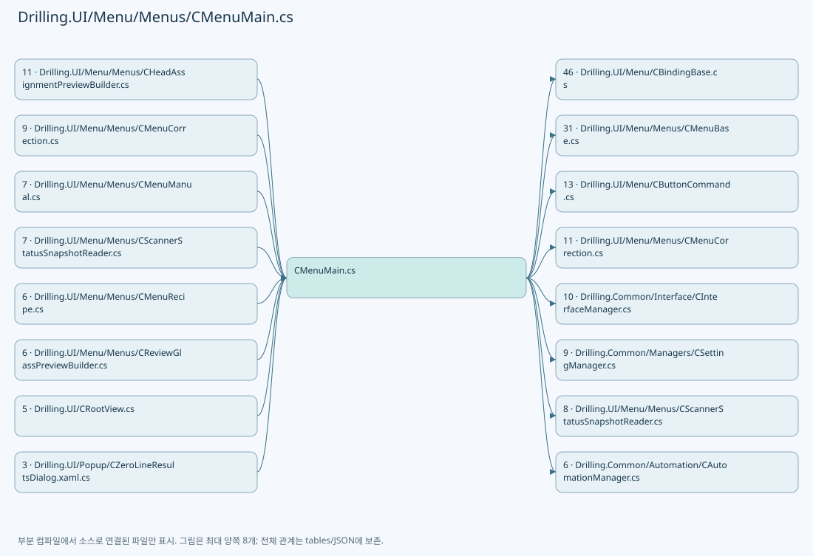

## 네임스페이스·타입·상속

| 타입 | 구분 | 원본 범위 | 선언/상속 |
| --- | --- | --- | --- |
| CMenuMain | ClassDeclaration | 25–2360 | CMenuMain: CMenuBase |
| CMainDistortionResultsPanel | ClassDeclaration | 2362–2392 | CMainDistortionResultsPanel: INotifyPropertyChanged |
| CAutoReviewMonitorPanel | ClassDeclaration | 2395–2503 | CAutoReviewMonitorPanel: INotifyPropertyChanged |
| ST_FINE_MONITOR_RESULT | RecordDeclaration | 2505–2517 | ST_FINE_MONITOR_RESULT |
| CMainInterlockGroups | ClassDeclaration | 2520–2589 | CMainInterlockGroups |
| ST_INTERLOCK_GROUP | RecordDeclaration | 2591–2596 | ST_INTERLOCK_GROUP |
| ST_INTERLOCK_DETAIL | RecordDeclaration | 2598–2603 | ST_INTERLOCK_DETAIL |
| CMainInterlockSnapshot | ClassDeclaration | 2606–2631 | CMainInterlockSnapshot |
| CMainProtectWindowPanel | ClassDeclaration | 2634–2751 | CMainProtectWindowPanel: INotifyPropertyChanged |
| CProtectWindowDisplay | RecordDeclaration | 2753–2753 | CProtectWindowDisplay |
| CMainRunOptionPanel | ClassDeclaration | 2755–2969 | CMainRunOptionPanel: INotifyPropertyChanged |
| CMainDistortionGroupChoice | RecordDeclaration | 2971–2977 | CMainDistortionGroupChoice |
| CMainRunOptionChoice | RecordDeclaration | 2979–2983 | CMainRunOptionChoice |
| CMainSequenceStatus | ClassDeclaration | 2986–3300 | CMainSequenceStatus |
| Step | RecordDeclaration | 3193–3193 | Step |
| Scenario | RecordDeclaration | 3194–3194 | Scenario |
| CMainSequenceRow | RecordDeclaration | 3302–3305 | CMainSequenceRow |
| CMainSequenceTab | ClassDeclaration | 3307–3333 | CMainSequenceTab: CBindingBase |
| CMainSequenceCard | ClassDeclaration | 3335–3434 | CMainSequenceCard: CBindingBase |
| ST_HEAD_ASSIGNMENT_MAP | RecordDeclaration | 3436–3436 | ST_HEAD_ASSIGNMENT_MAP |
| ST_MAIN_RECIPE_PREVIEW | RecordDeclaration | 3437–3446 | ST_MAIN_RECIPE_PREVIEW |
| ST_PREVIEW_HEAD_LAYOUT | RecordDeclaration | 3447–3459 | ST_PREVIEW_HEAD_LAYOUT |
| ST_PREVIEW_HEAD_FIELD | RecordDeclaration | 3461–3461 | ST_PREVIEW_HEAD_FIELD |
| ST_GLASS_PREVIEW_FRAME | RecordDeclaration | 3462–3462 | ST_GLASS_PREVIEW_FRAME |
| ST_HEAD_PREVIEW | RecordDeclaration | 3463–3484 | ST_HEAD_PREVIEW |
| ST_MAIN_PROCESS_SEQUENCE_ITEM | RecordDeclaration | 3486–3489 | ST_MAIN_PROCESS_SEQUENCE_ITEM |
| ST_HEAD_ASSIGNMENT_AREA | RecordDeclaration | 3491–3531 | ST_HEAD_ASSIGNMENT_AREA |
| ST_PREVIEW_HEAD_ASSIGNMENT_CANDIDATE | RecordStructDeclaration | 3533–3533 | ST_PREVIEW_HEAD_ASSIGNMENT_CANDIDATE |
| ST_SCRIPT_TASK_DEFINITION | RecordStructDeclaration | 3534–3534 | ST_SCRIPT_TASK_DEFINITION |
| ST_SCRIPT_TASK_STATUS_VALUE | RecordStructDeclaration | 3535–3535 | ST_SCRIPT_TASK_STATUS_VALUE |
| ST_AUTOMATION_CONTROLLER_USAGE_VALUE | RecordStructDeclaration | 3536–3536 | ST_AUTOMATION_CONTROLLER_USAGE_VALUE |
| ST_AUTOMATION_CONTROLLER_STATUS_ITEM | RecordDeclaration | 3537–3598 | ST_AUTOMATION_CONTROLLER_STATUS_ITEM |
| ST_SCRIPT_TASK_STATUS_ITEM | RecordDeclaration | 3600–3707 | ST_SCRIPT_TASK_STATUS_ITEM |
| ST_INSPECTION_STATUS_ITEM | RecordDeclaration | 3709–3726 | ST_INSPECTION_STATUS_ITEM |
| ST_MAIN_PARAMETER_TAB_ITEM | RecordDeclaration | 3728–3753 | ST_MAIN_PARAMETER_TAB_ITEM |
| ST_HEAD_PARAMETER | RecordDeclaration | 3755–3755 | ST_HEAD_PARAMETER |
| ST_OPTIC_HEAD_PARAMETER | RecordDeclaration | 3756–3876 | ST_OPTIC_HEAD_PARAMETER |
| ST_OPTIC_PARAMETER_GROUP | RecordDeclaration | 3878–3887 | ST_OPTIC_PARAMETER_GROUP |
| ST_OPTIC_PARAMETER_ITEM | RecordDeclaration | 3889–3910 | ST_OPTIC_PARAMETER_ITEM |
| ST_OPTIC_LASER_HEAD_PARAMETER | RecordStructDeclaration | 3912–3912 | ST_OPTIC_LASER_HEAD_PARAMETER |
| ST_OPTIC_AXIS_HEAD_PARAMETER | RecordStructDeclaration | 3913–3913 | ST_OPTIC_AXIS_HEAD_PARAMETER |
| ST_OPTIC_BET_HEAD_PARAMETER | RecordStructDeclaration | 3914–3914 | ST_OPTIC_BET_HEAD_PARAMETER |
| ST_SCANNER_AXIS_STATUS_ITEM | RecordDeclaration | 3915–3980 | ST_SCANNER_AXIS_STATUS_ITEM |
| CMotorStatusPollingService | ClassDeclaration | 3982–4116 | CMotorStatusPollingService: CtrlThread |
| ST_MOTOR_STATUS_ITEM | RecordDeclaration | 4118–4123 | ST_MOTOR_STATUS_ITEM |
| CZeroLineResultsPanel | ClassDeclaration | 4126–4194 | CZeroLineResultsPanel: INotifyPropertyChanged |
| CZeroLineResultRow | ClassDeclaration | 4196–4279 | CZeroLineResultRow |

## 멤버 빠른 목록

| 이름 | 종류 | 범위 | 서명 |
| --- | --- | --- | --- |
| ParameterTabHead | FieldDeclaration | L39–39 | string Drilling.UI.Menu.Menus.CMenuMain.ParameterTabHead |
| ParameterTabRunOption | FieldDeclaration | L40–40 | string Drilling.UI.Menu.Menus.CMenuMain.ParameterTabRunOption |
| ParameterTabProtectWindow | FieldDeclaration | L41–41 | string Drilling.UI.Menu.Menus.CMenuMain.ParameterTabProtectWindow |
| ParameterTabOptic | FieldDeclaration | L42–42 | string Drilling.UI.Menu.Menus.CMenuMain.ParameterTabOptic |
| ParameterTabScanner | FieldDeclaration | L43–43 | string Drilling.UI.Menu.Menus.CMenuMain.ParameterTabScanner |
| ParameterTabMotor | FieldDeclaration | L44–44 | string Drilling.UI.Menu.Menus.CMenuMain.ParameterTabMotor |
| OpticStatusLaser | FieldDeclaration | L45–45 | string Drilling.UI.Menu.Menus.CMenuMain.OpticStatusLaser |
| OpticStatusAttenuator | FieldDeclaration | L46–46 | string Drilling.UI.Menu.Menus.CMenuMain.OpticStatusAttenuator |
| OpticStatusBet | FieldDeclaration | L47–47 | string Drilling.UI.Menu.Menus.CMenuMain.OpticStatusBet |
| ReviewSequenceRowTolerance | FieldDeclaration | L48–48 | double Drilling.UI.Menu.Menus.CMenuMain.ReviewSequenceRowTolerance |
| SequenceStatus | PropertyDeclaration | L49–49 | Drilling.UI.Menu.Menus.CMainSequenceStatus Drilling.UI.Menu.Menus.CMenuMain.SequenceStatus |
| get_SequenceStatus | GetAccessorDeclaration | L49–49 | Drilling.UI.Menu.Menus.CMainSequenceStatus Drilling.UI.Menu.Menus.CMenuMain.SequenceStatus.get |
| ProtectWindow | PropertyDeclaration | L50–50 | Drilling.UI.Menu.Menus.CMainProtectWindowPanel Drilling.UI.Menu.Menus.CMenuMain.ProtectWindow |
| get_ProtectWindow | GetAccessorDeclaration | L50–50 | Drilling.UI.Menu.Menus.CMainProtectWindowPanel Drilling.UI.Menu.Menus.CMenuMain.ProtectWindow.get |
| RunOptions | PropertyDeclaration | L51–51 | Drilling.UI.Menu.Menus.CMainRunOptionPanel Drilling.UI.Menu.Menus.CMenuMain.RunOptions |
| get_RunOptions | GetAccessorDeclaration | L51–51 | Drilling.UI.Menu.Menus.CMainRunOptionPanel Drilling.UI.Menu.Menus.CMenuMain.RunOptions.get |
| _selectParameterTabCommand | FieldDeclaration | L53–53 | Drilling.UI.Menu.CButtonCommand? Drilling.UI.Menu.Menus.CMenuMain._selectParameterTabCommand |
| _selectOpticStatusCommand | FieldDeclaration | L54–54 | Drilling.UI.Menu.CButtonCommand? Drilling.UI.Menu.Menus.CMenuMain._selectOpticStatusCommand |
| _selectScannerStatusHeadCommand | FieldDeclaration | L55–55 | Drilling.UI.Menu.CButtonCommand? Drilling.UI.Menu.Menus.CMenuMain._selectScannerStatusHeadCommand |
| _selectedParameterTabKey | FieldDeclaration | L56–56 | string Drilling.UI.Menu.Menus.CMenuMain._selectedParameterTabKey |
| _selectedOpticStatusKey | FieldDeclaration | L57–57 | string Drilling.UI.Menu.Menus.CMenuMain._selectedOpticStatusKey |
| _selectedScannerStatusHeadNo | FieldDeclaration | L58–58 | int Drilling.UI.Menu.Menus.CMenuMain._selectedScannerStatusHeadNo |
| _cycleItems | FieldDeclaration | L59–59 | System.Collections.Generic.IReadOnlyList<Drilling.UI.Menu.Menus.ST_DISPLAY_ITEM> Drilling.UI.Menu.Menus.CMenuMain._cycleItems |
| _resultItems | FieldDeclaration | L60–60 | System.Collections.Generic.IReadOnlyList<Drilling.UI.Menu.Menus.ST_DISPLAY_ITEM> Drilling.UI.Menu.Menus.CMenuMain._resultItems |
| _processSequenceItems | FieldDeclaration | L61–61 | System.Collections.Generic.IReadOnlyList<Drilling.UI.Menu.Menus.ST_MAIN_PROCESS_SEQUENCE_ITEM> Drilling.UI.Menu.Menus.CMenuMain._processSequenceItems |
| _currentStepDetails | FieldDeclaration | L62–62 | System.Collections.Generic.IReadOnlyList<Drilling.UI.Menu.Menus.ST_DISPLAY_ITEM> Drilling.UI.Menu.Menus.CMenuMain._currentStepDetails |
| _processSummaryItems | FieldDeclaration | L63–63 | System.Collections.Generic.IReadOnlyList<Drilling.UI.Menu.Menus.ST_DISPLAY_ITEM> Drilling.UI.Menu.Menus.CMenuMain._processSummaryItems |
| _lifecycleItems | FieldDeclaration | L64–64 | System.Collections.Generic.IReadOnlyList<Drilling.UI.Menu.Menus.ST_DISPLAY_ITEM> Drilling.UI.Menu.Menus.CMenuMain._lifecycleItems |
| _scriptTaskStatusItems | FieldDeclaration | L65–65 | System.Collections.Generic.IReadOnlyList<Drilling.UI.Menu.Menus.ST_SCRIPT_TASK_STATUS_ITEM> Drilling.UI.Menu.Menus.CMenuMain._scriptTaskStatusItems |
| _automationControllerStatusItems | FieldDeclaration | L66–66 | System.Collections.Generic.IReadOnlyList<Drilling.UI.Menu.Menus.ST_AUTOMATION_CONTROLLER_STATUS_ITEM> Drilling.UI.Menu.Menus.CMenuMain._automationControllerStatusItems |
| _lastScriptTaskStatusValues | FieldDeclaration | L67–67 | System.Collections.Generic.IReadOnlyDictionary<(int AutomationNo, int TaskNo), Drilling.UI.Menu.Menus.ST_SCRIPT_TASK_STATUS_VALUE> Drilling.UI.Menu.Menus.CMenuMain._lastScriptTaskStatusValues |
| _inspectionStatusItems | FieldDeclaration | L68–68 | System.Collections.Generic.IReadOnlyList<Drilling.UI.Menu.Menus.ST_INSPECTION_STATUS_ITEM> Drilling.UI.Menu.Menus.CMenuMain._inspectionStatusItems |
| _inspectionSummary | FieldDeclaration | L69–69 | string Drilling.UI.Menu.Menus.CMenuMain._inspectionSummary |
| _inspectionModeText | FieldDeclaration | L70–70 | string Drilling.UI.Menu.Menus.CMenuMain._inspectionModeText |
| _inspectionRuleText | FieldDeclaration | L71–71 | string Drilling.UI.Menu.Menus.CMenuMain._inspectionRuleText |
| _inspectionRuleVisibility | FieldDeclaration | L72–72 | Visibility Drilling.UI.Menu.Menus.CMenuMain._inspectionRuleVisibility |
| _interlockItems | FieldDeclaration | L73–73 | System.Collections.Generic.IReadOnlyList<Drilling.UI.Menu.Menus.ST_INTERLOCK_GROUP> Drilling.UI.Menu.Menus.CMenuMain._interlockItems |
| _interlockSnapshot | FieldDeclaration | L74–74 | Drilling.UI.Menu.Menus.CMainInterlockSnapshot Drilling.UI.Menu.Menus.CMenuMain._interlockSnapshot |
| _previewSourceParameters | FieldDeclaration | L75–75 | System.Collections.Generic.IReadOnlyDictionary<string, string>? Drilling.UI.Menu.Menus.CMenuMain._previewSourceParameters |
| _previewSourceRecipe | FieldDeclaration | L76–76 | Drilling.Common.Managers.ST_RECIPE_DEFINITION? Drilling.UI.Menu.Menus.CMenuMain._previewSourceRecipe |
| _previewSourceSettings | FieldDeclaration | L77–77 | System.Collections.Generic.IReadOnlyList<Drilling.Common.Managers.ST_SYSTEM_PARAMETER>? Drilling.UI.Menu.Menus.CMenuMain._previewSourceSettings |
| _previewParameterCache | FieldDeclaration | L78–78 | System.Collections.Generic.IReadOnlyDictionary<string, string>? Drilling.UI.Menu.Menus.CMenuMain._previewParameterCache |
| _opticParameterGroups | FieldDeclaration | L79–79 | System.Collections.Generic.IReadOnlyList<Drilling.UI.Menu.Menus.ST_OPTIC_PARAMETER_GROUP> Drilling.UI.Menu.Menus.CMenuMain._opticParameterGroups |
| _opticHeadParameters | FieldDeclaration | L80–80 | System.Collections.Generic.IReadOnlyList<Drilling.UI.Menu.Menus.ST_OPTIC_HEAD_PARAMETER> Drilling.UI.Menu.Menus.CMenuMain._opticHeadParameters |
| _opticStatusTabs | FieldDeclaration | L81–81 | System.Collections.Generic.IReadOnlyList<Drilling.UI.Menu.Menus.ST_MAIN_PARAMETER_TAB_ITEM> Drilling.UI.Menu.Menus.CMenuMain._opticStatusTabs |
| _scannerStatusHeadTabs | FieldDeclaration | L82–82 | System.Collections.Generic.IReadOnlyList<Drilling.UI.Menu.Menus.ST_MAIN_PARAMETER_TAB_ITEM> Drilling.UI.Menu.Menus.CMenuMain._scannerStatusHeadTabs |
| _scannerStatusItems | FieldDeclaration | L83–83 | System.Collections.Generic.IReadOnlyList<Drilling.UI.Menu.Menus.ST_SCANNER_AXIS_STATUS_ITEM> Drilling.UI.Menu.Menus.CMenuMain._scannerStatusItems |
| _processStep | FieldDeclaration | L84–84 | string Drilling.UI.Menu.Menus.CMenuMain._processStep |
| _scriptStatus | FieldDeclaration | L85–85 | string Drilling.UI.Menu.Menus.CMenuMain._scriptStatus |
| _scriptStatusText | FieldDeclaration | L86–86 | string Drilling.UI.Menu.Menus.CMenuMain._scriptStatusText |
| _resultMessage | FieldDeclaration | L87–87 | string Drilling.UI.Menu.Menus.CMenuMain._resultMessage |
| _totalShotsText | FieldDeclaration | L88–88 | string Drilling.UI.Menu.Menus.CMenuMain._totalShotsText |
| _moveCountText | FieldDeclaration | L89–89 | string Drilling.UI.Menu.Menus.CMenuMain._moveCountText |
| _laserOnSegmentsText | FieldDeclaration | L90–90 | string Drilling.UI.Menu.Menus.CMenuMain._laserOnSegmentsText |
| _estimatedTimeText | FieldDeclaration | L91–91 | string Drilling.UI.Menu.Menus.CMenuMain._estimatedTimeText |
| _elapsedTimeText | FieldDeclaration | L92–92 | string Drilling.UI.Menu.Menus.CMenuMain._elapsedTimeText |
| _progressText | FieldDeclaration | L93–93 | string Drilling.UI.Menu.Menus.CMenuMain._progressText |
| _progressPercentText | FieldDeclaration | L94–94 | string Drilling.UI.Menu.Menus.CMenuMain._progressPercentText |
| _progressPercent | FieldDeclaration | L95–95 | double Drilling.UI.Menu.Menus.CMenuMain._progressPercent |
| _processResultValue | FieldDeclaration | L96–96 | string Drilling.UI.Menu.Menus.CMenuMain._processResultValue |
| _processResultBrush | FieldDeclaration | L97–97 | Brush Drilling.UI.Menu.Menus.CMenuMain._processResultBrush |
| _scannerStatusSnapshotReader | FieldDeclaration | L98–98 | Drilling.UI.Menu.Menus.CScannerStatusSnapshotReader Drilling.UI.Menu.Menus.CMenuMain._scannerStatusSnapshotReader |
| _motorStatusPollingService | FieldDeclaration | L99–99 | Drilling.UI.Menu.Menus.CMotorStatusPollingService Drilling.UI.Menu.Menus.CMenuMain._motorStatusPollingService |
| _motorStatusItems | FieldDeclaration | L100–100 | System.Collections.Generic.IReadOnlyList<Drilling.UI.Menu.Menus.ST_MOTOR_STATUS_ITEM> Drilling.UI.Menu.Menus.CMenuMain._motorStatusItems |
| MotorStatusVisibility | PropertyDeclaration | L101–101 | Visibility Drilling.UI.Menu.Menus.CMenuMain.MotorStatusVisibility |
| get_MotorStatusVisibility | GetAccessorDeclaration | L101–101 | Visibility Drilling.UI.Menu.Menus.CMenuMain.MotorStatusVisibility.get |
| set_MotorStatusVisibility | SetAccessorDeclaration | L101–101 | void Drilling.UI.Menu.Menus.CMenuMain.MotorStatusVisibility.set |
| _previewHeadShotCounts | FieldDeclaration | L103–103 | System.Collections.Generic.IReadOnlyDictionary<int, long> Drilling.UI.Menu.Menus.CMenuMain._previewHeadShotCounts |
| _headPreviews | FieldDeclaration | L104–104 | System.Collections.Generic.IReadOnlyList<Drilling.UI.Menu.Menus.ST_HEAD_PREVIEW> Drilling.UI.Menu.Menus.CMenuMain._headPreviews |
| _oddHeadPreviews | FieldDeclaration | L105–105 | System.Collections.Generic.IReadOnlyList<Drilling.UI.Menu.Menus.ST_HEAD_PREVIEW> Drilling.UI.Menu.Menus.CMenuMain._oddHeadPreviews |
| _evenHeadPreviews | FieldDeclaration | L106–106 | System.Collections.Generic.IReadOnlyList<Drilling.UI.Menu.Menus.ST_HEAD_PREVIEW> Drilling.UI.Menu.Menus.CMenuMain._evenHeadPreviews |
| HeadParameters | PropertyDeclaration | L107–107 | System.Collections.Generic.IReadOnlyList<Drilling.UI.Menu.Menus.ST_HEAD_PARAMETER> Drilling.UI.Menu.Menus.CMenuMain.HeadParameters |
| get_HeadParameters | GetAccessorDeclaration | L107–107 | System.Collections.Generic.IReadOnlyList<Drilling.UI.Menu.Menus.ST_HEAD_PARAMETER> Drilling.UI.Menu.Menus.CMenuMain.HeadParameters.get |
| set_HeadParameters | SetAccessorDeclaration | L107–107 | void Drilling.UI.Menu.Menus.CMenuMain.HeadParameters.set |
| ParameterTabs | PropertyDeclaration | L108–108 | System.Collections.Generic.IReadOnlyList<Drilling.UI.Menu.Menus.ST_MAIN_PARAMETER_TAB_ITEM> Drilling.UI.Menu.Menus.CMenuMain.ParameterTabs |
| get_ParameterTabs | GetAccessorDeclaration | L108–108 | System.Collections.Generic.IReadOnlyList<Drilling.UI.Menu.Menus.ST_MAIN_PARAMETER_TAB_ITEM> Drilling.UI.Menu.Menus.CMenuMain.ParameterTabs.get |
| set_ParameterTabs | SetAccessorDeclaration | L108–108 | void Drilling.UI.Menu.Menus.CMenuMain.ParameterTabs.set |
| HeadParameterVisibility | PropertyDeclaration | L109–109 | Visibility Drilling.UI.Menu.Menus.CMenuMain.HeadParameterVisibility |
| get_HeadParameterVisibility | GetAccessorDeclaration | L109–109 | Visibility Drilling.UI.Menu.Menus.CMenuMain.HeadParameterVisibility.get |
| set_HeadParameterVisibility | SetAccessorDeclaration | L109–109 | void Drilling.UI.Menu.Menus.CMenuMain.HeadParameterVisibility.set |
| OpticParameterVisibility | PropertyDeclaration | L110–110 | Visibility Drilling.UI.Menu.Menus.CMenuMain.OpticParameterVisibility |
| get_OpticParameterVisibility | GetAccessorDeclaration | L110–110 | Visibility Drilling.UI.Menu.Menus.CMenuMain.OpticParameterVisibility.get |
| set_OpticParameterVisibility | SetAccessorDeclaration | L110–110 | void Drilling.UI.Menu.Menus.CMenuMain.OpticParameterVisibility.set |
| ScannerStatusVisibility | PropertyDeclaration | L111–111 | Visibility Drilling.UI.Menu.Menus.CMenuMain.ScannerStatusVisibility |
| get_ScannerStatusVisibility | GetAccessorDeclaration | L111–111 | Visibility Drilling.UI.Menu.Menus.CMenuMain.ScannerStatusVisibility.get |
| set_ScannerStatusVisibility | SetAccessorDeclaration | L111–111 | void Drilling.UI.Menu.Menus.CMenuMain.ScannerStatusVisibility.set |
| _reviewMonitorWindow | FieldDeclaration | L113–113 | Drilling.UI.Popup.CAutoReviewMonitorDialog? Drilling.UI.Menu.Menus.CMenuMain._reviewMonitorWindow |
| _powerMeasureWindow | FieldDeclaration | L114–114 | Window? Drilling.UI.Menu.Menus.CMenuMain._powerMeasureWindow |
| _distortionResultsWindow | FieldDeclaration | L115–115 | Window? Drilling.UI.Menu.Menus.CMenuMain._distortionResultsWindow |
| _zeroLineResultsWindow | FieldDeclaration | L116–116 | Drilling.UI.Popup.CZeroLineResultsDialog? Drilling.UI.Menu.Menus.CMenuMain._zeroLineResultsWindow |
| ReadReviewAble | MethodDeclaration | L119–136 | bool? Drilling.UI.Menu.Menus.CMenuMain.ReadReviewAble(Drilling.Common.Interface.ST_MELSEC_CACHED_VALUE?) |
| RefreshSequenceStatus | MethodDeclaration | L138–152 | void Drilling.UI.Menu.Menus.CMenuMain.RefreshSequenceStatus(Drilling.Common.Station.ST_STATION_PROCESS_STATUS) |
| MotorStatusItems | PropertyDeclaration | L154–154 | System.Collections.Generic.IReadOnlyList<Drilling.UI.Menu.Menus.ST_MOTOR_STATUS_ITEM> Drilling.UI.Menu.Menus.CMenuMain.MotorStatusItems |
| get_MotorStatusItems | GetAccessorDeclaration | L154–154 | System.Collections.Generic.IReadOnlyList<Drilling.UI.Menu.Menus.ST_MOTOR_STATUS_ITEM> Drilling.UI.Menu.Menus.CMenuMain.MotorStatusItems.get |
| set_MotorStatusItems | SetAccessorDeclaration | L154–154 | void Drilling.UI.Menu.Menus.CMenuMain.MotorStatusItems.set |
| IsMotorStatusSelected | PropertyDeclaration | L155–155 | bool Drilling.UI.Menu.Menus.CMenuMain.IsMotorStatusSelected |
| RefreshMotorStatus | MethodDeclaration | L157–163 | void Drilling.UI.Menu.Menus.CMenuMain.RefreshMotorStatus() |
| Menu | PropertyDeclaration | L165–171 | Drilling.UI.Menu.Menus.EN_MENU Drilling.UI.Menu.Menus.CMenuMain.Menu |
| get_Menu | GetAccessorDeclaration | L167–170 | Drilling.UI.Menu.Menus.EN_MENU Drilling.UI.Menu.Menus.CMenuMain.Menu.get |
| HeadPreviews | PropertyDeclaration | L173–173 | System.Collections.Generic.IReadOnlyList<Drilling.UI.Menu.Menus.ST_HEAD_PREVIEW> Drilling.UI.Menu.Menus.CMenuMain.HeadPreviews |
| get_HeadPreviews | GetAccessorDeclaration | L173–173 | System.Collections.Generic.IReadOnlyList<Drilling.UI.Menu.Menus.ST_HEAD_PREVIEW> Drilling.UI.Menu.Menus.CMenuMain.HeadPreviews.get |
| set_HeadPreviews | SetAccessorDeclaration | L173–173 | void Drilling.UI.Menu.Menus.CMenuMain.HeadPreviews.set |
| OddHeadPreviews | PropertyDeclaration | L174–174 | System.Collections.Generic.IReadOnlyList<Drilling.UI.Menu.Menus.ST_HEAD_PREVIEW> Drilling.UI.Menu.Menus.CMenuMain.OddHeadPreviews |
| get_OddHeadPreviews | GetAccessorDeclaration | L174–174 | System.Collections.Generic.IReadOnlyList<Drilling.UI.Menu.Menus.ST_HEAD_PREVIEW> Drilling.UI.Menu.Menus.CMenuMain.OddHeadPreviews.get |
| set_OddHeadPreviews | SetAccessorDeclaration | L174–174 | void Drilling.UI.Menu.Menus.CMenuMain.OddHeadPreviews.set |
| EvenHeadPreviews | PropertyDeclaration | L175–175 | System.Collections.Generic.IReadOnlyList<Drilling.UI.Menu.Menus.ST_HEAD_PREVIEW> Drilling.UI.Menu.Menus.CMenuMain.EvenHeadPreviews |
| get_EvenHeadPreviews | GetAccessorDeclaration | L175–175 | System.Collections.Generic.IReadOnlyList<Drilling.UI.Menu.Menus.ST_HEAD_PREVIEW> Drilling.UI.Menu.Menus.CMenuMain.EvenHeadPreviews.get |
| set_EvenHeadPreviews | SetAccessorDeclaration | L175–175 | void Drilling.UI.Menu.Menus.CMenuMain.EvenHeadPreviews.set |
| CycleItems | PropertyDeclaration | L177–188 | System.Collections.Generic.IReadOnlyList<Drilling.UI.Menu.Menus.ST_DISPLAY_ITEM> Drilling.UI.Menu.Menus.CMenuMain.CycleItems |
| get_CycleItems | GetAccessorDeclaration | L179–182 | System.Collections.Generic.IReadOnlyList<Drilling.UI.Menu.Menus.ST_DISPLAY_ITEM> Drilling.UI.Menu.Menus.CMenuMain.CycleItems.get |
| set_CycleItems | SetAccessorDeclaration | L184–187 | void Drilling.UI.Menu.Menus.CMenuMain.CycleItems.set |
| ResultItems | PropertyDeclaration | L190–201 | System.Collections.Generic.IReadOnlyList<Drilling.UI.Menu.Menus.ST_DISPLAY_ITEM> Drilling.UI.Menu.Menus.CMenuMain.ResultItems |
| get_ResultItems | GetAccessorDeclaration | L192–195 | System.Collections.Generic.IReadOnlyList<Drilling.UI.Menu.Menus.ST_DISPLAY_ITEM> Drilling.UI.Menu.Menus.CMenuMain.ResultItems.get |
| set_ResultItems | SetAccessorDeclaration | L197–200 | void Drilling.UI.Menu.Menus.CMenuMain.ResultItems.set |
| ProcessSequenceItems | PropertyDeclaration | L203–214 | System.Collections.Generic.IReadOnlyList<Drilling.UI.Menu.Menus.ST_MAIN_PROCESS_SEQUENCE_ITEM> Drilling.UI.Menu.Menus.CMenuMain.ProcessSequenceItems |
| get_ProcessSequenceItems | GetAccessorDeclaration | L205–208 | System.Collections.Generic.IReadOnlyList<Drilling.UI.Menu.Menus.ST_MAIN_PROCESS_SEQUENCE_ITEM> Drilling.UI.Menu.Menus.CMenuMain.ProcessSequenceItems.get |
| set_ProcessSequenceItems | SetAccessorDeclaration | L210–213 | void Drilling.UI.Menu.Menus.CMenuMain.ProcessSequenceItems.set |
| CurrentStepDetails | PropertyDeclaration | L216–227 | System.Collections.Generic.IReadOnlyList<Drilling.UI.Menu.Menus.ST_DISPLAY_ITEM> Drilling.UI.Menu.Menus.CMenuMain.CurrentStepDetails |
| get_CurrentStepDetails | GetAccessorDeclaration | L218–221 | System.Collections.Generic.IReadOnlyList<Drilling.UI.Menu.Menus.ST_DISPLAY_ITEM> Drilling.UI.Menu.Menus.CMenuMain.CurrentStepDetails.get |
| set_CurrentStepDetails | SetAccessorDeclaration | L223–226 | void Drilling.UI.Menu.Menus.CMenuMain.CurrentStepDetails.set |
| ProcessSummaryItems | PropertyDeclaration | L229–240 | System.Collections.Generic.IReadOnlyList<Drilling.UI.Menu.Menus.ST_DISPLAY_ITEM> Drilling.UI.Menu.Menus.CMenuMain.ProcessSummaryItems |
| get_ProcessSummaryItems | GetAccessorDeclaration | L231–234 | System.Collections.Generic.IReadOnlyList<Drilling.UI.Menu.Menus.ST_DISPLAY_ITEM> Drilling.UI.Menu.Menus.CMenuMain.ProcessSummaryItems.get |
| set_ProcessSummaryItems | SetAccessorDeclaration | L236–239 | void Drilling.UI.Menu.Menus.CMenuMain.ProcessSummaryItems.set |
| LifecycleItems | PropertyDeclaration | L242–253 | System.Collections.Generic.IReadOnlyList<Drilling.UI.Menu.Menus.ST_DISPLAY_ITEM> Drilling.UI.Menu.Menus.CMenuMain.LifecycleItems |
| get_LifecycleItems | GetAccessorDeclaration | L244–247 | System.Collections.Generic.IReadOnlyList<Drilling.UI.Menu.Menus.ST_DISPLAY_ITEM> Drilling.UI.Menu.Menus.CMenuMain.LifecycleItems.get |
| set_LifecycleItems | SetAccessorDeclaration | L249–252 | void Drilling.UI.Menu.Menus.CMenuMain.LifecycleItems.set |
| ScriptTaskStatusItems | PropertyDeclaration | L255–266 | System.Collections.Generic.IReadOnlyList<Drilling.UI.Menu.Menus.ST_SCRIPT_TASK_STATUS_ITEM> Drilling.UI.Menu.Menus.CMenuMain.ScriptTaskStatusItems |
| get_ScriptTaskStatusItems | GetAccessorDeclaration | L257–260 | System.Collections.Generic.IReadOnlyList<Drilling.UI.Menu.Menus.ST_SCRIPT_TASK_STATUS_ITEM> Drilling.UI.Menu.Menus.CMenuMain.ScriptTaskStatusItems.get |
| set_ScriptTaskStatusItems | SetAccessorDeclaration | L262–265 | void Drilling.UI.Menu.Menus.CMenuMain.ScriptTaskStatusItems.set |
| AutomationControllerStatusItems | PropertyDeclaration | L268–279 | System.Collections.Generic.IReadOnlyList<Drilling.UI.Menu.Menus.ST_AUTOMATION_CONTROLLER_STATUS_ITEM> Drilling.UI.Menu.Menus.CMenuMain.AutomationControllerStatusItems |
| get_AutomationControllerStatusItems | GetAccessorDeclaration | L270–273 | System.Collections.Generic.IReadOnlyList<Drilling.UI.Menu.Menus.ST_AUTOMATION_CONTROLLER_STATUS_ITEM> Drilling.UI.Menu.Menus.CMenuMain.AutomationControllerStatusItems.get |
| set_AutomationControllerStatusItems | SetAccessorDeclaration | L275–278 | void Drilling.UI.Menu.Menus.CMenuMain.AutomationControllerStatusItems.set |
| InspectionStatusItems | PropertyDeclaration | L281–292 | System.Collections.Generic.IReadOnlyList<Drilling.UI.Menu.Menus.ST_INSPECTION_STATUS_ITEM> Drilling.UI.Menu.Menus.CMenuMain.InspectionStatusItems |
| get_InspectionStatusItems | GetAccessorDeclaration | L283–286 | System.Collections.Generic.IReadOnlyList<Drilling.UI.Menu.Menus.ST_INSPECTION_STATUS_ITEM> Drilling.UI.Menu.Menus.CMenuMain.InspectionStatusItems.get |
| set_InspectionStatusItems | SetAccessorDeclaration | L288–291 | void Drilling.UI.Menu.Menus.CMenuMain.InspectionStatusItems.set |
| InspectionSummary | PropertyDeclaration | L294–305 | string Drilling.UI.Menu.Menus.CMenuMain.InspectionSummary |
| get_InspectionSummary | GetAccessorDeclaration | L296–299 | string Drilling.UI.Menu.Menus.CMenuMain.InspectionSummary.get |
| set_InspectionSummary | SetAccessorDeclaration | L301–304 | void Drilling.UI.Menu.Menus.CMenuMain.InspectionSummary.set |
| InspectionModeText | PropertyDeclaration | L307–318 | string Drilling.UI.Menu.Menus.CMenuMain.InspectionModeText |
| get_InspectionModeText | GetAccessorDeclaration | L309–312 | string Drilling.UI.Menu.Menus.CMenuMain.InspectionModeText.get |
| set_InspectionModeText | SetAccessorDeclaration | L314–317 | void Drilling.UI.Menu.Menus.CMenuMain.InspectionModeText.set |
| InspectionRuleText | PropertyDeclaration | L320–331 | string Drilling.UI.Menu.Menus.CMenuMain.InspectionRuleText |
| get_InspectionRuleText | GetAccessorDeclaration | L322–325 | string Drilling.UI.Menu.Menus.CMenuMain.InspectionRuleText.get |
| set_InspectionRuleText | SetAccessorDeclaration | L327–330 | void Drilling.UI.Menu.Menus.CMenuMain.InspectionRuleText.set |
| InspectionRuleVisibility | PropertyDeclaration | L333–344 | Visibility Drilling.UI.Menu.Menus.CMenuMain.InspectionRuleVisibility |
| get_InspectionRuleVisibility | GetAccessorDeclaration | L335–338 | Visibility Drilling.UI.Menu.Menus.CMenuMain.InspectionRuleVisibility.get |
| set_InspectionRuleVisibility | SetAccessorDeclaration | L340–343 | void Drilling.UI.Menu.Menus.CMenuMain.InspectionRuleVisibility.set |
| InterlockItems | PropertyDeclaration | L346–359 | System.Collections.Generic.IReadOnlyList<Drilling.UI.Menu.Menus.ST_INTERLOCK_GROUP> Drilling.UI.Menu.Menus.CMenuMain.InterlockItems |
| get_InterlockItems | GetAccessorDeclaration | L348–351 | System.Collections.Generic.IReadOnlyList<Drilling.UI.Menu.Menus.ST_INTERLOCK_GROUP> Drilling.UI.Menu.Menus.CMenuMain.InterlockItems.get |
| set_InterlockItems | SetAccessorDeclaration | L353–358 | void Drilling.UI.Menu.Menus.CMenuMain.InterlockItems.set |
| OpticStatusTabs | PropertyDeclaration | L361–372 | System.Collections.Generic.IReadOnlyList<Drilling.UI.Menu.Menus.ST_MAIN_PARAMETER_TAB_ITEM> Drilling.UI.Menu.Menus.CMenuMain.OpticStatusTabs |
| get_OpticStatusTabs | GetAccessorDeclaration | L363–366 | System.Collections.Generic.IReadOnlyList<Drilling.UI.Menu.Menus.ST_MAIN_PARAMETER_TAB_ITEM> Drilling.UI.Menu.Menus.CMenuMain.OpticStatusTabs.get |
| set_OpticStatusTabs | SetAccessorDeclaration | L368–371 | void Drilling.UI.Menu.Menus.CMenuMain.OpticStatusTabs.set |
| ScannerStatusHeadTabs | PropertyDeclaration | L374–385 | System.Collections.Generic.IReadOnlyList<Drilling.UI.Menu.Menus.ST_MAIN_PARAMETER_TAB_ITEM> Drilling.UI.Menu.Menus.CMenuMain.ScannerStatusHeadTabs |
| get_ScannerStatusHeadTabs | GetAccessorDeclaration | L376–379 | System.Collections.Generic.IReadOnlyList<Drilling.UI.Menu.Menus.ST_MAIN_PARAMETER_TAB_ITEM> Drilling.UI.Menu.Menus.CMenuMain.ScannerStatusHeadTabs.get |
| set_ScannerStatusHeadTabs | SetAccessorDeclaration | L381–384 | void Drilling.UI.Menu.Menus.CMenuMain.ScannerStatusHeadTabs.set |
| OpticParameterGroups | PropertyDeclaration | L387–398 | System.Collections.Generic.IReadOnlyList<Drilling.UI.Menu.Menus.ST_OPTIC_PARAMETER_GROUP> Drilling.UI.Menu.Menus.CMenuMain.OpticParameterGroups |
| get_OpticParameterGroups | GetAccessorDeclaration | L389–392 | System.Collections.Generic.IReadOnlyList<Drilling.UI.Menu.Menus.ST_OPTIC_PARAMETER_GROUP> Drilling.UI.Menu.Menus.CMenuMain.OpticParameterGroups.get |
| set_OpticParameterGroups | SetAccessorDeclaration | L394–397 | void Drilling.UI.Menu.Menus.CMenuMain.OpticParameterGroups.set |
| OpticHeadParameters | PropertyDeclaration | L400–411 | System.Collections.Generic.IReadOnlyList<Drilling.UI.Menu.Menus.ST_OPTIC_HEAD_PARAMETER> Drilling.UI.Menu.Menus.CMenuMain.OpticHeadParameters |
| get_OpticHeadParameters | GetAccessorDeclaration | L402–405 | System.Collections.Generic.IReadOnlyList<Drilling.UI.Menu.Menus.ST_OPTIC_HEAD_PARAMETER> Drilling.UI.Menu.Menus.CMenuMain.OpticHeadParameters.get |
| set_OpticHeadParameters | SetAccessorDeclaration | L407–410 | void Drilling.UI.Menu.Menus.CMenuMain.OpticHeadParameters.set |
| ScannerStatusItems | PropertyDeclaration | L413–424 | System.Collections.Generic.IReadOnlyList<Drilling.UI.Menu.Menus.ST_SCANNER_AXIS_STATUS_ITEM> Drilling.UI.Menu.Menus.CMenuMain.ScannerStatusItems |
| get_ScannerStatusItems | GetAccessorDeclaration | L415–418 | System.Collections.Generic.IReadOnlyList<Drilling.UI.Menu.Menus.ST_SCANNER_AXIS_STATUS_ITEM> Drilling.UI.Menu.Menus.CMenuMain.ScannerStatusItems.get |
| set_ScannerStatusItems | SetAccessorDeclaration | L420–423 | void Drilling.UI.Menu.Menus.CMenuMain.ScannerStatusItems.set |
| OpticLaserVisibility | PropertyDeclaration | L426–432 | Visibility Drilling.UI.Menu.Menus.CMenuMain.OpticLaserVisibility |
| get_OpticLaserVisibility | GetAccessorDeclaration | L428–431 | Visibility Drilling.UI.Menu.Menus.CMenuMain.OpticLaserVisibility.get |
| OpticAttenuatorVisibility | PropertyDeclaration | L434–440 | Visibility Drilling.UI.Menu.Menus.CMenuMain.OpticAttenuatorVisibility |
| get_OpticAttenuatorVisibility | GetAccessorDeclaration | L436–439 | Visibility Drilling.UI.Menu.Menus.CMenuMain.OpticAttenuatorVisibility.get |
| OpticBetVisibility | PropertyDeclaration | L442–448 | Visibility Drilling.UI.Menu.Menus.CMenuMain.OpticBetVisibility |
| get_OpticBetVisibility | GetAccessorDeclaration | L444–447 | Visibility Drilling.UI.Menu.Menus.CMenuMain.OpticBetVisibility.get |
| IsScannerStatusSelected | PropertyDeclaration | L450–456 | bool Drilling.UI.Menu.Menus.CMenuMain.IsScannerStatusSelected |
| get_IsScannerStatusSelected | GetAccessorDeclaration | L452–455 | bool Drilling.UI.Menu.Menus.CMenuMain.IsScannerStatusSelected.get |
| IsOpticParameterSelected | PropertyDeclaration | L458–464 | bool Drilling.UI.Menu.Menus.CMenuMain.IsOpticParameterSelected |
| get_IsOpticParameterSelected | GetAccessorDeclaration | L460–463 | bool Drilling.UI.Menu.Menus.CMenuMain.IsOpticParameterSelected.get |
| ProcessStep | PropertyDeclaration | L466–477 | string Drilling.UI.Menu.Menus.CMenuMain.ProcessStep |
| get_ProcessStep | GetAccessorDeclaration | L468–471 | string Drilling.UI.Menu.Menus.CMenuMain.ProcessStep.get |
| set_ProcessStep | SetAccessorDeclaration | L473–476 | void Drilling.UI.Menu.Menus.CMenuMain.ProcessStep.set |
| ScriptStatus | PropertyDeclaration | L479–490 | string Drilling.UI.Menu.Menus.CMenuMain.ScriptStatus |
| get_ScriptStatus | GetAccessorDeclaration | L481–484 | string Drilling.UI.Menu.Menus.CMenuMain.ScriptStatus.get |
| set_ScriptStatus | SetAccessorDeclaration | L486–489 | void Drilling.UI.Menu.Menus.CMenuMain.ScriptStatus.set |
| ScriptStatusText | PropertyDeclaration | L492–503 | string Drilling.UI.Menu.Menus.CMenuMain.ScriptStatusText |
| get_ScriptStatusText | GetAccessorDeclaration | L494–497 | string Drilling.UI.Menu.Menus.CMenuMain.ScriptStatusText.get |
| set_ScriptStatusText | SetAccessorDeclaration | L499–502 | void Drilling.UI.Menu.Menus.CMenuMain.ScriptStatusText.set |
| ResultMessage | PropertyDeclaration | L505–516 | string Drilling.UI.Menu.Menus.CMenuMain.ResultMessage |
| get_ResultMessage | GetAccessorDeclaration | L507–510 | string Drilling.UI.Menu.Menus.CMenuMain.ResultMessage.get |
| set_ResultMessage | SetAccessorDeclaration | L512–515 | void Drilling.UI.Menu.Menus.CMenuMain.ResultMessage.set |
| TotalShotsText | PropertyDeclaration | L518–529 | string Drilling.UI.Menu.Menus.CMenuMain.TotalShotsText |
| get_TotalShotsText | GetAccessorDeclaration | L520–523 | string Drilling.UI.Menu.Menus.CMenuMain.TotalShotsText.get |
| set_TotalShotsText | SetAccessorDeclaration | L525–528 | void Drilling.UI.Menu.Menus.CMenuMain.TotalShotsText.set |
| MoveCountText | PropertyDeclaration | L531–542 | string Drilling.UI.Menu.Menus.CMenuMain.MoveCountText |
| get_MoveCountText | GetAccessorDeclaration | L533–536 | string Drilling.UI.Menu.Menus.CMenuMain.MoveCountText.get |
| set_MoveCountText | SetAccessorDeclaration | L538–541 | void Drilling.UI.Menu.Menus.CMenuMain.MoveCountText.set |
| LaserOnSegmentsText | PropertyDeclaration | L544–555 | string Drilling.UI.Menu.Menus.CMenuMain.LaserOnSegmentsText |
| get_LaserOnSegmentsText | GetAccessorDeclaration | L546–549 | string Drilling.UI.Menu.Menus.CMenuMain.LaserOnSegmentsText.get |
| set_LaserOnSegmentsText | SetAccessorDeclaration | L551–554 | void Drilling.UI.Menu.Menus.CMenuMain.LaserOnSegmentsText.set |
| EstimatedTimeText | PropertyDeclaration | L557–568 | string Drilling.UI.Menu.Menus.CMenuMain.EstimatedTimeText |
| get_EstimatedTimeText | GetAccessorDeclaration | L559–562 | string Drilling.UI.Menu.Menus.CMenuMain.EstimatedTimeText.get |
| set_EstimatedTimeText | SetAccessorDeclaration | L564–567 | void Drilling.UI.Menu.Menus.CMenuMain.EstimatedTimeText.set |
| ElapsedTimeText | PropertyDeclaration | L570–581 | string Drilling.UI.Menu.Menus.CMenuMain.ElapsedTimeText |
| get_ElapsedTimeText | GetAccessorDeclaration | L572–575 | string Drilling.UI.Menu.Menus.CMenuMain.ElapsedTimeText.get |
| set_ElapsedTimeText | SetAccessorDeclaration | L577–580 | void Drilling.UI.Menu.Menus.CMenuMain.ElapsedTimeText.set |
| ProgressText | PropertyDeclaration | L583–594 | string Drilling.UI.Menu.Menus.CMenuMain.ProgressText |
| get_ProgressText | GetAccessorDeclaration | L585–588 | string Drilling.UI.Menu.Menus.CMenuMain.ProgressText.get |
| set_ProgressText | SetAccessorDeclaration | L590–593 | void Drilling.UI.Menu.Menus.CMenuMain.ProgressText.set |
| ProgressPercentText | PropertyDeclaration | L596–607 | string Drilling.UI.Menu.Menus.CMenuMain.ProgressPercentText |
| get_ProgressPercentText | GetAccessorDeclaration | L598–601 | string Drilling.UI.Menu.Menus.CMenuMain.ProgressPercentText.get |
| set_ProgressPercentText | SetAccessorDeclaration | L603–606 | void Drilling.UI.Menu.Menus.CMenuMain.ProgressPercentText.set |
| ProgressPercent | PropertyDeclaration | L609–620 | double Drilling.UI.Menu.Menus.CMenuMain.ProgressPercent |
| get_ProgressPercent | GetAccessorDeclaration | L611–614 | double Drilling.UI.Menu.Menus.CMenuMain.ProgressPercent.get |
| set_ProgressPercent | SetAccessorDeclaration | L616–619 | void Drilling.UI.Menu.Menus.CMenuMain.ProgressPercent.set |
| ProcessResultValue | PropertyDeclaration | L622–633 | string Drilling.UI.Menu.Menus.CMenuMain.ProcessResultValue |
| get_ProcessResultValue | GetAccessorDeclaration | L624–627 | string Drilling.UI.Menu.Menus.CMenuMain.ProcessResultValue.get |
| set_ProcessResultValue | SetAccessorDeclaration | L629–632 | void Drilling.UI.Menu.Menus.CMenuMain.ProcessResultValue.set |
| ProcessResultBrush | PropertyDeclaration | L635–646 | Brush Drilling.UI.Menu.Menus.CMenuMain.ProcessResultBrush |
| get_ProcessResultBrush | GetAccessorDeclaration | L637–640 | Brush Drilling.UI.Menu.Menus.CMenuMain.ProcessResultBrush.get |
| set_ProcessResultBrush | SetAccessorDeclaration | L642–645 | void Drilling.UI.Menu.Menus.CMenuMain.ProcessResultBrush.set |
| SelectParameterTabCommand | PropertyDeclaration | L648–659 | Drilling.UI.Menu.CButtonCommand Drilling.UI.Menu.Menus.CMenuMain.SelectParameterTabCommand |
| get_SelectParameterTabCommand | GetAccessorDeclaration | L650–658 | Drilling.UI.Menu.CButtonCommand Drilling.UI.Menu.Menus.CMenuMain.SelectParameterTabCommand.get |
| SelectParameterTabCallback | LocalFunctionStatement | L652–655 | void SelectParameterTabCallback(object?) |
| SelectOpticStatusCommand | PropertyDeclaration | L661–672 | Drilling.UI.Menu.CButtonCommand Drilling.UI.Menu.Menus.CMenuMain.SelectOpticStatusCommand |
| get_SelectOpticStatusCommand | GetAccessorDeclaration | L663–671 | Drilling.UI.Menu.CButtonCommand Drilling.UI.Menu.Menus.CMenuMain.SelectOpticStatusCommand.get |
| SelectOpticStatusCallback | LocalFunctionStatement | L665–668 | void SelectOpticStatusCallback(object?) |
| SelectScannerStatusHeadCommand | PropertyDeclaration | L674–690 | Drilling.UI.Menu.CButtonCommand Drilling.UI.Menu.Menus.CMenuMain.SelectScannerStatusHeadCommand |
| get_SelectScannerStatusHeadCommand | GetAccessorDeclaration | L676–689 | Drilling.UI.Menu.CButtonCommand Drilling.UI.Menu.Menus.CMenuMain.SelectScannerStatusHeadCommand.get |
| SelectScannerStatusHeadCallback | LocalFunctionStatement | L678–681 | void SelectScannerStatusHeadCallback(object?) |
| CanSelectScannerStatusHeadCallback | LocalFunctionStatement | L683–686 | bool CanSelectScannerStatusHeadCallback(object?) |
| Build | MethodDeclaration | L692–771 | System.Threading.Tasks.Task<Drilling.UI.Menu.Menus.CScreenViewModel> Drilling.UI.Menu.Menus.CMenuMain.Build(System.Threading.CancellationToken) |
| SelectHeadPreviewItem | LocalFunctionStatement | L728–733 | Drilling.UI.Menu.Menus.ST_HEAD_PREVIEW SelectHeadPreviewItem(int) |
| GetAutoModeBlockers | MethodDeclaration | L773–781 | System.Threading.Tasks.Task<System.Collections.Generic.IReadOnlyList<Drilling.Common.InterLock.ST_INTERLOCK_ITEM>> Drilling.UI.Menu.Menus.CMenuMain.GetAutoModeBlockers(System.Threading.CancellationToken) |
| RefreshLiveStatus | MethodDeclaration | L783–846 | System.Threading.Tasks.Task Drilling.UI.Menu.Menus.CMenuMain.RefreshLiveStatus(System.Threading.CancellationToken) |
| SetHeadPreviews | MethodDeclaration | L848–853 | void Drilling.UI.Menu.Menus.CMenuMain.SetHeadPreviews(System.Collections.Generic.IReadOnlyList<Drilling.UI.Menu.Menus.ST_HEAD_PREVIEW>) |
| Apply | MethodDeclaration | L855–925 | void Drilling.UI.Menu.Menus.CMenuMain.Apply(System.Collections.Generic.IReadOnlyList<Drilling.UI.Menu.Menus.ST_HEAD_PREVIEW>, System.Collections.Generic.IReadOnlyList<Drilling.UI.Menu.Menus.ST_DISPLAY_ITEM>, System.Collections.Generic.IReadOnlyList<Drilling.UI.Menu.Menus.ST_DISPLAY_ITEM>, System.Collections.Generic.IReadOnlyList<Drilling.UI.Menu.Menus.ST_MAIN_PROCESS_SEQUENCE_ITEM>, System.Collections.Generic.IReadOnlyList<Drilling.UI.Menu.Menus.ST_DISPLAY_ITEM>, System.Collections.Generic.IReadOnlyList<Drilling.UI.Menu.Menus.ST_DISPLAY_ITEM>, System.Collections.Generic.IReadOnlyList<Drilling.UI.Menu.Menus.ST_DISPLAY_ITEM>, System.Collections.Generic.IReadOnlyList<Drilling.UI.Menu.Menus.ST_SCRIPT_TASK_STATUS_ITEM>, System.Collections.Generic.IReadOnlyList<Drilling.UI.Menu.Menus.ST_AUTOMATION_CONTROLLER_STATUS_ITEM>, System.Collections.Generic.IReadOnlyList<Drilling.UI.Menu.Menus.ST_INSPECTION_STATUS_ITEM>, string, string, string, Visibility, System.Collections.Generic.IReadOnlyList<Drilling.UI.Menu.Menus.ST_INTERLOCK_GROUP>, System.Collections.Generic.IReadOnlyList<Drilling.UI.Menu.Menus.ST_HEAD_PARAMETER>, System.Collections.Generic.IReadOnlyList<Drilling.UI.Menu.Menus.ST_MAIN_PARAMETER_TAB_ITEM>, System.Collections.Generic.IReadOnlyList<Drilling.UI.Menu.Menus.ST_MAIN_PARAMETER_TAB_ITEM>, System.Collections.Generic.IReadOnlyList<Drilling.UI.Menu.Menus.ST_MAIN_PARAMETER_TAB_ITEM>, System.Collections.Generic.IReadOnlyList<Drilling.UI.Menu.Menus.ST_OPTIC_PARAMETER_GROUP>, System.Collections.Generic.IReadOnlyList<Drilling.UI.Menu.Menus.ST_OPTIC_HEAD_PARAMETER>, System.Collections.Generic.IReadOnlyList<Drilling.UI.Menu.Menus.ST_SCANNER_AXIS_STATUS_ITEM>, string, string, string, Drilling.Common.Station.ST_PROCESS_STATISTICS, string) |
| FormatScriptStatus | MethodDeclaration | L927–933 | string Drilling.UI.Menu.Menus.CMenuMain.FormatScriptStatus(Drilling.Common.Station.EN_SCRIPT_STATUS) |
| ToDisplayItem | MethodDeclaration | L935–938 | Drilling.UI.Menu.Menus.ST_DISPLAY_ITEM Drilling.UI.Menu.Menus.CMenuMain.ToDisplayItem(Drilling.Common.Station.ST_PROCESS_DISPLAY_ITEM) |
| BuildProcessSequenceItems | MethodDeclaration | L940–940 | System.Collections.Generic.IReadOnlyList<Drilling.UI.Menu.Menus.ST_MAIN_PROCESS_SEQUENCE_ITEM> Drilling.UI.Menu.Menus.CMenuMain.BuildProcessSequenceItems(System.Collections.Generic.IReadOnlyList<Drilling.Common.Station.ST_PROCESS_DISPLAY_ITEM>) |
| SelectParameterTab | MethodDeclaration | L941–965 | System.Threading.Tasks.Task Drilling.UI.Menu.Menus.CMenuMain.SelectParameterTab(object?) |
| SelectOpticStatus | MethodDeclaration | L967–984 | System.Threading.Tasks.Task Drilling.UI.Menu.Menus.CMenuMain.SelectOpticStatus(object?) |
| SelectScannerStatusHead | MethodDeclaration | L986–1008 | System.Threading.Tasks.Task Drilling.UI.Menu.Menus.CMenuMain.SelectScannerStatusHead(object?) |
| NormalizeScannerStatusHeadSelection | MethodDeclaration | L1010–1019 | void Drilling.UI.Menu.Menus.CMenuMain.NormalizeScannerStatusHeadSelection(System.Collections.Generic.IReadOnlyList<int>) |
| BuildParameterTabs | MethodDeclaration | L1021–1031 | System.Collections.Generic.IReadOnlyList<Drilling.UI.Menu.Menus.ST_MAIN_PARAMETER_TAB_ITEM> Drilling.UI.Menu.Menus.CMenuMain.BuildParameterTabs() |
| BuildOpticStatusTabs | MethodDeclaration | L1033–1040 | System.Collections.Generic.IReadOnlyList<Drilling.UI.Menu.Menus.ST_MAIN_PARAMETER_TAB_ITEM> Drilling.UI.Menu.Menus.CMenuMain.BuildOpticStatusTabs() |
| BuildScannerStatusHeadTabs | MethodDeclaration | L1042–1054 | System.Collections.Generic.IReadOnlyList<Drilling.UI.Menu.Menus.ST_MAIN_PARAMETER_TAB_ITEM> Drilling.UI.Menu.Menus.CMenuMain.BuildScannerStatusHeadTabs(System.Collections.Generic.IReadOnlyDictionary<string, string>) |
| CanSelectScannerStatusHead | MethodDeclaration | L1056–1063 | bool Drilling.UI.Menu.Menus.CMenuMain.CanSelectScannerStatusHead(object?) |
| IsOpticStatusSelected | MethodDeclaration | L1065–1068 | bool Drilling.UI.Menu.Menus.CMenuMain.IsOpticStatusSelected(string) |
| NotifyOpticStatusSelectionChanged | MethodDeclaration | L1070–1075 | void Drilling.UI.Menu.Menus.CMenuMain.NotifyOpticStatusSelectionChanged() |
| StopScannerStatusPolling | MethodDeclaration | L1077–1088 | void Drilling.UI.Menu.Menus.CMenuMain.StopScannerStatusPolling() |
| ReadAutomationControllerStatusSnapshot | MethodDeclaration | L1091–1091 | System.Collections.Generic.IReadOnlyList<Drilling.UI.Menu.Menus.ST_AUTOMATION_CONTROLLER_STATUS_ITEM> Drilling.UI.Menu.Menus.CMenuMain.ReadAutomationControllerStatusSnapshot(Drilling.Common.Station.ST_STATION_PROCESS_STATUS, System.Collections.Generic.IReadOnlyDictionary<string, string>, System.Threading.CancellationToken) |
| BuildScriptTaskStatusItems | MethodDeclaration | L1092–1092 | System.Threading.Tasks.Task<System.Collections.Generic.IReadOnlyList<Drilling.UI.Menu.Menus.ST_SCRIPT_TASK_STATUS_ITEM>> Drilling.UI.Menu.Menus.CMenuMain.BuildScriptTaskStatusItems(Drilling.Common.Station.ST_STATION_PROCESS_STATUS, System.Collections.Generic.IReadOnlyDictionary<string, string>, System.Threading.CancellationToken) |
| BuildScriptTaskStatusSnapshot | MethodDeclaration | L1093–1133 | System.Collections.Generic.IReadOnlyList<Drilling.UI.Menu.Menus.ST_SCRIPT_TASK_STATUS_ITEM> Drilling.UI.Menu.Menus.CMenuMain.BuildScriptTaskStatusSnapshot(Drilling.Common.Station.ST_STATION_PROCESS_STATUS, System.Collections.Generic.IReadOnlyDictionary<string, string>, System.Threading.CancellationToken) |
| BuildAutomationControllerStatusItems | MethodDeclaration | L1135–1135 | System.Threading.Tasks.Task<System.Collections.Generic.IReadOnlyList<Drilling.UI.Menu.Menus.ST_AUTOMATION_CONTROLLER_STATUS_ITEM>> Drilling.UI.Menu.Menus.CMenuMain.BuildAutomationControllerStatusItems(System.Collections.Generic.IReadOnlyList<Drilling.UI.Menu.Menus.ST_SCRIPT_TASK_STATUS_ITEM>, System.Threading.CancellationToken) |
| BuildAutomationControllerStatusSnapshot | MethodDeclaration | L1136–1148 | System.Collections.Generic.IReadOnlyList<Drilling.UI.Menu.Menus.ST_AUTOMATION_CONTROLLER_STATUS_ITEM> Drilling.UI.Menu.Menus.CMenuMain.BuildAutomationControllerStatusSnapshot(System.Collections.Generic.IReadOnlyList<Drilling.UI.Menu.Menus.ST_SCRIPT_TASK_STATUS_ITEM>, System.Threading.CancellationToken) |
| ReadAutomationControllerUsage | MethodDeclaration | L1150–1150 | System.Threading.Tasks.Task<Drilling.UI.Menu.Menus.ST_AUTOMATION_CONTROLLER_USAGE_VALUE> Drilling.UI.Menu.Menus.CMenuMain.ReadAutomationControllerUsage(int, System.Threading.CancellationToken) |
| ReadAutomationControllerUsageSnapshot | MethodDeclaration | L1151–1174 | Drilling.UI.Menu.Menus.ST_AUTOMATION_CONTROLLER_USAGE_VALUE Drilling.UI.Menu.Menus.CMenuMain.ReadAutomationControllerUsageSnapshot(int, System.Threading.CancellationToken) |
| ParseLiveAutomationControllerUsage | MethodDeclaration | L1176–1203 | Drilling.UI.Menu.Menus.ST_AUTOMATION_CONTROLLER_USAGE_VALUE Drilling.UI.Menu.Menus.CMenuMain.ParseLiveAutomationControllerUsage(string) |
| ParseAutomationControllerUsage | MethodDeclaration | L1205–1216 | Drilling.UI.Menu.Menus.ST_AUTOMATION_CONTROLLER_USAGE_VALUE Drilling.UI.Menu.Menus.CMenuMain.ParseAutomationControllerUsage(string) |
| BuildAutomationControllerStatusPlaceholders | MethodDeclaration | L1218–1228 | System.Collections.Generic.IReadOnlyList<Drilling.UI.Menu.Menus.ST_AUTOMATION_CONTROLLER_STATUS_ITEM> Drilling.UI.Menu.Menus.CMenuMain.BuildAutomationControllerStatusPlaceholders(System.Collections.Generic.IReadOnlyList<Drilling.UI.Menu.Menus.ST_SCRIPT_TASK_STATUS_ITEM>) |
| BuildAutomationControllerNumbers | MethodDeclaration | L1230–1243 | System.Collections.Generic.IReadOnlyList<int> Drilling.UI.Menu.Menus.CMenuMain.BuildAutomationControllerNumbers(System.Collections.Generic.IReadOnlyList<Drilling.UI.Menu.Menus.ST_SCRIPT_TASK_STATUS_ITEM>) |
| BuildControllerTaskStatusItems | MethodDeclaration | L1245–1263 | System.Collections.Generic.IReadOnlyList<Drilling.UI.Menu.Menus.ST_SCRIPT_TASK_STATUS_ITEM> Drilling.UI.Menu.Menus.CMenuMain.BuildControllerTaskStatusItems(System.Collections.Generic.IReadOnlyList<Drilling.UI.Menu.Menus.ST_SCRIPT_TASK_STATUS_ITEM>, int) |
| SelectHeadNoValue | LocalFunctionStatement | L1247–1250 | int SelectHeadNoValue(Drilling.UI.Menu.Menus.ST_SCRIPT_TASK_STATUS_ITEM) |
| SelectHead | LocalFunctionStatement | L1252–1255 | string SelectHead(Drilling.UI.Menu.Menus.ST_SCRIPT_TASK_STATUS_ITEM) |
| ShouldIncludeItem | LocalFunctionStatement | L1257–1260 | bool ShouldIncludeItem(Drilling.UI.Menu.Menus.ST_SCRIPT_TASK_STATUS_ITEM) |
| BuildScriptTaskStatusPlaceholders | MethodDeclaration | L1265–1273 | System.Collections.Generic.IReadOnlyList<Drilling.UI.Menu.Menus.ST_SCRIPT_TASK_STATUS_ITEM> Drilling.UI.Menu.Menus.CMenuMain.BuildScriptTaskStatusPlaceholders(Drilling.Common.Station.ST_STATION_PROCESS_STATUS, System.Collections.Generic.IReadOnlyDictionary<string, string>) |
| BuildScript | LocalFunctionStatement | L1267–1270 | Drilling.UI.Menu.Menus.ST_SCRIPT_TASK_STATUS_ITEM BuildScript(Drilling.UI.Menu.Menus.ST_SCRIPT_TASK_DEFINITION) |
| BuildScriptTaskDefinitions | MethodDeclaration | L1275–1311 | System.Collections.Generic.IReadOnlyList<Drilling.UI.Menu.Menus.ST_SCRIPT_TASK_DEFINITION> Drilling.UI.Menu.Menus.CMenuMain.BuildScriptTaskDefinitions(Drilling.Common.Station.ST_STATION_PROCESS_STATUS, System.Collections.Generic.IReadOnlyDictionary<string, string>) |
| SelectHeadNo | LocalFunctionStatement | L1277–1280 | int SelectHeadNo(Drilling.Common.Station.ST_HEAD_PROCESS_PLAN) |
| SelectKey | LocalFunctionStatement | L1282–1285 | int SelectKey(System.Linq.IGrouping<int, Drilling.Common.Station.ST_HEAD_PROCESS_PLAN>) |
| SelectValue | LocalFunctionStatement | L1287–1290 | Drilling.Common.Station.ST_HEAD_PROCESS_PLAN SelectValue(System.Linq.IGrouping<int, Drilling.Common.Station.ST_HEAD_PROCESS_PLAN>) |
| ifCallback | LocalFunctionStatement | L1293–1301 | Drilling.UI.Menu.Menus.ST_SCRIPT_TASK_DEFINITION ifCallback(int) |
| ShouldUseProcessModelTaskDefinitions | MethodDeclaration | L1313–1326 | bool Drilling.UI.Menu.Menus.CMenuMain.ShouldUseProcessModelTaskDefinitions(Drilling.Common.Station.ST_STATION_PROCESS_STATUS) |
| ReadScriptTaskStatus | MethodDeclaration | L1328–1328 | System.Threading.Tasks.Task<Drilling.UI.Menu.Menus.ST_SCRIPT_TASK_STATUS_VALUE> Drilling.UI.Menu.Menus.CMenuMain.ReadScriptTaskStatus(int, int, string, System.Threading.CancellationToken) |
| ReadScriptTaskStatusSnapshot | MethodDeclaration | L1329–1352 | Drilling.UI.Menu.Menus.ST_SCRIPT_TASK_STATUS_VALUE Drilling.UI.Menu.Menus.CMenuMain.ReadScriptTaskStatusSnapshot(int, int, string, System.Threading.CancellationToken) |
| ShouldKeepPreviousScriptTaskStatus | MethodDeclaration | L1354–1368 | bool Drilling.UI.Menu.Menus.CMenuMain.ShouldKeepPreviousScriptTaskStatus(Drilling.Common.Station.ST_STATION_PROCESS_STATUS, Drilling.UI.Menu.Menus.ST_SCRIPT_TASK_STATUS_VALUE, Drilling.UI.Menu.Menus.ST_SCRIPT_TASK_STATUS_VALUE) |
| NormalizeScriptTaskStatusForDisplay | MethodDeclaration | L1370–1381 | Drilling.UI.Menu.Menus.ST_SCRIPT_TASK_STATUS_VALUE Drilling.UI.Menu.Menus.CMenuMain.NormalizeScriptTaskStatusForDisplay(Drilling.UI.Menu.Menus.ST_SCRIPT_TASK_STATUS_VALUE) |
| ParseScriptTaskStatus | MethodDeclaration | L1383–1402 | Drilling.UI.Menu.Menus.ST_SCRIPT_TASK_STATUS_VALUE Drilling.UI.Menu.Menus.CMenuMain.ParseScriptTaskStatus(string, string) |
| FormatAutomationErrorResponse | MethodDeclaration | L1404–1418 | string Drilling.UI.Menu.Menus.CMenuMain.FormatAutomationErrorResponse(string) |
| FormatScriptTaskState | MethodDeclaration | L1420–1469 | string Drilling.UI.Menu.Menus.CMenuMain.FormatScriptTaskState(string) |
| IsBufferedRunPendingTaskState | MethodDeclaration | L1471–1474 | bool Drilling.UI.Menu.Menus.CMenuMain.IsBufferedRunPendingTaskState(string) |
| ReadMainHeadAutomationNo | MethodDeclaration | L1476–1479 | int Drilling.UI.Menu.Menus.CMenuMain.ReadMainHeadAutomationNo(System.Collections.Generic.IReadOnlyDictionary<string, string>, int) |
| ReadMainHeadAutomationTaskNo | MethodDeclaration | L1481–1484 | int Drilling.UI.Menu.Menus.CMenuMain.ReadMainHeadAutomationTaskNo(System.Collections.Generic.IReadOnlyDictionary<string, string>, int) |
| BuildOpticParameterGroups | MethodDeclaration | L1486–1490 | System.Threading.Tasks.Task<System.Collections.Generic.IReadOnlyList<Drilling.UI.Menu.Menus.ST_OPTIC_PARAMETER_GROUP>> Drilling.UI.Menu.Menus.CMenuMain.BuildOpticParameterGroups(System.Collections.Generic.IReadOnlyDictionary<string, string>, System.Threading.CancellationToken) |
| BuildOpticHeadParameters | MethodDeclaration | L1492–1550 | System.Threading.Tasks.Task<System.Collections.Generic.IReadOnlyList<Drilling.UI.Menu.Menus.ST_OPTIC_HEAD_PARAMETER>> Drilling.UI.Menu.Menus.CMenuMain.BuildOpticHeadParameters(System.Collections.Generic.IReadOnlyDictionary<string, string>, System.Threading.CancellationToken) |
| CreateNotUseOpticHeadParameter | MethodDeclaration | L1552–1555 | Drilling.UI.Menu.Menus.ST_OPTIC_HEAD_PARAMETER Drilling.UI.Menu.Menus.CMenuMain.CreateNotUseOpticHeadParameter(int) |
| CreateEmptyLaserHeadParameter | MethodDeclaration | L1557–1560 | Drilling.UI.Menu.Menus.ST_OPTIC_LASER_HEAD_PARAMETER Drilling.UI.Menu.Menus.CMenuMain.CreateEmptyLaserHeadParameter() |
| CreateEmptyAxisHeadParameter | MethodDeclaration | L1562–1566 | Drilling.UI.Menu.Menus.ST_OPTIC_AXIS_HEAD_PARAMETER Drilling.UI.Menu.Menus.CMenuMain.CreateEmptyAxisHeadParameter(System.Collections.Generic.IReadOnlyDictionary<string, string>, int) |
| CreateEmptyBetHeadParameter | MethodDeclaration | L1568–1583 | Drilling.UI.Menu.Menus.ST_OPTIC_BET_HEAD_PARAMETER Drilling.UI.Menu.Menus.CMenuMain.CreateEmptyBetHeadParameter(System.Collections.Generic.IReadOnlyDictionary<string, string>, int) |
| BuildOpticDeviceMap | MethodDeclaration | L1585–1613 | System.Collections.Generic.IReadOnlyDictionary<int, int> Drilling.UI.Menu.Menus.CMenuMain.BuildOpticDeviceMap(Drilling.Common.Interface.EN_EQP_MODULE) |
| SelectValue | LocalFunctionStatement | L1587–1590 | int SelectValue(Drilling.Common.Interface.ST_INTERFACE_DATA) |
| SelectKey | LocalFunctionStatement | L1592–1595 | int SelectKey(System.Linq.IGrouping<int, Drilling.Common.Interface.ST_INTERFACE_DATA>) |
| SelectNumber | LocalFunctionStatement | L1597–1600 | int SelectNumber(Drilling.Common.Interface.ST_INTERFACE_DATA) |
| SelectNickName | LocalFunctionStatement | L1602–1605 | string SelectNickName(Drilling.Common.Interface.ST_INTERFACE_DATA) |
| SelectInt | LocalFunctionStatement | L1607–1610 | int SelectInt(System.Linq.IGrouping<int, Drilling.Common.Interface.ST_INTERFACE_DATA>) |
| BuildLaserHeadParameter | MethodDeclaration | L1615–1633 | System.Threading.Tasks.Task<Drilling.UI.Menu.Menus.ST_OPTIC_LASER_HEAD_PARAMETER> Drilling.UI.Menu.Menus.CMenuMain.BuildLaserHeadParameter(int, System.Collections.Generic.IReadOnlyDictionary<int, int>, System.Threading.CancellationToken) |
| BuildAttenuatorHeadParameter | MethodDeclaration | L1635–1653 | System.Threading.Tasks.Task<Drilling.UI.Menu.Menus.ST_OPTIC_AXIS_HEAD_PARAMETER> Drilling.UI.Menu.Menus.CMenuMain.BuildAttenuatorHeadParameter(int, System.Collections.Generic.IReadOnlyDictionary<int, int>, System.Collections.Generic.IReadOnlyDictionary<string, string>, System.Threading.CancellationToken) |
| BuildBetHeadParameter | MethodDeclaration | L1655–1707 | System.Threading.Tasks.Task<Drilling.UI.Menu.Menus.ST_OPTIC_BET_HEAD_PARAMETER> Drilling.UI.Menu.Menus.CMenuMain.BuildBetHeadParameter(int, System.Collections.Generic.IReadOnlyDictionary<int, int>, System.Collections.Generic.IReadOnlyDictionary<string, string>, System.Threading.CancellationToken) |
| BuildOpticGroup | MethodDeclaration | L1709–1712 | Drilling.UI.Menu.Menus.ST_OPTIC_PARAMETER_GROUP Drilling.UI.Menu.Menus.CMenuMain.BuildOpticGroup(string, System.Collections.Generic.IReadOnlyList<Drilling.UI.Menu.Menus.ST_OPTIC_PARAMETER_ITEM>) |
| CreateOpticHeadOrder | MethodDeclaration | L1714–1717 | System.Collections.Generic.IReadOnlyList<int> Drilling.UI.Menu.Menus.CMenuMain.CreateOpticHeadOrder() |
| OrderOpticHeadParameters | MethodDeclaration | L1719–1749 | System.Collections.Generic.IReadOnlyList<Drilling.UI.Menu.Menus.ST_OPTIC_HEAD_PARAMETER> Drilling.UI.Menu.Menus.CMenuMain.OrderOpticHeadParameters(System.Collections.Generic.IReadOnlyList<Drilling.UI.Menu.Menus.ST_OPTIC_HEAD_PARAMETER>) |
| SelectHead | LocalFunctionStatement | L1726–1729 | string SelectHead(Drilling.UI.Menu.Menus.ST_OPTIC_HEAD_PARAMETER) |
| SelectHead2 | LocalFunctionStatement | L1731–1734 | Drilling.UI.Menu.Menus.ST_OPTIC_HEAD_PARAMETER SelectHead2(Drilling.UI.Menu.Menus.ST_OPTIC_HEAD_PARAMETER) |
| SelectItem | LocalFunctionStatement | L1737–1740 | string SelectItem(int) |
| SelectOPTIC_HEAD_PARAMETER | LocalFunctionStatement | L1742–1745 | Drilling.UI.Menu.Menus.ST_OPTIC_HEAD_PARAMETER SelectOPTIC_HEAD_PARAMETER(string) |
| FormatOpticValueState | MethodDeclaration | L1751–1759 | string Drilling.UI.Menu.Menus.CMenuMain.FormatOpticValueState(string, double, double, double) |
| FormatBetStep | MethodDeclaration | L1761–1765 | string Drilling.UI.Menu.Menus.CMenuMain.FormatBetStep(double) |
| FormatOpticGroupState | MethodDeclaration | L1767–1830 | string Drilling.UI.Menu.Menus.CMenuMain.FormatOpticGroupState(System.Collections.Generic.IReadOnlyList<Drilling.UI.Menu.Menus.ST_OPTIC_PARAMETER_ITEM>) |
| MatchesItem | LocalFunctionStatement | L1769–1772 | bool MatchesItem(Drilling.UI.Menu.Menus.ST_OPTIC_PARAMETER_ITEM) |
| MatchesItem2 | LocalFunctionStatement | L1779–1782 | bool MatchesItem2(Drilling.UI.Menu.Menus.ST_OPTIC_PARAMETER_ITEM) |
| MatchesItem3 | LocalFunctionStatement | L1789–1792 | bool MatchesItem3(Drilling.UI.Menu.Menus.ST_OPTIC_PARAMETER_ITEM) |
| MatchesItem4 | LocalFunctionStatement | L1799–1802 | bool MatchesItem4(Drilling.UI.Menu.Menus.ST_OPTIC_PARAMETER_ITEM) |
| MatchesItem5 | LocalFunctionStatement | L1809–1812 | bool MatchesItem5(Drilling.UI.Menu.Menus.ST_OPTIC_PARAMETER_ITEM) |
| MatchesItem6 | LocalFunctionStatement | L1819–1822 | bool MatchesItem6(Drilling.UI.Menu.Menus.ST_OPTIC_PARAMETER_ITEM) |
| IsOpticState | MethodDeclaration | L1832–1841 | bool Drilling.UI.Menu.Menus.CMenuMain.IsOpticState(string, params string[]) |
| MatchesItem | LocalFunctionStatement | L1835–1838 | bool MatchesItem(string) |
| FormatBetState | MethodDeclaration | L1843–1856 | string Drilling.UI.Menu.Menus.CMenuMain.FormatBetState(Drilling.Common.Interface.ST_BET_STATUS, double, double) |
| FormatAttenuatorState | MethodDeclaration | L1858–1866 | string Drilling.UI.Menu.Menus.CMenuMain.FormatAttenuatorState(Drilling.Common.Interface.ST_ATTENUATOR_STATUS) |
| IsNear | MethodDeclaration | L1868–1871 | bool Drilling.UI.Menu.Menus.CMenuMain.IsNear(double, double, double) |
| FormatOpticValue | MethodDeclaration | L1873–1876 | string Drilling.UI.Menu.Menus.CMenuMain.FormatOpticValue(double, string) |
| BuildEnabledHeadNumbers | MethodDeclaration | L1878–1891 | System.Collections.Generic.IReadOnlyList<int> Drilling.UI.Menu.Menus.CMenuMain.BuildEnabledHeadNumbers(System.Collections.Generic.IReadOnlyDictionary<string, string>, int) |
| IsHeadEnabled | MethodDeclaration | L1893–1896 | bool Drilling.UI.Menu.Menus.CMenuMain.IsHeadEnabled(System.Collections.Generic.IReadOnlyDictionary<string, string>, int) |
| ReadBoolOption | MethodDeclaration | L1898–1911 | bool Drilling.UI.Menu.Menus.CMenuMain.ReadBoolOption(string, bool) |
| BuildInspectionStatus | MethodDeclaration | L1913–1943 | (System.Collections.Generic.IReadOnlyList<Drilling.UI.Menu.Menus.ST_INSPECTION_STATUS_ITEM> Items, string Summary, string ModeText, string RuleText, Visibility RuleVisibility) Drilling.UI.Menu.Menus.CMenuMain.BuildInspectionStatus(Drilling.Common.Station.ST_STATION_PROCESS_STATUS) |
| MatchesINSPECTION_STATUS_ITEM | LocalFunctionStatement | L1923–1926 | bool MatchesINSPECTION_STATUS_ITEM(Drilling.UI.Menu.Menus.ST_INSPECTION_STATUS_ITEM) |
| MatchesState | LocalFunctionStatement | L1929–1932 | bool MatchesState(Drilling.UI.Menu.Menus.ST_INSPECTION_STATUS_ITEM) |
| MatchesItem | LocalFunctionStatement | L1935–1938 | bool MatchesItem(Drilling.UI.Menu.Menus.ST_INSPECTION_STATUS_ITEM) |
| FormatReviewSequenceState | MethodDeclaration | L1945–1948 | string Drilling.UI.Menu.Menus.CMenuMain.FormatReviewSequenceState(Drilling.Common.Review.EN_REVIEW_SEQUENCE_STATE) |
| BuildInspectionStatusItems | MethodDeclaration | L1950–1981 | System.Collections.Generic.IReadOnlyList<Drilling.UI.Menu.Menus.ST_INSPECTION_STATUS_ITEM> Drilling.UI.Menu.Menus.CMenuMain.BuildInspectionStatusItems(Drilling.Common.Review.ST_REVIEW_PLAN) |
| BuildINSPECTION_STATUS_ITEM | LocalFunctionStatement | L1958–1978 | Drilling.UI.Menu.Menus.ST_INSPECTION_STATUS_ITEM BuildINSPECTION_STATUS_ITEM(Drilling.Common.Review.ST_REVIEW_PLAN_POINT, int) |
| FormatInspectionErrorValue | MethodDeclaration | L1983–1986 | string Drilling.UI.Menu.Menus.CMenuMain.FormatInspectionErrorValue(double, string) |
| FormatSigned | MethodDeclaration | L1988–1991 | string Drilling.UI.Menu.Menus.CMenuMain.FormatSigned(double) |
| OrderByInspectionSequence | MethodDeclaration | L1993–2066 | System.Collections.Generic.IReadOnlyList<Drilling.Common.Review.ST_REVIEW_PLAN_POINT> Drilling.UI.Menu.Menus.CMenuMain.OrderByInspectionSequence(System.Collections.Generic.IEnumerable<Drilling.Common.Review.ST_REVIEW_PLAN_POINT>) |
| SelectDesignY | LocalFunctionStatement | L1995–1998 | double SelectDesignY(Drilling.Common.Review.ST_REVIEW_PLAN_POINT) |
| SelectDesignX | LocalFunctionStatement | L2000–2003 | double SelectDesignX(Drilling.Common.Review.ST_REVIEW_PLAN_POINT) |
| SelectCellNo | LocalFunctionStatement | L2005–2008 | int SelectCellNo(Drilling.Common.Review.ST_REVIEW_PLAN_POINT) |
| SelectShotNo | LocalFunctionStatement | L2010–2013 | int SelectShotNo(Drilling.Common.Review.ST_REVIEW_PLAN_POINT) |
| SelectDesignX2 | LocalFunctionStatement | L2028–2031 | double SelectDesignX2(Drilling.Common.Review.ST_REVIEW_PLAN_POINT) |
| SelectCellNo2 | LocalFunctionStatement | L2033–2036 | int SelectCellNo2(Drilling.Common.Review.ST_REVIEW_PLAN_POINT) |
| SelectShotNo2 | LocalFunctionStatement | L2038–2041 | int SelectShotNo2(Drilling.Common.Review.ST_REVIEW_PLAN_POINT) |
| SelectDesignX3 | LocalFunctionStatement | L2043–2046 | double SelectDesignX3(Drilling.Common.Review.ST_REVIEW_PLAN_POINT) |
| SelectCellNo3 | LocalFunctionStatement | L2048–2051 | int SelectCellNo3(Drilling.Common.Review.ST_REVIEW_PLAN_POINT) |
| SelectShotNo3 | LocalFunctionStatement | L2053–2056 | int SelectShotNo3(Drilling.Common.Review.ST_REVIEW_PLAN_POINT) |
| ToInspectionStateText | MethodDeclaration | L2068–2078 | string Drilling.UI.Menu.Menus.CMenuMain.ToInspectionStateText(Drilling.Common.Review.EN_REVIEW_POINT_STATE) |
| LoadLiveInterlockItems | MethodDeclaration | L2080–2083 | System.Collections.Generic.IReadOnlyList<Drilling.Common.InterLock.ST_INTERLOCK_ITEM> Drilling.UI.Menu.Menus.CMenuMain.LoadLiveInterlockItems(Drilling.Common.Station.ST_STATION_PROCESS_STATUS, System.Collections.Generic.IReadOnlyDictionary<string, string>, System.Threading.CancellationToken) |
| FormatProcessResult | MethodDeclaration | L2085–2093 | string Drilling.UI.Menu.Menus.CMenuMain.FormatProcessResult(Drilling.Common.Station.ST_STATION_PROCESS_STATUS) |
| FormatDuration | MethodDeclaration | L2095–2098 | string Drilling.UI.Menu.Menus.CMenuMain.FormatDuration(System.TimeSpan) |
| BuildHeadPreviewItem | MethodDeclaration | L2100–2157 | Drilling.UI.Menu.Menus.ST_HEAD_PREVIEW Drilling.UI.Menu.Menus.CMenuMain.BuildHeadPreviewItem(int, long, Drilling.Common.Station.ST_STATION_PROCESS_STATUS, System.Collections.Generic.IReadOnlySet<int>, System.Collections.Generic.IReadOnlyList<Drilling.Common.InterLock.ST_INTERLOCK_ITEM>, System.Collections.Generic.IReadOnlyList<Drilling.UI.Menu.Menus.ST_SCRIPT_TASK_STATUS_ITEM>, bool, Drilling.Common.Interface.ST_POWER_MEASURE_SNAPSHOT?) |
| LoadPreviewParameters | MethodDeclaration | L2159–2207 | System.Threading.Tasks.Task<System.Collections.Generic.IReadOnlyDictionary<string, string>> Drilling.UI.Menu.Menus.CMenuMain.LoadPreviewParameters(Drilling.Common.Station.ST_STATION_PROCESS_STATUS, System.Threading.CancellationToken) |
| MatchesItem | LocalFunctionStatement | L2171–2174 | bool MatchesItem(Drilling.Common.Managers.ST_RECIPE_DEFINITION) |
| MatchesItem2 | LocalFunctionStatement | L2176–2179 | bool MatchesItem2(Drilling.Common.Managers.ST_RECIPE_DEFINITION) |
| LoadPreviewHeadLayout | MethodDeclaration | L2209–2212 | System.Threading.Tasks.Task<Drilling.UI.Menu.Menus.ST_PREVIEW_HEAD_LAYOUT> Drilling.UI.Menu.Menus.CMenuMain.LoadPreviewHeadLayout(System.Threading.CancellationToken) |
| ReadIntAny | MethodDeclaration | L2214–2225 | int Drilling.UI.Menu.Menus.CMenuMain.ReadIntAny(System.Collections.Generic.IReadOnlyDictionary<string, string>, int, params string[]) |
| ReadDoubleAny | MethodDeclaration | L2227–2238 | double Drilling.UI.Menu.Menus.CMenuMain.ReadDoubleAny(System.Collections.Generic.IReadOnlyDictionary<string, string>, double, params string[]) |
| ReadFiniteDoubleAny | MethodDeclaration | L2240–2244 | double Drilling.UI.Menu.Menus.CMenuMain.ReadFiniteDoubleAny(System.Collections.Generic.IReadOnlyDictionary<string, string>, double, params string[]) |
| CreateHeadBrush | MethodDeclaration | L2246–2246 | Brush Drilling.UI.Menu.Menus.CMenuMain.CreateHeadBrush(int, byte) |
| BuildHeadParameters | MethodDeclaration | L2247–2263 | System.Collections.Generic.IReadOnlyList<Drilling.UI.Menu.Menus.ST_HEAD_PARAMETER> Drilling.UI.Menu.Menus.CMenuMain.BuildHeadParameters(System.Collections.Generic.IReadOnlyDictionary<string, string>, System.Collections.Generic.IReadOnlyList<int>) |
| BuildHead | LocalFunctionStatement | L2249–2260 | Drilling.UI.Menu.Menus.ST_HEAD_PARAMETER BuildHead(int) |
| OpenDistortionResults | MethodDeclaration | L2267–2297 | void Drilling.UI.Menu.Menus.CMenuMain.OpenDistortionResults() |
| Refresh | LocalFunctionStatement | L2275–2275 | void Refresh() |
| OpenPowerMeasureMonitor | MethodDeclaration | L2299–2317 | void Drilling.UI.Menu.Menus.CMenuMain.OpenPowerMeasureMonitor() |
| OpenReviewMonitor | MethodDeclaration | L2319–2339 | void Drilling.UI.Menu.Menus.CMenuMain.OpenReviewMonitor() |
| OpenZeroLineResults | MethodDeclaration | L2343–2358 | void Drilling.UI.Menu.Menus.CMenuMain.OpenZeroLineResults() |
| _shown | FieldDeclaration | L2364–2364 | Drilling.Common.Correction.ST_DISTORTION_MEASUREMENT_SNAPSHOT? Drilling.UI.Menu.Menus.CMainDistortionResultsPanel._shown |
| PropertyChanged | EventFieldDeclaration | L2365–2365 | System.ComponentModel.PropertyChangedEventHandler? Drilling.UI.Menu.Menus.CMainDistortionResultsPanel.PropertyChanged |
| Preview | PropertyDeclaration | L2366–2366 | Drilling.UI.Menu.Menus.CAlignDistortionPanel Drilling.UI.Menu.Menus.CMainDistortionResultsPanel.Preview |
| get_Preview | GetAccessorDeclaration | L2366–2366 | Drilling.UI.Menu.Menus.CAlignDistortionPanel Drilling.UI.Menu.Menus.CMainDistortionResultsPanel.Preview.get |
| Header | PropertyDeclaration | L2367–2367 | string Drilling.UI.Menu.Menus.CMainDistortionResultsPanel.Header |
| get_Header | GetAccessorDeclaration | L2367–2367 | string Drilling.UI.Menu.Menus.CMainDistortionResultsPanel.Header.get |
| set_Header | SetAccessorDeclaration | L2367–2367 | void Drilling.UI.Menu.Menus.CMainDistortionResultsPanel.Header.set |
| Status | PropertyDeclaration | L2368–2368 | string Drilling.UI.Menu.Menus.CMainDistortionResultsPanel.Status |
| get_Status | GetAccessorDeclaration | L2368–2368 | string Drilling.UI.Menu.Menus.CMainDistortionResultsPanel.Status.get |
| set_Status | SetAccessorDeclaration | L2368–2368 | void Drilling.UI.Menu.Menus.CMainDistortionResultsPanel.Status.set |
| Apply | MethodDeclaration | L2369–2391 | void Drilling.UI.Menu.Menus.CMainDistortionResultsPanel.Apply(Drilling.Common.Correction.ST_DISTORTION_MEASUREMENT_SNAPSHOT?) |
| _store | FieldDeclaration | L2397–2397 | Drilling.Common.Review.CFineReviewMonitorStore Drilling.UI.Menu.Menus.CAutoReviewMonitorPanel._store |
| _runId | FieldDeclaration | L2398–2398 | System.Guid Drilling.UI.Menu.Menus.CAutoReviewMonitorPanel._runId |
| _revision | FieldDeclaration | L2399–2399 | long Drilling.UI.Menu.Menus.CAutoReviewMonitorPanel._revision |
| _seen | FieldDeclaration | L2400–2400 | System.Collections.Generic.Dictionary<string, Drilling.Common.Review.ST_FINE_REVIEW_LINE> Drilling.UI.Menu.Menus.CAutoReviewMonitorPanel._seen |
| _counts | FieldDeclaration | L2401–2401 | System.Collections.Generic.Dictionary<string, (int Measured, int Ng)> Drilling.UI.Menu.Menus.CAutoReviewMonitorPanel._counts |
| _selectedNg | FieldDeclaration | L2402–2402 | Drilling.UI.Menu.Menus.ST_FINE_MONITOR_RESULT? Drilling.UI.Menu.Menus.CAutoReviewMonitorPanel._selectedNg |
| .ctor | ConstructorDeclaration | L2403–2408 | Drilling.UI.Menu.Menus.CAutoReviewMonitorPanel.CAutoReviewMonitorPanel(Drilling.Common.Review.CFineReviewMonitorStore, System.Func<(string StageY, string ReviewX, string Mode)>) |
| PropertyChanged | EventFieldDeclaration | L2410–2410 | System.ComponentModel.PropertyChangedEventHandler? Drilling.UI.Menu.Menus.CAutoReviewMonitorPanel.PropertyChanged |
| Preview | PropertyDeclaration | L2411–2411 | Drilling.UI.Menu.Menus.CFineCorrectionPanel Drilling.UI.Menu.Menus.CAutoReviewMonitorPanel.Preview |
| get_Preview | GetAccessorDeclaration | L2411–2411 | Drilling.UI.Menu.Menus.CFineCorrectionPanel Drilling.UI.Menu.Menus.CAutoReviewMonitorPanel.Preview.get |
| NgResults | PropertyDeclaration | L2412–2412 | System.Collections.ObjectModel.ObservableCollection<Drilling.UI.Menu.Menus.ST_FINE_MONITOR_RESULT> Drilling.UI.Menu.Menus.CAutoReviewMonitorPanel.NgResults |
| get_NgResults | GetAccessorDeclaration | L2412–2412 | System.Collections.ObjectModel.ObservableCollection<Drilling.UI.Menu.Menus.ST_FINE_MONITOR_RESULT> Drilling.UI.Menu.Menus.CAutoReviewMonitorPanel.NgResults.get |
| FinalResults | PropertyDeclaration | L2413–2413 | System.Collections.Generic.IReadOnlyList<Drilling.UI.Menu.Menus.ST_FINE_MONITOR_RESULT> Drilling.UI.Menu.Menus.CAutoReviewMonitorPanel.FinalResults |
| get_FinalResults | GetAccessorDeclaration | L2413–2413 | System.Collections.Generic.IReadOnlyList<Drilling.UI.Menu.Menus.ST_FINE_MONITOR_RESULT> Drilling.UI.Menu.Menus.CAutoReviewMonitorPanel.FinalResults.get |
| set_FinalResults | SetAccessorDeclaration | L2413–2413 | void Drilling.UI.Menu.Menus.CAutoReviewMonitorPanel.FinalResults.set |
| Header | PropertyDeclaration | L2414–2414 | string Drilling.UI.Menu.Menus.CAutoReviewMonitorPanel.Header |
| get_Header | GetAccessorDeclaration | L2414–2414 | string Drilling.UI.Menu.Menus.CAutoReviewMonitorPanel.Header.get |
| set_Header | SetAccessorDeclaration | L2414–2414 | void Drilling.UI.Menu.Menus.CAutoReviewMonitorPanel.Header.set |
| ProgressText | PropertyDeclaration | L2415–2415 | string Drilling.UI.Menu.Menus.CAutoReviewMonitorPanel.ProgressText |
| get_ProgressText | GetAccessorDeclaration | L2415–2415 | string Drilling.UI.Menu.Menus.CAutoReviewMonitorPanel.ProgressText.get |
| set_ProgressText | SetAccessorDeclaration | L2415–2415 | void Drilling.UI.Menu.Menus.CAutoReviewMonitorPanel.ProgressText.set |
| Status | PropertyDeclaration | L2416–2416 | string Drilling.UI.Menu.Menus.CAutoReviewMonitorPanel.Status |
| get_Status | GetAccessorDeclaration | L2416–2416 | string Drilling.UI.Menu.Menus.CAutoReviewMonitorPanel.Status.get |
| set_Status | SetAccessorDeclaration | L2416–2416 | void Drilling.UI.Menu.Menus.CAutoReviewMonitorPanel.Status.set |
| Tolerance | PropertyDeclaration | L2417–2417 | string Drilling.UI.Menu.Menus.CAutoReviewMonitorPanel.Tolerance |
| get_Tolerance | GetAccessorDeclaration | L2417–2417 | string Drilling.UI.Menu.Menus.CAutoReviewMonitorPanel.Tolerance.get |
| set_Tolerance | SetAccessorDeclaration | L2417–2417 | void Drilling.UI.Menu.Menus.CAutoReviewMonitorPanel.Tolerance.set |
| OffsetStatus | PropertyDeclaration | L2418–2418 | string Drilling.UI.Menu.Menus.CAutoReviewMonitorPanel.OffsetStatus |
| get_OffsetStatus | GetAccessorDeclaration | L2418–2418 | string Drilling.UI.Menu.Menus.CAutoReviewMonitorPanel.OffsetStatus.get |
| set_OffsetStatus | SetAccessorDeclaration | L2418–2418 | void Drilling.UI.Menu.Menus.CAutoReviewMonitorPanel.OffsetStatus.set |
| ResultFile | PropertyDeclaration | L2419–2419 | string Drilling.UI.Menu.Menus.CAutoReviewMonitorPanel.ResultFile |
| get_ResultFile | GetAccessorDeclaration | L2419–2419 | string Drilling.UI.Menu.Menus.CAutoReviewMonitorPanel.ResultFile.get |
| set_ResultFile | SetAccessorDeclaration | L2419–2419 | void Drilling.UI.Menu.Menus.CAutoReviewMonitorPanel.ResultFile.set |
| FinalVisibility | PropertyDeclaration | L2420–2420 | Visibility Drilling.UI.Menu.Menus.CAutoReviewMonitorPanel.FinalVisibility |
| get_FinalVisibility | GetAccessorDeclaration | L2420–2420 | Visibility Drilling.UI.Menu.Menus.CAutoReviewMonitorPanel.FinalVisibility.get |
| set_FinalVisibility | SetAccessorDeclaration | L2420–2420 | void Drilling.UI.Menu.Menus.CAutoReviewMonitorPanel.FinalVisibility.set |
| ResultRefreshCount | PropertyDeclaration | L2421–2421 | int Drilling.UI.Menu.Menus.CAutoReviewMonitorPanel.ResultRefreshCount |
| get_ResultRefreshCount | GetAccessorDeclaration | L2421–2421 | int Drilling.UI.Menu.Menus.CAutoReviewMonitorPanel.ResultRefreshCount.get |
| set_ResultRefreshCount | SetAccessorDeclaration | L2421–2421 | void Drilling.UI.Menu.Menus.CAutoReviewMonitorPanel.ResultRefreshCount.set |
| SelectedNg | PropertyDeclaration | L2423–2433 | Drilling.UI.Menu.Menus.ST_FINE_MONITOR_RESULT? Drilling.UI.Menu.Menus.CAutoReviewMonitorPanel.SelectedNg |
| get_SelectedNg | GetAccessorDeclaration | L2425–2425 | Drilling.UI.Menu.Menus.ST_FINE_MONITOR_RESULT? Drilling.UI.Menu.Menus.CAutoReviewMonitorPanel.SelectedNg.get |
| set_SelectedNg | SetAccessorDeclaration | L2426–2432 | void Drilling.UI.Menu.Menus.CAutoReviewMonitorPanel.SelectedNg.set |
| FocusText | PropertyDeclaration | L2435–2435 | string Drilling.UI.Menu.Menus.CAutoReviewMonitorPanel.FocusText |
| RefreshFeedback | MethodDeclaration | L2437–2437 | void Drilling.UI.Menu.Menus.CAutoReviewMonitorPanel.RefreshFeedback() |
| RefreshResults | MethodDeclaration | L2438–2499 | void Drilling.UI.Menu.Menus.CAutoReviewMonitorPanel.RefreshResults() |
| _finalLines | FieldDeclaration | L2501–2501 | System.Collections.Generic.IReadOnlyList<Drilling.Common.Review.ST_FINE_REVIEW_LINE>? Drilling.UI.Menu.Menus.CAutoReviewMonitorPanel._finalLines |
| Notify | MethodDeclaration | L2502–2502 | void Drilling.UI.Menu.Menus.CAutoReviewMonitorPanel.Notify(string?) |
| Head | PropertyDeclaration | L2507–2507 | string Drilling.UI.Menu.Menus.ST_FINE_MONITOR_RESULT.Head |
| Cell | PropertyDeclaration | L2508–2508 | string Drilling.UI.Menu.Menus.ST_FINE_MONITOR_RESULT.Cell |
| Shot | PropertyDeclaration | L2509–2509 | string Drilling.UI.Menu.Menus.ST_FINE_MONITOR_RESULT.Shot |
| Beam | PropertyDeclaration | L2510–2510 | int Drilling.UI.Menu.Menus.ST_FINE_MONITOR_RESULT.Beam |
| Received | PropertyDeclaration | L2511–2511 | string Drilling.UI.Menu.Menus.ST_FINE_MONITOR_RESULT.Received |
| Converted | PropertyDeclaration | L2512–2512 | string Drilling.UI.Menu.Menus.ST_FINE_MONITOR_RESULT.Converted |
| Judge | PropertyDeclaration | L2513–2513 | string Drilling.UI.Menu.Menus.ST_FINE_MONITOR_RESULT.Judge |
| Excess | PropertyDeclaration | L2514–2514 | string Drilling.UI.Menu.Menus.ST_FINE_MONITOR_RESULT.Excess |
| Exceeded | MethodDeclaration | L2516–2516 | string Drilling.UI.Menu.Menus.ST_FINE_MONITOR_RESULT.Exceeded(string, double?, double) |
| IsOk | MethodDeclaration | L2522–2522 | bool Drilling.UI.Menu.Menus.CMainInterlockGroups.IsOk(Drilling.Common.InterLock.ST_INTERLOCK_ITEM) |
| Build | MethodDeclaration | L2523–2546 | System.Collections.Generic.IReadOnlyList<Drilling.UI.Menu.Menus.ST_INTERLOCK_GROUP> Drilling.UI.Menu.Menus.CMainInterlockGroups.Build(System.Collections.Generic.IReadOnlyList<Drilling.Common.InterLock.ST_INTERLOCK_ITEM>) |
| Add | LocalFunctionStatement | L2526–2531 | void Add(string, Drilling.UI.Menu.Menus.ST_INTERLOCK_DETAIL) |
| Category | MethodDeclaration | L2548–2574 | string? Drilling.UI.Menu.Menus.CMainInterlockGroups.Category(Drilling.Common.InterLock.ST_INTERLOCK_ITEM) |
| Order | MethodDeclaration | L2576–2588 | int Drilling.UI.Menu.Menus.CMainInterlockGroups.Order(string) |
| IsOk | PropertyDeclaration | L2593–2593 | bool Drilling.UI.Menu.Menus.ST_INTERLOCK_GROUP.IsOk |
| State | PropertyDeclaration | L2594–2594 | string Drilling.UI.Menu.Menus.ST_INTERLOCK_GROUP.State |
| StateBrush | PropertyDeclaration | L2595–2595 | Brush Drilling.UI.Menu.Menus.ST_INTERLOCK_GROUP.StateBrush |
| State | PropertyDeclaration | L2600–2600 | string Drilling.UI.Menu.Menus.ST_INTERLOCK_DETAIL.State |
| StateBrush | PropertyDeclaration | L2601–2601 | Brush Drilling.UI.Menu.Menus.ST_INTERLOCK_DETAIL.StateBrush |
| Description | PropertyDeclaration | L2602–2602 | string Drilling.UI.Menu.Menus.ST_INTERLOCK_DETAIL.Description |
| _lastSuccessful | FieldDeclaration | L2608–2608 | System.Collections.Generic.IReadOnlyList<Drilling.Common.InterLock.ST_INTERLOCK_ITEM> Drilling.UI.Menu.Menus.CMainInterlockSnapshot._lastSuccessful |
| Read | MethodDeclaration | L2609–2630 | System.Collections.Generic.IReadOnlyList<Drilling.Common.InterLock.ST_INTERLOCK_ITEM> Drilling.UI.Menu.Menus.CMainInterlockSnapshot.Read(System.Func<System.Collections.Generic.IReadOnlyList<Drilling.Common.InterLock.ST_INTERLOCK_ITEM>>, System.Collections.Generic.IReadOnlyList<Drilling.Common.InterLock.ST_INTERLOCK_ITEM>) |
| CurrentCountId | FieldDeclaration | L2636–2636 | string Drilling.UI.Menu.Menus.CMainProtectWindowPanel.CurrentCountId |
| RequestId | FieldDeclaration | L2637–2637 | string Drilling.UI.Menu.Menus.CMainProtectWindowPanel.RequestId |
| CompleteId | FieldDeclaration | L2638–2638 | string Drilling.UI.Menu.Menus.CMainProtectWindowPanel.CompleteId |
| TrayCountId | FieldDeclaration | L2639–2639 | string Drilling.UI.Menu.Menus.CMainProtectWindowPanel.TrayCountId |
| Blue | FieldDeclaration | L2640–2640 | Brush Drilling.UI.Menu.Menus.CMainProtectWindowPanel.Blue |
| Gray | FieldDeclaration | L2641–2641 | Brush Drilling.UI.Menu.Menus.CMainProtectWindowPanel.Gray |
| Green | FieldDeclaration | L2642–2642 | Brush Drilling.UI.Menu.Menus.CMainProtectWindowPanel.Green |
| Red | FieldDeclaration | L2643–2643 | Brush Drilling.UI.Menu.Menus.CMainProtectWindowPanel.Red |
| Ochre | FieldDeclaration | L2644–2644 | Brush Drilling.UI.Menu.Menus.CMainProtectWindowPanel.Ochre |
| _visible | FieldDeclaration | L2645–2645 | bool Drilling.UI.Menu.Menus.CMainProtectWindowPanel._visible |
| PanelVisibility | PropertyDeclaration | L2646–2646 | Visibility Drilling.UI.Menu.Menus.CMainProtectWindowPanel.PanelVisibility |
| PropertyChanged | EventFieldDeclaration | L2648–2648 | System.ComponentModel.PropertyChangedEventHandler? Drilling.UI.Menu.Menus.CMainProtectWindowPanel.PropertyChanged |
| _recipeCount | FieldDeclaration | L2649–2649 | Drilling.UI.Menu.Menus.CProtectWindowDisplay Drilling.UI.Menu.Menus.CMainProtectWindowPanel._recipeCount |
| _currentCount | FieldDeclaration | L2650–2650 | Drilling.UI.Menu.Menus.CProtectWindowDisplay Drilling.UI.Menu.Menus.CMainProtectWindowPanel._currentCount |
| _trayCount | FieldDeclaration | L2651–2651 | Drilling.UI.Menu.Menus.CProtectWindowDisplay Drilling.UI.Menu.Menus.CMainProtectWindowPanel._trayCount |
| _request | FieldDeclaration | L2652–2652 | Drilling.UI.Menu.Menus.CProtectWindowDisplay Drilling.UI.Menu.Menus.CMainProtectWindowPanel._request |
| _complete | FieldDeclaration | L2653–2653 | Drilling.UI.Menu.Menus.CProtectWindowDisplay Drilling.UI.Menu.Menus.CMainProtectWindowPanel._complete |
| _connection | FieldDeclaration | L2654–2654 | Drilling.UI.Menu.Menus.CProtectWindowDisplay Drilling.UI.Menu.Menus.CMainProtectWindowPanel._connection |
| RecipeCount | PropertyDeclaration | L2655–2655 | Drilling.UI.Menu.Menus.CProtectWindowDisplay Drilling.UI.Menu.Menus.CMainProtectWindowPanel.RecipeCount |
| get_RecipeCount | GetAccessorDeclaration | L2655–2655 | Drilling.UI.Menu.Menus.CProtectWindowDisplay Drilling.UI.Menu.Menus.CMainProtectWindowPanel.RecipeCount.get |
| set_RecipeCount | SetAccessorDeclaration | L2655–2655 | void Drilling.UI.Menu.Menus.CMainProtectWindowPanel.RecipeCount.set |
| CurrentCount | PropertyDeclaration | L2656–2656 | Drilling.UI.Menu.Menus.CProtectWindowDisplay Drilling.UI.Menu.Menus.CMainProtectWindowPanel.CurrentCount |
| get_CurrentCount | GetAccessorDeclaration | L2656–2656 | Drilling.UI.Menu.Menus.CProtectWindowDisplay Drilling.UI.Menu.Menus.CMainProtectWindowPanel.CurrentCount.get |
| set_CurrentCount | SetAccessorDeclaration | L2656–2656 | void Drilling.UI.Menu.Menus.CMainProtectWindowPanel.CurrentCount.set |
| TrayCount | PropertyDeclaration | L2657–2657 | Drilling.UI.Menu.Menus.CProtectWindowDisplay Drilling.UI.Menu.Menus.CMainProtectWindowPanel.TrayCount |
| get_TrayCount | GetAccessorDeclaration | L2657–2657 | Drilling.UI.Menu.Menus.CProtectWindowDisplay Drilling.UI.Menu.Menus.CMainProtectWindowPanel.TrayCount.get |
| set_TrayCount | SetAccessorDeclaration | L2657–2657 | void Drilling.UI.Menu.Menus.CMainProtectWindowPanel.TrayCount.set |
| Request | PropertyDeclaration | L2658–2658 | Drilling.UI.Menu.Menus.CProtectWindowDisplay Drilling.UI.Menu.Menus.CMainProtectWindowPanel.Request |
| get_Request | GetAccessorDeclaration | L2658–2658 | Drilling.UI.Menu.Menus.CProtectWindowDisplay Drilling.UI.Menu.Menus.CMainProtectWindowPanel.Request.get |
| set_Request | SetAccessorDeclaration | L2658–2658 | void Drilling.UI.Menu.Menus.CMainProtectWindowPanel.Request.set |
| Complete | PropertyDeclaration | L2659–2659 | Drilling.UI.Menu.Menus.CProtectWindowDisplay Drilling.UI.Menu.Menus.CMainProtectWindowPanel.Complete |
| get_Complete | GetAccessorDeclaration | L2659–2659 | Drilling.UI.Menu.Menus.CProtectWindowDisplay Drilling.UI.Menu.Menus.CMainProtectWindowPanel.Complete.get |
| set_Complete | SetAccessorDeclaration | L2659–2659 | void Drilling.UI.Menu.Menus.CMainProtectWindowPanel.Complete.set |
| Connection | PropertyDeclaration | L2660–2660 | Drilling.UI.Menu.Menus.CProtectWindowDisplay Drilling.UI.Menu.Menus.CMainProtectWindowPanel.Connection |
| get_Connection | GetAccessorDeclaration | L2660–2660 | Drilling.UI.Menu.Menus.CProtectWindowDisplay Drilling.UI.Menu.Menus.CMainProtectWindowPanel.Connection.get |
| set_Connection | SetAccessorDeclaration | L2660–2660 | void Drilling.UI.Menu.Menus.CMainProtectWindowPanel.Connection.set |
| SetVisible | MethodDeclaration | L2662–2668 | void Drilling.UI.Menu.Menus.CMainProtectWindowPanel.SetVisible(bool) |
| UpdateRecipe | MethodDeclaration | L2670–2683 | void Drilling.UI.Menu.Menus.CMainProtectWindowPanel.UpdateRecipe(System.Collections.Generic.IReadOnlyDictionary<string, string>) |
| RefreshSignals | MethodDeclaration | L2685–2734 | void Drilling.UI.Menu.Menus.CMainProtectWindowPanel.RefreshSignals(System.Collections.Generic.IReadOnlyDictionary<string, Drilling.Common.Interface.ST_MELSEC_CACHED_VALUE>, System.Collections.Generic.IReadOnlyList<Drilling.Common.Interface.ST_MELSEC_MAP_DATA>, System.Collections.Generic.IReadOnlyDictionary<int, Drilling.Common.Interface.EN_COMM_STATE>) |
| Count | LocalFunctionStatement | L2693–2699 | Drilling.UI.Menu.Menus.CProtectWindowDisplay Count(string) |
| Flag | LocalFunctionStatement | L2701–2709 | Drilling.UI.Menu.Menus.CProtectWindowDisplay Flag(string, string, string, bool) |
| Read | LocalFunctionStatement | L2711–2733 | (double Value, Drilling.UI.Menu.Menus.CProtectWindowDisplay? Error, string Detail) Read(string) |
| Set | MethodDeclaration | L2736–2742 | void Drilling.UI.Menu.Menus.CMainProtectWindowPanel.Set<T>(ref T, T, string?) |
| Missing | MethodDeclaration | L2744–2744 | Drilling.UI.Menu.Menus.CProtectWindowDisplay Drilling.UI.Menu.Menus.CMainProtectWindowPanel.Missing(string) |
| Frozen | MethodDeclaration | L2745–2750 | Brush Drilling.UI.Menu.Menus.CMainProtectWindowPanel.Frozen(byte, byte, byte) |
| _reviewOptions | FieldDeclaration | L2757–2757 | Drilling.Common.Review.ST_AUTO_REVIEW_OPTIONS Drilling.UI.Menu.Menus.CMainRunOptionPanel._reviewOptions |
| _readReviewAble | FieldDeclaration | L2758–2758 | System.Func<bool?>? Drilling.UI.Menu.Menus.CMainRunOptionPanel._readReviewAble |
| _settings | FieldDeclaration | L2759–2759 | Drilling.Common.Managers.CSettingManager? Drilling.UI.Menu.Menus.CMainRunOptionPanel._settings |
| _reportError | FieldDeclaration | L2760–2760 | System.Action<string>? Drilling.UI.Menu.Menus.CMainRunOptionPanel._reportError |
| _reviewAble | FieldDeclaration | L2761–2761 | bool Drilling.UI.Menu.Menus.CMainRunOptionPanel._reviewAble |
| CanEditReview | PropertyDeclaration | L2762–2762 | bool Drilling.UI.Menu.Menus.CMainRunOptionPanel.CanEditReview |
| ReviewInfoText | PropertyDeclaration | L2763–2763 | string Drilling.UI.Menu.Menus.CMainRunOptionPanel.ReviewInfoText |
| CaptureReviewOptions | MethodDeclaration | L2765–2765 | Drilling.Common.Review.ST_AUTO_REVIEW_OPTIONS Drilling.UI.Menu.Menus.CMainRunOptionPanel.CaptureReviewOptions() |
| PropertyChanged | EventFieldDeclaration | L2766–2766 | System.ComponentModel.PropertyChangedEventHandler? Drilling.UI.Menu.Menus.CMainRunOptionPanel.PropertyChanged |
| ZeroLineEnabled | PropertyDeclaration | L2767–2767 | bool Drilling.UI.Menu.Menus.CMainRunOptionPanel.ZeroLineEnabled |
| get_ZeroLineEnabled | GetAccessorDeclaration | L2767–2767 | bool Drilling.UI.Menu.Menus.CMainRunOptionPanel.ZeroLineEnabled.get |
| set_ZeroLineEnabled | SetAccessorDeclaration | L2767–2767 | void Drilling.UI.Menu.Menus.CMainRunOptionPanel.ZeroLineEnabled.set |
| FollowUpEnabled | PropertyDeclaration | L2768–2768 | bool Drilling.UI.Menu.Menus.CMainRunOptionPanel.FollowUpEnabled |
| get_FollowUpEnabled | GetAccessorDeclaration | L2768–2768 | bool Drilling.UI.Menu.Menus.CMainRunOptionPanel.FollowUpEnabled.get |
| set_FollowUpEnabled | SetAccessorDeclaration | L2768–2768 | void Drilling.UI.Menu.Menus.CMainRunOptionPanel.FollowUpEnabled.set |
| _distortionGroupMask | FieldDeclaration | L2769–2769 | int Drilling.UI.Menu.Menus.CMainRunOptionPanel._distortionGroupMask |
| _distortionPositions | FieldDeclaration | L2770–2770 | string[] Drilling.UI.Menu.Menus.CMainRunOptionPanel._distortionPositions |
| DistortionGroupChoices | PropertyDeclaration | L2771–2772 | System.Collections.Generic.IReadOnlyList<Drilling.UI.Menu.Menus.CMainDistortionGroupChoice> Drilling.UI.Menu.Menus.CMainRunOptionPanel.DistortionGroupChoices |
| CaptureDistortionGroups | MethodDeclaration | L2773–2777 | System.Collections.Generic.IReadOnlyList<int> Drilling.UI.Menu.Menus.CMainRunOptionPanel.CaptureDistortionGroups() |
| ReviewLineCount | PropertyDeclaration | L2778–2778 | int Drilling.UI.Menu.Menus.CMainRunOptionPanel.ReviewLineCount |
| get_ReviewLineCount | GetAccessorDeclaration | L2778–2778 | int Drilling.UI.Menu.Menus.CMainRunOptionPanel.ReviewLineCount.get |
| set_ReviewLineCount | SetAccessorDeclaration | L2778–2778 | void Drilling.UI.Menu.Menus.CMainRunOptionPanel.ReviewLineCount.set |
| ReviewMethod | PropertyDeclaration | L2779–2779 | string Drilling.UI.Menu.Menus.CMainRunOptionPanel.ReviewMethod |
| get_ReviewMethod | GetAccessorDeclaration | L2779–2779 | string Drilling.UI.Menu.Menus.CMainRunOptionPanel.ReviewMethod.get |
| set_ReviewMethod | SetAccessorDeclaration | L2779–2779 | void Drilling.UI.Menu.Menus.CMainRunOptionPanel.ReviewMethod.set |
| ReviewCountRetries | PropertyDeclaration | L2780–2780 | int Drilling.UI.Menu.Menus.CMainRunOptionPanel.ReviewCountRetries |
| get_ReviewCountRetries | GetAccessorDeclaration | L2780–2780 | int Drilling.UI.Menu.Menus.CMainRunOptionPanel.ReviewCountRetries.get |
| set_ReviewCountRetries | SetAccessorDeclaration | L2780–2780 | void Drilling.UI.Menu.Menus.CMainRunOptionPanel.ReviewCountRetries.set |
| ReviewImmediateRetry | PropertyDeclaration | L2781–2781 | bool Drilling.UI.Menu.Menus.CMainRunOptionPanel.ReviewImmediateRetry |
| get_ReviewImmediateRetry | GetAccessorDeclaration | L2781–2781 | bool Drilling.UI.Menu.Menus.CMainRunOptionPanel.ReviewImmediateRetry.get |
| set_ReviewImmediateRetry | SetAccessorDeclaration | L2781–2781 | void Drilling.UI.Menu.Menus.CMainRunOptionPanel.ReviewImmediateRetry.set |
| ReviewImmediateRetryChoices | PropertyDeclaration | L2782–2782 | System.Collections.Generic.IReadOnlyList<Drilling.UI.Menu.Menus.CMainRunOptionChoice> Drilling.UI.Menu.Menus.CMainRunOptionPanel.ReviewImmediateRetryChoices |
| ReviewRetryChoices | PropertyDeclaration | L2783–2788 | System.Collections.Generic.IReadOnlyList<Drilling.UI.Menu.Menus.CMainRunOptionChoice> Drilling.UI.Menu.Menus.CMainRunOptionPanel.ReviewRetryChoices |
| CurrentGroup | PropertyDeclaration | L2789–2789 | int Drilling.UI.Menu.Menus.CMainRunOptionPanel.CurrentGroup |
| get_CurrentGroup | GetAccessorDeclaration | L2789–2789 | int Drilling.UI.Menu.Menus.CMainRunOptionPanel.CurrentGroup.get |
| set_CurrentGroup | SetAccessorDeclaration | L2789–2789 | void Drilling.UI.Menu.Menus.CMainRunOptionPanel.CurrentGroup.set |
| TotalGroups | PropertyDeclaration | L2790–2790 | int Drilling.UI.Menu.Menus.CMainRunOptionPanel.TotalGroups |
| get_TotalGroups | GetAccessorDeclaration | L2790–2790 | int Drilling.UI.Menu.Menus.CMainRunOptionPanel.TotalGroups.get |
| set_TotalGroups | SetAccessorDeclaration | L2790–2790 | void Drilling.UI.Menu.Menus.CMainRunOptionPanel.TotalGroups.set |
| _visible | FieldDeclaration | L2792–2792 | bool Drilling.UI.Menu.Menus.CMainRunOptionPanel._visible |
| PanelVisibility | PropertyDeclaration | L2793–2793 | Visibility Drilling.UI.Menu.Menus.CMainRunOptionPanel.PanelVisibility |
| GroupText | PropertyDeclaration | L2794–2794 | string Drilling.UI.Menu.Menus.CMainRunOptionPanel.GroupText |
| ZeroLineChoices | PropertyDeclaration | L2795–2795 | System.Collections.Generic.IReadOnlyList<Drilling.UI.Menu.Menus.CMainRunOptionChoice> Drilling.UI.Menu.Menus.CMainRunOptionPanel.ZeroLineChoices |
| FollowUpChoices | PropertyDeclaration | L2796–2796 | System.Collections.Generic.IReadOnlyList<Drilling.UI.Menu.Menus.CMainRunOptionChoice> Drilling.UI.Menu.Menus.CMainRunOptionPanel.FollowUpChoices |
| ReviewLineChoices | PropertyDeclaration | L2797–2803 | System.Collections.Generic.IReadOnlyList<Drilling.UI.Menu.Menus.CMainRunOptionChoice> Drilling.UI.Menu.Menus.CMainRunOptionPanel.ReviewLineChoices |
| ReviewMethodChoices | PropertyDeclaration | L2804–2804 | System.Collections.Generic.IReadOnlyList<Drilling.UI.Menu.Menus.CMainRunOptionChoice> Drilling.UI.Menu.Menus.CMainRunOptionPanel.ReviewMethodChoices |
| SelectZeroLineCommand | PropertyDeclaration | L2805–2805 | Drilling.UI.Menu.CButtonCommand Drilling.UI.Menu.Menus.CMainRunOptionPanel.SelectZeroLineCommand |
| get_SelectZeroLineCommand | GetAccessorDeclaration | L2805–2805 | Drilling.UI.Menu.CButtonCommand Drilling.UI.Menu.Menus.CMainRunOptionPanel.SelectZeroLineCommand.get |
| SelectFollowUpCommand | PropertyDeclaration | L2806–2806 | Drilling.UI.Menu.CButtonCommand Drilling.UI.Menu.Menus.CMainRunOptionPanel.SelectFollowUpCommand |
| get_SelectFollowUpCommand | GetAccessorDeclaration | L2806–2806 | Drilling.UI.Menu.CButtonCommand Drilling.UI.Menu.Menus.CMainRunOptionPanel.SelectFollowUpCommand.get |
| ToggleDistortionGroupCommand | PropertyDeclaration | L2807–2807 | Drilling.UI.Menu.CButtonCommand Drilling.UI.Menu.Menus.CMainRunOptionPanel.ToggleDistortionGroupCommand |
| get_ToggleDistortionGroupCommand | GetAccessorDeclaration | L2807–2807 | Drilling.UI.Menu.CButtonCommand Drilling.UI.Menu.Menus.CMainRunOptionPanel.ToggleDistortionGroupCommand.get |
| SelectReviewLineCommand | PropertyDeclaration | L2808–2808 | Drilling.UI.Menu.CButtonCommand Drilling.UI.Menu.Menus.CMainRunOptionPanel.SelectReviewLineCommand |
| get_SelectReviewLineCommand | GetAccessorDeclaration | L2808–2808 | Drilling.UI.Menu.CButtonCommand Drilling.UI.Menu.Menus.CMainRunOptionPanel.SelectReviewLineCommand.get |
| SelectReviewMethodCommand | PropertyDeclaration | L2809–2809 | Drilling.UI.Menu.CButtonCommand Drilling.UI.Menu.Menus.CMainRunOptionPanel.SelectReviewMethodCommand |
| get_SelectReviewMethodCommand | GetAccessorDeclaration | L2809–2809 | Drilling.UI.Menu.CButtonCommand Drilling.UI.Menu.Menus.CMainRunOptionPanel.SelectReviewMethodCommand.get |
| SelectReviewRetryCommand | PropertyDeclaration | L2810–2810 | Drilling.UI.Menu.CButtonCommand Drilling.UI.Menu.Menus.CMainRunOptionPanel.SelectReviewRetryCommand |
| get_SelectReviewRetryCommand | GetAccessorDeclaration | L2810–2810 | Drilling.UI.Menu.CButtonCommand Drilling.UI.Menu.Menus.CMainRunOptionPanel.SelectReviewRetryCommand.get |
| SelectReviewImmediateRetryCommand | PropertyDeclaration | L2811–2811 | Drilling.UI.Menu.CButtonCommand Drilling.UI.Menu.Menus.CMainRunOptionPanel.SelectReviewImmediateRetryCommand |
| get_SelectReviewImmediateRetryCommand | GetAccessorDeclaration | L2811–2811 | Drilling.UI.Menu.CButtonCommand Drilling.UI.Menu.Menus.CMainRunOptionPanel.SelectReviewImmediateRetryCommand.get |
| InitGroupCommand | PropertyDeclaration | L2812–2812 | Drilling.UI.Menu.CButtonCommand Drilling.UI.Menu.Menus.CMainRunOptionPanel.InitGroupCommand |
| get_InitGroupCommand | GetAccessorDeclaration | L2812–2812 | Drilling.UI.Menu.CButtonCommand Drilling.UI.Menu.Menus.CMainRunOptionPanel.InitGroupCommand.get |
| .ctor | ConstructorDeclaration | L2814–2867 | Drilling.UI.Menu.Menus.CMainRunOptionPanel.CMainRunOptionPanel(System.Func<bool?>?, Drilling.Common.Managers.CSettingManager?, System.Action<string>?, bool) |
| ReloadFromSettings | MethodDeclaration | L2870–2895 | void Drilling.UI.Menu.Menus.CMainRunOptionPanel.ReloadFromSettings() |
| Commit | MethodDeclaration | L2897–2910 | void Drilling.UI.Menu.Menus.CMainRunOptionPanel.Commit(string, int, System.Action) |
| UpdateReviewAble | MethodDeclaration | L2913–2929 | void Drilling.UI.Menu.Menus.CMainRunOptionPanel.UpdateReviewAble(bool?) |
| CanChange | MethodDeclaration | L2931–2937 | bool Drilling.UI.Menu.Menus.CMainRunOptionPanel.CanChange() |
| UpdatePointCount | MethodDeclaration | L2940–2951 | void Drilling.UI.Menu.Menus.CMainRunOptionPanel.UpdatePointCount(int) |
| SetVisible | MethodDeclaration | L2953–2960 | void Drilling.UI.Menu.Menus.CMainRunOptionPanel.SetVisible(bool) |
| TryNumber | MethodDeclaration | L2962–2962 | bool Drilling.UI.Menu.Menus.CMainRunOptionPanel.TryNumber(object?, out int) |
| SwitchChoices | MethodDeclaration | L2963–2963 | System.Collections.Generic.IReadOnlyList<Drilling.UI.Menu.Menus.CMainRunOptionChoice> Drilling.UI.Menu.Menus.CMainRunOptionPanel.SwitchChoices(bool) |
| Refresh | MethodDeclaration | L2964–2968 | void Drilling.UI.Menu.Menus.CMainRunOptionPanel.Refresh() |
| Label | PropertyDeclaration | L2973–2973 | string Drilling.UI.Menu.Menus.CMainDistortionGroupChoice.Label |
| PositionText | PropertyDeclaration | L2974–2974 | string Drilling.UI.Menu.Menus.CMainDistortionGroupChoice.PositionText |
| Background | PropertyDeclaration | L2975–2975 | Brush Drilling.UI.Menu.Menus.CMainDistortionGroupChoice.Background |
| Foreground | PropertyDeclaration | L2976–2976 | Brush Drilling.UI.Menu.Menus.CMainDistortionGroupChoice.Foreground |
| Background | PropertyDeclaration | L2981–2981 | Brush Drilling.UI.Menu.Menus.CMainRunOptionChoice.Background |
| Foreground | PropertyDeclaration | L2982–2982 | Brush Drilling.UI.Menu.Menus.CMainRunOptionChoice.Foreground |
| _selectedKey | FieldDeclaration | L2988–2988 | string Drilling.UI.Menu.Menus.CMainSequenceStatus._selectedKey |
| _lastAutoScenario | FieldDeclaration | L2989–2989 | (string Cycle, string Scenario)? Drilling.UI.Menu.Menus.CMainSequenceStatus._lastAutoScenario |
| _values | FieldDeclaration | L2990–2990 | System.Collections.Generic.IReadOnlyDictionary<string, Drilling.Common.Interface.ST_MELSEC_CACHED_VALUE> Drilling.UI.Menu.Menus.CMainSequenceStatus._values |
| _map | FieldDeclaration | L2991–2991 | System.Collections.Generic.IReadOnlyDictionary<string, Drilling.Common.Interface.ST_MELSEC_MAP_DATA> Drilling.UI.Menu.Menus.CMainSequenceStatus._map |
| _connections | FieldDeclaration | L2992–2992 | System.Collections.Generic.IReadOnlyDictionary<int, Drilling.Common.Interface.EN_COMM_STATE> Drilling.UI.Menu.Menus.CMainSequenceStatus._connections |
| _actions | FieldDeclaration | L2993–2993 | System.Collections.Generic.IReadOnlyDictionary<string, Drilling.Common.Station.ST_SEQUENCE_ACTION_STATUS> Drilling.UI.Menu.Menus.CMainSequenceStatus._actions |
| .ctor | ConstructorDeclaration | L2994–2999 | Drilling.UI.Menu.Menus.CMainSequenceStatus.CMainSequenceStatus() |
| CardsChanged | EventFieldDeclaration | L3001–3001 | System.EventHandler? Drilling.UI.Menu.Menus.CMainSequenceStatus.CardsChanged |
| FlowRowsChanged | EventFieldDeclaration | L3002–3002 | System.EventHandler? Drilling.UI.Menu.Menus.CMainSequenceStatus.FlowRowsChanged |
| SelectScenarioCommand | PropertyDeclaration | L3003–3003 | Drilling.UI.Menu.CButtonCommand Drilling.UI.Menu.Menus.CMainSequenceStatus.SelectScenarioCommand |
| get_SelectScenarioCommand | GetAccessorDeclaration | L3003–3003 | Drilling.UI.Menu.CButtonCommand Drilling.UI.Menu.Menus.CMainSequenceStatus.SelectScenarioCommand.get |
| Tabs | PropertyDeclaration | L3004–3004 | System.Collections.Generic.IReadOnlyList<Drilling.UI.Menu.Menus.CMainSequenceTab> Drilling.UI.Menu.Menus.CMainSequenceStatus.Tabs |
| get_Tabs | GetAccessorDeclaration | L3004–3004 | System.Collections.Generic.IReadOnlyList<Drilling.UI.Menu.Menus.CMainSequenceTab> Drilling.UI.Menu.Menus.CMainSequenceStatus.Tabs.get |
| Cards | PropertyDeclaration | L3005–3005 | System.Collections.Generic.IReadOnlyList<Drilling.UI.Menu.Menus.CMainSequenceCard> Drilling.UI.Menu.Menus.CMainSequenceStatus.Cards |
| get_Cards | GetAccessorDeclaration | L3005–3005 | System.Collections.Generic.IReadOnlyList<Drilling.UI.Menu.Menus.CMainSequenceCard> Drilling.UI.Menu.Menus.CMainSequenceStatus.Cards.get |
| set_Cards | SetAccessorDeclaration | L3005–3005 | void Drilling.UI.Menu.Menus.CMainSequenceStatus.Cards.set |
| FlowRows | PropertyDeclaration | L3006–3006 | System.Collections.Generic.IReadOnlyList<Drilling.UI.Menu.Menus.CMainSequenceRow> Drilling.UI.Menu.Menus.CMainSequenceStatus.FlowRows |
| get_FlowRows | GetAccessorDeclaration | L3006–3006 | System.Collections.Generic.IReadOnlyList<Drilling.UI.Menu.Menus.CMainSequenceRow> Drilling.UI.Menu.Menus.CMainSequenceStatus.FlowRows.get |
| set_FlowRows | SetAccessorDeclaration | L3006–3006 | void Drilling.UI.Menu.Menus.CMainSequenceStatus.FlowRows.set |
| OpenReviewMonitor | PropertyDeclaration | L3007–3007 | System.Action? Drilling.UI.Menu.Menus.CMainSequenceStatus.OpenReviewMonitor |
| get_OpenReviewMonitor | GetAccessorDeclaration | L3007–3007 | System.Action? Drilling.UI.Menu.Menus.CMainSequenceStatus.OpenReviewMonitor.get |
| set_OpenReviewMonitor | SetAccessorDeclaration | L3007–3007 | void Drilling.UI.Menu.Menus.CMainSequenceStatus.OpenReviewMonitor.set |
| OpenPowerMeasureMonitor | PropertyDeclaration | L3008–3008 | System.Action? Drilling.UI.Menu.Menus.CMainSequenceStatus.OpenPowerMeasureMonitor |
| get_OpenPowerMeasureMonitor | GetAccessorDeclaration | L3008–3008 | System.Action? Drilling.UI.Menu.Menus.CMainSequenceStatus.OpenPowerMeasureMonitor.get |
| set_OpenPowerMeasureMonitor | SetAccessorDeclaration | L3008–3008 | void Drilling.UI.Menu.Menus.CMainSequenceStatus.OpenPowerMeasureMonitor.set |
| OpenZeroLineResults | PropertyDeclaration | L3009–3009 | System.Action? Drilling.UI.Menu.Menus.CMainSequenceStatus.OpenZeroLineResults |
| get_OpenZeroLineResults | GetAccessorDeclaration | L3009–3009 | System.Action? Drilling.UI.Menu.Menus.CMainSequenceStatus.OpenZeroLineResults.get |
| set_OpenZeroLineResults | SetAccessorDeclaration | L3009–3009 | void Drilling.UI.Menu.Menus.CMainSequenceStatus.OpenZeroLineResults.set |
| OpenDistortionResults | PropertyDeclaration | L3010–3010 | System.Action? Drilling.UI.Menu.Menus.CMainSequenceStatus.OpenDistortionResults |
| get_OpenDistortionResults | GetAccessorDeclaration | L3010–3010 | System.Action? Drilling.UI.Menu.Menus.CMainSequenceStatus.OpenDistortionResults.get |
| set_OpenDistortionResults | SetAccessorDeclaration | L3010–3010 | void Drilling.UI.Menu.Menus.CMainSequenceStatus.OpenDistortionResults.set |
| ZeroLineSnapshot | PropertyDeclaration | L3011–3011 | Drilling.Common.Review.ST_ZERO_LINE_CYCLE_STATUS? Drilling.UI.Menu.Menus.CMainSequenceStatus.ZeroLineSnapshot |
| _reviewProgress | FieldDeclaration | L3013–3013 | string Drilling.UI.Menu.Menus.CMainSequenceStatus._reviewProgress |
| _zeroPrewait | FieldDeclaration | L3014–3014 | Drilling.Common.Station.ST_ZERO_LINE_PREWAIT_STATUS? Drilling.UI.Menu.Menus.CMainSequenceStatus._zeroPrewait |
| _zeroCycle | FieldDeclaration | L3015–3015 | Drilling.Common.Review.ST_ZERO_LINE_CYCLE_STATUS? Drilling.UI.Menu.Menus.CMainSequenceStatus._zeroCycle |
| RefreshZeroLine | MethodDeclaration | L3016–3021 | void Drilling.UI.Menu.Menus.CMainSequenceStatus.RefreshZeroLine(Drilling.Common.Station.ST_ZERO_LINE_PREWAIT_STATUS?, Drilling.Common.Review.ST_ZERO_LINE_CYCLE_STATUS?) |
| RefreshZeroProgress | MethodDeclaration | L3023–3038 | void Drilling.UI.Menu.Menus.CMainSequenceStatus.RefreshZeroProgress() |
| RefreshReviewMonitor | MethodDeclaration | L3040–3047 | void Drilling.UI.Menu.Menus.CMainSequenceStatus.RefreshReviewMonitor(Drilling.Common.Review.ST_FINE_REVIEW_MONITOR?) |
| Refresh | MethodDeclaration | L3049–3064 | void Drilling.UI.Menu.Menus.CMainSequenceStatus.Refresh(System.Collections.Generic.IReadOnlyDictionary<string, Drilling.Common.Interface.ST_MELSEC_CACHED_VALUE>, System.Collections.Generic.IReadOnlyList<Drilling.Common.Interface.ST_MELSEC_MAP_DATA>, System.Collections.Generic.IReadOnlyDictionary<int, Drilling.Common.Interface.EN_COMM_STATE>, System.Collections.Generic.IReadOnlyDictionary<string, Drilling.Common.Station.ST_SEQUENCE_ACTION_STATUS>?, Drilling.Common.Station.ST_STAGE_REQUEST_STATUS?) |
| FollowAutoScenario | MethodDeclaration | L3066–3096 | void Drilling.UI.Menu.Menus.CMainSequenceStatus.FollowAutoScenario(Drilling.Common.Station.ST_STAGE_REQUEST_STATUS?) |
| Select | MethodDeclaration | L3098–3104 | void Drilling.UI.Menu.Menus.CMainSequenceStatus.Select(string?) |
| Rebuild | MethodDeclaration | L3106–3135 | void Drilling.UI.Menu.Menus.CMainSequenceStatus.Rebuild() |
| CanShareFlowRow | MethodDeclaration | L3137–3148 | bool Drilling.UI.Menu.Menus.CMainSequenceStatus.CanShareFlowRow(Drilling.UI.Menu.Menus.CMainSequenceCard, Drilling.UI.Menu.Menus.CMainSequenceCard) |
| RefreshTabs | MethodDeclaration | L3150–3160 | void Drilling.UI.Menu.Menus.CMainSequenceStatus.RefreshTabs() |
| IsRunning | MethodDeclaration | L3162–3172 | bool Drilling.UI.Menu.Menus.CMainSequenceStatus.IsRunning(Drilling.UI.Menu.Menus.CMainSequenceStatus.Step) |
| RefreshCards | MethodDeclaration | L3174–3191 | void Drilling.UI.Menu.Menus.CMainSequenceStatus.RefreshCards() |
| S | MethodDeclaration | L3195–3197 | Drilling.UI.Menu.Menus.CMainSequenceStatus.Step Drilling.UI.Menu.Menus.CMainSequenceStatus.S(string, string, string) |
| A | MethodDeclaration | L3198–3198 | Drilling.UI.Menu.Menus.CMainSequenceStatus.Step Drilling.UI.Menu.Menus.CMainSequenceStatus.A(string, string) |
| ScenarioName | MethodDeclaration | L3199–3207 | string Drilling.UI.Menu.Menus.CMainSequenceStatus.ScenarioName(string) |
| Scenarios | FieldDeclaration | L3209–3299 | Drilling.UI.Menu.Menus.CMainSequenceStatus.Scenario[] Drilling.UI.Menu.Menus.CMainSequenceStatus.Scenarios |
| Arrow | PropertyDeclaration | L3304–3304 | string Drilling.UI.Menu.Menus.CMainSequenceRow.Arrow |
| RunningGreen | FieldDeclaration | L3309–3309 | Brush Drilling.UI.Menu.Menus.CMainSequenceTab.RunningGreen |
| _isSelected | FieldDeclaration | L3310–3310 | bool Drilling.UI.Menu.Menus.CMainSequenceTab._isSelected |
| _isBlinking | FieldDeclaration | L3311–3311 | bool Drilling.UI.Menu.Menus.CMainSequenceTab._isBlinking |
| IsBlinkingChanged | EventFieldDeclaration | L3312–3312 | System.EventHandler? Drilling.UI.Menu.Menus.CMainSequenceTab.IsBlinkingChanged |
| Key | PropertyDeclaration | L3313–3313 | string Drilling.UI.Menu.Menus.CMainSequenceTab.Key |
| get_Key | GetAccessorDeclaration | L3313–3313 | string Drilling.UI.Menu.Menus.CMainSequenceTab.Key.get |
| Name | PropertyDeclaration | L3314–3314 | string Drilling.UI.Menu.Menus.CMainSequenceTab.Name |
| get_Name | GetAccessorDeclaration | L3314–3314 | string Drilling.UI.Menu.Menus.CMainSequenceTab.Name.get |
| IsSelected | PropertyDeclaration | L3315–3315 | bool Drilling.UI.Menu.Menus.CMainSequenceTab.IsSelected |
| IsBlinking | PropertyDeclaration | L3316–3316 | bool Drilling.UI.Menu.Menus.CMainSequenceTab.IsBlinking |
| BackgroundBrush | PropertyDeclaration | L3317–3317 | Brush Drilling.UI.Menu.Menus.CMainSequenceTab.BackgroundBrush |
| BorderBrush | PropertyDeclaration | L3318–3318 | Brush Drilling.UI.Menu.Menus.CMainSequenceTab.BorderBrush |
| TextBrush | PropertyDeclaration | L3319–3319 | Brush Drilling.UI.Menu.Menus.CMainSequenceTab.TextBrush |
| Refresh | MethodDeclaration | L3321–3332 | void Drilling.UI.Menu.Menus.CMainSequenceTab.Refresh(bool, bool) |
| Yellow | FieldDeclaration | L3338–3338 | Brush Drilling.UI.Menu.Menus.CMainSequenceCard.Yellow |
| Green | FieldDeclaration | L3339–3339 | Brush Drilling.UI.Menu.Menus.CMainSequenceCard.Green |
| Red | FieldDeclaration | L3340–3340 | Brush Drilling.UI.Menu.Menus.CMainSequenceCard.Red |
| _state | FieldDeclaration | L3341–3341 | string Drilling.UI.Menu.Menus.CMainSequenceCard._state |
| _detail | FieldDeclaration | L3342–3342 | string Drilling.UI.Menu.Menus.CMainSequenceCard._detail |
| _progressText | FieldDeclaration | L3343–3343 | string Drilling.UI.Menu.Menus.CMainSequenceCard._progressText |
| ProgressText | PropertyDeclaration | L3344–3344 | string Drilling.UI.Menu.Menus.CMainSequenceCard.ProgressText |
| FlowTitle | PropertyDeclaration | L3345–3345 | string Drilling.UI.Menu.Menus.CMainSequenceCard.FlowTitle |
| SetProgress | MethodDeclaration | L3347–3354 | void Drilling.UI.Menu.Menus.CMainSequenceCard.SetProgress(string) |
| IsBlinkingChanged | EventFieldDeclaration | L3356–3356 | System.EventHandler? Drilling.UI.Menu.Menus.CMainSequenceCard.IsBlinkingChanged |
| Id | PropertyDeclaration | L3357–3357 | string Drilling.UI.Menu.Menus.CMainSequenceCard.Id |
| get_Id | GetAccessorDeclaration | L3357–3357 | string Drilling.UI.Menu.Menus.CMainSequenceCard.Id.get |
| Title | PropertyDeclaration | L3358–3358 | string Drilling.UI.Menu.Menus.CMainSequenceCard.Title |
| get_Title | GetAccessorDeclaration | L3358–3358 | string Drilling.UI.Menu.Menus.CMainSequenceCard.Title.get |
| DisplayTitle | PropertyDeclaration | L3359–3359 | string Drilling.UI.Menu.Menus.CMainSequenceCard.DisplayTitle |
| Caption | PropertyDeclaration | L3360–3360 | string Drilling.UI.Menu.Menus.CMainSequenceCard.Caption |
| Owner | PropertyDeclaration | L3361–3361 | string Drilling.UI.Menu.Menus.CMainSequenceCard.Owner |
| get_Owner | GetAccessorDeclaration | L3361–3361 | string Drilling.UI.Menu.Menus.CMainSequenceCard.Owner.get |
| IsCompact | PropertyDeclaration | L3362–3362 | bool Drilling.UI.Menu.Menus.CMainSequenceCard.IsCompact |
| get_IsCompact | GetAccessorDeclaration | L3362–3362 | bool Drilling.UI.Menu.Menus.CMainSequenceCard.IsCompact.get |
| OpensMonitor | PropertyDeclaration | L3363–3363 | bool Drilling.UI.Menu.Menus.CMainSequenceCard.OpensMonitor |
| IsSignal | PropertyDeclaration | L3364–3364 | bool Drilling.UI.Menu.Menus.CMainSequenceCard.IsSignal |
| get_IsSignal | GetAccessorDeclaration | L3364–3364 | bool Drilling.UI.Menu.Menus.CMainSequenceCard.IsSignal.get |
| IsStage | PropertyDeclaration | L3365–3365 | bool Drilling.UI.Menu.Menus.CMainSequenceCard.IsStage |
| Order | PropertyDeclaration | L3366–3366 | string Drilling.UI.Menu.Menus.CMainSequenceCard.Order |
| get_Order | GetAccessorDeclaration | L3366–3366 | string Drilling.UI.Menu.Menus.CMainSequenceCard.Order.get |
| State | PropertyDeclaration | L3367–3367 | string Drilling.UI.Menu.Menus.CMainSequenceCard.State |
| Detail | PropertyDeclaration | L3368–3368 | string Drilling.UI.Menu.Menus.CMainSequenceCard.Detail |
| IsBlinking | PropertyDeclaration | L3369–3369 | bool Drilling.UI.Menu.Menus.CMainSequenceCard.IsBlinking |
| StateBrush | PropertyDeclaration | L3370–3370 | Brush Drilling.UI.Menu.Menus.CMainSequenceCard.StateBrush |
| TextBrush | PropertyDeclaration | L3371–3371 | Brush Drilling.UI.Menu.Menus.CMainSequenceCard.TextBrush |
| RefreshSignal | MethodDeclaration | L3373–3382 | void Drilling.UI.Menu.Menus.CMainSequenceCard.RefreshSignal(Drilling.Common.Interface.ST_MELSEC_MAP_DATA?, Drilling.Common.Interface.ST_MELSEC_CACHED_VALUE?, bool) |
| ReadSignalState | MethodDeclaration | L3384–3408 | string Drilling.UI.Menu.Menus.CMainSequenceCard.ReadSignalState(Drilling.Common.Interface.ST_MELSEC_MAP_DATA?, Drilling.Common.Interface.ST_MELSEC_CACHED_VALUE?, bool, int, bool) |
| RefreshAction | MethodDeclaration | L3410–3421 | void Drilling.UI.Menu.Menus.CMainSequenceCard.RefreshAction(Drilling.Common.Station.ST_SEQUENCE_ACTION_STATUS?) |
| Apply | MethodDeclaration | L3423–3433 | void Drilling.UI.Menu.Menus.CMainSequenceCard.Apply(string, string) |
| GetField | MethodDeclaration | L3449–3458 | Drilling.UI.Menu.Menus.ST_PREVIEW_HEAD_FIELD Drilling.UI.Menu.Menus.ST_PREVIEW_HEAD_LAYOUT.GetField(int) |
| MatchesItem | LocalFunctionStatement | L3452–3455 | bool MatchesItem(Drilling.UI.Menu.Menus.ST_PREVIEW_HEAD_FIELD) |
| AssignedShotCount | PropertyDeclaration | L3465–3465 | long Drilling.UI.Menu.Menus.ST_HEAD_PREVIEW.AssignedShotCount |
| get_AssignedShotCount | GetAccessorDeclaration | L3465–3465 | long Drilling.UI.Menu.Menus.ST_HEAD_PREVIEW.AssignedShotCount.get |
| set_AssignedShotCount | InitAccessorDeclaration | L3465–3465 | void Drilling.UI.Menu.Menus.ST_HEAD_PREVIEW.AssignedShotCount.init |
| ShotCountText | PropertyDeclaration | L3466–3466 | string Drilling.UI.Menu.Menus.ST_HEAD_PREVIEW.ShotCountText |
| StatusDetail | PropertyDeclaration | L3467–3467 | string Drilling.UI.Menu.Menus.ST_HEAD_PREVIEW.StatusDetail |
| get_StatusDetail | GetAccessorDeclaration | L3467–3467 | string Drilling.UI.Menu.Menus.ST_HEAD_PREVIEW.StatusDetail.get |
| set_StatusDetail | InitAccessorDeclaration | L3467–3467 | void Drilling.UI.Menu.Menus.ST_HEAD_PREVIEW.StatusDetail.init |
| StatusBrush | PropertyDeclaration | L3468–3474 | Brush Drilling.UI.Menu.Menus.ST_HEAD_PREVIEW.StatusBrush |
| StatusTextBrush | PropertyDeclaration | L3475–3475 | Brush Drilling.UI.Menu.Menus.ST_HEAD_PREVIEW.StatusTextBrush |
| TextBrush | PropertyDeclaration | L3477–3483 | Brush Drilling.UI.Menu.Menus.ST_HEAD_PREVIEW.TextBrush |
| get_TextBrush | GetAccessorDeclaration | L3479–3482 | Brush Drilling.UI.Menu.Menus.ST_HEAD_PREVIEW.TextBrush.get |
| StateBrush | PropertyDeclaration | L3488–3488 | Brush Drilling.UI.Menu.Menus.ST_MAIN_PROCESS_SEQUENCE_ITEM.StateBrush |
| LabelCanvasTop | PropertyDeclaration | L3508–3514 | double Drilling.UI.Menu.Menus.ST_HEAD_ASSIGNMENT_AREA.LabelCanvasTop |
| get_LabelCanvasTop | GetAccessorDeclaration | L3510–3513 | double Drilling.UI.Menu.Menus.ST_HEAD_ASSIGNMENT_AREA.LabelCanvasTop.get |
| RangeVisibility | PropertyDeclaration | L3516–3522 | Visibility Drilling.UI.Menu.Menus.ST_HEAD_ASSIGNMENT_AREA.RangeVisibility |
| get_RangeVisibility | GetAccessorDeclaration | L3518–3521 | Visibility Drilling.UI.Menu.Menus.ST_HEAD_ASSIGNMENT_AREA.RangeVisibility.get |
| DisplayLabel | PropertyDeclaration | L3524–3530 | string Drilling.UI.Menu.Menus.ST_HEAD_ASSIGNMENT_AREA.DisplayLabel |
| get_DisplayLabel | GetAccessorDeclaration | L3526–3529 | string Drilling.UI.Menu.Menus.ST_HEAD_ASSIGNMENT_AREA.DisplayLabel.get |
| ControllerName | PropertyDeclaration | L3539–3545 | string Drilling.UI.Menu.Menus.ST_AUTOMATION_CONTROLLER_STATUS_ITEM.ControllerName |
| get_ControllerName | GetAccessorDeclaration | L3541–3544 | string Drilling.UI.Menu.Menus.ST_AUTOMATION_CONTROLLER_STATUS_ITEM.ControllerName.get |
| CpuUsageText | PropertyDeclaration | L3547–3554 | string Drilling.UI.Menu.Menus.ST_AUTOMATION_CONTROLLER_STATUS_ITEM.CpuUsageText |
| get_CpuUsageText | GetAccessorDeclaration | L3549–3553 | string Drilling.UI.Menu.Menus.ST_AUTOMATION_CONTROLLER_STATUS_ITEM.CpuUsageText.get |
| TaskSummary | PropertyDeclaration | L3556–3562 | string Drilling.UI.Menu.Menus.ST_AUTOMATION_CONTROLLER_STATUS_ITEM.TaskSummary |
| get_TaskSummary | GetAccessorDeclaration | L3558–3561 | string Drilling.UI.Menu.Menus.ST_AUTOMATION_CONTROLLER_STATUS_ITEM.TaskSummary.get |
| DetailText | PropertyDeclaration | L3564–3570 | string Drilling.UI.Menu.Menus.ST_AUTOMATION_CONTROLLER_STATUS_ITEM.DetailText |
| get_DetailText | GetAccessorDeclaration | L3566–3569 | string Drilling.UI.Menu.Menus.ST_AUTOMATION_CONTROLLER_STATUS_ITEM.DetailText.get |
| StateBrush | PropertyDeclaration | L3572–3578 | Brush Drilling.UI.Menu.Menus.ST_AUTOMATION_CONTROLLER_STATUS_ITEM.StateBrush |
| get_StateBrush | GetAccessorDeclaration | L3574–3577 | Brush Drilling.UI.Menu.Menus.ST_AUTOMATION_CONTROLLER_STATUS_ITEM.StateBrush.get |
| CpuUsageBrush | PropertyDeclaration | L3580–3586 | Brush Drilling.UI.Menu.Menus.ST_AUTOMATION_CONTROLLER_STATUS_ITEM.CpuUsageBrush |
| get_CpuUsageBrush | GetAccessorDeclaration | L3582–3585 | Brush Drilling.UI.Menu.Menus.ST_AUTOMATION_CONTROLLER_STATUS_ITEM.CpuUsageBrush.get |
| ControllerStateBrush | MethodDeclaration | L3588–3597 | Brush Drilling.UI.Menu.Menus.ST_AUTOMATION_CONTROLLER_STATUS_ITEM.ControllerStateBrush(string) |
| IsSimulation | PropertyDeclaration | L3602–3602 | bool Drilling.UI.Menu.Menus.ST_SCRIPT_TASK_STATUS_ITEM.IsSimulation |
| get_IsSimulation | GetAccessorDeclaration | L3602–3602 | bool Drilling.UI.Menu.Menus.ST_SCRIPT_TASK_STATUS_ITEM.IsSimulation.get |
| set_IsSimulation | InitAccessorDeclaration | L3602–3602 | void Drilling.UI.Menu.Menus.ST_SCRIPT_TASK_STATUS_ITEM.IsSimulation.init |
| StateText | PropertyDeclaration | L3603–3603 | string Drilling.UI.Menu.Menus.ST_SCRIPT_TASK_STATUS_ITEM.StateText |
| AutomationNoValue | PropertyDeclaration | L3605–3611 | int Drilling.UI.Menu.Menus.ST_SCRIPT_TASK_STATUS_ITEM.AutomationNoValue |
| get_AutomationNoValue | GetAccessorDeclaration | L3607–3610 | int Drilling.UI.Menu.Menus.ST_SCRIPT_TASK_STATUS_ITEM.AutomationNoValue.get |
| TaskNoValue | PropertyDeclaration | L3613–3619 | int Drilling.UI.Menu.Menus.ST_SCRIPT_TASK_STATUS_ITEM.TaskNoValue |
| get_TaskNoValue | GetAccessorDeclaration | L3615–3618 | int Drilling.UI.Menu.Menus.ST_SCRIPT_TASK_STATUS_ITEM.TaskNoValue.get |
| HeadNoValue | PropertyDeclaration | L3621–3627 | int Drilling.UI.Menu.Menus.ST_SCRIPT_TASK_STATUS_ITEM.HeadNoValue |
| get_HeadNoValue | GetAccessorDeclaration | L3623–3626 | int Drilling.UI.Menu.Menus.ST_SCRIPT_TASK_STATUS_ITEM.HeadNoValue.get |
| AutomationText | PropertyDeclaration | L3629–3635 | string Drilling.UI.Menu.Menus.ST_SCRIPT_TASK_STATUS_ITEM.AutomationText |
| get_AutomationText | GetAccessorDeclaration | L3631–3634 | string Drilling.UI.Menu.Menus.ST_SCRIPT_TASK_STATUS_ITEM.AutomationText.get |
| ControllerTaskText | PropertyDeclaration | L3637–3643 | string Drilling.UI.Menu.Menus.ST_SCRIPT_TASK_STATUS_ITEM.ControllerTaskText |
| get_ControllerTaskText | GetAccessorDeclaration | L3639–3642 | string Drilling.UI.Menu.Menus.ST_SCRIPT_TASK_STATUS_ITEM.ControllerTaskText.get |
| FileText | PropertyDeclaration | L3645–3651 | string Drilling.UI.Menu.Menus.ST_SCRIPT_TASK_STATUS_ITEM.FileText |
| get_FileText | GetAccessorDeclaration | L3647–3650 | string Drilling.UI.Menu.Menus.ST_SCRIPT_TASK_STATUS_ITEM.FileText.get |
| DetailText | PropertyDeclaration | L3653–3659 | string Drilling.UI.Menu.Menus.ST_SCRIPT_TASK_STATUS_ITEM.DetailText |
| get_DetailText | GetAccessorDeclaration | L3655–3658 | string Drilling.UI.Menu.Menus.ST_SCRIPT_TASK_STATUS_ITEM.DetailText.get |
| ShotText | PropertyDeclaration | L3661–3667 | string Drilling.UI.Menu.Menus.ST_SCRIPT_TASK_STATUS_ITEM.ShotText |
| get_ShotText | GetAccessorDeclaration | L3663–3666 | string Drilling.UI.Menu.Menus.ST_SCRIPT_TASK_STATUS_ITEM.ShotText.get |
| StateBrush | PropertyDeclaration | L3669–3675 | Brush Drilling.UI.Menu.Menus.ST_SCRIPT_TASK_STATUS_ITEM.StateBrush |
| get_StateBrush | GetAccessorDeclaration | L3671–3674 | Brush Drilling.UI.Menu.Menus.ST_SCRIPT_TASK_STATUS_ITEM.StateBrush.get |
| IsStateHighlighted | PropertyDeclaration | L3677–3677 | bool Drilling.UI.Menu.Menus.ST_SCRIPT_TASK_STATUS_ITEM.IsStateHighlighted |
| CardTextBrush | PropertyDeclaration | L3678–3678 | Brush Drilling.UI.Menu.Menus.ST_SCRIPT_TASK_STATUS_ITEM.CardTextBrush |
| TaskStateBrush | MethodDeclaration | L3680–3690 | Brush Drilling.UI.Menu.Menus.ST_SCRIPT_TASK_STATUS_ITEM.TaskStateBrush(string) |
| ReadPrefixedNumber | MethodDeclaration | L3692–3706 | int Drilling.UI.Menu.Menus.ST_SCRIPT_TASK_STATUS_ITEM.ReadPrefixedNumber(string, char, int) |
| StateBrush | PropertyDeclaration | L3711–3717 | Brush Drilling.UI.Menu.Menus.ST_INSPECTION_STATUS_ITEM.StateBrush |
| get_StateBrush | GetAccessorDeclaration | L3713–3716 | Brush Drilling.UI.Menu.Menus.ST_INSPECTION_STATUS_ITEM.StateBrush.get |
| JudgeBrush | PropertyDeclaration | L3719–3725 | Brush Drilling.UI.Menu.Menus.ST_INSPECTION_STATUS_ITEM.JudgeBrush |
| get_JudgeBrush | GetAccessorDeclaration | L3721–3724 | Brush Drilling.UI.Menu.Menus.ST_INSPECTION_STATUS_ITEM.JudgeBrush.get |
| BackgroundBrush | PropertyDeclaration | L3730–3736 | Brush Drilling.UI.Menu.Menus.ST_MAIN_PARAMETER_TAB_ITEM.BackgroundBrush |
| get_BackgroundBrush | GetAccessorDeclaration | L3732–3735 | Brush Drilling.UI.Menu.Menus.ST_MAIN_PARAMETER_TAB_ITEM.BackgroundBrush.get |
| BorderBrush | PropertyDeclaration | L3738–3744 | Brush Drilling.UI.Menu.Menus.ST_MAIN_PARAMETER_TAB_ITEM.BorderBrush |
| get_BorderBrush | GetAccessorDeclaration | L3740–3743 | Brush Drilling.UI.Menu.Menus.ST_MAIN_PARAMETER_TAB_ITEM.BorderBrush.get |
| TextBrush | PropertyDeclaration | L3746–3752 | Brush Drilling.UI.Menu.Menus.ST_MAIN_PARAMETER_TAB_ITEM.TextBrush |
| get_TextBrush | GetAccessorDeclaration | L3748–3751 | Brush Drilling.UI.Menu.Menus.ST_MAIN_PARAMETER_TAB_ITEM.TextBrush.get |
| LaserPowerText | PropertyDeclaration | L3773–3779 | string Drilling.UI.Menu.Menus.ST_OPTIC_HEAD_PARAMETER.LaserPowerText |
| get_LaserPowerText | GetAccessorDeclaration | L3775–3778 | string Drilling.UI.Menu.Menus.ST_OPTIC_HEAD_PARAMETER.LaserPowerText.get |
| LaserGateText | PropertyDeclaration | L3781–3787 | string Drilling.UI.Menu.Menus.ST_OPTIC_HEAD_PARAMETER.LaserGateText |
| get_LaserGateText | GetAccessorDeclaration | L3783–3786 | string Drilling.UI.Menu.Menus.ST_OPTIC_HEAD_PARAMETER.LaserGateText.get |
| LaserShutterText | PropertyDeclaration | L3789–3795 | string Drilling.UI.Menu.Menus.ST_OPTIC_HEAD_PARAMETER.LaserShutterText |
| get_LaserShutterText | GetAccessorDeclaration | L3791–3794 | string Drilling.UI.Menu.Menus.ST_OPTIC_HEAD_PARAMETER.LaserShutterText.get |
| AttenuatorText | PropertyDeclaration | L3797–3803 | string Drilling.UI.Menu.Menus.ST_OPTIC_HEAD_PARAMETER.AttenuatorText |
| get_AttenuatorText | GetAccessorDeclaration | L3799–3802 | string Drilling.UI.Menu.Menus.ST_OPTIC_HEAD_PARAMETER.AttenuatorText.get |
| BetMagnificationText | PropertyDeclaration | L3805–3811 | string Drilling.UI.Menu.Menus.ST_OPTIC_HEAD_PARAMETER.BetMagnificationText |
| get_BetMagnificationText | GetAccessorDeclaration | L3807–3810 | string Drilling.UI.Menu.Menus.ST_OPTIC_HEAD_PARAMETER.BetMagnificationText.get |
| BetDivergenceText | PropertyDeclaration | L3813–3819 | string Drilling.UI.Menu.Menus.ST_OPTIC_HEAD_PARAMETER.BetDivergenceText |
| get_BetDivergenceText | GetAccessorDeclaration | L3815–3818 | string Drilling.UI.Menu.Menus.ST_OPTIC_HEAD_PARAMETER.BetDivergenceText.get |
| StateBrush | PropertyDeclaration | L3821–3827 | Brush Drilling.UI.Menu.Menus.ST_OPTIC_HEAD_PARAMETER.StateBrush |
| get_StateBrush | GetAccessorDeclaration | L3823–3826 | Brush Drilling.UI.Menu.Menus.ST_OPTIC_HEAD_PARAMETER.StateBrush.get |
| LaserStateBrush | PropertyDeclaration | L3829–3835 | Brush Drilling.UI.Menu.Menus.ST_OPTIC_HEAD_PARAMETER.LaserStateBrush |
| get_LaserStateBrush | GetAccessorDeclaration | L3831–3834 | Brush Drilling.UI.Menu.Menus.ST_OPTIC_HEAD_PARAMETER.LaserStateBrush.get |
| LaserPowerBrush | PropertyDeclaration | L3837–3843 | Brush Drilling.UI.Menu.Menus.ST_OPTIC_HEAD_PARAMETER.LaserPowerBrush |
| get_LaserPowerBrush | GetAccessorDeclaration | L3839–3842 | Brush Drilling.UI.Menu.Menus.ST_OPTIC_HEAD_PARAMETER.LaserPowerBrush.get |
| LaserGateBrush | PropertyDeclaration | L3845–3851 | Brush Drilling.UI.Menu.Menus.ST_OPTIC_HEAD_PARAMETER.LaserGateBrush |
| get_LaserGateBrush | GetAccessorDeclaration | L3847–3850 | Brush Drilling.UI.Menu.Menus.ST_OPTIC_HEAD_PARAMETER.LaserGateBrush.get |
| LaserShutterBrush | PropertyDeclaration | L3853–3859 | Brush Drilling.UI.Menu.Menus.ST_OPTIC_HEAD_PARAMETER.LaserShutterBrush |
| get_LaserShutterBrush | GetAccessorDeclaration | L3855–3858 | Brush Drilling.UI.Menu.Menus.ST_OPTIC_HEAD_PARAMETER.LaserShutterBrush.get |
| AttenuatorStateBrush | PropertyDeclaration | L3861–3867 | Brush Drilling.UI.Menu.Menus.ST_OPTIC_HEAD_PARAMETER.AttenuatorStateBrush |
| get_AttenuatorStateBrush | GetAccessorDeclaration | L3863–3866 | Brush Drilling.UI.Menu.Menus.ST_OPTIC_HEAD_PARAMETER.AttenuatorStateBrush.get |
| BetStateBrush | PropertyDeclaration | L3869–3875 | Brush Drilling.UI.Menu.Menus.ST_OPTIC_HEAD_PARAMETER.BetStateBrush |
| get_BetStateBrush | GetAccessorDeclaration | L3871–3874 | Brush Drilling.UI.Menu.Menus.ST_OPTIC_HEAD_PARAMETER.BetStateBrush.get |
| StateBrush | PropertyDeclaration | L3880–3886 | Brush Drilling.UI.Menu.Menus.ST_OPTIC_PARAMETER_GROUP.StateBrush |
| get_StateBrush | GetAccessorDeclaration | L3882–3885 | Brush Drilling.UI.Menu.Menus.ST_OPTIC_PARAMETER_GROUP.StateBrush.get |
| StateBrush | PropertyDeclaration | L3891–3897 | Brush Drilling.UI.Menu.Menus.ST_OPTIC_PARAMETER_ITEM.StateBrush |
| get_StateBrush | GetAccessorDeclaration | L3893–3896 | Brush Drilling.UI.Menu.Menus.ST_OPTIC_PARAMETER_ITEM.StateBrush.get |
| OpticStateBrush | MethodDeclaration | L3899–3909 | Brush Drilling.UI.Menu.Menus.ST_OPTIC_PARAMETER_ITEM.OpticStateBrush(string) |
| AbleBrush | PropertyDeclaration | L3932–3938 | Brush Drilling.UI.Menu.Menus.ST_SCANNER_AXIS_STATUS_ITEM.AbleBrush |
| get_AbleBrush | GetAccessorDeclaration | L3934–3937 | Brush Drilling.UI.Menu.Menus.ST_SCANNER_AXIS_STATUS_ITEM.AbleBrush.get |
| HomeBrush | PropertyDeclaration | L3940–3946 | Brush Drilling.UI.Menu.Menus.ST_SCANNER_AXIS_STATUS_ITEM.HomeBrush |
| get_HomeBrush | GetAccessorDeclaration | L3942–3945 | Brush Drilling.UI.Menu.Menus.ST_SCANNER_AXIS_STATUS_ITEM.HomeBrush.get |
| ErrorBrush | PropertyDeclaration | L3948–3954 | Brush Drilling.UI.Menu.Menus.ST_SCANNER_AXIS_STATUS_ITEM.ErrorBrush |
| get_ErrorBrush | GetAccessorDeclaration | L3950–3953 | Brush Drilling.UI.Menu.Menus.ST_SCANNER_AXIS_STATUS_ITEM.ErrorBrush.get |
| FaultBrush | PropertyDeclaration | L3956–3962 | Brush Drilling.UI.Menu.Menus.ST_SCANNER_AXIS_STATUS_ITEM.FaultBrush |
| get_FaultBrush | GetAccessorDeclaration | L3958–3961 | Brush Drilling.UI.Menu.Menus.ST_SCANNER_AXIS_STATUS_ITEM.FaultBrush.get |
| ScannerStateBrush | MethodDeclaration | L3964–3973 | Brush Drilling.UI.Menu.Menus.ST_SCANNER_AXIS_STATUS_ITEM.ScannerStateBrush(string) |
| IsFaultClear | MethodDeclaration | L3975–3979 | bool Drilling.UI.Menu.Menus.ST_SCANNER_AXIS_STATUS_ITEM.IsFaultClear(string) |
| Axes | FieldDeclaration | L3984–3984 | (string Name, string Key)[] Drilling.UI.Menu.Menus.CMotorStatusPollingService.Axes |
| _snapshotLock | FieldDeclaration | L3985–3985 | object Drilling.UI.Menu.Menus.CMotorStatusPollingService._snapshotLock |
| _snapshot | FieldDeclaration | L3986–3986 | System.Collections.Generic.IReadOnlyList<Drilling.UI.Menu.Menus.ST_MOTOR_STATUS_ITEM> Drilling.UI.Menu.Menus.CMotorStatusPollingService._snapshot |
| Start | MethodDeclaration | L3987–3992 | void Drilling.UI.Menu.Menus.CMotorStatusPollingService.Start() |
| GetSnapshot | MethodDeclaration | L3994–4000 | System.Collections.Generic.IReadOnlyList<Drilling.UI.Menu.Menus.ST_MOTOR_STATUS_ITEM> Drilling.UI.Menu.Menus.CMotorStatusPollingService.GetSnapshot() |
| ClearSnapshot | MethodDeclaration | L4002–4008 | void Drilling.UI.Menu.Menus.CMotorStatusPollingService.ClearSnapshot() |
| Run | MethodDeclaration | L4010–4017 | void Drilling.UI.Menu.Menus.CMotorStatusPollingService.Run() |
| ReadCachedSnapshot | MethodDeclaration | L4019–4054 | System.Collections.Generic.IReadOnlyList<Drilling.UI.Menu.Menus.ST_MOTOR_STATUS_ITEM> Drilling.UI.Menu.Menus.CMotorStatusPollingService.ReadCachedSnapshot(Drilling.Common.Interface.CInterfaceManager) |
| Read | LocalFunctionStatement | L4025–4040 | (string Value, string Message) Read(string) |
| ReadStageConnectionState | MethodDeclaration | L4056–4075 | Drilling.Common.Interface.EN_COMM_STATE Drilling.UI.Menu.Menus.CMotorStatusPollingService.ReadStageConnectionState(Drilling.Common.Interface.CInterfaceManager) |
| ReadValue | MethodDeclaration | L4077–4113 | (string Value, string Message) Drilling.UI.Menu.Menus.CMotorStatusPollingService.ReadValue(System.Collections.Generic.IReadOnlyDictionary<string, Drilling.Common.Interface.ST_MELSEC_MAP_DATA>, System.Collections.Generic.IReadOnlyDictionary<string, Drilling.Common.Interface.ST_MELSEC_CACHED_VALUE>, string, (string Value, string Message)?) |
| CreateEmptySnapshot | MethodDeclaration | L4115–4115 | System.Collections.Generic.IReadOnlyList<Drilling.UI.Menu.Menus.ST_MOTOR_STATUS_ITEM> Drilling.UI.Menu.Menus.CMotorStatusPollingService.CreateEmptySnapshot() |
| PositionMessage | PropertyDeclaration | L4120–4120 | string Drilling.UI.Menu.Menus.ST_MOTOR_STATUS_ITEM.PositionMessage |
| get_PositionMessage | GetAccessorDeclaration | L4120–4120 | string Drilling.UI.Menu.Menus.ST_MOTOR_STATUS_ITEM.PositionMessage.get |
| set_PositionMessage | InitAccessorDeclaration | L4120–4120 | void Drilling.UI.Menu.Menus.ST_MOTOR_STATUS_ITEM.PositionMessage.init |
| SpeedMessage | PropertyDeclaration | L4121–4121 | string Drilling.UI.Menu.Menus.ST_MOTOR_STATUS_ITEM.SpeedMessage |
| get_SpeedMessage | GetAccessorDeclaration | L4121–4121 | string Drilling.UI.Menu.Menus.ST_MOTOR_STATUS_ITEM.SpeedMessage.get |
| set_SpeedMessage | InitAccessorDeclaration | L4121–4121 | void Drilling.UI.Menu.Menus.ST_MOTOR_STATUS_ITEM.SpeedMessage.init |
| AccelerationMessage | PropertyDeclaration | L4122–4122 | string Drilling.UI.Menu.Menus.ST_MOTOR_STATUS_ITEM.AccelerationMessage |
| get_AccelerationMessage | GetAccessorDeclaration | L4122–4122 | string Drilling.UI.Menu.Menus.ST_MOTOR_STATUS_ITEM.AccelerationMessage.get |
| set_AccelerationMessage | InitAccessorDeclaration | L4122–4122 | void Drilling.UI.Menu.Menus.ST_MOTOR_STATUS_ITEM.AccelerationMessage.init |
| _seen | FieldDeclaration | L4128–4128 | Drilling.Common.Review.ST_ZERO_LINE_CYCLE_STATUS? Drilling.UI.Menu.Menus.CZeroLineResultsPanel._seen |
| _selected | FieldDeclaration | L4129–4129 | Drilling.UI.Menu.Menus.CZeroLineResultRow? Drilling.UI.Menu.Menus.CZeroLineResultsPanel._selected |
| PropertyChanged | EventFieldDeclaration | L4130–4130 | System.ComponentModel.PropertyChangedEventHandler? Drilling.UI.Menu.Menus.CZeroLineResultsPanel.PropertyChanged |
| Rows | PropertyDeclaration | L4131–4131 | System.Collections.Generic.IReadOnlyList<Drilling.UI.Menu.Menus.CZeroLineResultRow> Drilling.UI.Menu.Menus.CZeroLineResultsPanel.Rows |
| get_Rows | GetAccessorDeclaration | L4131–4131 | System.Collections.Generic.IReadOnlyList<Drilling.UI.Menu.Menus.CZeroLineResultRow> Drilling.UI.Menu.Menus.CZeroLineResultsPanel.Rows.get |
| set_Rows | SetAccessorDeclaration | L4131–4131 | void Drilling.UI.Menu.Menus.CZeroLineResultsPanel.Rows.set |
| Header | PropertyDeclaration | L4132–4132 | string Drilling.UI.Menu.Menus.CZeroLineResultsPanel.Header |
| get_Header | GetAccessorDeclaration | L4132–4132 | string Drilling.UI.Menu.Menus.CZeroLineResultsPanel.Header.get |
| set_Header | SetAccessorDeclaration | L4132–4132 | void Drilling.UI.Menu.Menus.CZeroLineResultsPanel.Header.set |
| Context | PropertyDeclaration | L4133–4133 | string Drilling.UI.Menu.Menus.CZeroLineResultsPanel.Context |
| get_Context | GetAccessorDeclaration | L4133–4133 | string Drilling.UI.Menu.Menus.CZeroLineResultsPanel.Context.get |
| set_Context | SetAccessorDeclaration | L4133–4133 | void Drilling.UI.Menu.Menus.CZeroLineResultsPanel.Context.set |
| Summary | PropertyDeclaration | L4134–4134 | string Drilling.UI.Menu.Menus.CZeroLineResultsPanel.Summary |
| get_Summary | GetAccessorDeclaration | L4134–4134 | string Drilling.UI.Menu.Menus.CZeroLineResultsPanel.Summary.get |
| set_Summary | SetAccessorDeclaration | L4134–4134 | void Drilling.UI.Menu.Menus.CZeroLineResultsPanel.Summary.set |
| Detail | PropertyDeclaration | L4135–4135 | string Drilling.UI.Menu.Menus.CZeroLineResultsPanel.Detail |
| get_Detail | GetAccessorDeclaration | L4135–4135 | string Drilling.UI.Menu.Menus.CZeroLineResultsPanel.Detail.get |
| set_Detail | SetAccessorDeclaration | L4135–4135 | void Drilling.UI.Menu.Menus.CZeroLineResultsPanel.Detail.set |
| Tolerance | PropertyDeclaration | L4136–4136 | string Drilling.UI.Menu.Menus.CZeroLineResultsPanel.Tolerance |
| get_Tolerance | GetAccessorDeclaration | L4136–4136 | string Drilling.UI.Menu.Menus.CZeroLineResultsPanel.Tolerance.get |
| set_Tolerance | SetAccessorDeclaration | L4136–4136 | void Drilling.UI.Menu.Menus.CZeroLineResultsPanel.Tolerance.set |
| GroupJudge | PropertyDeclaration | L4137–4137 | string Drilling.UI.Menu.Menus.CZeroLineResultsPanel.GroupJudge |
| get_GroupJudge | GetAccessorDeclaration | L4137–4137 | string Drilling.UI.Menu.Menus.CZeroLineResultsPanel.GroupJudge.get |
| set_GroupJudge | SetAccessorDeclaration | L4137–4137 | void Drilling.UI.Menu.Menus.CZeroLineResultsPanel.GroupJudge.set |
| GroupBrush | PropertyDeclaration | L4138–4138 | Brush Drilling.UI.Menu.Menus.CZeroLineResultsPanel.GroupBrush |
| get_GroupBrush | GetAccessorDeclaration | L4138–4138 | Brush Drilling.UI.Menu.Menus.CZeroLineResultsPanel.GroupBrush.get |
| set_GroupBrush | SetAccessorDeclaration | L4138–4138 | void Drilling.UI.Menu.Menus.CZeroLineResultsPanel.GroupBrush.set |
| ResultFile | PropertyDeclaration | L4139–4139 | string Drilling.UI.Menu.Menus.CZeroLineResultsPanel.ResultFile |
| get_ResultFile | GetAccessorDeclaration | L4139–4139 | string Drilling.UI.Menu.Menus.CZeroLineResultsPanel.ResultFile.get |
| set_ResultFile | SetAccessorDeclaration | L4139–4139 | void Drilling.UI.Menu.Menus.CZeroLineResultsPanel.ResultFile.set |
| RefreshCount | PropertyDeclaration | L4140–4140 | int Drilling.UI.Menu.Menus.CZeroLineResultsPanel.RefreshCount |
| get_RefreshCount | GetAccessorDeclaration | L4140–4140 | int Drilling.UI.Menu.Menus.CZeroLineResultsPanel.RefreshCount.get |
| set_RefreshCount | SetAccessorDeclaration | L4140–4140 | void Drilling.UI.Menu.Menus.CZeroLineResultsPanel.RefreshCount.set |
| SelectedRow | PropertyDeclaration | L4142–4152 | Drilling.UI.Menu.Menus.CZeroLineResultRow? Drilling.UI.Menu.Menus.CZeroLineResultsPanel.SelectedRow |
| get_SelectedRow | GetAccessorDeclaration | L4144–4144 | Drilling.UI.Menu.Menus.CZeroLineResultRow? Drilling.UI.Menu.Menus.CZeroLineResultsPanel.SelectedRow.get |
| set_SelectedRow | SetAccessorDeclaration | L4145–4151 | void Drilling.UI.Menu.Menus.CZeroLineResultsPanel.SelectedRow.set |
| SelectedTitle | PropertyDeclaration | L4154–4154 | string Drilling.UI.Menu.Menus.CZeroLineResultsPanel.SelectedTitle |
| SelectedRaw | PropertyDeclaration | L4155–4155 | string Drilling.UI.Menu.Menus.CZeroLineResultsPanel.SelectedRaw |
| SelectedCoordinates | PropertyDeclaration | L4156–4156 | string Drilling.UI.Menu.Menus.CZeroLineResultsPanel.SelectedCoordinates |
| SelectedReason | PropertyDeclaration | L4157–4157 | string Drilling.UI.Menu.Menus.CZeroLineResultsPanel.SelectedReason |
| Refresh | MethodDeclaration | L4159–4187 | void Drilling.UI.Menu.Menus.CZeroLineResultsPanel.Refresh() |
| Notify | MethodDeclaration | L4189–4193 | void Drilling.UI.Menu.Menus.CZeroLineResultsPanel.Notify(params string[]) |
| .ctor | ConstructorDeclaration | L4198–4256 | Drilling.UI.Menu.Menus.CZeroLineResultRow.CZeroLineResultRow(Drilling.Common.Review.ST_ZERO_LINE_POINT_RESULT, Drilling.Common.Review.ST_ZERO_LINE_CYCLE_PLAN?) |
| Number | MethodDeclaration | L4258–4258 | string Drilling.UI.Menu.Menus.CZeroLineResultRow.Number(double) |
| Key | PropertyDeclaration | L4259–4259 | string Drilling.UI.Menu.Menus.CZeroLineResultRow.Key |
| get_Key | GetAccessorDeclaration | L4259–4259 | string Drilling.UI.Menu.Menus.CZeroLineResultRow.Key.get |
| Head | PropertyDeclaration | L4260–4260 | string Drilling.UI.Menu.Menus.CZeroLineResultRow.Head |
| get_Head | GetAccessorDeclaration | L4260–4260 | string Drilling.UI.Menu.Menus.CZeroLineResultRow.Head.get |
| Cell | PropertyDeclaration | L4261–4261 | string Drilling.UI.Menu.Menus.CZeroLineResultRow.Cell |
| get_Cell | GetAccessorDeclaration | L4261–4261 | string Drilling.UI.Menu.Menus.CZeroLineResultRow.Cell.get |
| Shot | PropertyDeclaration | L4262–4262 | string Drilling.UI.Menu.Menus.CZeroLineResultRow.Shot |
| get_Shot | GetAccessorDeclaration | L4262–4262 | string Drilling.UI.Menu.Menus.CZeroLineResultRow.Shot.get |
| Beam | PropertyDeclaration | L4263–4263 | int Drilling.UI.Menu.Menus.CZeroLineResultRow.Beam |
| get_Beam | GetAccessorDeclaration | L4263–4263 | int Drilling.UI.Menu.Menus.CZeroLineResultRow.Beam.get |
| State | PropertyDeclaration | L4264–4264 | string Drilling.UI.Menu.Menus.CZeroLineResultRow.State |
| get_State | GetAccessorDeclaration | L4264–4264 | string Drilling.UI.Menu.Menus.CZeroLineResultRow.State.get |
| Judge | PropertyDeclaration | L4265–4265 | string Drilling.UI.Menu.Menus.CZeroLineResultRow.Judge |
| get_Judge | GetAccessorDeclaration | L4265–4265 | string Drilling.UI.Menu.Menus.CZeroLineResultRow.Judge.get |
| IsFinished | PropertyDeclaration | L4266–4266 | bool Drilling.UI.Menu.Menus.CZeroLineResultRow.IsFinished |
| get_IsFinished | GetAccessorDeclaration | L4266–4266 | bool Drilling.UI.Menu.Menus.CZeroLineResultRow.IsFinished.get |
| StateBrush | PropertyDeclaration | L4267–4267 | Brush Drilling.UI.Menu.Menus.CZeroLineResultRow.StateBrush |
| get_StateBrush | GetAccessorDeclaration | L4267–4267 | Brush Drilling.UI.Menu.Menus.CZeroLineResultRow.StateBrush.get |
| RecvX | PropertyDeclaration | L4268–4268 | string Drilling.UI.Menu.Menus.CZeroLineResultRow.RecvX |
| get_RecvX | GetAccessorDeclaration | L4268–4268 | string Drilling.UI.Menu.Menus.CZeroLineResultRow.RecvX.get |
| RecvY | PropertyDeclaration | L4269–4269 | string Drilling.UI.Menu.Menus.CZeroLineResultRow.RecvY |
| get_RecvY | GetAccessorDeclaration | L4269–4269 | string Drilling.UI.Menu.Menus.CZeroLineResultRow.RecvY.get |
| ConvertedX | PropertyDeclaration | L4270–4270 | string Drilling.UI.Menu.Menus.CZeroLineResultRow.ConvertedX |
| get_ConvertedX | GetAccessorDeclaration | L4270–4270 | string Drilling.UI.Menu.Menus.CZeroLineResultRow.ConvertedX.get |
| ConvertedY | PropertyDeclaration | L4271–4271 | string Drilling.UI.Menu.Menus.CZeroLineResultRow.ConvertedY |
| get_ConvertedY | GetAccessorDeclaration | L4271–4271 | string Drilling.UI.Menu.Menus.CZeroLineResultRow.ConvertedY.get |
| Target | PropertyDeclaration | L4272–4272 | string Drilling.UI.Menu.Menus.CZeroLineResultRow.Target |
| get_Target | GetAccessorDeclaration | L4272–4272 | string Drilling.UI.Menu.Menus.CZeroLineResultRow.Target.get |
| Hole | PropertyDeclaration | L4273–4273 | string Drilling.UI.Menu.Menus.CZeroLineResultRow.Hole |
| get_Hole | GetAccessorDeclaration | L4273–4273 | string Drilling.UI.Menu.Menus.CZeroLineResultRow.Hole.get |
| Resolution | PropertyDeclaration | L4274–4274 | string Drilling.UI.Menu.Menus.CZeroLineResultRow.Resolution |
| get_Resolution | GetAccessorDeclaration | L4274–4274 | string Drilling.UI.Menu.Menus.CZeroLineResultRow.Resolution.get |
| ReviewX | PropertyDeclaration | L4275–4275 | string Drilling.UI.Menu.Menus.CZeroLineResultRow.ReviewX |
| get_ReviewX | GetAccessorDeclaration | L4275–4275 | string Drilling.UI.Menu.Menus.CZeroLineResultRow.ReviewX.get |
| StageY | PropertyDeclaration | L4276–4276 | string Drilling.UI.Menu.Menus.CZeroLineResultRow.StageY |
| get_StageY | GetAccessorDeclaration | L4276–4276 | string Drilling.UI.Menu.Menus.CZeroLineResultRow.StageY.get |
| Excess | PropertyDeclaration | L4277–4277 | string Drilling.UI.Menu.Menus.CZeroLineResultRow.Excess |
| get_Excess | GetAccessorDeclaration | L4277–4277 | string Drilling.UI.Menu.Menus.CZeroLineResultRow.Excess.get |
| Reason | PropertyDeclaration | L4278–4278 | string Drilling.UI.Menu.Menus.CZeroLineResultRow.Reason |
| get_Reason | GetAccessorDeclaration | L4278–4278 | string Drilling.UI.Menu.Menus.CZeroLineResultRow.Reason.get |

## 멤버별 상세 계약·호출·처리 해설

### FieldDeclaration `ParameterTabHead` · L39–39

[Drilling.UI/Menu/Menus/CMenuMain.cs:39–39](https://github.com/kjuws10-rgb/A3Drilling/blob/5aee8e58439c9b455cae7c9593c9be986c3e682e/Drilling.UI/Menu/Menus/CMenuMain.cs#L39-L39)

| 항목 | 실제 추출 값 |
| --- | --- |
| 서명 | string Drilling.UI.Menu.Menus.CMenuMain.ParameterTabHead |
| 접근/수식자 | Private / private, const |
| 반환/값 타입 | string |
| 소속 타입 | NamedType:Drilling.UI.Menu.Menus.CMenuMain |

현재 부분 분석에서 직접 연결된 호출자는 없습니다. XAML/이벤트/인터페이스·델리게이트·외부 진입을 추가 확인해야 하며, 미사용으로 판정한 것이 아닙니다.

본문의 실제 연산·분기·예외·반환 순서(원문 위치 순):

| 원본 행 | 종류 | 주석 해설 |
| --- | --- | --- |
| 39 | variable-initializer | 변수의 초기값을 지정합니다: ParameterTabHead = "HEAD" |

변경 전 점검: 입력/반환 타입, 위 호출자, 예외/취소 경로, 공유 상태와 저장·전송 소비자를 함께 확인합니다. 값의 단위나 물리 방향을 이름만으로 확정하지 않습니다.

### FieldDeclaration `ParameterTabRunOption` · L40–40

[Drilling.UI/Menu/Menus/CMenuMain.cs:40–40](https://github.com/kjuws10-rgb/A3Drilling/blob/5aee8e58439c9b455cae7c9593c9be986c3e682e/Drilling.UI/Menu/Menus/CMenuMain.cs#L40-L40)

| 항목 | 실제 추출 값 |
| --- | --- |
| 서명 | string Drilling.UI.Menu.Menus.CMenuMain.ParameterTabRunOption |
| 접근/수식자 | Private / private, const |
| 반환/값 타입 | string |
| 소속 타입 | NamedType:Drilling.UI.Menu.Menus.CMenuMain |

현재 부분 분석에서 직접 연결된 호출자는 없습니다. XAML/이벤트/인터페이스·델리게이트·외부 진입을 추가 확인해야 하며, 미사용으로 판정한 것이 아닙니다.

본문의 실제 연산·분기·예외·반환 순서(원문 위치 순):

| 원본 행 | 종류 | 주석 해설 |
| --- | --- | --- |
| 40 | variable-initializer | 변수의 초기값을 지정합니다: ParameterTabRunOption = "RUN_OPTION" |

변경 전 점검: 입력/반환 타입, 위 호출자, 예외/취소 경로, 공유 상태와 저장·전송 소비자를 함께 확인합니다. 값의 단위나 물리 방향을 이름만으로 확정하지 않습니다.

### FieldDeclaration `ParameterTabProtectWindow` · L41–41

[Drilling.UI/Menu/Menus/CMenuMain.cs:41–41](https://github.com/kjuws10-rgb/A3Drilling/blob/5aee8e58439c9b455cae7c9593c9be986c3e682e/Drilling.UI/Menu/Menus/CMenuMain.cs#L41-L41)

| 항목 | 실제 추출 값 |
| --- | --- |
| 서명 | string Drilling.UI.Menu.Menus.CMenuMain.ParameterTabProtectWindow |
| 접근/수식자 | Private / private, const |
| 반환/값 타입 | string |
| 소속 타입 | NamedType:Drilling.UI.Menu.Menus.CMenuMain |

현재 부분 분석에서 직접 연결된 호출자는 없습니다. XAML/이벤트/인터페이스·델리게이트·외부 진입을 추가 확인해야 하며, 미사용으로 판정한 것이 아닙니다.

본문의 실제 연산·분기·예외·반환 순서(원문 위치 순):

| 원본 행 | 종류 | 주석 해설 |
| --- | --- | --- |
| 41 | variable-initializer | 변수의 초기값을 지정합니다: ParameterTabProtectWindow = "PROTECT_WINDOW" |

변경 전 점검: 입력/반환 타입, 위 호출자, 예외/취소 경로, 공유 상태와 저장·전송 소비자를 함께 확인합니다. 값의 단위나 물리 방향을 이름만으로 확정하지 않습니다.

### FieldDeclaration `ParameterTabOptic` · L42–42

[Drilling.UI/Menu/Menus/CMenuMain.cs:42–42](https://github.com/kjuws10-rgb/A3Drilling/blob/5aee8e58439c9b455cae7c9593c9be986c3e682e/Drilling.UI/Menu/Menus/CMenuMain.cs#L42-L42)

| 항목 | 실제 추출 값 |
| --- | --- |
| 서명 | string Drilling.UI.Menu.Menus.CMenuMain.ParameterTabOptic |
| 접근/수식자 | Private / private, const |
| 반환/값 타입 | string |
| 소속 타입 | NamedType:Drilling.UI.Menu.Menus.CMenuMain |

현재 부분 분석에서 직접 연결된 호출자는 없습니다. XAML/이벤트/인터페이스·델리게이트·외부 진입을 추가 확인해야 하며, 미사용으로 판정한 것이 아닙니다.

본문의 실제 연산·분기·예외·반환 순서(원문 위치 순):

| 원본 행 | 종류 | 주석 해설 |
| --- | --- | --- |
| 42 | variable-initializer | 변수의 초기값을 지정합니다: ParameterTabOptic = "OPTIC" |

변경 전 점검: 입력/반환 타입, 위 호출자, 예외/취소 경로, 공유 상태와 저장·전송 소비자를 함께 확인합니다. 값의 단위나 물리 방향을 이름만으로 확정하지 않습니다.

### FieldDeclaration `ParameterTabScanner` · L43–43

[Drilling.UI/Menu/Menus/CMenuMain.cs:43–43](https://github.com/kjuws10-rgb/A3Drilling/blob/5aee8e58439c9b455cae7c9593c9be986c3e682e/Drilling.UI/Menu/Menus/CMenuMain.cs#L43-L43)

| 항목 | 실제 추출 값 |
| --- | --- |
| 서명 | string Drilling.UI.Menu.Menus.CMenuMain.ParameterTabScanner |
| 접근/수식자 | Private / private, const |
| 반환/값 타입 | string |
| 소속 타입 | NamedType:Drilling.UI.Menu.Menus.CMenuMain |

현재 부분 분석에서 직접 연결된 호출자는 없습니다. XAML/이벤트/인터페이스·델리게이트·외부 진입을 추가 확인해야 하며, 미사용으로 판정한 것이 아닙니다.

본문의 실제 연산·분기·예외·반환 순서(원문 위치 순):

| 원본 행 | 종류 | 주석 해설 |
| --- | --- | --- |
| 43 | variable-initializer | 변수의 초기값을 지정합니다: ParameterTabScanner = "SCANNER" |

변경 전 점검: 입력/반환 타입, 위 호출자, 예외/취소 경로, 공유 상태와 저장·전송 소비자를 함께 확인합니다. 값의 단위나 물리 방향을 이름만으로 확정하지 않습니다.

### FieldDeclaration `ParameterTabMotor` · L44–44

[Drilling.UI/Menu/Menus/CMenuMain.cs:44–44](https://github.com/kjuws10-rgb/A3Drilling/blob/5aee8e58439c9b455cae7c9593c9be986c3e682e/Drilling.UI/Menu/Menus/CMenuMain.cs#L44-L44)

| 항목 | 실제 추출 값 |
| --- | --- |
| 서명 | string Drilling.UI.Menu.Menus.CMenuMain.ParameterTabMotor |
| 접근/수식자 | Private / private, const |
| 반환/값 타입 | string |
| 소속 타입 | NamedType:Drilling.UI.Menu.Menus.CMenuMain |

현재 부분 분석에서 직접 연결된 호출자는 없습니다. XAML/이벤트/인터페이스·델리게이트·외부 진입을 추가 확인해야 하며, 미사용으로 판정한 것이 아닙니다.

본문의 실제 연산·분기·예외·반환 순서(원문 위치 순):

| 원본 행 | 종류 | 주석 해설 |
| --- | --- | --- |
| 44 | variable-initializer | 변수의 초기값을 지정합니다: ParameterTabMotor = "MOTOR" |

변경 전 점검: 입력/반환 타입, 위 호출자, 예외/취소 경로, 공유 상태와 저장·전송 소비자를 함께 확인합니다. 값의 단위나 물리 방향을 이름만으로 확정하지 않습니다.

### FieldDeclaration `OpticStatusLaser` · L45–45

[Drilling.UI/Menu/Menus/CMenuMain.cs:45–45](https://github.com/kjuws10-rgb/A3Drilling/blob/5aee8e58439c9b455cae7c9593c9be986c3e682e/Drilling.UI/Menu/Menus/CMenuMain.cs#L45-L45)

| 항목 | 실제 추출 값 |
| --- | --- |
| 서명 | string Drilling.UI.Menu.Menus.CMenuMain.OpticStatusLaser |
| 접근/수식자 | Private / private, const |
| 반환/값 타입 | string |
| 소속 타입 | NamedType:Drilling.UI.Menu.Menus.CMenuMain |

현재 부분 분석에서 직접 연결된 호출자는 없습니다. XAML/이벤트/인터페이스·델리게이트·외부 진입을 추가 확인해야 하며, 미사용으로 판정한 것이 아닙니다.

본문의 실제 연산·분기·예외·반환 순서(원문 위치 순):

| 원본 행 | 종류 | 주석 해설 |
| --- | --- | --- |
| 45 | variable-initializer | 변수의 초기값을 지정합니다: OpticStatusLaser = "LASER" |

변경 전 점검: 입력/반환 타입, 위 호출자, 예외/취소 경로, 공유 상태와 저장·전송 소비자를 함께 확인합니다. 값의 단위나 물리 방향을 이름만으로 확정하지 않습니다.

### FieldDeclaration `OpticStatusAttenuator` · L46–46

[Drilling.UI/Menu/Menus/CMenuMain.cs:46–46](https://github.com/kjuws10-rgb/A3Drilling/blob/5aee8e58439c9b455cae7c9593c9be986c3e682e/Drilling.UI/Menu/Menus/CMenuMain.cs#L46-L46)

| 항목 | 실제 추출 값 |
| --- | --- |
| 서명 | string Drilling.UI.Menu.Menus.CMenuMain.OpticStatusAttenuator |
| 접근/수식자 | Private / private, const |
| 반환/값 타입 | string |
| 소속 타입 | NamedType:Drilling.UI.Menu.Menus.CMenuMain |

현재 부분 분석에서 직접 연결된 호출자는 없습니다. XAML/이벤트/인터페이스·델리게이트·외부 진입을 추가 확인해야 하며, 미사용으로 판정한 것이 아닙니다.

본문의 실제 연산·분기·예외·반환 순서(원문 위치 순):

| 원본 행 | 종류 | 주석 해설 |
| --- | --- | --- |
| 46 | variable-initializer | 변수의 초기값을 지정합니다: OpticStatusAttenuator = "ATT" |

변경 전 점검: 입력/반환 타입, 위 호출자, 예외/취소 경로, 공유 상태와 저장·전송 소비자를 함께 확인합니다. 값의 단위나 물리 방향을 이름만으로 확정하지 않습니다.

### FieldDeclaration `OpticStatusBet` · L47–47

[Drilling.UI/Menu/Menus/CMenuMain.cs:47–47](https://github.com/kjuws10-rgb/A3Drilling/blob/5aee8e58439c9b455cae7c9593c9be986c3e682e/Drilling.UI/Menu/Menus/CMenuMain.cs#L47-L47)

| 항목 | 실제 추출 값 |
| --- | --- |
| 서명 | string Drilling.UI.Menu.Menus.CMenuMain.OpticStatusBet |
| 접근/수식자 | Private / private, const |
| 반환/값 타입 | string |
| 소속 타입 | NamedType:Drilling.UI.Menu.Menus.CMenuMain |

현재 부분 분석에서 직접 연결된 호출자는 없습니다. XAML/이벤트/인터페이스·델리게이트·외부 진입을 추가 확인해야 하며, 미사용으로 판정한 것이 아닙니다.

본문의 실제 연산·분기·예외·반환 순서(원문 위치 순):

| 원본 행 | 종류 | 주석 해설 |
| --- | --- | --- |
| 47 | variable-initializer | 변수의 초기값을 지정합니다: OpticStatusBet = "BET" |

변경 전 점검: 입력/반환 타입, 위 호출자, 예외/취소 경로, 공유 상태와 저장·전송 소비자를 함께 확인합니다. 값의 단위나 물리 방향을 이름만으로 확정하지 않습니다.

### FieldDeclaration `ReviewSequenceRowTolerance` · L48–48

[Drilling.UI/Menu/Menus/CMenuMain.cs:48–48](https://github.com/kjuws10-rgb/A3Drilling/blob/5aee8e58439c9b455cae7c9593c9be986c3e682e/Drilling.UI/Menu/Menus/CMenuMain.cs#L48-L48)

| 항목 | 실제 추출 값 |
| --- | --- |
| 서명 | double Drilling.UI.Menu.Menus.CMenuMain.ReviewSequenceRowTolerance |
| 접근/수식자 | Private / private, const |
| 반환/값 타입 | double |
| 소속 타입 | NamedType:Drilling.UI.Menu.Menus.CMenuMain |

현재 부분 분석에서 직접 연결된 호출자는 없습니다. XAML/이벤트/인터페이스·델리게이트·외부 진입을 추가 확인해야 하며, 미사용으로 판정한 것이 아닙니다.

본문의 실제 연산·분기·예외·반환 순서(원문 위치 순):

| 원본 행 | 종류 | 주석 해설 |
| --- | --- | --- |
| 48 | variable-initializer | 변수의 초기값을 지정합니다: ReviewSequenceRowTolerance = 0.001 |

변경 전 점검: 입력/반환 타입, 위 호출자, 예외/취소 경로, 공유 상태와 저장·전송 소비자를 함께 확인합니다. 값의 단위나 물리 방향을 이름만으로 확정하지 않습니다.

### PropertyDeclaration `SequenceStatus` · L49–49

[Drilling.UI/Menu/Menus/CMenuMain.cs:49–49](https://github.com/kjuws10-rgb/A3Drilling/blob/5aee8e58439c9b455cae7c9593c9be986c3e682e/Drilling.UI/Menu/Menus/CMenuMain.cs#L49-L49)

| 항목 | 실제 추출 값 |
| --- | --- |
| 서명 | Drilling.UI.Menu.Menus.CMainSequenceStatus Drilling.UI.Menu.Menus.CMenuMain.SequenceStatus |
| 접근/수식자 | Public / public |
| 반환/값 타입 | Drilling.UI.Menu.Menus.CMainSequenceStatus |
| 소속 타입 | NamedType:Drilling.UI.Menu.Menus.CMenuMain |

현재 부분 분석에서 직접 연결된 호출자는 없습니다. XAML/이벤트/인터페이스·델리게이트·외부 진입을 추가 확인해야 하며, 미사용으로 판정한 것이 아닙니다.

호출하는 대상과 해석 범위:

| 원본 행 | 표현식 | 분석 상태 | 대상/소스 위치 |
| --- | --- | --- | --- |
| 49 | new | resolved | Drilling.UI.Menu.Menus.CMainSequenceStatus.CMainSequenceStatus() · Drilling.UI/Menu/Menus/CMenuMain.cs:2994 |

본문의 실제 연산·분기·예외·반환 순서(원문 위치 순):

| 원본 행 | 종류 | 주석 해설 |
| --- | --- | --- |
| 49 | call | 함수·델리게이트 또는 객체 생성자를 호출합니다: new() |

변경 전 점검: 입력/반환 타입, 위 호출자, 예외/취소 경로, 공유 상태와 저장·전송 소비자를 함께 확인합니다. 값의 단위나 물리 방향을 이름만으로 확정하지 않습니다.

### GetAccessorDeclaration `get_SequenceStatus` · L49–49

[Drilling.UI/Menu/Menus/CMenuMain.cs:49–49](https://github.com/kjuws10-rgb/A3Drilling/blob/5aee8e58439c9b455cae7c9593c9be986c3e682e/Drilling.UI/Menu/Menus/CMenuMain.cs#L49-L49)

| 항목 | 실제 추출 값 |
| --- | --- |
| 서명 | Drilling.UI.Menu.Menus.CMainSequenceStatus Drilling.UI.Menu.Menus.CMenuMain.SequenceStatus.get |
| 접근/수식자 | Public / get |
| 반환/값 타입 | Drilling.UI.Menu.Menus.CMainSequenceStatus |
| 소속 타입 | NamedType:Drilling.UI.Menu.Menus.CMenuMain |

현재 부분 분석에서 직접 연결된 호출자는 없습니다. XAML/이벤트/인터페이스·델리게이트·외부 진입을 추가 확인해야 하며, 미사용으로 판정한 것이 아닙니다.

변경 전 점검: 입력/반환 타입, 위 호출자, 예외/취소 경로, 공유 상태와 저장·전송 소비자를 함께 확인합니다. 값의 단위나 물리 방향을 이름만으로 확정하지 않습니다.

### PropertyDeclaration `ProtectWindow` · L50–50

[Drilling.UI/Menu/Menus/CMenuMain.cs:50–50](https://github.com/kjuws10-rgb/A3Drilling/blob/5aee8e58439c9b455cae7c9593c9be986c3e682e/Drilling.UI/Menu/Menus/CMenuMain.cs#L50-L50)

| 항목 | 실제 추출 값 |
| --- | --- |
| 서명 | Drilling.UI.Menu.Menus.CMainProtectWindowPanel Drilling.UI.Menu.Menus.CMenuMain.ProtectWindow |
| 접근/수식자 | Public / public |
| 반환/값 타입 | Drilling.UI.Menu.Menus.CMainProtectWindowPanel |
| 소속 타입 | NamedType:Drilling.UI.Menu.Menus.CMenuMain |

현재 부분 분석에서 직접 연결된 호출자는 없습니다. XAML/이벤트/인터페이스·델리게이트·외부 진입을 추가 확인해야 하며, 미사용으로 판정한 것이 아닙니다.

호출하는 대상과 해석 범위:

| 원본 행 | 표현식 | 분석 상태 | 대상/소스 위치 |
| --- | --- | --- | --- |
| 50 | new | resolved | Drilling.UI.Menu.Menus.CMainProtectWindowPanel.CMainProtectWindowPanel() · Drilling.UI/Menu/Menus/CMenuMain.cs:2634 |

본문의 실제 연산·분기·예외·반환 순서(원문 위치 순):

| 원본 행 | 종류 | 주석 해설 |
| --- | --- | --- |
| 50 | call | 함수·델리게이트 또는 객체 생성자를 호출합니다: new() |

변경 전 점검: 입력/반환 타입, 위 호출자, 예외/취소 경로, 공유 상태와 저장·전송 소비자를 함께 확인합니다. 값의 단위나 물리 방향을 이름만으로 확정하지 않습니다.

### GetAccessorDeclaration `get_ProtectWindow` · L50–50

[Drilling.UI/Menu/Menus/CMenuMain.cs:50–50](https://github.com/kjuws10-rgb/A3Drilling/blob/5aee8e58439c9b455cae7c9593c9be986c3e682e/Drilling.UI/Menu/Menus/CMenuMain.cs#L50-L50)

| 항목 | 실제 추출 값 |
| --- | --- |
| 서명 | Drilling.UI.Menu.Menus.CMainProtectWindowPanel Drilling.UI.Menu.Menus.CMenuMain.ProtectWindow.get |
| 접근/수식자 | Public / get |
| 반환/값 타입 | Drilling.UI.Menu.Menus.CMainProtectWindowPanel |
| 소속 타입 | NamedType:Drilling.UI.Menu.Menus.CMenuMain |

현재 부분 분석에서 직접 연결된 호출자는 없습니다. XAML/이벤트/인터페이스·델리게이트·외부 진입을 추가 확인해야 하며, 미사용으로 판정한 것이 아닙니다.

변경 전 점검: 입력/반환 타입, 위 호출자, 예외/취소 경로, 공유 상태와 저장·전송 소비자를 함께 확인합니다. 값의 단위나 물리 방향을 이름만으로 확정하지 않습니다.

### PropertyDeclaration `RunOptions` · L51–51

[Drilling.UI/Menu/Menus/CMenuMain.cs:51–51](https://github.com/kjuws10-rgb/A3Drilling/blob/5aee8e58439c9b455cae7c9593c9be986c3e682e/Drilling.UI/Menu/Menus/CMenuMain.cs#L51-L51)

| 항목 | 실제 추출 값 |
| --- | --- |
| 서명 | Drilling.UI.Menu.Menus.CMainRunOptionPanel Drilling.UI.Menu.Menus.CMenuMain.RunOptions |
| 접근/수식자 | Public / public |
| 반환/값 타입 | Drilling.UI.Menu.Menus.CMainRunOptionPanel |
| 소속 타입 | NamedType:Drilling.UI.Menu.Menus.CMenuMain |

현재 부분 분석에서 직접 연결된 호출자는 없습니다. XAML/이벤트/인터페이스·델리게이트·외부 진입을 추가 확인해야 하며, 미사용으로 판정한 것이 아닙니다.

호출하는 대상과 해석 범위:

| 원본 행 | 표현식 | 분석 상태 | 대상/소스 위치 |
| --- | --- | --- | --- |
| 51 | new | resolved | Drilling.UI.Menu.Menus.CMainRunOptionPanel.CMainRunOptionPanel(System.Func<bool?>?, Drilling.Common.Managers.CSettingManager?, System.Action<string>?, bool) · Drilling.UI/Menu/Menus/CMenuMain.cs:2814 |
| 51 | ReadReviewAble | resolved | bool? Drilling.UI.Menu.Menus.CMenuMain.ReadReviewAble(Drilling.Common.Interface.ST_MELSEC_CACHED_VALUE?) · Drilling.UI/Menu/Menus/CMenuMain.cs:119 |
| 51 | .Melsec.GetCachedValue | resolved | Drilling.Common.Interface.ST_MELSEC_CACHED_VALUE? Drilling.Common.Interface.CMelsec.GetCachedValue(string) · Drilling.Common/Interface/Melsec/CMelsec.cs:2568 |

본문의 실제 연산·분기·예외·반환 순서(원문 위치 순):

| 원본 행 | 종류 | 주석 해설 |
| --- | --- | --- |
| 51 | call | 함수·델리게이트 또는 객체 생성자를 호출합니다: new(() => ReadReviewAble(interfaceManager?.Melsec.GetCachedValue("HANDSHAKE_PRC_REVIEW_ABLE")), settingManager, statusReporter, initiallyVisible: true) |
| 51 | call | 함수·델리게이트 또는 객체 생성자를 호출합니다: ReadReviewAble(interfaceManager?.Melsec.GetCachedValue("HANDSHAKE_PRC_REVIEW_ABLE")) |
| 51 | call | 함수·델리게이트 또는 객체 생성자를 호출합니다: .Melsec.GetCachedValue("HANDSHAKE_PRC_REVIEW_ABLE") |

변경 전 점검: 입력/반환 타입, 위 호출자, 예외/취소 경로, 공유 상태와 저장·전송 소비자를 함께 확인합니다. 값의 단위나 물리 방향을 이름만으로 확정하지 않습니다.

### GetAccessorDeclaration `get_RunOptions` · L51–51

[Drilling.UI/Menu/Menus/CMenuMain.cs:51–51](https://github.com/kjuws10-rgb/A3Drilling/blob/5aee8e58439c9b455cae7c9593c9be986c3e682e/Drilling.UI/Menu/Menus/CMenuMain.cs#L51-L51)

| 항목 | 실제 추출 값 |
| --- | --- |
| 서명 | Drilling.UI.Menu.Menus.CMainRunOptionPanel Drilling.UI.Menu.Menus.CMenuMain.RunOptions.get |
| 접근/수식자 | Public / get |
| 반환/값 타입 | Drilling.UI.Menu.Menus.CMainRunOptionPanel |
| 소속 타입 | NamedType:Drilling.UI.Menu.Menus.CMenuMain |

현재 부분 분석에서 직접 연결된 호출자는 없습니다. XAML/이벤트/인터페이스·델리게이트·외부 진입을 추가 확인해야 하며, 미사용으로 판정한 것이 아닙니다.

변경 전 점검: 입력/반환 타입, 위 호출자, 예외/취소 경로, 공유 상태와 저장·전송 소비자를 함께 확인합니다. 값의 단위나 물리 방향을 이름만으로 확정하지 않습니다.

### FieldDeclaration `_selectParameterTabCommand` · L53–53

[Drilling.UI/Menu/Menus/CMenuMain.cs:53–53](https://github.com/kjuws10-rgb/A3Drilling/blob/5aee8e58439c9b455cae7c9593c9be986c3e682e/Drilling.UI/Menu/Menus/CMenuMain.cs#L53-L53)

| 항목 | 실제 추출 값 |
| --- | --- |
| 서명 | Drilling.UI.Menu.CButtonCommand? Drilling.UI.Menu.Menus.CMenuMain._selectParameterTabCommand |
| 접근/수식자 | Private / private |
| 반환/값 타입 | Drilling.UI.Menu.CButtonCommand? |
| 소속 타입 | NamedType:Drilling.UI.Menu.Menus.CMenuMain |

현재 부분 분석에서 직접 연결된 호출자는 없습니다. XAML/이벤트/인터페이스·델리게이트·외부 진입을 추가 확인해야 하며, 미사용으로 판정한 것이 아닙니다.

변경 전 점검: 입력/반환 타입, 위 호출자, 예외/취소 경로, 공유 상태와 저장·전송 소비자를 함께 확인합니다. 값의 단위나 물리 방향을 이름만으로 확정하지 않습니다.

### FieldDeclaration `_selectOpticStatusCommand` · L54–54

[Drilling.UI/Menu/Menus/CMenuMain.cs:54–54](https://github.com/kjuws10-rgb/A3Drilling/blob/5aee8e58439c9b455cae7c9593c9be986c3e682e/Drilling.UI/Menu/Menus/CMenuMain.cs#L54-L54)

| 항목 | 실제 추출 값 |
| --- | --- |
| 서명 | Drilling.UI.Menu.CButtonCommand? Drilling.UI.Menu.Menus.CMenuMain._selectOpticStatusCommand |
| 접근/수식자 | Private / private |
| 반환/값 타입 | Drilling.UI.Menu.CButtonCommand? |
| 소속 타입 | NamedType:Drilling.UI.Menu.Menus.CMenuMain |

현재 부분 분석에서 직접 연결된 호출자는 없습니다. XAML/이벤트/인터페이스·델리게이트·외부 진입을 추가 확인해야 하며, 미사용으로 판정한 것이 아닙니다.

변경 전 점검: 입력/반환 타입, 위 호출자, 예외/취소 경로, 공유 상태와 저장·전송 소비자를 함께 확인합니다. 값의 단위나 물리 방향을 이름만으로 확정하지 않습니다.

### FieldDeclaration `_selectScannerStatusHeadCommand` · L55–55

[Drilling.UI/Menu/Menus/CMenuMain.cs:55–55](https://github.com/kjuws10-rgb/A3Drilling/blob/5aee8e58439c9b455cae7c9593c9be986c3e682e/Drilling.UI/Menu/Menus/CMenuMain.cs#L55-L55)

| 항목 | 실제 추출 값 |
| --- | --- |
| 서명 | Drilling.UI.Menu.CButtonCommand? Drilling.UI.Menu.Menus.CMenuMain._selectScannerStatusHeadCommand |
| 접근/수식자 | Private / private |
| 반환/값 타입 | Drilling.UI.Menu.CButtonCommand? |
| 소속 타입 | NamedType:Drilling.UI.Menu.Menus.CMenuMain |

현재 부분 분석에서 직접 연결된 호출자는 없습니다. XAML/이벤트/인터페이스·델리게이트·외부 진입을 추가 확인해야 하며, 미사용으로 판정한 것이 아닙니다.

변경 전 점검: 입력/반환 타입, 위 호출자, 예외/취소 경로, 공유 상태와 저장·전송 소비자를 함께 확인합니다. 값의 단위나 물리 방향을 이름만으로 확정하지 않습니다.

### FieldDeclaration `_selectedParameterTabKey` · L56–56

[Drilling.UI/Menu/Menus/CMenuMain.cs:56–56](https://github.com/kjuws10-rgb/A3Drilling/blob/5aee8e58439c9b455cae7c9593c9be986c3e682e/Drilling.UI/Menu/Menus/CMenuMain.cs#L56-L56)

| 항목 | 실제 추출 값 |
| --- | --- |
| 서명 | string Drilling.UI.Menu.Menus.CMenuMain._selectedParameterTabKey |
| 접근/수식자 | Private / private |
| 반환/값 타입 | string |
| 소속 타입 | NamedType:Drilling.UI.Menu.Menus.CMenuMain |

현재 부분 분석에서 직접 연결된 호출자는 없습니다. XAML/이벤트/인터페이스·델리게이트·외부 진입을 추가 확인해야 하며, 미사용으로 판정한 것이 아닙니다.

본문의 실제 연산·분기·예외·반환 순서(원문 위치 순):

| 원본 행 | 종류 | 주석 해설 |
| --- | --- | --- |
| 56 | variable-initializer | 변수의 초기값을 지정합니다: _selectedParameterTabKey = ParameterTabRunOption |

변경 전 점검: 입력/반환 타입, 위 호출자, 예외/취소 경로, 공유 상태와 저장·전송 소비자를 함께 확인합니다. 값의 단위나 물리 방향을 이름만으로 확정하지 않습니다.

### FieldDeclaration `_selectedOpticStatusKey` · L57–57

[Drilling.UI/Menu/Menus/CMenuMain.cs:57–57](https://github.com/kjuws10-rgb/A3Drilling/blob/5aee8e58439c9b455cae7c9593c9be986c3e682e/Drilling.UI/Menu/Menus/CMenuMain.cs#L57-L57)

| 항목 | 실제 추출 값 |
| --- | --- |
| 서명 | string Drilling.UI.Menu.Menus.CMenuMain._selectedOpticStatusKey |
| 접근/수식자 | Private / private |
| 반환/값 타입 | string |
| 소속 타입 | NamedType:Drilling.UI.Menu.Menus.CMenuMain |

현재 부분 분석에서 직접 연결된 호출자는 없습니다. XAML/이벤트/인터페이스·델리게이트·외부 진입을 추가 확인해야 하며, 미사용으로 판정한 것이 아닙니다.

본문의 실제 연산·분기·예외·반환 순서(원문 위치 순):

| 원본 행 | 종류 | 주석 해설 |
| --- | --- | --- |
| 57 | variable-initializer | 변수의 초기값을 지정합니다: _selectedOpticStatusKey = OpticStatusLaser |

변경 전 점검: 입력/반환 타입, 위 호출자, 예외/취소 경로, 공유 상태와 저장·전송 소비자를 함께 확인합니다. 값의 단위나 물리 방향을 이름만으로 확정하지 않습니다.

### FieldDeclaration `_selectedScannerStatusHeadNo` · L58–58

[Drilling.UI/Menu/Menus/CMenuMain.cs:58–58](https://github.com/kjuws10-rgb/A3Drilling/blob/5aee8e58439c9b455cae7c9593c9be986c3e682e/Drilling.UI/Menu/Menus/CMenuMain.cs#L58-L58)

| 항목 | 실제 추출 값 |
| --- | --- |
| 서명 | int Drilling.UI.Menu.Menus.CMenuMain._selectedScannerStatusHeadNo |
| 접근/수식자 | Private / private |
| 반환/값 타입 | int |
| 소속 타입 | NamedType:Drilling.UI.Menu.Menus.CMenuMain |

현재 부분 분석에서 직접 연결된 호출자는 없습니다. XAML/이벤트/인터페이스·델리게이트·외부 진입을 추가 확인해야 하며, 미사용으로 판정한 것이 아닙니다.

본문의 실제 연산·분기·예외·반환 순서(원문 위치 순):

| 원본 행 | 종류 | 주석 해설 |
| --- | --- | --- |
| 58 | variable-initializer | 변수의 초기값을 지정합니다: _selectedScannerStatusHeadNo = 1 |

변경 전 점검: 입력/반환 타입, 위 호출자, 예외/취소 경로, 공유 상태와 저장·전송 소비자를 함께 확인합니다. 값의 단위나 물리 방향을 이름만으로 확정하지 않습니다.

### FieldDeclaration `_cycleItems` · L59–59

[Drilling.UI/Menu/Menus/CMenuMain.cs:59–59](https://github.com/kjuws10-rgb/A3Drilling/blob/5aee8e58439c9b455cae7c9593c9be986c3e682e/Drilling.UI/Menu/Menus/CMenuMain.cs#L59-L59)

| 항목 | 실제 추출 값 |
| --- | --- |
| 서명 | System.Collections.Generic.IReadOnlyList<Drilling.UI.Menu.Menus.ST_DISPLAY_ITEM> Drilling.UI.Menu.Menus.CMenuMain._cycleItems |
| 접근/수식자 | Private / private |
| 반환/값 타입 | System.Collections.Generic.IReadOnlyList<Drilling.UI.Menu.Menus.ST_DISPLAY_ITEM> |
| 소속 타입 | NamedType:Drilling.UI.Menu.Menus.CMenuMain |

현재 부분 분석에서 직접 연결된 호출자는 없습니다. XAML/이벤트/인터페이스·델리게이트·외부 진입을 추가 확인해야 하며, 미사용으로 판정한 것이 아닙니다.

본문의 실제 연산·분기·예외·반환 순서(원문 위치 순):

| 원본 행 | 종류 | 주석 해설 |
| --- | --- | --- |
| 59 | variable-initializer | 변수의 초기값을 지정합니다: _cycleItems = [] |

변경 전 점검: 입력/반환 타입, 위 호출자, 예외/취소 경로, 공유 상태와 저장·전송 소비자를 함께 확인합니다. 값의 단위나 물리 방향을 이름만으로 확정하지 않습니다.

### FieldDeclaration `_resultItems` · L60–60

[Drilling.UI/Menu/Menus/CMenuMain.cs:60–60](https://github.com/kjuws10-rgb/A3Drilling/blob/5aee8e58439c9b455cae7c9593c9be986c3e682e/Drilling.UI/Menu/Menus/CMenuMain.cs#L60-L60)

| 항목 | 실제 추출 값 |
| --- | --- |
| 서명 | System.Collections.Generic.IReadOnlyList<Drilling.UI.Menu.Menus.ST_DISPLAY_ITEM> Drilling.UI.Menu.Menus.CMenuMain._resultItems |
| 접근/수식자 | Private / private |
| 반환/값 타입 | System.Collections.Generic.IReadOnlyList<Drilling.UI.Menu.Menus.ST_DISPLAY_ITEM> |
| 소속 타입 | NamedType:Drilling.UI.Menu.Menus.CMenuMain |

현재 부분 분석에서 직접 연결된 호출자는 없습니다. XAML/이벤트/인터페이스·델리게이트·외부 진입을 추가 확인해야 하며, 미사용으로 판정한 것이 아닙니다.

본문의 실제 연산·분기·예외·반환 순서(원문 위치 순):

| 원본 행 | 종류 | 주석 해설 |
| --- | --- | --- |
| 60 | variable-initializer | 변수의 초기값을 지정합니다: _resultItems = [] |

변경 전 점검: 입력/반환 타입, 위 호출자, 예외/취소 경로, 공유 상태와 저장·전송 소비자를 함께 확인합니다. 값의 단위나 물리 방향을 이름만으로 확정하지 않습니다.

### FieldDeclaration `_processSequenceItems` · L61–61

[Drilling.UI/Menu/Menus/CMenuMain.cs:61–61](https://github.com/kjuws10-rgb/A3Drilling/blob/5aee8e58439c9b455cae7c9593c9be986c3e682e/Drilling.UI/Menu/Menus/CMenuMain.cs#L61-L61)

| 항목 | 실제 추출 값 |
| --- | --- |
| 서명 | System.Collections.Generic.IReadOnlyList<Drilling.UI.Menu.Menus.ST_MAIN_PROCESS_SEQUENCE_ITEM> Drilling.UI.Menu.Menus.CMenuMain._processSequenceItems |
| 접근/수식자 | Private / private |
| 반환/값 타입 | System.Collections.Generic.IReadOnlyList<Drilling.UI.Menu.Menus.ST_MAIN_PROCESS_SEQUENCE_ITEM> |
| 소속 타입 | NamedType:Drilling.UI.Menu.Menus.CMenuMain |

현재 부분 분석에서 직접 연결된 호출자는 없습니다. XAML/이벤트/인터페이스·델리게이트·외부 진입을 추가 확인해야 하며, 미사용으로 판정한 것이 아닙니다.

본문의 실제 연산·분기·예외·반환 순서(원문 위치 순):

| 원본 행 | 종류 | 주석 해설 |
| --- | --- | --- |
| 61 | variable-initializer | 변수의 초기값을 지정합니다: _processSequenceItems = [] |

변경 전 점검: 입력/반환 타입, 위 호출자, 예외/취소 경로, 공유 상태와 저장·전송 소비자를 함께 확인합니다. 값의 단위나 물리 방향을 이름만으로 확정하지 않습니다.

### FieldDeclaration `_currentStepDetails` · L62–62

[Drilling.UI/Menu/Menus/CMenuMain.cs:62–62](https://github.com/kjuws10-rgb/A3Drilling/blob/5aee8e58439c9b455cae7c9593c9be986c3e682e/Drilling.UI/Menu/Menus/CMenuMain.cs#L62-L62)

| 항목 | 실제 추출 값 |
| --- | --- |
| 서명 | System.Collections.Generic.IReadOnlyList<Drilling.UI.Menu.Menus.ST_DISPLAY_ITEM> Drilling.UI.Menu.Menus.CMenuMain._currentStepDetails |
| 접근/수식자 | Private / private |
| 반환/값 타입 | System.Collections.Generic.IReadOnlyList<Drilling.UI.Menu.Menus.ST_DISPLAY_ITEM> |
| 소속 타입 | NamedType:Drilling.UI.Menu.Menus.CMenuMain |

현재 부분 분석에서 직접 연결된 호출자는 없습니다. XAML/이벤트/인터페이스·델리게이트·외부 진입을 추가 확인해야 하며, 미사용으로 판정한 것이 아닙니다.

본문의 실제 연산·분기·예외·반환 순서(원문 위치 순):

| 원본 행 | 종류 | 주석 해설 |
| --- | --- | --- |
| 62 | variable-initializer | 변수의 초기값을 지정합니다: _currentStepDetails = [] |

변경 전 점검: 입력/반환 타입, 위 호출자, 예외/취소 경로, 공유 상태와 저장·전송 소비자를 함께 확인합니다. 값의 단위나 물리 방향을 이름만으로 확정하지 않습니다.

### FieldDeclaration `_processSummaryItems` · L63–63

[Drilling.UI/Menu/Menus/CMenuMain.cs:63–63](https://github.com/kjuws10-rgb/A3Drilling/blob/5aee8e58439c9b455cae7c9593c9be986c3e682e/Drilling.UI/Menu/Menus/CMenuMain.cs#L63-L63)

| 항목 | 실제 추출 값 |
| --- | --- |
| 서명 | System.Collections.Generic.IReadOnlyList<Drilling.UI.Menu.Menus.ST_DISPLAY_ITEM> Drilling.UI.Menu.Menus.CMenuMain._processSummaryItems |
| 접근/수식자 | Private / private |
| 반환/값 타입 | System.Collections.Generic.IReadOnlyList<Drilling.UI.Menu.Menus.ST_DISPLAY_ITEM> |
| 소속 타입 | NamedType:Drilling.UI.Menu.Menus.CMenuMain |

현재 부분 분석에서 직접 연결된 호출자는 없습니다. XAML/이벤트/인터페이스·델리게이트·외부 진입을 추가 확인해야 하며, 미사용으로 판정한 것이 아닙니다.

본문의 실제 연산·분기·예외·반환 순서(원문 위치 순):

| 원본 행 | 종류 | 주석 해설 |
| --- | --- | --- |
| 63 | variable-initializer | 변수의 초기값을 지정합니다: _processSummaryItems = [] |

변경 전 점검: 입력/반환 타입, 위 호출자, 예외/취소 경로, 공유 상태와 저장·전송 소비자를 함께 확인합니다. 값의 단위나 물리 방향을 이름만으로 확정하지 않습니다.

### FieldDeclaration `_lifecycleItems` · L64–64

[Drilling.UI/Menu/Menus/CMenuMain.cs:64–64](https://github.com/kjuws10-rgb/A3Drilling/blob/5aee8e58439c9b455cae7c9593c9be986c3e682e/Drilling.UI/Menu/Menus/CMenuMain.cs#L64-L64)

| 항목 | 실제 추출 값 |
| --- | --- |
| 서명 | System.Collections.Generic.IReadOnlyList<Drilling.UI.Menu.Menus.ST_DISPLAY_ITEM> Drilling.UI.Menu.Menus.CMenuMain._lifecycleItems |
| 접근/수식자 | Private / private |
| 반환/값 타입 | System.Collections.Generic.IReadOnlyList<Drilling.UI.Menu.Menus.ST_DISPLAY_ITEM> |
| 소속 타입 | NamedType:Drilling.UI.Menu.Menus.CMenuMain |

현재 부분 분석에서 직접 연결된 호출자는 없습니다. XAML/이벤트/인터페이스·델리게이트·외부 진입을 추가 확인해야 하며, 미사용으로 판정한 것이 아닙니다.

본문의 실제 연산·분기·예외·반환 순서(원문 위치 순):

| 원본 행 | 종류 | 주석 해설 |
| --- | --- | --- |
| 64 | variable-initializer | 변수의 초기값을 지정합니다: _lifecycleItems = [] |

변경 전 점검: 입력/반환 타입, 위 호출자, 예외/취소 경로, 공유 상태와 저장·전송 소비자를 함께 확인합니다. 값의 단위나 물리 방향을 이름만으로 확정하지 않습니다.

### FieldDeclaration `_scriptTaskStatusItems` · L65–65

[Drilling.UI/Menu/Menus/CMenuMain.cs:65–65](https://github.com/kjuws10-rgb/A3Drilling/blob/5aee8e58439c9b455cae7c9593c9be986c3e682e/Drilling.UI/Menu/Menus/CMenuMain.cs#L65-L65)

| 항목 | 실제 추출 값 |
| --- | --- |
| 서명 | System.Collections.Generic.IReadOnlyList<Drilling.UI.Menu.Menus.ST_SCRIPT_TASK_STATUS_ITEM> Drilling.UI.Menu.Menus.CMenuMain._scriptTaskStatusItems |
| 접근/수식자 | Private / private |
| 반환/값 타입 | System.Collections.Generic.IReadOnlyList<Drilling.UI.Menu.Menus.ST_SCRIPT_TASK_STATUS_ITEM> |
| 소속 타입 | NamedType:Drilling.UI.Menu.Menus.CMenuMain |

현재 부분 분석에서 직접 연결된 호출자는 없습니다. XAML/이벤트/인터페이스·델리게이트·외부 진입을 추가 확인해야 하며, 미사용으로 판정한 것이 아닙니다.

본문의 실제 연산·분기·예외·반환 순서(원문 위치 순):

| 원본 행 | 종류 | 주석 해설 |
| --- | --- | --- |
| 65 | variable-initializer | 변수의 초기값을 지정합니다: _scriptTaskStatusItems = [] |

변경 전 점검: 입력/반환 타입, 위 호출자, 예외/취소 경로, 공유 상태와 저장·전송 소비자를 함께 확인합니다. 값의 단위나 물리 방향을 이름만으로 확정하지 않습니다.

### FieldDeclaration `_automationControllerStatusItems` · L66–66

[Drilling.UI/Menu/Menus/CMenuMain.cs:66–66](https://github.com/kjuws10-rgb/A3Drilling/blob/5aee8e58439c9b455cae7c9593c9be986c3e682e/Drilling.UI/Menu/Menus/CMenuMain.cs#L66-L66)

| 항목 | 실제 추출 값 |
| --- | --- |
| 서명 | System.Collections.Generic.IReadOnlyList<Drilling.UI.Menu.Menus.ST_AUTOMATION_CONTROLLER_STATUS_ITEM> Drilling.UI.Menu.Menus.CMenuMain._automationControllerStatusItems |
| 접근/수식자 | Private / private |
| 반환/값 타입 | System.Collections.Generic.IReadOnlyList<Drilling.UI.Menu.Menus.ST_AUTOMATION_CONTROLLER_STATUS_ITEM> |
| 소속 타입 | NamedType:Drilling.UI.Menu.Menus.CMenuMain |

현재 부분 분석에서 직접 연결된 호출자는 없습니다. XAML/이벤트/인터페이스·델리게이트·외부 진입을 추가 확인해야 하며, 미사용으로 판정한 것이 아닙니다.

본문의 실제 연산·분기·예외·반환 순서(원문 위치 순):

| 원본 행 | 종류 | 주석 해설 |
| --- | --- | --- |
| 66 | variable-initializer | 변수의 초기값을 지정합니다: _automationControllerStatusItems = [] |

변경 전 점검: 입력/반환 타입, 위 호출자, 예외/취소 경로, 공유 상태와 저장·전송 소비자를 함께 확인합니다. 값의 단위나 물리 방향을 이름만으로 확정하지 않습니다.

### FieldDeclaration `_lastScriptTaskStatusValues` · L67–67

[Drilling.UI/Menu/Menus/CMenuMain.cs:67–67](https://github.com/kjuws10-rgb/A3Drilling/blob/5aee8e58439c9b455cae7c9593c9be986c3e682e/Drilling.UI/Menu/Menus/CMenuMain.cs#L67-L67)

| 항목 | 실제 추출 값 |
| --- | --- |
| 서명 | System.Collections.Generic.IReadOnlyDictionary<(int AutomationNo, int TaskNo), Drilling.UI.Menu.Menus.ST_SCRIPT_TASK_STATUS_VALUE> Drilling.UI.Menu.Menus.CMenuMain._lastScriptTaskStatusValues |
| 접근/수식자 | Private / private |
| 반환/값 타입 | System.Collections.Generic.IReadOnlyDictionary<(int AutomationNo, int TaskNo), Drilling.UI.Menu.Menus.ST_SCRIPT_TASK_STATUS_VALUE> |
| 소속 타입 | NamedType:Drilling.UI.Menu.Menus.CMenuMain |

현재 부분 분석에서 직접 연결된 호출자는 없습니다. XAML/이벤트/인터페이스·델리게이트·외부 진입을 추가 확인해야 하며, 미사용으로 판정한 것이 아닙니다.

호출하는 대상과 해석 범위:

| 원본 행 | 표현식 | 분석 상태 | 대상/소스 위치 |
| --- | --- | --- | --- |
| 67 | new Dictionary<(int AutomationNo, int TaskNo), ST_SCRIPT_TASK_STATUS_VALUE> | resolved | System.Collections.Generic.Dictionary<(int AutomationNo, int TaskNo), Drilling.UI.Menu.Menus.ST_SCRIPT_TASK_STATUS_VALUE>.Dictionary() |

본문의 실제 연산·분기·예외·반환 순서(원문 위치 순):

| 원본 행 | 종류 | 주석 해설 |
| --- | --- | --- |
| 67 | call | 함수·델리게이트 또는 객체 생성자를 호출합니다: new Dictionary<(int AutomationNo, int TaskNo), ST_SCRIPT_TASK_STATUS_VALUE>() |
| 67 | variable-initializer | 변수의 초기값을 지정합니다: _lastScriptTaskStatusValues = new Dictionary<(int AutomationNo, int TaskNo), ST_SCRIPT_TASK_STATUS_VALUE>() |

변경 전 점검: 입력/반환 타입, 위 호출자, 예외/취소 경로, 공유 상태와 저장·전송 소비자를 함께 확인합니다. 값의 단위나 물리 방향을 이름만으로 확정하지 않습니다.

### FieldDeclaration `_inspectionStatusItems` · L68–68

[Drilling.UI/Menu/Menus/CMenuMain.cs:68–68](https://github.com/kjuws10-rgb/A3Drilling/blob/5aee8e58439c9b455cae7c9593c9be986c3e682e/Drilling.UI/Menu/Menus/CMenuMain.cs#L68-L68)

| 항목 | 실제 추출 값 |
| --- | --- |
| 서명 | System.Collections.Generic.IReadOnlyList<Drilling.UI.Menu.Menus.ST_INSPECTION_STATUS_ITEM> Drilling.UI.Menu.Menus.CMenuMain._inspectionStatusItems |
| 접근/수식자 | Private / private |
| 반환/값 타입 | System.Collections.Generic.IReadOnlyList<Drilling.UI.Menu.Menus.ST_INSPECTION_STATUS_ITEM> |
| 소속 타입 | NamedType:Drilling.UI.Menu.Menus.CMenuMain |

현재 부분 분석에서 직접 연결된 호출자는 없습니다. XAML/이벤트/인터페이스·델리게이트·외부 진입을 추가 확인해야 하며, 미사용으로 판정한 것이 아닙니다.

본문의 실제 연산·분기·예외·반환 순서(원문 위치 순):

| 원본 행 | 종류 | 주석 해설 |
| --- | --- | --- |
| 68 | variable-initializer | 변수의 초기값을 지정합니다: _inspectionStatusItems = [] |

변경 전 점검: 입력/반환 타입, 위 호출자, 예외/취소 경로, 공유 상태와 저장·전송 소비자를 함께 확인합니다. 값의 단위나 물리 방향을 이름만으로 확정하지 않습니다.

### FieldDeclaration `_inspectionSummary` · L69–69

[Drilling.UI/Menu/Menus/CMenuMain.cs:69–69](https://github.com/kjuws10-rgb/A3Drilling/blob/5aee8e58439c9b455cae7c9593c9be986c3e682e/Drilling.UI/Menu/Menus/CMenuMain.cs#L69-L69)

| 항목 | 실제 추출 값 |
| --- | --- |
| 서명 | string Drilling.UI.Menu.Menus.CMenuMain._inspectionSummary |
| 접근/수식자 | Private / private |
| 반환/값 타입 | string |
| 소속 타입 | NamedType:Drilling.UI.Menu.Menus.CMenuMain |

현재 부분 분석에서 직접 연결된 호출자는 없습니다. XAML/이벤트/인터페이스·델리게이트·외부 진입을 추가 확인해야 하며, 미사용으로 판정한 것이 아닙니다.

본문의 실제 연산·분기·예외·반환 순서(원문 위치 순):

| 원본 행 | 종류 | 주석 해설 |
| --- | --- | --- |
| 69 | variable-initializer | 변수의 초기값을 지정합니다: _inspectionSummary = "0 / 0 shots" |

변경 전 점검: 입력/반환 타입, 위 호출자, 예외/취소 경로, 공유 상태와 저장·전송 소비자를 함께 확인합니다. 값의 단위나 물리 방향을 이름만으로 확정하지 않습니다.

### FieldDeclaration `_inspectionModeText` · L70–70

[Drilling.UI/Menu/Menus/CMenuMain.cs:70–70](https://github.com/kjuws10-rgb/A3Drilling/blob/5aee8e58439c9b455cae7c9593c9be986c3e682e/Drilling.UI/Menu/Menus/CMenuMain.cs#L70-L70)

| 항목 | 실제 추출 값 |
| --- | --- |
| 서명 | string Drilling.UI.Menu.Menus.CMenuMain._inspectionModeText |
| 접근/수식자 | Private / private |
| 반환/값 타입 | string |
| 소속 타입 | NamedType:Drilling.UI.Menu.Menus.CMenuMain |

현재 부분 분석에서 직접 연결된 호출자는 없습니다. XAML/이벤트/인터페이스·델리게이트·외부 진입을 추가 확인해야 하며, 미사용으로 판정한 것이 아닙니다.

본문의 실제 연산·분기·예외·반환 순서(원문 위치 순):

| 원본 행 | 종류 | 주석 해설 |
| --- | --- | --- |
| 70 | variable-initializer | 변수의 초기값을 지정합니다: _inspectionModeText = "MODE : -" |

변경 전 점검: 입력/반환 타입, 위 호출자, 예외/취소 경로, 공유 상태와 저장·전송 소비자를 함께 확인합니다. 값의 단위나 물리 방향을 이름만으로 확정하지 않습니다.

### FieldDeclaration `_inspectionRuleText` · L71–71

[Drilling.UI/Menu/Menus/CMenuMain.cs:71–71](https://github.com/kjuws10-rgb/A3Drilling/blob/5aee8e58439c9b455cae7c9593c9be986c3e682e/Drilling.UI/Menu/Menus/CMenuMain.cs#L71-L71)

| 항목 | 실제 추출 값 |
| --- | --- |
| 서명 | string Drilling.UI.Menu.Menus.CMenuMain._inspectionRuleText |
| 접근/수식자 | Private / private |
| 반환/값 타입 | string |
| 소속 타입 | NamedType:Drilling.UI.Menu.Menus.CMenuMain |

현재 부분 분석에서 직접 연결된 호출자는 없습니다. XAML/이벤트/인터페이스·델리게이트·외부 진입을 추가 확인해야 하며, 미사용으로 판정한 것이 아닙니다.

본문의 실제 연산·분기·예외·반환 순서(원문 위치 순):

| 원본 행 | 종류 | 주석 해설 |
| --- | --- | --- |
| 71 | variable-initializer | 변수의 초기값을 지정합니다: _inspectionRuleText = "RULE : -" |

변경 전 점검: 입력/반환 타입, 위 호출자, 예외/취소 경로, 공유 상태와 저장·전송 소비자를 함께 확인합니다. 값의 단위나 물리 방향을 이름만으로 확정하지 않습니다.

### FieldDeclaration `_inspectionRuleVisibility` · L72–72

[Drilling.UI/Menu/Menus/CMenuMain.cs:72–72](https://github.com/kjuws10-rgb/A3Drilling/blob/5aee8e58439c9b455cae7c9593c9be986c3e682e/Drilling.UI/Menu/Menus/CMenuMain.cs#L72-L72)

| 항목 | 실제 추출 값 |
| --- | --- |
| 서명 | Visibility Drilling.UI.Menu.Menus.CMenuMain._inspectionRuleVisibility |
| 접근/수식자 | Private / private |
| 반환/값 타입 | Visibility |
| 소속 타입 | NamedType:Drilling.UI.Menu.Menus.CMenuMain |

현재 부분 분석에서 직접 연결된 호출자는 없습니다. XAML/이벤트/인터페이스·델리게이트·외부 진입을 추가 확인해야 하며, 미사용으로 판정한 것이 아닙니다.

본문의 실제 연산·분기·예외·반환 순서(원문 위치 순):

| 원본 행 | 종류 | 주석 해설 |
| --- | --- | --- |
| 72 | variable-initializer | 변수의 초기값을 지정합니다: _inspectionRuleVisibility = Visibility.Collapsed |

변경 전 점검: 입력/반환 타입, 위 호출자, 예외/취소 경로, 공유 상태와 저장·전송 소비자를 함께 확인합니다. 값의 단위나 물리 방향을 이름만으로 확정하지 않습니다.

### FieldDeclaration `_interlockItems` · L73–73

[Drilling.UI/Menu/Menus/CMenuMain.cs:73–73](https://github.com/kjuws10-rgb/A3Drilling/blob/5aee8e58439c9b455cae7c9593c9be986c3e682e/Drilling.UI/Menu/Menus/CMenuMain.cs#L73-L73)

| 항목 | 실제 추출 값 |
| --- | --- |
| 서명 | System.Collections.Generic.IReadOnlyList<Drilling.UI.Menu.Menus.ST_INTERLOCK_GROUP> Drilling.UI.Menu.Menus.CMenuMain._interlockItems |
| 접근/수식자 | Private / private |
| 반환/값 타입 | System.Collections.Generic.IReadOnlyList<Drilling.UI.Menu.Menus.ST_INTERLOCK_GROUP> |
| 소속 타입 | NamedType:Drilling.UI.Menu.Menus.CMenuMain |

현재 부분 분석에서 직접 연결된 호출자는 없습니다. XAML/이벤트/인터페이스·델리게이트·외부 진입을 추가 확인해야 하며, 미사용으로 판정한 것이 아닙니다.

본문의 실제 연산·분기·예외·반환 순서(원문 위치 순):

| 원본 행 | 종류 | 주석 해설 |
| --- | --- | --- |
| 73 | variable-initializer | 변수의 초기값을 지정합니다: _interlockItems = [] |

변경 전 점검: 입력/반환 타입, 위 호출자, 예외/취소 경로, 공유 상태와 저장·전송 소비자를 함께 확인합니다. 값의 단위나 물리 방향을 이름만으로 확정하지 않습니다.

### FieldDeclaration `_interlockSnapshot` · L74–74

[Drilling.UI/Menu/Menus/CMenuMain.cs:74–74](https://github.com/kjuws10-rgb/A3Drilling/blob/5aee8e58439c9b455cae7c9593c9be986c3e682e/Drilling.UI/Menu/Menus/CMenuMain.cs#L74-L74)

| 항목 | 실제 추출 값 |
| --- | --- |
| 서명 | Drilling.UI.Menu.Menus.CMainInterlockSnapshot Drilling.UI.Menu.Menus.CMenuMain._interlockSnapshot |
| 접근/수식자 | Private / private, readonly |
| 반환/값 타입 | Drilling.UI.Menu.Menus.CMainInterlockSnapshot |
| 소속 타입 | NamedType:Drilling.UI.Menu.Menus.CMenuMain |

현재 부분 분석에서 직접 연결된 호출자는 없습니다. XAML/이벤트/인터페이스·델리게이트·외부 진입을 추가 확인해야 하며, 미사용으로 판정한 것이 아닙니다.

호출하는 대상과 해석 범위:

| 원본 행 | 표현식 | 분석 상태 | 대상/소스 위치 |
| --- | --- | --- | --- |
| 74 | new | resolved | Drilling.UI.Menu.Menus.CMainInterlockSnapshot.CMainInterlockSnapshot() · Drilling.UI/Menu/Menus/CMenuMain.cs:2606 |

본문의 실제 연산·분기·예외·반환 순서(원문 위치 순):

| 원본 행 | 종류 | 주석 해설 |
| --- | --- | --- |
| 74 | call | 함수·델리게이트 또는 객체 생성자를 호출합니다: new() |
| 74 | variable-initializer | 변수의 초기값을 지정합니다: _interlockSnapshot = new() |

변경 전 점검: 입력/반환 타입, 위 호출자, 예외/취소 경로, 공유 상태와 저장·전송 소비자를 함께 확인합니다. 값의 단위나 물리 방향을 이름만으로 확정하지 않습니다.

### FieldDeclaration `_previewSourceParameters` · L75–75

[Drilling.UI/Menu/Menus/CMenuMain.cs:75–75](https://github.com/kjuws10-rgb/A3Drilling/blob/5aee8e58439c9b455cae7c9593c9be986c3e682e/Drilling.UI/Menu/Menus/CMenuMain.cs#L75-L75)

| 항목 | 실제 추출 값 |
| --- | --- |
| 서명 | System.Collections.Generic.IReadOnlyDictionary<string, string>? Drilling.UI.Menu.Menus.CMenuMain._previewSourceParameters |
| 접근/수식자 | Private / private |
| 반환/값 타입 | System.Collections.Generic.IReadOnlyDictionary<string, string>? |
| 소속 타입 | NamedType:Drilling.UI.Menu.Menus.CMenuMain |

현재 부분 분석에서 직접 연결된 호출자는 없습니다. XAML/이벤트/인터페이스·델리게이트·외부 진입을 추가 확인해야 하며, 미사용으로 판정한 것이 아닙니다.

변경 전 점검: 입력/반환 타입, 위 호출자, 예외/취소 경로, 공유 상태와 저장·전송 소비자를 함께 확인합니다. 값의 단위나 물리 방향을 이름만으로 확정하지 않습니다.

### FieldDeclaration `_previewSourceRecipe` · L76–76

[Drilling.UI/Menu/Menus/CMenuMain.cs:76–76](https://github.com/kjuws10-rgb/A3Drilling/blob/5aee8e58439c9b455cae7c9593c9be986c3e682e/Drilling.UI/Menu/Menus/CMenuMain.cs#L76-L76)

| 항목 | 실제 추출 값 |
| --- | --- |
| 서명 | Drilling.Common.Managers.ST_RECIPE_DEFINITION? Drilling.UI.Menu.Menus.CMenuMain._previewSourceRecipe |
| 접근/수식자 | Private / private |
| 반환/값 타입 | Drilling.Common.Managers.ST_RECIPE_DEFINITION? |
| 소속 타입 | NamedType:Drilling.UI.Menu.Menus.CMenuMain |

현재 부분 분석에서 직접 연결된 호출자는 없습니다. XAML/이벤트/인터페이스·델리게이트·외부 진입을 추가 확인해야 하며, 미사용으로 판정한 것이 아닙니다.

변경 전 점검: 입력/반환 타입, 위 호출자, 예외/취소 경로, 공유 상태와 저장·전송 소비자를 함께 확인합니다. 값의 단위나 물리 방향을 이름만으로 확정하지 않습니다.

### FieldDeclaration `_previewSourceSettings` · L77–77

[Drilling.UI/Menu/Menus/CMenuMain.cs:77–77](https://github.com/kjuws10-rgb/A3Drilling/blob/5aee8e58439c9b455cae7c9593c9be986c3e682e/Drilling.UI/Menu/Menus/CMenuMain.cs#L77-L77)

| 항목 | 실제 추출 값 |
| --- | --- |
| 서명 | System.Collections.Generic.IReadOnlyList<Drilling.Common.Managers.ST_SYSTEM_PARAMETER>? Drilling.UI.Menu.Menus.CMenuMain._previewSourceSettings |
| 접근/수식자 | Private / private |
| 반환/값 타입 | System.Collections.Generic.IReadOnlyList<Drilling.Common.Managers.ST_SYSTEM_PARAMETER>? |
| 소속 타입 | NamedType:Drilling.UI.Menu.Menus.CMenuMain |

현재 부분 분석에서 직접 연결된 호출자는 없습니다. XAML/이벤트/인터페이스·델리게이트·외부 진입을 추가 확인해야 하며, 미사용으로 판정한 것이 아닙니다.

변경 전 점검: 입력/반환 타입, 위 호출자, 예외/취소 경로, 공유 상태와 저장·전송 소비자를 함께 확인합니다. 값의 단위나 물리 방향을 이름만으로 확정하지 않습니다.

### FieldDeclaration `_previewParameterCache` · L78–78

[Drilling.UI/Menu/Menus/CMenuMain.cs:78–78](https://github.com/kjuws10-rgb/A3Drilling/blob/5aee8e58439c9b455cae7c9593c9be986c3e682e/Drilling.UI/Menu/Menus/CMenuMain.cs#L78-L78)

| 항목 | 실제 추출 값 |
| --- | --- |
| 서명 | System.Collections.Generic.IReadOnlyDictionary<string, string>? Drilling.UI.Menu.Menus.CMenuMain._previewParameterCache |
| 접근/수식자 | Private / private |
| 반환/값 타입 | System.Collections.Generic.IReadOnlyDictionary<string, string>? |
| 소속 타입 | NamedType:Drilling.UI.Menu.Menus.CMenuMain |

현재 부분 분석에서 직접 연결된 호출자는 없습니다. XAML/이벤트/인터페이스·델리게이트·외부 진입을 추가 확인해야 하며, 미사용으로 판정한 것이 아닙니다.

변경 전 점검: 입력/반환 타입, 위 호출자, 예외/취소 경로, 공유 상태와 저장·전송 소비자를 함께 확인합니다. 값의 단위나 물리 방향을 이름만으로 확정하지 않습니다.

### FieldDeclaration `_opticParameterGroups` · L79–79

[Drilling.UI/Menu/Menus/CMenuMain.cs:79–79](https://github.com/kjuws10-rgb/A3Drilling/blob/5aee8e58439c9b455cae7c9593c9be986c3e682e/Drilling.UI/Menu/Menus/CMenuMain.cs#L79-L79)

| 항목 | 실제 추출 값 |
| --- | --- |
| 서명 | System.Collections.Generic.IReadOnlyList<Drilling.UI.Menu.Menus.ST_OPTIC_PARAMETER_GROUP> Drilling.UI.Menu.Menus.CMenuMain._opticParameterGroups |
| 접근/수식자 | Private / private |
| 반환/값 타입 | System.Collections.Generic.IReadOnlyList<Drilling.UI.Menu.Menus.ST_OPTIC_PARAMETER_GROUP> |
| 소속 타입 | NamedType:Drilling.UI.Menu.Menus.CMenuMain |

현재 부분 분석에서 직접 연결된 호출자는 없습니다. XAML/이벤트/인터페이스·델리게이트·외부 진입을 추가 확인해야 하며, 미사용으로 판정한 것이 아닙니다.

본문의 실제 연산·분기·예외·반환 순서(원문 위치 순):

| 원본 행 | 종류 | 주석 해설 |
| --- | --- | --- |
| 79 | variable-initializer | 변수의 초기값을 지정합니다: _opticParameterGroups = [] |

변경 전 점검: 입력/반환 타입, 위 호출자, 예외/취소 경로, 공유 상태와 저장·전송 소비자를 함께 확인합니다. 값의 단위나 물리 방향을 이름만으로 확정하지 않습니다.

### FieldDeclaration `_opticHeadParameters` · L80–80

[Drilling.UI/Menu/Menus/CMenuMain.cs:80–80](https://github.com/kjuws10-rgb/A3Drilling/blob/5aee8e58439c9b455cae7c9593c9be986c3e682e/Drilling.UI/Menu/Menus/CMenuMain.cs#L80-L80)

| 항목 | 실제 추출 값 |
| --- | --- |
| 서명 | System.Collections.Generic.IReadOnlyList<Drilling.UI.Menu.Menus.ST_OPTIC_HEAD_PARAMETER> Drilling.UI.Menu.Menus.CMenuMain._opticHeadParameters |
| 접근/수식자 | Private / private |
| 반환/값 타입 | System.Collections.Generic.IReadOnlyList<Drilling.UI.Menu.Menus.ST_OPTIC_HEAD_PARAMETER> |
| 소속 타입 | NamedType:Drilling.UI.Menu.Menus.CMenuMain |

현재 부분 분석에서 직접 연결된 호출자는 없습니다. XAML/이벤트/인터페이스·델리게이트·외부 진입을 추가 확인해야 하며, 미사용으로 판정한 것이 아닙니다.

본문의 실제 연산·분기·예외·반환 순서(원문 위치 순):

| 원본 행 | 종류 | 주석 해설 |
| --- | --- | --- |
| 80 | variable-initializer | 변수의 초기값을 지정합니다: _opticHeadParameters = [] |

변경 전 점검: 입력/반환 타입, 위 호출자, 예외/취소 경로, 공유 상태와 저장·전송 소비자를 함께 확인합니다. 값의 단위나 물리 방향을 이름만으로 확정하지 않습니다.

### FieldDeclaration `_opticStatusTabs` · L81–81

[Drilling.UI/Menu/Menus/CMenuMain.cs:81–81](https://github.com/kjuws10-rgb/A3Drilling/blob/5aee8e58439c9b455cae7c9593c9be986c3e682e/Drilling.UI/Menu/Menus/CMenuMain.cs#L81-L81)

| 항목 | 실제 추출 값 |
| --- | --- |
| 서명 | System.Collections.Generic.IReadOnlyList<Drilling.UI.Menu.Menus.ST_MAIN_PARAMETER_TAB_ITEM> Drilling.UI.Menu.Menus.CMenuMain._opticStatusTabs |
| 접근/수식자 | Private / private |
| 반환/값 타입 | System.Collections.Generic.IReadOnlyList<Drilling.UI.Menu.Menus.ST_MAIN_PARAMETER_TAB_ITEM> |
| 소속 타입 | NamedType:Drilling.UI.Menu.Menus.CMenuMain |

현재 부분 분석에서 직접 연결된 호출자는 없습니다. XAML/이벤트/인터페이스·델리게이트·외부 진입을 추가 확인해야 하며, 미사용으로 판정한 것이 아닙니다.

본문의 실제 연산·분기·예외·반환 순서(원문 위치 순):

| 원본 행 | 종류 | 주석 해설 |
| --- | --- | --- |
| 81 | variable-initializer | 변수의 초기값을 지정합니다: _opticStatusTabs = [] |

변경 전 점검: 입력/반환 타입, 위 호출자, 예외/취소 경로, 공유 상태와 저장·전송 소비자를 함께 확인합니다. 값의 단위나 물리 방향을 이름만으로 확정하지 않습니다.

### FieldDeclaration `_scannerStatusHeadTabs` · L82–82

[Drilling.UI/Menu/Menus/CMenuMain.cs:82–82](https://github.com/kjuws10-rgb/A3Drilling/blob/5aee8e58439c9b455cae7c9593c9be986c3e682e/Drilling.UI/Menu/Menus/CMenuMain.cs#L82-L82)

| 항목 | 실제 추출 값 |
| --- | --- |
| 서명 | System.Collections.Generic.IReadOnlyList<Drilling.UI.Menu.Menus.ST_MAIN_PARAMETER_TAB_ITEM> Drilling.UI.Menu.Menus.CMenuMain._scannerStatusHeadTabs |
| 접근/수식자 | Private / private |
| 반환/값 타입 | System.Collections.Generic.IReadOnlyList<Drilling.UI.Menu.Menus.ST_MAIN_PARAMETER_TAB_ITEM> |
| 소속 타입 | NamedType:Drilling.UI.Menu.Menus.CMenuMain |

현재 부분 분석에서 직접 연결된 호출자는 없습니다. XAML/이벤트/인터페이스·델리게이트·외부 진입을 추가 확인해야 하며, 미사용으로 판정한 것이 아닙니다.

본문의 실제 연산·분기·예외·반환 순서(원문 위치 순):

| 원본 행 | 종류 | 주석 해설 |
| --- | --- | --- |
| 82 | variable-initializer | 변수의 초기값을 지정합니다: _scannerStatusHeadTabs = [] |

변경 전 점검: 입력/반환 타입, 위 호출자, 예외/취소 경로, 공유 상태와 저장·전송 소비자를 함께 확인합니다. 값의 단위나 물리 방향을 이름만으로 확정하지 않습니다.

### FieldDeclaration `_scannerStatusItems` · L83–83

[Drilling.UI/Menu/Menus/CMenuMain.cs:83–83](https://github.com/kjuws10-rgb/A3Drilling/blob/5aee8e58439c9b455cae7c9593c9be986c3e682e/Drilling.UI/Menu/Menus/CMenuMain.cs#L83-L83)

| 항목 | 실제 추출 값 |
| --- | --- |
| 서명 | System.Collections.Generic.IReadOnlyList<Drilling.UI.Menu.Menus.ST_SCANNER_AXIS_STATUS_ITEM> Drilling.UI.Menu.Menus.CMenuMain._scannerStatusItems |
| 접근/수식자 | Private / private |
| 반환/값 타입 | System.Collections.Generic.IReadOnlyList<Drilling.UI.Menu.Menus.ST_SCANNER_AXIS_STATUS_ITEM> |
| 소속 타입 | NamedType:Drilling.UI.Menu.Menus.CMenuMain |

현재 부분 분석에서 직접 연결된 호출자는 없습니다. XAML/이벤트/인터페이스·델리게이트·외부 진입을 추가 확인해야 하며, 미사용으로 판정한 것이 아닙니다.

본문의 실제 연산·분기·예외·반환 순서(원문 위치 순):

| 원본 행 | 종류 | 주석 해설 |
| --- | --- | --- |
| 83 | variable-initializer | 변수의 초기값을 지정합니다: _scannerStatusItems = [] |

변경 전 점검: 입력/반환 타입, 위 호출자, 예외/취소 경로, 공유 상태와 저장·전송 소비자를 함께 확인합니다. 값의 단위나 물리 방향을 이름만으로 확정하지 않습니다.

### FieldDeclaration `_processStep` · L84–84

[Drilling.UI/Menu/Menus/CMenuMain.cs:84–84](https://github.com/kjuws10-rgb/A3Drilling/blob/5aee8e58439c9b455cae7c9593c9be986c3e682e/Drilling.UI/Menu/Menus/CMenuMain.cs#L84-L84)

| 항목 | 실제 추출 값 |
| --- | --- |
| 서명 | string Drilling.UI.Menu.Menus.CMenuMain._processStep |
| 접근/수식자 | Private / private |
| 반환/값 타입 | string |
| 소속 타입 | NamedType:Drilling.UI.Menu.Menus.CMenuMain |

현재 부분 분석에서 직접 연결된 호출자는 없습니다. XAML/이벤트/인터페이스·델리게이트·외부 진입을 추가 확인해야 하며, 미사용으로 판정한 것이 아닙니다.

본문의 실제 연산·분기·예외·반환 순서(원문 위치 순):

| 원본 행 | 종류 | 주석 해설 |
| --- | --- | --- |
| 84 | variable-initializer | 변수의 초기값을 지정합니다: _processStep = "" |

변경 전 점검: 입력/반환 타입, 위 호출자, 예외/취소 경로, 공유 상태와 저장·전송 소비자를 함께 확인합니다. 값의 단위나 물리 방향을 이름만으로 확정하지 않습니다.

### FieldDeclaration `_scriptStatus` · L85–85

[Drilling.UI/Menu/Menus/CMenuMain.cs:85–85](https://github.com/kjuws10-rgb/A3Drilling/blob/5aee8e58439c9b455cae7c9593c9be986c3e682e/Drilling.UI/Menu/Menus/CMenuMain.cs#L85-L85)

| 항목 | 실제 추출 값 |
| --- | --- |
| 서명 | string Drilling.UI.Menu.Menus.CMenuMain._scriptStatus |
| 접근/수식자 | Private / private |
| 반환/값 타입 | string |
| 소속 타입 | NamedType:Drilling.UI.Menu.Menus.CMenuMain |

현재 부분 분석에서 직접 연결된 호출자는 없습니다. XAML/이벤트/인터페이스·델리게이트·외부 진입을 추가 확인해야 하며, 미사용으로 판정한 것이 아닙니다.

본문의 실제 연산·분기·예외·반환 순서(원문 위치 순):

| 원본 행 | 종류 | 주석 해설 |
| --- | --- | --- |
| 85 | variable-initializer | 변수의 초기값을 지정합니다: _scriptStatus = "" |

변경 전 점검: 입력/반환 타입, 위 호출자, 예외/취소 경로, 공유 상태와 저장·전송 소비자를 함께 확인합니다. 값의 단위나 물리 방향을 이름만으로 확정하지 않습니다.

### FieldDeclaration `_scriptStatusText` · L86–86

[Drilling.UI/Menu/Menus/CMenuMain.cs:86–86](https://github.com/kjuws10-rgb/A3Drilling/blob/5aee8e58439c9b455cae7c9593c9be986c3e682e/Drilling.UI/Menu/Menus/CMenuMain.cs#L86-L86)

| 항목 | 실제 추출 값 |
| --- | --- |
| 서명 | string Drilling.UI.Menu.Menus.CMenuMain._scriptStatusText |
| 접근/수식자 | Private / private |
| 반환/값 타입 | string |
| 소속 타입 | NamedType:Drilling.UI.Menu.Menus.CMenuMain |

현재 부분 분석에서 직접 연결된 호출자는 없습니다. XAML/이벤트/인터페이스·델리게이트·외부 진입을 추가 확인해야 하며, 미사용으로 판정한 것이 아닙니다.

본문의 실제 연산·분기·예외·반환 순서(원문 위치 순):

| 원본 행 | 종류 | 주석 해설 |
| --- | --- | --- |
| 86 | variable-initializer | 변수의 초기값을 지정합니다: _scriptStatusText = "Script Status -" |

변경 전 점검: 입력/반환 타입, 위 호출자, 예외/취소 경로, 공유 상태와 저장·전송 소비자를 함께 확인합니다. 값의 단위나 물리 방향을 이름만으로 확정하지 않습니다.

### FieldDeclaration `_resultMessage` · L87–87

[Drilling.UI/Menu/Menus/CMenuMain.cs:87–87](https://github.com/kjuws10-rgb/A3Drilling/blob/5aee8e58439c9b455cae7c9593c9be986c3e682e/Drilling.UI/Menu/Menus/CMenuMain.cs#L87-L87)

| 항목 | 실제 추출 값 |
| --- | --- |
| 서명 | string Drilling.UI.Menu.Menus.CMenuMain._resultMessage |
| 접근/수식자 | Private / private |
| 반환/값 타입 | string |
| 소속 타입 | NamedType:Drilling.UI.Menu.Menus.CMenuMain |

현재 부분 분석에서 직접 연결된 호출자는 없습니다. XAML/이벤트/인터페이스·델리게이트·외부 진입을 추가 확인해야 하며, 미사용으로 판정한 것이 아닙니다.

본문의 실제 연산·분기·예외·반환 순서(원문 위치 순):

| 원본 행 | 종류 | 주석 해설 |
| --- | --- | --- |
| 87 | variable-initializer | 변수의 초기값을 지정합니다: _resultMessage = "" |

변경 전 점검: 입력/반환 타입, 위 호출자, 예외/취소 경로, 공유 상태와 저장·전송 소비자를 함께 확인합니다. 값의 단위나 물리 방향을 이름만으로 확정하지 않습니다.

### FieldDeclaration `_totalShotsText` · L88–88

[Drilling.UI/Menu/Menus/CMenuMain.cs:88–88](https://github.com/kjuws10-rgb/A3Drilling/blob/5aee8e58439c9b455cae7c9593c9be986c3e682e/Drilling.UI/Menu/Menus/CMenuMain.cs#L88-L88)

| 항목 | 실제 추출 값 |
| --- | --- |
| 서명 | string Drilling.UI.Menu.Menus.CMenuMain._totalShotsText |
| 접근/수식자 | Private / private |
| 반환/값 타입 | string |
| 소속 타입 | NamedType:Drilling.UI.Menu.Menus.CMenuMain |

현재 부분 분석에서 직접 연결된 호출자는 없습니다. XAML/이벤트/인터페이스·델리게이트·외부 진입을 추가 확인해야 하며, 미사용으로 판정한 것이 아닙니다.

본문의 실제 연산·분기·예외·반환 순서(원문 위치 순):

| 원본 행 | 종류 | 주석 해설 |
| --- | --- | --- |
| 88 | variable-initializer | 변수의 초기값을 지정합니다: _totalShotsText = "Total Shots 0" |

변경 전 점검: 입력/반환 타입, 위 호출자, 예외/취소 경로, 공유 상태와 저장·전송 소비자를 함께 확인합니다. 값의 단위나 물리 방향을 이름만으로 확정하지 않습니다.

### FieldDeclaration `_moveCountText` · L89–89

[Drilling.UI/Menu/Menus/CMenuMain.cs:89–89](https://github.com/kjuws10-rgb/A3Drilling/blob/5aee8e58439c9b455cae7c9593c9be986c3e682e/Drilling.UI/Menu/Menus/CMenuMain.cs#L89-L89)

| 항목 | 실제 추출 값 |
| --- | --- |
| 서명 | string Drilling.UI.Menu.Menus.CMenuMain._moveCountText |
| 접근/수식자 | Private / private |
| 반환/값 타입 | string |
| 소속 타입 | NamedType:Drilling.UI.Menu.Menus.CMenuMain |

현재 부분 분석에서 직접 연결된 호출자는 없습니다. XAML/이벤트/인터페이스·델리게이트·외부 진입을 추가 확인해야 하며, 미사용으로 판정한 것이 아닙니다.

본문의 실제 연산·분기·예외·반환 순서(원문 위치 순):

| 원본 행 | 종류 | 주석 해설 |
| --- | --- | --- |
| 89 | variable-initializer | 변수의 초기값을 지정합니다: _moveCountText = "Move Count (G0) 0" |

변경 전 점검: 입력/반환 타입, 위 호출자, 예외/취소 경로, 공유 상태와 저장·전송 소비자를 함께 확인합니다. 값의 단위나 물리 방향을 이름만으로 확정하지 않습니다.

### FieldDeclaration `_laserOnSegmentsText` · L90–90

[Drilling.UI/Menu/Menus/CMenuMain.cs:90–90](https://github.com/kjuws10-rgb/A3Drilling/blob/5aee8e58439c9b455cae7c9593c9be986c3e682e/Drilling.UI/Menu/Menus/CMenuMain.cs#L90-L90)

| 항목 | 실제 추출 값 |
| --- | --- |
| 서명 | string Drilling.UI.Menu.Menus.CMenuMain._laserOnSegmentsText |
| 접근/수식자 | Private / private |
| 반환/값 타입 | string |
| 소속 타입 | NamedType:Drilling.UI.Menu.Menus.CMenuMain |

현재 부분 분석에서 직접 연결된 호출자는 없습니다. XAML/이벤트/인터페이스·델리게이트·외부 진입을 추가 확인해야 하며, 미사용으로 판정한 것이 아닙니다.

본문의 실제 연산·분기·예외·반환 순서(원문 위치 순):

| 원본 행 | 종류 | 주석 해설 |
| --- | --- | --- |
| 90 | variable-initializer | 변수의 초기값을 지정합니다: _laserOnSegmentsText = "Laser On Segments 0" |

변경 전 점검: 입력/반환 타입, 위 호출자, 예외/취소 경로, 공유 상태와 저장·전송 소비자를 함께 확인합니다. 값의 단위나 물리 방향을 이름만으로 확정하지 않습니다.

### FieldDeclaration `_estimatedTimeText` · L91–91

[Drilling.UI/Menu/Menus/CMenuMain.cs:91–91](https://github.com/kjuws10-rgb/A3Drilling/blob/5aee8e58439c9b455cae7c9593c9be986c3e682e/Drilling.UI/Menu/Menus/CMenuMain.cs#L91-L91)

| 항목 | 실제 추출 값 |
| --- | --- |
| 서명 | string Drilling.UI.Menu.Menus.CMenuMain._estimatedTimeText |
| 접근/수식자 | Private / private |
| 반환/값 타입 | string |
| 소속 타입 | NamedType:Drilling.UI.Menu.Menus.CMenuMain |

현재 부분 분석에서 직접 연결된 호출자는 없습니다. XAML/이벤트/인터페이스·델리게이트·외부 진입을 추가 확인해야 하며, 미사용으로 판정한 것이 아닙니다.

본문의 실제 연산·분기·예외·반환 순서(원문 위치 순):

| 원본 행 | 종류 | 주석 해설 |
| --- | --- | --- |
| 91 | variable-initializer | 변수의 초기값을 지정합니다: _estimatedTimeText = "Estimated Time 00:00:00" |

변경 전 점검: 입력/반환 타입, 위 호출자, 예외/취소 경로, 공유 상태와 저장·전송 소비자를 함께 확인합니다. 값의 단위나 물리 방향을 이름만으로 확정하지 않습니다.

### FieldDeclaration `_elapsedTimeText` · L92–92

[Drilling.UI/Menu/Menus/CMenuMain.cs:92–92](https://github.com/kjuws10-rgb/A3Drilling/blob/5aee8e58439c9b455cae7c9593c9be986c3e682e/Drilling.UI/Menu/Menus/CMenuMain.cs#L92-L92)

| 항목 | 실제 추출 값 |
| --- | --- |
| 서명 | string Drilling.UI.Menu.Menus.CMenuMain._elapsedTimeText |
| 접근/수식자 | Private / private |
| 반환/값 타입 | string |
| 소속 타입 | NamedType:Drilling.UI.Menu.Menus.CMenuMain |

현재 부분 분석에서 직접 연결된 호출자는 없습니다. XAML/이벤트/인터페이스·델리게이트·외부 진입을 추가 확인해야 하며, 미사용으로 판정한 것이 아닙니다.

본문의 실제 연산·분기·예외·반환 순서(원문 위치 순):

| 원본 행 | 종류 | 주석 해설 |
| --- | --- | --- |
| 92 | variable-initializer | 변수의 초기값을 지정합니다: _elapsedTimeText = "Elapsed Time 00:00:00" |

변경 전 점검: 입력/반환 타입, 위 호출자, 예외/취소 경로, 공유 상태와 저장·전송 소비자를 함께 확인합니다. 값의 단위나 물리 방향을 이름만으로 확정하지 않습니다.

### FieldDeclaration `_progressText` · L93–93

[Drilling.UI/Menu/Menus/CMenuMain.cs:93–93](https://github.com/kjuws10-rgb/A3Drilling/blob/5aee8e58439c9b455cae7c9593c9be986c3e682e/Drilling.UI/Menu/Menus/CMenuMain.cs#L93-L93)

| 항목 | 실제 추출 값 |
| --- | --- |
| 서명 | string Drilling.UI.Menu.Menus.CMenuMain._progressText |
| 접근/수식자 | Private / private |
| 반환/값 타입 | string |
| 소속 타입 | NamedType:Drilling.UI.Menu.Menus.CMenuMain |

현재 부분 분석에서 직접 연결된 호출자는 없습니다. XAML/이벤트/인터페이스·델리게이트·외부 진입을 추가 확인해야 하며, 미사용으로 판정한 것이 아닙니다.

본문의 실제 연산·분기·예외·반환 순서(원문 위치 순):

| 원본 행 | 종류 | 주석 해설 |
| --- | --- | --- |
| 93 | variable-initializer | 변수의 초기값을 지정합니다: _progressText = "Progress 0.0%" |

변경 전 점검: 입력/반환 타입, 위 호출자, 예외/취소 경로, 공유 상태와 저장·전송 소비자를 함께 확인합니다. 값의 단위나 물리 방향을 이름만으로 확정하지 않습니다.

### FieldDeclaration `_progressPercentText` · L94–94

[Drilling.UI/Menu/Menus/CMenuMain.cs:94–94](https://github.com/kjuws10-rgb/A3Drilling/blob/5aee8e58439c9b455cae7c9593c9be986c3e682e/Drilling.UI/Menu/Menus/CMenuMain.cs#L94-L94)

| 항목 | 실제 추출 값 |
| --- | --- |
| 서명 | string Drilling.UI.Menu.Menus.CMenuMain._progressPercentText |
| 접근/수식자 | Private / private |
| 반환/값 타입 | string |
| 소속 타입 | NamedType:Drilling.UI.Menu.Menus.CMenuMain |

현재 부분 분석에서 직접 연결된 호출자는 없습니다. XAML/이벤트/인터페이스·델리게이트·외부 진입을 추가 확인해야 하며, 미사용으로 판정한 것이 아닙니다.

본문의 실제 연산·분기·예외·반환 순서(원문 위치 순):

| 원본 행 | 종류 | 주석 해설 |
| --- | --- | --- |
| 94 | variable-initializer | 변수의 초기값을 지정합니다: _progressPercentText = "0.0%" |

변경 전 점검: 입력/반환 타입, 위 호출자, 예외/취소 경로, 공유 상태와 저장·전송 소비자를 함께 확인합니다. 값의 단위나 물리 방향을 이름만으로 확정하지 않습니다.

### FieldDeclaration `_progressPercent` · L95–95

[Drilling.UI/Menu/Menus/CMenuMain.cs:95–95](https://github.com/kjuws10-rgb/A3Drilling/blob/5aee8e58439c9b455cae7c9593c9be986c3e682e/Drilling.UI/Menu/Menus/CMenuMain.cs#L95-L95)

| 항목 | 실제 추출 값 |
| --- | --- |
| 서명 | double Drilling.UI.Menu.Menus.CMenuMain._progressPercent |
| 접근/수식자 | Private / private |
| 반환/값 타입 | double |
| 소속 타입 | NamedType:Drilling.UI.Menu.Menus.CMenuMain |

현재 부분 분석에서 직접 연결된 호출자는 없습니다. XAML/이벤트/인터페이스·델리게이트·외부 진입을 추가 확인해야 하며, 미사용으로 판정한 것이 아닙니다.

변경 전 점검: 입력/반환 타입, 위 호출자, 예외/취소 경로, 공유 상태와 저장·전송 소비자를 함께 확인합니다. 값의 단위나 물리 방향을 이름만으로 확정하지 않습니다.

### FieldDeclaration `_processResultValue` · L96–96

[Drilling.UI/Menu/Menus/CMenuMain.cs:96–96](https://github.com/kjuws10-rgb/A3Drilling/blob/5aee8e58439c9b455cae7c9593c9be986c3e682e/Drilling.UI/Menu/Menus/CMenuMain.cs#L96-L96)

| 항목 | 실제 추출 값 |
| --- | --- |
| 서명 | string Drilling.UI.Menu.Menus.CMenuMain._processResultValue |
| 접근/수식자 | Private / private |
| 반환/값 타입 | string |
| 소속 타입 | NamedType:Drilling.UI.Menu.Menus.CMenuMain |

현재 부분 분석에서 직접 연결된 호출자는 없습니다. XAML/이벤트/인터페이스·델리게이트·외부 진입을 추가 확인해야 하며, 미사용으로 판정한 것이 아닙니다.

본문의 실제 연산·분기·예외·반환 순서(원문 위치 순):

| 원본 행 | 종류 | 주석 해설 |
| --- | --- | --- |
| 96 | variable-initializer | 변수의 초기값을 지정합니다: _processResultValue = "PENDING" |

변경 전 점검: 입력/반환 타입, 위 호출자, 예외/취소 경로, 공유 상태와 저장·전송 소비자를 함께 확인합니다. 값의 단위나 물리 방향을 이름만으로 확정하지 않습니다.

### FieldDeclaration `_processResultBrush` · L97–97

[Drilling.UI/Menu/Menus/CMenuMain.cs:97–97](https://github.com/kjuws10-rgb/A3Drilling/blob/5aee8e58439c9b455cae7c9593c9be986c3e682e/Drilling.UI/Menu/Menus/CMenuMain.cs#L97-L97)

| 항목 | 실제 추출 값 |
| --- | --- |
| 서명 | Brush Drilling.UI.Menu.Menus.CMenuMain._processResultBrush |
| 접근/수식자 | Private / private |
| 반환/값 타입 | Brush |
| 소속 타입 | NamedType:Drilling.UI.Menu.Menus.CMenuMain |

현재 부분 분석에서 직접 연결된 호출자는 없습니다. XAML/이벤트/인터페이스·델리게이트·외부 진입을 추가 확인해야 하며, 미사용으로 판정한 것이 아닙니다.

본문의 실제 연산·분기·예외·반환 순서(원문 위치 순):

| 원본 행 | 종류 | 주석 해설 |
| --- | --- | --- |
| 97 | variable-initializer | 변수의 초기값을 지정합니다: _processResultBrush = CStatusBrush.Wait |

변경 전 점검: 입력/반환 타입, 위 호출자, 예외/취소 경로, 공유 상태와 저장·전송 소비자를 함께 확인합니다. 값의 단위나 물리 방향을 이름만으로 확정하지 않습니다.

### FieldDeclaration `_scannerStatusSnapshotReader` · L98–98

[Drilling.UI/Menu/Menus/CMenuMain.cs:98–98](https://github.com/kjuws10-rgb/A3Drilling/blob/5aee8e58439c9b455cae7c9593c9be986c3e682e/Drilling.UI/Menu/Menus/CMenuMain.cs#L98-L98)

| 항목 | 실제 추출 값 |
| --- | --- |
| 서명 | Drilling.UI.Menu.Menus.CScannerStatusSnapshotReader Drilling.UI.Menu.Menus.CMenuMain._scannerStatusSnapshotReader |
| 접근/수식자 | Private / private, readonly |
| 반환/값 타입 | Drilling.UI.Menu.Menus.CScannerStatusSnapshotReader |
| 소속 타입 | NamedType:Drilling.UI.Menu.Menus.CMenuMain |

현재 부분 분석에서 직접 연결된 호출자는 없습니다. XAML/이벤트/인터페이스·델리게이트·외부 진입을 추가 확인해야 하며, 미사용으로 판정한 것이 아닙니다.

호출하는 대상과 해석 범위:

| 원본 행 | 표현식 | 분석 상태 | 대상/소스 위치 |
| --- | --- | --- | --- |
| 98 | new | resolved | Drilling.UI.Menu.Menus.CScannerStatusSnapshotReader.CScannerStatusSnapshotReader(Drilling.Common.Automation.CAutomationManager) · Drilling.UI/Menu/Menus/CScannerStatusSnapshotReader.cs:7 |

본문의 실제 연산·분기·예외·반환 순서(원문 위치 순):

| 원본 행 | 종류 | 주석 해설 |
| --- | --- | --- |
| 98 | call | 함수·델리게이트 또는 객체 생성자를 호출합니다: new(automationManager) |
| 98 | variable-initializer | 변수의 초기값을 지정합니다: _scannerStatusSnapshotReader = new(automationManager) |

변경 전 점검: 입력/반환 타입, 위 호출자, 예외/취소 경로, 공유 상태와 저장·전송 소비자를 함께 확인합니다. 값의 단위나 물리 방향을 이름만으로 확정하지 않습니다.

### FieldDeclaration `_motorStatusPollingService` · L99–99

[Drilling.UI/Menu/Menus/CMenuMain.cs:99–99](https://github.com/kjuws10-rgb/A3Drilling/blob/5aee8e58439c9b455cae7c9593c9be986c3e682e/Drilling.UI/Menu/Menus/CMenuMain.cs#L99-L99)

| 항목 | 실제 추출 값 |
| --- | --- |
| 서명 | Drilling.UI.Menu.Menus.CMotorStatusPollingService Drilling.UI.Menu.Menus.CMenuMain._motorStatusPollingService |
| 접근/수식자 | Private / private, readonly |
| 반환/값 타입 | Drilling.UI.Menu.Menus.CMotorStatusPollingService |
| 소속 타입 | NamedType:Drilling.UI.Menu.Menus.CMenuMain |

현재 부분 분석에서 직접 연결된 호출자는 없습니다. XAML/이벤트/인터페이스·델리게이트·외부 진입을 추가 확인해야 하며, 미사용으로 판정한 것이 아닙니다.

호출하는 대상과 해석 범위:

| 원본 행 | 표현식 | 분석 상태 | 대상/소스 위치 |
| --- | --- | --- | --- |
| 99 | new | resolved | Drilling.UI.Menu.Menus.CMotorStatusPollingService.CMotorStatusPollingService(Drilling.Common.Interface.CInterfaceManager) · Drilling.UI/Menu/Menus/CMenuMain.cs:3982 |

본문의 실제 연산·분기·예외·반환 순서(원문 위치 순):

| 원본 행 | 종류 | 주석 해설 |
| --- | --- | --- |
| 99 | call | 함수·델리게이트 또는 객체 생성자를 호출합니다: new(interfaceManager) |
| 99 | variable-initializer | 변수의 초기값을 지정합니다: _motorStatusPollingService = new(interfaceManager) |

변경 전 점검: 입력/반환 타입, 위 호출자, 예외/취소 경로, 공유 상태와 저장·전송 소비자를 함께 확인합니다. 값의 단위나 물리 방향을 이름만으로 확정하지 않습니다.

### FieldDeclaration `_motorStatusItems` · L100–100

[Drilling.UI/Menu/Menus/CMenuMain.cs:100–100](https://github.com/kjuws10-rgb/A3Drilling/blob/5aee8e58439c9b455cae7c9593c9be986c3e682e/Drilling.UI/Menu/Menus/CMenuMain.cs#L100-L100)

| 항목 | 실제 추출 값 |
| --- | --- |
| 서명 | System.Collections.Generic.IReadOnlyList<Drilling.UI.Menu.Menus.ST_MOTOR_STATUS_ITEM> Drilling.UI.Menu.Menus.CMenuMain._motorStatusItems |
| 접근/수식자 | Private / private |
| 반환/값 타입 | System.Collections.Generic.IReadOnlyList<Drilling.UI.Menu.Menus.ST_MOTOR_STATUS_ITEM> |
| 소속 타입 | NamedType:Drilling.UI.Menu.Menus.CMenuMain |

현재 부분 분석에서 직접 연결된 호출자는 없습니다. XAML/이벤트/인터페이스·델리게이트·외부 진입을 추가 확인해야 하며, 미사용으로 판정한 것이 아닙니다.

본문의 실제 연산·분기·예외·반환 순서(원문 위치 순):

| 원본 행 | 종류 | 주석 해설 |
| --- | --- | --- |
| 100 | variable-initializer | 변수의 초기값을 지정합니다: _motorStatusItems = [] |

변경 전 점검: 입력/반환 타입, 위 호출자, 예외/취소 경로, 공유 상태와 저장·전송 소비자를 함께 확인합니다. 값의 단위나 물리 방향을 이름만으로 확정하지 않습니다.

### PropertyDeclaration `MotorStatusVisibility` · L101–101

[Drilling.UI/Menu/Menus/CMenuMain.cs:101–101](https://github.com/kjuws10-rgb/A3Drilling/blob/5aee8e58439c9b455cae7c9593c9be986c3e682e/Drilling.UI/Menu/Menus/CMenuMain.cs#L101-L101)

| 항목 | 실제 추출 값 |
| --- | --- |
| 서명 | Visibility Drilling.UI.Menu.Menus.CMenuMain.MotorStatusVisibility |
| 접근/수식자 | Public / public |
| 반환/값 타입 | Visibility |
| 소속 타입 | NamedType:Drilling.UI.Menu.Menus.CMenuMain |

현재 부분 분석에서 직접 연결된 호출자는 없습니다. XAML/이벤트/인터페이스·델리게이트·외부 진입을 추가 확인해야 하며, 미사용으로 판정한 것이 아닙니다.

변경 전 점검: 입력/반환 타입, 위 호출자, 예외/취소 경로, 공유 상태와 저장·전송 소비자를 함께 확인합니다. 값의 단위나 물리 방향을 이름만으로 확정하지 않습니다.

### GetAccessorDeclaration `get_MotorStatusVisibility` · L101–101

[Drilling.UI/Menu/Menus/CMenuMain.cs:101–101](https://github.com/kjuws10-rgb/A3Drilling/blob/5aee8e58439c9b455cae7c9593c9be986c3e682e/Drilling.UI/Menu/Menus/CMenuMain.cs#L101-L101)

| 항목 | 실제 추출 값 |
| --- | --- |
| 서명 | Visibility Drilling.UI.Menu.Menus.CMenuMain.MotorStatusVisibility.get |
| 접근/수식자 | Public / get |
| 반환/값 타입 | Visibility |
| 소속 타입 | NamedType:Drilling.UI.Menu.Menus.CMenuMain |

현재 부분 분석에서 직접 연결된 호출자는 없습니다. XAML/이벤트/인터페이스·델리게이트·외부 진입을 추가 확인해야 하며, 미사용으로 판정한 것이 아닙니다.

변경 전 점검: 입력/반환 타입, 위 호출자, 예외/취소 경로, 공유 상태와 저장·전송 소비자를 함께 확인합니다. 값의 단위나 물리 방향을 이름만으로 확정하지 않습니다.

### SetAccessorDeclaration `set_MotorStatusVisibility` · L101–101

[Drilling.UI/Menu/Menus/CMenuMain.cs:101–101](https://github.com/kjuws10-rgb/A3Drilling/blob/5aee8e58439c9b455cae7c9593c9be986c3e682e/Drilling.UI/Menu/Menus/CMenuMain.cs#L101-L101)

| 항목 | 실제 추출 값 |
| --- | --- |
| 서명 | void Drilling.UI.Menu.Menus.CMenuMain.MotorStatusVisibility.set |
| 접근/수식자 | Private / private, set |
| 반환/값 타입 | void |
| 소속 타입 | NamedType:Drilling.UI.Menu.Menus.CMenuMain |

입력 계약:

| 이름 | 타입 | 전달 | 선택/기본값 |
| --- | --- | --- | --- |
| value | Visibility | None | False /  |

현재 부분 분석에서 직접 연결된 호출자는 없습니다. XAML/이벤트/인터페이스·델리게이트·외부 진입을 추가 확인해야 하며, 미사용으로 판정한 것이 아닙니다.

변경 전 점검: 입력/반환 타입, 위 호출자, 예외/취소 경로, 공유 상태와 저장·전송 소비자를 함께 확인합니다. 값의 단위나 물리 방향을 이름만으로 확정하지 않습니다.

### FieldDeclaration `_previewHeadShotCounts` · L103–103

[Drilling.UI/Menu/Menus/CMenuMain.cs:103–103](https://github.com/kjuws10-rgb/A3Drilling/blob/5aee8e58439c9b455cae7c9593c9be986c3e682e/Drilling.UI/Menu/Menus/CMenuMain.cs#L103-L103)

| 항목 | 실제 추출 값 |
| --- | --- |
| 서명 | System.Collections.Generic.IReadOnlyDictionary<int, long> Drilling.UI.Menu.Menus.CMenuMain._previewHeadShotCounts |
| 접근/수식자 | Private / private |
| 반환/값 타입 | System.Collections.Generic.IReadOnlyDictionary<int, long> |
| 소속 타입 | NamedType:Drilling.UI.Menu.Menus.CMenuMain |

현재 부분 분석에서 직접 연결된 호출자는 없습니다. XAML/이벤트/인터페이스·델리게이트·외부 진입을 추가 확인해야 하며, 미사용으로 판정한 것이 아닙니다.

호출하는 대상과 해석 범위:

| 원본 행 | 표현식 | 분석 상태 | 대상/소스 위치 |
| --- | --- | --- | --- |
| 103 | new Dictionary<int, long> | resolved | System.Collections.Generic.Dictionary<int, long>.Dictionary() |

본문의 실제 연산·분기·예외·반환 순서(원문 위치 순):

| 원본 행 | 종류 | 주석 해설 |
| --- | --- | --- |
| 103 | call | 함수·델리게이트 또는 객체 생성자를 호출합니다: new Dictionary<int, long>() |
| 103 | variable-initializer | 변수의 초기값을 지정합니다: _previewHeadShotCounts = new Dictionary<int, long>() |

변경 전 점검: 입력/반환 타입, 위 호출자, 예외/취소 경로, 공유 상태와 저장·전송 소비자를 함께 확인합니다. 값의 단위나 물리 방향을 이름만으로 확정하지 않습니다.

### FieldDeclaration `_headPreviews` · L104–104

[Drilling.UI/Menu/Menus/CMenuMain.cs:104–104](https://github.com/kjuws10-rgb/A3Drilling/blob/5aee8e58439c9b455cae7c9593c9be986c3e682e/Drilling.UI/Menu/Menus/CMenuMain.cs#L104-L104)

| 항목 | 실제 추출 값 |
| --- | --- |
| 서명 | System.Collections.Generic.IReadOnlyList<Drilling.UI.Menu.Menus.ST_HEAD_PREVIEW> Drilling.UI.Menu.Menus.CMenuMain._headPreviews |
| 접근/수식자 | Private / private |
| 반환/값 타입 | System.Collections.Generic.IReadOnlyList<Drilling.UI.Menu.Menus.ST_HEAD_PREVIEW> |
| 소속 타입 | NamedType:Drilling.UI.Menu.Menus.CMenuMain |

현재 부분 분석에서 직접 연결된 호출자는 없습니다. XAML/이벤트/인터페이스·델리게이트·외부 진입을 추가 확인해야 하며, 미사용으로 판정한 것이 아닙니다.

본문의 실제 연산·분기·예외·반환 순서(원문 위치 순):

| 원본 행 | 종류 | 주석 해설 |
| --- | --- | --- |
| 104 | variable-initializer | 변수의 초기값을 지정합니다: _headPreviews = [] |

변경 전 점검: 입력/반환 타입, 위 호출자, 예외/취소 경로, 공유 상태와 저장·전송 소비자를 함께 확인합니다. 값의 단위나 물리 방향을 이름만으로 확정하지 않습니다.

### FieldDeclaration `_oddHeadPreviews` · L105–105

[Drilling.UI/Menu/Menus/CMenuMain.cs:105–105](https://github.com/kjuws10-rgb/A3Drilling/blob/5aee8e58439c9b455cae7c9593c9be986c3e682e/Drilling.UI/Menu/Menus/CMenuMain.cs#L105-L105)

| 항목 | 실제 추출 값 |
| --- | --- |
| 서명 | System.Collections.Generic.IReadOnlyList<Drilling.UI.Menu.Menus.ST_HEAD_PREVIEW> Drilling.UI.Menu.Menus.CMenuMain._oddHeadPreviews |
| 접근/수식자 | Private / private |
| 반환/값 타입 | System.Collections.Generic.IReadOnlyList<Drilling.UI.Menu.Menus.ST_HEAD_PREVIEW> |
| 소속 타입 | NamedType:Drilling.UI.Menu.Menus.CMenuMain |

현재 부분 분석에서 직접 연결된 호출자는 없습니다. XAML/이벤트/인터페이스·델리게이트·외부 진입을 추가 확인해야 하며, 미사용으로 판정한 것이 아닙니다.

본문의 실제 연산·분기·예외·반환 순서(원문 위치 순):

| 원본 행 | 종류 | 주석 해설 |
| --- | --- | --- |
| 105 | variable-initializer | 변수의 초기값을 지정합니다: _oddHeadPreviews = [] |

변경 전 점검: 입력/반환 타입, 위 호출자, 예외/취소 경로, 공유 상태와 저장·전송 소비자를 함께 확인합니다. 값의 단위나 물리 방향을 이름만으로 확정하지 않습니다.

### FieldDeclaration `_evenHeadPreviews` · L106–106

[Drilling.UI/Menu/Menus/CMenuMain.cs:106–106](https://github.com/kjuws10-rgb/A3Drilling/blob/5aee8e58439c9b455cae7c9593c9be986c3e682e/Drilling.UI/Menu/Menus/CMenuMain.cs#L106-L106)

| 항목 | 실제 추출 값 |
| --- | --- |
| 서명 | System.Collections.Generic.IReadOnlyList<Drilling.UI.Menu.Menus.ST_HEAD_PREVIEW> Drilling.UI.Menu.Menus.CMenuMain._evenHeadPreviews |
| 접근/수식자 | Private / private |
| 반환/값 타입 | System.Collections.Generic.IReadOnlyList<Drilling.UI.Menu.Menus.ST_HEAD_PREVIEW> |
| 소속 타입 | NamedType:Drilling.UI.Menu.Menus.CMenuMain |

현재 부분 분석에서 직접 연결된 호출자는 없습니다. XAML/이벤트/인터페이스·델리게이트·외부 진입을 추가 확인해야 하며, 미사용으로 판정한 것이 아닙니다.

본문의 실제 연산·분기·예외·반환 순서(원문 위치 순):

| 원본 행 | 종류 | 주석 해설 |
| --- | --- | --- |
| 106 | variable-initializer | 변수의 초기값을 지정합니다: _evenHeadPreviews = [] |

변경 전 점검: 입력/반환 타입, 위 호출자, 예외/취소 경로, 공유 상태와 저장·전송 소비자를 함께 확인합니다. 값의 단위나 물리 방향을 이름만으로 확정하지 않습니다.

### PropertyDeclaration `HeadParameters` · L107–107

[Drilling.UI/Menu/Menus/CMenuMain.cs:107–107](https://github.com/kjuws10-rgb/A3Drilling/blob/5aee8e58439c9b455cae7c9593c9be986c3e682e/Drilling.UI/Menu/Menus/CMenuMain.cs#L107-L107)

| 항목 | 실제 추출 값 |
| --- | --- |
| 서명 | System.Collections.Generic.IReadOnlyList<Drilling.UI.Menu.Menus.ST_HEAD_PARAMETER> Drilling.UI.Menu.Menus.CMenuMain.HeadParameters |
| 접근/수식자 | Public / public |
| 반환/값 타입 | System.Collections.Generic.IReadOnlyList<Drilling.UI.Menu.Menus.ST_HEAD_PARAMETER> |
| 소속 타입 | NamedType:Drilling.UI.Menu.Menus.CMenuMain |

현재 부분 분석에서 직접 연결된 호출자는 없습니다. XAML/이벤트/인터페이스·델리게이트·외부 진입을 추가 확인해야 하며, 미사용으로 판정한 것이 아닙니다.

변경 전 점검: 입력/반환 타입, 위 호출자, 예외/취소 경로, 공유 상태와 저장·전송 소비자를 함께 확인합니다. 값의 단위나 물리 방향을 이름만으로 확정하지 않습니다.

### GetAccessorDeclaration `get_HeadParameters` · L107–107

[Drilling.UI/Menu/Menus/CMenuMain.cs:107–107](https://github.com/kjuws10-rgb/A3Drilling/blob/5aee8e58439c9b455cae7c9593c9be986c3e682e/Drilling.UI/Menu/Menus/CMenuMain.cs#L107-L107)

| 항목 | 실제 추출 값 |
| --- | --- |
| 서명 | System.Collections.Generic.IReadOnlyList<Drilling.UI.Menu.Menus.ST_HEAD_PARAMETER> Drilling.UI.Menu.Menus.CMenuMain.HeadParameters.get |
| 접근/수식자 | Public / get |
| 반환/값 타입 | System.Collections.Generic.IReadOnlyList<Drilling.UI.Menu.Menus.ST_HEAD_PARAMETER> |
| 소속 타입 | NamedType:Drilling.UI.Menu.Menus.CMenuMain |

현재 부분 분석에서 직접 연결된 호출자는 없습니다. XAML/이벤트/인터페이스·델리게이트·외부 진입을 추가 확인해야 하며, 미사용으로 판정한 것이 아닙니다.

변경 전 점검: 입력/반환 타입, 위 호출자, 예외/취소 경로, 공유 상태와 저장·전송 소비자를 함께 확인합니다. 값의 단위나 물리 방향을 이름만으로 확정하지 않습니다.

### SetAccessorDeclaration `set_HeadParameters` · L107–107

[Drilling.UI/Menu/Menus/CMenuMain.cs:107–107](https://github.com/kjuws10-rgb/A3Drilling/blob/5aee8e58439c9b455cae7c9593c9be986c3e682e/Drilling.UI/Menu/Menus/CMenuMain.cs#L107-L107)

| 항목 | 실제 추출 값 |
| --- | --- |
| 서명 | void Drilling.UI.Menu.Menus.CMenuMain.HeadParameters.set |
| 접근/수식자 | Private / private, set |
| 반환/값 타입 | void |
| 소속 타입 | NamedType:Drilling.UI.Menu.Menus.CMenuMain |

입력 계약:

| 이름 | 타입 | 전달 | 선택/기본값 |
| --- | --- | --- | --- |
| value | System.Collections.Generic.IReadOnlyList<Drilling.UI.Menu.Menus.ST_HEAD_PARAMETER> | None | False /  |

현재 부분 분석에서 직접 연결된 호출자는 없습니다. XAML/이벤트/인터페이스·델리게이트·외부 진입을 추가 확인해야 하며, 미사용으로 판정한 것이 아닙니다.

변경 전 점검: 입력/반환 타입, 위 호출자, 예외/취소 경로, 공유 상태와 저장·전송 소비자를 함께 확인합니다. 값의 단위나 물리 방향을 이름만으로 확정하지 않습니다.

### PropertyDeclaration `ParameterTabs` · L108–108

[Drilling.UI/Menu/Menus/CMenuMain.cs:108–108](https://github.com/kjuws10-rgb/A3Drilling/blob/5aee8e58439c9b455cae7c9593c9be986c3e682e/Drilling.UI/Menu/Menus/CMenuMain.cs#L108-L108)

| 항목 | 실제 추출 값 |
| --- | --- |
| 서명 | System.Collections.Generic.IReadOnlyList<Drilling.UI.Menu.Menus.ST_MAIN_PARAMETER_TAB_ITEM> Drilling.UI.Menu.Menus.CMenuMain.ParameterTabs |
| 접근/수식자 | Public / public |
| 반환/값 타입 | System.Collections.Generic.IReadOnlyList<Drilling.UI.Menu.Menus.ST_MAIN_PARAMETER_TAB_ITEM> |
| 소속 타입 | NamedType:Drilling.UI.Menu.Menus.CMenuMain |

현재 부분 분석에서 직접 연결된 호출자는 없습니다. XAML/이벤트/인터페이스·델리게이트·외부 진입을 추가 확인해야 하며, 미사용으로 판정한 것이 아닙니다.

변경 전 점검: 입력/반환 타입, 위 호출자, 예외/취소 경로, 공유 상태와 저장·전송 소비자를 함께 확인합니다. 값의 단위나 물리 방향을 이름만으로 확정하지 않습니다.

### GetAccessorDeclaration `get_ParameterTabs` · L108–108

[Drilling.UI/Menu/Menus/CMenuMain.cs:108–108](https://github.com/kjuws10-rgb/A3Drilling/blob/5aee8e58439c9b455cae7c9593c9be986c3e682e/Drilling.UI/Menu/Menus/CMenuMain.cs#L108-L108)

| 항목 | 실제 추출 값 |
| --- | --- |
| 서명 | System.Collections.Generic.IReadOnlyList<Drilling.UI.Menu.Menus.ST_MAIN_PARAMETER_TAB_ITEM> Drilling.UI.Menu.Menus.CMenuMain.ParameterTabs.get |
| 접근/수식자 | Public / get |
| 반환/값 타입 | System.Collections.Generic.IReadOnlyList<Drilling.UI.Menu.Menus.ST_MAIN_PARAMETER_TAB_ITEM> |
| 소속 타입 | NamedType:Drilling.UI.Menu.Menus.CMenuMain |

현재 부분 분석에서 직접 연결된 호출자는 없습니다. XAML/이벤트/인터페이스·델리게이트·외부 진입을 추가 확인해야 하며, 미사용으로 판정한 것이 아닙니다.

변경 전 점검: 입력/반환 타입, 위 호출자, 예외/취소 경로, 공유 상태와 저장·전송 소비자를 함께 확인합니다. 값의 단위나 물리 방향을 이름만으로 확정하지 않습니다.

### SetAccessorDeclaration `set_ParameterTabs` · L108–108

[Drilling.UI/Menu/Menus/CMenuMain.cs:108–108](https://github.com/kjuws10-rgb/A3Drilling/blob/5aee8e58439c9b455cae7c9593c9be986c3e682e/Drilling.UI/Menu/Menus/CMenuMain.cs#L108-L108)

| 항목 | 실제 추출 값 |
| --- | --- |
| 서명 | void Drilling.UI.Menu.Menus.CMenuMain.ParameterTabs.set |
| 접근/수식자 | Private / private, set |
| 반환/값 타입 | void |
| 소속 타입 | NamedType:Drilling.UI.Menu.Menus.CMenuMain |

입력 계약:

| 이름 | 타입 | 전달 | 선택/기본값 |
| --- | --- | --- | --- |
| value | System.Collections.Generic.IReadOnlyList<Drilling.UI.Menu.Menus.ST_MAIN_PARAMETER_TAB_ITEM> | None | False /  |

현재 부분 분석에서 직접 연결된 호출자는 없습니다. XAML/이벤트/인터페이스·델리게이트·외부 진입을 추가 확인해야 하며, 미사용으로 판정한 것이 아닙니다.

변경 전 점검: 입력/반환 타입, 위 호출자, 예외/취소 경로, 공유 상태와 저장·전송 소비자를 함께 확인합니다. 값의 단위나 물리 방향을 이름만으로 확정하지 않습니다.

### PropertyDeclaration `HeadParameterVisibility` · L109–109

[Drilling.UI/Menu/Menus/CMenuMain.cs:109–109](https://github.com/kjuws10-rgb/A3Drilling/blob/5aee8e58439c9b455cae7c9593c9be986c3e682e/Drilling.UI/Menu/Menus/CMenuMain.cs#L109-L109)

| 항목 | 실제 추출 값 |
| --- | --- |
| 서명 | Visibility Drilling.UI.Menu.Menus.CMenuMain.HeadParameterVisibility |
| 접근/수식자 | Public / public |
| 반환/값 타입 | Visibility |
| 소속 타입 | NamedType:Drilling.UI.Menu.Menus.CMenuMain |

현재 부분 분석에서 직접 연결된 호출자는 없습니다. XAML/이벤트/인터페이스·델리게이트·외부 진입을 추가 확인해야 하며, 미사용으로 판정한 것이 아닙니다.

변경 전 점검: 입력/반환 타입, 위 호출자, 예외/취소 경로, 공유 상태와 저장·전송 소비자를 함께 확인합니다. 값의 단위나 물리 방향을 이름만으로 확정하지 않습니다.

### GetAccessorDeclaration `get_HeadParameterVisibility` · L109–109

[Drilling.UI/Menu/Menus/CMenuMain.cs:109–109](https://github.com/kjuws10-rgb/A3Drilling/blob/5aee8e58439c9b455cae7c9593c9be986c3e682e/Drilling.UI/Menu/Menus/CMenuMain.cs#L109-L109)

| 항목 | 실제 추출 값 |
| --- | --- |
| 서명 | Visibility Drilling.UI.Menu.Menus.CMenuMain.HeadParameterVisibility.get |
| 접근/수식자 | Public / get |
| 반환/값 타입 | Visibility |
| 소속 타입 | NamedType:Drilling.UI.Menu.Menus.CMenuMain |

현재 부분 분석에서 직접 연결된 호출자는 없습니다. XAML/이벤트/인터페이스·델리게이트·외부 진입을 추가 확인해야 하며, 미사용으로 판정한 것이 아닙니다.

변경 전 점검: 입력/반환 타입, 위 호출자, 예외/취소 경로, 공유 상태와 저장·전송 소비자를 함께 확인합니다. 값의 단위나 물리 방향을 이름만으로 확정하지 않습니다.

### SetAccessorDeclaration `set_HeadParameterVisibility` · L109–109

[Drilling.UI/Menu/Menus/CMenuMain.cs:109–109](https://github.com/kjuws10-rgb/A3Drilling/blob/5aee8e58439c9b455cae7c9593c9be986c3e682e/Drilling.UI/Menu/Menus/CMenuMain.cs#L109-L109)

| 항목 | 실제 추출 값 |
| --- | --- |
| 서명 | void Drilling.UI.Menu.Menus.CMenuMain.HeadParameterVisibility.set |
| 접근/수식자 | Private / private, set |
| 반환/값 타입 | void |
| 소속 타입 | NamedType:Drilling.UI.Menu.Menus.CMenuMain |

입력 계약:

| 이름 | 타입 | 전달 | 선택/기본값 |
| --- | --- | --- | --- |
| value | Visibility | None | False /  |

현재 부분 분석에서 직접 연결된 호출자는 없습니다. XAML/이벤트/인터페이스·델리게이트·외부 진입을 추가 확인해야 하며, 미사용으로 판정한 것이 아닙니다.

변경 전 점검: 입력/반환 타입, 위 호출자, 예외/취소 경로, 공유 상태와 저장·전송 소비자를 함께 확인합니다. 값의 단위나 물리 방향을 이름만으로 확정하지 않습니다.

### PropertyDeclaration `OpticParameterVisibility` · L110–110

[Drilling.UI/Menu/Menus/CMenuMain.cs:110–110](https://github.com/kjuws10-rgb/A3Drilling/blob/5aee8e58439c9b455cae7c9593c9be986c3e682e/Drilling.UI/Menu/Menus/CMenuMain.cs#L110-L110)

| 항목 | 실제 추출 값 |
| --- | --- |
| 서명 | Visibility Drilling.UI.Menu.Menus.CMenuMain.OpticParameterVisibility |
| 접근/수식자 | Public / public |
| 반환/값 타입 | Visibility |
| 소속 타입 | NamedType:Drilling.UI.Menu.Menus.CMenuMain |

현재 부분 분석에서 직접 연결된 호출자는 없습니다. XAML/이벤트/인터페이스·델리게이트·외부 진입을 추가 확인해야 하며, 미사용으로 판정한 것이 아닙니다.

변경 전 점검: 입력/반환 타입, 위 호출자, 예외/취소 경로, 공유 상태와 저장·전송 소비자를 함께 확인합니다. 값의 단위나 물리 방향을 이름만으로 확정하지 않습니다.

### GetAccessorDeclaration `get_OpticParameterVisibility` · L110–110

[Drilling.UI/Menu/Menus/CMenuMain.cs:110–110](https://github.com/kjuws10-rgb/A3Drilling/blob/5aee8e58439c9b455cae7c9593c9be986c3e682e/Drilling.UI/Menu/Menus/CMenuMain.cs#L110-L110)

| 항목 | 실제 추출 값 |
| --- | --- |
| 서명 | Visibility Drilling.UI.Menu.Menus.CMenuMain.OpticParameterVisibility.get |
| 접근/수식자 | Public / get |
| 반환/값 타입 | Visibility |
| 소속 타입 | NamedType:Drilling.UI.Menu.Menus.CMenuMain |

현재 부분 분석에서 직접 연결된 호출자는 없습니다. XAML/이벤트/인터페이스·델리게이트·외부 진입을 추가 확인해야 하며, 미사용으로 판정한 것이 아닙니다.

변경 전 점검: 입력/반환 타입, 위 호출자, 예외/취소 경로, 공유 상태와 저장·전송 소비자를 함께 확인합니다. 값의 단위나 물리 방향을 이름만으로 확정하지 않습니다.

### SetAccessorDeclaration `set_OpticParameterVisibility` · L110–110

[Drilling.UI/Menu/Menus/CMenuMain.cs:110–110](https://github.com/kjuws10-rgb/A3Drilling/blob/5aee8e58439c9b455cae7c9593c9be986c3e682e/Drilling.UI/Menu/Menus/CMenuMain.cs#L110-L110)

| 항목 | 실제 추출 값 |
| --- | --- |
| 서명 | void Drilling.UI.Menu.Menus.CMenuMain.OpticParameterVisibility.set |
| 접근/수식자 | Private / private, set |
| 반환/값 타입 | void |
| 소속 타입 | NamedType:Drilling.UI.Menu.Menus.CMenuMain |

입력 계약:

| 이름 | 타입 | 전달 | 선택/기본값 |
| --- | --- | --- | --- |
| value | Visibility | None | False /  |

현재 부분 분석에서 직접 연결된 호출자는 없습니다. XAML/이벤트/인터페이스·델리게이트·외부 진입을 추가 확인해야 하며, 미사용으로 판정한 것이 아닙니다.

변경 전 점검: 입력/반환 타입, 위 호출자, 예외/취소 경로, 공유 상태와 저장·전송 소비자를 함께 확인합니다. 값의 단위나 물리 방향을 이름만으로 확정하지 않습니다.

### PropertyDeclaration `ScannerStatusVisibility` · L111–111

[Drilling.UI/Menu/Menus/CMenuMain.cs:111–111](https://github.com/kjuws10-rgb/A3Drilling/blob/5aee8e58439c9b455cae7c9593c9be986c3e682e/Drilling.UI/Menu/Menus/CMenuMain.cs#L111-L111)

| 항목 | 실제 추출 값 |
| --- | --- |
| 서명 | Visibility Drilling.UI.Menu.Menus.CMenuMain.ScannerStatusVisibility |
| 접근/수식자 | Public / public |
| 반환/값 타입 | Visibility |
| 소속 타입 | NamedType:Drilling.UI.Menu.Menus.CMenuMain |

현재 부분 분석에서 직접 연결된 호출자는 없습니다. XAML/이벤트/인터페이스·델리게이트·외부 진입을 추가 확인해야 하며, 미사용으로 판정한 것이 아닙니다.

변경 전 점검: 입력/반환 타입, 위 호출자, 예외/취소 경로, 공유 상태와 저장·전송 소비자를 함께 확인합니다. 값의 단위나 물리 방향을 이름만으로 확정하지 않습니다.

### GetAccessorDeclaration `get_ScannerStatusVisibility` · L111–111

[Drilling.UI/Menu/Menus/CMenuMain.cs:111–111](https://github.com/kjuws10-rgb/A3Drilling/blob/5aee8e58439c9b455cae7c9593c9be986c3e682e/Drilling.UI/Menu/Menus/CMenuMain.cs#L111-L111)

| 항목 | 실제 추출 값 |
| --- | --- |
| 서명 | Visibility Drilling.UI.Menu.Menus.CMenuMain.ScannerStatusVisibility.get |
| 접근/수식자 | Public / get |
| 반환/값 타입 | Visibility |
| 소속 타입 | NamedType:Drilling.UI.Menu.Menus.CMenuMain |

현재 부분 분석에서 직접 연결된 호출자는 없습니다. XAML/이벤트/인터페이스·델리게이트·외부 진입을 추가 확인해야 하며, 미사용으로 판정한 것이 아닙니다.

변경 전 점검: 입력/반환 타입, 위 호출자, 예외/취소 경로, 공유 상태와 저장·전송 소비자를 함께 확인합니다. 값의 단위나 물리 방향을 이름만으로 확정하지 않습니다.

### SetAccessorDeclaration `set_ScannerStatusVisibility` · L111–111

[Drilling.UI/Menu/Menus/CMenuMain.cs:111–111](https://github.com/kjuws10-rgb/A3Drilling/blob/5aee8e58439c9b455cae7c9593c9be986c3e682e/Drilling.UI/Menu/Menus/CMenuMain.cs#L111-L111)

| 항목 | 실제 추출 값 |
| --- | --- |
| 서명 | void Drilling.UI.Menu.Menus.CMenuMain.ScannerStatusVisibility.set |
| 접근/수식자 | Private / private, set |
| 반환/값 타입 | void |
| 소속 타입 | NamedType:Drilling.UI.Menu.Menus.CMenuMain |

입력 계약:

| 이름 | 타입 | 전달 | 선택/기본값 |
| --- | --- | --- | --- |
| value | Visibility | None | False /  |

현재 부분 분석에서 직접 연결된 호출자는 없습니다. XAML/이벤트/인터페이스·델리게이트·외부 진입을 추가 확인해야 하며, 미사용으로 판정한 것이 아닙니다.

변경 전 점검: 입력/반환 타입, 위 호출자, 예외/취소 경로, 공유 상태와 저장·전송 소비자를 함께 확인합니다. 값의 단위나 물리 방향을 이름만으로 확정하지 않습니다.

### FieldDeclaration `_reviewMonitorWindow` · L113–113

[Drilling.UI/Menu/Menus/CMenuMain.cs:113–113](https://github.com/kjuws10-rgb/A3Drilling/blob/5aee8e58439c9b455cae7c9593c9be986c3e682e/Drilling.UI/Menu/Menus/CMenuMain.cs#L113-L113)

| 항목 | 실제 추출 값 |
| --- | --- |
| 서명 | Drilling.UI.Popup.CAutoReviewMonitorDialog? Drilling.UI.Menu.Menus.CMenuMain._reviewMonitorWindow |
| 접근/수식자 | Private / private |
| 반환/값 타입 | Drilling.UI.Popup.CAutoReviewMonitorDialog? |
| 소속 타입 | NamedType:Drilling.UI.Menu.Menus.CMenuMain |

현재 부분 분석에서 직접 연결된 호출자는 없습니다. XAML/이벤트/인터페이스·델리게이트·외부 진입을 추가 확인해야 하며, 미사용으로 판정한 것이 아닙니다.

변경 전 점검: 입력/반환 타입, 위 호출자, 예외/취소 경로, 공유 상태와 저장·전송 소비자를 함께 확인합니다. 값의 단위나 물리 방향을 이름만으로 확정하지 않습니다.

### FieldDeclaration `_powerMeasureWindow` · L114–114

[Drilling.UI/Menu/Menus/CMenuMain.cs:114–114](https://github.com/kjuws10-rgb/A3Drilling/blob/5aee8e58439c9b455cae7c9593c9be986c3e682e/Drilling.UI/Menu/Menus/CMenuMain.cs#L114-L114)

| 항목 | 실제 추출 값 |
| --- | --- |
| 서명 | Window? Drilling.UI.Menu.Menus.CMenuMain._powerMeasureWindow |
| 접근/수식자 | Private / private |
| 반환/값 타입 | Window? |
| 소속 타입 | NamedType:Drilling.UI.Menu.Menus.CMenuMain |

현재 부분 분석에서 직접 연결된 호출자는 없습니다. XAML/이벤트/인터페이스·델리게이트·외부 진입을 추가 확인해야 하며, 미사용으로 판정한 것이 아닙니다.

변경 전 점검: 입력/반환 타입, 위 호출자, 예외/취소 경로, 공유 상태와 저장·전송 소비자를 함께 확인합니다. 값의 단위나 물리 방향을 이름만으로 확정하지 않습니다.

### FieldDeclaration `_distortionResultsWindow` · L115–115

[Drilling.UI/Menu/Menus/CMenuMain.cs:115–115](https://github.com/kjuws10-rgb/A3Drilling/blob/5aee8e58439c9b455cae7c9593c9be986c3e682e/Drilling.UI/Menu/Menus/CMenuMain.cs#L115-L115)

| 항목 | 실제 추출 값 |
| --- | --- |
| 서명 | Window? Drilling.UI.Menu.Menus.CMenuMain._distortionResultsWindow |
| 접근/수식자 | Private / private |
| 반환/값 타입 | Window? |
| 소속 타입 | NamedType:Drilling.UI.Menu.Menus.CMenuMain |

현재 부분 분석에서 직접 연결된 호출자는 없습니다. XAML/이벤트/인터페이스·델리게이트·외부 진입을 추가 확인해야 하며, 미사용으로 판정한 것이 아닙니다.

변경 전 점검: 입력/반환 타입, 위 호출자, 예외/취소 경로, 공유 상태와 저장·전송 소비자를 함께 확인합니다. 값의 단위나 물리 방향을 이름만으로 확정하지 않습니다.

### FieldDeclaration `_zeroLineResultsWindow` · L116–116

[Drilling.UI/Menu/Menus/CMenuMain.cs:116–116](https://github.com/kjuws10-rgb/A3Drilling/blob/5aee8e58439c9b455cae7c9593c9be986c3e682e/Drilling.UI/Menu/Menus/CMenuMain.cs#L116-L116)

| 항목 | 실제 추출 값 |
| --- | --- |
| 서명 | Drilling.UI.Popup.CZeroLineResultsDialog? Drilling.UI.Menu.Menus.CMenuMain._zeroLineResultsWindow |
| 접근/수식자 | Private / private |
| 반환/값 타입 | Drilling.UI.Popup.CZeroLineResultsDialog? |
| 소속 타입 | NamedType:Drilling.UI.Menu.Menus.CMenuMain |

현재 부분 분석에서 직접 연결된 호출자는 없습니다. XAML/이벤트/인터페이스·델리게이트·외부 진입을 추가 확인해야 하며, 미사용으로 판정한 것이 아닙니다.

변경 전 점검: 입력/반환 타입, 위 호출자, 예외/취소 경로, 공유 상태와 저장·전송 소비자를 함께 확인합니다. 값의 단위나 물리 방향을 이름만으로 확정하지 않습니다.

### MethodDeclaration `ReadReviewAble` · L119–136

[Drilling.UI/Menu/Menus/CMenuMain.cs:119–136](https://github.com/kjuws10-rgb/A3Drilling/blob/5aee8e58439c9b455cae7c9593c9be986c3e682e/Drilling.UI/Menu/Menus/CMenuMain.cs#L119-L136)

| 항목 | 실제 추출 값 |
| --- | --- |
| 서명 | bool? Drilling.UI.Menu.Menus.CMenuMain.ReadReviewAble(Drilling.Common.Interface.ST_MELSEC_CACHED_VALUE?) |
| 접근/수식자 | Private / private, static |
| 반환/값 타입 | bool? |
| 소속 타입 | NamedType:Drilling.UI.Menu.Menus.CMenuMain |

입력 계약:

| 이름 | 타입 | 전달 | 선택/기본값 |
| --- | --- | --- | --- |
| sample | Drilling.Common.Interface.ST_MELSEC_CACHED_VALUE? | None | False /  |

정적 호출자로 확인된 위치:

| 호출 파일/행 | 호출 표현식 | 런타임 분기 가능 |
| --- | --- | --- |
| [Drilling.UI/Menu/Menus/CMenuMain.cs:51–51](https://github.com/kjuws10-rgb/A3Drilling/blob/5aee8e58439c9b455cae7c9593c9be986c3e682e/Drilling.UI/Menu/Menus/CMenuMain.cs#L51-L51) | ReadReviewAble | False |
| [Drilling.UI/Menu/Menus/CMenuMain.cs:146–146](https://github.com/kjuws10-rgb/A3Drilling/blob/5aee8e58439c9b455cae7c9593c9be986c3e682e/Drilling.UI/Menu/Menus/CMenuMain.cs#L146-L146) | ReadReviewAble | False |

호출하는 대상과 해석 범위:

| 원본 행 | 표현식 | 분석 상태 | 대상/소스 위치 |
| --- | --- | --- | --- |
| 125 | Convert.ToDouble | resolved | double System.Convert.ToDouble(object?, System.IFormatProvider?) |

본문의 실제 연산·분기·예외·반환 순서(원문 위치 순):

| 원본 행 | 종류 | 주석 해설 |
| --- | --- | --- |
| 121 | if | 조건에 따라 분기합니다: if (sample?.IsValid != true &#124;&#124; sample.Value is null) |
| 122 | return | 호출자에게 값 또는 제어를 반환합니다: return null; |
| 123 | try | 예외 처리 범위입니다: try |
| 125 | call | 함수·델리게이트 또는 객체 생성자를 호출합니다: Convert.ToDouble(sample.Value, CultureInfo.InvariantCulture) |
| 125 | return | 호출자에게 값 또는 제어를 반환합니다: return Convert.ToDouble(sample.Value, CultureInfo.InvariantCulture) switch { 0 => false, 1 => true, _ => null }; |
| 125 | switch-expression | 값별 결과식을 선택합니다: Convert.ToDouble(sample.Value, CultureInfo.InvariantCulture) switch { 0 => false, 1 => true, _ => null } |
| 132 | catch | 지정 예외를 처리합니다: catch (Exception error) when (error is FormatException or InvalidCastException or OverflowException) |
| 134 | return | 호출자에게 값 또는 제어를 반환합니다: return null; |

제어 구문의 포함 구조(실제 실행 순서/CFG가 아닌 구문 탐색 그림):

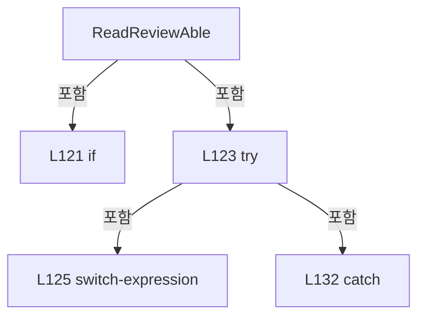

변경 전 점검: 입력/반환 타입, 위 호출자, 예외/취소 경로, 공유 상태와 저장·전송 소비자를 함께 확인합니다. 값의 단위나 물리 방향을 이름만으로 확정하지 않습니다.

### MethodDeclaration `RefreshSequenceStatus` · L138–152

[Drilling.UI/Menu/Menus/CMenuMain.cs:138–152](https://github.com/kjuws10-rgb/A3Drilling/blob/5aee8e58439c9b455cae7c9593c9be986c3e682e/Drilling.UI/Menu/Menus/CMenuMain.cs#L138-L152)

| 항목 | 실제 추출 값 |
| --- | --- |
| 서명 | void Drilling.UI.Menu.Menus.CMenuMain.RefreshSequenceStatus(Drilling.Common.Station.ST_STATION_PROCESS_STATUS) |
| 접근/수식자 | Private / private |
| 반환/값 타입 | void |
| 소속 타입 | NamedType:Drilling.UI.Menu.Menus.CMenuMain |

입력 계약:

| 이름 | 타입 | 전달 | 선택/기본값 |
| --- | --- | --- | --- |
| snapshot | Drilling.Common.Station.ST_STATION_PROCESS_STATUS | None | False /  |

정적 호출자로 확인된 위치:

| 호출 파일/행 | 호출 표현식 | 런타임 분기 가능 |
| --- | --- | --- |
| [Drilling.UI/Menu/Menus/CMenuMain.cs:695–695](https://github.com/kjuws10-rgb/A3Drilling/blob/5aee8e58439c9b455cae7c9593c9be986c3e682e/Drilling.UI/Menu/Menus/CMenuMain.cs#L695-L695) | RefreshSequenceStatus | False |
| [Drilling.UI/Menu/Menus/CMenuMain.cs:786–786](https://github.com/kjuws10-rgb/A3Drilling/blob/5aee8e58439c9b455cae7c9593c9be986c3e682e/Drilling.UI/Menu/Menus/CMenuMain.cs#L786-L786) | RefreshSequenceStatus | False |

호출하는 대상과 해석 범위:

| 원본 행 | 표현식 | 분석 상태 | 대상/소스 위치 |
| --- | --- | --- | --- |
| 140 | interfaceManager.Melsec.GetCachedSnapshot | resolved | System.Collections.Generic.IReadOnlyDictionary<string, Drilling.Common.Interface.ST_MELSEC_CACHED_VALUE> Drilling.Common.Interface.CMelsec.GetCachedSnapshot(out System.Collections.Generic.IReadOnlyList<Drilling.Common.Interface.ST_MELSEC_MAP_DATA>) · Drilling.Common/Interface/Melsec/CMelsec.cs:2538 |
| 141 | interfaceManager.GetInterfaceCommunicationList(EN_EQP_MODULE.Melsec).ToDictionary | resolved | System.Collections.Generic.Dictionary<int, Drilling.Common.Interface.EN_COMM_STATE> System.Collections.Generic.IEnumerable<Drilling.Common.Interface.ST_INTERFACE_COMM_STATUS>.ToDictionary<Drilling.Common.Interface.ST_INTERFACE_COMM_STATUS, int, Drilling.Common.Interface.EN_COMM_STATE>(System.Func<Drilling.Common.Interface.ST_INTERFACE_COMM_STATUS, int>, System.Func<Drilling.Common.Interface.ST_INTERFACE_COMM_STATUS, Drilling.Common.Interface.EN_COMM_STATE>) |
| 141 | interfaceManager.GetInterfaceCommunicationList | resolved | System.Collections.Generic.IReadOnlyList<Drilling.Common.Interface.ST_INTERFACE_COMM_STATUS> Drilling.Common.Interface.CInterfaceManager.GetInterfaceCommunicationList(Drilling.Common.Interface.EN_EQP_MODULE?) · Drilling.Common/Interface/CInterfaceManager.cs:472 |
| 142 | SequenceStatus.Refresh | resolved | void Drilling.UI.Menu.Menus.CMainSequenceStatus.Refresh(System.Collections.Generic.IReadOnlyDictionary<string, Drilling.Common.Interface.ST_MELSEC_CACHED_VALUE>, System.Collections.Generic.IReadOnlyList<Drilling.Common.Interface.ST_MELSEC_MAP_DATA>, System.Collections.Generic.IReadOnlyDictionary<int, Drilling.Common.Interface.EN_COMM_STATE>, System.Collections.Generic.IReadOnlyDictionary<string, Drilling.Common.Station.ST_SEQUENCE_ACTION_STATUS>?, Drilling.Common.Station.ST_STAGE_REQUEST_STATUS?) · Drilling.UI/Menu/Menus/CMenuMain.cs:3049 |
| 143 | SequenceStatus.RefreshZeroLine | resolved | void Drilling.UI.Menu.Menus.CMainSequenceStatus.RefreshZeroLine(Drilling.Common.Station.ST_ZERO_LINE_PREWAIT_STATUS?, Drilling.Common.Review.ST_ZERO_LINE_CYCLE_STATUS?) · Drilling.UI/Menu/Menus/CMenuMain.cs:3016 |
| 145 | ProtectWindow.RefreshSignals | resolved | void Drilling.UI.Menu.Menus.CMainProtectWindowPanel.RefreshSignals(System.Collections.Generic.IReadOnlyDictionary<string, Drilling.Common.Interface.ST_MELSEC_CACHED_VALUE>, System.Collections.Generic.IReadOnlyList<Drilling.Common.Interface.ST_MELSEC_MAP_DATA>, System.Collections.Generic.IReadOnlyDictionary<int, Drilling.Common.Interface.EN_COMM_STATE>) · Drilling.UI/Menu/Menus/CMenuMain.cs:2685 |
| 146 | RunOptions.UpdateReviewAble | resolved | void Drilling.UI.Menu.Menus.CMainRunOptionPanel.UpdateReviewAble(bool?) · Drilling.UI/Menu/Menus/CMenuMain.cs:2913 |
| 146 | ReadReviewAble | resolved | bool? Drilling.UI.Menu.Menus.CMenuMain.ReadReviewAble(Drilling.Common.Interface.ST_MELSEC_CACHED_VALUE?) · Drilling.UI/Menu/Menus/CMenuMain.cs:119 |
| 146 | values.GetValueOrDefault | resolved | Drilling.Common.Interface.ST_MELSEC_CACHED_VALUE? System.Collections.Generic.IReadOnlyDictionary<string, Drilling.Common.Interface.ST_MELSEC_CACHED_VALUE>.GetValueOrDefault<string, Drilling.Common.Interface.ST_MELSEC_CACHED_VALUE>(string) |
| 151 | SequenceStatus.RefreshReviewMonitor | resolved | void Drilling.UI.Menu.Menus.CMainSequenceStatus.RefreshReviewMonitor(Drilling.Common.Review.ST_FINE_REVIEW_MONITOR?) · Drilling.UI/Menu/Menus/CMenuMain.cs:3040 |
| 151 | .FineMonitor.GetSnapshot | resolved | Drilling.Common.Review.ST_FINE_REVIEW_MONITOR? Drilling.Common.Review.CFineReviewMonitorStore.GetSnapshot() · Drilling.Common/Review/CAutoFineReviewCoordinator.cs:377 |

본문의 실제 연산·분기·예외·반환 순서(원문 위치 순):

| 원본 행 | 종류 | 주석 해설 |
| --- | --- | --- |
| 140 | call | 함수·델리게이트 또는 객체 생성자를 호출합니다: interfaceManager.Melsec.GetCachedSnapshot(out var map) |
| 140 | local-declaration | 지역 변수를 선언합니다: var values = interfaceManager.Melsec.GetCachedSnapshot(out var map); |
| 140 | variable-initializer | 변수의 초기값을 지정합니다: values = interfaceManager.Melsec.GetCachedSnapshot(out var map) |
| 141 | call | 함수·델리게이트 또는 객체 생성자를 호출합니다: interfaceManager.GetInterfaceCommunicationList(EN_EQP_MODULE.Melsec).ToDictionary(device => device.Number, device => device.IsSimulation ? EN_COMM_STATE.Simulation : device.ConnectionState) |
| 141 | call | 함수·델리게이트 또는 객체 생성자를 호출합니다: interfaceManager.GetInterfaceCommunicationList(EN_EQP_MODULE.Melsec) |
| 141 | conditional-expression | 조건에 따라 결과식을 선택합니다: device.IsSimulation ? EN_COMM_STATE.Simulation : device.ConnectionState |
| 141 | local-declaration | 지역 변수를 선언합니다: var connections = interfaceManager.GetInterfaceCommunicationList(EN_EQP_MODULE.Melsec).ToDictionary(device => device.Number, device => device.IsSimulation ? EN_COMM_STATE.Simulation : device.ConnectionState); |
| 141 | variable-initializer | 변수의 초기값을 지정합니다: connections = interfaceManager.GetInterfaceCommunicationList(EN_EQP_MODULE.Melsec).ToDictionary(device => device.Number, device => device.IsSimulation ? EN_COMM_STATE.Simulation : device.ConnectionState) |
| 142 | call | 함수·델리게이트 또는 객체 생성자를 호출합니다: SequenceStatus.Refresh(values, map, connections, snapshot.SequenceActions, snapshot.StageRequest) |
| 143 | call | 함수·델리게이트 또는 객체 생성자를 호출합니다: SequenceStatus.RefreshZeroLine(snapshot.ZeroLinePrewait, snapshot.ZeroLine) |
| 144 | if | 조건에 따라 분기합니다: if (_selectedParameterTabKey == ParameterTabProtectWindow) |
| 145 | call | 함수·델리게이트 또는 객체 생성자를 호출합니다: ProtectWindow.RefreshSignals(values, map, connections) |
| 146 | call | 함수·델리게이트 또는 객체 생성자를 호출합니다: RunOptions.UpdateReviewAble(ReadReviewAble(values.GetValueOrDefault("HANDSHAKE_PRC_REVIEW_ABLE"))) |
| 146 | call | 함수·델리게이트 또는 객체 생성자를 호출합니다: ReadReviewAble(values.GetValueOrDefault("HANDSHAKE_PRC_REVIEW_ABLE")) |
| 146 | call | 함수·델리게이트 또는 객체 생성자를 호출합니다: values.GetValueOrDefault("HANDSHAKE_PRC_REVIEW_ABLE") |
| 147 | assignment | 값을 대상에 대입합니다: SequenceStatus.OpenReviewMonitor = OpenReviewMonitor |
| 148 | assignment | 값을 대상에 대입합니다: SequenceStatus.OpenPowerMeasureMonitor = OpenPowerMeasureMonitor |
| 149 | assignment | 값을 대상에 대입합니다: SequenceStatus.OpenZeroLineResults = OpenZeroLineResults |
| 150 | assignment | 값을 대상에 대입합니다: SequenceStatus.OpenDistortionResults = OpenDistortionResults |
| 151 | call | 함수·델리게이트 또는 객체 생성자를 호출합니다: SequenceStatus.RefreshReviewMonitor(reviewManager?.FineMonitor.GetSnapshot()) |
| 151 | call | 함수·델리게이트 또는 객체 생성자를 호출합니다: .FineMonitor.GetSnapshot() |

제어 구문의 포함 구조(실제 실행 순서/CFG가 아닌 구문 탐색 그림):

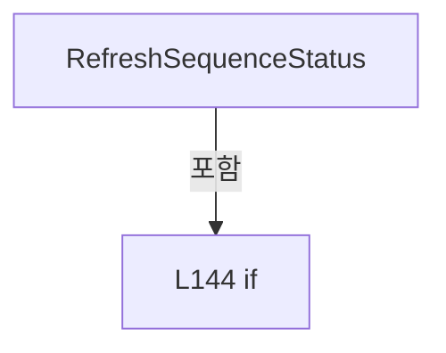

변경 전 점검: 입력/반환 타입, 위 호출자, 예외/취소 경로, 공유 상태와 저장·전송 소비자를 함께 확인합니다. 값의 단위나 물리 방향을 이름만으로 확정하지 않습니다.

### PropertyDeclaration `MotorStatusItems` · L154–154

[Drilling.UI/Menu/Menus/CMenuMain.cs:154–154](https://github.com/kjuws10-rgb/A3Drilling/blob/5aee8e58439c9b455cae7c9593c9be986c3e682e/Drilling.UI/Menu/Menus/CMenuMain.cs#L154-L154)

| 항목 | 실제 추출 값 |
| --- | --- |
| 서명 | System.Collections.Generic.IReadOnlyList<Drilling.UI.Menu.Menus.ST_MOTOR_STATUS_ITEM> Drilling.UI.Menu.Menus.CMenuMain.MotorStatusItems |
| 접근/수식자 | Public / public |
| 반환/값 타입 | System.Collections.Generic.IReadOnlyList<Drilling.UI.Menu.Menus.ST_MOTOR_STATUS_ITEM> |
| 소속 타입 | NamedType:Drilling.UI.Menu.Menus.CMenuMain |

현재 부분 분석에서 직접 연결된 호출자는 없습니다. XAML/이벤트/인터페이스·델리게이트·외부 진입을 추가 확인해야 하며, 미사용으로 판정한 것이 아닙니다.

변경 전 점검: 입력/반환 타입, 위 호출자, 예외/취소 경로, 공유 상태와 저장·전송 소비자를 함께 확인합니다. 값의 단위나 물리 방향을 이름만으로 확정하지 않습니다.

### GetAccessorDeclaration `get_MotorStatusItems` · L154–154

[Drilling.UI/Menu/Menus/CMenuMain.cs:154–154](https://github.com/kjuws10-rgb/A3Drilling/blob/5aee8e58439c9b455cae7c9593c9be986c3e682e/Drilling.UI/Menu/Menus/CMenuMain.cs#L154-L154)

| 항목 | 실제 추출 값 |
| --- | --- |
| 서명 | System.Collections.Generic.IReadOnlyList<Drilling.UI.Menu.Menus.ST_MOTOR_STATUS_ITEM> Drilling.UI.Menu.Menus.CMenuMain.MotorStatusItems.get |
| 접근/수식자 | Public / get |
| 반환/값 타입 | System.Collections.Generic.IReadOnlyList<Drilling.UI.Menu.Menus.ST_MOTOR_STATUS_ITEM> |
| 소속 타입 | NamedType:Drilling.UI.Menu.Menus.CMenuMain |

현재 부분 분석에서 직접 연결된 호출자는 없습니다. XAML/이벤트/인터페이스·델리게이트·외부 진입을 추가 확인해야 하며, 미사용으로 판정한 것이 아닙니다.

변경 전 점검: 입력/반환 타입, 위 호출자, 예외/취소 경로, 공유 상태와 저장·전송 소비자를 함께 확인합니다. 값의 단위나 물리 방향을 이름만으로 확정하지 않습니다.

### SetAccessorDeclaration `set_MotorStatusItems` · L154–154

[Drilling.UI/Menu/Menus/CMenuMain.cs:154–154](https://github.com/kjuws10-rgb/A3Drilling/blob/5aee8e58439c9b455cae7c9593c9be986c3e682e/Drilling.UI/Menu/Menus/CMenuMain.cs#L154-L154)

| 항목 | 실제 추출 값 |
| --- | --- |
| 서명 | void Drilling.UI.Menu.Menus.CMenuMain.MotorStatusItems.set |
| 접근/수식자 | Private / private, set |
| 반환/값 타입 | void |
| 소속 타입 | NamedType:Drilling.UI.Menu.Menus.CMenuMain |

입력 계약:

| 이름 | 타입 | 전달 | 선택/기본값 |
| --- | --- | --- | --- |
| value | System.Collections.Generic.IReadOnlyList<Drilling.UI.Menu.Menus.ST_MOTOR_STATUS_ITEM> | None | False /  |

현재 부분 분석에서 직접 연결된 호출자는 없습니다. XAML/이벤트/인터페이스·델리게이트·외부 진입을 추가 확인해야 하며, 미사용으로 판정한 것이 아닙니다.

호출하는 대상과 해석 범위:

| 원본 행 | 표현식 | 분석 상태 | 대상/소스 위치 |
| --- | --- | --- | --- |
| 154 | SetSequenceProperty | resolved | bool Drilling.UI.Menu.CBindingBase.SetSequenceProperty<Drilling.UI.Menu.Menus.ST_MOTOR_STATUS_ITEM>(ref System.Collections.Generic.IReadOnlyList<Drilling.UI.Menu.Menus.ST_MOTOR_STATUS_ITEM>, System.Collections.Generic.IReadOnlyList<Drilling.UI.Menu.Menus.ST_MOTOR_STATUS_ITEM>, string?) · Drilling.UI/Menu/CBindingBase.cs:747 |

본문의 실제 연산·분기·예외·반환 순서(원문 위치 순):

| 원본 행 | 종류 | 주석 해설 |
| --- | --- | --- |
| 154 | call | 함수·델리게이트 또는 객체 생성자를 호출합니다: SetSequenceProperty(ref _motorStatusItems, value) |

변경 전 점검: 입력/반환 타입, 위 호출자, 예외/취소 경로, 공유 상태와 저장·전송 소비자를 함께 확인합니다. 값의 단위나 물리 방향을 이름만으로 확정하지 않습니다.

### PropertyDeclaration `IsMotorStatusSelected` · L155–155

[Drilling.UI/Menu/Menus/CMenuMain.cs:155–155](https://github.com/kjuws10-rgb/A3Drilling/blob/5aee8e58439c9b455cae7c9593c9be986c3e682e/Drilling.UI/Menu/Menus/CMenuMain.cs#L155-L155)

| 항목 | 실제 추출 값 |
| --- | --- |
| 서명 | bool Drilling.UI.Menu.Menus.CMenuMain.IsMotorStatusSelected |
| 접근/수식자 | Public / public |
| 반환/값 타입 | bool |
| 소속 타입 | NamedType:Drilling.UI.Menu.Menus.CMenuMain |

현재 부분 분석에서 직접 연결된 호출자는 없습니다. XAML/이벤트/인터페이스·델리게이트·외부 진입을 추가 확인해야 하며, 미사용으로 판정한 것이 아닙니다.

변경 전 점검: 입력/반환 타입, 위 호출자, 예외/취소 경로, 공유 상태와 저장·전송 소비자를 함께 확인합니다. 값의 단위나 물리 방향을 이름만으로 확정하지 않습니다.

### MethodDeclaration `RefreshMotorStatus` · L157–163

[Drilling.UI/Menu/Menus/CMenuMain.cs:157–163](https://github.com/kjuws10-rgb/A3Drilling/blob/5aee8e58439c9b455cae7c9593c9be986c3e682e/Drilling.UI/Menu/Menus/CMenuMain.cs#L157-L163)

| 항목 | 실제 추출 값 |
| --- | --- |
| 서명 | void Drilling.UI.Menu.Menus.CMenuMain.RefreshMotorStatus() |
| 접근/수식자 | Private / private |
| 반환/값 타입 | void |
| 소속 타입 | NamedType:Drilling.UI.Menu.Menus.CMenuMain |

정적 호출자로 확인된 위치:

| 호출 파일/행 | 호출 표현식 | 런타임 분기 가능 |
| --- | --- | --- |
| [Drilling.UI/Menu/Menus/CMenuMain.cs:711–711](https://github.com/kjuws10-rgb/A3Drilling/blob/5aee8e58439c9b455cae7c9593c9be986c3e682e/Drilling.UI/Menu/Menus/CMenuMain.cs#L711-L711) | RefreshMotorStatus | False |
| [Drilling.UI/Menu/Menus/CMenuMain.cs:833–833](https://github.com/kjuws10-rgb/A3Drilling/blob/5aee8e58439c9b455cae7c9593c9be986c3e682e/Drilling.UI/Menu/Menus/CMenuMain.cs#L833-L833) | RefreshMotorStatus | False |

호출하는 대상과 해석 범위:

| 원본 행 | 표현식 | 분석 상태 | 대상/소스 위치 |
| --- | --- | --- | --- |
| 161 | _motorStatusPollingService.Start | resolved | void Drilling.UI.Menu.Menus.CMotorStatusPollingService.Start() · Drilling.UI/Menu/Menus/CMenuMain.cs:3987 |
| 162 | _motorStatusPollingService.GetSnapshot | resolved | System.Collections.Generic.IReadOnlyList<Drilling.UI.Menu.Menus.ST_MOTOR_STATUS_ITEM> Drilling.UI.Menu.Menus.CMotorStatusPollingService.GetSnapshot() · Drilling.UI/Menu/Menus/CMenuMain.cs:3994 |

본문의 실제 연산·분기·예외·반환 순서(원문 위치 순):

| 원본 행 | 종류 | 주석 해설 |
| --- | --- | --- |
| 159 | if | 조건에 따라 분기합니다: if (!IsMotorStatusSelected) |
| 160 | return | 호출자에게 값 또는 제어를 반환합니다: return; |
| 161 | call | 함수·델리게이트 또는 객체 생성자를 호출합니다: _motorStatusPollingService.Start() |
| 162 | assignment | 값을 대상에 대입합니다: MotorStatusItems = _motorStatusPollingService.GetSnapshot() |
| 162 | call | 함수·델리게이트 또는 객체 생성자를 호출합니다: _motorStatusPollingService.GetSnapshot() |

제어 구문의 포함 구조(실제 실행 순서/CFG가 아닌 구문 탐색 그림):

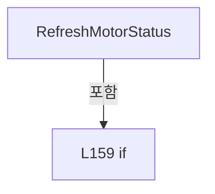

변경 전 점검: 입력/반환 타입, 위 호출자, 예외/취소 경로, 공유 상태와 저장·전송 소비자를 함께 확인합니다. 값의 단위나 물리 방향을 이름만으로 확정하지 않습니다.

### PropertyDeclaration `Menu` · L165–171

[Drilling.UI/Menu/Menus/CMenuMain.cs:165–171](https://github.com/kjuws10-rgb/A3Drilling/blob/5aee8e58439c9b455cae7c9593c9be986c3e682e/Drilling.UI/Menu/Menus/CMenuMain.cs#L165-L171)

| 항목 | 실제 추출 값 |
| --- | --- |
| 서명 | Drilling.UI.Menu.Menus.EN_MENU Drilling.UI.Menu.Menus.CMenuMain.Menu |
| 접근/수식자 | Public / public, override |
| 반환/값 타입 | Drilling.UI.Menu.Menus.EN_MENU |
| 소속 타입 | NamedType:Drilling.UI.Menu.Menus.CMenuMain |

현재 부분 분석에서 직접 연결된 호출자는 없습니다. XAML/이벤트/인터페이스·델리게이트·외부 진입을 추가 확인해야 하며, 미사용으로 판정한 것이 아닙니다.

변경 전 점검: 입력/반환 타입, 위 호출자, 예외/취소 경로, 공유 상태와 저장·전송 소비자를 함께 확인합니다. 값의 단위나 물리 방향을 이름만으로 확정하지 않습니다.

### GetAccessorDeclaration `get_Menu` · L167–170

[Drilling.UI/Menu/Menus/CMenuMain.cs:167–170](https://github.com/kjuws10-rgb/A3Drilling/blob/5aee8e58439c9b455cae7c9593c9be986c3e682e/Drilling.UI/Menu/Menus/CMenuMain.cs#L167-L170)

| 항목 | 실제 추출 값 |
| --- | --- |
| 서명 | Drilling.UI.Menu.Menus.EN_MENU Drilling.UI.Menu.Menus.CMenuMain.Menu.get |
| 접근/수식자 | Public / get |
| 반환/값 타입 | Drilling.UI.Menu.Menus.EN_MENU |
| 소속 타입 | NamedType:Drilling.UI.Menu.Menus.CMenuMain |

현재 부분 분석에서 직접 연결된 호출자는 없습니다. XAML/이벤트/인터페이스·델리게이트·외부 진입을 추가 확인해야 하며, 미사용으로 판정한 것이 아닙니다.

본문의 실제 연산·분기·예외·반환 순서(원문 위치 순):

| 원본 행 | 종류 | 주석 해설 |
| --- | --- | --- |
| 169 | return | 호출자에게 값 또는 제어를 반환합니다: return EN_MENU.Main; |

변경 전 점검: 입력/반환 타입, 위 호출자, 예외/취소 경로, 공유 상태와 저장·전송 소비자를 함께 확인합니다. 값의 단위나 물리 방향을 이름만으로 확정하지 않습니다.

### PropertyDeclaration `HeadPreviews` · L173–173

[Drilling.UI/Menu/Menus/CMenuMain.cs:173–173](https://github.com/kjuws10-rgb/A3Drilling/blob/5aee8e58439c9b455cae7c9593c9be986c3e682e/Drilling.UI/Menu/Menus/CMenuMain.cs#L173-L173)

| 항목 | 실제 추출 값 |
| --- | --- |
| 서명 | System.Collections.Generic.IReadOnlyList<Drilling.UI.Menu.Menus.ST_HEAD_PREVIEW> Drilling.UI.Menu.Menus.CMenuMain.HeadPreviews |
| 접근/수식자 | Public / public |
| 반환/값 타입 | System.Collections.Generic.IReadOnlyList<Drilling.UI.Menu.Menus.ST_HEAD_PREVIEW> |
| 소속 타입 | NamedType:Drilling.UI.Menu.Menus.CMenuMain |

현재 부분 분석에서 직접 연결된 호출자는 없습니다. XAML/이벤트/인터페이스·델리게이트·외부 진입을 추가 확인해야 하며, 미사용으로 판정한 것이 아닙니다.

변경 전 점검: 입력/반환 타입, 위 호출자, 예외/취소 경로, 공유 상태와 저장·전송 소비자를 함께 확인합니다. 값의 단위나 물리 방향을 이름만으로 확정하지 않습니다.

### GetAccessorDeclaration `get_HeadPreviews` · L173–173

[Drilling.UI/Menu/Menus/CMenuMain.cs:173–173](https://github.com/kjuws10-rgb/A3Drilling/blob/5aee8e58439c9b455cae7c9593c9be986c3e682e/Drilling.UI/Menu/Menus/CMenuMain.cs#L173-L173)

| 항목 | 실제 추출 값 |
| --- | --- |
| 서명 | System.Collections.Generic.IReadOnlyList<Drilling.UI.Menu.Menus.ST_HEAD_PREVIEW> Drilling.UI.Menu.Menus.CMenuMain.HeadPreviews.get |
| 접근/수식자 | Public / get |
| 반환/값 타입 | System.Collections.Generic.IReadOnlyList<Drilling.UI.Menu.Menus.ST_HEAD_PREVIEW> |
| 소속 타입 | NamedType:Drilling.UI.Menu.Menus.CMenuMain |

현재 부분 분석에서 직접 연결된 호출자는 없습니다. XAML/이벤트/인터페이스·델리게이트·외부 진입을 추가 확인해야 하며, 미사용으로 판정한 것이 아닙니다.

변경 전 점검: 입력/반환 타입, 위 호출자, 예외/취소 경로, 공유 상태와 저장·전송 소비자를 함께 확인합니다. 값의 단위나 물리 방향을 이름만으로 확정하지 않습니다.

### SetAccessorDeclaration `set_HeadPreviews` · L173–173

[Drilling.UI/Menu/Menus/CMenuMain.cs:173–173](https://github.com/kjuws10-rgb/A3Drilling/blob/5aee8e58439c9b455cae7c9593c9be986c3e682e/Drilling.UI/Menu/Menus/CMenuMain.cs#L173-L173)

| 항목 | 실제 추출 값 |
| --- | --- |
| 서명 | void Drilling.UI.Menu.Menus.CMenuMain.HeadPreviews.set |
| 접근/수식자 | Private / private, set |
| 반환/값 타입 | void |
| 소속 타입 | NamedType:Drilling.UI.Menu.Menus.CMenuMain |

입력 계약:

| 이름 | 타입 | 전달 | 선택/기본값 |
| --- | --- | --- | --- |
| value | System.Collections.Generic.IReadOnlyList<Drilling.UI.Menu.Menus.ST_HEAD_PREVIEW> | None | False /  |

현재 부분 분석에서 직접 연결된 호출자는 없습니다. XAML/이벤트/인터페이스·델리게이트·외부 진입을 추가 확인해야 하며, 미사용으로 판정한 것이 아닙니다.

호출하는 대상과 해석 범위:

| 원본 행 | 표현식 | 분석 상태 | 대상/소스 위치 |
| --- | --- | --- | --- |
| 173 | SetSequenceProperty | resolved | bool Drilling.UI.Menu.CBindingBase.SetSequenceProperty<Drilling.UI.Menu.Menus.ST_HEAD_PREVIEW>(ref System.Collections.Generic.IReadOnlyList<Drilling.UI.Menu.Menus.ST_HEAD_PREVIEW>, System.Collections.Generic.IReadOnlyList<Drilling.UI.Menu.Menus.ST_HEAD_PREVIEW>, string?) · Drilling.UI/Menu/CBindingBase.cs:747 |

본문의 실제 연산·분기·예외·반환 순서(원문 위치 순):

| 원본 행 | 종류 | 주석 해설 |
| --- | --- | --- |
| 173 | call | 함수·델리게이트 또는 객체 생성자를 호출합니다: SetSequenceProperty(ref _headPreviews, value) |

변경 전 점검: 입력/반환 타입, 위 호출자, 예외/취소 경로, 공유 상태와 저장·전송 소비자를 함께 확인합니다. 값의 단위나 물리 방향을 이름만으로 확정하지 않습니다.

### PropertyDeclaration `OddHeadPreviews` · L174–174

[Drilling.UI/Menu/Menus/CMenuMain.cs:174–174](https://github.com/kjuws10-rgb/A3Drilling/blob/5aee8e58439c9b455cae7c9593c9be986c3e682e/Drilling.UI/Menu/Menus/CMenuMain.cs#L174-L174)

| 항목 | 실제 추출 값 |
| --- | --- |
| 서명 | System.Collections.Generic.IReadOnlyList<Drilling.UI.Menu.Menus.ST_HEAD_PREVIEW> Drilling.UI.Menu.Menus.CMenuMain.OddHeadPreviews |
| 접근/수식자 | Public / public |
| 반환/값 타입 | System.Collections.Generic.IReadOnlyList<Drilling.UI.Menu.Menus.ST_HEAD_PREVIEW> |
| 소속 타입 | NamedType:Drilling.UI.Menu.Menus.CMenuMain |

현재 부분 분석에서 직접 연결된 호출자는 없습니다. XAML/이벤트/인터페이스·델리게이트·외부 진입을 추가 확인해야 하며, 미사용으로 판정한 것이 아닙니다.

변경 전 점검: 입력/반환 타입, 위 호출자, 예외/취소 경로, 공유 상태와 저장·전송 소비자를 함께 확인합니다. 값의 단위나 물리 방향을 이름만으로 확정하지 않습니다.

### GetAccessorDeclaration `get_OddHeadPreviews` · L174–174

[Drilling.UI/Menu/Menus/CMenuMain.cs:174–174](https://github.com/kjuws10-rgb/A3Drilling/blob/5aee8e58439c9b455cae7c9593c9be986c3e682e/Drilling.UI/Menu/Menus/CMenuMain.cs#L174-L174)

| 항목 | 실제 추출 값 |
| --- | --- |
| 서명 | System.Collections.Generic.IReadOnlyList<Drilling.UI.Menu.Menus.ST_HEAD_PREVIEW> Drilling.UI.Menu.Menus.CMenuMain.OddHeadPreviews.get |
| 접근/수식자 | Public / get |
| 반환/값 타입 | System.Collections.Generic.IReadOnlyList<Drilling.UI.Menu.Menus.ST_HEAD_PREVIEW> |
| 소속 타입 | NamedType:Drilling.UI.Menu.Menus.CMenuMain |

현재 부분 분석에서 직접 연결된 호출자는 없습니다. XAML/이벤트/인터페이스·델리게이트·외부 진입을 추가 확인해야 하며, 미사용으로 판정한 것이 아닙니다.

변경 전 점검: 입력/반환 타입, 위 호출자, 예외/취소 경로, 공유 상태와 저장·전송 소비자를 함께 확인합니다. 값의 단위나 물리 방향을 이름만으로 확정하지 않습니다.

### SetAccessorDeclaration `set_OddHeadPreviews` · L174–174

[Drilling.UI/Menu/Menus/CMenuMain.cs:174–174](https://github.com/kjuws10-rgb/A3Drilling/blob/5aee8e58439c9b455cae7c9593c9be986c3e682e/Drilling.UI/Menu/Menus/CMenuMain.cs#L174-L174)

| 항목 | 실제 추출 값 |
| --- | --- |
| 서명 | void Drilling.UI.Menu.Menus.CMenuMain.OddHeadPreviews.set |
| 접근/수식자 | Private / private, set |
| 반환/값 타입 | void |
| 소속 타입 | NamedType:Drilling.UI.Menu.Menus.CMenuMain |

입력 계약:

| 이름 | 타입 | 전달 | 선택/기본값 |
| --- | --- | --- | --- |
| value | System.Collections.Generic.IReadOnlyList<Drilling.UI.Menu.Menus.ST_HEAD_PREVIEW> | None | False /  |

현재 부분 분석에서 직접 연결된 호출자는 없습니다. XAML/이벤트/인터페이스·델리게이트·외부 진입을 추가 확인해야 하며, 미사용으로 판정한 것이 아닙니다.

호출하는 대상과 해석 범위:

| 원본 행 | 표현식 | 분석 상태 | 대상/소스 위치 |
| --- | --- | --- | --- |
| 174 | SetSequenceProperty | resolved | bool Drilling.UI.Menu.CBindingBase.SetSequenceProperty<Drilling.UI.Menu.Menus.ST_HEAD_PREVIEW>(ref System.Collections.Generic.IReadOnlyList<Drilling.UI.Menu.Menus.ST_HEAD_PREVIEW>, System.Collections.Generic.IReadOnlyList<Drilling.UI.Menu.Menus.ST_HEAD_PREVIEW>, string?) · Drilling.UI/Menu/CBindingBase.cs:747 |

본문의 실제 연산·분기·예외·반환 순서(원문 위치 순):

| 원본 행 | 종류 | 주석 해설 |
| --- | --- | --- |
| 174 | call | 함수·델리게이트 또는 객체 생성자를 호출합니다: SetSequenceProperty(ref _oddHeadPreviews, value) |

변경 전 점검: 입력/반환 타입, 위 호출자, 예외/취소 경로, 공유 상태와 저장·전송 소비자를 함께 확인합니다. 값의 단위나 물리 방향을 이름만으로 확정하지 않습니다.

### PropertyDeclaration `EvenHeadPreviews` · L175–175

[Drilling.UI/Menu/Menus/CMenuMain.cs:175–175](https://github.com/kjuws10-rgb/A3Drilling/blob/5aee8e58439c9b455cae7c9593c9be986c3e682e/Drilling.UI/Menu/Menus/CMenuMain.cs#L175-L175)

| 항목 | 실제 추출 값 |
| --- | --- |
| 서명 | System.Collections.Generic.IReadOnlyList<Drilling.UI.Menu.Menus.ST_HEAD_PREVIEW> Drilling.UI.Menu.Menus.CMenuMain.EvenHeadPreviews |
| 접근/수식자 | Public / public |
| 반환/값 타입 | System.Collections.Generic.IReadOnlyList<Drilling.UI.Menu.Menus.ST_HEAD_PREVIEW> |
| 소속 타입 | NamedType:Drilling.UI.Menu.Menus.CMenuMain |

현재 부분 분석에서 직접 연결된 호출자는 없습니다. XAML/이벤트/인터페이스·델리게이트·외부 진입을 추가 확인해야 하며, 미사용으로 판정한 것이 아닙니다.

변경 전 점검: 입력/반환 타입, 위 호출자, 예외/취소 경로, 공유 상태와 저장·전송 소비자를 함께 확인합니다. 값의 단위나 물리 방향을 이름만으로 확정하지 않습니다.

### GetAccessorDeclaration `get_EvenHeadPreviews` · L175–175

[Drilling.UI/Menu/Menus/CMenuMain.cs:175–175](https://github.com/kjuws10-rgb/A3Drilling/blob/5aee8e58439c9b455cae7c9593c9be986c3e682e/Drilling.UI/Menu/Menus/CMenuMain.cs#L175-L175)

| 항목 | 실제 추출 값 |
| --- | --- |
| 서명 | System.Collections.Generic.IReadOnlyList<Drilling.UI.Menu.Menus.ST_HEAD_PREVIEW> Drilling.UI.Menu.Menus.CMenuMain.EvenHeadPreviews.get |
| 접근/수식자 | Public / get |
| 반환/값 타입 | System.Collections.Generic.IReadOnlyList<Drilling.UI.Menu.Menus.ST_HEAD_PREVIEW> |
| 소속 타입 | NamedType:Drilling.UI.Menu.Menus.CMenuMain |

현재 부분 분석에서 직접 연결된 호출자는 없습니다. XAML/이벤트/인터페이스·델리게이트·외부 진입을 추가 확인해야 하며, 미사용으로 판정한 것이 아닙니다.

변경 전 점검: 입력/반환 타입, 위 호출자, 예외/취소 경로, 공유 상태와 저장·전송 소비자를 함께 확인합니다. 값의 단위나 물리 방향을 이름만으로 확정하지 않습니다.

### SetAccessorDeclaration `set_EvenHeadPreviews` · L175–175

[Drilling.UI/Menu/Menus/CMenuMain.cs:175–175](https://github.com/kjuws10-rgb/A3Drilling/blob/5aee8e58439c9b455cae7c9593c9be986c3e682e/Drilling.UI/Menu/Menus/CMenuMain.cs#L175-L175)

| 항목 | 실제 추출 값 |
| --- | --- |
| 서명 | void Drilling.UI.Menu.Menus.CMenuMain.EvenHeadPreviews.set |
| 접근/수식자 | Private / private, set |
| 반환/값 타입 | void |
| 소속 타입 | NamedType:Drilling.UI.Menu.Menus.CMenuMain |

입력 계약:

| 이름 | 타입 | 전달 | 선택/기본값 |
| --- | --- | --- | --- |
| value | System.Collections.Generic.IReadOnlyList<Drilling.UI.Menu.Menus.ST_HEAD_PREVIEW> | None | False /  |

현재 부분 분석에서 직접 연결된 호출자는 없습니다. XAML/이벤트/인터페이스·델리게이트·외부 진입을 추가 확인해야 하며, 미사용으로 판정한 것이 아닙니다.

호출하는 대상과 해석 범위:

| 원본 행 | 표현식 | 분석 상태 | 대상/소스 위치 |
| --- | --- | --- | --- |
| 175 | SetSequenceProperty | resolved | bool Drilling.UI.Menu.CBindingBase.SetSequenceProperty<Drilling.UI.Menu.Menus.ST_HEAD_PREVIEW>(ref System.Collections.Generic.IReadOnlyList<Drilling.UI.Menu.Menus.ST_HEAD_PREVIEW>, System.Collections.Generic.IReadOnlyList<Drilling.UI.Menu.Menus.ST_HEAD_PREVIEW>, string?) · Drilling.UI/Menu/CBindingBase.cs:747 |

본문의 실제 연산·분기·예외·반환 순서(원문 위치 순):

| 원본 행 | 종류 | 주석 해설 |
| --- | --- | --- |
| 175 | call | 함수·델리게이트 또는 객체 생성자를 호출합니다: SetSequenceProperty(ref _evenHeadPreviews, value) |

변경 전 점검: 입력/반환 타입, 위 호출자, 예외/취소 경로, 공유 상태와 저장·전송 소비자를 함께 확인합니다. 값의 단위나 물리 방향을 이름만으로 확정하지 않습니다.

### PropertyDeclaration `CycleItems` · L177–188

[Drilling.UI/Menu/Menus/CMenuMain.cs:177–188](https://github.com/kjuws10-rgb/A3Drilling/blob/5aee8e58439c9b455cae7c9593c9be986c3e682e/Drilling.UI/Menu/Menus/CMenuMain.cs#L177-L188)

| 항목 | 실제 추출 값 |
| --- | --- |
| 서명 | System.Collections.Generic.IReadOnlyList<Drilling.UI.Menu.Menus.ST_DISPLAY_ITEM> Drilling.UI.Menu.Menus.CMenuMain.CycleItems |
| 접근/수식자 | Public / public |
| 반환/값 타입 | System.Collections.Generic.IReadOnlyList<Drilling.UI.Menu.Menus.ST_DISPLAY_ITEM> |
| 소속 타입 | NamedType:Drilling.UI.Menu.Menus.CMenuMain |

현재 부분 분석에서 직접 연결된 호출자는 없습니다. XAML/이벤트/인터페이스·델리게이트·외부 진입을 추가 확인해야 하며, 미사용으로 판정한 것이 아닙니다.

변경 전 점검: 입력/반환 타입, 위 호출자, 예외/취소 경로, 공유 상태와 저장·전송 소비자를 함께 확인합니다. 값의 단위나 물리 방향을 이름만으로 확정하지 않습니다.

### GetAccessorDeclaration `get_CycleItems` · L179–182

[Drilling.UI/Menu/Menus/CMenuMain.cs:179–182](https://github.com/kjuws10-rgb/A3Drilling/blob/5aee8e58439c9b455cae7c9593c9be986c3e682e/Drilling.UI/Menu/Menus/CMenuMain.cs#L179-L182)

| 항목 | 실제 추출 값 |
| --- | --- |
| 서명 | System.Collections.Generic.IReadOnlyList<Drilling.UI.Menu.Menus.ST_DISPLAY_ITEM> Drilling.UI.Menu.Menus.CMenuMain.CycleItems.get |
| 접근/수식자 | Public / get |
| 반환/값 타입 | System.Collections.Generic.IReadOnlyList<Drilling.UI.Menu.Menus.ST_DISPLAY_ITEM> |
| 소속 타입 | NamedType:Drilling.UI.Menu.Menus.CMenuMain |

현재 부분 분석에서 직접 연결된 호출자는 없습니다. XAML/이벤트/인터페이스·델리게이트·외부 진입을 추가 확인해야 하며, 미사용으로 판정한 것이 아닙니다.

본문의 실제 연산·분기·예외·반환 순서(원문 위치 순):

| 원본 행 | 종류 | 주석 해설 |
| --- | --- | --- |
| 181 | return | 호출자에게 값 또는 제어를 반환합니다: return _cycleItems; |

변경 전 점검: 입력/반환 타입, 위 호출자, 예외/취소 경로, 공유 상태와 저장·전송 소비자를 함께 확인합니다. 값의 단위나 물리 방향을 이름만으로 확정하지 않습니다.

### SetAccessorDeclaration `set_CycleItems` · L184–187

[Drilling.UI/Menu/Menus/CMenuMain.cs:184–187](https://github.com/kjuws10-rgb/A3Drilling/blob/5aee8e58439c9b455cae7c9593c9be986c3e682e/Drilling.UI/Menu/Menus/CMenuMain.cs#L184-L187)

| 항목 | 실제 추출 값 |
| --- | --- |
| 서명 | void Drilling.UI.Menu.Menus.CMenuMain.CycleItems.set |
| 접근/수식자 | Private / private, set |
| 반환/값 타입 | void |
| 소속 타입 | NamedType:Drilling.UI.Menu.Menus.CMenuMain |

입력 계약:

| 이름 | 타입 | 전달 | 선택/기본값 |
| --- | --- | --- | --- |
| value | System.Collections.Generic.IReadOnlyList<Drilling.UI.Menu.Menus.ST_DISPLAY_ITEM> | None | False /  |

현재 부분 분석에서 직접 연결된 호출자는 없습니다. XAML/이벤트/인터페이스·델리게이트·외부 진입을 추가 확인해야 하며, 미사용으로 판정한 것이 아닙니다.

호출하는 대상과 해석 범위:

| 원본 행 | 표현식 | 분석 상태 | 대상/소스 위치 |
| --- | --- | --- | --- |
| 186 | SetSequenceProperty | resolved | bool Drilling.UI.Menu.CBindingBase.SetSequenceProperty<Drilling.UI.Menu.Menus.ST_DISPLAY_ITEM>(ref System.Collections.Generic.IReadOnlyList<Drilling.UI.Menu.Menus.ST_DISPLAY_ITEM>, System.Collections.Generic.IReadOnlyList<Drilling.UI.Menu.Menus.ST_DISPLAY_ITEM>, string?) · Drilling.UI/Menu/CBindingBase.cs:747 |

본문의 실제 연산·분기·예외·반환 순서(원문 위치 순):

| 원본 행 | 종류 | 주석 해설 |
| --- | --- | --- |
| 186 | call | 함수·델리게이트 또는 객체 생성자를 호출합니다: SetSequenceProperty(ref _cycleItems, value) |

변경 전 점검: 입력/반환 타입, 위 호출자, 예외/취소 경로, 공유 상태와 저장·전송 소비자를 함께 확인합니다. 값의 단위나 물리 방향을 이름만으로 확정하지 않습니다.

### PropertyDeclaration `ResultItems` · L190–201

[Drilling.UI/Menu/Menus/CMenuMain.cs:190–201](https://github.com/kjuws10-rgb/A3Drilling/blob/5aee8e58439c9b455cae7c9593c9be986c3e682e/Drilling.UI/Menu/Menus/CMenuMain.cs#L190-L201)

| 항목 | 실제 추출 값 |
| --- | --- |
| 서명 | System.Collections.Generic.IReadOnlyList<Drilling.UI.Menu.Menus.ST_DISPLAY_ITEM> Drilling.UI.Menu.Menus.CMenuMain.ResultItems |
| 접근/수식자 | Public / public |
| 반환/값 타입 | System.Collections.Generic.IReadOnlyList<Drilling.UI.Menu.Menus.ST_DISPLAY_ITEM> |
| 소속 타입 | NamedType:Drilling.UI.Menu.Menus.CMenuMain |

현재 부분 분석에서 직접 연결된 호출자는 없습니다. XAML/이벤트/인터페이스·델리게이트·외부 진입을 추가 확인해야 하며, 미사용으로 판정한 것이 아닙니다.

변경 전 점검: 입력/반환 타입, 위 호출자, 예외/취소 경로, 공유 상태와 저장·전송 소비자를 함께 확인합니다. 값의 단위나 물리 방향을 이름만으로 확정하지 않습니다.

### GetAccessorDeclaration `get_ResultItems` · L192–195

[Drilling.UI/Menu/Menus/CMenuMain.cs:192–195](https://github.com/kjuws10-rgb/A3Drilling/blob/5aee8e58439c9b455cae7c9593c9be986c3e682e/Drilling.UI/Menu/Menus/CMenuMain.cs#L192-L195)

| 항목 | 실제 추출 값 |
| --- | --- |
| 서명 | System.Collections.Generic.IReadOnlyList<Drilling.UI.Menu.Menus.ST_DISPLAY_ITEM> Drilling.UI.Menu.Menus.CMenuMain.ResultItems.get |
| 접근/수식자 | Public / get |
| 반환/값 타입 | System.Collections.Generic.IReadOnlyList<Drilling.UI.Menu.Menus.ST_DISPLAY_ITEM> |
| 소속 타입 | NamedType:Drilling.UI.Menu.Menus.CMenuMain |

현재 부분 분석에서 직접 연결된 호출자는 없습니다. XAML/이벤트/인터페이스·델리게이트·외부 진입을 추가 확인해야 하며, 미사용으로 판정한 것이 아닙니다.

본문의 실제 연산·분기·예외·반환 순서(원문 위치 순):

| 원본 행 | 종류 | 주석 해설 |
| --- | --- | --- |
| 194 | return | 호출자에게 값 또는 제어를 반환합니다: return _resultItems; |

변경 전 점검: 입력/반환 타입, 위 호출자, 예외/취소 경로, 공유 상태와 저장·전송 소비자를 함께 확인합니다. 값의 단위나 물리 방향을 이름만으로 확정하지 않습니다.

### SetAccessorDeclaration `set_ResultItems` · L197–200

[Drilling.UI/Menu/Menus/CMenuMain.cs:197–200](https://github.com/kjuws10-rgb/A3Drilling/blob/5aee8e58439c9b455cae7c9593c9be986c3e682e/Drilling.UI/Menu/Menus/CMenuMain.cs#L197-L200)

| 항목 | 실제 추출 값 |
| --- | --- |
| 서명 | void Drilling.UI.Menu.Menus.CMenuMain.ResultItems.set |
| 접근/수식자 | Private / private, set |
| 반환/값 타입 | void |
| 소속 타입 | NamedType:Drilling.UI.Menu.Menus.CMenuMain |

입력 계약:

| 이름 | 타입 | 전달 | 선택/기본값 |
| --- | --- | --- | --- |
| value | System.Collections.Generic.IReadOnlyList<Drilling.UI.Menu.Menus.ST_DISPLAY_ITEM> | None | False /  |

현재 부분 분석에서 직접 연결된 호출자는 없습니다. XAML/이벤트/인터페이스·델리게이트·외부 진입을 추가 확인해야 하며, 미사용으로 판정한 것이 아닙니다.

호출하는 대상과 해석 범위:

| 원본 행 | 표현식 | 분석 상태 | 대상/소스 위치 |
| --- | --- | --- | --- |
| 199 | SetSequenceProperty | resolved | bool Drilling.UI.Menu.CBindingBase.SetSequenceProperty<Drilling.UI.Menu.Menus.ST_DISPLAY_ITEM>(ref System.Collections.Generic.IReadOnlyList<Drilling.UI.Menu.Menus.ST_DISPLAY_ITEM>, System.Collections.Generic.IReadOnlyList<Drilling.UI.Menu.Menus.ST_DISPLAY_ITEM>, string?) · Drilling.UI/Menu/CBindingBase.cs:747 |

본문의 실제 연산·분기·예외·반환 순서(원문 위치 순):

| 원본 행 | 종류 | 주석 해설 |
| --- | --- | --- |
| 199 | call | 함수·델리게이트 또는 객체 생성자를 호출합니다: SetSequenceProperty(ref _resultItems, value) |

변경 전 점검: 입력/반환 타입, 위 호출자, 예외/취소 경로, 공유 상태와 저장·전송 소비자를 함께 확인합니다. 값의 단위나 물리 방향을 이름만으로 확정하지 않습니다.

### PropertyDeclaration `ProcessSequenceItems` · L203–214

[Drilling.UI/Menu/Menus/CMenuMain.cs:203–214](https://github.com/kjuws10-rgb/A3Drilling/blob/5aee8e58439c9b455cae7c9593c9be986c3e682e/Drilling.UI/Menu/Menus/CMenuMain.cs#L203-L214)

| 항목 | 실제 추출 값 |
| --- | --- |
| 서명 | System.Collections.Generic.IReadOnlyList<Drilling.UI.Menu.Menus.ST_MAIN_PROCESS_SEQUENCE_ITEM> Drilling.UI.Menu.Menus.CMenuMain.ProcessSequenceItems |
| 접근/수식자 | Public / public |
| 반환/값 타입 | System.Collections.Generic.IReadOnlyList<Drilling.UI.Menu.Menus.ST_MAIN_PROCESS_SEQUENCE_ITEM> |
| 소속 타입 | NamedType:Drilling.UI.Menu.Menus.CMenuMain |

현재 부분 분석에서 직접 연결된 호출자는 없습니다. XAML/이벤트/인터페이스·델리게이트·외부 진입을 추가 확인해야 하며, 미사용으로 판정한 것이 아닙니다.

변경 전 점검: 입력/반환 타입, 위 호출자, 예외/취소 경로, 공유 상태와 저장·전송 소비자를 함께 확인합니다. 값의 단위나 물리 방향을 이름만으로 확정하지 않습니다.

### GetAccessorDeclaration `get_ProcessSequenceItems` · L205–208

[Drilling.UI/Menu/Menus/CMenuMain.cs:205–208](https://github.com/kjuws10-rgb/A3Drilling/blob/5aee8e58439c9b455cae7c9593c9be986c3e682e/Drilling.UI/Menu/Menus/CMenuMain.cs#L205-L208)

| 항목 | 실제 추출 값 |
| --- | --- |
| 서명 | System.Collections.Generic.IReadOnlyList<Drilling.UI.Menu.Menus.ST_MAIN_PROCESS_SEQUENCE_ITEM> Drilling.UI.Menu.Menus.CMenuMain.ProcessSequenceItems.get |
| 접근/수식자 | Public / get |
| 반환/값 타입 | System.Collections.Generic.IReadOnlyList<Drilling.UI.Menu.Menus.ST_MAIN_PROCESS_SEQUENCE_ITEM> |
| 소속 타입 | NamedType:Drilling.UI.Menu.Menus.CMenuMain |

현재 부분 분석에서 직접 연결된 호출자는 없습니다. XAML/이벤트/인터페이스·델리게이트·외부 진입을 추가 확인해야 하며, 미사용으로 판정한 것이 아닙니다.

본문의 실제 연산·분기·예외·반환 순서(원문 위치 순):

| 원본 행 | 종류 | 주석 해설 |
| --- | --- | --- |
| 207 | return | 호출자에게 값 또는 제어를 반환합니다: return _processSequenceItems; |

변경 전 점검: 입력/반환 타입, 위 호출자, 예외/취소 경로, 공유 상태와 저장·전송 소비자를 함께 확인합니다. 값의 단위나 물리 방향을 이름만으로 확정하지 않습니다.

### SetAccessorDeclaration `set_ProcessSequenceItems` · L210–213

[Drilling.UI/Menu/Menus/CMenuMain.cs:210–213](https://github.com/kjuws10-rgb/A3Drilling/blob/5aee8e58439c9b455cae7c9593c9be986c3e682e/Drilling.UI/Menu/Menus/CMenuMain.cs#L210-L213)

| 항목 | 실제 추출 값 |
| --- | --- |
| 서명 | void Drilling.UI.Menu.Menus.CMenuMain.ProcessSequenceItems.set |
| 접근/수식자 | Private / private, set |
| 반환/값 타입 | void |
| 소속 타입 | NamedType:Drilling.UI.Menu.Menus.CMenuMain |

입력 계약:

| 이름 | 타입 | 전달 | 선택/기본값 |
| --- | --- | --- | --- |
| value | System.Collections.Generic.IReadOnlyList<Drilling.UI.Menu.Menus.ST_MAIN_PROCESS_SEQUENCE_ITEM> | None | False /  |

현재 부분 분석에서 직접 연결된 호출자는 없습니다. XAML/이벤트/인터페이스·델리게이트·외부 진입을 추가 확인해야 하며, 미사용으로 판정한 것이 아닙니다.

호출하는 대상과 해석 범위:

| 원본 행 | 표현식 | 분석 상태 | 대상/소스 위치 |
| --- | --- | --- | --- |
| 212 | SetSequenceProperty | resolved | bool Drilling.UI.Menu.CBindingBase.SetSequenceProperty<Drilling.UI.Menu.Menus.ST_MAIN_PROCESS_SEQUENCE_ITEM>(ref System.Collections.Generic.IReadOnlyList<Drilling.UI.Menu.Menus.ST_MAIN_PROCESS_SEQUENCE_ITEM>, System.Collections.Generic.IReadOnlyList<Drilling.UI.Menu.Menus.ST_MAIN_PROCESS_SEQUENCE_ITEM>, string?) · Drilling.UI/Menu/CBindingBase.cs:747 |

본문의 실제 연산·분기·예외·반환 순서(원문 위치 순):

| 원본 행 | 종류 | 주석 해설 |
| --- | --- | --- |
| 212 | call | 함수·델리게이트 또는 객체 생성자를 호출합니다: SetSequenceProperty(ref _processSequenceItems, value) |

변경 전 점검: 입력/반환 타입, 위 호출자, 예외/취소 경로, 공유 상태와 저장·전송 소비자를 함께 확인합니다. 값의 단위나 물리 방향을 이름만으로 확정하지 않습니다.

### PropertyDeclaration `CurrentStepDetails` · L216–227

[Drilling.UI/Menu/Menus/CMenuMain.cs:216–227](https://github.com/kjuws10-rgb/A3Drilling/blob/5aee8e58439c9b455cae7c9593c9be986c3e682e/Drilling.UI/Menu/Menus/CMenuMain.cs#L216-L227)

| 항목 | 실제 추출 값 |
| --- | --- |
| 서명 | System.Collections.Generic.IReadOnlyList<Drilling.UI.Menu.Menus.ST_DISPLAY_ITEM> Drilling.UI.Menu.Menus.CMenuMain.CurrentStepDetails |
| 접근/수식자 | Public / public |
| 반환/값 타입 | System.Collections.Generic.IReadOnlyList<Drilling.UI.Menu.Menus.ST_DISPLAY_ITEM> |
| 소속 타입 | NamedType:Drilling.UI.Menu.Menus.CMenuMain |

현재 부분 분석에서 직접 연결된 호출자는 없습니다. XAML/이벤트/인터페이스·델리게이트·외부 진입을 추가 확인해야 하며, 미사용으로 판정한 것이 아닙니다.

변경 전 점검: 입력/반환 타입, 위 호출자, 예외/취소 경로, 공유 상태와 저장·전송 소비자를 함께 확인합니다. 값의 단위나 물리 방향을 이름만으로 확정하지 않습니다.

### GetAccessorDeclaration `get_CurrentStepDetails` · L218–221

[Drilling.UI/Menu/Menus/CMenuMain.cs:218–221](https://github.com/kjuws10-rgb/A3Drilling/blob/5aee8e58439c9b455cae7c9593c9be986c3e682e/Drilling.UI/Menu/Menus/CMenuMain.cs#L218-L221)

| 항목 | 실제 추출 값 |
| --- | --- |
| 서명 | System.Collections.Generic.IReadOnlyList<Drilling.UI.Menu.Menus.ST_DISPLAY_ITEM> Drilling.UI.Menu.Menus.CMenuMain.CurrentStepDetails.get |
| 접근/수식자 | Public / get |
| 반환/값 타입 | System.Collections.Generic.IReadOnlyList<Drilling.UI.Menu.Menus.ST_DISPLAY_ITEM> |
| 소속 타입 | NamedType:Drilling.UI.Menu.Menus.CMenuMain |

현재 부분 분석에서 직접 연결된 호출자는 없습니다. XAML/이벤트/인터페이스·델리게이트·외부 진입을 추가 확인해야 하며, 미사용으로 판정한 것이 아닙니다.

본문의 실제 연산·분기·예외·반환 순서(원문 위치 순):

| 원본 행 | 종류 | 주석 해설 |
| --- | --- | --- |
| 220 | return | 호출자에게 값 또는 제어를 반환합니다: return _currentStepDetails; |

변경 전 점검: 입력/반환 타입, 위 호출자, 예외/취소 경로, 공유 상태와 저장·전송 소비자를 함께 확인합니다. 값의 단위나 물리 방향을 이름만으로 확정하지 않습니다.

### SetAccessorDeclaration `set_CurrentStepDetails` · L223–226

[Drilling.UI/Menu/Menus/CMenuMain.cs:223–226](https://github.com/kjuws10-rgb/A3Drilling/blob/5aee8e58439c9b455cae7c9593c9be986c3e682e/Drilling.UI/Menu/Menus/CMenuMain.cs#L223-L226)

| 항목 | 실제 추출 값 |
| --- | --- |
| 서명 | void Drilling.UI.Menu.Menus.CMenuMain.CurrentStepDetails.set |
| 접근/수식자 | Private / private, set |
| 반환/값 타입 | void |
| 소속 타입 | NamedType:Drilling.UI.Menu.Menus.CMenuMain |

입력 계약:

| 이름 | 타입 | 전달 | 선택/기본값 |
| --- | --- | --- | --- |
| value | System.Collections.Generic.IReadOnlyList<Drilling.UI.Menu.Menus.ST_DISPLAY_ITEM> | None | False /  |

현재 부분 분석에서 직접 연결된 호출자는 없습니다. XAML/이벤트/인터페이스·델리게이트·외부 진입을 추가 확인해야 하며, 미사용으로 판정한 것이 아닙니다.

호출하는 대상과 해석 범위:

| 원본 행 | 표현식 | 분석 상태 | 대상/소스 위치 |
| --- | --- | --- | --- |
| 225 | SetSequenceProperty | resolved | bool Drilling.UI.Menu.CBindingBase.SetSequenceProperty<Drilling.UI.Menu.Menus.ST_DISPLAY_ITEM>(ref System.Collections.Generic.IReadOnlyList<Drilling.UI.Menu.Menus.ST_DISPLAY_ITEM>, System.Collections.Generic.IReadOnlyList<Drilling.UI.Menu.Menus.ST_DISPLAY_ITEM>, string?) · Drilling.UI/Menu/CBindingBase.cs:747 |

본문의 실제 연산·분기·예외·반환 순서(원문 위치 순):

| 원본 행 | 종류 | 주석 해설 |
| --- | --- | --- |
| 225 | call | 함수·델리게이트 또는 객체 생성자를 호출합니다: SetSequenceProperty(ref _currentStepDetails, value) |

변경 전 점검: 입력/반환 타입, 위 호출자, 예외/취소 경로, 공유 상태와 저장·전송 소비자를 함께 확인합니다. 값의 단위나 물리 방향을 이름만으로 확정하지 않습니다.

### PropertyDeclaration `ProcessSummaryItems` · L229–240

[Drilling.UI/Menu/Menus/CMenuMain.cs:229–240](https://github.com/kjuws10-rgb/A3Drilling/blob/5aee8e58439c9b455cae7c9593c9be986c3e682e/Drilling.UI/Menu/Menus/CMenuMain.cs#L229-L240)

| 항목 | 실제 추출 값 |
| --- | --- |
| 서명 | System.Collections.Generic.IReadOnlyList<Drilling.UI.Menu.Menus.ST_DISPLAY_ITEM> Drilling.UI.Menu.Menus.CMenuMain.ProcessSummaryItems |
| 접근/수식자 | Public / public |
| 반환/값 타입 | System.Collections.Generic.IReadOnlyList<Drilling.UI.Menu.Menus.ST_DISPLAY_ITEM> |
| 소속 타입 | NamedType:Drilling.UI.Menu.Menus.CMenuMain |

현재 부분 분석에서 직접 연결된 호출자는 없습니다. XAML/이벤트/인터페이스·델리게이트·외부 진입을 추가 확인해야 하며, 미사용으로 판정한 것이 아닙니다.

변경 전 점검: 입력/반환 타입, 위 호출자, 예외/취소 경로, 공유 상태와 저장·전송 소비자를 함께 확인합니다. 값의 단위나 물리 방향을 이름만으로 확정하지 않습니다.

### GetAccessorDeclaration `get_ProcessSummaryItems` · L231–234

[Drilling.UI/Menu/Menus/CMenuMain.cs:231–234](https://github.com/kjuws10-rgb/A3Drilling/blob/5aee8e58439c9b455cae7c9593c9be986c3e682e/Drilling.UI/Menu/Menus/CMenuMain.cs#L231-L234)

| 항목 | 실제 추출 값 |
| --- | --- |
| 서명 | System.Collections.Generic.IReadOnlyList<Drilling.UI.Menu.Menus.ST_DISPLAY_ITEM> Drilling.UI.Menu.Menus.CMenuMain.ProcessSummaryItems.get |
| 접근/수식자 | Public / get |
| 반환/값 타입 | System.Collections.Generic.IReadOnlyList<Drilling.UI.Menu.Menus.ST_DISPLAY_ITEM> |
| 소속 타입 | NamedType:Drilling.UI.Menu.Menus.CMenuMain |

현재 부분 분석에서 직접 연결된 호출자는 없습니다. XAML/이벤트/인터페이스·델리게이트·외부 진입을 추가 확인해야 하며, 미사용으로 판정한 것이 아닙니다.

본문의 실제 연산·분기·예외·반환 순서(원문 위치 순):

| 원본 행 | 종류 | 주석 해설 |
| --- | --- | --- |
| 233 | return | 호출자에게 값 또는 제어를 반환합니다: return _processSummaryItems; |

변경 전 점검: 입력/반환 타입, 위 호출자, 예외/취소 경로, 공유 상태와 저장·전송 소비자를 함께 확인합니다. 값의 단위나 물리 방향을 이름만으로 확정하지 않습니다.

### SetAccessorDeclaration `set_ProcessSummaryItems` · L236–239

[Drilling.UI/Menu/Menus/CMenuMain.cs:236–239](https://github.com/kjuws10-rgb/A3Drilling/blob/5aee8e58439c9b455cae7c9593c9be986c3e682e/Drilling.UI/Menu/Menus/CMenuMain.cs#L236-L239)

| 항목 | 실제 추출 값 |
| --- | --- |
| 서명 | void Drilling.UI.Menu.Menus.CMenuMain.ProcessSummaryItems.set |
| 접근/수식자 | Private / private, set |
| 반환/값 타입 | void |
| 소속 타입 | NamedType:Drilling.UI.Menu.Menus.CMenuMain |

입력 계약:

| 이름 | 타입 | 전달 | 선택/기본값 |
| --- | --- | --- | --- |
| value | System.Collections.Generic.IReadOnlyList<Drilling.UI.Menu.Menus.ST_DISPLAY_ITEM> | None | False /  |

현재 부분 분석에서 직접 연결된 호출자는 없습니다. XAML/이벤트/인터페이스·델리게이트·외부 진입을 추가 확인해야 하며, 미사용으로 판정한 것이 아닙니다.

호출하는 대상과 해석 범위:

| 원본 행 | 표현식 | 분석 상태 | 대상/소스 위치 |
| --- | --- | --- | --- |
| 238 | SetSequenceProperty | resolved | bool Drilling.UI.Menu.CBindingBase.SetSequenceProperty<Drilling.UI.Menu.Menus.ST_DISPLAY_ITEM>(ref System.Collections.Generic.IReadOnlyList<Drilling.UI.Menu.Menus.ST_DISPLAY_ITEM>, System.Collections.Generic.IReadOnlyList<Drilling.UI.Menu.Menus.ST_DISPLAY_ITEM>, string?) · Drilling.UI/Menu/CBindingBase.cs:747 |

본문의 실제 연산·분기·예외·반환 순서(원문 위치 순):

| 원본 행 | 종류 | 주석 해설 |
| --- | --- | --- |
| 238 | call | 함수·델리게이트 또는 객체 생성자를 호출합니다: SetSequenceProperty(ref _processSummaryItems, value) |

변경 전 점검: 입력/반환 타입, 위 호출자, 예외/취소 경로, 공유 상태와 저장·전송 소비자를 함께 확인합니다. 값의 단위나 물리 방향을 이름만으로 확정하지 않습니다.

### PropertyDeclaration `LifecycleItems` · L242–253

[Drilling.UI/Menu/Menus/CMenuMain.cs:242–253](https://github.com/kjuws10-rgb/A3Drilling/blob/5aee8e58439c9b455cae7c9593c9be986c3e682e/Drilling.UI/Menu/Menus/CMenuMain.cs#L242-L253)

| 항목 | 실제 추출 값 |
| --- | --- |
| 서명 | System.Collections.Generic.IReadOnlyList<Drilling.UI.Menu.Menus.ST_DISPLAY_ITEM> Drilling.UI.Menu.Menus.CMenuMain.LifecycleItems |
| 접근/수식자 | Public / public |
| 반환/값 타입 | System.Collections.Generic.IReadOnlyList<Drilling.UI.Menu.Menus.ST_DISPLAY_ITEM> |
| 소속 타입 | NamedType:Drilling.UI.Menu.Menus.CMenuMain |

현재 부분 분석에서 직접 연결된 호출자는 없습니다. XAML/이벤트/인터페이스·델리게이트·외부 진입을 추가 확인해야 하며, 미사용으로 판정한 것이 아닙니다.

변경 전 점검: 입력/반환 타입, 위 호출자, 예외/취소 경로, 공유 상태와 저장·전송 소비자를 함께 확인합니다. 값의 단위나 물리 방향을 이름만으로 확정하지 않습니다.

### GetAccessorDeclaration `get_LifecycleItems` · L244–247

[Drilling.UI/Menu/Menus/CMenuMain.cs:244–247](https://github.com/kjuws10-rgb/A3Drilling/blob/5aee8e58439c9b455cae7c9593c9be986c3e682e/Drilling.UI/Menu/Menus/CMenuMain.cs#L244-L247)

| 항목 | 실제 추출 값 |
| --- | --- |
| 서명 | System.Collections.Generic.IReadOnlyList<Drilling.UI.Menu.Menus.ST_DISPLAY_ITEM> Drilling.UI.Menu.Menus.CMenuMain.LifecycleItems.get |
| 접근/수식자 | Public / get |
| 반환/값 타입 | System.Collections.Generic.IReadOnlyList<Drilling.UI.Menu.Menus.ST_DISPLAY_ITEM> |
| 소속 타입 | NamedType:Drilling.UI.Menu.Menus.CMenuMain |

현재 부분 분석에서 직접 연결된 호출자는 없습니다. XAML/이벤트/인터페이스·델리게이트·외부 진입을 추가 확인해야 하며, 미사용으로 판정한 것이 아닙니다.

본문의 실제 연산·분기·예외·반환 순서(원문 위치 순):

| 원본 행 | 종류 | 주석 해설 |
| --- | --- | --- |
| 246 | return | 호출자에게 값 또는 제어를 반환합니다: return _lifecycleItems; |

변경 전 점검: 입력/반환 타입, 위 호출자, 예외/취소 경로, 공유 상태와 저장·전송 소비자를 함께 확인합니다. 값의 단위나 물리 방향을 이름만으로 확정하지 않습니다.

### SetAccessorDeclaration `set_LifecycleItems` · L249–252

[Drilling.UI/Menu/Menus/CMenuMain.cs:249–252](https://github.com/kjuws10-rgb/A3Drilling/blob/5aee8e58439c9b455cae7c9593c9be986c3e682e/Drilling.UI/Menu/Menus/CMenuMain.cs#L249-L252)

| 항목 | 실제 추출 값 |
| --- | --- |
| 서명 | void Drilling.UI.Menu.Menus.CMenuMain.LifecycleItems.set |
| 접근/수식자 | Private / private, set |
| 반환/값 타입 | void |
| 소속 타입 | NamedType:Drilling.UI.Menu.Menus.CMenuMain |

입력 계약:

| 이름 | 타입 | 전달 | 선택/기본값 |
| --- | --- | --- | --- |
| value | System.Collections.Generic.IReadOnlyList<Drilling.UI.Menu.Menus.ST_DISPLAY_ITEM> | None | False /  |

현재 부분 분석에서 직접 연결된 호출자는 없습니다. XAML/이벤트/인터페이스·델리게이트·외부 진입을 추가 확인해야 하며, 미사용으로 판정한 것이 아닙니다.

호출하는 대상과 해석 범위:

| 원본 행 | 표현식 | 분석 상태 | 대상/소스 위치 |
| --- | --- | --- | --- |
| 251 | SetSequenceProperty | resolved | bool Drilling.UI.Menu.CBindingBase.SetSequenceProperty<Drilling.UI.Menu.Menus.ST_DISPLAY_ITEM>(ref System.Collections.Generic.IReadOnlyList<Drilling.UI.Menu.Menus.ST_DISPLAY_ITEM>, System.Collections.Generic.IReadOnlyList<Drilling.UI.Menu.Menus.ST_DISPLAY_ITEM>, string?) · Drilling.UI/Menu/CBindingBase.cs:747 |

본문의 실제 연산·분기·예외·반환 순서(원문 위치 순):

| 원본 행 | 종류 | 주석 해설 |
| --- | --- | --- |
| 251 | call | 함수·델리게이트 또는 객체 생성자를 호출합니다: SetSequenceProperty(ref _lifecycleItems, value) |

변경 전 점검: 입력/반환 타입, 위 호출자, 예외/취소 경로, 공유 상태와 저장·전송 소비자를 함께 확인합니다. 값의 단위나 물리 방향을 이름만으로 확정하지 않습니다.

### PropertyDeclaration `ScriptTaskStatusItems` · L255–266

[Drilling.UI/Menu/Menus/CMenuMain.cs:255–266](https://github.com/kjuws10-rgb/A3Drilling/blob/5aee8e58439c9b455cae7c9593c9be986c3e682e/Drilling.UI/Menu/Menus/CMenuMain.cs#L255-L266)

| 항목 | 실제 추출 값 |
| --- | --- |
| 서명 | System.Collections.Generic.IReadOnlyList<Drilling.UI.Menu.Menus.ST_SCRIPT_TASK_STATUS_ITEM> Drilling.UI.Menu.Menus.CMenuMain.ScriptTaskStatusItems |
| 접근/수식자 | Public / public |
| 반환/값 타입 | System.Collections.Generic.IReadOnlyList<Drilling.UI.Menu.Menus.ST_SCRIPT_TASK_STATUS_ITEM> |
| 소속 타입 | NamedType:Drilling.UI.Menu.Menus.CMenuMain |

현재 부분 분석에서 직접 연결된 호출자는 없습니다. XAML/이벤트/인터페이스·델리게이트·외부 진입을 추가 확인해야 하며, 미사용으로 판정한 것이 아닙니다.

변경 전 점검: 입력/반환 타입, 위 호출자, 예외/취소 경로, 공유 상태와 저장·전송 소비자를 함께 확인합니다. 값의 단위나 물리 방향을 이름만으로 확정하지 않습니다.

### GetAccessorDeclaration `get_ScriptTaskStatusItems` · L257–260

[Drilling.UI/Menu/Menus/CMenuMain.cs:257–260](https://github.com/kjuws10-rgb/A3Drilling/blob/5aee8e58439c9b455cae7c9593c9be986c3e682e/Drilling.UI/Menu/Menus/CMenuMain.cs#L257-L260)

| 항목 | 실제 추출 값 |
| --- | --- |
| 서명 | System.Collections.Generic.IReadOnlyList<Drilling.UI.Menu.Menus.ST_SCRIPT_TASK_STATUS_ITEM> Drilling.UI.Menu.Menus.CMenuMain.ScriptTaskStatusItems.get |
| 접근/수식자 | Public / get |
| 반환/값 타입 | System.Collections.Generic.IReadOnlyList<Drilling.UI.Menu.Menus.ST_SCRIPT_TASK_STATUS_ITEM> |
| 소속 타입 | NamedType:Drilling.UI.Menu.Menus.CMenuMain |

현재 부분 분석에서 직접 연결된 호출자는 없습니다. XAML/이벤트/인터페이스·델리게이트·외부 진입을 추가 확인해야 하며, 미사용으로 판정한 것이 아닙니다.

본문의 실제 연산·분기·예외·반환 순서(원문 위치 순):

| 원본 행 | 종류 | 주석 해설 |
| --- | --- | --- |
| 259 | return | 호출자에게 값 또는 제어를 반환합니다: return _scriptTaskStatusItems; |

변경 전 점검: 입력/반환 타입, 위 호출자, 예외/취소 경로, 공유 상태와 저장·전송 소비자를 함께 확인합니다. 값의 단위나 물리 방향을 이름만으로 확정하지 않습니다.

### SetAccessorDeclaration `set_ScriptTaskStatusItems` · L262–265

[Drilling.UI/Menu/Menus/CMenuMain.cs:262–265](https://github.com/kjuws10-rgb/A3Drilling/blob/5aee8e58439c9b455cae7c9593c9be986c3e682e/Drilling.UI/Menu/Menus/CMenuMain.cs#L262-L265)

| 항목 | 실제 추출 값 |
| --- | --- |
| 서명 | void Drilling.UI.Menu.Menus.CMenuMain.ScriptTaskStatusItems.set |
| 접근/수식자 | Private / private, set |
| 반환/값 타입 | void |
| 소속 타입 | NamedType:Drilling.UI.Menu.Menus.CMenuMain |

입력 계약:

| 이름 | 타입 | 전달 | 선택/기본값 |
| --- | --- | --- | --- |
| value | System.Collections.Generic.IReadOnlyList<Drilling.UI.Menu.Menus.ST_SCRIPT_TASK_STATUS_ITEM> | None | False /  |

현재 부분 분석에서 직접 연결된 호출자는 없습니다. XAML/이벤트/인터페이스·델리게이트·외부 진입을 추가 확인해야 하며, 미사용으로 판정한 것이 아닙니다.

호출하는 대상과 해석 범위:

| 원본 행 | 표현식 | 분석 상태 | 대상/소스 위치 |
| --- | --- | --- | --- |
| 264 | SetSequenceProperty | resolved | bool Drilling.UI.Menu.CBindingBase.SetSequenceProperty<Drilling.UI.Menu.Menus.ST_SCRIPT_TASK_STATUS_ITEM>(ref System.Collections.Generic.IReadOnlyList<Drilling.UI.Menu.Menus.ST_SCRIPT_TASK_STATUS_ITEM>, System.Collections.Generic.IReadOnlyList<Drilling.UI.Menu.Menus.ST_SCRIPT_TASK_STATUS_ITEM>, string?) · Drilling.UI/Menu/CBindingBase.cs:747 |

본문의 실제 연산·분기·예외·반환 순서(원문 위치 순):

| 원본 행 | 종류 | 주석 해설 |
| --- | --- | --- |
| 264 | call | 함수·델리게이트 또는 객체 생성자를 호출합니다: SetSequenceProperty(ref _scriptTaskStatusItems, value) |

변경 전 점검: 입력/반환 타입, 위 호출자, 예외/취소 경로, 공유 상태와 저장·전송 소비자를 함께 확인합니다. 값의 단위나 물리 방향을 이름만으로 확정하지 않습니다.

### PropertyDeclaration `AutomationControllerStatusItems` · L268–279

[Drilling.UI/Menu/Menus/CMenuMain.cs:268–279](https://github.com/kjuws10-rgb/A3Drilling/blob/5aee8e58439c9b455cae7c9593c9be986c3e682e/Drilling.UI/Menu/Menus/CMenuMain.cs#L268-L279)

| 항목 | 실제 추출 값 |
| --- | --- |
| 서명 | System.Collections.Generic.IReadOnlyList<Drilling.UI.Menu.Menus.ST_AUTOMATION_CONTROLLER_STATUS_ITEM> Drilling.UI.Menu.Menus.CMenuMain.AutomationControllerStatusItems |
| 접근/수식자 | Public / public |
| 반환/값 타입 | System.Collections.Generic.IReadOnlyList<Drilling.UI.Menu.Menus.ST_AUTOMATION_CONTROLLER_STATUS_ITEM> |
| 소속 타입 | NamedType:Drilling.UI.Menu.Menus.CMenuMain |

현재 부분 분석에서 직접 연결된 호출자는 없습니다. XAML/이벤트/인터페이스·델리게이트·외부 진입을 추가 확인해야 하며, 미사용으로 판정한 것이 아닙니다.

변경 전 점검: 입력/반환 타입, 위 호출자, 예외/취소 경로, 공유 상태와 저장·전송 소비자를 함께 확인합니다. 값의 단위나 물리 방향을 이름만으로 확정하지 않습니다.

### GetAccessorDeclaration `get_AutomationControllerStatusItems` · L270–273

[Drilling.UI/Menu/Menus/CMenuMain.cs:270–273](https://github.com/kjuws10-rgb/A3Drilling/blob/5aee8e58439c9b455cae7c9593c9be986c3e682e/Drilling.UI/Menu/Menus/CMenuMain.cs#L270-L273)

| 항목 | 실제 추출 값 |
| --- | --- |
| 서명 | System.Collections.Generic.IReadOnlyList<Drilling.UI.Menu.Menus.ST_AUTOMATION_CONTROLLER_STATUS_ITEM> Drilling.UI.Menu.Menus.CMenuMain.AutomationControllerStatusItems.get |
| 접근/수식자 | Public / get |
| 반환/값 타입 | System.Collections.Generic.IReadOnlyList<Drilling.UI.Menu.Menus.ST_AUTOMATION_CONTROLLER_STATUS_ITEM> |
| 소속 타입 | NamedType:Drilling.UI.Menu.Menus.CMenuMain |

현재 부분 분석에서 직접 연결된 호출자는 없습니다. XAML/이벤트/인터페이스·델리게이트·외부 진입을 추가 확인해야 하며, 미사용으로 판정한 것이 아닙니다.

본문의 실제 연산·분기·예외·반환 순서(원문 위치 순):

| 원본 행 | 종류 | 주석 해설 |
| --- | --- | --- |
| 272 | return | 호출자에게 값 또는 제어를 반환합니다: return _automationControllerStatusItems; |

변경 전 점검: 입력/반환 타입, 위 호출자, 예외/취소 경로, 공유 상태와 저장·전송 소비자를 함께 확인합니다. 값의 단위나 물리 방향을 이름만으로 확정하지 않습니다.

### SetAccessorDeclaration `set_AutomationControllerStatusItems` · L275–278

[Drilling.UI/Menu/Menus/CMenuMain.cs:275–278](https://github.com/kjuws10-rgb/A3Drilling/blob/5aee8e58439c9b455cae7c9593c9be986c3e682e/Drilling.UI/Menu/Menus/CMenuMain.cs#L275-L278)

| 항목 | 실제 추출 값 |
| --- | --- |
| 서명 | void Drilling.UI.Menu.Menus.CMenuMain.AutomationControllerStatusItems.set |
| 접근/수식자 | Private / private, set |
| 반환/값 타입 | void |
| 소속 타입 | NamedType:Drilling.UI.Menu.Menus.CMenuMain |

입력 계약:

| 이름 | 타입 | 전달 | 선택/기본값 |
| --- | --- | --- | --- |
| value | System.Collections.Generic.IReadOnlyList<Drilling.UI.Menu.Menus.ST_AUTOMATION_CONTROLLER_STATUS_ITEM> | None | False /  |

현재 부분 분석에서 직접 연결된 호출자는 없습니다. XAML/이벤트/인터페이스·델리게이트·외부 진입을 추가 확인해야 하며, 미사용으로 판정한 것이 아닙니다.

호출하는 대상과 해석 범위:

| 원본 행 | 표현식 | 분석 상태 | 대상/소스 위치 |
| --- | --- | --- | --- |
| 277 | SetSequenceProperty | resolved | bool Drilling.UI.Menu.CBindingBase.SetSequenceProperty<Drilling.UI.Menu.Menus.ST_AUTOMATION_CONTROLLER_STATUS_ITEM>(ref System.Collections.Generic.IReadOnlyList<Drilling.UI.Menu.Menus.ST_AUTOMATION_CONTROLLER_STATUS_ITEM>, System.Collections.Generic.IReadOnlyList<Drilling.UI.Menu.Menus.ST_AUTOMATION_CONTROLLER_STATUS_ITEM>, string?) · Drilling.UI/Menu/CBindingBase.cs:747 |

본문의 실제 연산·분기·예외·반환 순서(원문 위치 순):

| 원본 행 | 종류 | 주석 해설 |
| --- | --- | --- |
| 277 | call | 함수·델리게이트 또는 객체 생성자를 호출합니다: SetSequenceProperty(ref _automationControllerStatusItems, value) |

변경 전 점검: 입력/반환 타입, 위 호출자, 예외/취소 경로, 공유 상태와 저장·전송 소비자를 함께 확인합니다. 값의 단위나 물리 방향을 이름만으로 확정하지 않습니다.

### PropertyDeclaration `InspectionStatusItems` · L281–292

[Drilling.UI/Menu/Menus/CMenuMain.cs:281–292](https://github.com/kjuws10-rgb/A3Drilling/blob/5aee8e58439c9b455cae7c9593c9be986c3e682e/Drilling.UI/Menu/Menus/CMenuMain.cs#L281-L292)

| 항목 | 실제 추출 값 |
| --- | --- |
| 서명 | System.Collections.Generic.IReadOnlyList<Drilling.UI.Menu.Menus.ST_INSPECTION_STATUS_ITEM> Drilling.UI.Menu.Menus.CMenuMain.InspectionStatusItems |
| 접근/수식자 | Public / public |
| 반환/값 타입 | System.Collections.Generic.IReadOnlyList<Drilling.UI.Menu.Menus.ST_INSPECTION_STATUS_ITEM> |
| 소속 타입 | NamedType:Drilling.UI.Menu.Menus.CMenuMain |

현재 부분 분석에서 직접 연결된 호출자는 없습니다. XAML/이벤트/인터페이스·델리게이트·외부 진입을 추가 확인해야 하며, 미사용으로 판정한 것이 아닙니다.

변경 전 점검: 입력/반환 타입, 위 호출자, 예외/취소 경로, 공유 상태와 저장·전송 소비자를 함께 확인합니다. 값의 단위나 물리 방향을 이름만으로 확정하지 않습니다.

### GetAccessorDeclaration `get_InspectionStatusItems` · L283–286

[Drilling.UI/Menu/Menus/CMenuMain.cs:283–286](https://github.com/kjuws10-rgb/A3Drilling/blob/5aee8e58439c9b455cae7c9593c9be986c3e682e/Drilling.UI/Menu/Menus/CMenuMain.cs#L283-L286)

| 항목 | 실제 추출 값 |
| --- | --- |
| 서명 | System.Collections.Generic.IReadOnlyList<Drilling.UI.Menu.Menus.ST_INSPECTION_STATUS_ITEM> Drilling.UI.Menu.Menus.CMenuMain.InspectionStatusItems.get |
| 접근/수식자 | Public / get |
| 반환/값 타입 | System.Collections.Generic.IReadOnlyList<Drilling.UI.Menu.Menus.ST_INSPECTION_STATUS_ITEM> |
| 소속 타입 | NamedType:Drilling.UI.Menu.Menus.CMenuMain |

현재 부분 분석에서 직접 연결된 호출자는 없습니다. XAML/이벤트/인터페이스·델리게이트·외부 진입을 추가 확인해야 하며, 미사용으로 판정한 것이 아닙니다.

본문의 실제 연산·분기·예외·반환 순서(원문 위치 순):

| 원본 행 | 종류 | 주석 해설 |
| --- | --- | --- |
| 285 | return | 호출자에게 값 또는 제어를 반환합니다: return _inspectionStatusItems; |

변경 전 점검: 입력/반환 타입, 위 호출자, 예외/취소 경로, 공유 상태와 저장·전송 소비자를 함께 확인합니다. 값의 단위나 물리 방향을 이름만으로 확정하지 않습니다.

### SetAccessorDeclaration `set_InspectionStatusItems` · L288–291

[Drilling.UI/Menu/Menus/CMenuMain.cs:288–291](https://github.com/kjuws10-rgb/A3Drilling/blob/5aee8e58439c9b455cae7c9593c9be986c3e682e/Drilling.UI/Menu/Menus/CMenuMain.cs#L288-L291)

| 항목 | 실제 추출 값 |
| --- | --- |
| 서명 | void Drilling.UI.Menu.Menus.CMenuMain.InspectionStatusItems.set |
| 접근/수식자 | Private / private, set |
| 반환/값 타입 | void |
| 소속 타입 | NamedType:Drilling.UI.Menu.Menus.CMenuMain |

입력 계약:

| 이름 | 타입 | 전달 | 선택/기본값 |
| --- | --- | --- | --- |
| value | System.Collections.Generic.IReadOnlyList<Drilling.UI.Menu.Menus.ST_INSPECTION_STATUS_ITEM> | None | False /  |

현재 부분 분석에서 직접 연결된 호출자는 없습니다. XAML/이벤트/인터페이스·델리게이트·외부 진입을 추가 확인해야 하며, 미사용으로 판정한 것이 아닙니다.

호출하는 대상과 해석 범위:

| 원본 행 | 표현식 | 분석 상태 | 대상/소스 위치 |
| --- | --- | --- | --- |
| 290 | SetSequenceProperty | resolved | bool Drilling.UI.Menu.CBindingBase.SetSequenceProperty<Drilling.UI.Menu.Menus.ST_INSPECTION_STATUS_ITEM>(ref System.Collections.Generic.IReadOnlyList<Drilling.UI.Menu.Menus.ST_INSPECTION_STATUS_ITEM>, System.Collections.Generic.IReadOnlyList<Drilling.UI.Menu.Menus.ST_INSPECTION_STATUS_ITEM>, string?) · Drilling.UI/Menu/CBindingBase.cs:747 |

본문의 실제 연산·분기·예외·반환 순서(원문 위치 순):

| 원본 행 | 종류 | 주석 해설 |
| --- | --- | --- |
| 290 | call | 함수·델리게이트 또는 객체 생성자를 호출합니다: SetSequenceProperty(ref _inspectionStatusItems, value) |

변경 전 점검: 입력/반환 타입, 위 호출자, 예외/취소 경로, 공유 상태와 저장·전송 소비자를 함께 확인합니다. 값의 단위나 물리 방향을 이름만으로 확정하지 않습니다.

### PropertyDeclaration `InspectionSummary` · L294–305

[Drilling.UI/Menu/Menus/CMenuMain.cs:294–305](https://github.com/kjuws10-rgb/A3Drilling/blob/5aee8e58439c9b455cae7c9593c9be986c3e682e/Drilling.UI/Menu/Menus/CMenuMain.cs#L294-L305)

| 항목 | 실제 추출 값 |
| --- | --- |
| 서명 | string Drilling.UI.Menu.Menus.CMenuMain.InspectionSummary |
| 접근/수식자 | Public / public |
| 반환/값 타입 | string |
| 소속 타입 | NamedType:Drilling.UI.Menu.Menus.CMenuMain |

현재 부분 분석에서 직접 연결된 호출자는 없습니다. XAML/이벤트/인터페이스·델리게이트·외부 진입을 추가 확인해야 하며, 미사용으로 판정한 것이 아닙니다.

변경 전 점검: 입력/반환 타입, 위 호출자, 예외/취소 경로, 공유 상태와 저장·전송 소비자를 함께 확인합니다. 값의 단위나 물리 방향을 이름만으로 확정하지 않습니다.

### GetAccessorDeclaration `get_InspectionSummary` · L296–299

[Drilling.UI/Menu/Menus/CMenuMain.cs:296–299](https://github.com/kjuws10-rgb/A3Drilling/blob/5aee8e58439c9b455cae7c9593c9be986c3e682e/Drilling.UI/Menu/Menus/CMenuMain.cs#L296-L299)

| 항목 | 실제 추출 값 |
| --- | --- |
| 서명 | string Drilling.UI.Menu.Menus.CMenuMain.InspectionSummary.get |
| 접근/수식자 | Public / get |
| 반환/값 타입 | string |
| 소속 타입 | NamedType:Drilling.UI.Menu.Menus.CMenuMain |

현재 부분 분석에서 직접 연결된 호출자는 없습니다. XAML/이벤트/인터페이스·델리게이트·외부 진입을 추가 확인해야 하며, 미사용으로 판정한 것이 아닙니다.

본문의 실제 연산·분기·예외·반환 순서(원문 위치 순):

| 원본 행 | 종류 | 주석 해설 |
| --- | --- | --- |
| 298 | return | 호출자에게 값 또는 제어를 반환합니다: return _inspectionSummary; |

변경 전 점검: 입력/반환 타입, 위 호출자, 예외/취소 경로, 공유 상태와 저장·전송 소비자를 함께 확인합니다. 값의 단위나 물리 방향을 이름만으로 확정하지 않습니다.

### SetAccessorDeclaration `set_InspectionSummary` · L301–304

[Drilling.UI/Menu/Menus/CMenuMain.cs:301–304](https://github.com/kjuws10-rgb/A3Drilling/blob/5aee8e58439c9b455cae7c9593c9be986c3e682e/Drilling.UI/Menu/Menus/CMenuMain.cs#L301-L304)

| 항목 | 실제 추출 값 |
| --- | --- |
| 서명 | void Drilling.UI.Menu.Menus.CMenuMain.InspectionSummary.set |
| 접근/수식자 | Private / private, set |
| 반환/값 타입 | void |
| 소속 타입 | NamedType:Drilling.UI.Menu.Menus.CMenuMain |

입력 계약:

| 이름 | 타입 | 전달 | 선택/기본값 |
| --- | --- | --- | --- |
| value | string | None | False /  |

현재 부분 분석에서 직접 연결된 호출자는 없습니다. XAML/이벤트/인터페이스·델리게이트·외부 진입을 추가 확인해야 하며, 미사용으로 판정한 것이 아닙니다.

호출하는 대상과 해석 범위:

| 원본 행 | 표현식 | 분석 상태 | 대상/소스 위치 |
| --- | --- | --- | --- |
| 303 | SetProperty | resolved | bool Drilling.UI.Menu.CBindingBase.SetProperty<string>(ref string, string, string?) · Drilling.UI/Menu/CBindingBase.cs:735 |

본문의 실제 연산·분기·예외·반환 순서(원문 위치 순):

| 원본 행 | 종류 | 주석 해설 |
| --- | --- | --- |
| 303 | call | 함수·델리게이트 또는 객체 생성자를 호출합니다: SetProperty(ref _inspectionSummary, value) |

변경 전 점검: 입력/반환 타입, 위 호출자, 예외/취소 경로, 공유 상태와 저장·전송 소비자를 함께 확인합니다. 값의 단위나 물리 방향을 이름만으로 확정하지 않습니다.

### PropertyDeclaration `InspectionModeText` · L307–318

[Drilling.UI/Menu/Menus/CMenuMain.cs:307–318](https://github.com/kjuws10-rgb/A3Drilling/blob/5aee8e58439c9b455cae7c9593c9be986c3e682e/Drilling.UI/Menu/Menus/CMenuMain.cs#L307-L318)

| 항목 | 실제 추출 값 |
| --- | --- |
| 서명 | string Drilling.UI.Menu.Menus.CMenuMain.InspectionModeText |
| 접근/수식자 | Public / public |
| 반환/값 타입 | string |
| 소속 타입 | NamedType:Drilling.UI.Menu.Menus.CMenuMain |

현재 부분 분석에서 직접 연결된 호출자는 없습니다. XAML/이벤트/인터페이스·델리게이트·외부 진입을 추가 확인해야 하며, 미사용으로 판정한 것이 아닙니다.

변경 전 점검: 입력/반환 타입, 위 호출자, 예외/취소 경로, 공유 상태와 저장·전송 소비자를 함께 확인합니다. 값의 단위나 물리 방향을 이름만으로 확정하지 않습니다.

### GetAccessorDeclaration `get_InspectionModeText` · L309–312

[Drilling.UI/Menu/Menus/CMenuMain.cs:309–312](https://github.com/kjuws10-rgb/A3Drilling/blob/5aee8e58439c9b455cae7c9593c9be986c3e682e/Drilling.UI/Menu/Menus/CMenuMain.cs#L309-L312)

| 항목 | 실제 추출 값 |
| --- | --- |
| 서명 | string Drilling.UI.Menu.Menus.CMenuMain.InspectionModeText.get |
| 접근/수식자 | Public / get |
| 반환/값 타입 | string |
| 소속 타입 | NamedType:Drilling.UI.Menu.Menus.CMenuMain |

현재 부분 분석에서 직접 연결된 호출자는 없습니다. XAML/이벤트/인터페이스·델리게이트·외부 진입을 추가 확인해야 하며, 미사용으로 판정한 것이 아닙니다.

본문의 실제 연산·분기·예외·반환 순서(원문 위치 순):

| 원본 행 | 종류 | 주석 해설 |
| --- | --- | --- |
| 311 | return | 호출자에게 값 또는 제어를 반환합니다: return _inspectionModeText; |

변경 전 점검: 입력/반환 타입, 위 호출자, 예외/취소 경로, 공유 상태와 저장·전송 소비자를 함께 확인합니다. 값의 단위나 물리 방향을 이름만으로 확정하지 않습니다.

### SetAccessorDeclaration `set_InspectionModeText` · L314–317

[Drilling.UI/Menu/Menus/CMenuMain.cs:314–317](https://github.com/kjuws10-rgb/A3Drilling/blob/5aee8e58439c9b455cae7c9593c9be986c3e682e/Drilling.UI/Menu/Menus/CMenuMain.cs#L314-L317)

| 항목 | 실제 추출 값 |
| --- | --- |
| 서명 | void Drilling.UI.Menu.Menus.CMenuMain.InspectionModeText.set |
| 접근/수식자 | Private / private, set |
| 반환/값 타입 | void |
| 소속 타입 | NamedType:Drilling.UI.Menu.Menus.CMenuMain |

입력 계약:

| 이름 | 타입 | 전달 | 선택/기본값 |
| --- | --- | --- | --- |
| value | string | None | False /  |

현재 부분 분석에서 직접 연결된 호출자는 없습니다. XAML/이벤트/인터페이스·델리게이트·외부 진입을 추가 확인해야 하며, 미사용으로 판정한 것이 아닙니다.

호출하는 대상과 해석 범위:

| 원본 행 | 표현식 | 분석 상태 | 대상/소스 위치 |
| --- | --- | --- | --- |
| 316 | SetProperty | resolved | bool Drilling.UI.Menu.CBindingBase.SetProperty<string>(ref string, string, string?) · Drilling.UI/Menu/CBindingBase.cs:735 |

본문의 실제 연산·분기·예외·반환 순서(원문 위치 순):

| 원본 행 | 종류 | 주석 해설 |
| --- | --- | --- |
| 316 | call | 함수·델리게이트 또는 객체 생성자를 호출합니다: SetProperty(ref _inspectionModeText, value) |

변경 전 점검: 입력/반환 타입, 위 호출자, 예외/취소 경로, 공유 상태와 저장·전송 소비자를 함께 확인합니다. 값의 단위나 물리 방향을 이름만으로 확정하지 않습니다.

### PropertyDeclaration `InspectionRuleText` · L320–331

[Drilling.UI/Menu/Menus/CMenuMain.cs:320–331](https://github.com/kjuws10-rgb/A3Drilling/blob/5aee8e58439c9b455cae7c9593c9be986c3e682e/Drilling.UI/Menu/Menus/CMenuMain.cs#L320-L331)

| 항목 | 실제 추출 값 |
| --- | --- |
| 서명 | string Drilling.UI.Menu.Menus.CMenuMain.InspectionRuleText |
| 접근/수식자 | Public / public |
| 반환/값 타입 | string |
| 소속 타입 | NamedType:Drilling.UI.Menu.Menus.CMenuMain |

현재 부분 분석에서 직접 연결된 호출자는 없습니다. XAML/이벤트/인터페이스·델리게이트·외부 진입을 추가 확인해야 하며, 미사용으로 판정한 것이 아닙니다.

변경 전 점검: 입력/반환 타입, 위 호출자, 예외/취소 경로, 공유 상태와 저장·전송 소비자를 함께 확인합니다. 값의 단위나 물리 방향을 이름만으로 확정하지 않습니다.

### GetAccessorDeclaration `get_InspectionRuleText` · L322–325

[Drilling.UI/Menu/Menus/CMenuMain.cs:322–325](https://github.com/kjuws10-rgb/A3Drilling/blob/5aee8e58439c9b455cae7c9593c9be986c3e682e/Drilling.UI/Menu/Menus/CMenuMain.cs#L322-L325)

| 항목 | 실제 추출 값 |
| --- | --- |
| 서명 | string Drilling.UI.Menu.Menus.CMenuMain.InspectionRuleText.get |
| 접근/수식자 | Public / get |
| 반환/값 타입 | string |
| 소속 타입 | NamedType:Drilling.UI.Menu.Menus.CMenuMain |

현재 부분 분석에서 직접 연결된 호출자는 없습니다. XAML/이벤트/인터페이스·델리게이트·외부 진입을 추가 확인해야 하며, 미사용으로 판정한 것이 아닙니다.

본문의 실제 연산·분기·예외·반환 순서(원문 위치 순):

| 원본 행 | 종류 | 주석 해설 |
| --- | --- | --- |
| 324 | return | 호출자에게 값 또는 제어를 반환합니다: return _inspectionRuleText; |

변경 전 점검: 입력/반환 타입, 위 호출자, 예외/취소 경로, 공유 상태와 저장·전송 소비자를 함께 확인합니다. 값의 단위나 물리 방향을 이름만으로 확정하지 않습니다.

### SetAccessorDeclaration `set_InspectionRuleText` · L327–330

[Drilling.UI/Menu/Menus/CMenuMain.cs:327–330](https://github.com/kjuws10-rgb/A3Drilling/blob/5aee8e58439c9b455cae7c9593c9be986c3e682e/Drilling.UI/Menu/Menus/CMenuMain.cs#L327-L330)

| 항목 | 실제 추출 값 |
| --- | --- |
| 서명 | void Drilling.UI.Menu.Menus.CMenuMain.InspectionRuleText.set |
| 접근/수식자 | Private / private, set |
| 반환/값 타입 | void |
| 소속 타입 | NamedType:Drilling.UI.Menu.Menus.CMenuMain |

입력 계약:

| 이름 | 타입 | 전달 | 선택/기본값 |
| --- | --- | --- | --- |
| value | string | None | False /  |

현재 부분 분석에서 직접 연결된 호출자는 없습니다. XAML/이벤트/인터페이스·델리게이트·외부 진입을 추가 확인해야 하며, 미사용으로 판정한 것이 아닙니다.

호출하는 대상과 해석 범위:

| 원본 행 | 표현식 | 분석 상태 | 대상/소스 위치 |
| --- | --- | --- | --- |
| 329 | SetProperty | resolved | bool Drilling.UI.Menu.CBindingBase.SetProperty<string>(ref string, string, string?) · Drilling.UI/Menu/CBindingBase.cs:735 |

본문의 실제 연산·분기·예외·반환 순서(원문 위치 순):

| 원본 행 | 종류 | 주석 해설 |
| --- | --- | --- |
| 329 | call | 함수·델리게이트 또는 객체 생성자를 호출합니다: SetProperty(ref _inspectionRuleText, value) |

변경 전 점검: 입력/반환 타입, 위 호출자, 예외/취소 경로, 공유 상태와 저장·전송 소비자를 함께 확인합니다. 값의 단위나 물리 방향을 이름만으로 확정하지 않습니다.

### PropertyDeclaration `InspectionRuleVisibility` · L333–344

[Drilling.UI/Menu/Menus/CMenuMain.cs:333–344](https://github.com/kjuws10-rgb/A3Drilling/blob/5aee8e58439c9b455cae7c9593c9be986c3e682e/Drilling.UI/Menu/Menus/CMenuMain.cs#L333-L344)

| 항목 | 실제 추출 값 |
| --- | --- |
| 서명 | Visibility Drilling.UI.Menu.Menus.CMenuMain.InspectionRuleVisibility |
| 접근/수식자 | Public / public |
| 반환/값 타입 | Visibility |
| 소속 타입 | NamedType:Drilling.UI.Menu.Menus.CMenuMain |

현재 부분 분석에서 직접 연결된 호출자는 없습니다. XAML/이벤트/인터페이스·델리게이트·외부 진입을 추가 확인해야 하며, 미사용으로 판정한 것이 아닙니다.

변경 전 점검: 입력/반환 타입, 위 호출자, 예외/취소 경로, 공유 상태와 저장·전송 소비자를 함께 확인합니다. 값의 단위나 물리 방향을 이름만으로 확정하지 않습니다.

### GetAccessorDeclaration `get_InspectionRuleVisibility` · L335–338

[Drilling.UI/Menu/Menus/CMenuMain.cs:335–338](https://github.com/kjuws10-rgb/A3Drilling/blob/5aee8e58439c9b455cae7c9593c9be986c3e682e/Drilling.UI/Menu/Menus/CMenuMain.cs#L335-L338)

| 항목 | 실제 추출 값 |
| --- | --- |
| 서명 | Visibility Drilling.UI.Menu.Menus.CMenuMain.InspectionRuleVisibility.get |
| 접근/수식자 | Public / get |
| 반환/값 타입 | Visibility |
| 소속 타입 | NamedType:Drilling.UI.Menu.Menus.CMenuMain |

현재 부분 분석에서 직접 연결된 호출자는 없습니다. XAML/이벤트/인터페이스·델리게이트·외부 진입을 추가 확인해야 하며, 미사용으로 판정한 것이 아닙니다.

본문의 실제 연산·분기·예외·반환 순서(원문 위치 순):

| 원본 행 | 종류 | 주석 해설 |
| --- | --- | --- |
| 337 | return | 호출자에게 값 또는 제어를 반환합니다: return _inspectionRuleVisibility; |

변경 전 점검: 입력/반환 타입, 위 호출자, 예외/취소 경로, 공유 상태와 저장·전송 소비자를 함께 확인합니다. 값의 단위나 물리 방향을 이름만으로 확정하지 않습니다.

### SetAccessorDeclaration `set_InspectionRuleVisibility` · L340–343

[Drilling.UI/Menu/Menus/CMenuMain.cs:340–343](https://github.com/kjuws10-rgb/A3Drilling/blob/5aee8e58439c9b455cae7c9593c9be986c3e682e/Drilling.UI/Menu/Menus/CMenuMain.cs#L340-L343)

| 항목 | 실제 추출 값 |
| --- | --- |
| 서명 | void Drilling.UI.Menu.Menus.CMenuMain.InspectionRuleVisibility.set |
| 접근/수식자 | Private / private, set |
| 반환/값 타입 | void |
| 소속 타입 | NamedType:Drilling.UI.Menu.Menus.CMenuMain |

입력 계약:

| 이름 | 타입 | 전달 | 선택/기본값 |
| --- | --- | --- | --- |
| value | Visibility | None | False /  |

현재 부분 분석에서 직접 연결된 호출자는 없습니다. XAML/이벤트/인터페이스·델리게이트·외부 진입을 추가 확인해야 하며, 미사용으로 판정한 것이 아닙니다.

호출하는 대상과 해석 범위:

| 원본 행 | 표현식 | 분석 상태 | 대상/소스 위치 |
| --- | --- | --- | --- |
| 342 | SetProperty | candidate | OverloadResolutionFailure |

본문의 실제 연산·분기·예외·반환 순서(원문 위치 순):

| 원본 행 | 종류 | 주석 해설 |
| --- | --- | --- |
| 342 | call | 함수·델리게이트 또는 객체 생성자를 호출합니다: SetProperty(ref _inspectionRuleVisibility, value) |

변경 전 점검: 입력/반환 타입, 위 호출자, 예외/취소 경로, 공유 상태와 저장·전송 소비자를 함께 확인합니다. 값의 단위나 물리 방향을 이름만으로 확정하지 않습니다.

### PropertyDeclaration `InterlockItems` · L346–359

[Drilling.UI/Menu/Menus/CMenuMain.cs:346–359](https://github.com/kjuws10-rgb/A3Drilling/blob/5aee8e58439c9b455cae7c9593c9be986c3e682e/Drilling.UI/Menu/Menus/CMenuMain.cs#L346-L359)

| 항목 | 실제 추출 값 |
| --- | --- |
| 서명 | System.Collections.Generic.IReadOnlyList<Drilling.UI.Menu.Menus.ST_INTERLOCK_GROUP> Drilling.UI.Menu.Menus.CMenuMain.InterlockItems |
| 접근/수식자 | Public / public |
| 반환/값 타입 | System.Collections.Generic.IReadOnlyList<Drilling.UI.Menu.Menus.ST_INTERLOCK_GROUP> |
| 소속 타입 | NamedType:Drilling.UI.Menu.Menus.CMenuMain |

현재 부분 분석에서 직접 연결된 호출자는 없습니다. XAML/이벤트/인터페이스·델리게이트·외부 진입을 추가 확인해야 하며, 미사용으로 판정한 것이 아닙니다.

변경 전 점검: 입력/반환 타입, 위 호출자, 예외/취소 경로, 공유 상태와 저장·전송 소비자를 함께 확인합니다. 값의 단위나 물리 방향을 이름만으로 확정하지 않습니다.

### GetAccessorDeclaration `get_InterlockItems` · L348–351

[Drilling.UI/Menu/Menus/CMenuMain.cs:348–351](https://github.com/kjuws10-rgb/A3Drilling/blob/5aee8e58439c9b455cae7c9593c9be986c3e682e/Drilling.UI/Menu/Menus/CMenuMain.cs#L348-L351)

| 항목 | 실제 추출 값 |
| --- | --- |
| 서명 | System.Collections.Generic.IReadOnlyList<Drilling.UI.Menu.Menus.ST_INTERLOCK_GROUP> Drilling.UI.Menu.Menus.CMenuMain.InterlockItems.get |
| 접근/수식자 | Public / get |
| 반환/값 타입 | System.Collections.Generic.IReadOnlyList<Drilling.UI.Menu.Menus.ST_INTERLOCK_GROUP> |
| 소속 타입 | NamedType:Drilling.UI.Menu.Menus.CMenuMain |

현재 부분 분석에서 직접 연결된 호출자는 없습니다. XAML/이벤트/인터페이스·델리게이트·외부 진입을 추가 확인해야 하며, 미사용으로 판정한 것이 아닙니다.

본문의 실제 연산·분기·예외·반환 순서(원문 위치 순):

| 원본 행 | 종류 | 주석 해설 |
| --- | --- | --- |
| 350 | return | 호출자에게 값 또는 제어를 반환합니다: return _interlockItems; |

변경 전 점검: 입력/반환 타입, 위 호출자, 예외/취소 경로, 공유 상태와 저장·전송 소비자를 함께 확인합니다. 값의 단위나 물리 방향을 이름만으로 확정하지 않습니다.

### SetAccessorDeclaration `set_InterlockItems` · L353–358

[Drilling.UI/Menu/Menus/CMenuMain.cs:353–358](https://github.com/kjuws10-rgb/A3Drilling/blob/5aee8e58439c9b455cae7c9593c9be986c3e682e/Drilling.UI/Menu/Menus/CMenuMain.cs#L353-L358)

| 항목 | 실제 추출 값 |
| --- | --- |
| 서명 | void Drilling.UI.Menu.Menus.CMenuMain.InterlockItems.set |
| 접근/수식자 | Private / private, set |
| 반환/값 타입 | void |
| 소속 타입 | NamedType:Drilling.UI.Menu.Menus.CMenuMain |

입력 계약:

| 이름 | 타입 | 전달 | 선택/기본값 |
| --- | --- | --- | --- |
| value | System.Collections.Generic.IReadOnlyList<Drilling.UI.Menu.Menus.ST_INTERLOCK_GROUP> | None | False /  |

현재 부분 분석에서 직접 연결된 호출자는 없습니다. XAML/이벤트/인터페이스·델리게이트·외부 진입을 추가 확인해야 하며, 미사용으로 판정한 것이 아닙니다.

호출하는 대상과 해석 범위:

| 원본 행 | 표현식 | 분석 상태 | 대상/소스 위치 |
| --- | --- | --- | --- |
| 355 | _interlockItems.Zip(value).All | resolved | bool System.Collections.Generic.IEnumerable<(Drilling.UI.Menu.Menus.ST_INTERLOCK_GROUP First, Drilling.UI.Menu.Menus.ST_INTERLOCK_GROUP Second)>.All<(Drilling.UI.Menu.Menus.ST_INTERLOCK_GROUP First, Drilling.UI.Menu.Menus.ST_INTERLOCK_GROUP Second)>(System.Func<(Drilling.UI.Menu.Menus.ST_INTERLOCK_GROUP First, Drilling.UI.Menu.Menus.ST_INTERLOCK_GROUP Second), bool>) |
| 355 | _interlockItems.Zip | resolved | System.Collections.Generic.IEnumerable<(Drilling.UI.Menu.Menus.ST_INTERLOCK_GROUP First, Drilling.UI.Menu.Menus.ST_INTERLOCK_GROUP Second)> System.Collections.Generic.IEnumerable<Drilling.UI.Menu.Menus.ST_INTERLOCK_GROUP>.Zip<Drilling.UI.Menu.Menus.ST_INTERLOCK_GROUP, Drilling.UI.Menu.Menus.ST_INTERLOCK_GROUP>(System.Collections.Generic.IEnumerable<Drilling.UI.Menu.Menus.ST_INTERLOCK_GROUP>) |
| 355 | pair.First.Details.SequenceEqual | resolved | bool System.Collections.Generic.IEnumerable<Drilling.UI.Menu.Menus.ST_INTERLOCK_DETAIL>.SequenceEqual<Drilling.UI.Menu.Menus.ST_INTERLOCK_DETAIL>(System.Collections.Generic.IEnumerable<Drilling.UI.Menu.Menus.ST_INTERLOCK_DETAIL>) |
| 357 | SetSequenceProperty | resolved | bool Drilling.UI.Menu.CBindingBase.SetSequenceProperty<Drilling.UI.Menu.Menus.ST_INTERLOCK_GROUP>(ref System.Collections.Generic.IReadOnlyList<Drilling.UI.Menu.Menus.ST_INTERLOCK_GROUP>, System.Collections.Generic.IReadOnlyList<Drilling.UI.Menu.Menus.ST_INTERLOCK_GROUP>, string?) · Drilling.UI/Menu/CBindingBase.cs:747 |

본문의 실제 연산·분기·예외·반환 순서(원문 위치 순):

| 원본 행 | 종류 | 주석 해설 |
| --- | --- | --- |
| 355 | call | 함수·델리게이트 또는 객체 생성자를 호출합니다: _interlockItems.Zip(value).All(pair => pair.First.Item == pair.Second.Item && pair.First.Details.SequenceEqual(pair.Second.Details)) |
| 355 | call | 함수·델리게이트 또는 객체 생성자를 호출합니다: _interlockItems.Zip(value) |
| 355 | call | 함수·델리게이트 또는 객체 생성자를 호출합니다: pair.First.Details.SequenceEqual(pair.Second.Details) |
| 355 | if | 조건에 따라 분기합니다: if (_interlockItems.Count == value.Count && _interlockItems.Zip(value).All(pair => pair.First.Item == pair.Second.Item && pair.First.Details.SequenceEqual(pair.Second.Details))) |
| 356 | return | 호출자에게 값 또는 제어를 반환합니다: return; |
| 357 | call | 함수·델리게이트 또는 객체 생성자를 호출합니다: SetSequenceProperty(ref _interlockItems, value) |

제어 구문의 포함 구조(실제 실행 순서/CFG가 아닌 구문 탐색 그림):

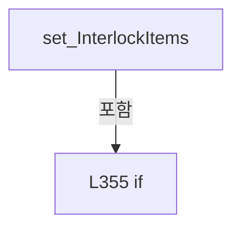

변경 전 점검: 입력/반환 타입, 위 호출자, 예외/취소 경로, 공유 상태와 저장·전송 소비자를 함께 확인합니다. 값의 단위나 물리 방향을 이름만으로 확정하지 않습니다.

### PropertyDeclaration `OpticStatusTabs` · L361–372

[Drilling.UI/Menu/Menus/CMenuMain.cs:361–372](https://github.com/kjuws10-rgb/A3Drilling/blob/5aee8e58439c9b455cae7c9593c9be986c3e682e/Drilling.UI/Menu/Menus/CMenuMain.cs#L361-L372)

| 항목 | 실제 추출 값 |
| --- | --- |
| 서명 | System.Collections.Generic.IReadOnlyList<Drilling.UI.Menu.Menus.ST_MAIN_PARAMETER_TAB_ITEM> Drilling.UI.Menu.Menus.CMenuMain.OpticStatusTabs |
| 접근/수식자 | Public / public |
| 반환/값 타입 | System.Collections.Generic.IReadOnlyList<Drilling.UI.Menu.Menus.ST_MAIN_PARAMETER_TAB_ITEM> |
| 소속 타입 | NamedType:Drilling.UI.Menu.Menus.CMenuMain |

현재 부분 분석에서 직접 연결된 호출자는 없습니다. XAML/이벤트/인터페이스·델리게이트·외부 진입을 추가 확인해야 하며, 미사용으로 판정한 것이 아닙니다.

변경 전 점검: 입력/반환 타입, 위 호출자, 예외/취소 경로, 공유 상태와 저장·전송 소비자를 함께 확인합니다. 값의 단위나 물리 방향을 이름만으로 확정하지 않습니다.

### GetAccessorDeclaration `get_OpticStatusTabs` · L363–366

[Drilling.UI/Menu/Menus/CMenuMain.cs:363–366](https://github.com/kjuws10-rgb/A3Drilling/blob/5aee8e58439c9b455cae7c9593c9be986c3e682e/Drilling.UI/Menu/Menus/CMenuMain.cs#L363-L366)

| 항목 | 실제 추출 값 |
| --- | --- |
| 서명 | System.Collections.Generic.IReadOnlyList<Drilling.UI.Menu.Menus.ST_MAIN_PARAMETER_TAB_ITEM> Drilling.UI.Menu.Menus.CMenuMain.OpticStatusTabs.get |
| 접근/수식자 | Public / get |
| 반환/값 타입 | System.Collections.Generic.IReadOnlyList<Drilling.UI.Menu.Menus.ST_MAIN_PARAMETER_TAB_ITEM> |
| 소속 타입 | NamedType:Drilling.UI.Menu.Menus.CMenuMain |

현재 부분 분석에서 직접 연결된 호출자는 없습니다. XAML/이벤트/인터페이스·델리게이트·외부 진입을 추가 확인해야 하며, 미사용으로 판정한 것이 아닙니다.

본문의 실제 연산·분기·예외·반환 순서(원문 위치 순):

| 원본 행 | 종류 | 주석 해설 |
| --- | --- | --- |
| 365 | return | 호출자에게 값 또는 제어를 반환합니다: return _opticStatusTabs; |

변경 전 점검: 입력/반환 타입, 위 호출자, 예외/취소 경로, 공유 상태와 저장·전송 소비자를 함께 확인합니다. 값의 단위나 물리 방향을 이름만으로 확정하지 않습니다.

### SetAccessorDeclaration `set_OpticStatusTabs` · L368–371

[Drilling.UI/Menu/Menus/CMenuMain.cs:368–371](https://github.com/kjuws10-rgb/A3Drilling/blob/5aee8e58439c9b455cae7c9593c9be986c3e682e/Drilling.UI/Menu/Menus/CMenuMain.cs#L368-L371)

| 항목 | 실제 추출 값 |
| --- | --- |
| 서명 | void Drilling.UI.Menu.Menus.CMenuMain.OpticStatusTabs.set |
| 접근/수식자 | Private / private, set |
| 반환/값 타입 | void |
| 소속 타입 | NamedType:Drilling.UI.Menu.Menus.CMenuMain |

입력 계약:

| 이름 | 타입 | 전달 | 선택/기본값 |
| --- | --- | --- | --- |
| value | System.Collections.Generic.IReadOnlyList<Drilling.UI.Menu.Menus.ST_MAIN_PARAMETER_TAB_ITEM> | None | False /  |

현재 부분 분석에서 직접 연결된 호출자는 없습니다. XAML/이벤트/인터페이스·델리게이트·외부 진입을 추가 확인해야 하며, 미사용으로 판정한 것이 아닙니다.

호출하는 대상과 해석 범위:

| 원본 행 | 표현식 | 분석 상태 | 대상/소스 위치 |
| --- | --- | --- | --- |
| 370 | SetSequenceProperty | resolved | bool Drilling.UI.Menu.CBindingBase.SetSequenceProperty<Drilling.UI.Menu.Menus.ST_MAIN_PARAMETER_TAB_ITEM>(ref System.Collections.Generic.IReadOnlyList<Drilling.UI.Menu.Menus.ST_MAIN_PARAMETER_TAB_ITEM>, System.Collections.Generic.IReadOnlyList<Drilling.UI.Menu.Menus.ST_MAIN_PARAMETER_TAB_ITEM>, string?) · Drilling.UI/Menu/CBindingBase.cs:747 |

본문의 실제 연산·분기·예외·반환 순서(원문 위치 순):

| 원본 행 | 종류 | 주석 해설 |
| --- | --- | --- |
| 370 | call | 함수·델리게이트 또는 객체 생성자를 호출합니다: SetSequenceProperty(ref _opticStatusTabs, value) |

변경 전 점검: 입력/반환 타입, 위 호출자, 예외/취소 경로, 공유 상태와 저장·전송 소비자를 함께 확인합니다. 값의 단위나 물리 방향을 이름만으로 확정하지 않습니다.

### PropertyDeclaration `ScannerStatusHeadTabs` · L374–385

[Drilling.UI/Menu/Menus/CMenuMain.cs:374–385](https://github.com/kjuws10-rgb/A3Drilling/blob/5aee8e58439c9b455cae7c9593c9be986c3e682e/Drilling.UI/Menu/Menus/CMenuMain.cs#L374-L385)

| 항목 | 실제 추출 값 |
| --- | --- |
| 서명 | System.Collections.Generic.IReadOnlyList<Drilling.UI.Menu.Menus.ST_MAIN_PARAMETER_TAB_ITEM> Drilling.UI.Menu.Menus.CMenuMain.ScannerStatusHeadTabs |
| 접근/수식자 | Public / public |
| 반환/값 타입 | System.Collections.Generic.IReadOnlyList<Drilling.UI.Menu.Menus.ST_MAIN_PARAMETER_TAB_ITEM> |
| 소속 타입 | NamedType:Drilling.UI.Menu.Menus.CMenuMain |

현재 부분 분석에서 직접 연결된 호출자는 없습니다. XAML/이벤트/인터페이스·델리게이트·외부 진입을 추가 확인해야 하며, 미사용으로 판정한 것이 아닙니다.

변경 전 점검: 입력/반환 타입, 위 호출자, 예외/취소 경로, 공유 상태와 저장·전송 소비자를 함께 확인합니다. 값의 단위나 물리 방향을 이름만으로 확정하지 않습니다.

### GetAccessorDeclaration `get_ScannerStatusHeadTabs` · L376–379

[Drilling.UI/Menu/Menus/CMenuMain.cs:376–379](https://github.com/kjuws10-rgb/A3Drilling/blob/5aee8e58439c9b455cae7c9593c9be986c3e682e/Drilling.UI/Menu/Menus/CMenuMain.cs#L376-L379)

| 항목 | 실제 추출 값 |
| --- | --- |
| 서명 | System.Collections.Generic.IReadOnlyList<Drilling.UI.Menu.Menus.ST_MAIN_PARAMETER_TAB_ITEM> Drilling.UI.Menu.Menus.CMenuMain.ScannerStatusHeadTabs.get |
| 접근/수식자 | Public / get |
| 반환/값 타입 | System.Collections.Generic.IReadOnlyList<Drilling.UI.Menu.Menus.ST_MAIN_PARAMETER_TAB_ITEM> |
| 소속 타입 | NamedType:Drilling.UI.Menu.Menus.CMenuMain |

현재 부분 분석에서 직접 연결된 호출자는 없습니다. XAML/이벤트/인터페이스·델리게이트·외부 진입을 추가 확인해야 하며, 미사용으로 판정한 것이 아닙니다.

본문의 실제 연산·분기·예외·반환 순서(원문 위치 순):

| 원본 행 | 종류 | 주석 해설 |
| --- | --- | --- |
| 378 | return | 호출자에게 값 또는 제어를 반환합니다: return _scannerStatusHeadTabs; |

변경 전 점검: 입력/반환 타입, 위 호출자, 예외/취소 경로, 공유 상태와 저장·전송 소비자를 함께 확인합니다. 값의 단위나 물리 방향을 이름만으로 확정하지 않습니다.

### SetAccessorDeclaration `set_ScannerStatusHeadTabs` · L381–384

[Drilling.UI/Menu/Menus/CMenuMain.cs:381–384](https://github.com/kjuws10-rgb/A3Drilling/blob/5aee8e58439c9b455cae7c9593c9be986c3e682e/Drilling.UI/Menu/Menus/CMenuMain.cs#L381-L384)

| 항목 | 실제 추출 값 |
| --- | --- |
| 서명 | void Drilling.UI.Menu.Menus.CMenuMain.ScannerStatusHeadTabs.set |
| 접근/수식자 | Private / private, set |
| 반환/값 타입 | void |
| 소속 타입 | NamedType:Drilling.UI.Menu.Menus.CMenuMain |

입력 계약:

| 이름 | 타입 | 전달 | 선택/기본값 |
| --- | --- | --- | --- |
| value | System.Collections.Generic.IReadOnlyList<Drilling.UI.Menu.Menus.ST_MAIN_PARAMETER_TAB_ITEM> | None | False /  |

현재 부분 분석에서 직접 연결된 호출자는 없습니다. XAML/이벤트/인터페이스·델리게이트·외부 진입을 추가 확인해야 하며, 미사용으로 판정한 것이 아닙니다.

호출하는 대상과 해석 범위:

| 원본 행 | 표현식 | 분석 상태 | 대상/소스 위치 |
| --- | --- | --- | --- |
| 383 | SetSequenceProperty | resolved | bool Drilling.UI.Menu.CBindingBase.SetSequenceProperty<Drilling.UI.Menu.Menus.ST_MAIN_PARAMETER_TAB_ITEM>(ref System.Collections.Generic.IReadOnlyList<Drilling.UI.Menu.Menus.ST_MAIN_PARAMETER_TAB_ITEM>, System.Collections.Generic.IReadOnlyList<Drilling.UI.Menu.Menus.ST_MAIN_PARAMETER_TAB_ITEM>, string?) · Drilling.UI/Menu/CBindingBase.cs:747 |

본문의 실제 연산·분기·예외·반환 순서(원문 위치 순):

| 원본 행 | 종류 | 주석 해설 |
| --- | --- | --- |
| 383 | call | 함수·델리게이트 또는 객체 생성자를 호출합니다: SetSequenceProperty(ref _scannerStatusHeadTabs, value) |

변경 전 점검: 입력/반환 타입, 위 호출자, 예외/취소 경로, 공유 상태와 저장·전송 소비자를 함께 확인합니다. 값의 단위나 물리 방향을 이름만으로 확정하지 않습니다.

### PropertyDeclaration `OpticParameterGroups` · L387–398

[Drilling.UI/Menu/Menus/CMenuMain.cs:387–398](https://github.com/kjuws10-rgb/A3Drilling/blob/5aee8e58439c9b455cae7c9593c9be986c3e682e/Drilling.UI/Menu/Menus/CMenuMain.cs#L387-L398)

| 항목 | 실제 추출 값 |
| --- | --- |
| 서명 | System.Collections.Generic.IReadOnlyList<Drilling.UI.Menu.Menus.ST_OPTIC_PARAMETER_GROUP> Drilling.UI.Menu.Menus.CMenuMain.OpticParameterGroups |
| 접근/수식자 | Public / public |
| 반환/값 타입 | System.Collections.Generic.IReadOnlyList<Drilling.UI.Menu.Menus.ST_OPTIC_PARAMETER_GROUP> |
| 소속 타입 | NamedType:Drilling.UI.Menu.Menus.CMenuMain |

현재 부분 분석에서 직접 연결된 호출자는 없습니다. XAML/이벤트/인터페이스·델리게이트·외부 진입을 추가 확인해야 하며, 미사용으로 판정한 것이 아닙니다.

변경 전 점검: 입력/반환 타입, 위 호출자, 예외/취소 경로, 공유 상태와 저장·전송 소비자를 함께 확인합니다. 값의 단위나 물리 방향을 이름만으로 확정하지 않습니다.

### GetAccessorDeclaration `get_OpticParameterGroups` · L389–392

[Drilling.UI/Menu/Menus/CMenuMain.cs:389–392](https://github.com/kjuws10-rgb/A3Drilling/blob/5aee8e58439c9b455cae7c9593c9be986c3e682e/Drilling.UI/Menu/Menus/CMenuMain.cs#L389-L392)

| 항목 | 실제 추출 값 |
| --- | --- |
| 서명 | System.Collections.Generic.IReadOnlyList<Drilling.UI.Menu.Menus.ST_OPTIC_PARAMETER_GROUP> Drilling.UI.Menu.Menus.CMenuMain.OpticParameterGroups.get |
| 접근/수식자 | Public / get |
| 반환/값 타입 | System.Collections.Generic.IReadOnlyList<Drilling.UI.Menu.Menus.ST_OPTIC_PARAMETER_GROUP> |
| 소속 타입 | NamedType:Drilling.UI.Menu.Menus.CMenuMain |

현재 부분 분석에서 직접 연결된 호출자는 없습니다. XAML/이벤트/인터페이스·델리게이트·외부 진입을 추가 확인해야 하며, 미사용으로 판정한 것이 아닙니다.

본문의 실제 연산·분기·예외·반환 순서(원문 위치 순):

| 원본 행 | 종류 | 주석 해설 |
| --- | --- | --- |
| 391 | return | 호출자에게 값 또는 제어를 반환합니다: return _opticParameterGroups; |

변경 전 점검: 입력/반환 타입, 위 호출자, 예외/취소 경로, 공유 상태와 저장·전송 소비자를 함께 확인합니다. 값의 단위나 물리 방향을 이름만으로 확정하지 않습니다.

### SetAccessorDeclaration `set_OpticParameterGroups` · L394–397

[Drilling.UI/Menu/Menus/CMenuMain.cs:394–397](https://github.com/kjuws10-rgb/A3Drilling/blob/5aee8e58439c9b455cae7c9593c9be986c3e682e/Drilling.UI/Menu/Menus/CMenuMain.cs#L394-L397)

| 항목 | 실제 추출 값 |
| --- | --- |
| 서명 | void Drilling.UI.Menu.Menus.CMenuMain.OpticParameterGroups.set |
| 접근/수식자 | Private / private, set |
| 반환/값 타입 | void |
| 소속 타입 | NamedType:Drilling.UI.Menu.Menus.CMenuMain |

입력 계약:

| 이름 | 타입 | 전달 | 선택/기본값 |
| --- | --- | --- | --- |
| value | System.Collections.Generic.IReadOnlyList<Drilling.UI.Menu.Menus.ST_OPTIC_PARAMETER_GROUP> | None | False /  |

현재 부분 분석에서 직접 연결된 호출자는 없습니다. XAML/이벤트/인터페이스·델리게이트·외부 진입을 추가 확인해야 하며, 미사용으로 판정한 것이 아닙니다.

호출하는 대상과 해석 범위:

| 원본 행 | 표현식 | 분석 상태 | 대상/소스 위치 |
| --- | --- | --- | --- |
| 396 | SetSequenceProperty | resolved | bool Drilling.UI.Menu.CBindingBase.SetSequenceProperty<Drilling.UI.Menu.Menus.ST_OPTIC_PARAMETER_GROUP>(ref System.Collections.Generic.IReadOnlyList<Drilling.UI.Menu.Menus.ST_OPTIC_PARAMETER_GROUP>, System.Collections.Generic.IReadOnlyList<Drilling.UI.Menu.Menus.ST_OPTIC_PARAMETER_GROUP>, string?) · Drilling.UI/Menu/CBindingBase.cs:747 |

본문의 실제 연산·분기·예외·반환 순서(원문 위치 순):

| 원본 행 | 종류 | 주석 해설 |
| --- | --- | --- |
| 396 | call | 함수·델리게이트 또는 객체 생성자를 호출합니다: SetSequenceProperty(ref _opticParameterGroups, value) |

변경 전 점검: 입력/반환 타입, 위 호출자, 예외/취소 경로, 공유 상태와 저장·전송 소비자를 함께 확인합니다. 값의 단위나 물리 방향을 이름만으로 확정하지 않습니다.

### PropertyDeclaration `OpticHeadParameters` · L400–411

[Drilling.UI/Menu/Menus/CMenuMain.cs:400–411](https://github.com/kjuws10-rgb/A3Drilling/blob/5aee8e58439c9b455cae7c9593c9be986c3e682e/Drilling.UI/Menu/Menus/CMenuMain.cs#L400-L411)

| 항목 | 실제 추출 값 |
| --- | --- |
| 서명 | System.Collections.Generic.IReadOnlyList<Drilling.UI.Menu.Menus.ST_OPTIC_HEAD_PARAMETER> Drilling.UI.Menu.Menus.CMenuMain.OpticHeadParameters |
| 접근/수식자 | Public / public |
| 반환/값 타입 | System.Collections.Generic.IReadOnlyList<Drilling.UI.Menu.Menus.ST_OPTIC_HEAD_PARAMETER> |
| 소속 타입 | NamedType:Drilling.UI.Menu.Menus.CMenuMain |

현재 부분 분석에서 직접 연결된 호출자는 없습니다. XAML/이벤트/인터페이스·델리게이트·외부 진입을 추가 확인해야 하며, 미사용으로 판정한 것이 아닙니다.

변경 전 점검: 입력/반환 타입, 위 호출자, 예외/취소 경로, 공유 상태와 저장·전송 소비자를 함께 확인합니다. 값의 단위나 물리 방향을 이름만으로 확정하지 않습니다.

### GetAccessorDeclaration `get_OpticHeadParameters` · L402–405

[Drilling.UI/Menu/Menus/CMenuMain.cs:402–405](https://github.com/kjuws10-rgb/A3Drilling/blob/5aee8e58439c9b455cae7c9593c9be986c3e682e/Drilling.UI/Menu/Menus/CMenuMain.cs#L402-L405)

| 항목 | 실제 추출 값 |
| --- | --- |
| 서명 | System.Collections.Generic.IReadOnlyList<Drilling.UI.Menu.Menus.ST_OPTIC_HEAD_PARAMETER> Drilling.UI.Menu.Menus.CMenuMain.OpticHeadParameters.get |
| 접근/수식자 | Public / get |
| 반환/값 타입 | System.Collections.Generic.IReadOnlyList<Drilling.UI.Menu.Menus.ST_OPTIC_HEAD_PARAMETER> |
| 소속 타입 | NamedType:Drilling.UI.Menu.Menus.CMenuMain |

현재 부분 분석에서 직접 연결된 호출자는 없습니다. XAML/이벤트/인터페이스·델리게이트·외부 진입을 추가 확인해야 하며, 미사용으로 판정한 것이 아닙니다.

본문의 실제 연산·분기·예외·반환 순서(원문 위치 순):

| 원본 행 | 종류 | 주석 해설 |
| --- | --- | --- |
| 404 | return | 호출자에게 값 또는 제어를 반환합니다: return _opticHeadParameters; |

변경 전 점검: 입력/반환 타입, 위 호출자, 예외/취소 경로, 공유 상태와 저장·전송 소비자를 함께 확인합니다. 값의 단위나 물리 방향을 이름만으로 확정하지 않습니다.

### SetAccessorDeclaration `set_OpticHeadParameters` · L407–410

[Drilling.UI/Menu/Menus/CMenuMain.cs:407–410](https://github.com/kjuws10-rgb/A3Drilling/blob/5aee8e58439c9b455cae7c9593c9be986c3e682e/Drilling.UI/Menu/Menus/CMenuMain.cs#L407-L410)

| 항목 | 실제 추출 값 |
| --- | --- |
| 서명 | void Drilling.UI.Menu.Menus.CMenuMain.OpticHeadParameters.set |
| 접근/수식자 | Private / private, set |
| 반환/값 타입 | void |
| 소속 타입 | NamedType:Drilling.UI.Menu.Menus.CMenuMain |

입력 계약:

| 이름 | 타입 | 전달 | 선택/기본값 |
| --- | --- | --- | --- |
| value | System.Collections.Generic.IReadOnlyList<Drilling.UI.Menu.Menus.ST_OPTIC_HEAD_PARAMETER> | None | False /  |

현재 부분 분석에서 직접 연결된 호출자는 없습니다. XAML/이벤트/인터페이스·델리게이트·외부 진입을 추가 확인해야 하며, 미사용으로 판정한 것이 아닙니다.

호출하는 대상과 해석 범위:

| 원본 행 | 표현식 | 분석 상태 | 대상/소스 위치 |
| --- | --- | --- | --- |
| 409 | SetSequenceProperty | resolved | bool Drilling.UI.Menu.CBindingBase.SetSequenceProperty<Drilling.UI.Menu.Menus.ST_OPTIC_HEAD_PARAMETER>(ref System.Collections.Generic.IReadOnlyList<Drilling.UI.Menu.Menus.ST_OPTIC_HEAD_PARAMETER>, System.Collections.Generic.IReadOnlyList<Drilling.UI.Menu.Menus.ST_OPTIC_HEAD_PARAMETER>, string?) · Drilling.UI/Menu/CBindingBase.cs:747 |
| 409 | OrderOpticHeadParameters | resolved | System.Collections.Generic.IReadOnlyList<Drilling.UI.Menu.Menus.ST_OPTIC_HEAD_PARAMETER> Drilling.UI.Menu.Menus.CMenuMain.OrderOpticHeadParameters(System.Collections.Generic.IReadOnlyList<Drilling.UI.Menu.Menus.ST_OPTIC_HEAD_PARAMETER>) · Drilling.UI/Menu/Menus/CMenuMain.cs:1719 |

본문의 실제 연산·분기·예외·반환 순서(원문 위치 순):

| 원본 행 | 종류 | 주석 해설 |
| --- | --- | --- |
| 409 | call | 함수·델리게이트 또는 객체 생성자를 호출합니다: SetSequenceProperty(ref _opticHeadParameters, OrderOpticHeadParameters(value)) |
| 409 | call | 함수·델리게이트 또는 객체 생성자를 호출합니다: OrderOpticHeadParameters(value) |

변경 전 점검: 입력/반환 타입, 위 호출자, 예외/취소 경로, 공유 상태와 저장·전송 소비자를 함께 확인합니다. 값의 단위나 물리 방향을 이름만으로 확정하지 않습니다.

### PropertyDeclaration `ScannerStatusItems` · L413–424

[Drilling.UI/Menu/Menus/CMenuMain.cs:413–424](https://github.com/kjuws10-rgb/A3Drilling/blob/5aee8e58439c9b455cae7c9593c9be986c3e682e/Drilling.UI/Menu/Menus/CMenuMain.cs#L413-L424)

| 항목 | 실제 추출 값 |
| --- | --- |
| 서명 | System.Collections.Generic.IReadOnlyList<Drilling.UI.Menu.Menus.ST_SCANNER_AXIS_STATUS_ITEM> Drilling.UI.Menu.Menus.CMenuMain.ScannerStatusItems |
| 접근/수식자 | Public / public |
| 반환/값 타입 | System.Collections.Generic.IReadOnlyList<Drilling.UI.Menu.Menus.ST_SCANNER_AXIS_STATUS_ITEM> |
| 소속 타입 | NamedType:Drilling.UI.Menu.Menus.CMenuMain |

현재 부분 분석에서 직접 연결된 호출자는 없습니다. XAML/이벤트/인터페이스·델리게이트·외부 진입을 추가 확인해야 하며, 미사용으로 판정한 것이 아닙니다.

변경 전 점검: 입력/반환 타입, 위 호출자, 예외/취소 경로, 공유 상태와 저장·전송 소비자를 함께 확인합니다. 값의 단위나 물리 방향을 이름만으로 확정하지 않습니다.

### GetAccessorDeclaration `get_ScannerStatusItems` · L415–418

[Drilling.UI/Menu/Menus/CMenuMain.cs:415–418](https://github.com/kjuws10-rgb/A3Drilling/blob/5aee8e58439c9b455cae7c9593c9be986c3e682e/Drilling.UI/Menu/Menus/CMenuMain.cs#L415-L418)

| 항목 | 실제 추출 값 |
| --- | --- |
| 서명 | System.Collections.Generic.IReadOnlyList<Drilling.UI.Menu.Menus.ST_SCANNER_AXIS_STATUS_ITEM> Drilling.UI.Menu.Menus.CMenuMain.ScannerStatusItems.get |
| 접근/수식자 | Public / get |
| 반환/값 타입 | System.Collections.Generic.IReadOnlyList<Drilling.UI.Menu.Menus.ST_SCANNER_AXIS_STATUS_ITEM> |
| 소속 타입 | NamedType:Drilling.UI.Menu.Menus.CMenuMain |

현재 부분 분석에서 직접 연결된 호출자는 없습니다. XAML/이벤트/인터페이스·델리게이트·외부 진입을 추가 확인해야 하며, 미사용으로 판정한 것이 아닙니다.

본문의 실제 연산·분기·예외·반환 순서(원문 위치 순):

| 원본 행 | 종류 | 주석 해설 |
| --- | --- | --- |
| 417 | return | 호출자에게 값 또는 제어를 반환합니다: return _scannerStatusItems; |

변경 전 점검: 입력/반환 타입, 위 호출자, 예외/취소 경로, 공유 상태와 저장·전송 소비자를 함께 확인합니다. 값의 단위나 물리 방향을 이름만으로 확정하지 않습니다.

### SetAccessorDeclaration `set_ScannerStatusItems` · L420–423

[Drilling.UI/Menu/Menus/CMenuMain.cs:420–423](https://github.com/kjuws10-rgb/A3Drilling/blob/5aee8e58439c9b455cae7c9593c9be986c3e682e/Drilling.UI/Menu/Menus/CMenuMain.cs#L420-L423)

| 항목 | 실제 추출 값 |
| --- | --- |
| 서명 | void Drilling.UI.Menu.Menus.CMenuMain.ScannerStatusItems.set |
| 접근/수식자 | Private / private, set |
| 반환/값 타입 | void |
| 소속 타입 | NamedType:Drilling.UI.Menu.Menus.CMenuMain |

입력 계약:

| 이름 | 타입 | 전달 | 선택/기본값 |
| --- | --- | --- | --- |
| value | System.Collections.Generic.IReadOnlyList<Drilling.UI.Menu.Menus.ST_SCANNER_AXIS_STATUS_ITEM> | None | False /  |

현재 부분 분석에서 직접 연결된 호출자는 없습니다. XAML/이벤트/인터페이스·델리게이트·외부 진입을 추가 확인해야 하며, 미사용으로 판정한 것이 아닙니다.

호출하는 대상과 해석 범위:

| 원본 행 | 표현식 | 분석 상태 | 대상/소스 위치 |
| --- | --- | --- | --- |
| 422 | SetSequenceProperty | resolved | bool Drilling.UI.Menu.CBindingBase.SetSequenceProperty<Drilling.UI.Menu.Menus.ST_SCANNER_AXIS_STATUS_ITEM>(ref System.Collections.Generic.IReadOnlyList<Drilling.UI.Menu.Menus.ST_SCANNER_AXIS_STATUS_ITEM>, System.Collections.Generic.IReadOnlyList<Drilling.UI.Menu.Menus.ST_SCANNER_AXIS_STATUS_ITEM>, string?) · Drilling.UI/Menu/CBindingBase.cs:747 |

본문의 실제 연산·분기·예외·반환 순서(원문 위치 순):

| 원본 행 | 종류 | 주석 해설 |
| --- | --- | --- |
| 422 | call | 함수·델리게이트 또는 객체 생성자를 호출합니다: SetSequenceProperty(ref _scannerStatusItems, value) |

변경 전 점검: 입력/반환 타입, 위 호출자, 예외/취소 경로, 공유 상태와 저장·전송 소비자를 함께 확인합니다. 값의 단위나 물리 방향을 이름만으로 확정하지 않습니다.

### PropertyDeclaration `OpticLaserVisibility` · L426–432

[Drilling.UI/Menu/Menus/CMenuMain.cs:426–432](https://github.com/kjuws10-rgb/A3Drilling/blob/5aee8e58439c9b455cae7c9593c9be986c3e682e/Drilling.UI/Menu/Menus/CMenuMain.cs#L426-L432)

| 항목 | 실제 추출 값 |
| --- | --- |
| 서명 | Visibility Drilling.UI.Menu.Menus.CMenuMain.OpticLaserVisibility |
| 접근/수식자 | Public / public |
| 반환/값 타입 | Visibility |
| 소속 타입 | NamedType:Drilling.UI.Menu.Menus.CMenuMain |

현재 부분 분석에서 직접 연결된 호출자는 없습니다. XAML/이벤트/인터페이스·델리게이트·외부 진입을 추가 확인해야 하며, 미사용으로 판정한 것이 아닙니다.

변경 전 점검: 입력/반환 타입, 위 호출자, 예외/취소 경로, 공유 상태와 저장·전송 소비자를 함께 확인합니다. 값의 단위나 물리 방향을 이름만으로 확정하지 않습니다.

### GetAccessorDeclaration `get_OpticLaserVisibility` · L428–431

[Drilling.UI/Menu/Menus/CMenuMain.cs:428–431](https://github.com/kjuws10-rgb/A3Drilling/blob/5aee8e58439c9b455cae7c9593c9be986c3e682e/Drilling.UI/Menu/Menus/CMenuMain.cs#L428-L431)

| 항목 | 실제 추출 값 |
| --- | --- |
| 서명 | Visibility Drilling.UI.Menu.Menus.CMenuMain.OpticLaserVisibility.get |
| 접근/수식자 | Public / get |
| 반환/값 타입 | Visibility |
| 소속 타입 | NamedType:Drilling.UI.Menu.Menus.CMenuMain |

현재 부분 분석에서 직접 연결된 호출자는 없습니다. XAML/이벤트/인터페이스·델리게이트·외부 진입을 추가 확인해야 하며, 미사용으로 판정한 것이 아닙니다.

호출하는 대상과 해석 범위:

| 원본 행 | 표현식 | 분석 상태 | 대상/소스 위치 |
| --- | --- | --- | --- |
| 430 | IsOpticStatusSelected | resolved | bool Drilling.UI.Menu.Menus.CMenuMain.IsOpticStatusSelected(string) · Drilling.UI/Menu/Menus/CMenuMain.cs:1065 |

본문의 실제 연산·분기·예외·반환 순서(원문 위치 순):

| 원본 행 | 종류 | 주석 해설 |
| --- | --- | --- |
| 430 | call | 함수·델리게이트 또는 객체 생성자를 호출합니다: IsOpticStatusSelected(OpticStatusLaser) |
| 430 | conditional-expression | 조건에 따라 결과식을 선택합니다: IsOpticStatusSelected(OpticStatusLaser) ? Visibility.Visible : Visibility.Collapsed |
| 430 | return | 호출자에게 값 또는 제어를 반환합니다: return IsOpticStatusSelected(OpticStatusLaser) ? Visibility.Visible : Visibility.Collapsed; |

변경 전 점검: 입력/반환 타입, 위 호출자, 예외/취소 경로, 공유 상태와 저장·전송 소비자를 함께 확인합니다. 값의 단위나 물리 방향을 이름만으로 확정하지 않습니다.

### PropertyDeclaration `OpticAttenuatorVisibility` · L434–440

[Drilling.UI/Menu/Menus/CMenuMain.cs:434–440](https://github.com/kjuws10-rgb/A3Drilling/blob/5aee8e58439c9b455cae7c9593c9be986c3e682e/Drilling.UI/Menu/Menus/CMenuMain.cs#L434-L440)

| 항목 | 실제 추출 값 |
| --- | --- |
| 서명 | Visibility Drilling.UI.Menu.Menus.CMenuMain.OpticAttenuatorVisibility |
| 접근/수식자 | Public / public |
| 반환/값 타입 | Visibility |
| 소속 타입 | NamedType:Drilling.UI.Menu.Menus.CMenuMain |

현재 부분 분석에서 직접 연결된 호출자는 없습니다. XAML/이벤트/인터페이스·델리게이트·외부 진입을 추가 확인해야 하며, 미사용으로 판정한 것이 아닙니다.

변경 전 점검: 입력/반환 타입, 위 호출자, 예외/취소 경로, 공유 상태와 저장·전송 소비자를 함께 확인합니다. 값의 단위나 물리 방향을 이름만으로 확정하지 않습니다.

### GetAccessorDeclaration `get_OpticAttenuatorVisibility` · L436–439

[Drilling.UI/Menu/Menus/CMenuMain.cs:436–439](https://github.com/kjuws10-rgb/A3Drilling/blob/5aee8e58439c9b455cae7c9593c9be986c3e682e/Drilling.UI/Menu/Menus/CMenuMain.cs#L436-L439)

| 항목 | 실제 추출 값 |
| --- | --- |
| 서명 | Visibility Drilling.UI.Menu.Menus.CMenuMain.OpticAttenuatorVisibility.get |
| 접근/수식자 | Public / get |
| 반환/값 타입 | Visibility |
| 소속 타입 | NamedType:Drilling.UI.Menu.Menus.CMenuMain |

현재 부분 분석에서 직접 연결된 호출자는 없습니다. XAML/이벤트/인터페이스·델리게이트·외부 진입을 추가 확인해야 하며, 미사용으로 판정한 것이 아닙니다.

호출하는 대상과 해석 범위:

| 원본 행 | 표현식 | 분석 상태 | 대상/소스 위치 |
| --- | --- | --- | --- |
| 438 | IsOpticStatusSelected | resolved | bool Drilling.UI.Menu.Menus.CMenuMain.IsOpticStatusSelected(string) · Drilling.UI/Menu/Menus/CMenuMain.cs:1065 |

본문의 실제 연산·분기·예외·반환 순서(원문 위치 순):

| 원본 행 | 종류 | 주석 해설 |
| --- | --- | --- |
| 438 | call | 함수·델리게이트 또는 객체 생성자를 호출합니다: IsOpticStatusSelected(OpticStatusAttenuator) |
| 438 | conditional-expression | 조건에 따라 결과식을 선택합니다: IsOpticStatusSelected(OpticStatusAttenuator) ? Visibility.Visible : Visibility.Collapsed |
| 438 | return | 호출자에게 값 또는 제어를 반환합니다: return IsOpticStatusSelected(OpticStatusAttenuator) ? Visibility.Visible : Visibility.Collapsed; |

변경 전 점검: 입력/반환 타입, 위 호출자, 예외/취소 경로, 공유 상태와 저장·전송 소비자를 함께 확인합니다. 값의 단위나 물리 방향을 이름만으로 확정하지 않습니다.

### PropertyDeclaration `OpticBetVisibility` · L442–448

[Drilling.UI/Menu/Menus/CMenuMain.cs:442–448](https://github.com/kjuws10-rgb/A3Drilling/blob/5aee8e58439c9b455cae7c9593c9be986c3e682e/Drilling.UI/Menu/Menus/CMenuMain.cs#L442-L448)

| 항목 | 실제 추출 값 |
| --- | --- |
| 서명 | Visibility Drilling.UI.Menu.Menus.CMenuMain.OpticBetVisibility |
| 접근/수식자 | Public / public |
| 반환/값 타입 | Visibility |
| 소속 타입 | NamedType:Drilling.UI.Menu.Menus.CMenuMain |

현재 부분 분석에서 직접 연결된 호출자는 없습니다. XAML/이벤트/인터페이스·델리게이트·외부 진입을 추가 확인해야 하며, 미사용으로 판정한 것이 아닙니다.

변경 전 점검: 입력/반환 타입, 위 호출자, 예외/취소 경로, 공유 상태와 저장·전송 소비자를 함께 확인합니다. 값의 단위나 물리 방향을 이름만으로 확정하지 않습니다.

### GetAccessorDeclaration `get_OpticBetVisibility` · L444–447

[Drilling.UI/Menu/Menus/CMenuMain.cs:444–447](https://github.com/kjuws10-rgb/A3Drilling/blob/5aee8e58439c9b455cae7c9593c9be986c3e682e/Drilling.UI/Menu/Menus/CMenuMain.cs#L444-L447)

| 항목 | 실제 추출 값 |
| --- | --- |
| 서명 | Visibility Drilling.UI.Menu.Menus.CMenuMain.OpticBetVisibility.get |
| 접근/수식자 | Public / get |
| 반환/값 타입 | Visibility |
| 소속 타입 | NamedType:Drilling.UI.Menu.Menus.CMenuMain |

현재 부분 분석에서 직접 연결된 호출자는 없습니다. XAML/이벤트/인터페이스·델리게이트·외부 진입을 추가 확인해야 하며, 미사용으로 판정한 것이 아닙니다.

호출하는 대상과 해석 범위:

| 원본 행 | 표현식 | 분석 상태 | 대상/소스 위치 |
| --- | --- | --- | --- |
| 446 | IsOpticStatusSelected | resolved | bool Drilling.UI.Menu.Menus.CMenuMain.IsOpticStatusSelected(string) · Drilling.UI/Menu/Menus/CMenuMain.cs:1065 |

본문의 실제 연산·분기·예외·반환 순서(원문 위치 순):

| 원본 행 | 종류 | 주석 해설 |
| --- | --- | --- |
| 446 | call | 함수·델리게이트 또는 객체 생성자를 호출합니다: IsOpticStatusSelected(OpticStatusBet) |
| 446 | conditional-expression | 조건에 따라 결과식을 선택합니다: IsOpticStatusSelected(OpticStatusBet) ? Visibility.Visible : Visibility.Collapsed |
| 446 | return | 호출자에게 값 또는 제어를 반환합니다: return IsOpticStatusSelected(OpticStatusBet) ? Visibility.Visible : Visibility.Collapsed; |

변경 전 점검: 입력/반환 타입, 위 호출자, 예외/취소 경로, 공유 상태와 저장·전송 소비자를 함께 확인합니다. 값의 단위나 물리 방향을 이름만으로 확정하지 않습니다.

### PropertyDeclaration `IsScannerStatusSelected` · L450–456

[Drilling.UI/Menu/Menus/CMenuMain.cs:450–456](https://github.com/kjuws10-rgb/A3Drilling/blob/5aee8e58439c9b455cae7c9593c9be986c3e682e/Drilling.UI/Menu/Menus/CMenuMain.cs#L450-L456)

| 항목 | 실제 추출 값 |
| --- | --- |
| 서명 | bool Drilling.UI.Menu.Menus.CMenuMain.IsScannerStatusSelected |
| 접근/수식자 | Public / public |
| 반환/값 타입 | bool |
| 소속 타입 | NamedType:Drilling.UI.Menu.Menus.CMenuMain |

현재 부분 분석에서 직접 연결된 호출자는 없습니다. XAML/이벤트/인터페이스·델리게이트·외부 진입을 추가 확인해야 하며, 미사용으로 판정한 것이 아닙니다.

변경 전 점검: 입력/반환 타입, 위 호출자, 예외/취소 경로, 공유 상태와 저장·전송 소비자를 함께 확인합니다. 값의 단위나 물리 방향을 이름만으로 확정하지 않습니다.

### GetAccessorDeclaration `get_IsScannerStatusSelected` · L452–455

[Drilling.UI/Menu/Menus/CMenuMain.cs:452–455](https://github.com/kjuws10-rgb/A3Drilling/blob/5aee8e58439c9b455cae7c9593c9be986c3e682e/Drilling.UI/Menu/Menus/CMenuMain.cs#L452-L455)

| 항목 | 실제 추출 값 |
| --- | --- |
| 서명 | bool Drilling.UI.Menu.Menus.CMenuMain.IsScannerStatusSelected.get |
| 접근/수식자 | Public / get |
| 반환/값 타입 | bool |
| 소속 타입 | NamedType:Drilling.UI.Menu.Menus.CMenuMain |

현재 부분 분석에서 직접 연결된 호출자는 없습니다. XAML/이벤트/인터페이스·델리게이트·외부 진입을 추가 확인해야 하며, 미사용으로 판정한 것이 아닙니다.

호출하는 대상과 해석 범위:

| 원본 행 | 표현식 | 분석 상태 | 대상/소스 위치 |
| --- | --- | --- | --- |
| 454 | _selectedParameterTabKey.Equals | resolved | bool string.Equals(string?, System.StringComparison) |

본문의 실제 연산·분기·예외·반환 순서(원문 위치 순):

| 원본 행 | 종류 | 주석 해설 |
| --- | --- | --- |
| 454 | call | 함수·델리게이트 또는 객체 생성자를 호출합니다: _selectedParameterTabKey.Equals(ParameterTabScanner, StringComparison.OrdinalIgnoreCase) |
| 454 | return | 호출자에게 값 또는 제어를 반환합니다: return _selectedParameterTabKey.Equals(ParameterTabScanner, StringComparison.OrdinalIgnoreCase); |

변경 전 점검: 입력/반환 타입, 위 호출자, 예외/취소 경로, 공유 상태와 저장·전송 소비자를 함께 확인합니다. 값의 단위나 물리 방향을 이름만으로 확정하지 않습니다.

### PropertyDeclaration `IsOpticParameterSelected` · L458–464

[Drilling.UI/Menu/Menus/CMenuMain.cs:458–464](https://github.com/kjuws10-rgb/A3Drilling/blob/5aee8e58439c9b455cae7c9593c9be986c3e682e/Drilling.UI/Menu/Menus/CMenuMain.cs#L458-L464)

| 항목 | 실제 추출 값 |
| --- | --- |
| 서명 | bool Drilling.UI.Menu.Menus.CMenuMain.IsOpticParameterSelected |
| 접근/수식자 | Public / public |
| 반환/값 타입 | bool |
| 소속 타입 | NamedType:Drilling.UI.Menu.Menus.CMenuMain |

현재 부분 분석에서 직접 연결된 호출자는 없습니다. XAML/이벤트/인터페이스·델리게이트·외부 진입을 추가 확인해야 하며, 미사용으로 판정한 것이 아닙니다.

변경 전 점검: 입력/반환 타입, 위 호출자, 예외/취소 경로, 공유 상태와 저장·전송 소비자를 함께 확인합니다. 값의 단위나 물리 방향을 이름만으로 확정하지 않습니다.

### GetAccessorDeclaration `get_IsOpticParameterSelected` · L460–463

[Drilling.UI/Menu/Menus/CMenuMain.cs:460–463](https://github.com/kjuws10-rgb/A3Drilling/blob/5aee8e58439c9b455cae7c9593c9be986c3e682e/Drilling.UI/Menu/Menus/CMenuMain.cs#L460-L463)

| 항목 | 실제 추출 값 |
| --- | --- |
| 서명 | bool Drilling.UI.Menu.Menus.CMenuMain.IsOpticParameterSelected.get |
| 접근/수식자 | Public / get |
| 반환/값 타입 | bool |
| 소속 타입 | NamedType:Drilling.UI.Menu.Menus.CMenuMain |

현재 부분 분석에서 직접 연결된 호출자는 없습니다. XAML/이벤트/인터페이스·델리게이트·외부 진입을 추가 확인해야 하며, 미사용으로 판정한 것이 아닙니다.

호출하는 대상과 해석 범위:

| 원본 행 | 표현식 | 분석 상태 | 대상/소스 위치 |
| --- | --- | --- | --- |
| 462 | _selectedParameterTabKey.Equals | resolved | bool string.Equals(string?, System.StringComparison) |

본문의 실제 연산·분기·예외·반환 순서(원문 위치 순):

| 원본 행 | 종류 | 주석 해설 |
| --- | --- | --- |
| 462 | call | 함수·델리게이트 또는 객체 생성자를 호출합니다: _selectedParameterTabKey.Equals(ParameterTabOptic, StringComparison.OrdinalIgnoreCase) |
| 462 | return | 호출자에게 값 또는 제어를 반환합니다: return _selectedParameterTabKey.Equals(ParameterTabOptic, StringComparison.OrdinalIgnoreCase); |

변경 전 점검: 입력/반환 타입, 위 호출자, 예외/취소 경로, 공유 상태와 저장·전송 소비자를 함께 확인합니다. 값의 단위나 물리 방향을 이름만으로 확정하지 않습니다.

### PropertyDeclaration `ProcessStep` · L466–477

[Drilling.UI/Menu/Menus/CMenuMain.cs:466–477](https://github.com/kjuws10-rgb/A3Drilling/blob/5aee8e58439c9b455cae7c9593c9be986c3e682e/Drilling.UI/Menu/Menus/CMenuMain.cs#L466-L477)

| 항목 | 실제 추출 값 |
| --- | --- |
| 서명 | string Drilling.UI.Menu.Menus.CMenuMain.ProcessStep |
| 접근/수식자 | Public / public |
| 반환/값 타입 | string |
| 소속 타입 | NamedType:Drilling.UI.Menu.Menus.CMenuMain |

현재 부분 분석에서 직접 연결된 호출자는 없습니다. XAML/이벤트/인터페이스·델리게이트·외부 진입을 추가 확인해야 하며, 미사용으로 판정한 것이 아닙니다.

변경 전 점검: 입력/반환 타입, 위 호출자, 예외/취소 경로, 공유 상태와 저장·전송 소비자를 함께 확인합니다. 값의 단위나 물리 방향을 이름만으로 확정하지 않습니다.

### GetAccessorDeclaration `get_ProcessStep` · L468–471

[Drilling.UI/Menu/Menus/CMenuMain.cs:468–471](https://github.com/kjuws10-rgb/A3Drilling/blob/5aee8e58439c9b455cae7c9593c9be986c3e682e/Drilling.UI/Menu/Menus/CMenuMain.cs#L468-L471)

| 항목 | 실제 추출 값 |
| --- | --- |
| 서명 | string Drilling.UI.Menu.Menus.CMenuMain.ProcessStep.get |
| 접근/수식자 | Public / get |
| 반환/값 타입 | string |
| 소속 타입 | NamedType:Drilling.UI.Menu.Menus.CMenuMain |

현재 부분 분석에서 직접 연결된 호출자는 없습니다. XAML/이벤트/인터페이스·델리게이트·외부 진입을 추가 확인해야 하며, 미사용으로 판정한 것이 아닙니다.

본문의 실제 연산·분기·예외·반환 순서(원문 위치 순):

| 원본 행 | 종류 | 주석 해설 |
| --- | --- | --- |
| 470 | return | 호출자에게 값 또는 제어를 반환합니다: return _processStep; |

변경 전 점검: 입력/반환 타입, 위 호출자, 예외/취소 경로, 공유 상태와 저장·전송 소비자를 함께 확인합니다. 값의 단위나 물리 방향을 이름만으로 확정하지 않습니다.

### SetAccessorDeclaration `set_ProcessStep` · L473–476

[Drilling.UI/Menu/Menus/CMenuMain.cs:473–476](https://github.com/kjuws10-rgb/A3Drilling/blob/5aee8e58439c9b455cae7c9593c9be986c3e682e/Drilling.UI/Menu/Menus/CMenuMain.cs#L473-L476)

| 항목 | 실제 추출 값 |
| --- | --- |
| 서명 | void Drilling.UI.Menu.Menus.CMenuMain.ProcessStep.set |
| 접근/수식자 | Private / private, set |
| 반환/값 타입 | void |
| 소속 타입 | NamedType:Drilling.UI.Menu.Menus.CMenuMain |

입력 계약:

| 이름 | 타입 | 전달 | 선택/기본값 |
| --- | --- | --- | --- |
| value | string | None | False /  |

현재 부분 분석에서 직접 연결된 호출자는 없습니다. XAML/이벤트/인터페이스·델리게이트·외부 진입을 추가 확인해야 하며, 미사용으로 판정한 것이 아닙니다.

호출하는 대상과 해석 범위:

| 원본 행 | 표현식 | 분석 상태 | 대상/소스 위치 |
| --- | --- | --- | --- |
| 475 | SetProperty | resolved | bool Drilling.UI.Menu.CBindingBase.SetProperty<string>(ref string, string, string?) · Drilling.UI/Menu/CBindingBase.cs:735 |

본문의 실제 연산·분기·예외·반환 순서(원문 위치 순):

| 원본 행 | 종류 | 주석 해설 |
| --- | --- | --- |
| 475 | call | 함수·델리게이트 또는 객체 생성자를 호출합니다: SetProperty(ref _processStep, value) |

변경 전 점검: 입력/반환 타입, 위 호출자, 예외/취소 경로, 공유 상태와 저장·전송 소비자를 함께 확인합니다. 값의 단위나 물리 방향을 이름만으로 확정하지 않습니다.

### PropertyDeclaration `ScriptStatus` · L479–490

[Drilling.UI/Menu/Menus/CMenuMain.cs:479–490](https://github.com/kjuws10-rgb/A3Drilling/blob/5aee8e58439c9b455cae7c9593c9be986c3e682e/Drilling.UI/Menu/Menus/CMenuMain.cs#L479-L490)

| 항목 | 실제 추출 값 |
| --- | --- |
| 서명 | string Drilling.UI.Menu.Menus.CMenuMain.ScriptStatus |
| 접근/수식자 | Public / public |
| 반환/값 타입 | string |
| 소속 타입 | NamedType:Drilling.UI.Menu.Menus.CMenuMain |

현재 부분 분석에서 직접 연결된 호출자는 없습니다. XAML/이벤트/인터페이스·델리게이트·외부 진입을 추가 확인해야 하며, 미사용으로 판정한 것이 아닙니다.

변경 전 점검: 입력/반환 타입, 위 호출자, 예외/취소 경로, 공유 상태와 저장·전송 소비자를 함께 확인합니다. 값의 단위나 물리 방향을 이름만으로 확정하지 않습니다.

### GetAccessorDeclaration `get_ScriptStatus` · L481–484

[Drilling.UI/Menu/Menus/CMenuMain.cs:481–484](https://github.com/kjuws10-rgb/A3Drilling/blob/5aee8e58439c9b455cae7c9593c9be986c3e682e/Drilling.UI/Menu/Menus/CMenuMain.cs#L481-L484)

| 항목 | 실제 추출 값 |
| --- | --- |
| 서명 | string Drilling.UI.Menu.Menus.CMenuMain.ScriptStatus.get |
| 접근/수식자 | Public / get |
| 반환/값 타입 | string |
| 소속 타입 | NamedType:Drilling.UI.Menu.Menus.CMenuMain |

현재 부분 분석에서 직접 연결된 호출자는 없습니다. XAML/이벤트/인터페이스·델리게이트·외부 진입을 추가 확인해야 하며, 미사용으로 판정한 것이 아닙니다.

본문의 실제 연산·분기·예외·반환 순서(원문 위치 순):

| 원본 행 | 종류 | 주석 해설 |
| --- | --- | --- |
| 483 | return | 호출자에게 값 또는 제어를 반환합니다: return _scriptStatus; |

변경 전 점검: 입력/반환 타입, 위 호출자, 예외/취소 경로, 공유 상태와 저장·전송 소비자를 함께 확인합니다. 값의 단위나 물리 방향을 이름만으로 확정하지 않습니다.

### SetAccessorDeclaration `set_ScriptStatus` · L486–489

[Drilling.UI/Menu/Menus/CMenuMain.cs:486–489](https://github.com/kjuws10-rgb/A3Drilling/blob/5aee8e58439c9b455cae7c9593c9be986c3e682e/Drilling.UI/Menu/Menus/CMenuMain.cs#L486-L489)

| 항목 | 실제 추출 값 |
| --- | --- |
| 서명 | void Drilling.UI.Menu.Menus.CMenuMain.ScriptStatus.set |
| 접근/수식자 | Private / private, set |
| 반환/값 타입 | void |
| 소속 타입 | NamedType:Drilling.UI.Menu.Menus.CMenuMain |

입력 계약:

| 이름 | 타입 | 전달 | 선택/기본값 |
| --- | --- | --- | --- |
| value | string | None | False /  |

현재 부분 분석에서 직접 연결된 호출자는 없습니다. XAML/이벤트/인터페이스·델리게이트·외부 진입을 추가 확인해야 하며, 미사용으로 판정한 것이 아닙니다.

호출하는 대상과 해석 범위:

| 원본 행 | 표현식 | 분석 상태 | 대상/소스 위치 |
| --- | --- | --- | --- |
| 488 | SetProperty | resolved | bool Drilling.UI.Menu.CBindingBase.SetProperty<string>(ref string, string, string?) · Drilling.UI/Menu/CBindingBase.cs:735 |

본문의 실제 연산·분기·예외·반환 순서(원문 위치 순):

| 원본 행 | 종류 | 주석 해설 |
| --- | --- | --- |
| 488 | call | 함수·델리게이트 또는 객체 생성자를 호출합니다: SetProperty(ref _scriptStatus, value) |

변경 전 점검: 입력/반환 타입, 위 호출자, 예외/취소 경로, 공유 상태와 저장·전송 소비자를 함께 확인합니다. 값의 단위나 물리 방향을 이름만으로 확정하지 않습니다.

### PropertyDeclaration `ScriptStatusText` · L492–503

[Drilling.UI/Menu/Menus/CMenuMain.cs:492–503](https://github.com/kjuws10-rgb/A3Drilling/blob/5aee8e58439c9b455cae7c9593c9be986c3e682e/Drilling.UI/Menu/Menus/CMenuMain.cs#L492-L503)

| 항목 | 실제 추출 값 |
| --- | --- |
| 서명 | string Drilling.UI.Menu.Menus.CMenuMain.ScriptStatusText |
| 접근/수식자 | Public / public |
| 반환/값 타입 | string |
| 소속 타입 | NamedType:Drilling.UI.Menu.Menus.CMenuMain |

현재 부분 분석에서 직접 연결된 호출자는 없습니다. XAML/이벤트/인터페이스·델리게이트·외부 진입을 추가 확인해야 하며, 미사용으로 판정한 것이 아닙니다.

변경 전 점검: 입력/반환 타입, 위 호출자, 예외/취소 경로, 공유 상태와 저장·전송 소비자를 함께 확인합니다. 값의 단위나 물리 방향을 이름만으로 확정하지 않습니다.

### GetAccessorDeclaration `get_ScriptStatusText` · L494–497

[Drilling.UI/Menu/Menus/CMenuMain.cs:494–497](https://github.com/kjuws10-rgb/A3Drilling/blob/5aee8e58439c9b455cae7c9593c9be986c3e682e/Drilling.UI/Menu/Menus/CMenuMain.cs#L494-L497)

| 항목 | 실제 추출 값 |
| --- | --- |
| 서명 | string Drilling.UI.Menu.Menus.CMenuMain.ScriptStatusText.get |
| 접근/수식자 | Public / get |
| 반환/값 타입 | string |
| 소속 타입 | NamedType:Drilling.UI.Menu.Menus.CMenuMain |

현재 부분 분석에서 직접 연결된 호출자는 없습니다. XAML/이벤트/인터페이스·델리게이트·외부 진입을 추가 확인해야 하며, 미사용으로 판정한 것이 아닙니다.

본문의 실제 연산·분기·예외·반환 순서(원문 위치 순):

| 원본 행 | 종류 | 주석 해설 |
| --- | --- | --- |
| 496 | return | 호출자에게 값 또는 제어를 반환합니다: return _scriptStatusText; |

변경 전 점검: 입력/반환 타입, 위 호출자, 예외/취소 경로, 공유 상태와 저장·전송 소비자를 함께 확인합니다. 값의 단위나 물리 방향을 이름만으로 확정하지 않습니다.

### SetAccessorDeclaration `set_ScriptStatusText` · L499–502

[Drilling.UI/Menu/Menus/CMenuMain.cs:499–502](https://github.com/kjuws10-rgb/A3Drilling/blob/5aee8e58439c9b455cae7c9593c9be986c3e682e/Drilling.UI/Menu/Menus/CMenuMain.cs#L499-L502)

| 항목 | 실제 추출 값 |
| --- | --- |
| 서명 | void Drilling.UI.Menu.Menus.CMenuMain.ScriptStatusText.set |
| 접근/수식자 | Private / private, set |
| 반환/값 타입 | void |
| 소속 타입 | NamedType:Drilling.UI.Menu.Menus.CMenuMain |

입력 계약:

| 이름 | 타입 | 전달 | 선택/기본값 |
| --- | --- | --- | --- |
| value | string | None | False /  |

현재 부분 분석에서 직접 연결된 호출자는 없습니다. XAML/이벤트/인터페이스·델리게이트·외부 진입을 추가 확인해야 하며, 미사용으로 판정한 것이 아닙니다.

호출하는 대상과 해석 범위:

| 원본 행 | 표현식 | 분석 상태 | 대상/소스 위치 |
| --- | --- | --- | --- |
| 501 | SetProperty | resolved | bool Drilling.UI.Menu.CBindingBase.SetProperty<string>(ref string, string, string?) · Drilling.UI/Menu/CBindingBase.cs:735 |

본문의 실제 연산·분기·예외·반환 순서(원문 위치 순):

| 원본 행 | 종류 | 주석 해설 |
| --- | --- | --- |
| 501 | call | 함수·델리게이트 또는 객체 생성자를 호출합니다: SetProperty(ref _scriptStatusText, value) |

변경 전 점검: 입력/반환 타입, 위 호출자, 예외/취소 경로, 공유 상태와 저장·전송 소비자를 함께 확인합니다. 값의 단위나 물리 방향을 이름만으로 확정하지 않습니다.

### PropertyDeclaration `ResultMessage` · L505–516

[Drilling.UI/Menu/Menus/CMenuMain.cs:505–516](https://github.com/kjuws10-rgb/A3Drilling/blob/5aee8e58439c9b455cae7c9593c9be986c3e682e/Drilling.UI/Menu/Menus/CMenuMain.cs#L505-L516)

| 항목 | 실제 추출 값 |
| --- | --- |
| 서명 | string Drilling.UI.Menu.Menus.CMenuMain.ResultMessage |
| 접근/수식자 | Public / public |
| 반환/값 타입 | string |
| 소속 타입 | NamedType:Drilling.UI.Menu.Menus.CMenuMain |

현재 부분 분석에서 직접 연결된 호출자는 없습니다. XAML/이벤트/인터페이스·델리게이트·외부 진입을 추가 확인해야 하며, 미사용으로 판정한 것이 아닙니다.

변경 전 점검: 입력/반환 타입, 위 호출자, 예외/취소 경로, 공유 상태와 저장·전송 소비자를 함께 확인합니다. 값의 단위나 물리 방향을 이름만으로 확정하지 않습니다.

### GetAccessorDeclaration `get_ResultMessage` · L507–510

[Drilling.UI/Menu/Menus/CMenuMain.cs:507–510](https://github.com/kjuws10-rgb/A3Drilling/blob/5aee8e58439c9b455cae7c9593c9be986c3e682e/Drilling.UI/Menu/Menus/CMenuMain.cs#L507-L510)

| 항목 | 실제 추출 값 |
| --- | --- |
| 서명 | string Drilling.UI.Menu.Menus.CMenuMain.ResultMessage.get |
| 접근/수식자 | Public / get |
| 반환/값 타입 | string |
| 소속 타입 | NamedType:Drilling.UI.Menu.Menus.CMenuMain |

현재 부분 분석에서 직접 연결된 호출자는 없습니다. XAML/이벤트/인터페이스·델리게이트·외부 진입을 추가 확인해야 하며, 미사용으로 판정한 것이 아닙니다.

본문의 실제 연산·분기·예외·반환 순서(원문 위치 순):

| 원본 행 | 종류 | 주석 해설 |
| --- | --- | --- |
| 509 | return | 호출자에게 값 또는 제어를 반환합니다: return _resultMessage; |

변경 전 점검: 입력/반환 타입, 위 호출자, 예외/취소 경로, 공유 상태와 저장·전송 소비자를 함께 확인합니다. 값의 단위나 물리 방향을 이름만으로 확정하지 않습니다.

### SetAccessorDeclaration `set_ResultMessage` · L512–515

[Drilling.UI/Menu/Menus/CMenuMain.cs:512–515](https://github.com/kjuws10-rgb/A3Drilling/blob/5aee8e58439c9b455cae7c9593c9be986c3e682e/Drilling.UI/Menu/Menus/CMenuMain.cs#L512-L515)

| 항목 | 실제 추출 값 |
| --- | --- |
| 서명 | void Drilling.UI.Menu.Menus.CMenuMain.ResultMessage.set |
| 접근/수식자 | Private / private, set |
| 반환/값 타입 | void |
| 소속 타입 | NamedType:Drilling.UI.Menu.Menus.CMenuMain |

입력 계약:

| 이름 | 타입 | 전달 | 선택/기본값 |
| --- | --- | --- | --- |
| value | string | None | False /  |

현재 부분 분석에서 직접 연결된 호출자는 없습니다. XAML/이벤트/인터페이스·델리게이트·외부 진입을 추가 확인해야 하며, 미사용으로 판정한 것이 아닙니다.

호출하는 대상과 해석 범위:

| 원본 행 | 표현식 | 분석 상태 | 대상/소스 위치 |
| --- | --- | --- | --- |
| 514 | SetProperty | resolved | bool Drilling.UI.Menu.CBindingBase.SetProperty<string>(ref string, string, string?) · Drilling.UI/Menu/CBindingBase.cs:735 |

본문의 실제 연산·분기·예외·반환 순서(원문 위치 순):

| 원본 행 | 종류 | 주석 해설 |
| --- | --- | --- |
| 514 | call | 함수·델리게이트 또는 객체 생성자를 호출합니다: SetProperty(ref _resultMessage, value) |

변경 전 점검: 입력/반환 타입, 위 호출자, 예외/취소 경로, 공유 상태와 저장·전송 소비자를 함께 확인합니다. 값의 단위나 물리 방향을 이름만으로 확정하지 않습니다.

### PropertyDeclaration `TotalShotsText` · L518–529

[Drilling.UI/Menu/Menus/CMenuMain.cs:518–529](https://github.com/kjuws10-rgb/A3Drilling/blob/5aee8e58439c9b455cae7c9593c9be986c3e682e/Drilling.UI/Menu/Menus/CMenuMain.cs#L518-L529)

| 항목 | 실제 추출 값 |
| --- | --- |
| 서명 | string Drilling.UI.Menu.Menus.CMenuMain.TotalShotsText |
| 접근/수식자 | Public / public |
| 반환/값 타입 | string |
| 소속 타입 | NamedType:Drilling.UI.Menu.Menus.CMenuMain |

현재 부분 분석에서 직접 연결된 호출자는 없습니다. XAML/이벤트/인터페이스·델리게이트·외부 진입을 추가 확인해야 하며, 미사용으로 판정한 것이 아닙니다.

변경 전 점검: 입력/반환 타입, 위 호출자, 예외/취소 경로, 공유 상태와 저장·전송 소비자를 함께 확인합니다. 값의 단위나 물리 방향을 이름만으로 확정하지 않습니다.

### GetAccessorDeclaration `get_TotalShotsText` · L520–523

[Drilling.UI/Menu/Menus/CMenuMain.cs:520–523](https://github.com/kjuws10-rgb/A3Drilling/blob/5aee8e58439c9b455cae7c9593c9be986c3e682e/Drilling.UI/Menu/Menus/CMenuMain.cs#L520-L523)

| 항목 | 실제 추출 값 |
| --- | --- |
| 서명 | string Drilling.UI.Menu.Menus.CMenuMain.TotalShotsText.get |
| 접근/수식자 | Public / get |
| 반환/값 타입 | string |
| 소속 타입 | NamedType:Drilling.UI.Menu.Menus.CMenuMain |

현재 부분 분석에서 직접 연결된 호출자는 없습니다. XAML/이벤트/인터페이스·델리게이트·외부 진입을 추가 확인해야 하며, 미사용으로 판정한 것이 아닙니다.

본문의 실제 연산·분기·예외·반환 순서(원문 위치 순):

| 원본 행 | 종류 | 주석 해설 |
| --- | --- | --- |
| 522 | return | 호출자에게 값 또는 제어를 반환합니다: return _totalShotsText; |

변경 전 점검: 입력/반환 타입, 위 호출자, 예외/취소 경로, 공유 상태와 저장·전송 소비자를 함께 확인합니다. 값의 단위나 물리 방향을 이름만으로 확정하지 않습니다.

### SetAccessorDeclaration `set_TotalShotsText` · L525–528

[Drilling.UI/Menu/Menus/CMenuMain.cs:525–528](https://github.com/kjuws10-rgb/A3Drilling/blob/5aee8e58439c9b455cae7c9593c9be986c3e682e/Drilling.UI/Menu/Menus/CMenuMain.cs#L525-L528)

| 항목 | 실제 추출 값 |
| --- | --- |
| 서명 | void Drilling.UI.Menu.Menus.CMenuMain.TotalShotsText.set |
| 접근/수식자 | Private / private, set |
| 반환/값 타입 | void |
| 소속 타입 | NamedType:Drilling.UI.Menu.Menus.CMenuMain |

입력 계약:

| 이름 | 타입 | 전달 | 선택/기본값 |
| --- | --- | --- | --- |
| value | string | None | False /  |

현재 부분 분석에서 직접 연결된 호출자는 없습니다. XAML/이벤트/인터페이스·델리게이트·외부 진입을 추가 확인해야 하며, 미사용으로 판정한 것이 아닙니다.

호출하는 대상과 해석 범위:

| 원본 행 | 표현식 | 분석 상태 | 대상/소스 위치 |
| --- | --- | --- | --- |
| 527 | SetProperty | resolved | bool Drilling.UI.Menu.CBindingBase.SetProperty<string>(ref string, string, string?) · Drilling.UI/Menu/CBindingBase.cs:735 |

본문의 실제 연산·분기·예외·반환 순서(원문 위치 순):

| 원본 행 | 종류 | 주석 해설 |
| --- | --- | --- |
| 527 | call | 함수·델리게이트 또는 객체 생성자를 호출합니다: SetProperty(ref _totalShotsText, value) |

변경 전 점검: 입력/반환 타입, 위 호출자, 예외/취소 경로, 공유 상태와 저장·전송 소비자를 함께 확인합니다. 값의 단위나 물리 방향을 이름만으로 확정하지 않습니다.

### PropertyDeclaration `MoveCountText` · L531–542

[Drilling.UI/Menu/Menus/CMenuMain.cs:531–542](https://github.com/kjuws10-rgb/A3Drilling/blob/5aee8e58439c9b455cae7c9593c9be986c3e682e/Drilling.UI/Menu/Menus/CMenuMain.cs#L531-L542)

| 항목 | 실제 추출 값 |
| --- | --- |
| 서명 | string Drilling.UI.Menu.Menus.CMenuMain.MoveCountText |
| 접근/수식자 | Public / public |
| 반환/값 타입 | string |
| 소속 타입 | NamedType:Drilling.UI.Menu.Menus.CMenuMain |

현재 부분 분석에서 직접 연결된 호출자는 없습니다. XAML/이벤트/인터페이스·델리게이트·외부 진입을 추가 확인해야 하며, 미사용으로 판정한 것이 아닙니다.

변경 전 점검: 입력/반환 타입, 위 호출자, 예외/취소 경로, 공유 상태와 저장·전송 소비자를 함께 확인합니다. 값의 단위나 물리 방향을 이름만으로 확정하지 않습니다.

### GetAccessorDeclaration `get_MoveCountText` · L533–536

[Drilling.UI/Menu/Menus/CMenuMain.cs:533–536](https://github.com/kjuws10-rgb/A3Drilling/blob/5aee8e58439c9b455cae7c9593c9be986c3e682e/Drilling.UI/Menu/Menus/CMenuMain.cs#L533-L536)

| 항목 | 실제 추출 값 |
| --- | --- |
| 서명 | string Drilling.UI.Menu.Menus.CMenuMain.MoveCountText.get |
| 접근/수식자 | Public / get |
| 반환/값 타입 | string |
| 소속 타입 | NamedType:Drilling.UI.Menu.Menus.CMenuMain |

현재 부분 분석에서 직접 연결된 호출자는 없습니다. XAML/이벤트/인터페이스·델리게이트·외부 진입을 추가 확인해야 하며, 미사용으로 판정한 것이 아닙니다.

본문의 실제 연산·분기·예외·반환 순서(원문 위치 순):

| 원본 행 | 종류 | 주석 해설 |
| --- | --- | --- |
| 535 | return | 호출자에게 값 또는 제어를 반환합니다: return _moveCountText; |

변경 전 점검: 입력/반환 타입, 위 호출자, 예외/취소 경로, 공유 상태와 저장·전송 소비자를 함께 확인합니다. 값의 단위나 물리 방향을 이름만으로 확정하지 않습니다.

### SetAccessorDeclaration `set_MoveCountText` · L538–541

[Drilling.UI/Menu/Menus/CMenuMain.cs:538–541](https://github.com/kjuws10-rgb/A3Drilling/blob/5aee8e58439c9b455cae7c9593c9be986c3e682e/Drilling.UI/Menu/Menus/CMenuMain.cs#L538-L541)

| 항목 | 실제 추출 값 |
| --- | --- |
| 서명 | void Drilling.UI.Menu.Menus.CMenuMain.MoveCountText.set |
| 접근/수식자 | Private / private, set |
| 반환/값 타입 | void |
| 소속 타입 | NamedType:Drilling.UI.Menu.Menus.CMenuMain |

입력 계약:

| 이름 | 타입 | 전달 | 선택/기본값 |
| --- | --- | --- | --- |
| value | string | None | False /  |

현재 부분 분석에서 직접 연결된 호출자는 없습니다. XAML/이벤트/인터페이스·델리게이트·외부 진입을 추가 확인해야 하며, 미사용으로 판정한 것이 아닙니다.

호출하는 대상과 해석 범위:

| 원본 행 | 표현식 | 분석 상태 | 대상/소스 위치 |
| --- | --- | --- | --- |
| 540 | SetProperty | resolved | bool Drilling.UI.Menu.CBindingBase.SetProperty<string>(ref string, string, string?) · Drilling.UI/Menu/CBindingBase.cs:735 |

본문의 실제 연산·분기·예외·반환 순서(원문 위치 순):

| 원본 행 | 종류 | 주석 해설 |
| --- | --- | --- |
| 540 | call | 함수·델리게이트 또는 객체 생성자를 호출합니다: SetProperty(ref _moveCountText, value) |

변경 전 점검: 입력/반환 타입, 위 호출자, 예외/취소 경로, 공유 상태와 저장·전송 소비자를 함께 확인합니다. 값의 단위나 물리 방향을 이름만으로 확정하지 않습니다.

### PropertyDeclaration `LaserOnSegmentsText` · L544–555

[Drilling.UI/Menu/Menus/CMenuMain.cs:544–555](https://github.com/kjuws10-rgb/A3Drilling/blob/5aee8e58439c9b455cae7c9593c9be986c3e682e/Drilling.UI/Menu/Menus/CMenuMain.cs#L544-L555)

| 항목 | 실제 추출 값 |
| --- | --- |
| 서명 | string Drilling.UI.Menu.Menus.CMenuMain.LaserOnSegmentsText |
| 접근/수식자 | Public / public |
| 반환/값 타입 | string |
| 소속 타입 | NamedType:Drilling.UI.Menu.Menus.CMenuMain |

현재 부분 분석에서 직접 연결된 호출자는 없습니다. XAML/이벤트/인터페이스·델리게이트·외부 진입을 추가 확인해야 하며, 미사용으로 판정한 것이 아닙니다.

변경 전 점검: 입력/반환 타입, 위 호출자, 예외/취소 경로, 공유 상태와 저장·전송 소비자를 함께 확인합니다. 값의 단위나 물리 방향을 이름만으로 확정하지 않습니다.

### GetAccessorDeclaration `get_LaserOnSegmentsText` · L546–549

[Drilling.UI/Menu/Menus/CMenuMain.cs:546–549](https://github.com/kjuws10-rgb/A3Drilling/blob/5aee8e58439c9b455cae7c9593c9be986c3e682e/Drilling.UI/Menu/Menus/CMenuMain.cs#L546-L549)

| 항목 | 실제 추출 값 |
| --- | --- |
| 서명 | string Drilling.UI.Menu.Menus.CMenuMain.LaserOnSegmentsText.get |
| 접근/수식자 | Public / get |
| 반환/값 타입 | string |
| 소속 타입 | NamedType:Drilling.UI.Menu.Menus.CMenuMain |

현재 부분 분석에서 직접 연결된 호출자는 없습니다. XAML/이벤트/인터페이스·델리게이트·외부 진입을 추가 확인해야 하며, 미사용으로 판정한 것이 아닙니다.

본문의 실제 연산·분기·예외·반환 순서(원문 위치 순):

| 원본 행 | 종류 | 주석 해설 |
| --- | --- | --- |
| 548 | return | 호출자에게 값 또는 제어를 반환합니다: return _laserOnSegmentsText; |

변경 전 점검: 입력/반환 타입, 위 호출자, 예외/취소 경로, 공유 상태와 저장·전송 소비자를 함께 확인합니다. 값의 단위나 물리 방향을 이름만으로 확정하지 않습니다.

### SetAccessorDeclaration `set_LaserOnSegmentsText` · L551–554

[Drilling.UI/Menu/Menus/CMenuMain.cs:551–554](https://github.com/kjuws10-rgb/A3Drilling/blob/5aee8e58439c9b455cae7c9593c9be986c3e682e/Drilling.UI/Menu/Menus/CMenuMain.cs#L551-L554)

| 항목 | 실제 추출 값 |
| --- | --- |
| 서명 | void Drilling.UI.Menu.Menus.CMenuMain.LaserOnSegmentsText.set |
| 접근/수식자 | Private / private, set |
| 반환/값 타입 | void |
| 소속 타입 | NamedType:Drilling.UI.Menu.Menus.CMenuMain |

입력 계약:

| 이름 | 타입 | 전달 | 선택/기본값 |
| --- | --- | --- | --- |
| value | string | None | False /  |

현재 부분 분석에서 직접 연결된 호출자는 없습니다. XAML/이벤트/인터페이스·델리게이트·외부 진입을 추가 확인해야 하며, 미사용으로 판정한 것이 아닙니다.

호출하는 대상과 해석 범위:

| 원본 행 | 표현식 | 분석 상태 | 대상/소스 위치 |
| --- | --- | --- | --- |
| 553 | SetProperty | resolved | bool Drilling.UI.Menu.CBindingBase.SetProperty<string>(ref string, string, string?) · Drilling.UI/Menu/CBindingBase.cs:735 |

본문의 실제 연산·분기·예외·반환 순서(원문 위치 순):

| 원본 행 | 종류 | 주석 해설 |
| --- | --- | --- |
| 553 | call | 함수·델리게이트 또는 객체 생성자를 호출합니다: SetProperty(ref _laserOnSegmentsText, value) |

변경 전 점검: 입력/반환 타입, 위 호출자, 예외/취소 경로, 공유 상태와 저장·전송 소비자를 함께 확인합니다. 값의 단위나 물리 방향을 이름만으로 확정하지 않습니다.

### PropertyDeclaration `EstimatedTimeText` · L557–568

[Drilling.UI/Menu/Menus/CMenuMain.cs:557–568](https://github.com/kjuws10-rgb/A3Drilling/blob/5aee8e58439c9b455cae7c9593c9be986c3e682e/Drilling.UI/Menu/Menus/CMenuMain.cs#L557-L568)

| 항목 | 실제 추출 값 |
| --- | --- |
| 서명 | string Drilling.UI.Menu.Menus.CMenuMain.EstimatedTimeText |
| 접근/수식자 | Public / public |
| 반환/값 타입 | string |
| 소속 타입 | NamedType:Drilling.UI.Menu.Menus.CMenuMain |

현재 부분 분석에서 직접 연결된 호출자는 없습니다. XAML/이벤트/인터페이스·델리게이트·외부 진입을 추가 확인해야 하며, 미사용으로 판정한 것이 아닙니다.

변경 전 점검: 입력/반환 타입, 위 호출자, 예외/취소 경로, 공유 상태와 저장·전송 소비자를 함께 확인합니다. 값의 단위나 물리 방향을 이름만으로 확정하지 않습니다.

### GetAccessorDeclaration `get_EstimatedTimeText` · L559–562

[Drilling.UI/Menu/Menus/CMenuMain.cs:559–562](https://github.com/kjuws10-rgb/A3Drilling/blob/5aee8e58439c9b455cae7c9593c9be986c3e682e/Drilling.UI/Menu/Menus/CMenuMain.cs#L559-L562)

| 항목 | 실제 추출 값 |
| --- | --- |
| 서명 | string Drilling.UI.Menu.Menus.CMenuMain.EstimatedTimeText.get |
| 접근/수식자 | Public / get |
| 반환/값 타입 | string |
| 소속 타입 | NamedType:Drilling.UI.Menu.Menus.CMenuMain |

현재 부분 분석에서 직접 연결된 호출자는 없습니다. XAML/이벤트/인터페이스·델리게이트·외부 진입을 추가 확인해야 하며, 미사용으로 판정한 것이 아닙니다.

본문의 실제 연산·분기·예외·반환 순서(원문 위치 순):

| 원본 행 | 종류 | 주석 해설 |
| --- | --- | --- |
| 561 | return | 호출자에게 값 또는 제어를 반환합니다: return _estimatedTimeText; |

변경 전 점검: 입력/반환 타입, 위 호출자, 예외/취소 경로, 공유 상태와 저장·전송 소비자를 함께 확인합니다. 값의 단위나 물리 방향을 이름만으로 확정하지 않습니다.

### SetAccessorDeclaration `set_EstimatedTimeText` · L564–567

[Drilling.UI/Menu/Menus/CMenuMain.cs:564–567](https://github.com/kjuws10-rgb/A3Drilling/blob/5aee8e58439c9b455cae7c9593c9be986c3e682e/Drilling.UI/Menu/Menus/CMenuMain.cs#L564-L567)

| 항목 | 실제 추출 값 |
| --- | --- |
| 서명 | void Drilling.UI.Menu.Menus.CMenuMain.EstimatedTimeText.set |
| 접근/수식자 | Private / private, set |
| 반환/값 타입 | void |
| 소속 타입 | NamedType:Drilling.UI.Menu.Menus.CMenuMain |

입력 계약:

| 이름 | 타입 | 전달 | 선택/기본값 |
| --- | --- | --- | --- |
| value | string | None | False /  |

현재 부분 분석에서 직접 연결된 호출자는 없습니다. XAML/이벤트/인터페이스·델리게이트·외부 진입을 추가 확인해야 하며, 미사용으로 판정한 것이 아닙니다.

호출하는 대상과 해석 범위:

| 원본 행 | 표현식 | 분석 상태 | 대상/소스 위치 |
| --- | --- | --- | --- |
| 566 | SetProperty | resolved | bool Drilling.UI.Menu.CBindingBase.SetProperty<string>(ref string, string, string?) · Drilling.UI/Menu/CBindingBase.cs:735 |

본문의 실제 연산·분기·예외·반환 순서(원문 위치 순):

| 원본 행 | 종류 | 주석 해설 |
| --- | --- | --- |
| 566 | call | 함수·델리게이트 또는 객체 생성자를 호출합니다: SetProperty(ref _estimatedTimeText, value) |

변경 전 점검: 입력/반환 타입, 위 호출자, 예외/취소 경로, 공유 상태와 저장·전송 소비자를 함께 확인합니다. 값의 단위나 물리 방향을 이름만으로 확정하지 않습니다.

### PropertyDeclaration `ElapsedTimeText` · L570–581

[Drilling.UI/Menu/Menus/CMenuMain.cs:570–581](https://github.com/kjuws10-rgb/A3Drilling/blob/5aee8e58439c9b455cae7c9593c9be986c3e682e/Drilling.UI/Menu/Menus/CMenuMain.cs#L570-L581)

| 항목 | 실제 추출 값 |
| --- | --- |
| 서명 | string Drilling.UI.Menu.Menus.CMenuMain.ElapsedTimeText |
| 접근/수식자 | Public / public |
| 반환/값 타입 | string |
| 소속 타입 | NamedType:Drilling.UI.Menu.Menus.CMenuMain |

현재 부분 분석에서 직접 연결된 호출자는 없습니다. XAML/이벤트/인터페이스·델리게이트·외부 진입을 추가 확인해야 하며, 미사용으로 판정한 것이 아닙니다.

변경 전 점검: 입력/반환 타입, 위 호출자, 예외/취소 경로, 공유 상태와 저장·전송 소비자를 함께 확인합니다. 값의 단위나 물리 방향을 이름만으로 확정하지 않습니다.

### GetAccessorDeclaration `get_ElapsedTimeText` · L572–575

[Drilling.UI/Menu/Menus/CMenuMain.cs:572–575](https://github.com/kjuws10-rgb/A3Drilling/blob/5aee8e58439c9b455cae7c9593c9be986c3e682e/Drilling.UI/Menu/Menus/CMenuMain.cs#L572-L575)

| 항목 | 실제 추출 값 |
| --- | --- |
| 서명 | string Drilling.UI.Menu.Menus.CMenuMain.ElapsedTimeText.get |
| 접근/수식자 | Public / get |
| 반환/값 타입 | string |
| 소속 타입 | NamedType:Drilling.UI.Menu.Menus.CMenuMain |

현재 부분 분석에서 직접 연결된 호출자는 없습니다. XAML/이벤트/인터페이스·델리게이트·외부 진입을 추가 확인해야 하며, 미사용으로 판정한 것이 아닙니다.

본문의 실제 연산·분기·예외·반환 순서(원문 위치 순):

| 원본 행 | 종류 | 주석 해설 |
| --- | --- | --- |
| 574 | return | 호출자에게 값 또는 제어를 반환합니다: return _elapsedTimeText; |

변경 전 점검: 입력/반환 타입, 위 호출자, 예외/취소 경로, 공유 상태와 저장·전송 소비자를 함께 확인합니다. 값의 단위나 물리 방향을 이름만으로 확정하지 않습니다.

### SetAccessorDeclaration `set_ElapsedTimeText` · L577–580

[Drilling.UI/Menu/Menus/CMenuMain.cs:577–580](https://github.com/kjuws10-rgb/A3Drilling/blob/5aee8e58439c9b455cae7c9593c9be986c3e682e/Drilling.UI/Menu/Menus/CMenuMain.cs#L577-L580)

| 항목 | 실제 추출 값 |
| --- | --- |
| 서명 | void Drilling.UI.Menu.Menus.CMenuMain.ElapsedTimeText.set |
| 접근/수식자 | Private / private, set |
| 반환/값 타입 | void |
| 소속 타입 | NamedType:Drilling.UI.Menu.Menus.CMenuMain |

입력 계약:

| 이름 | 타입 | 전달 | 선택/기본값 |
| --- | --- | --- | --- |
| value | string | None | False /  |

현재 부분 분석에서 직접 연결된 호출자는 없습니다. XAML/이벤트/인터페이스·델리게이트·외부 진입을 추가 확인해야 하며, 미사용으로 판정한 것이 아닙니다.

호출하는 대상과 해석 범위:

| 원본 행 | 표현식 | 분석 상태 | 대상/소스 위치 |
| --- | --- | --- | --- |
| 579 | SetProperty | resolved | bool Drilling.UI.Menu.CBindingBase.SetProperty<string>(ref string, string, string?) · Drilling.UI/Menu/CBindingBase.cs:735 |

본문의 실제 연산·분기·예외·반환 순서(원문 위치 순):

| 원본 행 | 종류 | 주석 해설 |
| --- | --- | --- |
| 579 | call | 함수·델리게이트 또는 객체 생성자를 호출합니다: SetProperty(ref _elapsedTimeText, value) |

변경 전 점검: 입력/반환 타입, 위 호출자, 예외/취소 경로, 공유 상태와 저장·전송 소비자를 함께 확인합니다. 값의 단위나 물리 방향을 이름만으로 확정하지 않습니다.

### PropertyDeclaration `ProgressText` · L583–594

[Drilling.UI/Menu/Menus/CMenuMain.cs:583–594](https://github.com/kjuws10-rgb/A3Drilling/blob/5aee8e58439c9b455cae7c9593c9be986c3e682e/Drilling.UI/Menu/Menus/CMenuMain.cs#L583-L594)

| 항목 | 실제 추출 값 |
| --- | --- |
| 서명 | string Drilling.UI.Menu.Menus.CMenuMain.ProgressText |
| 접근/수식자 | Public / public |
| 반환/값 타입 | string |
| 소속 타입 | NamedType:Drilling.UI.Menu.Menus.CMenuMain |

현재 부분 분석에서 직접 연결된 호출자는 없습니다. XAML/이벤트/인터페이스·델리게이트·외부 진입을 추가 확인해야 하며, 미사용으로 판정한 것이 아닙니다.

변경 전 점검: 입력/반환 타입, 위 호출자, 예외/취소 경로, 공유 상태와 저장·전송 소비자를 함께 확인합니다. 값의 단위나 물리 방향을 이름만으로 확정하지 않습니다.

### GetAccessorDeclaration `get_ProgressText` · L585–588

[Drilling.UI/Menu/Menus/CMenuMain.cs:585–588](https://github.com/kjuws10-rgb/A3Drilling/blob/5aee8e58439c9b455cae7c9593c9be986c3e682e/Drilling.UI/Menu/Menus/CMenuMain.cs#L585-L588)

| 항목 | 실제 추출 값 |
| --- | --- |
| 서명 | string Drilling.UI.Menu.Menus.CMenuMain.ProgressText.get |
| 접근/수식자 | Public / get |
| 반환/값 타입 | string |
| 소속 타입 | NamedType:Drilling.UI.Menu.Menus.CMenuMain |

현재 부분 분석에서 직접 연결된 호출자는 없습니다. XAML/이벤트/인터페이스·델리게이트·외부 진입을 추가 확인해야 하며, 미사용으로 판정한 것이 아닙니다.

본문의 실제 연산·분기·예외·반환 순서(원문 위치 순):

| 원본 행 | 종류 | 주석 해설 |
| --- | --- | --- |
| 587 | return | 호출자에게 값 또는 제어를 반환합니다: return _progressText; |

변경 전 점검: 입력/반환 타입, 위 호출자, 예외/취소 경로, 공유 상태와 저장·전송 소비자를 함께 확인합니다. 값의 단위나 물리 방향을 이름만으로 확정하지 않습니다.

### SetAccessorDeclaration `set_ProgressText` · L590–593

[Drilling.UI/Menu/Menus/CMenuMain.cs:590–593](https://github.com/kjuws10-rgb/A3Drilling/blob/5aee8e58439c9b455cae7c9593c9be986c3e682e/Drilling.UI/Menu/Menus/CMenuMain.cs#L590-L593)

| 항목 | 실제 추출 값 |
| --- | --- |
| 서명 | void Drilling.UI.Menu.Menus.CMenuMain.ProgressText.set |
| 접근/수식자 | Private / private, set |
| 반환/값 타입 | void |
| 소속 타입 | NamedType:Drilling.UI.Menu.Menus.CMenuMain |

입력 계약:

| 이름 | 타입 | 전달 | 선택/기본값 |
| --- | --- | --- | --- |
| value | string | None | False /  |

현재 부분 분석에서 직접 연결된 호출자는 없습니다. XAML/이벤트/인터페이스·델리게이트·외부 진입을 추가 확인해야 하며, 미사용으로 판정한 것이 아닙니다.

호출하는 대상과 해석 범위:

| 원본 행 | 표현식 | 분석 상태 | 대상/소스 위치 |
| --- | --- | --- | --- |
| 592 | SetProperty | resolved | bool Drilling.UI.Menu.CBindingBase.SetProperty<string>(ref string, string, string?) · Drilling.UI/Menu/CBindingBase.cs:735 |

본문의 실제 연산·분기·예외·반환 순서(원문 위치 순):

| 원본 행 | 종류 | 주석 해설 |
| --- | --- | --- |
| 592 | call | 함수·델리게이트 또는 객체 생성자를 호출합니다: SetProperty(ref _progressText, value) |

변경 전 점검: 입력/반환 타입, 위 호출자, 예외/취소 경로, 공유 상태와 저장·전송 소비자를 함께 확인합니다. 값의 단위나 물리 방향을 이름만으로 확정하지 않습니다.

### PropertyDeclaration `ProgressPercentText` · L596–607

[Drilling.UI/Menu/Menus/CMenuMain.cs:596–607](https://github.com/kjuws10-rgb/A3Drilling/blob/5aee8e58439c9b455cae7c9593c9be986c3e682e/Drilling.UI/Menu/Menus/CMenuMain.cs#L596-L607)

| 항목 | 실제 추출 값 |
| --- | --- |
| 서명 | string Drilling.UI.Menu.Menus.CMenuMain.ProgressPercentText |
| 접근/수식자 | Public / public |
| 반환/값 타입 | string |
| 소속 타입 | NamedType:Drilling.UI.Menu.Menus.CMenuMain |

현재 부분 분석에서 직접 연결된 호출자는 없습니다. XAML/이벤트/인터페이스·델리게이트·외부 진입을 추가 확인해야 하며, 미사용으로 판정한 것이 아닙니다.

변경 전 점검: 입력/반환 타입, 위 호출자, 예외/취소 경로, 공유 상태와 저장·전송 소비자를 함께 확인합니다. 값의 단위나 물리 방향을 이름만으로 확정하지 않습니다.

### GetAccessorDeclaration `get_ProgressPercentText` · L598–601

[Drilling.UI/Menu/Menus/CMenuMain.cs:598–601](https://github.com/kjuws10-rgb/A3Drilling/blob/5aee8e58439c9b455cae7c9593c9be986c3e682e/Drilling.UI/Menu/Menus/CMenuMain.cs#L598-L601)

| 항목 | 실제 추출 값 |
| --- | --- |
| 서명 | string Drilling.UI.Menu.Menus.CMenuMain.ProgressPercentText.get |
| 접근/수식자 | Public / get |
| 반환/값 타입 | string |
| 소속 타입 | NamedType:Drilling.UI.Menu.Menus.CMenuMain |

현재 부분 분석에서 직접 연결된 호출자는 없습니다. XAML/이벤트/인터페이스·델리게이트·외부 진입을 추가 확인해야 하며, 미사용으로 판정한 것이 아닙니다.

본문의 실제 연산·분기·예외·반환 순서(원문 위치 순):

| 원본 행 | 종류 | 주석 해설 |
| --- | --- | --- |
| 600 | return | 호출자에게 값 또는 제어를 반환합니다: return _progressPercentText; |

변경 전 점검: 입력/반환 타입, 위 호출자, 예외/취소 경로, 공유 상태와 저장·전송 소비자를 함께 확인합니다. 값의 단위나 물리 방향을 이름만으로 확정하지 않습니다.

### SetAccessorDeclaration `set_ProgressPercentText` · L603–606

[Drilling.UI/Menu/Menus/CMenuMain.cs:603–606](https://github.com/kjuws10-rgb/A3Drilling/blob/5aee8e58439c9b455cae7c9593c9be986c3e682e/Drilling.UI/Menu/Menus/CMenuMain.cs#L603-L606)

| 항목 | 실제 추출 값 |
| --- | --- |
| 서명 | void Drilling.UI.Menu.Menus.CMenuMain.ProgressPercentText.set |
| 접근/수식자 | Private / private, set |
| 반환/값 타입 | void |
| 소속 타입 | NamedType:Drilling.UI.Menu.Menus.CMenuMain |

입력 계약:

| 이름 | 타입 | 전달 | 선택/기본값 |
| --- | --- | --- | --- |
| value | string | None | False /  |

현재 부분 분석에서 직접 연결된 호출자는 없습니다. XAML/이벤트/인터페이스·델리게이트·외부 진입을 추가 확인해야 하며, 미사용으로 판정한 것이 아닙니다.

호출하는 대상과 해석 범위:

| 원본 행 | 표현식 | 분석 상태 | 대상/소스 위치 |
| --- | --- | --- | --- |
| 605 | SetProperty | resolved | bool Drilling.UI.Menu.CBindingBase.SetProperty<string>(ref string, string, string?) · Drilling.UI/Menu/CBindingBase.cs:735 |

본문의 실제 연산·분기·예외·반환 순서(원문 위치 순):

| 원본 행 | 종류 | 주석 해설 |
| --- | --- | --- |
| 605 | call | 함수·델리게이트 또는 객체 생성자를 호출합니다: SetProperty(ref _progressPercentText, value) |

변경 전 점검: 입력/반환 타입, 위 호출자, 예외/취소 경로, 공유 상태와 저장·전송 소비자를 함께 확인합니다. 값의 단위나 물리 방향을 이름만으로 확정하지 않습니다.

### PropertyDeclaration `ProgressPercent` · L609–620

[Drilling.UI/Menu/Menus/CMenuMain.cs:609–620](https://github.com/kjuws10-rgb/A3Drilling/blob/5aee8e58439c9b455cae7c9593c9be986c3e682e/Drilling.UI/Menu/Menus/CMenuMain.cs#L609-L620)

| 항목 | 실제 추출 값 |
| --- | --- |
| 서명 | double Drilling.UI.Menu.Menus.CMenuMain.ProgressPercent |
| 접근/수식자 | Public / public |
| 반환/값 타입 | double |
| 소속 타입 | NamedType:Drilling.UI.Menu.Menus.CMenuMain |

현재 부분 분석에서 직접 연결된 호출자는 없습니다. XAML/이벤트/인터페이스·델리게이트·외부 진입을 추가 확인해야 하며, 미사용으로 판정한 것이 아닙니다.

변경 전 점검: 입력/반환 타입, 위 호출자, 예외/취소 경로, 공유 상태와 저장·전송 소비자를 함께 확인합니다. 값의 단위나 물리 방향을 이름만으로 확정하지 않습니다.

### GetAccessorDeclaration `get_ProgressPercent` · L611–614

[Drilling.UI/Menu/Menus/CMenuMain.cs:611–614](https://github.com/kjuws10-rgb/A3Drilling/blob/5aee8e58439c9b455cae7c9593c9be986c3e682e/Drilling.UI/Menu/Menus/CMenuMain.cs#L611-L614)

| 항목 | 실제 추출 값 |
| --- | --- |
| 서명 | double Drilling.UI.Menu.Menus.CMenuMain.ProgressPercent.get |
| 접근/수식자 | Public / get |
| 반환/값 타입 | double |
| 소속 타입 | NamedType:Drilling.UI.Menu.Menus.CMenuMain |

현재 부분 분석에서 직접 연결된 호출자는 없습니다. XAML/이벤트/인터페이스·델리게이트·외부 진입을 추가 확인해야 하며, 미사용으로 판정한 것이 아닙니다.

본문의 실제 연산·분기·예외·반환 순서(원문 위치 순):

| 원본 행 | 종류 | 주석 해설 |
| --- | --- | --- |
| 613 | return | 호출자에게 값 또는 제어를 반환합니다: return _progressPercent; |

변경 전 점검: 입력/반환 타입, 위 호출자, 예외/취소 경로, 공유 상태와 저장·전송 소비자를 함께 확인합니다. 값의 단위나 물리 방향을 이름만으로 확정하지 않습니다.

### SetAccessorDeclaration `set_ProgressPercent` · L616–619

[Drilling.UI/Menu/Menus/CMenuMain.cs:616–619](https://github.com/kjuws10-rgb/A3Drilling/blob/5aee8e58439c9b455cae7c9593c9be986c3e682e/Drilling.UI/Menu/Menus/CMenuMain.cs#L616-L619)

| 항목 | 실제 추출 값 |
| --- | --- |
| 서명 | void Drilling.UI.Menu.Menus.CMenuMain.ProgressPercent.set |
| 접근/수식자 | Private / private, set |
| 반환/값 타입 | void |
| 소속 타입 | NamedType:Drilling.UI.Menu.Menus.CMenuMain |

입력 계약:

| 이름 | 타입 | 전달 | 선택/기본값 |
| --- | --- | --- | --- |
| value | double | None | False /  |

현재 부분 분석에서 직접 연결된 호출자는 없습니다. XAML/이벤트/인터페이스·델리게이트·외부 진입을 추가 확인해야 하며, 미사용으로 판정한 것이 아닙니다.

호출하는 대상과 해석 범위:

| 원본 행 | 표현식 | 분석 상태 | 대상/소스 위치 |
| --- | --- | --- | --- |
| 618 | SetProperty | resolved | bool Drilling.UI.Menu.CBindingBase.SetProperty<double>(ref double, double, string?) · Drilling.UI/Menu/CBindingBase.cs:735 |

본문의 실제 연산·분기·예외·반환 순서(원문 위치 순):

| 원본 행 | 종류 | 주석 해설 |
| --- | --- | --- |
| 618 | call | 함수·델리게이트 또는 객체 생성자를 호출합니다: SetProperty(ref _progressPercent, value) |

변경 전 점검: 입력/반환 타입, 위 호출자, 예외/취소 경로, 공유 상태와 저장·전송 소비자를 함께 확인합니다. 값의 단위나 물리 방향을 이름만으로 확정하지 않습니다.

### PropertyDeclaration `ProcessResultValue` · L622–633

[Drilling.UI/Menu/Menus/CMenuMain.cs:622–633](https://github.com/kjuws10-rgb/A3Drilling/blob/5aee8e58439c9b455cae7c9593c9be986c3e682e/Drilling.UI/Menu/Menus/CMenuMain.cs#L622-L633)

| 항목 | 실제 추출 값 |
| --- | --- |
| 서명 | string Drilling.UI.Menu.Menus.CMenuMain.ProcessResultValue |
| 접근/수식자 | Public / public |
| 반환/값 타입 | string |
| 소속 타입 | NamedType:Drilling.UI.Menu.Menus.CMenuMain |

현재 부분 분석에서 직접 연결된 호출자는 없습니다. XAML/이벤트/인터페이스·델리게이트·외부 진입을 추가 확인해야 하며, 미사용으로 판정한 것이 아닙니다.

변경 전 점검: 입력/반환 타입, 위 호출자, 예외/취소 경로, 공유 상태와 저장·전송 소비자를 함께 확인합니다. 값의 단위나 물리 방향을 이름만으로 확정하지 않습니다.

### GetAccessorDeclaration `get_ProcessResultValue` · L624–627

[Drilling.UI/Menu/Menus/CMenuMain.cs:624–627](https://github.com/kjuws10-rgb/A3Drilling/blob/5aee8e58439c9b455cae7c9593c9be986c3e682e/Drilling.UI/Menu/Menus/CMenuMain.cs#L624-L627)

| 항목 | 실제 추출 값 |
| --- | --- |
| 서명 | string Drilling.UI.Menu.Menus.CMenuMain.ProcessResultValue.get |
| 접근/수식자 | Public / get |
| 반환/값 타입 | string |
| 소속 타입 | NamedType:Drilling.UI.Menu.Menus.CMenuMain |

현재 부분 분석에서 직접 연결된 호출자는 없습니다. XAML/이벤트/인터페이스·델리게이트·외부 진입을 추가 확인해야 하며, 미사용으로 판정한 것이 아닙니다.

본문의 실제 연산·분기·예외·반환 순서(원문 위치 순):

| 원본 행 | 종류 | 주석 해설 |
| --- | --- | --- |
| 626 | return | 호출자에게 값 또는 제어를 반환합니다: return _processResultValue; |

변경 전 점검: 입력/반환 타입, 위 호출자, 예외/취소 경로, 공유 상태와 저장·전송 소비자를 함께 확인합니다. 값의 단위나 물리 방향을 이름만으로 확정하지 않습니다.

### SetAccessorDeclaration `set_ProcessResultValue` · L629–632

[Drilling.UI/Menu/Menus/CMenuMain.cs:629–632](https://github.com/kjuws10-rgb/A3Drilling/blob/5aee8e58439c9b455cae7c9593c9be986c3e682e/Drilling.UI/Menu/Menus/CMenuMain.cs#L629-L632)

| 항목 | 실제 추출 값 |
| --- | --- |
| 서명 | void Drilling.UI.Menu.Menus.CMenuMain.ProcessResultValue.set |
| 접근/수식자 | Private / private, set |
| 반환/값 타입 | void |
| 소속 타입 | NamedType:Drilling.UI.Menu.Menus.CMenuMain |

입력 계약:

| 이름 | 타입 | 전달 | 선택/기본값 |
| --- | --- | --- | --- |
| value | string | None | False /  |

현재 부분 분석에서 직접 연결된 호출자는 없습니다. XAML/이벤트/인터페이스·델리게이트·외부 진입을 추가 확인해야 하며, 미사용으로 판정한 것이 아닙니다.

호출하는 대상과 해석 범위:

| 원본 행 | 표현식 | 분석 상태 | 대상/소스 위치 |
| --- | --- | --- | --- |
| 631 | SetProperty | resolved | bool Drilling.UI.Menu.CBindingBase.SetProperty<string>(ref string, string, string?) · Drilling.UI/Menu/CBindingBase.cs:735 |

본문의 실제 연산·분기·예외·반환 순서(원문 위치 순):

| 원본 행 | 종류 | 주석 해설 |
| --- | --- | --- |
| 631 | call | 함수·델리게이트 또는 객체 생성자를 호출합니다: SetProperty(ref _processResultValue, value) |

변경 전 점검: 입력/반환 타입, 위 호출자, 예외/취소 경로, 공유 상태와 저장·전송 소비자를 함께 확인합니다. 값의 단위나 물리 방향을 이름만으로 확정하지 않습니다.

### PropertyDeclaration `ProcessResultBrush` · L635–646

[Drilling.UI/Menu/Menus/CMenuMain.cs:635–646](https://github.com/kjuws10-rgb/A3Drilling/blob/5aee8e58439c9b455cae7c9593c9be986c3e682e/Drilling.UI/Menu/Menus/CMenuMain.cs#L635-L646)

| 항목 | 실제 추출 값 |
| --- | --- |
| 서명 | Brush Drilling.UI.Menu.Menus.CMenuMain.ProcessResultBrush |
| 접근/수식자 | Public / public |
| 반환/값 타입 | Brush |
| 소속 타입 | NamedType:Drilling.UI.Menu.Menus.CMenuMain |

현재 부분 분석에서 직접 연결된 호출자는 없습니다. XAML/이벤트/인터페이스·델리게이트·외부 진입을 추가 확인해야 하며, 미사용으로 판정한 것이 아닙니다.

변경 전 점검: 입력/반환 타입, 위 호출자, 예외/취소 경로, 공유 상태와 저장·전송 소비자를 함께 확인합니다. 값의 단위나 물리 방향을 이름만으로 확정하지 않습니다.

### GetAccessorDeclaration `get_ProcessResultBrush` · L637–640

[Drilling.UI/Menu/Menus/CMenuMain.cs:637–640](https://github.com/kjuws10-rgb/A3Drilling/blob/5aee8e58439c9b455cae7c9593c9be986c3e682e/Drilling.UI/Menu/Menus/CMenuMain.cs#L637-L640)

| 항목 | 실제 추출 값 |
| --- | --- |
| 서명 | Brush Drilling.UI.Menu.Menus.CMenuMain.ProcessResultBrush.get |
| 접근/수식자 | Public / get |
| 반환/값 타입 | Brush |
| 소속 타입 | NamedType:Drilling.UI.Menu.Menus.CMenuMain |

현재 부분 분석에서 직접 연결된 호출자는 없습니다. XAML/이벤트/인터페이스·델리게이트·외부 진입을 추가 확인해야 하며, 미사용으로 판정한 것이 아닙니다.

본문의 실제 연산·분기·예외·반환 순서(원문 위치 순):

| 원본 행 | 종류 | 주석 해설 |
| --- | --- | --- |
| 639 | return | 호출자에게 값 또는 제어를 반환합니다: return _processResultBrush; |

변경 전 점검: 입력/반환 타입, 위 호출자, 예외/취소 경로, 공유 상태와 저장·전송 소비자를 함께 확인합니다. 값의 단위나 물리 방향을 이름만으로 확정하지 않습니다.

### SetAccessorDeclaration `set_ProcessResultBrush` · L642–645

[Drilling.UI/Menu/Menus/CMenuMain.cs:642–645](https://github.com/kjuws10-rgb/A3Drilling/blob/5aee8e58439c9b455cae7c9593c9be986c3e682e/Drilling.UI/Menu/Menus/CMenuMain.cs#L642-L645)

| 항목 | 실제 추출 값 |
| --- | --- |
| 서명 | void Drilling.UI.Menu.Menus.CMenuMain.ProcessResultBrush.set |
| 접근/수식자 | Private / private, set |
| 반환/값 타입 | void |
| 소속 타입 | NamedType:Drilling.UI.Menu.Menus.CMenuMain |

입력 계약:

| 이름 | 타입 | 전달 | 선택/기본값 |
| --- | --- | --- | --- |
| value | Brush | None | False /  |

현재 부분 분석에서 직접 연결된 호출자는 없습니다. XAML/이벤트/인터페이스·델리게이트·외부 진입을 추가 확인해야 하며, 미사용으로 판정한 것이 아닙니다.

호출하는 대상과 해석 범위:

| 원본 행 | 표현식 | 분석 상태 | 대상/소스 위치 |
| --- | --- | --- | --- |
| 644 | SetProperty | candidate | OverloadResolutionFailure |

본문의 실제 연산·분기·예외·반환 순서(원문 위치 순):

| 원본 행 | 종류 | 주석 해설 |
| --- | --- | --- |
| 644 | call | 함수·델리게이트 또는 객체 생성자를 호출합니다: SetProperty(ref _processResultBrush, value) |

변경 전 점검: 입력/반환 타입, 위 호출자, 예외/취소 경로, 공유 상태와 저장·전송 소비자를 함께 확인합니다. 값의 단위나 물리 방향을 이름만으로 확정하지 않습니다.

### PropertyDeclaration `SelectParameterTabCommand` · L648–659

[Drilling.UI/Menu/Menus/CMenuMain.cs:648–659](https://github.com/kjuws10-rgb/A3Drilling/blob/5aee8e58439c9b455cae7c9593c9be986c3e682e/Drilling.UI/Menu/Menus/CMenuMain.cs#L648-L659)

| 항목 | 실제 추출 값 |
| --- | --- |
| 서명 | Drilling.UI.Menu.CButtonCommand Drilling.UI.Menu.Menus.CMenuMain.SelectParameterTabCommand |
| 접근/수식자 | Public / public |
| 반환/값 타입 | Drilling.UI.Menu.CButtonCommand |
| 소속 타입 | NamedType:Drilling.UI.Menu.Menus.CMenuMain |

현재 부분 분석에서 직접 연결된 호출자는 없습니다. XAML/이벤트/인터페이스·델리게이트·외부 진입을 추가 확인해야 하며, 미사용으로 판정한 것이 아닙니다.

변경 전 점검: 입력/반환 타입, 위 호출자, 예외/취소 경로, 공유 상태와 저장·전송 소비자를 함께 확인합니다. 값의 단위나 물리 방향을 이름만으로 확정하지 않습니다.

### GetAccessorDeclaration `get_SelectParameterTabCommand` · L650–658

[Drilling.UI/Menu/Menus/CMenuMain.cs:650–658](https://github.com/kjuws10-rgb/A3Drilling/blob/5aee8e58439c9b455cae7c9593c9be986c3e682e/Drilling.UI/Menu/Menus/CMenuMain.cs#L650-L658)

| 항목 | 실제 추출 값 |
| --- | --- |
| 서명 | Drilling.UI.Menu.CButtonCommand Drilling.UI.Menu.Menus.CMenuMain.SelectParameterTabCommand.get |
| 접근/수식자 | Public / get |
| 반환/값 타입 | Drilling.UI.Menu.CButtonCommand |
| 소속 타입 | NamedType:Drilling.UI.Menu.Menus.CMenuMain |

현재 부분 분석에서 직접 연결된 호출자는 없습니다. XAML/이벤트/인터페이스·델리게이트·외부 진입을 추가 확인해야 하며, 미사용으로 판정한 것이 아닙니다.

호출하는 대상과 해석 범위:

| 원본 행 | 표현식 | 분석 상태 | 대상/소스 위치 |
| --- | --- | --- | --- |
| 657 | new CButtonCommand | resolved | Drilling.UI.Menu.CButtonCommand.CButtonCommand(System.Action<object?>, System.Predicate<object?>?) · Drilling.UI/Menu/CButtonCommand.cs:9 |

본문의 실제 연산·분기·예외·반환 순서(원문 위치 순):

| 원본 행 | 종류 | 주석 해설 |
| --- | --- | --- |
| 657 | assignment | 값을 대상에 대입합니다: _selectParameterTabCommand ??= new CButtonCommand(SelectParameterTabCallback) |
| 657 | call | 함수·델리게이트 또는 객체 생성자를 호출합니다: new CButtonCommand(SelectParameterTabCallback) |
| 657 | return | 호출자에게 값 또는 제어를 반환합니다: return _selectParameterTabCommand ??= new CButtonCommand(SelectParameterTabCallback); |

변경 전 점검: 입력/반환 타입, 위 호출자, 예외/취소 경로, 공유 상태와 저장·전송 소비자를 함께 확인합니다. 값의 단위나 물리 방향을 이름만으로 확정하지 않습니다.

### LocalFunctionStatement `SelectParameterTabCallback` · L652–655

[Drilling.UI/Menu/Menus/CMenuMain.cs:652–655](https://github.com/kjuws10-rgb/A3Drilling/blob/5aee8e58439c9b455cae7c9593c9be986c3e682e/Drilling.UI/Menu/Menus/CMenuMain.cs#L652-L655)

| 항목 | 실제 추출 값 |
| --- | --- |
| 서명 | void SelectParameterTabCallback(object?) |
| 접근/수식자 | Private / async |
| 반환/값 타입 | void |
| 소속 타입 | NamedType:Drilling.UI.Menu.Menus.CMenuMain |

입력 계약:

| 이름 | 타입 | 전달 | 선택/기본값 |
| --- | --- | --- | --- |
| parameter | object? | None | False /  |

현재 부분 분석에서 직접 연결된 호출자는 없습니다. XAML/이벤트/인터페이스·델리게이트·외부 진입을 추가 확인해야 하며, 미사용으로 판정한 것이 아닙니다.

호출하는 대상과 해석 범위:

| 원본 행 | 표현식 | 분석 상태 | 대상/소스 위치 |
| --- | --- | --- | --- |
| 654 | SelectParameterTab | resolved | System.Threading.Tasks.Task Drilling.UI.Menu.Menus.CMenuMain.SelectParameterTab(object?) · Drilling.UI/Menu/Menus/CMenuMain.cs:941 |

본문의 실제 연산·분기·예외·반환 순서(원문 위치 순):

| 원본 행 | 종류 | 주석 해설 |
| --- | --- | --- |
| 654 | await | 비동기 완료를 기다립니다: await SelectParameterTab(parameter) |
| 654 | call | 함수·델리게이트 또는 객체 생성자를 호출합니다: SelectParameterTab(parameter) |

변경 전 점검: 입력/반환 타입, 위 호출자, 예외/취소 경로, 공유 상태와 저장·전송 소비자를 함께 확인합니다. 값의 단위나 물리 방향을 이름만으로 확정하지 않습니다.

### PropertyDeclaration `SelectOpticStatusCommand` · L661–672

[Drilling.UI/Menu/Menus/CMenuMain.cs:661–672](https://github.com/kjuws10-rgb/A3Drilling/blob/5aee8e58439c9b455cae7c9593c9be986c3e682e/Drilling.UI/Menu/Menus/CMenuMain.cs#L661-L672)

| 항목 | 실제 추출 값 |
| --- | --- |
| 서명 | Drilling.UI.Menu.CButtonCommand Drilling.UI.Menu.Menus.CMenuMain.SelectOpticStatusCommand |
| 접근/수식자 | Public / public |
| 반환/값 타입 | Drilling.UI.Menu.CButtonCommand |
| 소속 타입 | NamedType:Drilling.UI.Menu.Menus.CMenuMain |

현재 부분 분석에서 직접 연결된 호출자는 없습니다. XAML/이벤트/인터페이스·델리게이트·외부 진입을 추가 확인해야 하며, 미사용으로 판정한 것이 아닙니다.

변경 전 점검: 입력/반환 타입, 위 호출자, 예외/취소 경로, 공유 상태와 저장·전송 소비자를 함께 확인합니다. 값의 단위나 물리 방향을 이름만으로 확정하지 않습니다.

### GetAccessorDeclaration `get_SelectOpticStatusCommand` · L663–671

[Drilling.UI/Menu/Menus/CMenuMain.cs:663–671](https://github.com/kjuws10-rgb/A3Drilling/blob/5aee8e58439c9b455cae7c9593c9be986c3e682e/Drilling.UI/Menu/Menus/CMenuMain.cs#L663-L671)

| 항목 | 실제 추출 값 |
| --- | --- |
| 서명 | Drilling.UI.Menu.CButtonCommand Drilling.UI.Menu.Menus.CMenuMain.SelectOpticStatusCommand.get |
| 접근/수식자 | Public / get |
| 반환/값 타입 | Drilling.UI.Menu.CButtonCommand |
| 소속 타입 | NamedType:Drilling.UI.Menu.Menus.CMenuMain |

현재 부분 분석에서 직접 연결된 호출자는 없습니다. XAML/이벤트/인터페이스·델리게이트·외부 진입을 추가 확인해야 하며, 미사용으로 판정한 것이 아닙니다.

호출하는 대상과 해석 범위:

| 원본 행 | 표현식 | 분석 상태 | 대상/소스 위치 |
| --- | --- | --- | --- |
| 670 | new CButtonCommand | resolved | Drilling.UI.Menu.CButtonCommand.CButtonCommand(System.Action<object?>, System.Predicate<object?>?) · Drilling.UI/Menu/CButtonCommand.cs:9 |

본문의 실제 연산·분기·예외·반환 순서(원문 위치 순):

| 원본 행 | 종류 | 주석 해설 |
| --- | --- | --- |
| 670 | assignment | 값을 대상에 대입합니다: _selectOpticStatusCommand ??= new CButtonCommand(SelectOpticStatusCallback) |
| 670 | call | 함수·델리게이트 또는 객체 생성자를 호출합니다: new CButtonCommand(SelectOpticStatusCallback) |
| 670 | return | 호출자에게 값 또는 제어를 반환합니다: return _selectOpticStatusCommand ??= new CButtonCommand(SelectOpticStatusCallback); |

변경 전 점검: 입력/반환 타입, 위 호출자, 예외/취소 경로, 공유 상태와 저장·전송 소비자를 함께 확인합니다. 값의 단위나 물리 방향을 이름만으로 확정하지 않습니다.

### LocalFunctionStatement `SelectOpticStatusCallback` · L665–668

[Drilling.UI/Menu/Menus/CMenuMain.cs:665–668](https://github.com/kjuws10-rgb/A3Drilling/blob/5aee8e58439c9b455cae7c9593c9be986c3e682e/Drilling.UI/Menu/Menus/CMenuMain.cs#L665-L668)

| 항목 | 실제 추출 값 |
| --- | --- |
| 서명 | void SelectOpticStatusCallback(object?) |
| 접근/수식자 | Private / async |
| 반환/값 타입 | void |
| 소속 타입 | NamedType:Drilling.UI.Menu.Menus.CMenuMain |

입력 계약:

| 이름 | 타입 | 전달 | 선택/기본값 |
| --- | --- | --- | --- |
| parameter | object? | None | False /  |

현재 부분 분석에서 직접 연결된 호출자는 없습니다. XAML/이벤트/인터페이스·델리게이트·외부 진입을 추가 확인해야 하며, 미사용으로 판정한 것이 아닙니다.

호출하는 대상과 해석 범위:

| 원본 행 | 표현식 | 분석 상태 | 대상/소스 위치 |
| --- | --- | --- | --- |
| 667 | SelectOpticStatus | resolved | System.Threading.Tasks.Task Drilling.UI.Menu.Menus.CMenuMain.SelectOpticStatus(object?) · Drilling.UI/Menu/Menus/CMenuMain.cs:967 |

본문의 실제 연산·분기·예외·반환 순서(원문 위치 순):

| 원본 행 | 종류 | 주석 해설 |
| --- | --- | --- |
| 667 | await | 비동기 완료를 기다립니다: await SelectOpticStatus(parameter) |
| 667 | call | 함수·델리게이트 또는 객체 생성자를 호출합니다: SelectOpticStatus(parameter) |

변경 전 점검: 입력/반환 타입, 위 호출자, 예외/취소 경로, 공유 상태와 저장·전송 소비자를 함께 확인합니다. 값의 단위나 물리 방향을 이름만으로 확정하지 않습니다.

### PropertyDeclaration `SelectScannerStatusHeadCommand` · L674–690

[Drilling.UI/Menu/Menus/CMenuMain.cs:674–690](https://github.com/kjuws10-rgb/A3Drilling/blob/5aee8e58439c9b455cae7c9593c9be986c3e682e/Drilling.UI/Menu/Menus/CMenuMain.cs#L674-L690)

| 항목 | 실제 추출 값 |
| --- | --- |
| 서명 | Drilling.UI.Menu.CButtonCommand Drilling.UI.Menu.Menus.CMenuMain.SelectScannerStatusHeadCommand |
| 접근/수식자 | Public / public |
| 반환/값 타입 | Drilling.UI.Menu.CButtonCommand |
| 소속 타입 | NamedType:Drilling.UI.Menu.Menus.CMenuMain |

현재 부분 분석에서 직접 연결된 호출자는 없습니다. XAML/이벤트/인터페이스·델리게이트·외부 진입을 추가 확인해야 하며, 미사용으로 판정한 것이 아닙니다.

변경 전 점검: 입력/반환 타입, 위 호출자, 예외/취소 경로, 공유 상태와 저장·전송 소비자를 함께 확인합니다. 값의 단위나 물리 방향을 이름만으로 확정하지 않습니다.

### GetAccessorDeclaration `get_SelectScannerStatusHeadCommand` · L676–689

[Drilling.UI/Menu/Menus/CMenuMain.cs:676–689](https://github.com/kjuws10-rgb/A3Drilling/blob/5aee8e58439c9b455cae7c9593c9be986c3e682e/Drilling.UI/Menu/Menus/CMenuMain.cs#L676-L689)

| 항목 | 실제 추출 값 |
| --- | --- |
| 서명 | Drilling.UI.Menu.CButtonCommand Drilling.UI.Menu.Menus.CMenuMain.SelectScannerStatusHeadCommand.get |
| 접근/수식자 | Public / get |
| 반환/값 타입 | Drilling.UI.Menu.CButtonCommand |
| 소속 타입 | NamedType:Drilling.UI.Menu.Menus.CMenuMain |

현재 부분 분석에서 직접 연결된 호출자는 없습니다. XAML/이벤트/인터페이스·델리게이트·외부 진입을 추가 확인해야 하며, 미사용으로 판정한 것이 아닙니다.

호출하는 대상과 해석 범위:

| 원본 행 | 표현식 | 분석 상태 | 대상/소스 위치 |
| --- | --- | --- | --- |
| 688 | new CButtonCommand | resolved | Drilling.UI.Menu.CButtonCommand.CButtonCommand(System.Action<object?>, System.Predicate<object?>?) · Drilling.UI/Menu/CButtonCommand.cs:9 |

본문의 실제 연산·분기·예외·반환 순서(원문 위치 순):

| 원본 행 | 종류 | 주석 해설 |
| --- | --- | --- |
| 688 | assignment | 값을 대상에 대입합니다: _selectScannerStatusHeadCommand ??= new CButtonCommand(SelectScannerStatusHeadCallback, CanSelectScannerStatusHeadCallback) |
| 688 | call | 함수·델리게이트 또는 객체 생성자를 호출합니다: new CButtonCommand(SelectScannerStatusHeadCallback, CanSelectScannerStatusHeadCallback) |
| 688 | return | 호출자에게 값 또는 제어를 반환합니다: return _selectScannerStatusHeadCommand ??= new CButtonCommand(SelectScannerStatusHeadCallback, CanSelectScannerStatusHeadCallback); |

변경 전 점검: 입력/반환 타입, 위 호출자, 예외/취소 경로, 공유 상태와 저장·전송 소비자를 함께 확인합니다. 값의 단위나 물리 방향을 이름만으로 확정하지 않습니다.

### LocalFunctionStatement `SelectScannerStatusHeadCallback` · L678–681

[Drilling.UI/Menu/Menus/CMenuMain.cs:678–681](https://github.com/kjuws10-rgb/A3Drilling/blob/5aee8e58439c9b455cae7c9593c9be986c3e682e/Drilling.UI/Menu/Menus/CMenuMain.cs#L678-L681)

| 항목 | 실제 추출 값 |
| --- | --- |
| 서명 | void SelectScannerStatusHeadCallback(object?) |
| 접근/수식자 | Private / async |
| 반환/값 타입 | void |
| 소속 타입 | NamedType:Drilling.UI.Menu.Menus.CMenuMain |

입력 계약:

| 이름 | 타입 | 전달 | 선택/기본값 |
| --- | --- | --- | --- |
| parameter | object? | None | False /  |

현재 부분 분석에서 직접 연결된 호출자는 없습니다. XAML/이벤트/인터페이스·델리게이트·외부 진입을 추가 확인해야 하며, 미사용으로 판정한 것이 아닙니다.

호출하는 대상과 해석 범위:

| 원본 행 | 표현식 | 분석 상태 | 대상/소스 위치 |
| --- | --- | --- | --- |
| 680 | SelectScannerStatusHead | resolved | System.Threading.Tasks.Task Drilling.UI.Menu.Menus.CMenuMain.SelectScannerStatusHead(object?) · Drilling.UI/Menu/Menus/CMenuMain.cs:986 |

본문의 실제 연산·분기·예외·반환 순서(원문 위치 순):

| 원본 행 | 종류 | 주석 해설 |
| --- | --- | --- |
| 680 | await | 비동기 완료를 기다립니다: await SelectScannerStatusHead(parameter) |
| 680 | call | 함수·델리게이트 또는 객체 생성자를 호출합니다: SelectScannerStatusHead(parameter) |

변경 전 점검: 입력/반환 타입, 위 호출자, 예외/취소 경로, 공유 상태와 저장·전송 소비자를 함께 확인합니다. 값의 단위나 물리 방향을 이름만으로 확정하지 않습니다.

### LocalFunctionStatement `CanSelectScannerStatusHeadCallback` · L683–686

[Drilling.UI/Menu/Menus/CMenuMain.cs:683–686](https://github.com/kjuws10-rgb/A3Drilling/blob/5aee8e58439c9b455cae7c9593c9be986c3e682e/Drilling.UI/Menu/Menus/CMenuMain.cs#L683-L686)

| 항목 | 실제 추출 값 |
| --- | --- |
| 서명 | bool CanSelectScannerStatusHeadCallback(object?) |
| 접근/수식자 | Private /  |
| 반환/값 타입 | bool |
| 소속 타입 | NamedType:Drilling.UI.Menu.Menus.CMenuMain |

입력 계약:

| 이름 | 타입 | 전달 | 선택/기본값 |
| --- | --- | --- | --- |
| parameter | object? | None | False /  |

현재 부분 분석에서 직접 연결된 호출자는 없습니다. XAML/이벤트/인터페이스·델리게이트·외부 진입을 추가 확인해야 하며, 미사용으로 판정한 것이 아닙니다.

호출하는 대상과 해석 범위:

| 원본 행 | 표현식 | 분석 상태 | 대상/소스 위치 |
| --- | --- | --- | --- |
| 685 | CanSelectScannerStatusHead | resolved | bool Drilling.UI.Menu.Menus.CMenuMain.CanSelectScannerStatusHead(object?) · Drilling.UI/Menu/Menus/CMenuMain.cs:1056 |

본문의 실제 연산·분기·예외·반환 순서(원문 위치 순):

| 원본 행 | 종류 | 주석 해설 |
| --- | --- | --- |
| 685 | call | 함수·델리게이트 또는 객체 생성자를 호출합니다: CanSelectScannerStatusHead(parameter) |
| 685 | return | 호출자에게 값 또는 제어를 반환합니다: return CanSelectScannerStatusHead(parameter); |

변경 전 점검: 입력/반환 타입, 위 호출자, 예외/취소 경로, 공유 상태와 저장·전송 소비자를 함께 확인합니다. 값의 단위나 물리 방향을 이름만으로 확정하지 않습니다.

### MethodDeclaration `Build` · L692–771

[Drilling.UI/Menu/Menus/CMenuMain.cs:692–771](https://github.com/kjuws10-rgb/A3Drilling/blob/5aee8e58439c9b455cae7c9593c9be986c3e682e/Drilling.UI/Menu/Menus/CMenuMain.cs#L692-L771)

| 항목 | 실제 추출 값 |
| --- | --- |
| 서명 | System.Threading.Tasks.Task<Drilling.UI.Menu.Menus.CScreenViewModel> Drilling.UI.Menu.Menus.CMenuMain.Build(System.Threading.CancellationToken) |
| 접근/수식자 | Public / public, override, async |
| 반환/값 타입 | System.Threading.Tasks.Task<Drilling.UI.Menu.Menus.CScreenViewModel> |
| 소속 타입 | NamedType:Drilling.UI.Menu.Menus.CMenuMain |

입력 계약:

| 이름 | 타입 | 전달 | 선택/기본값 |
| --- | --- | --- | --- |
| cancellationToken | System.Threading.CancellationToken | None | True / null |

현재 부분 분석에서 직접 연결된 호출자는 없습니다. XAML/이벤트/인터페이스·델리게이트·외부 진입을 추가 확인해야 하며, 미사용으로 판정한 것이 아닙니다.

호출하는 대상과 해석 범위:

| 원본 행 | 표현식 | 분석 상태 | 대상/소스 위치 |
| --- | --- | --- | --- |
| 694 | stationManager.GetStatus | resolved | Drilling.Common.Station.ST_STATION_PROCESS_STATUS Drilling.Common.Station.CStationManager.GetStatus(System.Threading.CancellationToken) · Drilling.Common/Station/CStationManager.cs:63 |
| 695 | RefreshSequenceStatus | resolved | void Drilling.UI.Menu.Menus.CMenuMain.RefreshSequenceStatus(Drilling.Common.Station.ST_STATION_PROCESS_STATUS) · Drilling.UI/Menu/Menus/CMenuMain.cs:138 |
| 696 | LoadPreviewParameters | resolved | System.Threading.Tasks.Task<System.Collections.Generic.IReadOnlyDictionary<string, string>> Drilling.UI.Menu.Menus.CMenuMain.LoadPreviewParameters(Drilling.Common.Station.ST_STATION_PROCESS_STATUS, System.Threading.CancellationToken) · Drilling.UI/Menu/Menus/CMenuMain.cs:2159 |
| 697 | RunOptions.SetVisible | resolved | void Drilling.UI.Menu.Menus.CMainRunOptionPanel.SetVisible(bool) · Drilling.UI/Menu/Menus/CMenuMain.cs:2953 |
| 698 | ProtectWindow.SetVisible | resolved | void Drilling.UI.Menu.Menus.CMainProtectWindowPanel.SetVisible(bool) · Drilling.UI/Menu/Menus/CMenuMain.cs:2662 |
| 699 | ProtectWindow.UpdateRecipe | resolved | void Drilling.UI.Menu.Menus.CMainProtectWindowPanel.UpdateRecipe(System.Collections.Generic.IReadOnlyDictionary<string, string>) · Drilling.UI/Menu/Menus/CMenuMain.cs:2670 |
| 700 | RunOptions.UpdatePointCount | resolved | void Drilling.UI.Menu.Menus.CMainRunOptionPanel.UpdatePointCount(int) · Drilling.UI/Menu/Menus/CMenuMain.cs:2940 |
| 700 | previewParameters.TryGetValue | resolved · 동적 구현 선택 가능 | bool System.Collections.Generic.IReadOnlyDictionary<string, string>.TryGetValue(string, out string) |
| 700 | int.TryParse | resolved | bool int.TryParse(string?, System.Globalization.NumberStyles, System.IFormatProvider?, out int) |
| 701 | BuildEnabledHeadNumbers | resolved | System.Collections.Generic.IReadOnlyList<int> Drilling.UI.Menu.Menus.CMenuMain.BuildEnabledHeadNumbers(System.Collections.Generic.IReadOnlyDictionary<string, string>, int) · Drilling.UI/Menu/Menus/CMenuMain.cs:1878 |
| 702 | NormalizeScannerStatusHeadSelection | resolved | void Drilling.UI.Menu.Menus.CMenuMain.NormalizeScannerStatusHeadSelection(System.Collections.Generic.IReadOnlyList<int>) · Drilling.UI/Menu/Menus/CMenuMain.cs:1010 |
| 703 | new HashSet<int> | resolved | System.Collections.Generic.HashSet<int>.HashSet() |
| 704 | LoadPreviewHeadLayout | resolved | System.Threading.Tasks.Task<Drilling.UI.Menu.Menus.ST_PREVIEW_HEAD_LAYOUT> Drilling.UI.Menu.Menus.CMenuMain.LoadPreviewHeadLayout(System.Threading.CancellationToken) · Drilling.UI/Menu/Menus/CMenuMain.cs:2209 |
| 705 | BuildInspectionStatus | resolved | (System.Collections.Generic.IReadOnlyList<Drilling.UI.Menu.Menus.ST_INSPECTION_STATUS_ITEM> Items, string Summary, string ModeText, string RuleText, Visibility RuleVisibility) Drilling.UI.Menu.Menus.CMenuMain.BuildInspectionStatus(Drilling.Common.Station.ST_STATION_PROCESS_STATUS) · Drilling.UI/Menu/Menus/CMenuMain.cs:1913 |
| 706 | BuildScriptTaskStatusPlaceholders | resolved | System.Collections.Generic.IReadOnlyList<Drilling.UI.Menu.Menus.ST_SCRIPT_TASK_STATUS_ITEM> Drilling.UI.Menu.Menus.CMenuMain.BuildScriptTaskStatusPlaceholders(Drilling.Common.Station.ST_STATION_PROCESS_STATUS, System.Collections.Generic.IReadOnlyDictionary<string, string>) · Drilling.UI/Menu/Menus/CMenuMain.cs:1265 |
| 707 | BuildAutomationControllerStatusPlaceholders | resolved | System.Collections.Generic.IReadOnlyList<Drilling.UI.Menu.Menus.ST_AUTOMATION_CONTROLLER_STATUS_ITEM> Drilling.UI.Menu.Menus.CMenuMain.BuildAutomationControllerStatusPlaceholders(System.Collections.Generic.IReadOnlyList<Drilling.UI.Menu.Menus.ST_SCRIPT_TASK_STATUS_ITEM>) · Drilling.UI/Menu/Menus/CMenuMain.cs:1218 |
| 708 | LoadLiveInterlockItems | resolved | System.Collections.Generic.IReadOnlyList<Drilling.Common.InterLock.ST_INTERLOCK_ITEM> Drilling.UI.Menu.Menus.CMenuMain.LoadLiveInterlockItems(Drilling.Common.Station.ST_STATION_PROCESS_STATUS, System.Collections.Generic.IReadOnlyDictionary<string, string>, System.Threading.CancellationToken) · Drilling.UI/Menu/Menus/CMenuMain.cs:2080 |
| 709 | BuildOpticParameterGroups | resolved | System.Threading.Tasks.Task<System.Collections.Generic.IReadOnlyList<Drilling.UI.Menu.Menus.ST_OPTIC_PARAMETER_GROUP>> Drilling.UI.Menu.Menus.CMenuMain.BuildOpticParameterGroups(System.Collections.Generic.IReadOnlyDictionary<string, string>, System.Threading.CancellationToken) · Drilling.UI/Menu/Menus/CMenuMain.cs:1486 |
| 710 | BuildOpticHeadParameters | resolved | System.Threading.Tasks.Task<System.Collections.Generic.IReadOnlyList<Drilling.UI.Menu.Menus.ST_OPTIC_HEAD_PARAMETER>> Drilling.UI.Menu.Menus.CMenuMain.BuildOpticHeadParameters(System.Collections.Generic.IReadOnlyDictionary<string, string>, System.Threading.CancellationToken) · Drilling.UI/Menu/Menus/CMenuMain.cs:1492 |
| 711 | RefreshMotorStatus | resolved | void Drilling.UI.Menu.Menus.CMenuMain.RefreshMotorStatus() · Drilling.UI/Menu/Menus/CMenuMain.cs:157 |
| 714 | _scannerStatusSnapshotReader.SelectHead | resolved | void Drilling.UI.Menu.Menus.CScannerStatusSnapshotReader.SelectHead(int, System.Collections.Generic.IReadOnlyDictionary<string, string>) · Drilling.UI/Menu/Menus/CScannerStatusSnapshotReader.cs:29 |
| 717 | _scannerStatusSnapshotReader.GetSnapshot | resolved | System.Collections.Generic.IReadOnlyList<Drilling.UI.Menu.Menus.ST_SCANNER_AXIS_STATUS_ITEM> Drilling.UI.Menu.Menus.CScannerStatusSnapshotReader.GetSnapshot() · Drilling.UI/Menu/Menus/CScannerStatusSnapshotReader.cs:46 |
| 718 | new List<ST_DISPLAY_ITEM> | resolved | System.Collections.Generic.List<Drilling.UI.Menu.Menus.ST_DISPLAY_ITEM>.List() |
| 720 | new | resolved | Drilling.UI.Menu.Menus.ST_DISPLAY_ITEM.ST_DISPLAY_ITEM(string, string, string) · Drilling.UI/Menu/Menus/CMenuBase.cs:43 |
| 720 | snapshot.ProcessStep.ToString | resolved · 동적 구현 선택 가능 | string System.Enum.ToString() |
| 721 | new | resolved | Drilling.UI.Menu.Menus.ST_DISPLAY_ITEM.ST_DISPLAY_ITEM(string, string, string) · Drilling.UI/Menu/Menus/CMenuBase.cs:43 |
| 721 | FormatScriptStatus | resolved | string Drilling.UI.Menu.Menus.CMenuMain.FormatScriptStatus(Drilling.Common.Station.EN_SCRIPT_STATUS) · Drilling.UI/Menu/Menus/CMenuMain.cs:927 |
| 722 | new | resolved | Drilling.UI.Menu.Menus.ST_DISPLAY_ITEM.ST_DISPLAY_ITEM(string, string, string) · Drilling.UI/Menu/Menus/CMenuBase.cs:43 |
| 722 | snapshot.HeadPreviews.Count.ToString | resolved · 동적 구현 선택 가능 | string int.ToString() |
| 723 | new | resolved | Drilling.UI.Menu.Menus.ST_DISPLAY_ITEM.ST_DISPLAY_ITEM(string, string, string) · Drilling.UI/Menu/Menus/CMenuBase.cs:43 |
| 725 | CHeadAssignmentPreviewBuilder.BuildRecipePreview | resolved | Drilling.UI.Menu.Menus.ST_MAIN_RECIPE_PREVIEW Drilling.UI.Menu.Menus.CHeadAssignmentPreviewBuilder.BuildRecipePreview(System.Collections.Generic.IReadOnlyDictionary<string, string>, System.Collections.Generic.IReadOnlySet<int>, Drilling.UI.Menu.Menus.ST_PREVIEW_HEAD_LAYOUT, bool, System.Collections.Generic.IReadOnlySet<int>?) · Drilling.UI/Menu/Menus/CHeadAssignmentPreviewBuilder.cs:74 |
| 727 | .GetSnapshot | resolved | Drilling.Common.Interface.ST_POWER_MEASURE_SNAPSHOT Drilling.Common.Interface.CPowerMeasureService.GetSnapshot() · Drilling.Common/Interface/CPowerMeasureService.cs:12 |
| 735 | Enumerable.Range(1, 8).Select(SelectHeadPreviewItem).ToArray | resolved | Drilling.UI.Menu.Menus.ST_HEAD_PREVIEW[] System.Collections.Generic.IEnumerable<Drilling.UI.Menu.Menus.ST_HEAD_PREVIEW>.ToArray<Drilling.UI.Menu.Menus.ST_HEAD_PREVIEW>() |
| 735 | Enumerable.Range(1, 8).Select | resolved | System.Collections.Generic.IEnumerable<Drilling.UI.Menu.Menus.ST_HEAD_PREVIEW> System.Collections.Generic.IEnumerable<int>.Select<int, Drilling.UI.Menu.Menus.ST_HEAD_PREVIEW>(System.Func<int, Drilling.UI.Menu.Menus.ST_HEAD_PREVIEW>) |
| 735 | Enumerable.Range | resolved | System.Collections.Generic.IEnumerable<int> System.Linq.Enumerable.Range(int, int) |
| 736 | Apply | resolved | void Drilling.UI.Menu.Menus.CMenuMain.Apply(System.Collections.Generic.IReadOnlyList<Drilling.UI.Menu.Menus.ST_HEAD_PREVIEW>, System.Collections.Generic.IReadOnlyList<Drilling.UI.Menu.Menus.ST_DISPLAY_ITEM>, System.Collections.Generic.IReadOnlyList<Drilling.UI.Menu.Menus.ST_DISPLAY_ITEM>, System.Collections.Generic.IReadOnlyList<Drilling.UI.Menu.Menus.ST_MAIN_PROCESS_SEQUENCE_ITEM>, System.Collections.Generic.IReadOnlyList<Drilling.UI.Menu.Menus.ST_DISPLAY_ITEM>, System.Collections.Generic.IReadOnlyList<Drilling.UI.Menu.Menus.ST_DISPLAY_ITEM>, System.Collections.Generic.IReadOnlyList<Drilling.UI.Menu.Menus.ST_DISPLAY_ITEM>, System.Collections.Generic.IReadOnlyList<Drilling.UI.Menu.Menus.ST_SCRIPT_TASK_STATUS_ITEM>, System.Collections.Generic.IReadOnlyList<Drilling.UI.Menu.Menus.ST_AUTOMATION_CONTROLLER_STATUS_ITEM>, System.Collections.Generic.IReadOnlyList<Drilling.UI.Menu.Menus.ST_INSPECTION_STATUS_ITEM>, string, string, string, Visibility, System.Collections.Generic.IReadOnlyList<Drilling.UI.Menu.Menus.ST_INTERLOCK_GROUP>, System.Collections.Generic.IReadOnlyList<Drilling.UI.Menu.Menus.ST_HEAD_PARAMETER>, System.Collections.Generic.IReadOnlyList<Drilling.UI.Menu.Menus.ST_MAIN_PARAMETER_TAB_ITEM>, System.Collections.Generic.IReadOnlyList<Drilling.UI.Menu.Menus.ST_MAIN_PARAMETER_TAB_ITEM>, System.Collections.Generic.IReadOnlyList<Drilling.UI.Menu.Menus.ST_MAIN_PARAMETER_TAB_ITEM>, System.Collections.Generic.IReadOnlyList<Drilling.UI.Menu.Menus.ST_OPTIC_PARAMETER_GROUP>, System.Collections.Generic.IReadOnlyList<Drilling.UI.Menu.Menus.ST_OPTIC_HEAD_PARAMETER>, System.Collections.Generic.IReadOnlyList<Drilling.UI.Menu.Menus.ST_SCANNER_AXIS_STATUS_ITEM>, string, string, string, Drilling.Common.Station.ST_PROCESS_STATISTICS, string) · Drilling.UI/Menu/Menus/CMenuMain.cs:855 |
| 739 | new | resolved | Drilling.UI.Menu.Menus.ST_DISPLAY_ITEM.ST_DISPLAY_ITEM(string, string, string) · Drilling.UI/Menu/Menus/CMenuBase.cs:43 |
| 739 | snapshot.ProcessStep.ToString | resolved · 동적 구현 선택 가능 | string System.Enum.ToString() |
| 740 | new | resolved | Drilling.UI.Menu.Menus.ST_DISPLAY_ITEM.ST_DISPLAY_ITEM(string, string, string) · Drilling.UI/Menu/Menus/CMenuBase.cs:43 |
| 740 | FormatScriptStatus | resolved | string Drilling.UI.Menu.Menus.CMenuMain.FormatScriptStatus(Drilling.Common.Station.EN_SCRIPT_STATUS) · Drilling.UI/Menu/Menus/CMenuMain.cs:927 |
| 741 | new | resolved | Drilling.UI.Menu.Menus.ST_DISPLAY_ITEM.ST_DISPLAY_ITEM(string, string, string) · Drilling.UI/Menu/Menus/CMenuBase.cs:43 |
| 742 | new | resolved | Drilling.UI.Menu.Menus.ST_DISPLAY_ITEM.ST_DISPLAY_ITEM(string, string, string) · Drilling.UI/Menu/Menus/CMenuBase.cs:43 |
| 744 | new | resolved | Drilling.UI.Menu.Menus.ST_DISPLAY_ITEM.ST_DISPLAY_ITEM(string, string, string) · Drilling.UI/Menu/Menus/CMenuBase.cs:43 |
| 744 | .CompletedAt.ToString | resolved | string System.DateTimeOffset.ToString(string?) |
| 744 | new | resolved | Drilling.UI.Menu.Menus.ST_DISPLAY_ITEM.ST_DISPLAY_ITEM(string, string, string) · Drilling.UI/Menu/Menus/CMenuBase.cs:43 |
| 744 | FormatProcessResult | resolved | string Drilling.UI.Menu.Menus.CMenuMain.FormatProcessResult(Drilling.Common.Station.ST_STATION_PROCESS_STATUS) · Drilling.UI/Menu/Menus/CMenuMain.cs:2085 |
| 744 | new | resolved | Drilling.UI.Menu.Menus.ST_DISPLAY_ITEM.ST_DISPLAY_ITEM(string, string, string) · Drilling.UI/Menu/Menus/CMenuBase.cs:43 |
| 745 | BuildProcessSequenceItems | resolved | System.Collections.Generic.IReadOnlyList<Drilling.UI.Menu.Menus.ST_MAIN_PROCESS_SEQUENCE_ITEM> Drilling.UI.Menu.Menus.CMenuMain.BuildProcessSequenceItems(System.Collections.Generic.IReadOnlyList<Drilling.Common.Station.ST_PROCESS_DISPLAY_ITEM>) · Drilling.UI/Menu/Menus/CMenuMain.cs:940 |
| 746 | snapshot.CurrentStepDetails.Select | resolved | System.Collections.Generic.IEnumerable<Drilling.UI.Menu.Menus.ST_DISPLAY_ITEM> System.Collections.Generic.IEnumerable<Drilling.Common.Station.ST_PROCESS_DISPLAY_ITEM>.Select<Drilling.Common.Station.ST_PROCESS_DISPLAY_ITEM, Drilling.UI.Menu.Menus.ST_DISPLAY_ITEM>(System.Func<Drilling.Common.Station.ST_PROCESS_DISPLAY_ITEM, Drilling.UI.Menu.Menus.ST_DISPLAY_ITEM>) |
| 747 | snapshot.ProcessSummary.Select | resolved | System.Collections.Generic.IEnumerable<Drilling.UI.Menu.Menus.ST_DISPLAY_ITEM> System.Collections.Generic.IEnumerable<Drilling.Common.Station.ST_PROCESS_DISPLAY_ITEM>.Select<Drilling.Common.Station.ST_PROCESS_DISPLAY_ITEM, Drilling.UI.Menu.Menus.ST_DISPLAY_ITEM>(System.Func<Drilling.Common.Station.ST_PROCESS_DISPLAY_ITEM, Drilling.UI.Menu.Menus.ST_DISPLAY_ITEM>) |
| 748 | snapshot.ScriptLifecycleItems.Select | resolved | System.Collections.Generic.IEnumerable<Drilling.UI.Menu.Menus.ST_DISPLAY_ITEM> System.Collections.Generic.IEnumerable<Drilling.Common.Station.ST_PROCESS_DISPLAY_ITEM>.Select<Drilling.Common.Station.ST_PROCESS_DISPLAY_ITEM, Drilling.UI.Menu.Menus.ST_DISPLAY_ITEM>(System.Func<Drilling.Common.Station.ST_PROCESS_DISPLAY_ITEM, Drilling.UI.Menu.Menus.ST_DISPLAY_ITEM>) |
| 756 | CMainInterlockGroups.Build | resolved | System.Collections.Generic.IReadOnlyList<Drilling.UI.Menu.Menus.ST_INTERLOCK_GROUP> Drilling.UI.Menu.Menus.CMainInterlockGroups.Build(System.Collections.Generic.IReadOnlyList<Drilling.Common.InterLock.ST_INTERLOCK_ITEM>) · Drilling.UI/Menu/Menus/CMenuMain.cs:2523 |
| 757 | BuildHeadParameters | resolved | System.Collections.Generic.IReadOnlyList<Drilling.UI.Menu.Menus.ST_HEAD_PARAMETER> Drilling.UI.Menu.Menus.CMenuMain.BuildHeadParameters(System.Collections.Generic.IReadOnlyDictionary<string, string>, System.Collections.Generic.IReadOnlyList<int>) · Drilling.UI/Menu/Menus/CMenuMain.cs:2247 |
| 758 | BuildParameterTabs | resolved | System.Collections.Generic.IReadOnlyList<Drilling.UI.Menu.Menus.ST_MAIN_PARAMETER_TAB_ITEM> Drilling.UI.Menu.Menus.CMenuMain.BuildParameterTabs() · Drilling.UI/Menu/Menus/CMenuMain.cs:1021 |
| 759 | BuildOpticStatusTabs | resolved | System.Collections.Generic.IReadOnlyList<Drilling.UI.Menu.Menus.ST_MAIN_PARAMETER_TAB_ITEM> Drilling.UI.Menu.Menus.CMenuMain.BuildOpticStatusTabs() · Drilling.UI/Menu/Menus/CMenuMain.cs:1033 |
| 760 | BuildScannerStatusHeadTabs | resolved | System.Collections.Generic.IReadOnlyList<Drilling.UI.Menu.Menus.ST_MAIN_PARAMETER_TAB_ITEM> Drilling.UI.Menu.Menus.CMenuMain.BuildScannerStatusHeadTabs(System.Collections.Generic.IReadOnlyDictionary<string, string>) · Drilling.UI/Menu/Menus/CMenuMain.cs:1042 |
| 764 | snapshot.ProcessStep.ToString | resolved · 동적 구현 선택 가능 | string System.Enum.ToString() |
| 765 | FormatScriptStatus | resolved | string Drilling.UI.Menu.Menus.CMenuMain.FormatScriptStatus(Drilling.Common.Station.EN_SCRIPT_STATUS) · Drilling.UI/Menu/Menus/CMenuMain.cs:927 |
| 768 | FormatProcessResult | resolved | string Drilling.UI.Menu.Menus.CMenuMain.FormatProcessResult(Drilling.Common.Station.ST_STATION_PROCESS_STATUS) · Drilling.UI/Menu/Menus/CMenuMain.cs:2085 |
| 770 | new CScreenViewModel | resolved | Drilling.UI.Menu.Menus.CScreenViewModel.CScreenViewModel(Drilling.UI.Menu.Menus.EN_MENU, string, string, System.Collections.Generic.IReadOnlyList<Drilling.UI.Menu.Menus.ST_DISPLAY_ITEM>, System.Collections.Generic.IReadOnlyList<Drilling.UI.Menu.Menus.ST_SCREEN_SECTION>, bool, Drilling.UI.Menu.Menus.CMenuMain?, Drilling.UI.Menu.Menus.CMenuManual?, Drilling.UI.Menu.Menus.CMenuRecipe?, Drilling.UI.Menu.Menus.CMenuSetting?, Drilling.UI.Menu.Menus.CMenuAlarm?, Drilling.UI.Menu.Menus.CMenuMonitor?, Drilling.UI.Menu.Menus.CMenuReview?, Drilling.UI.Menu.Menus.CMenuCorrection?, Drilling.UI.Menu.Menus.CMenuPm?) · Drilling.UI/Menu/Menus/CMenuBase.cs:411 |

본문의 실제 연산·분기·예외·반환 순서(원문 위치 순):

| 원본 행 | 종류 | 주석 해설 |
| --- | --- | --- |
| 694 | call | 함수·델리게이트 또는 객체 생성자를 호출합니다: stationManager.GetStatus(cancellationToken) |
| 694 | local-declaration | 지역 변수를 선언합니다: var snapshot = stationManager.GetStatus(cancellationToken); |
| 694 | variable-initializer | 변수의 초기값을 지정합니다: snapshot = stationManager.GetStatus(cancellationToken) |
| 695 | call | 함수·델리게이트 또는 객체 생성자를 호출합니다: RefreshSequenceStatus(snapshot) |
| 696 | await | 비동기 완료를 기다립니다: await LoadPreviewParameters(snapshot, cancellationToken) |
| 696 | call | 함수·델리게이트 또는 객체 생성자를 호출합니다: LoadPreviewParameters(snapshot, cancellationToken) |
| 696 | local-declaration | 지역 변수를 선언합니다: var previewParameters = await LoadPreviewParameters(snapshot, cancellationToken); |
| 696 | variable-initializer | 변수의 초기값을 지정합니다: previewParameters = await LoadPreviewParameters(snapshot, cancellationToken) |
| 697 | call | 함수·델리게이트 또는 객체 생성자를 호출합니다: RunOptions.SetVisible(_selectedParameterTabKey == ParameterTabRunOption) |
| 698 | call | 함수·델리게이트 또는 객체 생성자를 호출합니다: ProtectWindow.SetVisible(_selectedParameterTabKey == ParameterTabProtectWindow) |
| 699 | call | 함수·델리게이트 또는 객체 생성자를 호출합니다: ProtectWindow.UpdateRecipe(previewParameters) |
| 700 | call | 함수·델리게이트 또는 객체 생성자를 호출합니다: RunOptions.UpdatePointCount(previewParameters.TryGetValue(CZeroDefenceRecipePlan.CountKey, out var pointCountText) && int.TryParse(pointCountText, NumberStyles.Integer, CultureInfo.InvariantCulture, out var pointCount) ?… |
| 700 | call | 함수·델리게이트 또는 객체 생성자를 호출합니다: previewParameters.TryGetValue(CZeroDefenceRecipePlan.CountKey, out var pointCountText) |
| 700 | call | 함수·델리게이트 또는 객체 생성자를 호출합니다: int.TryParse(pointCountText, NumberStyles.Integer, CultureInfo.InvariantCulture, out var pointCount) |
| 700 | conditional-expression | 조건에 따라 결과식을 선택합니다: previewParameters.TryGetValue(CZeroDefenceRecipePlan.CountKey, out var pointCountText) && int.TryParse(pointCountText, NumberStyles.Integer, CultureInfo.InvariantCulture, out var pointCount) ? pointCount : 2 |
| 701 | call | 함수·델리게이트 또는 객체 생성자를 호출합니다: BuildEnabledHeadNumbers(previewParameters) |
| 701 | local-declaration | 지역 변수를 선언합니다: var activeHeadNos = BuildEnabledHeadNumbers(previewParameters); |
| 701 | variable-initializer | 변수의 초기값을 지정합니다: activeHeadNos = BuildEnabledHeadNumbers(previewParameters) |
| 702 | call | 함수·델리게이트 또는 객체 생성자를 호출합니다: NormalizeScannerStatusHeadSelection(activeHeadNos) |
| 703 | call | 함수·델리게이트 또는 객체 생성자를 호출합니다: new HashSet<int>() |
| 703 | local-declaration | 지역 변수를 선언합니다: var selectedHeadNos = new HashSet<int>(); |
| 703 | variable-initializer | 변수의 초기값을 지정합니다: selectedHeadNos = new HashSet<int>() |
| 704 | await | 비동기 완료를 기다립니다: await LoadPreviewHeadLayout(cancellationToken) |
| 704 | call | 함수·델리게이트 또는 객체 생성자를 호출합니다: LoadPreviewHeadLayout(cancellationToken) |
| 704 | local-declaration | 지역 변수를 선언합니다: var previewHeadLayout = await LoadPreviewHeadLayout(cancellationToken); |
| 704 | variable-initializer | 변수의 초기값을 지정합니다: previewHeadLayout = await LoadPreviewHeadLayout(cancellationToken) |
| 705 | call | 함수·델리게이트 또는 객체 생성자를 호출합니다: BuildInspectionStatus(snapshot) |
| 705 | local-declaration | 지역 변수를 선언합니다: var inspectionStatus = BuildInspectionStatus(snapshot); |
| 705 | variable-initializer | 변수의 초기값을 지정합니다: inspectionStatus = BuildInspectionStatus(snapshot) |
| 706 | call | 함수·델리게이트 또는 객체 생성자를 호출합니다: BuildScriptTaskStatusPlaceholders(snapshot, previewParameters) |
| 706 | local-declaration | 지역 변수를 선언합니다: var scriptTaskStatusItems = BuildScriptTaskStatusPlaceholders(snapshot, previewParameters); |
| 706 | variable-initializer | 변수의 초기값을 지정합니다: scriptTaskStatusItems = BuildScriptTaskStatusPlaceholders(snapshot, previewParameters) |
| 707 | call | 함수·델리게이트 또는 객체 생성자를 호출합니다: BuildAutomationControllerStatusPlaceholders(scriptTaskStatusItems) |
| 707 | local-declaration | 지역 변수를 선언합니다: var automationControllerStatusItems = BuildAutomationControllerStatusPlaceholders(scriptTaskStatusItems); |
| 707 | variable-initializer | 변수의 초기값을 지정합니다: automationControllerStatusItems = BuildAutomationControllerStatusPlaceholders(scriptTaskStatusItems) |
| 708 | call | 함수·델리게이트 또는 객체 생성자를 호출합니다: LoadLiveInterlockItems(snapshot, previewParameters, cancellationToken) |
| 708 | local-declaration | 지역 변수를 선언합니다: var liveInterlockItems = LoadLiveInterlockItems(snapshot, previewParameters, cancellationToken); |
| 708 | variable-initializer | 변수의 초기값을 지정합니다: liveInterlockItems = LoadLiveInterlockItems(snapshot, previewParameters, cancellationToken) |
| 709 | await | 비동기 완료를 기다립니다: await BuildOpticParameterGroups(previewParameters, cancellationToken) |
| 709 | call | 함수·델리게이트 또는 객체 생성자를 호출합니다: BuildOpticParameterGroups(previewParameters, cancellationToken) |
| 709 | conditional-expression | 조건에 따라 결과식을 선택합니다: IsOpticParameterSelected ? await BuildOpticParameterGroups(previewParameters, cancellationToken) : [] |
| 709 | local-declaration | 지역 변수를 선언합니다: var opticParameterGroups = IsOpticParameterSelected ? await BuildOpticParameterGroups(previewParameters, cancellationToken) : []; |
| 709 | variable-initializer | 변수의 초기값을 지정합니다: opticParameterGroups = IsOpticParameterSelected ? await BuildOpticParameterGroups(previewParameters, cancellationToken) : [] |
| 710 | await | 비동기 완료를 기다립니다: await BuildOpticHeadParameters(previewParameters, cancellationToken) |
| 710 | call | 함수·델리게이트 또는 객체 생성자를 호출합니다: BuildOpticHeadParameters(previewParameters, cancellationToken) |
| 710 | conditional-expression | 조건에 따라 결과식을 선택합니다: IsOpticParameterSelected ? await BuildOpticHeadParameters(previewParameters, cancellationToken) : [] |
| 710 | local-declaration | 지역 변수를 선언합니다: var opticHeadParameters = IsOpticParameterSelected ? await BuildOpticHeadParameters(previewParameters, cancellationToken) : []; |
| 710 | variable-initializer | 변수의 초기값을 지정합니다: opticHeadParameters = IsOpticParameterSelected ? await BuildOpticHeadParameters(previewParameters, cancellationToken) : [] |
| 711 | call | 함수·델리게이트 또는 객체 생성자를 호출합니다: RefreshMotorStatus() |
| 712 | if | 조건에 따라 분기합니다: if (IsScannerStatusSelected) |
| 714 | call | 함수·델리게이트 또는 객체 생성자를 호출합니다: _scannerStatusSnapshotReader.SelectHead(_selectedScannerStatusHeadNo, previewParameters) |
| 717 | call | 함수·델리게이트 또는 객체 생성자를 호출합니다: _scannerStatusSnapshotReader.GetSnapshot() |
| 717 | conditional-expression | 조건에 따라 결과식을 선택합니다: IsScannerStatusSelected ? _scannerStatusSnapshotReader.GetSnapshot() : [] |
| 717 | local-declaration | 지역 변수를 선언합니다: var scannerStatusItems = IsScannerStatusSelected ? _scannerStatusSnapshotReader.GetSnapshot() : []; |
| 717 | variable-initializer | 변수의 초기값을 지정합니다: scannerStatusItems = IsScannerStatusSelected ? _scannerStatusSnapshotReader.GetSnapshot() : [] |
| 718 | call | 함수·델리게이트 또는 객체 생성자를 호출합니다: new List<ST_DISPLAY_ITEM> { new("Cycle State", snapshot.ProcessStep.ToString()), new("Script", FormatScriptStatus(snapshot.ScriptStatus)), new("Heads", snapshot.HeadPreviews.Count.ToString()), new("Result", snapshot.Resu… |
| 718 | local-declaration | 지역 변수를 선언합니다: var metrics = new List<ST_DISPLAY_ITEM> { new("Cycle State", snapshot.ProcessStep.ToString()), new("Script", FormatScriptStatus(snapshot.ScriptStatus)), new("Heads", snapshot.HeadPreviews.Count.ToString()), new("Result", snapshot. |
| 718 | variable-initializer | 변수의 초기값을 지정합니다: metrics = new List<ST_DISPLAY_ITEM> { new("Cycle State", snapshot.ProcessStep.ToString()), new("Script", FormatScriptStatus(snapshot.ScriptStatus)), new("Heads", snapshot.HeadPreviews.Count.ToString()), new("Result", snapshot.Resu |
| 720 | call | 함수·델리게이트 또는 객체 생성자를 호출합니다: new("Cycle State", snapshot.ProcessStep.ToString()) |
| 720 | call | 함수·델리게이트 또는 객체 생성자를 호출합니다: snapshot.ProcessStep.ToString() |
| 721 | call | 함수·델리게이트 또는 객체 생성자를 호출합니다: new("Script", FormatScriptStatus(snapshot.ScriptStatus)) |
| 721 | call | 함수·델리게이트 또는 객체 생성자를 호출합니다: FormatScriptStatus(snapshot.ScriptStatus) |
| 722 | call | 함수·델리게이트 또는 객체 생성자를 호출합니다: new("Heads", snapshot.HeadPreviews.Count.ToString()) |
| 722 | call | 함수·델리게이트 또는 객체 생성자를 호출합니다: snapshot.HeadPreviews.Count.ToString() |
| 723 | call | 함수·델리게이트 또는 객체 생성자를 호출합니다: new("Result", snapshot.Result?.Message ?? "Waiting") |
| 725 | call | 함수·델리게이트 또는 객체 생성자를 호출합니다: CHeadAssignmentPreviewBuilder.BuildRecipePreview(previewParameters, selectedHeadNos, previewHeadLayout) |
| 725 | local-declaration | 지역 변수를 선언합니다: var recipePreview = CHeadAssignmentPreviewBuilder.BuildRecipePreview(previewParameters, selectedHeadNos, previewHeadLayout); |
| 725 | variable-initializer | 변수의 초기값을 지정합니다: recipePreview = CHeadAssignmentPreviewBuilder.BuildRecipePreview(previewParameters, selectedHeadNos, previewHeadLayout) |
| 726 | assignment | 값을 대상에 대입합니다: _previewHeadShotCounts = recipePreview.HeadPointCounts |
| 727 | call | 함수·델리게이트 또는 객체 생성자를 호출합니다: .GetSnapshot() |
| 727 | local-declaration | 지역 변수를 선언합니다: var powerSnapshot = powerMeasure?.GetSnapshot(); |
| 727 | variable-initializer | 변수의 초기값을 지정합니다: powerSnapshot = powerMeasure?.GetSnapshot() |
| 735 | call | 함수·델리게이트 또는 객체 생성자를 호출합니다: Enumerable.Range(1, 8).Select(SelectHeadPreviewItem).ToArray() |
| 735 | call | 함수·델리게이트 또는 객체 생성자를 호출합니다: Enumerable.Range(1, 8).Select(SelectHeadPreviewItem) |
| 735 | call | 함수·델리게이트 또는 객체 생성자를 호출합니다: Enumerable.Range(1, 8) |
| 735 | local-declaration | 지역 변수를 선언합니다: var headPreviewItems = Enumerable.Range(1, 8).Select(SelectHeadPreviewItem).ToArray(); |
| 735 | variable-initializer | 변수의 초기값을 지정합니다: headPreviewItems = Enumerable.Range(1, 8).Select(SelectHeadPreviewItem).ToArray() |
| 736 | call | 함수·델리게이트 또는 객체 생성자를 호출합니다: Apply( headPreviewItems, [ new("Cycle State", snapshot.ProcessStep.ToString()), new("Script Status", FormatScriptStatus(snapshot.ScriptStatus)), new("Automation", "Simulation"), new("Preview Source", "Recipe Cell drillin… |
| 739 | call | 함수·델리게이트 또는 객체 생성자를 호출합니다: new("Cycle State", snapshot.ProcessStep.ToString()) |
| 739 | call | 함수·델리게이트 또는 객체 생성자를 호출합니다: snapshot.ProcessStep.ToString() |
| 740 | call | 함수·델리게이트 또는 객체 생성자를 호출합니다: new("Script Status", FormatScriptStatus(snapshot.ScriptStatus)) |
| 740 | call | 함수·델리게이트 또는 객체 생성자를 호출합니다: FormatScriptStatus(snapshot.ScriptStatus) |
| 741 | call | 함수·델리게이트 또는 객체 생성자를 호출합니다: new("Automation", "Simulation") |
| 742 | call | 함수·델리게이트 또는 객체 생성자를 호출합니다: new("Preview Source", "Recipe Cell drilling points") |
| 744 | call | 함수·델리게이트 또는 객체 생성자를 호출합니다: new("Complete Time", snapshot.Result?.CompletedAt.ToString("HH:mm:ss") ?? "-") |
| 744 | call | 함수·델리게이트 또는 객체 생성자를 호출합니다: .CompletedAt.ToString("HH:mm:ss") |
| 744 | call | 함수·델리게이트 또는 객체 생성자를 호출합니다: new("Result", FormatProcessResult(snapshot)) |
| 744 | call | 함수·델리게이트 또는 객체 생성자를 호출합니다: FormatProcessResult(snapshot) |
| 744 | call | 함수·델리게이트 또는 객체 생성자를 호출합니다: new("Message", snapshot.Result?.Message ?? "Ready") |
| 745 | call | 함수·델리게이트 또는 객체 생성자를 호출합니다: BuildProcessSequenceItems(snapshot.ProcessSequence) |
| 746 | call | 함수·델리게이트 또는 객체 생성자를 호출합니다: snapshot.CurrentStepDetails.Select(ToDisplayItem) |
| 747 | call | 함수·델리게이트 또는 객체 생성자를 호출합니다: snapshot.ProcessSummary.Select(ToDisplayItem) |
| 748 | call | 함수·델리게이트 또는 객체 생성자를 호출합니다: snapshot.ScriptLifecycleItems.Select(ToDisplayItem) |
| 756 | call | 함수·델리게이트 또는 객체 생성자를 호출합니다: CMainInterlockGroups.Build(liveInterlockItems) |
| 757 | call | 함수·델리게이트 또는 객체 생성자를 호출합니다: BuildHeadParameters(previewParameters, activeHeadNos) |
| 758 | call | 함수·델리게이트 또는 객체 생성자를 호출합니다: BuildParameterTabs() |
| 759 | call | 함수·델리게이트 또는 객체 생성자를 호출합니다: BuildOpticStatusTabs() |
| 760 | call | 함수·델리게이트 또는 객체 생성자를 호출합니다: BuildScannerStatusHeadTabs(previewParameters) |
| 764 | call | 함수·델리게이트 또는 객체 생성자를 호출합니다: snapshot.ProcessStep.ToString() |
| 765 | call | 함수·델리게이트 또는 객체 생성자를 호출합니다: FormatScriptStatus(snapshot.ScriptStatus) |
| 768 | call | 함수·델리게이트 또는 객체 생성자를 호출합니다: FormatProcessResult(snapshot) |
| 770 | call | 함수·델리게이트 또는 객체 생성자를 호출합니다: new CScreenViewModel(EN_MENU.Main, "MAIN", "Automatic operation, head status, script status, and cycle result.", metrics, [], showCycleControls: true, this) |
| 770 | return | 호출자에게 값 또는 제어를 반환합니다: return new CScreenViewModel(EN_MENU.Main, "MAIN", "Automatic operation, head status, script status, and cycle result.", metrics, [], showCycleControls: true, this); |

제어 구문의 포함 구조(실제 실행 순서/CFG가 아닌 구문 탐색 그림):

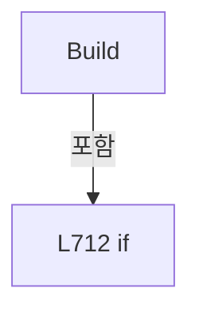

변경 전 점검: 입력/반환 타입, 위 호출자, 예외/취소 경로, 공유 상태와 저장·전송 소비자를 함께 확인합니다. 값의 단위나 물리 방향을 이름만으로 확정하지 않습니다.

### LocalFunctionStatement `SelectHeadPreviewItem` · L728–733

[Drilling.UI/Menu/Menus/CMenuMain.cs:728–733](https://github.com/kjuws10-rgb/A3Drilling/blob/5aee8e58439c9b455cae7c9593c9be986c3e682e/Drilling.UI/Menu/Menus/CMenuMain.cs#L728-L733)

| 항목 | 실제 추출 값 |
| --- | --- |
| 서명 | Drilling.UI.Menu.Menus.ST_HEAD_PREVIEW SelectHeadPreviewItem(int) |
| 접근/수식자 | Private /  |
| 반환/값 타입 | Drilling.UI.Menu.Menus.ST_HEAD_PREVIEW |
| 소속 타입 | NamedType:Drilling.UI.Menu.Menus.CMenuMain |

입력 계약:

| 이름 | 타입 | 전달 | 선택/기본값 |
| --- | --- | --- | --- |
| headNo | int | None | False /  |

현재 부분 분석에서 직접 연결된 호출자는 없습니다. XAML/이벤트/인터페이스·델리게이트·외부 진입을 추가 확인해야 하며, 미사용으로 판정한 것이 아닙니다.

호출하는 대상과 해석 범위:

| 원본 행 | 표현식 | 분석 상태 | 대상/소스 위치 |
| --- | --- | --- | --- |
| 730 | activeHeadNos.Contains | resolved | bool System.Collections.Generic.IEnumerable<int>.Contains<int>(int) |
| 731 | _previewHeadShotCounts.TryGetValue | resolved · 동적 구현 선택 가능 | bool System.Collections.Generic.IReadOnlyDictionary<int, long>.TryGetValue(int, out long) |
| 732 | BuildHeadPreviewItem | resolved | Drilling.UI.Menu.Menus.ST_HEAD_PREVIEW Drilling.UI.Menu.Menus.CMenuMain.BuildHeadPreviewItem(int, long, Drilling.Common.Station.ST_STATION_PROCESS_STATUS, System.Collections.Generic.IReadOnlySet<int>, System.Collections.Generic.IReadOnlyList<Drilling.Common.InterLock.ST_INTERLOCK_ITEM>, System.Collections.Generic.IReadOnlyList<Drilling.UI.Menu.Menus.ST_SCRIPT_TASK_STATUS_ITEM>, bool, Drilling.Common.Interface.ST_POWER_MEASURE_SNAPSHOT?) · Drilling.UI/Menu/Menus/CMenuMain.cs:2100 |

본문의 실제 연산·분기·예외·반환 순서(원문 위치 순):

| 원본 행 | 종류 | 주석 해설 |
| --- | --- | --- |
| 730 | call | 함수·델리게이트 또는 객체 생성자를 호출합니다: activeHeadNos.Contains(headNo) |
| 730 | local-declaration | 지역 변수를 선언합니다: var isEnabled = activeHeadNos.Contains(headNo); |
| 730 | variable-initializer | 변수의 초기값을 지정합니다: isEnabled = activeHeadNos.Contains(headNo) |
| 731 | call | 함수·델리게이트 또는 객체 생성자를 호출합니다: _previewHeadShotCounts.TryGetValue(headNo, out var count) |
| 731 | conditional-expression | 조건에 따라 결과식을 선택합니다: _previewHeadShotCounts.TryGetValue(headNo, out var count) ? count : 0 |
| 731 | local-declaration | 지역 변수를 선언합니다: var shotCount = _previewHeadShotCounts.TryGetValue(headNo, out var count) ? count : 0; |
| 731 | variable-initializer | 변수의 초기값을 지정합니다: shotCount = _previewHeadShotCounts.TryGetValue(headNo, out var count) ? count : 0 |
| 732 | call | 함수·델리게이트 또는 객체 생성자를 호출합니다: BuildHeadPreviewItem(headNo, shotCount, snapshot, selectedHeadNos, liveInterlockItems, scriptTaskStatusItems, isEnabled, powerSnapshot) |
| 732 | return | 호출자에게 값 또는 제어를 반환합니다: return BuildHeadPreviewItem(headNo, shotCount, snapshot, selectedHeadNos, liveInterlockItems, scriptTaskStatusItems, isEnabled, powerSnapshot); |

변경 전 점검: 입력/반환 타입, 위 호출자, 예외/취소 경로, 공유 상태와 저장·전송 소비자를 함께 확인합니다. 값의 단위나 물리 방향을 이름만으로 확정하지 않습니다.

### MethodDeclaration `GetAutoModeBlockers` · L773–781

[Drilling.UI/Menu/Menus/CMenuMain.cs:773–781](https://github.com/kjuws10-rgb/A3Drilling/blob/5aee8e58439c9b455cae7c9593c9be986c3e682e/Drilling.UI/Menu/Menus/CMenuMain.cs#L773-L781)

| 항목 | 실제 추출 값 |
| --- | --- |
| 서명 | System.Threading.Tasks.Task<System.Collections.Generic.IReadOnlyList<Drilling.Common.InterLock.ST_INTERLOCK_ITEM>> Drilling.UI.Menu.Menus.CMenuMain.GetAutoModeBlockers(System.Threading.CancellationToken) |
| 접근/수식자 | Public / public, async |
| 반환/값 타입 | System.Threading.Tasks.Task<System.Collections.Generic.IReadOnlyList<Drilling.Common.InterLock.ST_INTERLOCK_ITEM>> |
| 소속 타입 | NamedType:Drilling.UI.Menu.Menus.CMenuMain |

입력 계약:

| 이름 | 타입 | 전달 | 선택/기본값 |
| --- | --- | --- | --- |
| cancellationToken | System.Threading.CancellationToken | None | True / null |

정적 호출자로 확인된 위치:

| 호출 파일/행 | 호출 표현식 | 런타임 분기 가능 |
| --- | --- | --- |
| [Drilling.UI/CRootView.cs:655–655](https://github.com/kjuws10-rgb/A3Drilling/blob/5aee8e58439c9b455cae7c9593c9be986c3e682e/Drilling.UI/CRootView.cs#L655-L655) | ((CMenuMain)_menus[EN_MENU.Main]).GetAutoModeBlockers | False |

호출하는 대상과 해석 범위:

| 원본 행 | 표현식 | 분석 상태 | 대상/소스 위치 |
| --- | --- | --- | --- |
| 776 | stationManager.GetStatus | resolved | Drilling.Common.Station.ST_STATION_PROCESS_STATUS Drilling.Common.Station.CStationManager.GetStatus(System.Threading.CancellationToken) · Drilling.Common/Station/CStationManager.cs:63 |
| 777 | LoadPreviewParameters | resolved | System.Threading.Tasks.Task<System.Collections.Generic.IReadOnlyDictionary<string, string>> Drilling.UI.Menu.Menus.CMenuMain.LoadPreviewParameters(Drilling.Common.Station.ST_STATION_PROCESS_STATUS, System.Threading.CancellationToken) · Drilling.UI/Menu/Menus/CMenuMain.cs:2159 |
| 778 | LoadLiveInterlockItems | resolved | System.Collections.Generic.IReadOnlyList<Drilling.Common.InterLock.ST_INTERLOCK_ITEM> Drilling.UI.Menu.Menus.CMenuMain.LoadLiveInterlockItems(Drilling.Common.Station.ST_STATION_PROCESS_STATUS, System.Collections.Generic.IReadOnlyDictionary<string, string>, System.Threading.CancellationToken) · Drilling.UI/Menu/Menus/CMenuMain.cs:2080 |
| 779 | CMainInterlockGroups.Build | resolved | System.Collections.Generic.IReadOnlyList<Drilling.UI.Menu.Menus.ST_INTERLOCK_GROUP> Drilling.UI.Menu.Menus.CMainInterlockGroups.Build(System.Collections.Generic.IReadOnlyList<Drilling.Common.InterLock.ST_INTERLOCK_ITEM>) · Drilling.UI/Menu/Menus/CMenuMain.cs:2523 |
| 780 | items.Where(item => !CMainInterlockGroups.IsOk(item)).ToArray | resolved | Drilling.Common.InterLock.ST_INTERLOCK_ITEM[] System.Collections.Generic.IEnumerable<Drilling.Common.InterLock.ST_INTERLOCK_ITEM>.ToArray<Drilling.Common.InterLock.ST_INTERLOCK_ITEM>() |
| 780 | items.Where | resolved | System.Collections.Generic.IEnumerable<Drilling.Common.InterLock.ST_INTERLOCK_ITEM> System.Collections.Generic.IEnumerable<Drilling.Common.InterLock.ST_INTERLOCK_ITEM>.Where<Drilling.Common.InterLock.ST_INTERLOCK_ITEM>(System.Func<Drilling.Common.InterLock.ST_INTERLOCK_ITEM, bool>) |
| 780 | CMainInterlockGroups.IsOk | resolved | bool Drilling.UI.Menu.Menus.CMainInterlockGroups.IsOk(Drilling.Common.InterLock.ST_INTERLOCK_ITEM) · Drilling.UI/Menu/Menus/CMenuMain.cs:2522 |

본문의 실제 연산·분기·예외·반환 순서(원문 위치 순):

| 원본 행 | 종류 | 주석 해설 |
| --- | --- | --- |
| 776 | call | 함수·델리게이트 또는 객체 생성자를 호출합니다: stationManager.GetStatus(cancellationToken) |
| 776 | local-declaration | 지역 변수를 선언합니다: var snapshot = stationManager.GetStatus(cancellationToken); |
| 776 | variable-initializer | 변수의 초기값을 지정합니다: snapshot = stationManager.GetStatus(cancellationToken) |
| 777 | await | 비동기 완료를 기다립니다: await LoadPreviewParameters(snapshot, cancellationToken) |
| 777 | call | 함수·델리게이트 또는 객체 생성자를 호출합니다: LoadPreviewParameters(snapshot, cancellationToken) |
| 777 | local-declaration | 지역 변수를 선언합니다: var parameters = await LoadPreviewParameters(snapshot, cancellationToken); |
| 777 | variable-initializer | 변수의 초기값을 지정합니다: parameters = await LoadPreviewParameters(snapshot, cancellationToken) |
| 778 | call | 함수·델리게이트 또는 객체 생성자를 호출합니다: LoadLiveInterlockItems(snapshot, parameters, cancellationToken) |
| 778 | local-declaration | 지역 변수를 선언합니다: var items = LoadLiveInterlockItems(snapshot, parameters, cancellationToken); |
| 778 | variable-initializer | 변수의 초기값을 지정합니다: items = LoadLiveInterlockItems(snapshot, parameters, cancellationToken) |
| 779 | assignment | 값을 대상에 대입합니다: InterlockItems = CMainInterlockGroups.Build(items) |
| 779 | call | 함수·델리게이트 또는 객체 생성자를 호출합니다: CMainInterlockGroups.Build(items) |
| 780 | call | 함수·델리게이트 또는 객체 생성자를 호출합니다: items.Where(item => !CMainInterlockGroups.IsOk(item)).ToArray() |
| 780 | call | 함수·델리게이트 또는 객체 생성자를 호출합니다: items.Where(item => !CMainInterlockGroups.IsOk(item)) |
| 780 | call | 함수·델리게이트 또는 객체 생성자를 호출합니다: CMainInterlockGroups.IsOk(item) |
| 780 | return | 호출자에게 값 또는 제어를 반환합니다: return items.Where(item => !CMainInterlockGroups.IsOk(item)).ToArray(); |

변경 전 점검: 입력/반환 타입, 위 호출자, 예외/취소 경로, 공유 상태와 저장·전송 소비자를 함께 확인합니다. 값의 단위나 물리 방향을 이름만으로 확정하지 않습니다.

### MethodDeclaration `RefreshLiveStatus` · L783–846

[Drilling.UI/Menu/Menus/CMenuMain.cs:783–846](https://github.com/kjuws10-rgb/A3Drilling/blob/5aee8e58439c9b455cae7c9593c9be986c3e682e/Drilling.UI/Menu/Menus/CMenuMain.cs#L783-L846)

| 항목 | 실제 추출 값 |
| --- | --- |
| 서명 | System.Threading.Tasks.Task Drilling.UI.Menu.Menus.CMenuMain.RefreshLiveStatus(System.Threading.CancellationToken) |
| 접근/수식자 | Public / public, async |
| 반환/값 타입 | System.Threading.Tasks.Task |
| 소속 타입 | NamedType:Drilling.UI.Menu.Menus.CMenuMain |

입력 계약:

| 이름 | 타입 | 전달 | 선택/기본값 |
| --- | --- | --- | --- |
| cancellationToken | System.Threading.CancellationToken | None | True / null |

정적 호출자로 확인된 위치:

| 호출 파일/행 | 호출 표현식 | 런타임 분기 가능 |
| --- | --- | --- |
| [Drilling.UI/CRootView.cs:838–838](https://github.com/kjuws10-rgb/A3Drilling/blob/5aee8e58439c9b455cae7c9593c9be986c3e682e/Drilling.UI/CRootView.cs#L838-L838) | startedMainOperating.RefreshLiveStatus | False |

호출하는 대상과 해석 범위:

| 원본 행 | 표현식 | 분석 상태 | 대상/소스 위치 |
| --- | --- | --- | --- |
| 785 | stationManager.GetStatus | resolved | Drilling.Common.Station.ST_STATION_PROCESS_STATUS Drilling.Common.Station.CStationManager.GetStatus(System.Threading.CancellationToken) · Drilling.Common/Station/CStationManager.cs:63 |
| 786 | RefreshSequenceStatus | resolved | void Drilling.UI.Menu.Menus.CMenuMain.RefreshSequenceStatus(Drilling.Common.Station.ST_STATION_PROCESS_STATUS) · Drilling.UI/Menu/Menus/CMenuMain.cs:138 |
| 787 | LoadPreviewParameters | resolved | System.Threading.Tasks.Task<System.Collections.Generic.IReadOnlyDictionary<string, string>> Drilling.UI.Menu.Menus.CMenuMain.LoadPreviewParameters(Drilling.Common.Station.ST_STATION_PROCESS_STATUS, System.Threading.CancellationToken) · Drilling.UI/Menu/Menus/CMenuMain.cs:2159 |
| 788 | ProtectWindow.UpdateRecipe | resolved | void Drilling.UI.Menu.Menus.CMainProtectWindowPanel.UpdateRecipe(System.Collections.Generic.IReadOnlyDictionary<string, string>) · Drilling.UI/Menu/Menus/CMenuMain.cs:2670 |
| 789 | BuildEnabledHeadNumbers | resolved | System.Collections.Generic.IReadOnlyList<int> Drilling.UI.Menu.Menus.CMenuMain.BuildEnabledHeadNumbers(System.Collections.Generic.IReadOnlyDictionary<string, string>, int) · Drilling.UI/Menu/Menus/CMenuMain.cs:1878 |
| 790 | NormalizeScannerStatusHeadSelection | resolved | void Drilling.UI.Menu.Menus.CMenuMain.NormalizeScannerStatusHeadSelection(System.Collections.Generic.IReadOnlyList<int>) · Drilling.UI/Menu/Menus/CMenuMain.cs:1010 |
| 791 | BuildInspectionStatus | resolved | (System.Collections.Generic.IReadOnlyList<Drilling.UI.Menu.Menus.ST_INSPECTION_STATUS_ITEM> Items, string Summary, string ModeText, string RuleText, Visibility RuleVisibility) Drilling.UI.Menu.Menus.CMenuMain.BuildInspectionStatus(Drilling.Common.Station.ST_STATION_PROCESS_STATUS) · Drilling.UI/Menu/Menus/CMenuMain.cs:1913 |
| 794 | new | resolved | Drilling.UI.Menu.Menus.ST_DISPLAY_ITEM.ST_DISPLAY_ITEM(string, string, string) · Drilling.UI/Menu/Menus/CMenuBase.cs:43 |
| 794 | snapshot.ProcessStep.ToString | resolved · 동적 구현 선택 가능 | string System.Enum.ToString() |
| 795 | new | resolved | Drilling.UI.Menu.Menus.ST_DISPLAY_ITEM.ST_DISPLAY_ITEM(string, string, string) · Drilling.UI/Menu/Menus/CMenuBase.cs:43 |
| 795 | FormatScriptStatus | resolved | string Drilling.UI.Menu.Menus.CMenuMain.FormatScriptStatus(Drilling.Common.Station.EN_SCRIPT_STATUS) · Drilling.UI/Menu/Menus/CMenuMain.cs:927 |
| 796 | new | resolved | Drilling.UI.Menu.Menus.ST_DISPLAY_ITEM.ST_DISPLAY_ITEM(string, string, string) · Drilling.UI/Menu/Menus/CMenuBase.cs:43 |
| 797 | new | resolved | Drilling.UI.Menu.Menus.ST_DISPLAY_ITEM.ST_DISPLAY_ITEM(string, string, string) · Drilling.UI/Menu/Menus/CMenuBase.cs:43 |
| 799 | new | resolved | Drilling.UI.Menu.Menus.ST_DISPLAY_ITEM.ST_DISPLAY_ITEM(string, string, string) · Drilling.UI/Menu/Menus/CMenuBase.cs:43 |
| 799 | .CompletedAt.ToString | resolved | string System.DateTimeOffset.ToString(string?) |
| 799 | new | resolved | Drilling.UI.Menu.Menus.ST_DISPLAY_ITEM.ST_DISPLAY_ITEM(string, string, string) · Drilling.UI/Menu/Menus/CMenuBase.cs:43 |
| 799 | FormatProcessResult | resolved | string Drilling.UI.Menu.Menus.CMenuMain.FormatProcessResult(Drilling.Common.Station.ST_STATION_PROCESS_STATUS) · Drilling.UI/Menu/Menus/CMenuMain.cs:2085 |
| 799 | new | resolved | Drilling.UI.Menu.Menus.ST_DISPLAY_ITEM.ST_DISPLAY_ITEM(string, string, string) · Drilling.UI/Menu/Menus/CMenuBase.cs:43 |
| 800 | BuildProcessSequenceItems | resolved | System.Collections.Generic.IReadOnlyList<Drilling.UI.Menu.Menus.ST_MAIN_PROCESS_SEQUENCE_ITEM> Drilling.UI.Menu.Menus.CMenuMain.BuildProcessSequenceItems(System.Collections.Generic.IReadOnlyList<Drilling.Common.Station.ST_PROCESS_DISPLAY_ITEM>) · Drilling.UI/Menu/Menus/CMenuMain.cs:940 |
| 801 | snapshot.CurrentStepDetails.Select | resolved | System.Collections.Generic.IEnumerable<Drilling.UI.Menu.Menus.ST_DISPLAY_ITEM> System.Collections.Generic.IEnumerable<Drilling.Common.Station.ST_PROCESS_DISPLAY_ITEM>.Select<Drilling.Common.Station.ST_PROCESS_DISPLAY_ITEM, Drilling.UI.Menu.Menus.ST_DISPLAY_ITEM>(System.Func<Drilling.Common.Station.ST_PROCESS_DISPLAY_ITEM, Drilling.UI.Menu.Menus.ST_DISPLAY_ITEM>) |
| 802 | snapshot.ProcessSummary.Select | resolved | System.Collections.Generic.IEnumerable<Drilling.UI.Menu.Menus.ST_DISPLAY_ITEM> System.Collections.Generic.IEnumerable<Drilling.Common.Station.ST_PROCESS_DISPLAY_ITEM>.Select<Drilling.Common.Station.ST_PROCESS_DISPLAY_ITEM, Drilling.UI.Menu.Menus.ST_DISPLAY_ITEM>(System.Func<Drilling.Common.Station.ST_PROCESS_DISPLAY_ITEM, Drilling.UI.Menu.Menus.ST_DISPLAY_ITEM>) |
| 803 | snapshot.ScriptLifecycleItems.Select | resolved | System.Collections.Generic.IEnumerable<Drilling.UI.Menu.Menus.ST_DISPLAY_ITEM> System.Collections.Generic.IEnumerable<Drilling.Common.Station.ST_PROCESS_DISPLAY_ITEM>.Select<Drilling.Common.Station.ST_PROCESS_DISPLAY_ITEM, Drilling.UI.Menu.Menus.ST_DISPLAY_ITEM>(System.Func<Drilling.Common.Station.ST_PROCESS_DISPLAY_ITEM, Drilling.UI.Menu.Menus.ST_DISPLAY_ITEM>) |
| 809 | LoadLiveInterlockItems | resolved | System.Collections.Generic.IReadOnlyList<Drilling.Common.InterLock.ST_INTERLOCK_ITEM> Drilling.UI.Menu.Menus.CMenuMain.LoadLiveInterlockItems(Drilling.Common.Station.ST_STATION_PROCESS_STATUS, System.Collections.Generic.IReadOnlyDictionary<string, string>, System.Threading.CancellationToken) · Drilling.UI/Menu/Menus/CMenuMain.cs:2080 |
| 810 | CMainInterlockGroups.Build | resolved | System.Collections.Generic.IReadOnlyList<Drilling.UI.Menu.Menus.ST_INTERLOCK_GROUP> Drilling.UI.Menu.Menus.CMainInterlockGroups.Build(System.Collections.Generic.IReadOnlyList<Drilling.Common.InterLock.ST_INTERLOCK_ITEM>) · Drilling.UI/Menu/Menus/CMenuMain.cs:2523 |
| 811 | BuildHeadParameters | resolved | System.Collections.Generic.IReadOnlyList<Drilling.UI.Menu.Menus.ST_HEAD_PARAMETER> Drilling.UI.Menu.Menus.CMenuMain.BuildHeadParameters(System.Collections.Generic.IReadOnlyDictionary<string, string>, System.Collections.Generic.IReadOnlyList<int>) · Drilling.UI/Menu/Menus/CMenuMain.cs:2247 |
| 812 | BuildScannerStatusHeadTabs | resolved | System.Collections.Generic.IReadOnlyList<Drilling.UI.Menu.Menus.ST_MAIN_PARAMETER_TAB_ITEM> Drilling.UI.Menu.Menus.CMenuMain.BuildScannerStatusHeadTabs(System.Collections.Generic.IReadOnlyDictionary<string, string>) · Drilling.UI/Menu/Menus/CMenuMain.cs:1042 |
| 813 | snapshot.ProcessStep.ToString | resolved · 동적 구현 선택 가능 | string System.Enum.ToString() |
| 814 | FormatScriptStatus | resolved | string Drilling.UI.Menu.Menus.CMenuMain.FormatScriptStatus(Drilling.Common.Station.EN_SCRIPT_STATUS) · Drilling.UI/Menu/Menus/CMenuMain.cs:927 |
| 820 | FormatDuration | resolved | string Drilling.UI.Menu.Menus.CMenuMain.FormatDuration(System.TimeSpan) · Drilling.UI/Menu/Menus/CMenuMain.cs:2095 |
| 821 | FormatDuration | resolved | string Drilling.UI.Menu.Menus.CMenuMain.FormatDuration(System.TimeSpan) · Drilling.UI/Menu/Menus/CMenuMain.cs:2095 |
| 825 | FormatProcessResult | resolved | string Drilling.UI.Menu.Menus.CMenuMain.FormatProcessResult(Drilling.Common.Station.ST_STATION_PROCESS_STATUS) · Drilling.UI/Menu/Menus/CMenuMain.cs:2085 |
| 826 | CStatusBrush.ForDisplayState | resolved | Brush Drilling.UI.Menu.Menus.CStatusBrush.ForDisplayState(string) · Drilling.UI/Menu/Menus/CMenuBase.cs:294 |
| 829 | BuildOpticParameterGroups | resolved | System.Threading.Tasks.Task<System.Collections.Generic.IReadOnlyList<Drilling.UI.Menu.Menus.ST_OPTIC_PARAMETER_GROUP>> Drilling.UI.Menu.Menus.CMenuMain.BuildOpticParameterGroups(System.Collections.Generic.IReadOnlyDictionary<string, string>, System.Threading.CancellationToken) · Drilling.UI/Menu/Menus/CMenuMain.cs:1486 |
| 830 | BuildOpticHeadParameters | resolved | System.Threading.Tasks.Task<System.Collections.Generic.IReadOnlyList<Drilling.UI.Menu.Menus.ST_OPTIC_HEAD_PARAMETER>> Drilling.UI.Menu.Menus.CMenuMain.BuildOpticHeadParameters(System.Collections.Generic.IReadOnlyDictionary<string, string>, System.Threading.CancellationToken) · Drilling.UI/Menu/Menus/CMenuMain.cs:1492 |
| 833 | RefreshMotorStatus | resolved | void Drilling.UI.Menu.Menus.CMenuMain.RefreshMotorStatus() · Drilling.UI/Menu/Menus/CMenuMain.cs:157 |
| 836 | _scannerStatusSnapshotReader.SelectHead | resolved | void Drilling.UI.Menu.Menus.CScannerStatusSnapshotReader.SelectHead(int, System.Collections.Generic.IReadOnlyDictionary<string, string>) · Drilling.UI/Menu/Menus/CScannerStatusSnapshotReader.cs:29 |
| 837 | _scannerStatusSnapshotReader.GetSnapshot | resolved | System.Collections.Generic.IReadOnlyList<Drilling.UI.Menu.Menus.ST_SCANNER_AXIS_STATUS_ITEM> Drilling.UI.Menu.Menus.CScannerStatusSnapshotReader.GetSnapshot() · Drilling.UI/Menu/Menus/CScannerStatusSnapshotReader.cs:46 |
| 840 | BuildScriptTaskStatusItems | resolved | System.Threading.Tasks.Task<System.Collections.Generic.IReadOnlyList<Drilling.UI.Menu.Menus.ST_SCRIPT_TASK_STATUS_ITEM>> Drilling.UI.Menu.Menus.CMenuMain.BuildScriptTaskStatusItems(Drilling.Common.Station.ST_STATION_PROCESS_STATUS, System.Collections.Generic.IReadOnlyDictionary<string, string>, System.Threading.CancellationToken) · Drilling.UI/Menu/Menus/CMenuMain.cs:1092 |
| 842 | new HashSet<int> | resolved | System.Collections.Generic.HashSet<int>.HashSet() |
| 843 | .GetSnapshot | resolved | Drilling.Common.Interface.ST_POWER_MEASURE_SNAPSHOT Drilling.Common.Interface.CPowerMeasureService.GetSnapshot() · Drilling.Common/Interface/CPowerMeasureService.cs:12 |
| 844 | SetHeadPreviews | resolved | void Drilling.UI.Menu.Menus.CMenuMain.SetHeadPreviews(System.Collections.Generic.IReadOnlyList<Drilling.UI.Menu.Menus.ST_HEAD_PREVIEW>) · Drilling.UI/Menu/Menus/CMenuMain.cs:848 |
| 844 | Enumerable.Range(1, 8).Select(headNo => BuildHeadPreviewItem(headNo, _previewHeadShotCounts.TryGetValue(headNo, out var count) ? count : 0, snapshot, selectedHeadNos, liveInterlockItems, scriptTaskStatusItems, activeHeadNos.Contains(headNo), powerSnapshot)).ToArray | resolved | Drilling.UI.Menu.Menus.ST_HEAD_PREVIEW[] System.Collections.Generic.IEnumerable<Drilling.UI.Menu.Menus.ST_HEAD_PREVIEW>.ToArray<Drilling.UI.Menu.Menus.ST_HEAD_PREVIEW>() |
| 844 | Enumerable.Range(1, 8).Select | resolved | System.Collections.Generic.IEnumerable<Drilling.UI.Menu.Menus.ST_HEAD_PREVIEW> System.Collections.Generic.IEnumerable<int>.Select<int, Drilling.UI.Menu.Menus.ST_HEAD_PREVIEW>(System.Func<int, Drilling.UI.Menu.Menus.ST_HEAD_PREVIEW>) |
| 844 | Enumerable.Range | resolved | System.Collections.Generic.IEnumerable<int> System.Linq.Enumerable.Range(int, int) |
| 844 | BuildHeadPreviewItem | resolved | Drilling.UI.Menu.Menus.ST_HEAD_PREVIEW Drilling.UI.Menu.Menus.CMenuMain.BuildHeadPreviewItem(int, long, Drilling.Common.Station.ST_STATION_PROCESS_STATUS, System.Collections.Generic.IReadOnlySet<int>, System.Collections.Generic.IReadOnlyList<Drilling.Common.InterLock.ST_INTERLOCK_ITEM>, System.Collections.Generic.IReadOnlyList<Drilling.UI.Menu.Menus.ST_SCRIPT_TASK_STATUS_ITEM>, bool, Drilling.Common.Interface.ST_POWER_MEASURE_SNAPSHOT?) · Drilling.UI/Menu/Menus/CMenuMain.cs:2100 |
| 844 | _previewHeadShotCounts.TryGetValue | resolved · 동적 구현 선택 가능 | bool System.Collections.Generic.IReadOnlyDictionary<int, long>.TryGetValue(int, out long) |
| 844 | activeHeadNos.Contains | resolved | bool System.Collections.Generic.IEnumerable<int>.Contains<int>(int) |
| 845 | BuildAutomationControllerStatusItems | resolved | System.Threading.Tasks.Task<System.Collections.Generic.IReadOnlyList<Drilling.UI.Menu.Menus.ST_AUTOMATION_CONTROLLER_STATUS_ITEM>> Drilling.UI.Menu.Menus.CMenuMain.BuildAutomationControllerStatusItems(System.Collections.Generic.IReadOnlyList<Drilling.UI.Menu.Menus.ST_SCRIPT_TASK_STATUS_ITEM>, System.Threading.CancellationToken) · Drilling.UI/Menu/Menus/CMenuMain.cs:1135 |

본문의 실제 연산·분기·예외·반환 순서(원문 위치 순):

| 원본 행 | 종류 | 주석 해설 |
| --- | --- | --- |
| 785 | call | 함수·델리게이트 또는 객체 생성자를 호출합니다: stationManager.GetStatus(cancellationToken) |
| 785 | local-declaration | 지역 변수를 선언합니다: var snapshot = stationManager.GetStatus(cancellationToken); |
| 785 | variable-initializer | 변수의 초기값을 지정합니다: snapshot = stationManager.GetStatus(cancellationToken) |
| 786 | call | 함수·델리게이트 또는 객체 생성자를 호출합니다: RefreshSequenceStatus(snapshot) |
| 787 | await | 비동기 완료를 기다립니다: await LoadPreviewParameters(snapshot, cancellationToken) |
| 787 | call | 함수·델리게이트 또는 객체 생성자를 호출합니다: LoadPreviewParameters(snapshot, cancellationToken) |
| 787 | local-declaration | 지역 변수를 선언합니다: var previewParameters = await LoadPreviewParameters(snapshot, cancellationToken); |
| 787 | variable-initializer | 변수의 초기값을 지정합니다: previewParameters = await LoadPreviewParameters(snapshot, cancellationToken) |
| 788 | call | 함수·델리게이트 또는 객체 생성자를 호출합니다: ProtectWindow.UpdateRecipe(previewParameters) |
| 789 | call | 함수·델리게이트 또는 객체 생성자를 호출합니다: BuildEnabledHeadNumbers(previewParameters) |
| 789 | local-declaration | 지역 변수를 선언합니다: var activeHeadNos = BuildEnabledHeadNumbers(previewParameters); |
| 789 | variable-initializer | 변수의 초기값을 지정합니다: activeHeadNos = BuildEnabledHeadNumbers(previewParameters) |
| 790 | call | 함수·델리게이트 또는 객체 생성자를 호출합니다: NormalizeScannerStatusHeadSelection(activeHeadNos) |
| 791 | call | 함수·델리게이트 또는 객체 생성자를 호출합니다: BuildInspectionStatus(snapshot) |
| 791 | local-declaration | 지역 변수를 선언합니다: var inspectionStatus = BuildInspectionStatus(snapshot); |
| 791 | variable-initializer | 변수의 초기값을 지정합니다: inspectionStatus = BuildInspectionStatus(snapshot) |
| 792 | local-declaration | 지역 변수를 선언합니다: var statistics = snapshot.Statistics; |
| 792 | variable-initializer | 변수의 초기값을 지정합니다: statistics = snapshot.Statistics |
| 793 | assignment | 값을 대상에 대입합니다: CycleItems = [ new("Cycle State", snapshot.ProcessStep.ToString()), new("Script Status", FormatScriptStatus(snapshot.ScriptStatus)), new("Automation", "Simulation"), new("Preview Source", "Recipe Cell drilling points") ] |
| 794 | call | 함수·델리게이트 또는 객체 생성자를 호출합니다: new("Cycle State", snapshot.ProcessStep.ToString()) |
| 794 | call | 함수·델리게이트 또는 객체 생성자를 호출합니다: snapshot.ProcessStep.ToString() |
| 795 | call | 함수·델리게이트 또는 객체 생성자를 호출합니다: new("Script Status", FormatScriptStatus(snapshot.ScriptStatus)) |
| 795 | call | 함수·델리게이트 또는 객체 생성자를 호출합니다: FormatScriptStatus(snapshot.ScriptStatus) |
| 796 | call | 함수·델리게이트 또는 객체 생성자를 호출합니다: new("Automation", "Simulation") |
| 797 | call | 함수·델리게이트 또는 객체 생성자를 호출합니다: new("Preview Source", "Recipe Cell drilling points") |
| 799 | assignment | 값을 대상에 대입합니다: ResultItems = [new("Complete Time", snapshot.Result?.CompletedAt.ToString("HH:mm:ss") ?? "-"), new("Result", FormatProcessResult(snapshot)), new("Message", snapshot.Result?.Message ?? "Ready")] |
| 799 | call | 함수·델리게이트 또는 객체 생성자를 호출합니다: new("Complete Time", snapshot.Result?.CompletedAt.ToString("HH:mm:ss") ?? "-") |
| 799 | call | 함수·델리게이트 또는 객체 생성자를 호출합니다: .CompletedAt.ToString("HH:mm:ss") |
| 799 | call | 함수·델리게이트 또는 객체 생성자를 호출합니다: new("Result", FormatProcessResult(snapshot)) |
| 799 | call | 함수·델리게이트 또는 객체 생성자를 호출합니다: FormatProcessResult(snapshot) |
| 799 | call | 함수·델리게이트 또는 객체 생성자를 호출합니다: new("Message", snapshot.Result?.Message ?? "Ready") |
| 800 | assignment | 값을 대상에 대입합니다: ProcessSequenceItems = BuildProcessSequenceItems(snapshot.ProcessSequence) |
| 800 | call | 함수·델리게이트 또는 객체 생성자를 호출합니다: BuildProcessSequenceItems(snapshot.ProcessSequence) |
| 801 | assignment | 값을 대상에 대입합니다: CurrentStepDetails = [..snapshot.CurrentStepDetails.Select(ToDisplayItem)] |
| 801 | call | 함수·델리게이트 또는 객체 생성자를 호출합니다: snapshot.CurrentStepDetails.Select(ToDisplayItem) |
| 802 | assignment | 값을 대상에 대입합니다: ProcessSummaryItems = [..snapshot.ProcessSummary.Select(ToDisplayItem)] |
| 802 | call | 함수·델리게이트 또는 객체 생성자를 호출합니다: snapshot.ProcessSummary.Select(ToDisplayItem) |
| 803 | assignment | 값을 대상에 대입합니다: LifecycleItems = [..snapshot.ScriptLifecycleItems.Select(ToDisplayItem)] |
| 803 | call | 함수·델리게이트 또는 객체 생성자를 호출합니다: snapshot.ScriptLifecycleItems.Select(ToDisplayItem) |
| 804 | assignment | 값을 대상에 대입합니다: InspectionStatusItems = inspectionStatus.Items |
| 805 | assignment | 값을 대상에 대입합니다: InspectionSummary = inspectionStatus.Summary |
| 806 | assignment | 값을 대상에 대입합니다: InspectionModeText = inspectionStatus.ModeText |
| 807 | assignment | 값을 대상에 대입합니다: InspectionRuleText = inspectionStatus.RuleText |
| 808 | assignment | 값을 대상에 대입합니다: InspectionRuleVisibility = inspectionStatus.RuleVisibility |
| 809 | call | 함수·델리게이트 또는 객체 생성자를 호출합니다: LoadLiveInterlockItems(snapshot, previewParameters, cancellationToken) |
| 809 | local-declaration | 지역 변수를 선언합니다: var liveInterlockItems = LoadLiveInterlockItems(snapshot, previewParameters, cancellationToken); |
| 809 | variable-initializer | 변수의 초기값을 지정합니다: liveInterlockItems = LoadLiveInterlockItems(snapshot, previewParameters, cancellationToken) |
| 810 | assignment | 값을 대상에 대입합니다: InterlockItems = CMainInterlockGroups.Build(liveInterlockItems) |
| 810 | call | 함수·델리게이트 또는 객체 생성자를 호출합니다: CMainInterlockGroups.Build(liveInterlockItems) |
| 811 | assignment | 값을 대상에 대입합니다: HeadParameters = BuildHeadParameters(previewParameters, activeHeadNos) |
| 811 | call | 함수·델리게이트 또는 객체 생성자를 호출합니다: BuildHeadParameters(previewParameters, activeHeadNos) |
| 812 | assignment | 값을 대상에 대입합니다: ScannerStatusHeadTabs = BuildScannerStatusHeadTabs(previewParameters) |
| 812 | call | 함수·델리게이트 또는 객체 생성자를 호출합니다: BuildScannerStatusHeadTabs(previewParameters) |
| 813 | assignment | 값을 대상에 대입합니다: ProcessStep = snapshot.ProcessStep.ToString() |
| 813 | call | 함수·델리게이트 또는 객체 생성자를 호출합니다: snapshot.ProcessStep.ToString() |
| 814 | assignment | 값을 대상에 대입합니다: ScriptStatus = FormatScriptStatus(snapshot.ScriptStatus) |
| 814 | call | 함수·델리게이트 또는 객체 생성자를 호출합니다: FormatScriptStatus(snapshot.ScriptStatus) |
| 815 | assignment | 값을 대상에 대입합니다: ScriptStatusText = $"Script Status {ScriptStatus}" |
| 816 | assignment | 값을 대상에 대입합니다: ResultMessage = snapshot.Result?.Message ?? "Waiting for operator command." |
| 817 | assignment | 값을 대상에 대입합니다: TotalShotsText = $"Total Shots {statistics.TotalShots:N0}" |
| 818 | assignment | 값을 대상에 대입합니다: MoveCountText = $"Move Count (G0) {statistics.MoveCount:N0}" |
| 819 | assignment | 값을 대상에 대입합니다: LaserOnSegmentsText = $"Laser On Segments {statistics.LaserOnSegments:N0}" |
| 820 | assignment | 값을 대상에 대입합니다: EstimatedTimeText = $"Estimated Time {FormatDuration(statistics.EstimatedTime)}" |
| 820 | call | 함수·델리게이트 또는 객체 생성자를 호출합니다: FormatDuration(statistics.EstimatedTime) |
| 821 | assignment | 값을 대상에 대입합니다: ElapsedTimeText = $"Elapsed Time {FormatDuration(statistics.ElapsedTime)}" |
| 821 | call | 함수·델리게이트 또는 객체 생성자를 호출합니다: FormatDuration(statistics.ElapsedTime) |
| 822 | assignment | 값을 대상에 대입합니다: ProgressText = $"Progress {statistics.ProgressPercent:F1}%" |
| 823 | assignment | 값을 대상에 대입합니다: ProgressPercentText = $"{statistics.ProgressPercent:F1}%" |
| 824 | assignment | 값을 대상에 대입합니다: ProgressPercent = statistics.ProgressPercent |
| 825 | assignment | 값을 대상에 대입합니다: ProcessResultValue = FormatProcessResult(snapshot) |
| 825 | call | 함수·델리게이트 또는 객체 생성자를 호출합니다: FormatProcessResult(snapshot) |
| 826 | assignment | 값을 대상에 대입합니다: ProcessResultBrush = CStatusBrush.ForDisplayState(ProcessResultValue) |
| 826 | call | 함수·델리게이트 또는 객체 생성자를 호출합니다: CStatusBrush.ForDisplayState(ProcessResultValue) |
| 827 | if | 조건에 따라 분기합니다: if (IsOpticParameterSelected) |
| 829 | assignment | 값을 대상에 대입합니다: OpticParameterGroups = await BuildOpticParameterGroups(previewParameters, cancellationToken) |
| 829 | await | 비동기 완료를 기다립니다: await BuildOpticParameterGroups(previewParameters, cancellationToken) |
| 829 | call | 함수·델리게이트 또는 객체 생성자를 호출합니다: BuildOpticParameterGroups(previewParameters, cancellationToken) |
| 830 | assignment | 값을 대상에 대입합니다: OpticHeadParameters = await BuildOpticHeadParameters(previewParameters, cancellationToken) |
| 830 | await | 비동기 완료를 기다립니다: await BuildOpticHeadParameters(previewParameters, cancellationToken) |
| 830 | call | 함수·델리게이트 또는 객체 생성자를 호출합니다: BuildOpticHeadParameters(previewParameters, cancellationToken) |
| 833 | call | 함수·델리게이트 또는 객체 생성자를 호출합니다: RefreshMotorStatus() |
| 834 | if | 조건에 따라 분기합니다: if (IsScannerStatusSelected) |
| 836 | call | 함수·델리게이트 또는 객체 생성자를 호출합니다: _scannerStatusSnapshotReader.SelectHead(_selectedScannerStatusHeadNo, previewParameters) |
| 837 | assignment | 값을 대상에 대입합니다: ScannerStatusItems = _scannerStatusSnapshotReader.GetSnapshot() |
| 837 | call | 함수·델리게이트 또는 객체 생성자를 호출합니다: _scannerStatusSnapshotReader.GetSnapshot() |
| 840 | await | 비동기 완료를 기다립니다: await BuildScriptTaskStatusItems(snapshot, previewParameters, cancellationToken) |
| 840 | call | 함수·델리게이트 또는 객체 생성자를 호출합니다: BuildScriptTaskStatusItems(snapshot, previewParameters, cancellationToken) |
| 840 | local-declaration | 지역 변수를 선언합니다: var scriptTaskStatusItems = await BuildScriptTaskStatusItems(snapshot, previewParameters, cancellationToken); |
| 840 | variable-initializer | 변수의 초기값을 지정합니다: scriptTaskStatusItems = await BuildScriptTaskStatusItems(snapshot, previewParameters, cancellationToken) |
| 841 | assignment | 값을 대상에 대입합니다: ScriptTaskStatusItems = scriptTaskStatusItems |
| 842 | call | 함수·델리게이트 또는 객체 생성자를 호출합니다: new HashSet<int>() |
| 842 | local-declaration | 지역 변수를 선언합니다: var selectedHeadNos = new HashSet<int>(); |
| 842 | variable-initializer | 변수의 초기값을 지정합니다: selectedHeadNos = new HashSet<int>() |
| 843 | call | 함수·델리게이트 또는 객체 생성자를 호출합니다: .GetSnapshot() |
| 843 | local-declaration | 지역 변수를 선언합니다: var powerSnapshot = powerMeasure?.GetSnapshot(); |
| 843 | variable-initializer | 변수의 초기값을 지정합니다: powerSnapshot = powerMeasure?.GetSnapshot() |
| 844 | call | 함수·델리게이트 또는 객체 생성자를 호출합니다: SetHeadPreviews(Enumerable.Range(1, 8).Select(headNo => BuildHeadPreviewItem(headNo, _previewHeadShotCounts.TryGetValue(headNo, out var count) ? count : 0, snapshot, selectedHeadNos, liveInterlockItems, scriptTaskStatusI… |
| 844 | call | 함수·델리게이트 또는 객체 생성자를 호출합니다: Enumerable.Range(1, 8).Select(headNo => BuildHeadPreviewItem(headNo, _previewHeadShotCounts.TryGetValue(headNo, out var count) ? count : 0, snapshot, selectedHeadNos, liveInterlockItems, scriptTaskStatusItems, activeHead… |
| 844 | call | 함수·델리게이트 또는 객체 생성자를 호출합니다: Enumerable.Range(1, 8).Select(headNo => BuildHeadPreviewItem(headNo, _previewHeadShotCounts.TryGetValue(headNo, out var count) ? count : 0, snapshot, selectedHeadNos, liveInterlockItems, scriptTaskStatusItems, activeHead… |
| 844 | call | 함수·델리게이트 또는 객체 생성자를 호출합니다: Enumerable.Range(1, 8) |
| 844 | call | 함수·델리게이트 또는 객체 생성자를 호출합니다: BuildHeadPreviewItem(headNo, _previewHeadShotCounts.TryGetValue(headNo, out var count) ? count : 0, snapshot, selectedHeadNos, liveInterlockItems, scriptTaskStatusItems, activeHeadNos.Contains(headNo), powerSnapshot) |
| 844 | call | 함수·델리게이트 또는 객체 생성자를 호출합니다: _previewHeadShotCounts.TryGetValue(headNo, out var count) |
| 844 | call | 함수·델리게이트 또는 객체 생성자를 호출합니다: activeHeadNos.Contains(headNo) |
| 844 | conditional-expression | 조건에 따라 결과식을 선택합니다: _previewHeadShotCounts.TryGetValue(headNo, out var count) ? count : 0 |
| 845 | assignment | 값을 대상에 대입합니다: AutomationControllerStatusItems = await BuildAutomationControllerStatusItems(scriptTaskStatusItems, cancellationToken) |
| 845 | await | 비동기 완료를 기다립니다: await BuildAutomationControllerStatusItems(scriptTaskStatusItems, cancellationToken) |
| 845 | call | 함수·델리게이트 또는 객체 생성자를 호출합니다: BuildAutomationControllerStatusItems(scriptTaskStatusItems, cancellationToken) |

제어 구문의 포함 구조(실제 실행 순서/CFG가 아닌 구문 탐색 그림):

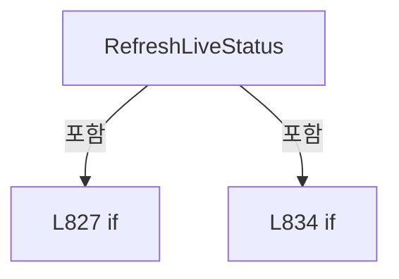

변경 전 점검: 입력/반환 타입, 위 호출자, 예외/취소 경로, 공유 상태와 저장·전송 소비자를 함께 확인합니다. 값의 단위나 물리 방향을 이름만으로 확정하지 않습니다.

### MethodDeclaration `SetHeadPreviews` · L848–853

[Drilling.UI/Menu/Menus/CMenuMain.cs:848–853](https://github.com/kjuws10-rgb/A3Drilling/blob/5aee8e58439c9b455cae7c9593c9be986c3e682e/Drilling.UI/Menu/Menus/CMenuMain.cs#L848-L853)

| 항목 | 실제 추출 값 |
| --- | --- |
| 서명 | void Drilling.UI.Menu.Menus.CMenuMain.SetHeadPreviews(System.Collections.Generic.IReadOnlyList<Drilling.UI.Menu.Menus.ST_HEAD_PREVIEW>) |
| 접근/수식자 | Private / private |
| 반환/값 타입 | void |
| 소속 타입 | NamedType:Drilling.UI.Menu.Menus.CMenuMain |

입력 계약:

| 이름 | 타입 | 전달 | 선택/기본값 |
| --- | --- | --- | --- |
| headPreviews | System.Collections.Generic.IReadOnlyList<Drilling.UI.Menu.Menus.ST_HEAD_PREVIEW> | None | False /  |

정적 호출자로 확인된 위치:

| 호출 파일/행 | 호출 표현식 | 런타임 분기 가능 |
| --- | --- | --- |
| [Drilling.UI/Menu/Menus/CMenuMain.cs:844–844](https://github.com/kjuws10-rgb/A3Drilling/blob/5aee8e58439c9b455cae7c9593c9be986c3e682e/Drilling.UI/Menu/Menus/CMenuMain.cs#L844-L844) | SetHeadPreviews | False |
| [Drilling.UI/Menu/Menus/CMenuMain.cs:885–885](https://github.com/kjuws10-rgb/A3Drilling/blob/5aee8e58439c9b455cae7c9593c9be986c3e682e/Drilling.UI/Menu/Menus/CMenuMain.cs#L885-L885) | SetHeadPreviews | False |

호출하는 대상과 해석 범위:

| 원본 행 | 표현식 | 분석 상태 | 대상/소스 위치 |
| --- | --- | --- | --- |
| 851 | headPreviews.Where(head => head.HeadNo % 2 != 0).OrderBy(head => head.HeadNo).ToArray | resolved | Drilling.UI.Menu.Menus.ST_HEAD_PREVIEW[] System.Collections.Generic.IEnumerable<Drilling.UI.Menu.Menus.ST_HEAD_PREVIEW>.ToArray<Drilling.UI.Menu.Menus.ST_HEAD_PREVIEW>() |
| 851 | headPreviews.Where(head => head.HeadNo % 2 != 0).OrderBy | resolved | System.Linq.IOrderedEnumerable<Drilling.UI.Menu.Menus.ST_HEAD_PREVIEW> System.Collections.Generic.IEnumerable<Drilling.UI.Menu.Menus.ST_HEAD_PREVIEW>.OrderBy<Drilling.UI.Menu.Menus.ST_HEAD_PREVIEW, int>(System.Func<Drilling.UI.Menu.Menus.ST_HEAD_PREVIEW, int>) |
| 851 | headPreviews.Where | resolved | System.Collections.Generic.IEnumerable<Drilling.UI.Menu.Menus.ST_HEAD_PREVIEW> System.Collections.Generic.IEnumerable<Drilling.UI.Menu.Menus.ST_HEAD_PREVIEW>.Where<Drilling.UI.Menu.Menus.ST_HEAD_PREVIEW>(System.Func<Drilling.UI.Menu.Menus.ST_HEAD_PREVIEW, bool>) |
| 852 | headPreviews.Where(head => head.HeadNo % 2 == 0).OrderBy(head => head.HeadNo).ToArray | resolved | Drilling.UI.Menu.Menus.ST_HEAD_PREVIEW[] System.Collections.Generic.IEnumerable<Drilling.UI.Menu.Menus.ST_HEAD_PREVIEW>.ToArray<Drilling.UI.Menu.Menus.ST_HEAD_PREVIEW>() |
| 852 | headPreviews.Where(head => head.HeadNo % 2 == 0).OrderBy | resolved | System.Linq.IOrderedEnumerable<Drilling.UI.Menu.Menus.ST_HEAD_PREVIEW> System.Collections.Generic.IEnumerable<Drilling.UI.Menu.Menus.ST_HEAD_PREVIEW>.OrderBy<Drilling.UI.Menu.Menus.ST_HEAD_PREVIEW, int>(System.Func<Drilling.UI.Menu.Menus.ST_HEAD_PREVIEW, int>) |
| 852 | headPreviews.Where | resolved | System.Collections.Generic.IEnumerable<Drilling.UI.Menu.Menus.ST_HEAD_PREVIEW> System.Collections.Generic.IEnumerable<Drilling.UI.Menu.Menus.ST_HEAD_PREVIEW>.Where<Drilling.UI.Menu.Menus.ST_HEAD_PREVIEW>(System.Func<Drilling.UI.Menu.Menus.ST_HEAD_PREVIEW, bool>) |

본문의 실제 연산·분기·예외·반환 순서(원문 위치 순):

| 원본 행 | 종류 | 주석 해설 |
| --- | --- | --- |
| 850 | assignment | 값을 대상에 대입합니다: HeadPreviews = headPreviews |
| 851 | assignment | 값을 대상에 대입합니다: OddHeadPreviews = headPreviews.Where(head => head.HeadNo % 2 != 0).OrderBy(head => head.HeadNo).ToArray() |
| 851 | call | 함수·델리게이트 또는 객체 생성자를 호출합니다: headPreviews.Where(head => head.HeadNo % 2 != 0).OrderBy(head => head.HeadNo).ToArray() |
| 851 | call | 함수·델리게이트 또는 객체 생성자를 호출합니다: headPreviews.Where(head => head.HeadNo % 2 != 0).OrderBy(head => head.HeadNo) |
| 851 | call | 함수·델리게이트 또는 객체 생성자를 호출합니다: headPreviews.Where(head => head.HeadNo % 2 != 0) |
| 852 | assignment | 값을 대상에 대입합니다: EvenHeadPreviews = headPreviews.Where(head => head.HeadNo % 2 == 0).OrderBy(head => head.HeadNo).ToArray() |
| 852 | call | 함수·델리게이트 또는 객체 생성자를 호출합니다: headPreviews.Where(head => head.HeadNo % 2 == 0).OrderBy(head => head.HeadNo).ToArray() |
| 852 | call | 함수·델리게이트 또는 객체 생성자를 호출합니다: headPreviews.Where(head => head.HeadNo % 2 == 0).OrderBy(head => head.HeadNo) |
| 852 | call | 함수·델리게이트 또는 객체 생성자를 호출합니다: headPreviews.Where(head => head.HeadNo % 2 == 0) |

변경 전 점검: 입력/반환 타입, 위 호출자, 예외/취소 경로, 공유 상태와 저장·전송 소비자를 함께 확인합니다. 값의 단위나 물리 방향을 이름만으로 확정하지 않습니다.

### MethodDeclaration `Apply` · L855–925

[Drilling.UI/Menu/Menus/CMenuMain.cs:855–925](https://github.com/kjuws10-rgb/A3Drilling/blob/5aee8e58439c9b455cae7c9593c9be986c3e682e/Drilling.UI/Menu/Menus/CMenuMain.cs#L855-L925)

| 항목 | 실제 추출 값 |
| --- | --- |
| 서명 | void Drilling.UI.Menu.Menus.CMenuMain.Apply(System.Collections.Generic.IReadOnlyList<Drilling.UI.Menu.Menus.ST_HEAD_PREVIEW>, System.Collections.Generic.IReadOnlyList<Drilling.UI.Menu.Menus.ST_DISPLAY_ITEM>, System.Collections.Generic.IReadOnlyList<Drilling.UI.Menu.Menus.ST_DISPLAY_ITEM>, System.Collections.Generic.IReadOnlyList<Drilling.UI.Menu.Menus.ST_MAIN_PROCESS_SEQUENCE_ITEM>, System.Collections.Generic.IReadOnlyList<Drilling.UI.Menu.Menus.ST_DISPLAY_ITEM>, System.Collections.Generic.IReadOnlyList<Drilling.UI.Menu.Menus.ST_DISPLAY_ITEM>, System.Collections.Generic.IReadOnlyList<Drilling.UI.Menu.Menus.ST_DISPLAY_ITEM>, System.Collections.Generic.IReadOnlyList<Drilling.UI.Menu.Menus.ST_SCRIPT_TASK_STATUS_ITEM>, System.Collections.Generic.IReadOnlyList<Drilling.UI.Menu.Menus.ST_AUTOMATION_CONTROLLER_STATUS_ITEM>, System.Collections.Generic.IReadOnlyList<Drilling.UI.Menu.Menus.ST_INSPECTION_STATUS_ITEM>, string, string, string, Visibility, System.Collections.Generic.IReadOnlyList<Drilling.UI.Menu.Menus.ST_INTERLOCK_GROUP>, System.Collections.Generic.IReadOnlyList<Drilling.UI.Menu.Menus.ST_HEAD_PARAMETER>, System.Collections.Generic.IReadOnlyList<Drilling.UI.Menu.Menus.ST_MAIN_PARAMETER_TAB_ITEM>, System.Collections.Generic.IReadOnlyList<Drilling.UI.Menu.Menus.ST_MAIN_PARAMETER_TAB_ITEM>, System.Collections.Generic.IReadOnlyList<Drilling.UI.Menu.Menus.ST_MAIN_PARAMETER_TAB_ITEM>, System.Collections.Generic.IReadOnlyList<Drilling.UI.Menu.Menus.ST_OPTIC_PARAMETER_GROUP>, System.Collections.Generic.IReadOnlyList<Drilling.UI.Menu.Menus.ST_OPTIC_HEAD_PARAMETER>, System.Collections.Generic.IReadOnlyList<Drilling.UI.Menu.Menus.ST_SCANNER_AXIS_STATUS_ITEM>, string, string, string, Drilling.Common.Station.ST_PROCESS_STATISTICS, string) |
| 접근/수식자 | Private / private |
| 반환/값 타입 | void |
| 소속 타입 | NamedType:Drilling.UI.Menu.Menus.CMenuMain |

입력 계약:

| 이름 | 타입 | 전달 | 선택/기본값 |
| --- | --- | --- | --- |
| headPreviews | System.Collections.Generic.IReadOnlyList<Drilling.UI.Menu.Menus.ST_HEAD_PREVIEW> | None | False /  |
| cycleItems | System.Collections.Generic.IReadOnlyList<Drilling.UI.Menu.Menus.ST_DISPLAY_ITEM> | None | False /  |
| resultItems | System.Collections.Generic.IReadOnlyList<Drilling.UI.Menu.Menus.ST_DISPLAY_ITEM> | None | False /  |
| processSequenceItems | System.Collections.Generic.IReadOnlyList<Drilling.UI.Menu.Menus.ST_MAIN_PROCESS_SEQUENCE_ITEM> | None | False /  |
| currentStepDetails | System.Collections.Generic.IReadOnlyList<Drilling.UI.Menu.Menus.ST_DISPLAY_ITEM> | None | False /  |
| processSummaryItems | System.Collections.Generic.IReadOnlyList<Drilling.UI.Menu.Menus.ST_DISPLAY_ITEM> | None | False /  |
| lifecycleItems | System.Collections.Generic.IReadOnlyList<Drilling.UI.Menu.Menus.ST_DISPLAY_ITEM> | None | False /  |
| scriptTaskStatusItems | System.Collections.Generic.IReadOnlyList<Drilling.UI.Menu.Menus.ST_SCRIPT_TASK_STATUS_ITEM> | None | False /  |
| automationControllerStatusItems | System.Collections.Generic.IReadOnlyList<Drilling.UI.Menu.Menus.ST_AUTOMATION_CONTROLLER_STATUS_ITEM> | None | False /  |
| inspectionStatusItems | System.Collections.Generic.IReadOnlyList<Drilling.UI.Menu.Menus.ST_INSPECTION_STATUS_ITEM> | None | False /  |
| inspectionSummary | string | None | False /  |
| inspectionModeText | string | None | False /  |
| inspectionRuleText | string | None | False /  |
| inspectionRuleVisibility | Visibility | None | False /  |
| interlockItems | System.Collections.Generic.IReadOnlyList<Drilling.UI.Menu.Menus.ST_INTERLOCK_GROUP> | None | False /  |
| headParameters | System.Collections.Generic.IReadOnlyList<Drilling.UI.Menu.Menus.ST_HEAD_PARAMETER> | None | False /  |
| parameterTabs | System.Collections.Generic.IReadOnlyList<Drilling.UI.Menu.Menus.ST_MAIN_PARAMETER_TAB_ITEM> | None | False /  |
| opticStatusTabs | System.Collections.Generic.IReadOnlyList<Drilling.UI.Menu.Menus.ST_MAIN_PARAMETER_TAB_ITEM> | None | False /  |
| scannerStatusHeadTabs | System.Collections.Generic.IReadOnlyList<Drilling.UI.Menu.Menus.ST_MAIN_PARAMETER_TAB_ITEM> | None | False /  |
| opticParameterGroups | System.Collections.Generic.IReadOnlyList<Drilling.UI.Menu.Menus.ST_OPTIC_PARAMETER_GROUP> | None | False /  |
| opticHeadParameters | System.Collections.Generic.IReadOnlyList<Drilling.UI.Menu.Menus.ST_OPTIC_HEAD_PARAMETER> | None | False /  |
| scannerStatusItems | System.Collections.Generic.IReadOnlyList<Drilling.UI.Menu.Menus.ST_SCANNER_AXIS_STATUS_ITEM> | None | False /  |
| processStep | string | None | False /  |
| scriptStatus | string | None | False /  |
| resultMessage | string | None | False /  |
| statistics | Drilling.Common.Station.ST_PROCESS_STATISTICS | None | False /  |
| processResultValue | string | None | False /  |

정적 호출자로 확인된 위치:

| 호출 파일/행 | 호출 표현식 | 런타임 분기 가능 |
| --- | --- | --- |
| [Drilling.UI/Menu/Menus/CMenuMain.cs:736–769](https://github.com/kjuws10-rgb/A3Drilling/blob/5aee8e58439c9b455cae7c9593c9be986c3e682e/Drilling.UI/Menu/Menus/CMenuMain.cs#L736-L769) | Apply | False |

호출하는 대상과 해석 범위:

| 원본 행 | 표현식 | 분석 상태 | 대상/소스 위치 |
| --- | --- | --- | --- |
| 885 | SetHeadPreviews | resolved | void Drilling.UI.Menu.Menus.CMenuMain.SetHeadPreviews(System.Collections.Generic.IReadOnlyList<Drilling.UI.Menu.Menus.ST_HEAD_PREVIEW>) · Drilling.UI/Menu/Menus/CMenuMain.cs:848 |
| 908 | _selectedParameterTabKey.Equals | resolved | bool string.Equals(string?, System.StringComparison) |
| 909 | _selectedParameterTabKey.Equals | resolved | bool string.Equals(string?, System.StringComparison) |
| 910 | _selectedParameterTabKey.Equals | resolved | bool string.Equals(string?, System.StringComparison) |
| 918 | FormatDuration | resolved | string Drilling.UI.Menu.Menus.CMenuMain.FormatDuration(System.TimeSpan) · Drilling.UI/Menu/Menus/CMenuMain.cs:2095 |
| 919 | FormatDuration | resolved | string Drilling.UI.Menu.Menus.CMenuMain.FormatDuration(System.TimeSpan) · Drilling.UI/Menu/Menus/CMenuMain.cs:2095 |
| 924 | CStatusBrush.ForDisplayState | resolved | Brush Drilling.UI.Menu.Menus.CStatusBrush.ForDisplayState(string) · Drilling.UI/Menu/Menus/CMenuBase.cs:294 |

본문의 실제 연산·분기·예외·반환 순서(원문 위치 순):

| 원본 행 | 종류 | 주석 해설 |
| --- | --- | --- |
| 885 | call | 함수·델리게이트 또는 객체 생성자를 호출합니다: SetHeadPreviews(headPreviews) |
| 886 | assignment | 값을 대상에 대입합니다: CycleItems = cycleItems |
| 887 | assignment | 값을 대상에 대입합니다: ResultItems = resultItems |
| 888 | assignment | 값을 대상에 대입합니다: ProcessSequenceItems = processSequenceItems |
| 889 | assignment | 값을 대상에 대입합니다: CurrentStepDetails = currentStepDetails |
| 890 | assignment | 값을 대상에 대입합니다: ProcessSummaryItems = processSummaryItems |
| 891 | assignment | 값을 대상에 대입합니다: LifecycleItems = lifecycleItems |
| 892 | assignment | 값을 대상에 대입합니다: ScriptTaskStatusItems = scriptTaskStatusItems |
| 893 | assignment | 값을 대상에 대입합니다: AutomationControllerStatusItems = automationControllerStatusItems |
| 894 | assignment | 값을 대상에 대입합니다: InspectionStatusItems = inspectionStatusItems |
| 895 | assignment | 값을 대상에 대입합니다: InspectionSummary = inspectionSummary |
| 896 | assignment | 값을 대상에 대입합니다: InspectionModeText = inspectionModeText |
| 897 | assignment | 값을 대상에 대입합니다: InspectionRuleText = inspectionRuleText |
| 898 | assignment | 값을 대상에 대입합니다: InspectionRuleVisibility = inspectionRuleVisibility |
| 899 | assignment | 값을 대상에 대입합니다: InterlockItems = interlockItems |
| 900 | assignment | 값을 대상에 대입합니다: HeadParameters = headParameters |
| 901 | assignment | 값을 대상에 대입합니다: ParameterTabs = parameterTabs |
| 902 | assignment | 값을 대상에 대입합니다: OpticStatusTabs = opticStatusTabs |
| 903 | assignment | 값을 대상에 대입합니다: ScannerStatusHeadTabs = scannerStatusHeadTabs |
| 904 | assignment | 값을 대상에 대입합니다: OpticParameterGroups = opticParameterGroups |
| 905 | assignment | 값을 대상에 대입합니다: OpticHeadParameters = opticHeadParameters |
| 906 | assignment | 값을 대상에 대입합니다: ScannerStatusItems = scannerStatusItems |
| 907 | assignment | 값을 대상에 대입합니다: MotorStatusVisibility = IsMotorStatusSelected ? Visibility.Visible : Visibility.Collapsed |
| 907 | conditional-expression | 조건에 따라 결과식을 선택합니다: IsMotorStatusSelected ? Visibility.Visible : Visibility.Collapsed |
| 908 | assignment | 값을 대상에 대입합니다: HeadParameterVisibility = _selectedParameterTabKey.Equals(ParameterTabHead, StringComparison.OrdinalIgnoreCase) ? Visibility.Visible : Visibility.Collapsed |
| 908 | call | 함수·델리게이트 또는 객체 생성자를 호출합니다: _selectedParameterTabKey.Equals(ParameterTabHead, StringComparison.OrdinalIgnoreCase) |
| 908 | conditional-expression | 조건에 따라 결과식을 선택합니다: _selectedParameterTabKey.Equals(ParameterTabHead, StringComparison.OrdinalIgnoreCase) ? Visibility.Visible : Visibility.Collapsed |
| 909 | assignment | 값을 대상에 대입합니다: OpticParameterVisibility = _selectedParameterTabKey.Equals(ParameterTabOptic, StringComparison.OrdinalIgnoreCase) ? Visibility.Visible : Visibility.Collapsed |
| 909 | call | 함수·델리게이트 또는 객체 생성자를 호출합니다: _selectedParameterTabKey.Equals(ParameterTabOptic, StringComparison.OrdinalIgnoreCase) |
| 909 | conditional-expression | 조건에 따라 결과식을 선택합니다: _selectedParameterTabKey.Equals(ParameterTabOptic, StringComparison.OrdinalIgnoreCase) ? Visibility.Visible : Visibility.Collapsed |
| 910 | assignment | 값을 대상에 대입합니다: ScannerStatusVisibility = _selectedParameterTabKey.Equals(ParameterTabScanner, StringComparison.OrdinalIgnoreCase) ? Visibility.Visible : Visibility.Collapsed |
| 910 | call | 함수·델리게이트 또는 객체 생성자를 호출합니다: _selectedParameterTabKey.Equals(ParameterTabScanner, StringComparison.OrdinalIgnoreCase) |
| 910 | conditional-expression | 조건에 따라 결과식을 선택합니다: _selectedParameterTabKey.Equals(ParameterTabScanner, StringComparison.OrdinalIgnoreCase) ? Visibility.Visible : Visibility.Collapsed |
| 911 | assignment | 값을 대상에 대입합니다: ProcessStep = processStep |
| 912 | assignment | 값을 대상에 대입합니다: ScriptStatus = scriptStatus |
| 913 | assignment | 값을 대상에 대입합니다: ScriptStatusText = $"Script Status {scriptStatus}" |
| 914 | assignment | 값을 대상에 대입합니다: ResultMessage = resultMessage |
| 915 | assignment | 값을 대상에 대입합니다: TotalShotsText = $"Total Shots {statistics.TotalShots:N0}" |
| 916 | assignment | 값을 대상에 대입합니다: MoveCountText = $"Move Count (G0) {statistics.MoveCount:N0}" |
| 917 | assignment | 값을 대상에 대입합니다: LaserOnSegmentsText = $"Laser On Segments {statistics.LaserOnSegments:N0}" |
| 918 | assignment | 값을 대상에 대입합니다: EstimatedTimeText = $"Estimated Time {FormatDuration(statistics.EstimatedTime)}" |
| 918 | call | 함수·델리게이트 또는 객체 생성자를 호출합니다: FormatDuration(statistics.EstimatedTime) |
| 919 | assignment | 값을 대상에 대입합니다: ElapsedTimeText = $"Elapsed Time {FormatDuration(statistics.ElapsedTime)}" |
| 919 | call | 함수·델리게이트 또는 객체 생성자를 호출합니다: FormatDuration(statistics.ElapsedTime) |
| 920 | assignment | 값을 대상에 대입합니다: ProgressText = $"Progress {statistics.ProgressPercent:F1}%" |
| 921 | assignment | 값을 대상에 대입합니다: ProgressPercentText = $"{statistics.ProgressPercent:F1}%" |
| 922 | assignment | 값을 대상에 대입합니다: ProgressPercent = statistics.ProgressPercent |
| 923 | assignment | 값을 대상에 대입합니다: ProcessResultValue = processResultValue |
| 924 | assignment | 값을 대상에 대입합니다: ProcessResultBrush = CStatusBrush.ForDisplayState(processResultValue) |
| 924 | call | 함수·델리게이트 또는 객체 생성자를 호출합니다: CStatusBrush.ForDisplayState(processResultValue) |

변경 전 점검: 입력/반환 타입, 위 호출자, 예외/취소 경로, 공유 상태와 저장·전송 소비자를 함께 확인합니다. 값의 단위나 물리 방향을 이름만으로 확정하지 않습니다.

### MethodDeclaration `FormatScriptStatus` · L927–933

[Drilling.UI/Menu/Menus/CMenuMain.cs:927–933](https://github.com/kjuws10-rgb/A3Drilling/blob/5aee8e58439c9b455cae7c9593c9be986c3e682e/Drilling.UI/Menu/Menus/CMenuMain.cs#L927-L933)

| 항목 | 실제 추출 값 |
| --- | --- |
| 서명 | string Drilling.UI.Menu.Menus.CMenuMain.FormatScriptStatus(Drilling.Common.Station.EN_SCRIPT_STATUS) |
| 접근/수식자 | Public / public, static |
| 반환/값 타입 | string |
| 소속 타입 | NamedType:Drilling.UI.Menu.Menus.CMenuMain |

입력 계약:

| 이름 | 타입 | 전달 | 선택/기본값 |
| --- | --- | --- | --- |
| status | Drilling.Common.Station.EN_SCRIPT_STATUS | None | False /  |

정적 호출자로 확인된 위치:

| 호출 파일/행 | 호출 표현식 | 런타임 분기 가능 |
| --- | --- | --- |
| [Drilling.UI/Menu/Menus/CMenuMain.cs:721–721](https://github.com/kjuws10-rgb/A3Drilling/blob/5aee8e58439c9b455cae7c9593c9be986c3e682e/Drilling.UI/Menu/Menus/CMenuMain.cs#L721-L721) | FormatScriptStatus | False |
| [Drilling.UI/Menu/Menus/CMenuMain.cs:740–740](https://github.com/kjuws10-rgb/A3Drilling/blob/5aee8e58439c9b455cae7c9593c9be986c3e682e/Drilling.UI/Menu/Menus/CMenuMain.cs#L740-L740) | FormatScriptStatus | False |
| [Drilling.UI/Menu/Menus/CMenuMain.cs:765–765](https://github.com/kjuws10-rgb/A3Drilling/blob/5aee8e58439c9b455cae7c9593c9be986c3e682e/Drilling.UI/Menu/Menus/CMenuMain.cs#L765-L765) | FormatScriptStatus | False |
| [Drilling.UI/Menu/Menus/CMenuMain.cs:795–795](https://github.com/kjuws10-rgb/A3Drilling/blob/5aee8e58439c9b455cae7c9593c9be986c3e682e/Drilling.UI/Menu/Menus/CMenuMain.cs#L795-L795) | FormatScriptStatus | False |
| [Drilling.UI/Menu/Menus/CMenuMain.cs:814–814](https://github.com/kjuws10-rgb/A3Drilling/blob/5aee8e58439c9b455cae7c9593c9be986c3e682e/Drilling.UI/Menu/Menus/CMenuMain.cs#L814-L814) | FormatScriptStatus | False |

호출하는 대상과 해석 범위:

| 원본 행 | 표현식 | 분석 상태 | 대상/소스 위치 |
| --- | --- | --- | --- |
| 932 | status.ToString | resolved · 동적 구현 선택 가능 | string System.Enum.ToString() |

본문의 실제 연산·분기·예외·반환 순서(원문 위치 순):

| 원본 행 | 종류 | 주석 해설 |
| --- | --- | --- |
| 929 | return | 호출자에게 값 또는 제어를 반환합니다: return status switch { EN_SCRIPT_STATUS.NotCreated => "Not Created", _ => status.ToString()}; |
| 929 | switch-expression | 값별 결과식을 선택합니다: status switch { EN_SCRIPT_STATUS.NotCreated => "Not Created", _ => status.ToString()} |
| 932 | call | 함수·델리게이트 또는 객체 생성자를 호출합니다: status.ToString() |

제어 구문의 포함 구조(실제 실행 순서/CFG가 아닌 구문 탐색 그림):

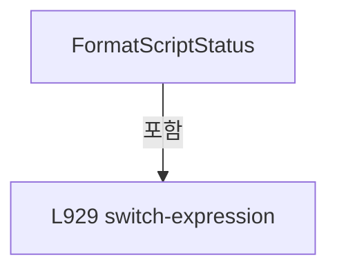

변경 전 점검: 입력/반환 타입, 위 호출자, 예외/취소 경로, 공유 상태와 저장·전송 소비자를 함께 확인합니다. 값의 단위나 물리 방향을 이름만으로 확정하지 않습니다.

### MethodDeclaration `ToDisplayItem` · L935–938

[Drilling.UI/Menu/Menus/CMenuMain.cs:935–938](https://github.com/kjuws10-rgb/A3Drilling/blob/5aee8e58439c9b455cae7c9593c9be986c3e682e/Drilling.UI/Menu/Menus/CMenuMain.cs#L935-L938)

| 항목 | 실제 추출 값 |
| --- | --- |
| 서명 | Drilling.UI.Menu.Menus.ST_DISPLAY_ITEM Drilling.UI.Menu.Menus.CMenuMain.ToDisplayItem(Drilling.Common.Station.ST_PROCESS_DISPLAY_ITEM) |
| 접근/수식자 | Private / private, static |
| 반환/값 타입 | Drilling.UI.Menu.Menus.ST_DISPLAY_ITEM |
| 소속 타입 | NamedType:Drilling.UI.Menu.Menus.CMenuMain |

입력 계약:

| 이름 | 타입 | 전달 | 선택/기본값 |
| --- | --- | --- | --- |
| item | Drilling.Common.Station.ST_PROCESS_DISPLAY_ITEM | None | False /  |

현재 부분 분석에서 직접 연결된 호출자는 없습니다. XAML/이벤트/인터페이스·델리게이트·외부 진입을 추가 확인해야 하며, 미사용으로 판정한 것이 아닙니다.

호출하는 대상과 해석 범위:

| 원본 행 | 표현식 | 분석 상태 | 대상/소스 위치 |
| --- | --- | --- | --- |
| 937 | new ST_DISPLAY_ITEM | resolved | Drilling.UI.Menu.Menus.ST_DISPLAY_ITEM.ST_DISPLAY_ITEM(string, string, string) · Drilling.UI/Menu/Menus/CMenuBase.cs:43 |

본문의 실제 연산·분기·예외·반환 순서(원문 위치 순):

| 원본 행 | 종류 | 주석 해설 |
| --- | --- | --- |
| 937 | call | 함수·델리게이트 또는 객체 생성자를 호출합니다: new ST_DISPLAY_ITEM(item.Name, item.Value, item.Detail) |
| 937 | return | 호출자에게 값 또는 제어를 반환합니다: return new ST_DISPLAY_ITEM(item.Name, item.Value, item.Detail); |

변경 전 점검: 입력/반환 타입, 위 호출자, 예외/취소 경로, 공유 상태와 저장·전송 소비자를 함께 확인합니다. 값의 단위나 물리 방향을 이름만으로 확정하지 않습니다.

### MethodDeclaration `BuildProcessSequenceItems` · L940–940

[Drilling.UI/Menu/Menus/CMenuMain.cs:940–940](https://github.com/kjuws10-rgb/A3Drilling/blob/5aee8e58439c9b455cae7c9593c9be986c3e682e/Drilling.UI/Menu/Menus/CMenuMain.cs#L940-L940)

| 항목 | 실제 추출 값 |
| --- | --- |
| 서명 | System.Collections.Generic.IReadOnlyList<Drilling.UI.Menu.Menus.ST_MAIN_PROCESS_SEQUENCE_ITEM> Drilling.UI.Menu.Menus.CMenuMain.BuildProcessSequenceItems(System.Collections.Generic.IReadOnlyList<Drilling.Common.Station.ST_PROCESS_DISPLAY_ITEM>) |
| 접근/수식자 | Private / private, static |
| 반환/값 타입 | System.Collections.Generic.IReadOnlyList<Drilling.UI.Menu.Menus.ST_MAIN_PROCESS_SEQUENCE_ITEM> |
| 소속 타입 | NamedType:Drilling.UI.Menu.Menus.CMenuMain |

입력 계약:

| 이름 | 타입 | 전달 | 선택/기본값 |
| --- | --- | --- | --- |
| processSequence | System.Collections.Generic.IReadOnlyList<Drilling.Common.Station.ST_PROCESS_DISPLAY_ITEM> | None | False /  |

정적 호출자로 확인된 위치:

| 호출 파일/행 | 호출 표현식 | 런타임 분기 가능 |
| --- | --- | --- |
| [Drilling.UI/Menu/Menus/CMenuMain.cs:745–745](https://github.com/kjuws10-rgb/A3Drilling/blob/5aee8e58439c9b455cae7c9593c9be986c3e682e/Drilling.UI/Menu/Menus/CMenuMain.cs#L745-L745) | BuildProcessSequenceItems | False |
| [Drilling.UI/Menu/Menus/CMenuMain.cs:800–800](https://github.com/kjuws10-rgb/A3Drilling/blob/5aee8e58439c9b455cae7c9593c9be986c3e682e/Drilling.UI/Menu/Menus/CMenuMain.cs#L800-L800) | BuildProcessSequenceItems | False |

호출하는 대상과 해석 범위:

| 원본 행 | 표현식 | 분석 상태 | 대상/소스 위치 |
| --- | --- | --- | --- |
| 940 | processSequence.Select(item => new ST_MAIN_PROCESS_SEQUENCE_ITEM(item.Name, item.Value, item.Detail)).ToArray | resolved | Drilling.UI.Menu.Menus.ST_MAIN_PROCESS_SEQUENCE_ITEM[] System.Collections.Generic.IEnumerable<Drilling.UI.Menu.Menus.ST_MAIN_PROCESS_SEQUENCE_ITEM>.ToArray<Drilling.UI.Menu.Menus.ST_MAIN_PROCESS_SEQUENCE_ITEM>() |
| 940 | processSequence.Select | resolved | System.Collections.Generic.IEnumerable<Drilling.UI.Menu.Menus.ST_MAIN_PROCESS_SEQUENCE_ITEM> System.Collections.Generic.IEnumerable<Drilling.Common.Station.ST_PROCESS_DISPLAY_ITEM>.Select<Drilling.Common.Station.ST_PROCESS_DISPLAY_ITEM, Drilling.UI.Menu.Menus.ST_MAIN_PROCESS_SEQUENCE_ITEM>(System.Func<Drilling.Common.Station.ST_PROCESS_DISPLAY_ITEM, Drilling.UI.Menu.Menus.ST_MAIN_PROCESS_SEQUENCE_ITEM>) |
| 940 | new ST_MAIN_PROCESS_SEQUENCE_ITEM | resolved | Drilling.UI.Menu.Menus.ST_MAIN_PROCESS_SEQUENCE_ITEM.ST_MAIN_PROCESS_SEQUENCE_ITEM(string, string, string) · Drilling.UI/Menu/Menus/CMenuMain.cs:3486 |

본문의 실제 연산·분기·예외·반환 순서(원문 위치 순):

| 원본 행 | 종류 | 주석 해설 |
| --- | --- | --- |
| 940 | call | 함수·델리게이트 또는 객체 생성자를 호출합니다: processSequence.Select(item => new ST_MAIN_PROCESS_SEQUENCE_ITEM(item.Name, item.Value, item.Detail)).ToArray() |
| 940 | call | 함수·델리게이트 또는 객체 생성자를 호출합니다: processSequence.Select(item => new ST_MAIN_PROCESS_SEQUENCE_ITEM(item.Name, item.Value, item.Detail)) |
| 940 | call | 함수·델리게이트 또는 객체 생성자를 호출합니다: new ST_MAIN_PROCESS_SEQUENCE_ITEM(item.Name, item.Value, item.Detail) |

변경 전 점검: 입력/반환 타입, 위 호출자, 예외/취소 경로, 공유 상태와 저장·전송 소비자를 함께 확인합니다. 값의 단위나 물리 방향을 이름만으로 확정하지 않습니다.

### MethodDeclaration `SelectParameterTab` · L941–965

[Drilling.UI/Menu/Menus/CMenuMain.cs:941–965](https://github.com/kjuws10-rgb/A3Drilling/blob/5aee8e58439c9b455cae7c9593c9be986c3e682e/Drilling.UI/Menu/Menus/CMenuMain.cs#L941-L965)

| 항목 | 실제 추출 값 |
| --- | --- |
| 서명 | System.Threading.Tasks.Task Drilling.UI.Menu.Menus.CMenuMain.SelectParameterTab(object?) |
| 접근/수식자 | Private / private, async |
| 반환/값 타입 | System.Threading.Tasks.Task |
| 소속 타입 | NamedType:Drilling.UI.Menu.Menus.CMenuMain |

입력 계약:

| 이름 | 타입 | 전달 | 선택/기본값 |
| --- | --- | --- | --- |
| parameter | object? | None | False /  |

정적 호출자로 확인된 위치:

| 호출 파일/행 | 호출 표현식 | 런타임 분기 가능 |
| --- | --- | --- |
| [Drilling.UI/Menu/Menus/CMenuMain.cs:654–654](https://github.com/kjuws10-rgb/A3Drilling/blob/5aee8e58439c9b455cae7c9593c9be986c3e682e/Drilling.UI/Menu/Menus/CMenuMain.cs#L654-L654) | SelectParameterTab | False |

호출하는 대상과 해석 범위:

| 원본 행 | 표현식 | 분석 상태 | 대상/소스 위치 |
| --- | --- | --- | --- |
| 943 | .ToString | resolved · 동적 구현 선택 가능 | string? object.ToString() |
| 944 | .Trim().ToUpperInvariant | resolved | string string.ToUpperInvariant() |
| 944 | .Trim | resolved | string string.Trim() |
| 950 | _selectedParameterTabKey.Equals | resolved | bool string.Equals(string?, System.StringComparison) |
| 955 | StopScannerStatusPolling | resolved | void Drilling.UI.Menu.Menus.CMenuMain.StopScannerStatusPolling() · Drilling.UI/Menu/Menus/CMenuMain.cs:1077 |
| 957 | RunOptions.SetVisible | resolved | void Drilling.UI.Menu.Menus.CMainRunOptionPanel.SetVisible(bool) · Drilling.UI/Menu/Menus/CMenuMain.cs:2953 |
| 958 | ProtectWindow.SetVisible | resolved | void Drilling.UI.Menu.Menus.CMainProtectWindowPanel.SetVisible(bool) · Drilling.UI/Menu/Menus/CMenuMain.cs:2662 |
| 961 | _scannerStatusSnapshotReader.SelectHead | resolved | void Drilling.UI.Menu.Menus.CScannerStatusSnapshotReader.SelectHead(int) · Drilling.UI/Menu/Menus/CScannerStatusSnapshotReader.cs:13 |
| 964 | refreshCurrentScreen | resolved · 동적 구현 선택 가능 | System.Threading.Tasks.Task System.Func<System.Threading.Tasks.Task>.Invoke() |

본문의 실제 연산·분기·예외·반환 순서(원문 위치 순):

| 원본 행 | 종류 | 주석 해설 |
| --- | --- | --- |
| 943 | call | 함수·델리게이트 또는 객체 생성자를 호출합니다: .ToString() |
| 943 | conditional-expression | 조건에 따라 결과식을 선택합니다: parameter is ST_MAIN_PARAMETER_TAB_ITEM tabItem ? tabItem.Key : parameter?.ToString() |
| 943 | local-declaration | 지역 변수를 선언합니다: var tabKey = parameter is ST_MAIN_PARAMETER_TAB_ITEM tabItem ? tabItem.Key : parameter?.ToString(); |
| 943 | variable-initializer | 변수의 초기값을 지정합니다: tabKey = parameter is ST_MAIN_PARAMETER_TAB_ITEM tabItem ? tabItem.Key : parameter?.ToString() |
| 944 | assignment | 값을 대상에 대입합니다: tabKey = tabKey?.Trim().ToUpperInvariant() |
| 944 | call | 함수·델리게이트 또는 객체 생성자를 호출합니다: .Trim().ToUpperInvariant() |
| 944 | call | 함수·델리게이트 또는 객체 생성자를 호출합니다: .Trim() |
| 945 | if | 조건에 따라 분기합니다: if (tabKey is not ParameterTabRunOption and not ParameterTabProtectWindow and not ParameterTabHead and not ParameterTabOptic and not ParameterTabScanner and not ParameterTabMotor) |
| 947 | return | 호출자에게 값 또는 제어를 반환합니다: return; |
| 950 | call | 함수·델리게이트 또는 객체 생성자를 호출합니다: _selectedParameterTabKey.Equals(tabKey, StringComparison.OrdinalIgnoreCase) |
| 950 | if | 조건에 따라 분기합니다: if (_selectedParameterTabKey.Equals(tabKey, StringComparison.OrdinalIgnoreCase)) |
| 952 | return | 호출자에게 값 또는 제어를 반환합니다: return; |
| 955 | call | 함수·델리게이트 또는 객체 생성자를 호출합니다: StopScannerStatusPolling() |
| 956 | assignment | 값을 대상에 대입합니다: _selectedParameterTabKey = tabKey |
| 957 | call | 함수·델리게이트 또는 객체 생성자를 호출합니다: RunOptions.SetVisible(tabKey == ParameterTabRunOption) |
| 958 | call | 함수·델리게이트 또는 객체 생성자를 호출합니다: ProtectWindow.SetVisible(tabKey == ParameterTabProtectWindow) |
| 959 | if | 조건에 따라 분기합니다: if (IsScannerStatusSelected) |
| 961 | call | 함수·델리게이트 또는 객체 생성자를 호출합니다: _scannerStatusSnapshotReader.SelectHead(_selectedScannerStatusHeadNo) |
| 964 | await | 비동기 완료를 기다립니다: await refreshCurrentScreen() |
| 964 | call | 함수·델리게이트 또는 객체 생성자를 호출합니다: refreshCurrentScreen() |

제어 구문의 포함 구조(실제 실행 순서/CFG가 아닌 구문 탐색 그림):

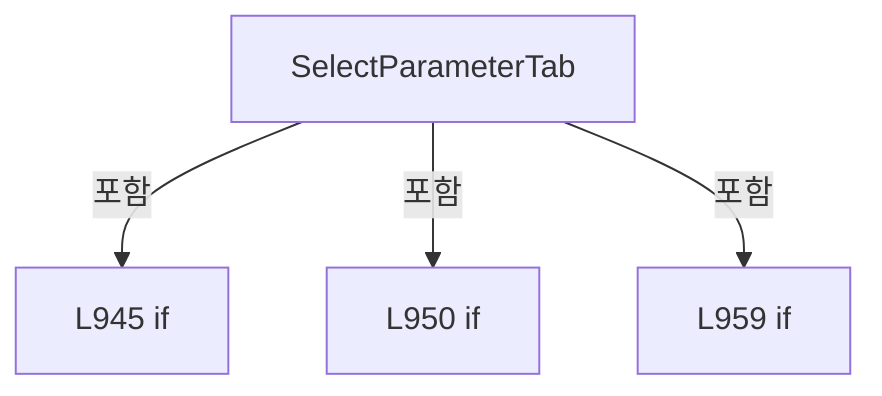

변경 전 점검: 입력/반환 타입, 위 호출자, 예외/취소 경로, 공유 상태와 저장·전송 소비자를 함께 확인합니다. 값의 단위나 물리 방향을 이름만으로 확정하지 않습니다.

### MethodDeclaration `SelectOpticStatus` · L967–984

[Drilling.UI/Menu/Menus/CMenuMain.cs:967–984](https://github.com/kjuws10-rgb/A3Drilling/blob/5aee8e58439c9b455cae7c9593c9be986c3e682e/Drilling.UI/Menu/Menus/CMenuMain.cs#L967-L984)

| 항목 | 실제 추출 값 |
| --- | --- |
| 서명 | System.Threading.Tasks.Task Drilling.UI.Menu.Menus.CMenuMain.SelectOpticStatus(object?) |
| 접근/수식자 | Private / private, async |
| 반환/값 타입 | System.Threading.Tasks.Task |
| 소속 타입 | NamedType:Drilling.UI.Menu.Menus.CMenuMain |

입력 계약:

| 이름 | 타입 | 전달 | 선택/기본값 |
| --- | --- | --- | --- |
| parameter | object? | None | False /  |

정적 호출자로 확인된 위치:

| 호출 파일/행 | 호출 표현식 | 런타임 분기 가능 |
| --- | --- | --- |
| [Drilling.UI/Menu/Menus/CMenuMain.cs:667–667](https://github.com/kjuws10-rgb/A3Drilling/blob/5aee8e58439c9b455cae7c9593c9be986c3e682e/Drilling.UI/Menu/Menus/CMenuMain.cs#L667-L667) | SelectOpticStatus | False |

호출하는 대상과 해석 범위:

| 원본 행 | 표현식 | 분석 상태 | 대상/소스 위치 |
| --- | --- | --- | --- |
| 969 | .ToString | resolved · 동적 구현 선택 가능 | string? object.ToString() |
| 970 | .Trim().ToUpperInvariant | resolved | string string.ToUpperInvariant() |
| 970 | .Trim | resolved | string string.Trim() |
| 976 | _selectedOpticStatusKey.Equals | resolved | bool string.Equals(string?, System.StringComparison) |
| 982 | NotifyOpticStatusSelectionChanged | resolved | void Drilling.UI.Menu.Menus.CMenuMain.NotifyOpticStatusSelectionChanged() · Drilling.UI/Menu/Menus/CMenuMain.cs:1070 |
| 983 | refreshCurrentScreen | resolved · 동적 구현 선택 가능 | System.Threading.Tasks.Task System.Func<System.Threading.Tasks.Task>.Invoke() |

본문의 실제 연산·분기·예외·반환 순서(원문 위치 순):

| 원본 행 | 종류 | 주석 해설 |
| --- | --- | --- |
| 969 | call | 함수·델리게이트 또는 객체 생성자를 호출합니다: .ToString() |
| 969 | conditional-expression | 조건에 따라 결과식을 선택합니다: parameter is ST_MAIN_PARAMETER_TAB_ITEM tabItem ? tabItem.Key : parameter?.ToString() |
| 969 | local-declaration | 지역 변수를 선언합니다: var statusKey = parameter is ST_MAIN_PARAMETER_TAB_ITEM tabItem ? tabItem.Key : parameter?.ToString(); |
| 969 | variable-initializer | 변수의 초기값을 지정합니다: statusKey = parameter is ST_MAIN_PARAMETER_TAB_ITEM tabItem ? tabItem.Key : parameter?.ToString() |
| 970 | assignment | 값을 대상에 대입합니다: statusKey = statusKey?.Trim().ToUpperInvariant() |
| 970 | call | 함수·델리게이트 또는 객체 생성자를 호출합니다: .Trim().ToUpperInvariant() |
| 970 | call | 함수·델리게이트 또는 객체 생성자를 호출합니다: .Trim() |
| 971 | if | 조건에 따라 분기합니다: if (statusKey is not OpticStatusLaser and not OpticStatusAttenuator and not OpticStatusBet) |
| 973 | return | 호출자에게 값 또는 제어를 반환합니다: return; |
| 976 | call | 함수·델리게이트 또는 객체 생성자를 호출합니다: _selectedOpticStatusKey.Equals(statusKey, StringComparison.OrdinalIgnoreCase) |
| 976 | if | 조건에 따라 분기합니다: if (_selectedOpticStatusKey.Equals(statusKey, StringComparison.OrdinalIgnoreCase)) |
| 978 | return | 호출자에게 값 또는 제어를 반환합니다: return; |
| 981 | assignment | 값을 대상에 대입합니다: _selectedOpticStatusKey = statusKey |
| 982 | call | 함수·델리게이트 또는 객체 생성자를 호출합니다: NotifyOpticStatusSelectionChanged() |
| 983 | await | 비동기 완료를 기다립니다: await refreshCurrentScreen() |
| 983 | call | 함수·델리게이트 또는 객체 생성자를 호출합니다: refreshCurrentScreen() |

제어 구문의 포함 구조(실제 실행 순서/CFG가 아닌 구문 탐색 그림):

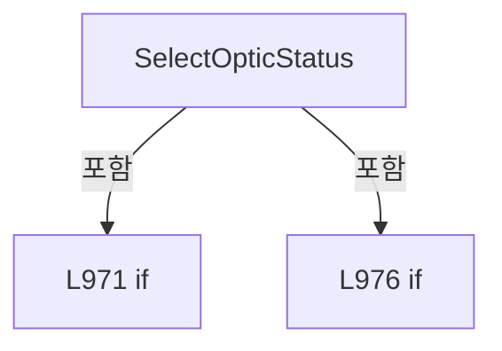

변경 전 점검: 입력/반환 타입, 위 호출자, 예외/취소 경로, 공유 상태와 저장·전송 소비자를 함께 확인합니다. 값의 단위나 물리 방향을 이름만으로 확정하지 않습니다.

### MethodDeclaration `SelectScannerStatusHead` · L986–1008

[Drilling.UI/Menu/Menus/CMenuMain.cs:986–1008](https://github.com/kjuws10-rgb/A3Drilling/blob/5aee8e58439c9b455cae7c9593c9be986c3e682e/Drilling.UI/Menu/Menus/CMenuMain.cs#L986-L1008)

| 항목 | 실제 추출 값 |
| --- | --- |
| 서명 | System.Threading.Tasks.Task Drilling.UI.Menu.Menus.CMenuMain.SelectScannerStatusHead(object?) |
| 접근/수식자 | Private / private, async |
| 반환/값 타입 | System.Threading.Tasks.Task |
| 소속 타입 | NamedType:Drilling.UI.Menu.Menus.CMenuMain |

입력 계약:

| 이름 | 타입 | 전달 | 선택/기본값 |
| --- | --- | --- | --- |
| parameter | object? | None | False /  |

정적 호출자로 확인된 위치:

| 호출 파일/행 | 호출 표현식 | 런타임 분기 가능 |
| --- | --- | --- |
| [Drilling.UI/Menu/Menus/CMenuMain.cs:680–680](https://github.com/kjuws10-rgb/A3Drilling/blob/5aee8e58439c9b455cae7c9593c9be986c3e682e/Drilling.UI/Menu/Menus/CMenuMain.cs#L680-L680) | SelectScannerStatusHead | False |

호출하는 대상과 해석 범위:

| 원본 행 | 표현식 | 분석 상태 | 대상/소스 위치 |
| --- | --- | --- | --- |
| 988 | CanSelectScannerStatusHead | resolved | bool Drilling.UI.Menu.Menus.CMenuMain.CanSelectScannerStatusHead(object?) · Drilling.UI/Menu/Menus/CMenuMain.cs:1056 |
| 993 | .ToString | resolved · 동적 구현 선택 가능 | string? object.ToString() |
| 994 | int.TryParse | resolved | bool int.TryParse(string?, System.Globalization.NumberStyles, System.IFormatProvider?, out int) |
| 999 | Math.Clamp | resolved | int System.Math.Clamp(int, int, int) |
| 1006 | _scannerStatusSnapshotReader.SelectHead | resolved | void Drilling.UI.Menu.Menus.CScannerStatusSnapshotReader.SelectHead(int) · Drilling.UI/Menu/Menus/CScannerStatusSnapshotReader.cs:13 |
| 1007 | refreshCurrentScreen | resolved · 동적 구현 선택 가능 | System.Threading.Tasks.Task System.Func<System.Threading.Tasks.Task>.Invoke() |

본문의 실제 연산·분기·예외·반환 순서(원문 위치 순):

| 원본 행 | 종류 | 주석 해설 |
| --- | --- | --- |
| 988 | call | 함수·델리게이트 또는 객체 생성자를 호출합니다: CanSelectScannerStatusHead(parameter) |
| 988 | if | 조건에 따라 분기합니다: if (!CanSelectScannerStatusHead(parameter)) |
| 990 | return | 호출자에게 값 또는 제어를 반환합니다: return; |
| 993 | call | 함수·델리게이트 또는 객체 생성자를 호출합니다: .ToString() |
| 993 | conditional-expression | 조건에 따라 결과식을 선택합니다: parameter is ST_MAIN_PARAMETER_TAB_ITEM tabItem ? tabItem.Key : parameter?.ToString() |
| 993 | local-declaration | 지역 변수를 선언합니다: var key = parameter is ST_MAIN_PARAMETER_TAB_ITEM tabItem ? tabItem.Key : parameter?.ToString(); |
| 993 | variable-initializer | 변수의 초기값을 지정합니다: key = parameter is ST_MAIN_PARAMETER_TAB_ITEM tabItem ? tabItem.Key : parameter?.ToString() |
| 994 | call | 함수·델리게이트 또는 객체 생성자를 호출합니다: int.TryParse(key, NumberStyles.Integer, CultureInfo.InvariantCulture, out var headNo) |
| 994 | if | 조건에 따라 분기합니다: if (!int.TryParse(key, NumberStyles.Integer, CultureInfo.InvariantCulture, out var headNo)) |
| 996 | return | 호출자에게 값 또는 제어를 반환합니다: return; |
| 999 | call | 함수·델리게이트 또는 객체 생성자를 호출합니다: Math.Clamp(headNo, 1, 8) |
| 999 | local-declaration | 지역 변수를 선언합니다: var normalizedHeadNo = Math.Clamp(headNo, 1, 8); |
| 999 | variable-initializer | 변수의 초기값을 지정합니다: normalizedHeadNo = Math.Clamp(headNo, 1, 8) |
| 1000 | if | 조건에 따라 분기합니다: if (_selectedScannerStatusHeadNo == normalizedHeadNo) |
| 1002 | return | 호출자에게 값 또는 제어를 반환합니다: return; |
| 1005 | assignment | 값을 대상에 대입합니다: _selectedScannerStatusHeadNo = normalizedHeadNo |
| 1006 | call | 함수·델리게이트 또는 객체 생성자를 호출합니다: _scannerStatusSnapshotReader.SelectHead(_selectedScannerStatusHeadNo) |
| 1007 | await | 비동기 완료를 기다립니다: await refreshCurrentScreen() |
| 1007 | call | 함수·델리게이트 또는 객체 생성자를 호출합니다: refreshCurrentScreen() |

제어 구문의 포함 구조(실제 실행 순서/CFG가 아닌 구문 탐색 그림):

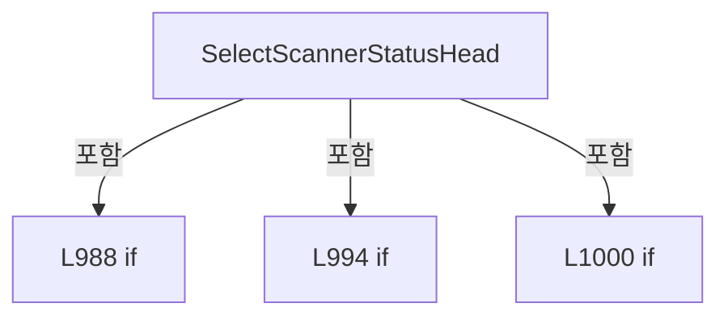

변경 전 점검: 입력/반환 타입, 위 호출자, 예외/취소 경로, 공유 상태와 저장·전송 소비자를 함께 확인합니다. 값의 단위나 물리 방향을 이름만으로 확정하지 않습니다.

### MethodDeclaration `NormalizeScannerStatusHeadSelection` · L1010–1019

[Drilling.UI/Menu/Menus/CMenuMain.cs:1010–1019](https://github.com/kjuws10-rgb/A3Drilling/blob/5aee8e58439c9b455cae7c9593c9be986c3e682e/Drilling.UI/Menu/Menus/CMenuMain.cs#L1010-L1019)

| 항목 | 실제 추출 값 |
| --- | --- |
| 서명 | void Drilling.UI.Menu.Menus.CMenuMain.NormalizeScannerStatusHeadSelection(System.Collections.Generic.IReadOnlyList<int>) |
| 접근/수식자 | Private / private |
| 반환/값 타입 | void |
| 소속 타입 | NamedType:Drilling.UI.Menu.Menus.CMenuMain |

입력 계약:

| 이름 | 타입 | 전달 | 선택/기본값 |
| --- | --- | --- | --- |
| enabledHeadNos | System.Collections.Generic.IReadOnlyList<int> | None | False /  |

정적 호출자로 확인된 위치:

| 호출 파일/행 | 호출 표현식 | 런타임 분기 가능 |
| --- | --- | --- |
| [Drilling.UI/Menu/Menus/CMenuMain.cs:702–702](https://github.com/kjuws10-rgb/A3Drilling/blob/5aee8e58439c9b455cae7c9593c9be986c3e682e/Drilling.UI/Menu/Menus/CMenuMain.cs#L702-L702) | NormalizeScannerStatusHeadSelection | False |
| [Drilling.UI/Menu/Menus/CMenuMain.cs:790–790](https://github.com/kjuws10-rgb/A3Drilling/blob/5aee8e58439c9b455cae7c9593c9be986c3e682e/Drilling.UI/Menu/Menus/CMenuMain.cs#L790-L790) | NormalizeScannerStatusHeadSelection | False |

호출하는 대상과 해석 범위:

| 원본 행 | 표현식 | 분석 상태 | 대상/소스 위치 |
| --- | --- | --- | --- |
| 1012 | enabledHeadNos.Contains | resolved | bool System.Collections.Generic.IEnumerable<int>.Contains<int>(int) |
| 1018 | _scannerStatusSnapshotReader.SelectHead | resolved | void Drilling.UI.Menu.Menus.CScannerStatusSnapshotReader.SelectHead(int) · Drilling.UI/Menu/Menus/CScannerStatusSnapshotReader.cs:13 |

본문의 실제 연산·분기·예외·반환 순서(원문 위치 순):

| 원본 행 | 종류 | 주석 해설 |
| --- | --- | --- |
| 1012 | call | 함수·델리게이트 또는 객체 생성자를 호출합니다: enabledHeadNos.Contains(_selectedScannerStatusHeadNo) |
| 1012 | if | 조건에 따라 분기합니다: if (enabledHeadNos.Count == 0 &#124;&#124; enabledHeadNos.Contains(_selectedScannerStatusHeadNo)) |
| 1014 | return | 호출자에게 값 또는 제어를 반환합니다: return; |
| 1017 | assignment | 값을 대상에 대입합니다: _selectedScannerStatusHeadNo = enabledHeadNos[0] |
| 1018 | call | 함수·델리게이트 또는 객체 생성자를 호출합니다: _scannerStatusSnapshotReader.SelectHead(_selectedScannerStatusHeadNo) |

제어 구문의 포함 구조(실제 실행 순서/CFG가 아닌 구문 탐색 그림):

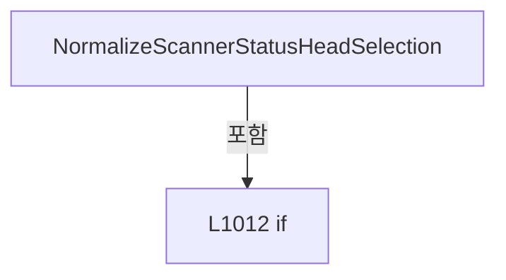

변경 전 점검: 입력/반환 타입, 위 호출자, 예외/취소 경로, 공유 상태와 저장·전송 소비자를 함께 확인합니다. 값의 단위나 물리 방향을 이름만으로 확정하지 않습니다.

### MethodDeclaration `BuildParameterTabs` · L1021–1031

[Drilling.UI/Menu/Menus/CMenuMain.cs:1021–1031](https://github.com/kjuws10-rgb/A3Drilling/blob/5aee8e58439c9b455cae7c9593c9be986c3e682e/Drilling.UI/Menu/Menus/CMenuMain.cs#L1021-L1031)

| 항목 | 실제 추출 값 |
| --- | --- |
| 서명 | System.Collections.Generic.IReadOnlyList<Drilling.UI.Menu.Menus.ST_MAIN_PARAMETER_TAB_ITEM> Drilling.UI.Menu.Menus.CMenuMain.BuildParameterTabs() |
| 접근/수식자 | Private / private |
| 반환/값 타입 | System.Collections.Generic.IReadOnlyList<Drilling.UI.Menu.Menus.ST_MAIN_PARAMETER_TAB_ITEM> |
| 소속 타입 | NamedType:Drilling.UI.Menu.Menus.CMenuMain |

정적 호출자로 확인된 위치:

| 호출 파일/행 | 호출 표현식 | 런타임 분기 가능 |
| --- | --- | --- |
| [Drilling.UI/Menu/Menus/CMenuMain.cs:758–758](https://github.com/kjuws10-rgb/A3Drilling/blob/5aee8e58439c9b455cae7c9593c9be986c3e682e/Drilling.UI/Menu/Menus/CMenuMain.cs#L758-L758) | BuildParameterTabs | False |

호출하는 대상과 해석 범위:

| 원본 행 | 표현식 | 분석 상태 | 대상/소스 위치 |
| --- | --- | --- | --- |
| 1024 | new | resolved | Drilling.UI.Menu.Menus.ST_MAIN_PARAMETER_TAB_ITEM.ST_MAIN_PARAMETER_TAB_ITEM(string, string, bool, bool) · Drilling.UI/Menu/Menus/CMenuMain.cs:3728 |
| 1024 | _selectedParameterTabKey.Equals | resolved | bool string.Equals(string?, System.StringComparison) |
| 1025 | new | resolved | Drilling.UI.Menu.Menus.ST_MAIN_PARAMETER_TAB_ITEM.ST_MAIN_PARAMETER_TAB_ITEM(string, string, bool, bool) · Drilling.UI/Menu/Menus/CMenuMain.cs:3728 |
| 1025 | _selectedParameterTabKey.Equals | resolved | bool string.Equals(string?, System.StringComparison) |
| 1026 | new | resolved | Drilling.UI.Menu.Menus.ST_MAIN_PARAMETER_TAB_ITEM.ST_MAIN_PARAMETER_TAB_ITEM(string, string, bool, bool) · Drilling.UI/Menu/Menus/CMenuMain.cs:3728 |
| 1026 | _selectedParameterTabKey.Equals | resolved | bool string.Equals(string?, System.StringComparison) |
| 1027 | new | resolved | Drilling.UI.Menu.Menus.ST_MAIN_PARAMETER_TAB_ITEM.ST_MAIN_PARAMETER_TAB_ITEM(string, string, bool, bool) · Drilling.UI/Menu/Menus/CMenuMain.cs:3728 |
| 1027 | _selectedParameterTabKey.Equals | resolved | bool string.Equals(string?, System.StringComparison) |
| 1028 | new | resolved | Drilling.UI.Menu.Menus.ST_MAIN_PARAMETER_TAB_ITEM.ST_MAIN_PARAMETER_TAB_ITEM(string, string, bool, bool) · Drilling.UI/Menu/Menus/CMenuMain.cs:3728 |
| 1028 | _selectedParameterTabKey.Equals | resolved | bool string.Equals(string?, System.StringComparison) |
| 1029 | new | resolved | Drilling.UI.Menu.Menus.ST_MAIN_PARAMETER_TAB_ITEM.ST_MAIN_PARAMETER_TAB_ITEM(string, string, bool, bool) · Drilling.UI/Menu/Menus/CMenuMain.cs:3728 |

본문의 실제 연산·분기·예외·반환 순서(원문 위치 순):

| 원본 행 | 종류 | 주석 해설 |
| --- | --- | --- |
| 1023 | return | 호출자에게 값 또는 제어를 반환합니다: return[ new(ParameterTabRunOption, "Run Option", _selectedParameterTabKey.Equals(ParameterTabRunOption, StringComparison.OrdinalIgnoreCase)), new(ParameterTabProtectWindow, "Protect Window", _selectedParameterTabKey.Equals(Paramet |
| 1024 | call | 함수·델리게이트 또는 객체 생성자를 호출합니다: new(ParameterTabRunOption, "Run Option", _selectedParameterTabKey.Equals(ParameterTabRunOption, StringComparison.OrdinalIgnoreCase)) |
| 1024 | call | 함수·델리게이트 또는 객체 생성자를 호출합니다: _selectedParameterTabKey.Equals(ParameterTabRunOption, StringComparison.OrdinalIgnoreCase) |
| 1025 | call | 함수·델리게이트 또는 객체 생성자를 호출합니다: new(ParameterTabProtectWindow, "Protect Window", _selectedParameterTabKey.Equals(ParameterTabProtectWindow, StringComparison.OrdinalIgnoreCase)) |
| 1025 | call | 함수·델리게이트 또는 객체 생성자를 호출합니다: _selectedParameterTabKey.Equals(ParameterTabProtectWindow, StringComparison.OrdinalIgnoreCase) |
| 1026 | call | 함수·델리게이트 또는 객체 생성자를 호출합니다: new(ParameterTabHead, "Head Parameter", _selectedParameterTabKey.Equals(ParameterTabHead, StringComparison.OrdinalIgnoreCase)) |
| 1026 | call | 함수·델리게이트 또는 객체 생성자를 호출합니다: _selectedParameterTabKey.Equals(ParameterTabHead, StringComparison.OrdinalIgnoreCase) |
| 1027 | call | 함수·델리게이트 또는 객체 생성자를 호출합니다: new(ParameterTabOptic, "Optic Parameter", _selectedParameterTabKey.Equals(ParameterTabOptic, StringComparison.OrdinalIgnoreCase)) |
| 1027 | call | 함수·델리게이트 또는 객체 생성자를 호출합니다: _selectedParameterTabKey.Equals(ParameterTabOptic, StringComparison.OrdinalIgnoreCase) |
| 1028 | call | 함수·델리게이트 또는 객체 생성자를 호출합니다: new(ParameterTabScanner, "Scanner Status", _selectedParameterTabKey.Equals(ParameterTabScanner, StringComparison.OrdinalIgnoreCase)) |
| 1028 | call | 함수·델리게이트 또는 객체 생성자를 호출합니다: _selectedParameterTabKey.Equals(ParameterTabScanner, StringComparison.OrdinalIgnoreCase) |
| 1029 | call | 함수·델리게이트 또는 객체 생성자를 호출합니다: new(ParameterTabMotor, "Motor Status", IsMotorStatusSelected) |

변경 전 점검: 입력/반환 타입, 위 호출자, 예외/취소 경로, 공유 상태와 저장·전송 소비자를 함께 확인합니다. 값의 단위나 물리 방향을 이름만으로 확정하지 않습니다.

### MethodDeclaration `BuildOpticStatusTabs` · L1033–1040

[Drilling.UI/Menu/Menus/CMenuMain.cs:1033–1040](https://github.com/kjuws10-rgb/A3Drilling/blob/5aee8e58439c9b455cae7c9593c9be986c3e682e/Drilling.UI/Menu/Menus/CMenuMain.cs#L1033-L1040)

| 항목 | 실제 추출 값 |
| --- | --- |
| 서명 | System.Collections.Generic.IReadOnlyList<Drilling.UI.Menu.Menus.ST_MAIN_PARAMETER_TAB_ITEM> Drilling.UI.Menu.Menus.CMenuMain.BuildOpticStatusTabs() |
| 접근/수식자 | Private / private |
| 반환/값 타입 | System.Collections.Generic.IReadOnlyList<Drilling.UI.Menu.Menus.ST_MAIN_PARAMETER_TAB_ITEM> |
| 소속 타입 | NamedType:Drilling.UI.Menu.Menus.CMenuMain |

정적 호출자로 확인된 위치:

| 호출 파일/행 | 호출 표현식 | 런타임 분기 가능 |
| --- | --- | --- |
| [Drilling.UI/Menu/Menus/CMenuMain.cs:759–759](https://github.com/kjuws10-rgb/A3Drilling/blob/5aee8e58439c9b455cae7c9593c9be986c3e682e/Drilling.UI/Menu/Menus/CMenuMain.cs#L759-L759) | BuildOpticStatusTabs | False |

호출하는 대상과 해석 범위:

| 원본 행 | 표현식 | 분석 상태 | 대상/소스 위치 |
| --- | --- | --- | --- |
| 1036 | new | resolved | Drilling.UI.Menu.Menus.ST_MAIN_PARAMETER_TAB_ITEM.ST_MAIN_PARAMETER_TAB_ITEM(string, string, bool, bool) · Drilling.UI/Menu/Menus/CMenuMain.cs:3728 |
| 1036 | IsOpticStatusSelected | resolved | bool Drilling.UI.Menu.Menus.CMenuMain.IsOpticStatusSelected(string) · Drilling.UI/Menu/Menus/CMenuMain.cs:1065 |
| 1037 | new | resolved | Drilling.UI.Menu.Menus.ST_MAIN_PARAMETER_TAB_ITEM.ST_MAIN_PARAMETER_TAB_ITEM(string, string, bool, bool) · Drilling.UI/Menu/Menus/CMenuMain.cs:3728 |
| 1037 | IsOpticStatusSelected | resolved | bool Drilling.UI.Menu.Menus.CMenuMain.IsOpticStatusSelected(string) · Drilling.UI/Menu/Menus/CMenuMain.cs:1065 |
| 1038 | new | resolved | Drilling.UI.Menu.Menus.ST_MAIN_PARAMETER_TAB_ITEM.ST_MAIN_PARAMETER_TAB_ITEM(string, string, bool, bool) · Drilling.UI/Menu/Menus/CMenuMain.cs:3728 |
| 1038 | IsOpticStatusSelected | resolved | bool Drilling.UI.Menu.Menus.CMenuMain.IsOpticStatusSelected(string) · Drilling.UI/Menu/Menus/CMenuMain.cs:1065 |

본문의 실제 연산·분기·예외·반환 순서(원문 위치 순):

| 원본 행 | 종류 | 주석 해설 |
| --- | --- | --- |
| 1035 | return | 호출자에게 값 또는 제어를 반환합니다: return[ new(OpticStatusLaser, "LASER", IsOpticStatusSelected(OpticStatusLaser)), new(OpticStatusAttenuator, "ATT", IsOpticStatusSelected(OpticStatusAttenuator)), new(OpticStatusBet, "BET", IsOpticStatusSelected(OpticStatusBet)) ]; |
| 1036 | call | 함수·델리게이트 또는 객체 생성자를 호출합니다: new(OpticStatusLaser, "LASER", IsOpticStatusSelected(OpticStatusLaser)) |
| 1036 | call | 함수·델리게이트 또는 객체 생성자를 호출합니다: IsOpticStatusSelected(OpticStatusLaser) |
| 1037 | call | 함수·델리게이트 또는 객체 생성자를 호출합니다: new(OpticStatusAttenuator, "ATT", IsOpticStatusSelected(OpticStatusAttenuator)) |
| 1037 | call | 함수·델리게이트 또는 객체 생성자를 호출합니다: IsOpticStatusSelected(OpticStatusAttenuator) |
| 1038 | call | 함수·델리게이트 또는 객체 생성자를 호출합니다: new(OpticStatusBet, "BET", IsOpticStatusSelected(OpticStatusBet)) |
| 1038 | call | 함수·델리게이트 또는 객체 생성자를 호출합니다: IsOpticStatusSelected(OpticStatusBet) |

변경 전 점검: 입력/반환 타입, 위 호출자, 예외/취소 경로, 공유 상태와 저장·전송 소비자를 함께 확인합니다. 값의 단위나 물리 방향을 이름만으로 확정하지 않습니다.

### MethodDeclaration `BuildScannerStatusHeadTabs` · L1042–1054

[Drilling.UI/Menu/Menus/CMenuMain.cs:1042–1054](https://github.com/kjuws10-rgb/A3Drilling/blob/5aee8e58439c9b455cae7c9593c9be986c3e682e/Drilling.UI/Menu/Menus/CMenuMain.cs#L1042-L1054)

| 항목 | 실제 추출 값 |
| --- | --- |
| 서명 | System.Collections.Generic.IReadOnlyList<Drilling.UI.Menu.Menus.ST_MAIN_PARAMETER_TAB_ITEM> Drilling.UI.Menu.Menus.CMenuMain.BuildScannerStatusHeadTabs(System.Collections.Generic.IReadOnlyDictionary<string, string>) |
| 접근/수식자 | Private / private |
| 반환/값 타입 | System.Collections.Generic.IReadOnlyList<Drilling.UI.Menu.Menus.ST_MAIN_PARAMETER_TAB_ITEM> |
| 소속 타입 | NamedType:Drilling.UI.Menu.Menus.CMenuMain |

입력 계약:

| 이름 | 타입 | 전달 | 선택/기본값 |
| --- | --- | --- | --- |
| parameters | System.Collections.Generic.IReadOnlyDictionary<string, string> | None | False /  |

정적 호출자로 확인된 위치:

| 호출 파일/행 | 호출 표현식 | 런타임 분기 가능 |
| --- | --- | --- |
| [Drilling.UI/Menu/Menus/CMenuMain.cs:760–760](https://github.com/kjuws10-rgb/A3Drilling/blob/5aee8e58439c9b455cae7c9593c9be986c3e682e/Drilling.UI/Menu/Menus/CMenuMain.cs#L760-L760) | BuildScannerStatusHeadTabs | False |
| [Drilling.UI/Menu/Menus/CMenuMain.cs:812–812](https://github.com/kjuws10-rgb/A3Drilling/blob/5aee8e58439c9b455cae7c9593c9be986c3e682e/Drilling.UI/Menu/Menus/CMenuMain.cs#L812-L812) | BuildScannerStatusHeadTabs | False |

호출하는 대상과 해석 범위:

| 원본 행 | 표현식 | 분석 상태 | 대상/소스 위치 |
| --- | --- | --- | --- |
| 1045 | new List<ST_MAIN_PARAMETER_TAB_ITEM> | resolved | System.Collections.Generic.List<Drilling.UI.Menu.Menus.ST_MAIN_PARAMETER_TAB_ITEM>.List(int) |
| 1048 | IsHeadEnabled | resolved | bool Drilling.UI.Menu.Menus.CMenuMain.IsHeadEnabled(System.Collections.Generic.IReadOnlyDictionary<string, string>, int) · Drilling.UI/Menu/Menus/CMenuMain.cs:1893 |
| 1050 | tabs.Add | resolved | void System.Collections.Generic.List<Drilling.UI.Menu.Menus.ST_MAIN_PARAMETER_TAB_ITEM>.Add(Drilling.UI.Menu.Menus.ST_MAIN_PARAMETER_TAB_ITEM) |
| 1050 | new ST_MAIN_PARAMETER_TAB_ITEM | resolved | Drilling.UI.Menu.Menus.ST_MAIN_PARAMETER_TAB_ITEM.ST_MAIN_PARAMETER_TAB_ITEM(string, string, bool, bool) · Drilling.UI/Menu/Menus/CMenuMain.cs:3728 |
| 1050 | headNo.ToString | resolved | string int.ToString(System.IFormatProvider?) |

본문의 실제 연산·분기·예외·반환 순서(원문 위치 순):

| 원본 행 | 종류 | 주석 해설 |
| --- | --- | --- |
| 1044 | local-declaration | 지역 변수를 선언합니다: const int headCount = 8; |
| 1044 | variable-initializer | 변수의 초기값을 지정합니다: headCount = 8 |
| 1045 | call | 함수·델리게이트 또는 객체 생성자를 호출합니다: new List<ST_MAIN_PARAMETER_TAB_ITEM>(headCount) |
| 1045 | local-declaration | 지역 변수를 선언합니다: var tabs = new List<ST_MAIN_PARAMETER_TAB_ITEM>(headCount); |
| 1045 | variable-initializer | 변수의 초기값을 지정합니다: tabs = new List<ST_MAIN_PARAMETER_TAB_ITEM>(headCount) |
| 1046 | variable-initializer | 변수의 초기값을 지정합니다: headNo = 1 |
| 1046 | for | 초기화·조건·증감이 있는 반복입니다: for (var headNo = 1; headNo <= headCount; headNo++) |
| 1048 | call | 함수·델리게이트 또는 객체 생성자를 호출합니다: IsHeadEnabled(parameters, headNo) |
| 1048 | local-declaration | 지역 변수를 선언합니다: var isEnabled = IsHeadEnabled(parameters, headNo); |
| 1048 | variable-initializer | 변수의 초기값을 지정합니다: isEnabled = IsHeadEnabled(parameters, headNo) |
| 1049 | conditional-expression | 조건에 따라 결과식을 선택합니다: isEnabled ? $"H{headNo:00}" : $"H{headNo:00} NOT USE" |
| 1049 | local-declaration | 지역 변수를 선언합니다: var name = isEnabled ? $"H{headNo:00}" : $"H{headNo:00} NOT USE"; |
| 1049 | variable-initializer | 변수의 초기값을 지정합니다: name = isEnabled ? $"H{headNo:00}" : $"H{headNo:00} NOT USE" |
| 1050 | call | 함수·델리게이트 또는 객체 생성자를 호출합니다: tabs.Add(new ST_MAIN_PARAMETER_TAB_ITEM(headNo.ToString(CultureInfo.InvariantCulture), name, isEnabled && _selectedScannerStatusHeadNo == headNo, isEnabled)) |
| 1050 | call | 함수·델리게이트 또는 객체 생성자를 호출합니다: new ST_MAIN_PARAMETER_TAB_ITEM(headNo.ToString(CultureInfo.InvariantCulture), name, isEnabled && _selectedScannerStatusHeadNo == headNo, isEnabled) |
| 1050 | call | 함수·델리게이트 또는 객체 생성자를 호출합니다: headNo.ToString(CultureInfo.InvariantCulture) |
| 1053 | return | 호출자에게 값 또는 제어를 반환합니다: return tabs; |

제어 구문의 포함 구조(실제 실행 순서/CFG가 아닌 구문 탐색 그림):

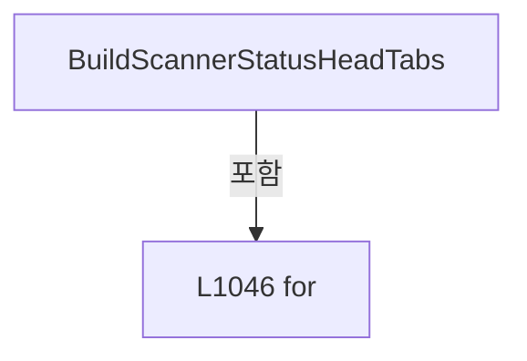

변경 전 점검: 입력/반환 타입, 위 호출자, 예외/취소 경로, 공유 상태와 저장·전송 소비자를 함께 확인합니다. 값의 단위나 물리 방향을 이름만으로 확정하지 않습니다.

### MethodDeclaration `CanSelectScannerStatusHead` · L1056–1063

[Drilling.UI/Menu/Menus/CMenuMain.cs:1056–1063](https://github.com/kjuws10-rgb/A3Drilling/blob/5aee8e58439c9b455cae7c9593c9be986c3e682e/Drilling.UI/Menu/Menus/CMenuMain.cs#L1056-L1063)

| 항목 | 실제 추출 값 |
| --- | --- |
| 서명 | bool Drilling.UI.Menu.Menus.CMenuMain.CanSelectScannerStatusHead(object?) |
| 접근/수식자 | Private / private, static |
| 반환/값 타입 | bool |
| 소속 타입 | NamedType:Drilling.UI.Menu.Menus.CMenuMain |

입력 계약:

| 이름 | 타입 | 전달 | 선택/기본값 |
| --- | --- | --- | --- |
| parameter | object? | None | False /  |

정적 호출자로 확인된 위치:

| 호출 파일/행 | 호출 표현식 | 런타임 분기 가능 |
| --- | --- | --- |
| [Drilling.UI/Menu/Menus/CMenuMain.cs:685–685](https://github.com/kjuws10-rgb/A3Drilling/blob/5aee8e58439c9b455cae7c9593c9be986c3e682e/Drilling.UI/Menu/Menus/CMenuMain.cs#L685-L685) | CanSelectScannerStatusHead | False |
| [Drilling.UI/Menu/Menus/CMenuMain.cs:988–988](https://github.com/kjuws10-rgb/A3Drilling/blob/5aee8e58439c9b455cae7c9593c9be986c3e682e/Drilling.UI/Menu/Menus/CMenuMain.cs#L988-L988) | CanSelectScannerStatusHead | False |

본문의 실제 연산·분기·예외·반환 순서(원문 위치 순):

| 원본 행 | 종류 | 주석 해설 |
| --- | --- | --- |
| 1058 | return | 호출자에게 값 또는 제어를 반환합니다: return parameter switch { ST_MAIN_PARAMETER_TAB_ITEM tabItem => tabItem.IsEnabled, _ => true }; |
| 1058 | switch-expression | 값별 결과식을 선택합니다: parameter switch { ST_MAIN_PARAMETER_TAB_ITEM tabItem => tabItem.IsEnabled, _ => true } |

제어 구문의 포함 구조(실제 실행 순서/CFG가 아닌 구문 탐색 그림):

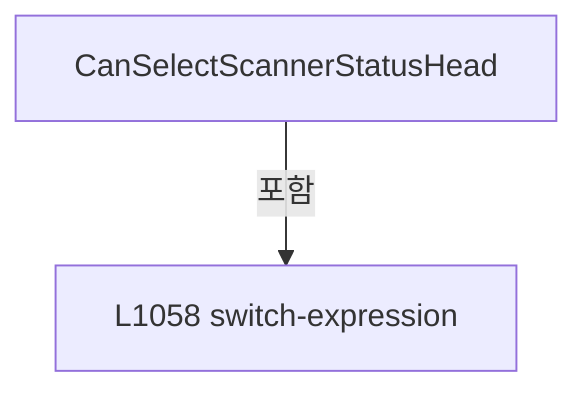

변경 전 점검: 입력/반환 타입, 위 호출자, 예외/취소 경로, 공유 상태와 저장·전송 소비자를 함께 확인합니다. 값의 단위나 물리 방향을 이름만으로 확정하지 않습니다.

### MethodDeclaration `IsOpticStatusSelected` · L1065–1068

[Drilling.UI/Menu/Menus/CMenuMain.cs:1065–1068](https://github.com/kjuws10-rgb/A3Drilling/blob/5aee8e58439c9b455cae7c9593c9be986c3e682e/Drilling.UI/Menu/Menus/CMenuMain.cs#L1065-L1068)

| 항목 | 실제 추출 값 |
| --- | --- |
| 서명 | bool Drilling.UI.Menu.Menus.CMenuMain.IsOpticStatusSelected(string) |
| 접근/수식자 | Private / private |
| 반환/값 타입 | bool |
| 소속 타입 | NamedType:Drilling.UI.Menu.Menus.CMenuMain |

입력 계약:

| 이름 | 타입 | 전달 | 선택/기본값 |
| --- | --- | --- | --- |
| statusKey | string | None | False /  |

정적 호출자로 확인된 위치:

| 호출 파일/행 | 호출 표현식 | 런타임 분기 가능 |
| --- | --- | --- |
| [Drilling.UI/Menu/Menus/CMenuMain.cs:430–430](https://github.com/kjuws10-rgb/A3Drilling/blob/5aee8e58439c9b455cae7c9593c9be986c3e682e/Drilling.UI/Menu/Menus/CMenuMain.cs#L430-L430) | IsOpticStatusSelected | False |
| [Drilling.UI/Menu/Menus/CMenuMain.cs:438–438](https://github.com/kjuws10-rgb/A3Drilling/blob/5aee8e58439c9b455cae7c9593c9be986c3e682e/Drilling.UI/Menu/Menus/CMenuMain.cs#L438-L438) | IsOpticStatusSelected | False |
| [Drilling.UI/Menu/Menus/CMenuMain.cs:446–446](https://github.com/kjuws10-rgb/A3Drilling/blob/5aee8e58439c9b455cae7c9593c9be986c3e682e/Drilling.UI/Menu/Menus/CMenuMain.cs#L446-L446) | IsOpticStatusSelected | False |
| [Drilling.UI/Menu/Menus/CMenuMain.cs:1036–1036](https://github.com/kjuws10-rgb/A3Drilling/blob/5aee8e58439c9b455cae7c9593c9be986c3e682e/Drilling.UI/Menu/Menus/CMenuMain.cs#L1036-L1036) | IsOpticStatusSelected | False |
| [Drilling.UI/Menu/Menus/CMenuMain.cs:1037–1037](https://github.com/kjuws10-rgb/A3Drilling/blob/5aee8e58439c9b455cae7c9593c9be986c3e682e/Drilling.UI/Menu/Menus/CMenuMain.cs#L1037-L1037) | IsOpticStatusSelected | False |
| [Drilling.UI/Menu/Menus/CMenuMain.cs:1038–1038](https://github.com/kjuws10-rgb/A3Drilling/blob/5aee8e58439c9b455cae7c9593c9be986c3e682e/Drilling.UI/Menu/Menus/CMenuMain.cs#L1038-L1038) | IsOpticStatusSelected | False |
| [Drilling.UI/Menu/Menus/CMenuMain.cs:1494–1494](https://github.com/kjuws10-rgb/A3Drilling/blob/5aee8e58439c9b455cae7c9593c9be986c3e682e/Drilling.UI/Menu/Menus/CMenuMain.cs#L1494-L1494) | IsOpticStatusSelected | False |
| [Drilling.UI/Menu/Menus/CMenuMain.cs:1495–1495](https://github.com/kjuws10-rgb/A3Drilling/blob/5aee8e58439c9b455cae7c9593c9be986c3e682e/Drilling.UI/Menu/Menus/CMenuMain.cs#L1495-L1495) | IsOpticStatusSelected | False |
| [Drilling.UI/Menu/Menus/CMenuMain.cs:1496–1496](https://github.com/kjuws10-rgb/A3Drilling/blob/5aee8e58439c9b455cae7c9593c9be986c3e682e/Drilling.UI/Menu/Menus/CMenuMain.cs#L1496-L1496) | IsOpticStatusSelected | False |
| [Drilling.UI/Menu/Menus/CMenuMain.cs:1511–1511](https://github.com/kjuws10-rgb/A3Drilling/blob/5aee8e58439c9b455cae7c9593c9be986c3e682e/Drilling.UI/Menu/Menus/CMenuMain.cs#L1511-L1511) | IsOpticStatusSelected | False |
| [Drilling.UI/Menu/Menus/CMenuMain.cs:1520–1520](https://github.com/kjuws10-rgb/A3Drilling/blob/5aee8e58439c9b455cae7c9593c9be986c3e682e/Drilling.UI/Menu/Menus/CMenuMain.cs#L1520-L1520) | IsOpticStatusSelected | False |
| [Drilling.UI/Menu/Menus/CMenuMain.cs:1525–1525](https://github.com/kjuws10-rgb/A3Drilling/blob/5aee8e58439c9b455cae7c9593c9be986c3e682e/Drilling.UI/Menu/Menus/CMenuMain.cs#L1525-L1525) | IsOpticStatusSelected | False |

호출하는 대상과 해석 범위:

| 원본 행 | 표현식 | 분석 상태 | 대상/소스 위치 |
| --- | --- | --- | --- |
| 1067 | _selectedOpticStatusKey.Equals | resolved | bool string.Equals(string?, System.StringComparison) |

본문의 실제 연산·분기·예외·반환 순서(원문 위치 순):

| 원본 행 | 종류 | 주석 해설 |
| --- | --- | --- |
| 1067 | call | 함수·델리게이트 또는 객체 생성자를 호출합니다: _selectedOpticStatusKey.Equals(statusKey, StringComparison.OrdinalIgnoreCase) |
| 1067 | return | 호출자에게 값 또는 제어를 반환합니다: return _selectedOpticStatusKey.Equals(statusKey, StringComparison.OrdinalIgnoreCase); |

변경 전 점검: 입력/반환 타입, 위 호출자, 예외/취소 경로, 공유 상태와 저장·전송 소비자를 함께 확인합니다. 값의 단위나 물리 방향을 이름만으로 확정하지 않습니다.

### MethodDeclaration `NotifyOpticStatusSelectionChanged` · L1070–1075

[Drilling.UI/Menu/Menus/CMenuMain.cs:1070–1075](https://github.com/kjuws10-rgb/A3Drilling/blob/5aee8e58439c9b455cae7c9593c9be986c3e682e/Drilling.UI/Menu/Menus/CMenuMain.cs#L1070-L1075)

| 항목 | 실제 추출 값 |
| --- | --- |
| 서명 | void Drilling.UI.Menu.Menus.CMenuMain.NotifyOpticStatusSelectionChanged() |
| 접근/수식자 | Private / private |
| 반환/값 타입 | void |
| 소속 타입 | NamedType:Drilling.UI.Menu.Menus.CMenuMain |

정적 호출자로 확인된 위치:

| 호출 파일/행 | 호출 표현식 | 런타임 분기 가능 |
| --- | --- | --- |
| [Drilling.UI/Menu/Menus/CMenuMain.cs:982–982](https://github.com/kjuws10-rgb/A3Drilling/blob/5aee8e58439c9b455cae7c9593c9be986c3e682e/Drilling.UI/Menu/Menus/CMenuMain.cs#L982-L982) | NotifyOpticStatusSelectionChanged | False |

호출하는 대상과 해석 범위:

| 원본 행 | 표현식 | 분석 상태 | 대상/소스 위치 |
| --- | --- | --- | --- |
| 1072 | OnPropertyChanged | resolved | void Drilling.UI.Menu.CBindingBase.OnPropertyChanged(string?) · Drilling.UI/Menu/CBindingBase.cs:759 |
| 1072 | nameof | unresolved | None |
| 1073 | OnPropertyChanged | resolved | void Drilling.UI.Menu.CBindingBase.OnPropertyChanged(string?) · Drilling.UI/Menu/CBindingBase.cs:759 |
| 1073 | nameof | unresolved | None |
| 1074 | OnPropertyChanged | resolved | void Drilling.UI.Menu.CBindingBase.OnPropertyChanged(string?) · Drilling.UI/Menu/CBindingBase.cs:759 |
| 1074 | nameof | unresolved | None |

본문의 실제 연산·분기·예외·반환 순서(원문 위치 순):

| 원본 행 | 종류 | 주석 해설 |
| --- | --- | --- |
| 1072 | call | 함수·델리게이트 또는 객체 생성자를 호출합니다: OnPropertyChanged(nameof(OpticLaserVisibility)) |
| 1072 | call | 함수·델리게이트 또는 객체 생성자를 호출합니다: nameof(OpticLaserVisibility) |
| 1073 | call | 함수·델리게이트 또는 객체 생성자를 호출합니다: OnPropertyChanged(nameof(OpticAttenuatorVisibility)) |
| 1073 | call | 함수·델리게이트 또는 객체 생성자를 호출합니다: nameof(OpticAttenuatorVisibility) |
| 1074 | call | 함수·델리게이트 또는 객체 생성자를 호출합니다: OnPropertyChanged(nameof(OpticBetVisibility)) |
| 1074 | call | 함수·델리게이트 또는 객체 생성자를 호출합니다: nameof(OpticBetVisibility) |

변경 전 점검: 입력/반환 타입, 위 호출자, 예외/취소 경로, 공유 상태와 저장·전송 소비자를 함께 확인합니다. 값의 단위나 물리 방향을 이름만으로 확정하지 않습니다.

### MethodDeclaration `StopScannerStatusPolling` · L1077–1088

[Drilling.UI/Menu/Menus/CMenuMain.cs:1077–1088](https://github.com/kjuws10-rgb/A3Drilling/blob/5aee8e58439c9b455cae7c9593c9be986c3e682e/Drilling.UI/Menu/Menus/CMenuMain.cs#L1077-L1088)

| 항목 | 실제 추출 값 |
| --- | --- |
| 서명 | void Drilling.UI.Menu.Menus.CMenuMain.StopScannerStatusPolling() |
| 접근/수식자 | Public / public |
| 반환/값 타입 | void |
| 소속 타입 | NamedType:Drilling.UI.Menu.Menus.CMenuMain |

정적 호출자로 확인된 위치:

| 호출 파일/행 | 호출 표현식 | 런타임 분기 가능 |
| --- | --- | --- |
| [Drilling.UI/CRootView.cs:919–919](https://github.com/kjuws10-rgb/A3Drilling/blob/5aee8e58439c9b455cae7c9593c9be986c3e682e/Drilling.UI/CRootView.cs#L919-L919) | mainMenu.StopScannerStatusPolling | False |
| [Drilling.UI/Menu/Menus/CMenuMain.cs:955–955](https://github.com/kjuws10-rgb/A3Drilling/blob/5aee8e58439c9b455cae7c9593c9be986c3e682e/Drilling.UI/Menu/Menus/CMenuMain.cs#L955-L955) | StopScannerStatusPolling | False |

호출하는 대상과 해석 범위:

| 원본 행 | 표현식 | 분석 상태 | 대상/소스 위치 |
| --- | --- | --- | --- |
| 1081 | _motorStatusPollingService.Stop | resolved | void Drilling.Common.Threading.CtrlThread.Stop() · Drilling.Common/Threading/CtrlThread.cs:128 |
| 1082 | _motorStatusPollingService.ClearSnapshot | resolved | void Drilling.UI.Menu.Menus.CMotorStatusPollingService.ClearSnapshot() · Drilling.UI/Menu/Menus/CMenuMain.cs:4002 |
| 1086 | statusReporter | resolved · 동적 구현 선택 가능 | void System.Action<string>.Invoke(string) |

본문의 실제 연산·분기·예외·반환 순서(원문 위치 순):

| 원본 행 | 종류 | 주석 해설 |
| --- | --- | --- |
| 1079 | try | 예외 처리 범위입니다: try |
| 1081 | call | 함수·델리게이트 또는 객체 생성자를 호출합니다: _motorStatusPollingService.Stop() |
| 1082 | call | 함수·델리게이트 또는 객체 생성자를 호출합니다: _motorStatusPollingService.ClearSnapshot() |
| 1084 | catch | 지정 예외를 처리합니다: catch (TimeoutException exception) |
| 1086 | call | 함수·델리게이트 또는 객체 생성자를 호출합니다: statusReporter($"Motor status polling stop timeout. {exception.Message}") |

제어 구문의 포함 구조(실제 실행 순서/CFG가 아닌 구문 탐색 그림):

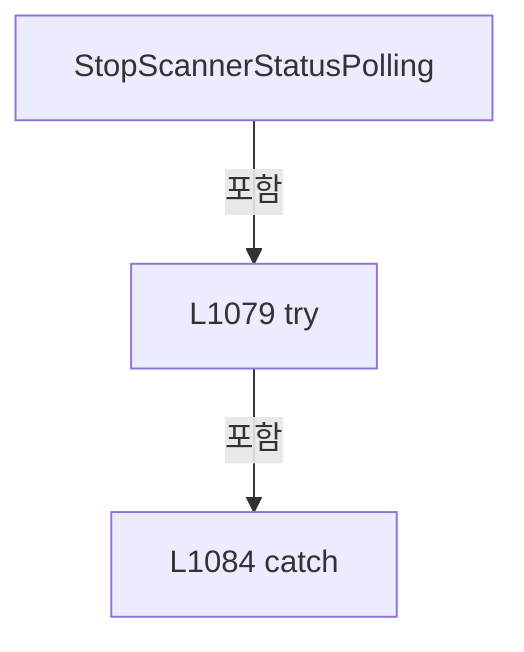

변경 전 점검: 입력/반환 타입, 위 호출자, 예외/취소 경로, 공유 상태와 저장·전송 소비자를 함께 확인합니다. 값의 단위나 물리 방향을 이름만으로 확정하지 않습니다.

### MethodDeclaration `ReadAutomationControllerStatusSnapshot` · L1091–1091

[Drilling.UI/Menu/Menus/CMenuMain.cs:1091–1091](https://github.com/kjuws10-rgb/A3Drilling/blob/5aee8e58439c9b455cae7c9593c9be986c3e682e/Drilling.UI/Menu/Menus/CMenuMain.cs#L1091-L1091)

| 항목 | 실제 추출 값 |
| --- | --- |
| 서명 | System.Collections.Generic.IReadOnlyList<Drilling.UI.Menu.Menus.ST_AUTOMATION_CONTROLLER_STATUS_ITEM> Drilling.UI.Menu.Menus.CMenuMain.ReadAutomationControllerStatusSnapshot(Drilling.Common.Station.ST_STATION_PROCESS_STATUS, System.Collections.Generic.IReadOnlyDictionary<string, string>, System.Threading.CancellationToken) |
| 접근/수식자 | Public / public |
| 반환/값 타입 | System.Collections.Generic.IReadOnlyList<Drilling.UI.Menu.Menus.ST_AUTOMATION_CONTROLLER_STATUS_ITEM> |
| 소속 타입 | NamedType:Drilling.UI.Menu.Menus.CMenuMain |

입력 계약:

| 이름 | 타입 | 전달 | 선택/기본값 |
| --- | --- | --- | --- |
| snapshot | Drilling.Common.Station.ST_STATION_PROCESS_STATUS | None | False /  |
| parameters | System.Collections.Generic.IReadOnlyDictionary<string, string> | None | False /  |
| cancellationToken | System.Threading.CancellationToken | None | True / null |

현재 부분 분석에서 직접 연결된 호출자는 없습니다. XAML/이벤트/인터페이스·델리게이트·외부 진입을 추가 확인해야 하며, 미사용으로 판정한 것이 아닙니다.

호출하는 대상과 해석 범위:

| 원본 행 | 표현식 | 분석 상태 | 대상/소스 위치 |
| --- | --- | --- | --- |
| 1091 | BuildAutomationControllerStatusSnapshot | resolved | System.Collections.Generic.IReadOnlyList<Drilling.UI.Menu.Menus.ST_AUTOMATION_CONTROLLER_STATUS_ITEM> Drilling.UI.Menu.Menus.CMenuMain.BuildAutomationControllerStatusSnapshot(System.Collections.Generic.IReadOnlyList<Drilling.UI.Menu.Menus.ST_SCRIPT_TASK_STATUS_ITEM>, System.Threading.CancellationToken) · Drilling.UI/Menu/Menus/CMenuMain.cs:1136 |
| 1091 | BuildScriptTaskStatusSnapshot | resolved | System.Collections.Generic.IReadOnlyList<Drilling.UI.Menu.Menus.ST_SCRIPT_TASK_STATUS_ITEM> Drilling.UI.Menu.Menus.CMenuMain.BuildScriptTaskStatusSnapshot(Drilling.Common.Station.ST_STATION_PROCESS_STATUS, System.Collections.Generic.IReadOnlyDictionary<string, string>, System.Threading.CancellationToken) · Drilling.UI/Menu/Menus/CMenuMain.cs:1093 |

본문의 실제 연산·분기·예외·반환 순서(원문 위치 순):

| 원본 행 | 종류 | 주석 해설 |
| --- | --- | --- |
| 1091 | call | 함수·델리게이트 또는 객체 생성자를 호출합니다: BuildAutomationControllerStatusSnapshot(BuildScriptTaskStatusSnapshot(snapshot, parameters, cancellationToken), cancellationToken) |
| 1091 | call | 함수·델리게이트 또는 객체 생성자를 호출합니다: BuildScriptTaskStatusSnapshot(snapshot, parameters, cancellationToken) |

변경 전 점검: 입력/반환 타입, 위 호출자, 예외/취소 경로, 공유 상태와 저장·전송 소비자를 함께 확인합니다. 값의 단위나 물리 방향을 이름만으로 확정하지 않습니다.

### MethodDeclaration `BuildScriptTaskStatusItems` · L1092–1092

[Drilling.UI/Menu/Menus/CMenuMain.cs:1092–1092](https://github.com/kjuws10-rgb/A3Drilling/blob/5aee8e58439c9b455cae7c9593c9be986c3e682e/Drilling.UI/Menu/Menus/CMenuMain.cs#L1092-L1092)

| 항목 | 실제 추출 값 |
| --- | --- |
| 서명 | System.Threading.Tasks.Task<System.Collections.Generic.IReadOnlyList<Drilling.UI.Menu.Menus.ST_SCRIPT_TASK_STATUS_ITEM>> Drilling.UI.Menu.Menus.CMenuMain.BuildScriptTaskStatusItems(Drilling.Common.Station.ST_STATION_PROCESS_STATUS, System.Collections.Generic.IReadOnlyDictionary<string, string>, System.Threading.CancellationToken) |
| 접근/수식자 | Private / private |
| 반환/값 타입 | System.Threading.Tasks.Task<System.Collections.Generic.IReadOnlyList<Drilling.UI.Menu.Menus.ST_SCRIPT_TASK_STATUS_ITEM>> |
| 소속 타입 | NamedType:Drilling.UI.Menu.Menus.CMenuMain |

입력 계약:

| 이름 | 타입 | 전달 | 선택/기본값 |
| --- | --- | --- | --- |
| snapshot | Drilling.Common.Station.ST_STATION_PROCESS_STATUS | None | False /  |
| previewParameters | System.Collections.Generic.IReadOnlyDictionary<string, string> | None | False /  |
| cancellationToken | System.Threading.CancellationToken | None | False /  |

정적 호출자로 확인된 위치:

| 호출 파일/행 | 호출 표현식 | 런타임 분기 가능 |
| --- | --- | --- |
| [Drilling.UI/Menu/Menus/CMenuMain.cs:840–840](https://github.com/kjuws10-rgb/A3Drilling/blob/5aee8e58439c9b455cae7c9593c9be986c3e682e/Drilling.UI/Menu/Menus/CMenuMain.cs#L840-L840) | BuildScriptTaskStatusItems | False |

호출하는 대상과 해석 범위:

| 원본 행 | 표현식 | 분석 상태 | 대상/소스 위치 |
| --- | --- | --- | --- |
| 1092 | Task.FromResult | resolved | System.Threading.Tasks.Task<System.Collections.Generic.IReadOnlyList<Drilling.UI.Menu.Menus.ST_SCRIPT_TASK_STATUS_ITEM>> System.Threading.Tasks.Task.FromResult<System.Collections.Generic.IReadOnlyList<Drilling.UI.Menu.Menus.ST_SCRIPT_TASK_STATUS_ITEM>>(System.Collections.Generic.IReadOnlyList<Drilling.UI.Menu.Menus.ST_SCRIPT_TASK_STATUS_ITEM>) |
| 1092 | BuildScriptTaskStatusSnapshot | resolved | System.Collections.Generic.IReadOnlyList<Drilling.UI.Menu.Menus.ST_SCRIPT_TASK_STATUS_ITEM> Drilling.UI.Menu.Menus.CMenuMain.BuildScriptTaskStatusSnapshot(Drilling.Common.Station.ST_STATION_PROCESS_STATUS, System.Collections.Generic.IReadOnlyDictionary<string, string>, System.Threading.CancellationToken) · Drilling.UI/Menu/Menus/CMenuMain.cs:1093 |

본문의 실제 연산·분기·예외·반환 순서(원문 위치 순):

| 원본 행 | 종류 | 주석 해설 |
| --- | --- | --- |
| 1092 | call | 함수·델리게이트 또는 객체 생성자를 호출합니다: Task.FromResult(BuildScriptTaskStatusSnapshot(snapshot, previewParameters, cancellationToken)) |
| 1092 | call | 함수·델리게이트 또는 객체 생성자를 호출합니다: BuildScriptTaskStatusSnapshot(snapshot, previewParameters, cancellationToken) |

변경 전 점검: 입력/반환 타입, 위 호출자, 예외/취소 경로, 공유 상태와 저장·전송 소비자를 함께 확인합니다. 값의 단위나 물리 방향을 이름만으로 확정하지 않습니다.

### MethodDeclaration `BuildScriptTaskStatusSnapshot` · L1093–1133

[Drilling.UI/Menu/Menus/CMenuMain.cs:1093–1133](https://github.com/kjuws10-rgb/A3Drilling/blob/5aee8e58439c9b455cae7c9593c9be986c3e682e/Drilling.UI/Menu/Menus/CMenuMain.cs#L1093-L1133)

| 항목 | 실제 추출 값 |
| --- | --- |
| 서명 | System.Collections.Generic.IReadOnlyList<Drilling.UI.Menu.Menus.ST_SCRIPT_TASK_STATUS_ITEM> Drilling.UI.Menu.Menus.CMenuMain.BuildScriptTaskStatusSnapshot(Drilling.Common.Station.ST_STATION_PROCESS_STATUS, System.Collections.Generic.IReadOnlyDictionary<string, string>, System.Threading.CancellationToken) |
| 접근/수식자 | Private / private |
| 반환/값 타입 | System.Collections.Generic.IReadOnlyList<Drilling.UI.Menu.Menus.ST_SCRIPT_TASK_STATUS_ITEM> |
| 소속 타입 | NamedType:Drilling.UI.Menu.Menus.CMenuMain |

입력 계약:

| 이름 | 타입 | 전달 | 선택/기본값 |
| --- | --- | --- | --- |
| snapshot | Drilling.Common.Station.ST_STATION_PROCESS_STATUS | None | False /  |
| previewParameters | System.Collections.Generic.IReadOnlyDictionary<string, string> | None | False /  |
| cancellationToken | System.Threading.CancellationToken | None | False /  |

정적 호출자로 확인된 위치:

| 호출 파일/행 | 호출 표현식 | 런타임 분기 가능 |
| --- | --- | --- |
| [Drilling.UI/Menu/Menus/CMenuMain.cs:1091–1091](https://github.com/kjuws10-rgb/A3Drilling/blob/5aee8e58439c9b455cae7c9593c9be986c3e682e/Drilling.UI/Menu/Menus/CMenuMain.cs#L1091-L1091) | BuildScriptTaskStatusSnapshot | False |
| [Drilling.UI/Menu/Menus/CMenuMain.cs:1092–1092](https://github.com/kjuws10-rgb/A3Drilling/blob/5aee8e58439c9b455cae7c9593c9be986c3e682e/Drilling.UI/Menu/Menus/CMenuMain.cs#L1092-L1092) | BuildScriptTaskStatusSnapshot | False |

호출하는 대상과 해석 범위:

| 원본 행 | 표현식 | 분석 상태 | 대상/소스 위치 |
| --- | --- | --- | --- |
| 1095 | BuildScriptTaskDefinitions | resolved | System.Collections.Generic.IReadOnlyList<Drilling.UI.Menu.Menus.ST_SCRIPT_TASK_DEFINITION> Drilling.UI.Menu.Menus.CMenuMain.BuildScriptTaskDefinitions(Drilling.Common.Station.ST_STATION_PROCESS_STATUS, System.Collections.Generic.IReadOnlyDictionary<string, string>) · Drilling.UI/Menu/Menus/CMenuMain.cs:1275 |
| 1096 | new Dictionary<(int AutomationNo, int TaskNo), ST_SCRIPT_TASK_STATUS_VALUE> | resolved | System.Collections.Generic.Dictionary<(int AutomationNo, int TaskNo), Drilling.UI.Menu.Menus.ST_SCRIPT_TASK_STATUS_VALUE>.Dictionary() |
| 1097 | new Dictionary<(int AutomationNo, int TaskNo), ST_SCRIPT_TASK_STATUS_VALUE> | resolved | System.Collections.Generic.Dictionary<(int AutomationNo, int TaskNo), Drilling.UI.Menu.Menus.ST_SCRIPT_TASK_STATUS_VALUE>.Dictionary(System.Collections.Generic.IEnumerable<System.Collections.Generic.KeyValuePair<(int AutomationNo, int TaskNo), Drilling.UI.Menu.Menus.ST_SCRIPT_TASK_STATUS_VALUE>>) |
| 1098 | new List<ST_SCRIPT_TASK_STATUS_ITEM> | resolved | System.Collections.Generic.List<Drilling.UI.Menu.Menus.ST_SCRIPT_TASK_STATUS_ITEM>.List(int) |
| 1101 | cancellationToken.ThrowIfCancellationRequested | resolved | void System.Threading.CancellationToken.ThrowIfCancellationRequested() |
| 1103 | statusCache.TryGetValue | resolved | bool System.Collections.Generic.Dictionary<(int AutomationNo, int TaskNo), Drilling.UI.Menu.Menus.ST_SCRIPT_TASK_STATUS_VALUE>.TryGetValue((int AutomationNo, int TaskNo), out Drilling.UI.Menu.Menus.ST_SCRIPT_TASK_STATUS_VALUE) |
| 1105 | ReadScriptTaskStatusSnapshot | resolved | Drilling.UI.Menu.Menus.ST_SCRIPT_TASK_STATUS_VALUE Drilling.UI.Menu.Menus.CMenuMain.ReadScriptTaskStatusSnapshot(int, int, string, System.Threading.CancellationToken) · Drilling.UI/Menu/Menus/CMenuMain.cs:1329 |
| 1106 | _lastScriptTaskStatusValues.TryGetValue | resolved · 동적 구현 선택 가능 | bool System.Collections.Generic.IReadOnlyDictionary<(int AutomationNo, int TaskNo), Drilling.UI.Menu.Menus.ST_SCRIPT_TASK_STATUS_VALUE>.TryGetValue((int AutomationNo, int TaskNo), out Drilling.UI.Menu.Menus.ST_SCRIPT_TASK_STATUS_VALUE) |
| 1106 | ShouldKeepPreviousScriptTaskStatus | resolved | bool Drilling.UI.Menu.Menus.CMenuMain.ShouldKeepPreviousScriptTaskStatus(Drilling.Common.Station.ST_STATION_PROCESS_STATUS, Drilling.UI.Menu.Menus.ST_SCRIPT_TASK_STATUS_VALUE, Drilling.UI.Menu.Menus.ST_SCRIPT_TASK_STATUS_VALUE) · Drilling.UI/Menu/Menus/CMenuMain.cs:1354 |
| 1118 | NormalizeScriptTaskStatusForDisplay | resolved | Drilling.UI.Menu.Menus.ST_SCRIPT_TASK_STATUS_VALUE Drilling.UI.Menu.Menus.CMenuMain.NormalizeScriptTaskStatusForDisplay(Drilling.UI.Menu.Menus.ST_SCRIPT_TASK_STATUS_VALUE) · Drilling.UI/Menu/Menus/CMenuMain.cs:1370 |
| 1119 | items.Add | resolved | void System.Collections.Generic.List<Drilling.UI.Menu.Menus.ST_SCRIPT_TASK_STATUS_ITEM>.Add(Drilling.UI.Menu.Menus.ST_SCRIPT_TASK_STATUS_ITEM) |
| 1119 | new ST_SCRIPT_TASK_STATUS_ITEM | resolved | Drilling.UI.Menu.Menus.ST_SCRIPT_TASK_STATUS_ITEM.ST_SCRIPT_TASK_STATUS_ITEM(string, string, string, string, string, string, string, int) · Drilling.UI/Menu/Menus/CMenuMain.cs:3600 |
| 1125 | string.IsNullOrWhiteSpace | resolved | bool string.IsNullOrWhiteSpace(string?) |
| 1128 | automationManager.IsSimul | resolved | bool Drilling.Common.Automation.CAutomationManager.IsSimul(int) · Drilling.Common/Automation/CAutomationManager.cs:63 |

본문의 실제 연산·분기·예외·반환 순서(원문 위치 순):

| 원본 행 | 종류 | 주석 해설 |
| --- | --- | --- |
| 1095 | call | 함수·델리게이트 또는 객체 생성자를 호출합니다: BuildScriptTaskDefinitions(snapshot, previewParameters) |
| 1095 | local-declaration | 지역 변수를 선언합니다: var definitions = BuildScriptTaskDefinitions(snapshot, previewParameters); |
| 1095 | variable-initializer | 변수의 초기값을 지정합니다: definitions = BuildScriptTaskDefinitions(snapshot, previewParameters) |
| 1096 | call | 함수·델리게이트 또는 객체 생성자를 호출합니다: new Dictionary<(int AutomationNo, int TaskNo), ST_SCRIPT_TASK_STATUS_VALUE>() |
| 1096 | local-declaration | 지역 변수를 선언합니다: var statusCache = new Dictionary<(int AutomationNo, int TaskNo), ST_SCRIPT_TASK_STATUS_VALUE>(); |
| 1096 | variable-initializer | 변수의 초기값을 지정합니다: statusCache = new Dictionary<(int AutomationNo, int TaskNo), ST_SCRIPT_TASK_STATUS_VALUE>() |
| 1097 | call | 함수·델리게이트 또는 객체 생성자를 호출합니다: new Dictionary<(int AutomationNo, int TaskNo), ST_SCRIPT_TASK_STATUS_VALUE>(_lastScriptTaskStatusValues) |
| 1097 | local-declaration | 지역 변수를 선언합니다: var nextStatusValues = new Dictionary<(int AutomationNo, int TaskNo), ST_SCRIPT_TASK_STATUS_VALUE>(_lastScriptTaskStatusValues); |
| 1097 | variable-initializer | 변수의 초기값을 지정합니다: nextStatusValues = new Dictionary<(int AutomationNo, int TaskNo), ST_SCRIPT_TASK_STATUS_VALUE>(_lastScriptTaskStatusValues) |
| 1098 | call | 함수·델리게이트 또는 객체 생성자를 호출합니다: new List<ST_SCRIPT_TASK_STATUS_ITEM>(definitions.Count) |
| 1098 | local-declaration | 지역 변수를 선언합니다: var items = new List<ST_SCRIPT_TASK_STATUS_ITEM>(definitions.Count); |
| 1098 | variable-initializer | 변수의 초기값을 지정합니다: items = new List<ST_SCRIPT_TASK_STATUS_ITEM>(definitions.Count) |
| 1099 | foreach | 컬렉션 요소를 순회합니다: foreach (var definition in definitions) |
| 1101 | call | 함수·델리게이트 또는 객체 생성자를 호출합니다: cancellationToken.ThrowIfCancellationRequested() |
| 1102 | local-declaration | 지역 변수를 선언합니다: var key = (definition.AutomationNo, definition.TaskNo); |
| 1102 | variable-initializer | 변수의 초기값을 지정합니다: key = (definition.AutomationNo, definition.TaskNo) |
| 1103 | call | 함수·델리게이트 또는 객체 생성자를 호출합니다: statusCache.TryGetValue(key, out var status) |
| 1103 | if | 조건에 따라 분기합니다: if (!statusCache.TryGetValue(key, out var status)) |
| 1105 | assignment | 값을 대상에 대입합니다: status = ReadScriptTaskStatusSnapshot(definition.AutomationNo, definition.TaskNo, definition.ScriptFileName, cancellationToken) |
| 1105 | call | 함수·델리게이트 또는 객체 생성자를 호출합니다: ReadScriptTaskStatusSnapshot(definition.AutomationNo, definition.TaskNo, definition.ScriptFileName, cancellationToken) |
| 1106 | call | 함수·델리게이트 또는 객체 생성자를 호출합니다: _lastScriptTaskStatusValues.TryGetValue(key, out var previousStatus) |
| 1106 | call | 함수·델리게이트 또는 객체 생성자를 호출합니다: ShouldKeepPreviousScriptTaskStatus(snapshot, status, previousStatus) |
| 1106 | if | 조건에 따라 분기합니다: if (_lastScriptTaskStatusValues.TryGetValue(key, out var previousStatus) && ShouldKeepPreviousScriptTaskStatus(snapshot, status, previousStatus)) |
| 1108 | assignment | 값을 대상에 대입합니다: status = previousStatus |
| 1110 | else | 앞 조건이 거짓인 경로입니다: else |
| 1112 | assignment | 값을 대상에 대입합니다: nextStatusValues[key] = status |
| 1115 | assignment | 값을 대상에 대입합니다: statusCache[key] = status |
| 1118 | call | 함수·델리게이트 또는 객체 생성자를 호출합니다: NormalizeScriptTaskStatusForDisplay(status) |
| 1118 | local-declaration | 지역 변수를 선언합니다: var displayStatus = NormalizeScriptTaskStatusForDisplay(status); |
| 1118 | variable-initializer | 변수의 초기값을 지정합니다: displayStatus = NormalizeScriptTaskStatusForDisplay(status) |
| 1119 | call | 함수·델리게이트 또는 객체 생성자를 호출합니다: items.Add(new ST_SCRIPT_TASK_STATUS_ITEM( $"TASK {definition.TaskNo}", $"H{definition.HeadNo:00}", $"A{definition.AutomationNo}", $"T{definition.TaskNo}", displayStatus.State, string.IsNullOrWhiteSpace(displayStatus.File… |
| 1119 | call | 함수·델리게이트 또는 객체 생성자를 호출합니다: new ST_SCRIPT_TASK_STATUS_ITEM( $"TASK {definition.TaskNo}", $"H{definition.HeadNo:00}", $"A{definition.AutomationNo}", $"T{definition.TaskNo}", displayStatus.State, string.IsNullOrWhiteSpace(displayStatus.FileName) ? de… |
| 1125 | call | 함수·델리게이트 또는 객체 생성자를 호출합니다: string.IsNullOrWhiteSpace(displayStatus.FileName) |
| 1125 | conditional-expression | 조건에 따라 결과식을 선택합니다: string.IsNullOrWhiteSpace(displayStatus.FileName) ? definition.ScriptFileName : displayStatus.FileName |
| 1128 | assignment | 값을 대상에 대입합니다: IsSimulation = automationManager.IsSimul(definition.AutomationNo) |
| 1128 | call | 함수·델리게이트 또는 객체 생성자를 호출합니다: automationManager.IsSimul(definition.AutomationNo) |
| 1131 | assignment | 값을 대상에 대입합니다: _lastScriptTaskStatusValues = nextStatusValues |
| 1132 | return | 호출자에게 값 또는 제어를 반환합니다: return items; |

제어 구문의 포함 구조(실제 실행 순서/CFG가 아닌 구문 탐색 그림):

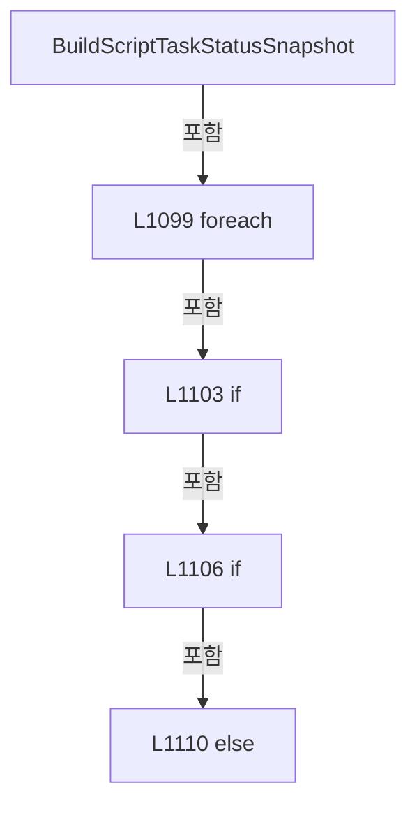

변경 전 점검: 입력/반환 타입, 위 호출자, 예외/취소 경로, 공유 상태와 저장·전송 소비자를 함께 확인합니다. 값의 단위나 물리 방향을 이름만으로 확정하지 않습니다.

### MethodDeclaration `BuildAutomationControllerStatusItems` · L1135–1135

[Drilling.UI/Menu/Menus/CMenuMain.cs:1135–1135](https://github.com/kjuws10-rgb/A3Drilling/blob/5aee8e58439c9b455cae7c9593c9be986c3e682e/Drilling.UI/Menu/Menus/CMenuMain.cs#L1135-L1135)

| 항목 | 실제 추출 값 |
| --- | --- |
| 서명 | System.Threading.Tasks.Task<System.Collections.Generic.IReadOnlyList<Drilling.UI.Menu.Menus.ST_AUTOMATION_CONTROLLER_STATUS_ITEM>> Drilling.UI.Menu.Menus.CMenuMain.BuildAutomationControllerStatusItems(System.Collections.Generic.IReadOnlyList<Drilling.UI.Menu.Menus.ST_SCRIPT_TASK_STATUS_ITEM>, System.Threading.CancellationToken) |
| 접근/수식자 | Private / private |
| 반환/값 타입 | System.Threading.Tasks.Task<System.Collections.Generic.IReadOnlyList<Drilling.UI.Menu.Menus.ST_AUTOMATION_CONTROLLER_STATUS_ITEM>> |
| 소속 타입 | NamedType:Drilling.UI.Menu.Menus.CMenuMain |

입력 계약:

| 이름 | 타입 | 전달 | 선택/기본값 |
| --- | --- | --- | --- |
| taskStatusItems | System.Collections.Generic.IReadOnlyList<Drilling.UI.Menu.Menus.ST_SCRIPT_TASK_STATUS_ITEM> | None | False /  |
| cancellationToken | System.Threading.CancellationToken | None | False /  |

정적 호출자로 확인된 위치:

| 호출 파일/행 | 호출 표현식 | 런타임 분기 가능 |
| --- | --- | --- |
| [Drilling.UI/Menu/Menus/CMenuMain.cs:845–845](https://github.com/kjuws10-rgb/A3Drilling/blob/5aee8e58439c9b455cae7c9593c9be986c3e682e/Drilling.UI/Menu/Menus/CMenuMain.cs#L845-L845) | BuildAutomationControllerStatusItems | False |

호출하는 대상과 해석 범위:

| 원본 행 | 표현식 | 분석 상태 | 대상/소스 위치 |
| --- | --- | --- | --- |
| 1135 | Task.FromResult | resolved | System.Threading.Tasks.Task<System.Collections.Generic.IReadOnlyList<Drilling.UI.Menu.Menus.ST_AUTOMATION_CONTROLLER_STATUS_ITEM>> System.Threading.Tasks.Task.FromResult<System.Collections.Generic.IReadOnlyList<Drilling.UI.Menu.Menus.ST_AUTOMATION_CONTROLLER_STATUS_ITEM>>(System.Collections.Generic.IReadOnlyList<Drilling.UI.Menu.Menus.ST_AUTOMATION_CONTROLLER_STATUS_ITEM>) |
| 1135 | BuildAutomationControllerStatusSnapshot | resolved | System.Collections.Generic.IReadOnlyList<Drilling.UI.Menu.Menus.ST_AUTOMATION_CONTROLLER_STATUS_ITEM> Drilling.UI.Menu.Menus.CMenuMain.BuildAutomationControllerStatusSnapshot(System.Collections.Generic.IReadOnlyList<Drilling.UI.Menu.Menus.ST_SCRIPT_TASK_STATUS_ITEM>, System.Threading.CancellationToken) · Drilling.UI/Menu/Menus/CMenuMain.cs:1136 |

본문의 실제 연산·분기·예외·반환 순서(원문 위치 순):

| 원본 행 | 종류 | 주석 해설 |
| --- | --- | --- |
| 1135 | call | 함수·델리게이트 또는 객체 생성자를 호출합니다: Task.FromResult(BuildAutomationControllerStatusSnapshot(taskStatusItems, cancellationToken)) |
| 1135 | call | 함수·델리게이트 또는 객체 생성자를 호출합니다: BuildAutomationControllerStatusSnapshot(taskStatusItems, cancellationToken) |

변경 전 점검: 입력/반환 타입, 위 호출자, 예외/취소 경로, 공유 상태와 저장·전송 소비자를 함께 확인합니다. 값의 단위나 물리 방향을 이름만으로 확정하지 않습니다.

### MethodDeclaration `BuildAutomationControllerStatusSnapshot` · L1136–1148

[Drilling.UI/Menu/Menus/CMenuMain.cs:1136–1148](https://github.com/kjuws10-rgb/A3Drilling/blob/5aee8e58439c9b455cae7c9593c9be986c3e682e/Drilling.UI/Menu/Menus/CMenuMain.cs#L1136-L1148)

| 항목 | 실제 추출 값 |
| --- | --- |
| 서명 | System.Collections.Generic.IReadOnlyList<Drilling.UI.Menu.Menus.ST_AUTOMATION_CONTROLLER_STATUS_ITEM> Drilling.UI.Menu.Menus.CMenuMain.BuildAutomationControllerStatusSnapshot(System.Collections.Generic.IReadOnlyList<Drilling.UI.Menu.Menus.ST_SCRIPT_TASK_STATUS_ITEM>, System.Threading.CancellationToken) |
| 접근/수식자 | Private / private |
| 반환/값 타입 | System.Collections.Generic.IReadOnlyList<Drilling.UI.Menu.Menus.ST_AUTOMATION_CONTROLLER_STATUS_ITEM> |
| 소속 타입 | NamedType:Drilling.UI.Menu.Menus.CMenuMain |

입력 계약:

| 이름 | 타입 | 전달 | 선택/기본값 |
| --- | --- | --- | --- |
| taskStatusItems | System.Collections.Generic.IReadOnlyList<Drilling.UI.Menu.Menus.ST_SCRIPT_TASK_STATUS_ITEM> | None | False /  |
| cancellationToken | System.Threading.CancellationToken | None | False /  |

정적 호출자로 확인된 위치:

| 호출 파일/행 | 호출 표현식 | 런타임 분기 가능 |
| --- | --- | --- |
| [Drilling.UI/Menu/Menus/CMenuMain.cs:1091–1091](https://github.com/kjuws10-rgb/A3Drilling/blob/5aee8e58439c9b455cae7c9593c9be986c3e682e/Drilling.UI/Menu/Menus/CMenuMain.cs#L1091-L1091) | BuildAutomationControllerStatusSnapshot | False |
| [Drilling.UI/Menu/Menus/CMenuMain.cs:1135–1135](https://github.com/kjuws10-rgb/A3Drilling/blob/5aee8e58439c9b455cae7c9593c9be986c3e682e/Drilling.UI/Menu/Menus/CMenuMain.cs#L1135-L1135) | BuildAutomationControllerStatusSnapshot | False |

호출하는 대상과 해석 범위:

| 원본 행 | 표현식 | 분석 상태 | 대상/소스 위치 |
| --- | --- | --- | --- |
| 1138 | BuildAutomationControllerNumbers | resolved | System.Collections.Generic.IReadOnlyList<int> Drilling.UI.Menu.Menus.CMenuMain.BuildAutomationControllerNumbers(System.Collections.Generic.IReadOnlyList<Drilling.UI.Menu.Menus.ST_SCRIPT_TASK_STATUS_ITEM>) · Drilling.UI/Menu/Menus/CMenuMain.cs:1230 |
| 1139 | new List<ST_AUTOMATION_CONTROLLER_STATUS_ITEM> | resolved | System.Collections.Generic.List<Drilling.UI.Menu.Menus.ST_AUTOMATION_CONTROLLER_STATUS_ITEM>.List(int) |
| 1142 | cancellationToken.ThrowIfCancellationRequested | resolved | void System.Threading.CancellationToken.ThrowIfCancellationRequested() |
| 1143 | ReadAutomationControllerUsageSnapshot | resolved | Drilling.UI.Menu.Menus.ST_AUTOMATION_CONTROLLER_USAGE_VALUE Drilling.UI.Menu.Menus.CMenuMain.ReadAutomationControllerUsageSnapshot(int, System.Threading.CancellationToken) · Drilling.UI/Menu/Menus/CMenuMain.cs:1151 |
| 1144 | items.Add | resolved | void System.Collections.Generic.List<Drilling.UI.Menu.Menus.ST_AUTOMATION_CONTROLLER_STATUS_ITEM>.Add(Drilling.UI.Menu.Menus.ST_AUTOMATION_CONTROLLER_STATUS_ITEM) |
| 1144 | new ST_AUTOMATION_CONTROLLER_STATUS_ITEM | resolved | Drilling.UI.Menu.Menus.ST_AUTOMATION_CONTROLLER_STATUS_ITEM.ST_AUTOMATION_CONTROLLER_STATUS_ITEM(int, string, double, string, System.Collections.Generic.IReadOnlyList<Drilling.UI.Menu.Menus.ST_SCRIPT_TASK_STATUS_ITEM>) · Drilling.UI/Menu/Menus/CMenuMain.cs:3537 |
| 1144 | BuildControllerTaskStatusItems | resolved | System.Collections.Generic.IReadOnlyList<Drilling.UI.Menu.Menus.ST_SCRIPT_TASK_STATUS_ITEM> Drilling.UI.Menu.Menus.CMenuMain.BuildControllerTaskStatusItems(System.Collections.Generic.IReadOnlyList<Drilling.UI.Menu.Menus.ST_SCRIPT_TASK_STATUS_ITEM>, int) · Drilling.UI/Menu/Menus/CMenuMain.cs:1245 |

본문의 실제 연산·분기·예외·반환 순서(원문 위치 순):

| 원본 행 | 종류 | 주석 해설 |
| --- | --- | --- |
| 1138 | call | 함수·델리게이트 또는 객체 생성자를 호출합니다: BuildAutomationControllerNumbers(taskStatusItems) |
| 1138 | local-declaration | 지역 변수를 선언합니다: var controllerNos = BuildAutomationControllerNumbers(taskStatusItems); |
| 1138 | variable-initializer | 변수의 초기값을 지정합니다: controllerNos = BuildAutomationControllerNumbers(taskStatusItems) |
| 1139 | call | 함수·델리게이트 또는 객체 생성자를 호출합니다: new List<ST_AUTOMATION_CONTROLLER_STATUS_ITEM>(controllerNos.Count) |
| 1139 | local-declaration | 지역 변수를 선언합니다: var items = new List<ST_AUTOMATION_CONTROLLER_STATUS_ITEM>(controllerNos.Count); |
| 1139 | variable-initializer | 변수의 초기값을 지정합니다: items = new List<ST_AUTOMATION_CONTROLLER_STATUS_ITEM>(controllerNos.Count) |
| 1140 | foreach | 컬렉션 요소를 순회합니다: foreach (var automationNo in controllerNos) |
| 1142 | call | 함수·델리게이트 또는 객체 생성자를 호출합니다: cancellationToken.ThrowIfCancellationRequested() |
| 1143 | call | 함수·델리게이트 또는 객체 생성자를 호출합니다: ReadAutomationControllerUsageSnapshot(automationNo, cancellationToken) |
| 1143 | local-declaration | 지역 변수를 선언합니다: var usage = ReadAutomationControllerUsageSnapshot(automationNo, cancellationToken); |
| 1143 | variable-initializer | 변수의 초기값을 지정합니다: usage = ReadAutomationControllerUsageSnapshot(automationNo, cancellationToken) |
| 1144 | call | 함수·델리게이트 또는 객체 생성자를 호출합니다: items.Add(new ST_AUTOMATION_CONTROLLER_STATUS_ITEM(automationNo, usage.State, usage.Percent, usage.Detail, BuildControllerTaskStatusItems(taskStatusItems, automationNo))) |
| 1144 | call | 함수·델리게이트 또는 객체 생성자를 호출합니다: new ST_AUTOMATION_CONTROLLER_STATUS_ITEM(automationNo, usage.State, usage.Percent, usage.Detail, BuildControllerTaskStatusItems(taskStatusItems, automationNo)) |
| 1144 | call | 함수·델리게이트 또는 객체 생성자를 호출합니다: BuildControllerTaskStatusItems(taskStatusItems, automationNo) |
| 1147 | return | 호출자에게 값 또는 제어를 반환합니다: return items; |

제어 구문의 포함 구조(실제 실행 순서/CFG가 아닌 구문 탐색 그림):

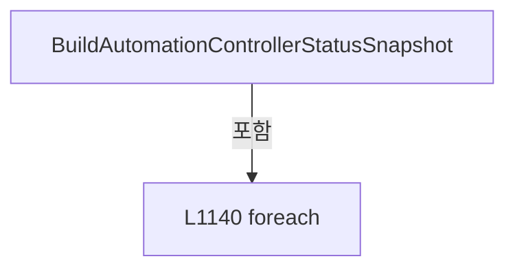

변경 전 점검: 입력/반환 타입, 위 호출자, 예외/취소 경로, 공유 상태와 저장·전송 소비자를 함께 확인합니다. 값의 단위나 물리 방향을 이름만으로 확정하지 않습니다.

### MethodDeclaration `ReadAutomationControllerUsage` · L1150–1150

[Drilling.UI/Menu/Menus/CMenuMain.cs:1150–1150](https://github.com/kjuws10-rgb/A3Drilling/blob/5aee8e58439c9b455cae7c9593c9be986c3e682e/Drilling.UI/Menu/Menus/CMenuMain.cs#L1150-L1150)

| 항목 | 실제 추출 값 |
| --- | --- |
| 서명 | System.Threading.Tasks.Task<Drilling.UI.Menu.Menus.ST_AUTOMATION_CONTROLLER_USAGE_VALUE> Drilling.UI.Menu.Menus.CMenuMain.ReadAutomationControllerUsage(int, System.Threading.CancellationToken) |
| 접근/수식자 | Private / private |
| 반환/값 타입 | System.Threading.Tasks.Task<Drilling.UI.Menu.Menus.ST_AUTOMATION_CONTROLLER_USAGE_VALUE> |
| 소속 타입 | NamedType:Drilling.UI.Menu.Menus.CMenuMain |

입력 계약:

| 이름 | 타입 | 전달 | 선택/기본값 |
| --- | --- | --- | --- |
| automationNo | int | None | False /  |
| cancellationToken | System.Threading.CancellationToken | None | False /  |

현재 부분 분석에서 직접 연결된 호출자는 없습니다. XAML/이벤트/인터페이스·델리게이트·외부 진입을 추가 확인해야 하며, 미사용으로 판정한 것이 아닙니다.

호출하는 대상과 해석 범위:

| 원본 행 | 표현식 | 분석 상태 | 대상/소스 위치 |
| --- | --- | --- | --- |
| 1150 | Task.FromResult | resolved | System.Threading.Tasks.Task<Drilling.UI.Menu.Menus.ST_AUTOMATION_CONTROLLER_USAGE_VALUE> System.Threading.Tasks.Task.FromResult<Drilling.UI.Menu.Menus.ST_AUTOMATION_CONTROLLER_USAGE_VALUE>(Drilling.UI.Menu.Menus.ST_AUTOMATION_CONTROLLER_USAGE_VALUE) |
| 1150 | ReadAutomationControllerUsageSnapshot | resolved | Drilling.UI.Menu.Menus.ST_AUTOMATION_CONTROLLER_USAGE_VALUE Drilling.UI.Menu.Menus.CMenuMain.ReadAutomationControllerUsageSnapshot(int, System.Threading.CancellationToken) · Drilling.UI/Menu/Menus/CMenuMain.cs:1151 |

본문의 실제 연산·분기·예외·반환 순서(원문 위치 순):

| 원본 행 | 종류 | 주석 해설 |
| --- | --- | --- |
| 1150 | call | 함수·델리게이트 또는 객체 생성자를 호출합니다: Task.FromResult(ReadAutomationControllerUsageSnapshot(automationNo, cancellationToken)) |
| 1150 | call | 함수·델리게이트 또는 객체 생성자를 호출합니다: ReadAutomationControllerUsageSnapshot(automationNo, cancellationToken) |

변경 전 점검: 입력/반환 타입, 위 호출자, 예외/취소 경로, 공유 상태와 저장·전송 소비자를 함께 확인합니다. 값의 단위나 물리 방향을 이름만으로 확정하지 않습니다.

### MethodDeclaration `ReadAutomationControllerUsageSnapshot` · L1151–1174

[Drilling.UI/Menu/Menus/CMenuMain.cs:1151–1174](https://github.com/kjuws10-rgb/A3Drilling/blob/5aee8e58439c9b455cae7c9593c9be986c3e682e/Drilling.UI/Menu/Menus/CMenuMain.cs#L1151-L1174)

| 항목 | 실제 추출 값 |
| --- | --- |
| 서명 | Drilling.UI.Menu.Menus.ST_AUTOMATION_CONTROLLER_USAGE_VALUE Drilling.UI.Menu.Menus.CMenuMain.ReadAutomationControllerUsageSnapshot(int, System.Threading.CancellationToken) |
| 접근/수식자 | Private / private |
| 반환/값 타입 | Drilling.UI.Menu.Menus.ST_AUTOMATION_CONTROLLER_USAGE_VALUE |
| 소속 타입 | NamedType:Drilling.UI.Menu.Menus.CMenuMain |

입력 계약:

| 이름 | 타입 | 전달 | 선택/기본값 |
| --- | --- | --- | --- |
| automationNo | int | None | False /  |
| cancellationToken | System.Threading.CancellationToken | None | False /  |

정적 호출자로 확인된 위치:

| 호출 파일/행 | 호출 표현식 | 런타임 분기 가능 |
| --- | --- | --- |
| [Drilling.UI/Menu/Menus/CMenuMain.cs:1143–1143](https://github.com/kjuws10-rgb/A3Drilling/blob/5aee8e58439c9b455cae7c9593c9be986c3e682e/Drilling.UI/Menu/Menus/CMenuMain.cs#L1143-L1143) | ReadAutomationControllerUsageSnapshot | False |
| [Drilling.UI/Menu/Menus/CMenuMain.cs:1150–1150](https://github.com/kjuws10-rgb/A3Drilling/blob/5aee8e58439c9b455cae7c9593c9be986c3e682e/Drilling.UI/Menu/Menus/CMenuMain.cs#L1150-L1150) | ReadAutomationControllerUsageSnapshot | False |

호출하는 대상과 해석 범위:

| 원본 행 | 표현식 | 분석 상태 | 대상/소스 위치 |
| --- | --- | --- | --- |
| 1155 | automationManager.IsSimul | resolved | bool Drilling.Common.Automation.CAutomationManager.IsSimul(int) · Drilling.Common/Automation/CAutomationManager.cs:63 |
| 1157 | new ST_AUTOMATION_CONTROLLER_USAGE_VALUE | resolved | Drilling.UI.Menu.Menus.ST_AUTOMATION_CONTROLLER_USAGE_VALUE.ST_AUTOMATION_CONTROLLER_USAGE_VALUE(string, double, string) · Drilling.UI/Menu/Menus/CMenuMain.cs:3536 |
| 1160 | automationManager.IsConnect | resolved | bool Drilling.Common.Automation.CAutomationManager.IsConnect(int) · Drilling.Common/Automation/CAutomationManager.cs:58 |
| 1162 | new ST_AUTOMATION_CONTROLLER_USAGE_VALUE | resolved | Drilling.UI.Menu.Menus.ST_AUTOMATION_CONTROLLER_USAGE_VALUE.ST_AUTOMATION_CONTROLLER_USAGE_VALUE(string, double, string) · Drilling.UI/Menu/Menus/CMenuMain.cs:3536 |
| 1165 | automationManager.StatusSnapshots.GetProcessorUsage | resolved | Drilling.Common.Automation.ST_AUTOMATION_STATUS_SNAPSHOT<string> Drilling.Common.Automation.CAutomationStatusSnapshotService.GetProcessorUsage(int) · Drilling.Common/Automation/CAutomationStatusSnapshotService.cs:45 |
| 1167 | new ST_AUTOMATION_CONTROLLER_USAGE_VALUE | resolved | Drilling.UI.Menu.Menus.ST_AUTOMATION_CONTROLLER_USAGE_VALUE.ST_AUTOMATION_CONTROLLER_USAGE_VALUE(string, double, string) · Drilling.UI/Menu/Menus/CMenuMain.cs:3536 |
| 1168 | ParseAutomationControllerUsage | resolved | Drilling.UI.Menu.Menus.ST_AUTOMATION_CONTROLLER_USAGE_VALUE Drilling.UI.Menu.Menus.CMenuMain.ParseAutomationControllerUsage(string) · Drilling.UI/Menu/Menus/CMenuMain.cs:1205 |
| 1172 | new ST_AUTOMATION_CONTROLLER_USAGE_VALUE | resolved | Drilling.UI.Menu.Menus.ST_AUTOMATION_CONTROLLER_USAGE_VALUE.ST_AUTOMATION_CONTROLLER_USAGE_VALUE(string, double, string) · Drilling.UI/Menu/Menus/CMenuMain.cs:3536 |

본문의 실제 연산·분기·예외·반환 순서(원문 위치 순):

| 원본 행 | 종류 | 주석 해설 |
| --- | --- | --- |
| 1153 | try | 예외 처리 범위입니다: try |
| 1155 | call | 함수·델리게이트 또는 객체 생성자를 호출합니다: automationManager.IsSimul(automationNo) |
| 1155 | if | 조건에 따라 분기합니다: if (automationManager.IsSimul(automationNo)) |
| 1157 | call | 함수·델리게이트 또는 객체 생성자를 호출합니다: new ST_AUTOMATION_CONTROLLER_USAGE_VALUE("SIM", 0.0, "Simulation mode") |
| 1157 | return | 호출자에게 값 또는 제어를 반환합니다: return new ST_AUTOMATION_CONTROLLER_USAGE_VALUE("SIM", 0.0, "Simulation mode"); |
| 1160 | call | 함수·델리게이트 또는 객체 생성자를 호출합니다: automationManager.IsConnect(automationNo) |
| 1160 | if | 조건에 따라 분기합니다: if (!automationManager.IsConnect(automationNo)) |
| 1162 | call | 함수·델리게이트 또는 객체 생성자를 호출합니다: new ST_AUTOMATION_CONTROLLER_USAGE_VALUE("OFFLINE", 0.0, "Automation1 is not connected") |
| 1162 | return | 호출자에게 값 또는 제어를 반환합니다: return new ST_AUTOMATION_CONTROLLER_USAGE_VALUE("OFFLINE", 0.0, "Automation1 is not connected"); |
| 1165 | call | 함수·델리게이트 또는 객체 생성자를 호출합니다: automationManager.StatusSnapshots.GetProcessorUsage(automationNo) |
| 1165 | local-declaration | 지역 변수를 선언합니다: var cached = automationManager.StatusSnapshots.GetProcessorUsage(automationNo); |
| 1165 | variable-initializer | 변수의 초기값을 지정합니다: cached = automationManager.StatusSnapshots.GetProcessorUsage(automationNo) |
| 1166 | if | 조건에 따라 분기합니다: if (cached.Value is not { } response) |
| 1167 | call | 함수·델리게이트 또는 객체 생성자를 호출합니다: new ST_AUTOMATION_CONTROLLER_USAGE_VALUE(cached.State == "LOADING" ? "WAIT" : cached.State, 0, cached.Detail) |
| 1167 | conditional-expression | 조건에 따라 결과식을 선택합니다: cached.State == "LOADING" ? "WAIT" : cached.State |
| 1167 | return | 호출자에게 값 또는 제어를 반환합니다: return new ST_AUTOMATION_CONTROLLER_USAGE_VALUE(cached.State == "LOADING" ? "WAIT" : cached.State, 0, cached.Detail); |
| 1168 | call | 함수·델리게이트 또는 객체 생성자를 호출합니다: ParseAutomationControllerUsage(response) |
| 1168 | return | 호출자에게 값 또는 제어를 반환합니다: return ParseAutomationControllerUsage(response); |
| 1170 | catch | 지정 예외를 처리합니다: catch (Exception exception) when (exception is not OperationCanceledException) |
| 1172 | call | 함수·델리게이트 또는 객체 생성자를 호출합니다: new ST_AUTOMATION_CONTROLLER_USAGE_VALUE("ERROR", 0.0, exception.Message) |
| 1172 | return | 호출자에게 값 또는 제어를 반환합니다: return new ST_AUTOMATION_CONTROLLER_USAGE_VALUE("ERROR", 0.0, exception.Message); |

제어 구문의 포함 구조(실제 실행 순서/CFG가 아닌 구문 탐색 그림):

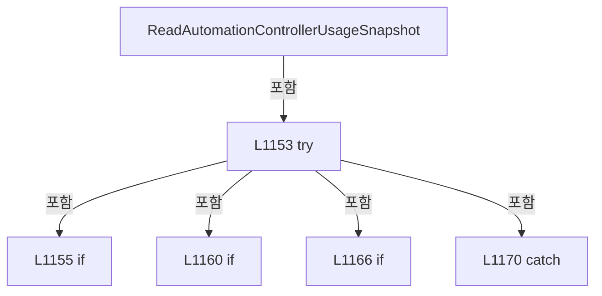

변경 전 점검: 입력/반환 타입, 위 호출자, 예외/취소 경로, 공유 상태와 저장·전송 소비자를 함께 확인합니다. 값의 단위나 물리 방향을 이름만으로 확정하지 않습니다.

### MethodDeclaration `ParseLiveAutomationControllerUsage` · L1176–1203

[Drilling.UI/Menu/Menus/CMenuMain.cs:1176–1203](https://github.com/kjuws10-rgb/A3Drilling/blob/5aee8e58439c9b455cae7c9593c9be986c3e682e/Drilling.UI/Menu/Menus/CMenuMain.cs#L1176-L1203)

| 항목 | 실제 추출 값 |
| --- | --- |
| 서명 | Drilling.UI.Menu.Menus.ST_AUTOMATION_CONTROLLER_USAGE_VALUE Drilling.UI.Menu.Menus.CMenuMain.ParseLiveAutomationControllerUsage(string) |
| 접근/수식자 | Private / private, static |
| 반환/값 타입 | Drilling.UI.Menu.Menus.ST_AUTOMATION_CONTROLLER_USAGE_VALUE |
| 소속 타입 | NamedType:Drilling.UI.Menu.Menus.CMenuMain |

입력 계약:

| 이름 | 타입 | 전달 | 선택/기본값 |
| --- | --- | --- | --- |
| processorUsage | string | None | False /  |

현재 부분 분석에서 직접 연결된 호출자는 없습니다. XAML/이벤트/인터페이스·델리게이트·외부 진입을 추가 확인해야 하며, 미사용으로 판정한 것이 아닙니다.

호출하는 대상과 해석 범위:

| 원본 행 | 표현식 | 분석 상태 | 대상/소스 위치 |
| --- | --- | --- | --- |
| 1178 | string.IsNullOrWhiteSpace | resolved | bool string.IsNullOrWhiteSpace(string?) |
| 1178 | processorUsage.Trim | resolved | string string.Trim() |
| 1179 | double.TryParse | resolved | bool double.TryParse(string?, System.Globalization.NumberStyles, System.IFormatProvider?, out double) |
| 1181 | Math.Clamp | resolved | double System.Math.Clamp(double, double, double) |
| 1183 | new ST_AUTOMATION_CONTROLLER_USAGE_VALUE | resolved | Drilling.UI.Menu.Menus.ST_AUTOMATION_CONTROLLER_USAGE_VALUE.ST_AUTOMATION_CONTROLLER_USAGE_VALUE(string, double, string) · Drilling.UI/Menu/Menus/CMenuMain.cs:3536 |
| 1186 | value.ToUpperInvariant | resolved | string string.ToUpperInvariant() |
| 1187 | normalized.Equals | resolved | bool string.Equals(string?, System.StringComparison) |
| 1189 | new ST_AUTOMATION_CONTROLLER_USAGE_VALUE | resolved | Drilling.UI.Menu.Menus.ST_AUTOMATION_CONTROLLER_USAGE_VALUE.ST_AUTOMATION_CONTROLLER_USAGE_VALUE(string, double, string) · Drilling.UI/Menu/Menus/CMenuMain.cs:3536 |
| 1192 | normalized.Equals | resolved | bool string.Equals(string?, System.StringComparison) |
| 1194 | new ST_AUTOMATION_CONTROLLER_USAGE_VALUE | resolved | Drilling.UI.Menu.Menus.ST_AUTOMATION_CONTROLLER_USAGE_VALUE.ST_AUTOMATION_CONTROLLER_USAGE_VALUE(string, double, string) · Drilling.UI/Menu/Menus/CMenuMain.cs:3536 |
| 1197 | normalized.Equals | resolved | bool string.Equals(string?, System.StringComparison) |
| 1199 | new ST_AUTOMATION_CONTROLLER_USAGE_VALUE | resolved | Drilling.UI.Menu.Menus.ST_AUTOMATION_CONTROLLER_USAGE_VALUE.ST_AUTOMATION_CONTROLLER_USAGE_VALUE(string, double, string) · Drilling.UI/Menu/Menus/CMenuMain.cs:3536 |
| 1202 | new ST_AUTOMATION_CONTROLLER_USAGE_VALUE | resolved | Drilling.UI.Menu.Menus.ST_AUTOMATION_CONTROLLER_USAGE_VALUE.ST_AUTOMATION_CONTROLLER_USAGE_VALUE(string, double, string) · Drilling.UI/Menu/Menus/CMenuMain.cs:3536 |

본문의 실제 연산·분기·예외·반환 순서(원문 위치 순):

| 원본 행 | 종류 | 주석 해설 |
| --- | --- | --- |
| 1178 | call | 함수·델리게이트 또는 객체 생성자를 호출합니다: string.IsNullOrWhiteSpace(processorUsage) |
| 1178 | call | 함수·델리게이트 또는 객체 생성자를 호출합니다: processorUsage.Trim() |
| 1178 | conditional-expression | 조건에 따라 결과식을 선택합니다: string.IsNullOrWhiteSpace(processorUsage) ? "WAIT" : processorUsage.Trim() |
| 1178 | local-declaration | 지역 변수를 선언합니다: var value = string.IsNullOrWhiteSpace(processorUsage) ? "WAIT" : processorUsage.Trim(); |
| 1178 | variable-initializer | 변수의 초기값을 지정합니다: value = string.IsNullOrWhiteSpace(processorUsage) ? "WAIT" : processorUsage.Trim() |
| 1179 | call | 함수·델리게이트 또는 객체 생성자를 호출합니다: double.TryParse(value, NumberStyles.Float, CultureInfo.InvariantCulture, out var usage) |
| 1179 | if | 조건에 따라 분기합니다: if (double.TryParse(value, NumberStyles.Float, CultureInfo.InvariantCulture, out var usage)) |
| 1181 | call | 함수·델리게이트 또는 객체 생성자를 호출합니다: Math.Clamp(usage, 0.0, 100.0) |
| 1181 | local-declaration | 지역 변수를 선언합니다: var clampedUsage = Math.Clamp(usage, 0.0, 100.0); |
| 1181 | variable-initializer | 변수의 초기값을 지정합니다: clampedUsage = Math.Clamp(usage, 0.0, 100.0) |
| 1182 | conditional-expression | 조건에 따라 결과식을 선택합니다: clampedUsage >= 90.0 ? "WARN" : "OK" |
| 1182 | local-declaration | 지역 변수를 선언합니다: var state = clampedUsage >= 90.0 ? "WARN" : "OK"; |
| 1182 | variable-initializer | 변수의 초기값을 지정합니다: state = clampedUsage >= 90.0 ? "WARN" : "OK" |
| 1183 | call | 함수·델리게이트 또는 객체 생성자를 호출합니다: new ST_AUTOMATION_CONTROLLER_USAGE_VALUE(state, clampedUsage, "Live scanner status snapshot") |
| 1183 | return | 호출자에게 값 또는 제어를 반환합니다: return new ST_AUTOMATION_CONTROLLER_USAGE_VALUE(state, clampedUsage, "Live scanner status snapshot"); |
| 1186 | call | 함수·델리게이트 또는 객체 생성자를 호출합니다: value.ToUpperInvariant() |
| 1186 | local-declaration | 지역 변수를 선언합니다: var normalized = value.ToUpperInvariant(); |
| 1186 | variable-initializer | 변수의 초기값을 지정합니다: normalized = value.ToUpperInvariant() |
| 1187 | call | 함수·델리게이트 또는 객체 생성자를 호출합니다: normalized.Equals("SIM", StringComparison.Ordinal) |
| 1187 | if | 조건에 따라 분기합니다: if (normalized.Equals("SIM", StringComparison.Ordinal)) |
| 1189 | call | 함수·델리게이트 또는 객체 생성자를 호출합니다: new ST_AUTOMATION_CONTROLLER_USAGE_VALUE("SIM", 0.0, "Simulation mode") |
| 1189 | return | 호출자에게 값 또는 제어를 반환합니다: return new ST_AUTOMATION_CONTROLLER_USAGE_VALUE("SIM", 0.0, "Simulation mode"); |
| 1192 | call | 함수·델리게이트 또는 객체 생성자를 호출합니다: normalized.Equals("OFFLINE", StringComparison.Ordinal) |
| 1192 | if | 조건에 따라 분기합니다: if (normalized.Equals("OFFLINE", StringComparison.Ordinal)) |
| 1194 | call | 함수·델리게이트 또는 객체 생성자를 호출합니다: new ST_AUTOMATION_CONTROLLER_USAGE_VALUE("OFFLINE", 0.0, "Automation1 is not connected") |
| 1194 | return | 호출자에게 값 또는 제어를 반환합니다: return new ST_AUTOMATION_CONTROLLER_USAGE_VALUE("OFFLINE", 0.0, "Automation1 is not connected"); |
| 1197 | call | 함수·델리게이트 또는 객체 생성자를 호출합니다: normalized.Equals("ERROR", StringComparison.Ordinal) |
| 1197 | if | 조건에 따라 분기합니다: if (normalized.Equals("ERROR", StringComparison.Ordinal)) |
| 1199 | call | 함수·델리게이트 또는 객체 생성자를 호출합니다: new ST_AUTOMATION_CONTROLLER_USAGE_VALUE("ERROR", 0.0, "Live scanner status snapshot error") |
| 1199 | return | 호출자에게 값 또는 제어를 반환합니다: return new ST_AUTOMATION_CONTROLLER_USAGE_VALUE("ERROR", 0.0, "Live scanner status snapshot error"); |
| 1202 | call | 함수·델리게이트 또는 객체 생성자를 호출합니다: new ST_AUTOMATION_CONTROLLER_USAGE_VALUE("WAIT", 0.0, "Waiting for live scanner status snapshot") |
| 1202 | return | 호출자에게 값 또는 제어를 반환합니다: return new ST_AUTOMATION_CONTROLLER_USAGE_VALUE("WAIT", 0.0, "Waiting for live scanner status snapshot"); |

제어 구문의 포함 구조(실제 실행 순서/CFG가 아닌 구문 탐색 그림):

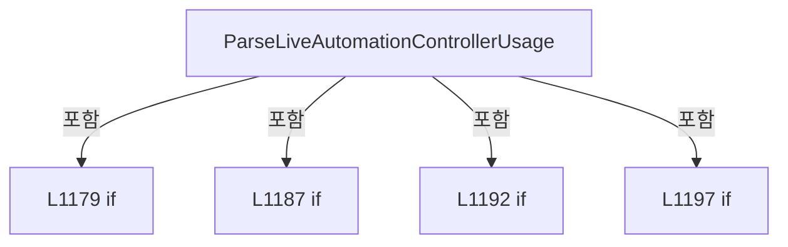

변경 전 점검: 입력/반환 타입, 위 호출자, 예외/취소 경로, 공유 상태와 저장·전송 소비자를 함께 확인합니다. 값의 단위나 물리 방향을 이름만으로 확정하지 않습니다.

### MethodDeclaration `ParseAutomationControllerUsage` · L1205–1216

[Drilling.UI/Menu/Menus/CMenuMain.cs:1205–1216](https://github.com/kjuws10-rgb/A3Drilling/blob/5aee8e58439c9b455cae7c9593c9be986c3e682e/Drilling.UI/Menu/Menus/CMenuMain.cs#L1205-L1216)

| 항목 | 실제 추출 값 |
| --- | --- |
| 서명 | Drilling.UI.Menu.Menus.ST_AUTOMATION_CONTROLLER_USAGE_VALUE Drilling.UI.Menu.Menus.CMenuMain.ParseAutomationControllerUsage(string) |
| 접근/수식자 | Private / private, static |
| 반환/값 타입 | Drilling.UI.Menu.Menus.ST_AUTOMATION_CONTROLLER_USAGE_VALUE |
| 소속 타입 | NamedType:Drilling.UI.Menu.Menus.CMenuMain |

입력 계약:

| 이름 | 타입 | 전달 | 선택/기본값 |
| --- | --- | --- | --- |
| response | string | None | False /  |

정적 호출자로 확인된 위치:

| 호출 파일/행 | 호출 표현식 | 런타임 분기 가능 |
| --- | --- | --- |
| [Drilling.UI/Menu/Menus/CMenuMain.cs:1168–1168](https://github.com/kjuws10-rgb/A3Drilling/blob/5aee8e58439c9b455cae7c9593c9be986c3e682e/Drilling.UI/Menu/Menus/CMenuMain.cs#L1168-L1168) | ParseAutomationControllerUsage | False |

호출하는 대상과 해석 범위:

| 원본 행 | 표현식 | 분석 상태 | 대상/소스 위치 |
| --- | --- | --- | --- |
| 1207 | response.Split | resolved | string[] string.Split(char, System.StringSplitOptions) |
| 1208 | fields[0].Equals | resolved | bool string.Equals(string?, System.StringComparison) |
| 1208 | fields[1].Equals | resolved | bool string.Equals(string?, System.StringComparison) |
| 1208 | fields[2].Equals | resolved | bool string.Equals(string?, System.StringComparison) |
| 1208 | double.TryParse | resolved | bool double.TryParse(string?, System.Globalization.NumberStyles, System.IFormatProvider?, out double) |
| 1210 | Math.Clamp | resolved | double System.Math.Clamp(double, double, double) |
| 1212 | new ST_AUTOMATION_CONTROLLER_USAGE_VALUE | resolved | Drilling.UI.Menu.Menus.ST_AUTOMATION_CONTROLLER_USAGE_VALUE.ST_AUTOMATION_CONTROLLER_USAGE_VALUE(string, double, string) · Drilling.UI/Menu/Menus/CMenuMain.cs:3536 |
| 1215 | response.StartsWith | resolved | bool string.StartsWith(string, System.StringComparison) |
| 1215 | new ST_AUTOMATION_CONTROLLER_USAGE_VALUE | resolved | Drilling.UI.Menu.Menus.ST_AUTOMATION_CONTROLLER_USAGE_VALUE.ST_AUTOMATION_CONTROLLER_USAGE_VALUE(string, double, string) · Drilling.UI/Menu/Menus/CMenuMain.cs:3536 |
| 1215 | new ST_AUTOMATION_CONTROLLER_USAGE_VALUE | resolved | Drilling.UI.Menu.Menus.ST_AUTOMATION_CONTROLLER_USAGE_VALUE.ST_AUTOMATION_CONTROLLER_USAGE_VALUE(string, double, string) · Drilling.UI/Menu/Menus/CMenuMain.cs:3536 |

본문의 실제 연산·분기·예외·반환 순서(원문 위치 순):

| 원본 행 | 종류 | 주석 해설 |
| --- | --- | --- |
| 1207 | call | 함수·델리게이트 또는 객체 생성자를 호출합니다: response.Split(':') |
| 1207 | local-declaration | 지역 변수를 선언합니다: var fields = response.Split(':'); |
| 1207 | variable-initializer | 변수의 초기값을 지정합니다: fields = response.Split(':') |
| 1208 | call | 함수·델리게이트 또는 객체 생성자를 호출합니다: fields[0].Equals("OK", StringComparison.OrdinalIgnoreCase) |
| 1208 | call | 함수·델리게이트 또는 객체 생성자를 호출합니다: fields[1].Equals("SYSTEM", StringComparison.OrdinalIgnoreCase) |
| 1208 | call | 함수·델리게이트 또는 객체 생성자를 호출합니다: fields[2].Equals("PROCESSOR_USAGE", StringComparison.OrdinalIgnoreCase) |
| 1208 | call | 함수·델리게이트 또는 객체 생성자를 호출합니다: double.TryParse(fields[3], NumberStyles.Float, CultureInfo.InvariantCulture, out var usage) |
| 1208 | if | 조건에 따라 분기합니다: if (fields.Length >= 4 && fields[0].Equals("OK", StringComparison.OrdinalIgnoreCase) && fields[1].Equals("SYSTEM", StringComparison.OrdinalIgnoreCase) && fields[2].Equals("PROCESSOR_USAGE", StringComparison.OrdinalIgnoreCase…) |
| 1210 | call | 함수·델리게이트 또는 객체 생성자를 호출합니다: Math.Clamp(usage, 0.0, 100.0) |
| 1210 | local-declaration | 지역 변수를 선언합니다: var clampedUsage = Math.Clamp(usage, 0.0, 100.0); |
| 1210 | variable-initializer | 변수의 초기값을 지정합니다: clampedUsage = Math.Clamp(usage, 0.0, 100.0) |
| 1211 | conditional-expression | 조건에 따라 결과식을 선택합니다: clampedUsage >= 90.0 ? "WARN" : "OK" |
| 1211 | local-declaration | 지역 변수를 선언합니다: var state = clampedUsage >= 90.0 ? "WARN" : "OK"; |
| 1211 | variable-initializer | 변수의 초기값을 지정합니다: state = clampedUsage >= 90.0 ? "WARN" : "OK" |
| 1212 | call | 함수·델리게이트 또는 객체 생성자를 호출합니다: new ST_AUTOMATION_CONTROLLER_USAGE_VALUE(state, clampedUsage, "Estimated SMC processor usage") |
| 1212 | return | 호출자에게 값 또는 제어를 반환합니다: return new ST_AUTOMATION_CONTROLLER_USAGE_VALUE(state, clampedUsage, "Estimated SMC processor usage"); |
| 1215 | call | 함수·델리게이트 또는 객체 생성자를 호출합니다: response.StartsWith("OK", StringComparison.OrdinalIgnoreCase) |
| 1215 | call | 함수·델리게이트 또는 객체 생성자를 호출합니다: new ST_AUTOMATION_CONTROLLER_USAGE_VALUE("OK", 0.0, response) |
| 1215 | call | 함수·델리게이트 또는 객체 생성자를 호출합니다: new ST_AUTOMATION_CONTROLLER_USAGE_VALUE("ERROR", 0.0, response) |
| 1215 | conditional-expression | 조건에 따라 결과식을 선택합니다: response.StartsWith("OK", StringComparison.OrdinalIgnoreCase) ? new ST_AUTOMATION_CONTROLLER_USAGE_VALUE("OK", 0.0, response) : new ST_AUTOMATION_CONTROLLER_USAGE_VALUE("ERROR", 0.0, response) |
| 1215 | return | 호출자에게 값 또는 제어를 반환합니다: return response.StartsWith("OK", StringComparison.OrdinalIgnoreCase) ? new ST_AUTOMATION_CONTROLLER_USAGE_VALUE("OK", 0.0, response) : new ST_AUTOMATION_CONTROLLER_USAGE_VALUE("ERROR", 0.0, response); |

제어 구문의 포함 구조(실제 실행 순서/CFG가 아닌 구문 탐색 그림):

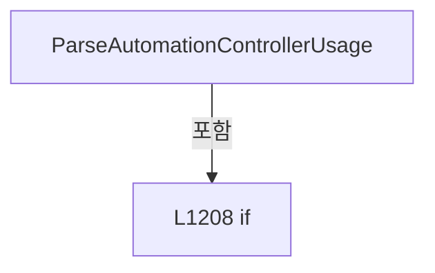

변경 전 점검: 입력/반환 타입, 위 호출자, 예외/취소 경로, 공유 상태와 저장·전송 소비자를 함께 확인합니다. 값의 단위나 물리 방향을 이름만으로 확정하지 않습니다.

### MethodDeclaration `BuildAutomationControllerStatusPlaceholders` · L1218–1228

[Drilling.UI/Menu/Menus/CMenuMain.cs:1218–1228](https://github.com/kjuws10-rgb/A3Drilling/blob/5aee8e58439c9b455cae7c9593c9be986c3e682e/Drilling.UI/Menu/Menus/CMenuMain.cs#L1218-L1228)

| 항목 | 실제 추출 값 |
| --- | --- |
| 서명 | System.Collections.Generic.IReadOnlyList<Drilling.UI.Menu.Menus.ST_AUTOMATION_CONTROLLER_STATUS_ITEM> Drilling.UI.Menu.Menus.CMenuMain.BuildAutomationControllerStatusPlaceholders(System.Collections.Generic.IReadOnlyList<Drilling.UI.Menu.Menus.ST_SCRIPT_TASK_STATUS_ITEM>) |
| 접근/수식자 | Private / private, static |
| 반환/값 타입 | System.Collections.Generic.IReadOnlyList<Drilling.UI.Menu.Menus.ST_AUTOMATION_CONTROLLER_STATUS_ITEM> |
| 소속 타입 | NamedType:Drilling.UI.Menu.Menus.CMenuMain |

입력 계약:

| 이름 | 타입 | 전달 | 선택/기본값 |
| --- | --- | --- | --- |
| taskStatusItems | System.Collections.Generic.IReadOnlyList<Drilling.UI.Menu.Menus.ST_SCRIPT_TASK_STATUS_ITEM> | None | False /  |

정적 호출자로 확인된 위치:

| 호출 파일/행 | 호출 표현식 | 런타임 분기 가능 |
| --- | --- | --- |
| [Drilling.UI/Menu/Menus/CMenuMain.cs:707–707](https://github.com/kjuws10-rgb/A3Drilling/blob/5aee8e58439c9b455cae7c9593c9be986c3e682e/Drilling.UI/Menu/Menus/CMenuMain.cs#L707-L707) | BuildAutomationControllerStatusPlaceholders | False |

호출하는 대상과 해석 범위:

| 원본 행 | 표현식 | 분석 상태 | 대상/소스 위치 |
| --- | --- | --- | --- |
| 1220 | BuildAutomationControllerNumbers | resolved | System.Collections.Generic.IReadOnlyList<int> Drilling.UI.Menu.Menus.CMenuMain.BuildAutomationControllerNumbers(System.Collections.Generic.IReadOnlyList<Drilling.UI.Menu.Menus.ST_SCRIPT_TASK_STATUS_ITEM>) · Drilling.UI/Menu/Menus/CMenuMain.cs:1230 |
| 1221 | new List<ST_AUTOMATION_CONTROLLER_STATUS_ITEM> | resolved | System.Collections.Generic.List<Drilling.UI.Menu.Menus.ST_AUTOMATION_CONTROLLER_STATUS_ITEM>.List(int) |
| 1224 | items.Add | resolved | void System.Collections.Generic.List<Drilling.UI.Menu.Menus.ST_AUTOMATION_CONTROLLER_STATUS_ITEM>.Add(Drilling.UI.Menu.Menus.ST_AUTOMATION_CONTROLLER_STATUS_ITEM) |
| 1224 | new ST_AUTOMATION_CONTROLLER_STATUS_ITEM | resolved | Drilling.UI.Menu.Menus.ST_AUTOMATION_CONTROLLER_STATUS_ITEM.ST_AUTOMATION_CONTROLLER_STATUS_ITEM(int, string, double, string, System.Collections.Generic.IReadOnlyList<Drilling.UI.Menu.Menus.ST_SCRIPT_TASK_STATUS_ITEM>) · Drilling.UI/Menu/Menus/CMenuMain.cs:3537 |
| 1224 | BuildControllerTaskStatusItems | resolved | System.Collections.Generic.IReadOnlyList<Drilling.UI.Menu.Menus.ST_SCRIPT_TASK_STATUS_ITEM> Drilling.UI.Menu.Menus.CMenuMain.BuildControllerTaskStatusItems(System.Collections.Generic.IReadOnlyList<Drilling.UI.Menu.Menus.ST_SCRIPT_TASK_STATUS_ITEM>, int) · Drilling.UI/Menu/Menus/CMenuMain.cs:1245 |

본문의 실제 연산·분기·예외·반환 순서(원문 위치 순):

| 원본 행 | 종류 | 주석 해설 |
| --- | --- | --- |
| 1220 | call | 함수·델리게이트 또는 객체 생성자를 호출합니다: BuildAutomationControllerNumbers(taskStatusItems) |
| 1220 | local-declaration | 지역 변수를 선언합니다: var controllerNos = BuildAutomationControllerNumbers(taskStatusItems); |
| 1220 | variable-initializer | 변수의 초기값을 지정합니다: controllerNos = BuildAutomationControllerNumbers(taskStatusItems) |
| 1221 | call | 함수·델리게이트 또는 객체 생성자를 호출합니다: new List<ST_AUTOMATION_CONTROLLER_STATUS_ITEM>(controllerNos.Count) |
| 1221 | local-declaration | 지역 변수를 선언합니다: var items = new List<ST_AUTOMATION_CONTROLLER_STATUS_ITEM>(controllerNos.Count); |
| 1221 | variable-initializer | 변수의 초기값을 지정합니다: items = new List<ST_AUTOMATION_CONTROLLER_STATUS_ITEM>(controllerNos.Count) |
| 1222 | foreach | 컬렉션 요소를 순회합니다: foreach (var automationNo in controllerNos) |
| 1224 | call | 함수·델리게이트 또는 객체 생성자를 호출합니다: items.Add(new ST_AUTOMATION_CONTROLLER_STATUS_ITEM(automationNo, "WAIT", 0.0, "Waiting for controller status", BuildControllerTaskStatusItems(taskStatusItems, automationNo))) |
| 1224 | call | 함수·델리게이트 또는 객체 생성자를 호출합니다: new ST_AUTOMATION_CONTROLLER_STATUS_ITEM(automationNo, "WAIT", 0.0, "Waiting for controller status", BuildControllerTaskStatusItems(taskStatusItems, automationNo)) |
| 1224 | call | 함수·델리게이트 또는 객체 생성자를 호출합니다: BuildControllerTaskStatusItems(taskStatusItems, automationNo) |
| 1227 | return | 호출자에게 값 또는 제어를 반환합니다: return items; |

제어 구문의 포함 구조(실제 실행 순서/CFG가 아닌 구문 탐색 그림):

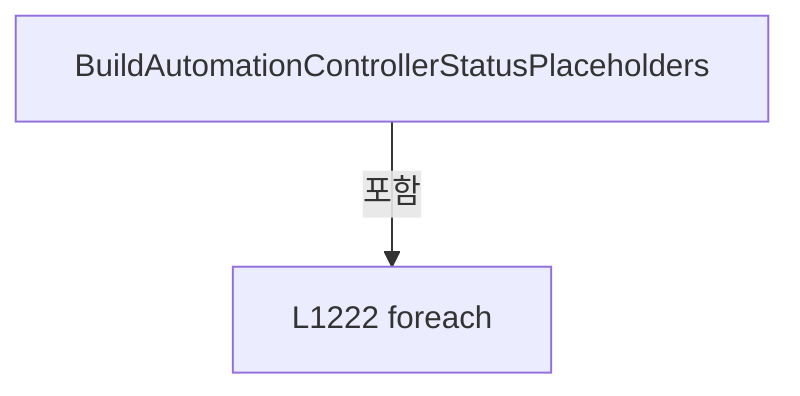

변경 전 점검: 입력/반환 타입, 위 호출자, 예외/취소 경로, 공유 상태와 저장·전송 소비자를 함께 확인합니다. 값의 단위나 물리 방향을 이름만으로 확정하지 않습니다.

### MethodDeclaration `BuildAutomationControllerNumbers` · L1230–1243

[Drilling.UI/Menu/Menus/CMenuMain.cs:1230–1243](https://github.com/kjuws10-rgb/A3Drilling/blob/5aee8e58439c9b455cae7c9593c9be986c3e682e/Drilling.UI/Menu/Menus/CMenuMain.cs#L1230-L1243)

| 항목 | 실제 추출 값 |
| --- | --- |
| 서명 | System.Collections.Generic.IReadOnlyList<int> Drilling.UI.Menu.Menus.CMenuMain.BuildAutomationControllerNumbers(System.Collections.Generic.IReadOnlyList<Drilling.UI.Menu.Menus.ST_SCRIPT_TASK_STATUS_ITEM>) |
| 접근/수식자 | Private / private, static |
| 반환/값 타입 | System.Collections.Generic.IReadOnlyList<int> |
| 소속 타입 | NamedType:Drilling.UI.Menu.Menus.CMenuMain |

입력 계약:

| 이름 | 타입 | 전달 | 선택/기본값 |
| --- | --- | --- | --- |
| taskStatusItems | System.Collections.Generic.IReadOnlyList<Drilling.UI.Menu.Menus.ST_SCRIPT_TASK_STATUS_ITEM> | None | False /  |

정적 호출자로 확인된 위치:

| 호출 파일/행 | 호출 표현식 | 런타임 분기 가능 |
| --- | --- | --- |
| [Drilling.UI/Menu/Menus/CMenuMain.cs:1138–1138](https://github.com/kjuws10-rgb/A3Drilling/blob/5aee8e58439c9b455cae7c9593c9be986c3e682e/Drilling.UI/Menu/Menus/CMenuMain.cs#L1138-L1138) | BuildAutomationControllerNumbers | False |
| [Drilling.UI/Menu/Menus/CMenuMain.cs:1220–1220](https://github.com/kjuws10-rgb/A3Drilling/blob/5aee8e58439c9b455cae7c9593c9be986c3e682e/Drilling.UI/Menu/Menus/CMenuMain.cs#L1220-L1220) | BuildAutomationControllerNumbers | False |

호출하는 대상과 해석 범위:

| 원본 행 | 표현식 | 분석 상태 | 대상/소스 위치 |
| --- | --- | --- | --- |
| 1232 | new SortedSet<int> | resolved | System.Collections.Generic.SortedSet<int>.SortedSet() |
| 1239 | controllerNos.Add | resolved | bool System.Collections.Generic.SortedSet<int>.Add(int) |
| 1242 | controllerNos.ToArray | resolved | int[] System.Collections.Generic.IEnumerable<int>.ToArray<int>() |

본문의 실제 연산·분기·예외·반환 순서(원문 위치 순):

| 원본 행 | 종류 | 주석 해설 |
| --- | --- | --- |
| 1232 | call | 함수·델리게이트 또는 객체 생성자를 호출합니다: new SortedSet<int> { 0, 1 } |
| 1232 | local-declaration | 지역 변수를 선언합니다: var controllerNos = new SortedSet<int> { 0, 1 }; |
| 1232 | variable-initializer | 변수의 초기값을 지정합니다: controllerNos = new SortedSet<int> { 0, 1 } |
| 1237 | foreach | 컬렉션 요소를 순회합니다: foreach (var item in taskStatusItems) |
| 1239 | call | 함수·델리게이트 또는 객체 생성자를 호출합니다: controllerNos.Add(item.AutomationNoValue) |
| 1242 | call | 함수·델리게이트 또는 객체 생성자를 호출합니다: controllerNos.ToArray() |
| 1242 | return | 호출자에게 값 또는 제어를 반환합니다: return controllerNos.ToArray(); |

제어 구문의 포함 구조(실제 실행 순서/CFG가 아닌 구문 탐색 그림):

```mermaid
flowchart TD
 M["BuildAutomationControllerNumbers"]
 N0["L1237 foreach"]
 M -->|포함| N0
```

변경 전 점검: 입력/반환 타입, 위 호출자, 예외/취소 경로, 공유 상태와 저장·전송 소비자를 함께 확인합니다. 값의 단위나 물리 방향을 이름만으로 확정하지 않습니다.

### MethodDeclaration `BuildControllerTaskStatusItems` · L1245–1263

[Drilling.UI/Menu/Menus/CMenuMain.cs:1245–1263](https://github.com/kjuws10-rgb/A3Drilling/blob/5aee8e58439c9b455cae7c9593c9be986c3e682e/Drilling.UI/Menu/Menus/CMenuMain.cs#L1245-L1263)

| 항목 | 실제 추출 값 |
| --- | --- |
| 서명 | System.Collections.Generic.IReadOnlyList<Drilling.UI.Menu.Menus.ST_SCRIPT_TASK_STATUS_ITEM> Drilling.UI.Menu.Menus.CMenuMain.BuildControllerTaskStatusItems(System.Collections.Generic.IReadOnlyList<Drilling.UI.Menu.Menus.ST_SCRIPT_TASK_STATUS_ITEM>, int) |
| 접근/수식자 | Private / private, static |
| 반환/값 타입 | System.Collections.Generic.IReadOnlyList<Drilling.UI.Menu.Menus.ST_SCRIPT_TASK_STATUS_ITEM> |
| 소속 타입 | NamedType:Drilling.UI.Menu.Menus.CMenuMain |

입력 계약:

| 이름 | 타입 | 전달 | 선택/기본값 |
| --- | --- | --- | --- |
| taskStatusItems | System.Collections.Generic.IReadOnlyList<Drilling.UI.Menu.Menus.ST_SCRIPT_TASK_STATUS_ITEM> | None | False /  |
| automationNo | int | None | False /  |

정적 호출자로 확인된 위치:

| 호출 파일/행 | 호출 표현식 | 런타임 분기 가능 |
| --- | --- | --- |
| [Drilling.UI/Menu/Menus/CMenuMain.cs:1144–1144](https://github.com/kjuws10-rgb/A3Drilling/blob/5aee8e58439c9b455cae7c9593c9be986c3e682e/Drilling.UI/Menu/Menus/CMenuMain.cs#L1144-L1144) | BuildControllerTaskStatusItems | False |
| [Drilling.UI/Menu/Menus/CMenuMain.cs:1224–1224](https://github.com/kjuws10-rgb/A3Drilling/blob/5aee8e58439c9b455cae7c9593c9be986c3e682e/Drilling.UI/Menu/Menus/CMenuMain.cs#L1224-L1224) | BuildControllerTaskStatusItems | False |

호출하는 대상과 해석 범위:

| 원본 행 | 표현식 | 분석 상태 | 대상/소스 위치 |
| --- | --- | --- | --- |
| 1262 | taskStatusItems.Where(ShouldIncludeItem).OrderBy(SelectHeadNoValue).ThenBy(SelectHead).ToArray | resolved | Drilling.UI.Menu.Menus.ST_SCRIPT_TASK_STATUS_ITEM[] System.Collections.Generic.IEnumerable<Drilling.UI.Menu.Menus.ST_SCRIPT_TASK_STATUS_ITEM>.ToArray<Drilling.UI.Menu.Menus.ST_SCRIPT_TASK_STATUS_ITEM>() |
| 1262 | taskStatusItems.Where(ShouldIncludeItem).OrderBy(SelectHeadNoValue).ThenBy | resolved | System.Linq.IOrderedEnumerable<Drilling.UI.Menu.Menus.ST_SCRIPT_TASK_STATUS_ITEM> System.Linq.IOrderedEnumerable<Drilling.UI.Menu.Menus.ST_SCRIPT_TASK_STATUS_ITEM>.ThenBy<Drilling.UI.Menu.Menus.ST_SCRIPT_TASK_STATUS_ITEM, string>(System.Func<Drilling.UI.Menu.Menus.ST_SCRIPT_TASK_STATUS_ITEM, string>) |
| 1262 | taskStatusItems.Where(ShouldIncludeItem).OrderBy | resolved | System.Linq.IOrderedEnumerable<Drilling.UI.Menu.Menus.ST_SCRIPT_TASK_STATUS_ITEM> System.Collections.Generic.IEnumerable<Drilling.UI.Menu.Menus.ST_SCRIPT_TASK_STATUS_ITEM>.OrderBy<Drilling.UI.Menu.Menus.ST_SCRIPT_TASK_STATUS_ITEM, int>(System.Func<Drilling.UI.Menu.Menus.ST_SCRIPT_TASK_STATUS_ITEM, int>) |
| 1262 | taskStatusItems.Where | resolved | System.Collections.Generic.IEnumerable<Drilling.UI.Menu.Menus.ST_SCRIPT_TASK_STATUS_ITEM> System.Collections.Generic.IEnumerable<Drilling.UI.Menu.Menus.ST_SCRIPT_TASK_STATUS_ITEM>.Where<Drilling.UI.Menu.Menus.ST_SCRIPT_TASK_STATUS_ITEM>(System.Func<Drilling.UI.Menu.Menus.ST_SCRIPT_TASK_STATUS_ITEM, bool>) |

본문의 실제 연산·분기·예외·반환 순서(원문 위치 순):

| 원본 행 | 종류 | 주석 해설 |
| --- | --- | --- |
| 1262 | call | 함수·델리게이트 또는 객체 생성자를 호출합니다: taskStatusItems.Where(ShouldIncludeItem).OrderBy(SelectHeadNoValue).ThenBy(SelectHead).ToArray() |
| 1262 | call | 함수·델리게이트 또는 객체 생성자를 호출합니다: taskStatusItems.Where(ShouldIncludeItem).OrderBy(SelectHeadNoValue).ThenBy(SelectHead) |
| 1262 | call | 함수·델리게이트 또는 객체 생성자를 호출합니다: taskStatusItems.Where(ShouldIncludeItem).OrderBy(SelectHeadNoValue) |
| 1262 | call | 함수·델리게이트 또는 객체 생성자를 호출합니다: taskStatusItems.Where(ShouldIncludeItem) |
| 1262 | return | 호출자에게 값 또는 제어를 반환합니다: return taskStatusItems.Where(ShouldIncludeItem).OrderBy(SelectHeadNoValue).ThenBy(SelectHead).ToArray(); |

변경 전 점검: 입력/반환 타입, 위 호출자, 예외/취소 경로, 공유 상태와 저장·전송 소비자를 함께 확인합니다. 값의 단위나 물리 방향을 이름만으로 확정하지 않습니다.

### LocalFunctionStatement `SelectHeadNoValue` · L1247–1250

[Drilling.UI/Menu/Menus/CMenuMain.cs:1247–1250](https://github.com/kjuws10-rgb/A3Drilling/blob/5aee8e58439c9b455cae7c9593c9be986c3e682e/Drilling.UI/Menu/Menus/CMenuMain.cs#L1247-L1250)

| 항목 | 실제 추출 값 |
| --- | --- |
| 서명 | int SelectHeadNoValue(Drilling.UI.Menu.Menus.ST_SCRIPT_TASK_STATUS_ITEM) |
| 접근/수식자 | Private /  |
| 반환/값 타입 | int |
| 소속 타입 | NamedType:Drilling.UI.Menu.Menus.CMenuMain |

입력 계약:

| 이름 | 타입 | 전달 | 선택/기본값 |
| --- | --- | --- | --- |
| item | Drilling.UI.Menu.Menus.ST_SCRIPT_TASK_STATUS_ITEM | None | False /  |

현재 부분 분석에서 직접 연결된 호출자는 없습니다. XAML/이벤트/인터페이스·델리게이트·외부 진입을 추가 확인해야 하며, 미사용으로 판정한 것이 아닙니다.

본문의 실제 연산·분기·예외·반환 순서(원문 위치 순):

| 원본 행 | 종류 | 주석 해설 |
| --- | --- | --- |
| 1249 | return | 호출자에게 값 또는 제어를 반환합니다: return item.HeadNoValue; |

변경 전 점검: 입력/반환 타입, 위 호출자, 예외/취소 경로, 공유 상태와 저장·전송 소비자를 함께 확인합니다. 값의 단위나 물리 방향을 이름만으로 확정하지 않습니다.

### LocalFunctionStatement `SelectHead` · L1252–1255

[Drilling.UI/Menu/Menus/CMenuMain.cs:1252–1255](https://github.com/kjuws10-rgb/A3Drilling/blob/5aee8e58439c9b455cae7c9593c9be986c3e682e/Drilling.UI/Menu/Menus/CMenuMain.cs#L1252-L1255)

| 항목 | 실제 추출 값 |
| --- | --- |
| 서명 | string SelectHead(Drilling.UI.Menu.Menus.ST_SCRIPT_TASK_STATUS_ITEM) |
| 접근/수식자 | Private /  |
| 반환/값 타입 | string |
| 소속 타입 | NamedType:Drilling.UI.Menu.Menus.CMenuMain |

입력 계약:

| 이름 | 타입 | 전달 | 선택/기본값 |
| --- | --- | --- | --- |
| item | Drilling.UI.Menu.Menus.ST_SCRIPT_TASK_STATUS_ITEM | None | False /  |

현재 부분 분석에서 직접 연결된 호출자는 없습니다. XAML/이벤트/인터페이스·델리게이트·외부 진입을 추가 확인해야 하며, 미사용으로 판정한 것이 아닙니다.

본문의 실제 연산·분기·예외·반환 순서(원문 위치 순):

| 원본 행 | 종류 | 주석 해설 |
| --- | --- | --- |
| 1254 | return | 호출자에게 값 또는 제어를 반환합니다: return item.Head; |

변경 전 점검: 입력/반환 타입, 위 호출자, 예외/취소 경로, 공유 상태와 저장·전송 소비자를 함께 확인합니다. 값의 단위나 물리 방향을 이름만으로 확정하지 않습니다.

### LocalFunctionStatement `ShouldIncludeItem` · L1257–1260

[Drilling.UI/Menu/Menus/CMenuMain.cs:1257–1260](https://github.com/kjuws10-rgb/A3Drilling/blob/5aee8e58439c9b455cae7c9593c9be986c3e682e/Drilling.UI/Menu/Menus/CMenuMain.cs#L1257-L1260)

| 항목 | 실제 추출 값 |
| --- | --- |
| 서명 | bool ShouldIncludeItem(Drilling.UI.Menu.Menus.ST_SCRIPT_TASK_STATUS_ITEM) |
| 접근/수식자 | Private /  |
| 반환/값 타입 | bool |
| 소속 타입 | NamedType:Drilling.UI.Menu.Menus.CMenuMain |

입력 계약:

| 이름 | 타입 | 전달 | 선택/기본값 |
| --- | --- | --- | --- |
| item | Drilling.UI.Menu.Menus.ST_SCRIPT_TASK_STATUS_ITEM | None | False /  |

현재 부분 분석에서 직접 연결된 호출자는 없습니다. XAML/이벤트/인터페이스·델리게이트·외부 진입을 추가 확인해야 하며, 미사용으로 판정한 것이 아닙니다.

본문의 실제 연산·분기·예외·반환 순서(원문 위치 순):

| 원본 행 | 종류 | 주석 해설 |
| --- | --- | --- |
| 1259 | return | 호출자에게 값 또는 제어를 반환합니다: return item.AutomationNoValue == automationNo; |

변경 전 점검: 입력/반환 타입, 위 호출자, 예외/취소 경로, 공유 상태와 저장·전송 소비자를 함께 확인합니다. 값의 단위나 물리 방향을 이름만으로 확정하지 않습니다.

### MethodDeclaration `BuildScriptTaskStatusPlaceholders` · L1265–1273

[Drilling.UI/Menu/Menus/CMenuMain.cs:1265–1273](https://github.com/kjuws10-rgb/A3Drilling/blob/5aee8e58439c9b455cae7c9593c9be986c3e682e/Drilling.UI/Menu/Menus/CMenuMain.cs#L1265-L1273)

| 항목 | 실제 추출 값 |
| --- | --- |
| 서명 | System.Collections.Generic.IReadOnlyList<Drilling.UI.Menu.Menus.ST_SCRIPT_TASK_STATUS_ITEM> Drilling.UI.Menu.Menus.CMenuMain.BuildScriptTaskStatusPlaceholders(Drilling.Common.Station.ST_STATION_PROCESS_STATUS, System.Collections.Generic.IReadOnlyDictionary<string, string>) |
| 접근/수식자 | Private / private, static |
| 반환/값 타입 | System.Collections.Generic.IReadOnlyList<Drilling.UI.Menu.Menus.ST_SCRIPT_TASK_STATUS_ITEM> |
| 소속 타입 | NamedType:Drilling.UI.Menu.Menus.CMenuMain |

입력 계약:

| 이름 | 타입 | 전달 | 선택/기본값 |
| --- | --- | --- | --- |
| snapshot | Drilling.Common.Station.ST_STATION_PROCESS_STATUS | None | False /  |
| previewParameters | System.Collections.Generic.IReadOnlyDictionary<string, string> | None | False /  |

정적 호출자로 확인된 위치:

| 호출 파일/행 | 호출 표현식 | 런타임 분기 가능 |
| --- | --- | --- |
| [Drilling.UI/Menu/Menus/CMenuMain.cs:706–706](https://github.com/kjuws10-rgb/A3Drilling/blob/5aee8e58439c9b455cae7c9593c9be986c3e682e/Drilling.UI/Menu/Menus/CMenuMain.cs#L706-L706) | BuildScriptTaskStatusPlaceholders | False |

호출하는 대상과 해석 범위:

| 원본 행 | 표현식 | 분석 상태 | 대상/소스 위치 |
| --- | --- | --- | --- |
| 1272 | BuildScriptTaskDefinitions(snapshot, previewParameters).Select(BuildScript).ToArray | resolved | Drilling.UI.Menu.Menus.ST_SCRIPT_TASK_STATUS_ITEM[] System.Collections.Generic.IEnumerable<Drilling.UI.Menu.Menus.ST_SCRIPT_TASK_STATUS_ITEM>.ToArray<Drilling.UI.Menu.Menus.ST_SCRIPT_TASK_STATUS_ITEM>() |
| 1272 | BuildScriptTaskDefinitions(snapshot, previewParameters).Select | resolved | System.Collections.Generic.IEnumerable<Drilling.UI.Menu.Menus.ST_SCRIPT_TASK_STATUS_ITEM> System.Collections.Generic.IEnumerable<Drilling.UI.Menu.Menus.ST_SCRIPT_TASK_DEFINITION>.Select<Drilling.UI.Menu.Menus.ST_SCRIPT_TASK_DEFINITION, Drilling.UI.Menu.Menus.ST_SCRIPT_TASK_STATUS_ITEM>(System.Func<Drilling.UI.Menu.Menus.ST_SCRIPT_TASK_DEFINITION, Drilling.UI.Menu.Menus.ST_SCRIPT_TASK_STATUS_ITEM>) |
| 1272 | BuildScriptTaskDefinitions | resolved | System.Collections.Generic.IReadOnlyList<Drilling.UI.Menu.Menus.ST_SCRIPT_TASK_DEFINITION> Drilling.UI.Menu.Menus.CMenuMain.BuildScriptTaskDefinitions(Drilling.Common.Station.ST_STATION_PROCESS_STATUS, System.Collections.Generic.IReadOnlyDictionary<string, string>) · Drilling.UI/Menu/Menus/CMenuMain.cs:1275 |

본문의 실제 연산·분기·예외·반환 순서(원문 위치 순):

| 원본 행 | 종류 | 주석 해설 |
| --- | --- | --- |
| 1272 | call | 함수·델리게이트 또는 객체 생성자를 호출합니다: BuildScriptTaskDefinitions(snapshot, previewParameters).Select(BuildScript).ToArray() |
| 1272 | call | 함수·델리게이트 또는 객체 생성자를 호출합니다: BuildScriptTaskDefinitions(snapshot, previewParameters).Select(BuildScript) |
| 1272 | call | 함수·델리게이트 또는 객체 생성자를 호출합니다: BuildScriptTaskDefinitions(snapshot, previewParameters) |
| 1272 | return | 호출자에게 값 또는 제어를 반환합니다: return BuildScriptTaskDefinitions(snapshot, previewParameters).Select(BuildScript).ToArray(); |

변경 전 점검: 입력/반환 타입, 위 호출자, 예외/취소 경로, 공유 상태와 저장·전송 소비자를 함께 확인합니다. 값의 단위나 물리 방향을 이름만으로 확정하지 않습니다.

### LocalFunctionStatement `BuildScript` · L1267–1270

[Drilling.UI/Menu/Menus/CMenuMain.cs:1267–1270](https://github.com/kjuws10-rgb/A3Drilling/blob/5aee8e58439c9b455cae7c9593c9be986c3e682e/Drilling.UI/Menu/Menus/CMenuMain.cs#L1267-L1270)

| 항목 | 실제 추출 값 |
| --- | --- |
| 서명 | Drilling.UI.Menu.Menus.ST_SCRIPT_TASK_STATUS_ITEM BuildScript(Drilling.UI.Menu.Menus.ST_SCRIPT_TASK_DEFINITION) |
| 접근/수식자 | Private /  |
| 반환/값 타입 | Drilling.UI.Menu.Menus.ST_SCRIPT_TASK_STATUS_ITEM |
| 소속 타입 | NamedType:Drilling.UI.Menu.Menus.CMenuMain |

입력 계약:

| 이름 | 타입 | 전달 | 선택/기본값 |
| --- | --- | --- | --- |
| definition | Drilling.UI.Menu.Menus.ST_SCRIPT_TASK_DEFINITION | None | False /  |

현재 부분 분석에서 직접 연결된 호출자는 없습니다. XAML/이벤트/인터페이스·델리게이트·외부 진입을 추가 확인해야 하며, 미사용으로 판정한 것이 아닙니다.

호출하는 대상과 해석 범위:

| 원본 행 | 표현식 | 분석 상태 | 대상/소스 위치 |
| --- | --- | --- | --- |
| 1269 | new ST_SCRIPT_TASK_STATUS_ITEM | resolved | Drilling.UI.Menu.Menus.ST_SCRIPT_TASK_STATUS_ITEM.ST_SCRIPT_TASK_STATUS_ITEM(string, string, string, string, string, string, string, int) · Drilling.UI/Menu/Menus/CMenuMain.cs:3600 |

본문의 실제 연산·분기·예외·반환 순서(원문 위치 순):

| 원본 행 | 종류 | 주석 해설 |
| --- | --- | --- |
| 1269 | call | 함수·델리게이트 또는 객체 생성자를 호출합니다: new ST_SCRIPT_TASK_STATUS_ITEM($"TASK {definition.TaskNo}", $"H{definition.HeadNo:00}", $"A{definition.AutomationNo}", $"T{definition.TaskNo}", "WAIT", definition.ScriptFileName, "Waiting for status", definition.TotalSho… |
| 1269 | return | 호출자에게 값 또는 제어를 반환합니다: return new ST_SCRIPT_TASK_STATUS_ITEM($"TASK {definition.TaskNo}", $"H{definition.HeadNo:00}", $"A{definition.AutomationNo}", $"T{definition.TaskNo}", "WAIT", definition.ScriptFileName, "Waiting for status", definition.TotalShots) |

변경 전 점검: 입력/반환 타입, 위 호출자, 예외/취소 경로, 공유 상태와 저장·전송 소비자를 함께 확인합니다. 값의 단위나 물리 방향을 이름만으로 확정하지 않습니다.

### MethodDeclaration `BuildScriptTaskDefinitions` · L1275–1311

[Drilling.UI/Menu/Menus/CMenuMain.cs:1275–1311](https://github.com/kjuws10-rgb/A3Drilling/blob/5aee8e58439c9b455cae7c9593c9be986c3e682e/Drilling.UI/Menu/Menus/CMenuMain.cs#L1275-L1311)

| 항목 | 실제 추출 값 |
| --- | --- |
| 서명 | System.Collections.Generic.IReadOnlyList<Drilling.UI.Menu.Menus.ST_SCRIPT_TASK_DEFINITION> Drilling.UI.Menu.Menus.CMenuMain.BuildScriptTaskDefinitions(Drilling.Common.Station.ST_STATION_PROCESS_STATUS, System.Collections.Generic.IReadOnlyDictionary<string, string>) |
| 접근/수식자 | Private / private, static |
| 반환/값 타입 | System.Collections.Generic.IReadOnlyList<Drilling.UI.Menu.Menus.ST_SCRIPT_TASK_DEFINITION> |
| 소속 타입 | NamedType:Drilling.UI.Menu.Menus.CMenuMain |

입력 계약:

| 이름 | 타입 | 전달 | 선택/기본값 |
| --- | --- | --- | --- |
| snapshot | Drilling.Common.Station.ST_STATION_PROCESS_STATUS | None | False /  |
| previewParameters | System.Collections.Generic.IReadOnlyDictionary<string, string> | None | False /  |

정적 호출자로 확인된 위치:

| 호출 파일/행 | 호출 표현식 | 런타임 분기 가능 |
| --- | --- | --- |
| [Drilling.UI/Menu/Menus/CMenuMain.cs:1095–1095](https://github.com/kjuws10-rgb/A3Drilling/blob/5aee8e58439c9b455cae7c9593c9be986c3e682e/Drilling.UI/Menu/Menus/CMenuMain.cs#L1095-L1095) | BuildScriptTaskDefinitions | False |
| [Drilling.UI/Menu/Menus/CMenuMain.cs:1272–1272](https://github.com/kjuws10-rgb/A3Drilling/blob/5aee8e58439c9b455cae7c9593c9be986c3e682e/Drilling.UI/Menu/Menus/CMenuMain.cs#L1272-L1272) | BuildScriptTaskDefinitions | False |

호출하는 대상과 해석 범위:

| 원본 행 | 표현식 | 분석 상태 | 대상/소스 위치 |
| --- | --- | --- | --- |
| 1292 | ShouldUseProcessModelTaskDefinitions | resolved | bool Drilling.UI.Menu.Menus.CMenuMain.ShouldUseProcessModelTaskDefinitions(Drilling.Common.Station.ST_STATION_PROCESS_STATUS) · Drilling.UI/Menu/Menus/CMenuMain.cs:1313 |
| 1292 | .HeadPlans.GroupBy(SelectHeadNo).ToDictionary | resolved | System.Collections.Generic.Dictionary<int, Drilling.Common.Station.ST_HEAD_PROCESS_PLAN> System.Collections.Generic.IEnumerable<System.Linq.IGrouping<int, Drilling.Common.Station.ST_HEAD_PROCESS_PLAN>>.ToDictionary<System.Linq.IGrouping<int, Drilling.Common.Station.ST_HEAD_PROCESS_PLAN>, int, Drilling.Common.Station.ST_HEAD_PROCESS_PLAN>(System.Func<System.Linq.IGrouping<int, Drilling.Common.Station.ST_HEAD_PROCESS_PLAN>, int>, System.Func<System.Linq.IGrouping<int, Drilling.Common.Station.ST_HEAD_PROCESS_PLAN>, Drilling.Common.Station.ST_HEAD_PROCESS_PLAN>) |
| 1292 | .HeadPlans.GroupBy | resolved | System.Collections.Generic.IEnumerable<System.Linq.IGrouping<int, Drilling.Common.Station.ST_HEAD_PROCESS_PLAN>> System.Collections.Generic.IEnumerable<Drilling.Common.Station.ST_HEAD_PROCESS_PLAN>.GroupBy<Drilling.Common.Station.ST_HEAD_PROCESS_PLAN, int>(System.Func<Drilling.Common.Station.ST_HEAD_PROCESS_PLAN, int>) |
| 1303 | BuildEnabledHeadNumbers | resolved | System.Collections.Generic.IReadOnlyList<int> Drilling.UI.Menu.Menus.CMenuMain.BuildEnabledHeadNumbers(System.Collections.Generic.IReadOnlyDictionary<string, string>, int) · Drilling.UI/Menu/Menus/CMenuMain.cs:1878 |
| 1304 | new List<ST_SCRIPT_TASK_DEFINITION> | resolved | System.Collections.Generic.List<Drilling.UI.Menu.Menus.ST_SCRIPT_TASK_DEFINITION>.List(int) |
| 1307 | definitions.Add | resolved | void System.Collections.Generic.List<Drilling.UI.Menu.Menus.ST_SCRIPT_TASK_DEFINITION>.Add(Drilling.UI.Menu.Menus.ST_SCRIPT_TASK_DEFINITION) |
| 1307 | ifCallback | resolved | Drilling.UI.Menu.Menus.ST_SCRIPT_TASK_DEFINITION ifCallback(int) · Drilling.UI/Menu/Menus/CMenuMain.cs:1293 |

본문의 실제 연산·분기·예외·반환 순서(원문 위치 순):

| 원본 행 | 종류 | 주석 해설 |
| --- | --- | --- |
| 1292 | call | 함수·델리게이트 또는 객체 생성자를 호출합니다: ShouldUseProcessModelTaskDefinitions(snapshot) |
| 1292 | call | 함수·델리게이트 또는 객체 생성자를 호출합니다: .HeadPlans.GroupBy(SelectHeadNo).ToDictionary(SelectKey, SelectValue) |
| 1292 | call | 함수·델리게이트 또는 객체 생성자를 호출합니다: .HeadPlans.GroupBy(SelectHeadNo) |
| 1292 | conditional-expression | 조건에 따라 결과식을 선택합니다: ShouldUseProcessModelTaskDefinitions(snapshot) ? snapshot.ProcessModel?.HeadPlans.GroupBy(SelectHeadNo).ToDictionary(SelectKey, SelectValue) ?? [] : [] |
| 1292 | local-declaration | 지역 변수를 선언합니다: var headMap = ShouldUseProcessModelTaskDefinitions(snapshot) ? snapshot.ProcessModel?.HeadPlans.GroupBy(SelectHeadNo).ToDictionary(SelectKey, SelectValue) ?? [] : []; |
| 1292 | variable-initializer | 변수의 초기값을 지정합니다: headMap = ShouldUseProcessModelTaskDefinitions(snapshot) ? snapshot.ProcessModel?.HeadPlans.GroupBy(SelectHeadNo).ToDictionary(SelectKey, SelectValue) ?? [] : [] |
| 1303 | call | 함수·델리게이트 또는 객체 생성자를 호출합니다: BuildEnabledHeadNumbers(previewParameters) |
| 1303 | local-declaration | 지역 변수를 선언합니다: var enabledHeadNos = BuildEnabledHeadNumbers(previewParameters); |
| 1303 | variable-initializer | 변수의 초기값을 지정합니다: enabledHeadNos = BuildEnabledHeadNumbers(previewParameters) |
| 1304 | call | 함수·델리게이트 또는 객체 생성자를 호출합니다: new List<ST_SCRIPT_TASK_DEFINITION>(enabledHeadNos.Count) |
| 1304 | local-declaration | 지역 변수를 선언합니다: var definitions = new List<ST_SCRIPT_TASK_DEFINITION>(enabledHeadNos.Count); |
| 1304 | variable-initializer | 변수의 초기값을 지정합니다: definitions = new List<ST_SCRIPT_TASK_DEFINITION>(enabledHeadNos.Count) |
| 1305 | foreach | 컬렉션 요소를 순회합니다: foreach (var headNo in enabledHeadNos) |
| 1307 | call | 함수·델리게이트 또는 객체 생성자를 호출합니다: definitions.Add(ifCallback(headNo)) |
| 1307 | call | 함수·델리게이트 또는 객체 생성자를 호출합니다: ifCallback(headNo) |
| 1310 | return | 호출자에게 값 또는 제어를 반환합니다: return definitions; |

제어 구문의 포함 구조(실제 실행 순서/CFG가 아닌 구문 탐색 그림):

```mermaid
flowchart TD
 M["BuildScriptTaskDefinitions"]
 N0["L1305 foreach"]
 M -->|포함| N0
```

변경 전 점검: 입력/반환 타입, 위 호출자, 예외/취소 경로, 공유 상태와 저장·전송 소비자를 함께 확인합니다. 값의 단위나 물리 방향을 이름만으로 확정하지 않습니다.

### LocalFunctionStatement `SelectHeadNo` · L1277–1280

[Drilling.UI/Menu/Menus/CMenuMain.cs:1277–1280](https://github.com/kjuws10-rgb/A3Drilling/blob/5aee8e58439c9b455cae7c9593c9be986c3e682e/Drilling.UI/Menu/Menus/CMenuMain.cs#L1277-L1280)

| 항목 | 실제 추출 값 |
| --- | --- |
| 서명 | int SelectHeadNo(Drilling.Common.Station.ST_HEAD_PROCESS_PLAN) |
| 접근/수식자 | Private /  |
| 반환/값 타입 | int |
| 소속 타입 | NamedType:Drilling.UI.Menu.Menus.CMenuMain |

입력 계약:

| 이름 | 타입 | 전달 | 선택/기본값 |
| --- | --- | --- | --- |
| head | Drilling.Common.Station.ST_HEAD_PROCESS_PLAN | None | False /  |

현재 부분 분석에서 직접 연결된 호출자는 없습니다. XAML/이벤트/인터페이스·델리게이트·외부 진입을 추가 확인해야 하며, 미사용으로 판정한 것이 아닙니다.

본문의 실제 연산·분기·예외·반환 순서(원문 위치 순):

| 원본 행 | 종류 | 주석 해설 |
| --- | --- | --- |
| 1279 | return | 호출자에게 값 또는 제어를 반환합니다: return head.HeadNo; |

변경 전 점검: 입력/반환 타입, 위 호출자, 예외/취소 경로, 공유 상태와 저장·전송 소비자를 함께 확인합니다. 값의 단위나 물리 방향을 이름만으로 확정하지 않습니다.

### LocalFunctionStatement `SelectKey` · L1282–1285

[Drilling.UI/Menu/Menus/CMenuMain.cs:1282–1285](https://github.com/kjuws10-rgb/A3Drilling/blob/5aee8e58439c9b455cae7c9593c9be986c3e682e/Drilling.UI/Menu/Menus/CMenuMain.cs#L1282-L1285)

| 항목 | 실제 추출 값 |
| --- | --- |
| 서명 | int SelectKey(System.Linq.IGrouping<int, Drilling.Common.Station.ST_HEAD_PROCESS_PLAN>) |
| 접근/수식자 | Private /  |
| 반환/값 타입 | int |
| 소속 타입 | NamedType:Drilling.UI.Menu.Menus.CMenuMain |

입력 계약:

| 이름 | 타입 | 전달 | 선택/기본값 |
| --- | --- | --- | --- |
| group | System.Linq.IGrouping<int, Drilling.Common.Station.ST_HEAD_PROCESS_PLAN> | None | False /  |

현재 부분 분석에서 직접 연결된 호출자는 없습니다. XAML/이벤트/인터페이스·델리게이트·외부 진입을 추가 확인해야 하며, 미사용으로 판정한 것이 아닙니다.

본문의 실제 연산·분기·예외·반환 순서(원문 위치 순):

| 원본 행 | 종류 | 주석 해설 |
| --- | --- | --- |
| 1284 | return | 호출자에게 값 또는 제어를 반환합니다: return group.Key; |

변경 전 점검: 입력/반환 타입, 위 호출자, 예외/취소 경로, 공유 상태와 저장·전송 소비자를 함께 확인합니다. 값의 단위나 물리 방향을 이름만으로 확정하지 않습니다.

### LocalFunctionStatement `SelectValue` · L1287–1290

[Drilling.UI/Menu/Menus/CMenuMain.cs:1287–1290](https://github.com/kjuws10-rgb/A3Drilling/blob/5aee8e58439c9b455cae7c9593c9be986c3e682e/Drilling.UI/Menu/Menus/CMenuMain.cs#L1287-L1290)

| 항목 | 실제 추출 값 |
| --- | --- |
| 서명 | Drilling.Common.Station.ST_HEAD_PROCESS_PLAN SelectValue(System.Linq.IGrouping<int, Drilling.Common.Station.ST_HEAD_PROCESS_PLAN>) |
| 접근/수식자 | Private /  |
| 반환/값 타입 | Drilling.Common.Station.ST_HEAD_PROCESS_PLAN |
| 소속 타입 | NamedType:Drilling.UI.Menu.Menus.CMenuMain |

입력 계약:

| 이름 | 타입 | 전달 | 선택/기본값 |
| --- | --- | --- | --- |
| group | System.Linq.IGrouping<int, Drilling.Common.Station.ST_HEAD_PROCESS_PLAN> | None | False /  |

현재 부분 분석에서 직접 연결된 호출자는 없습니다. XAML/이벤트/인터페이스·델리게이트·외부 진입을 추가 확인해야 하며, 미사용으로 판정한 것이 아닙니다.

호출하는 대상과 해석 범위:

| 원본 행 | 표현식 | 분석 상태 | 대상/소스 위치 |
| --- | --- | --- | --- |
| 1289 | group.Last | resolved | Drilling.Common.Station.ST_HEAD_PROCESS_PLAN System.Collections.Generic.IEnumerable<Drilling.Common.Station.ST_HEAD_PROCESS_PLAN>.Last<Drilling.Common.Station.ST_HEAD_PROCESS_PLAN>() |

본문의 실제 연산·분기·예외·반환 순서(원문 위치 순):

| 원본 행 | 종류 | 주석 해설 |
| --- | --- | --- |
| 1289 | call | 함수·델리게이트 또는 객체 생성자를 호출합니다: group.Last() |
| 1289 | return | 호출자에게 값 또는 제어를 반환합니다: return group.Last(); |

변경 전 점검: 입력/반환 타입, 위 호출자, 예외/취소 경로, 공유 상태와 저장·전송 소비자를 함께 확인합니다. 값의 단위나 물리 방향을 이름만으로 확정하지 않습니다.

### LocalFunctionStatement `ifCallback` · L1293–1301

[Drilling.UI/Menu/Menus/CMenuMain.cs:1293–1301](https://github.com/kjuws10-rgb/A3Drilling/blob/5aee8e58439c9b455cae7c9593c9be986c3e682e/Drilling.UI/Menu/Menus/CMenuMain.cs#L1293-L1301)

| 항목 | 실제 추출 값 |
| --- | --- |
| 서명 | Drilling.UI.Menu.Menus.ST_SCRIPT_TASK_DEFINITION ifCallback(int) |
| 접근/수식자 | Private /  |
| 반환/값 타입 | Drilling.UI.Menu.Menus.ST_SCRIPT_TASK_DEFINITION |
| 소속 타입 | NamedType:Drilling.UI.Menu.Menus.CMenuMain |

입력 계약:

| 이름 | 타입 | 전달 | 선택/기본값 |
| --- | --- | --- | --- |
| headNo | int | None | False /  |

정적 호출자로 확인된 위치:

| 호출 파일/행 | 호출 표현식 | 런타임 분기 가능 |
| --- | --- | --- |
| [Drilling.UI/Menu/Menus/CMenuMain.cs:1307–1307](https://github.com/kjuws10-rgb/A3Drilling/blob/5aee8e58439c9b455cae7c9593c9be986c3e682e/Drilling.UI/Menu/Menus/CMenuMain.cs#L1307-L1307) | ifCallback | False |

호출하는 대상과 해석 범위:

| 원본 행 | 표현식 | 분석 상태 | 대상/소스 위치 |
| --- | --- | --- | --- |
| 1295 | headMap.TryGetValue | resolved | bool System.Collections.Generic.Dictionary<int, Drilling.Common.Station.ST_HEAD_PROCESS_PLAN>.TryGetValue(int, out Drilling.Common.Station.ST_HEAD_PROCESS_PLAN) |
| 1297 | new ST_SCRIPT_TASK_DEFINITION | resolved | Drilling.UI.Menu.Menus.ST_SCRIPT_TASK_DEFINITION.ST_SCRIPT_TASK_DEFINITION(int, int, int, string, int) · Drilling.UI/Menu/Menus/CMenuMain.cs:3534 |
| 1300 | new ST_SCRIPT_TASK_DEFINITION | resolved | Drilling.UI.Menu.Menus.ST_SCRIPT_TASK_DEFINITION.ST_SCRIPT_TASK_DEFINITION(int, int, int, string, int) · Drilling.UI/Menu/Menus/CMenuMain.cs:3534 |
| 1300 | ReadMainHeadAutomationNo | resolved | int Drilling.UI.Menu.Menus.CMenuMain.ReadMainHeadAutomationNo(System.Collections.Generic.IReadOnlyDictionary<string, string>, int) · Drilling.UI/Menu/Menus/CMenuMain.cs:1476 |
| 1300 | ReadMainHeadAutomationTaskNo | resolved | int Drilling.UI.Menu.Menus.CMenuMain.ReadMainHeadAutomationTaskNo(System.Collections.Generic.IReadOnlyDictionary<string, string>, int) · Drilling.UI/Menu/Menus/CMenuMain.cs:1481 |

본문의 실제 연산·분기·예외·반환 순서(원문 위치 순):

| 원본 행 | 종류 | 주석 해설 |
| --- | --- | --- |
| 1295 | call | 함수·델리게이트 또는 객체 생성자를 호출합니다: headMap.TryGetValue(headNo, out var head) |
| 1295 | if | 조건에 따라 분기합니다: if (headMap.TryGetValue(headNo, out var head)) |
| 1297 | call | 함수·델리게이트 또는 객체 생성자를 호출합니다: new ST_SCRIPT_TASK_DEFINITION(headNo, head.AutomationNo, head.TaskNo, head.ScriptFileName, head.Shots.Count) |
| 1297 | return | 호출자에게 값 또는 제어를 반환합니다: return new ST_SCRIPT_TASK_DEFINITION(headNo, head.AutomationNo, head.TaskNo, head.ScriptFileName, head.Shots.Count); |
| 1300 | call | 함수·델리게이트 또는 객체 생성자를 호출합니다: new ST_SCRIPT_TASK_DEFINITION(headNo, ReadMainHeadAutomationNo(previewParameters, headNo), ReadMainHeadAutomationTaskNo(previewParameters, headNo), $"PROCESS_H{headNo:00}.ascript", 0) |
| 1300 | call | 함수·델리게이트 또는 객체 생성자를 호출합니다: ReadMainHeadAutomationNo(previewParameters, headNo) |
| 1300 | call | 함수·델리게이트 또는 객체 생성자를 호출합니다: ReadMainHeadAutomationTaskNo(previewParameters, headNo) |
| 1300 | return | 호출자에게 값 또는 제어를 반환합니다: return new ST_SCRIPT_TASK_DEFINITION(headNo, ReadMainHeadAutomationNo(previewParameters, headNo), ReadMainHeadAutomationTaskNo(previewParameters, headNo), $"PROCESS_H{headNo:00}.ascript", 0); |

제어 구문의 포함 구조(실제 실행 순서/CFG가 아닌 구문 탐색 그림):

```mermaid
flowchart TD
 M["ifCallback"]
 N0["L1295 if"]
 M -->|포함| N0
```

변경 전 점검: 입력/반환 타입, 위 호출자, 예외/취소 경로, 공유 상태와 저장·전송 소비자를 함께 확인합니다. 값의 단위나 물리 방향을 이름만으로 확정하지 않습니다.

### MethodDeclaration `ShouldUseProcessModelTaskDefinitions` · L1313–1326

[Drilling.UI/Menu/Menus/CMenuMain.cs:1313–1326](https://github.com/kjuws10-rgb/A3Drilling/blob/5aee8e58439c9b455cae7c9593c9be986c3e682e/Drilling.UI/Menu/Menus/CMenuMain.cs#L1313-L1326)

| 항목 | 실제 추출 값 |
| --- | --- |
| 서명 | bool Drilling.UI.Menu.Menus.CMenuMain.ShouldUseProcessModelTaskDefinitions(Drilling.Common.Station.ST_STATION_PROCESS_STATUS) |
| 접근/수식자 | Private / private, static |
| 반환/값 타입 | bool |
| 소속 타입 | NamedType:Drilling.UI.Menu.Menus.CMenuMain |

입력 계약:

| 이름 | 타입 | 전달 | 선택/기본값 |
| --- | --- | --- | --- |
| snapshot | Drilling.Common.Station.ST_STATION_PROCESS_STATUS | None | False /  |

정적 호출자로 확인된 위치:

| 호출 파일/행 | 호출 표현식 | 런타임 분기 가능 |
| --- | --- | --- |
| [Drilling.UI/Menu/Menus/CMenuMain.cs:1292–1292](https://github.com/kjuws10-rgb/A3Drilling/blob/5aee8e58439c9b455cae7c9593c9be986c3e682e/Drilling.UI/Menu/Menus/CMenuMain.cs#L1292-L1292) | ShouldUseProcessModelTaskDefinitions | False |

본문의 실제 연산·분기·예외·반환 순서(원문 위치 순):

| 원본 행 | 종류 | 주석 해설 |
| --- | --- | --- |
| 1315 | if | 조건에 따라 분기합니다: if (snapshot.ProcessModel is null) |
| 1317 | return | 호출자에게 값 또는 제어를 반환합니다: return false; |
| 1320 | if | 조건에 따라 분기합니다: if (snapshot.ScriptStatus is EN_SCRIPT_STATUS.Created or EN_SCRIPT_STATUS.Running) |
| 1322 | return | 호출자에게 값 또는 제어를 반환합니다: return true; |
| 1325 | return | 호출자에게 값 또는 제어를 반환합니다: return snapshot.ProcessStep is EN_PROCESS_STEP.PowerCheck or EN_PROCESS_STEP.Align or EN_PROCESS_STEP.Process or EN_PROCESS_STEP.Inspection; |

제어 구문의 포함 구조(실제 실행 순서/CFG가 아닌 구문 탐색 그림):

```mermaid
flowchart TD
 M["ShouldUseProcessModelTaskDefinitions"]
 N0["L1315 if"]
 M -->|포함| N0
 N1["L1320 if"]
 M -->|포함| N1
```

변경 전 점검: 입력/반환 타입, 위 호출자, 예외/취소 경로, 공유 상태와 저장·전송 소비자를 함께 확인합니다. 값의 단위나 물리 방향을 이름만으로 확정하지 않습니다.

### MethodDeclaration `ReadScriptTaskStatus` · L1328–1328

[Drilling.UI/Menu/Menus/CMenuMain.cs:1328–1328](https://github.com/kjuws10-rgb/A3Drilling/blob/5aee8e58439c9b455cae7c9593c9be986c3e682e/Drilling.UI/Menu/Menus/CMenuMain.cs#L1328-L1328)

| 항목 | 실제 추출 값 |
| --- | --- |
| 서명 | System.Threading.Tasks.Task<Drilling.UI.Menu.Menus.ST_SCRIPT_TASK_STATUS_VALUE> Drilling.UI.Menu.Menus.CMenuMain.ReadScriptTaskStatus(int, int, string, System.Threading.CancellationToken) |
| 접근/수식자 | Private / private |
| 반환/값 타입 | System.Threading.Tasks.Task<Drilling.UI.Menu.Menus.ST_SCRIPT_TASK_STATUS_VALUE> |
| 소속 타입 | NamedType:Drilling.UI.Menu.Menus.CMenuMain |

입력 계약:

| 이름 | 타입 | 전달 | 선택/기본값 |
| --- | --- | --- | --- |
| automationNo | int | None | False /  |
| taskNo | int | None | False /  |
| defaultFileName | string | None | False /  |
| cancellationToken | System.Threading.CancellationToken | None | False /  |

현재 부분 분석에서 직접 연결된 호출자는 없습니다. XAML/이벤트/인터페이스·델리게이트·외부 진입을 추가 확인해야 하며, 미사용으로 판정한 것이 아닙니다.

호출하는 대상과 해석 범위:

| 원본 행 | 표현식 | 분석 상태 | 대상/소스 위치 |
| --- | --- | --- | --- |
| 1328 | Task.FromResult | resolved | System.Threading.Tasks.Task<Drilling.UI.Menu.Menus.ST_SCRIPT_TASK_STATUS_VALUE> System.Threading.Tasks.Task.FromResult<Drilling.UI.Menu.Menus.ST_SCRIPT_TASK_STATUS_VALUE>(Drilling.UI.Menu.Menus.ST_SCRIPT_TASK_STATUS_VALUE) |
| 1328 | ReadScriptTaskStatusSnapshot | resolved | Drilling.UI.Menu.Menus.ST_SCRIPT_TASK_STATUS_VALUE Drilling.UI.Menu.Menus.CMenuMain.ReadScriptTaskStatusSnapshot(int, int, string, System.Threading.CancellationToken) · Drilling.UI/Menu/Menus/CMenuMain.cs:1329 |

본문의 실제 연산·분기·예외·반환 순서(원문 위치 순):

| 원본 행 | 종류 | 주석 해설 |
| --- | --- | --- |
| 1328 | call | 함수·델리게이트 또는 객체 생성자를 호출합니다: Task.FromResult(ReadScriptTaskStatusSnapshot(automationNo, taskNo, defaultFileName, cancellationToken)) |
| 1328 | call | 함수·델리게이트 또는 객체 생성자를 호출합니다: ReadScriptTaskStatusSnapshot(automationNo, taskNo, defaultFileName, cancellationToken) |

변경 전 점검: 입력/반환 타입, 위 호출자, 예외/취소 경로, 공유 상태와 저장·전송 소비자를 함께 확인합니다. 값의 단위나 물리 방향을 이름만으로 확정하지 않습니다.

### MethodDeclaration `ReadScriptTaskStatusSnapshot` · L1329–1352

[Drilling.UI/Menu/Menus/CMenuMain.cs:1329–1352](https://github.com/kjuws10-rgb/A3Drilling/blob/5aee8e58439c9b455cae7c9593c9be986c3e682e/Drilling.UI/Menu/Menus/CMenuMain.cs#L1329-L1352)

| 항목 | 실제 추출 값 |
| --- | --- |
| 서명 | Drilling.UI.Menu.Menus.ST_SCRIPT_TASK_STATUS_VALUE Drilling.UI.Menu.Menus.CMenuMain.ReadScriptTaskStatusSnapshot(int, int, string, System.Threading.CancellationToken) |
| 접근/수식자 | Private / private |
| 반환/값 타입 | Drilling.UI.Menu.Menus.ST_SCRIPT_TASK_STATUS_VALUE |
| 소속 타입 | NamedType:Drilling.UI.Menu.Menus.CMenuMain |

입력 계약:

| 이름 | 타입 | 전달 | 선택/기본값 |
| --- | --- | --- | --- |
| automationNo | int | None | False /  |
| taskNo | int | None | False /  |
| defaultFileName | string | None | False /  |
| cancellationToken | System.Threading.CancellationToken | None | False /  |

정적 호출자로 확인된 위치:

| 호출 파일/행 | 호출 표현식 | 런타임 분기 가능 |
| --- | --- | --- |
| [Drilling.UI/Menu/Menus/CMenuMain.cs:1105–1105](https://github.com/kjuws10-rgb/A3Drilling/blob/5aee8e58439c9b455cae7c9593c9be986c3e682e/Drilling.UI/Menu/Menus/CMenuMain.cs#L1105-L1105) | ReadScriptTaskStatusSnapshot | False |
| [Drilling.UI/Menu/Menus/CMenuMain.cs:1328–1328](https://github.com/kjuws10-rgb/A3Drilling/blob/5aee8e58439c9b455cae7c9593c9be986c3e682e/Drilling.UI/Menu/Menus/CMenuMain.cs#L1328-L1328) | ReadScriptTaskStatusSnapshot | False |

호출하는 대상과 해석 범위:

| 원본 행 | 표현식 | 분석 상태 | 대상/소스 위치 |
| --- | --- | --- | --- |
| 1333 | automationManager.IsSimul | resolved | bool Drilling.Common.Automation.CAutomationManager.IsSimul(int) · Drilling.Common/Automation/CAutomationManager.cs:63 |
| 1333 | automationManager.IsConnect | resolved | bool Drilling.Common.Automation.CAutomationManager.IsConnect(int) · Drilling.Common/Automation/CAutomationManager.cs:58 |
| 1335 | new ST_SCRIPT_TASK_STATUS_VALUE | resolved | Drilling.UI.Menu.Menus.ST_SCRIPT_TASK_STATUS_VALUE.ST_SCRIPT_TASK_STATUS_VALUE(string, string, string) · Drilling.UI/Menu/Menus/CMenuMain.cs:3535 |
| 1338 | automationManager.StatusSnapshots.GetTask | resolved | Drilling.Common.Automation.ST_AUTOMATION_STATUS_SNAPSHOT<string> Drilling.Common.Automation.CAutomationStatusSnapshotService.GetTask(int, int) · Drilling.Common/Automation/CAutomationStatusSnapshotService.cs:44 |
| 1340 | new ST_SCRIPT_TASK_STATUS_VALUE | resolved | Drilling.UI.Menu.Menus.ST_SCRIPT_TASK_STATUS_VALUE.ST_SCRIPT_TASK_STATUS_VALUE(string, string, string) · Drilling.UI/Menu/Menus/CMenuMain.cs:3535 |
| 1341 | ParseScriptTaskStatus | resolved | Drilling.UI.Menu.Menus.ST_SCRIPT_TASK_STATUS_VALUE Drilling.UI.Menu.Menus.CMenuMain.ParseScriptTaskStatus(string, string) · Drilling.UI/Menu/Menus/CMenuMain.cs:1383 |
| 1342 | automationManager.IsSimul | resolved | bool Drilling.Common.Automation.CAutomationManager.IsSimul(int) · Drilling.Common/Automation/CAutomationManager.cs:63 |
| 1350 | new ST_SCRIPT_TASK_STATUS_VALUE | resolved | Drilling.UI.Menu.Menus.ST_SCRIPT_TASK_STATUS_VALUE.ST_SCRIPT_TASK_STATUS_VALUE(string, string, string) · Drilling.UI/Menu/Menus/CMenuMain.cs:3535 |

본문의 실제 연산·분기·예외·반환 순서(원문 위치 순):

| 원본 행 | 종류 | 주석 해설 |
| --- | --- | --- |
| 1331 | try | 예외 처리 범위입니다: try |
| 1333 | call | 함수·델리게이트 또는 객체 생성자를 호출합니다: automationManager.IsSimul(automationNo) |
| 1333 | call | 함수·델리게이트 또는 객체 생성자를 호출합니다: automationManager.IsConnect(automationNo) |
| 1333 | if | 조건에 따라 분기합니다: if (!automationManager.IsSimul(automationNo) && !automationManager.IsConnect(automationNo)) |
| 1335 | call | 함수·델리게이트 또는 객체 생성자를 호출합니다: new ST_SCRIPT_TASK_STATUS_VALUE("OFFLINE", defaultFileName, "Automation1 is not connected") |
| 1335 | return | 호출자에게 값 또는 제어를 반환합니다: return new ST_SCRIPT_TASK_STATUS_VALUE("OFFLINE", defaultFileName, "Automation1 is not connected"); |
| 1338 | call | 함수·델리게이트 또는 객체 생성자를 호출합니다: automationManager.StatusSnapshots.GetTask(taskNo, automationNo) |
| 1338 | local-declaration | 지역 변수를 선언합니다: var cached = automationManager.StatusSnapshots.GetTask(taskNo, automationNo); |
| 1338 | variable-initializer | 변수의 초기값을 지정합니다: cached = automationManager.StatusSnapshots.GetTask(taskNo, automationNo) |
| 1339 | if | 조건에 따라 분기합니다: if (cached.Value is not { } response) |
| 1340 | call | 함수·델리게이트 또는 객체 생성자를 호출합니다: new ST_SCRIPT_TASK_STATUS_VALUE(cached.State == "LOADING" ? "WAIT" : cached.State, defaultFileName, cached.Detail) |
| 1340 | conditional-expression | 조건에 따라 결과식을 선택합니다: cached.State == "LOADING" ? "WAIT" : cached.State |
| 1340 | return | 호출자에게 값 또는 제어를 반환합니다: return new ST_SCRIPT_TASK_STATUS_VALUE(cached.State == "LOADING" ? "WAIT" : cached.State, defaultFileName, cached.Detail); |
| 1341 | call | 함수·델리게이트 또는 객체 생성자를 호출합니다: ParseScriptTaskStatus(response, defaultFileName) |
| 1341 | local-declaration | 지역 변수를 선언합니다: var status = ParseScriptTaskStatus(response, defaultFileName); |
| 1341 | variable-initializer | 변수의 초기값을 지정합니다: status = ParseScriptTaskStatus(response, defaultFileName) |
| 1342 | call | 함수·델리게이트 또는 객체 생성자를 호출합니다: automationManager.IsSimul(automationNo) |
| 1342 | conditional-expression | 조건에 따라 결과식을 선택합니다: automationManager.IsSimul(automationNo) ? status with { Detail = $"SIMULATION · {status.Detail}"} : status |
| 1342 | return | 호출자에게 값 또는 제어를 반환합니다: return automationManager.IsSimul(automationNo) ? status with { Detail = $"SIMULATION · {status.Detail}"} : status; |
| 1344 | assignment | 값을 대상에 대입합니다: Detail = $"SIMULATION · {status.Detail}" |
| 1348 | catch | 지정 예외를 처리합니다: catch (Exception exception) when (exception is not OperationCanceledException) |
| 1350 | call | 함수·델리게이트 또는 객체 생성자를 호출합니다: new ST_SCRIPT_TASK_STATUS_VALUE("ERROR", defaultFileName, exception.Message) |
| 1350 | return | 호출자에게 값 또는 제어를 반환합니다: return new ST_SCRIPT_TASK_STATUS_VALUE("ERROR", defaultFileName, exception.Message); |

제어 구문의 포함 구조(실제 실행 순서/CFG가 아닌 구문 탐색 그림):

```mermaid
flowchart TD
 M["ReadScriptTaskStatusSnapshot"]
 N0["L1331 try"]
 M -->|포함| N0
 N1["L1333 if"]
 N0 -->|포함| N1
 N2["L1339 if"]
 N0 -->|포함| N2
 N3["L1348 catch"]
 N0 -->|포함| N3
```

변경 전 점검: 입력/반환 타입, 위 호출자, 예외/취소 경로, 공유 상태와 저장·전송 소비자를 함께 확인합니다. 값의 단위나 물리 방향을 이름만으로 확정하지 않습니다.

### MethodDeclaration `ShouldKeepPreviousScriptTaskStatus` · L1354–1368

[Drilling.UI/Menu/Menus/CMenuMain.cs:1354–1368](https://github.com/kjuws10-rgb/A3Drilling/blob/5aee8e58439c9b455cae7c9593c9be986c3e682e/Drilling.UI/Menu/Menus/CMenuMain.cs#L1354-L1368)

| 항목 | 실제 추출 값 |
| --- | --- |
| 서명 | bool Drilling.UI.Menu.Menus.CMenuMain.ShouldKeepPreviousScriptTaskStatus(Drilling.Common.Station.ST_STATION_PROCESS_STATUS, Drilling.UI.Menu.Menus.ST_SCRIPT_TASK_STATUS_VALUE, Drilling.UI.Menu.Menus.ST_SCRIPT_TASK_STATUS_VALUE) |
| 접근/수식자 | Private / private, static |
| 반환/값 타입 | bool |
| 소속 타입 | NamedType:Drilling.UI.Menu.Menus.CMenuMain |

입력 계약:

| 이름 | 타입 | 전달 | 선택/기본값 |
| --- | --- | --- | --- |
| snapshot | Drilling.Common.Station.ST_STATION_PROCESS_STATUS | None | False /  |
| status | Drilling.UI.Menu.Menus.ST_SCRIPT_TASK_STATUS_VALUE | None | False /  |
| previousStatus | Drilling.UI.Menu.Menus.ST_SCRIPT_TASK_STATUS_VALUE | None | False /  |

정적 호출자로 확인된 위치:

| 호출 파일/행 | 호출 표현식 | 런타임 분기 가능 |
| --- | --- | --- |
| [Drilling.UI/Menu/Menus/CMenuMain.cs:1106–1106](https://github.com/kjuws10-rgb/A3Drilling/blob/5aee8e58439c9b455cae7c9593c9be986c3e682e/Drilling.UI/Menu/Menus/CMenuMain.cs#L1106-L1106) | ShouldKeepPreviousScriptTaskStatus | False |

호출하는 대상과 해석 범위:

| 원본 행 | 표현식 | 분석 상태 | 대상/소스 위치 |
| --- | --- | --- | --- |
| 1361 | status.State.Trim | resolved | string string.Trim() |
| 1362 | IsBufferedRunPendingTaskState | resolved | bool Drilling.UI.Menu.Menus.CMenuMain.IsBufferedRunPendingTaskState(string) · Drilling.UI/Menu/Menus/CMenuMain.cs:1471 |
| 1364 | previousStatus.State.Equals | resolved | bool string.Equals(string?, System.StringComparison) |
| 1367 | state.Equals | resolved | bool string.Equals(string?, System.StringComparison) |

본문의 실제 연산·분기·예외·반환 순서(원문 위치 순):

| 원본 행 | 종류 | 주석 해설 |
| --- | --- | --- |
| 1356 | if | 조건에 따라 분기합니다: if (snapshot.ScriptStatus != EN_SCRIPT_STATUS.Running) |
| 1358 | return | 호출자에게 값 또는 제어를 반환합니다: return false; |
| 1361 | call | 함수·델리게이트 또는 객체 생성자를 호출합니다: status.State.Trim() |
| 1361 | local-declaration | 지역 변수를 선언합니다: var state = status.State.Trim(); |
| 1361 | variable-initializer | 변수의 초기값을 지정합니다: state = status.State.Trim() |
| 1362 | call | 함수·델리게이트 또는 객체 생성자를 호출합니다: IsBufferedRunPendingTaskState(state) |
| 1362 | if | 조건에 따라 분기합니다: if (IsBufferedRunPendingTaskState(state)) |
| 1364 | call | 함수·델리게이트 또는 객체 생성자를 호출합니다: previousStatus.State.Equals("RUNNING", StringComparison.OrdinalIgnoreCase) |
| 1364 | return | 호출자에게 값 또는 제어를 반환합니다: return previousStatus.State.Equals("RUNNING", StringComparison.OrdinalIgnoreCase); |
| 1367 | call | 함수·델리게이트 또는 객체 생성자를 호출합니다: state.Equals("WAIT", StringComparison.OrdinalIgnoreCase) |
| 1367 | return | 호출자에게 값 또는 제어를 반환합니다: return state.Equals("WAIT", StringComparison.OrdinalIgnoreCase); |

제어 구문의 포함 구조(실제 실행 순서/CFG가 아닌 구문 탐색 그림):

```mermaid
flowchart TD
 M["ShouldKeepPreviousScriptTaskStatus"]
 N0["L1356 if"]
 M -->|포함| N0
 N1["L1362 if"]
 M -->|포함| N1
```

변경 전 점검: 입력/반환 타입, 위 호출자, 예외/취소 경로, 공유 상태와 저장·전송 소비자를 함께 확인합니다. 값의 단위나 물리 방향을 이름만으로 확정하지 않습니다.

### MethodDeclaration `NormalizeScriptTaskStatusForDisplay` · L1370–1381

[Drilling.UI/Menu/Menus/CMenuMain.cs:1370–1381](https://github.com/kjuws10-rgb/A3Drilling/blob/5aee8e58439c9b455cae7c9593c9be986c3e682e/Drilling.UI/Menu/Menus/CMenuMain.cs#L1370-L1381)

| 항목 | 실제 추출 값 |
| --- | --- |
| 서명 | Drilling.UI.Menu.Menus.ST_SCRIPT_TASK_STATUS_VALUE Drilling.UI.Menu.Menus.CMenuMain.NormalizeScriptTaskStatusForDisplay(Drilling.UI.Menu.Menus.ST_SCRIPT_TASK_STATUS_VALUE) |
| 접근/수식자 | Private / private, static |
| 반환/값 타입 | Drilling.UI.Menu.Menus.ST_SCRIPT_TASK_STATUS_VALUE |
| 소속 타입 | NamedType:Drilling.UI.Menu.Menus.CMenuMain |

입력 계약:

| 이름 | 타입 | 전달 | 선택/기본값 |
| --- | --- | --- | --- |
| status | Drilling.UI.Menu.Menus.ST_SCRIPT_TASK_STATUS_VALUE | None | False /  |

정적 호출자로 확인된 위치:

| 호출 파일/행 | 호출 표현식 | 런타임 분기 가능 |
| --- | --- | --- |
| [Drilling.UI/Menu/Menus/CMenuMain.cs:1118–1118](https://github.com/kjuws10-rgb/A3Drilling/blob/5aee8e58439c9b455cae7c9593c9be986c3e682e/Drilling.UI/Menu/Menus/CMenuMain.cs#L1118-L1118) | NormalizeScriptTaskStatusForDisplay | False |

호출하는 대상과 해석 범위:

| 원본 행 | 표현식 | 분석 상태 | 대상/소스 위치 |
| --- | --- | --- | --- |
| 1372 | IsBufferedRunPendingTaskState | resolved | bool Drilling.UI.Menu.Menus.CMenuMain.IsBufferedRunPendingTaskState(string) · Drilling.UI/Menu/Menus/CMenuMain.cs:1471 |

본문의 실제 연산·분기·예외·반환 순서(원문 위치 순):

| 원본 행 | 종류 | 주석 해설 |
| --- | --- | --- |
| 1372 | call | 함수·델리게이트 또는 객체 생성자를 호출합니다: IsBufferedRunPendingTaskState(status.State) |
| 1372 | if | 조건에 따라 분기합니다: if (IsBufferedRunPendingTaskState(status.State)) |
| 1374 | return | 호출자에게 값 또는 제어를 반환합니다: return status with { State = "WAIT" }; |
| 1376 | assignment | 값을 대상에 대입합니다: State = "WAIT" |
| 1380 | return | 호출자에게 값 또는 제어를 반환합니다: return status; |

제어 구문의 포함 구조(실제 실행 순서/CFG가 아닌 구문 탐색 그림):

```mermaid
flowchart TD
 M["NormalizeScriptTaskStatusForDisplay"]
 N0["L1372 if"]
 M -->|포함| N0
```

변경 전 점검: 입력/반환 타입, 위 호출자, 예외/취소 경로, 공유 상태와 저장·전송 소비자를 함께 확인합니다. 값의 단위나 물리 방향을 이름만으로 확정하지 않습니다.

### MethodDeclaration `ParseScriptTaskStatus` · L1383–1402

[Drilling.UI/Menu/Menus/CMenuMain.cs:1383–1402](https://github.com/kjuws10-rgb/A3Drilling/blob/5aee8e58439c9b455cae7c9593c9be986c3e682e/Drilling.UI/Menu/Menus/CMenuMain.cs#L1383-L1402)

| 항목 | 실제 추출 값 |
| --- | --- |
| 서명 | Drilling.UI.Menu.Menus.ST_SCRIPT_TASK_STATUS_VALUE Drilling.UI.Menu.Menus.CMenuMain.ParseScriptTaskStatus(string, string) |
| 접근/수식자 | Private / private, static |
| 반환/값 타입 | Drilling.UI.Menu.Menus.ST_SCRIPT_TASK_STATUS_VALUE |
| 소속 타입 | NamedType:Drilling.UI.Menu.Menus.CMenuMain |

입력 계약:

| 이름 | 타입 | 전달 | 선택/기본값 |
| --- | --- | --- | --- |
| response | string | None | False /  |
| defaultFileName | string | None | False /  |

정적 호출자로 확인된 위치:

| 호출 파일/행 | 호출 표현식 | 런타임 분기 가능 |
| --- | --- | --- |
| [Drilling.UI/Menu/Menus/CMenuMain.cs:1341–1341](https://github.com/kjuws10-rgb/A3Drilling/blob/5aee8e58439c9b455cae7c9593c9be986c3e682e/Drilling.UI/Menu/Menus/CMenuMain.cs#L1341-L1341) | ParseScriptTaskStatus | False |

호출하는 대상과 해석 범위:

| 원본 행 | 표현식 | 분석 상태 | 대상/소스 위치 |
| --- | --- | --- | --- |
| 1385 | FormatAutomationErrorResponse | resolved | string Drilling.UI.Menu.Menus.CMenuMain.FormatAutomationErrorResponse(string) · Drilling.UI/Menu/Menus/CMenuMain.cs:1404 |
| 1386 | string.IsNullOrWhiteSpace | resolved | bool string.IsNullOrWhiteSpace(string?) |
| 1388 | new ST_SCRIPT_TASK_STATUS_VALUE | resolved | Drilling.UI.Menu.Menus.ST_SCRIPT_TASK_STATUS_VALUE.ST_SCRIPT_TASK_STATUS_VALUE(string, string, string) · Drilling.UI/Menu/Menus/CMenuMain.cs:3535 |
| 1391 | response.Split | resolved | string[] string.Split(char, System.StringSplitOptions) |
| 1392 | fields[0].Equals | resolved | bool string.Equals(string?, System.StringComparison) |
| 1392 | fields[1].Equals | resolved | bool string.Equals(string?, System.StringComparison) |
| 1394 | FormatScriptTaskState | resolved | string Drilling.UI.Menu.Menus.CMenuMain.FormatScriptTaskState(string) · Drilling.UI/Menu/Menus/CMenuMain.cs:1420 |
| 1395 | string.IsNullOrWhiteSpace | resolved | bool string.IsNullOrWhiteSpace(string?) |
| 1395 | fields[4].Trim | resolved | string string.Trim() |
| 1396 | fields[5].Trim | resolved | string string.Trim() |
| 1397 | string.IsNullOrWhiteSpace | resolved | bool string.IsNullOrWhiteSpace(string?) |
| 1398 | new ST_SCRIPT_TASK_STATUS_VALUE | resolved | Drilling.UI.Menu.Menus.ST_SCRIPT_TASK_STATUS_VALUE.ST_SCRIPT_TASK_STATUS_VALUE(string, string, string) · Drilling.UI/Menu/Menus/CMenuMain.cs:3535 |
| 1401 | response.StartsWith | resolved | bool string.StartsWith(string, System.StringComparison) |
| 1401 | new ST_SCRIPT_TASK_STATUS_VALUE | resolved | Drilling.UI.Menu.Menus.ST_SCRIPT_TASK_STATUS_VALUE.ST_SCRIPT_TASK_STATUS_VALUE(string, string, string) · Drilling.UI/Menu/Menus/CMenuMain.cs:3535 |
| 1401 | new ST_SCRIPT_TASK_STATUS_VALUE | resolved | Drilling.UI.Menu.Menus.ST_SCRIPT_TASK_STATUS_VALUE.ST_SCRIPT_TASK_STATUS_VALUE(string, string, string) · Drilling.UI/Menu/Menus/CMenuMain.cs:3535 |

본문의 실제 연산·분기·예외·반환 순서(원문 위치 순):

| 원본 행 | 종류 | 주석 해설 |
| --- | --- | --- |
| 1385 | call | 함수·델리게이트 또는 객체 생성자를 호출합니다: FormatAutomationErrorResponse(response) |
| 1385 | local-declaration | 지역 변수를 선언합니다: var automationError = FormatAutomationErrorResponse(response); |
| 1385 | variable-initializer | 변수의 초기값을 지정합니다: automationError = FormatAutomationErrorResponse(response) |
| 1386 | call | 함수·델리게이트 또는 객체 생성자를 호출합니다: string.IsNullOrWhiteSpace(automationError) |
| 1386 | if | 조건에 따라 분기합니다: if (!string.IsNullOrWhiteSpace(automationError)) |
| 1388 | call | 함수·델리게이트 또는 객체 생성자를 호출합니다: new ST_SCRIPT_TASK_STATUS_VALUE("ERROR", defaultFileName, automationError) |
| 1388 | return | 호출자에게 값 또는 제어를 반환합니다: return new ST_SCRIPT_TASK_STATUS_VALUE("ERROR", defaultFileName, automationError); |
| 1391 | call | 함수·델리게이트 또는 객체 생성자를 호출합니다: response.Split(':') |
| 1391 | local-declaration | 지역 변수를 선언합니다: var fields = response.Split(':'); |
| 1391 | variable-initializer | 변수의 초기값을 지정합니다: fields = response.Split(':') |
| 1392 | call | 함수·델리게이트 또는 객체 생성자를 호출합니다: fields[0].Equals("OK", StringComparison.OrdinalIgnoreCase) |
| 1392 | call | 함수·델리게이트 또는 객체 생성자를 호출합니다: fields[1].Equals("TASK", StringComparison.OrdinalIgnoreCase) |
| 1392 | if | 조건에 따라 분기합니다: if (fields.Length >= 4 && fields[0].Equals("OK", StringComparison.OrdinalIgnoreCase) && fields[1].Equals("TASK", StringComparison.OrdinalIgnoreCase)) |
| 1394 | call | 함수·델리게이트 또는 객체 생성자를 호출합니다: FormatScriptTaskState(fields[3]) |
| 1394 | local-declaration | 지역 변수를 선언합니다: var state = FormatScriptTaskState(fields[3]); |
| 1394 | variable-initializer | 변수의 초기값을 지정합니다: state = FormatScriptTaskState(fields[3]) |
| 1395 | call | 함수·델리게이트 또는 객체 생성자를 호출합니다: string.IsNullOrWhiteSpace(fields[4]) |
| 1395 | call | 함수·델리게이트 또는 객체 생성자를 호출합니다: fields[4].Trim() |
| 1395 | conditional-expression | 조건에 따라 결과식을 선택합니다: fields.Length >= 5 && !string.IsNullOrWhiteSpace(fields[4]) ? fields[4].Trim() : defaultFileName |
| 1395 | local-declaration | 지역 변수를 선언합니다: var fileName = fields.Length >= 5 && !string.IsNullOrWhiteSpace(fields[4]) ? fields[4].Trim() : defaultFileName; |
| 1395 | variable-initializer | 변수의 초기값을 지정합니다: fileName = fields.Length >= 5 && !string.IsNullOrWhiteSpace(fields[4]) ? fields[4].Trim() : defaultFileName |
| 1396 | call | 함수·델리게이트 또는 객체 생성자를 호출합니다: fields[5].Trim() |
| 1396 | conditional-expression | 조건에 따라 결과식을 선택합니다: fields.Length >= 6 ? fields[5].Trim() : "" |
| 1396 | local-declaration | 지역 변수를 선언합니다: var error = fields.Length >= 6 ? fields[5].Trim() : ""; |
| 1396 | variable-initializer | 변수의 초기값을 지정합니다: error = fields.Length >= 6 ? fields[5].Trim() : "" |
| 1397 | call | 함수·델리게이트 또는 객체 생성자를 호출합니다: string.IsNullOrWhiteSpace(error) |
| 1397 | conditional-expression | 조건에 따라 결과식을 선택합니다: string.IsNullOrWhiteSpace(error) ? "OK" : error |
| 1397 | local-declaration | 지역 변수를 선언합니다: var detail = string.IsNullOrWhiteSpace(error) ? "OK" : error; |
| 1397 | variable-initializer | 변수의 초기값을 지정합니다: detail = string.IsNullOrWhiteSpace(error) ? "OK" : error |
| 1398 | call | 함수·델리게이트 또는 객체 생성자를 호출합니다: new ST_SCRIPT_TASK_STATUS_VALUE(state, fileName, detail) |
| 1398 | return | 호출자에게 값 또는 제어를 반환합니다: return new ST_SCRIPT_TASK_STATUS_VALUE(state, fileName, detail); |
| 1401 | call | 함수·델리게이트 또는 객체 생성자를 호출합니다: response.StartsWith("OK", StringComparison.OrdinalIgnoreCase) |
| 1401 | call | 함수·델리게이트 또는 객체 생성자를 호출합니다: new ST_SCRIPT_TASK_STATUS_VALUE("OK", defaultFileName, response) |
| 1401 | call | 함수·델리게이트 또는 객체 생성자를 호출합니다: new ST_SCRIPT_TASK_STATUS_VALUE("ERROR", defaultFileName, response) |
| 1401 | conditional-expression | 조건에 따라 결과식을 선택합니다: response.StartsWith("OK", StringComparison.OrdinalIgnoreCase) ? new ST_SCRIPT_TASK_STATUS_VALUE("OK", defaultFileName, response) : new ST_SCRIPT_TASK_STATUS_VALUE("ERROR", defaultFileName, response) |
| 1401 | return | 호출자에게 값 또는 제어를 반환합니다: return response.StartsWith("OK", StringComparison.OrdinalIgnoreCase) ? new ST_SCRIPT_TASK_STATUS_VALUE("OK", defaultFileName, response) : new ST_SCRIPT_TASK_STATUS_VALUE("ERROR", defaultFileName, response); |

제어 구문의 포함 구조(실제 실행 순서/CFG가 아닌 구문 탐색 그림):

```mermaid
flowchart TD
 M["ParseScriptTaskStatus"]
 N0["L1386 if"]
 M -->|포함| N0
 N1["L1392 if"]
 M -->|포함| N1
```

변경 전 점검: 입력/반환 타입, 위 호출자, 예외/취소 경로, 공유 상태와 저장·전송 소비자를 함께 확인합니다. 값의 단위나 물리 방향을 이름만으로 확정하지 않습니다.

### MethodDeclaration `FormatAutomationErrorResponse` · L1404–1418

[Drilling.UI/Menu/Menus/CMenuMain.cs:1404–1418](https://github.com/kjuws10-rgb/A3Drilling/blob/5aee8e58439c9b455cae7c9593c9be986c3e682e/Drilling.UI/Menu/Menus/CMenuMain.cs#L1404-L1418)

| 항목 | 실제 추출 값 |
| --- | --- |
| 서명 | string Drilling.UI.Menu.Menus.CMenuMain.FormatAutomationErrorResponse(string) |
| 접근/수식자 | Private / private, static |
| 반환/값 타입 | string |
| 소속 타입 | NamedType:Drilling.UI.Menu.Menus.CMenuMain |

입력 계약:

| 이름 | 타입 | 전달 | 선택/기본값 |
| --- | --- | --- | --- |
| response | string | None | False /  |

정적 호출자로 확인된 위치:

| 호출 파일/행 | 호출 표현식 | 런타임 분기 가능 |
| --- | --- | --- |
| [Drilling.UI/Menu/Menus/CMenuMain.cs:1385–1385](https://github.com/kjuws10-rgb/A3Drilling/blob/5aee8e58439c9b455cae7c9593c9be986c3e682e/Drilling.UI/Menu/Menus/CMenuMain.cs#L1385-L1385) | FormatAutomationErrorResponse | False |

호출하는 대상과 해석 범위:

| 원본 행 | 표현식 | 분석 상태 | 대상/소스 위치 |
| --- | --- | --- | --- |
| 1406 | string.IsNullOrWhiteSpace | resolved | bool string.IsNullOrWhiteSpace(string?) |
| 1411 | response.Trim().Split | resolved | string[] string.Split(char, int, System.StringSplitOptions) |
| 1411 | response.Trim | resolved | string string.Trim() |
| 1412 | fields[0].Equals | resolved | bool string.Equals(string?, System.StringComparison) |
| 1412 | fields[1].Equals | resolved | bool string.Equals(string?, System.StringComparison) |

본문의 실제 연산·분기·예외·반환 순서(원문 위치 순):

| 원본 행 | 종류 | 주석 해설 |
| --- | --- | --- |
| 1406 | call | 함수·델리게이트 또는 객체 생성자를 호출합니다: string.IsNullOrWhiteSpace(response) |
| 1406 | if | 조건에 따라 분기합니다: if (string.IsNullOrWhiteSpace(response)) |
| 1408 | return | 호출자에게 값 또는 제어를 반환합니다: return ""; |
| 1411 | call | 함수·델리게이트 또는 객체 생성자를 호출합니다: response.Trim().Split(':', 4, StringSplitOptions.TrimEntries) |
| 1411 | call | 함수·델리게이트 또는 객체 생성자를 호출합니다: response.Trim() |
| 1411 | local-declaration | 지역 변수를 선언합니다: var fields = response.Trim().Split(':', 4, StringSplitOptions.TrimEntries); |
| 1411 | variable-initializer | 변수의 초기값을 지정합니다: fields = response.Trim().Split(':', 4, StringSplitOptions.TrimEntries) |
| 1412 | call | 함수·델리게이트 또는 객체 생성자를 호출합니다: fields[0].Equals("ERROR", StringComparison.OrdinalIgnoreCase) |
| 1412 | call | 함수·델리게이트 또는 객체 생성자를 호출합니다: fields[1].Equals("AUTOMATION1", StringComparison.OrdinalIgnoreCase) |
| 1412 | if | 조건에 따라 분기합니다: if (fields.Length >= 4 && fields[0].Equals("ERROR", StringComparison.OrdinalIgnoreCase) && fields[1].Equals("AUTOMATION1", StringComparison.OrdinalIgnoreCase)) |
| 1414 | return | 호출자에게 값 또는 제어를 반환합니다: return $"{fields[2]}: {fields[3]}"; |
| 1417 | return | 호출자에게 값 또는 제어를 반환합니다: return ""; |

제어 구문의 포함 구조(실제 실행 순서/CFG가 아닌 구문 탐색 그림):

```mermaid
flowchart TD
 M["FormatAutomationErrorResponse"]
 N0["L1406 if"]
 M -->|포함| N0
 N1["L1412 if"]
 M -->|포함| N1
```

변경 전 점검: 입력/반환 타입, 위 호출자, 예외/취소 경로, 공유 상태와 저장·전송 소비자를 함께 확인합니다. 값의 단위나 물리 방향을 이름만으로 확정하지 않습니다.

### MethodDeclaration `FormatScriptTaskState` · L1420–1469

[Drilling.UI/Menu/Menus/CMenuMain.cs:1420–1469](https://github.com/kjuws10-rgb/A3Drilling/blob/5aee8e58439c9b455cae7c9593c9be986c3e682e/Drilling.UI/Menu/Menus/CMenuMain.cs#L1420-L1469)

| 항목 | 실제 추출 값 |
| --- | --- |
| 서명 | string Drilling.UI.Menu.Menus.CMenuMain.FormatScriptTaskState(string) |
| 접근/수식자 | Private / private, static |
| 반환/값 타입 | string |
| 소속 타입 | NamedType:Drilling.UI.Menu.Menus.CMenuMain |

입력 계약:

| 이름 | 타입 | 전달 | 선택/기본값 |
| --- | --- | --- | --- |
| state | string | None | False /  |

정적 호출자로 확인된 위치:

| 호출 파일/행 | 호출 표현식 | 런타임 분기 가능 |
| --- | --- | --- |
| [Drilling.UI/Menu/Menus/CMenuMain.cs:1394–1394](https://github.com/kjuws10-rgb/A3Drilling/blob/5aee8e58439c9b455cae7c9593c9be986c3e682e/Drilling.UI/Menu/Menus/CMenuMain.cs#L1394-L1394) | FormatScriptTaskState | False |

호출하는 대상과 해석 범위:

| 원본 행 | 표현식 | 분석 상태 | 대상/소스 위치 |
| --- | --- | --- | --- |
| 1422 | state.Trim().Replace("_", " ", StringComparison.Ordinal).ToUpperInvariant | resolved | string string.ToUpperInvariant() |
| 1422 | state.Trim().Replace | resolved | string string.Replace(string, string?, System.StringComparison) |
| 1422 | state.Trim | resolved | string string.Trim() |
| 1423 | string.IsNullOrWhiteSpace | resolved | bool string.IsNullOrWhiteSpace(string?) |
| 1428 | normalized.Equals | resolved | bool string.Equals(string?, System.StringComparison) |
| 1433 | normalized.Equals | resolved | bool string.Equals(string?, System.StringComparison) |
| 1438 | IsBufferedRunPendingTaskState | resolved | bool Drilling.UI.Menu.Menus.CMenuMain.IsBufferedRunPendingTaskState(string) · Drilling.UI/Menu/Menus/CMenuMain.cs:1471 |
| 1443 | normalized.Contains | resolved | bool string.Contains(string, System.StringComparison) |
| 1443 | normalized.Contains | resolved | bool string.Contains(string, System.StringComparison) |
| 1448 | normalized.Contains | resolved | bool string.Contains(string, System.StringComparison) |
| 1448 | normalized.Contains | resolved | bool string.Contains(string, System.StringComparison) |
| 1453 | normalized.Contains | resolved | bool string.Contains(string, System.StringComparison) |
| 1458 | normalized.Contains | resolved | bool string.Contains(string, System.StringComparison) |
| 1458 | normalized.Contains | resolved | bool string.Contains(string, System.StringComparison) |
| 1463 | normalized.Contains | resolved | bool string.Contains(string, System.StringComparison) |
| 1463 | normalized.Contains | resolved | bool string.Contains(string, System.StringComparison) |

본문의 실제 연산·분기·예외·반환 순서(원문 위치 순):

| 원본 행 | 종류 | 주석 해설 |
| --- | --- | --- |
| 1422 | call | 함수·델리게이트 또는 객체 생성자를 호출합니다: state.Trim().Replace("_", " ", StringComparison.Ordinal).ToUpperInvariant() |
| 1422 | call | 함수·델리게이트 또는 객체 생성자를 호출합니다: state.Trim().Replace("_", " ", StringComparison.Ordinal) |
| 1422 | call | 함수·델리게이트 또는 객체 생성자를 호출합니다: state.Trim() |
| 1422 | local-declaration | 지역 변수를 선언합니다: var normalized = state.Trim().Replace("_", " ", StringComparison.Ordinal).ToUpperInvariant(); |
| 1422 | variable-initializer | 변수의 초기값을 지정합니다: normalized = state.Trim().Replace("_", " ", StringComparison.Ordinal).ToUpperInvariant() |
| 1423 | call | 함수·델리게이트 또는 객체 생성자를 호출합니다: string.IsNullOrWhiteSpace(normalized) |
| 1423 | if | 조건에 따라 분기합니다: if (string.IsNullOrWhiteSpace(normalized)) |
| 1425 | return | 호출자에게 값 또는 제어를 반환합니다: return "UNKNOWN"; |
| 1428 | call | 함수·델리게이트 또는 객체 생성자를 호출합니다: normalized.Equals("QUEUERUNNING", StringComparison.OrdinalIgnoreCase) |
| 1428 | if | 조건에 따라 분기합니다: if (normalized.Equals("QUEUERUNNING", StringComparison.OrdinalIgnoreCase)) |
| 1430 | return | 호출자에게 값 또는 제어를 반환합니다: return "RUNNING"; |
| 1433 | call | 함수·델리게이트 또는 객체 생성자를 호출합니다: normalized.Equals("QUEUECOMPLETE", StringComparison.OrdinalIgnoreCase) |
| 1433 | if | 조건에 따라 분기합니다: if (normalized.Equals("QUEUECOMPLETE", StringComparison.OrdinalIgnoreCase)) |
| 1435 | return | 호출자에게 값 또는 제어를 반환합니다: return "DONE"; |
| 1438 | call | 함수·델리게이트 또는 객체 생성자를 호출합니다: IsBufferedRunPendingTaskState(normalized) |
| 1438 | if | 조건에 따라 분기합니다: if (IsBufferedRunPendingTaskState(normalized)) |
| 1440 | return | 호출자에게 값 또는 제어를 반환합니다: return "QUEUEPENDING"; |
| 1443 | call | 함수·델리게이트 또는 객체 생성자를 호출합니다: normalized.Contains("ERROR", StringComparison.OrdinalIgnoreCase) |
| 1443 | call | 함수·델리게이트 또는 객체 생성자를 호출합니다: normalized.Contains("FAULT", StringComparison.OrdinalIgnoreCase) |
| 1443 | if | 조건에 따라 분기합니다: if (normalized.Contains("ERROR", StringComparison.OrdinalIgnoreCase) &#124;&#124; normalized.Contains("FAULT", StringComparison.OrdinalIgnoreCase)) |
| 1445 | return | 호출자에게 값 또는 제어를 반환합니다: return "ERROR"; |
| 1448 | call | 함수·델리게이트 또는 객체 생성자를 호출합니다: normalized.Contains("RUN", StringComparison.OrdinalIgnoreCase) |
| 1448 | call | 함수·델리게이트 또는 객체 생성자를 호출합니다: normalized.Contains("EXEC", StringComparison.OrdinalIgnoreCase) |
| 1448 | if | 조건에 따라 분기합니다: if (normalized.Contains("RUN", StringComparison.OrdinalIgnoreCase) &#124;&#124; normalized.Contains("EXEC", StringComparison.OrdinalIgnoreCase)) |
| 1450 | return | 호출자에게 값 또는 제어를 반환합니다: return "RUNNING"; |
| 1453 | call | 함수·델리게이트 또는 객체 생성자를 호출합니다: normalized.Contains("STOP", StringComparison.OrdinalIgnoreCase) |
| 1453 | if | 조건에 따라 분기합니다: if (normalized.Contains("STOP", StringComparison.OrdinalIgnoreCase)) |
| 1455 | return | 호출자에게 값 또는 제어를 반환합니다: return "STOPPED"; |
| 1458 | call | 함수·델리게이트 또는 객체 생성자를 호출합니다: normalized.Contains("IDLE", StringComparison.OrdinalIgnoreCase) |
| 1458 | call | 함수·델리게이트 또는 객체 생성자를 호출합니다: normalized.Contains("INACTIVE", StringComparison.OrdinalIgnoreCase) |
| 1458 | if | 조건에 따라 분기합니다: if (normalized.Contains("IDLE", StringComparison.OrdinalIgnoreCase) &#124;&#124; normalized.Contains("INACTIVE", StringComparison.OrdinalIgnoreCase)) |
| 1460 | return | 호출자에게 값 또는 제어를 반환합니다: return "IDLE"; |
| 1463 | call | 함수·델리게이트 또는 객체 생성자를 호출합니다: normalized.Contains("DONE", StringComparison.OrdinalIgnoreCase) |
| 1463 | call | 함수·델리게이트 또는 객체 생성자를 호출합니다: normalized.Contains("COMPLETE", StringComparison.OrdinalIgnoreCase) |
| 1463 | if | 조건에 따라 분기합니다: if (normalized.Contains("DONE", StringComparison.OrdinalIgnoreCase) &#124;&#124; normalized.Contains("COMPLETE", StringComparison.OrdinalIgnoreCase)) |
| 1465 | return | 호출자에게 값 또는 제어를 반환합니다: return "DONE"; |
| 1468 | return | 호출자에게 값 또는 제어를 반환합니다: return normalized; |

제어 구문의 포함 구조(실제 실행 순서/CFG가 아닌 구문 탐색 그림):

```mermaid
flowchart TD
 M["FormatScriptTaskState"]
 N0["L1423 if"]
 M -->|포함| N0
 N1["L1428 if"]
 M -->|포함| N1
 N2["L1433 if"]
 M -->|포함| N2
 N3["L1438 if"]
 M -->|포함| N3
 N4["L1443 if"]
 M -->|포함| N4
 N5["L1448 if"]
 M -->|포함| N5
 N6["L1453 if"]
 M -->|포함| N6
 N7["L1458 if"]
 M -->|포함| N7
 N8["L1463 if"]
 M -->|포함| N8
```

변경 전 점검: 입력/반환 타입, 위 호출자, 예외/취소 경로, 공유 상태와 저장·전송 소비자를 함께 확인합니다. 값의 단위나 물리 방향을 이름만으로 확정하지 않습니다.

### MethodDeclaration `IsBufferedRunPendingTaskState` · L1471–1474

[Drilling.UI/Menu/Menus/CMenuMain.cs:1471–1474](https://github.com/kjuws10-rgb/A3Drilling/blob/5aee8e58439c9b455cae7c9593c9be986c3e682e/Drilling.UI/Menu/Menus/CMenuMain.cs#L1471-L1474)

| 항목 | 실제 추출 값 |
| --- | --- |
| 서명 | bool Drilling.UI.Menu.Menus.CMenuMain.IsBufferedRunPendingTaskState(string) |
| 접근/수식자 | Private / private, static |
| 반환/값 타입 | bool |
| 소속 타입 | NamedType:Drilling.UI.Menu.Menus.CMenuMain |

입력 계약:

| 이름 | 타입 | 전달 | 선택/기본값 |
| --- | --- | --- | --- |
| state | string | None | False /  |

정적 호출자로 확인된 위치:

| 호출 파일/행 | 호출 표현식 | 런타임 분기 가능 |
| --- | --- | --- |
| [Drilling.UI/Menu/Menus/CMenuMain.cs:1362–1362](https://github.com/kjuws10-rgb/A3Drilling/blob/5aee8e58439c9b455cae7c9593c9be986c3e682e/Drilling.UI/Menu/Menus/CMenuMain.cs#L1362-L1362) | IsBufferedRunPendingTaskState | False |
| [Drilling.UI/Menu/Menus/CMenuMain.cs:1372–1372](https://github.com/kjuws10-rgb/A3Drilling/blob/5aee8e58439c9b455cae7c9593c9be986c3e682e/Drilling.UI/Menu/Menus/CMenuMain.cs#L1372-L1372) | IsBufferedRunPendingTaskState | False |
| [Drilling.UI/Menu/Menus/CMenuMain.cs:1438–1438](https://github.com/kjuws10-rgb/A3Drilling/blob/5aee8e58439c9b455cae7c9593c9be986c3e682e/Drilling.UI/Menu/Menus/CMenuMain.cs#L1438-L1438) | IsBufferedRunPendingTaskState | False |

호출하는 대상과 해석 범위:

| 원본 행 | 표현식 | 분석 상태 | 대상/소스 위치 |
| --- | --- | --- | --- |
| 1473 | state.Equals | resolved | bool string.Equals(string?, System.StringComparison) |
| 1473 | state.Equals | resolved | bool string.Equals(string?, System.StringComparison) |
| 1473 | state.Equals | resolved | bool string.Equals(string?, System.StringComparison) |
| 1473 | state.Equals | resolved | bool string.Equals(string?, System.StringComparison) |

본문의 실제 연산·분기·예외·반환 순서(원문 위치 순):

| 원본 행 | 종류 | 주석 해설 |
| --- | --- | --- |
| 1473 | call | 함수·델리게이트 또는 객체 생성자를 호출합니다: state.Equals("QUEUEPENDING", StringComparison.OrdinalIgnoreCase) |
| 1473 | call | 함수·델리게이트 또는 객체 생성자를 호출합니다: state.Equals("QUEUESTARTING", StringComparison.OrdinalIgnoreCase) |
| 1473 | call | 함수·델리게이트 또는 객체 생성자를 호출합니다: state.Equals("QUEUERUNNING", StringComparison.OrdinalIgnoreCase) |
| 1473 | call | 함수·델리게이트 또는 객체 생성자를 호출합니다: state.Equals("QUEUECOMPLETE", StringComparison.OrdinalIgnoreCase) |
| 1473 | return | 호출자에게 값 또는 제어를 반환합니다: return state.Equals("QUEUEPENDING", StringComparison.OrdinalIgnoreCase) &#124;&#124; state.Equals("QUEUESTARTING", StringComparison.OrdinalIgnoreCase) &#124;&#124; state.Equals("QUEUERUNNING", StringComparison.OrdinalIgnoreCase) &#124;&#124; state.Equals("QUEU |

변경 전 점검: 입력/반환 타입, 위 호출자, 예외/취소 경로, 공유 상태와 저장·전송 소비자를 함께 확인합니다. 값의 단위나 물리 방향을 이름만으로 확정하지 않습니다.

### MethodDeclaration `ReadMainHeadAutomationNo` · L1476–1479

[Drilling.UI/Menu/Menus/CMenuMain.cs:1476–1479](https://github.com/kjuws10-rgb/A3Drilling/blob/5aee8e58439c9b455cae7c9593c9be986c3e682e/Drilling.UI/Menu/Menus/CMenuMain.cs#L1476-L1479)

| 항목 | 실제 추출 값 |
| --- | --- |
| 서명 | int Drilling.UI.Menu.Menus.CMenuMain.ReadMainHeadAutomationNo(System.Collections.Generic.IReadOnlyDictionary<string, string>, int) |
| 접근/수식자 | Private / private, static |
| 반환/값 타입 | int |
| 소속 타입 | NamedType:Drilling.UI.Menu.Menus.CMenuMain |

입력 계약:

| 이름 | 타입 | 전달 | 선택/기본값 |
| --- | --- | --- | --- |
| parameters | System.Collections.Generic.IReadOnlyDictionary<string, string> | None | False /  |
| headNo | int | None | False /  |

정적 호출자로 확인된 위치:

| 호출 파일/행 | 호출 표현식 | 런타임 분기 가능 |
| --- | --- | --- |
| [Drilling.UI/Menu/Menus/CMenuMain.cs:1300–1300](https://github.com/kjuws10-rgb/A3Drilling/blob/5aee8e58439c9b455cae7c9593c9be986c3e682e/Drilling.UI/Menu/Menus/CMenuMain.cs#L1300-L1300) | ReadMainHeadAutomationNo | False |

호출하는 대상과 해석 범위:

| 원본 행 | 표현식 | 분석 상태 | 대상/소스 위치 |
| --- | --- | --- | --- |
| 1478 | Math.Max | resolved | int System.Math.Max(int, int) |
| 1478 | ReadIntAny | resolved | int Drilling.UI.Menu.Menus.CMenuMain.ReadIntAny(System.Collections.Generic.IReadOnlyDictionary<string, string>, int, params string[]) · Drilling.UI/Menu/Menus/CMenuMain.cs:2214 |

본문의 실제 연산·분기·예외·반환 순서(원문 위치 순):

| 원본 행 | 종류 | 주석 해설 |
| --- | --- | --- |
| 1478 | call | 함수·델리게이트 또는 객체 생성자를 호출합니다: Math.Max(0, ReadIntAny(parameters, headNo <= 4 ? 0 : 1, $"H{headNo:00}_AUTOMATION_NO")) |
| 1478 | call | 함수·델리게이트 또는 객체 생성자를 호출합니다: ReadIntAny(parameters, headNo <= 4 ? 0 : 1, $"H{headNo:00}_AUTOMATION_NO") |
| 1478 | conditional-expression | 조건에 따라 결과식을 선택합니다: headNo <= 4 ? 0 : 1 |
| 1478 | return | 호출자에게 값 또는 제어를 반환합니다: return Math.Max(0, ReadIntAny(parameters, headNo <= 4 ? 0 : 1, $"H{headNo:00}_AUTOMATION_NO")); |

변경 전 점검: 입력/반환 타입, 위 호출자, 예외/취소 경로, 공유 상태와 저장·전송 소비자를 함께 확인합니다. 값의 단위나 물리 방향을 이름만으로 확정하지 않습니다.

### MethodDeclaration `ReadMainHeadAutomationTaskNo` · L1481–1484

[Drilling.UI/Menu/Menus/CMenuMain.cs:1481–1484](https://github.com/kjuws10-rgb/A3Drilling/blob/5aee8e58439c9b455cae7c9593c9be986c3e682e/Drilling.UI/Menu/Menus/CMenuMain.cs#L1481-L1484)

| 항목 | 실제 추출 값 |
| --- | --- |
| 서명 | int Drilling.UI.Menu.Menus.CMenuMain.ReadMainHeadAutomationTaskNo(System.Collections.Generic.IReadOnlyDictionary<string, string>, int) |
| 접근/수식자 | Private / private, static |
| 반환/값 타입 | int |
| 소속 타입 | NamedType:Drilling.UI.Menu.Menus.CMenuMain |

입력 계약:

| 이름 | 타입 | 전달 | 선택/기본값 |
| --- | --- | --- | --- |
| parameters | System.Collections.Generic.IReadOnlyDictionary<string, string> | None | False /  |
| headNo | int | None | False /  |

정적 호출자로 확인된 위치:

| 호출 파일/행 | 호출 표현식 | 런타임 분기 가능 |
| --- | --- | --- |
| [Drilling.UI/Menu/Menus/CMenuMain.cs:1300–1300](https://github.com/kjuws10-rgb/A3Drilling/blob/5aee8e58439c9b455cae7c9593c9be986c3e682e/Drilling.UI/Menu/Menus/CMenuMain.cs#L1300-L1300) | ReadMainHeadAutomationTaskNo | False |

호출하는 대상과 해석 범위:

| 원본 행 | 표현식 | 분석 상태 | 대상/소스 위치 |
| --- | --- | --- | --- |
| 1483 | Math.Max | resolved | int System.Math.Max(int, int) |
| 1483 | ReadIntAny | resolved | int Drilling.UI.Menu.Menus.CMenuMain.ReadIntAny(System.Collections.Generic.IReadOnlyDictionary<string, string>, int, params string[]) · Drilling.UI/Menu/Menus/CMenuMain.cs:2214 |

본문의 실제 연산·분기·예외·반환 순서(원문 위치 순):

| 원본 행 | 종류 | 주석 해설 |
| --- | --- | --- |
| 1483 | call | 함수·델리게이트 또는 객체 생성자를 호출합니다: Math.Max(1, ReadIntAny(parameters, ((headNo - 1) % 4) + 1, $"H{headNo:00}_AUTOMATION_TASK_NO")) |
| 1483 | call | 함수·델리게이트 또는 객체 생성자를 호출합니다: ReadIntAny(parameters, ((headNo - 1) % 4) + 1, $"H{headNo:00}_AUTOMATION_TASK_NO") |
| 1483 | return | 호출자에게 값 또는 제어를 반환합니다: return Math.Max(1, ReadIntAny(parameters, ((headNo - 1) % 4) + 1, $"H{headNo:00}_AUTOMATION_TASK_NO")); |

변경 전 점검: 입력/반환 타입, 위 호출자, 예외/취소 경로, 공유 상태와 저장·전송 소비자를 함께 확인합니다. 값의 단위나 물리 방향을 이름만으로 확정하지 않습니다.

### MethodDeclaration `BuildOpticParameterGroups` · L1486–1490

[Drilling.UI/Menu/Menus/CMenuMain.cs:1486–1490](https://github.com/kjuws10-rgb/A3Drilling/blob/5aee8e58439c9b455cae7c9593c9be986c3e682e/Drilling.UI/Menu/Menus/CMenuMain.cs#L1486-L1490)

| 항목 | 실제 추출 값 |
| --- | --- |
| 서명 | System.Threading.Tasks.Task<System.Collections.Generic.IReadOnlyList<Drilling.UI.Menu.Menus.ST_OPTIC_PARAMETER_GROUP>> Drilling.UI.Menu.Menus.CMenuMain.BuildOpticParameterGroups(System.Collections.Generic.IReadOnlyDictionary<string, string>, System.Threading.CancellationToken) |
| 접근/수식자 | Private / private |
| 반환/값 타입 | System.Threading.Tasks.Task<System.Collections.Generic.IReadOnlyList<Drilling.UI.Menu.Menus.ST_OPTIC_PARAMETER_GROUP>> |
| 소속 타입 | NamedType:Drilling.UI.Menu.Menus.CMenuMain |

입력 계약:

| 이름 | 타입 | 전달 | 선택/기본값 |
| --- | --- | --- | --- |
| previewParameters | System.Collections.Generic.IReadOnlyDictionary<string, string> | None | False /  |
| cancellationToken | System.Threading.CancellationToken | None | False /  |

정적 호출자로 확인된 위치:

| 호출 파일/행 | 호출 표현식 | 런타임 분기 가능 |
| --- | --- | --- |
| [Drilling.UI/Menu/Menus/CMenuMain.cs:709–709](https://github.com/kjuws10-rgb/A3Drilling/blob/5aee8e58439c9b455cae7c9593c9be986c3e682e/Drilling.UI/Menu/Menus/CMenuMain.cs#L709-L709) | BuildOpticParameterGroups | False |
| [Drilling.UI/Menu/Menus/CMenuMain.cs:829–829](https://github.com/kjuws10-rgb/A3Drilling/blob/5aee8e58439c9b455cae7c9593c9be986c3e682e/Drilling.UI/Menu/Menus/CMenuMain.cs#L829-L829) | BuildOpticParameterGroups | False |

호출하는 대상과 해석 범위:

| 원본 행 | 표현식 | 분석 상태 | 대상/소스 위치 |
| --- | --- | --- | --- |
| 1488 | new List<ST_OPTIC_PARAMETER_GROUP> | resolved | System.Collections.Generic.List<Drilling.UI.Menu.Menus.ST_OPTIC_PARAMETER_GROUP>.List() |
| 1489 | Task.FromResult<IReadOnlyList<ST_OPTIC_PARAMETER_GROUP>> | resolved | System.Threading.Tasks.Task<System.Collections.Generic.IReadOnlyList<Drilling.UI.Menu.Menus.ST_OPTIC_PARAMETER_GROUP>> System.Threading.Tasks.Task.FromResult<System.Collections.Generic.IReadOnlyList<Drilling.UI.Menu.Menus.ST_OPTIC_PARAMETER_GROUP>>(System.Collections.Generic.IReadOnlyList<Drilling.UI.Menu.Menus.ST_OPTIC_PARAMETER_GROUP>) |

본문의 실제 연산·분기·예외·반환 순서(원문 위치 순):

| 원본 행 | 종류 | 주석 해설 |
| --- | --- | --- |
| 1488 | call | 함수·델리게이트 또는 객체 생성자를 호출합니다: new List<ST_OPTIC_PARAMETER_GROUP>() |
| 1488 | local-declaration | 지역 변수를 선언합니다: var groups = new List<ST_OPTIC_PARAMETER_GROUP>(); |
| 1488 | variable-initializer | 변수의 초기값을 지정합니다: groups = new List<ST_OPTIC_PARAMETER_GROUP>() |
| 1489 | call | 함수·델리게이트 또는 객체 생성자를 호출합니다: Task.FromResult<IReadOnlyList<ST_OPTIC_PARAMETER_GROUP>>(groups) |
| 1489 | return | 호출자에게 값 또는 제어를 반환합니다: return Task.FromResult<IReadOnlyList<ST_OPTIC_PARAMETER_GROUP>>(groups); |

변경 전 점검: 입력/반환 타입, 위 호출자, 예외/취소 경로, 공유 상태와 저장·전송 소비자를 함께 확인합니다. 값의 단위나 물리 방향을 이름만으로 확정하지 않습니다.

### MethodDeclaration `BuildOpticHeadParameters` · L1492–1550

[Drilling.UI/Menu/Menus/CMenuMain.cs:1492–1550](https://github.com/kjuws10-rgb/A3Drilling/blob/5aee8e58439c9b455cae7c9593c9be986c3e682e/Drilling.UI/Menu/Menus/CMenuMain.cs#L1492-L1550)

| 항목 | 실제 추출 값 |
| --- | --- |
| 서명 | System.Threading.Tasks.Task<System.Collections.Generic.IReadOnlyList<Drilling.UI.Menu.Menus.ST_OPTIC_HEAD_PARAMETER>> Drilling.UI.Menu.Menus.CMenuMain.BuildOpticHeadParameters(System.Collections.Generic.IReadOnlyDictionary<string, string>, System.Threading.CancellationToken) |
| 접근/수식자 | Private / private, async |
| 반환/값 타입 | System.Threading.Tasks.Task<System.Collections.Generic.IReadOnlyList<Drilling.UI.Menu.Menus.ST_OPTIC_HEAD_PARAMETER>> |
| 소속 타입 | NamedType:Drilling.UI.Menu.Menus.CMenuMain |

입력 계약:

| 이름 | 타입 | 전달 | 선택/기본값 |
| --- | --- | --- | --- |
| previewParameters | System.Collections.Generic.IReadOnlyDictionary<string, string> | None | False /  |
| cancellationToken | System.Threading.CancellationToken | None | False /  |

정적 호출자로 확인된 위치:

| 호출 파일/행 | 호출 표현식 | 런타임 분기 가능 |
| --- | --- | --- |
| [Drilling.UI/Menu/Menus/CMenuMain.cs:710–710](https://github.com/kjuws10-rgb/A3Drilling/blob/5aee8e58439c9b455cae7c9593c9be986c3e682e/Drilling.UI/Menu/Menus/CMenuMain.cs#L710-L710) | BuildOpticHeadParameters | False |
| [Drilling.UI/Menu/Menus/CMenuMain.cs:830–830](https://github.com/kjuws10-rgb/A3Drilling/blob/5aee8e58439c9b455cae7c9593c9be986c3e682e/Drilling.UI/Menu/Menus/CMenuMain.cs#L830-L830) | BuildOpticHeadParameters | False |

호출하는 대상과 해석 범위:

| 원본 행 | 표현식 | 분석 상태 | 대상/소스 위치 |
| --- | --- | --- | --- |
| 1494 | IsOpticStatusSelected | resolved | bool Drilling.UI.Menu.Menus.CMenuMain.IsOpticStatusSelected(string) · Drilling.UI/Menu/Menus/CMenuMain.cs:1065 |
| 1494 | BuildOpticDeviceMap | resolved | System.Collections.Generic.IReadOnlyDictionary<int, int> Drilling.UI.Menu.Menus.CMenuMain.BuildOpticDeviceMap(Drilling.Common.Interface.EN_EQP_MODULE) · Drilling.UI/Menu/Menus/CMenuMain.cs:1585 |
| 1494 | new Dictionary<int, int> | resolved | System.Collections.Generic.Dictionary<int, int>.Dictionary() |
| 1495 | IsOpticStatusSelected | resolved | bool Drilling.UI.Menu.Menus.CMenuMain.IsOpticStatusSelected(string) · Drilling.UI/Menu/Menus/CMenuMain.cs:1065 |
| 1495 | BuildOpticDeviceMap | resolved | System.Collections.Generic.IReadOnlyDictionary<int, int> Drilling.UI.Menu.Menus.CMenuMain.BuildOpticDeviceMap(Drilling.Common.Interface.EN_EQP_MODULE) · Drilling.UI/Menu/Menus/CMenuMain.cs:1585 |
| 1495 | new Dictionary<int, int> | resolved | System.Collections.Generic.Dictionary<int, int>.Dictionary() |
| 1496 | IsOpticStatusSelected | resolved | bool Drilling.UI.Menu.Menus.CMenuMain.IsOpticStatusSelected(string) · Drilling.UI/Menu/Menus/CMenuMain.cs:1065 |
| 1496 | BuildOpticDeviceMap | resolved | System.Collections.Generic.IReadOnlyDictionary<int, int> Drilling.UI.Menu.Menus.CMenuMain.BuildOpticDeviceMap(Drilling.Common.Interface.EN_EQP_MODULE) · Drilling.UI/Menu/Menus/CMenuMain.cs:1585 |
| 1496 | new Dictionary<int, int> | resolved | System.Collections.Generic.Dictionary<int, int>.Dictionary() |
| 1498 | new List<ST_OPTIC_HEAD_PARAMETER> | resolved | System.Collections.Generic.List<Drilling.UI.Menu.Menus.ST_OPTIC_HEAD_PARAMETER>.List(int) |
| 1501 | IsHeadEnabled | resolved | bool Drilling.UI.Menu.Menus.CMenuMain.IsHeadEnabled(System.Collections.Generic.IReadOnlyDictionary<string, string>, int) · Drilling.UI/Menu/Menus/CMenuMain.cs:1893 |
| 1503 | items.Add | resolved | void System.Collections.Generic.List<Drilling.UI.Menu.Menus.ST_OPTIC_HEAD_PARAMETER>.Add(Drilling.UI.Menu.Menus.ST_OPTIC_HEAD_PARAMETER) |
| 1503 | CreateNotUseOpticHeadParameter | resolved | Drilling.UI.Menu.Menus.ST_OPTIC_HEAD_PARAMETER Drilling.UI.Menu.Menus.CMenuMain.CreateNotUseOpticHeadParameter(int) · Drilling.UI/Menu/Menus/CMenuMain.cs:1552 |
| 1507 | CreateEmptyLaserHeadParameter | resolved | Drilling.UI.Menu.Menus.ST_OPTIC_LASER_HEAD_PARAMETER Drilling.UI.Menu.Menus.CMenuMain.CreateEmptyLaserHeadParameter() · Drilling.UI/Menu/Menus/CMenuMain.cs:1557 |
| 1508 | CreateEmptyAxisHeadParameter | resolved | Drilling.UI.Menu.Menus.ST_OPTIC_AXIS_HEAD_PARAMETER Drilling.UI.Menu.Menus.CMenuMain.CreateEmptyAxisHeadParameter(System.Collections.Generic.IReadOnlyDictionary<string, string>, int) · Drilling.UI/Menu/Menus/CMenuMain.cs:1562 |
| 1509 | CreateEmptyBetHeadParameter | resolved | Drilling.UI.Menu.Menus.ST_OPTIC_BET_HEAD_PARAMETER Drilling.UI.Menu.Menus.CMenuMain.CreateEmptyBetHeadParameter(System.Collections.Generic.IReadOnlyDictionary<string, string>, int) · Drilling.UI/Menu/Menus/CMenuMain.cs:1568 |
| 1511 | IsOpticStatusSelected | resolved | bool Drilling.UI.Menu.Menus.CMenuMain.IsOpticStatusSelected(string) · Drilling.UI/Menu/Menus/CMenuMain.cs:1065 |
| 1513 | BuildLaserHeadParameter | resolved | System.Threading.Tasks.Task<Drilling.UI.Menu.Menus.ST_OPTIC_LASER_HEAD_PARAMETER> Drilling.UI.Menu.Menus.CMenuMain.BuildLaserHeadParameter(int, System.Collections.Generic.IReadOnlyDictionary<int, int>, System.Threading.CancellationToken) · Drilling.UI/Menu/Menus/CMenuMain.cs:1615 |
| 1514 | FormatOpticGroupState | resolved | string Drilling.UI.Menu.Menus.CMenuMain.FormatOpticGroupState(System.Collections.Generic.IReadOnlyList<Drilling.UI.Menu.Menus.ST_OPTIC_PARAMETER_ITEM>) · Drilling.UI/Menu/Menus/CMenuMain.cs:1767 |
| 1515 | new ST_OPTIC_PARAMETER_ITEM | resolved | Drilling.UI.Menu.Menus.ST_OPTIC_PARAMETER_ITEM.ST_OPTIC_PARAMETER_ITEM(string, string, string, string) · Drilling.UI/Menu/Menus/CMenuMain.cs:3889 |
| 1516 | new ST_OPTIC_PARAMETER_ITEM | resolved | Drilling.UI.Menu.Menus.ST_OPTIC_PARAMETER_ITEM.ST_OPTIC_PARAMETER_ITEM(string, string, string, string) · Drilling.UI/Menu/Menus/CMenuMain.cs:3889 |
| 1517 | new ST_OPTIC_PARAMETER_ITEM | resolved | Drilling.UI.Menu.Menus.ST_OPTIC_PARAMETER_ITEM.ST_OPTIC_PARAMETER_ITEM(string, string, string, string) · Drilling.UI/Menu/Menus/CMenuMain.cs:3889 |
| 1520 | IsOpticStatusSelected | resolved | bool Drilling.UI.Menu.Menus.CMenuMain.IsOpticStatusSelected(string) · Drilling.UI/Menu/Menus/CMenuMain.cs:1065 |
| 1522 | BuildAttenuatorHeadParameter | resolved | System.Threading.Tasks.Task<Drilling.UI.Menu.Menus.ST_OPTIC_AXIS_HEAD_PARAMETER> Drilling.UI.Menu.Menus.CMenuMain.BuildAttenuatorHeadParameter(int, System.Collections.Generic.IReadOnlyDictionary<int, int>, System.Collections.Generic.IReadOnlyDictionary<string, string>, System.Threading.CancellationToken) · Drilling.UI/Menu/Menus/CMenuMain.cs:1635 |
| 1525 | IsOpticStatusSelected | resolved | bool Drilling.UI.Menu.Menus.CMenuMain.IsOpticStatusSelected(string) · Drilling.UI/Menu/Menus/CMenuMain.cs:1065 |
| 1527 | BuildBetHeadParameter | resolved | System.Threading.Tasks.Task<Drilling.UI.Menu.Menus.ST_OPTIC_BET_HEAD_PARAMETER> Drilling.UI.Menu.Menus.CMenuMain.BuildBetHeadParameter(int, System.Collections.Generic.IReadOnlyDictionary<int, int>, System.Collections.Generic.IReadOnlyDictionary<string, string>, System.Threading.CancellationToken) · Drilling.UI/Menu/Menus/CMenuMain.cs:1655 |
| 1531 | items.Add | resolved | void System.Collections.Generic.List<Drilling.UI.Menu.Menus.ST_OPTIC_HEAD_PARAMETER>.Add(Drilling.UI.Menu.Menus.ST_OPTIC_HEAD_PARAMETER) |
| 1531 | new ST_OPTIC_HEAD_PARAMETER | resolved | Drilling.UI.Menu.Menus.ST_OPTIC_HEAD_PARAMETER.ST_OPTIC_HEAD_PARAMETER(string, string, string, string, string, string, string, string, string, string, string, string, string, string) · Drilling.UI/Menu/Menus/CMenuMain.cs:3756 |

본문의 실제 연산·분기·예외·반환 순서(원문 위치 순):

| 원본 행 | 종류 | 주석 해설 |
| --- | --- | --- |
| 1494 | call | 함수·델리게이트 또는 객체 생성자를 호출합니다: IsOpticStatusSelected(OpticStatusLaser) |
| 1494 | call | 함수·델리게이트 또는 객체 생성자를 호출합니다: BuildOpticDeviceMap(EN_EQP_MODULE.TalonLaser) |
| 1494 | call | 함수·델리게이트 또는 객체 생성자를 호출합니다: new Dictionary<int, int>() |
| 1494 | conditional-expression | 조건에 따라 결과식을 선택합니다: IsOpticStatusSelected(OpticStatusLaser) ? BuildOpticDeviceMap(EN_EQP_MODULE.TalonLaser) : new Dictionary<int, int>() |
| 1494 | local-declaration | 지역 변수를 선언합니다: var laserDevices = IsOpticStatusSelected(OpticStatusLaser) ? BuildOpticDeviceMap(EN_EQP_MODULE.TalonLaser) : new Dictionary<int, int>(); |
| 1494 | variable-initializer | 변수의 초기값을 지정합니다: laserDevices = IsOpticStatusSelected(OpticStatusLaser) ? BuildOpticDeviceMap(EN_EQP_MODULE.TalonLaser) : new Dictionary<int, int>() |
| 1495 | call | 함수·델리게이트 또는 객체 생성자를 호출합니다: IsOpticStatusSelected(OpticStatusAttenuator) |
| 1495 | call | 함수·델리게이트 또는 객체 생성자를 호출합니다: BuildOpticDeviceMap(EN_EQP_MODULE.Attenuator) |
| 1495 | call | 함수·델리게이트 또는 객체 생성자를 호출합니다: new Dictionary<int, int>() |
| 1495 | conditional-expression | 조건에 따라 결과식을 선택합니다: IsOpticStatusSelected(OpticStatusAttenuator) ? BuildOpticDeviceMap(EN_EQP_MODULE.Attenuator) : new Dictionary<int, int>() |
| 1495 | local-declaration | 지역 변수를 선언합니다: var attenuatorDevices = IsOpticStatusSelected(OpticStatusAttenuator) ? BuildOpticDeviceMap(EN_EQP_MODULE.Attenuator) : new Dictionary<int, int>(); |
| 1495 | variable-initializer | 변수의 초기값을 지정합니다: attenuatorDevices = IsOpticStatusSelected(OpticStatusAttenuator) ? BuildOpticDeviceMap(EN_EQP_MODULE.Attenuator) : new Dictionary<int, int>() |
| 1496 | call | 함수·델리게이트 또는 객체 생성자를 호출합니다: IsOpticStatusSelected(OpticStatusBet) |
| 1496 | call | 함수·델리게이트 또는 객체 생성자를 호출합니다: BuildOpticDeviceMap(EN_EQP_MODULE.Bet) |
| 1496 | call | 함수·델리게이트 또는 객체 생성자를 호출합니다: new Dictionary<int, int>() |
| 1496 | conditional-expression | 조건에 따라 결과식을 선택합니다: IsOpticStatusSelected(OpticStatusBet) ? BuildOpticDeviceMap(EN_EQP_MODULE.Bet) : new Dictionary<int, int>() |
| 1496 | local-declaration | 지역 변수를 선언합니다: var betDevices = IsOpticStatusSelected(OpticStatusBet) ? BuildOpticDeviceMap(EN_EQP_MODULE.Bet) : new Dictionary<int, int>(); |
| 1496 | variable-initializer | 변수의 초기값을 지정합니다: betDevices = IsOpticStatusSelected(OpticStatusBet) ? BuildOpticDeviceMap(EN_EQP_MODULE.Bet) : new Dictionary<int, int>() |
| 1497 | local-declaration | 지역 변수를 선언합니다: const int headCount = 8; |
| 1497 | variable-initializer | 변수의 초기값을 지정합니다: headCount = 8 |
| 1498 | call | 함수·델리게이트 또는 객체 생성자를 호출합니다: new List<ST_OPTIC_HEAD_PARAMETER>(headCount) |
| 1498 | local-declaration | 지역 변수를 선언합니다: var items = new List<ST_OPTIC_HEAD_PARAMETER>(headCount); |
| 1498 | variable-initializer | 변수의 초기값을 지정합니다: items = new List<ST_OPTIC_HEAD_PARAMETER>(headCount) |
| 1499 | variable-initializer | 변수의 초기값을 지정합니다: headNo = 1 |
| 1499 | for | 초기화·조건·증감이 있는 반복입니다: for (var headNo = 1; headNo <= headCount; headNo++) |
| 1501 | call | 함수·델리게이트 또는 객체 생성자를 호출합니다: IsHeadEnabled(previewParameters, headNo) |
| 1501 | if | 조건에 따라 분기합니다: if (!IsHeadEnabled(previewParameters, headNo)) |
| 1503 | call | 함수·델리게이트 또는 객체 생성자를 호출합니다: items.Add(CreateNotUseOpticHeadParameter(headNo)) |
| 1503 | call | 함수·델리게이트 또는 객체 생성자를 호출합니다: CreateNotUseOpticHeadParameter(headNo) |
| 1504 | continue | 다음 반복으로 진행합니다: continue; |
| 1507 | call | 함수·델리게이트 또는 객체 생성자를 호출합니다: CreateEmptyLaserHeadParameter() |
| 1507 | local-declaration | 지역 변수를 선언합니다: var laser = CreateEmptyLaserHeadParameter(); |
| 1507 | variable-initializer | 변수의 초기값을 지정합니다: laser = CreateEmptyLaserHeadParameter() |
| 1508 | call | 함수·델리게이트 또는 객체 생성자를 호출합니다: CreateEmptyAxisHeadParameter(previewParameters, headNo) |
| 1508 | local-declaration | 지역 변수를 선언합니다: var attenuator = CreateEmptyAxisHeadParameter(previewParameters, headNo); |
| 1508 | variable-initializer | 변수의 초기값을 지정합니다: attenuator = CreateEmptyAxisHeadParameter(previewParameters, headNo) |
| 1509 | call | 함수·델리게이트 또는 객체 생성자를 호출합니다: CreateEmptyBetHeadParameter(previewParameters, headNo) |
| 1509 | local-declaration | 지역 변수를 선언합니다: var bet = CreateEmptyBetHeadParameter(previewParameters, headNo); |
| 1509 | variable-initializer | 변수의 초기값을 지정합니다: bet = CreateEmptyBetHeadParameter(previewParameters, headNo) |
| 1510 | local-declaration | 지역 변수를 선언합니다: var state = "N/C"; |
| 1510 | variable-initializer | 변수의 초기값을 지정합니다: state = "N/C" |
| 1511 | call | 함수·델리게이트 또는 객체 생성자를 호출합니다: IsOpticStatusSelected(OpticStatusLaser) |
| 1511 | if | 조건에 따라 분기합니다: if (IsOpticStatusSelected(OpticStatusLaser)) |
| 1513 | assignment | 값을 대상에 대입합니다: laser = await BuildLaserHeadParameter(headNo, laserDevices, cancellationToken) |
| 1513 | await | 비동기 완료를 기다립니다: await BuildLaserHeadParameter(headNo, laserDevices, cancellationToken) |
| 1513 | call | 함수·델리게이트 또는 객체 생성자를 호출합니다: BuildLaserHeadParameter(headNo, laserDevices, cancellationToken) |
| 1514 | assignment | 값을 대상에 대입합니다: state = FormatOpticGroupState([ new ST_OPTIC_PARAMETER_ITEM("POWER", laser.Power, "", laser.State), new ST_OPTIC_PARAMETER_ITEM("GATE", laser.Gate, "", laser.Gate), new ST_OPTIC_PARAMETER_ITEM("SHUTTER", laser.Shutter, "", laser.S |
| 1514 | call | 함수·델리게이트 또는 객체 생성자를 호출합니다: FormatOpticGroupState([ new ST_OPTIC_PARAMETER_ITEM("POWER", laser.Power, "", laser.State), new ST_OPTIC_PARAMETER_ITEM("GATE", laser.Gate, "", laser.Gate), new ST_OPTIC_PARAMETER_ITEM("SHUTTER", laser.Shutter, "", laser… |
| 1515 | call | 함수·델리게이트 또는 객체 생성자를 호출합니다: new ST_OPTIC_PARAMETER_ITEM("POWER", laser.Power, "", laser.State) |
| 1516 | call | 함수·델리게이트 또는 객체 생성자를 호출합니다: new ST_OPTIC_PARAMETER_ITEM("GATE", laser.Gate, "", laser.Gate) |
| 1517 | call | 함수·델리게이트 또는 객체 생성자를 호출합니다: new ST_OPTIC_PARAMETER_ITEM("SHUTTER", laser.Shutter, "", laser.Shutter) |
| 1520 | call | 함수·델리게이트 또는 객체 생성자를 호출합니다: IsOpticStatusSelected(OpticStatusAttenuator) |
| 1520 | else | 앞 조건이 거짓인 경로입니다: else |
| 1520 | if | 조건에 따라 분기합니다: if (IsOpticStatusSelected(OpticStatusAttenuator)) |
| 1522 | assignment | 값을 대상에 대입합니다: attenuator = await BuildAttenuatorHeadParameter(headNo, attenuatorDevices, previewParameters, cancellationToken) |
| 1522 | await | 비동기 완료를 기다립니다: await BuildAttenuatorHeadParameter(headNo, attenuatorDevices, previewParameters, cancellationToken) |
| 1522 | call | 함수·델리게이트 또는 객체 생성자를 호출합니다: BuildAttenuatorHeadParameter(headNo, attenuatorDevices, previewParameters, cancellationToken) |
| 1523 | assignment | 값을 대상에 대입합니다: state = attenuator.State |
| 1525 | call | 함수·델리게이트 또는 객체 생성자를 호출합니다: IsOpticStatusSelected(OpticStatusBet) |
| 1525 | else | 앞 조건이 거짓인 경로입니다: else |
| 1525 | if | 조건에 따라 분기합니다: if (IsOpticStatusSelected(OpticStatusBet)) |
| 1527 | assignment | 값을 대상에 대입합니다: bet = await BuildBetHeadParameter(headNo, betDevices, previewParameters, cancellationToken) |
| 1527 | await | 비동기 완료를 기다립니다: await BuildBetHeadParameter(headNo, betDevices, previewParameters, cancellationToken) |
| 1527 | call | 함수·델리게이트 또는 객체 생성자를 호출합니다: BuildBetHeadParameter(headNo, betDevices, previewParameters, cancellationToken) |
| 1528 | assignment | 값을 대상에 대입합니다: state = bet.State |
| 1531 | call | 함수·델리게이트 또는 객체 생성자를 호출합니다: items.Add(new ST_OPTIC_HEAD_PARAMETER( $"H{headNo:00}", state, laser.Power, laser.Gate, laser.Shutter, laser.State, attenuator.Current, attenuator.Target, attenuator.State, bet.MagnificationCurrentStep, bet.Magnification… |
| 1531 | call | 함수·델리게이트 또는 객체 생성자를 호출합니다: new ST_OPTIC_HEAD_PARAMETER( $"H{headNo:00}", state, laser.Power, laser.Gate, laser.Shutter, laser.State, attenuator.Current, attenuator.Target, attenuator.State, bet.MagnificationCurrentStep, bet.MagnificationTargetStep… |
| 1549 | return | 호출자에게 값 또는 제어를 반환합니다: return items; |

제어 구문의 포함 구조(실제 실행 순서/CFG가 아닌 구문 탐색 그림):

```mermaid
flowchart TD
 M["BuildOpticHeadParameters"]
 N0["L1499 for"]
 M -->|포함| N0
 N1["L1501 if"]
 N0 -->|포함| N1
 N2["L1511 if"]
 N0 -->|포함| N2
 N3["L1520 else"]
 N2 -->|포함| N3
 N4["L1520 if"]
 N2 -->|포함| N4
 N5["L1525 else"]
 N3 -->|포함| N5
 N6["L1525 if"]
 N3 -->|포함| N6
```

변경 전 점검: 입력/반환 타입, 위 호출자, 예외/취소 경로, 공유 상태와 저장·전송 소비자를 함께 확인합니다. 값의 단위나 물리 방향을 이름만으로 확정하지 않습니다.

### MethodDeclaration `CreateNotUseOpticHeadParameter` · L1552–1555

[Drilling.UI/Menu/Menus/CMenuMain.cs:1552–1555](https://github.com/kjuws10-rgb/A3Drilling/blob/5aee8e58439c9b455cae7c9593c9be986c3e682e/Drilling.UI/Menu/Menus/CMenuMain.cs#L1552-L1555)

| 항목 | 실제 추출 값 |
| --- | --- |
| 서명 | Drilling.UI.Menu.Menus.ST_OPTIC_HEAD_PARAMETER Drilling.UI.Menu.Menus.CMenuMain.CreateNotUseOpticHeadParameter(int) |
| 접근/수식자 | Private / private, static |
| 반환/값 타입 | Drilling.UI.Menu.Menus.ST_OPTIC_HEAD_PARAMETER |
| 소속 타입 | NamedType:Drilling.UI.Menu.Menus.CMenuMain |

입력 계약:

| 이름 | 타입 | 전달 | 선택/기본값 |
| --- | --- | --- | --- |
| headNo | int | None | False /  |

정적 호출자로 확인된 위치:

| 호출 파일/행 | 호출 표현식 | 런타임 분기 가능 |
| --- | --- | --- |
| [Drilling.UI/Menu/Menus/CMenuMain.cs:1503–1503](https://github.com/kjuws10-rgb/A3Drilling/blob/5aee8e58439c9b455cae7c9593c9be986c3e682e/Drilling.UI/Menu/Menus/CMenuMain.cs#L1503-L1503) | CreateNotUseOpticHeadParameter | False |

호출하는 대상과 해석 범위:

| 원본 행 | 표현식 | 분석 상태 | 대상/소스 위치 |
| --- | --- | --- | --- |
| 1554 | new ST_OPTIC_HEAD_PARAMETER | resolved | Drilling.UI.Menu.Menus.ST_OPTIC_HEAD_PARAMETER.ST_OPTIC_HEAD_PARAMETER(string, string, string, string, string, string, string, string, string, string, string, string, string, string) · Drilling.UI/Menu/Menus/CMenuMain.cs:3756 |

본문의 실제 연산·분기·예외·반환 순서(원문 위치 순):

| 원본 행 | 종류 | 주석 해설 |
| --- | --- | --- |
| 1554 | call | 함수·델리게이트 또는 객체 생성자를 호출합니다: new ST_OPTIC_HEAD_PARAMETER($"H{headNo:00}", "NOT USE", "-", "-", "-", "NOT USE", "-", "-", "NOT USE", "-", "-", "-", "-", "NOT USE") |
| 1554 | return | 호출자에게 값 또는 제어를 반환합니다: return new ST_OPTIC_HEAD_PARAMETER($"H{headNo:00}", "NOT USE", "-", "-", "-", "NOT USE", "-", "-", "NOT USE", "-", "-", "-", "-", "NOT USE"); |

변경 전 점검: 입력/반환 타입, 위 호출자, 예외/취소 경로, 공유 상태와 저장·전송 소비자를 함께 확인합니다. 값의 단위나 물리 방향을 이름만으로 확정하지 않습니다.

### MethodDeclaration `CreateEmptyLaserHeadParameter` · L1557–1560

[Drilling.UI/Menu/Menus/CMenuMain.cs:1557–1560](https://github.com/kjuws10-rgb/A3Drilling/blob/5aee8e58439c9b455cae7c9593c9be986c3e682e/Drilling.UI/Menu/Menus/CMenuMain.cs#L1557-L1560)

| 항목 | 실제 추출 값 |
| --- | --- |
| 서명 | Drilling.UI.Menu.Menus.ST_OPTIC_LASER_HEAD_PARAMETER Drilling.UI.Menu.Menus.CMenuMain.CreateEmptyLaserHeadParameter() |
| 접근/수식자 | Private / private, static |
| 반환/값 타입 | Drilling.UI.Menu.Menus.ST_OPTIC_LASER_HEAD_PARAMETER |
| 소속 타입 | NamedType:Drilling.UI.Menu.Menus.CMenuMain |

정적 호출자로 확인된 위치:

| 호출 파일/행 | 호출 표현식 | 런타임 분기 가능 |
| --- | --- | --- |
| [Drilling.UI/Menu/Menus/CMenuMain.cs:1507–1507](https://github.com/kjuws10-rgb/A3Drilling/blob/5aee8e58439c9b455cae7c9593c9be986c3e682e/Drilling.UI/Menu/Menus/CMenuMain.cs#L1507-L1507) | CreateEmptyLaserHeadParameter | False |

호출하는 대상과 해석 범위:

| 원본 행 | 표현식 | 분석 상태 | 대상/소스 위치 |
| --- | --- | --- | --- |
| 1559 | new ST_OPTIC_LASER_HEAD_PARAMETER | resolved | Drilling.UI.Menu.Menus.ST_OPTIC_LASER_HEAD_PARAMETER.ST_OPTIC_LASER_HEAD_PARAMETER(string, string, string, string) · Drilling.UI/Menu/Menus/CMenuMain.cs:3912 |

본문의 실제 연산·분기·예외·반환 순서(원문 위치 순):

| 원본 행 | 종류 | 주석 해설 |
| --- | --- | --- |
| 1559 | call | 함수·델리게이트 또는 객체 생성자를 호출합니다: new ST_OPTIC_LASER_HEAD_PARAMETER("-", "-", "-", "N/C") |
| 1559 | return | 호출자에게 값 또는 제어를 반환합니다: return new ST_OPTIC_LASER_HEAD_PARAMETER("-", "-", "-", "N/C"); |

변경 전 점검: 입력/반환 타입, 위 호출자, 예외/취소 경로, 공유 상태와 저장·전송 소비자를 함께 확인합니다. 값의 단위나 물리 방향을 이름만으로 확정하지 않습니다.

### MethodDeclaration `CreateEmptyAxisHeadParameter` · L1562–1566

[Drilling.UI/Menu/Menus/CMenuMain.cs:1562–1566](https://github.com/kjuws10-rgb/A3Drilling/blob/5aee8e58439c9b455cae7c9593c9be986c3e682e/Drilling.UI/Menu/Menus/CMenuMain.cs#L1562-L1566)

| 항목 | 실제 추출 값 |
| --- | --- |
| 서명 | Drilling.UI.Menu.Menus.ST_OPTIC_AXIS_HEAD_PARAMETER Drilling.UI.Menu.Menus.CMenuMain.CreateEmptyAxisHeadParameter(System.Collections.Generic.IReadOnlyDictionary<string, string>, int) |
| 접근/수식자 | Private / private, static |
| 반환/값 타입 | Drilling.UI.Menu.Menus.ST_OPTIC_AXIS_HEAD_PARAMETER |
| 소속 타입 | NamedType:Drilling.UI.Menu.Menus.CMenuMain |

입력 계약:

| 이름 | 타입 | 전달 | 선택/기본값 |
| --- | --- | --- | --- |
| previewParameters | System.Collections.Generic.IReadOnlyDictionary<string, string> | None | False /  |
| headNo | int | None | False /  |

정적 호출자로 확인된 위치:

| 호출 파일/행 | 호출 표현식 | 런타임 분기 가능 |
| --- | --- | --- |
| [Drilling.UI/Menu/Menus/CMenuMain.cs:1508–1508](https://github.com/kjuws10-rgb/A3Drilling/blob/5aee8e58439c9b455cae7c9593c9be986c3e682e/Drilling.UI/Menu/Menus/CMenuMain.cs#L1508-L1508) | CreateEmptyAxisHeadParameter | False |

호출하는 대상과 해석 범위:

| 원본 행 | 표현식 | 분석 상태 | 대상/소스 위치 |
| --- | --- | --- | --- |
| 1564 | ReadDoubleAny | resolved | double Drilling.UI.Menu.Menus.CMenuMain.ReadDoubleAny(System.Collections.Generic.IReadOnlyDictionary<string, string>, double, params string[]) · Drilling.UI/Menu/Menus/CMenuMain.cs:2227 |
| 1565 | new ST_OPTIC_AXIS_HEAD_PARAMETER | resolved | Drilling.UI.Menu.Menus.ST_OPTIC_AXIS_HEAD_PARAMETER.ST_OPTIC_AXIS_HEAD_PARAMETER(string, string, string) · Drilling.UI/Menu/Menus/CMenuMain.cs:3913 |
| 1565 | FormatOpticValue | resolved | string Drilling.UI.Menu.Menus.CMenuMain.FormatOpticValue(double, string) · Drilling.UI/Menu/Menus/CMenuMain.cs:1873 |

본문의 실제 연산·분기·예외·반환 순서(원문 위치 순):

| 원본 행 | 종류 | 주석 해설 |
| --- | --- | --- |
| 1564 | call | 함수·델리게이트 또는 객체 생성자를 호출합니다: ReadDoubleAny(previewParameters, 23.50, $"H{headNo:00}_ATTENUATOR_POSITION") |
| 1564 | local-declaration | 지역 변수를 선언합니다: var target = ReadDoubleAny(previewParameters, 23.50, $"H{headNo:00}_ATTENUATOR_POSITION"); |
| 1564 | variable-initializer | 변수의 초기값을 지정합니다: target = ReadDoubleAny(previewParameters, 23.50, $"H{headNo:00}_ATTENUATOR_POSITION") |
| 1565 | call | 함수·델리게이트 또는 객체 생성자를 호출합니다: new ST_OPTIC_AXIS_HEAD_PARAMETER("-", FormatOpticValue(target, "deg"), "N/C") |
| 1565 | call | 함수·델리게이트 또는 객체 생성자를 호출합니다: FormatOpticValue(target, "deg") |
| 1565 | return | 호출자에게 값 또는 제어를 반환합니다: return new ST_OPTIC_AXIS_HEAD_PARAMETER("-", FormatOpticValue(target, "deg"), "N/C"); |

변경 전 점검: 입력/반환 타입, 위 호출자, 예외/취소 경로, 공유 상태와 저장·전송 소비자를 함께 확인합니다. 값의 단위나 물리 방향을 이름만으로 확정하지 않습니다.

### MethodDeclaration `CreateEmptyBetHeadParameter` · L1568–1583

[Drilling.UI/Menu/Menus/CMenuMain.cs:1568–1583](https://github.com/kjuws10-rgb/A3Drilling/blob/5aee8e58439c9b455cae7c9593c9be986c3e682e/Drilling.UI/Menu/Menus/CMenuMain.cs#L1568-L1583)

| 항목 | 실제 추출 값 |
| --- | --- |
| 서명 | Drilling.UI.Menu.Menus.ST_OPTIC_BET_HEAD_PARAMETER Drilling.UI.Menu.Menus.CMenuMain.CreateEmptyBetHeadParameter(System.Collections.Generic.IReadOnlyDictionary<string, string>, int) |
| 접근/수식자 | Private / private, static |
| 반환/값 타입 | Drilling.UI.Menu.Menus.ST_OPTIC_BET_HEAD_PARAMETER |
| 소속 타입 | NamedType:Drilling.UI.Menu.Menus.CMenuMain |

입력 계약:

| 이름 | 타입 | 전달 | 선택/기본값 |
| --- | --- | --- | --- |
| previewParameters | System.Collections.Generic.IReadOnlyDictionary<string, string> | None | False /  |
| headNo | int | None | False /  |

정적 호출자로 확인된 위치:

| 호출 파일/행 | 호출 표현식 | 런타임 분기 가능 |
| --- | --- | --- |
| [Drilling.UI/Menu/Menus/CMenuMain.cs:1509–1509](https://github.com/kjuws10-rgb/A3Drilling/blob/5aee8e58439c9b455cae7c9593c9be986c3e682e/Drilling.UI/Menu/Menus/CMenuMain.cs#L1509-L1509) | CreateEmptyBetHeadParameter | False |

호출하는 대상과 해석 범위:

| 원본 행 | 표현식 | 분석 상태 | 대상/소스 위치 |
| --- | --- | --- | --- |
| 1570 | ReadDoubleAny | resolved | double Drilling.UI.Menu.Menus.CMenuMain.ReadDoubleAny(System.Collections.Generic.IReadOnlyDictionary<string, string>, double, params string[]) · Drilling.UI/Menu/Menus/CMenuMain.cs:2227 |
| 1581 | ReadDoubleAny | resolved | double Drilling.UI.Menu.Menus.CMenuMain.ReadDoubleAny(System.Collections.Generic.IReadOnlyDictionary<string, string>, double, params string[]) · Drilling.UI/Menu/Menus/CMenuMain.cs:2227 |
| 1582 | new ST_OPTIC_BET_HEAD_PARAMETER | resolved | Drilling.UI.Menu.Menus.ST_OPTIC_BET_HEAD_PARAMETER.ST_OPTIC_BET_HEAD_PARAMETER(string, string, string, string, string) · Drilling.UI/Menu/Menus/CMenuMain.cs:3914 |
| 1582 | FormatBetStep | resolved | string Drilling.UI.Menu.Menus.CMenuMain.FormatBetStep(double) · Drilling.UI/Menu/Menus/CMenuMain.cs:1761 |
| 1582 | FormatBetStep | resolved | string Drilling.UI.Menu.Menus.CMenuMain.FormatBetStep(double) · Drilling.UI/Menu/Menus/CMenuMain.cs:1761 |

본문의 실제 연산·분기·예외·반환 순서(원문 위치 순):

| 원본 행 | 종류 | 주석 해설 |
| --- | --- | --- |
| 1570 | call | 함수·델리게이트 또는 객체 생성자를 호출합니다: ReadDoubleAny( previewParameters, 1.0, $"H{headNo:00}_BET_MAGNIFICATION", $"H{headNo:00}_BET_TARGET_MAGNIFICATION", "BET_MAGNIFICATION", "BET_TARGET_MAGNIFICATION", "BET_MAG_TARGET", "BET_MAG", "BEAM_EXPANDER_MAGNIFICATI… |
| 1570 | local-declaration | 지역 변수를 선언합니다: var targetMag = ReadDoubleAny( previewParameters, 1.0, $"H{headNo:00}_BET_MAGNIFICATION", $"H{headNo:00}_BET_TARGET_MAGNIFICATION", "BET_MAGNIFICATION", "BET_TARGET_MAGNIFICATION", "BET_MAG_TARGET", "BET_MAG", "BEAM_EXPANDER_MAGNI |
| 1570 | variable-initializer | 변수의 초기값을 지정합니다: targetMag = ReadDoubleAny( previewParameters, 1.0, $"H{headNo:00}_BET_MAGNIFICATION", $"H{headNo:00}_BET_TARGET_MAGNIFICATION", "BET_MAGNIFICATION", "BET_TARGET_MAGNIFICATION", "BET_MAG_TARGET", "BET_MAG", "BEAM_EXPANDER_MAGNIFICA |
| 1581 | call | 함수·델리게이트 또는 객체 생성자를 호출합니다: ReadDoubleAny(previewParameters, 1.0, $"H{headNo:00}_BET_DIVERGENCE", $"H{headNo:00}_BET_TARGET_DIVERGENCE", "BET_DIVERGENCE", "BET_TARGET_DIVERGENCE", "BET_DIV_TARGET", "BET_DIV", "BEAM_EXPANDER_DIVERGENCE") |
| 1581 | local-declaration | 지역 변수를 선언합니다: var targetDiv = ReadDoubleAny(previewParameters, 1.0, $"H{headNo:00}_BET_DIVERGENCE", $"H{headNo:00}_BET_TARGET_DIVERGENCE", "BET_DIVERGENCE", "BET_TARGET_DIVERGENCE", "BET_DIV_TARGET", "BET_DIV", "BEAM_EXPANDER_DIVERGENCE"); |
| 1581 | variable-initializer | 변수의 초기값을 지정합니다: targetDiv = ReadDoubleAny(previewParameters, 1.0, $"H{headNo:00}_BET_DIVERGENCE", $"H{headNo:00}_BET_TARGET_DIVERGENCE", "BET_DIVERGENCE", "BET_TARGET_DIVERGENCE", "BET_DIV_TARGET", "BET_DIV", "BEAM_EXPANDER_DIVERGENCE") |
| 1582 | call | 함수·델리게이트 또는 객체 생성자를 호출합니다: new ST_OPTIC_BET_HEAD_PARAMETER("-", FormatBetStep(targetMag), "-", FormatBetStep(targetDiv), "N/C") |
| 1582 | call | 함수·델리게이트 또는 객체 생성자를 호출합니다: FormatBetStep(targetMag) |
| 1582 | call | 함수·델리게이트 또는 객체 생성자를 호출합니다: FormatBetStep(targetDiv) |
| 1582 | return | 호출자에게 값 또는 제어를 반환합니다: return new ST_OPTIC_BET_HEAD_PARAMETER("-", FormatBetStep(targetMag), "-", FormatBetStep(targetDiv), "N/C"); |

변경 전 점검: 입력/반환 타입, 위 호출자, 예외/취소 경로, 공유 상태와 저장·전송 소비자를 함께 확인합니다. 값의 단위나 물리 방향을 이름만으로 확정하지 않습니다.

### MethodDeclaration `BuildOpticDeviceMap` · L1585–1613

[Drilling.UI/Menu/Menus/CMenuMain.cs:1585–1613](https://github.com/kjuws10-rgb/A3Drilling/blob/5aee8e58439c9b455cae7c9593c9be986c3e682e/Drilling.UI/Menu/Menus/CMenuMain.cs#L1585-L1613)

| 항목 | 실제 추출 값 |
| --- | --- |
| 서명 | System.Collections.Generic.IReadOnlyDictionary<int, int> Drilling.UI.Menu.Menus.CMenuMain.BuildOpticDeviceMap(Drilling.Common.Interface.EN_EQP_MODULE) |
| 접근/수식자 | Private / private |
| 반환/값 타입 | System.Collections.Generic.IReadOnlyDictionary<int, int> |
| 소속 타입 | NamedType:Drilling.UI.Menu.Menus.CMenuMain |

입력 계약:

| 이름 | 타입 | 전달 | 선택/기본값 |
| --- | --- | --- | --- |
| module | Drilling.Common.Interface.EN_EQP_MODULE | None | False /  |

정적 호출자로 확인된 위치:

| 호출 파일/행 | 호출 표현식 | 런타임 분기 가능 |
| --- | --- | --- |
| [Drilling.UI/Menu/Menus/CMenuMain.cs:1494–1494](https://github.com/kjuws10-rgb/A3Drilling/blob/5aee8e58439c9b455cae7c9593c9be986c3e682e/Drilling.UI/Menu/Menus/CMenuMain.cs#L1494-L1494) | BuildOpticDeviceMap | False |
| [Drilling.UI/Menu/Menus/CMenuMain.cs:1495–1495](https://github.com/kjuws10-rgb/A3Drilling/blob/5aee8e58439c9b455cae7c9593c9be986c3e682e/Drilling.UI/Menu/Menus/CMenuMain.cs#L1495-L1495) | BuildOpticDeviceMap | False |
| [Drilling.UI/Menu/Menus/CMenuMain.cs:1496–1496](https://github.com/kjuws10-rgb/A3Drilling/blob/5aee8e58439c9b455cae7c9593c9be986c3e682e/Drilling.UI/Menu/Menus/CMenuMain.cs#L1496-L1496) | BuildOpticDeviceMap | False |

호출하는 대상과 해석 범위:

| 원본 행 | 표현식 | 분석 상태 | 대상/소스 위치 |
| --- | --- | --- | --- |
| 1612 | interfaceManager.GetInterfaceList(module).GroupBy(SelectValue).ToDictionary | resolved | System.Collections.Generic.Dictionary<int, int> System.Collections.Generic.IEnumerable<System.Linq.IGrouping<int, Drilling.Common.Interface.ST_INTERFACE_DATA>>.ToDictionary<System.Linq.IGrouping<int, Drilling.Common.Interface.ST_INTERFACE_DATA>, int, int>(System.Func<System.Linq.IGrouping<int, Drilling.Common.Interface.ST_INTERFACE_DATA>, int>, System.Func<System.Linq.IGrouping<int, Drilling.Common.Interface.ST_INTERFACE_DATA>, int>) |
| 1612 | interfaceManager.GetInterfaceList(module).GroupBy | resolved | System.Collections.Generic.IEnumerable<System.Linq.IGrouping<int, Drilling.Common.Interface.ST_INTERFACE_DATA>> System.Collections.Generic.IEnumerable<Drilling.Common.Interface.ST_INTERFACE_DATA>.GroupBy<Drilling.Common.Interface.ST_INTERFACE_DATA, int>(System.Func<Drilling.Common.Interface.ST_INTERFACE_DATA, int>) |
| 1612 | interfaceManager.GetInterfaceList | resolved | System.Collections.Generic.IReadOnlyList<Drilling.Common.Interface.ST_INTERFACE_DATA> Drilling.Common.Interface.CInterfaceManager.GetInterfaceList(Drilling.Common.Interface.EN_EQP_MODULE?) · Drilling.Common/Interface/CInterfaceManager.cs:442 |

본문의 실제 연산·분기·예외·반환 순서(원문 위치 순):

| 원본 행 | 종류 | 주석 해설 |
| --- | --- | --- |
| 1612 | call | 함수·델리게이트 또는 객체 생성자를 호출합니다: interfaceManager.GetInterfaceList(module).GroupBy(SelectValue).ToDictionary(SelectKey, SelectInt) |
| 1612 | call | 함수·델리게이트 또는 객체 생성자를 호출합니다: interfaceManager.GetInterfaceList(module).GroupBy(SelectValue) |
| 1612 | call | 함수·델리게이트 또는 객체 생성자를 호출합니다: interfaceManager.GetInterfaceList(module) |
| 1612 | return | 호출자에게 값 또는 제어를 반환합니다: return interfaceManager.GetInterfaceList(module).GroupBy(SelectValue).ToDictionary(SelectKey, SelectInt); |

변경 전 점검: 입력/반환 타입, 위 호출자, 예외/취소 경로, 공유 상태와 저장·전송 소비자를 함께 확인합니다. 값의 단위나 물리 방향을 이름만으로 확정하지 않습니다.

### LocalFunctionStatement `SelectValue` · L1587–1590

[Drilling.UI/Menu/Menus/CMenuMain.cs:1587–1590](https://github.com/kjuws10-rgb/A3Drilling/blob/5aee8e58439c9b455cae7c9593c9be986c3e682e/Drilling.UI/Menu/Menus/CMenuMain.cs#L1587-L1590)

| 항목 | 실제 추출 값 |
| --- | --- |
| 서명 | int SelectValue(Drilling.Common.Interface.ST_INTERFACE_DATA) |
| 접근/수식자 | Private /  |
| 반환/값 타입 | int |
| 소속 타입 | NamedType:Drilling.UI.Menu.Menus.CMenuMain |

입력 계약:

| 이름 | 타입 | 전달 | 선택/기본값 |
| --- | --- | --- | --- |
| device | Drilling.Common.Interface.ST_INTERFACE_DATA | None | False /  |

현재 부분 분석에서 직접 연결된 호출자는 없습니다. XAML/이벤트/인터페이스·델리게이트·외부 진입을 추가 확인해야 하며, 미사용으로 판정한 것이 아닙니다.

호출하는 대상과 해석 범위:

| 원본 행 | 표현식 | 분석 상태 | 대상/소스 위치 |
| --- | --- | --- | --- |
| 1589 | Math.Clamp | resolved | int System.Math.Clamp(int, int, int) |

본문의 실제 연산·분기·예외·반환 순서(원문 위치 순):

| 원본 행 | 종류 | 주석 해설 |
| --- | --- | --- |
| 1589 | call | 함수·델리게이트 또는 객체 생성자를 호출합니다: Math.Clamp(device.Number + 1, 1, 8) |
| 1589 | return | 호출자에게 값 또는 제어를 반환합니다: return Math.Clamp(device.Number + 1, 1, 8); |

변경 전 점검: 입력/반환 타입, 위 호출자, 예외/취소 경로, 공유 상태와 저장·전송 소비자를 함께 확인합니다. 값의 단위나 물리 방향을 이름만으로 확정하지 않습니다.

### LocalFunctionStatement `SelectKey` · L1592–1595

[Drilling.UI/Menu/Menus/CMenuMain.cs:1592–1595](https://github.com/kjuws10-rgb/A3Drilling/blob/5aee8e58439c9b455cae7c9593c9be986c3e682e/Drilling.UI/Menu/Menus/CMenuMain.cs#L1592-L1595)

| 항목 | 실제 추출 값 |
| --- | --- |
| 서명 | int SelectKey(System.Linq.IGrouping<int, Drilling.Common.Interface.ST_INTERFACE_DATA>) |
| 접근/수식자 | Private /  |
| 반환/값 타입 | int |
| 소속 타입 | NamedType:Drilling.UI.Menu.Menus.CMenuMain |

입력 계약:

| 이름 | 타입 | 전달 | 선택/기본값 |
| --- | --- | --- | --- |
| group | System.Linq.IGrouping<int, Drilling.Common.Interface.ST_INTERFACE_DATA> | None | False /  |

현재 부분 분석에서 직접 연결된 호출자는 없습니다. XAML/이벤트/인터페이스·델리게이트·외부 진입을 추가 확인해야 하며, 미사용으로 판정한 것이 아닙니다.

본문의 실제 연산·분기·예외·반환 순서(원문 위치 순):

| 원본 행 | 종류 | 주석 해설 |
| --- | --- | --- |
| 1594 | return | 호출자에게 값 또는 제어를 반환합니다: return group.Key; |

변경 전 점검: 입력/반환 타입, 위 호출자, 예외/취소 경로, 공유 상태와 저장·전송 소비자를 함께 확인합니다. 값의 단위나 물리 방향을 이름만으로 확정하지 않습니다.

### LocalFunctionStatement `SelectNumber` · L1597–1600

[Drilling.UI/Menu/Menus/CMenuMain.cs:1597–1600](https://github.com/kjuws10-rgb/A3Drilling/blob/5aee8e58439c9b455cae7c9593c9be986c3e682e/Drilling.UI/Menu/Menus/CMenuMain.cs#L1597-L1600)

| 항목 | 실제 추출 값 |
| --- | --- |
| 서명 | int SelectNumber(Drilling.Common.Interface.ST_INTERFACE_DATA) |
| 접근/수식자 | Private /  |
| 반환/값 타입 | int |
| 소속 타입 | NamedType:Drilling.UI.Menu.Menus.CMenuMain |

입력 계약:

| 이름 | 타입 | 전달 | 선택/기본값 |
| --- | --- | --- | --- |
| device | Drilling.Common.Interface.ST_INTERFACE_DATA | None | False /  |

현재 부분 분석에서 직접 연결된 호출자는 없습니다. XAML/이벤트/인터페이스·델리게이트·외부 진입을 추가 확인해야 하며, 미사용으로 판정한 것이 아닙니다.

본문의 실제 연산·분기·예외·반환 순서(원문 위치 순):

| 원본 행 | 종류 | 주석 해설 |
| --- | --- | --- |
| 1599 | return | 호출자에게 값 또는 제어를 반환합니다: return device.Number; |

변경 전 점검: 입력/반환 타입, 위 호출자, 예외/취소 경로, 공유 상태와 저장·전송 소비자를 함께 확인합니다. 값의 단위나 물리 방향을 이름만으로 확정하지 않습니다.

### LocalFunctionStatement `SelectNickName` · L1602–1605

[Drilling.UI/Menu/Menus/CMenuMain.cs:1602–1605](https://github.com/kjuws10-rgb/A3Drilling/blob/5aee8e58439c9b455cae7c9593c9be986c3e682e/Drilling.UI/Menu/Menus/CMenuMain.cs#L1602-L1605)

| 항목 | 실제 추출 값 |
| --- | --- |
| 서명 | string SelectNickName(Drilling.Common.Interface.ST_INTERFACE_DATA) |
| 접근/수식자 | Private /  |
| 반환/값 타입 | string |
| 소속 타입 | NamedType:Drilling.UI.Menu.Menus.CMenuMain |

입력 계약:

| 이름 | 타입 | 전달 | 선택/기본값 |
| --- | --- | --- | --- |
| device | Drilling.Common.Interface.ST_INTERFACE_DATA | None | False /  |

현재 부분 분석에서 직접 연결된 호출자는 없습니다. XAML/이벤트/인터페이스·델리게이트·외부 진입을 추가 확인해야 하며, 미사용으로 판정한 것이 아닙니다.

본문의 실제 연산·분기·예외·반환 순서(원문 위치 순):

| 원본 행 | 종류 | 주석 해설 |
| --- | --- | --- |
| 1604 | return | 호출자에게 값 또는 제어를 반환합니다: return device.NickName; |

변경 전 점검: 입력/반환 타입, 위 호출자, 예외/취소 경로, 공유 상태와 저장·전송 소비자를 함께 확인합니다. 값의 단위나 물리 방향을 이름만으로 확정하지 않습니다.

### LocalFunctionStatement `SelectInt` · L1607–1610

[Drilling.UI/Menu/Menus/CMenuMain.cs:1607–1610](https://github.com/kjuws10-rgb/A3Drilling/blob/5aee8e58439c9b455cae7c9593c9be986c3e682e/Drilling.UI/Menu/Menus/CMenuMain.cs#L1607-L1610)

| 항목 | 실제 추출 값 |
| --- | --- |
| 서명 | int SelectInt(System.Linq.IGrouping<int, Drilling.Common.Interface.ST_INTERFACE_DATA>) |
| 접근/수식자 | Private /  |
| 반환/값 타입 | int |
| 소속 타입 | NamedType:Drilling.UI.Menu.Menus.CMenuMain |

입력 계약:

| 이름 | 타입 | 전달 | 선택/기본값 |
| --- | --- | --- | --- |
| group | System.Linq.IGrouping<int, Drilling.Common.Interface.ST_INTERFACE_DATA> | None | False /  |

현재 부분 분석에서 직접 연결된 호출자는 없습니다. XAML/이벤트/인터페이스·델리게이트·외부 진입을 추가 확인해야 하며, 미사용으로 판정한 것이 아닙니다.

호출하는 대상과 해석 범위:

| 원본 행 | 표현식 | 분석 상태 | 대상/소스 위치 |
| --- | --- | --- | --- |
| 1609 | group.OrderBy(SelectNumber).ThenBy(SelectNickName, StringComparer.OrdinalIgnoreCase).First | resolved | Drilling.Common.Interface.ST_INTERFACE_DATA System.Collections.Generic.IEnumerable<Drilling.Common.Interface.ST_INTERFACE_DATA>.First<Drilling.Common.Interface.ST_INTERFACE_DATA>() |
| 1609 | group.OrderBy(SelectNumber).ThenBy | resolved | System.Linq.IOrderedEnumerable<Drilling.Common.Interface.ST_INTERFACE_DATA> System.Linq.IOrderedEnumerable<Drilling.Common.Interface.ST_INTERFACE_DATA>.ThenBy<Drilling.Common.Interface.ST_INTERFACE_DATA, string>(System.Func<Drilling.Common.Interface.ST_INTERFACE_DATA, string>, System.Collections.Generic.IComparer<string>?) |
| 1609 | group.OrderBy | resolved | System.Linq.IOrderedEnumerable<Drilling.Common.Interface.ST_INTERFACE_DATA> System.Collections.Generic.IEnumerable<Drilling.Common.Interface.ST_INTERFACE_DATA>.OrderBy<Drilling.Common.Interface.ST_INTERFACE_DATA, int>(System.Func<Drilling.Common.Interface.ST_INTERFACE_DATA, int>) |

본문의 실제 연산·분기·예외·반환 순서(원문 위치 순):

| 원본 행 | 종류 | 주석 해설 |
| --- | --- | --- |
| 1609 | call | 함수·델리게이트 또는 객체 생성자를 호출합니다: group.OrderBy(SelectNumber).ThenBy(SelectNickName, StringComparer.OrdinalIgnoreCase).First() |
| 1609 | call | 함수·델리게이트 또는 객체 생성자를 호출합니다: group.OrderBy(SelectNumber).ThenBy(SelectNickName, StringComparer.OrdinalIgnoreCase) |
| 1609 | call | 함수·델리게이트 또는 객체 생성자를 호출합니다: group.OrderBy(SelectNumber) |
| 1609 | return | 호출자에게 값 또는 제어를 반환합니다: return group.OrderBy(SelectNumber).ThenBy(SelectNickName, StringComparer.OrdinalIgnoreCase).First().Number; |

변경 전 점검: 입력/반환 타입, 위 호출자, 예외/취소 경로, 공유 상태와 저장·전송 소비자를 함께 확인합니다. 값의 단위나 물리 방향을 이름만으로 확정하지 않습니다.

### MethodDeclaration `BuildLaserHeadParameter` · L1615–1633

[Drilling.UI/Menu/Menus/CMenuMain.cs:1615–1633](https://github.com/kjuws10-rgb/A3Drilling/blob/5aee8e58439c9b455cae7c9593c9be986c3e682e/Drilling.UI/Menu/Menus/CMenuMain.cs#L1615-L1633)

| 항목 | 실제 추출 값 |
| --- | --- |
| 서명 | System.Threading.Tasks.Task<Drilling.UI.Menu.Menus.ST_OPTIC_LASER_HEAD_PARAMETER> Drilling.UI.Menu.Menus.CMenuMain.BuildLaserHeadParameter(int, System.Collections.Generic.IReadOnlyDictionary<int, int>, System.Threading.CancellationToken) |
| 접근/수식자 | Private / private |
| 반환/값 타입 | System.Threading.Tasks.Task<Drilling.UI.Menu.Menus.ST_OPTIC_LASER_HEAD_PARAMETER> |
| 소속 타입 | NamedType:Drilling.UI.Menu.Menus.CMenuMain |

입력 계약:

| 이름 | 타입 | 전달 | 선택/기본값 |
| --- | --- | --- | --- |
| headNo | int | None | False /  |
| devices | System.Collections.Generic.IReadOnlyDictionary<int, int> | None | False /  |
| cancellationToken | System.Threading.CancellationToken | None | False /  |

정적 호출자로 확인된 위치:

| 호출 파일/행 | 호출 표현식 | 런타임 분기 가능 |
| --- | --- | --- |
| [Drilling.UI/Menu/Menus/CMenuMain.cs:1513–1513](https://github.com/kjuws10-rgb/A3Drilling/blob/5aee8e58439c9b455cae7c9593c9be986c3e682e/Drilling.UI/Menu/Menus/CMenuMain.cs#L1513-L1513) | BuildLaserHeadParameter | False |

호출하는 대상과 해석 범위:

| 원본 행 | 표현식 | 분석 상태 | 대상/소스 위치 |
| --- | --- | --- | --- |
| 1617 | devices.TryGetValue | resolved · 동적 구현 선택 가능 | bool System.Collections.Generic.IReadOnlyDictionary<int, int>.TryGetValue(int, out int) |
| 1619 | Task.FromResult | resolved | System.Threading.Tasks.Task<Drilling.UI.Menu.Menus.ST_OPTIC_LASER_HEAD_PARAMETER> System.Threading.Tasks.Task.FromResult<Drilling.UI.Menu.Menus.ST_OPTIC_LASER_HEAD_PARAMETER>(Drilling.UI.Menu.Menus.ST_OPTIC_LASER_HEAD_PARAMETER) |
| 1619 | new ST_OPTIC_LASER_HEAD_PARAMETER | resolved | Drilling.UI.Menu.Menus.ST_OPTIC_LASER_HEAD_PARAMETER.ST_OPTIC_LASER_HEAD_PARAMETER(string, string, string, string) · Drilling.UI/Menu/Menus/CMenuMain.cs:3912 |
| 1624 | interfaceManager.OpticSnapshots.GetLaser | resolved | Drilling.Common.Interface.ST_SHARED_DEVICE_SNAPSHOT<Drilling.Common.Interface.ST_LASER_STATUS> Drilling.Common.Interface.COpticStatusSnapshotService.GetLaser(int) · Drilling.Common/Interface/CInterfaceManager.cs:3377 |
| 1625 | new InvalidOperationException | resolved | System.InvalidOperationException.InvalidOperationException(string?) |
| 1627 | Task.FromResult | resolved | System.Threading.Tasks.Task<Drilling.UI.Menu.Menus.ST_OPTIC_LASER_HEAD_PARAMETER> System.Threading.Tasks.Task.FromResult<Drilling.UI.Menu.Menus.ST_OPTIC_LASER_HEAD_PARAMETER>(Drilling.UI.Menu.Menus.ST_OPTIC_LASER_HEAD_PARAMETER) |
| 1627 | new ST_OPTIC_LASER_HEAD_PARAMETER | resolved | Drilling.UI.Menu.Menus.ST_OPTIC_LASER_HEAD_PARAMETER.ST_OPTIC_LASER_HEAD_PARAMETER(string, string, string, string) · Drilling.UI/Menu/Menus/CMenuMain.cs:3912 |
| 1631 | Task.FromResult | resolved | System.Threading.Tasks.Task<Drilling.UI.Menu.Menus.ST_OPTIC_LASER_HEAD_PARAMETER> System.Threading.Tasks.Task.FromResult<Drilling.UI.Menu.Menus.ST_OPTIC_LASER_HEAD_PARAMETER>(Drilling.UI.Menu.Menus.ST_OPTIC_LASER_HEAD_PARAMETER) |
| 1631 | new ST_OPTIC_LASER_HEAD_PARAMETER | resolved | Drilling.UI.Menu.Menus.ST_OPTIC_LASER_HEAD_PARAMETER.ST_OPTIC_LASER_HEAD_PARAMETER(string, string, string, string) · Drilling.UI/Menu/Menus/CMenuMain.cs:3912 |

본문의 실제 연산·분기·예외·반환 순서(원문 위치 순):

| 원본 행 | 종류 | 주석 해설 |
| --- | --- | --- |
| 1617 | call | 함수·델리게이트 또는 객체 생성자를 호출합니다: devices.TryGetValue(headNo, out var deviceNo) |
| 1617 | if | 조건에 따라 분기합니다: if (!devices.TryGetValue(headNo, out var deviceNo)) |
| 1619 | call | 함수·델리게이트 또는 객체 생성자를 호출합니다: Task.FromResult(new ST_OPTIC_LASER_HEAD_PARAMETER("-", "-", "-", "N/C")) |
| 1619 | call | 함수·델리게이트 또는 객체 생성자를 호출합니다: new ST_OPTIC_LASER_HEAD_PARAMETER("-", "-", "-", "N/C") |
| 1619 | return | 호출자에게 값 또는 제어를 반환합니다: return Task.FromResult(new ST_OPTIC_LASER_HEAD_PARAMETER("-", "-", "-", "N/C")); |
| 1622 | try | 예외 처리 범위입니다: try |
| 1624 | call | 함수·델리게이트 또는 객체 생성자를 호출합니다: interfaceManager.OpticSnapshots.GetLaser(deviceNo) |
| 1624 | local-declaration | 지역 변수를 선언합니다: var snapshot = interfaceManager.OpticSnapshots.GetLaser(deviceNo); |
| 1624 | variable-initializer | 변수의 초기값을 지정합니다: snapshot = interfaceManager.OpticSnapshots.GetLaser(deviceNo) |
| 1625 | call | 함수·델리게이트 또는 객체 생성자를 호출합니다: new InvalidOperationException(snapshot.Detail) |
| 1625 | local-declaration | 지역 변수를 선언합니다: var status = snapshot.Value ?? throw new InvalidOperationException(snapshot.Detail); |
| 1625 | throw | 예외를 발생/전달합니다: throw new InvalidOperationException(snapshot.Detail) |
| 1625 | variable-initializer | 변수의 초기값을 지정합니다: status = snapshot.Value ?? throw new InvalidOperationException(snapshot.Detail) |
| 1626 | conditional-expression | 조건에 따라 결과식을 선택합니다: status.PowerOn ? "ON" : "OFF" |
| 1626 | local-declaration | 지역 변수를 선언합니다: var power = status.PowerOn ? "ON" : "OFF"; |
| 1626 | variable-initializer | 변수의 초기값을 지정합니다: power = status.PowerOn ? "ON" : "OFF" |
| 1627 | call | 함수·델리게이트 또는 객체 생성자를 호출합니다: Task.FromResult(new ST_OPTIC_LASER_HEAD_PARAMETER(power, status.GateOn ? "OPEN" : "CLOSE", status.ShutterOpen ? "OPEN" : "CLOSE", "OK")) |
| 1627 | call | 함수·델리게이트 또는 객체 생성자를 호출합니다: new ST_OPTIC_LASER_HEAD_PARAMETER(power, status.GateOn ? "OPEN" : "CLOSE", status.ShutterOpen ? "OPEN" : "CLOSE", "OK") |
| 1627 | conditional-expression | 조건에 따라 결과식을 선택합니다: status.GateOn ? "OPEN" : "CLOSE" |
| 1627 | conditional-expression | 조건에 따라 결과식을 선택합니다: status.ShutterOpen ? "OPEN" : "CLOSE" |
| 1627 | return | 호출자에게 값 또는 제어를 반환합니다: return Task.FromResult(new ST_OPTIC_LASER_HEAD_PARAMETER(power, status.GateOn ? "OPEN" : "CLOSE", status.ShutterOpen ? "OPEN" : "CLOSE", "OK")); |
| 1629 | catch | 지정 예외를 처리합니다: catch (Exception exception) when (exception is not OperationCanceledException) |
| 1631 | call | 함수·델리게이트 또는 객체 생성자를 호출합니다: Task.FromResult(new ST_OPTIC_LASER_HEAD_PARAMETER("-", "-", "-", "ERROR")) |
| 1631 | call | 함수·델리게이트 또는 객체 생성자를 호출합니다: new ST_OPTIC_LASER_HEAD_PARAMETER("-", "-", "-", "ERROR") |
| 1631 | return | 호출자에게 값 또는 제어를 반환합니다: return Task.FromResult(new ST_OPTIC_LASER_HEAD_PARAMETER("-", "-", "-", "ERROR")); |

제어 구문의 포함 구조(실제 실행 순서/CFG가 아닌 구문 탐색 그림):

```mermaid
flowchart TD
 M["BuildLaserHeadParameter"]
 N0["L1617 if"]
 M -->|포함| N0
 N1["L1622 try"]
 M -->|포함| N1
 N2["L1629 catch"]
 N1 -->|포함| N2
```

변경 전 점검: 입력/반환 타입, 위 호출자, 예외/취소 경로, 공유 상태와 저장·전송 소비자를 함께 확인합니다. 값의 단위나 물리 방향을 이름만으로 확정하지 않습니다.

### MethodDeclaration `BuildAttenuatorHeadParameter` · L1635–1653

[Drilling.UI/Menu/Menus/CMenuMain.cs:1635–1653](https://github.com/kjuws10-rgb/A3Drilling/blob/5aee8e58439c9b455cae7c9593c9be986c3e682e/Drilling.UI/Menu/Menus/CMenuMain.cs#L1635-L1653)

| 항목 | 실제 추출 값 |
| --- | --- |
| 서명 | System.Threading.Tasks.Task<Drilling.UI.Menu.Menus.ST_OPTIC_AXIS_HEAD_PARAMETER> Drilling.UI.Menu.Menus.CMenuMain.BuildAttenuatorHeadParameter(int, System.Collections.Generic.IReadOnlyDictionary<int, int>, System.Collections.Generic.IReadOnlyDictionary<string, string>, System.Threading.CancellationToken) |
| 접근/수식자 | Private / private |
| 반환/값 타입 | System.Threading.Tasks.Task<Drilling.UI.Menu.Menus.ST_OPTIC_AXIS_HEAD_PARAMETER> |
| 소속 타입 | NamedType:Drilling.UI.Menu.Menus.CMenuMain |

입력 계약:

| 이름 | 타입 | 전달 | 선택/기본값 |
| --- | --- | --- | --- |
| headNo | int | None | False /  |
| devices | System.Collections.Generic.IReadOnlyDictionary<int, int> | None | False /  |
| previewParameters | System.Collections.Generic.IReadOnlyDictionary<string, string> | None | False /  |
| cancellationToken | System.Threading.CancellationToken | None | False /  |

정적 호출자로 확인된 위치:

| 호출 파일/행 | 호출 표현식 | 런타임 분기 가능 |
| --- | --- | --- |
| [Drilling.UI/Menu/Menus/CMenuMain.cs:1522–1522](https://github.com/kjuws10-rgb/A3Drilling/blob/5aee8e58439c9b455cae7c9593c9be986c3e682e/Drilling.UI/Menu/Menus/CMenuMain.cs#L1522-L1522) | BuildAttenuatorHeadParameter | False |

호출하는 대상과 해석 범위:

| 원본 행 | 표현식 | 분석 상태 | 대상/소스 위치 |
| --- | --- | --- | --- |
| 1637 | ReadDoubleAny | resolved | double Drilling.UI.Menu.Menus.CMenuMain.ReadDoubleAny(System.Collections.Generic.IReadOnlyDictionary<string, string>, double, params string[]) · Drilling.UI/Menu/Menus/CMenuMain.cs:2227 |
| 1638 | devices.TryGetValue | resolved · 동적 구현 선택 가능 | bool System.Collections.Generic.IReadOnlyDictionary<int, int>.TryGetValue(int, out int) |
| 1640 | Task.FromResult | resolved | System.Threading.Tasks.Task<Drilling.UI.Menu.Menus.ST_OPTIC_AXIS_HEAD_PARAMETER> System.Threading.Tasks.Task.FromResult<Drilling.UI.Menu.Menus.ST_OPTIC_AXIS_HEAD_PARAMETER>(Drilling.UI.Menu.Menus.ST_OPTIC_AXIS_HEAD_PARAMETER) |
| 1640 | new ST_OPTIC_AXIS_HEAD_PARAMETER | resolved | Drilling.UI.Menu.Menus.ST_OPTIC_AXIS_HEAD_PARAMETER.ST_OPTIC_AXIS_HEAD_PARAMETER(string, string, string) · Drilling.UI/Menu/Menus/CMenuMain.cs:3913 |
| 1640 | FormatOpticValue | resolved | string Drilling.UI.Menu.Menus.CMenuMain.FormatOpticValue(double, string) · Drilling.UI/Menu/Menus/CMenuMain.cs:1873 |
| 1645 | interfaceManager.GetAttenuatorStatus | resolved | Drilling.Common.Interface.ST_ATTENUATOR_STATUS Drilling.Common.Interface.CInterfaceManager.GetAttenuatorStatus(int, System.Threading.CancellationToken) · Drilling.Common/Interface/CInterfaceManager.cs:1014 |
| 1646 | FormatOpticValueState | resolved | string Drilling.UI.Menu.Menus.CMenuMain.FormatOpticValueState(string, double, double, double) · Drilling.UI/Menu/Menus/CMenuMain.cs:1751 |
| 1646 | FormatAttenuatorState | resolved | string Drilling.UI.Menu.Menus.CMenuMain.FormatAttenuatorState(Drilling.Common.Interface.ST_ATTENUATOR_STATUS) · Drilling.UI/Menu/Menus/CMenuMain.cs:1858 |
| 1647 | Task.FromResult | resolved | System.Threading.Tasks.Task<Drilling.UI.Menu.Menus.ST_OPTIC_AXIS_HEAD_PARAMETER> System.Threading.Tasks.Task.FromResult<Drilling.UI.Menu.Menus.ST_OPTIC_AXIS_HEAD_PARAMETER>(Drilling.UI.Menu.Menus.ST_OPTIC_AXIS_HEAD_PARAMETER) |
| 1647 | new ST_OPTIC_AXIS_HEAD_PARAMETER | resolved | Drilling.UI.Menu.Menus.ST_OPTIC_AXIS_HEAD_PARAMETER.ST_OPTIC_AXIS_HEAD_PARAMETER(string, string, string) · Drilling.UI/Menu/Menus/CMenuMain.cs:3913 |
| 1647 | FormatOpticValue | resolved | string Drilling.UI.Menu.Menus.CMenuMain.FormatOpticValue(double, string) · Drilling.UI/Menu/Menus/CMenuMain.cs:1873 |
| 1647 | FormatOpticValue | resolved | string Drilling.UI.Menu.Menus.CMenuMain.FormatOpticValue(double, string) · Drilling.UI/Menu/Menus/CMenuMain.cs:1873 |
| 1651 | Task.FromResult | resolved | System.Threading.Tasks.Task<Drilling.UI.Menu.Menus.ST_OPTIC_AXIS_HEAD_PARAMETER> System.Threading.Tasks.Task.FromResult<Drilling.UI.Menu.Menus.ST_OPTIC_AXIS_HEAD_PARAMETER>(Drilling.UI.Menu.Menus.ST_OPTIC_AXIS_HEAD_PARAMETER) |
| 1651 | new ST_OPTIC_AXIS_HEAD_PARAMETER | resolved | Drilling.UI.Menu.Menus.ST_OPTIC_AXIS_HEAD_PARAMETER.ST_OPTIC_AXIS_HEAD_PARAMETER(string, string, string) · Drilling.UI/Menu/Menus/CMenuMain.cs:3913 |
| 1651 | FormatOpticValue | resolved | string Drilling.UI.Menu.Menus.CMenuMain.FormatOpticValue(double, string) · Drilling.UI/Menu/Menus/CMenuMain.cs:1873 |

본문의 실제 연산·분기·예외·반환 순서(원문 위치 순):

| 원본 행 | 종류 | 주석 해설 |
| --- | --- | --- |
| 1637 | call | 함수·델리게이트 또는 객체 생성자를 호출합니다: ReadDoubleAny(previewParameters, 23.50, $"H{headNo:00}_ATTENUATOR_POSITION") |
| 1637 | local-declaration | 지역 변수를 선언합니다: var target = ReadDoubleAny(previewParameters, 23.50, $"H{headNo:00}_ATTENUATOR_POSITION"); |
| 1637 | variable-initializer | 변수의 초기값을 지정합니다: target = ReadDoubleAny(previewParameters, 23.50, $"H{headNo:00}_ATTENUATOR_POSITION") |
| 1638 | call | 함수·델리게이트 또는 객체 생성자를 호출합니다: devices.TryGetValue(headNo, out var deviceNo) |
| 1638 | if | 조건에 따라 분기합니다: if (!devices.TryGetValue(headNo, out var deviceNo)) |
| 1640 | call | 함수·델리게이트 또는 객체 생성자를 호출합니다: Task.FromResult(new ST_OPTIC_AXIS_HEAD_PARAMETER("-", FormatOpticValue(target, "deg"), "N/C")) |
| 1640 | call | 함수·델리게이트 또는 객체 생성자를 호출합니다: new ST_OPTIC_AXIS_HEAD_PARAMETER("-", FormatOpticValue(target, "deg"), "N/C") |
| 1640 | call | 함수·델리게이트 또는 객체 생성자를 호출합니다: FormatOpticValue(target, "deg") |
| 1640 | return | 호출자에게 값 또는 제어를 반환합니다: return Task.FromResult(new ST_OPTIC_AXIS_HEAD_PARAMETER("-", FormatOpticValue(target, "deg"), "N/C")); |
| 1643 | try | 예외 처리 범위입니다: try |
| 1645 | call | 함수·델리게이트 또는 객체 생성자를 호출합니다: interfaceManager.GetAttenuatorStatus(deviceNo, cancellationToken) |
| 1645 | local-declaration | 지역 변수를 선언합니다: var status = interfaceManager.GetAttenuatorStatus(deviceNo, cancellationToken); |
| 1645 | variable-initializer | 변수의 초기값을 지정합니다: status = interfaceManager.GetAttenuatorStatus(deviceNo, cancellationToken) |
| 1646 | call | 함수·델리게이트 또는 객체 생성자를 호출합니다: FormatOpticValueState(FormatAttenuatorState(status), status.CurrentPosition, target) |
| 1646 | call | 함수·델리게이트 또는 객체 생성자를 호출합니다: FormatAttenuatorState(status) |
| 1646 | local-declaration | 지역 변수를 선언합니다: var state = FormatOpticValueState(FormatAttenuatorState(status), status.CurrentPosition, target); |
| 1646 | variable-initializer | 변수의 초기값을 지정합니다: state = FormatOpticValueState(FormatAttenuatorState(status), status.CurrentPosition, target) |
| 1647 | call | 함수·델리게이트 또는 객체 생성자를 호출합니다: Task.FromResult(new ST_OPTIC_AXIS_HEAD_PARAMETER(FormatOpticValue(status.CurrentPosition, "deg"), FormatOpticValue(target, "deg"), state)) |
| 1647 | call | 함수·델리게이트 또는 객체 생성자를 호출합니다: new ST_OPTIC_AXIS_HEAD_PARAMETER(FormatOpticValue(status.CurrentPosition, "deg"), FormatOpticValue(target, "deg"), state) |
| 1647 | call | 함수·델리게이트 또는 객체 생성자를 호출합니다: FormatOpticValue(status.CurrentPosition, "deg") |
| 1647 | call | 함수·델리게이트 또는 객체 생성자를 호출합니다: FormatOpticValue(target, "deg") |
| 1647 | return | 호출자에게 값 또는 제어를 반환합니다: return Task.FromResult(new ST_OPTIC_AXIS_HEAD_PARAMETER(FormatOpticValue(status.CurrentPosition, "deg"), FormatOpticValue(target, "deg"), state)); |
| 1649 | catch | 지정 예외를 처리합니다: catch (Exception exception) when (exception is not OperationCanceledException) |
| 1651 | call | 함수·델리게이트 또는 객체 생성자를 호출합니다: Task.FromResult(new ST_OPTIC_AXIS_HEAD_PARAMETER("-", FormatOpticValue(target, "deg"), "ERROR")) |
| 1651 | call | 함수·델리게이트 또는 객체 생성자를 호출합니다: new ST_OPTIC_AXIS_HEAD_PARAMETER("-", FormatOpticValue(target, "deg"), "ERROR") |
| 1651 | call | 함수·델리게이트 또는 객체 생성자를 호출합니다: FormatOpticValue(target, "deg") |
| 1651 | return | 호출자에게 값 또는 제어를 반환합니다: return Task.FromResult(new ST_OPTIC_AXIS_HEAD_PARAMETER("-", FormatOpticValue(target, "deg"), "ERROR")); |

제어 구문의 포함 구조(실제 실행 순서/CFG가 아닌 구문 탐색 그림):

```mermaid
flowchart TD
 M["BuildAttenuatorHeadParameter"]
 N0["L1638 if"]
 M -->|포함| N0
 N1["L1643 try"]
 M -->|포함| N1
 N2["L1649 catch"]
 N1 -->|포함| N2
```

변경 전 점검: 입력/반환 타입, 위 호출자, 예외/취소 경로, 공유 상태와 저장·전송 소비자를 함께 확인합니다. 값의 단위나 물리 방향을 이름만으로 확정하지 않습니다.

### MethodDeclaration `BuildBetHeadParameter` · L1655–1707

[Drilling.UI/Menu/Menus/CMenuMain.cs:1655–1707](https://github.com/kjuws10-rgb/A3Drilling/blob/5aee8e58439c9b455cae7c9593c9be986c3e682e/Drilling.UI/Menu/Menus/CMenuMain.cs#L1655-L1707)

| 항목 | 실제 추출 값 |
| --- | --- |
| 서명 | System.Threading.Tasks.Task<Drilling.UI.Menu.Menus.ST_OPTIC_BET_HEAD_PARAMETER> Drilling.UI.Menu.Menus.CMenuMain.BuildBetHeadParameter(int, System.Collections.Generic.IReadOnlyDictionary<int, int>, System.Collections.Generic.IReadOnlyDictionary<string, string>, System.Threading.CancellationToken) |
| 접근/수식자 | Private / private |
| 반환/값 타입 | System.Threading.Tasks.Task<Drilling.UI.Menu.Menus.ST_OPTIC_BET_HEAD_PARAMETER> |
| 소속 타입 | NamedType:Drilling.UI.Menu.Menus.CMenuMain |

입력 계약:

| 이름 | 타입 | 전달 | 선택/기본값 |
| --- | --- | --- | --- |
| headNo | int | None | False /  |
| devices | System.Collections.Generic.IReadOnlyDictionary<int, int> | None | False /  |
| previewParameters | System.Collections.Generic.IReadOnlyDictionary<string, string> | None | False /  |
| cancellationToken | System.Threading.CancellationToken | None | False /  |

정적 호출자로 확인된 위치:

| 호출 파일/행 | 호출 표현식 | 런타임 분기 가능 |
| --- | --- | --- |
| [Drilling.UI/Menu/Menus/CMenuMain.cs:1527–1527](https://github.com/kjuws10-rgb/A3Drilling/blob/5aee8e58439c9b455cae7c9593c9be986c3e682e/Drilling.UI/Menu/Menus/CMenuMain.cs#L1527-L1527) | BuildBetHeadParameter | False |

호출하는 대상과 해석 범위:

| 원본 행 | 표현식 | 분석 상태 | 대상/소스 위치 |
| --- | --- | --- | --- |
| 1657 | ReadDoubleAny | resolved | double Drilling.UI.Menu.Menus.CMenuMain.ReadDoubleAny(System.Collections.Generic.IReadOnlyDictionary<string, string>, double, params string[]) · Drilling.UI/Menu/Menus/CMenuMain.cs:2227 |
| 1668 | ReadDoubleAny | resolved | double Drilling.UI.Menu.Menus.CMenuMain.ReadDoubleAny(System.Collections.Generic.IReadOnlyDictionary<string, string>, double, params string[]) · Drilling.UI/Menu/Menus/CMenuMain.cs:2227 |
| 1669 | devices.TryGetValue | resolved · 동적 구현 선택 가능 | bool System.Collections.Generic.IReadOnlyDictionary<int, int>.TryGetValue(int, out int) |
| 1671 | Task.FromResult | resolved | System.Threading.Tasks.Task<Drilling.UI.Menu.Menus.ST_OPTIC_BET_HEAD_PARAMETER> System.Threading.Tasks.Task.FromResult<Drilling.UI.Menu.Menus.ST_OPTIC_BET_HEAD_PARAMETER>(Drilling.UI.Menu.Menus.ST_OPTIC_BET_HEAD_PARAMETER) |
| 1671 | new ST_OPTIC_BET_HEAD_PARAMETER | resolved | Drilling.UI.Menu.Menus.ST_OPTIC_BET_HEAD_PARAMETER.ST_OPTIC_BET_HEAD_PARAMETER(string, string, string, string, string) · Drilling.UI/Menu/Menus/CMenuMain.cs:3914 |
| 1671 | FormatBetStep | resolved | string Drilling.UI.Menu.Menus.CMenuMain.FormatBetStep(double) · Drilling.UI/Menu/Menus/CMenuMain.cs:1761 |
| 1671 | FormatBetStep | resolved | string Drilling.UI.Menu.Menus.CMenuMain.FormatBetStep(double) · Drilling.UI/Menu/Menus/CMenuMain.cs:1761 |
| 1676 | interfaceManager.OpticSnapshots.GetBet | resolved | Drilling.Common.Interface.ST_SHARED_DEVICE_SNAPSHOT<Drilling.Common.Interface.ST_BET_STATUS> Drilling.Common.Interface.COpticStatusSnapshotService.GetBet(int) · Drilling.Common/Interface/CInterfaceManager.cs:3378 |
| 1677 | new InvalidOperationException | resolved | System.InvalidOperationException.InvalidOperationException(string?) |
| 1678 | ReadDoubleAny | resolved | double Drilling.UI.Menu.Menus.CMenuMain.ReadDoubleAny(System.Collections.Generic.IReadOnlyDictionary<string, string>, double, params string[]) · Drilling.UI/Menu/Menus/CMenuMain.cs:2227 |
| 1689 | ReadDoubleAny | resolved | double Drilling.UI.Menu.Menus.CMenuMain.ReadDoubleAny(System.Collections.Generic.IReadOnlyDictionary<string, string>, double, params string[]) · Drilling.UI/Menu/Menus/CMenuMain.cs:2227 |
| 1700 | FormatOpticGroupState | resolved | string Drilling.UI.Menu.Menus.CMenuMain.FormatOpticGroupState(System.Collections.Generic.IReadOnlyList<Drilling.UI.Menu.Menus.ST_OPTIC_PARAMETER_ITEM>) · Drilling.UI/Menu/Menus/CMenuMain.cs:1767 |
| 1700 | new ST_OPTIC_PARAMETER_ITEM | resolved | Drilling.UI.Menu.Menus.ST_OPTIC_PARAMETER_ITEM.ST_OPTIC_PARAMETER_ITEM(string, string, string, string) · Drilling.UI/Menu/Menus/CMenuMain.cs:3889 |
| 1700 | FormatBetState | resolved | string Drilling.UI.Menu.Menus.CMenuMain.FormatBetState(Drilling.Common.Interface.ST_BET_STATUS, double, double) · Drilling.UI/Menu/Menus/CMenuMain.cs:1843 |
| 1700 | new ST_OPTIC_PARAMETER_ITEM | resolved | Drilling.UI.Menu.Menus.ST_OPTIC_PARAMETER_ITEM.ST_OPTIC_PARAMETER_ITEM(string, string, string, string) · Drilling.UI/Menu/Menus/CMenuMain.cs:3889 |
| 1700 | FormatBetState | resolved | string Drilling.UI.Menu.Menus.CMenuMain.FormatBetState(Drilling.Common.Interface.ST_BET_STATUS, double, double) · Drilling.UI/Menu/Menus/CMenuMain.cs:1843 |
| 1701 | Task.FromResult | resolved | System.Threading.Tasks.Task<Drilling.UI.Menu.Menus.ST_OPTIC_BET_HEAD_PARAMETER> System.Threading.Tasks.Task.FromResult<Drilling.UI.Menu.Menus.ST_OPTIC_BET_HEAD_PARAMETER>(Drilling.UI.Menu.Menus.ST_OPTIC_BET_HEAD_PARAMETER) |
| 1701 | new ST_OPTIC_BET_HEAD_PARAMETER | resolved | Drilling.UI.Menu.Menus.ST_OPTIC_BET_HEAD_PARAMETER.ST_OPTIC_BET_HEAD_PARAMETER(string, string, string, string, string) · Drilling.UI/Menu/Menus/CMenuMain.cs:3914 |
| 1701 | FormatBetStep | resolved | string Drilling.UI.Menu.Menus.CMenuMain.FormatBetStep(double) · Drilling.UI/Menu/Menus/CMenuMain.cs:1761 |
| 1701 | FormatBetStep | resolved | string Drilling.UI.Menu.Menus.CMenuMain.FormatBetStep(double) · Drilling.UI/Menu/Menus/CMenuMain.cs:1761 |
| 1701 | FormatBetStep | resolved | string Drilling.UI.Menu.Menus.CMenuMain.FormatBetStep(double) · Drilling.UI/Menu/Menus/CMenuMain.cs:1761 |
| 1701 | FormatBetStep | resolved | string Drilling.UI.Menu.Menus.CMenuMain.FormatBetStep(double) · Drilling.UI/Menu/Menus/CMenuMain.cs:1761 |
| 1705 | Task.FromResult | resolved | System.Threading.Tasks.Task<Drilling.UI.Menu.Menus.ST_OPTIC_BET_HEAD_PARAMETER> System.Threading.Tasks.Task.FromResult<Drilling.UI.Menu.Menus.ST_OPTIC_BET_HEAD_PARAMETER>(Drilling.UI.Menu.Menus.ST_OPTIC_BET_HEAD_PARAMETER) |
| 1705 | new ST_OPTIC_BET_HEAD_PARAMETER | resolved | Drilling.UI.Menu.Menus.ST_OPTIC_BET_HEAD_PARAMETER.ST_OPTIC_BET_HEAD_PARAMETER(string, string, string, string, string) · Drilling.UI/Menu/Menus/CMenuMain.cs:3914 |
| 1705 | FormatBetStep | resolved | string Drilling.UI.Menu.Menus.CMenuMain.FormatBetStep(double) · Drilling.UI/Menu/Menus/CMenuMain.cs:1761 |
| 1705 | FormatBetStep | resolved | string Drilling.UI.Menu.Menus.CMenuMain.FormatBetStep(double) · Drilling.UI/Menu/Menus/CMenuMain.cs:1761 |

본문의 실제 연산·분기·예외·반환 순서(원문 위치 순):

| 원본 행 | 종류 | 주석 해설 |
| --- | --- | --- |
| 1657 | call | 함수·델리게이트 또는 객체 생성자를 호출합니다: ReadDoubleAny( previewParameters, 1.0, $"H{headNo:00}_BET_MAGNIFICATION", $"H{headNo:00}_BET_TARGET_MAGNIFICATION", "BET_MAGNIFICATION", "BET_TARGET_MAGNIFICATION", "BET_MAG_TARGET", "BET_MAG", "BEAM_EXPANDER_MAGNIFICATI… |
| 1657 | local-declaration | 지역 변수를 선언합니다: var targetMag = ReadDoubleAny( previewParameters, 1.0, $"H{headNo:00}_BET_MAGNIFICATION", $"H{headNo:00}_BET_TARGET_MAGNIFICATION", "BET_MAGNIFICATION", "BET_TARGET_MAGNIFICATION", "BET_MAG_TARGET", "BET_MAG", "BEAM_EXPANDER_MAGNI |
| 1657 | variable-initializer | 변수의 초기값을 지정합니다: targetMag = ReadDoubleAny( previewParameters, 1.0, $"H{headNo:00}_BET_MAGNIFICATION", $"H{headNo:00}_BET_TARGET_MAGNIFICATION", "BET_MAGNIFICATION", "BET_TARGET_MAGNIFICATION", "BET_MAG_TARGET", "BET_MAG", "BEAM_EXPANDER_MAGNIFICA |
| 1668 | call | 함수·델리게이트 또는 객체 생성자를 호출합니다: ReadDoubleAny(previewParameters, 1.0, $"H{headNo:00}_BET_DIVERGENCE", $"H{headNo:00}_BET_TARGET_DIVERGENCE", "BET_DIVERGENCE", "BET_TARGET_DIVERGENCE", "BET_DIV_TARGET", "BET_DIV", "BEAM_EXPANDER_DIVERGENCE") |
| 1668 | local-declaration | 지역 변수를 선언합니다: var targetDiv = ReadDoubleAny(previewParameters, 1.0, $"H{headNo:00}_BET_DIVERGENCE", $"H{headNo:00}_BET_TARGET_DIVERGENCE", "BET_DIVERGENCE", "BET_TARGET_DIVERGENCE", "BET_DIV_TARGET", "BET_DIV", "BEAM_EXPANDER_DIVERGENCE"); |
| 1668 | variable-initializer | 변수의 초기값을 지정합니다: targetDiv = ReadDoubleAny(previewParameters, 1.0, $"H{headNo:00}_BET_DIVERGENCE", $"H{headNo:00}_BET_TARGET_DIVERGENCE", "BET_DIVERGENCE", "BET_TARGET_DIVERGENCE", "BET_DIV_TARGET", "BET_DIV", "BEAM_EXPANDER_DIVERGENCE") |
| 1669 | call | 함수·델리게이트 또는 객체 생성자를 호출합니다: devices.TryGetValue(headNo, out var deviceNo) |
| 1669 | if | 조건에 따라 분기합니다: if (!devices.TryGetValue(headNo, out var deviceNo)) |
| 1671 | call | 함수·델리게이트 또는 객체 생성자를 호출합니다: Task.FromResult(new ST_OPTIC_BET_HEAD_PARAMETER("-", FormatBetStep(targetMag), "-", FormatBetStep(targetDiv), "N/C")) |
| 1671 | call | 함수·델리게이트 또는 객체 생성자를 호출합니다: new ST_OPTIC_BET_HEAD_PARAMETER("-", FormatBetStep(targetMag), "-", FormatBetStep(targetDiv), "N/C") |
| 1671 | call | 함수·델리게이트 또는 객체 생성자를 호출합니다: FormatBetStep(targetMag) |
| 1671 | call | 함수·델리게이트 또는 객체 생성자를 호출합니다: FormatBetStep(targetDiv) |
| 1671 | return | 호출자에게 값 또는 제어를 반환합니다: return Task.FromResult(new ST_OPTIC_BET_HEAD_PARAMETER("-", FormatBetStep(targetMag), "-", FormatBetStep(targetDiv), "N/C")); |
| 1674 | try | 예외 처리 범위입니다: try |
| 1676 | call | 함수·델리게이트 또는 객체 생성자를 호출합니다: interfaceManager.OpticSnapshots.GetBet(deviceNo) |
| 1676 | local-declaration | 지역 변수를 선언합니다: var snapshot = interfaceManager.OpticSnapshots.GetBet(deviceNo); |
| 1676 | variable-initializer | 변수의 초기값을 지정합니다: snapshot = interfaceManager.OpticSnapshots.GetBet(deviceNo) |
| 1677 | call | 함수·델리게이트 또는 객체 생성자를 호출합니다: new InvalidOperationException(snapshot.Detail) |
| 1677 | local-declaration | 지역 변수를 선언합니다: var status = snapshot.Value ?? throw new InvalidOperationException(snapshot.Detail); |
| 1677 | throw | 예외를 발생/전달합니다: throw new InvalidOperationException(snapshot.Detail) |
| 1677 | variable-initializer | 변수의 초기값을 지정합니다: status = snapshot.Value ?? throw new InvalidOperationException(snapshot.Detail) |
| 1678 | assignment | 값을 대상에 대입합니다: targetMag = ReadDoubleAny( previewParameters, status.TargetMagnification, $"H{headNo:00}_BET_MAGNIFICATION", $"H{headNo:00}_BET_TARGET_MAGNIFICATION", "BET_MAGNIFICATION", "BET_TARGET_MAGNIFICATION", "BET_MAG_TARGET", "BET_MAG", " |
| 1678 | call | 함수·델리게이트 또는 객체 생성자를 호출합니다: ReadDoubleAny( previewParameters, status.TargetMagnification, $"H{headNo:00}_BET_MAGNIFICATION", $"H{headNo:00}_BET_TARGET_MAGNIFICATION", "BET_MAGNIFICATION", "BET_TARGET_MAGNIFICATION", "BET_MAG_TARGET", "BET_MAG", "BE… |
| 1689 | assignment | 값을 대상에 대입합니다: targetDiv = ReadDoubleAny( previewParameters, status.TargetDivergence, $"H{headNo:00}_BET_DIVERGENCE", $"H{headNo:00}_BET_TARGET_DIVERGENCE", "BET_DIVERGENCE", "BET_TARGET_DIVERGENCE", "BET_DIV_TARGET", "BET_DIV", "BEAM_EXPANDER_D |
| 1689 | call | 함수·델리게이트 또는 객체 생성자를 호출합니다: ReadDoubleAny( previewParameters, status.TargetDivergence, $"H{headNo:00}_BET_DIVERGENCE", $"H{headNo:00}_BET_TARGET_DIVERGENCE", "BET_DIVERGENCE", "BET_TARGET_DIVERGENCE", "BET_DIV_TARGET", "BET_DIV", "BEAM_EXPANDER_DIV… |
| 1700 | call | 함수·델리게이트 또는 객체 생성자를 호출합니다: FormatOpticGroupState([new ST_OPTIC_PARAMETER_ITEM("MAG", "", "", FormatBetState(status, status.CurrentMagnification, targetMag)), new ST_OPTIC_PARAMETER_ITEM("DIV", "", "", FormatBetState(status, status.CurrentDivergenc… |
| 1700 | call | 함수·델리게이트 또는 객체 생성자를 호출합니다: new ST_OPTIC_PARAMETER_ITEM("MAG", "", "", FormatBetState(status, status.CurrentMagnification, targetMag)) |
| 1700 | call | 함수·델리게이트 또는 객체 생성자를 호출합니다: FormatBetState(status, status.CurrentMagnification, targetMag) |
| 1700 | call | 함수·델리게이트 또는 객체 생성자를 호출합니다: new ST_OPTIC_PARAMETER_ITEM("DIV", "", "", FormatBetState(status, status.CurrentDivergence, targetDiv)) |
| 1700 | call | 함수·델리게이트 또는 객체 생성자를 호출합니다: FormatBetState(status, status.CurrentDivergence, targetDiv) |
| 1700 | local-declaration | 지역 변수를 선언합니다: var state = FormatOpticGroupState([new ST_OPTIC_PARAMETER_ITEM("MAG", "", "", FormatBetState(status, status.CurrentMagnification, targetMag)), new ST_OPTIC_PARAMETER_ITEM("DIV", "", "", FormatBetState(status, status.CurrentDiverge |
| 1700 | variable-initializer | 변수의 초기값을 지정합니다: state = FormatOpticGroupState([new ST_OPTIC_PARAMETER_ITEM("MAG", "", "", FormatBetState(status, status.CurrentMagnification, targetMag)), new ST_OPTIC_PARAMETER_ITEM("DIV", "", "", FormatBetState(status, status.CurrentDivergence, |
| 1701 | call | 함수·델리게이트 또는 객체 생성자를 호출합니다: Task.FromResult(new ST_OPTIC_BET_HEAD_PARAMETER(FormatBetStep(status.MagnificationAxisPosition), FormatBetStep(targetMag), FormatBetStep(status.DivergenceAxisPosition), FormatBetStep(targetDiv), state)) |
| 1701 | call | 함수·델리게이트 또는 객체 생성자를 호출합니다: new ST_OPTIC_BET_HEAD_PARAMETER(FormatBetStep(status.MagnificationAxisPosition), FormatBetStep(targetMag), FormatBetStep(status.DivergenceAxisPosition), FormatBetStep(targetDiv), state) |
| 1701 | call | 함수·델리게이트 또는 객체 생성자를 호출합니다: FormatBetStep(status.MagnificationAxisPosition) |
| 1701 | call | 함수·델리게이트 또는 객체 생성자를 호출합니다: FormatBetStep(targetMag) |
| 1701 | call | 함수·델리게이트 또는 객체 생성자를 호출합니다: FormatBetStep(status.DivergenceAxisPosition) |
| 1701 | call | 함수·델리게이트 또는 객체 생성자를 호출합니다: FormatBetStep(targetDiv) |
| 1701 | return | 호출자에게 값 또는 제어를 반환합니다: return Task.FromResult(new ST_OPTIC_BET_HEAD_PARAMETER(FormatBetStep(status.MagnificationAxisPosition), FormatBetStep(targetMag), FormatBetStep(status.DivergenceAxisPosition), FormatBetStep(targetDiv), state)); |
| 1703 | catch | 지정 예외를 처리합니다: catch (Exception exception) when (exception is not OperationCanceledException) |
| 1705 | call | 함수·델리게이트 또는 객체 생성자를 호출합니다: Task.FromResult(new ST_OPTIC_BET_HEAD_PARAMETER("-", FormatBetStep(targetMag), "-", FormatBetStep(targetDiv), "ERROR")) |
| 1705 | call | 함수·델리게이트 또는 객체 생성자를 호출합니다: new ST_OPTIC_BET_HEAD_PARAMETER("-", FormatBetStep(targetMag), "-", FormatBetStep(targetDiv), "ERROR") |
| 1705 | call | 함수·델리게이트 또는 객체 생성자를 호출합니다: FormatBetStep(targetMag) |
| 1705 | call | 함수·델리게이트 또는 객체 생성자를 호출합니다: FormatBetStep(targetDiv) |
| 1705 | return | 호출자에게 값 또는 제어를 반환합니다: return Task.FromResult(new ST_OPTIC_BET_HEAD_PARAMETER("-", FormatBetStep(targetMag), "-", FormatBetStep(targetDiv), "ERROR")); |

제어 구문의 포함 구조(실제 실행 순서/CFG가 아닌 구문 탐색 그림):

```mermaid
flowchart TD
 M["BuildBetHeadParameter"]
 N0["L1669 if"]
 M -->|포함| N0
 N1["L1674 try"]
 M -->|포함| N1
 N2["L1703 catch"]
 N1 -->|포함| N2
```

변경 전 점검: 입력/반환 타입, 위 호출자, 예외/취소 경로, 공유 상태와 저장·전송 소비자를 함께 확인합니다. 값의 단위나 물리 방향을 이름만으로 확정하지 않습니다.

### MethodDeclaration `BuildOpticGroup` · L1709–1712

[Drilling.UI/Menu/Menus/CMenuMain.cs:1709–1712](https://github.com/kjuws10-rgb/A3Drilling/blob/5aee8e58439c9b455cae7c9593c9be986c3e682e/Drilling.UI/Menu/Menus/CMenuMain.cs#L1709-L1712)

| 항목 | 실제 추출 값 |
| --- | --- |
| 서명 | Drilling.UI.Menu.Menus.ST_OPTIC_PARAMETER_GROUP Drilling.UI.Menu.Menus.CMenuMain.BuildOpticGroup(string, System.Collections.Generic.IReadOnlyList<Drilling.UI.Menu.Menus.ST_OPTIC_PARAMETER_ITEM>) |
| 접근/수식자 | Private / private, static |
| 반환/값 타입 | Drilling.UI.Menu.Menus.ST_OPTIC_PARAMETER_GROUP |
| 소속 타입 | NamedType:Drilling.UI.Menu.Menus.CMenuMain |

입력 계약:

| 이름 | 타입 | 전달 | 선택/기본값 |
| --- | --- | --- | --- |
| device | string | None | False /  |
| items | System.Collections.Generic.IReadOnlyList<Drilling.UI.Menu.Menus.ST_OPTIC_PARAMETER_ITEM> | None | False /  |

현재 부분 분석에서 직접 연결된 호출자는 없습니다. XAML/이벤트/인터페이스·델리게이트·외부 진입을 추가 확인해야 하며, 미사용으로 판정한 것이 아닙니다.

호출하는 대상과 해석 범위:

| 원본 행 | 표현식 | 분석 상태 | 대상/소스 위치 |
| --- | --- | --- | --- |
| 1711 | new ST_OPTIC_PARAMETER_GROUP | resolved | Drilling.UI.Menu.Menus.ST_OPTIC_PARAMETER_GROUP.ST_OPTIC_PARAMETER_GROUP(string, string, System.Collections.Generic.IReadOnlyList<Drilling.UI.Menu.Menus.ST_OPTIC_PARAMETER_ITEM>) · Drilling.UI/Menu/Menus/CMenuMain.cs:3878 |
| 1711 | FormatOpticGroupState | resolved | string Drilling.UI.Menu.Menus.CMenuMain.FormatOpticGroupState(System.Collections.Generic.IReadOnlyList<Drilling.UI.Menu.Menus.ST_OPTIC_PARAMETER_ITEM>) · Drilling.UI/Menu/Menus/CMenuMain.cs:1767 |

본문의 실제 연산·분기·예외·반환 순서(원문 위치 순):

| 원본 행 | 종류 | 주석 해설 |
| --- | --- | --- |
| 1711 | call | 함수·델리게이트 또는 객체 생성자를 호출합니다: new ST_OPTIC_PARAMETER_GROUP(device, FormatOpticGroupState(items), items) |
| 1711 | call | 함수·델리게이트 또는 객체 생성자를 호출합니다: FormatOpticGroupState(items) |
| 1711 | return | 호출자에게 값 또는 제어를 반환합니다: return new ST_OPTIC_PARAMETER_GROUP(device, FormatOpticGroupState(items), items); |

변경 전 점검: 입력/반환 타입, 위 호출자, 예외/취소 경로, 공유 상태와 저장·전송 소비자를 함께 확인합니다. 값의 단위나 물리 방향을 이름만으로 확정하지 않습니다.

### MethodDeclaration `CreateOpticHeadOrder` · L1714–1717

[Drilling.UI/Menu/Menus/CMenuMain.cs:1714–1717](https://github.com/kjuws10-rgb/A3Drilling/blob/5aee8e58439c9b455cae7c9593c9be986c3e682e/Drilling.UI/Menu/Menus/CMenuMain.cs#L1714-L1717)

| 항목 | 실제 추출 값 |
| --- | --- |
| 서명 | System.Collections.Generic.IReadOnlyList<int> Drilling.UI.Menu.Menus.CMenuMain.CreateOpticHeadOrder() |
| 접근/수식자 | Private / private, static |
| 반환/값 타입 | System.Collections.Generic.IReadOnlyList<int> |
| 소속 타입 | NamedType:Drilling.UI.Menu.Menus.CMenuMain |

정적 호출자로 확인된 위치:

| 호출 파일/행 | 호출 표현식 | 런타임 분기 가능 |
| --- | --- | --- |
| [Drilling.UI/Menu/Menus/CMenuMain.cs:1747–1747](https://github.com/kjuws10-rgb/A3Drilling/blob/5aee8e58439c9b455cae7c9593c9be986c3e682e/Drilling.UI/Menu/Menus/CMenuMain.cs#L1747-L1747) | CreateOpticHeadOrder | False |

본문의 실제 연산·분기·예외·반환 순서(원문 위치 순):

| 원본 행 | 종류 | 주석 해설 |
| --- | --- | --- |
| 1716 | return | 호출자에게 값 또는 제어를 반환합니다: return[1, 3, 5, 7, 2, 4, 6, 8]; |

변경 전 점검: 입력/반환 타입, 위 호출자, 예외/취소 경로, 공유 상태와 저장·전송 소비자를 함께 확인합니다. 값의 단위나 물리 방향을 이름만으로 확정하지 않습니다.

### MethodDeclaration `OrderOpticHeadParameters` · L1719–1749

[Drilling.UI/Menu/Menus/CMenuMain.cs:1719–1749](https://github.com/kjuws10-rgb/A3Drilling/blob/5aee8e58439c9b455cae7c9593c9be986c3e682e/Drilling.UI/Menu/Menus/CMenuMain.cs#L1719-L1749)

| 항목 | 실제 추출 값 |
| --- | --- |
| 서명 | System.Collections.Generic.IReadOnlyList<Drilling.UI.Menu.Menus.ST_OPTIC_HEAD_PARAMETER> Drilling.UI.Menu.Menus.CMenuMain.OrderOpticHeadParameters(System.Collections.Generic.IReadOnlyList<Drilling.UI.Menu.Menus.ST_OPTIC_HEAD_PARAMETER>) |
| 접근/수식자 | Private / private, static |
| 반환/값 타입 | System.Collections.Generic.IReadOnlyList<Drilling.UI.Menu.Menus.ST_OPTIC_HEAD_PARAMETER> |
| 소속 타입 | NamedType:Drilling.UI.Menu.Menus.CMenuMain |

입력 계약:

| 이름 | 타입 | 전달 | 선택/기본값 |
| --- | --- | --- | --- |
| headParameters | System.Collections.Generic.IReadOnlyList<Drilling.UI.Menu.Menus.ST_OPTIC_HEAD_PARAMETER> | None | False /  |

정적 호출자로 확인된 위치:

| 호출 파일/행 | 호출 표현식 | 런타임 분기 가능 |
| --- | --- | --- |
| [Drilling.UI/Menu/Menus/CMenuMain.cs:409–409](https://github.com/kjuws10-rgb/A3Drilling/blob/5aee8e58439c9b455cae7c9593c9be986c3e682e/Drilling.UI/Menu/Menus/CMenuMain.cs#L409-L409) | OrderOpticHeadParameters | False |

호출하는 대상과 해석 범위:

| 원본 행 | 표현식 | 분석 상태 | 대상/소스 위치 |
| --- | --- | --- | --- |
| 1736 | headParameters.ToDictionary | resolved | System.Collections.Generic.Dictionary<string, Drilling.UI.Menu.Menus.ST_OPTIC_HEAD_PARAMETER> System.Collections.Generic.IEnumerable<Drilling.UI.Menu.Menus.ST_OPTIC_HEAD_PARAMETER>.ToDictionary<Drilling.UI.Menu.Menus.ST_OPTIC_HEAD_PARAMETER, string, Drilling.UI.Menu.Menus.ST_OPTIC_HEAD_PARAMETER>(System.Func<Drilling.UI.Menu.Menus.ST_OPTIC_HEAD_PARAMETER, string>, System.Func<Drilling.UI.Menu.Menus.ST_OPTIC_HEAD_PARAMETER, Drilling.UI.Menu.Menus.ST_OPTIC_HEAD_PARAMETER>, System.Collections.Generic.IEqualityComparer<string>?) |
| 1747 | CreateOpticHeadOrder().Select(SelectItem).Where(headMap.ContainsKey).Select(SelectOPTIC_HEAD_PARAMETER).ToArray | resolved | Drilling.UI.Menu.Menus.ST_OPTIC_HEAD_PARAMETER[] System.Collections.Generic.IEnumerable<Drilling.UI.Menu.Menus.ST_OPTIC_HEAD_PARAMETER>.ToArray<Drilling.UI.Menu.Menus.ST_OPTIC_HEAD_PARAMETER>() |
| 1747 | CreateOpticHeadOrder().Select(SelectItem).Where(headMap.ContainsKey).Select | resolved | System.Collections.Generic.IEnumerable<Drilling.UI.Menu.Menus.ST_OPTIC_HEAD_PARAMETER> System.Collections.Generic.IEnumerable<string>.Select<string, Drilling.UI.Menu.Menus.ST_OPTIC_HEAD_PARAMETER>(System.Func<string, Drilling.UI.Menu.Menus.ST_OPTIC_HEAD_PARAMETER>) |
| 1747 | CreateOpticHeadOrder().Select(SelectItem).Where | resolved | System.Collections.Generic.IEnumerable<string> System.Collections.Generic.IEnumerable<string>.Where<string>(System.Func<string, bool>) |
| 1747 | CreateOpticHeadOrder().Select | resolved | System.Collections.Generic.IEnumerable<string> System.Collections.Generic.IEnumerable<int>.Select<int, string>(System.Func<int, string>) |
| 1747 | CreateOpticHeadOrder | resolved | System.Collections.Generic.IReadOnlyList<int> Drilling.UI.Menu.Menus.CMenuMain.CreateOpticHeadOrder() · Drilling.UI/Menu/Menus/CMenuMain.cs:1714 |

본문의 실제 연산·분기·예외·반환 순서(원문 위치 순):

| 원본 행 | 종류 | 주석 해설 |
| --- | --- | --- |
| 1721 | if | 조건에 따라 분기합니다: if (headParameters.Count == 0) |
| 1723 | return | 호출자에게 값 또는 제어를 반환합니다: return[]; |
| 1736 | call | 함수·델리게이트 또는 객체 생성자를 호출합니다: headParameters.ToDictionary(SelectHead, SelectHead2, StringComparer.OrdinalIgnoreCase) |
| 1736 | local-declaration | 지역 변수를 선언합니다: var headMap = headParameters.ToDictionary(SelectHead, SelectHead2, StringComparer.OrdinalIgnoreCase); |
| 1736 | variable-initializer | 변수의 초기값을 지정합니다: headMap = headParameters.ToDictionary(SelectHead, SelectHead2, StringComparer.OrdinalIgnoreCase) |
| 1747 | call | 함수·델리게이트 또는 객체 생성자를 호출합니다: CreateOpticHeadOrder().Select(SelectItem).Where(headMap.ContainsKey).Select(SelectOPTIC_HEAD_PARAMETER).ToArray() |
| 1747 | call | 함수·델리게이트 또는 객체 생성자를 호출합니다: CreateOpticHeadOrder().Select(SelectItem).Where(headMap.ContainsKey).Select(SelectOPTIC_HEAD_PARAMETER) |
| 1747 | call | 함수·델리게이트 또는 객체 생성자를 호출합니다: CreateOpticHeadOrder().Select(SelectItem).Where(headMap.ContainsKey) |
| 1747 | call | 함수·델리게이트 또는 객체 생성자를 호출합니다: CreateOpticHeadOrder().Select(SelectItem) |
| 1747 | call | 함수·델리게이트 또는 객체 생성자를 호출합니다: CreateOpticHeadOrder() |
| 1747 | local-declaration | 지역 변수를 선언합니다: var heads = CreateOpticHeadOrder().Select(SelectItem).Where(headMap.ContainsKey).Select(SelectOPTIC_HEAD_PARAMETER).ToArray(); |
| 1747 | variable-initializer | 변수의 초기값을 지정합니다: heads = CreateOpticHeadOrder().Select(SelectItem).Where(headMap.ContainsKey).Select(SelectOPTIC_HEAD_PARAMETER).ToArray() |
| 1748 | return | 호출자에게 값 또는 제어를 반환합니다: return heads; |

제어 구문의 포함 구조(실제 실행 순서/CFG가 아닌 구문 탐색 그림):

```mermaid
flowchart TD
 M["OrderOpticHeadParameters"]
 N0["L1721 if"]
 M -->|포함| N0
```

변경 전 점검: 입력/반환 타입, 위 호출자, 예외/취소 경로, 공유 상태와 저장·전송 소비자를 함께 확인합니다. 값의 단위나 물리 방향을 이름만으로 확정하지 않습니다.

### LocalFunctionStatement `SelectHead` · L1726–1729

[Drilling.UI/Menu/Menus/CMenuMain.cs:1726–1729](https://github.com/kjuws10-rgb/A3Drilling/blob/5aee8e58439c9b455cae7c9593c9be986c3e682e/Drilling.UI/Menu/Menus/CMenuMain.cs#L1726-L1729)

| 항목 | 실제 추출 값 |
| --- | --- |
| 서명 | string SelectHead(Drilling.UI.Menu.Menus.ST_OPTIC_HEAD_PARAMETER) |
| 접근/수식자 | Private /  |
| 반환/값 타입 | string |
| 소속 타입 | NamedType:Drilling.UI.Menu.Menus.CMenuMain |

입력 계약:

| 이름 | 타입 | 전달 | 선택/기본값 |
| --- | --- | --- | --- |
| head | Drilling.UI.Menu.Menus.ST_OPTIC_HEAD_PARAMETER | None | False /  |

현재 부분 분석에서 직접 연결된 호출자는 없습니다. XAML/이벤트/인터페이스·델리게이트·외부 진입을 추가 확인해야 하며, 미사용으로 판정한 것이 아닙니다.

본문의 실제 연산·분기·예외·반환 순서(원문 위치 순):

| 원본 행 | 종류 | 주석 해설 |
| --- | --- | --- |
| 1728 | return | 호출자에게 값 또는 제어를 반환합니다: return head.Head; |

변경 전 점검: 입력/반환 타입, 위 호출자, 예외/취소 경로, 공유 상태와 저장·전송 소비자를 함께 확인합니다. 값의 단위나 물리 방향을 이름만으로 확정하지 않습니다.

### LocalFunctionStatement `SelectHead2` · L1731–1734

[Drilling.UI/Menu/Menus/CMenuMain.cs:1731–1734](https://github.com/kjuws10-rgb/A3Drilling/blob/5aee8e58439c9b455cae7c9593c9be986c3e682e/Drilling.UI/Menu/Menus/CMenuMain.cs#L1731-L1734)

| 항목 | 실제 추출 값 |
| --- | --- |
| 서명 | Drilling.UI.Menu.Menus.ST_OPTIC_HEAD_PARAMETER SelectHead2(Drilling.UI.Menu.Menus.ST_OPTIC_HEAD_PARAMETER) |
| 접근/수식자 | Private /  |
| 반환/값 타입 | Drilling.UI.Menu.Menus.ST_OPTIC_HEAD_PARAMETER |
| 소속 타입 | NamedType:Drilling.UI.Menu.Menus.CMenuMain |

입력 계약:

| 이름 | 타입 | 전달 | 선택/기본값 |
| --- | --- | --- | --- |
| head | Drilling.UI.Menu.Menus.ST_OPTIC_HEAD_PARAMETER | None | False /  |

현재 부분 분석에서 직접 연결된 호출자는 없습니다. XAML/이벤트/인터페이스·델리게이트·외부 진입을 추가 확인해야 하며, 미사용으로 판정한 것이 아닙니다.

본문의 실제 연산·분기·예외·반환 순서(원문 위치 순):

| 원본 행 | 종류 | 주석 해설 |
| --- | --- | --- |
| 1733 | return | 호출자에게 값 또는 제어를 반환합니다: return head; |

변경 전 점검: 입력/반환 타입, 위 호출자, 예외/취소 경로, 공유 상태와 저장·전송 소비자를 함께 확인합니다. 값의 단위나 물리 방향을 이름만으로 확정하지 않습니다.

### LocalFunctionStatement `SelectItem` · L1737–1740

[Drilling.UI/Menu/Menus/CMenuMain.cs:1737–1740](https://github.com/kjuws10-rgb/A3Drilling/blob/5aee8e58439c9b455cae7c9593c9be986c3e682e/Drilling.UI/Menu/Menus/CMenuMain.cs#L1737-L1740)

| 항목 | 실제 추출 값 |
| --- | --- |
| 서명 | string SelectItem(int) |
| 접근/수식자 | Private /  |
| 반환/값 타입 | string |
| 소속 타입 | NamedType:Drilling.UI.Menu.Menus.CMenuMain |

입력 계약:

| 이름 | 타입 | 전달 | 선택/기본값 |
| --- | --- | --- | --- |
| headNo | int | None | False /  |

현재 부분 분석에서 직접 연결된 호출자는 없습니다. XAML/이벤트/인터페이스·델리게이트·외부 진입을 추가 확인해야 하며, 미사용으로 판정한 것이 아닙니다.

본문의 실제 연산·분기·예외·반환 순서(원문 위치 순):

| 원본 행 | 종류 | 주석 해설 |
| --- | --- | --- |
| 1739 | return | 호출자에게 값 또는 제어를 반환합니다: return $"H{headNo:00}"; |

변경 전 점검: 입력/반환 타입, 위 호출자, 예외/취소 경로, 공유 상태와 저장·전송 소비자를 함께 확인합니다. 값의 단위나 물리 방향을 이름만으로 확정하지 않습니다.

### LocalFunctionStatement `SelectOPTIC_HEAD_PARAMETER` · L1742–1745

[Drilling.UI/Menu/Menus/CMenuMain.cs:1742–1745](https://github.com/kjuws10-rgb/A3Drilling/blob/5aee8e58439c9b455cae7c9593c9be986c3e682e/Drilling.UI/Menu/Menus/CMenuMain.cs#L1742-L1745)

| 항목 | 실제 추출 값 |
| --- | --- |
| 서명 | Drilling.UI.Menu.Menus.ST_OPTIC_HEAD_PARAMETER SelectOPTIC_HEAD_PARAMETER(string) |
| 접근/수식자 | Private /  |
| 반환/값 타입 | Drilling.UI.Menu.Menus.ST_OPTIC_HEAD_PARAMETER |
| 소속 타입 | NamedType:Drilling.UI.Menu.Menus.CMenuMain |

입력 계약:

| 이름 | 타입 | 전달 | 선택/기본값 |
| --- | --- | --- | --- |
| head | string | None | False /  |

현재 부분 분석에서 직접 연결된 호출자는 없습니다. XAML/이벤트/인터페이스·델리게이트·외부 진입을 추가 확인해야 하며, 미사용으로 판정한 것이 아닙니다.

본문의 실제 연산·분기·예외·반환 순서(원문 위치 순):

| 원본 행 | 종류 | 주석 해설 |
| --- | --- | --- |
| 1744 | return | 호출자에게 값 또는 제어를 반환합니다: return headMap[head]; |

변경 전 점검: 입력/반환 타입, 위 호출자, 예외/취소 경로, 공유 상태와 저장·전송 소비자를 함께 확인합니다. 값의 단위나 물리 방향을 이름만으로 확정하지 않습니다.

### MethodDeclaration `FormatOpticValueState` · L1751–1759

[Drilling.UI/Menu/Menus/CMenuMain.cs:1751–1759](https://github.com/kjuws10-rgb/A3Drilling/blob/5aee8e58439c9b455cae7c9593c9be986c3e682e/Drilling.UI/Menu/Menus/CMenuMain.cs#L1751-L1759)

| 항목 | 실제 추출 값 |
| --- | --- |
| 서명 | string Drilling.UI.Menu.Menus.CMenuMain.FormatOpticValueState(string, double, double, double) |
| 접근/수식자 | Private / private, static |
| 반환/값 타입 | string |
| 소속 타입 | NamedType:Drilling.UI.Menu.Menus.CMenuMain |

입력 계약:

| 이름 | 타입 | 전달 | 선택/기본값 |
| --- | --- | --- | --- |
| deviceState | string | None | False /  |
| current | double | None | False /  |
| target | double | None | False /  |
| tolerance | double | None | True / 0.001 |

정적 호출자로 확인된 위치:

| 호출 파일/행 | 호출 표현식 | 런타임 분기 가능 |
| --- | --- | --- |
| [Drilling.UI/Menu/Menus/CMenuMain.cs:1646–1646](https://github.com/kjuws10-rgb/A3Drilling/blob/5aee8e58439c9b455cae7c9593c9be986c3e682e/Drilling.UI/Menu/Menus/CMenuMain.cs#L1646-L1646) | FormatOpticValueState | False |

호출하는 대상과 해석 범위:

| 원본 행 | 표현식 | 분석 상태 | 대상/소스 위치 |
| --- | --- | --- | --- |
| 1753 | IsOpticState | resolved | bool Drilling.UI.Menu.Menus.CMenuMain.IsOpticState(string, params string[]) · Drilling.UI/Menu/Menus/CMenuMain.cs:1832 |
| 1758 | IsNear | resolved | bool Drilling.UI.Menu.Menus.CMenuMain.IsNear(double, double, double) · Drilling.UI/Menu/Menus/CMenuMain.cs:1868 |

본문의 실제 연산·분기·예외·반환 순서(원문 위치 순):

| 원본 행 | 종류 | 주석 해설 |
| --- | --- | --- |
| 1753 | call | 함수·델리게이트 또는 객체 생성자를 호출합니다: IsOpticState(deviceState, "ERROR", "ALARM", "NG", "OFFLINE", "N/C") |
| 1753 | if | 조건에 따라 분기합니다: if (IsOpticState(deviceState, "ERROR", "ALARM", "NG", "OFFLINE", "N/C")) |
| 1755 | return | 호출자에게 값 또는 제어를 반환합니다: return deviceState; |
| 1758 | call | 함수·델리게이트 또는 객체 생성자를 호출합니다: IsNear(current, target, tolerance) |
| 1758 | conditional-expression | 조건에 따라 결과식을 선택합니다: IsNear(current, target, tolerance) ? "OK" : "WARN" |
| 1758 | return | 호출자에게 값 또는 제어를 반환합니다: return IsNear(current, target, tolerance) ? "OK" : "WARN"; |

제어 구문의 포함 구조(실제 실행 순서/CFG가 아닌 구문 탐색 그림):

```mermaid
flowchart TD
 M["FormatOpticValueState"]
 N0["L1753 if"]
 M -->|포함| N0
```

변경 전 점검: 입력/반환 타입, 위 호출자, 예외/취소 경로, 공유 상태와 저장·전송 소비자를 함께 확인합니다. 값의 단위나 물리 방향을 이름만으로 확정하지 않습니다.

### MethodDeclaration `FormatBetStep` · L1761–1765

[Drilling.UI/Menu/Menus/CMenuMain.cs:1761–1765](https://github.com/kjuws10-rgb/A3Drilling/blob/5aee8e58439c9b455cae7c9593c9be986c3e682e/Drilling.UI/Menu/Menus/CMenuMain.cs#L1761-L1765)

| 항목 | 실제 추출 값 |
| --- | --- |
| 서명 | string Drilling.UI.Menu.Menus.CMenuMain.FormatBetStep(double) |
| 접근/수식자 | Private / private, static |
| 반환/값 타입 | string |
| 소속 타입 | NamedType:Drilling.UI.Menu.Menus.CMenuMain |

입력 계약:

| 이름 | 타입 | 전달 | 선택/기본값 |
| --- | --- | --- | --- |
| value | double | None | False /  |

정적 호출자로 확인된 위치:

| 호출 파일/행 | 호출 표현식 | 런타임 분기 가능 |
| --- | --- | --- |
| [Drilling.UI/Menu/Menus/CMenuMain.cs:1582–1582](https://github.com/kjuws10-rgb/A3Drilling/blob/5aee8e58439c9b455cae7c9593c9be986c3e682e/Drilling.UI/Menu/Menus/CMenuMain.cs#L1582-L1582) | FormatBetStep | False |
| [Drilling.UI/Menu/Menus/CMenuMain.cs:1582–1582](https://github.com/kjuws10-rgb/A3Drilling/blob/5aee8e58439c9b455cae7c9593c9be986c3e682e/Drilling.UI/Menu/Menus/CMenuMain.cs#L1582-L1582) | FormatBetStep | False |
| [Drilling.UI/Menu/Menus/CMenuMain.cs:1671–1671](https://github.com/kjuws10-rgb/A3Drilling/blob/5aee8e58439c9b455cae7c9593c9be986c3e682e/Drilling.UI/Menu/Menus/CMenuMain.cs#L1671-L1671) | FormatBetStep | False |
| [Drilling.UI/Menu/Menus/CMenuMain.cs:1671–1671](https://github.com/kjuws10-rgb/A3Drilling/blob/5aee8e58439c9b455cae7c9593c9be986c3e682e/Drilling.UI/Menu/Menus/CMenuMain.cs#L1671-L1671) | FormatBetStep | False |
| [Drilling.UI/Menu/Menus/CMenuMain.cs:1701–1701](https://github.com/kjuws10-rgb/A3Drilling/blob/5aee8e58439c9b455cae7c9593c9be986c3e682e/Drilling.UI/Menu/Menus/CMenuMain.cs#L1701-L1701) | FormatBetStep | False |
| [Drilling.UI/Menu/Menus/CMenuMain.cs:1701–1701](https://github.com/kjuws10-rgb/A3Drilling/blob/5aee8e58439c9b455cae7c9593c9be986c3e682e/Drilling.UI/Menu/Menus/CMenuMain.cs#L1701-L1701) | FormatBetStep | False |
| [Drilling.UI/Menu/Menus/CMenuMain.cs:1701–1701](https://github.com/kjuws10-rgb/A3Drilling/blob/5aee8e58439c9b455cae7c9593c9be986c3e682e/Drilling.UI/Menu/Menus/CMenuMain.cs#L1701-L1701) | FormatBetStep | False |
| [Drilling.UI/Menu/Menus/CMenuMain.cs:1701–1701](https://github.com/kjuws10-rgb/A3Drilling/blob/5aee8e58439c9b455cae7c9593c9be986c3e682e/Drilling.UI/Menu/Menus/CMenuMain.cs#L1701-L1701) | FormatBetStep | False |
| [Drilling.UI/Menu/Menus/CMenuMain.cs:1705–1705](https://github.com/kjuws10-rgb/A3Drilling/blob/5aee8e58439c9b455cae7c9593c9be986c3e682e/Drilling.UI/Menu/Menus/CMenuMain.cs#L1705-L1705) | FormatBetStep | False |
| [Drilling.UI/Menu/Menus/CMenuMain.cs:1705–1705](https://github.com/kjuws10-rgb/A3Drilling/blob/5aee8e58439c9b455cae7c9593c9be986c3e682e/Drilling.UI/Menu/Menus/CMenuMain.cs#L1705-L1705) | FormatBetStep | False |

호출하는 대상과 해석 범위:

| 원본 행 | 표현식 | 분석 상태 | 대상/소스 위치 |
| --- | --- | --- | --- |
| 1763 | Math.Clamp | resolved | int System.Math.Clamp(int, int, int) |
| 1763 | Math.Round | resolved | double System.Math.Round(double) |
| 1764 | step.ToString | resolved | string int.ToString(System.IFormatProvider?) |

본문의 실제 연산·분기·예외·반환 순서(원문 위치 순):

| 원본 행 | 종류 | 주석 해설 |
| --- | --- | --- |
| 1763 | call | 함수·델리게이트 또는 객체 생성자를 호출합니다: Math.Clamp((int)Math.Round(value), 0, 4500) |
| 1763 | call | 함수·델리게이트 또는 객체 생성자를 호출합니다: Math.Round(value) |
| 1763 | local-declaration | 지역 변수를 선언합니다: var step = Math.Clamp((int)Math.Round(value), 0, 4500); |
| 1763 | variable-initializer | 변수의 초기값을 지정합니다: step = Math.Clamp((int)Math.Round(value), 0, 4500) |
| 1764 | call | 함수·델리게이트 또는 객체 생성자를 호출합니다: step.ToString(CultureInfo.InvariantCulture) |
| 1764 | return | 호출자에게 값 또는 제어를 반환합니다: return step.ToString(CultureInfo.InvariantCulture); |

변경 전 점검: 입력/반환 타입, 위 호출자, 예외/취소 경로, 공유 상태와 저장·전송 소비자를 함께 확인합니다. 값의 단위나 물리 방향을 이름만으로 확정하지 않습니다.

### MethodDeclaration `FormatOpticGroupState` · L1767–1830

[Drilling.UI/Menu/Menus/CMenuMain.cs:1767–1830](https://github.com/kjuws10-rgb/A3Drilling/blob/5aee8e58439c9b455cae7c9593c9be986c3e682e/Drilling.UI/Menu/Menus/CMenuMain.cs#L1767-L1830)

| 항목 | 실제 추출 값 |
| --- | --- |
| 서명 | string Drilling.UI.Menu.Menus.CMenuMain.FormatOpticGroupState(System.Collections.Generic.IReadOnlyList<Drilling.UI.Menu.Menus.ST_OPTIC_PARAMETER_ITEM>) |
| 접근/수식자 | Private / private, static |
| 반환/값 타입 | string |
| 소속 타입 | NamedType:Drilling.UI.Menu.Menus.CMenuMain |

입력 계약:

| 이름 | 타입 | 전달 | 선택/기본값 |
| --- | --- | --- | --- |
| items | System.Collections.Generic.IReadOnlyList<Drilling.UI.Menu.Menus.ST_OPTIC_PARAMETER_ITEM> | None | False /  |

정적 호출자로 확인된 위치:

| 호출 파일/행 | 호출 표현식 | 런타임 분기 가능 |
| --- | --- | --- |
| [Drilling.UI/Menu/Menus/CMenuMain.cs:1514–1518](https://github.com/kjuws10-rgb/A3Drilling/blob/5aee8e58439c9b455cae7c9593c9be986c3e682e/Drilling.UI/Menu/Menus/CMenuMain.cs#L1514-L1518) | FormatOpticGroupState | False |
| [Drilling.UI/Menu/Menus/CMenuMain.cs:1700–1700](https://github.com/kjuws10-rgb/A3Drilling/blob/5aee8e58439c9b455cae7c9593c9be986c3e682e/Drilling.UI/Menu/Menus/CMenuMain.cs#L1700-L1700) | FormatOpticGroupState | False |
| [Drilling.UI/Menu/Menus/CMenuMain.cs:1711–1711](https://github.com/kjuws10-rgb/A3Drilling/blob/5aee8e58439c9b455cae7c9593c9be986c3e682e/Drilling.UI/Menu/Menus/CMenuMain.cs#L1711-L1711) | FormatOpticGroupState | False |

호출하는 대상과 해석 범위:

| 원본 행 | 표현식 | 분석 상태 | 대상/소스 위치 |
| --- | --- | --- | --- |
| 1774 | items.All | resolved | bool System.Collections.Generic.IEnumerable<Drilling.UI.Menu.Menus.ST_OPTIC_PARAMETER_ITEM>.All<Drilling.UI.Menu.Menus.ST_OPTIC_PARAMETER_ITEM>(System.Func<Drilling.UI.Menu.Menus.ST_OPTIC_PARAMETER_ITEM, bool>) |
| 1784 | items.Any | resolved | bool System.Collections.Generic.IEnumerable<Drilling.UI.Menu.Menus.ST_OPTIC_PARAMETER_ITEM>.Any<Drilling.UI.Menu.Menus.ST_OPTIC_PARAMETER_ITEM>(System.Func<Drilling.UI.Menu.Menus.ST_OPTIC_PARAMETER_ITEM, bool>) |
| 1794 | items.Any | resolved | bool System.Collections.Generic.IEnumerable<Drilling.UI.Menu.Menus.ST_OPTIC_PARAMETER_ITEM>.Any<Drilling.UI.Menu.Menus.ST_OPTIC_PARAMETER_ITEM>(System.Func<Drilling.UI.Menu.Menus.ST_OPTIC_PARAMETER_ITEM, bool>) |
| 1804 | items.Any | resolved | bool System.Collections.Generic.IEnumerable<Drilling.UI.Menu.Menus.ST_OPTIC_PARAMETER_ITEM>.Any<Drilling.UI.Menu.Menus.ST_OPTIC_PARAMETER_ITEM>(System.Func<Drilling.UI.Menu.Menus.ST_OPTIC_PARAMETER_ITEM, bool>) |
| 1814 | items.Any | resolved | bool System.Collections.Generic.IEnumerable<Drilling.UI.Menu.Menus.ST_OPTIC_PARAMETER_ITEM>.Any<Drilling.UI.Menu.Menus.ST_OPTIC_PARAMETER_ITEM>(System.Func<Drilling.UI.Menu.Menus.ST_OPTIC_PARAMETER_ITEM, bool>) |
| 1824 | items.Any | resolved | bool System.Collections.Generic.IEnumerable<Drilling.UI.Menu.Menus.ST_OPTIC_PARAMETER_ITEM>.Any<Drilling.UI.Menu.Menus.ST_OPTIC_PARAMETER_ITEM>(System.Func<Drilling.UI.Menu.Menus.ST_OPTIC_PARAMETER_ITEM, bool>) |

본문의 실제 연산·분기·예외·반환 순서(원문 위치 순):

| 원본 행 | 종류 | 주석 해설 |
| --- | --- | --- |
| 1774 | call | 함수·델리게이트 또는 객체 생성자를 호출합니다: items.All(MatchesItem) |
| 1774 | if | 조건에 따라 분기합니다: if (items.Count > 0 && items.All(MatchesItem)) |
| 1776 | return | 호출자에게 값 또는 제어를 반환합니다: return "N/C"; |
| 1784 | call | 함수·델리게이트 또는 객체 생성자를 호출합니다: items.Any(MatchesItem2) |
| 1784 | if | 조건에 따라 분기합니다: if (items.Any(MatchesItem2)) |
| 1786 | return | 호출자에게 값 또는 제어를 반환합니다: return "ALARM"; |
| 1794 | call | 함수·델리게이트 또는 객체 생성자를 호출합니다: items.Any(MatchesItem3) |
| 1794 | if | 조건에 따라 분기합니다: if (items.Any(MatchesItem3)) |
| 1796 | return | 호출자에게 값 또는 제어를 반환합니다: return "N/C"; |
| 1804 | call | 함수·델리게이트 또는 객체 생성자를 호출합니다: items.Any(MatchesItem4) |
| 1804 | if | 조건에 따라 분기합니다: if (items.Any(MatchesItem4)) |
| 1806 | return | 호출자에게 값 또는 제어를 반환합니다: return "MOVING"; |
| 1814 | call | 함수·델리게이트 또는 객체 생성자를 호출합니다: items.Any(MatchesItem5) |
| 1814 | if | 조건에 따라 분기합니다: if (items.Any(MatchesItem5)) |
| 1816 | return | 호출자에게 값 또는 제어를 반환합니다: return "WARN"; |
| 1824 | call | 함수·델리게이트 또는 객체 생성자를 호출합니다: items.Any(MatchesItem6) |
| 1824 | if | 조건에 따라 분기합니다: if (items.Any(MatchesItem6)) |
| 1826 | return | 호출자에게 값 또는 제어를 반환합니다: return "SAFE"; |
| 1829 | return | 호출자에게 값 또는 제어를 반환합니다: return "OK"; |

제어 구문의 포함 구조(실제 실행 순서/CFG가 아닌 구문 탐색 그림):

```mermaid
flowchart TD
 M["FormatOpticGroupState"]
 N0["L1774 if"]
 M -->|포함| N0
 N1["L1784 if"]
 M -->|포함| N1
 N2["L1794 if"]
 M -->|포함| N2
 N3["L1804 if"]
 M -->|포함| N3
 N4["L1814 if"]
 M -->|포함| N4
 N5["L1824 if"]
 M -->|포함| N5
```

변경 전 점검: 입력/반환 타입, 위 호출자, 예외/취소 경로, 공유 상태와 저장·전송 소비자를 함께 확인합니다. 값의 단위나 물리 방향을 이름만으로 확정하지 않습니다.

### LocalFunctionStatement `MatchesItem` · L1769–1772

[Drilling.UI/Menu/Menus/CMenuMain.cs:1769–1772](https://github.com/kjuws10-rgb/A3Drilling/blob/5aee8e58439c9b455cae7c9593c9be986c3e682e/Drilling.UI/Menu/Menus/CMenuMain.cs#L1769-L1772)

| 항목 | 실제 추출 값 |
| --- | --- |
| 서명 | bool MatchesItem(Drilling.UI.Menu.Menus.ST_OPTIC_PARAMETER_ITEM) |
| 접근/수식자 | Private /  |
| 반환/값 타입 | bool |
| 소속 타입 | NamedType:Drilling.UI.Menu.Menus.CMenuMain |

입력 계약:

| 이름 | 타입 | 전달 | 선택/기본값 |
| --- | --- | --- | --- |
| item | Drilling.UI.Menu.Menus.ST_OPTIC_PARAMETER_ITEM | None | False /  |

현재 부분 분석에서 직접 연결된 호출자는 없습니다. XAML/이벤트/인터페이스·델리게이트·외부 진입을 추가 확인해야 하며, 미사용으로 판정한 것이 아닙니다.

호출하는 대상과 해석 범위:

| 원본 행 | 표현식 | 분석 상태 | 대상/소스 위치 |
| --- | --- | --- | --- |
| 1771 | IsOpticState | resolved | bool Drilling.UI.Menu.Menus.CMenuMain.IsOpticState(string, params string[]) · Drilling.UI/Menu/Menus/CMenuMain.cs:1832 |

본문의 실제 연산·분기·예외·반환 순서(원문 위치 순):

| 원본 행 | 종류 | 주석 해설 |
| --- | --- | --- |
| 1771 | call | 함수·델리게이트 또는 객체 생성자를 호출합니다: IsOpticState(item.State, "N/C") |
| 1771 | return | 호출자에게 값 또는 제어를 반환합니다: return IsOpticState(item.State, "N/C"); |

변경 전 점검: 입력/반환 타입, 위 호출자, 예외/취소 경로, 공유 상태와 저장·전송 소비자를 함께 확인합니다. 값의 단위나 물리 방향을 이름만으로 확정하지 않습니다.

### LocalFunctionStatement `MatchesItem2` · L1779–1782

[Drilling.UI/Menu/Menus/CMenuMain.cs:1779–1782](https://github.com/kjuws10-rgb/A3Drilling/blob/5aee8e58439c9b455cae7c9593c9be986c3e682e/Drilling.UI/Menu/Menus/CMenuMain.cs#L1779-L1782)

| 항목 | 실제 추출 값 |
| --- | --- |
| 서명 | bool MatchesItem2(Drilling.UI.Menu.Menus.ST_OPTIC_PARAMETER_ITEM) |
| 접근/수식자 | Private /  |
| 반환/값 타입 | bool |
| 소속 타입 | NamedType:Drilling.UI.Menu.Menus.CMenuMain |

입력 계약:

| 이름 | 타입 | 전달 | 선택/기본값 |
| --- | --- | --- | --- |
| item | Drilling.UI.Menu.Menus.ST_OPTIC_PARAMETER_ITEM | None | False /  |

현재 부분 분석에서 직접 연결된 호출자는 없습니다. XAML/이벤트/인터페이스·델리게이트·외부 진입을 추가 확인해야 하며, 미사용으로 판정한 것이 아닙니다.

호출하는 대상과 해석 범위:

| 원본 행 | 표현식 | 분석 상태 | 대상/소스 위치 |
| --- | --- | --- | --- |
| 1781 | IsOpticState | resolved | bool Drilling.UI.Menu.Menus.CMenuMain.IsOpticState(string, params string[]) · Drilling.UI/Menu/Menus/CMenuMain.cs:1832 |

본문의 실제 연산·분기·예외·반환 순서(원문 위치 순):

| 원본 행 | 종류 | 주석 해설 |
| --- | --- | --- |
| 1781 | call | 함수·델리게이트 또는 객체 생성자를 호출합니다: IsOpticState(item.State, "ERROR", "ALARM", "NG", "OFFLINE") |
| 1781 | return | 호출자에게 값 또는 제어를 반환합니다: return IsOpticState(item.State, "ERROR", "ALARM", "NG", "OFFLINE"); |

변경 전 점검: 입력/반환 타입, 위 호출자, 예외/취소 경로, 공유 상태와 저장·전송 소비자를 함께 확인합니다. 값의 단위나 물리 방향을 이름만으로 확정하지 않습니다.

### LocalFunctionStatement `MatchesItem3` · L1789–1792

[Drilling.UI/Menu/Menus/CMenuMain.cs:1789–1792](https://github.com/kjuws10-rgb/A3Drilling/blob/5aee8e58439c9b455cae7c9593c9be986c3e682e/Drilling.UI/Menu/Menus/CMenuMain.cs#L1789-L1792)

| 항목 | 실제 추출 값 |
| --- | --- |
| 서명 | bool MatchesItem3(Drilling.UI.Menu.Menus.ST_OPTIC_PARAMETER_ITEM) |
| 접근/수식자 | Private /  |
| 반환/값 타입 | bool |
| 소속 타입 | NamedType:Drilling.UI.Menu.Menus.CMenuMain |

입력 계약:

| 이름 | 타입 | 전달 | 선택/기본값 |
| --- | --- | --- | --- |
| item | Drilling.UI.Menu.Menus.ST_OPTIC_PARAMETER_ITEM | None | False /  |

현재 부분 분석에서 직접 연결된 호출자는 없습니다. XAML/이벤트/인터페이스·델리게이트·외부 진입을 추가 확인해야 하며, 미사용으로 판정한 것이 아닙니다.

호출하는 대상과 해석 범위:

| 원본 행 | 표현식 | 분석 상태 | 대상/소스 위치 |
| --- | --- | --- | --- |
| 1791 | IsOpticState | resolved | bool Drilling.UI.Menu.Menus.CMenuMain.IsOpticState(string, params string[]) · Drilling.UI/Menu/Menus/CMenuMain.cs:1832 |

본문의 실제 연산·분기·예외·반환 순서(원문 위치 순):

| 원본 행 | 종류 | 주석 해설 |
| --- | --- | --- |
| 1791 | call | 함수·델리게이트 또는 객체 생성자를 호출합니다: IsOpticState(item.State, "N/C") |
| 1791 | return | 호출자에게 값 또는 제어를 반환합니다: return IsOpticState(item.State, "N/C"); |

변경 전 점검: 입력/반환 타입, 위 호출자, 예외/취소 경로, 공유 상태와 저장·전송 소비자를 함께 확인합니다. 값의 단위나 물리 방향을 이름만으로 확정하지 않습니다.

### LocalFunctionStatement `MatchesItem4` · L1799–1802

[Drilling.UI/Menu/Menus/CMenuMain.cs:1799–1802](https://github.com/kjuws10-rgb/A3Drilling/blob/5aee8e58439c9b455cae7c9593c9be986c3e682e/Drilling.UI/Menu/Menus/CMenuMain.cs#L1799-L1802)

| 항목 | 실제 추출 값 |
| --- | --- |
| 서명 | bool MatchesItem4(Drilling.UI.Menu.Menus.ST_OPTIC_PARAMETER_ITEM) |
| 접근/수식자 | Private /  |
| 반환/값 타입 | bool |
| 소속 타입 | NamedType:Drilling.UI.Menu.Menus.CMenuMain |

입력 계약:

| 이름 | 타입 | 전달 | 선택/기본값 |
| --- | --- | --- | --- |
| item | Drilling.UI.Menu.Menus.ST_OPTIC_PARAMETER_ITEM | None | False /  |

현재 부분 분석에서 직접 연결된 호출자는 없습니다. XAML/이벤트/인터페이스·델리게이트·외부 진입을 추가 확인해야 하며, 미사용으로 판정한 것이 아닙니다.

호출하는 대상과 해석 범위:

| 원본 행 | 표현식 | 분석 상태 | 대상/소스 위치 |
| --- | --- | --- | --- |
| 1801 | IsOpticState | resolved | bool Drilling.UI.Menu.Menus.CMenuMain.IsOpticState(string, params string[]) · Drilling.UI/Menu/Menus/CMenuMain.cs:1832 |

본문의 실제 연산·분기·예외·반환 순서(원문 위치 순):

| 원본 행 | 종류 | 주석 해설 |
| --- | --- | --- |
| 1801 | call | 함수·델리게이트 또는 객체 생성자를 호출합니다: IsOpticState(item.State, "MOVING", "RUNNING") |
| 1801 | return | 호출자에게 값 또는 제어를 반환합니다: return IsOpticState(item.State, "MOVING", "RUNNING"); |

변경 전 점검: 입력/반환 타입, 위 호출자, 예외/취소 경로, 공유 상태와 저장·전송 소비자를 함께 확인합니다. 값의 단위나 물리 방향을 이름만으로 확정하지 않습니다.

### LocalFunctionStatement `MatchesItem5` · L1809–1812

[Drilling.UI/Menu/Menus/CMenuMain.cs:1809–1812](https://github.com/kjuws10-rgb/A3Drilling/blob/5aee8e58439c9b455cae7c9593c9be986c3e682e/Drilling.UI/Menu/Menus/CMenuMain.cs#L1809-L1812)

| 항목 | 실제 추출 값 |
| --- | --- |
| 서명 | bool MatchesItem5(Drilling.UI.Menu.Menus.ST_OPTIC_PARAMETER_ITEM) |
| 접근/수식자 | Private /  |
| 반환/값 타입 | bool |
| 소속 타입 | NamedType:Drilling.UI.Menu.Menus.CMenuMain |

입력 계약:

| 이름 | 타입 | 전달 | 선택/기본값 |
| --- | --- | --- | --- |
| item | Drilling.UI.Menu.Menus.ST_OPTIC_PARAMETER_ITEM | None | False /  |

현재 부분 분석에서 직접 연결된 호출자는 없습니다. XAML/이벤트/인터페이스·델리게이트·외부 진입을 추가 확인해야 하며, 미사용으로 판정한 것이 아닙니다.

호출하는 대상과 해석 범위:

| 원본 행 | 표현식 | 분석 상태 | 대상/소스 위치 |
| --- | --- | --- | --- |
| 1811 | IsOpticState | resolved | bool Drilling.UI.Menu.Menus.CMenuMain.IsOpticState(string, params string[]) · Drilling.UI/Menu/Menus/CMenuMain.cs:1832 |

본문의 실제 연산·분기·예외·반환 순서(원문 위치 순):

| 원본 행 | 종류 | 주석 해설 |
| --- | --- | --- |
| 1811 | call | 함수·델리게이트 또는 객체 생성자를 호출합니다: IsOpticState(item.State, "WARN", "WAIT", "STOP") |
| 1811 | return | 호출자에게 값 또는 제어를 반환합니다: return IsOpticState(item.State, "WARN", "WAIT", "STOP"); |

변경 전 점검: 입력/반환 타입, 위 호출자, 예외/취소 경로, 공유 상태와 저장·전송 소비자를 함께 확인합니다. 값의 단위나 물리 방향을 이름만으로 확정하지 않습니다.

### LocalFunctionStatement `MatchesItem6` · L1819–1822

[Drilling.UI/Menu/Menus/CMenuMain.cs:1819–1822](https://github.com/kjuws10-rgb/A3Drilling/blob/5aee8e58439c9b455cae7c9593c9be986c3e682e/Drilling.UI/Menu/Menus/CMenuMain.cs#L1819-L1822)

| 항목 | 실제 추출 값 |
| --- | --- |
| 서명 | bool MatchesItem6(Drilling.UI.Menu.Menus.ST_OPTIC_PARAMETER_ITEM) |
| 접근/수식자 | Private /  |
| 반환/값 타입 | bool |
| 소속 타입 | NamedType:Drilling.UI.Menu.Menus.CMenuMain |

입력 계약:

| 이름 | 타입 | 전달 | 선택/기본값 |
| --- | --- | --- | --- |
| item | Drilling.UI.Menu.Menus.ST_OPTIC_PARAMETER_ITEM | None | False /  |

현재 부분 분석에서 직접 연결된 호출자는 없습니다. XAML/이벤트/인터페이스·델리게이트·외부 진입을 추가 확인해야 하며, 미사용으로 판정한 것이 아닙니다.

호출하는 대상과 해석 범위:

| 원본 행 | 표현식 | 분석 상태 | 대상/소스 위치 |
| --- | --- | --- | --- |
| 1821 | IsOpticState | resolved | bool Drilling.UI.Menu.Menus.CMenuMain.IsOpticState(string, params string[]) · Drilling.UI/Menu/Menus/CMenuMain.cs:1832 |

본문의 실제 연산·분기·예외·반환 순서(원문 위치 순):

| 원본 행 | 종류 | 주석 해설 |
| --- | --- | --- |
| 1821 | call | 함수·델리게이트 또는 객체 생성자를 호출합니다: IsOpticState(item.State, "SAFE") |
| 1821 | return | 호출자에게 값 또는 제어를 반환합니다: return IsOpticState(item.State, "SAFE"); |

변경 전 점검: 입력/반환 타입, 위 호출자, 예외/취소 경로, 공유 상태와 저장·전송 소비자를 함께 확인합니다. 값의 단위나 물리 방향을 이름만으로 확정하지 않습니다.

### MethodDeclaration `IsOpticState` · L1832–1841

[Drilling.UI/Menu/Menus/CMenuMain.cs:1832–1841](https://github.com/kjuws10-rgb/A3Drilling/blob/5aee8e58439c9b455cae7c9593c9be986c3e682e/Drilling.UI/Menu/Menus/CMenuMain.cs#L1832-L1841)

| 항목 | 실제 추출 값 |
| --- | --- |
| 서명 | bool Drilling.UI.Menu.Menus.CMenuMain.IsOpticState(string, params string[]) |
| 접근/수식자 | Private / private, static |
| 반환/값 타입 | bool |
| 소속 타입 | NamedType:Drilling.UI.Menu.Menus.CMenuMain |

입력 계약:

| 이름 | 타입 | 전달 | 선택/기본값 |
| --- | --- | --- | --- |
| state | string | None | False /  |
| expectedStates | string[] | None | False /  |

정적 호출자로 확인된 위치:

| 호출 파일/행 | 호출 표현식 | 런타임 분기 가능 |
| --- | --- | --- |
| [Drilling.UI/Menu/Menus/CMenuMain.cs:1753–1753](https://github.com/kjuws10-rgb/A3Drilling/blob/5aee8e58439c9b455cae7c9593c9be986c3e682e/Drilling.UI/Menu/Menus/CMenuMain.cs#L1753-L1753) | IsOpticState | False |
| [Drilling.UI/Menu/Menus/CMenuMain.cs:1771–1771](https://github.com/kjuws10-rgb/A3Drilling/blob/5aee8e58439c9b455cae7c9593c9be986c3e682e/Drilling.UI/Menu/Menus/CMenuMain.cs#L1771-L1771) | IsOpticState | False |
| [Drilling.UI/Menu/Menus/CMenuMain.cs:1781–1781](https://github.com/kjuws10-rgb/A3Drilling/blob/5aee8e58439c9b455cae7c9593c9be986c3e682e/Drilling.UI/Menu/Menus/CMenuMain.cs#L1781-L1781) | IsOpticState | False |
| [Drilling.UI/Menu/Menus/CMenuMain.cs:1791–1791](https://github.com/kjuws10-rgb/A3Drilling/blob/5aee8e58439c9b455cae7c9593c9be986c3e682e/Drilling.UI/Menu/Menus/CMenuMain.cs#L1791-L1791) | IsOpticState | False |
| [Drilling.UI/Menu/Menus/CMenuMain.cs:1801–1801](https://github.com/kjuws10-rgb/A3Drilling/blob/5aee8e58439c9b455cae7c9593c9be986c3e682e/Drilling.UI/Menu/Menus/CMenuMain.cs#L1801-L1801) | IsOpticState | False |
| [Drilling.UI/Menu/Menus/CMenuMain.cs:1811–1811](https://github.com/kjuws10-rgb/A3Drilling/blob/5aee8e58439c9b455cae7c9593c9be986c3e682e/Drilling.UI/Menu/Menus/CMenuMain.cs#L1811-L1811) | IsOpticState | False |
| [Drilling.UI/Menu/Menus/CMenuMain.cs:1821–1821](https://github.com/kjuws10-rgb/A3Drilling/blob/5aee8e58439c9b455cae7c9593c9be986c3e682e/Drilling.UI/Menu/Menus/CMenuMain.cs#L1821-L1821) | IsOpticState | False |

호출하는 대상과 해석 범위:

| 원본 행 | 표현식 | 분석 상태 | 대상/소스 위치 |
| --- | --- | --- | --- |
| 1834 | state.Trim().ToUpperInvariant | resolved | string string.ToUpperInvariant() |
| 1834 | state.Trim | resolved | string string.Trim() |
| 1840 | expectedStates.Any | resolved | bool System.Collections.Generic.IEnumerable<string>.Any<string>(System.Func<string, bool>) |

본문의 실제 연산·분기·예외·반환 순서(원문 위치 순):

| 원본 행 | 종류 | 주석 해설 |
| --- | --- | --- |
| 1834 | call | 함수·델리게이트 또는 객체 생성자를 호출합니다: state.Trim().ToUpperInvariant() |
| 1834 | call | 함수·델리게이트 또는 객체 생성자를 호출합니다: state.Trim() |
| 1834 | local-declaration | 지역 변수를 선언합니다: var normalized = state.Trim().ToUpperInvariant(); |
| 1834 | variable-initializer | 변수의 초기값을 지정합니다: normalized = state.Trim().ToUpperInvariant() |
| 1840 | call | 함수·델리게이트 또는 객체 생성자를 호출합니다: expectedStates.Any(MatchesItem) |
| 1840 | return | 호출자에게 값 또는 제어를 반환합니다: return expectedStates.Any(MatchesItem); |

변경 전 점검: 입력/반환 타입, 위 호출자, 예외/취소 경로, 공유 상태와 저장·전송 소비자를 함께 확인합니다. 값의 단위나 물리 방향을 이름만으로 확정하지 않습니다.

### LocalFunctionStatement `MatchesItem` · L1835–1838

[Drilling.UI/Menu/Menus/CMenuMain.cs:1835–1838](https://github.com/kjuws10-rgb/A3Drilling/blob/5aee8e58439c9b455cae7c9593c9be986c3e682e/Drilling.UI/Menu/Menus/CMenuMain.cs#L1835-L1838)

| 항목 | 실제 추출 값 |
| --- | --- |
| 서명 | bool MatchesItem(string) |
| 접근/수식자 | Private /  |
| 반환/값 타입 | bool |
| 소속 타입 | NamedType:Drilling.UI.Menu.Menus.CMenuMain |

입력 계약:

| 이름 | 타입 | 전달 | 선택/기본값 |
| --- | --- | --- | --- |
| expected | string | None | False /  |

현재 부분 분석에서 직접 연결된 호출자는 없습니다. XAML/이벤트/인터페이스·델리게이트·외부 진입을 추가 확인해야 하며, 미사용으로 판정한 것이 아닙니다.

호출하는 대상과 해석 범위:

| 원본 행 | 표현식 | 분석 상태 | 대상/소스 위치 |
| --- | --- | --- | --- |
| 1837 | normalized.Equals | resolved | bool string.Equals(string?, System.StringComparison) |

본문의 실제 연산·분기·예외·반환 순서(원문 위치 순):

| 원본 행 | 종류 | 주석 해설 |
| --- | --- | --- |
| 1837 | call | 함수·델리게이트 또는 객체 생성자를 호출합니다: normalized.Equals(expected, StringComparison.OrdinalIgnoreCase) |
| 1837 | return | 호출자에게 값 또는 제어를 반환합니다: return normalized.Equals(expected, StringComparison.OrdinalIgnoreCase); |

변경 전 점검: 입력/반환 타입, 위 호출자, 예외/취소 경로, 공유 상태와 저장·전송 소비자를 함께 확인합니다. 값의 단위나 물리 방향을 이름만으로 확정하지 않습니다.

### MethodDeclaration `FormatBetState` · L1843–1856

[Drilling.UI/Menu/Menus/CMenuMain.cs:1843–1856](https://github.com/kjuws10-rgb/A3Drilling/blob/5aee8e58439c9b455cae7c9593c9be986c3e682e/Drilling.UI/Menu/Menus/CMenuMain.cs#L1843-L1856)

| 항목 | 실제 추출 값 |
| --- | --- |
| 서명 | string Drilling.UI.Menu.Menus.CMenuMain.FormatBetState(Drilling.Common.Interface.ST_BET_STATUS, double, double) |
| 접근/수식자 | Private / private, static |
| 반환/값 타입 | string |
| 소속 타입 | NamedType:Drilling.UI.Menu.Menus.CMenuMain |

입력 계약:

| 이름 | 타입 | 전달 | 선택/기본값 |
| --- | --- | --- | --- |
| status | Drilling.Common.Interface.ST_BET_STATUS | None | False /  |
| current | double | None | False /  |
| target | double | None | False /  |

정적 호출자로 확인된 위치:

| 호출 파일/행 | 호출 표현식 | 런타임 분기 가능 |
| --- | --- | --- |
| [Drilling.UI/Menu/Menus/CMenuMain.cs:1700–1700](https://github.com/kjuws10-rgb/A3Drilling/blob/5aee8e58439c9b455cae7c9593c9be986c3e682e/Drilling.UI/Menu/Menus/CMenuMain.cs#L1700-L1700) | FormatBetState | False |
| [Drilling.UI/Menu/Menus/CMenuMain.cs:1700–1700](https://github.com/kjuws10-rgb/A3Drilling/blob/5aee8e58439c9b455cae7c9593c9be986c3e682e/Drilling.UI/Menu/Menus/CMenuMain.cs#L1700-L1700) | FormatBetState | False |

호출하는 대상과 해석 범위:

| 원본 행 | 표현식 | 분석 상태 | 대상/소스 위치 |
| --- | --- | --- | --- |
| 1855 | IsNear | resolved | bool Drilling.UI.Menu.Menus.CMenuMain.IsNear(double, double, double) · Drilling.UI/Menu/Menus/CMenuMain.cs:1868 |

본문의 실제 연산·분기·예외·반환 순서(원문 위치 순):

| 원본 행 | 종류 | 주석 해설 |
| --- | --- | --- |
| 1845 | if | 조건에 따라 분기합니다: if (status.AlarmOn &#124;&#124; !status.CommOk) |
| 1847 | return | 호출자에게 값 또는 제어를 반환합니다: return "ALARM"; |
| 1850 | if | 조건에 따라 분기합니다: if (status.IsMoving) |
| 1852 | return | 호출자에게 값 또는 제어를 반환합니다: return "MOVING"; |
| 1855 | call | 함수·델리게이트 또는 객체 생성자를 호출합니다: IsNear(current, target) |
| 1855 | conditional-expression | 조건에 따라 결과식을 선택합니다: IsNear(current, target) ? "OK" : "WARN" |
| 1855 | return | 호출자에게 값 또는 제어를 반환합니다: return IsNear(current, target) ? "OK" : "WARN"; |

제어 구문의 포함 구조(실제 실행 순서/CFG가 아닌 구문 탐색 그림):

```mermaid
flowchart TD
 M["FormatBetState"]
 N0["L1845 if"]
 M -->|포함| N0
 N1["L1850 if"]
 M -->|포함| N1
```

변경 전 점검: 입력/반환 타입, 위 호출자, 예외/취소 경로, 공유 상태와 저장·전송 소비자를 함께 확인합니다. 값의 단위나 물리 방향을 이름만으로 확정하지 않습니다.

### MethodDeclaration `FormatAttenuatorState` · L1858–1866

[Drilling.UI/Menu/Menus/CMenuMain.cs:1858–1866](https://github.com/kjuws10-rgb/A3Drilling/blob/5aee8e58439c9b455cae7c9593c9be986c3e682e/Drilling.UI/Menu/Menus/CMenuMain.cs#L1858-L1866)

| 항목 | 실제 추출 값 |
| --- | --- |
| 서명 | string Drilling.UI.Menu.Menus.CMenuMain.FormatAttenuatorState(Drilling.Common.Interface.ST_ATTENUATOR_STATUS) |
| 접근/수식자 | Private / private, static |
| 반환/값 타입 | string |
| 소속 타입 | NamedType:Drilling.UI.Menu.Menus.CMenuMain |

입력 계약:

| 이름 | 타입 | 전달 | 선택/기본값 |
| --- | --- | --- | --- |
| status | Drilling.Common.Interface.ST_ATTENUATOR_STATUS | None | False /  |

정적 호출자로 확인된 위치:

| 호출 파일/행 | 호출 표현식 | 런타임 분기 가능 |
| --- | --- | --- |
| [Drilling.UI/Menu/Menus/CMenuMain.cs:1646–1646](https://github.com/kjuws10-rgb/A3Drilling/blob/5aee8e58439c9b455cae7c9593c9be986c3e682e/Drilling.UI/Menu/Menus/CMenuMain.cs#L1646-L1646) | FormatAttenuatorState | False |

호출하는 대상과 해석 범위:

| 원본 행 | 표현식 | 분석 상태 | 대상/소스 위치 |
| --- | --- | --- | --- |
| 1865 | string.IsNullOrWhiteSpace | resolved | bool string.IsNullOrWhiteSpace(string?) |
| 1865 | status.CommandState.Trim().ToUpperInvariant | resolved | string string.ToUpperInvariant() |
| 1865 | status.CommandState.Trim | resolved | string string.Trim() |

본문의 실제 연산·분기·예외·반환 순서(원문 위치 순):

| 원본 행 | 종류 | 주석 해설 |
| --- | --- | --- |
| 1860 | if | 조건에 따라 분기합니다: if (!status.CommOk &#124;&#124; status.LastError != EN_CONEX_AGP_ERROR.Ok) |
| 1862 | return | 호출자에게 값 또는 제어를 반환합니다: return "ALARM"; |
| 1865 | call | 함수·델리게이트 또는 객체 생성자를 호출합니다: string.IsNullOrWhiteSpace(status.CommandState) |
| 1865 | call | 함수·델리게이트 또는 객체 생성자를 호출합니다: status.CommandState.Trim().ToUpperInvariant() |
| 1865 | call | 함수·델리게이트 또는 객체 생성자를 호출합니다: status.CommandState.Trim() |
| 1865 | conditional-expression | 조건에 따라 결과식을 선택합니다: string.IsNullOrWhiteSpace(status.CommandState) ? "OK" : status.CommandState.Trim().ToUpperInvariant() |
| 1865 | return | 호출자에게 값 또는 제어를 반환합니다: return string.IsNullOrWhiteSpace(status.CommandState) ? "OK" : status.CommandState.Trim().ToUpperInvariant(); |

제어 구문의 포함 구조(실제 실행 순서/CFG가 아닌 구문 탐색 그림):

```mermaid
flowchart TD
 M["FormatAttenuatorState"]
 N0["L1860 if"]
 M -->|포함| N0
```

변경 전 점검: 입력/반환 타입, 위 호출자, 예외/취소 경로, 공유 상태와 저장·전송 소비자를 함께 확인합니다. 값의 단위나 물리 방향을 이름만으로 확정하지 않습니다.

### MethodDeclaration `IsNear` · L1868–1871

[Drilling.UI/Menu/Menus/CMenuMain.cs:1868–1871](https://github.com/kjuws10-rgb/A3Drilling/blob/5aee8e58439c9b455cae7c9593c9be986c3e682e/Drilling.UI/Menu/Menus/CMenuMain.cs#L1868-L1871)

| 항목 | 실제 추출 값 |
| --- | --- |
| 서명 | bool Drilling.UI.Menu.Menus.CMenuMain.IsNear(double, double, double) |
| 접근/수식자 | Private / private, static |
| 반환/값 타입 | bool |
| 소속 타입 | NamedType:Drilling.UI.Menu.Menus.CMenuMain |

입력 계약:

| 이름 | 타입 | 전달 | 선택/기본값 |
| --- | --- | --- | --- |
| current | double | None | False /  |
| target | double | None | False /  |
| tolerance | double | None | True / 0.001 |

정적 호출자로 확인된 위치:

| 호출 파일/행 | 호출 표현식 | 런타임 분기 가능 |
| --- | --- | --- |
| [Drilling.UI/Menu/Menus/CMenuMain.cs:1758–1758](https://github.com/kjuws10-rgb/A3Drilling/blob/5aee8e58439c9b455cae7c9593c9be986c3e682e/Drilling.UI/Menu/Menus/CMenuMain.cs#L1758-L1758) | IsNear | False |
| [Drilling.UI/Menu/Menus/CMenuMain.cs:1855–1855](https://github.com/kjuws10-rgb/A3Drilling/blob/5aee8e58439c9b455cae7c9593c9be986c3e682e/Drilling.UI/Menu/Menus/CMenuMain.cs#L1855-L1855) | IsNear | False |

호출하는 대상과 해석 범위:

| 원본 행 | 표현식 | 분석 상태 | 대상/소스 위치 |
| --- | --- | --- | --- |
| 1870 | Math.Abs | resolved | double System.Math.Abs(double) |

본문의 실제 연산·분기·예외·반환 순서(원문 위치 순):

| 원본 행 | 종류 | 주석 해설 |
| --- | --- | --- |
| 1870 | call | 함수·델리게이트 또는 객체 생성자를 호출합니다: Math.Abs(current - target) |
| 1870 | return | 호출자에게 값 또는 제어를 반환합니다: return Math.Abs(current - target) <= tolerance; |

변경 전 점검: 입력/반환 타입, 위 호출자, 예외/취소 경로, 공유 상태와 저장·전송 소비자를 함께 확인합니다. 값의 단위나 물리 방향을 이름만으로 확정하지 않습니다.

### MethodDeclaration `FormatOpticValue` · L1873–1876

[Drilling.UI/Menu/Menus/CMenuMain.cs:1873–1876](https://github.com/kjuws10-rgb/A3Drilling/blob/5aee8e58439c9b455cae7c9593c9be986c3e682e/Drilling.UI/Menu/Menus/CMenuMain.cs#L1873-L1876)

| 항목 | 실제 추출 값 |
| --- | --- |
| 서명 | string Drilling.UI.Menu.Menus.CMenuMain.FormatOpticValue(double, string) |
| 접근/수식자 | Private / private, static |
| 반환/값 타입 | string |
| 소속 타입 | NamedType:Drilling.UI.Menu.Menus.CMenuMain |

입력 계약:

| 이름 | 타입 | 전달 | 선택/기본값 |
| --- | --- | --- | --- |
| value | double | None | False /  |
| unit | string | None | False /  |

정적 호출자로 확인된 위치:

| 호출 파일/행 | 호출 표현식 | 런타임 분기 가능 |
| --- | --- | --- |
| [Drilling.UI/Menu/Menus/CMenuMain.cs:1565–1565](https://github.com/kjuws10-rgb/A3Drilling/blob/5aee8e58439c9b455cae7c9593c9be986c3e682e/Drilling.UI/Menu/Menus/CMenuMain.cs#L1565-L1565) | FormatOpticValue | False |
| [Drilling.UI/Menu/Menus/CMenuMain.cs:1640–1640](https://github.com/kjuws10-rgb/A3Drilling/blob/5aee8e58439c9b455cae7c9593c9be986c3e682e/Drilling.UI/Menu/Menus/CMenuMain.cs#L1640-L1640) | FormatOpticValue | False |
| [Drilling.UI/Menu/Menus/CMenuMain.cs:1647–1647](https://github.com/kjuws10-rgb/A3Drilling/blob/5aee8e58439c9b455cae7c9593c9be986c3e682e/Drilling.UI/Menu/Menus/CMenuMain.cs#L1647-L1647) | FormatOpticValue | False |
| [Drilling.UI/Menu/Menus/CMenuMain.cs:1647–1647](https://github.com/kjuws10-rgb/A3Drilling/blob/5aee8e58439c9b455cae7c9593c9be986c3e682e/Drilling.UI/Menu/Menus/CMenuMain.cs#L1647-L1647) | FormatOpticValue | False |
| [Drilling.UI/Menu/Menus/CMenuMain.cs:1651–1651](https://github.com/kjuws10-rgb/A3Drilling/blob/5aee8e58439c9b455cae7c9593c9be986c3e682e/Drilling.UI/Menu/Menus/CMenuMain.cs#L1651-L1651) | FormatOpticValue | False |

호출하는 대상과 해석 범위:

| 원본 행 | 표현식 | 분석 상태 | 대상/소스 위치 |
| --- | --- | --- | --- |
| 1875 | value.ToString | resolved | string double.ToString(string?, System.IFormatProvider?) |

본문의 실제 연산·분기·예외·반환 순서(원문 위치 순):

| 원본 행 | 종류 | 주석 해설 |
| --- | --- | --- |
| 1875 | call | 함수·델리게이트 또는 객체 생성자를 호출합니다: value.ToString("F3", CultureInfo.InvariantCulture) |
| 1875 | return | 호출자에게 값 또는 제어를 반환합니다: return $"{value.ToString("F3", CultureInfo.InvariantCulture)} {unit}"; |

변경 전 점검: 입력/반환 타입, 위 호출자, 예외/취소 경로, 공유 상태와 저장·전송 소비자를 함께 확인합니다. 값의 단위나 물리 방향을 이름만으로 확정하지 않습니다.

### MethodDeclaration `BuildEnabledHeadNumbers` · L1878–1891

[Drilling.UI/Menu/Menus/CMenuMain.cs:1878–1891](https://github.com/kjuws10-rgb/A3Drilling/blob/5aee8e58439c9b455cae7c9593c9be986c3e682e/Drilling.UI/Menu/Menus/CMenuMain.cs#L1878-L1891)

| 항목 | 실제 추출 값 |
| --- | --- |
| 서명 | System.Collections.Generic.IReadOnlyList<int> Drilling.UI.Menu.Menus.CMenuMain.BuildEnabledHeadNumbers(System.Collections.Generic.IReadOnlyDictionary<string, string>, int) |
| 접근/수식자 | Private / private, static |
| 반환/값 타입 | System.Collections.Generic.IReadOnlyList<int> |
| 소속 타입 | NamedType:Drilling.UI.Menu.Menus.CMenuMain |

입력 계약:

| 이름 | 타입 | 전달 | 선택/기본값 |
| --- | --- | --- | --- |
| parameters | System.Collections.Generic.IReadOnlyDictionary<string, string> | None | False /  |
| headCount | int | None | True / 8 |

정적 호출자로 확인된 위치:

| 호출 파일/행 | 호출 표현식 | 런타임 분기 가능 |
| --- | --- | --- |
| [Drilling.UI/Menu/Menus/CMenuMain.cs:701–701](https://github.com/kjuws10-rgb/A3Drilling/blob/5aee8e58439c9b455cae7c9593c9be986c3e682e/Drilling.UI/Menu/Menus/CMenuMain.cs#L701-L701) | BuildEnabledHeadNumbers | False |
| [Drilling.UI/Menu/Menus/CMenuMain.cs:789–789](https://github.com/kjuws10-rgb/A3Drilling/blob/5aee8e58439c9b455cae7c9593c9be986c3e682e/Drilling.UI/Menu/Menus/CMenuMain.cs#L789-L789) | BuildEnabledHeadNumbers | False |
| [Drilling.UI/Menu/Menus/CMenuMain.cs:1303–1303](https://github.com/kjuws10-rgb/A3Drilling/blob/5aee8e58439c9b455cae7c9593c9be986c3e682e/Drilling.UI/Menu/Menus/CMenuMain.cs#L1303-L1303) | BuildEnabledHeadNumbers | False |

호출하는 대상과 해석 범위:

| 원본 행 | 표현식 | 분석 상태 | 대상/소스 위치 |
| --- | --- | --- | --- |
| 1880 | Math.Clamp | resolved | int System.Math.Clamp(int, int, int) |
| 1881 | new List<int> | resolved | System.Collections.Generic.List<int>.List(int) |
| 1884 | IsHeadEnabled | resolved | bool Drilling.UI.Menu.Menus.CMenuMain.IsHeadEnabled(System.Collections.Generic.IReadOnlyDictionary<string, string>, int) · Drilling.UI/Menu/Menus/CMenuMain.cs:1893 |
| 1886 | heads.Add | resolved | void System.Collections.Generic.List<int>.Add(int) |

본문의 실제 연산·분기·예외·반환 순서(원문 위치 순):

| 원본 행 | 종류 | 주석 해설 |
| --- | --- | --- |
| 1880 | call | 함수·델리게이트 또는 객체 생성자를 호출합니다: Math.Clamp(headCount, 1, 8) |
| 1880 | local-declaration | 지역 변수를 선언합니다: var normalizedHeadCount = Math.Clamp(headCount, 1, 8); |
| 1880 | variable-initializer | 변수의 초기값을 지정합니다: normalizedHeadCount = Math.Clamp(headCount, 1, 8) |
| 1881 | call | 함수·델리게이트 또는 객체 생성자를 호출합니다: new List<int>(normalizedHeadCount) |
| 1881 | local-declaration | 지역 변수를 선언합니다: var heads = new List<int>(normalizedHeadCount); |
| 1881 | variable-initializer | 변수의 초기값을 지정합니다: heads = new List<int>(normalizedHeadCount) |
| 1882 | variable-initializer | 변수의 초기값을 지정합니다: headNo = 1 |
| 1882 | for | 초기화·조건·증감이 있는 반복입니다: for (var headNo = 1; headNo <= normalizedHeadCount; headNo++) |
| 1884 | call | 함수·델리게이트 또는 객체 생성자를 호출합니다: IsHeadEnabled(parameters, headNo) |
| 1884 | if | 조건에 따라 분기합니다: if (IsHeadEnabled(parameters, headNo)) |
| 1886 | call | 함수·델리게이트 또는 객체 생성자를 호출합니다: heads.Add(headNo) |
| 1890 | return | 호출자에게 값 또는 제어를 반환합니다: return heads; |

제어 구문의 포함 구조(실제 실행 순서/CFG가 아닌 구문 탐색 그림):

```mermaid
flowchart TD
 M["BuildEnabledHeadNumbers"]
 N0["L1882 for"]
 M -->|포함| N0
 N1["L1884 if"]
 N0 -->|포함| N1
```

변경 전 점검: 입력/반환 타입, 위 호출자, 예외/취소 경로, 공유 상태와 저장·전송 소비자를 함께 확인합니다. 값의 단위나 물리 방향을 이름만으로 확정하지 않습니다.

### MethodDeclaration `IsHeadEnabled` · L1893–1896

[Drilling.UI/Menu/Menus/CMenuMain.cs:1893–1896](https://github.com/kjuws10-rgb/A3Drilling/blob/5aee8e58439c9b455cae7c9593c9be986c3e682e/Drilling.UI/Menu/Menus/CMenuMain.cs#L1893-L1896)

| 항목 | 실제 추출 값 |
| --- | --- |
| 서명 | bool Drilling.UI.Menu.Menus.CMenuMain.IsHeadEnabled(System.Collections.Generic.IReadOnlyDictionary<string, string>, int) |
| 접근/수식자 | Private / private, static |
| 반환/값 타입 | bool |
| 소속 타입 | NamedType:Drilling.UI.Menu.Menus.CMenuMain |

입력 계약:

| 이름 | 타입 | 전달 | 선택/기본값 |
| --- | --- | --- | --- |
| parameters | System.Collections.Generic.IReadOnlyDictionary<string, string> | None | False /  |
| headNo | int | None | False /  |

정적 호출자로 확인된 위치:

| 호출 파일/행 | 호출 표현식 | 런타임 분기 가능 |
| --- | --- | --- |
| [Drilling.UI/Menu/Menus/CMenuMain.cs:1048–1048](https://github.com/kjuws10-rgb/A3Drilling/blob/5aee8e58439c9b455cae7c9593c9be986c3e682e/Drilling.UI/Menu/Menus/CMenuMain.cs#L1048-L1048) | IsHeadEnabled | False |
| [Drilling.UI/Menu/Menus/CMenuMain.cs:1501–1501](https://github.com/kjuws10-rgb/A3Drilling/blob/5aee8e58439c9b455cae7c9593c9be986c3e682e/Drilling.UI/Menu/Menus/CMenuMain.cs#L1501-L1501) | IsHeadEnabled | False |
| [Drilling.UI/Menu/Menus/CMenuMain.cs:1884–1884](https://github.com/kjuws10-rgb/A3Drilling/blob/5aee8e58439c9b455cae7c9593c9be986c3e682e/Drilling.UI/Menu/Menus/CMenuMain.cs#L1884-L1884) | IsHeadEnabled | False |

호출하는 대상과 해석 범위:

| 원본 행 | 표현식 | 분석 상태 | 대상/소스 위치 |
| --- | --- | --- | --- |
| 1895 | parameters.TryGetValue | resolved · 동적 구현 선택 가능 | bool System.Collections.Generic.IReadOnlyDictionary<string, string>.TryGetValue(string, out string) |
| 1895 | ReadBoolOption | resolved | bool Drilling.UI.Menu.Menus.CMenuMain.ReadBoolOption(string, bool) · Drilling.UI/Menu/Menus/CMenuMain.cs:1898 |

본문의 실제 연산·분기·예외·반환 순서(원문 위치 순):

| 원본 행 | 종류 | 주석 해설 |
| --- | --- | --- |
| 1895 | call | 함수·델리게이트 또는 객체 생성자를 호출합니다: parameters.TryGetValue($"H{headNo:00}_USE", out var value) |
| 1895 | call | 함수·델리게이트 또는 객체 생성자를 호출합니다: ReadBoolOption(value, true) |
| 1895 | conditional-expression | 조건에 따라 결과식을 선택합니다: parameters.TryGetValue($"H{headNo:00}_USE", out var value) ? ReadBoolOption(value, true) : true |
| 1895 | return | 호출자에게 값 또는 제어를 반환합니다: return parameters.TryGetValue($"H{headNo:00}_USE", out var value) ? ReadBoolOption(value, true) : true; |

변경 전 점검: 입력/반환 타입, 위 호출자, 예외/취소 경로, 공유 상태와 저장·전송 소비자를 함께 확인합니다. 값의 단위나 물리 방향을 이름만으로 확정하지 않습니다.

### MethodDeclaration `ReadBoolOption` · L1898–1911

[Drilling.UI/Menu/Menus/CMenuMain.cs:1898–1911](https://github.com/kjuws10-rgb/A3Drilling/blob/5aee8e58439c9b455cae7c9593c9be986c3e682e/Drilling.UI/Menu/Menus/CMenuMain.cs#L1898-L1911)

| 항목 | 실제 추출 값 |
| --- | --- |
| 서명 | bool Drilling.UI.Menu.Menus.CMenuMain.ReadBoolOption(string, bool) |
| 접근/수식자 | Private / private, static |
| 반환/값 타입 | bool |
| 소속 타입 | NamedType:Drilling.UI.Menu.Menus.CMenuMain |

입력 계약:

| 이름 | 타입 | 전달 | 선택/기본값 |
| --- | --- | --- | --- |
| value | string | None | False /  |
| defaultValue | bool | None | False /  |

정적 호출자로 확인된 위치:

| 호출 파일/행 | 호출 표현식 | 런타임 분기 가능 |
| --- | --- | --- |
| [Drilling.UI/Menu/Menus/CMenuMain.cs:1895–1895](https://github.com/kjuws10-rgb/A3Drilling/blob/5aee8e58439c9b455cae7c9593c9be986c3e682e/Drilling.UI/Menu/Menus/CMenuMain.cs#L1895-L1895) | ReadBoolOption | False |

호출하는 대상과 해석 범위:

| 원본 행 | 표현식 | 분석 상태 | 대상/소스 위치 |
| --- | --- | --- | --- |
| 1900 | string.IsNullOrWhiteSpace | resolved | bool string.IsNullOrWhiteSpace(string?) |
| 1905 | value.Trim().ToUpperInvariant | resolved | string string.ToUpperInvariant() |
| 1905 | value.Trim | resolved | string string.Trim() |

본문의 실제 연산·분기·예외·반환 순서(원문 위치 순):

| 원본 행 | 종류 | 주석 해설 |
| --- | --- | --- |
| 1900 | call | 함수·델리게이트 또는 객체 생성자를 호출합니다: string.IsNullOrWhiteSpace(value) |
| 1900 | if | 조건에 따라 분기합니다: if (string.IsNullOrWhiteSpace(value)) |
| 1902 | return | 호출자에게 값 또는 제어를 반환합니다: return defaultValue; |
| 1905 | call | 함수·델리게이트 또는 객체 생성자를 호출합니다: value.Trim().ToUpperInvariant() |
| 1905 | call | 함수·델리게이트 또는 객체 생성자를 호출합니다: value.Trim() |
| 1905 | return | 호출자에게 값 또는 제어를 반환합니다: return value.Trim().ToUpperInvariant() switch { "1" or "Y" or "YES" or "TRUE" or "ON" or "USE" => true, "0" or "N" or "NO" or "FALSE" or "OFF" or "SKIP" or "UNUSE" => false, _ => defaultValue }; |
| 1905 | switch-expression | 값별 결과식을 선택합니다: value.Trim().ToUpperInvariant() switch { "1" or "Y" or "YES" or "TRUE" or "ON" or "USE" => true, "0" or "N" or "NO" or "FALSE" or "OFF" or "SKIP" or "UNUSE" => false, _ => defaultValue } |

제어 구문의 포함 구조(실제 실행 순서/CFG가 아닌 구문 탐색 그림):

```mermaid
flowchart TD
 M["ReadBoolOption"]
 N0["L1900 if"]
 M -->|포함| N0
 N1["L1905 switch-expression"]
 M -->|포함| N1
```

변경 전 점검: 입력/반환 타입, 위 호출자, 예외/취소 경로, 공유 상태와 저장·전송 소비자를 함께 확인합니다. 값의 단위나 물리 방향을 이름만으로 확정하지 않습니다.

### MethodDeclaration `BuildInspectionStatus` · L1913–1943

[Drilling.UI/Menu/Menus/CMenuMain.cs:1913–1943](https://github.com/kjuws10-rgb/A3Drilling/blob/5aee8e58439c9b455cae7c9593c9be986c3e682e/Drilling.UI/Menu/Menus/CMenuMain.cs#L1913-L1943)

| 항목 | 실제 추출 값 |
| --- | --- |
| 서명 | (System.Collections.Generic.IReadOnlyList<Drilling.UI.Menu.Menus.ST_INSPECTION_STATUS_ITEM> Items, string Summary, string ModeText, string RuleText, Visibility RuleVisibility) Drilling.UI.Menu.Menus.CMenuMain.BuildInspectionStatus(Drilling.Common.Station.ST_STATION_PROCESS_STATUS) |
| 접근/수식자 | Private / private |
| 반환/값 타입 | (System.Collections.Generic.IReadOnlyList<Drilling.UI.Menu.Menus.ST_INSPECTION_STATUS_ITEM> Items, string Summary, string ModeText, string RuleText, Visibility RuleVisibility) |
| 소속 타입 | NamedType:Drilling.UI.Menu.Menus.CMenuMain |

입력 계약:

| 이름 | 타입 | 전달 | 선택/기본값 |
| --- | --- | --- | --- |
| snapshot | Drilling.Common.Station.ST_STATION_PROCESS_STATUS | None | False /  |

정적 호출자로 확인된 위치:

| 호출 파일/행 | 호출 표현식 | 런타임 분기 가능 |
| --- | --- | --- |
| [Drilling.UI/Menu/Menus/CMenuMain.cs:705–705](https://github.com/kjuws10-rgb/A3Drilling/blob/5aee8e58439c9b455cae7c9593c9be986c3e682e/Drilling.UI/Menu/Menus/CMenuMain.cs#L705-L705) | BuildInspectionStatus | False |
| [Drilling.UI/Menu/Menus/CMenuMain.cs:791–791](https://github.com/kjuws10-rgb/A3Drilling/blob/5aee8e58439c9b455cae7c9593c9be986c3e682e/Drilling.UI/Menu/Menus/CMenuMain.cs#L791-L791) | BuildInspectionStatus | False |

호출하는 대상과 해석 범위:

| 원본 행 | 표현식 | 분석 상태 | 대상/소스 위치 |
| --- | --- | --- | --- |
| 1915 | FormatReviewSequenceState | resolved | string Drilling.UI.Menu.Menus.CMenuMain.FormatReviewSequenceState(Drilling.Common.Review.EN_REVIEW_SEQUENCE_STATE) · Drilling.UI/Menu/Menus/CMenuMain.cs:1945 |
| 1922 | BuildInspectionStatusItems | resolved | System.Collections.Generic.IReadOnlyList<Drilling.UI.Menu.Menus.ST_INSPECTION_STATUS_ITEM> Drilling.UI.Menu.Menus.CMenuMain.BuildInspectionStatusItems(Drilling.Common.Review.ST_REVIEW_PLAN) · Drilling.UI/Menu/Menus/CMenuMain.cs:1950 |
| 1928 | items.Count | resolved | int System.Collections.Generic.IEnumerable<Drilling.UI.Menu.Menus.ST_INSPECTION_STATUS_ITEM>.Count<Drilling.UI.Menu.Menus.ST_INSPECTION_STATUS_ITEM>(System.Func<Drilling.UI.Menu.Menus.ST_INSPECTION_STATUS_ITEM, bool>) |
| 1934 | items.Count | resolved | int System.Collections.Generic.IEnumerable<Drilling.UI.Menu.Menus.ST_INSPECTION_STATUS_ITEM>.Count<Drilling.UI.Menu.Menus.ST_INSPECTION_STATUS_ITEM>(System.Func<Drilling.UI.Menu.Menus.ST_INSPECTION_STATUS_ITEM, bool>) |
| 1940 | items.FirstOrDefault | resolved | Drilling.UI.Menu.Menus.ST_INSPECTION_STATUS_ITEM? System.Collections.Generic.IEnumerable<Drilling.UI.Menu.Menus.ST_INSPECTION_STATUS_ITEM>.FirstOrDefault<Drilling.UI.Menu.Menus.ST_INSPECTION_STATUS_ITEM>(System.Func<Drilling.UI.Menu.Menus.ST_INSPECTION_STATUS_ITEM, bool>) |

본문의 실제 연산·분기·예외·반환 순서(원문 위치 순):

| 원본 행 | 종류 | 주석 해설 |
| --- | --- | --- |
| 1915 | call | 함수·델리게이트 또는 객체 생성자를 호출합니다: FormatReviewSequenceState(reviewManager.SequenceState) |
| 1915 | local-declaration | 지역 변수를 선언합니다: var sequenceState = FormatReviewSequenceState(reviewManager.SequenceState); |
| 1915 | variable-initializer | 변수의 초기값을 지정합니다: sequenceState = FormatReviewSequenceState(reviewManager.SequenceState) |
| 1916 | local-declaration | 지역 변수를 선언합니다: var plan = reviewManager.CurrentPlan; |
| 1916 | variable-initializer | 변수의 초기값을 지정합니다: plan = reviewManager.CurrentPlan |
| 1917 | if | 조건에 따라 분기합니다: if (plan is null) |
| 1919 | return | 호출자에게 값 또는 제어를 반환합니다: return ([], "No live inspection data", $"STATE : {sequenceState}", "PLAN : -", Visibility.Visible); |
| 1922 | call | 함수·델리게이트 또는 객체 생성자를 호출합니다: BuildInspectionStatusItems(plan) |
| 1922 | local-declaration | 지역 변수를 선언합니다: var items = BuildInspectionStatusItems(plan); |
| 1922 | variable-initializer | 변수의 초기값을 지정합니다: items = BuildInspectionStatusItems(plan) |
| 1928 | call | 함수·델리게이트 또는 객체 생성자를 호출합니다: items.Count(MatchesINSPECTION_STATUS_ITEM) |
| 1928 | local-declaration | 지역 변수를 선언합니다: var completedCount = items.Count(MatchesINSPECTION_STATUS_ITEM); |
| 1928 | variable-initializer | 변수의 초기값을 지정합니다: completedCount = items.Count(MatchesINSPECTION_STATUS_ITEM) |
| 1934 | call | 함수·델리게이트 또는 객체 생성자를 호출합니다: items.Count(MatchesState) |
| 1934 | local-declaration | 지역 변수를 선언합니다: var ngCount = items.Count(MatchesState); |
| 1934 | variable-initializer | 변수의 초기값을 지정합니다: ngCount = items.Count(MatchesState) |
| 1940 | call | 함수·델리게이트 또는 객체 생성자를 호출합니다: items.FirstOrDefault(MatchesItem) |
| 1940 | local-declaration | 지역 변수를 선언합니다: var currentShot = items.FirstOrDefault(MatchesItem)?.Shot ?? "-"; |
| 1940 | variable-initializer | 변수의 초기값을 지정합니다: currentShot = items.FirstOrDefault(MatchesItem)?.Shot ?? "-" |
| 1941 | local-declaration | 지역 변수를 선언합니다: var summary = $"State {sequenceState} / Total {items.Count:N0} / Done {completedCount:N0} / NG {ngCount:N0} / Current {currentShot}"; |
| 1941 | variable-initializer | 변수의 초기값을 지정합니다: summary = $"State {sequenceState} / Total {items.Count:N0} / Done {completedCount:N0} / NG {ngCount:N0} / Current {currentShot}" |
| 1942 | return | 호출자에게 값 또는 제어를 반환합니다: return (items, summary, $"STATE : {sequenceState}", $"RECIPE : {plan.RecipeId}", Visibility.Visible); |

제어 구문의 포함 구조(실제 실행 순서/CFG가 아닌 구문 탐색 그림):

```mermaid
flowchart TD
 M["BuildInspectionStatus"]
 N0["L1917 if"]
 M -->|포함| N0
```

변경 전 점검: 입력/반환 타입, 위 호출자, 예외/취소 경로, 공유 상태와 저장·전송 소비자를 함께 확인합니다. 값의 단위나 물리 방향을 이름만으로 확정하지 않습니다.

### LocalFunctionStatement `MatchesINSPECTION_STATUS_ITEM` · L1923–1926

[Drilling.UI/Menu/Menus/CMenuMain.cs:1923–1926](https://github.com/kjuws10-rgb/A3Drilling/blob/5aee8e58439c9b455cae7c9593c9be986c3e682e/Drilling.UI/Menu/Menus/CMenuMain.cs#L1923-L1926)

| 항목 | 실제 추출 값 |
| --- | --- |
| 서명 | bool MatchesINSPECTION_STATUS_ITEM(Drilling.UI.Menu.Menus.ST_INSPECTION_STATUS_ITEM) |
| 접근/수식자 | Private /  |
| 반환/값 타입 | bool |
| 소속 타입 | NamedType:Drilling.UI.Menu.Menus.CMenuMain |

입력 계약:

| 이름 | 타입 | 전달 | 선택/기본값 |
| --- | --- | --- | --- |
| item | Drilling.UI.Menu.Menus.ST_INSPECTION_STATUS_ITEM | None | False /  |

현재 부분 분석에서 직접 연결된 호출자는 없습니다. XAML/이벤트/인터페이스·델리게이트·외부 진입을 추가 확인해야 하며, 미사용으로 판정한 것이 아닙니다.

본문의 실제 연산·분기·예외·반환 순서(원문 위치 순):

| 원본 행 | 종류 | 주석 해설 |
| --- | --- | --- |
| 1925 | return | 호출자에게 값 또는 제어를 반환합니다: return item.State is "OK" or "NG"; |

변경 전 점검: 입력/반환 타입, 위 호출자, 예외/취소 경로, 공유 상태와 저장·전송 소비자를 함께 확인합니다. 값의 단위나 물리 방향을 이름만으로 확정하지 않습니다.

### LocalFunctionStatement `MatchesState` · L1929–1932

[Drilling.UI/Menu/Menus/CMenuMain.cs:1929–1932](https://github.com/kjuws10-rgb/A3Drilling/blob/5aee8e58439c9b455cae7c9593c9be986c3e682e/Drilling.UI/Menu/Menus/CMenuMain.cs#L1929-L1932)

| 항목 | 실제 추출 값 |
| --- | --- |
| 서명 | bool MatchesState(Drilling.UI.Menu.Menus.ST_INSPECTION_STATUS_ITEM) |
| 접근/수식자 | Private /  |
| 반환/값 타입 | bool |
| 소속 타입 | NamedType:Drilling.UI.Menu.Menus.CMenuMain |

입력 계약:

| 이름 | 타입 | 전달 | 선택/기본값 |
| --- | --- | --- | --- |
| item | Drilling.UI.Menu.Menus.ST_INSPECTION_STATUS_ITEM | None | False /  |

현재 부분 분석에서 직접 연결된 호출자는 없습니다. XAML/이벤트/인터페이스·델리게이트·외부 진입을 추가 확인해야 하며, 미사용으로 판정한 것이 아닙니다.

본문의 실제 연산·분기·예외·반환 순서(원문 위치 순):

| 원본 행 | 종류 | 주석 해설 |
| --- | --- | --- |
| 1931 | return | 호출자에게 값 또는 제어를 반환합니다: return item.State == "NG"; |

변경 전 점검: 입력/반환 타입, 위 호출자, 예외/취소 경로, 공유 상태와 저장·전송 소비자를 함께 확인합니다. 값의 단위나 물리 방향을 이름만으로 확정하지 않습니다.

### LocalFunctionStatement `MatchesItem` · L1935–1938

[Drilling.UI/Menu/Menus/CMenuMain.cs:1935–1938](https://github.com/kjuws10-rgb/A3Drilling/blob/5aee8e58439c9b455cae7c9593c9be986c3e682e/Drilling.UI/Menu/Menus/CMenuMain.cs#L1935-L1938)

| 항목 | 실제 추출 값 |
| --- | --- |
| 서명 | bool MatchesItem(Drilling.UI.Menu.Menus.ST_INSPECTION_STATUS_ITEM) |
| 접근/수식자 | Private /  |
| 반환/값 타입 | bool |
| 소속 타입 | NamedType:Drilling.UI.Menu.Menus.CMenuMain |

입력 계약:

| 이름 | 타입 | 전달 | 선택/기본값 |
| --- | --- | --- | --- |
| item | Drilling.UI.Menu.Menus.ST_INSPECTION_STATUS_ITEM | None | False /  |

현재 부분 분석에서 직접 연결된 호출자는 없습니다. XAML/이벤트/인터페이스·델리게이트·외부 진입을 추가 확인해야 하며, 미사용으로 판정한 것이 아닙니다.

본문의 실제 연산·분기·예외·반환 순서(원문 위치 순):

| 원본 행 | 종류 | 주석 해설 |
| --- | --- | --- |
| 1937 | return | 호출자에게 값 또는 제어를 반환합니다: return item.State == "Current"; |

변경 전 점검: 입력/반환 타입, 위 호출자, 예외/취소 경로, 공유 상태와 저장·전송 소비자를 함께 확인합니다. 값의 단위나 물리 방향을 이름만으로 확정하지 않습니다.

### MethodDeclaration `FormatReviewSequenceState` · L1945–1948

[Drilling.UI/Menu/Menus/CMenuMain.cs:1945–1948](https://github.com/kjuws10-rgb/A3Drilling/blob/5aee8e58439c9b455cae7c9593c9be986c3e682e/Drilling.UI/Menu/Menus/CMenuMain.cs#L1945-L1948)

| 항목 | 실제 추출 값 |
| --- | --- |
| 서명 | string Drilling.UI.Menu.Menus.CMenuMain.FormatReviewSequenceState(Drilling.Common.Review.EN_REVIEW_SEQUENCE_STATE) |
| 접근/수식자 | Private / private, static |
| 반환/값 타입 | string |
| 소속 타입 | NamedType:Drilling.UI.Menu.Menus.CMenuMain |

입력 계약:

| 이름 | 타입 | 전달 | 선택/기본값 |
| --- | --- | --- | --- |
| state | Drilling.Common.Review.EN_REVIEW_SEQUENCE_STATE | None | False /  |

정적 호출자로 확인된 위치:

| 호출 파일/행 | 호출 표현식 | 런타임 분기 가능 |
| --- | --- | --- |
| [Drilling.UI/Menu/Menus/CMenuMain.cs:1915–1915](https://github.com/kjuws10-rgb/A3Drilling/blob/5aee8e58439c9b455cae7c9593c9be986c3e682e/Drilling.UI/Menu/Menus/CMenuMain.cs#L1915-L1915) | FormatReviewSequenceState | False |

호출하는 대상과 해석 범위:

| 원본 행 | 표현식 | 분석 상태 | 대상/소스 위치 |
| --- | --- | --- | --- |
| 1947 | state.ToString().ToUpperInvariant | resolved | string string.ToUpperInvariant() |
| 1947 | state.ToString | resolved · 동적 구현 선택 가능 | string System.Enum.ToString() |

본문의 실제 연산·분기·예외·반환 순서(원문 위치 순):

| 원본 행 | 종류 | 주석 해설 |
| --- | --- | --- |
| 1947 | call | 함수·델리게이트 또는 객체 생성자를 호출합니다: state.ToString().ToUpperInvariant() |
| 1947 | call | 함수·델리게이트 또는 객체 생성자를 호출합니다: state.ToString() |
| 1947 | return | 호출자에게 값 또는 제어를 반환합니다: return state.ToString().ToUpperInvariant(); |

변경 전 점검: 입력/반환 타입, 위 호출자, 예외/취소 경로, 공유 상태와 저장·전송 소비자를 함께 확인합니다. 값의 단위나 물리 방향을 이름만으로 확정하지 않습니다.

### MethodDeclaration `BuildInspectionStatusItems` · L1950–1981

[Drilling.UI/Menu/Menus/CMenuMain.cs:1950–1981](https://github.com/kjuws10-rgb/A3Drilling/blob/5aee8e58439c9b455cae7c9593c9be986c3e682e/Drilling.UI/Menu/Menus/CMenuMain.cs#L1950-L1981)

| 항목 | 실제 추출 값 |
| --- | --- |
| 서명 | System.Collections.Generic.IReadOnlyList<Drilling.UI.Menu.Menus.ST_INSPECTION_STATUS_ITEM> Drilling.UI.Menu.Menus.CMenuMain.BuildInspectionStatusItems(Drilling.Common.Review.ST_REVIEW_PLAN) |
| 접근/수식자 | Private / private, static |
| 반환/값 타입 | System.Collections.Generic.IReadOnlyList<Drilling.UI.Menu.Menus.ST_INSPECTION_STATUS_ITEM> |
| 소속 타입 | NamedType:Drilling.UI.Menu.Menus.CMenuMain |

입력 계약:

| 이름 | 타입 | 전달 | 선택/기본값 |
| --- | --- | --- | --- |
| plan | Drilling.Common.Review.ST_REVIEW_PLAN | None | False /  |

정적 호출자로 확인된 위치:

| 호출 파일/행 | 호출 표현식 | 런타임 분기 가능 |
| --- | --- | --- |
| [Drilling.UI/Menu/Menus/CMenuMain.cs:1922–1922](https://github.com/kjuws10-rgb/A3Drilling/blob/5aee8e58439c9b455cae7c9593c9be986c3e682e/Drilling.UI/Menu/Menus/CMenuMain.cs#L1922-L1922) | BuildInspectionStatusItems | False |

호출하는 대상과 해석 범위:

| 원본 행 | 표현식 | 분석 상태 | 대상/소스 위치 |
| --- | --- | --- | --- |
| 1952 | OrderByInspectionSequence | resolved | System.Collections.Generic.IReadOnlyList<Drilling.Common.Review.ST_REVIEW_PLAN_POINT> Drilling.UI.Menu.Menus.CMenuMain.OrderByInspectionSequence(System.Collections.Generic.IEnumerable<Drilling.Common.Review.ST_REVIEW_PLAN_POINT>) · Drilling.UI/Menu/Menus/CMenuMain.cs:1993 |
| 1980 | points.Select(BuildINSPECTION_STATUS_ITEM).ToArray | resolved | Drilling.UI.Menu.Menus.ST_INSPECTION_STATUS_ITEM[] System.Collections.Generic.IEnumerable<Drilling.UI.Menu.Menus.ST_INSPECTION_STATUS_ITEM>.ToArray<Drilling.UI.Menu.Menus.ST_INSPECTION_STATUS_ITEM>() |
| 1980 | points.Select | resolved | System.Collections.Generic.IEnumerable<Drilling.UI.Menu.Menus.ST_INSPECTION_STATUS_ITEM> System.Collections.Generic.IEnumerable<Drilling.Common.Review.ST_REVIEW_PLAN_POINT>.Select<Drilling.Common.Review.ST_REVIEW_PLAN_POINT, Drilling.UI.Menu.Menus.ST_INSPECTION_STATUS_ITEM>(System.Func<Drilling.Common.Review.ST_REVIEW_PLAN_POINT, int, Drilling.UI.Menu.Menus.ST_INSPECTION_STATUS_ITEM>) |

본문의 실제 연산·분기·예외·반환 순서(원문 위치 순):

| 원본 행 | 종류 | 주석 해설 |
| --- | --- | --- |
| 1952 | call | 함수·델리게이트 또는 객체 생성자를 호출합니다: OrderByInspectionSequence(plan.ReviewPoints) |
| 1952 | local-declaration | 지역 변수를 선언합니다: var points = OrderByInspectionSequence(plan.ReviewPoints); |
| 1952 | variable-initializer | 변수의 초기값을 지정합니다: points = OrderByInspectionSequence(plan.ReviewPoints) |
| 1953 | if | 조건에 따라 분기합니다: if (points.Count == 0) |
| 1955 | return | 호출자에게 값 또는 제어를 반환합니다: return[]; |
| 1980 | call | 함수·델리게이트 또는 객체 생성자를 호출합니다: points.Select(BuildINSPECTION_STATUS_ITEM).ToArray() |
| 1980 | call | 함수·델리게이트 또는 객체 생성자를 호출합니다: points.Select(BuildINSPECTION_STATUS_ITEM) |
| 1980 | return | 호출자에게 값 또는 제어를 반환합니다: return points.Select(BuildINSPECTION_STATUS_ITEM).ToArray(); |

제어 구문의 포함 구조(실제 실행 순서/CFG가 아닌 구문 탐색 그림):

```mermaid
flowchart TD
 M["BuildInspectionStatusItems"]
 N0["L1953 if"]
 M -->|포함| N0
```

변경 전 점검: 입력/반환 타입, 위 호출자, 예외/취소 경로, 공유 상태와 저장·전송 소비자를 함께 확인합니다. 값의 단위나 물리 방향을 이름만으로 확정하지 않습니다.

### LocalFunctionStatement `BuildINSPECTION_STATUS_ITEM` · L1958–1978

[Drilling.UI/Menu/Menus/CMenuMain.cs:1958–1978](https://github.com/kjuws10-rgb/A3Drilling/blob/5aee8e58439c9b455cae7c9593c9be986c3e682e/Drilling.UI/Menu/Menus/CMenuMain.cs#L1958-L1978)

| 항목 | 실제 추출 값 |
| --- | --- |
| 서명 | Drilling.UI.Menu.Menus.ST_INSPECTION_STATUS_ITEM BuildINSPECTION_STATUS_ITEM(Drilling.Common.Review.ST_REVIEW_PLAN_POINT, int) |
| 접근/수식자 | Private /  |
| 반환/값 타입 | Drilling.UI.Menu.Menus.ST_INSPECTION_STATUS_ITEM |
| 소속 타입 | NamedType:Drilling.UI.Menu.Menus.CMenuMain |

입력 계약:

| 이름 | 타입 | 전달 | 선택/기본값 |
| --- | --- | --- | --- |
| point | Drilling.Common.Review.ST_REVIEW_PLAN_POINT | None | False /  |
| index | int | None | False /  |

현재 부분 분석에서 직접 연결된 호출자는 없습니다. XAML/이벤트/인터페이스·델리게이트·외부 진입을 추가 확인해야 하며, 미사용으로 판정한 것이 아닙니다.

호출하는 대상과 해석 범위:

| 원본 행 | 표현식 | 분석 상태 | 대상/소스 위치 |
| --- | --- | --- | --- |
| 1960 | ToInspectionStateText | resolved | string Drilling.UI.Menu.Menus.CMenuMain.ToInspectionStateText(Drilling.Common.Review.EN_REVIEW_POINT_STATE) · Drilling.UI/Menu/Menus/CMenuMain.cs:2068 |
| 1968 | new ST_INSPECTION_STATUS_ITEM | resolved | Drilling.UI.Menu.Menus.ST_INSPECTION_STATUS_ITEM.ST_INSPECTION_STATUS_ITEM(string, string, string, string, string, string, string, string) · Drilling.UI/Menu/Menus/CMenuMain.cs:3709 |
| 1969 | (index + 1).ToString | resolved | string int.ToString(string?, System.IFormatProvider?) |
| 1972 | CReviewShotNameFormatter.ToMatrixName | resolved | string Drilling.Common.Review.CReviewShotNameFormatter.ToMatrixName(int, int) · Drilling.Common/Review/CReviewManager.cs:3897 |
| 1973 | FormatInspectionErrorValue | resolved | string Drilling.UI.Menu.Menus.CMenuMain.FormatInspectionErrorValue(double, string) · Drilling.UI/Menu/Menus/CMenuMain.cs:1983 |
| 1974 | FormatInspectionErrorValue | resolved | string Drilling.UI.Menu.Menus.CMenuMain.FormatInspectionErrorValue(double, string) · Drilling.UI/Menu/Menus/CMenuMain.cs:1983 |

본문의 실제 연산·분기·예외·반환 순서(원문 위치 순):

| 원본 행 | 종류 | 주석 해설 |
| --- | --- | --- |
| 1960 | call | 함수·델리게이트 또는 객체 생성자를 호출합니다: ToInspectionStateText(point.State) |
| 1960 | local-declaration | 지역 변수를 선언합니다: var state = ToInspectionStateText(point.State); |
| 1960 | variable-initializer | 변수의 초기값을 지정합니다: state = ToInspectionStateText(point.State) |
| 1961 | local-declaration | 지역 변수를 선언합니다: var judge = state switch { "OK" => "OK", "NG" => "NG", "Current" => "RUN", _ => point.Judge is "OK" or "NG" ? point.Judge : "WAIT" }; |
| 1961 | switch-expression | 값별 결과식을 선택합니다: state switch { "OK" => "OK", "NG" => "NG", "Current" => "RUN", _ => point.Judge is "OK" or "NG" ? point.Judge : "WAIT" } |
| 1961 | variable-initializer | 변수의 초기값을 지정합니다: judge = state switch { "OK" => "OK", "NG" => "NG", "Current" => "RUN", _ => point.Judge is "OK" or "NG" ? point.Judge : "WAIT" } |
| 1966 | conditional-expression | 조건에 따라 결과식을 선택합니다: point.Judge is "OK" or "NG" ? point.Judge : "WAIT" |
| 1968 | call | 함수·델리게이트 또는 객체 생성자를 호출합니다: new ST_INSPECTION_STATUS_ITEM( (index + 1).ToString("00", CultureInfo.InvariantCulture), $"H{point.HeadNo:00}", $"CELL{point.CellNo:00}", CReviewShotNameFormatter.ToMatrixName(point.ShotNo, point.PixelCountX), FormatInsp… |
| 1968 | return | 호출자에게 값 또는 제어를 반환합니다: return new ST_INSPECTION_STATUS_ITEM( (index + 1).ToString("00", CultureInfo.InvariantCulture), $"H{point.HeadNo:00}", $"CELL{point.CellNo:00}", CReviewShotNameFormatter.ToMatrixName(point.ShotNo, point.PixelCountX), FormatInspect |
| 1969 | call | 함수·델리게이트 또는 객체 생성자를 호출합니다: (index + 1).ToString("00", CultureInfo.InvariantCulture) |
| 1972 | call | 함수·델리게이트 또는 객체 생성자를 호출합니다: CReviewShotNameFormatter.ToMatrixName(point.ShotNo, point.PixelCountX) |
| 1973 | call | 함수·델리게이트 또는 객체 생성자를 호출합니다: FormatInspectionErrorValue(point.ErrorX, state) |
| 1974 | call | 함수·델리게이트 또는 객체 생성자를 호출합니다: FormatInspectionErrorValue(point.ErrorY, state) |

제어 구문의 포함 구조(실제 실행 순서/CFG가 아닌 구문 탐색 그림):

```mermaid
flowchart TD
 M["BuildINSPECTION_STATUS_ITEM"]
 N0["L1961 switch-expression"]
 M -->|포함| N0
```

변경 전 점검: 입력/반환 타입, 위 호출자, 예외/취소 경로, 공유 상태와 저장·전송 소비자를 함께 확인합니다. 값의 단위나 물리 방향을 이름만으로 확정하지 않습니다.

### MethodDeclaration `FormatInspectionErrorValue` · L1983–1986

[Drilling.UI/Menu/Menus/CMenuMain.cs:1983–1986](https://github.com/kjuws10-rgb/A3Drilling/blob/5aee8e58439c9b455cae7c9593c9be986c3e682e/Drilling.UI/Menu/Menus/CMenuMain.cs#L1983-L1986)

| 항목 | 실제 추출 값 |
| --- | --- |
| 서명 | string Drilling.UI.Menu.Menus.CMenuMain.FormatInspectionErrorValue(double, string) |
| 접근/수식자 | Private / private, static |
| 반환/값 타입 | string |
| 소속 타입 | NamedType:Drilling.UI.Menu.Menus.CMenuMain |

입력 계약:

| 이름 | 타입 | 전달 | 선택/기본값 |
| --- | --- | --- | --- |
| value | double | None | False /  |
| state | string | None | False /  |

정적 호출자로 확인된 위치:

| 호출 파일/행 | 호출 표현식 | 런타임 분기 가능 |
| --- | --- | --- |
| [Drilling.UI/Menu/Menus/CMenuMain.cs:1973–1973](https://github.com/kjuws10-rgb/A3Drilling/blob/5aee8e58439c9b455cae7c9593c9be986c3e682e/Drilling.UI/Menu/Menus/CMenuMain.cs#L1973-L1973) | FormatInspectionErrorValue | False |
| [Drilling.UI/Menu/Menus/CMenuMain.cs:1974–1974](https://github.com/kjuws10-rgb/A3Drilling/blob/5aee8e58439c9b455cae7c9593c9be986c3e682e/Drilling.UI/Menu/Menus/CMenuMain.cs#L1974-L1974) | FormatInspectionErrorValue | False |

호출하는 대상과 해석 범위:

| 원본 행 | 표현식 | 분석 상태 | 대상/소스 위치 |
| --- | --- | --- | --- |
| 1985 | FormatSigned | resolved | string Drilling.UI.Menu.Menus.CMenuMain.FormatSigned(double) · Drilling.UI/Menu/Menus/CMenuMain.cs:1988 |

본문의 실제 연산·분기·예외·반환 순서(원문 위치 순):

| 원본 행 | 종류 | 주석 해설 |
| --- | --- | --- |
| 1985 | call | 함수·델리게이트 또는 객체 생성자를 호출합니다: FormatSigned(value) |
| 1985 | conditional-expression | 조건에 따라 결과식을 선택합니다: state is "OK" or "NG" ? FormatSigned(value) : "-" |
| 1985 | return | 호출자에게 값 또는 제어를 반환합니다: return state is "OK" or "NG" ? FormatSigned(value) : "-"; |

변경 전 점검: 입력/반환 타입, 위 호출자, 예외/취소 경로, 공유 상태와 저장·전송 소비자를 함께 확인합니다. 값의 단위나 물리 방향을 이름만으로 확정하지 않습니다.

### MethodDeclaration `FormatSigned` · L1988–1991

[Drilling.UI/Menu/Menus/CMenuMain.cs:1988–1991](https://github.com/kjuws10-rgb/A3Drilling/blob/5aee8e58439c9b455cae7c9593c9be986c3e682e/Drilling.UI/Menu/Menus/CMenuMain.cs#L1988-L1991)

| 항목 | 실제 추출 값 |
| --- | --- |
| 서명 | string Drilling.UI.Menu.Menus.CMenuMain.FormatSigned(double) |
| 접근/수식자 | Private / private, static |
| 반환/값 타입 | string |
| 소속 타입 | NamedType:Drilling.UI.Menu.Menus.CMenuMain |

입력 계약:

| 이름 | 타입 | 전달 | 선택/기본값 |
| --- | --- | --- | --- |
| value | double | None | False /  |

정적 호출자로 확인된 위치:

| 호출 파일/행 | 호출 표현식 | 런타임 분기 가능 |
| --- | --- | --- |
| [Drilling.UI/Menu/Menus/CMenuMain.cs:1985–1985](https://github.com/kjuws10-rgb/A3Drilling/blob/5aee8e58439c9b455cae7c9593c9be986c3e682e/Drilling.UI/Menu/Menus/CMenuMain.cs#L1985-L1985) | FormatSigned | False |

호출하는 대상과 해석 범위:

| 원본 행 | 표현식 | 분석 상태 | 대상/소스 위치 |
| --- | --- | --- | --- |
| 1990 | value.ToString | resolved | string double.ToString(string?, System.IFormatProvider?) |

본문의 실제 연산·분기·예외·반환 순서(원문 위치 순):

| 원본 행 | 종류 | 주석 해설 |
| --- | --- | --- |
| 1990 | call | 함수·델리게이트 또는 객체 생성자를 호출합니다: value.ToString("+0.000;-0.000;0.000", CultureInfo.InvariantCulture) |
| 1990 | return | 호출자에게 값 또는 제어를 반환합니다: return value.ToString("+0.000;-0.000;0.000", CultureInfo.InvariantCulture); |

변경 전 점검: 입력/반환 타입, 위 호출자, 예외/취소 경로, 공유 상태와 저장·전송 소비자를 함께 확인합니다. 값의 단위나 물리 방향을 이름만으로 확정하지 않습니다.

### MethodDeclaration `OrderByInspectionSequence` · L1993–2066

[Drilling.UI/Menu/Menus/CMenuMain.cs:1993–2066](https://github.com/kjuws10-rgb/A3Drilling/blob/5aee8e58439c9b455cae7c9593c9be986c3e682e/Drilling.UI/Menu/Menus/CMenuMain.cs#L1993-L2066)

| 항목 | 실제 추출 값 |
| --- | --- |
| 서명 | System.Collections.Generic.IReadOnlyList<Drilling.Common.Review.ST_REVIEW_PLAN_POINT> Drilling.UI.Menu.Menus.CMenuMain.OrderByInspectionSequence(System.Collections.Generic.IEnumerable<Drilling.Common.Review.ST_REVIEW_PLAN_POINT>) |
| 접근/수식자 | Private / private, static |
| 반환/값 타입 | System.Collections.Generic.IReadOnlyList<Drilling.Common.Review.ST_REVIEW_PLAN_POINT> |
| 소속 타입 | NamedType:Drilling.UI.Menu.Menus.CMenuMain |

입력 계약:

| 이름 | 타입 | 전달 | 선택/기본값 |
| --- | --- | --- | --- |
| points | System.Collections.Generic.IEnumerable<Drilling.Common.Review.ST_REVIEW_PLAN_POINT> | None | False /  |

정적 호출자로 확인된 위치:

| 호출 파일/행 | 호출 표현식 | 런타임 분기 가능 |
| --- | --- | --- |
| [Drilling.UI/Menu/Menus/CMenuMain.cs:1952–1952](https://github.com/kjuws10-rgb/A3Drilling/blob/5aee8e58439c9b455cae7c9593c9be986c3e682e/Drilling.UI/Menu/Menus/CMenuMain.cs#L1952-L1952) | OrderByInspectionSequence | False |

호출하는 대상과 해석 범위:

| 원본 행 | 표현식 | 분석 상태 | 대상/소스 위치 |
| --- | --- | --- | --- |
| 2015 | points.OrderBy(SelectDesignY).ThenBy(SelectDesignX).ThenBy(SelectCellNo).ThenBy(SelectShotNo).ToArray | resolved | Drilling.Common.Review.ST_REVIEW_PLAN_POINT[] System.Collections.Generic.IEnumerable<Drilling.Common.Review.ST_REVIEW_PLAN_POINT>.ToArray<Drilling.Common.Review.ST_REVIEW_PLAN_POINT>() |
| 2015 | points.OrderBy(SelectDesignY).ThenBy(SelectDesignX).ThenBy(SelectCellNo).ThenBy | resolved | System.Linq.IOrderedEnumerable<Drilling.Common.Review.ST_REVIEW_PLAN_POINT> System.Linq.IOrderedEnumerable<Drilling.Common.Review.ST_REVIEW_PLAN_POINT>.ThenBy<Drilling.Common.Review.ST_REVIEW_PLAN_POINT, int>(System.Func<Drilling.Common.Review.ST_REVIEW_PLAN_POINT, int>) |
| 2015 | points.OrderBy(SelectDesignY).ThenBy(SelectDesignX).ThenBy | resolved | System.Linq.IOrderedEnumerable<Drilling.Common.Review.ST_REVIEW_PLAN_POINT> System.Linq.IOrderedEnumerable<Drilling.Common.Review.ST_REVIEW_PLAN_POINT>.ThenBy<Drilling.Common.Review.ST_REVIEW_PLAN_POINT, int>(System.Func<Drilling.Common.Review.ST_REVIEW_PLAN_POINT, int>) |
| 2015 | points.OrderBy(SelectDesignY).ThenBy | resolved | System.Linq.IOrderedEnumerable<Drilling.Common.Review.ST_REVIEW_PLAN_POINT> System.Linq.IOrderedEnumerable<Drilling.Common.Review.ST_REVIEW_PLAN_POINT>.ThenBy<Drilling.Common.Review.ST_REVIEW_PLAN_POINT, double>(System.Func<Drilling.Common.Review.ST_REVIEW_PLAN_POINT, double>) |
| 2015 | points.OrderBy | resolved | System.Linq.IOrderedEnumerable<Drilling.Common.Review.ST_REVIEW_PLAN_POINT> System.Collections.Generic.IEnumerable<Drilling.Common.Review.ST_REVIEW_PLAN_POINT>.OrderBy<Drilling.Common.Review.ST_REVIEW_PLAN_POINT, double>(System.Func<Drilling.Common.Review.ST_REVIEW_PLAN_POINT, double>) |
| 2016 | new List<List<ST_REVIEW_PLAN_POINT>> | resolved | System.Collections.Generic.List<System.Collections.Generic.List<Drilling.Common.Review.ST_REVIEW_PLAN_POINT>>.List() |
| 2019 | Math.Abs | resolved | double System.Math.Abs(double) |
| 2021 | rows.Add | resolved | void System.Collections.Generic.List<System.Collections.Generic.List<Drilling.Common.Review.ST_REVIEW_PLAN_POINT>>.Add(System.Collections.Generic.List<Drilling.Common.Review.ST_REVIEW_PLAN_POINT>) |
| 2024 | rows[^1].Add | resolved | void System.Collections.Generic.List<Drilling.Common.Review.ST_REVIEW_PLAN_POINT>.Add(Drilling.Common.Review.ST_REVIEW_PLAN_POINT) |
| 2027 | new List<ST_REVIEW_PLAN_POINT> | resolved | System.Collections.Generic.List<Drilling.Common.Review.ST_REVIEW_PLAN_POINT>.List(int) |
| 2061 | row.OrderBy(SelectDesignX2).ThenBy(SelectCellNo2).ThenBy | resolved | System.Linq.IOrderedEnumerable<Drilling.Common.Review.ST_REVIEW_PLAN_POINT> System.Linq.IOrderedEnumerable<Drilling.Common.Review.ST_REVIEW_PLAN_POINT>.ThenBy<Drilling.Common.Review.ST_REVIEW_PLAN_POINT, int>(System.Func<Drilling.Common.Review.ST_REVIEW_PLAN_POINT, int>) |
| 2061 | row.OrderBy(SelectDesignX2).ThenBy | resolved | System.Linq.IOrderedEnumerable<Drilling.Common.Review.ST_REVIEW_PLAN_POINT> System.Linq.IOrderedEnumerable<Drilling.Common.Review.ST_REVIEW_PLAN_POINT>.ThenBy<Drilling.Common.Review.ST_REVIEW_PLAN_POINT, int>(System.Func<Drilling.Common.Review.ST_REVIEW_PLAN_POINT, int>) |
| 2061 | row.OrderBy | resolved | System.Linq.IOrderedEnumerable<Drilling.Common.Review.ST_REVIEW_PLAN_POINT> System.Collections.Generic.IEnumerable<Drilling.Common.Review.ST_REVIEW_PLAN_POINT>.OrderBy<Drilling.Common.Review.ST_REVIEW_PLAN_POINT, double>(System.Func<Drilling.Common.Review.ST_REVIEW_PLAN_POINT, double>) |
| 2061 | row.OrderByDescending(SelectDesignX3).ThenBy(SelectCellNo3).ThenBy | resolved | System.Linq.IOrderedEnumerable<Drilling.Common.Review.ST_REVIEW_PLAN_POINT> System.Linq.IOrderedEnumerable<Drilling.Common.Review.ST_REVIEW_PLAN_POINT>.ThenBy<Drilling.Common.Review.ST_REVIEW_PLAN_POINT, int>(System.Func<Drilling.Common.Review.ST_REVIEW_PLAN_POINT, int>) |
| 2061 | row.OrderByDescending(SelectDesignX3).ThenBy | resolved | System.Linq.IOrderedEnumerable<Drilling.Common.Review.ST_REVIEW_PLAN_POINT> System.Linq.IOrderedEnumerable<Drilling.Common.Review.ST_REVIEW_PLAN_POINT>.ThenBy<Drilling.Common.Review.ST_REVIEW_PLAN_POINT, int>(System.Func<Drilling.Common.Review.ST_REVIEW_PLAN_POINT, int>) |
| 2061 | row.OrderByDescending | resolved | System.Linq.IOrderedEnumerable<Drilling.Common.Review.ST_REVIEW_PLAN_POINT> System.Collections.Generic.IEnumerable<Drilling.Common.Review.ST_REVIEW_PLAN_POINT>.OrderByDescending<Drilling.Common.Review.ST_REVIEW_PLAN_POINT, double>(System.Func<Drilling.Common.Review.ST_REVIEW_PLAN_POINT, double>) |
| 2062 | orderedPoints.AddRange | resolved | void System.Collections.Generic.List<Drilling.Common.Review.ST_REVIEW_PLAN_POINT>.AddRange(System.Collections.Generic.IEnumerable<Drilling.Common.Review.ST_REVIEW_PLAN_POINT>) |

본문의 실제 연산·분기·예외·반환 순서(원문 위치 순):

| 원본 행 | 종류 | 주석 해설 |
| --- | --- | --- |
| 2015 | call | 함수·델리게이트 또는 객체 생성자를 호출합니다: points.OrderBy(SelectDesignY).ThenBy(SelectDesignX).ThenBy(SelectCellNo).ThenBy(SelectShotNo).ToArray() |
| 2015 | call | 함수·델리게이트 또는 객체 생성자를 호출합니다: points.OrderBy(SelectDesignY).ThenBy(SelectDesignX).ThenBy(SelectCellNo).ThenBy(SelectShotNo) |
| 2015 | call | 함수·델리게이트 또는 객체 생성자를 호출합니다: points.OrderBy(SelectDesignY).ThenBy(SelectDesignX).ThenBy(SelectCellNo) |
| 2015 | call | 함수·델리게이트 또는 객체 생성자를 호출합니다: points.OrderBy(SelectDesignY).ThenBy(SelectDesignX) |
| 2015 | call | 함수·델리게이트 또는 객체 생성자를 호출합니다: points.OrderBy(SelectDesignY) |
| 2015 | local-declaration | 지역 변수를 선언합니다: var source = points.OrderBy(SelectDesignY).ThenBy(SelectDesignX).ThenBy(SelectCellNo).ThenBy(SelectShotNo).ToArray(); |
| 2015 | variable-initializer | 변수의 초기값을 지정합니다: source = points.OrderBy(SelectDesignY).ThenBy(SelectDesignX).ThenBy(SelectCellNo).ThenBy(SelectShotNo).ToArray() |
| 2016 | call | 함수·델리게이트 또는 객체 생성자를 호출합니다: new List<List<ST_REVIEW_PLAN_POINT>>() |
| 2016 | local-declaration | 지역 변수를 선언합니다: var rows = new List<List<ST_REVIEW_PLAN_POINT>>(); |
| 2016 | variable-initializer | 변수의 초기값을 지정합니다: rows = new List<List<ST_REVIEW_PLAN_POINT>>() |
| 2017 | foreach | 컬렉션 요소를 순회합니다: foreach (var point in source) |
| 2019 | call | 함수·델리게이트 또는 객체 생성자를 호출합니다: Math.Abs(point.DesignY - rows[^1][0].DesignY) |
| 2019 | if | 조건에 따라 분기합니다: if (rows.Count == 0 &#124;&#124; Math.Abs(point.DesignY - rows[^1][0].DesignY) > ReviewSequenceRowTolerance) |
| 2021 | call | 함수·델리게이트 또는 객체 생성자를 호출합니다: rows.Add([]) |
| 2024 | call | 함수·델리게이트 또는 객체 생성자를 호출합니다: rows[^1].Add(point) |
| 2027 | call | 함수·델리게이트 또는 객체 생성자를 호출합니다: new List<ST_REVIEW_PLAN_POINT>(source.Length) |
| 2027 | local-declaration | 지역 변수를 선언합니다: var orderedPoints = new List<ST_REVIEW_PLAN_POINT>(source.Length); |
| 2027 | variable-initializer | 변수의 초기값을 지정합니다: orderedPoints = new List<ST_REVIEW_PLAN_POINT>(source.Length) |
| 2058 | variable-initializer | 변수의 초기값을 지정합니다: rowIndex = 0 |
| 2058 | for | 초기화·조건·증감이 있는 반복입니다: for (var rowIndex = 0; rowIndex < rows.Count; rowIndex++) |
| 2060 | local-declaration | 지역 변수를 선언합니다: var row = rows[rowIndex]; |
| 2060 | variable-initializer | 변수의 초기값을 지정합니다: row = rows[rowIndex] |
| 2061 | call | 함수·델리게이트 또는 객체 생성자를 호출합니다: row.OrderBy(SelectDesignX2).ThenBy(SelectCellNo2).ThenBy(SelectShotNo2) |
| 2061 | call | 함수·델리게이트 또는 객체 생성자를 호출합니다: row.OrderBy(SelectDesignX2).ThenBy(SelectCellNo2) |
| 2061 | call | 함수·델리게이트 또는 객체 생성자를 호출합니다: row.OrderBy(SelectDesignX2) |
| 2061 | call | 함수·델리게이트 또는 객체 생성자를 호출합니다: row.OrderByDescending(SelectDesignX3).ThenBy(SelectCellNo3).ThenBy(SelectShotNo3) |
| 2061 | call | 함수·델리게이트 또는 객체 생성자를 호출합니다: row.OrderByDescending(SelectDesignX3).ThenBy(SelectCellNo3) |
| 2061 | call | 함수·델리게이트 또는 객체 생성자를 호출합니다: row.OrderByDescending(SelectDesignX3) |
| 2061 | conditional-expression | 조건에 따라 결과식을 선택합니다: rowIndex % 2 == 0 ? row.OrderBy(SelectDesignX2).ThenBy(SelectCellNo2).ThenBy(SelectShotNo2) : row.OrderByDescending(SelectDesignX3).ThenBy(SelectCellNo3).ThenBy(SelectShotNo3) |
| 2061 | local-declaration | 지역 변수를 선언합니다: var orderedRow = rowIndex % 2 == 0 ? row.OrderBy(SelectDesignX2).ThenBy(SelectCellNo2).ThenBy(SelectShotNo2) : row.OrderByDescending(SelectDesignX3).ThenBy(SelectCellNo3).ThenBy(SelectShotNo3); |
| 2061 | variable-initializer | 변수의 초기값을 지정합니다: orderedRow = rowIndex % 2 == 0 ? row.OrderBy(SelectDesignX2).ThenBy(SelectCellNo2).ThenBy(SelectShotNo2) : row.OrderByDescending(SelectDesignX3).ThenBy(SelectCellNo3).ThenBy(SelectShotNo3) |
| 2062 | call | 함수·델리게이트 또는 객체 생성자를 호출합니다: orderedPoints.AddRange(orderedRow) |
| 2065 | return | 호출자에게 값 또는 제어를 반환합니다: return orderedPoints; |

제어 구문의 포함 구조(실제 실행 순서/CFG가 아닌 구문 탐색 그림):

```mermaid
flowchart TD
 M["OrderByInspectionSequence"]
 N0["L2017 foreach"]
 M -->|포함| N0
 N1["L2019 if"]
 N0 -->|포함| N1
 N2["L2058 for"]
 M -->|포함| N2
```

변경 전 점검: 입력/반환 타입, 위 호출자, 예외/취소 경로, 공유 상태와 저장·전송 소비자를 함께 확인합니다. 값의 단위나 물리 방향을 이름만으로 확정하지 않습니다.

### LocalFunctionStatement `SelectDesignY` · L1995–1998

[Drilling.UI/Menu/Menus/CMenuMain.cs:1995–1998](https://github.com/kjuws10-rgb/A3Drilling/blob/5aee8e58439c9b455cae7c9593c9be986c3e682e/Drilling.UI/Menu/Menus/CMenuMain.cs#L1995-L1998)

| 항목 | 실제 추출 값 |
| --- | --- |
| 서명 | double SelectDesignY(Drilling.Common.Review.ST_REVIEW_PLAN_POINT) |
| 접근/수식자 | Private /  |
| 반환/값 타입 | double |
| 소속 타입 | NamedType:Drilling.UI.Menu.Menus.CMenuMain |

입력 계약:

| 이름 | 타입 | 전달 | 선택/기본값 |
| --- | --- | --- | --- |
| point | Drilling.Common.Review.ST_REVIEW_PLAN_POINT | None | False /  |

현재 부분 분석에서 직접 연결된 호출자는 없습니다. XAML/이벤트/인터페이스·델리게이트·외부 진입을 추가 확인해야 하며, 미사용으로 판정한 것이 아닙니다.

본문의 실제 연산·분기·예외·반환 순서(원문 위치 순):

| 원본 행 | 종류 | 주석 해설 |
| --- | --- | --- |
| 1997 | return | 호출자에게 값 또는 제어를 반환합니다: return point.DesignY; |

변경 전 점검: 입력/반환 타입, 위 호출자, 예외/취소 경로, 공유 상태와 저장·전송 소비자를 함께 확인합니다. 값의 단위나 물리 방향을 이름만으로 확정하지 않습니다.

### LocalFunctionStatement `SelectDesignX` · L2000–2003

[Drilling.UI/Menu/Menus/CMenuMain.cs:2000–2003](https://github.com/kjuws10-rgb/A3Drilling/blob/5aee8e58439c9b455cae7c9593c9be986c3e682e/Drilling.UI/Menu/Menus/CMenuMain.cs#L2000-L2003)

| 항목 | 실제 추출 값 |
| --- | --- |
| 서명 | double SelectDesignX(Drilling.Common.Review.ST_REVIEW_PLAN_POINT) |
| 접근/수식자 | Private /  |
| 반환/값 타입 | double |
| 소속 타입 | NamedType:Drilling.UI.Menu.Menus.CMenuMain |

입력 계약:

| 이름 | 타입 | 전달 | 선택/기본값 |
| --- | --- | --- | --- |
| point | Drilling.Common.Review.ST_REVIEW_PLAN_POINT | None | False /  |

현재 부분 분석에서 직접 연결된 호출자는 없습니다. XAML/이벤트/인터페이스·델리게이트·외부 진입을 추가 확인해야 하며, 미사용으로 판정한 것이 아닙니다.

본문의 실제 연산·분기·예외·반환 순서(원문 위치 순):

| 원본 행 | 종류 | 주석 해설 |
| --- | --- | --- |
| 2002 | return | 호출자에게 값 또는 제어를 반환합니다: return point.DesignX; |

변경 전 점검: 입력/반환 타입, 위 호출자, 예외/취소 경로, 공유 상태와 저장·전송 소비자를 함께 확인합니다. 값의 단위나 물리 방향을 이름만으로 확정하지 않습니다.

### LocalFunctionStatement `SelectCellNo` · L2005–2008

[Drilling.UI/Menu/Menus/CMenuMain.cs:2005–2008](https://github.com/kjuws10-rgb/A3Drilling/blob/5aee8e58439c9b455cae7c9593c9be986c3e682e/Drilling.UI/Menu/Menus/CMenuMain.cs#L2005-L2008)

| 항목 | 실제 추출 값 |
| --- | --- |
| 서명 | int SelectCellNo(Drilling.Common.Review.ST_REVIEW_PLAN_POINT) |
| 접근/수식자 | Private /  |
| 반환/값 타입 | int |
| 소속 타입 | NamedType:Drilling.UI.Menu.Menus.CMenuMain |

입력 계약:

| 이름 | 타입 | 전달 | 선택/기본값 |
| --- | --- | --- | --- |
| point | Drilling.Common.Review.ST_REVIEW_PLAN_POINT | None | False /  |

현재 부분 분석에서 직접 연결된 호출자는 없습니다. XAML/이벤트/인터페이스·델리게이트·외부 진입을 추가 확인해야 하며, 미사용으로 판정한 것이 아닙니다.

본문의 실제 연산·분기·예외·반환 순서(원문 위치 순):

| 원본 행 | 종류 | 주석 해설 |
| --- | --- | --- |
| 2007 | return | 호출자에게 값 또는 제어를 반환합니다: return point.CellNo; |

변경 전 점검: 입력/반환 타입, 위 호출자, 예외/취소 경로, 공유 상태와 저장·전송 소비자를 함께 확인합니다. 값의 단위나 물리 방향을 이름만으로 확정하지 않습니다.

### LocalFunctionStatement `SelectShotNo` · L2010–2013

[Drilling.UI/Menu/Menus/CMenuMain.cs:2010–2013](https://github.com/kjuws10-rgb/A3Drilling/blob/5aee8e58439c9b455cae7c9593c9be986c3e682e/Drilling.UI/Menu/Menus/CMenuMain.cs#L2010-L2013)

| 항목 | 실제 추출 값 |
| --- | --- |
| 서명 | int SelectShotNo(Drilling.Common.Review.ST_REVIEW_PLAN_POINT) |
| 접근/수식자 | Private /  |
| 반환/값 타입 | int |
| 소속 타입 | NamedType:Drilling.UI.Menu.Menus.CMenuMain |

입력 계약:

| 이름 | 타입 | 전달 | 선택/기본값 |
| --- | --- | --- | --- |
| point | Drilling.Common.Review.ST_REVIEW_PLAN_POINT | None | False /  |

현재 부분 분석에서 직접 연결된 호출자는 없습니다. XAML/이벤트/인터페이스·델리게이트·외부 진입을 추가 확인해야 하며, 미사용으로 판정한 것이 아닙니다.

본문의 실제 연산·분기·예외·반환 순서(원문 위치 순):

| 원본 행 | 종류 | 주석 해설 |
| --- | --- | --- |
| 2012 | return | 호출자에게 값 또는 제어를 반환합니다: return point.ShotNo; |

변경 전 점검: 입력/반환 타입, 위 호출자, 예외/취소 경로, 공유 상태와 저장·전송 소비자를 함께 확인합니다. 값의 단위나 물리 방향을 이름만으로 확정하지 않습니다.

### LocalFunctionStatement `SelectDesignX2` · L2028–2031

[Drilling.UI/Menu/Menus/CMenuMain.cs:2028–2031](https://github.com/kjuws10-rgb/A3Drilling/blob/5aee8e58439c9b455cae7c9593c9be986c3e682e/Drilling.UI/Menu/Menus/CMenuMain.cs#L2028-L2031)

| 항목 | 실제 추출 값 |
| --- | --- |
| 서명 | double SelectDesignX2(Drilling.Common.Review.ST_REVIEW_PLAN_POINT) |
| 접근/수식자 | Private /  |
| 반환/값 타입 | double |
| 소속 타입 | NamedType:Drilling.UI.Menu.Menus.CMenuMain |

입력 계약:

| 이름 | 타입 | 전달 | 선택/기본값 |
| --- | --- | --- | --- |
| point | Drilling.Common.Review.ST_REVIEW_PLAN_POINT | None | False /  |

현재 부분 분석에서 직접 연결된 호출자는 없습니다. XAML/이벤트/인터페이스·델리게이트·외부 진입을 추가 확인해야 하며, 미사용으로 판정한 것이 아닙니다.

본문의 실제 연산·분기·예외·반환 순서(원문 위치 순):

| 원본 행 | 종류 | 주석 해설 |
| --- | --- | --- |
| 2030 | return | 호출자에게 값 또는 제어를 반환합니다: return point.DesignX; |

변경 전 점검: 입력/반환 타입, 위 호출자, 예외/취소 경로, 공유 상태와 저장·전송 소비자를 함께 확인합니다. 값의 단위나 물리 방향을 이름만으로 확정하지 않습니다.

### LocalFunctionStatement `SelectCellNo2` · L2033–2036

[Drilling.UI/Menu/Menus/CMenuMain.cs:2033–2036](https://github.com/kjuws10-rgb/A3Drilling/blob/5aee8e58439c9b455cae7c9593c9be986c3e682e/Drilling.UI/Menu/Menus/CMenuMain.cs#L2033-L2036)

| 항목 | 실제 추출 값 |
| --- | --- |
| 서명 | int SelectCellNo2(Drilling.Common.Review.ST_REVIEW_PLAN_POINT) |
| 접근/수식자 | Private /  |
| 반환/값 타입 | int |
| 소속 타입 | NamedType:Drilling.UI.Menu.Menus.CMenuMain |

입력 계약:

| 이름 | 타입 | 전달 | 선택/기본값 |
| --- | --- | --- | --- |
| point | Drilling.Common.Review.ST_REVIEW_PLAN_POINT | None | False /  |

현재 부분 분석에서 직접 연결된 호출자는 없습니다. XAML/이벤트/인터페이스·델리게이트·외부 진입을 추가 확인해야 하며, 미사용으로 판정한 것이 아닙니다.

본문의 실제 연산·분기·예외·반환 순서(원문 위치 순):

| 원본 행 | 종류 | 주석 해설 |
| --- | --- | --- |
| 2035 | return | 호출자에게 값 또는 제어를 반환합니다: return point.CellNo; |

변경 전 점검: 입력/반환 타입, 위 호출자, 예외/취소 경로, 공유 상태와 저장·전송 소비자를 함께 확인합니다. 값의 단위나 물리 방향을 이름만으로 확정하지 않습니다.

### LocalFunctionStatement `SelectShotNo2` · L2038–2041

[Drilling.UI/Menu/Menus/CMenuMain.cs:2038–2041](https://github.com/kjuws10-rgb/A3Drilling/blob/5aee8e58439c9b455cae7c9593c9be986c3e682e/Drilling.UI/Menu/Menus/CMenuMain.cs#L2038-L2041)

| 항목 | 실제 추출 값 |
| --- | --- |
| 서명 | int SelectShotNo2(Drilling.Common.Review.ST_REVIEW_PLAN_POINT) |
| 접근/수식자 | Private /  |
| 반환/값 타입 | int |
| 소속 타입 | NamedType:Drilling.UI.Menu.Menus.CMenuMain |

입력 계약:

| 이름 | 타입 | 전달 | 선택/기본값 |
| --- | --- | --- | --- |
| point | Drilling.Common.Review.ST_REVIEW_PLAN_POINT | None | False /  |

현재 부분 분석에서 직접 연결된 호출자는 없습니다. XAML/이벤트/인터페이스·델리게이트·외부 진입을 추가 확인해야 하며, 미사용으로 판정한 것이 아닙니다.

본문의 실제 연산·분기·예외·반환 순서(원문 위치 순):

| 원본 행 | 종류 | 주석 해설 |
| --- | --- | --- |
| 2040 | return | 호출자에게 값 또는 제어를 반환합니다: return point.ShotNo; |

변경 전 점검: 입력/반환 타입, 위 호출자, 예외/취소 경로, 공유 상태와 저장·전송 소비자를 함께 확인합니다. 값의 단위나 물리 방향을 이름만으로 확정하지 않습니다.

### LocalFunctionStatement `SelectDesignX3` · L2043–2046

[Drilling.UI/Menu/Menus/CMenuMain.cs:2043–2046](https://github.com/kjuws10-rgb/A3Drilling/blob/5aee8e58439c9b455cae7c9593c9be986c3e682e/Drilling.UI/Menu/Menus/CMenuMain.cs#L2043-L2046)

| 항목 | 실제 추출 값 |
| --- | --- |
| 서명 | double SelectDesignX3(Drilling.Common.Review.ST_REVIEW_PLAN_POINT) |
| 접근/수식자 | Private /  |
| 반환/값 타입 | double |
| 소속 타입 | NamedType:Drilling.UI.Menu.Menus.CMenuMain |

입력 계약:

| 이름 | 타입 | 전달 | 선택/기본값 |
| --- | --- | --- | --- |
| point | Drilling.Common.Review.ST_REVIEW_PLAN_POINT | None | False /  |

현재 부분 분석에서 직접 연결된 호출자는 없습니다. XAML/이벤트/인터페이스·델리게이트·외부 진입을 추가 확인해야 하며, 미사용으로 판정한 것이 아닙니다.

본문의 실제 연산·분기·예외·반환 순서(원문 위치 순):

| 원본 행 | 종류 | 주석 해설 |
| --- | --- | --- |
| 2045 | return | 호출자에게 값 또는 제어를 반환합니다: return point.DesignX; |

변경 전 점검: 입력/반환 타입, 위 호출자, 예외/취소 경로, 공유 상태와 저장·전송 소비자를 함께 확인합니다. 값의 단위나 물리 방향을 이름만으로 확정하지 않습니다.

### LocalFunctionStatement `SelectCellNo3` · L2048–2051

[Drilling.UI/Menu/Menus/CMenuMain.cs:2048–2051](https://github.com/kjuws10-rgb/A3Drilling/blob/5aee8e58439c9b455cae7c9593c9be986c3e682e/Drilling.UI/Menu/Menus/CMenuMain.cs#L2048-L2051)

| 항목 | 실제 추출 값 |
| --- | --- |
| 서명 | int SelectCellNo3(Drilling.Common.Review.ST_REVIEW_PLAN_POINT) |
| 접근/수식자 | Private /  |
| 반환/값 타입 | int |
| 소속 타입 | NamedType:Drilling.UI.Menu.Menus.CMenuMain |

입력 계약:

| 이름 | 타입 | 전달 | 선택/기본값 |
| --- | --- | --- | --- |
| point | Drilling.Common.Review.ST_REVIEW_PLAN_POINT | None | False /  |

현재 부분 분석에서 직접 연결된 호출자는 없습니다. XAML/이벤트/인터페이스·델리게이트·외부 진입을 추가 확인해야 하며, 미사용으로 판정한 것이 아닙니다.

본문의 실제 연산·분기·예외·반환 순서(원문 위치 순):

| 원본 행 | 종류 | 주석 해설 |
| --- | --- | --- |
| 2050 | return | 호출자에게 값 또는 제어를 반환합니다: return point.CellNo; |

변경 전 점검: 입력/반환 타입, 위 호출자, 예외/취소 경로, 공유 상태와 저장·전송 소비자를 함께 확인합니다. 값의 단위나 물리 방향을 이름만으로 확정하지 않습니다.

### LocalFunctionStatement `SelectShotNo3` · L2053–2056

[Drilling.UI/Menu/Menus/CMenuMain.cs:2053–2056](https://github.com/kjuws10-rgb/A3Drilling/blob/5aee8e58439c9b455cae7c9593c9be986c3e682e/Drilling.UI/Menu/Menus/CMenuMain.cs#L2053-L2056)

| 항목 | 실제 추출 값 |
| --- | --- |
| 서명 | int SelectShotNo3(Drilling.Common.Review.ST_REVIEW_PLAN_POINT) |
| 접근/수식자 | Private /  |
| 반환/값 타입 | int |
| 소속 타입 | NamedType:Drilling.UI.Menu.Menus.CMenuMain |

입력 계약:

| 이름 | 타입 | 전달 | 선택/기본값 |
| --- | --- | --- | --- |
| point | Drilling.Common.Review.ST_REVIEW_PLAN_POINT | None | False /  |

현재 부분 분석에서 직접 연결된 호출자는 없습니다. XAML/이벤트/인터페이스·델리게이트·외부 진입을 추가 확인해야 하며, 미사용으로 판정한 것이 아닙니다.

본문의 실제 연산·분기·예외·반환 순서(원문 위치 순):

| 원본 행 | 종류 | 주석 해설 |
| --- | --- | --- |
| 2055 | return | 호출자에게 값 또는 제어를 반환합니다: return point.ShotNo; |

변경 전 점검: 입력/반환 타입, 위 호출자, 예외/취소 경로, 공유 상태와 저장·전송 소비자를 함께 확인합니다. 값의 단위나 물리 방향을 이름만으로 확정하지 않습니다.

### MethodDeclaration `ToInspectionStateText` · L2068–2078

[Drilling.UI/Menu/Menus/CMenuMain.cs:2068–2078](https://github.com/kjuws10-rgb/A3Drilling/blob/5aee8e58439c9b455cae7c9593c9be986c3e682e/Drilling.UI/Menu/Menus/CMenuMain.cs#L2068-L2078)

| 항목 | 실제 추출 값 |
| --- | --- |
| 서명 | string Drilling.UI.Menu.Menus.CMenuMain.ToInspectionStateText(Drilling.Common.Review.EN_REVIEW_POINT_STATE) |
| 접근/수식자 | Private / private, static |
| 반환/값 타입 | string |
| 소속 타입 | NamedType:Drilling.UI.Menu.Menus.CMenuMain |

입력 계약:

| 이름 | 타입 | 전달 | 선택/기본값 |
| --- | --- | --- | --- |
| state | Drilling.Common.Review.EN_REVIEW_POINT_STATE | None | False /  |

정적 호출자로 확인된 위치:

| 호출 파일/행 | 호출 표현식 | 런타임 분기 가능 |
| --- | --- | --- |
| [Drilling.UI/Menu/Menus/CMenuMain.cs:1960–1960](https://github.com/kjuws10-rgb/A3Drilling/blob/5aee8e58439c9b455cae7c9593c9be986c3e682e/Drilling.UI/Menu/Menus/CMenuMain.cs#L1960-L1960) | ToInspectionStateText | False |

본문의 실제 연산·분기·예외·반환 순서(원문 위치 순):

| 원본 행 | 종류 | 주석 해설 |
| --- | --- | --- |
| 2070 | return | 호출자에게 값 또는 제어를 반환합니다: return state switch { EN_REVIEW_POINT_STATE.Current => "Current", EN_REVIEW_POINT_STATE.Ok => "OK", EN_REVIEW_POINT_STATE.Ng => "NG", EN_REVIEW_POINT_STATE.Skip => "Skip", _ => "Ready" }; |
| 2070 | switch-expression | 값별 결과식을 선택합니다: state switch { EN_REVIEW_POINT_STATE.Current => "Current", EN_REVIEW_POINT_STATE.Ok => "OK", EN_REVIEW_POINT_STATE.Ng => "NG", EN_REVIEW_POINT_STATE.Skip => "Skip", _ => "Ready" } |

제어 구문의 포함 구조(실제 실행 순서/CFG가 아닌 구문 탐색 그림):

```mermaid
flowchart TD
 M["ToInspectionStateText"]
 N0["L2070 switch-expression"]
 M -->|포함| N0
```

변경 전 점검: 입력/반환 타입, 위 호출자, 예외/취소 경로, 공유 상태와 저장·전송 소비자를 함께 확인합니다. 값의 단위나 물리 방향을 이름만으로 확정하지 않습니다.

### MethodDeclaration `LoadLiveInterlockItems` · L2080–2083

[Drilling.UI/Menu/Menus/CMenuMain.cs:2080–2083](https://github.com/kjuws10-rgb/A3Drilling/blob/5aee8e58439c9b455cae7c9593c9be986c3e682e/Drilling.UI/Menu/Menus/CMenuMain.cs#L2080-L2083)

| 항목 | 실제 추출 값 |
| --- | --- |
| 서명 | System.Collections.Generic.IReadOnlyList<Drilling.Common.InterLock.ST_INTERLOCK_ITEM> Drilling.UI.Menu.Menus.CMenuMain.LoadLiveInterlockItems(Drilling.Common.Station.ST_STATION_PROCESS_STATUS, System.Collections.Generic.IReadOnlyDictionary<string, string>, System.Threading.CancellationToken) |
| 접근/수식자 | Private / private |
| 반환/값 타입 | System.Collections.Generic.IReadOnlyList<Drilling.Common.InterLock.ST_INTERLOCK_ITEM> |
| 소속 타입 | NamedType:Drilling.UI.Menu.Menus.CMenuMain |

입력 계약:

| 이름 | 타입 | 전달 | 선택/기본값 |
| --- | --- | --- | --- |
| snapshot | Drilling.Common.Station.ST_STATION_PROCESS_STATUS | None | False /  |
| previewParameters | System.Collections.Generic.IReadOnlyDictionary<string, string> | None | False /  |
| cancellationToken | System.Threading.CancellationToken | None | False /  |

정적 호출자로 확인된 위치:

| 호출 파일/행 | 호출 표현식 | 런타임 분기 가능 |
| --- | --- | --- |
| [Drilling.UI/Menu/Menus/CMenuMain.cs:708–708](https://github.com/kjuws10-rgb/A3Drilling/blob/5aee8e58439c9b455cae7c9593c9be986c3e682e/Drilling.UI/Menu/Menus/CMenuMain.cs#L708-L708) | LoadLiveInterlockItems | False |
| [Drilling.UI/Menu/Menus/CMenuMain.cs:778–778](https://github.com/kjuws10-rgb/A3Drilling/blob/5aee8e58439c9b455cae7c9593c9be986c3e682e/Drilling.UI/Menu/Menus/CMenuMain.cs#L778-L778) | LoadLiveInterlockItems | False |
| [Drilling.UI/Menu/Menus/CMenuMain.cs:809–809](https://github.com/kjuws10-rgb/A3Drilling/blob/5aee8e58439c9b455cae7c9593c9be986c3e682e/Drilling.UI/Menu/Menus/CMenuMain.cs#L809-L809) | LoadLiveInterlockItems | False |

호출하는 대상과 해석 범위:

| 원본 행 | 표현식 | 분석 상태 | 대상/소스 위치 |
| --- | --- | --- | --- |
| 2082 | _interlockSnapshot.Read | resolved | System.Collections.Generic.IReadOnlyList<Drilling.Common.InterLock.ST_INTERLOCK_ITEM> Drilling.UI.Menu.Menus.CMainInterlockSnapshot.Read(System.Func<System.Collections.Generic.IReadOnlyList<Drilling.Common.InterLock.ST_INTERLOCK_ITEM>>, System.Collections.Generic.IReadOnlyList<Drilling.Common.InterLock.ST_INTERLOCK_ITEM>) · Drilling.UI/Menu/Menus/CMenuMain.cs:2609 |
| 2082 | stationManager.GetLiveInterlockItems | resolved | System.Collections.Generic.IReadOnlyList<Drilling.Common.InterLock.ST_INTERLOCK_ITEM> Drilling.Common.Station.CStationManager.GetLiveInterlockItems(System.Collections.Generic.IReadOnlyDictionary<string, string>, System.Threading.CancellationToken) · Drilling.Common/Station/CStationManager.cs:69 |

본문의 실제 연산·분기·예외·반환 순서(원문 위치 순):

| 원본 행 | 종류 | 주석 해설 |
| --- | --- | --- |
| 2082 | call | 함수·델리게이트 또는 객체 생성자를 호출합니다: _interlockSnapshot.Read(() => stationManager.GetLiveInterlockItems(previewParameters, cancellationToken), snapshot.InterlockItems) |
| 2082 | call | 함수·델리게이트 또는 객체 생성자를 호출합니다: stationManager.GetLiveInterlockItems(previewParameters, cancellationToken) |
| 2082 | return | 호출자에게 값 또는 제어를 반환합니다: return _interlockSnapshot.Read(() => stationManager.GetLiveInterlockItems(previewParameters, cancellationToken), snapshot.InterlockItems); |

변경 전 점검: 입력/반환 타입, 위 호출자, 예외/취소 경로, 공유 상태와 저장·전송 소비자를 함께 확인합니다. 값의 단위나 물리 방향을 이름만으로 확정하지 않습니다.

### MethodDeclaration `FormatProcessResult` · L2085–2093

[Drilling.UI/Menu/Menus/CMenuMain.cs:2085–2093](https://github.com/kjuws10-rgb/A3Drilling/blob/5aee8e58439c9b455cae7c9593c9be986c3e682e/Drilling.UI/Menu/Menus/CMenuMain.cs#L2085-L2093)

| 항목 | 실제 추출 값 |
| --- | --- |
| 서명 | string Drilling.UI.Menu.Menus.CMenuMain.FormatProcessResult(Drilling.Common.Station.ST_STATION_PROCESS_STATUS) |
| 접근/수식자 | Private / private, static |
| 반환/값 타입 | string |
| 소속 타입 | NamedType:Drilling.UI.Menu.Menus.CMenuMain |

입력 계약:

| 이름 | 타입 | 전달 | 선택/기본값 |
| --- | --- | --- | --- |
| snapshot | Drilling.Common.Station.ST_STATION_PROCESS_STATUS | None | False /  |

정적 호출자로 확인된 위치:

| 호출 파일/행 | 호출 표현식 | 런타임 분기 가능 |
| --- | --- | --- |
| [Drilling.UI/Menu/Menus/CMenuMain.cs:744–744](https://github.com/kjuws10-rgb/A3Drilling/blob/5aee8e58439c9b455cae7c9593c9be986c3e682e/Drilling.UI/Menu/Menus/CMenuMain.cs#L744-L744) | FormatProcessResult | False |
| [Drilling.UI/Menu/Menus/CMenuMain.cs:768–768](https://github.com/kjuws10-rgb/A3Drilling/blob/5aee8e58439c9b455cae7c9593c9be986c3e682e/Drilling.UI/Menu/Menus/CMenuMain.cs#L768-L768) | FormatProcessResult | False |
| [Drilling.UI/Menu/Menus/CMenuMain.cs:799–799](https://github.com/kjuws10-rgb/A3Drilling/blob/5aee8e58439c9b455cae7c9593c9be986c3e682e/Drilling.UI/Menu/Menus/CMenuMain.cs#L799-L799) | FormatProcessResult | False |
| [Drilling.UI/Menu/Menus/CMenuMain.cs:825–825](https://github.com/kjuws10-rgb/A3Drilling/blob/5aee8e58439c9b455cae7c9593c9be986c3e682e/Drilling.UI/Menu/Menus/CMenuMain.cs#L825-L825) | FormatProcessResult | False |

호출하는 대상과 해석 범위:

| 원본 행 | 표현식 | 분석 상태 | 대상/소스 위치 |
| --- | --- | --- | --- |
| 2092 | string.IsNullOrWhiteSpace | resolved | bool string.IsNullOrWhiteSpace(string?) |
| 2092 | snapshot.Result.ResultCode.Trim().ToUpperInvariant | resolved | string string.ToUpperInvariant() |
| 2092 | snapshot.Result.ResultCode.Trim | resolved | string string.Trim() |

본문의 실제 연산·분기·예외·반환 순서(원문 위치 순):

| 원본 행 | 종류 | 주석 해설 |
| --- | --- | --- |
| 2087 | if | 조건에 따라 분기합니다: if (snapshot.Result is null) |
| 2089 | return | 호출자에게 값 또는 제어를 반환합니다: return "PENDING"; |
| 2092 | call | 함수·델리게이트 또는 객체 생성자를 호출합니다: string.IsNullOrWhiteSpace(snapshot.Result.ResultCode) |
| 2092 | call | 함수·델리게이트 또는 객체 생성자를 호출합니다: snapshot.Result.ResultCode.Trim().ToUpperInvariant() |
| 2092 | call | 함수·델리게이트 또는 객체 생성자를 호출합니다: snapshot.Result.ResultCode.Trim() |
| 2092 | conditional-expression | 조건에 따라 결과식을 선택합니다: string.IsNullOrWhiteSpace(snapshot.Result.ResultCode) ? snapshot.Result.IsSuccess ? "OK" : "NG" : snapshot.Result.ResultCode.Trim().ToUpperInvariant() |
| 2092 | conditional-expression | 조건에 따라 결과식을 선택합니다: snapshot.Result.IsSuccess ? "OK" : "NG" |
| 2092 | return | 호출자에게 값 또는 제어를 반환합니다: return string.IsNullOrWhiteSpace(snapshot.Result.ResultCode) ? snapshot.Result.IsSuccess ? "OK" : "NG" : snapshot.Result.ResultCode.Trim().ToUpperInvariant(); |

제어 구문의 포함 구조(실제 실행 순서/CFG가 아닌 구문 탐색 그림):

```mermaid
flowchart TD
 M["FormatProcessResult"]
 N0["L2087 if"]
 M -->|포함| N0
```

변경 전 점검: 입력/반환 타입, 위 호출자, 예외/취소 경로, 공유 상태와 저장·전송 소비자를 함께 확인합니다. 값의 단위나 물리 방향을 이름만으로 확정하지 않습니다.

### MethodDeclaration `FormatDuration` · L2095–2098

[Drilling.UI/Menu/Menus/CMenuMain.cs:2095–2098](https://github.com/kjuws10-rgb/A3Drilling/blob/5aee8e58439c9b455cae7c9593c9be986c3e682e/Drilling.UI/Menu/Menus/CMenuMain.cs#L2095-L2098)

| 항목 | 실제 추출 값 |
| --- | --- |
| 서명 | string Drilling.UI.Menu.Menus.CMenuMain.FormatDuration(System.TimeSpan) |
| 접근/수식자 | Private / private, static |
| 반환/값 타입 | string |
| 소속 타입 | NamedType:Drilling.UI.Menu.Menus.CMenuMain |

입력 계약:

| 이름 | 타입 | 전달 | 선택/기본값 |
| --- | --- | --- | --- |
| value | System.TimeSpan | None | False /  |

정적 호출자로 확인된 위치:

| 호출 파일/행 | 호출 표현식 | 런타임 분기 가능 |
| --- | --- | --- |
| [Drilling.UI/Menu/Menus/CMenuMain.cs:820–820](https://github.com/kjuws10-rgb/A3Drilling/blob/5aee8e58439c9b455cae7c9593c9be986c3e682e/Drilling.UI/Menu/Menus/CMenuMain.cs#L820-L820) | FormatDuration | False |
| [Drilling.UI/Menu/Menus/CMenuMain.cs:821–821](https://github.com/kjuws10-rgb/A3Drilling/blob/5aee8e58439c9b455cae7c9593c9be986c3e682e/Drilling.UI/Menu/Menus/CMenuMain.cs#L821-L821) | FormatDuration | False |
| [Drilling.UI/Menu/Menus/CMenuMain.cs:918–918](https://github.com/kjuws10-rgb/A3Drilling/blob/5aee8e58439c9b455cae7c9593c9be986c3e682e/Drilling.UI/Menu/Menus/CMenuMain.cs#L918-L918) | FormatDuration | False |
| [Drilling.UI/Menu/Menus/CMenuMain.cs:919–919](https://github.com/kjuws10-rgb/A3Drilling/blob/5aee8e58439c9b455cae7c9593c9be986c3e682e/Drilling.UI/Menu/Menus/CMenuMain.cs#L919-L919) | FormatDuration | False |

호출하는 대상과 해석 범위:

| 원본 행 | 표현식 | 분석 상태 | 대상/소스 위치 |
| --- | --- | --- | --- |
| 2097 | value.ToString | resolved | string System.TimeSpan.ToString(string?) |

본문의 실제 연산·분기·예외·반환 순서(원문 위치 순):

| 원본 행 | 종류 | 주석 해설 |
| --- | --- | --- |
| 2097 | call | 함수·델리게이트 또는 객체 생성자를 호출합니다: value.ToString(@"hh\:mm\:ss") |
| 2097 | conditional-expression | 조건에 따라 결과식을 선택합니다: value == TimeSpan.Zero ? "00:00:00" : value.ToString(@"hh\:mm\:ss") |
| 2097 | return | 호출자에게 값 또는 제어를 반환합니다: return value == TimeSpan.Zero ? "00:00:00" : value.ToString(@"hh\:mm\:ss"); |

변경 전 점검: 입력/반환 타입, 위 호출자, 예외/취소 경로, 공유 상태와 저장·전송 소비자를 함께 확인합니다. 값의 단위나 물리 방향을 이름만으로 확정하지 않습니다.

### MethodDeclaration `BuildHeadPreviewItem` · L2100–2157

[Drilling.UI/Menu/Menus/CMenuMain.cs:2100–2157](https://github.com/kjuws10-rgb/A3Drilling/blob/5aee8e58439c9b455cae7c9593c9be986c3e682e/Drilling.UI/Menu/Menus/CMenuMain.cs#L2100-L2157)

| 항목 | 실제 추출 값 |
| --- | --- |
| 서명 | Drilling.UI.Menu.Menus.ST_HEAD_PREVIEW Drilling.UI.Menu.Menus.CMenuMain.BuildHeadPreviewItem(int, long, Drilling.Common.Station.ST_STATION_PROCESS_STATUS, System.Collections.Generic.IReadOnlySet<int>, System.Collections.Generic.IReadOnlyList<Drilling.Common.InterLock.ST_INTERLOCK_ITEM>, System.Collections.Generic.IReadOnlyList<Drilling.UI.Menu.Menus.ST_SCRIPT_TASK_STATUS_ITEM>, bool, Drilling.Common.Interface.ST_POWER_MEASURE_SNAPSHOT?) |
| 접근/수식자 | Private / private, static |
| 반환/값 타입 | Drilling.UI.Menu.Menus.ST_HEAD_PREVIEW |
| 소속 타입 | NamedType:Drilling.UI.Menu.Menus.CMenuMain |

입력 계약:

| 이름 | 타입 | 전달 | 선택/기본값 |
| --- | --- | --- | --- |
| headNo | int | None | False /  |
| assignedShotCount | long | None | False /  |
| snapshot | Drilling.Common.Station.ST_STATION_PROCESS_STATUS | None | False /  |
| selectedHeadNos | System.Collections.Generic.IReadOnlySet<int> | None | False /  |
| interlockItems | System.Collections.Generic.IReadOnlyList<Drilling.Common.InterLock.ST_INTERLOCK_ITEM> | None | False /  |
| taskStatusItems | System.Collections.Generic.IReadOnlyList<Drilling.UI.Menu.Menus.ST_SCRIPT_TASK_STATUS_ITEM> | None | False /  |
| isEnabled | bool | None | True / true |
| powerSnapshot | Drilling.Common.Interface.ST_POWER_MEASURE_SNAPSHOT? | None | True / null |

정적 호출자로 확인된 위치:

| 호출 파일/행 | 호출 표현식 | 런타임 분기 가능 |
| --- | --- | --- |
| [Drilling.UI/Menu/Menus/CMenuMain.cs:732–732](https://github.com/kjuws10-rgb/A3Drilling/blob/5aee8e58439c9b455cae7c9593c9be986c3e682e/Drilling.UI/Menu/Menus/CMenuMain.cs#L732-L732) | BuildHeadPreviewItem | False |
| [Drilling.UI/Menu/Menus/CMenuMain.cs:844–844](https://github.com/kjuws10-rgb/A3Drilling/blob/5aee8e58439c9b455cae7c9593c9be986c3e682e/Drilling.UI/Menu/Menus/CMenuMain.cs#L844-L844) | BuildHeadPreviewItem | False |

호출하는 대상과 해석 범위:

| 원본 행 | 표현식 | 분석 상태 | 대상/소스 위치 |
| --- | --- | --- | --- |
| 2111 | .HeadPlans.FirstOrDefault | resolved | Drilling.Common.Station.ST_HEAD_PROCESS_PLAN? System.Collections.Generic.IEnumerable<Drilling.Common.Station.ST_HEAD_PROCESS_PLAN>.FirstOrDefault<Drilling.Common.Station.ST_HEAD_PROCESS_PLAN>(System.Func<Drilling.Common.Station.ST_HEAD_PROCESS_PLAN, bool>) |
| 2114 | Math.Max | resolved | long System.Math.Max(long, long) |
| 2116 | interlockItems.Where(item => item.BlocksAutoRun && item.HeadNo == headNo).ToArray | resolved | Drilling.Common.InterLock.ST_INTERLOCK_ITEM[] System.Collections.Generic.IEnumerable<Drilling.Common.InterLock.ST_INTERLOCK_ITEM>.ToArray<Drilling.Common.InterLock.ST_INTERLOCK_ITEM>() |
| 2116 | interlockItems.Where | resolved | System.Collections.Generic.IEnumerable<Drilling.Common.InterLock.ST_INTERLOCK_ITEM> System.Collections.Generic.IEnumerable<Drilling.Common.InterLock.ST_INTERLOCK_ITEM>.Where<Drilling.Common.InterLock.ST_INTERLOCK_ITEM>(System.Func<Drilling.Common.InterLock.ST_INTERLOCK_ITEM, bool>) |
| 2119 | powerSnapshot.Heads.FirstOrDefault | resolved | Drilling.Common.Interface.ST_POWER_MEASURE_HEAD? System.Collections.Generic.IEnumerable<Drilling.Common.Interface.ST_POWER_MEASURE_HEAD>.FirstOrDefault<Drilling.Common.Interface.ST_POWER_MEASURE_HEAD>(System.Func<Drilling.Common.Interface.ST_POWER_MEASURE_HEAD, bool>) |
| 2135 | string.Join | resolved | string string.Join(string?, System.Collections.Generic.IEnumerable<string?>) |
| 2135 | blockers.Select | resolved | System.Collections.Generic.IEnumerable<string> System.Collections.Generic.IEnumerable<Drilling.Common.InterLock.ST_INTERLOCK_ITEM>.Select<Drilling.Common.InterLock.ST_INTERLOCK_ITEM, string>(System.Func<Drilling.Common.InterLock.ST_INTERLOCK_ITEM, string>) |
| 2144 | taskStatusItems.FirstOrDefault | resolved | Drilling.UI.Menu.Menus.ST_SCRIPT_TASK_STATUS_ITEM? System.Collections.Generic.IEnumerable<Drilling.UI.Menu.Menus.ST_SCRIPT_TASK_STATUS_ITEM>.FirstOrDefault<Drilling.UI.Menu.Menus.ST_SCRIPT_TASK_STATUS_ITEM>(System.Func<Drilling.UI.Menu.Menus.ST_SCRIPT_TASK_STATUS_ITEM, bool>) |
| 2152 | new ST_HEAD_PREVIEW | resolved | Drilling.UI.Menu.Menus.ST_HEAD_PREVIEW.ST_HEAD_PREVIEW(int, string, string, bool, bool) · Drilling.UI/Menu/Menus/CMenuMain.cs:3463 |
| 2152 | selectedHeadNos.Contains | resolved · 동적 구현 선택 가능 | bool System.Collections.Generic.IReadOnlySet<int>.Contains(int) |

본문의 실제 연산·분기·예외·반환 순서(원문 위치 순):

| 원본 행 | 종류 | 주석 해설 |
| --- | --- | --- |
| 2111 | call | 함수·델리게이트 또는 객체 생성자를 호출합니다: .HeadPlans.FirstOrDefault(head => head.HeadNo == headNo) |
| 2111 | local-declaration | 지역 변수를 선언합니다: var headPlan = snapshot.ProcessModel?.HeadPlans.FirstOrDefault(head => head.HeadNo == headNo); |
| 2111 | variable-initializer | 변수의 초기값을 지정합니다: headPlan = snapshot.ProcessModel?.HeadPlans.FirstOrDefault(head => head.HeadNo == headNo) |
| 2112 | local-declaration | 지역 변수를 선언합니다: var isCycleActive = snapshot.ProcessStep is EN_PROCESS_STEP.PowerCheck or EN_PROCESS_STEP.Align or EN_PROCESS_STEP.Process or EN_PROCESS_STEP.Inspection; |
| 2112 | variable-initializer | 변수의 초기값을 지정합니다: isCycleActive = snapshot.ProcessStep is EN_PROCESS_STEP.PowerCheck or EN_PROCESS_STEP.Align or EN_PROCESS_STEP.Process or EN_PROCESS_STEP.Inspection |
| 2114 | call | 함수·델리게이트 또는 객체 생성자를 호출합니다: Math.Max(0, assignedShotCount) |
| 2114 | conditional-expression | 조건에 따라 결과식을 선택합니다: !isEnabled ? 0 : isCycleActive ? headPlan?.Shots.Count ?? 0 : Math.Max(0, assignedShotCount) |
| 2114 | conditional-expression | 조건에 따라 결과식을 선택합니다: isCycleActive ? headPlan?.Shots.Count ?? 0 : Math.Max(0, assignedShotCount) |
| 2114 | local-declaration | 지역 변수를 선언합니다: var shotCount = !isEnabled ? 0 : isCycleActive ? headPlan?.Shots.Count ?? 0 : Math.Max(0, assignedShotCount); |
| 2114 | variable-initializer | 변수의 초기값을 지정합니다: shotCount = !isEnabled ? 0 : isCycleActive ? headPlan?.Shots.Count ?? 0 : Math.Max(0, assignedShotCount) |
| 2116 | call | 함수·델리게이트 또는 객체 생성자를 호출합니다: interlockItems.Where(item => item.BlocksAutoRun && item.HeadNo == headNo).ToArray() |
| 2116 | call | 함수·델리게이트 또는 객체 생성자를 호출합니다: interlockItems.Where(item => item.BlocksAutoRun && item.HeadNo == headNo) |
| 2116 | local-declaration | 지역 변수를 선언합니다: var blockers = interlockItems.Where(item => item.BlocksAutoRun && item.HeadNo == headNo).ToArray(); |
| 2116 | variable-initializer | 변수의 초기값을 지정합니다: blockers = interlockItems.Where(item => item.BlocksAutoRun && item.HeadNo == headNo).ToArray() |
| 2117 | local-declaration | 지역 변수를 선언합니다: var state = "IDLE"; |
| 2117 | variable-initializer | 변수의 초기값을 지정합니다: state = "IDLE" |
| 2118 | local-declaration | 지역 변수를 선언합니다: var detail = "Ready"; |
| 2118 | variable-initializer | 변수의 초기값을 지정합니다: detail = "Ready" |
| 2119 | call | 함수·델리게이트 또는 객체 생성자를 호출합니다: powerSnapshot.Heads.FirstOrDefault(head => head.Target.HeadNo == headNo) |
| 2119 | conditional-expression | 조건에 따라 결과식을 선택합니다: powerSnapshot is { IsRunning: true } ? powerSnapshot.Heads.FirstOrDefault(head => head.Target.HeadNo == headNo) : null |
| 2119 | local-declaration | 지역 변수를 선언합니다: var powerHead = powerSnapshot is { IsRunning: true } ? powerSnapshot.Heads.FirstOrDefault(head => head.Target.HeadNo == headNo) : null; |
| 2119 | variable-initializer | 변수의 초기값을 지정합니다: powerHead = powerSnapshot is { IsRunning: true } ? powerSnapshot.Heads.FirstOrDefault(head => head.Target.HeadNo == headNo) : null |
| 2120 | if | 조건에 따라 분기합니다: if (!isEnabled) |
| 2122 | assignment | 값을 대상에 대입합니다: state = "NOT USE" |
| 2123 | assignment | 값을 대상에 대입합니다: detail = "Head is disabled in settings." |
| 2125 | else | 앞 조건이 거짓인 경로입니다: else |
| 2125 | if | 조건에 따라 분기합니다: if (powerHead is not null && powerHead.State is not ("OK" or "NG" or "ERROR" or "STOPPED")) |
| 2129 | assignment | 값을 대상에 대입합니다: state = "PowerMeasuring" |
| 2130 | assignment | 값을 대상에 대입합니다: detail = $"Target {powerHead.Target.TargetPower:0.####} W / {powerHead.State} / {powerHead.Message}" |
| 2132 | else | 앞 조건이 거짓인 경로입니다: else |
| 2132 | if | 조건에 따라 분기합니다: if (blockers.Length > 0) |
| 2134 | assignment | 값을 대상에 대입합니다: state = "INTERLOCK" |
| 2135 | assignment | 값을 대상에 대입합니다: detail = string.Join(Environment.NewLine, blockers.Select(item => $"{item.Signal}: {item.State} — {item.Detail}")) |
| 2135 | call | 함수·델리게이트 또는 객체 생성자를 호출합니다: string.Join(Environment.NewLine, blockers.Select(item => $"{item.Signal}: {item.State} — {item.Detail}")) |
| 2135 | call | 함수·델리게이트 또는 객체 생성자를 호출합니다: blockers.Select(item => $"{item.Signal}: {item.State} — {item.Detail}") |
| 2137 | else | 앞 조건이 거짓인 경로입니다: else |
| 2137 | if | 조건에 따라 분기합니다: if (headPlan?.Shots.Count > 0 && snapshot.ProcessStep == EN_PROCESS_STEP.PowerCheck) |
| 2139 | assignment | 값을 대상에 대입합니다: state = "PowerMeasuring" |
| 2140 | assignment | 값을 대상에 대입합니다: detail = "POWER CHECK sequence is active." |
| 2142 | else | 앞 조건이 거짓인 경로입니다: else |
| 2142 | if | 조건에 따라 분기합니다: if (headPlan?.Shots.Count > 0 && snapshot.ProcessStep == EN_PROCESS_STEP.Process && snapshot.ScriptStatus == EN_SCRIPT_STATUS.Running) |
| 2144 | call | 함수·델리게이트 또는 객체 생성자를 호출합니다: taskStatusItems.FirstOrDefault(item => item.HeadNoValue == headNo) |
| 2144 | local-declaration | 지역 변수를 선언합니다: var task = taskStatusItems.FirstOrDefault(item => item.HeadNoValue == headNo); |
| 2144 | variable-initializer | 변수의 초기값을 지정합니다: task = taskStatusItems.FirstOrDefault(item => item.HeadNoValue == headNo) |
| 2145 | if | 조건에 따라 분기합니다: if (task?.State is "RUNNING" or "SIM") |
| 2147 | assignment | 값을 대상에 대입합니다: state = "RUNNING" |
| 2148 | assignment | 값을 대상에 대입합니다: detail = task.State == "SIM" ? "Process is running in simulation." : $"{task.ControllerTaskText}: {task.FileText}" |
| 2148 | conditional-expression | 조건에 따라 결과식을 선택합니다: task.State == "SIM" ? "Process is running in simulation." : $"{task.ControllerTaskText}: {task.FileText}" |
| 2152 | call | 함수·델리게이트 또는 객체 생성자를 호출합니다: selectedHeadNos.Contains(headNo) |
| 2152 | call | 함수·델리게이트 또는 객체 생성자를 호출합니다: new ST_HEAD_PREVIEW(headNo, $"HEAD {headNo:00}", state, isEnabled && selectedHeadNos.Contains(headNo), isEnabled) { AssignedShotCount = shotCount, StatusDetail = detail } |
| 2152 | return | 호출자에게 값 또는 제어를 반환합니다: return new ST_HEAD_PREVIEW(headNo, $"HEAD {headNo:00}", state, isEnabled && selectedHeadNos.Contains(headNo), isEnabled) { AssignedShotCount = shotCount, StatusDetail = detail }; |
| 2154 | assignment | 값을 대상에 대입합니다: AssignedShotCount = shotCount |
| 2155 | assignment | 값을 대상에 대입합니다: StatusDetail = detail |

제어 구문의 포함 구조(실제 실행 순서/CFG가 아닌 구문 탐색 그림):

```mermaid
flowchart TD
 M["BuildHeadPreviewItem"]
 N0["L2120 if"]
 M -->|포함| N0
 N1["L2125 else"]
 N0 -->|포함| N1
 N2["L2125 if"]
 N0 -->|포함| N2
 N3["L2132 else"]
 N1 -->|포함| N3
 N4["L2132 if"]
 N1 -->|포함| N4
 N5["L2137 else"]
 N3 -->|포함| N5
 N6["L2137 if"]
 N3 -->|포함| N6
 N7["L2142 else"]
 N5 -->|포함| N7
 N8["L2142 if"]
 N5 -->|포함| N8
 N9["L2145 if"]
 N7 -->|포함| N9
```

변경 전 점검: 입력/반환 타입, 위 호출자, 예외/취소 경로, 공유 상태와 저장·전송 소비자를 함께 확인합니다. 값의 단위나 물리 방향을 이름만으로 확정하지 않습니다.

### MethodDeclaration `LoadPreviewParameters` · L2159–2207

[Drilling.UI/Menu/Menus/CMenuMain.cs:2159–2207](https://github.com/kjuws10-rgb/A3Drilling/blob/5aee8e58439c9b455cae7c9593c9be986c3e682e/Drilling.UI/Menu/Menus/CMenuMain.cs#L2159-L2207)

| 항목 | 실제 추출 값 |
| --- | --- |
| 서명 | System.Threading.Tasks.Task<System.Collections.Generic.IReadOnlyDictionary<string, string>> Drilling.UI.Menu.Menus.CMenuMain.LoadPreviewParameters(Drilling.Common.Station.ST_STATION_PROCESS_STATUS, System.Threading.CancellationToken) |
| 접근/수식자 | Private / private, async |
| 반환/값 타입 | System.Threading.Tasks.Task<System.Collections.Generic.IReadOnlyDictionary<string, string>> |
| 소속 타입 | NamedType:Drilling.UI.Menu.Menus.CMenuMain |

입력 계약:

| 이름 | 타입 | 전달 | 선택/기본값 |
| --- | --- | --- | --- |
| snapshot | Drilling.Common.Station.ST_STATION_PROCESS_STATUS | None | False /  |
| cancellationToken | System.Threading.CancellationToken | None | False /  |

정적 호출자로 확인된 위치:

| 호출 파일/행 | 호출 표현식 | 런타임 분기 가능 |
| --- | --- | --- |
| [Drilling.UI/Menu/Menus/CMenuMain.cs:696–696](https://github.com/kjuws10-rgb/A3Drilling/blob/5aee8e58439c9b455cae7c9593c9be986c3e682e/Drilling.UI/Menu/Menus/CMenuMain.cs#L696-L696) | LoadPreviewParameters | False |
| [Drilling.UI/Menu/Menus/CMenuMain.cs:777–777](https://github.com/kjuws10-rgb/A3Drilling/blob/5aee8e58439c9b455cae7c9593c9be986c3e682e/Drilling.UI/Menu/Menus/CMenuMain.cs#L777-L777) | LoadPreviewParameters | False |
| [Drilling.UI/Menu/Menus/CMenuMain.cs:787–787](https://github.com/kjuws10-rgb/A3Drilling/blob/5aee8e58439c9b455cae7c9593c9be986c3e682e/Drilling.UI/Menu/Menus/CMenuMain.cs#L787-L787) | LoadPreviewParameters | False |

호출하는 대상과 해석 범위:

| 원본 행 | 표현식 | 분석 상태 | 대상/소스 위치 |
| --- | --- | --- | --- |
| 2161 | recipeManager.LoadRecipes | resolved | System.Threading.Tasks.Task<System.Collections.Generic.IReadOnlyList<Drilling.Common.Managers.ST_RECIPE_DEFINITION>> Drilling.Common.Managers.CRecipeManager.LoadRecipes(System.Threading.CancellationToken) · Drilling.Common/Managers/CRecipeManager.cs:40 |
| 2165 | selectedRecipeIdProvider | resolved · 동적 구현 선택 가능 | string System.Func<string>.Invoke() |
| 2166 | string.IsNullOrWhiteSpace | resolved | bool string.IsNullOrWhiteSpace(string?) |
| 2181 | recipes.FirstOrDefault | resolved | Drilling.Common.Managers.ST_RECIPE_DEFINITION? System.Collections.Generic.IEnumerable<Drilling.Common.Managers.ST_RECIPE_DEFINITION>.FirstOrDefault<Drilling.Common.Managers.ST_RECIPE_DEFINITION>(System.Func<Drilling.Common.Managers.ST_RECIPE_DEFINITION, bool>) |
| 2181 | recipes.FirstOrDefault | resolved | Drilling.Common.Managers.ST_RECIPE_DEFINITION? System.Collections.Generic.IEnumerable<Drilling.Common.Managers.ST_RECIPE_DEFINITION>.FirstOrDefault<Drilling.Common.Managers.ST_RECIPE_DEFINITION>(System.Func<Drilling.Common.Managers.ST_RECIPE_DEFINITION, bool>) |
| 2185 | settingManager.LoadSection | resolved | System.Collections.Generic.IReadOnlyList<Drilling.Common.Managers.ST_SYSTEM_PARAMETER> Drilling.Common.Managers.CSettingManager.LoadSection(Drilling.Common.Managers.EN_SETTING_TAB, System.Threading.CancellationToken) · Drilling.Common/Managers/CSettingManager.cs:26 |
| 2188 | ReferenceEquals | resolved | bool object.ReferenceEquals(object?, object?) |
| 2189 | ReferenceEquals | resolved | bool object.ReferenceEquals(object?, object?) |
| 2189 | ReferenceEquals | resolved | bool object.ReferenceEquals(object?, object?) |
| 2191 | new Dictionary<string, string> | resolved | System.Collections.Generic.Dictionary<string, string>.Dictionary(System.Collections.Generic.IEnumerable<System.Collections.Generic.KeyValuePair<string, string>>, System.Collections.Generic.IEqualityComparer<string>?) |
| 2191 | new Dictionary<string, string> | resolved | System.Collections.Generic.Dictionary<string, string>.Dictionary() |
| 2193 | recipe.Parameters.Where | resolved | System.Collections.Generic.IEnumerable<Drilling.Common.Managers.ST_RECIPE_PARAMETER> System.Collections.Generic.IEnumerable<Drilling.Common.Managers.ST_RECIPE_PARAMETER>.Where<Drilling.Common.Managers.ST_RECIPE_PARAMETER>(System.Func<Drilling.Common.Managers.ST_RECIPE_PARAMETER, bool>) |
| 2193 | string.IsNullOrWhiteSpace | resolved | bool string.IsNullOrWhiteSpace(string?) |
| 2197 | string.IsNullOrWhiteSpace | resolved | bool string.IsNullOrWhiteSpace(string?) |

본문의 실제 연산·분기·예외·반환 순서(원문 위치 순):

| 원본 행 | 종류 | 주석 해설 |
| --- | --- | --- |
| 2161 | await | 비동기 완료를 기다립니다: await recipeManager.LoadRecipes(cancellationToken) |
| 2161 | call | 함수·델리게이트 또는 객체 생성자를 호출합니다: recipeManager.LoadRecipes(cancellationToken) |
| 2161 | local-declaration | 지역 변수를 선언합니다: var recipes = await recipeManager.LoadRecipes(cancellationToken); |
| 2161 | variable-initializer | 변수의 초기값을 지정합니다: recipes = await recipeManager.LoadRecipes(cancellationToken) |
| 2162 | local-declaration | 지역 변수를 선언합니다: ST_RECIPE_DEFINITION? recipe = null; |
| 2162 | variable-initializer | 변수의 초기값을 지정합니다: recipe = null |
| 2163 | if | 조건에 따라 분기합니다: if (recipes.Count > 0) |
| 2165 | call | 함수·델리게이트 또는 객체 생성자를 호출합니다: selectedRecipeIdProvider() |
| 2165 | local-declaration | 지역 변수를 선언합니다: var recipeId = selectedRecipeIdProvider(); |
| 2165 | variable-initializer | 변수의 초기값을 지정합니다: recipeId = selectedRecipeIdProvider() |
| 2166 | call | 함수·델리게이트 또는 객체 생성자를 호출합니다: string.IsNullOrWhiteSpace(recipeId) |
| 2166 | if | 조건에 따라 분기합니다: if (string.IsNullOrWhiteSpace(recipeId)) |
| 2168 | assignment | 값을 대상에 대입합니다: recipeId = snapshot.ProcessModel?.RecipeId ?? "DRILL_A01" |
| 2181 | assignment | 값을 대상에 대입합니다: recipe = recipes.FirstOrDefault(MatchesItem) ?? recipes.FirstOrDefault(MatchesItem2) ?? recipes[0] |
| 2181 | call | 함수·델리게이트 또는 객체 생성자를 호출합니다: recipes.FirstOrDefault(MatchesItem) |
| 2181 | call | 함수·델리게이트 또는 객체 생성자를 호출합니다: recipes.FirstOrDefault(MatchesItem2) |
| 2184 | local-declaration | 지역 변수를 선언합니다: var source = snapshot.ProcessModel?.Parameters; |
| 2184 | variable-initializer | 변수의 초기값을 지정합니다: source = snapshot.ProcessModel?.Parameters |
| 2185 | call | 함수·델리게이트 또는 객체 생성자를 호출합니다: settingManager.LoadSection(EN_SETTING_TAB.Option, cancellationToken) |
| 2185 | local-declaration | 지역 변수를 선언합니다: var settings = settingManager.LoadSection(EN_SETTING_TAB.Option, cancellationToken); |
| 2185 | variable-initializer | 변수의 초기값을 지정합니다: settings = settingManager.LoadSection(EN_SETTING_TAB.Option, cancellationToken) |
| 2188 | call | 함수·델리게이트 또는 객체 생성자를 호출합니다: ReferenceEquals(source, _previewSourceParameters) |
| 2188 | if | 조건에 따라 분기합니다: if (_previewParameterCache is not null && ReferenceEquals(source, _previewSourceParameters) && ReferenceEquals(recipe, _previewSourceRecipe) && ReferenceEquals(settings, _previewSourceSettings)) |
| 2189 | call | 함수·델리게이트 또는 객체 생성자를 호출합니다: ReferenceEquals(recipe, _previewSourceRecipe) |
| 2189 | call | 함수·델리게이트 또는 객체 생성자를 호출합니다: ReferenceEquals(settings, _previewSourceSettings) |
| 2190 | return | 호출자에게 값 또는 제어를 반환합니다: return _previewParameterCache; |
| 2191 | call | 함수·델리게이트 또는 객체 생성자를 호출합니다: new Dictionary<string, string>(source ?? new Dictionary<string, string>(), StringComparer.OrdinalIgnoreCase) |
| 2191 | call | 함수·델리게이트 또는 객체 생성자를 호출합니다: new Dictionary<string, string>() |
| 2191 | local-declaration | 지역 변수를 선언합니다: var parameters = new Dictionary<string, string>(source ?? new Dictionary<string, string>(), StringComparer.OrdinalIgnoreCase); |
| 2191 | variable-initializer | 변수의 초기값을 지정합니다: parameters = new Dictionary<string, string>(source ?? new Dictionary<string, string>(), StringComparer.OrdinalIgnoreCase) |
| 2192 | if | 조건에 따라 분기합니다: if (recipe is not null) |
| 2193 | call | 함수·델리게이트 또는 객체 생성자를 호출합니다: recipe.Parameters.Where(item => !string.IsNullOrWhiteSpace(item.Key)) |
| 2193 | call | 함수·델리게이트 또는 객체 생성자를 호출합니다: string.IsNullOrWhiteSpace(item.Key) |
| 2193 | foreach | 컬렉션 요소를 순회합니다: foreach (var parameter in recipe.Parameters.Where(item => !string.IsNullOrWhiteSpace(item.Key))) |
| 2194 | assignment | 값을 대상에 대입합니다: parameters[parameter.Key] = parameter.Value |
| 2195 | foreach | 컬렉션 요소를 순회합니다: foreach (var setting in settings) |
| 2197 | call | 함수·델리게이트 또는 객체 생성자를 호출합니다: string.IsNullOrWhiteSpace(setting.Key) |
| 2197 | if | 조건에 따라 분기합니다: if (!string.IsNullOrWhiteSpace(setting.Key)) |
| 2199 | assignment | 값을 대상에 대입합니다: parameters[setting.Key] = setting.Value |
| 2203 | assignment | 값을 대상에 대입합니다: _previewSourceParameters = source |
| 2204 | assignment | 값을 대상에 대입합니다: _previewSourceRecipe = recipe |
| 2205 | assignment | 값을 대상에 대입합니다: _previewSourceSettings = settings |
| 2206 | assignment | 값을 대상에 대입합니다: _previewParameterCache = parameters |
| 2206 | return | 호출자에게 값 또는 제어를 반환합니다: return _previewParameterCache = parameters; |

제어 구문의 포함 구조(실제 실행 순서/CFG가 아닌 구문 탐색 그림):

```mermaid
flowchart TD
 M["LoadPreviewParameters"]
 N0["L2163 if"]
 M -->|포함| N0
 N1["L2166 if"]
 N0 -->|포함| N1
 N2["L2188 if"]
 M -->|포함| N2
 N3["L2192 if"]
 M -->|포함| N3
 N4["L2193 foreach"]
 N3 -->|포함| N4
 N5["L2195 foreach"]
 M -->|포함| N5
 N6["L2197 if"]
 N5 -->|포함| N6
```

변경 전 점검: 입력/반환 타입, 위 호출자, 예외/취소 경로, 공유 상태와 저장·전송 소비자를 함께 확인합니다. 값의 단위나 물리 방향을 이름만으로 확정하지 않습니다.

### LocalFunctionStatement `MatchesItem` · L2171–2174

[Drilling.UI/Menu/Menus/CMenuMain.cs:2171–2174](https://github.com/kjuws10-rgb/A3Drilling/blob/5aee8e58439c9b455cae7c9593c9be986c3e682e/Drilling.UI/Menu/Menus/CMenuMain.cs#L2171-L2174)

| 항목 | 실제 추출 값 |
| --- | --- |
| 서명 | bool MatchesItem(Drilling.Common.Managers.ST_RECIPE_DEFINITION) |
| 접근/수식자 | Private /  |
| 반환/값 타입 | bool |
| 소속 타입 | NamedType:Drilling.UI.Menu.Menus.CMenuMain |

입력 계약:

| 이름 | 타입 | 전달 | 선택/기본값 |
| --- | --- | --- | --- |
| item | Drilling.Common.Managers.ST_RECIPE_DEFINITION | None | False /  |

현재 부분 분석에서 직접 연결된 호출자는 없습니다. XAML/이벤트/인터페이스·델리게이트·외부 진입을 추가 확인해야 하며, 미사용으로 판정한 것이 아닙니다.

호출하는 대상과 해석 범위:

| 원본 행 | 표현식 | 분석 상태 | 대상/소스 위치 |
| --- | --- | --- | --- |
| 2173 | item.Id.Equals | resolved | bool string.Equals(string?, System.StringComparison) |

본문의 실제 연산·분기·예외·반환 순서(원문 위치 순):

| 원본 행 | 종류 | 주석 해설 |
| --- | --- | --- |
| 2173 | call | 함수·델리게이트 또는 객체 생성자를 호출합니다: item.Id.Equals(recipeId, StringComparison.OrdinalIgnoreCase) |
| 2173 | return | 호출자에게 값 또는 제어를 반환합니다: return item.Id.Equals(recipeId, StringComparison.OrdinalIgnoreCase); |

변경 전 점검: 입력/반환 타입, 위 호출자, 예외/취소 경로, 공유 상태와 저장·전송 소비자를 함께 확인합니다. 값의 단위나 물리 방향을 이름만으로 확정하지 않습니다.

### LocalFunctionStatement `MatchesItem2` · L2176–2179

[Drilling.UI/Menu/Menus/CMenuMain.cs:2176–2179](https://github.com/kjuws10-rgb/A3Drilling/blob/5aee8e58439c9b455cae7c9593c9be986c3e682e/Drilling.UI/Menu/Menus/CMenuMain.cs#L2176-L2179)

| 항목 | 실제 추출 값 |
| --- | --- |
| 서명 | bool MatchesItem2(Drilling.Common.Managers.ST_RECIPE_DEFINITION) |
| 접근/수식자 | Private /  |
| 반환/값 타입 | bool |
| 소속 타입 | NamedType:Drilling.UI.Menu.Menus.CMenuMain |

입력 계약:

| 이름 | 타입 | 전달 | 선택/기본값 |
| --- | --- | --- | --- |
| item | Drilling.Common.Managers.ST_RECIPE_DEFINITION | None | False /  |

현재 부분 분석에서 직접 연결된 호출자는 없습니다. XAML/이벤트/인터페이스·델리게이트·외부 진입을 추가 확인해야 하며, 미사용으로 판정한 것이 아닙니다.

호출하는 대상과 해석 범위:

| 원본 행 | 표현식 | 분석 상태 | 대상/소스 위치 |
| --- | --- | --- | --- |
| 2178 | item.Id.Equals | resolved | bool string.Equals(string?, System.StringComparison) |

본문의 실제 연산·분기·예외·반환 순서(원문 위치 순):

| 원본 행 | 종류 | 주석 해설 |
| --- | --- | --- |
| 2178 | call | 함수·델리게이트 또는 객체 생성자를 호출합니다: item.Id.Equals("DRILL_A01", StringComparison.OrdinalIgnoreCase) |
| 2178 | return | 호출자에게 값 또는 제어를 반환합니다: return item.Id.Equals("DRILL_A01", StringComparison.OrdinalIgnoreCase); |

변경 전 점검: 입력/반환 타입, 위 호출자, 예외/취소 경로, 공유 상태와 저장·전송 소비자를 함께 확인합니다. 값의 단위나 물리 방향을 이름만으로 확정하지 않습니다.

### MethodDeclaration `LoadPreviewHeadLayout` · L2209–2212

[Drilling.UI/Menu/Menus/CMenuMain.cs:2209–2212](https://github.com/kjuws10-rgb/A3Drilling/blob/5aee8e58439c9b455cae7c9593c9be986c3e682e/Drilling.UI/Menu/Menus/CMenuMain.cs#L2209-L2212)

| 항목 | 실제 추출 값 |
| --- | --- |
| 서명 | System.Threading.Tasks.Task<Drilling.UI.Menu.Menus.ST_PREVIEW_HEAD_LAYOUT> Drilling.UI.Menu.Menus.CMenuMain.LoadPreviewHeadLayout(System.Threading.CancellationToken) |
| 접근/수식자 | Private / private |
| 반환/값 타입 | System.Threading.Tasks.Task<Drilling.UI.Menu.Menus.ST_PREVIEW_HEAD_LAYOUT> |
| 소속 타입 | NamedType:Drilling.UI.Menu.Menus.CMenuMain |

입력 계약:

| 이름 | 타입 | 전달 | 선택/기본값 |
| --- | --- | --- | --- |
| cancellationToken | System.Threading.CancellationToken | None | False /  |

정적 호출자로 확인된 위치:

| 호출 파일/행 | 호출 표현식 | 런타임 분기 가능 |
| --- | --- | --- |
| [Drilling.UI/Menu/Menus/CMenuMain.cs:704–704](https://github.com/kjuws10-rgb/A3Drilling/blob/5aee8e58439c9b455cae7c9593c9be986c3e682e/Drilling.UI/Menu/Menus/CMenuMain.cs#L704-L704) | LoadPreviewHeadLayout | False |

호출하는 대상과 해석 범위:

| 원본 행 | 표현식 | 분석 상태 | 대상/소스 위치 |
| --- | --- | --- | --- |
| 2211 | Task.FromResult | resolved | System.Threading.Tasks.Task<Drilling.UI.Menu.Menus.ST_PREVIEW_HEAD_LAYOUT> System.Threading.Tasks.Task.FromResult<Drilling.UI.Menu.Menus.ST_PREVIEW_HEAD_LAYOUT>(Drilling.UI.Menu.Menus.ST_PREVIEW_HEAD_LAYOUT) |
| 2211 | CHeadAssignmentPreviewBuilder.BuildHeadLayout | resolved | Drilling.UI.Menu.Menus.ST_PREVIEW_HEAD_LAYOUT Drilling.UI.Menu.Menus.CHeadAssignmentPreviewBuilder.BuildHeadLayout(System.Collections.Generic.IReadOnlyList<Drilling.Common.Managers.ST_SYSTEM_PARAMETER>) · Drilling.UI/Menu/Menus/CHeadAssignmentPreviewBuilder.cs:581 |
| 2211 | settingManager.LoadSection | resolved | System.Collections.Generic.IReadOnlyList<Drilling.Common.Managers.ST_SYSTEM_PARAMETER> Drilling.Common.Managers.CSettingManager.LoadSection(Drilling.Common.Managers.EN_SETTING_TAB, System.Threading.CancellationToken) · Drilling.Common/Managers/CSettingManager.cs:26 |

본문의 실제 연산·분기·예외·반환 순서(원문 위치 순):

| 원본 행 | 종류 | 주석 해설 |
| --- | --- | --- |
| 2211 | call | 함수·델리게이트 또는 객체 생성자를 호출합니다: Task.FromResult(CHeadAssignmentPreviewBuilder.BuildHeadLayout(settingManager.LoadSection(EN_SETTING_TAB.Option, cancellationToken))) |
| 2211 | call | 함수·델리게이트 또는 객체 생성자를 호출합니다: CHeadAssignmentPreviewBuilder.BuildHeadLayout(settingManager.LoadSection(EN_SETTING_TAB.Option, cancellationToken)) |
| 2211 | call | 함수·델리게이트 또는 객체 생성자를 호출합니다: settingManager.LoadSection(EN_SETTING_TAB.Option, cancellationToken) |
| 2211 | return | 호출자에게 값 또는 제어를 반환합니다: return Task.FromResult(CHeadAssignmentPreviewBuilder.BuildHeadLayout(settingManager.LoadSection(EN_SETTING_TAB.Option, cancellationToken))); |

변경 전 점검: 입력/반환 타입, 위 호출자, 예외/취소 경로, 공유 상태와 저장·전송 소비자를 함께 확인합니다. 값의 단위나 물리 방향을 이름만으로 확정하지 않습니다.

### MethodDeclaration `ReadIntAny` · L2214–2225

[Drilling.UI/Menu/Menus/CMenuMain.cs:2214–2225](https://github.com/kjuws10-rgb/A3Drilling/blob/5aee8e58439c9b455cae7c9593c9be986c3e682e/Drilling.UI/Menu/Menus/CMenuMain.cs#L2214-L2225)

| 항목 | 실제 추출 값 |
| --- | --- |
| 서명 | int Drilling.UI.Menu.Menus.CMenuMain.ReadIntAny(System.Collections.Generic.IReadOnlyDictionary<string, string>, int, params string[]) |
| 접근/수식자 | Private / private, static |
| 반환/값 타입 | int |
| 소속 타입 | NamedType:Drilling.UI.Menu.Menus.CMenuMain |

입력 계약:

| 이름 | 타입 | 전달 | 선택/기본값 |
| --- | --- | --- | --- |
| parameters | System.Collections.Generic.IReadOnlyDictionary<string, string> | None | False /  |
| defaultValue | int | None | False /  |
| keys | string[] | None | False /  |

정적 호출자로 확인된 위치:

| 호출 파일/행 | 호출 표현식 | 런타임 분기 가능 |
| --- | --- | --- |
| [Drilling.UI/Menu/Menus/CMenuMain.cs:1478–1478](https://github.com/kjuws10-rgb/A3Drilling/blob/5aee8e58439c9b455cae7c9593c9be986c3e682e/Drilling.UI/Menu/Menus/CMenuMain.cs#L1478-L1478) | ReadIntAny | False |
| [Drilling.UI/Menu/Menus/CMenuMain.cs:1483–1483](https://github.com/kjuws10-rgb/A3Drilling/blob/5aee8e58439c9b455cae7c9593c9be986c3e682e/Drilling.UI/Menu/Menus/CMenuMain.cs#L1483-L1483) | ReadIntAny | False |
| [Drilling.UI/Menu/Menus/CMenuMain.cs:2256–2256](https://github.com/kjuws10-rgb/A3Drilling/blob/5aee8e58439c9b455cae7c9593c9be986c3e682e/Drilling.UI/Menu/Menus/CMenuMain.cs#L2256-L2256) | ReadIntAny | False |

호출하는 대상과 해석 범위:

| 원본 행 | 표현식 | 분석 상태 | 대상/소스 위치 |
| --- | --- | --- | --- |
| 2218 | parameters.TryGetValue | resolved · 동적 구현 선택 가능 | bool System.Collections.Generic.IReadOnlyDictionary<string, string>.TryGetValue(string, out string) |
| 2218 | int.TryParse | resolved | bool int.TryParse(string?, System.Globalization.NumberStyles, System.IFormatProvider?, out int) |

본문의 실제 연산·분기·예외·반환 순서(원문 위치 순):

| 원본 행 | 종류 | 주석 해설 |
| --- | --- | --- |
| 2216 | foreach | 컬렉션 요소를 순회합니다: foreach (var key in keys) |
| 2218 | call | 함수·델리게이트 또는 객체 생성자를 호출합니다: parameters.TryGetValue(key, out var value) |
| 2218 | call | 함수·델리게이트 또는 객체 생성자를 호출합니다: int.TryParse(value, NumberStyles.Integer, CultureInfo.InvariantCulture, out var parsed) |
| 2218 | if | 조건에 따라 분기합니다: if (parameters.TryGetValue(key, out var value) && int.TryParse(value, NumberStyles.Integer, CultureInfo.InvariantCulture, out var parsed)) |
| 2220 | return | 호출자에게 값 또는 제어를 반환합니다: return parsed; |
| 2224 | return | 호출자에게 값 또는 제어를 반환합니다: return defaultValue; |

제어 구문의 포함 구조(실제 실행 순서/CFG가 아닌 구문 탐색 그림):

```mermaid
flowchart TD
 M["ReadIntAny"]
 N0["L2216 foreach"]
 M -->|포함| N0
 N1["L2218 if"]
 N0 -->|포함| N1
```

변경 전 점검: 입력/반환 타입, 위 호출자, 예외/취소 경로, 공유 상태와 저장·전송 소비자를 함께 확인합니다. 값의 단위나 물리 방향을 이름만으로 확정하지 않습니다.

### MethodDeclaration `ReadDoubleAny` · L2227–2238

[Drilling.UI/Menu/Menus/CMenuMain.cs:2227–2238](https://github.com/kjuws10-rgb/A3Drilling/blob/5aee8e58439c9b455cae7c9593c9be986c3e682e/Drilling.UI/Menu/Menus/CMenuMain.cs#L2227-L2238)

| 항목 | 실제 추출 값 |
| --- | --- |
| 서명 | double Drilling.UI.Menu.Menus.CMenuMain.ReadDoubleAny(System.Collections.Generic.IReadOnlyDictionary<string, string>, double, params string[]) |
| 접근/수식자 | Private / private, static |
| 반환/값 타입 | double |
| 소속 타입 | NamedType:Drilling.UI.Menu.Menus.CMenuMain |

입력 계약:

| 이름 | 타입 | 전달 | 선택/기본값 |
| --- | --- | --- | --- |
| parameters | System.Collections.Generic.IReadOnlyDictionary<string, string> | None | False /  |
| defaultValue | double | None | False /  |
| keys | string[] | None | False /  |

정적 호출자로 확인된 위치:

| 호출 파일/행 | 호출 표현식 | 런타임 분기 가능 |
| --- | --- | --- |
| [Drilling.UI/Menu/Menus/CMenuMain.cs:1564–1564](https://github.com/kjuws10-rgb/A3Drilling/blob/5aee8e58439c9b455cae7c9593c9be986c3e682e/Drilling.UI/Menu/Menus/CMenuMain.cs#L1564-L1564) | ReadDoubleAny | False |
| [Drilling.UI/Menu/Menus/CMenuMain.cs:1570–1580](https://github.com/kjuws10-rgb/A3Drilling/blob/5aee8e58439c9b455cae7c9593c9be986c3e682e/Drilling.UI/Menu/Menus/CMenuMain.cs#L1570-L1580) | ReadDoubleAny | False |
| [Drilling.UI/Menu/Menus/CMenuMain.cs:1581–1581](https://github.com/kjuws10-rgb/A3Drilling/blob/5aee8e58439c9b455cae7c9593c9be986c3e682e/Drilling.UI/Menu/Menus/CMenuMain.cs#L1581-L1581) | ReadDoubleAny | False |
| [Drilling.UI/Menu/Menus/CMenuMain.cs:1637–1637](https://github.com/kjuws10-rgb/A3Drilling/blob/5aee8e58439c9b455cae7c9593c9be986c3e682e/Drilling.UI/Menu/Menus/CMenuMain.cs#L1637-L1637) | ReadDoubleAny | False |
| [Drilling.UI/Menu/Menus/CMenuMain.cs:1657–1667](https://github.com/kjuws10-rgb/A3Drilling/blob/5aee8e58439c9b455cae7c9593c9be986c3e682e/Drilling.UI/Menu/Menus/CMenuMain.cs#L1657-L1667) | ReadDoubleAny | False |
| [Drilling.UI/Menu/Menus/CMenuMain.cs:1668–1668](https://github.com/kjuws10-rgb/A3Drilling/blob/5aee8e58439c9b455cae7c9593c9be986c3e682e/Drilling.UI/Menu/Menus/CMenuMain.cs#L1668-L1668) | ReadDoubleAny | False |
| [Drilling.UI/Menu/Menus/CMenuMain.cs:1678–1688](https://github.com/kjuws10-rgb/A3Drilling/blob/5aee8e58439c9b455cae7c9593c9be986c3e682e/Drilling.UI/Menu/Menus/CMenuMain.cs#L1678-L1688) | ReadDoubleAny | False |
| [Drilling.UI/Menu/Menus/CMenuMain.cs:1689–1699](https://github.com/kjuws10-rgb/A3Drilling/blob/5aee8e58439c9b455cae7c9593c9be986c3e682e/Drilling.UI/Menu/Menus/CMenuMain.cs#L1689-L1699) | ReadDoubleAny | False |
| [Drilling.UI/Menu/Menus/CMenuMain.cs:2242–2242](https://github.com/kjuws10-rgb/A3Drilling/blob/5aee8e58439c9b455cae7c9593c9be986c3e682e/Drilling.UI/Menu/Menus/CMenuMain.cs#L2242-L2242) | ReadDoubleAny | False |
| [Drilling.UI/Menu/Menus/CMenuMain.cs:2254–2254](https://github.com/kjuws10-rgb/A3Drilling/blob/5aee8e58439c9b455cae7c9593c9be986c3e682e/Drilling.UI/Menu/Menus/CMenuMain.cs#L2254-L2254) | ReadDoubleAny | False |
| [Drilling.UI/Menu/Menus/CMenuMain.cs:2255–2255](https://github.com/kjuws10-rgb/A3Drilling/blob/5aee8e58439c9b455cae7c9593c9be986c3e682e/Drilling.UI/Menu/Menus/CMenuMain.cs#L2255-L2255) | ReadDoubleAny | False |
| [Drilling.UI/Menu/Menus/CMenuMain.cs:2257–2257](https://github.com/kjuws10-rgb/A3Drilling/blob/5aee8e58439c9b455cae7c9593c9be986c3e682e/Drilling.UI/Menu/Menus/CMenuMain.cs#L2257-L2257) | ReadDoubleAny | False |
| [Drilling.UI/Menu/Menus/CMenuMain.cs:2258–2258](https://github.com/kjuws10-rgb/A3Drilling/blob/5aee8e58439c9b455cae7c9593c9be986c3e682e/Drilling.UI/Menu/Menus/CMenuMain.cs#L2258-L2258) | ReadDoubleAny | False |

호출하는 대상과 해석 범위:

| 원본 행 | 표현식 | 분석 상태 | 대상/소스 위치 |
| --- | --- | --- | --- |
| 2231 | parameters.TryGetValue | resolved · 동적 구현 선택 가능 | bool System.Collections.Generic.IReadOnlyDictionary<string, string>.TryGetValue(string, out string) |
| 2231 | double.TryParse | resolved | bool double.TryParse(string?, System.Globalization.NumberStyles, System.IFormatProvider?, out double) |

본문의 실제 연산·분기·예외·반환 순서(원문 위치 순):

| 원본 행 | 종류 | 주석 해설 |
| --- | --- | --- |
| 2229 | foreach | 컬렉션 요소를 순회합니다: foreach (var key in keys) |
| 2231 | call | 함수·델리게이트 또는 객체 생성자를 호출합니다: parameters.TryGetValue(key, out var value) |
| 2231 | call | 함수·델리게이트 또는 객체 생성자를 호출합니다: double.TryParse(value, NumberStyles.Float, CultureInfo.InvariantCulture, out var parsed) |
| 2231 | if | 조건에 따라 분기합니다: if (parameters.TryGetValue(key, out var value) && double.TryParse(value, NumberStyles.Float, CultureInfo.InvariantCulture, out var parsed)) |
| 2233 | return | 호출자에게 값 또는 제어를 반환합니다: return parsed; |
| 2237 | return | 호출자에게 값 또는 제어를 반환합니다: return defaultValue; |

제어 구문의 포함 구조(실제 실행 순서/CFG가 아닌 구문 탐색 그림):

```mermaid
flowchart TD
 M["ReadDoubleAny"]
 N0["L2229 foreach"]
 M -->|포함| N0
 N1["L2231 if"]
 N0 -->|포함| N1
```

변경 전 점검: 입력/반환 타입, 위 호출자, 예외/취소 경로, 공유 상태와 저장·전송 소비자를 함께 확인합니다. 값의 단위나 물리 방향을 이름만으로 확정하지 않습니다.

### MethodDeclaration `ReadFiniteDoubleAny` · L2240–2244

[Drilling.UI/Menu/Menus/CMenuMain.cs:2240–2244](https://github.com/kjuws10-rgb/A3Drilling/blob/5aee8e58439c9b455cae7c9593c9be986c3e682e/Drilling.UI/Menu/Menus/CMenuMain.cs#L2240-L2244)

| 항목 | 실제 추출 값 |
| --- | --- |
| 서명 | double Drilling.UI.Menu.Menus.CMenuMain.ReadFiniteDoubleAny(System.Collections.Generic.IReadOnlyDictionary<string, string>, double, params string[]) |
| 접근/수식자 | Private / private, static |
| 반환/값 타입 | double |
| 소속 타입 | NamedType:Drilling.UI.Menu.Menus.CMenuMain |

입력 계약:

| 이름 | 타입 | 전달 | 선택/기본값 |
| --- | --- | --- | --- |
| parameters | System.Collections.Generic.IReadOnlyDictionary<string, string> | None | False /  |
| defaultValue | double | None | False /  |
| keys | string[] | None | False /  |

현재 부분 분석에서 직접 연결된 호출자는 없습니다. XAML/이벤트/인터페이스·델리게이트·외부 진입을 추가 확인해야 하며, 미사용으로 판정한 것이 아닙니다.

호출하는 대상과 해석 범위:

| 원본 행 | 표현식 | 분석 상태 | 대상/소스 위치 |
| --- | --- | --- | --- |
| 2242 | ReadDoubleAny | resolved | double Drilling.UI.Menu.Menus.CMenuMain.ReadDoubleAny(System.Collections.Generic.IReadOnlyDictionary<string, string>, double, params string[]) · Drilling.UI/Menu/Menus/CMenuMain.cs:2227 |
| 2243 | double.IsFinite | resolved | bool double.IsFinite(double) |

본문의 실제 연산·분기·예외·반환 순서(원문 위치 순):

| 원본 행 | 종류 | 주석 해설 |
| --- | --- | --- |
| 2242 | call | 함수·델리게이트 또는 객체 생성자를 호출합니다: ReadDoubleAny(parameters, defaultValue, keys) |
| 2242 | local-declaration | 지역 변수를 선언합니다: var value = ReadDoubleAny(parameters, defaultValue, keys); |
| 2242 | variable-initializer | 변수의 초기값을 지정합니다: value = ReadDoubleAny(parameters, defaultValue, keys) |
| 2243 | call | 함수·델리게이트 또는 객체 생성자를 호출합니다: double.IsFinite(value) |
| 2243 | conditional-expression | 조건에 따라 결과식을 선택합니다: double.IsFinite(value) ? value : defaultValue |
| 2243 | return | 호출자에게 값 또는 제어를 반환합니다: return double.IsFinite(value) ? value : defaultValue; |

변경 전 점검: 입력/반환 타입, 위 호출자, 예외/취소 경로, 공유 상태와 저장·전송 소비자를 함께 확인합니다. 값의 단위나 물리 방향을 이름만으로 확정하지 않습니다.

### MethodDeclaration `CreateHeadBrush` · L2246–2246

[Drilling.UI/Menu/Menus/CMenuMain.cs:2246–2246](https://github.com/kjuws10-rgb/A3Drilling/blob/5aee8e58439c9b455cae7c9593c9be986c3e682e/Drilling.UI/Menu/Menus/CMenuMain.cs#L2246-L2246)

| 항목 | 실제 추출 값 |
| --- | --- |
| 서명 | Brush Drilling.UI.Menu.Menus.CMenuMain.CreateHeadBrush(int, byte) |
| 접근/수식자 | Public / public, static |
| 반환/값 타입 | Brush |
| 소속 타입 | NamedType:Drilling.UI.Menu.Menus.CMenuMain |

입력 계약:

| 이름 | 타입 | 전달 | 선택/기본값 |
| --- | --- | --- | --- |
| headNo | int | None | False /  |
| alpha | byte | None | True / 255 |

정적 호출자로 확인된 위치:

| 호출 파일/행 | 호출 표현식 | 런타임 분기 가능 |
| --- | --- | --- |
| [Drilling.UI/Menu/Menus/CMenuCorrection.cs:826–826](https://github.com/kjuws10-rgb/A3Drilling/blob/5aee8e58439c9b455cae7c9593c9be986c3e682e/Drilling.UI/Menu/Menus/CMenuCorrection.cs#L826-L826) | CMenuMain.CreateHeadBrush | False |
| [Drilling.UI/Menu/Menus/CMenuCorrection.cs:1040–1040](https://github.com/kjuws10-rgb/A3Drilling/blob/5aee8e58439c9b455cae7c9593c9be986c3e682e/Drilling.UI/Menu/Menus/CMenuCorrection.cs#L1040-L1040) | CMenuMain.CreateHeadBrush | False |
| [Drilling.UI/Menu/Menus/CMenuCorrection.cs:1043–1043](https://github.com/kjuws10-rgb/A3Drilling/blob/5aee8e58439c9b455cae7c9593c9be986c3e682e/Drilling.UI/Menu/Menus/CMenuCorrection.cs#L1043-L1043) | CMenuMain.CreateHeadBrush | False |
| [Drilling.UI/Menu/Menus/CMenuCorrection.cs:5680–5680](https://github.com/kjuws10-rgb/A3Drilling/blob/5aee8e58439c9b455cae7c9593c9be986c3e682e/Drilling.UI/Menu/Menus/CMenuCorrection.cs#L5680-L5680) | CMenuMain.CreateHeadBrush | False |
| [Drilling.UI/Menu/Menus/CMenuRecipe.cs:2185–2185](https://github.com/kjuws10-rgb/A3Drilling/blob/5aee8e58439c9b455cae7c9593c9be986c3e682e/Drilling.UI/Menu/Menus/CMenuRecipe.cs#L2185-L2185) | CMenuMain.CreateHeadBrush | False |
| [Drilling.UI/Menu/Menus/CMenuRecipe.cs:2188–2188](https://github.com/kjuws10-rgb/A3Drilling/blob/5aee8e58439c9b455cae7c9593c9be986c3e682e/Drilling.UI/Menu/Menus/CMenuRecipe.cs#L2188-L2188) | CMenuMain.CreateHeadBrush | False |
| [Drilling.UI/Menu/Menus/CMenuRecipe.cs:3956–3956](https://github.com/kjuws10-rgb/A3Drilling/blob/5aee8e58439c9b455cae7c9593c9be986c3e682e/Drilling.UI/Menu/Menus/CMenuRecipe.cs#L3956-L3956) | CMenuMain.CreateHeadBrush | False |
| [Drilling.UI/Menu/Menus/CMenuRecipe.cs:3964–3964](https://github.com/kjuws10-rgb/A3Drilling/blob/5aee8e58439c9b455cae7c9593c9be986c3e682e/Drilling.UI/Menu/Menus/CMenuRecipe.cs#L3964-L3964) | CMenuMain.CreateHeadBrush | False |
| [Drilling.UI/Menu/Menus/CReviewGlassPreviewBuilder.cs:1163–1163](https://github.com/kjuws10-rgb/A3Drilling/blob/5aee8e58439c9b455cae7c9593c9be986c3e682e/Drilling.UI/Menu/Menus/CReviewGlassPreviewBuilder.cs#L1163-L1163) | CMenuMain.CreateHeadBrush | False |
| [Drilling.UI/Menu/Menus/CReviewGlassPreviewBuilder.cs:1164–1164](https://github.com/kjuws10-rgb/A3Drilling/blob/5aee8e58439c9b455cae7c9593c9be986c3e682e/Drilling.UI/Menu/Menus/CReviewGlassPreviewBuilder.cs#L1164-L1164) | CMenuMain.CreateHeadBrush | False |
| [Drilling.UI/Menu/Menus/CReviewGlassPreviewBuilder.cs:1182–1182](https://github.com/kjuws10-rgb/A3Drilling/blob/5aee8e58439c9b455cae7c9593c9be986c3e682e/Drilling.UI/Menu/Menus/CReviewGlassPreviewBuilder.cs#L1182-L1182) | CMenuMain.CreateHeadBrush | False |
| [Drilling.UI/Menu/Menus/CReviewGlassPreviewBuilder.cs:1222–1222](https://github.com/kjuws10-rgb/A3Drilling/blob/5aee8e58439c9b455cae7c9593c9be986c3e682e/Drilling.UI/Menu/Menus/CReviewGlassPreviewBuilder.cs#L1222-L1222) | CMenuMain.CreateHeadBrush | False |
| [Drilling.UI/Menu/Menus/CReviewGlassPreviewBuilder.cs:1223–1223](https://github.com/kjuws10-rgb/A3Drilling/blob/5aee8e58439c9b455cae7c9593c9be986c3e682e/Drilling.UI/Menu/Menus/CReviewGlassPreviewBuilder.cs#L1223-L1223) | CMenuMain.CreateHeadBrush | False |

호출하는 대상과 해석 범위:

| 원본 행 | 표현식 | 분석 상태 | 대상/소스 위치 |
| --- | --- | --- | --- |
| 2246 | CHeadAssignmentPreviewBuilder.CreateHeadBrush | resolved | Brush Drilling.UI.Menu.Menus.CHeadAssignmentPreviewBuilder.CreateHeadBrush(int, byte) · Drilling.UI/Menu/Menus/CHeadAssignmentPreviewBuilder.cs:557 |

본문의 실제 연산·분기·예외·반환 순서(원문 위치 순):

| 원본 행 | 종류 | 주석 해설 |
| --- | --- | --- |
| 2246 | call | 함수·델리게이트 또는 객체 생성자를 호출합니다: CHeadAssignmentPreviewBuilder.CreateHeadBrush(headNo, alpha) |

변경 전 점검: 입력/반환 타입, 위 호출자, 예외/취소 경로, 공유 상태와 저장·전송 소비자를 함께 확인합니다. 값의 단위나 물리 방향을 이름만으로 확정하지 않습니다.

### MethodDeclaration `BuildHeadParameters` · L2247–2263

[Drilling.UI/Menu/Menus/CMenuMain.cs:2247–2263](https://github.com/kjuws10-rgb/A3Drilling/blob/5aee8e58439c9b455cae7c9593c9be986c3e682e/Drilling.UI/Menu/Menus/CMenuMain.cs#L2247-L2263)

| 항목 | 실제 추출 값 |
| --- | --- |
| 서명 | System.Collections.Generic.IReadOnlyList<Drilling.UI.Menu.Menus.ST_HEAD_PARAMETER> Drilling.UI.Menu.Menus.CMenuMain.BuildHeadParameters(System.Collections.Generic.IReadOnlyDictionary<string, string>, System.Collections.Generic.IReadOnlyList<int>) |
| 접근/수식자 | Private / private, static |
| 반환/값 타입 | System.Collections.Generic.IReadOnlyList<Drilling.UI.Menu.Menus.ST_HEAD_PARAMETER> |
| 소속 타입 | NamedType:Drilling.UI.Menu.Menus.CMenuMain |

입력 계약:

| 이름 | 타입 | 전달 | 선택/기본값 |
| --- | --- | --- | --- |
| parameters | System.Collections.Generic.IReadOnlyDictionary<string, string> | None | False /  |
| enabledHeadNos | System.Collections.Generic.IReadOnlyList<int> | None | False /  |

정적 호출자로 확인된 위치:

| 호출 파일/행 | 호출 표현식 | 런타임 분기 가능 |
| --- | --- | --- |
| [Drilling.UI/Menu/Menus/CMenuMain.cs:757–757](https://github.com/kjuws10-rgb/A3Drilling/blob/5aee8e58439c9b455cae7c9593c9be986c3e682e/Drilling.UI/Menu/Menus/CMenuMain.cs#L757-L757) | BuildHeadParameters | False |
| [Drilling.UI/Menu/Menus/CMenuMain.cs:811–811](https://github.com/kjuws10-rgb/A3Drilling/blob/5aee8e58439c9b455cae7c9593c9be986c3e682e/Drilling.UI/Menu/Menus/CMenuMain.cs#L811-L811) | BuildHeadParameters | False |

호출하는 대상과 해석 범위:

| 원본 행 | 표현식 | 분석 상태 | 대상/소스 위치 |
| --- | --- | --- | --- |
| 2262 | enabledHeadNos.Select(BuildHead).ToArray | resolved | Drilling.UI.Menu.Menus.ST_HEAD_PARAMETER[] System.Collections.Generic.IEnumerable<Drilling.UI.Menu.Menus.ST_HEAD_PARAMETER>.ToArray<Drilling.UI.Menu.Menus.ST_HEAD_PARAMETER>() |
| 2262 | enabledHeadNos.Select | resolved | System.Collections.Generic.IEnumerable<Drilling.UI.Menu.Menus.ST_HEAD_PARAMETER> System.Collections.Generic.IEnumerable<int>.Select<int, Drilling.UI.Menu.Menus.ST_HEAD_PARAMETER>(System.Func<int, Drilling.UI.Menu.Menus.ST_HEAD_PARAMETER>) |

본문의 실제 연산·분기·예외·반환 순서(원문 위치 순):

| 원본 행 | 종류 | 주석 해설 |
| --- | --- | --- |
| 2262 | call | 함수·델리게이트 또는 객체 생성자를 호출합니다: enabledHeadNos.Select(BuildHead).ToArray() |
| 2262 | call | 함수·델리게이트 또는 객체 생성자를 호출합니다: enabledHeadNos.Select(BuildHead) |
| 2262 | return | 호출자에게 값 또는 제어를 반환합니다: return enabledHeadNos.Select(BuildHead).ToArray(); |

변경 전 점검: 입력/반환 타입, 위 호출자, 예외/취소 경로, 공유 상태와 저장·전송 소비자를 함께 확인합니다. 값의 단위나 물리 방향을 이름만으로 확정하지 않습니다.

### LocalFunctionStatement `BuildHead` · L2249–2260

[Drilling.UI/Menu/Menus/CMenuMain.cs:2249–2260](https://github.com/kjuws10-rgb/A3Drilling/blob/5aee8e58439c9b455cae7c9593c9be986c3e682e/Drilling.UI/Menu/Menus/CMenuMain.cs#L2249-L2260)

| 항목 | 실제 추출 값 |
| --- | --- |
| 서명 | Drilling.UI.Menu.Menus.ST_HEAD_PARAMETER BuildHead(int) |
| 접근/수식자 | Private /  |
| 반환/값 타입 | Drilling.UI.Menu.Menus.ST_HEAD_PARAMETER |
| 소속 타입 | NamedType:Drilling.UI.Menu.Menus.CMenuMain |

입력 계약:

| 이름 | 타입 | 전달 | 선택/기본값 |
| --- | --- | --- | --- |
| headNo | int | None | False /  |

현재 부분 분석에서 직접 연결된 호출자는 없습니다. XAML/이벤트/인터페이스·델리게이트·외부 진입을 추가 확인해야 하며, 미사용으로 판정한 것이 아닙니다.

호출하는 대상과 해석 범위:

| 원본 행 | 표현식 | 분석 상태 | 대상/소스 위치 |
| --- | --- | --- | --- |
| 2252 | new ST_HEAD_PARAMETER | resolved | Drilling.UI.Menu.Menus.ST_HEAD_PARAMETER.ST_HEAD_PARAMETER(string, double, double, int, double, double) · Drilling.UI/Menu/Menus/CMenuMain.cs:3755 |
| 2254 | ReadDoubleAny | resolved | double Drilling.UI.Menu.Menus.CMenuMain.ReadDoubleAny(System.Collections.Generic.IReadOnlyDictionary<string, string>, double, params string[]) · Drilling.UI/Menu/Menus/CMenuMain.cs:2227 |
| 2255 | ReadDoubleAny | resolved | double Drilling.UI.Menu.Menus.CMenuMain.ReadDoubleAny(System.Collections.Generic.IReadOnlyDictionary<string, string>, double, params string[]) · Drilling.UI/Menu/Menus/CMenuMain.cs:2227 |
| 2256 | ReadIntAny | resolved | int Drilling.UI.Menu.Menus.CMenuMain.ReadIntAny(System.Collections.Generic.IReadOnlyDictionary<string, string>, int, params string[]) · Drilling.UI/Menu/Menus/CMenuMain.cs:2214 |
| 2257 | ReadDoubleAny | resolved | double Drilling.UI.Menu.Menus.CMenuMain.ReadDoubleAny(System.Collections.Generic.IReadOnlyDictionary<string, string>, double, params string[]) · Drilling.UI/Menu/Menus/CMenuMain.cs:2227 |
| 2258 | ReadDoubleAny | resolved | double Drilling.UI.Menu.Menus.CMenuMain.ReadDoubleAny(System.Collections.Generic.IReadOnlyDictionary<string, string>, double, params string[]) · Drilling.UI/Menu/Menus/CMenuMain.cs:2227 |

본문의 실제 연산·분기·예외·반환 순서(원문 위치 순):

| 원본 행 | 종류 | 주석 해설 |
| --- | --- | --- |
| 2251 | local-declaration | 지역 변수를 선언합니다: var prefix = $"H{headNo:00}"; |
| 2251 | variable-initializer | 변수의 초기값을 지정합니다: prefix = $"H{headNo:00}" |
| 2252 | call | 함수·델리게이트 또는 객체 생성자를 호출합니다: new ST_HEAD_PARAMETER( prefix, ReadDoubleAny(parameters, 1.2, $"{prefix}_LASER_POWER"), ReadDoubleAny(parameters, 20.0, $"{prefix}_LASER_FREQUENCY"), ReadIntAny(parameters, 10, $"{prefix}_SHOT_COUNT"), ReadDoubleAny(para… |
| 2252 | return | 호출자에게 값 또는 제어를 반환합니다: return new ST_HEAD_PARAMETER( prefix, ReadDoubleAny(parameters, 1.2, $"{prefix}_LASER_POWER"), ReadDoubleAny(parameters, 20.0, $"{prefix}_LASER_FREQUENCY"), ReadIntAny(parameters, 10, $"{prefix}_SHOT_COUNT"), ReadDoubleAny(paramet |
| 2254 | call | 함수·델리게이트 또는 객체 생성자를 호출합니다: ReadDoubleAny(parameters, 1.2, $"{prefix}_LASER_POWER") |
| 2255 | call | 함수·델리게이트 또는 객체 생성자를 호출합니다: ReadDoubleAny(parameters, 20.0, $"{prefix}_LASER_FREQUENCY") |
| 2256 | call | 함수·델리게이트 또는 객체 생성자를 호출합니다: ReadIntAny(parameters, 10, $"{prefix}_SHOT_COUNT") |
| 2257 | call | 함수·델리게이트 또는 객체 생성자를 호출합니다: ReadDoubleAny(parameters, 0.0, $"{prefix}_SCANNER_JUMP_SPEED") |
| 2258 | call | 함수·델리게이트 또는 객체 생성자를 호출합니다: ReadDoubleAny(parameters, 0.0, $"{prefix}_DOE_Z_POSITION") |

변경 전 점검: 입력/반환 타입, 위 호출자, 예외/취소 경로, 공유 상태와 저장·전송 소비자를 함께 확인합니다. 값의 단위나 물리 방향을 이름만으로 확정하지 않습니다.

### MethodDeclaration `OpenDistortionResults` · L2267–2297

[Drilling.UI/Menu/Menus/CMenuMain.cs:2267–2297](https://github.com/kjuws10-rgb/A3Drilling/blob/5aee8e58439c9b455cae7c9593c9be986c3e682e/Drilling.UI/Menu/Menus/CMenuMain.cs#L2267-L2297)

| 항목 | 실제 추출 값 |
| --- | --- |
| 서명 | void Drilling.UI.Menu.Menus.CMenuMain.OpenDistortionResults() |
| 접근/수식자 | Private / private |
| 반환/값 타입 | void |
| 소속 타입 | NamedType:Drilling.UI.Menu.Menus.CMenuMain |

현재 부분 분석에서 직접 연결된 호출자는 없습니다. XAML/이벤트/인터페이스·델리게이트·외부 진입을 추가 확인해야 하며, 미사용으로 판정한 것이 아닙니다.

호출하는 대상과 해석 범위:

| 원본 행 | 표현식 | 분석 상태 | 대상/소스 위치 |
| --- | --- | --- | --- |
| 2272 | open.Activate | unresolved | None |
| 2274 | new CMainDistortionResultsPanel | resolved | Drilling.UI.Menu.Menus.CMainDistortionResultsPanel.CMainDistortionResultsPanel() · Drilling.UI/Menu/Menus/CMenuMain.cs:2362 |
| 2276 | Refresh | resolved | void Refresh() · Drilling.UI/Menu/Menus/CMenuMain.cs:2275 |
| 2277 | new System.Windows.Controls.DockPanel | unresolved | None |
| 2277 | new Thickness | unresolved | None |
| 2278 | new System.Windows.Controls.StackPanel | unresolved | None |
| 2278 | new Thickness | unresolved | None |
| 2279 | new System.Windows.Controls.TextBlock | unresolved | None |
| 2280 | identity.SetBinding | unresolved | None |
| 2280 | new System.Windows.Data.Binding | unresolved | None |
| 2280 | nameof | unresolved | None |
| 2281 | new System.Windows.Controls.TextBlock | unresolved | None |
| 2281 | new Thickness | unresolved | None |
| 2282 | detail.SetBinding | unresolved | None |
| 2282 | new System.Windows.Data.Binding | unresolved | None |
| 2282 | nameof | unresolved | None |
| 2283 | banner.Children.Add | unresolved | None |
| 2283 | banner.Children.Add | unresolved | None |
| 2284 | System.Windows.Controls.DockPanel.SetDock | unresolved | None |
| 2284 | layout.Children.Add | unresolved | None |
| 2285 | layout.Children.Add | unresolved | None |
| 2285 | new Drilling.UI.Views.CAlignDistortionView | resolved | Drilling.UI.Views.CAlignDistortionView.CAlignDistortionView(bool) · Drilling.UI/Views/CAlignDistortionView.xaml.cs:8 |
| 2286 | new Window | unresolved | None |
| 2287 | Math.Max | candidate | OverloadResolutionFailure |
| 2287 | Math.Min | candidate | OverloadResolutionFailure |
| 2288 | Math.Max | candidate | OverloadResolutionFailure |
| 2288 | Math.Min | candidate | OverloadResolutionFailure |
| 2291 | ReferenceEquals | candidate | OverloadResolutionFailure |
| 2293 | new System.Windows.Threading.DispatcherTimer | unresolved | None |
| 2293 | TimeSpan.FromMilliseconds | resolved | System.TimeSpan System.TimeSpan.FromMilliseconds(long) |
| 2294 | Refresh | resolved | void Refresh() · Drilling.UI/Menu/Menus/CMenuMain.cs:2275 |
| 2295 | timer.Stop | unresolved | None |
| 2296 | window.Show | unresolved | None |
| 2296 | timer.Start | unresolved | None |

본문의 실제 연산·분기·예외·반환 순서(원문 위치 순):

| 원본 행 | 종류 | 주석 해설 |
| --- | --- | --- |
| 2269 | if | 조건에 따라 분기합니다: if (_distortionResultsWindow is { } open) |
| 2271 | assignment | 값을 대상에 대입합니다: open.WindowState = WindowState.Normal |
| 2271 | if | 조건에 따라 분기합니다: if (open.WindowState == WindowState.Minimized) |
| 2272 | call | 함수·델리게이트 또는 객체 생성자를 호출합니다: open.Activate() |
| 2272 | return | 호출자에게 값 또는 제어를 반환합니다: return; |
| 2274 | call | 함수·델리게이트 또는 객체 생성자를 호출합니다: new CMainDistortionResultsPanel() |
| 2274 | local-declaration | 지역 변수를 선언합니다: var panel = new CMainDistortionResultsPanel(); |
| 2274 | variable-initializer | 변수의 초기값을 지정합니다: panel = new CMainDistortionResultsPanel() |
| 2276 | call | 함수·델리게이트 또는 객체 생성자를 호출합니다: Refresh() |
| 2277 | assignment | 값을 대상에 대입합니다: Margin = new Thickness(12) |
| 2277 | call | 함수·델리게이트 또는 객체 생성자를 호출합니다: new System.Windows.Controls.DockPanel { Margin = new Thickness(12) } |
| 2277 | call | 함수·델리게이트 또는 객체 생성자를 호출합니다: new Thickness(12) |
| 2277 | local-declaration | 지역 변수를 선언합니다: var layout = new System.Windows.Controls.DockPanel { Margin = new Thickness(12) }; |
| 2277 | variable-initializer | 변수의 초기값을 지정합니다: layout = new System.Windows.Controls.DockPanel { Margin = new Thickness(12) } |
| 2278 | assignment | 값을 대상에 대입합니다: Margin = new Thickness(4, 0, 4, 10) |
| 2278 | call | 함수·델리게이트 또는 객체 생성자를 호출합니다: new System.Windows.Controls.StackPanel { Margin = new Thickness(4, 0, 4, 10) } |
| 2278 | call | 함수·델리게이트 또는 객체 생성자를 호출합니다: new Thickness(4, 0, 4, 10) |
| 2278 | local-declaration | 지역 변수를 선언합니다: var banner = new System.Windows.Controls.StackPanel { Margin = new Thickness(4, 0, 4, 10) }; |
| 2278 | variable-initializer | 변수의 초기값을 지정합니다: banner = new System.Windows.Controls.StackPanel { Margin = new Thickness(4, 0, 4, 10) } |
| 2279 | assignment | 값을 대상에 대입합니다: FontSize = 18 |
| 2279 | assignment | 값을 대상에 대입합니다: FontWeight = FontWeights.SemiBold |
| 2279 | assignment | 값을 대상에 대입합니다: TextWrapping = TextWrapping.Wrap |
| 2279 | call | 함수·델리게이트 또는 객체 생성자를 호출합니다: new System.Windows.Controls.TextBlock { FontSize = 18, FontWeight = FontWeights.SemiBold, TextWrapping = TextWrapping.Wrap } |
| 2279 | local-declaration | 지역 변수를 선언합니다: var identity = new System.Windows.Controls.TextBlock { FontSize = 18, FontWeight = FontWeights.SemiBold, TextWrapping = TextWrapping.Wrap }; |
| 2279 | variable-initializer | 변수의 초기값을 지정합니다: identity = new System.Windows.Controls.TextBlock { FontSize = 18, FontWeight = FontWeights.SemiBold, TextWrapping = TextWrapping.Wrap } |
| 2280 | assignment | 값을 대상에 대입합니다: Source = panel |
| 2280 | call | 함수·델리게이트 또는 객체 생성자를 호출합니다: identity.SetBinding(System.Windows.Controls.TextBlock.TextProperty, new System.Windows.Data.Binding(nameof(panel.Header)) { Source = panel }) |
| 2280 | call | 함수·델리게이트 또는 객체 생성자를 호출합니다: new System.Windows.Data.Binding(nameof(panel.Header)) { Source = panel } |
| 2280 | call | 함수·델리게이트 또는 객체 생성자를 호출합니다: nameof(panel.Header) |
| 2281 | assignment | 값을 대상에 대입합니다: FontSize = 14 |
| 2281 | assignment | 값을 대상에 대입합니다: Margin = new Thickness(0, 5, 0, 0) |
| 2281 | assignment | 값을 대상에 대입합니다: TextWrapping = TextWrapping.Wrap |
| 2281 | call | 함수·델리게이트 또는 객체 생성자를 호출합니다: new System.Windows.Controls.TextBlock { FontSize = 14, Margin = new Thickness(0, 5, 0, 0), TextWrapping = TextWrapping.Wrap } |
| 2281 | call | 함수·델리게이트 또는 객체 생성자를 호출합니다: new Thickness(0, 5, 0, 0) |
| 2281 | local-declaration | 지역 변수를 선언합니다: var detail = new System.Windows.Controls.TextBlock { FontSize = 14, Margin = new Thickness(0, 5, 0, 0), TextWrapping = TextWrapping.Wrap }; |
| 2281 | variable-initializer | 변수의 초기값을 지정합니다: detail = new System.Windows.Controls.TextBlock { FontSize = 14, Margin = new Thickness(0, 5, 0, 0), TextWrapping = TextWrapping.Wrap } |
| 2282 | assignment | 값을 대상에 대입합니다: Source = panel |
| 2282 | call | 함수·델리게이트 또는 객체 생성자를 호출합니다: detail.SetBinding(System.Windows.Controls.TextBlock.TextProperty, new System.Windows.Data.Binding(nameof(panel.Status)) { Source = panel }) |
| 2282 | call | 함수·델리게이트 또는 객체 생성자를 호출합니다: new System.Windows.Data.Binding(nameof(panel.Status)) { Source = panel } |
| 2282 | call | 함수·델리게이트 또는 객체 생성자를 호출합니다: nameof(panel.Status) |
| 2283 | call | 함수·델리게이트 또는 객체 생성자를 호출합니다: banner.Children.Add(identity) |
| 2283 | call | 함수·델리게이트 또는 객체 생성자를 호출합니다: banner.Children.Add(detail) |
| 2284 | call | 함수·델리게이트 또는 객체 생성자를 호출합니다: System.Windows.Controls.DockPanel.SetDock(banner, System.Windows.Controls.Dock.Top) |
| 2284 | call | 함수·델리게이트 또는 객체 생성자를 호출합니다: layout.Children.Add(banner) |
| 2285 | assignment | 값을 대상에 대입합니다: DataContext = panel.Preview |
| 2285 | call | 함수·델리게이트 또는 객체 생성자를 호출합니다: layout.Children.Add(new Drilling.UI.Views.CAlignDistortionView(previewOnly: true) { DataContext = panel.Preview }) |
| 2285 | call | 함수·델리게이트 또는 객체 생성자를 호출합니다: new Drilling.UI.Views.CAlignDistortionView(previewOnly: true) { DataContext = panel.Preview } |
| 2286 | assignment | 값을 대상에 대입합니다: Title = "AUTO Distortion · 측정 결과" |
| 2286 | assignment | 값을 대상에 대입합니다: Content = layout |
| 2286 | assignment | 값을 대상에 대입합니다: DataContext = panel |
| 2286 | call | 함수·델리게이트 또는 객체 생성자를 호출합니다: new Window { Title = "AUTO Distortion · 측정 결과", Content = layout, DataContext = panel, Width = Math.Max(920, Math.Min(1250, SystemParameters.WorkArea.Width - 40)), Height = Math.Max(680, Math.Min(940, SystemParameters.Wo… |
| 2286 | local-declaration | 지역 변수를 선언합니다: var window = new Window { Title = "AUTO Distortion · 측정 결과", Content = layout, DataContext = panel, Width = Math.Max(920, Math.Min(1250, SystemParameters.WorkArea.Width - 40)), Height = Math.Max(680, Math.Min(940, SystemParameters |
| 2286 | variable-initializer | 변수의 초기값을 지정합니다: window = new Window { Title = "AUTO Distortion · 측정 결과", Content = layout, DataContext = panel, Width = Math.Max(920, Math.Min(1250, SystemParameters.WorkArea.Width - 40)), Height = Math.Max(680, Math.Min(940, SystemParameters.Wor |
| 2287 | assignment | 값을 대상에 대입합니다: Width = Math.Max(920, Math.Min(1250, SystemParameters.WorkArea.Width - 40)) |
| 2287 | call | 함수·델리게이트 또는 객체 생성자를 호출합니다: Math.Max(920, Math.Min(1250, SystemParameters.WorkArea.Width - 40)) |
| 2287 | call | 함수·델리게이트 또는 객체 생성자를 호출합니다: Math.Min(1250, SystemParameters.WorkArea.Width - 40) |
| 2288 | assignment | 값을 대상에 대입합니다: Height = Math.Max(680, Math.Min(940, SystemParameters.WorkArea.Height - 40)) |
| 2288 | call | 함수·델리게이트 또는 객체 생성자를 호출합니다: Math.Max(680, Math.Min(940, SystemParameters.WorkArea.Height - 40)) |
| 2288 | call | 함수·델리게이트 또는 객체 생성자를 호출합니다: Math.Min(940, SystemParameters.WorkArea.Height - 40) |
| 2289 | assignment | 값을 대상에 대입합니다: MinWidth = 920 |
| 2289 | assignment | 값을 대상에 대입합니다: MinHeight = 680 |
| 2289 | assignment | 값을 대상에 대입합니다: WindowStartupLocation = WindowStartupLocation.CenterOwner |
| 2290 | assignment | 값을 대상에 대입합니다: Background = Brushes.WhiteSmoke |
| 2291 | assignment | 값을 대상에 대입합니다: window.Owner = owner |
| 2291 | call | 함수·델리게이트 또는 객체 생성자를 호출합니다: ReferenceEquals(owner, window) |
| 2291 | if | 조건에 따라 분기합니다: if (Application.Current?.MainWindow is { } owner && !ReferenceEquals(owner, window)) |
| 2293 | assignment | 값을 대상에 대입합니다: Interval = TimeSpan.FromMilliseconds(250) |
| 2293 | call | 함수·델리게이트 또는 객체 생성자를 호출합니다: new System.Windows.Threading.DispatcherTimer { Interval = TimeSpan.FromMilliseconds(250) } |
| 2293 | call | 함수·델리게이트 또는 객체 생성자를 호출합니다: TimeSpan.FromMilliseconds(250) |
| 2293 | local-declaration | 지역 변수를 선언합니다: var timer = new System.Windows.Threading.DispatcherTimer { Interval = TimeSpan.FromMilliseconds(250) }; |
| 2293 | variable-initializer | 변수의 초기값을 지정합니다: timer = new System.Windows.Threading.DispatcherTimer { Interval = TimeSpan.FromMilliseconds(250) } |
| 2294 | call | 함수·델리게이트 또는 객체 생성자를 호출합니다: Refresh() |
| 2294 | compound-assignment-or-event-subscription | 복합 대입 또는 이벤트 구독/해지 표현입니다: timer.Tick += (_, _) => Refresh() |
| 2295 | assignment | 값을 대상에 대입합니다: _distortionResultsWindow = null |
| 2295 | call | 함수·델리게이트 또는 객체 생성자를 호출합니다: timer.Stop() |
| 2295 | compound-assignment-or-event-subscription | 복합 대입 또는 이벤트 구독/해지 표현입니다: window.Closed += (_, _) => { timer.Stop(); _distortionResultsWindow = null; } |
| 2296 | assignment | 값을 대상에 대입합니다: _distortionResultsWindow = window |
| 2296 | call | 함수·델리게이트 또는 객체 생성자를 호출합니다: window.Show() |
| 2296 | call | 함수·델리게이트 또는 객체 생성자를 호출합니다: timer.Start() |

제어 구문의 포함 구조(실제 실행 순서/CFG가 아닌 구문 탐색 그림):

```mermaid
flowchart TD
 M["OpenDistortionResults"]
 N0["L2269 if"]
 M -->|포함| N0
 N1["L2271 if"]
 N0 -->|포함| N1
 N2["L2291 if"]
 M -->|포함| N2
```

변경 전 점검: 입력/반환 타입, 위 호출자, 예외/취소 경로, 공유 상태와 저장·전송 소비자를 함께 확인합니다. 값의 단위나 물리 방향을 이름만으로 확정하지 않습니다.

### LocalFunctionStatement `Refresh` · L2275–2275

[Drilling.UI/Menu/Menus/CMenuMain.cs:2275–2275](https://github.com/kjuws10-rgb/A3Drilling/blob/5aee8e58439c9b455cae7c9593c9be986c3e682e/Drilling.UI/Menu/Menus/CMenuMain.cs#L2275-L2275)

| 항목 | 실제 추출 값 |
| --- | --- |
| 서명 | void Refresh() |
| 접근/수식자 | Private /  |
| 반환/값 타입 | void |
| 소속 타입 | NamedType:Drilling.UI.Menu.Menus.CMenuMain |

정적 호출자로 확인된 위치:

| 호출 파일/행 | 호출 표현식 | 런타임 분기 가능 |
| --- | --- | --- |
| [Drilling.UI/Menu/Menus/CMenuMain.cs:2276–2276](https://github.com/kjuws10-rgb/A3Drilling/blob/5aee8e58439c9b455cae7c9593c9be986c3e682e/Drilling.UI/Menu/Menus/CMenuMain.cs#L2276-L2276) | Refresh | False |
| [Drilling.UI/Menu/Menus/CMenuMain.cs:2294–2294](https://github.com/kjuws10-rgb/A3Drilling/blob/5aee8e58439c9b455cae7c9593c9be986c3e682e/Drilling.UI/Menu/Menus/CMenuMain.cs#L2294-L2294) | Refresh | False |

호출하는 대상과 해석 범위:

| 원본 행 | 표현식 | 분석 상태 | 대상/소스 위치 |
| --- | --- | --- | --- |
| 2275 | panel.Apply | resolved | void Drilling.UI.Menu.Menus.CMainDistortionResultsPanel.Apply(Drilling.Common.Correction.ST_DISTORTION_MEASUREMENT_SNAPSHOT?) · Drilling.UI/Menu/Menus/CMenuMain.cs:2369 |

본문의 실제 연산·분기·예외·반환 순서(원문 위치 순):

| 원본 행 | 종류 | 주석 해설 |
| --- | --- | --- |
| 2275 | call | 함수·델리게이트 또는 객체 생성자를 호출합니다: panel.Apply(stationManager?.StageRequests.DistortionSnapshot) |

변경 전 점검: 입력/반환 타입, 위 호출자, 예외/취소 경로, 공유 상태와 저장·전송 소비자를 함께 확인합니다. 값의 단위나 물리 방향을 이름만으로 확정하지 않습니다.

### MethodDeclaration `OpenPowerMeasureMonitor` · L2299–2317

[Drilling.UI/Menu/Menus/CMenuMain.cs:2299–2317](https://github.com/kjuws10-rgb/A3Drilling/blob/5aee8e58439c9b455cae7c9593c9be986c3e682e/Drilling.UI/Menu/Menus/CMenuMain.cs#L2299-L2317)

| 항목 | 실제 추출 값 |
| --- | --- |
| 서명 | void Drilling.UI.Menu.Menus.CMenuMain.OpenPowerMeasureMonitor() |
| 접근/수식자 | Private / private |
| 반환/값 타입 | void |
| 소속 타입 | NamedType:Drilling.UI.Menu.Menus.CMenuMain |

현재 부분 분석에서 직접 연결된 호출자는 없습니다. XAML/이벤트/인터페이스·델리게이트·외부 진입을 추가 확인해야 하며, 미사용으로 판정한 것이 아닙니다.

호출하는 대상과 해석 범위:

| 원본 행 | 표현식 | 분석 상태 | 대상/소스 위치 |
| --- | --- | --- | --- |
| 2301 | open.Activate | unresolved | None |
| 2303 | new CManualPowerMeasurePanel | resolved | Drilling.UI.Menu.Menus.CManualPowerMeasurePanel.CManualPowerMeasurePanel(Drilling.Common.Interface.CPowerMeasureService, System.Func<System.Collections.Generic.IReadOnlyList<Drilling.Common.Interface.ST_INTERFACE_DATA>>, Drilling.Common.Interface.IPowerMeasureTable?, System.Action<string>, System.Func<string, bool>, System.Func<System.Collections.Generic.IReadOnlyList<Drilling.UI.Menu.Menus.ST_MOTOR_STATUS_ITEM>>?, System.Func<Drilling.Common.Interface.EN_COMM_STATE>?, Drilling.Common.Motion.CManualStageMotionSimulation?, Drilling.UI.Menu.Menus.CManualStageMoveOperation?, System.Func<System.Collections.Generic.IReadOnlyList<Drilling.Common.Interface.ST_POWER_MEASURE_TARGET>, System.Threading.CancellationToken, System.Threading.Tasks.Task>?, bool) · Drilling.UI/Menu/Menus/CManualPowerMeasurePanel.cs:71 |
| 2304 | interfaceManager.GetInterfaceList | resolved | System.Collections.Generic.IReadOnlyList<Drilling.Common.Interface.ST_INTERFACE_DATA> Drilling.Common.Interface.CInterfaceManager.GetInterfaceList(Drilling.Common.Interface.EN_EQP_MODULE?) · Drilling.Common/Interface/CInterfaceManager.cs:442 |
| 2306 | panel.UpdateHeads | resolved | void Drilling.UI.Menu.Menus.CManualPowerMeasurePanel.UpdateHeads(System.Collections.Generic.IReadOnlyList<int>) · Drilling.UI/Menu/Menus/CManualPowerMeasurePanel.cs:103 |
| 2306 | Enumerable.Range(1, 8).ToArray | resolved | int[] System.Collections.Generic.IEnumerable<int>.ToArray<int>() |
| 2306 | Enumerable.Range | resolved | System.Collections.Generic.IEnumerable<int> System.Linq.Enumerable.Range(int, int) |
| 2307 | new Drilling.UI.Views.CManualPowerMeasureView | resolved | Drilling.UI.Views.CManualPowerMeasureView.CManualPowerMeasureView() · Drilling.UI/Views/CManualPowerMeasureView.xaml.cs:12 |
| 2307 | new Thickness | unresolved | None |
| 2308 | new Window | unresolved | None |
| 2311 | new System.Windows.Threading.DispatcherTimer | unresolved | None |
| 2311 | TimeSpan.FromMilliseconds | resolved | System.TimeSpan System.TimeSpan.FromMilliseconds(long) |
| 2313 | panel.ApplySnapshot | resolved | void Drilling.UI.Menu.Menus.CManualPowerMeasurePanel.ApplySnapshot() · Drilling.UI/Menu/Menus/CManualPowerMeasurePanel.cs:133 |
| 2314 | timer.Stop | unresolved | None |
| 2316 | window.Show | unresolved | None |
| 2316 | timer.Start | unresolved | None |

본문의 실제 연산·분기·예외·반환 순서(원문 위치 순):

| 원본 행 | 종류 | 주석 해설 |
| --- | --- | --- |
| 2301 | call | 함수·델리게이트 또는 객체 생성자를 호출합니다: open.Activate() |
| 2301 | if | 조건에 따라 분기합니다: if (_powerMeasureWindow is { } open) |
| 2301 | return | 호출자에게 값 또는 제어를 반환합니다: return; |
| 2302 | if | 조건에 따라 분기합니다: if (powerMeasure is null) |
| 2302 | return | 호출자에게 값 또는 제어를 반환합니다: return; |
| 2303 | call | 함수·델리게이트 또는 객체 생성자를 호출합니다: new CManualPowerMeasurePanel(powerMeasure, () => interfaceManager.GetInterfaceList(EN_EQP_MODULE.PowerMeter), null, _ => { }, _ => false, readOnly: true) |
| 2303 | local-declaration | 지역 변수를 선언합니다: var panel = new CManualPowerMeasurePanel(powerMeasure, () => interfaceManager.GetInterfaceList(EN_EQP_MODULE.PowerMeter), null, _ => { }, _ => false, readOnly: true); |
| 2303 | variable-initializer | 변수의 초기값을 지정합니다: panel = new CManualPowerMeasurePanel(powerMeasure, () => interfaceManager.GetInterfaceList(EN_EQP_MODULE.PowerMeter), null, _ => { }, _ => false, readOnly: true) |
| 2304 | call | 함수·델리게이트 또는 객체 생성자를 호출합니다: interfaceManager.GetInterfaceList(EN_EQP_MODULE.PowerMeter) |
| 2306 | call | 함수·델리게이트 또는 객체 생성자를 호출합니다: panel.UpdateHeads(Enumerable.Range(1, 8).ToArray()) |
| 2306 | call | 함수·델리게이트 또는 객체 생성자를 호출합니다: Enumerable.Range(1, 8).ToArray() |
| 2306 | call | 함수·델리게이트 또는 객체 생성자를 호출합니다: Enumerable.Range(1, 8) |
| 2307 | assignment | 값을 대상에 대입합니다: DataContext = panel |
| 2307 | assignment | 값을 대상에 대입합니다: Margin = new Thickness(12) |
| 2307 | call | 함수·델리게이트 또는 객체 생성자를 호출합니다: new Drilling.UI.Views.CManualPowerMeasureView { DataContext = panel, Margin = new Thickness(12) } |
| 2307 | call | 함수·델리게이트 또는 객체 생성자를 호출합니다: new Thickness(12) |
| 2307 | local-declaration | 지역 변수를 선언합니다: var view = new Drilling.UI.Views.CManualPowerMeasureView { DataContext = panel, Margin = new Thickness(12) }; |
| 2307 | variable-initializer | 변수의 초기값을 지정합니다: view = new Drilling.UI.Views.CManualPowerMeasureView { DataContext = panel, Margin = new Thickness(12) } |
| 2308 | assignment | 값을 대상에 대입합니다: Title = "AUTO TPM · Head Power Measurement" |
| 2308 | assignment | 값을 대상에 대입합니다: Content = view |
| 2308 | assignment | 값을 대상에 대입합니다: Width = 1280 |
| 2308 | assignment | 값을 대상에 대입합니다: Height = 800 |
| 2308 | call | 함수·델리게이트 또는 객체 생성자를 호출합니다: new Window { Title = "AUTO TPM · Head Power Measurement", Content = view, Width = 1280, Height = 800, MinWidth = 950, MinHeight = 600, WindowStartupLocation = WindowStartupLocation.CenterOwner, Background = Brushes.White… |
| 2308 | local-declaration | 지역 변수를 선언합니다: var window = new Window { Title = "AUTO TPM · Head Power Measurement", Content = view, Width = 1280, Height = 800, MinWidth = 950, MinHeight = 600, WindowStartupLocation = WindowStartupLocation.CenterOwner, Background = Brushes.Wh |
| 2308 | variable-initializer | 변수의 초기값을 지정합니다: window = new Window { Title = "AUTO TPM · Head Power Measurement", Content = view, Width = 1280, Height = 800, MinWidth = 950, MinHeight = 600, WindowStartupLocation = WindowStartupLocation.CenterOwner, Background = Brushes.WhiteS |
| 2309 | assignment | 값을 대상에 대입합니다: MinWidth = 950 |
| 2309 | assignment | 값을 대상에 대입합니다: MinHeight = 600 |
| 2309 | assignment | 값을 대상에 대입합니다: WindowStartupLocation = WindowStartupLocation.CenterOwner |
| 2309 | assignment | 값을 대상에 대입합니다: Background = Brushes.WhiteSmoke |
| 2310 | assignment | 값을 대상에 대입합니다: window.Owner = owner |
| 2310 | if | 조건에 따라 분기합니다: if (Application.Current?.MainWindow is { } owner) |
| 2311 | assignment | 값을 대상에 대입합니다: Interval = TimeSpan.FromMilliseconds(100) |
| 2311 | call | 함수·델리게이트 또는 객체 생성자를 호출합니다: new System.Windows.Threading.DispatcherTimer { Interval = TimeSpan.FromMilliseconds(100) } |
| 2311 | call | 함수·델리게이트 또는 객체 생성자를 호출합니다: TimeSpan.FromMilliseconds(100) |
| 2311 | local-declaration | 지역 변수를 선언합니다: var timer = new System.Windows.Threading.DispatcherTimer { Interval = TimeSpan.FromMilliseconds(100) }; |
| 2311 | variable-initializer | 변수의 초기값을 지정합니다: timer = new System.Windows.Threading.DispatcherTimer { Interval = TimeSpan.FromMilliseconds(100) } |
| 2313 | call | 함수·델리게이트 또는 객체 생성자를 호출합니다: panel.ApplySnapshot() |
| 2313 | compound-assignment-or-event-subscription | 복합 대입 또는 이벤트 구독/해지 표현입니다: timer.Tick += (_, _) => panel.ApplySnapshot() |
| 2314 | assignment | 값을 대상에 대입합니다: _powerMeasureWindow = null |
| 2314 | call | 함수·델리게이트 또는 객체 생성자를 호출합니다: timer.Stop() |
| 2314 | compound-assignment-or-event-subscription | 복합 대입 또는 이벤트 구독/해지 표현입니다: window.Closed += (_, _) => { timer.Stop(); _powerMeasureWindow = null; } |
| 2315 | assignment | 값을 대상에 대입합니다: _powerMeasureWindow = window |
| 2316 | call | 함수·델리게이트 또는 객체 생성자를 호출합니다: window.Show() |
| 2316 | call | 함수·델리게이트 또는 객체 생성자를 호출합니다: timer.Start() |

제어 구문의 포함 구조(실제 실행 순서/CFG가 아닌 구문 탐색 그림):

```mermaid
flowchart TD
 M["OpenPowerMeasureMonitor"]
 N0["L2301 if"]
 M -->|포함| N0
 N1["L2302 if"]
 M -->|포함| N1
 N2["L2310 if"]
 M -->|포함| N2
```

변경 전 점검: 입력/반환 타입, 위 호출자, 예외/취소 경로, 공유 상태와 저장·전송 소비자를 함께 확인합니다. 값의 단위나 물리 방향을 이름만으로 확정하지 않습니다.

### MethodDeclaration `OpenReviewMonitor` · L2319–2339

[Drilling.UI/Menu/Menus/CMenuMain.cs:2319–2339](https://github.com/kjuws10-rgb/A3Drilling/blob/5aee8e58439c9b455cae7c9593c9be986c3e682e/Drilling.UI/Menu/Menus/CMenuMain.cs#L2319-L2339)

| 항목 | 실제 추출 값 |
| --- | --- |
| 서명 | void Drilling.UI.Menu.Menus.CMenuMain.OpenReviewMonitor() |
| 접근/수식자 | Private / private |
| 반환/값 타입 | void |
| 소속 타입 | NamedType:Drilling.UI.Menu.Menus.CMenuMain |

현재 부분 분석에서 직접 연결된 호출자는 없습니다. XAML/이벤트/인터페이스·델리게이트·외부 진입을 추가 확인해야 하며, 미사용으로 판정한 것이 아닙니다.

호출하는 대상과 해석 범위:

| 원본 행 | 표현식 | 분석 상태 | 대상/소스 위치 |
| --- | --- | --- | --- |
| 2323 | open.Activate | unresolved | None |
| 2327 | new CAutoReviewMonitorPanel | resolved | Drilling.UI.Menu.Menus.CAutoReviewMonitorPanel.CAutoReviewMonitorPanel(Drilling.Common.Review.CFineReviewMonitorStore, System.Func<(string StageY, string ReviewX, string Mode)>) · Drilling.UI/Menu/Menus/CMenuMain.cs:2403 |
| 2329 | CMotorStatusPollingService.ReadCachedSnapshot | resolved | System.Collections.Generic.IReadOnlyList<Drilling.UI.Menu.Menus.ST_MOTOR_STATUS_ITEM> Drilling.UI.Menu.Menus.CMotorStatusPollingService.ReadCachedSnapshot(Drilling.Common.Interface.CInterfaceManager) · Drilling.UI/Menu/Menus/CMenuMain.cs:4019 |
| 2330 | CMotorStatusPollingService.ReadStageConnectionState | resolved | Drilling.Common.Interface.EN_COMM_STATE Drilling.UI.Menu.Menus.CMotorStatusPollingService.ReadStageConnectionState(Drilling.Common.Interface.CInterfaceManager) · Drilling.UI/Menu/Menus/CMenuMain.cs:4056 |
| 2331 | values.FirstOrDefault | resolved | Drilling.UI.Menu.Menus.ST_MOTOR_STATUS_ITEM? System.Collections.Generic.IEnumerable<Drilling.UI.Menu.Menus.ST_MOTOR_STATUS_ITEM>.FirstOrDefault<Drilling.UI.Menu.Menus.ST_MOTOR_STATUS_ITEM>(System.Func<Drilling.UI.Menu.Menus.ST_MOTOR_STATUS_ITEM, bool>) |
| 2331 | values.FirstOrDefault | resolved | Drilling.UI.Menu.Menus.ST_MOTOR_STATUS_ITEM? System.Collections.Generic.IEnumerable<Drilling.UI.Menu.Menus.ST_MOTOR_STATUS_ITEM>.FirstOrDefault<Drilling.UI.Menu.Menus.ST_MOTOR_STATUS_ITEM>(System.Func<Drilling.UI.Menu.Menus.ST_MOTOR_STATUS_ITEM, bool>) |
| 2333 | new CAutoReviewMonitorDialog | resolved | Drilling.UI.Popup.CAutoReviewMonitorDialog.CAutoReviewMonitorDialog(Drilling.UI.Menu.Menus.CAutoReviewMonitorPanel) · Drilling.UI/Popup/CAutoReviewMonitorDialog.xaml.cs:14 |
| 2334 | ReferenceEquals | candidate | OverloadResolutionFailure |
| 2338 | window.Show | unresolved | None |

본문의 실제 연산·분기·예외·반환 순서(원문 위치 순):

| 원본 행 | 종류 | 주석 해설 |
| --- | --- | --- |
| 2321 | if | 조건에 따라 분기합니다: if (_reviewMonitorWindow is { } open) |
| 2323 | call | 함수·델리게이트 또는 객체 생성자를 호출합니다: open.Activate() |
| 2324 | return | 호출자에게 값 또는 제어를 반환합니다: return; |
| 2327 | call | 함수·델리게이트 또는 객체 생성자를 호출합니다: new CAutoReviewMonitorPanel(reviewManager.FineMonitor, () => { var values = CMotorStatusPollingService.ReadCachedSnapshot(interfaceManager); var mode = CMotorStatusPollingService.ReadStageConnectionState(interfaceManager… |
| 2327 | local-declaration | 지역 변수를 선언합니다: var panel = new CAutoReviewMonitorPanel(reviewManager.FineMonitor, () => { var values = CMotorStatusPollingService.ReadCachedSnapshot(interfaceManager); var mode = CMotorStatusPollingService.ReadStageConnectionState(interfaceManag |
| 2327 | variable-initializer | 변수의 초기값을 지정합니다: panel = new CAutoReviewMonitorPanel(reviewManager.FineMonitor, () => { var values = CMotorStatusPollingService.ReadCachedSnapshot(interfaceManager); var mode = CMotorStatusPollingService.ReadStageConnectionState(interfaceManager); |
| 2329 | call | 함수·델리게이트 또는 객체 생성자를 호출합니다: CMotorStatusPollingService.ReadCachedSnapshot(interfaceManager) |
| 2329 | local-declaration | 지역 변수를 선언합니다: var values = CMotorStatusPollingService.ReadCachedSnapshot(interfaceManager); |
| 2329 | variable-initializer | 변수의 초기값을 지정합니다: values = CMotorStatusPollingService.ReadCachedSnapshot(interfaceManager) |
| 2330 | call | 함수·델리게이트 또는 객체 생성자를 호출합니다: CMotorStatusPollingService.ReadStageConnectionState(interfaceManager) |
| 2330 | local-declaration | 지역 변수를 선언합니다: var mode = CMotorStatusPollingService.ReadStageConnectionState(interfaceManager); |
| 2330 | variable-initializer | 변수의 초기값을 지정합니다: mode = CMotorStatusPollingService.ReadStageConnectionState(interfaceManager) |
| 2331 | call | 함수·델리게이트 또는 객체 생성자를 호출합니다: values.FirstOrDefault(row => row.Name == "Stage Y") |
| 2331 | call | 함수·델리게이트 또는 객체 생성자를 호출합니다: values.FirstOrDefault(row => row.Name == "Review X") |
| 2331 | conditional-expression | 조건에 따라 결과식을 선택합니다: mode == EN_COMM_STATE.Simulation ? "SIMULATION" : mode == EN_COMM_STATE.Online ? "ONLINE" : "OFFLINE" |
| 2331 | conditional-expression | 조건에 따라 결과식을 선택합니다: mode == EN_COMM_STATE.Online ? "ONLINE" : "OFFLINE" |
| 2331 | return | 호출자에게 값 또는 제어를 반환합니다: return (values.FirstOrDefault(row => row.Name == "Stage Y")?.Position ?? "-", values.FirstOrDefault(row => row.Name == "Review X")?.Position ?? "-", mode == EN_COMM_STATE.Simulation ? "SIMULATION" : mode == EN_COMM_STATE.Online ?  |
| 2333 | call | 함수·델리게이트 또는 객체 생성자를 호출합니다: new CAutoReviewMonitorDialog(panel) |
| 2333 | local-declaration | 지역 변수를 선언합니다: var window = new CAutoReviewMonitorDialog(panel); |
| 2333 | variable-initializer | 변수의 초기값을 지정합니다: window = new CAutoReviewMonitorDialog(panel) |
| 2334 | call | 함수·델리게이트 또는 객체 생성자를 호출합니다: ReferenceEquals(owner, window) |
| 2334 | if | 조건에 따라 분기합니다: if (System.Windows.Application.Current?.MainWindow is { } owner && !ReferenceEquals(owner, window)) |
| 2335 | assignment | 값을 대상에 대입합니다: window.Owner = owner |
| 2336 | assignment | 값을 대상에 대입합니다: _reviewMonitorWindow = null |
| 2336 | compound-assignment-or-event-subscription | 복합 대입 또는 이벤트 구독/해지 표현입니다: window.Closed += (_, _) => _reviewMonitorWindow = null |
| 2337 | assignment | 값을 대상에 대입합니다: _reviewMonitorWindow = window |
| 2338 | call | 함수·델리게이트 또는 객체 생성자를 호출합니다: window.Show() |

제어 구문의 포함 구조(실제 실행 순서/CFG가 아닌 구문 탐색 그림):

```mermaid
flowchart TD
 M["OpenReviewMonitor"]
 N0["L2321 if"]
 M -->|포함| N0
 N1["L2334 if"]
 M -->|포함| N1
```

변경 전 점검: 입력/반환 타입, 위 호출자, 예외/취소 경로, 공유 상태와 저장·전송 소비자를 함께 확인합니다. 값의 단위나 물리 방향을 이름만으로 확정하지 않습니다.

### MethodDeclaration `OpenZeroLineResults` · L2343–2358

[Drilling.UI/Menu/Menus/CMenuMain.cs:2343–2358](https://github.com/kjuws10-rgb/A3Drilling/blob/5aee8e58439c9b455cae7c9593c9be986c3e682e/Drilling.UI/Menu/Menus/CMenuMain.cs#L2343-L2358)

| 항목 | 실제 추출 값 |
| --- | --- |
| 서명 | void Drilling.UI.Menu.Menus.CMenuMain.OpenZeroLineResults() |
| 접근/수식자 | Private / private |
| 반환/값 타입 | void |
| 소속 타입 | NamedType:Drilling.UI.Menu.Menus.CMenuMain |

현재 부분 분석에서 직접 연결된 호출자는 없습니다. XAML/이벤트/인터페이스·델리게이트·외부 진입을 추가 확인해야 하며, 미사용으로 판정한 것이 아닙니다.

호출하는 대상과 해석 범위:

| 원본 행 | 표현식 | 분석 상태 | 대상/소스 위치 |
| --- | --- | --- | --- |
| 2347 | open.Activate | unresolved | None |
| 2351 | new CZeroLineResultsPanel | resolved | Drilling.UI.Menu.Menus.CZeroLineResultsPanel.CZeroLineResultsPanel(System.Func<Drilling.Common.Review.ST_ZERO_LINE_CYCLE_STATUS?>) · Drilling.UI/Menu/Menus/CMenuMain.cs:4126 |
| 2351 | .GetStatus | resolved | Drilling.Common.Station.ST_STATION_PROCESS_STATUS Drilling.Common.Station.CStationManager.GetStatus(System.Threading.CancellationToken) · Drilling.Common/Station/CStationManager.cs:63 |
| 2352 | new CZeroLineResultsDialog | resolved | Drilling.UI.Popup.CZeroLineResultsDialog.CZeroLineResultsDialog(Drilling.UI.Menu.Menus.CZeroLineResultsPanel) · Drilling.UI/Popup/CZeroLineResultsDialog.xaml.cs:11 |
| 2353 | ReferenceEquals | candidate | OverloadResolutionFailure |
| 2357 | window.Show | unresolved | None |

본문의 실제 연산·분기·예외·반환 순서(원문 위치 순):

| 원본 행 | 종류 | 주석 해설 |
| --- | --- | --- |
| 2345 | if | 조건에 따라 분기합니다: if (_zeroLineResultsWindow is { } open) |
| 2347 | call | 함수·델리게이트 또는 객체 생성자를 호출합니다: open.Activate() |
| 2348 | return | 호출자에게 값 또는 제어를 반환합니다: return; |
| 2351 | call | 함수·델리게이트 또는 객체 생성자를 호출합니다: new CZeroLineResultsPanel(() => stationManager?.GetStatus().ZeroLine ?? SequenceStatus.ZeroLineSnapshot) |
| 2351 | call | 함수·델리게이트 또는 객체 생성자를 호출합니다: .GetStatus() |
| 2351 | local-declaration | 지역 변수를 선언합니다: var panel = new CZeroLineResultsPanel(() => stationManager?.GetStatus().ZeroLine ?? SequenceStatus.ZeroLineSnapshot); |
| 2351 | variable-initializer | 변수의 초기값을 지정합니다: panel = new CZeroLineResultsPanel(() => stationManager?.GetStatus().ZeroLine ?? SequenceStatus.ZeroLineSnapshot) |
| 2352 | call | 함수·델리게이트 또는 객체 생성자를 호출합니다: new CZeroLineResultsDialog(panel) |
| 2352 | local-declaration | 지역 변수를 선언합니다: var window = new CZeroLineResultsDialog(panel); |
| 2352 | variable-initializer | 변수의 초기값을 지정합니다: window = new CZeroLineResultsDialog(panel) |
| 2353 | call | 함수·델리게이트 또는 객체 생성자를 호출합니다: ReferenceEquals(owner, window) |
| 2353 | if | 조건에 따라 분기합니다: if (System.Windows.Application.Current?.MainWindow is { } owner && !ReferenceEquals(owner, window)) |
| 2354 | assignment | 값을 대상에 대입합니다: window.Owner = owner |
| 2355 | assignment | 값을 대상에 대입합니다: _zeroLineResultsWindow = null |
| 2355 | compound-assignment-or-event-subscription | 복합 대입 또는 이벤트 구독/해지 표현입니다: window.Closed += (_, _) => _zeroLineResultsWindow = null |
| 2356 | assignment | 값을 대상에 대입합니다: _zeroLineResultsWindow = window |
| 2357 | call | 함수·델리게이트 또는 객체 생성자를 호출합니다: window.Show() |

제어 구문의 포함 구조(실제 실행 순서/CFG가 아닌 구문 탐색 그림):

```mermaid
flowchart TD
 M["OpenZeroLineResults"]
 N0["L2345 if"]
 M -->|포함| N0
 N1["L2353 if"]
 M -->|포함| N1
```

변경 전 점검: 입력/반환 타입, 위 호출자, 예외/취소 경로, 공유 상태와 저장·전송 소비자를 함께 확인합니다. 값의 단위나 물리 방향을 이름만으로 확정하지 않습니다.

### FieldDeclaration `_shown` · L2364–2364

[Drilling.UI/Menu/Menus/CMenuMain.cs:2364–2364](https://github.com/kjuws10-rgb/A3Drilling/blob/5aee8e58439c9b455cae7c9593c9be986c3e682e/Drilling.UI/Menu/Menus/CMenuMain.cs#L2364-L2364)

| 항목 | 실제 추출 값 |
| --- | --- |
| 서명 | Drilling.Common.Correction.ST_DISTORTION_MEASUREMENT_SNAPSHOT? Drilling.UI.Menu.Menus.CMainDistortionResultsPanel._shown |
| 접근/수식자 | Private / private |
| 반환/값 타입 | Drilling.Common.Correction.ST_DISTORTION_MEASUREMENT_SNAPSHOT? |
| 소속 타입 | NamedType:Drilling.UI.Menu.Menus.CMainDistortionResultsPanel |

현재 부분 분석에서 직접 연결된 호출자는 없습니다. XAML/이벤트/인터페이스·델리게이트·외부 진입을 추가 확인해야 하며, 미사용으로 판정한 것이 아닙니다.

변경 전 점검: 입력/반환 타입, 위 호출자, 예외/취소 경로, 공유 상태와 저장·전송 소비자를 함께 확인합니다. 값의 단위나 물리 방향을 이름만으로 확정하지 않습니다.

### EventFieldDeclaration `PropertyChanged` · L2365–2365

[Drilling.UI/Menu/Menus/CMenuMain.cs:2365–2365](https://github.com/kjuws10-rgb/A3Drilling/blob/5aee8e58439c9b455cae7c9593c9be986c3e682e/Drilling.UI/Menu/Menus/CMenuMain.cs#L2365-L2365)

| 항목 | 실제 추출 값 |
| --- | --- |
| 서명 | System.ComponentModel.PropertyChangedEventHandler? Drilling.UI.Menu.Menus.CMainDistortionResultsPanel.PropertyChanged |
| 접근/수식자 | Public / public, event |
| 반환/값 타입 | System.ComponentModel.PropertyChangedEventHandler? |
| 소속 타입 | NamedType:Drilling.UI.Menu.Menus.CMainDistortionResultsPanel |

현재 부분 분석에서 직접 연결된 호출자는 없습니다. XAML/이벤트/인터페이스·델리게이트·외부 진입을 추가 확인해야 하며, 미사용으로 판정한 것이 아닙니다.

변경 전 점검: 입력/반환 타입, 위 호출자, 예외/취소 경로, 공유 상태와 저장·전송 소비자를 함께 확인합니다. 값의 단위나 물리 방향을 이름만으로 확정하지 않습니다.

### PropertyDeclaration `Preview` · L2366–2366

[Drilling.UI/Menu/Menus/CMenuMain.cs:2366–2366](https://github.com/kjuws10-rgb/A3Drilling/blob/5aee8e58439c9b455cae7c9593c9be986c3e682e/Drilling.UI/Menu/Menus/CMenuMain.cs#L2366-L2366)

| 항목 | 실제 추출 값 |
| --- | --- |
| 서명 | Drilling.UI.Menu.Menus.CAlignDistortionPanel Drilling.UI.Menu.Menus.CMainDistortionResultsPanel.Preview |
| 접근/수식자 | Public / public |
| 반환/값 타입 | Drilling.UI.Menu.Menus.CAlignDistortionPanel |
| 소속 타입 | NamedType:Drilling.UI.Menu.Menus.CMainDistortionResultsPanel |

현재 부분 분석에서 직접 연결된 호출자는 없습니다. XAML/이벤트/인터페이스·델리게이트·외부 진입을 추가 확인해야 하며, 미사용으로 판정한 것이 아닙니다.

호출하는 대상과 해석 범위:

| 원본 행 | 표현식 | 분석 상태 | 대상/소스 위치 |
| --- | --- | --- | --- |
| 2366 | new | resolved | Drilling.UI.Menu.Menus.CAlignDistortionPanel.CAlignDistortionPanel(System.Func<string, System.Threading.Tasks.Task>?) · Drilling.UI/Menu/Menus/CMenuCorrection.cs:4843 |

본문의 실제 연산·분기·예외·반환 순서(원문 위치 순):

| 원본 행 | 종류 | 주석 해설 |
| --- | --- | --- |
| 2366 | call | 함수·델리게이트 또는 객체 생성자를 호출합니다: new() |

변경 전 점검: 입력/반환 타입, 위 호출자, 예외/취소 경로, 공유 상태와 저장·전송 소비자를 함께 확인합니다. 값의 단위나 물리 방향을 이름만으로 확정하지 않습니다.

### GetAccessorDeclaration `get_Preview` · L2366–2366

[Drilling.UI/Menu/Menus/CMenuMain.cs:2366–2366](https://github.com/kjuws10-rgb/A3Drilling/blob/5aee8e58439c9b455cae7c9593c9be986c3e682e/Drilling.UI/Menu/Menus/CMenuMain.cs#L2366-L2366)

| 항목 | 실제 추출 값 |
| --- | --- |
| 서명 | Drilling.UI.Menu.Menus.CAlignDistortionPanel Drilling.UI.Menu.Menus.CMainDistortionResultsPanel.Preview.get |
| 접근/수식자 | Public / get |
| 반환/값 타입 | Drilling.UI.Menu.Menus.CAlignDistortionPanel |
| 소속 타입 | NamedType:Drilling.UI.Menu.Menus.CMainDistortionResultsPanel |

현재 부분 분석에서 직접 연결된 호출자는 없습니다. XAML/이벤트/인터페이스·델리게이트·외부 진입을 추가 확인해야 하며, 미사용으로 판정한 것이 아닙니다.

변경 전 점검: 입력/반환 타입, 위 호출자, 예외/취소 경로, 공유 상태와 저장·전송 소비자를 함께 확인합니다. 값의 단위나 물리 방향을 이름만으로 확정하지 않습니다.

### PropertyDeclaration `Header` · L2367–2367

[Drilling.UI/Menu/Menus/CMenuMain.cs:2367–2367](https://github.com/kjuws10-rgb/A3Drilling/blob/5aee8e58439c9b455cae7c9593c9be986c3e682e/Drilling.UI/Menu/Menus/CMenuMain.cs#L2367-L2367)

| 항목 | 실제 추출 값 |
| --- | --- |
| 서명 | string Drilling.UI.Menu.Menus.CMainDistortionResultsPanel.Header |
| 접근/수식자 | Public / public |
| 반환/값 타입 | string |
| 소속 타입 | NamedType:Drilling.UI.Menu.Menus.CMainDistortionResultsPanel |

현재 부분 분석에서 직접 연결된 호출자는 없습니다. XAML/이벤트/인터페이스·델리게이트·외부 진입을 추가 확인해야 하며, 미사용으로 판정한 것이 아닙니다.

변경 전 점검: 입력/반환 타입, 위 호출자, 예외/취소 경로, 공유 상태와 저장·전송 소비자를 함께 확인합니다. 값의 단위나 물리 방향을 이름만으로 확정하지 않습니다.

### GetAccessorDeclaration `get_Header` · L2367–2367

[Drilling.UI/Menu/Menus/CMenuMain.cs:2367–2367](https://github.com/kjuws10-rgb/A3Drilling/blob/5aee8e58439c9b455cae7c9593c9be986c3e682e/Drilling.UI/Menu/Menus/CMenuMain.cs#L2367-L2367)

| 항목 | 실제 추출 값 |
| --- | --- |
| 서명 | string Drilling.UI.Menu.Menus.CMainDistortionResultsPanel.Header.get |
| 접근/수식자 | Public / get |
| 반환/값 타입 | string |
| 소속 타입 | NamedType:Drilling.UI.Menu.Menus.CMainDistortionResultsPanel |

현재 부분 분석에서 직접 연결된 호출자는 없습니다. XAML/이벤트/인터페이스·델리게이트·외부 진입을 추가 확인해야 하며, 미사용으로 판정한 것이 아닙니다.

변경 전 점검: 입력/반환 타입, 위 호출자, 예외/취소 경로, 공유 상태와 저장·전송 소비자를 함께 확인합니다. 값의 단위나 물리 방향을 이름만으로 확정하지 않습니다.

### SetAccessorDeclaration `set_Header` · L2367–2367

[Drilling.UI/Menu/Menus/CMenuMain.cs:2367–2367](https://github.com/kjuws10-rgb/A3Drilling/blob/5aee8e58439c9b455cae7c9593c9be986c3e682e/Drilling.UI/Menu/Menus/CMenuMain.cs#L2367-L2367)

| 항목 | 실제 추출 값 |
| --- | --- |
| 서명 | void Drilling.UI.Menu.Menus.CMainDistortionResultsPanel.Header.set |
| 접근/수식자 | Private / private, set |
| 반환/값 타입 | void |
| 소속 타입 | NamedType:Drilling.UI.Menu.Menus.CMainDistortionResultsPanel |

입력 계약:

| 이름 | 타입 | 전달 | 선택/기본값 |
| --- | --- | --- | --- |
| value | string | None | False /  |

현재 부분 분석에서 직접 연결된 호출자는 없습니다. XAML/이벤트/인터페이스·델리게이트·외부 진입을 추가 확인해야 하며, 미사용으로 판정한 것이 아닙니다.

변경 전 점검: 입력/반환 타입, 위 호출자, 예외/취소 경로, 공유 상태와 저장·전송 소비자를 함께 확인합니다. 값의 단위나 물리 방향을 이름만으로 확정하지 않습니다.

### PropertyDeclaration `Status` · L2368–2368

[Drilling.UI/Menu/Menus/CMenuMain.cs:2368–2368](https://github.com/kjuws10-rgb/A3Drilling/blob/5aee8e58439c9b455cae7c9593c9be986c3e682e/Drilling.UI/Menu/Menus/CMenuMain.cs#L2368-L2368)

| 항목 | 실제 추출 값 |
| --- | --- |
| 서명 | string Drilling.UI.Menu.Menus.CMainDistortionResultsPanel.Status |
| 접근/수식자 | Public / public |
| 반환/값 타입 | string |
| 소속 타입 | NamedType:Drilling.UI.Menu.Menus.CMainDistortionResultsPanel |

현재 부분 분석에서 직접 연결된 호출자는 없습니다. XAML/이벤트/인터페이스·델리게이트·외부 진입을 추가 확인해야 하며, 미사용으로 판정한 것이 아닙니다.

변경 전 점검: 입력/반환 타입, 위 호출자, 예외/취소 경로, 공유 상태와 저장·전송 소비자를 함께 확인합니다. 값의 단위나 물리 방향을 이름만으로 확정하지 않습니다.

### GetAccessorDeclaration `get_Status` · L2368–2368

[Drilling.UI/Menu/Menus/CMenuMain.cs:2368–2368](https://github.com/kjuws10-rgb/A3Drilling/blob/5aee8e58439c9b455cae7c9593c9be986c3e682e/Drilling.UI/Menu/Menus/CMenuMain.cs#L2368-L2368)

| 항목 | 실제 추출 값 |
| --- | --- |
| 서명 | string Drilling.UI.Menu.Menus.CMainDistortionResultsPanel.Status.get |
| 접근/수식자 | Public / get |
| 반환/값 타입 | string |
| 소속 타입 | NamedType:Drilling.UI.Menu.Menus.CMainDistortionResultsPanel |

현재 부분 분석에서 직접 연결된 호출자는 없습니다. XAML/이벤트/인터페이스·델리게이트·외부 진입을 추가 확인해야 하며, 미사용으로 판정한 것이 아닙니다.

변경 전 점검: 입력/반환 타입, 위 호출자, 예외/취소 경로, 공유 상태와 저장·전송 소비자를 함께 확인합니다. 값의 단위나 물리 방향을 이름만으로 확정하지 않습니다.

### SetAccessorDeclaration `set_Status` · L2368–2368

[Drilling.UI/Menu/Menus/CMenuMain.cs:2368–2368](https://github.com/kjuws10-rgb/A3Drilling/blob/5aee8e58439c9b455cae7c9593c9be986c3e682e/Drilling.UI/Menu/Menus/CMenuMain.cs#L2368-L2368)

| 항목 | 실제 추출 값 |
| --- | --- |
| 서명 | void Drilling.UI.Menu.Menus.CMainDistortionResultsPanel.Status.set |
| 접근/수식자 | Private / private, set |
| 반환/값 타입 | void |
| 소속 타입 | NamedType:Drilling.UI.Menu.Menus.CMainDistortionResultsPanel |

입력 계약:

| 이름 | 타입 | 전달 | 선택/기본값 |
| --- | --- | --- | --- |
| value | string | None | False /  |

현재 부분 분석에서 직접 연결된 호출자는 없습니다. XAML/이벤트/인터페이스·델리게이트·외부 진입을 추가 확인해야 하며, 미사용으로 판정한 것이 아닙니다.

변경 전 점검: 입력/반환 타입, 위 호출자, 예외/취소 경로, 공유 상태와 저장·전송 소비자를 함께 확인합니다. 값의 단위나 물리 방향을 이름만으로 확정하지 않습니다.

### MethodDeclaration `Apply` · L2369–2391

[Drilling.UI/Menu/Menus/CMenuMain.cs:2369–2391](https://github.com/kjuws10-rgb/A3Drilling/blob/5aee8e58439c9b455cae7c9593c9be986c3e682e/Drilling.UI/Menu/Menus/CMenuMain.cs#L2369-L2391)

| 항목 | 실제 추출 값 |
| --- | --- |
| 서명 | void Drilling.UI.Menu.Menus.CMainDistortionResultsPanel.Apply(Drilling.Common.Correction.ST_DISTORTION_MEASUREMENT_SNAPSHOT?) |
| 접근/수식자 | Public / public |
| 반환/값 타입 | void |
| 소속 타입 | NamedType:Drilling.UI.Menu.Menus.CMainDistortionResultsPanel |

입력 계약:

| 이름 | 타입 | 전달 | 선택/기본값 |
| --- | --- | --- | --- |
| frame | Drilling.Common.Correction.ST_DISTORTION_MEASUREMENT_SNAPSHOT? | None | False /  |

정적 호출자로 확인된 위치:

| 호출 파일/행 | 호출 표현식 | 런타임 분기 가능 |
| --- | --- | --- |
| [Drilling.UI/Menu/Menus/CMenuMain.cs:2275–2275](https://github.com/kjuws10-rgb/A3Drilling/blob/5aee8e58439c9b455cae7c9593c9be986c3e682e/Drilling.UI/Menu/Menus/CMenuMain.cs#L2275-L2275) | panel.Apply | False |

호출하는 대상과 해석 범위:

| 원본 행 | 표현식 | 분석 상태 | 대상/소스 위치 |
| --- | --- | --- | --- |
| 2371 | ReferenceEquals | resolved | bool object.ReferenceEquals(object?, object?) |
| 2373 | Preview.Update | resolved | void Drilling.UI.Menu.Menus.CAlignDistortionPanel.Update(Drilling.Common.Managers.ST_RECIPE_DEFINITION?, System.Collections.Generic.IReadOnlyList<double>?) · Drilling.UI/Menu/Menus/CMenuCorrection.cs:4902 |
| 2382 | Preview.Update | resolved | void Drilling.UI.Menu.Menus.CAlignDistortionPanel.Update(Drilling.Common.Managers.ST_RECIPE_DEFINITION?, System.Collections.Generic.IReadOnlyList<double>?) · Drilling.UI/Menu/Menus/CMenuCorrection.cs:4902 |
| 2384 | frame.Groups.Contains | resolved | bool System.Collections.Generic.IEnumerable<int>.Contains<int>(int) |
| 2386 | Preview.ApplyLastLoad | resolved | void Drilling.UI.Menu.Menus.CAlignDistortionPanel.ApplyLastLoad(string, System.Collections.Generic.IReadOnlyDictionary<string, double>, System.DateTimeOffset, System.Collections.Generic.IReadOnlyCollection<string>?, bool) · Drilling.UI/Menu/Menus/CMenuCorrection.cs:4882 |
| 2388 | string.Join | resolved | string string.Join<int>(string?, System.Collections.Generic.IEnumerable<int>) |
| 2388 | .ToString | resolved | string System.DateTimeOffset.ToString(string?, System.IFormatProvider?) |
| 2390 | .Invoke | resolved · 동적 구현 선택 가능 | void System.ComponentModel.PropertyChangedEventHandler.Invoke(object?, System.ComponentModel.PropertyChangedEventArgs) |
| 2390 | new PropertyChangedEventArgs | resolved | System.ComponentModel.PropertyChangedEventArgs.PropertyChangedEventArgs(string?) |

본문의 실제 연산·분기·예외·반환 순서(원문 위치 순):

| 원본 행 | 종류 | 주석 해설 |
| --- | --- | --- |
| 2371 | call | 함수·델리게이트 또는 객체 생성자를 호출합니다: ReferenceEquals(frame, _shown) |
| 2371 | if | 조건에 따라 분기합니다: if (ReferenceEquals(frame, _shown)) |
| 2371 | return | 호출자에게 값 또는 제어를 반환합니다: return; |
| 2372 | if | 조건에 따라 분기합니다: if (frame is null &#124;&#124; frame.RunId != _shown?.RunId) |
| 2373 | call | 함수·델리게이트 또는 객체 생성자를 호출합니다: Preview.Update(null) |
| 2374 | assignment | 값을 대상에 대입합니다: _shown = frame |
| 2375 | if | 조건에 따라 분기합니다: if (frame is null) |
| 2377 | assignment | 값을 대상에 대입합니다: Header = "AUTO Distortion · 측정 결과" |
| 2378 | assignment | 값을 대상에 대입합니다: Status = "측정 결과 대기" |
| 2380 | else | 앞 조건이 거짓인 경로입니다: else |
| 2382 | call | 함수·델리게이트 또는 객체 생성자를 호출합니다: Preview.Update(frame.Recipe, frame.StageYPositions) |
| 2383 | variable-initializer | 변수의 초기값을 지정합니다: index = 0 |
| 2383 | for | 초기화·조건·증감이 있는 반복입니다: for (var index = 0; index < Preview.DkSelections.Count; index++) |
| 2384 | assignment | 값을 대상에 대입합니다: Preview.DkSelections[index].IsSelected = frame.Groups.Contains(index) |
| 2384 | call | 함수·델리게이트 또는 객체 생성자를 호출합니다: frame.Groups.Contains(index) |
| 2385 | if | 조건에 따라 분기합니다: if (frame.LoadedAt is { } at) |
| 2386 | call | 함수·델리게이트 또는 객체 생성자를 호출합니다: Preview.ApplyLastLoad(frame.Recipe.Id, frame.LastLoads, at, Preview.LoadParameterKeys) |
| 2387 | assignment | 값을 대상에 대입합니다: Header = $"Recipe : {frame.Recipe.Name} &#124; Glass ID : {frame.GlassId}" |
| 2388 | assignment | 값을 대상에 대입합니다: Status = $"Group : {(frame.Groups.Count == 0 ? "AK Only" : string.Join(", ", frame.Groups))} &#124; Last Load : {frame.LoadedAt?.ToString("yyMMdd-HH:mm:ss", CultureInfo.InvariantCulture) ?? "측정값 취득 대기"} &#124; 오차 : Base−Load (mm)" |
| 2388 | call | 함수·델리게이트 또는 객체 생성자를 호출합니다: string.Join(", ", frame.Groups) |
| 2388 | call | 함수·델리게이트 또는 객체 생성자를 호출합니다: .ToString("yyMMdd-HH:mm:ss", CultureInfo.InvariantCulture) |
| 2388 | conditional-expression | 조건에 따라 결과식을 선택합니다: frame.Groups.Count == 0 ? "AK Only" : string.Join(", ", frame.Groups) |
| 2390 | call | 함수·델리게이트 또는 객체 생성자를 호출합니다: .Invoke(this, new PropertyChangedEventArgs(null)) |
| 2390 | call | 함수·델리게이트 또는 객체 생성자를 호출합니다: new PropertyChangedEventArgs(null) |

제어 구문의 포함 구조(실제 실행 순서/CFG가 아닌 구문 탐색 그림):

```mermaid
flowchart TD
 M["Apply"]
 N0["L2371 if"]
 M -->|포함| N0
 N1["L2372 if"]
 M -->|포함| N1
 N2["L2375 if"]
 M -->|포함| N2
 N3["L2380 else"]
 N2 -->|포함| N3
 N4["L2383 for"]
 N3 -->|포함| N4
 N5["L2385 if"]
 N3 -->|포함| N5
```

변경 전 점검: 입력/반환 타입, 위 호출자, 예외/취소 경로, 공유 상태와 저장·전송 소비자를 함께 확인합니다. 값의 단위나 물리 방향을 이름만으로 확정하지 않습니다.

### FieldDeclaration `_store` · L2397–2397

[Drilling.UI/Menu/Menus/CMenuMain.cs:2397–2397](https://github.com/kjuws10-rgb/A3Drilling/blob/5aee8e58439c9b455cae7c9593c9be986c3e682e/Drilling.UI/Menu/Menus/CMenuMain.cs#L2397-L2397)

| 항목 | 실제 추출 값 |
| --- | --- |
| 서명 | Drilling.Common.Review.CFineReviewMonitorStore Drilling.UI.Menu.Menus.CAutoReviewMonitorPanel._store |
| 접근/수식자 | Private / private, readonly |
| 반환/값 타입 | Drilling.Common.Review.CFineReviewMonitorStore |
| 소속 타입 | NamedType:Drilling.UI.Menu.Menus.CAutoReviewMonitorPanel |

현재 부분 분석에서 직접 연결된 호출자는 없습니다. XAML/이벤트/인터페이스·델리게이트·외부 진입을 추가 확인해야 하며, 미사용으로 판정한 것이 아닙니다.

변경 전 점검: 입력/반환 타입, 위 호출자, 예외/취소 경로, 공유 상태와 저장·전송 소비자를 함께 확인합니다. 값의 단위나 물리 방향을 이름만으로 확정하지 않습니다.

### FieldDeclaration `_runId` · L2398–2398

[Drilling.UI/Menu/Menus/CMenuMain.cs:2398–2398](https://github.com/kjuws10-rgb/A3Drilling/blob/5aee8e58439c9b455cae7c9593c9be986c3e682e/Drilling.UI/Menu/Menus/CMenuMain.cs#L2398-L2398)

| 항목 | 실제 추출 값 |
| --- | --- |
| 서명 | System.Guid Drilling.UI.Menu.Menus.CAutoReviewMonitorPanel._runId |
| 접근/수식자 | Private / private |
| 반환/값 타입 | System.Guid |
| 소속 타입 | NamedType:Drilling.UI.Menu.Menus.CAutoReviewMonitorPanel |

현재 부분 분석에서 직접 연결된 호출자는 없습니다. XAML/이벤트/인터페이스·델리게이트·외부 진입을 추가 확인해야 하며, 미사용으로 판정한 것이 아닙니다.

변경 전 점검: 입력/반환 타입, 위 호출자, 예외/취소 경로, 공유 상태와 저장·전송 소비자를 함께 확인합니다. 값의 단위나 물리 방향을 이름만으로 확정하지 않습니다.

### FieldDeclaration `_revision` · L2399–2399

[Drilling.UI/Menu/Menus/CMenuMain.cs:2399–2399](https://github.com/kjuws10-rgb/A3Drilling/blob/5aee8e58439c9b455cae7c9593c9be986c3e682e/Drilling.UI/Menu/Menus/CMenuMain.cs#L2399-L2399)

| 항목 | 실제 추출 값 |
| --- | --- |
| 서명 | long Drilling.UI.Menu.Menus.CAutoReviewMonitorPanel._revision |
| 접근/수식자 | Private / private |
| 반환/값 타입 | long |
| 소속 타입 | NamedType:Drilling.UI.Menu.Menus.CAutoReviewMonitorPanel |

현재 부분 분석에서 직접 연결된 호출자는 없습니다. XAML/이벤트/인터페이스·델리게이트·외부 진입을 추가 확인해야 하며, 미사용으로 판정한 것이 아닙니다.

본문의 실제 연산·분기·예외·반환 순서(원문 위치 순):

| 원본 행 | 종류 | 주석 해설 |
| --- | --- | --- |
| 2399 | variable-initializer | 변수의 초기값을 지정합니다: _revision = -1 |

변경 전 점검: 입력/반환 타입, 위 호출자, 예외/취소 경로, 공유 상태와 저장·전송 소비자를 함께 확인합니다. 값의 단위나 물리 방향을 이름만으로 확정하지 않습니다.

### FieldDeclaration `_seen` · L2400–2400

[Drilling.UI/Menu/Menus/CMenuMain.cs:2400–2400](https://github.com/kjuws10-rgb/A3Drilling/blob/5aee8e58439c9b455cae7c9593c9be986c3e682e/Drilling.UI/Menu/Menus/CMenuMain.cs#L2400-L2400)

| 항목 | 실제 추출 값 |
| --- | --- |
| 서명 | System.Collections.Generic.Dictionary<string, Drilling.Common.Review.ST_FINE_REVIEW_LINE> Drilling.UI.Menu.Menus.CAutoReviewMonitorPanel._seen |
| 접근/수식자 | Private / private, readonly |
| 반환/값 타입 | System.Collections.Generic.Dictionary<string, Drilling.Common.Review.ST_FINE_REVIEW_LINE> |
| 소속 타입 | NamedType:Drilling.UI.Menu.Menus.CAutoReviewMonitorPanel |

현재 부분 분석에서 직접 연결된 호출자는 없습니다. XAML/이벤트/인터페이스·델리게이트·외부 진입을 추가 확인해야 하며, 미사용으로 판정한 것이 아닙니다.

호출하는 대상과 해석 범위:

| 원본 행 | 표현식 | 분석 상태 | 대상/소스 위치 |
| --- | --- | --- | --- |
| 2400 | new | resolved | System.Collections.Generic.Dictionary<string, Drilling.Common.Review.ST_FINE_REVIEW_LINE>.Dictionary() |

본문의 실제 연산·분기·예외·반환 순서(원문 위치 순):

| 원본 행 | 종류 | 주석 해설 |
| --- | --- | --- |
| 2400 | call | 함수·델리게이트 또는 객체 생성자를 호출합니다: new() |
| 2400 | variable-initializer | 변수의 초기값을 지정합니다: _seen = new() |

변경 전 점검: 입력/반환 타입, 위 호출자, 예외/취소 경로, 공유 상태와 저장·전송 소비자를 함께 확인합니다. 값의 단위나 물리 방향을 이름만으로 확정하지 않습니다.

### FieldDeclaration `_counts` · L2401–2401

[Drilling.UI/Menu/Menus/CMenuMain.cs:2401–2401](https://github.com/kjuws10-rgb/A3Drilling/blob/5aee8e58439c9b455cae7c9593c9be986c3e682e/Drilling.UI/Menu/Menus/CMenuMain.cs#L2401-L2401)

| 항목 | 실제 추출 값 |
| --- | --- |
| 서명 | System.Collections.Generic.Dictionary<string, (int Measured, int Ng)> Drilling.UI.Menu.Menus.CAutoReviewMonitorPanel._counts |
| 접근/수식자 | Private / private, readonly |
| 반환/값 타입 | System.Collections.Generic.Dictionary<string, (int Measured, int Ng)> |
| 소속 타입 | NamedType:Drilling.UI.Menu.Menus.CAutoReviewMonitorPanel |

현재 부분 분석에서 직접 연결된 호출자는 없습니다. XAML/이벤트/인터페이스·델리게이트·외부 진입을 추가 확인해야 하며, 미사용으로 판정한 것이 아닙니다.

호출하는 대상과 해석 범위:

| 원본 행 | 표현식 | 분석 상태 | 대상/소스 위치 |
| --- | --- | --- | --- |
| 2401 | new | resolved | System.Collections.Generic.Dictionary<string, (int Measured, int Ng)>.Dictionary() |

본문의 실제 연산·분기·예외·반환 순서(원문 위치 순):

| 원본 행 | 종류 | 주석 해설 |
| --- | --- | --- |
| 2401 | call | 함수·델리게이트 또는 객체 생성자를 호출합니다: new() |
| 2401 | variable-initializer | 변수의 초기값을 지정합니다: _counts = new() |

변경 전 점검: 입력/반환 타입, 위 호출자, 예외/취소 경로, 공유 상태와 저장·전송 소비자를 함께 확인합니다. 값의 단위나 물리 방향을 이름만으로 확정하지 않습니다.

### FieldDeclaration `_selectedNg` · L2402–2402

[Drilling.UI/Menu/Menus/CMenuMain.cs:2402–2402](https://github.com/kjuws10-rgb/A3Drilling/blob/5aee8e58439c9b455cae7c9593c9be986c3e682e/Drilling.UI/Menu/Menus/CMenuMain.cs#L2402-L2402)

| 항목 | 실제 추출 값 |
| --- | --- |
| 서명 | Drilling.UI.Menu.Menus.ST_FINE_MONITOR_RESULT? Drilling.UI.Menu.Menus.CAutoReviewMonitorPanel._selectedNg |
| 접근/수식자 | Private / private |
| 반환/값 타입 | Drilling.UI.Menu.Menus.ST_FINE_MONITOR_RESULT? |
| 소속 타입 | NamedType:Drilling.UI.Menu.Menus.CAutoReviewMonitorPanel |

현재 부분 분석에서 직접 연결된 호출자는 없습니다. XAML/이벤트/인터페이스·델리게이트·외부 진입을 추가 확인해야 하며, 미사용으로 판정한 것이 아닙니다.

변경 전 점검: 입력/반환 타입, 위 호출자, 예외/취소 경로, 공유 상태와 저장·전송 소비자를 함께 확인합니다. 값의 단위나 물리 방향을 이름만으로 확정하지 않습니다.

### ConstructorDeclaration `.ctor` · L2403–2408

[Drilling.UI/Menu/Menus/CMenuMain.cs:2403–2408](https://github.com/kjuws10-rgb/A3Drilling/blob/5aee8e58439c9b455cae7c9593c9be986c3e682e/Drilling.UI/Menu/Menus/CMenuMain.cs#L2403-L2408)

| 항목 | 실제 추출 값 |
| --- | --- |
| 서명 | Drilling.UI.Menu.Menus.CAutoReviewMonitorPanel.CAutoReviewMonitorPanel(Drilling.Common.Review.CFineReviewMonitorStore, System.Func<(string StageY, string ReviewX, string Mode)>) |
| 접근/수식자 | Public / public |
| 반환/값 타입 | void |
| 소속 타입 | NamedType:Drilling.UI.Menu.Menus.CAutoReviewMonitorPanel |

입력 계약:

| 이름 | 타입 | 전달 | 선택/기본값 |
| --- | --- | --- | --- |
| store | Drilling.Common.Review.CFineReviewMonitorStore | None | False /  |
| feedback | System.Func<(string StageY, string ReviewX, string Mode)> | None | False /  |

정적 호출자로 확인된 위치:

| 호출 파일/행 | 호출 표현식 | 런타임 분기 가능 |
| --- | --- | --- |
| [Drilling.UI/Menu/Menus/CMenuMain.cs:2327–2332](https://github.com/kjuws10-rgb/A3Drilling/blob/5aee8e58439c9b455cae7c9593c9be986c3e682e/Drilling.UI/Menu/Menus/CMenuMain.cs#L2327-L2332) | new CAutoReviewMonitorPanel | False |

호출하는 대상과 해석 범위:

| 원본 행 | 표현식 | 분석 상태 | 대상/소스 위치 |
| --- | --- | --- | --- |
| 2407 | Preview.Clear | resolved | void Drilling.UI.Menu.Menus.CFineCorrectionPanel.Clear(string) · Drilling.UI/Menu/Menus/CMenuCorrection.cs:6033 |

본문의 실제 연산·분기·예외·반환 순서(원문 위치 순):

| 원본 행 | 종류 | 주석 해설 |
| --- | --- | --- |
| 2405 | assignment | 값을 대상에 대입합니다: _store = store |
| 2406 | assignment | 값을 대상에 대입합니다: Preview.ReadFeedback = feedback |
| 2407 | call | 함수·델리게이트 또는 객체 생성자를 호출합니다: Preview.Clear("FINE Review 검사 대기") |

변경 전 점검: 입력/반환 타입, 위 호출자, 예외/취소 경로, 공유 상태와 저장·전송 소비자를 함께 확인합니다. 값의 단위나 물리 방향을 이름만으로 확정하지 않습니다.

### EventFieldDeclaration `PropertyChanged` · L2410–2410

[Drilling.UI/Menu/Menus/CMenuMain.cs:2410–2410](https://github.com/kjuws10-rgb/A3Drilling/blob/5aee8e58439c9b455cae7c9593c9be986c3e682e/Drilling.UI/Menu/Menus/CMenuMain.cs#L2410-L2410)

| 항목 | 실제 추출 값 |
| --- | --- |
| 서명 | System.ComponentModel.PropertyChangedEventHandler? Drilling.UI.Menu.Menus.CAutoReviewMonitorPanel.PropertyChanged |
| 접근/수식자 | Public / public, event |
| 반환/값 타입 | System.ComponentModel.PropertyChangedEventHandler? |
| 소속 타입 | NamedType:Drilling.UI.Menu.Menus.CAutoReviewMonitorPanel |

현재 부분 분석에서 직접 연결된 호출자는 없습니다. XAML/이벤트/인터페이스·델리게이트·외부 진입을 추가 확인해야 하며, 미사용으로 판정한 것이 아닙니다.

변경 전 점검: 입력/반환 타입, 위 호출자, 예외/취소 경로, 공유 상태와 저장·전송 소비자를 함께 확인합니다. 값의 단위나 물리 방향을 이름만으로 확정하지 않습니다.

### PropertyDeclaration `Preview` · L2411–2411

[Drilling.UI/Menu/Menus/CMenuMain.cs:2411–2411](https://github.com/kjuws10-rgb/A3Drilling/blob/5aee8e58439c9b455cae7c9593c9be986c3e682e/Drilling.UI/Menu/Menus/CMenuMain.cs#L2411-L2411)

| 항목 | 실제 추출 값 |
| --- | --- |
| 서명 | Drilling.UI.Menu.Menus.CFineCorrectionPanel Drilling.UI.Menu.Menus.CAutoReviewMonitorPanel.Preview |
| 접근/수식자 | Public / public |
| 반환/값 타입 | Drilling.UI.Menu.Menus.CFineCorrectionPanel |
| 소속 타입 | NamedType:Drilling.UI.Menu.Menus.CAutoReviewMonitorPanel |

현재 부분 분석에서 직접 연결된 호출자는 없습니다. XAML/이벤트/인터페이스·델리게이트·외부 진입을 추가 확인해야 하며, 미사용으로 판정한 것이 아닙니다.

호출하는 대상과 해석 범위:

| 원본 행 | 표현식 | 분석 상태 | 대상/소스 위치 |
| --- | --- | --- | --- |
| 2411 | new | resolved | Drilling.UI.Menu.Menus.CFineCorrectionPanel.CFineCorrectionPanel(System.Action<string>?, System.Func<string, Drilling.UI.Popup.EN_REVIEW_RESUME_CHOICE>?) · Drilling.UI/Menu/Menus/CMenuCorrection.cs:5896 |

본문의 실제 연산·분기·예외·반환 순서(원문 위치 순):

| 원본 행 | 종류 | 주석 해설 |
| --- | --- | --- |
| 2411 | call | 함수·델리게이트 또는 객체 생성자를 호출합니다: new() |

변경 전 점검: 입력/반환 타입, 위 호출자, 예외/취소 경로, 공유 상태와 저장·전송 소비자를 함께 확인합니다. 값의 단위나 물리 방향을 이름만으로 확정하지 않습니다.

### GetAccessorDeclaration `get_Preview` · L2411–2411

[Drilling.UI/Menu/Menus/CMenuMain.cs:2411–2411](https://github.com/kjuws10-rgb/A3Drilling/blob/5aee8e58439c9b455cae7c9593c9be986c3e682e/Drilling.UI/Menu/Menus/CMenuMain.cs#L2411-L2411)

| 항목 | 실제 추출 값 |
| --- | --- |
| 서명 | Drilling.UI.Menu.Menus.CFineCorrectionPanel Drilling.UI.Menu.Menus.CAutoReviewMonitorPanel.Preview.get |
| 접근/수식자 | Public / get |
| 반환/값 타입 | Drilling.UI.Menu.Menus.CFineCorrectionPanel |
| 소속 타입 | NamedType:Drilling.UI.Menu.Menus.CAutoReviewMonitorPanel |

현재 부분 분석에서 직접 연결된 호출자는 없습니다. XAML/이벤트/인터페이스·델리게이트·외부 진입을 추가 확인해야 하며, 미사용으로 판정한 것이 아닙니다.

변경 전 점검: 입력/반환 타입, 위 호출자, 예외/취소 경로, 공유 상태와 저장·전송 소비자를 함께 확인합니다. 값의 단위나 물리 방향을 이름만으로 확정하지 않습니다.

### PropertyDeclaration `NgResults` · L2412–2412

[Drilling.UI/Menu/Menus/CMenuMain.cs:2412–2412](https://github.com/kjuws10-rgb/A3Drilling/blob/5aee8e58439c9b455cae7c9593c9be986c3e682e/Drilling.UI/Menu/Menus/CMenuMain.cs#L2412-L2412)

| 항목 | 실제 추출 값 |
| --- | --- |
| 서명 | System.Collections.ObjectModel.ObservableCollection<Drilling.UI.Menu.Menus.ST_FINE_MONITOR_RESULT> Drilling.UI.Menu.Menus.CAutoReviewMonitorPanel.NgResults |
| 접근/수식자 | Public / public |
| 반환/값 타입 | System.Collections.ObjectModel.ObservableCollection<Drilling.UI.Menu.Menus.ST_FINE_MONITOR_RESULT> |
| 소속 타입 | NamedType:Drilling.UI.Menu.Menus.CAutoReviewMonitorPanel |

현재 부분 분석에서 직접 연결된 호출자는 없습니다. XAML/이벤트/인터페이스·델리게이트·외부 진입을 추가 확인해야 하며, 미사용으로 판정한 것이 아닙니다.

변경 전 점검: 입력/반환 타입, 위 호출자, 예외/취소 경로, 공유 상태와 저장·전송 소비자를 함께 확인합니다. 값의 단위나 물리 방향을 이름만으로 확정하지 않습니다.

### GetAccessorDeclaration `get_NgResults` · L2412–2412

[Drilling.UI/Menu/Menus/CMenuMain.cs:2412–2412](https://github.com/kjuws10-rgb/A3Drilling/blob/5aee8e58439c9b455cae7c9593c9be986c3e682e/Drilling.UI/Menu/Menus/CMenuMain.cs#L2412-L2412)

| 항목 | 실제 추출 값 |
| --- | --- |
| 서명 | System.Collections.ObjectModel.ObservableCollection<Drilling.UI.Menu.Menus.ST_FINE_MONITOR_RESULT> Drilling.UI.Menu.Menus.CAutoReviewMonitorPanel.NgResults.get |
| 접근/수식자 | Public / get |
| 반환/값 타입 | System.Collections.ObjectModel.ObservableCollection<Drilling.UI.Menu.Menus.ST_FINE_MONITOR_RESULT> |
| 소속 타입 | NamedType:Drilling.UI.Menu.Menus.CAutoReviewMonitorPanel |

현재 부분 분석에서 직접 연결된 호출자는 없습니다. XAML/이벤트/인터페이스·델리게이트·외부 진입을 추가 확인해야 하며, 미사용으로 판정한 것이 아닙니다.

변경 전 점검: 입력/반환 타입, 위 호출자, 예외/취소 경로, 공유 상태와 저장·전송 소비자를 함께 확인합니다. 값의 단위나 물리 방향을 이름만으로 확정하지 않습니다.

### PropertyDeclaration `FinalResults` · L2413–2413

[Drilling.UI/Menu/Menus/CMenuMain.cs:2413–2413](https://github.com/kjuws10-rgb/A3Drilling/blob/5aee8e58439c9b455cae7c9593c9be986c3e682e/Drilling.UI/Menu/Menus/CMenuMain.cs#L2413-L2413)

| 항목 | 실제 추출 값 |
| --- | --- |
| 서명 | System.Collections.Generic.IReadOnlyList<Drilling.UI.Menu.Menus.ST_FINE_MONITOR_RESULT> Drilling.UI.Menu.Menus.CAutoReviewMonitorPanel.FinalResults |
| 접근/수식자 | Public / public |
| 반환/값 타입 | System.Collections.Generic.IReadOnlyList<Drilling.UI.Menu.Menus.ST_FINE_MONITOR_RESULT> |
| 소속 타입 | NamedType:Drilling.UI.Menu.Menus.CAutoReviewMonitorPanel |

현재 부분 분석에서 직접 연결된 호출자는 없습니다. XAML/이벤트/인터페이스·델리게이트·외부 진입을 추가 확인해야 하며, 미사용으로 판정한 것이 아닙니다.

변경 전 점검: 입력/반환 타입, 위 호출자, 예외/취소 경로, 공유 상태와 저장·전송 소비자를 함께 확인합니다. 값의 단위나 물리 방향을 이름만으로 확정하지 않습니다.

### GetAccessorDeclaration `get_FinalResults` · L2413–2413

[Drilling.UI/Menu/Menus/CMenuMain.cs:2413–2413](https://github.com/kjuws10-rgb/A3Drilling/blob/5aee8e58439c9b455cae7c9593c9be986c3e682e/Drilling.UI/Menu/Menus/CMenuMain.cs#L2413-L2413)

| 항목 | 실제 추출 값 |
| --- | --- |
| 서명 | System.Collections.Generic.IReadOnlyList<Drilling.UI.Menu.Menus.ST_FINE_MONITOR_RESULT> Drilling.UI.Menu.Menus.CAutoReviewMonitorPanel.FinalResults.get |
| 접근/수식자 | Public / get |
| 반환/값 타입 | System.Collections.Generic.IReadOnlyList<Drilling.UI.Menu.Menus.ST_FINE_MONITOR_RESULT> |
| 소속 타입 | NamedType:Drilling.UI.Menu.Menus.CAutoReviewMonitorPanel |

현재 부분 분석에서 직접 연결된 호출자는 없습니다. XAML/이벤트/인터페이스·델리게이트·외부 진입을 추가 확인해야 하며, 미사용으로 판정한 것이 아닙니다.

변경 전 점검: 입력/반환 타입, 위 호출자, 예외/취소 경로, 공유 상태와 저장·전송 소비자를 함께 확인합니다. 값의 단위나 물리 방향을 이름만으로 확정하지 않습니다.

### SetAccessorDeclaration `set_FinalResults` · L2413–2413

[Drilling.UI/Menu/Menus/CMenuMain.cs:2413–2413](https://github.com/kjuws10-rgb/A3Drilling/blob/5aee8e58439c9b455cae7c9593c9be986c3e682e/Drilling.UI/Menu/Menus/CMenuMain.cs#L2413-L2413)

| 항목 | 실제 추출 값 |
| --- | --- |
| 서명 | void Drilling.UI.Menu.Menus.CAutoReviewMonitorPanel.FinalResults.set |
| 접근/수식자 | Private / private, set |
| 반환/값 타입 | void |
| 소속 타입 | NamedType:Drilling.UI.Menu.Menus.CAutoReviewMonitorPanel |

입력 계약:

| 이름 | 타입 | 전달 | 선택/기본값 |
| --- | --- | --- | --- |
| value | System.Collections.Generic.IReadOnlyList<Drilling.UI.Menu.Menus.ST_FINE_MONITOR_RESULT> | None | False /  |

현재 부분 분석에서 직접 연결된 호출자는 없습니다. XAML/이벤트/인터페이스·델리게이트·외부 진입을 추가 확인해야 하며, 미사용으로 판정한 것이 아닙니다.

변경 전 점검: 입력/반환 타입, 위 호출자, 예외/취소 경로, 공유 상태와 저장·전송 소비자를 함께 확인합니다. 값의 단위나 물리 방향을 이름만으로 확정하지 않습니다.

### PropertyDeclaration `Header` · L2414–2414

[Drilling.UI/Menu/Menus/CMenuMain.cs:2414–2414](https://github.com/kjuws10-rgb/A3Drilling/blob/5aee8e58439c9b455cae7c9593c9be986c3e682e/Drilling.UI/Menu/Menus/CMenuMain.cs#L2414-L2414)

| 항목 | 실제 추출 값 |
| --- | --- |
| 서명 | string Drilling.UI.Menu.Menus.CAutoReviewMonitorPanel.Header |
| 접근/수식자 | Public / public |
| 반환/값 타입 | string |
| 소속 타입 | NamedType:Drilling.UI.Menu.Menus.CAutoReviewMonitorPanel |

현재 부분 분석에서 직접 연결된 호출자는 없습니다. XAML/이벤트/인터페이스·델리게이트·외부 진입을 추가 확인해야 하며, 미사용으로 판정한 것이 아닙니다.

변경 전 점검: 입력/반환 타입, 위 호출자, 예외/취소 경로, 공유 상태와 저장·전송 소비자를 함께 확인합니다. 값의 단위나 물리 방향을 이름만으로 확정하지 않습니다.

### GetAccessorDeclaration `get_Header` · L2414–2414

[Drilling.UI/Menu/Menus/CMenuMain.cs:2414–2414](https://github.com/kjuws10-rgb/A3Drilling/blob/5aee8e58439c9b455cae7c9593c9be986c3e682e/Drilling.UI/Menu/Menus/CMenuMain.cs#L2414-L2414)

| 항목 | 실제 추출 값 |
| --- | --- |
| 서명 | string Drilling.UI.Menu.Menus.CAutoReviewMonitorPanel.Header.get |
| 접근/수식자 | Public / get |
| 반환/값 타입 | string |
| 소속 타입 | NamedType:Drilling.UI.Menu.Menus.CAutoReviewMonitorPanel |

현재 부분 분석에서 직접 연결된 호출자는 없습니다. XAML/이벤트/인터페이스·델리게이트·외부 진입을 추가 확인해야 하며, 미사용으로 판정한 것이 아닙니다.

변경 전 점검: 입력/반환 타입, 위 호출자, 예외/취소 경로, 공유 상태와 저장·전송 소비자를 함께 확인합니다. 값의 단위나 물리 방향을 이름만으로 확정하지 않습니다.

### SetAccessorDeclaration `set_Header` · L2414–2414

[Drilling.UI/Menu/Menus/CMenuMain.cs:2414–2414](https://github.com/kjuws10-rgb/A3Drilling/blob/5aee8e58439c9b455cae7c9593c9be986c3e682e/Drilling.UI/Menu/Menus/CMenuMain.cs#L2414-L2414)

| 항목 | 실제 추출 값 |
| --- | --- |
| 서명 | void Drilling.UI.Menu.Menus.CAutoReviewMonitorPanel.Header.set |
| 접근/수식자 | Private / private, set |
| 반환/값 타입 | void |
| 소속 타입 | NamedType:Drilling.UI.Menu.Menus.CAutoReviewMonitorPanel |

입력 계약:

| 이름 | 타입 | 전달 | 선택/기본값 |
| --- | --- | --- | --- |
| value | string | None | False /  |

현재 부분 분석에서 직접 연결된 호출자는 없습니다. XAML/이벤트/인터페이스·델리게이트·외부 진입을 추가 확인해야 하며, 미사용으로 판정한 것이 아닙니다.

변경 전 점검: 입력/반환 타입, 위 호출자, 예외/취소 경로, 공유 상태와 저장·전송 소비자를 함께 확인합니다. 값의 단위나 물리 방향을 이름만으로 확정하지 않습니다.

### PropertyDeclaration `ProgressText` · L2415–2415

[Drilling.UI/Menu/Menus/CMenuMain.cs:2415–2415](https://github.com/kjuws10-rgb/A3Drilling/blob/5aee8e58439c9b455cae7c9593c9be986c3e682e/Drilling.UI/Menu/Menus/CMenuMain.cs#L2415-L2415)

| 항목 | 실제 추출 값 |
| --- | --- |
| 서명 | string Drilling.UI.Menu.Menus.CAutoReviewMonitorPanel.ProgressText |
| 접근/수식자 | Public / public |
| 반환/값 타입 | string |
| 소속 타입 | NamedType:Drilling.UI.Menu.Menus.CAutoReviewMonitorPanel |

현재 부분 분석에서 직접 연결된 호출자는 없습니다. XAML/이벤트/인터페이스·델리게이트·외부 진입을 추가 확인해야 하며, 미사용으로 판정한 것이 아닙니다.

변경 전 점검: 입력/반환 타입, 위 호출자, 예외/취소 경로, 공유 상태와 저장·전송 소비자를 함께 확인합니다. 값의 단위나 물리 방향을 이름만으로 확정하지 않습니다.

### GetAccessorDeclaration `get_ProgressText` · L2415–2415

[Drilling.UI/Menu/Menus/CMenuMain.cs:2415–2415](https://github.com/kjuws10-rgb/A3Drilling/blob/5aee8e58439c9b455cae7c9593c9be986c3e682e/Drilling.UI/Menu/Menus/CMenuMain.cs#L2415-L2415)

| 항목 | 실제 추출 값 |
| --- | --- |
| 서명 | string Drilling.UI.Menu.Menus.CAutoReviewMonitorPanel.ProgressText.get |
| 접근/수식자 | Public / get |
| 반환/값 타입 | string |
| 소속 타입 | NamedType:Drilling.UI.Menu.Menus.CAutoReviewMonitorPanel |

현재 부분 분석에서 직접 연결된 호출자는 없습니다. XAML/이벤트/인터페이스·델리게이트·외부 진입을 추가 확인해야 하며, 미사용으로 판정한 것이 아닙니다.

변경 전 점검: 입력/반환 타입, 위 호출자, 예외/취소 경로, 공유 상태와 저장·전송 소비자를 함께 확인합니다. 값의 단위나 물리 방향을 이름만으로 확정하지 않습니다.

### SetAccessorDeclaration `set_ProgressText` · L2415–2415

[Drilling.UI/Menu/Menus/CMenuMain.cs:2415–2415](https://github.com/kjuws10-rgb/A3Drilling/blob/5aee8e58439c9b455cae7c9593c9be986c3e682e/Drilling.UI/Menu/Menus/CMenuMain.cs#L2415-L2415)

| 항목 | 실제 추출 값 |
| --- | --- |
| 서명 | void Drilling.UI.Menu.Menus.CAutoReviewMonitorPanel.ProgressText.set |
| 접근/수식자 | Private / private, set |
| 반환/값 타입 | void |
| 소속 타입 | NamedType:Drilling.UI.Menu.Menus.CAutoReviewMonitorPanel |

입력 계약:

| 이름 | 타입 | 전달 | 선택/기본값 |
| --- | --- | --- | --- |
| value | string | None | False /  |

현재 부분 분석에서 직접 연결된 호출자는 없습니다. XAML/이벤트/인터페이스·델리게이트·외부 진입을 추가 확인해야 하며, 미사용으로 판정한 것이 아닙니다.

변경 전 점검: 입력/반환 타입, 위 호출자, 예외/취소 경로, 공유 상태와 저장·전송 소비자를 함께 확인합니다. 값의 단위나 물리 방향을 이름만으로 확정하지 않습니다.

### PropertyDeclaration `Status` · L2416–2416

[Drilling.UI/Menu/Menus/CMenuMain.cs:2416–2416](https://github.com/kjuws10-rgb/A3Drilling/blob/5aee8e58439c9b455cae7c9593c9be986c3e682e/Drilling.UI/Menu/Menus/CMenuMain.cs#L2416-L2416)

| 항목 | 실제 추출 값 |
| --- | --- |
| 서명 | string Drilling.UI.Menu.Menus.CAutoReviewMonitorPanel.Status |
| 접근/수식자 | Public / public |
| 반환/값 타입 | string |
| 소속 타입 | NamedType:Drilling.UI.Menu.Menus.CAutoReviewMonitorPanel |

현재 부분 분석에서 직접 연결된 호출자는 없습니다. XAML/이벤트/인터페이스·델리게이트·외부 진입을 추가 확인해야 하며, 미사용으로 판정한 것이 아닙니다.

변경 전 점검: 입력/반환 타입, 위 호출자, 예외/취소 경로, 공유 상태와 저장·전송 소비자를 함께 확인합니다. 값의 단위나 물리 방향을 이름만으로 확정하지 않습니다.

### GetAccessorDeclaration `get_Status` · L2416–2416

[Drilling.UI/Menu/Menus/CMenuMain.cs:2416–2416](https://github.com/kjuws10-rgb/A3Drilling/blob/5aee8e58439c9b455cae7c9593c9be986c3e682e/Drilling.UI/Menu/Menus/CMenuMain.cs#L2416-L2416)

| 항목 | 실제 추출 값 |
| --- | --- |
| 서명 | string Drilling.UI.Menu.Menus.CAutoReviewMonitorPanel.Status.get |
| 접근/수식자 | Public / get |
| 반환/값 타입 | string |
| 소속 타입 | NamedType:Drilling.UI.Menu.Menus.CAutoReviewMonitorPanel |

현재 부분 분석에서 직접 연결된 호출자는 없습니다. XAML/이벤트/인터페이스·델리게이트·외부 진입을 추가 확인해야 하며, 미사용으로 판정한 것이 아닙니다.

변경 전 점검: 입력/반환 타입, 위 호출자, 예외/취소 경로, 공유 상태와 저장·전송 소비자를 함께 확인합니다. 값의 단위나 물리 방향을 이름만으로 확정하지 않습니다.

### SetAccessorDeclaration `set_Status` · L2416–2416

[Drilling.UI/Menu/Menus/CMenuMain.cs:2416–2416](https://github.com/kjuws10-rgb/A3Drilling/blob/5aee8e58439c9b455cae7c9593c9be986c3e682e/Drilling.UI/Menu/Menus/CMenuMain.cs#L2416-L2416)

| 항목 | 실제 추출 값 |
| --- | --- |
| 서명 | void Drilling.UI.Menu.Menus.CAutoReviewMonitorPanel.Status.set |
| 접근/수식자 | Private / private, set |
| 반환/값 타입 | void |
| 소속 타입 | NamedType:Drilling.UI.Menu.Menus.CAutoReviewMonitorPanel |

입력 계약:

| 이름 | 타입 | 전달 | 선택/기본값 |
| --- | --- | --- | --- |
| value | string | None | False /  |

현재 부분 분석에서 직접 연결된 호출자는 없습니다. XAML/이벤트/인터페이스·델리게이트·외부 진입을 추가 확인해야 하며, 미사용으로 판정한 것이 아닙니다.

변경 전 점검: 입력/반환 타입, 위 호출자, 예외/취소 경로, 공유 상태와 저장·전송 소비자를 함께 확인합니다. 값의 단위나 물리 방향을 이름만으로 확정하지 않습니다.

### PropertyDeclaration `Tolerance` · L2417–2417

[Drilling.UI/Menu/Menus/CMenuMain.cs:2417–2417](https://github.com/kjuws10-rgb/A3Drilling/blob/5aee8e58439c9b455cae7c9593c9be986c3e682e/Drilling.UI/Menu/Menus/CMenuMain.cs#L2417-L2417)

| 항목 | 실제 추출 값 |
| --- | --- |
| 서명 | string Drilling.UI.Menu.Menus.CAutoReviewMonitorPanel.Tolerance |
| 접근/수식자 | Public / public |
| 반환/값 타입 | string |
| 소속 타입 | NamedType:Drilling.UI.Menu.Menus.CAutoReviewMonitorPanel |

현재 부분 분석에서 직접 연결된 호출자는 없습니다. XAML/이벤트/인터페이스·델리게이트·외부 진입을 추가 확인해야 하며, 미사용으로 판정한 것이 아닙니다.

변경 전 점검: 입력/반환 타입, 위 호출자, 예외/취소 경로, 공유 상태와 저장·전송 소비자를 함께 확인합니다. 값의 단위나 물리 방향을 이름만으로 확정하지 않습니다.

### GetAccessorDeclaration `get_Tolerance` · L2417–2417

[Drilling.UI/Menu/Menus/CMenuMain.cs:2417–2417](https://github.com/kjuws10-rgb/A3Drilling/blob/5aee8e58439c9b455cae7c9593c9be986c3e682e/Drilling.UI/Menu/Menus/CMenuMain.cs#L2417-L2417)

| 항목 | 실제 추출 값 |
| --- | --- |
| 서명 | string Drilling.UI.Menu.Menus.CAutoReviewMonitorPanel.Tolerance.get |
| 접근/수식자 | Public / get |
| 반환/값 타입 | string |
| 소속 타입 | NamedType:Drilling.UI.Menu.Menus.CAutoReviewMonitorPanel |

현재 부분 분석에서 직접 연결된 호출자는 없습니다. XAML/이벤트/인터페이스·델리게이트·외부 진입을 추가 확인해야 하며, 미사용으로 판정한 것이 아닙니다.

변경 전 점검: 입력/반환 타입, 위 호출자, 예외/취소 경로, 공유 상태와 저장·전송 소비자를 함께 확인합니다. 값의 단위나 물리 방향을 이름만으로 확정하지 않습니다.

### SetAccessorDeclaration `set_Tolerance` · L2417–2417

[Drilling.UI/Menu/Menus/CMenuMain.cs:2417–2417](https://github.com/kjuws10-rgb/A3Drilling/blob/5aee8e58439c9b455cae7c9593c9be986c3e682e/Drilling.UI/Menu/Menus/CMenuMain.cs#L2417-L2417)

| 항목 | 실제 추출 값 |
| --- | --- |
| 서명 | void Drilling.UI.Menu.Menus.CAutoReviewMonitorPanel.Tolerance.set |
| 접근/수식자 | Private / private, set |
| 반환/값 타입 | void |
| 소속 타입 | NamedType:Drilling.UI.Menu.Menus.CAutoReviewMonitorPanel |

입력 계약:

| 이름 | 타입 | 전달 | 선택/기본값 |
| --- | --- | --- | --- |
| value | string | None | False /  |

현재 부분 분석에서 직접 연결된 호출자는 없습니다. XAML/이벤트/인터페이스·델리게이트·외부 진입을 추가 확인해야 하며, 미사용으로 판정한 것이 아닙니다.

변경 전 점검: 입력/반환 타입, 위 호출자, 예외/취소 경로, 공유 상태와 저장·전송 소비자를 함께 확인합니다. 값의 단위나 물리 방향을 이름만으로 확정하지 않습니다.

### PropertyDeclaration `OffsetStatus` · L2418–2418

[Drilling.UI/Menu/Menus/CMenuMain.cs:2418–2418](https://github.com/kjuws10-rgb/A3Drilling/blob/5aee8e58439c9b455cae7c9593c9be986c3e682e/Drilling.UI/Menu/Menus/CMenuMain.cs#L2418-L2418)

| 항목 | 실제 추출 값 |
| --- | --- |
| 서명 | string Drilling.UI.Menu.Menus.CAutoReviewMonitorPanel.OffsetStatus |
| 접근/수식자 | Public / public |
| 반환/값 타입 | string |
| 소속 타입 | NamedType:Drilling.UI.Menu.Menus.CAutoReviewMonitorPanel |

현재 부분 분석에서 직접 연결된 호출자는 없습니다. XAML/이벤트/인터페이스·델리게이트·외부 진입을 추가 확인해야 하며, 미사용으로 판정한 것이 아닙니다.

변경 전 점검: 입력/반환 타입, 위 호출자, 예외/취소 경로, 공유 상태와 저장·전송 소비자를 함께 확인합니다. 값의 단위나 물리 방향을 이름만으로 확정하지 않습니다.

### GetAccessorDeclaration `get_OffsetStatus` · L2418–2418

[Drilling.UI/Menu/Menus/CMenuMain.cs:2418–2418](https://github.com/kjuws10-rgb/A3Drilling/blob/5aee8e58439c9b455cae7c9593c9be986c3e682e/Drilling.UI/Menu/Menus/CMenuMain.cs#L2418-L2418)

| 항목 | 실제 추출 값 |
| --- | --- |
| 서명 | string Drilling.UI.Menu.Menus.CAutoReviewMonitorPanel.OffsetStatus.get |
| 접근/수식자 | Public / get |
| 반환/값 타입 | string |
| 소속 타입 | NamedType:Drilling.UI.Menu.Menus.CAutoReviewMonitorPanel |

현재 부분 분석에서 직접 연결된 호출자는 없습니다. XAML/이벤트/인터페이스·델리게이트·외부 진입을 추가 확인해야 하며, 미사용으로 판정한 것이 아닙니다.

변경 전 점검: 입력/반환 타입, 위 호출자, 예외/취소 경로, 공유 상태와 저장·전송 소비자를 함께 확인합니다. 값의 단위나 물리 방향을 이름만으로 확정하지 않습니다.

### SetAccessorDeclaration `set_OffsetStatus` · L2418–2418

[Drilling.UI/Menu/Menus/CMenuMain.cs:2418–2418](https://github.com/kjuws10-rgb/A3Drilling/blob/5aee8e58439c9b455cae7c9593c9be986c3e682e/Drilling.UI/Menu/Menus/CMenuMain.cs#L2418-L2418)

| 항목 | 실제 추출 값 |
| --- | --- |
| 서명 | void Drilling.UI.Menu.Menus.CAutoReviewMonitorPanel.OffsetStatus.set |
| 접근/수식자 | Private / private, set |
| 반환/값 타입 | void |
| 소속 타입 | NamedType:Drilling.UI.Menu.Menus.CAutoReviewMonitorPanel |

입력 계약:

| 이름 | 타입 | 전달 | 선택/기본값 |
| --- | --- | --- | --- |
| value | string | None | False /  |

현재 부분 분석에서 직접 연결된 호출자는 없습니다. XAML/이벤트/인터페이스·델리게이트·외부 진입을 추가 확인해야 하며, 미사용으로 판정한 것이 아닙니다.

변경 전 점검: 입력/반환 타입, 위 호출자, 예외/취소 경로, 공유 상태와 저장·전송 소비자를 함께 확인합니다. 값의 단위나 물리 방향을 이름만으로 확정하지 않습니다.

### PropertyDeclaration `ResultFile` · L2419–2419

[Drilling.UI/Menu/Menus/CMenuMain.cs:2419–2419](https://github.com/kjuws10-rgb/A3Drilling/blob/5aee8e58439c9b455cae7c9593c9be986c3e682e/Drilling.UI/Menu/Menus/CMenuMain.cs#L2419-L2419)

| 항목 | 실제 추출 값 |
| --- | --- |
| 서명 | string Drilling.UI.Menu.Menus.CAutoReviewMonitorPanel.ResultFile |
| 접근/수식자 | Public / public |
| 반환/값 타입 | string |
| 소속 타입 | NamedType:Drilling.UI.Menu.Menus.CAutoReviewMonitorPanel |

현재 부분 분석에서 직접 연결된 호출자는 없습니다. XAML/이벤트/인터페이스·델리게이트·외부 진입을 추가 확인해야 하며, 미사용으로 판정한 것이 아닙니다.

변경 전 점검: 입력/반환 타입, 위 호출자, 예외/취소 경로, 공유 상태와 저장·전송 소비자를 함께 확인합니다. 값의 단위나 물리 방향을 이름만으로 확정하지 않습니다.

### GetAccessorDeclaration `get_ResultFile` · L2419–2419

[Drilling.UI/Menu/Menus/CMenuMain.cs:2419–2419](https://github.com/kjuws10-rgb/A3Drilling/blob/5aee8e58439c9b455cae7c9593c9be986c3e682e/Drilling.UI/Menu/Menus/CMenuMain.cs#L2419-L2419)

| 항목 | 실제 추출 값 |
| --- | --- |
| 서명 | string Drilling.UI.Menu.Menus.CAutoReviewMonitorPanel.ResultFile.get |
| 접근/수식자 | Public / get |
| 반환/값 타입 | string |
| 소속 타입 | NamedType:Drilling.UI.Menu.Menus.CAutoReviewMonitorPanel |

현재 부분 분석에서 직접 연결된 호출자는 없습니다. XAML/이벤트/인터페이스·델리게이트·외부 진입을 추가 확인해야 하며, 미사용으로 판정한 것이 아닙니다.

변경 전 점검: 입력/반환 타입, 위 호출자, 예외/취소 경로, 공유 상태와 저장·전송 소비자를 함께 확인합니다. 값의 단위나 물리 방향을 이름만으로 확정하지 않습니다.

### SetAccessorDeclaration `set_ResultFile` · L2419–2419

[Drilling.UI/Menu/Menus/CMenuMain.cs:2419–2419](https://github.com/kjuws10-rgb/A3Drilling/blob/5aee8e58439c9b455cae7c9593c9be986c3e682e/Drilling.UI/Menu/Menus/CMenuMain.cs#L2419-L2419)

| 항목 | 실제 추출 값 |
| --- | --- |
| 서명 | void Drilling.UI.Menu.Menus.CAutoReviewMonitorPanel.ResultFile.set |
| 접근/수식자 | Private / private, set |
| 반환/값 타입 | void |
| 소속 타입 | NamedType:Drilling.UI.Menu.Menus.CAutoReviewMonitorPanel |

입력 계약:

| 이름 | 타입 | 전달 | 선택/기본값 |
| --- | --- | --- | --- |
| value | string | None | False /  |

현재 부분 분석에서 직접 연결된 호출자는 없습니다. XAML/이벤트/인터페이스·델리게이트·외부 진입을 추가 확인해야 하며, 미사용으로 판정한 것이 아닙니다.

변경 전 점검: 입력/반환 타입, 위 호출자, 예외/취소 경로, 공유 상태와 저장·전송 소비자를 함께 확인합니다. 값의 단위나 물리 방향을 이름만으로 확정하지 않습니다.

### PropertyDeclaration `FinalVisibility` · L2420–2420

[Drilling.UI/Menu/Menus/CMenuMain.cs:2420–2420](https://github.com/kjuws10-rgb/A3Drilling/blob/5aee8e58439c9b455cae7c9593c9be986c3e682e/Drilling.UI/Menu/Menus/CMenuMain.cs#L2420-L2420)

| 항목 | 실제 추출 값 |
| --- | --- |
| 서명 | Visibility Drilling.UI.Menu.Menus.CAutoReviewMonitorPanel.FinalVisibility |
| 접근/수식자 | Public / public |
| 반환/값 타입 | Visibility |
| 소속 타입 | NamedType:Drilling.UI.Menu.Menus.CAutoReviewMonitorPanel |

현재 부분 분석에서 직접 연결된 호출자는 없습니다. XAML/이벤트/인터페이스·델리게이트·외부 진입을 추가 확인해야 하며, 미사용으로 판정한 것이 아닙니다.

변경 전 점검: 입력/반환 타입, 위 호출자, 예외/취소 경로, 공유 상태와 저장·전송 소비자를 함께 확인합니다. 값의 단위나 물리 방향을 이름만으로 확정하지 않습니다.

### GetAccessorDeclaration `get_FinalVisibility` · L2420–2420

[Drilling.UI/Menu/Menus/CMenuMain.cs:2420–2420](https://github.com/kjuws10-rgb/A3Drilling/blob/5aee8e58439c9b455cae7c9593c9be986c3e682e/Drilling.UI/Menu/Menus/CMenuMain.cs#L2420-L2420)

| 항목 | 실제 추출 값 |
| --- | --- |
| 서명 | Visibility Drilling.UI.Menu.Menus.CAutoReviewMonitorPanel.FinalVisibility.get |
| 접근/수식자 | Public / get |
| 반환/값 타입 | Visibility |
| 소속 타입 | NamedType:Drilling.UI.Menu.Menus.CAutoReviewMonitorPanel |

현재 부분 분석에서 직접 연결된 호출자는 없습니다. XAML/이벤트/인터페이스·델리게이트·외부 진입을 추가 확인해야 하며, 미사용으로 판정한 것이 아닙니다.

변경 전 점검: 입력/반환 타입, 위 호출자, 예외/취소 경로, 공유 상태와 저장·전송 소비자를 함께 확인합니다. 값의 단위나 물리 방향을 이름만으로 확정하지 않습니다.

### SetAccessorDeclaration `set_FinalVisibility` · L2420–2420

[Drilling.UI/Menu/Menus/CMenuMain.cs:2420–2420](https://github.com/kjuws10-rgb/A3Drilling/blob/5aee8e58439c9b455cae7c9593c9be986c3e682e/Drilling.UI/Menu/Menus/CMenuMain.cs#L2420-L2420)

| 항목 | 실제 추출 값 |
| --- | --- |
| 서명 | void Drilling.UI.Menu.Menus.CAutoReviewMonitorPanel.FinalVisibility.set |
| 접근/수식자 | Private / private, set |
| 반환/값 타입 | void |
| 소속 타입 | NamedType:Drilling.UI.Menu.Menus.CAutoReviewMonitorPanel |

입력 계약:

| 이름 | 타입 | 전달 | 선택/기본값 |
| --- | --- | --- | --- |
| value | Visibility | None | False /  |

현재 부분 분석에서 직접 연결된 호출자는 없습니다. XAML/이벤트/인터페이스·델리게이트·외부 진입을 추가 확인해야 하며, 미사용으로 판정한 것이 아닙니다.

변경 전 점검: 입력/반환 타입, 위 호출자, 예외/취소 경로, 공유 상태와 저장·전송 소비자를 함께 확인합니다. 값의 단위나 물리 방향을 이름만으로 확정하지 않습니다.

### PropertyDeclaration `ResultRefreshCount` · L2421–2421

[Drilling.UI/Menu/Menus/CMenuMain.cs:2421–2421](https://github.com/kjuws10-rgb/A3Drilling/blob/5aee8e58439c9b455cae7c9593c9be986c3e682e/Drilling.UI/Menu/Menus/CMenuMain.cs#L2421-L2421)

| 항목 | 실제 추출 값 |
| --- | --- |
| 서명 | int Drilling.UI.Menu.Menus.CAutoReviewMonitorPanel.ResultRefreshCount |
| 접근/수식자 | Public / public |
| 반환/값 타입 | int |
| 소속 타입 | NamedType:Drilling.UI.Menu.Menus.CAutoReviewMonitorPanel |

현재 부분 분석에서 직접 연결된 호출자는 없습니다. XAML/이벤트/인터페이스·델리게이트·외부 진입을 추가 확인해야 하며, 미사용으로 판정한 것이 아닙니다.

변경 전 점검: 입력/반환 타입, 위 호출자, 예외/취소 경로, 공유 상태와 저장·전송 소비자를 함께 확인합니다. 값의 단위나 물리 방향을 이름만으로 확정하지 않습니다.

### GetAccessorDeclaration `get_ResultRefreshCount` · L2421–2421

[Drilling.UI/Menu/Menus/CMenuMain.cs:2421–2421](https://github.com/kjuws10-rgb/A3Drilling/blob/5aee8e58439c9b455cae7c9593c9be986c3e682e/Drilling.UI/Menu/Menus/CMenuMain.cs#L2421-L2421)

| 항목 | 실제 추출 값 |
| --- | --- |
| 서명 | int Drilling.UI.Menu.Menus.CAutoReviewMonitorPanel.ResultRefreshCount.get |
| 접근/수식자 | Public / get |
| 반환/값 타입 | int |
| 소속 타입 | NamedType:Drilling.UI.Menu.Menus.CAutoReviewMonitorPanel |

현재 부분 분석에서 직접 연결된 호출자는 없습니다. XAML/이벤트/인터페이스·델리게이트·외부 진입을 추가 확인해야 하며, 미사용으로 판정한 것이 아닙니다.

변경 전 점검: 입력/반환 타입, 위 호출자, 예외/취소 경로, 공유 상태와 저장·전송 소비자를 함께 확인합니다. 값의 단위나 물리 방향을 이름만으로 확정하지 않습니다.

### SetAccessorDeclaration `set_ResultRefreshCount` · L2421–2421

[Drilling.UI/Menu/Menus/CMenuMain.cs:2421–2421](https://github.com/kjuws10-rgb/A3Drilling/blob/5aee8e58439c9b455cae7c9593c9be986c3e682e/Drilling.UI/Menu/Menus/CMenuMain.cs#L2421-L2421)

| 항목 | 실제 추출 값 |
| --- | --- |
| 서명 | void Drilling.UI.Menu.Menus.CAutoReviewMonitorPanel.ResultRefreshCount.set |
| 접근/수식자 | Private / private, set |
| 반환/값 타입 | void |
| 소속 타입 | NamedType:Drilling.UI.Menu.Menus.CAutoReviewMonitorPanel |

입력 계약:

| 이름 | 타입 | 전달 | 선택/기본값 |
| --- | --- | --- | --- |
| value | int | None | False /  |

현재 부분 분석에서 직접 연결된 호출자는 없습니다. XAML/이벤트/인터페이스·델리게이트·외부 진입을 추가 확인해야 하며, 미사용으로 판정한 것이 아닙니다.

변경 전 점검: 입력/반환 타입, 위 호출자, 예외/취소 경로, 공유 상태와 저장·전송 소비자를 함께 확인합니다. 값의 단위나 물리 방향을 이름만으로 확정하지 않습니다.

### PropertyDeclaration `SelectedNg` · L2423–2433

[Drilling.UI/Menu/Menus/CMenuMain.cs:2423–2433](https://github.com/kjuws10-rgb/A3Drilling/blob/5aee8e58439c9b455cae7c9593c9be986c3e682e/Drilling.UI/Menu/Menus/CMenuMain.cs#L2423-L2433)

| 항목 | 실제 추출 값 |
| --- | --- |
| 서명 | Drilling.UI.Menu.Menus.ST_FINE_MONITOR_RESULT? Drilling.UI.Menu.Menus.CAutoReviewMonitorPanel.SelectedNg |
| 접근/수식자 | Public / public |
| 반환/값 타입 | Drilling.UI.Menu.Menus.ST_FINE_MONITOR_RESULT? |
| 소속 타입 | NamedType:Drilling.UI.Menu.Menus.CAutoReviewMonitorPanel |

현재 부분 분석에서 직접 연결된 호출자는 없습니다. XAML/이벤트/인터페이스·델리게이트·외부 진입을 추가 확인해야 하며, 미사용으로 판정한 것이 아닙니다.

변경 전 점검: 입력/반환 타입, 위 호출자, 예외/취소 경로, 공유 상태와 저장·전송 소비자를 함께 확인합니다. 값의 단위나 물리 방향을 이름만으로 확정하지 않습니다.

### GetAccessorDeclaration `get_SelectedNg` · L2425–2425

[Drilling.UI/Menu/Menus/CMenuMain.cs:2425–2425](https://github.com/kjuws10-rgb/A3Drilling/blob/5aee8e58439c9b455cae7c9593c9be986c3e682e/Drilling.UI/Menu/Menus/CMenuMain.cs#L2425-L2425)

| 항목 | 실제 추출 값 |
| --- | --- |
| 서명 | Drilling.UI.Menu.Menus.ST_FINE_MONITOR_RESULT? Drilling.UI.Menu.Menus.CAutoReviewMonitorPanel.SelectedNg.get |
| 접근/수식자 | Public / get |
| 반환/값 타입 | Drilling.UI.Menu.Menus.ST_FINE_MONITOR_RESULT? |
| 소속 타입 | NamedType:Drilling.UI.Menu.Menus.CAutoReviewMonitorPanel |

현재 부분 분석에서 직접 연결된 호출자는 없습니다. XAML/이벤트/인터페이스·델리게이트·외부 진입을 추가 확인해야 하며, 미사용으로 판정한 것이 아닙니다.

변경 전 점검: 입력/반환 타입, 위 호출자, 예외/취소 경로, 공유 상태와 저장·전송 소비자를 함께 확인합니다. 값의 단위나 물리 방향을 이름만으로 확정하지 않습니다.

### SetAccessorDeclaration `set_SelectedNg` · L2426–2432

[Drilling.UI/Menu/Menus/CMenuMain.cs:2426–2432](https://github.com/kjuws10-rgb/A3Drilling/blob/5aee8e58439c9b455cae7c9593c9be986c3e682e/Drilling.UI/Menu/Menus/CMenuMain.cs#L2426-L2432)

| 항목 | 실제 추출 값 |
| --- | --- |
| 서명 | void Drilling.UI.Menu.Menus.CAutoReviewMonitorPanel.SelectedNg.set |
| 접근/수식자 | Public / set |
| 반환/값 타입 | void |
| 소속 타입 | NamedType:Drilling.UI.Menu.Menus.CAutoReviewMonitorPanel |

입력 계약:

| 이름 | 타입 | 전달 | 선택/기본값 |
| --- | --- | --- | --- |
| value | Drilling.UI.Menu.Menus.ST_FINE_MONITOR_RESULT? | None | False /  |

현재 부분 분석에서 직접 연결된 호출자는 없습니다. XAML/이벤트/인터페이스·델리게이트·외부 진입을 추가 확인해야 하며, 미사용으로 판정한 것이 아닙니다.

호출하는 대상과 해석 범위:

| 원본 행 | 표현식 | 분석 상태 | 대상/소스 위치 |
| --- | --- | --- | --- |
| 2429 | Preview.SetMonitorFocus | resolved | void Drilling.UI.Menu.Menus.CFineCorrectionPanel.SetMonitorFocus(Drilling.Common.Review.ST_REVIEW_PLAN_POINT?) · Drilling.UI/Menu/Menus/CMenuCorrection.cs:6437 |
| 2430 | Notify | resolved | void Drilling.UI.Menu.Menus.CAutoReviewMonitorPanel.Notify(string?) · Drilling.UI/Menu/Menus/CMenuMain.cs:2502 |
| 2430 | nameof | unresolved | None |
| 2431 | Notify | resolved | void Drilling.UI.Menu.Menus.CAutoReviewMonitorPanel.Notify(string?) · Drilling.UI/Menu/Menus/CMenuMain.cs:2502 |
| 2431 | nameof | unresolved | None |

본문의 실제 연산·분기·예외·반환 순서(원문 위치 순):

| 원본 행 | 종류 | 주석 해설 |
| --- | --- | --- |
| 2428 | assignment | 값을 대상에 대입합니다: _selectedNg = value |
| 2429 | call | 함수·델리게이트 또는 객체 생성자를 호출합니다: Preview.SetMonitorFocus(value?.Point) |
| 2430 | call | 함수·델리게이트 또는 객체 생성자를 호출합니다: Notify(nameof(SelectedNg)) |
| 2430 | call | 함수·델리게이트 또는 객체 생성자를 호출합니다: nameof(SelectedNg) |
| 2431 | call | 함수·델리게이트 또는 객체 생성자를 호출합니다: Notify(nameof(FocusText)) |
| 2431 | call | 함수·델리게이트 또는 객체 생성자를 호출합니다: nameof(FocusText) |

변경 전 점검: 입력/반환 타입, 위 호출자, 예외/취소 경로, 공유 상태와 저장·전송 소비자를 함께 확인합니다. 값의 단위나 물리 방향을 이름만으로 확정하지 않습니다.

### PropertyDeclaration `FocusText` · L2435–2435

[Drilling.UI/Menu/Menus/CMenuMain.cs:2435–2435](https://github.com/kjuws10-rgb/A3Drilling/blob/5aee8e58439c9b455cae7c9593c9be986c3e682e/Drilling.UI/Menu/Menus/CMenuMain.cs#L2435-L2435)

| 항목 | 실제 추출 값 |
| --- | --- |
| 서명 | string Drilling.UI.Menu.Menus.CAutoReviewMonitorPanel.FocusText |
| 접근/수식자 | Public / public |
| 반환/값 타입 | string |
| 소속 타입 | NamedType:Drilling.UI.Menu.Menus.CAutoReviewMonitorPanel |

현재 부분 분석에서 직접 연결된 호출자는 없습니다. XAML/이벤트/인터페이스·델리게이트·외부 진입을 추가 확인해야 하며, 미사용으로 판정한 것이 아닙니다.

본문의 실제 연산·분기·예외·반환 순서(원문 위치 순):

| 원본 행 | 종류 | 주석 해설 |
| --- | --- | --- |
| 2435 | conditional-expression | 조건에 따라 결과식을 선택합니다: SelectedNg is { } row ? $"LINE #{row.LineNo} · {row.Head} / {row.Cell}-{row.Shot} / Beam {row.Beam}" : "NG 행을 선택하면 프리뷰에 위치를 표시합니다." |

변경 전 점검: 입력/반환 타입, 위 호출자, 예외/취소 경로, 공유 상태와 저장·전송 소비자를 함께 확인합니다. 값의 단위나 물리 방향을 이름만으로 확정하지 않습니다.

### MethodDeclaration `RefreshFeedback` · L2437–2437

[Drilling.UI/Menu/Menus/CMenuMain.cs:2437–2437](https://github.com/kjuws10-rgb/A3Drilling/blob/5aee8e58439c9b455cae7c9593c9be986c3e682e/Drilling.UI/Menu/Menus/CMenuMain.cs#L2437-L2437)

| 항목 | 실제 추출 값 |
| --- | --- |
| 서명 | void Drilling.UI.Menu.Menus.CAutoReviewMonitorPanel.RefreshFeedback() |
| 접근/수식자 | Public / public |
| 반환/값 타입 | void |
| 소속 타입 | NamedType:Drilling.UI.Menu.Menus.CAutoReviewMonitorPanel |

정적 호출자로 확인된 위치:

| 호출 파일/행 | 호출 표현식 | 런타임 분기 가능 |
| --- | --- | --- |
| [Drilling.UI/Popup/CAutoReviewMonitorDialog.xaml.cs:27–27](https://github.com/kjuws10-rgb/A3Drilling/blob/5aee8e58439c9b455cae7c9593c9be986c3e682e/Drilling.UI/Popup/CAutoReviewMonitorDialog.xaml.cs#L27-L27) | _panel.RefreshFeedback | False |

호출하는 대상과 해석 범위:

| 원본 행 | 표현식 | 분석 상태 | 대상/소스 위치 |
| --- | --- | --- | --- |
| 2437 | Preview.RefreshFeedback | resolved | void Drilling.UI.Menu.Menus.CFineCorrectionPanel.RefreshFeedback() · Drilling.UI/Menu/Menus/CMenuCorrection.cs:6304 |

본문의 실제 연산·분기·예외·반환 순서(원문 위치 순):

| 원본 행 | 종류 | 주석 해설 |
| --- | --- | --- |
| 2437 | call | 함수·델리게이트 또는 객체 생성자를 호출합니다: Preview.RefreshFeedback() |

변경 전 점검: 입력/반환 타입, 위 호출자, 예외/취소 경로, 공유 상태와 저장·전송 소비자를 함께 확인합니다. 값의 단위나 물리 방향을 이름만으로 확정하지 않습니다.

### MethodDeclaration `RefreshResults` · L2438–2499

[Drilling.UI/Menu/Menus/CMenuMain.cs:2438–2499](https://github.com/kjuws10-rgb/A3Drilling/blob/5aee8e58439c9b455cae7c9593c9be986c3e682e/Drilling.UI/Menu/Menus/CMenuMain.cs#L2438-L2499)

| 항목 | 실제 추출 값 |
| --- | --- |
| 서명 | void Drilling.UI.Menu.Menus.CAutoReviewMonitorPanel.RefreshResults() |
| 접근/수식자 | Public / public |
| 반환/값 타입 | void |
| 소속 타입 | NamedType:Drilling.UI.Menu.Menus.CAutoReviewMonitorPanel |

정적 호출자로 확인된 위치:

| 호출 파일/행 | 호출 표현식 | 런타임 분기 가능 |
| --- | --- | --- |
| [Drilling.UI/Popup/CAutoReviewMonitorDialog.xaml.cs:31–31](https://github.com/kjuws10-rgb/A3Drilling/blob/5aee8e58439c9b455cae7c9593c9be986c3e682e/Drilling.UI/Popup/CAutoReviewMonitorDialog.xaml.cs#L31-L31) | _panel.RefreshResults | False |

호출하는 대상과 해석 범위:

| 원본 행 | 표현식 | 분석 상태 | 대상/소스 위치 |
| --- | --- | --- | --- |
| 2440 | _store.GetSnapshot | resolved | Drilling.Common.Review.ST_FINE_REVIEW_MONITOR? Drilling.Common.Review.CFineReviewMonitorStore.GetSnapshot() · Drilling.Common/Review/CAutoFineReviewCoordinator.cs:377 |
| 2445 | Preview.AttachMonitor | resolved | void Drilling.UI.Menu.Menus.CFineCorrectionPanel.AttachMonitor(Drilling.Common.Review.ST_FINE_REVIEW_REQUEST) · Drilling.UI/Menu/Menus/CMenuCorrection.cs:6476 |
| 2447 | _seen.Clear | resolved | void System.Collections.Generic.Dictionary<string, Drilling.Common.Review.ST_FINE_REVIEW_LINE>.Clear() |
| 2448 | _counts.Clear | resolved | void System.Collections.Generic.Dictionary<string, (int Measured, int Ng)>.Clear() |
| 2449 | NgResults.Clear | resolved | void System.Collections.ObjectModel.Collection<Drilling.UI.Menu.Menus.ST_FINE_MONITOR_RESULT>.Clear() |
| 2460 | Preview.ApplyProgress | resolved | void Drilling.UI.Menu.Menus.CFineCorrectionPanel.ApplyProgress(Drilling.Common.Review.ST_FINE_REVIEW_SNAPSHOT, int) · Drilling.UI/Menu/Menus/CMenuCorrection.cs:6269 |
| 2463 | _seen.GetValueOrDefault | resolved | Drilling.Common.Review.ST_FINE_REVIEW_LINE? System.Collections.Generic.IReadOnlyDictionary<string, Drilling.Common.Review.ST_FINE_REVIEW_LINE>.GetValueOrDefault<string, Drilling.Common.Review.ST_FINE_REVIEW_LINE>(string) |
| 2466 | Preview.Lines.Single | resolved | Drilling.UI.Menu.Menus.CFineInspectionLine System.Collections.Generic.IEnumerable<Drilling.UI.Menu.Menus.CFineInspectionLine>.Single<Drilling.UI.Menu.Menus.CFineInspectionLine>(System.Func<Drilling.UI.Menu.Menus.CFineInspectionLine, bool>) |
| 2470 | NgResults.RemoveAt | resolved | void System.Collections.ObjectModel.Collection<Drilling.UI.Menu.Menus.ST_FINE_MONITOR_RESULT>.RemoveAt(int) |
| 2473 | NgResults.Add | resolved | void System.Collections.ObjectModel.Collection<Drilling.UI.Menu.Menus.ST_FINE_MONITOR_RESULT>.Add(Drilling.UI.Menu.Menus.ST_FINE_MONITOR_RESULT) |
| 2473 | new | resolved | Drilling.UI.Menu.Menus.ST_FINE_MONITOR_RESULT.ST_FINE_MONITOR_RESULT(string, int, Drilling.Common.Review.ST_REVIEW_PLAN_POINT, Drilling.UI.Menu.Menus.ST_FINE_SHOT_DETAIL, double, double) · Drilling.UI/Menu/Menus/CMenuMain.cs:2505 |
| 2476 | Preview.SetMonitorNgPoints | resolved | void Drilling.UI.Menu.Menus.CFineCorrectionPanel.SetMonitorNgPoints(System.Collections.Generic.IReadOnlyList<Drilling.Common.Review.ST_REVIEW_PLAN_POINT>) · Drilling.UI/Menu/Menus/CMenuCorrection.cs:6443 |
| 2476 | NgResults.Select(row => row.Point).ToArray | resolved | Drilling.Common.Review.ST_REVIEW_PLAN_POINT[] System.Collections.Generic.IEnumerable<Drilling.Common.Review.ST_REVIEW_PLAN_POINT>.ToArray<Drilling.Common.Review.ST_REVIEW_PLAN_POINT>() |
| 2476 | NgResults.Select | resolved | System.Collections.Generic.IEnumerable<Drilling.Common.Review.ST_REVIEW_PLAN_POINT> System.Collections.Generic.IEnumerable<Drilling.UI.Menu.Menus.ST_FINE_MONITOR_RESULT>.Select<Drilling.UI.Menu.Menus.ST_FINE_MONITOR_RESULT, Drilling.Common.Review.ST_REVIEW_PLAN_POINT>(System.Func<Drilling.UI.Menu.Menus.ST_FINE_MONITOR_RESULT, Drilling.Common.Review.ST_REVIEW_PLAN_POINT>) |
| 2478 | NgResults.FirstOrDefault | resolved | Drilling.UI.Menu.Menus.ST_FINE_MONITOR_RESULT? System.Collections.Generic.IEnumerable<Drilling.UI.Menu.Menus.ST_FINE_MONITOR_RESULT>.FirstOrDefault<Drilling.UI.Menu.Menus.ST_FINE_MONITOR_RESULT>(System.Func<Drilling.UI.Menu.Menus.ST_FINE_MONITOR_RESULT, bool>) |
| 2481 | _counts.Values.Sum | resolved | int System.Collections.Generic.IEnumerable<(int Measured, int Ng)>.Sum<(int Measured, int Ng)>(System.Func<(int Measured, int Ng), int>) |
| 2482 | _counts.Values.Sum | resolved | int System.Collections.Generic.IEnumerable<(int Measured, int Ng)>.Sum<(int Measured, int Ng)>(System.Func<(int Measured, int Ng), int>) |
| 2483 | progress.Lines.FirstOrDefault | resolved | Drilling.Common.Review.ST_FINE_REVIEW_LINE? System.Collections.Generic.IEnumerable<Drilling.Common.Review.ST_FINE_REVIEW_LINE>.FirstOrDefault<Drilling.Common.Review.ST_FINE_REVIEW_LINE>(System.Func<Drilling.Common.Review.ST_FINE_REVIEW_LINE, bool>) |
| 2484 | .Points.FirstOrDefault | resolved | Drilling.Common.Review.ST_REVIEW_PLAN_POINT? System.Collections.Generic.IEnumerable<Drilling.Common.Review.ST_REVIEW_PLAN_POINT>.FirstOrDefault<Drilling.Common.Review.ST_REVIEW_PLAN_POINT>(System.Func<Drilling.Common.Review.ST_REVIEW_PLAN_POINT, bool>) |
| 2485 | progress.Lines.Count | resolved | int System.Collections.Generic.IEnumerable<Drilling.Common.Review.ST_FINE_REVIEW_LINE>.Count<Drilling.Common.Review.ST_FINE_REVIEW_LINE>(System.Func<Drilling.Common.Review.ST_FINE_REVIEW_LINE, bool>) |
| 2485 | CReviewShotNameFormatter.ToMatrixName | resolved | string Drilling.Common.Review.CReviewShotNameFormatter.ToMatrixName(int, int) · Drilling.Common/Review/CReviewManager.cs:3897 |
| 2489 | ReferenceEquals | resolved | bool object.ReferenceEquals(object?, object?) |
| 2491 | Preview.Lines.SelectMany(line => line.ShotResults.Select((row, i) => new ST_FINE_MONITOR_RESULT(line.Key, line.OrderNo, line.Points[i], row, plan.ToleranceX, plan.ToleranceY))).ToArray | resolved | Drilling.UI.Menu.Menus.ST_FINE_MONITOR_RESULT[] System.Collections.Generic.IEnumerable<Drilling.UI.Menu.Menus.ST_FINE_MONITOR_RESULT>.ToArray<Drilling.UI.Menu.Menus.ST_FINE_MONITOR_RESULT>() |
| 2491 | Preview.Lines.SelectMany | resolved | System.Collections.Generic.IEnumerable<Drilling.UI.Menu.Menus.ST_FINE_MONITOR_RESULT> System.Collections.Generic.IEnumerable<Drilling.UI.Menu.Menus.CFineInspectionLine>.SelectMany<Drilling.UI.Menu.Menus.CFineInspectionLine, Drilling.UI.Menu.Menus.ST_FINE_MONITOR_RESULT>(System.Func<Drilling.UI.Menu.Menus.CFineInspectionLine, System.Collections.Generic.IEnumerable<Drilling.UI.Menu.Menus.ST_FINE_MONITOR_RESULT>>) |
| 2491 | line.ShotResults.Select | resolved | System.Collections.Generic.IEnumerable<Drilling.UI.Menu.Menus.ST_FINE_MONITOR_RESULT> System.Collections.Generic.IEnumerable<Drilling.UI.Menu.Menus.ST_FINE_SHOT_DETAIL>.Select<Drilling.UI.Menu.Menus.ST_FINE_SHOT_DETAIL, Drilling.UI.Menu.Menus.ST_FINE_MONITOR_RESULT>(System.Func<Drilling.UI.Menu.Menus.ST_FINE_SHOT_DETAIL, int, Drilling.UI.Menu.Menus.ST_FINE_MONITOR_RESULT>) |
| 2491 | new ST_FINE_MONITOR_RESULT | resolved | Drilling.UI.Menu.Menus.ST_FINE_MONITOR_RESULT.ST_FINE_MONITOR_RESULT(string, int, Drilling.Common.Review.ST_REVIEW_PLAN_POINT, Drilling.UI.Menu.Menus.ST_FINE_SHOT_DETAIL, double, double) · Drilling.UI/Menu/Menus/CMenuMain.cs:2505 |
| 2498 | Notify | resolved | void Drilling.UI.Menu.Menus.CAutoReviewMonitorPanel.Notify(string?) · Drilling.UI/Menu/Menus/CMenuMain.cs:2502 |

본문의 실제 연산·분기·예외·반환 순서(원문 위치 순):

| 원본 행 | 종류 | 주석 해설 |
| --- | --- | --- |
| 2440 | call | 함수·델리게이트 또는 객체 생성자를 호출합니다: _store.GetSnapshot() |
| 2440 | local-declaration | 지역 변수를 선언합니다: var frame = _store.GetSnapshot(); |
| 2440 | variable-initializer | 변수의 초기값을 지정합니다: frame = _store.GetSnapshot() |
| 2441 | if | 조건에 따라 분기합니다: if (frame is null &#124;&#124; frame.Revision == _revision) |
| 2442 | return | 호출자에게 값 또는 제어를 반환합니다: return; |
| 2443 | if | 조건에 따라 분기합니다: if (frame.RunId != _runId) |
| 2445 | call | 함수·델리게이트 또는 객체 생성자를 호출합니다: Preview.AttachMonitor(frame.Request) |
| 2446 | assignment | 값을 대상에 대입합니다: _runId = frame.RunId |
| 2447 | call | 함수·델리게이트 또는 객체 생성자를 호출합니다: _seen.Clear() |
| 2448 | call | 함수·델리게이트 또는 객체 생성자를 호출합니다: _counts.Clear() |
| 2449 | call | 함수·델리게이트 또는 객체 생성자를 호출합니다: NgResults.Clear() |
| 2450 | assignment | 값을 대상에 대입합니다: SelectedNg = null |
| 2451 | assignment | 값을 대상에 대입합니다: FinalResults = [] |
| 2452 | assignment | 값을 대상에 대입합니다: FinalVisibility = Visibility.Collapsed |
| 2455 | assignment | 값을 대상에 대입합니다: _revision = frame.Revision |
| 2457 | local-declaration | 지역 변수를 선언합니다: var plan = frame.Request.Plan; |
| 2457 | variable-initializer | 변수의 초기값을 지정합니다: plan = frame.Request.Plan |
| 2458 | local-declaration | 지역 변수를 선언합니다: var progress = frame.Progress; |
| 2458 | variable-initializer | 변수의 초기값을 지정합니다: progress = frame.Progress |
| 2459 | local-declaration | 지역 변수를 선언합니다: var selectedNg = SelectedNg; |
| 2459 | variable-initializer | 변수의 초기값을 지정합니다: selectedNg = SelectedNg |
| 2460 | call | 함수·델리게이트 또는 객체 생성자를 호출합니다: Preview.ApplyProgress(progress, Preview.SourceVersion) |
| 2461 | foreach | 컬렉션 요소를 순회합니다: foreach (var incoming in progress.Lines) |
| 2463 | call | 함수·델리게이트 또는 객체 생성자를 호출합니다: _seen.GetValueOrDefault(incoming.Key) |
| 2463 | if | 조건에 따라 분기합니다: if (_seen.GetValueOrDefault(incoming.Key) == incoming) |
| 2464 | continue | 다음 반복으로 진행합니다: continue; |
| 2465 | assignment | 값을 대상에 대입합니다: _seen[incoming.Key] = incoming |
| 2466 | call | 함수·델리게이트 또는 객체 생성자를 호출합니다: Preview.Lines.Single(item => item.Key == incoming.Key) |
| 2466 | local-declaration | 지역 변수를 선언합니다: var line = Preview.Lines.Single(item => item.Key == incoming.Key); |
| 2466 | variable-initializer | 변수의 초기값을 지정합니다: line = Preview.Lines.Single(item => item.Key == incoming.Key) |
| 2467 | assignment | 값을 대상에 대입합니다: _counts[incoming.Key] = (line.MeasuredCount, line.NgCount) |
| 2468 | variable-initializer | 변수의 초기값을 지정합니다: i = NgResults.Count - 1 |
| 2468 | for | 초기화·조건·증감이 있는 반복입니다: for (var i = NgResults.Count - 1; i >= 0; i--) |
| 2469 | if | 조건에 따라 분기합니다: if (NgResults[i].LineKey == incoming.Key) |
| 2470 | call | 함수·델리게이트 또는 객체 생성자를 호출합니다: NgResults.RemoveAt(i) |
| 2471 | variable-initializer | 변수의 초기값을 지정합니다: i = 0 |
| 2471 | for | 초기화·조건·증감이 있는 반복입니다: for (var i = 0; i < line.ShotResults.Count; i++) |
| 2472 | if | 조건에 따라 분기합니다: if (line.ShotResults[i].Judge is "NG" or "ERROR") |
| 2473 | call | 함수·델리게이트 또는 객체 생성자를 호출합니다: NgResults.Add(new(incoming.Key, line.OrderNo, line.Points[i], line.ShotResults[i], plan.ToleranceX, plan.ToleranceY)) |
| 2473 | call | 함수·델리게이트 또는 객체 생성자를 호출합니다: new(incoming.Key, line.OrderNo, line.Points[i], line.ShotResults[i], plan.ToleranceX, plan.ToleranceY) |
| 2476 | call | 함수·델리게이트 또는 객체 생성자를 호출합니다: Preview.SetMonitorNgPoints(NgResults.Select(row => row.Point).ToArray()) |
| 2476 | call | 함수·델리게이트 또는 객체 생성자를 호출합니다: NgResults.Select(row => row.Point).ToArray() |
| 2476 | call | 함수·델리게이트 또는 객체 생성자를 호출합니다: NgResults.Select(row => row.Point) |
| 2477 | if | 조건에 따라 분기합니다: if (selectedNg is { } selected) |
| 2478 | assignment | 값을 대상에 대입합니다: SelectedNg = NgResults.FirstOrDefault(row => row.LineKey == selected.LineKey && row.Point.ShotKey == selected.Point.ShotKey) |
| 2478 | call | 함수·델리게이트 또는 객체 생성자를 호출합니다: NgResults.FirstOrDefault(row => row.LineKey == selected.LineKey && row.Point.ShotKey == selected.Point.ShotKey) |
| 2479 | local-declaration | 지역 변수를 선언합니다: var context = frame.Request.Context; |
| 2479 | variable-initializer | 변수의 초기값을 지정합니다: context = frame.Request.Context |
| 2480 | assignment | 값을 대상에 대입합니다: Header = $"{context?.Origin ?? "FINE"} · Recipe {context?.RecipeName ?? plan.RecipeId} · Glass {context?.GlassId ?? "-"} · " + $"{(frame.Request.Method == EN_FINE_INSPECTION_METHOD.Flying ? "IOF" : "PtoP")} / {context?.LinesPerCel |
| 2480 | conditional-expression | 조건에 따라 결과식을 선택합니다: frame.Request.Method == EN_FINE_INSPECTION_METHOD.Flying ? "IOF" : "PtoP" |
| 2480 | conditional-expression | 조건에 따라 결과식을 선택합니다: frame.Request.ImmediateRetry ? "ON" : "OFF" |
| 2481 | call | 함수·델리게이트 또는 객체 생성자를 호출합니다: _counts.Values.Sum(count => count.Measured) |
| 2481 | local-declaration | 지역 변수를 선언합니다: var measured = _counts.Values.Sum(count => count.Measured); |
| 2481 | variable-initializer | 변수의 초기값을 지정합니다: measured = _counts.Values.Sum(count => count.Measured) |
| 2482 | call | 함수·델리게이트 또는 객체 생성자를 호출합니다: _counts.Values.Sum(count => count.Ng) |
| 2482 | local-declaration | 지역 변수를 선언합니다: var ng = _counts.Values.Sum(count => count.Ng); |
| 2482 | variable-initializer | 변수의 초기값을 지정합니다: ng = _counts.Values.Sum(count => count.Ng) |
| 2483 | call | 함수·델리게이트 또는 객체 생성자를 호출합니다: progress.Lines.FirstOrDefault(line => line.State == EN_FINE_REVIEW_LINE_STATE.Running) |
| 2483 | local-declaration | 지역 변수를 선언합니다: var active = progress.Lines.FirstOrDefault(line => line.State == EN_FINE_REVIEW_LINE_STATE.Running); |
| 2483 | variable-initializer | 변수의 초기값을 지정합니다: active = progress.Lines.FirstOrDefault(line => line.State == EN_FINE_REVIEW_LINE_STATE.Running) |
| 2484 | call | 함수·델리게이트 또는 객체 생성자를 호출합니다: .Points.FirstOrDefault(point => point.State == EN_REVIEW_POINT_STATE.Current) |
| 2484 | conditional-expression | 조건에 따라 결과식을 선택합니다: frame.Request.Method == EN_FINE_INSPECTION_METHOD.PtoP ? active?.Points.FirstOrDefault(point => point.State == EN_REVIEW_POINT_STATE.Current) : null |
| 2484 | local-declaration | 지역 변수를 선언합니다: var current = frame.Request.Method == EN_FINE_INSPECTION_METHOD.PtoP ? active?.Points.FirstOrDefault(point => point.State == EN_REVIEW_POINT_STATE.Current) : null; |
| 2484 | variable-initializer | 변수의 초기값을 지정합니다: current = frame.Request.Method == EN_FINE_INSPECTION_METHOD.PtoP ? active?.Points.FirstOrDefault(point => point.State == EN_REVIEW_POINT_STATE.Current) : null |
| 2485 | assignment | 값을 대상에 대입합니다: ProgressText = $"Shot {measured:N0} / {plan.Points.Count:N0} · OK {measured - ng:N0} · NG {ng:N0} · " + $"LINE {progress.Lines.Count(line => line.State is EN_FINE_REVIEW_LINE_STATE.Complete or EN_FINE_REVIEW_LINE_STATE.Ng)} / {pro |
| 2485 | call | 함수·델리게이트 또는 객체 생성자를 호출합니다: progress.Lines.Count(line => line.State is EN_FINE_REVIEW_LINE_STATE.Complete or EN_FINE_REVIEW_LINE_STATE.Ng) |
| 2485 | call | 함수·델리게이트 또는 객체 생성자를 호출합니다: CReviewShotNameFormatter.ToMatrixName(current.ShotNo, current.PixelCountX) |
| 2485 | conditional-expression | 조건에 따라 결과식을 선택합니다: active is null ? "" : $" · 현재 #{active.Number}" |
| 2485 | conditional-expression | 조건에 따라 결과식을 선택합니다: current is null ? "" : $" / Cell{current.CellNo:00}-{CReviewShotNameFormatter.ToMatrixName(current.ShotNo, current.PixelCountX)} / Beam {current.BeamNo}" |
| 2486 | assignment | 값을 대상에 대입합니다: Status = progress.Message |
| 2487 | assignment | 값을 대상에 대입합니다: Tolerance = $"Tolerance : X ±{plan.ToleranceX:0.000} / Y ±{plan.ToleranceY:0.000} mm · Vision Flip : {plan.VisionFlipType}" |
| 2488 | local-declaration | 지역 변수를 선언합니다: var finished = progress.State is EN_REVIEW_SEQUENCE_STATE.Completed or EN_REVIEW_SEQUENCE_STATE.Stopped or EN_REVIEW_SEQUENCE_STATE.Failed; |
| 2488 | variable-initializer | 변수의 초기값을 지정합니다: finished = progress.State is EN_REVIEW_SEQUENCE_STATE.Completed or EN_REVIEW_SEQUENCE_STATE.Stopped or EN_REVIEW_SEQUENCE_STATE.Failed |
| 2489 | call | 함수·델리게이트 또는 객체 생성자를 호출합니다: ReferenceEquals(_finalLines, progress.Lines) |
| 2489 | if | 조건에 따라 분기합니다: if (finished && (FinalVisibility != Visibility.Visible &#124;&#124; FinalResults.Count != plan.Points.Count &#124;&#124; !ReferenceEquals(_finalLines, progress.Lines))) |
| 2491 | assignment | 값을 대상에 대입합니다: FinalResults = Preview.Lines.SelectMany(line => line.ShotResults.Select((row, i) => new ST_FINE_MONITOR_RESULT(line.Key, line.OrderNo, line.Points[i], row, plan.ToleranceX, plan.ToleranceY))).ToArray() |
| 2491 | call | 함수·델리게이트 또는 객체 생성자를 호출합니다: Preview.Lines.SelectMany(line => line.ShotResults.Select((row, i) => new ST_FINE_MONITOR_RESULT(line.Key, line.OrderNo, line.Points[i], row, plan.ToleranceX, plan.ToleranceY))).ToArray() |
| 2491 | call | 함수·델리게이트 또는 객체 생성자를 호출합니다: Preview.Lines.SelectMany(line => line.ShotResults.Select((row, i) => new ST_FINE_MONITOR_RESULT(line.Key, line.OrderNo, line.Points[i], row, plan.ToleranceX, plan.ToleranceY))) |
| 2491 | call | 함수·델리게이트 또는 객체 생성자를 호출합니다: line.ShotResults.Select((row, i) => new ST_FINE_MONITOR_RESULT(line.Key, line.OrderNo, line.Points[i], row, plan.ToleranceX, plan.ToleranceY)) |
| 2491 | call | 함수·델리게이트 또는 객체 생성자를 호출합니다: new ST_FINE_MONITOR_RESULT(line.Key, line.OrderNo, line.Points[i], row, plan.ToleranceX, plan.ToleranceY) |
| 2492 | assignment | 값을 대상에 대입합니다: _finalLines = progress.Lines |
| 2493 | assignment | 값을 대상에 대입합니다: FinalVisibility = Visibility.Visible |
| 2496 | assignment | 값을 대상에 대입합니다: ResultFile = progress.ResultSaveError.Length > 0 ? "결과 저장 실패: " + progress.ResultSaveError : progress.ResultFilePath |
| 2496 | conditional-expression | 조건에 따라 결과식을 선택합니다: progress.ResultSaveError.Length > 0 ? "결과 저장 실패: " + progress.ResultSaveError : progress.ResultFilePath |
| 2497 | assignment | 값을 대상에 대입합니다: OffsetStatus = frame.OffsetFile.Length > 0 ? $"Review Offset 저장됨 · {frame.OffsetFile}" : progress.State == EN_REVIEW_SEQUENCE_STATE.Idle ? "Stage Review START 대기 · 보정 미저장" : ng > 0 ? "NG 있음 · FINE 보정 전체 적용 불가" : finished && measur |
| 2497 | conditional-expression | 조건에 따라 결과식을 선택합니다: frame.OffsetFile.Length > 0 ? $"Review Offset 저장됨 · {frame.OffsetFile}" : progress.State == EN_REVIEW_SEQUENCE_STATE.Idle ? "Stage Review START 대기 · 보정 미저장" : ng > 0 ? "NG 있음 · FINE 보정 전체 적용 불가" : finished && measured < plan.Point |
| 2497 | conditional-expression | 조건에 따라 결과식을 선택합니다: progress.State == EN_REVIEW_SEQUENCE_STATE.Idle ? "Stage Review START 대기 · 보정 미저장" : ng > 0 ? "NG 있음 · FINE 보정 전체 적용 불가" : finished && measured < plan.Points.Count ? "미검사 있음 · FINE 보정 적용 불가" : finished ? "전체 OK · 보정 미저장" : "검사 중 · |
| 2497 | conditional-expression | 조건에 따라 결과식을 선택합니다: ng > 0 ? "NG 있음 · FINE 보정 전체 적용 불가" : finished && measured < plan.Points.Count ? "미검사 있음 · FINE 보정 적용 불가" : finished ? "전체 OK · 보정 미저장" : "검사 중 · 보정 미저장" |
| 2497 | conditional-expression | 조건에 따라 결과식을 선택합니다: finished && measured < plan.Points.Count ? "미검사 있음 · FINE 보정 적용 불가" : finished ? "전체 OK · 보정 미저장" : "검사 중 · 보정 미저장" |
| 2497 | conditional-expression | 조건에 따라 결과식을 선택합니다: finished ? "전체 OK · 보정 미저장" : "검사 중 · 보정 미저장" |
| 2498 | call | 함수·델리게이트 또는 객체 생성자를 호출합니다: Notify(null) |

제어 구문의 포함 구조(실제 실행 순서/CFG가 아닌 구문 탐색 그림):

```mermaid
flowchart TD
 M["RefreshResults"]
 N0["L2441 if"]
 M -->|포함| N0
 N1["L2443 if"]
 M -->|포함| N1
 N2["L2461 foreach"]
 M -->|포함| N2
 N3["L2463 if"]
 N2 -->|포함| N3
 N4["L2468 for"]
 N2 -->|포함| N4
 N5["L2469 if"]
 N4 -->|포함| N5
 N6["L2471 for"]
 N2 -->|포함| N6
 N7["L2472 if"]
 N6 -->|포함| N7
 N8["L2477 if"]
 M -->|포함| N8
 N9["L2489 if"]
 M -->|포함| N9
```

변경 전 점검: 입력/반환 타입, 위 호출자, 예외/취소 경로, 공유 상태와 저장·전송 소비자를 함께 확인합니다. 값의 단위나 물리 방향을 이름만으로 확정하지 않습니다.

### FieldDeclaration `_finalLines` · L2501–2501

[Drilling.UI/Menu/Menus/CMenuMain.cs:2501–2501](https://github.com/kjuws10-rgb/A3Drilling/blob/5aee8e58439c9b455cae7c9593c9be986c3e682e/Drilling.UI/Menu/Menus/CMenuMain.cs#L2501-L2501)

| 항목 | 실제 추출 값 |
| --- | --- |
| 서명 | System.Collections.Generic.IReadOnlyList<Drilling.Common.Review.ST_FINE_REVIEW_LINE>? Drilling.UI.Menu.Menus.CAutoReviewMonitorPanel._finalLines |
| 접근/수식자 | Private / private |
| 반환/값 타입 | System.Collections.Generic.IReadOnlyList<Drilling.Common.Review.ST_FINE_REVIEW_LINE>? |
| 소속 타입 | NamedType:Drilling.UI.Menu.Menus.CAutoReviewMonitorPanel |

현재 부분 분석에서 직접 연결된 호출자는 없습니다. XAML/이벤트/인터페이스·델리게이트·외부 진입을 추가 확인해야 하며, 미사용으로 판정한 것이 아닙니다.

변경 전 점검: 입력/반환 타입, 위 호출자, 예외/취소 경로, 공유 상태와 저장·전송 소비자를 함께 확인합니다. 값의 단위나 물리 방향을 이름만으로 확정하지 않습니다.

### MethodDeclaration `Notify` · L2502–2502

[Drilling.UI/Menu/Menus/CMenuMain.cs:2502–2502](https://github.com/kjuws10-rgb/A3Drilling/blob/5aee8e58439c9b455cae7c9593c9be986c3e682e/Drilling.UI/Menu/Menus/CMenuMain.cs#L2502-L2502)

| 항목 | 실제 추출 값 |
| --- | --- |
| 서명 | void Drilling.UI.Menu.Menus.CAutoReviewMonitorPanel.Notify(string?) |
| 접근/수식자 | Private / private |
| 반환/값 타입 | void |
| 소속 타입 | NamedType:Drilling.UI.Menu.Menus.CAutoReviewMonitorPanel |

입력 계약:

| 이름 | 타입 | 전달 | 선택/기본값 |
| --- | --- | --- | --- |
| name | string? | None | False /  |

정적 호출자로 확인된 위치:

| 호출 파일/행 | 호출 표현식 | 런타임 분기 가능 |
| --- | --- | --- |
| [Drilling.UI/Menu/Menus/CMenuMain.cs:2430–2430](https://github.com/kjuws10-rgb/A3Drilling/blob/5aee8e58439c9b455cae7c9593c9be986c3e682e/Drilling.UI/Menu/Menus/CMenuMain.cs#L2430-L2430) | Notify | False |
| [Drilling.UI/Menu/Menus/CMenuMain.cs:2431–2431](https://github.com/kjuws10-rgb/A3Drilling/blob/5aee8e58439c9b455cae7c9593c9be986c3e682e/Drilling.UI/Menu/Menus/CMenuMain.cs#L2431-L2431) | Notify | False |
| [Drilling.UI/Menu/Menus/CMenuMain.cs:2498–2498](https://github.com/kjuws10-rgb/A3Drilling/blob/5aee8e58439c9b455cae7c9593c9be986c3e682e/Drilling.UI/Menu/Menus/CMenuMain.cs#L2498-L2498) | Notify | False |

호출하는 대상과 해석 범위:

| 원본 행 | 표현식 | 분석 상태 | 대상/소스 위치 |
| --- | --- | --- | --- |
| 2502 | .Invoke | resolved · 동적 구현 선택 가능 | void System.ComponentModel.PropertyChangedEventHandler.Invoke(object?, System.ComponentModel.PropertyChangedEventArgs) |
| 2502 | new | resolved | System.ComponentModel.PropertyChangedEventArgs.PropertyChangedEventArgs(string?) |

본문의 실제 연산·분기·예외·반환 순서(원문 위치 순):

| 원본 행 | 종류 | 주석 해설 |
| --- | --- | --- |
| 2502 | call | 함수·델리게이트 또는 객체 생성자를 호출합니다: .Invoke(this, new(name)) |
| 2502 | call | 함수·델리게이트 또는 객체 생성자를 호출합니다: new(name) |

변경 전 점검: 입력/반환 타입, 위 호출자, 예외/취소 경로, 공유 상태와 저장·전송 소비자를 함께 확인합니다. 값의 단위나 물리 방향을 이름만으로 확정하지 않습니다.

### PropertyDeclaration `Head` · L2507–2507

[Drilling.UI/Menu/Menus/CMenuMain.cs:2507–2507](https://github.com/kjuws10-rgb/A3Drilling/blob/5aee8e58439c9b455cae7c9593c9be986c3e682e/Drilling.UI/Menu/Menus/CMenuMain.cs#L2507-L2507)

| 항목 | 실제 추출 값 |
| --- | --- |
| 서명 | string Drilling.UI.Menu.Menus.ST_FINE_MONITOR_RESULT.Head |
| 접근/수식자 | Public / public |
| 반환/값 타입 | string |
| 소속 타입 | NamedType:Drilling.UI.Menu.Menus.ST_FINE_MONITOR_RESULT |

현재 부분 분석에서 직접 연결된 호출자는 없습니다. XAML/이벤트/인터페이스·델리게이트·외부 진입을 추가 확인해야 하며, 미사용으로 판정한 것이 아닙니다.

변경 전 점검: 입력/반환 타입, 위 호출자, 예외/취소 경로, 공유 상태와 저장·전송 소비자를 함께 확인합니다. 값의 단위나 물리 방향을 이름만으로 확정하지 않습니다.

### PropertyDeclaration `Cell` · L2508–2508

[Drilling.UI/Menu/Menus/CMenuMain.cs:2508–2508](https://github.com/kjuws10-rgb/A3Drilling/blob/5aee8e58439c9b455cae7c9593c9be986c3e682e/Drilling.UI/Menu/Menus/CMenuMain.cs#L2508-L2508)

| 항목 | 실제 추출 값 |
| --- | --- |
| 서명 | string Drilling.UI.Menu.Menus.ST_FINE_MONITOR_RESULT.Cell |
| 접근/수식자 | Public / public |
| 반환/값 타입 | string |
| 소속 타입 | NamedType:Drilling.UI.Menu.Menus.ST_FINE_MONITOR_RESULT |

현재 부분 분석에서 직접 연결된 호출자는 없습니다. XAML/이벤트/인터페이스·델리게이트·외부 진입을 추가 확인해야 하며, 미사용으로 판정한 것이 아닙니다.

변경 전 점검: 입력/반환 타입, 위 호출자, 예외/취소 경로, 공유 상태와 저장·전송 소비자를 함께 확인합니다. 값의 단위나 물리 방향을 이름만으로 확정하지 않습니다.

### PropertyDeclaration `Shot` · L2509–2509

[Drilling.UI/Menu/Menus/CMenuMain.cs:2509–2509](https://github.com/kjuws10-rgb/A3Drilling/blob/5aee8e58439c9b455cae7c9593c9be986c3e682e/Drilling.UI/Menu/Menus/CMenuMain.cs#L2509-L2509)

| 항목 | 실제 추출 값 |
| --- | --- |
| 서명 | string Drilling.UI.Menu.Menus.ST_FINE_MONITOR_RESULT.Shot |
| 접근/수식자 | Public / public |
| 반환/값 타입 | string |
| 소속 타입 | NamedType:Drilling.UI.Menu.Menus.ST_FINE_MONITOR_RESULT |

현재 부분 분석에서 직접 연결된 호출자는 없습니다. XAML/이벤트/인터페이스·델리게이트·외부 진입을 추가 확인해야 하며, 미사용으로 판정한 것이 아닙니다.

변경 전 점검: 입력/반환 타입, 위 호출자, 예외/취소 경로, 공유 상태와 저장·전송 소비자를 함께 확인합니다. 값의 단위나 물리 방향을 이름만으로 확정하지 않습니다.

### PropertyDeclaration `Beam` · L2510–2510

[Drilling.UI/Menu/Menus/CMenuMain.cs:2510–2510](https://github.com/kjuws10-rgb/A3Drilling/blob/5aee8e58439c9b455cae7c9593c9be986c3e682e/Drilling.UI/Menu/Menus/CMenuMain.cs#L2510-L2510)

| 항목 | 실제 추출 값 |
| --- | --- |
| 서명 | int Drilling.UI.Menu.Menus.ST_FINE_MONITOR_RESULT.Beam |
| 접근/수식자 | Public / public |
| 반환/값 타입 | int |
| 소속 타입 | NamedType:Drilling.UI.Menu.Menus.ST_FINE_MONITOR_RESULT |

현재 부분 분석에서 직접 연결된 호출자는 없습니다. XAML/이벤트/인터페이스·델리게이트·외부 진입을 추가 확인해야 하며, 미사용으로 판정한 것이 아닙니다.

변경 전 점검: 입력/반환 타입, 위 호출자, 예외/취소 경로, 공유 상태와 저장·전송 소비자를 함께 확인합니다. 값의 단위나 물리 방향을 이름만으로 확정하지 않습니다.

### PropertyDeclaration `Received` · L2511–2511

[Drilling.UI/Menu/Menus/CMenuMain.cs:2511–2511](https://github.com/kjuws10-rgb/A3Drilling/blob/5aee8e58439c9b455cae7c9593c9be986c3e682e/Drilling.UI/Menu/Menus/CMenuMain.cs#L2511-L2511)

| 항목 | 실제 추출 값 |
| --- | --- |
| 서명 | string Drilling.UI.Menu.Menus.ST_FINE_MONITOR_RESULT.Received |
| 접근/수식자 | Public / public |
| 반환/값 타입 | string |
| 소속 타입 | NamedType:Drilling.UI.Menu.Menus.ST_FINE_MONITOR_RESULT |

현재 부분 분석에서 직접 연결된 호출자는 없습니다. XAML/이벤트/인터페이스·델리게이트·외부 진입을 추가 확인해야 하며, 미사용으로 판정한 것이 아닙니다.

변경 전 점검: 입력/반환 타입, 위 호출자, 예외/취소 경로, 공유 상태와 저장·전송 소비자를 함께 확인합니다. 값의 단위나 물리 방향을 이름만으로 확정하지 않습니다.

### PropertyDeclaration `Converted` · L2512–2512

[Drilling.UI/Menu/Menus/CMenuMain.cs:2512–2512](https://github.com/kjuws10-rgb/A3Drilling/blob/5aee8e58439c9b455cae7c9593c9be986c3e682e/Drilling.UI/Menu/Menus/CMenuMain.cs#L2512-L2512)

| 항목 | 실제 추출 값 |
| --- | --- |
| 서명 | string Drilling.UI.Menu.Menus.ST_FINE_MONITOR_RESULT.Converted |
| 접근/수식자 | Public / public |
| 반환/값 타입 | string |
| 소속 타입 | NamedType:Drilling.UI.Menu.Menus.ST_FINE_MONITOR_RESULT |

현재 부분 분석에서 직접 연결된 호출자는 없습니다. XAML/이벤트/인터페이스·델리게이트·외부 진입을 추가 확인해야 하며, 미사용으로 판정한 것이 아닙니다.

변경 전 점검: 입력/반환 타입, 위 호출자, 예외/취소 경로, 공유 상태와 저장·전송 소비자를 함께 확인합니다. 값의 단위나 물리 방향을 이름만으로 확정하지 않습니다.

### PropertyDeclaration `Judge` · L2513–2513

[Drilling.UI/Menu/Menus/CMenuMain.cs:2513–2513](https://github.com/kjuws10-rgb/A3Drilling/blob/5aee8e58439c9b455cae7c9593c9be986c3e682e/Drilling.UI/Menu/Menus/CMenuMain.cs#L2513-L2513)

| 항목 | 실제 추출 값 |
| --- | --- |
| 서명 | string Drilling.UI.Menu.Menus.ST_FINE_MONITOR_RESULT.Judge |
| 접근/수식자 | Public / public |
| 반환/값 타입 | string |
| 소속 타입 | NamedType:Drilling.UI.Menu.Menus.ST_FINE_MONITOR_RESULT |

현재 부분 분석에서 직접 연결된 호출자는 없습니다. XAML/이벤트/인터페이스·델리게이트·외부 진입을 추가 확인해야 하며, 미사용으로 판정한 것이 아닙니다.

변경 전 점검: 입력/반환 타입, 위 호출자, 예외/취소 경로, 공유 상태와 저장·전송 소비자를 함께 확인합니다. 값의 단위나 물리 방향을 이름만으로 확정하지 않습니다.

### PropertyDeclaration `Excess` · L2514–2514

[Drilling.UI/Menu/Menus/CMenuMain.cs:2514–2514](https://github.com/kjuws10-rgb/A3Drilling/blob/5aee8e58439c9b455cae7c9593c9be986c3e682e/Drilling.UI/Menu/Menus/CMenuMain.cs#L2514-L2514)

| 항목 | 실제 추출 값 |
| --- | --- |
| 서명 | string Drilling.UI.Menu.Menus.ST_FINE_MONITOR_RESULT.Excess |
| 접근/수식자 | Public / public |
| 반환/값 타입 | string |
| 소속 타입 | NamedType:Drilling.UI.Menu.Menus.ST_FINE_MONITOR_RESULT |

현재 부분 분석에서 직접 연결된 호출자는 없습니다. XAML/이벤트/인터페이스·델리게이트·외부 진입을 추가 확인해야 하며, 미사용으로 판정한 것이 아닙니다.

호출하는 대상과 해석 범위:

| 원본 행 | 표현식 | 분석 상태 | 대상/소스 위치 |
| --- | --- | --- | --- |
| 2514 | string.Join | resolved | string string.Join(string?, System.Collections.Generic.IEnumerable<string?>) |
| 2514 | new[] { Exceeded("X", Result.ConvertedX, ToleranceX), Exceeded("Y", Result.ConvertedY, ToleranceY) }.Where | resolved | System.Collections.Generic.IEnumerable<string> System.Collections.Generic.IEnumerable<string>.Where<string>(System.Func<string, bool>) |
| 2514 | Exceeded | resolved | string Drilling.UI.Menu.Menus.ST_FINE_MONITOR_RESULT.Exceeded(string, double?, double) · Drilling.UI/Menu/Menus/CMenuMain.cs:2516 |
| 2514 | Exceeded | resolved | string Drilling.UI.Menu.Menus.ST_FINE_MONITOR_RESULT.Exceeded(string, double?, double) · Drilling.UI/Menu/Menus/CMenuMain.cs:2516 |

본문의 실제 연산·분기·예외·반환 순서(원문 위치 순):

| 원본 행 | 종류 | 주석 해설 |
| --- | --- | --- |
| 2514 | call | 함수·델리게이트 또는 객체 생성자를 호출합니다: string.Join(" / ", new[] { Exceeded("X", Result.ConvertedX, ToleranceX), Exceeded("Y", Result.ConvertedY, ToleranceY) }.Where(value => value.Length > 0)) |
| 2514 | call | 함수·델리게이트 또는 객체 생성자를 호출합니다: new[] { Exceeded("X", Result.ConvertedX, ToleranceX), Exceeded("Y", Result.ConvertedY, ToleranceY) }.Where(value => value.Length > 0) |
| 2514 | call | 함수·델리게이트 또는 객체 생성자를 호출합니다: Exceeded("X", Result.ConvertedX, ToleranceX) |
| 2514 | call | 함수·델리게이트 또는 객체 생성자를 호출합니다: Exceeded("Y", Result.ConvertedY, ToleranceY) |
| 2514 | conditional-expression | 조건에 따라 결과식을 선택합니다: string.Join(" / ", new[] { Exceeded("X", Result.ConvertedX, ToleranceX), Exceeded("Y", Result.ConvertedY, ToleranceY) }.Where(value => value.Length > 0))is { Length: > 0 } text ? text : Judge is "NG" or "ERROR" ? "Vision NG / 수치 초 |
| 2514 | conditional-expression | 조건에 따라 결과식을 선택합니다: Judge is "NG" or "ERROR" ? "Vision NG / 수치 초과 없음" : "-" |

변경 전 점검: 입력/반환 타입, 위 호출자, 예외/취소 경로, 공유 상태와 저장·전송 소비자를 함께 확인합니다. 값의 단위나 물리 방향을 이름만으로 확정하지 않습니다.

### MethodDeclaration `Exceeded` · L2516–2516

[Drilling.UI/Menu/Menus/CMenuMain.cs:2516–2516](https://github.com/kjuws10-rgb/A3Drilling/blob/5aee8e58439c9b455cae7c9593c9be986c3e682e/Drilling.UI/Menu/Menus/CMenuMain.cs#L2516-L2516)

| 항목 | 실제 추출 값 |
| --- | --- |
| 서명 | string Drilling.UI.Menu.Menus.ST_FINE_MONITOR_RESULT.Exceeded(string, double?, double) |
| 접근/수식자 | Private / private, static |
| 반환/값 타입 | string |
| 소속 타입 | NamedType:Drilling.UI.Menu.Menus.ST_FINE_MONITOR_RESULT |

입력 계약:

| 이름 | 타입 | 전달 | 선택/기본값 |
| --- | --- | --- | --- |
| axis | string | None | False /  |
| value | double? | None | False /  |
| limit | double | None | False /  |

정적 호출자로 확인된 위치:

| 호출 파일/행 | 호출 표현식 | 런타임 분기 가능 |
| --- | --- | --- |
| [Drilling.UI/Menu/Menus/CMenuMain.cs:2514–2514](https://github.com/kjuws10-rgb/A3Drilling/blob/5aee8e58439c9b455cae7c9593c9be986c3e682e/Drilling.UI/Menu/Menus/CMenuMain.cs#L2514-L2514) | Exceeded | False |
| [Drilling.UI/Menu/Menus/CMenuMain.cs:2514–2514](https://github.com/kjuws10-rgb/A3Drilling/blob/5aee8e58439c9b455cae7c9593c9be986c3e682e/Drilling.UI/Menu/Menus/CMenuMain.cs#L2514-L2514) | Exceeded | False |

호출하는 대상과 해석 범위:

| 원본 행 | 표현식 | 분석 상태 | 대상/소스 위치 |
| --- | --- | --- | --- |
| 2516 | Math.Abs | resolved | double System.Math.Abs(double) |
| 2516 | Math.Abs | resolved | double System.Math.Abs(double) |

본문의 실제 연산·분기·예외·반환 순서(원문 위치 순):

| 원본 행 | 종류 | 주석 해설 |
| --- | --- | --- |
| 2516 | call | 함수·델리게이트 또는 객체 생성자를 호출합니다: Math.Abs(number) |
| 2516 | call | 함수·델리게이트 또는 객체 생성자를 호출합니다: Math.Abs(number) |
| 2516 | conditional-expression | 조건에 따라 결과식을 선택합니다: value is { } number && Math.Abs(number) > limit ? $"{axis} +{Math.Abs(number) - limit:0.000} mm" : "" |

변경 전 점검: 입력/반환 타입, 위 호출자, 예외/취소 경로, 공유 상태와 저장·전송 소비자를 함께 확인합니다. 값의 단위나 물리 방향을 이름만으로 확정하지 않습니다.

### MethodDeclaration `IsOk` · L2522–2522

[Drilling.UI/Menu/Menus/CMenuMain.cs:2522–2522](https://github.com/kjuws10-rgb/A3Drilling/blob/5aee8e58439c9b455cae7c9593c9be986c3e682e/Drilling.UI/Menu/Menus/CMenuMain.cs#L2522-L2522)

| 항목 | 실제 추출 값 |
| --- | --- |
| 서명 | bool Drilling.UI.Menu.Menus.CMainInterlockGroups.IsOk(Drilling.Common.InterLock.ST_INTERLOCK_ITEM) |
| 접근/수식자 | Public / public, static |
| 반환/값 타입 | bool |
| 소속 타입 | NamedType:Drilling.UI.Menu.Menus.CMainInterlockGroups |

입력 계약:

| 이름 | 타입 | 전달 | 선택/기본값 |
| --- | --- | --- | --- |
| item | Drilling.Common.InterLock.ST_INTERLOCK_ITEM | None | False /  |

정적 호출자로 확인된 위치:

| 호출 파일/행 | 호출 표현식 | 런타임 분기 가능 |
| --- | --- | --- |
| [Drilling.UI/Menu/Menus/CMenuMain.cs:780–780](https://github.com/kjuws10-rgb/A3Drilling/blob/5aee8e58439c9b455cae7c9593c9be986c3e682e/Drilling.UI/Menu/Menus/CMenuMain.cs#L780-L780) | CMainInterlockGroups.IsOk | False |
| [Drilling.UI/Menu/Menus/CMenuMain.cs:2535–2535](https://github.com/kjuws10-rgb/A3Drilling/blob/5aee8e58439c9b455cae7c9593c9be986c3e682e/Drilling.UI/Menu/Menus/CMenuMain.cs#L2535-L2535) | IsOk | False |
| [Drilling.UI/Menu/Menus/CMenuManual.cs:7141–7141](https://github.com/kjuws10-rgb/A3Drilling/blob/5aee8e58439c9b455cae7c9593c9be986c3e682e/Drilling.UI/Menu/Menus/CMenuManual.cs#L7141-L7141) | CMainInterlockGroups.IsOk | False |

변경 전 점검: 입력/반환 타입, 위 호출자, 예외/취소 경로, 공유 상태와 저장·전송 소비자를 함께 확인합니다. 값의 단위나 물리 방향을 이름만으로 확정하지 않습니다.

### MethodDeclaration `Build` · L2523–2546

[Drilling.UI/Menu/Menus/CMenuMain.cs:2523–2546](https://github.com/kjuws10-rgb/A3Drilling/blob/5aee8e58439c9b455cae7c9593c9be986c3e682e/Drilling.UI/Menu/Menus/CMenuMain.cs#L2523-L2546)

| 항목 | 실제 추출 값 |
| --- | --- |
| 서명 | System.Collections.Generic.IReadOnlyList<Drilling.UI.Menu.Menus.ST_INTERLOCK_GROUP> Drilling.UI.Menu.Menus.CMainInterlockGroups.Build(System.Collections.Generic.IReadOnlyList<Drilling.Common.InterLock.ST_INTERLOCK_ITEM>) |
| 접근/수식자 | Public / public, static |
| 반환/값 타입 | System.Collections.Generic.IReadOnlyList<Drilling.UI.Menu.Menus.ST_INTERLOCK_GROUP> |
| 소속 타입 | NamedType:Drilling.UI.Menu.Menus.CMainInterlockGroups |

입력 계약:

| 이름 | 타입 | 전달 | 선택/기본값 |
| --- | --- | --- | --- |
| items | System.Collections.Generic.IReadOnlyList<Drilling.Common.InterLock.ST_INTERLOCK_ITEM> | None | False /  |

정적 호출자로 확인된 위치:

| 호출 파일/행 | 호출 표현식 | 런타임 분기 가능 |
| --- | --- | --- |
| [Drilling.UI/Menu/Menus/CMenuMain.cs:756–756](https://github.com/kjuws10-rgb/A3Drilling/blob/5aee8e58439c9b455cae7c9593c9be986c3e682e/Drilling.UI/Menu/Menus/CMenuMain.cs#L756-L756) | CMainInterlockGroups.Build | False |
| [Drilling.UI/Menu/Menus/CMenuMain.cs:779–779](https://github.com/kjuws10-rgb/A3Drilling/blob/5aee8e58439c9b455cae7c9593c9be986c3e682e/Drilling.UI/Menu/Menus/CMenuMain.cs#L779-L779) | CMainInterlockGroups.Build | False |
| [Drilling.UI/Menu/Menus/CMenuMain.cs:810–810](https://github.com/kjuws10-rgb/A3Drilling/blob/5aee8e58439c9b455cae7c9593c9be986c3e682e/Drilling.UI/Menu/Menus/CMenuMain.cs#L810-L810) | CMainInterlockGroups.Build | False |

호출하는 대상과 해석 범위:

| 원본 행 | 표현식 | 분석 상태 | 대상/소스 위치 |
| --- | --- | --- | --- |
| 2525 | new Dictionary<string, List<ST_INTERLOCK_DETAIL>> | resolved | System.Collections.Generic.Dictionary<string, System.Collections.Generic.List<Drilling.UI.Menu.Menus.ST_INTERLOCK_DETAIL>>.Dictionary(System.Collections.Generic.IEqualityComparer<string>?) |
| 2535 | new ST_INTERLOCK_DETAIL | resolved | Drilling.UI.Menu.Menus.ST_INTERLOCK_DETAIL.ST_INTERLOCK_DETAIL(string, bool, string, string) · Drilling.UI/Menu/Menus/CMenuMain.cs:2598 |
| 2535 | IsOk | resolved | bool Drilling.UI.Menu.Menus.CMainInterlockGroups.IsOk(Drilling.Common.InterLock.ST_INTERLOCK_ITEM) · Drilling.UI/Menu/Menus/CMenuMain.cs:2522 |
| 2536 | Category | resolved | string? Drilling.UI.Menu.Menus.CMainInterlockGroups.Category(Drilling.Common.InterLock.ST_INTERLOCK_ITEM) · Drilling.UI/Menu/Menus/CMenuMain.cs:2548 |
| 2538 | Add | resolved | void Add(string, Drilling.UI.Menu.Menus.ST_INTERLOCK_DETAIL) · Drilling.UI/Menu/Menus/CMenuMain.cs:2526 |
| 2542 | Add | resolved | void Add(string, Drilling.UI.Menu.Menus.ST_INTERLOCK_DETAIL) · Drilling.UI/Menu/Menus/CMenuMain.cs:2526 |
| 2545 | groups.OrderBy(group => Order(group.Key)).ThenBy(group => group.Key, StringComparer.Ordinal).Select(group => new ST_INTERLOCK_GROUP(group.Key, group.Value.ToArray())).ToArray | resolved | Drilling.UI.Menu.Menus.ST_INTERLOCK_GROUP[] System.Collections.Generic.IEnumerable<Drilling.UI.Menu.Menus.ST_INTERLOCK_GROUP>.ToArray<Drilling.UI.Menu.Menus.ST_INTERLOCK_GROUP>() |
| 2545 | groups.OrderBy(group => Order(group.Key)).ThenBy(group => group.Key, StringComparer.Ordinal).Select | resolved | System.Collections.Generic.IEnumerable<Drilling.UI.Menu.Menus.ST_INTERLOCK_GROUP> System.Collections.Generic.IEnumerable<System.Collections.Generic.KeyValuePair<string, System.Collections.Generic.List<Drilling.UI.Menu.Menus.ST_INTERLOCK_DETAIL>>>.Select<System.Collections.Generic.KeyValuePair<string, System.Collections.Generic.List<Drilling.UI.Menu.Menus.ST_INTERLOCK_DETAIL>>, Drilling.UI.Menu.Menus.ST_INTERLOCK_GROUP>(System.Func<System.Collections.Generic.KeyValuePair<string, System.Collections.Generic.List<Drilling.UI.Menu.Menus.ST_INTERLOCK_DETAIL>>, Drilling.UI.Menu.Menus.ST_INTERLOCK_GROUP>) |
| 2545 | groups.OrderBy(group => Order(group.Key)).ThenBy | resolved | System.Linq.IOrderedEnumerable<System.Collections.Generic.KeyValuePair<string, System.Collections.Generic.List<Drilling.UI.Menu.Menus.ST_INTERLOCK_DETAIL>>> System.Linq.IOrderedEnumerable<System.Collections.Generic.KeyValuePair<string, System.Collections.Generic.List<Drilling.UI.Menu.Menus.ST_INTERLOCK_DETAIL>>>.ThenBy<System.Collections.Generic.KeyValuePair<string, System.Collections.Generic.List<Drilling.UI.Menu.Menus.ST_INTERLOCK_DETAIL>>, string>(System.Func<System.Collections.Generic.KeyValuePair<string, System.Collections.Generic.List<Drilling.UI.Menu.Menus.ST_INTERLOCK_DETAIL>>, string>, System.Collections.Generic.IComparer<string>?) |
| 2545 | groups.OrderBy | resolved | System.Linq.IOrderedEnumerable<System.Collections.Generic.KeyValuePair<string, System.Collections.Generic.List<Drilling.UI.Menu.Menus.ST_INTERLOCK_DETAIL>>> System.Collections.Generic.IEnumerable<System.Collections.Generic.KeyValuePair<string, System.Collections.Generic.List<Drilling.UI.Menu.Menus.ST_INTERLOCK_DETAIL>>>.OrderBy<System.Collections.Generic.KeyValuePair<string, System.Collections.Generic.List<Drilling.UI.Menu.Menus.ST_INTERLOCK_DETAIL>>, int>(System.Func<System.Collections.Generic.KeyValuePair<string, System.Collections.Generic.List<Drilling.UI.Menu.Menus.ST_INTERLOCK_DETAIL>>, int>) |
| 2545 | Order | resolved | int Drilling.UI.Menu.Menus.CMainInterlockGroups.Order(string) · Drilling.UI/Menu/Menus/CMenuMain.cs:2576 |
| 2545 | new ST_INTERLOCK_GROUP | resolved | Drilling.UI.Menu.Menus.ST_INTERLOCK_GROUP.ST_INTERLOCK_GROUP(string, System.Collections.Generic.IReadOnlyList<Drilling.UI.Menu.Menus.ST_INTERLOCK_DETAIL>) · Drilling.UI/Menu/Menus/CMenuMain.cs:2591 |
| 2545 | group.Value.ToArray | resolved | Drilling.UI.Menu.Menus.ST_INTERLOCK_DETAIL[] System.Collections.Generic.List<Drilling.UI.Menu.Menus.ST_INTERLOCK_DETAIL>.ToArray() |

본문의 실제 연산·분기·예외·반환 순서(원문 위치 순):

| 원본 행 | 종류 | 주석 해설 |
| --- | --- | --- |
| 2525 | call | 함수·델리게이트 또는 객체 생성자를 호출합니다: new Dictionary<string, List<ST_INTERLOCK_DETAIL>>(StringComparer.OrdinalIgnoreCase) |
| 2525 | local-declaration | 지역 변수를 선언합니다: var groups = new Dictionary<string, List<ST_INTERLOCK_DETAIL>>(StringComparer.OrdinalIgnoreCase); |
| 2525 | variable-initializer | 변수의 초기값을 지정합니다: groups = new Dictionary<string, List<ST_INTERLOCK_DETAIL>>(StringComparer.OrdinalIgnoreCase) |
| 2533 | foreach | 컬렉션 요소를 순회합니다: foreach (var item in items) |
| 2535 | call | 함수·델리게이트 또는 객체 생성자를 호출합니다: new ST_INTERLOCK_DETAIL(item.Signal, IsOk(item), item.State, item.Detail) |
| 2535 | call | 함수·델리게이트 또는 객체 생성자를 호출합니다: IsOk(item) |
| 2535 | local-declaration | 지역 변수를 선언합니다: var detail = new ST_INTERLOCK_DETAIL(item.Signal, IsOk(item), item.State, item.Detail); |
| 2535 | variable-initializer | 변수의 초기값을 지정합니다: detail = new ST_INTERLOCK_DETAIL(item.Signal, IsOk(item), item.State, item.Detail) |
| 2536 | call | 함수·델리게이트 또는 객체 생성자를 호출합니다: Category(item) |
| 2536 | local-declaration | 지역 변수를 선언합니다: var category = Category(item); |
| 2536 | variable-initializer | 변수의 초기값을 지정합니다: category = Category(item) |
| 2537 | if | 조건에 따라 분기합니다: if (category is not null) |
| 2538 | call | 함수·델리게이트 또는 객체 생성자를 호출합니다: Add(category, detail) |
| 2541 | if | 조건에 따라 분기합니다: if (item.HeadNo is> 0) |
| 2542 | call | 함수·델리게이트 또는 객체 생성자를 호출합니다: Add($"HEAD {item.HeadNo}", detail) |
| 2545 | call | 함수·델리게이트 또는 객체 생성자를 호출합니다: groups.OrderBy(group => Order(group.Key)).ThenBy(group => group.Key, StringComparer.Ordinal).Select(group => new ST_INTERLOCK_GROUP(group.Key, group.Value.ToArray())).ToArray() |
| 2545 | call | 함수·델리게이트 또는 객체 생성자를 호출합니다: groups.OrderBy(group => Order(group.Key)).ThenBy(group => group.Key, StringComparer.Ordinal).Select(group => new ST_INTERLOCK_GROUP(group.Key, group.Value.ToArray())) |
| 2545 | call | 함수·델리게이트 또는 객체 생성자를 호출합니다: groups.OrderBy(group => Order(group.Key)).ThenBy(group => group.Key, StringComparer.Ordinal) |
| 2545 | call | 함수·델리게이트 또는 객체 생성자를 호출합니다: groups.OrderBy(group => Order(group.Key)) |
| 2545 | call | 함수·델리게이트 또는 객체 생성자를 호출합니다: Order(group.Key) |
| 2545 | call | 함수·델리게이트 또는 객체 생성자를 호출합니다: new ST_INTERLOCK_GROUP(group.Key, group.Value.ToArray()) |
| 2545 | call | 함수·델리게이트 또는 객체 생성자를 호출합니다: group.Value.ToArray() |
| 2545 | return | 호출자에게 값 또는 제어를 반환합니다: return groups.OrderBy(group => Order(group.Key)).ThenBy(group => group.Key, StringComparer.Ordinal).Select(group => new ST_INTERLOCK_GROUP(group.Key, group.Value.ToArray())).ToArray(); |

제어 구문의 포함 구조(실제 실행 순서/CFG가 아닌 구문 탐색 그림):

```mermaid
flowchart TD
 M["Build"]
 N0["L2533 foreach"]
 M -->|포함| N0
 N1["L2537 if"]
 N0 -->|포함| N1
 N2["L2541 if"]
 N0 -->|포함| N2
```

변경 전 점검: 입력/반환 타입, 위 호출자, 예외/취소 경로, 공유 상태와 저장·전송 소비자를 함께 확인합니다. 값의 단위나 물리 방향을 이름만으로 확정하지 않습니다.

### LocalFunctionStatement `Add` · L2526–2531

[Drilling.UI/Menu/Menus/CMenuMain.cs:2526–2531](https://github.com/kjuws10-rgb/A3Drilling/blob/5aee8e58439c9b455cae7c9593c9be986c3e682e/Drilling.UI/Menu/Menus/CMenuMain.cs#L2526-L2531)

| 항목 | 실제 추출 값 |
| --- | --- |
| 서명 | void Add(string, Drilling.UI.Menu.Menus.ST_INTERLOCK_DETAIL) |
| 접근/수식자 | Private /  |
| 반환/값 타입 | void |
| 소속 타입 | NamedType:Drilling.UI.Menu.Menus.CMainInterlockGroups |

입력 계약:

| 이름 | 타입 | 전달 | 선택/기본값 |
| --- | --- | --- | --- |
| name | string | None | False /  |
| detail | Drilling.UI.Menu.Menus.ST_INTERLOCK_DETAIL | None | False /  |

정적 호출자로 확인된 위치:

| 호출 파일/행 | 호출 표현식 | 런타임 분기 가능 |
| --- | --- | --- |
| [Drilling.UI/Menu/Menus/CMenuMain.cs:2538–2538](https://github.com/kjuws10-rgb/A3Drilling/blob/5aee8e58439c9b455cae7c9593c9be986c3e682e/Drilling.UI/Menu/Menus/CMenuMain.cs#L2538-L2538) | Add | False |
| [Drilling.UI/Menu/Menus/CMenuMain.cs:2542–2542](https://github.com/kjuws10-rgb/A3Drilling/blob/5aee8e58439c9b455cae7c9593c9be986c3e682e/Drilling.UI/Menu/Menus/CMenuMain.cs#L2542-L2542) | Add | False |

호출하는 대상과 해석 범위:

| 원본 행 | 표현식 | 분석 상태 | 대상/소스 위치 |
| --- | --- | --- | --- |
| 2528 | groups.TryGetValue | resolved | bool System.Collections.Generic.Dictionary<string, System.Collections.Generic.List<Drilling.UI.Menu.Menus.ST_INTERLOCK_DETAIL>>.TryGetValue(string, out System.Collections.Generic.List<Drilling.UI.Menu.Menus.ST_INTERLOCK_DETAIL>) |
| 2530 | rows.Add | resolved | void System.Collections.Generic.List<Drilling.UI.Menu.Menus.ST_INTERLOCK_DETAIL>.Add(Drilling.UI.Menu.Menus.ST_INTERLOCK_DETAIL) |

본문의 실제 연산·분기·예외·반환 순서(원문 위치 순):

| 원본 행 | 종류 | 주석 해설 |
| --- | --- | --- |
| 2528 | call | 함수·델리게이트 또는 객체 생성자를 호출합니다: groups.TryGetValue(name, out var rows) |
| 2528 | if | 조건에 따라 분기합니다: if (!groups.TryGetValue(name, out var rows)) |
| 2529 | assignment | 값을 대상에 대입합니다: groups[name] = rows = [] |
| 2529 | assignment | 값을 대상에 대입합니다: rows = [] |
| 2530 | call | 함수·델리게이트 또는 객체 생성자를 호출합니다: rows.Add(detail) |

제어 구문의 포함 구조(실제 실행 순서/CFG가 아닌 구문 탐색 그림):

```mermaid
flowchart TD
 M["Add"]
 N0["L2528 if"]
 M -->|포함| N0
```

변경 전 점검: 입력/반환 타입, 위 호출자, 예외/취소 경로, 공유 상태와 저장·전송 소비자를 함께 확인합니다. 값의 단위나 물리 방향을 이름만으로 확정하지 않습니다.

### MethodDeclaration `Category` · L2548–2574

[Drilling.UI/Menu/Menus/CMenuMain.cs:2548–2574](https://github.com/kjuws10-rgb/A3Drilling/blob/5aee8e58439c9b455cae7c9593c9be986c3e682e/Drilling.UI/Menu/Menus/CMenuMain.cs#L2548-L2574)

| 항목 | 실제 추출 값 |
| --- | --- |
| 서명 | string? Drilling.UI.Menu.Menus.CMainInterlockGroups.Category(Drilling.Common.InterLock.ST_INTERLOCK_ITEM) |
| 접근/수식자 | Private / private, static |
| 반환/값 타입 | string? |
| 소속 타입 | NamedType:Drilling.UI.Menu.Menus.CMainInterlockGroups |

입력 계약:

| 이름 | 타입 | 전달 | 선택/기본값 |
| --- | --- | --- | --- |
| item | Drilling.Common.InterLock.ST_INTERLOCK_ITEM | None | False /  |

정적 호출자로 확인된 위치:

| 호출 파일/행 | 호출 표현식 | 런타임 분기 가능 |
| --- | --- | --- |
| [Drilling.UI/Menu/Menus/CMenuMain.cs:2536–2536](https://github.com/kjuws10-rgb/A3Drilling/blob/5aee8e58439c9b455cae7c9593c9be986c3e682e/Drilling.UI/Menu/Menus/CMenuMain.cs#L2536-L2536) | Category | False |

호출하는 대상과 해석 범위:

| 원본 행 | 표현식 | 분석 상태 | 대상/소스 위치 |
| --- | --- | --- | --- |
| 2550 | string.IsNullOrWhiteSpace | resolved | bool string.IsNullOrWhiteSpace(string?) |
| 2551 | item.Group.Trim().ToUpperInvariant | resolved | string string.ToUpperInvariant() |
| 2551 | item.Group.Trim | resolved | string string.Trim() |
| 2552 | item.Signal.Trim().ToUpperInvariant | resolved | string string.ToUpperInvariant() |
| 2552 | item.Signal.Trim | resolved | string string.Trim() |
| 2553 | name.Contains | resolved | bool string.Contains(string) |
| 2555 | name.Contains | resolved | bool string.Contains(string) |
| 2557 | name.Contains | resolved | bool string.Contains(string) |
| 2557 | name.Contains | resolved | bool string.Contains(string) |
| 2559 | name.Contains | resolved | bool string.Contains(string) |
| 2561 | name.Contains | resolved | bool string.Contains(string) |
| 2563 | name.Contains | resolved | bool string.Contains(string) |
| 2567 | name.Contains | resolved | bool string.Contains(string) |
| 2567 | name.StartsWith | resolved | bool string.StartsWith(string) |

본문의 실제 연산·분기·예외·반환 순서(원문 위치 순):

| 원본 행 | 종류 | 주석 해설 |
| --- | --- | --- |
| 2550 | call | 함수·델리게이트 또는 객체 생성자를 호출합니다: string.IsNullOrWhiteSpace(item.Group) |
| 2550 | if | 조건에 따라 분기합니다: if (!string.IsNullOrWhiteSpace(item.Group)) |
| 2551 | call | 함수·델리게이트 또는 객체 생성자를 호출합니다: item.Group.Trim().ToUpperInvariant() |
| 2551 | call | 함수·델리게이트 또는 객체 생성자를 호출합니다: item.Group.Trim() |
| 2551 | return | 호출자에게 값 또는 제어를 반환합니다: return item.Group.Trim().ToUpperInvariant(); |
| 2552 | call | 함수·델리게이트 또는 객체 생성자를 호출합니다: item.Signal.Trim().ToUpperInvariant() |
| 2552 | call | 함수·델리게이트 또는 객체 생성자를 호출합니다: item.Signal.Trim() |
| 2552 | local-declaration | 지역 변수를 선언합니다: var name = item.Signal.Trim().ToUpperInvariant(); |
| 2552 | variable-initializer | 변수의 초기값을 지정합니다: name = item.Signal.Trim().ToUpperInvariant() |
| 2553 | call | 함수·델리게이트 또는 객체 생성자를 호출합니다: name.Contains("TILT") |
| 2553 | if | 조건에 따라 분기합니다: if (name.Contains("TILT")) |
| 2554 | return | 호출자에게 값 또는 제어를 반환합니다: return "TILT"; |
| 2555 | call | 함수·델리게이트 또는 객체 생성자를 호출합니다: name.Contains("MELSEC") |
| 2555 | if | 조건에 따라 분기합니다: if (name.Contains("MELSEC")) |
| 2556 | return | 호출자에게 값 또는 제어를 반환합니다: return "MELSEC"; |
| 2557 | call | 함수·델리게이트 또는 객체 생성자를 호출합니다: name.Contains("BET") |
| 2557 | call | 함수·델리게이트 또는 객체 생성자를 호출합니다: name.Contains("BEAM EXPANDER") |
| 2557 | if | 조건에 따라 분기합니다: if (name.Contains("BET") &#124;&#124; name.Contains("BEAM EXPANDER")) |
| 2558 | return | 호출자에게 값 또는 제어를 반환합니다: return "BET"; |
| 2559 | call | 함수·델리게이트 또는 객체 생성자를 호출합니다: name.Contains("ATT") |
| 2559 | if | 조건에 따라 분기합니다: if (name.Contains("ATT")) |
| 2560 | return | 호출자에게 값 또는 제어를 반환합니다: return "ATT"; |
| 2561 | call | 함수·델리게이트 또는 객체 생성자를 호출합니다: name.Contains("LASER") |
| 2561 | if | 조건에 따라 분기합니다: if (name.Contains("LASER")) |
| 2562 | return | 호출자에게 값 또는 제어를 반환합니다: return "LASER"; |
| 2563 | call | 함수·델리게이트 또는 객체 생성자를 호출합니다: name.Contains("VISION") |
| 2563 | if | 조건에 따라 분기합니다: if (name.Contains("VISION")) |
| 2564 | return | 호출자에게 값 또는 제어를 반환합니다: return "VISION"; |
| 2565 | if | 조건에 따라 분기합니다: if (item.HeadNo is> 0) |
| 2566 | return | 호출자에게 값 또는 제어를 반환합니다: return null; |
| 2567 | call | 함수·델리게이트 또는 객체 생성자를 호출합니다: name.Contains("SCANNER") |
| 2567 | call | 함수·델리게이트 또는 객체 생성자를 호출합니다: name.StartsWith("HEAD") |
| 2567 | if | 조건에 따라 분기합니다: if (name.Contains("SCANNER") &#124;&#124; name.StartsWith("HEAD")) |
| 2568 | return | 호출자에게 값 또는 제어를 반환합니다: return "HEAD"; |
| 2569 | if | 조건에 따라 분기합니다: if (name == "MOTION") |
| 2570 | return | 호출자에게 값 또는 제어를 반환합니다: return "MOTION"; |
| 2571 | if | 조건에 따라 분기합니다: if (name is "DOOR" or "EMS" or "KEY SWITCH" or "LEAK SENSOR" or "SMOKE TEMP" or "PM LOCK" or "PANEL IN POSITION" or "VACUUM CHECK") |
| 2572 | return | 호출자에게 값 또는 제어를 반환합니다: return "SAFETY"; |
| 2573 | return | 호출자에게 값 또는 제어를 반환합니다: return "SYSTEM"; |

제어 구문의 포함 구조(실제 실행 순서/CFG가 아닌 구문 탐색 그림):

```mermaid
flowchart TD
 M["Category"]
 N0["L2550 if"]
 M -->|포함| N0
 N1["L2553 if"]
 M -->|포함| N1
 N2["L2555 if"]
 M -->|포함| N2
 N3["L2557 if"]
 M -->|포함| N3
 N4["L2559 if"]
 M -->|포함| N4
 N5["L2561 if"]
 M -->|포함| N5
 N6["L2563 if"]
 M -->|포함| N6
 N7["L2565 if"]
 M -->|포함| N7
 N8["L2567 if"]
 M -->|포함| N8
 N9["L2569 if"]
 M -->|포함| N9
 N10["L2571 if"]
 M -->|포함| N10
```

변경 전 점검: 입력/반환 타입, 위 호출자, 예외/취소 경로, 공유 상태와 저장·전송 소비자를 함께 확인합니다. 값의 단위나 물리 방향을 이름만으로 확정하지 않습니다.

### MethodDeclaration `Order` · L2576–2588

[Drilling.UI/Menu/Menus/CMenuMain.cs:2576–2588](https://github.com/kjuws10-rgb/A3Drilling/blob/5aee8e58439c9b455cae7c9593c9be986c3e682e/Drilling.UI/Menu/Menus/CMenuMain.cs#L2576-L2588)

| 항목 | 실제 추출 값 |
| --- | --- |
| 서명 | int Drilling.UI.Menu.Menus.CMainInterlockGroups.Order(string) |
| 접근/수식자 | Private / private, static |
| 반환/값 타입 | int |
| 소속 타입 | NamedType:Drilling.UI.Menu.Menus.CMainInterlockGroups |

입력 계약:

| 이름 | 타입 | 전달 | 선택/기본값 |
| --- | --- | --- | --- |
| name | string | None | False /  |

정적 호출자로 확인된 위치:

| 호출 파일/행 | 호출 표현식 | 런타임 분기 가능 |
| --- | --- | --- |
| [Drilling.UI/Menu/Menus/CMenuMain.cs:2545–2545](https://github.com/kjuws10-rgb/A3Drilling/blob/5aee8e58439c9b455cae7c9593c9be986c3e682e/Drilling.UI/Menu/Menus/CMenuMain.cs#L2545-L2545) | Order | False |

호출하는 대상과 해석 범위:

| 원본 행 | 표현식 | 분석 상태 | 대상/소스 위치 |
| --- | --- | --- | --- |
| 2586 | name.StartsWith | resolved | bool string.StartsWith(string, System.StringComparison) |
| 2586 | int.TryParse | resolved | bool int.TryParse(System.ReadOnlySpan<char>, out int) |
| 2586 | name.AsSpan(4).Trim | resolved | System.ReadOnlySpan<char> System.ReadOnlySpan<char>.Trim() |
| 2586 | name.AsSpan | resolved | System.ReadOnlySpan<char> string?.AsSpan(int) |

본문의 실제 연산·분기·예외·반환 순서(원문 위치 순):

| 원본 행 | 종류 | 주석 해설 |
| --- | --- | --- |
| 2576 | switch-expression | 값별 결과식을 선택합니다: name switch { "TILT" => 0, "MELSEC" => 1, "BET" => 2, "ATT" => 3, "LASER" => 20, "VISION" => 21, "MOTION" => 22, "SAFETY" => 23, _ when name.StartsWith("HEAD", StringComparison.Ordinal) => int.TryParse(name.AsSpan(4).Trim(), out v |
| 2586 | call | 함수·델리게이트 또는 객체 생성자를 호출합니다: name.StartsWith("HEAD", StringComparison.Ordinal) |
| 2586 | call | 함수·델리게이트 또는 객체 생성자를 호출합니다: int.TryParse(name.AsSpan(4).Trim(), out var head) |
| 2586 | call | 함수·델리게이트 또는 객체 생성자를 호출합니다: name.AsSpan(4).Trim() |
| 2586 | call | 함수·델리게이트 또는 객체 생성자를 호출합니다: name.AsSpan(4) |
| 2586 | conditional-expression | 조건에 따라 결과식을 선택합니다: int.TryParse(name.AsSpan(4).Trim(), out var head) ? 4 + head : 4 |

제어 구문의 포함 구조(실제 실행 순서/CFG가 아닌 구문 탐색 그림):

```mermaid
flowchart TD
 M["Order"]
 N0["L2576 switch-expression"]
 M -->|포함| N0
```

변경 전 점검: 입력/반환 타입, 위 호출자, 예외/취소 경로, 공유 상태와 저장·전송 소비자를 함께 확인합니다. 값의 단위나 물리 방향을 이름만으로 확정하지 않습니다.

### PropertyDeclaration `IsOk` · L2593–2593

[Drilling.UI/Menu/Menus/CMenuMain.cs:2593–2593](https://github.com/kjuws10-rgb/A3Drilling/blob/5aee8e58439c9b455cae7c9593c9be986c3e682e/Drilling.UI/Menu/Menus/CMenuMain.cs#L2593-L2593)

| 항목 | 실제 추출 값 |
| --- | --- |
| 서명 | bool Drilling.UI.Menu.Menus.ST_INTERLOCK_GROUP.IsOk |
| 접근/수식자 | Public / public |
| 반환/값 타입 | bool |
| 소속 타입 | NamedType:Drilling.UI.Menu.Menus.ST_INTERLOCK_GROUP |

현재 부분 분석에서 직접 연결된 호출자는 없습니다. XAML/이벤트/인터페이스·델리게이트·외부 진입을 추가 확인해야 하며, 미사용으로 판정한 것이 아닙니다.

호출하는 대상과 해석 범위:

| 원본 행 | 표현식 | 분석 상태 | 대상/소스 위치 |
| --- | --- | --- | --- |
| 2593 | Details.All | resolved | bool System.Collections.Generic.IEnumerable<Drilling.UI.Menu.Menus.ST_INTERLOCK_DETAIL>.All<Drilling.UI.Menu.Menus.ST_INTERLOCK_DETAIL>(System.Func<Drilling.UI.Menu.Menus.ST_INTERLOCK_DETAIL, bool>) |

본문의 실제 연산·분기·예외·반환 순서(원문 위치 순):

| 원본 행 | 종류 | 주석 해설 |
| --- | --- | --- |
| 2593 | call | 함수·델리게이트 또는 객체 생성자를 호출합니다: Details.All(detail => detail.IsOk) |

변경 전 점검: 입력/반환 타입, 위 호출자, 예외/취소 경로, 공유 상태와 저장·전송 소비자를 함께 확인합니다. 값의 단위나 물리 방향을 이름만으로 확정하지 않습니다.

### PropertyDeclaration `State` · L2594–2594

[Drilling.UI/Menu/Menus/CMenuMain.cs:2594–2594](https://github.com/kjuws10-rgb/A3Drilling/blob/5aee8e58439c9b455cae7c9593c9be986c3e682e/Drilling.UI/Menu/Menus/CMenuMain.cs#L2594-L2594)

| 항목 | 실제 추출 값 |
| --- | --- |
| 서명 | string Drilling.UI.Menu.Menus.ST_INTERLOCK_GROUP.State |
| 접근/수식자 | Public / public |
| 반환/값 타입 | string |
| 소속 타입 | NamedType:Drilling.UI.Menu.Menus.ST_INTERLOCK_GROUP |

현재 부분 분석에서 직접 연결된 호출자는 없습니다. XAML/이벤트/인터페이스·델리게이트·외부 진입을 추가 확인해야 하며, 미사용으로 판정한 것이 아닙니다.

본문의 실제 연산·분기·예외·반환 순서(원문 위치 순):

| 원본 행 | 종류 | 주석 해설 |
| --- | --- | --- |
| 2594 | conditional-expression | 조건에 따라 결과식을 선택합니다: IsOk ? "OK" : "NOT OK" |

변경 전 점검: 입력/반환 타입, 위 호출자, 예외/취소 경로, 공유 상태와 저장·전송 소비자를 함께 확인합니다. 값의 단위나 물리 방향을 이름만으로 확정하지 않습니다.

### PropertyDeclaration `StateBrush` · L2595–2595

[Drilling.UI/Menu/Menus/CMenuMain.cs:2595–2595](https://github.com/kjuws10-rgb/A3Drilling/blob/5aee8e58439c9b455cae7c9593c9be986c3e682e/Drilling.UI/Menu/Menus/CMenuMain.cs#L2595-L2595)

| 항목 | 실제 추출 값 |
| --- | --- |
| 서명 | Brush Drilling.UI.Menu.Menus.ST_INTERLOCK_GROUP.StateBrush |
| 접근/수식자 | Public / public |
| 반환/값 타입 | Brush |
| 소속 타입 | NamedType:Drilling.UI.Menu.Menus.ST_INTERLOCK_GROUP |

현재 부분 분석에서 직접 연결된 호출자는 없습니다. XAML/이벤트/인터페이스·델리게이트·외부 진입을 추가 확인해야 하며, 미사용으로 판정한 것이 아닙니다.

호출하는 대상과 해석 범위:

| 원본 행 | 표현식 | 분석 상태 | 대상/소스 위치 |
| --- | --- | --- | --- |
| 2595 | CStatusBrush.ForDisplayState | resolved | Brush Drilling.UI.Menu.Menus.CStatusBrush.ForDisplayState(string) · Drilling.UI/Menu/Menus/CMenuBase.cs:294 |

본문의 실제 연산·분기·예외·반환 순서(원문 위치 순):

| 원본 행 | 종류 | 주석 해설 |
| --- | --- | --- |
| 2595 | call | 함수·델리게이트 또는 객체 생성자를 호출합니다: CStatusBrush.ForDisplayState(IsOk ? "OK" : "NG") |
| 2595 | conditional-expression | 조건에 따라 결과식을 선택합니다: IsOk ? "OK" : "NG" |

변경 전 점검: 입력/반환 타입, 위 호출자, 예외/취소 경로, 공유 상태와 저장·전송 소비자를 함께 확인합니다. 값의 단위나 물리 방향을 이름만으로 확정하지 않습니다.

### PropertyDeclaration `State` · L2600–2600

[Drilling.UI/Menu/Menus/CMenuMain.cs:2600–2600](https://github.com/kjuws10-rgb/A3Drilling/blob/5aee8e58439c9b455cae7c9593c9be986c3e682e/Drilling.UI/Menu/Menus/CMenuMain.cs#L2600-L2600)

| 항목 | 실제 추출 값 |
| --- | --- |
| 서명 | string Drilling.UI.Menu.Menus.ST_INTERLOCK_DETAIL.State |
| 접근/수식자 | Public / public |
| 반환/값 타입 | string |
| 소속 타입 | NamedType:Drilling.UI.Menu.Menus.ST_INTERLOCK_DETAIL |

현재 부분 분석에서 직접 연결된 호출자는 없습니다. XAML/이벤트/인터페이스·델리게이트·외부 진입을 추가 확인해야 하며, 미사용으로 판정한 것이 아닙니다.

본문의 실제 연산·분기·예외·반환 순서(원문 위치 순):

| 원본 행 | 종류 | 주석 해설 |
| --- | --- | --- |
| 2600 | conditional-expression | 조건에 따라 결과식을 선택합니다: IsOk ? "OK" : "NOT OK" |

변경 전 점검: 입력/반환 타입, 위 호출자, 예외/취소 경로, 공유 상태와 저장·전송 소비자를 함께 확인합니다. 값의 단위나 물리 방향을 이름만으로 확정하지 않습니다.

### PropertyDeclaration `StateBrush` · L2601–2601

[Drilling.UI/Menu/Menus/CMenuMain.cs:2601–2601](https://github.com/kjuws10-rgb/A3Drilling/blob/5aee8e58439c9b455cae7c9593c9be986c3e682e/Drilling.UI/Menu/Menus/CMenuMain.cs#L2601-L2601)

| 항목 | 실제 추출 값 |
| --- | --- |
| 서명 | Brush Drilling.UI.Menu.Menus.ST_INTERLOCK_DETAIL.StateBrush |
| 접근/수식자 | Public / public |
| 반환/값 타입 | Brush |
| 소속 타입 | NamedType:Drilling.UI.Menu.Menus.ST_INTERLOCK_DETAIL |

현재 부분 분석에서 직접 연결된 호출자는 없습니다. XAML/이벤트/인터페이스·델리게이트·외부 진입을 추가 확인해야 하며, 미사용으로 판정한 것이 아닙니다.

호출하는 대상과 해석 범위:

| 원본 행 | 표현식 | 분석 상태 | 대상/소스 위치 |
| --- | --- | --- | --- |
| 2601 | CStatusBrush.ForDisplayState | resolved | Brush Drilling.UI.Menu.Menus.CStatusBrush.ForDisplayState(string) · Drilling.UI/Menu/Menus/CMenuBase.cs:294 |

본문의 실제 연산·분기·예외·반환 순서(원문 위치 순):

| 원본 행 | 종류 | 주석 해설 |
| --- | --- | --- |
| 2601 | call | 함수·델리게이트 또는 객체 생성자를 호출합니다: CStatusBrush.ForDisplayState(IsOk ? "OK" : "NG") |
| 2601 | conditional-expression | 조건에 따라 결과식을 선택합니다: IsOk ? "OK" : "NG" |

변경 전 점검: 입력/반환 타입, 위 호출자, 예외/취소 경로, 공유 상태와 저장·전송 소비자를 함께 확인합니다. 값의 단위나 물리 방향을 이름만으로 확정하지 않습니다.

### PropertyDeclaration `Description` · L2602–2602

[Drilling.UI/Menu/Menus/CMenuMain.cs:2602–2602](https://github.com/kjuws10-rgb/A3Drilling/blob/5aee8e58439c9b455cae7c9593c9be986c3e682e/Drilling.UI/Menu/Menus/CMenuMain.cs#L2602-L2602)

| 항목 | 실제 추출 값 |
| --- | --- |
| 서명 | string Drilling.UI.Menu.Menus.ST_INTERLOCK_DETAIL.Description |
| 접근/수식자 | Public / public |
| 반환/값 타입 | string |
| 소속 타입 | NamedType:Drilling.UI.Menu.Menus.ST_INTERLOCK_DETAIL |

현재 부분 분석에서 직접 연결된 호출자는 없습니다. XAML/이벤트/인터페이스·델리게이트·외부 진입을 추가 확인해야 하며, 미사용으로 판정한 것이 아닙니다.

호출하는 대상과 해석 범위:

| 원본 행 | 표현식 | 분석 상태 | 대상/소스 위치 |
| --- | --- | --- | --- |
| 2602 | string.IsNullOrWhiteSpace | resolved | bool string.IsNullOrWhiteSpace(string?) |

본문의 실제 연산·분기·예외·반환 순서(원문 위치 순):

| 원본 행 | 종류 | 주석 해설 |
| --- | --- | --- |
| 2602 | call | 함수·델리게이트 또는 객체 생성자를 호출합니다: string.IsNullOrWhiteSpace(Detail) |
| 2602 | conditional-expression | 조건에 따라 결과식을 선택합니다: string.IsNullOrWhiteSpace(Detail) ? Condition : $"{Condition}\n{Detail}" |

변경 전 점검: 입력/반환 타입, 위 호출자, 예외/취소 경로, 공유 상태와 저장·전송 소비자를 함께 확인합니다. 값의 단위나 물리 방향을 이름만으로 확정하지 않습니다.

### FieldDeclaration `_lastSuccessful` · L2608–2608

[Drilling.UI/Menu/Menus/CMenuMain.cs:2608–2608](https://github.com/kjuws10-rgb/A3Drilling/blob/5aee8e58439c9b455cae7c9593c9be986c3e682e/Drilling.UI/Menu/Menus/CMenuMain.cs#L2608-L2608)

| 항목 | 실제 추출 값 |
| --- | --- |
| 서명 | System.Collections.Generic.IReadOnlyList<Drilling.Common.InterLock.ST_INTERLOCK_ITEM> Drilling.UI.Menu.Menus.CMainInterlockSnapshot._lastSuccessful |
| 접근/수식자 | Private / private |
| 반환/값 타입 | System.Collections.Generic.IReadOnlyList<Drilling.Common.InterLock.ST_INTERLOCK_ITEM> |
| 소속 타입 | NamedType:Drilling.UI.Menu.Menus.CMainInterlockSnapshot |

현재 부분 분석에서 직접 연결된 호출자는 없습니다. XAML/이벤트/인터페이스·델리게이트·외부 진입을 추가 확인해야 하며, 미사용으로 판정한 것이 아닙니다.

본문의 실제 연산·분기·예외·반환 순서(원문 위치 순):

| 원본 행 | 종류 | 주석 해설 |
| --- | --- | --- |
| 2608 | variable-initializer | 변수의 초기값을 지정합니다: _lastSuccessful = [] |

변경 전 점검: 입력/반환 타입, 위 호출자, 예외/취소 경로, 공유 상태와 저장·전송 소비자를 함께 확인합니다. 값의 단위나 물리 방향을 이름만으로 확정하지 않습니다.

### MethodDeclaration `Read` · L2609–2630

[Drilling.UI/Menu/Menus/CMenuMain.cs:2609–2630](https://github.com/kjuws10-rgb/A3Drilling/blob/5aee8e58439c9b455cae7c9593c9be986c3e682e/Drilling.UI/Menu/Menus/CMenuMain.cs#L2609-L2630)

| 항목 | 실제 추출 값 |
| --- | --- |
| 서명 | System.Collections.Generic.IReadOnlyList<Drilling.Common.InterLock.ST_INTERLOCK_ITEM> Drilling.UI.Menu.Menus.CMainInterlockSnapshot.Read(System.Func<System.Collections.Generic.IReadOnlyList<Drilling.Common.InterLock.ST_INTERLOCK_ITEM>>, System.Collections.Generic.IReadOnlyList<Drilling.Common.InterLock.ST_INTERLOCK_ITEM>) |
| 접근/수식자 | Public / public |
| 반환/값 타입 | System.Collections.Generic.IReadOnlyList<Drilling.Common.InterLock.ST_INTERLOCK_ITEM> |
| 소속 타입 | NamedType:Drilling.UI.Menu.Menus.CMainInterlockSnapshot |

입력 계약:

| 이름 | 타입 | 전달 | 선택/기본값 |
| --- | --- | --- | --- |
| read | System.Func<System.Collections.Generic.IReadOnlyList<Drilling.Common.InterLock.ST_INTERLOCK_ITEM>> | None | False /  |
| processFallback | System.Collections.Generic.IReadOnlyList<Drilling.Common.InterLock.ST_INTERLOCK_ITEM> | None | False /  |

정적 호출자로 확인된 위치:

| 호출 파일/행 | 호출 표현식 | 런타임 분기 가능 |
| --- | --- | --- |
| [Drilling.UI/Menu/Menus/CMenuMain.cs:2082–2082](https://github.com/kjuws10-rgb/A3Drilling/blob/5aee8e58439c9b455cae7c9593c9be986c3e682e/Drilling.UI/Menu/Menus/CMenuMain.cs#L2082-L2082) | _interlockSnapshot.Read | False |

호출하는 대상과 해석 범위:

| 원본 행 | 표현식 | 분석 상태 | 대상/소스 위치 |
| --- | --- | --- | --- |
| 2613 | read().ToArray | resolved | Drilling.Common.InterLock.ST_INTERLOCK_ITEM[] System.Collections.Generic.IEnumerable<Drilling.Common.InterLock.ST_INTERLOCK_ITEM>.ToArray<Drilling.Common.InterLock.ST_INTERLOCK_ITEM>() |
| 2613 | read | resolved · 동적 구현 선택 가능 | System.Collections.Generic.IReadOnlyList<Drilling.Common.InterLock.ST_INTERLOCK_ITEM> System.Func<System.Collections.Generic.IReadOnlyList<Drilling.Common.InterLock.ST_INTERLOCK_ITEM>>.Invoke() |
| 2621 | new | resolved | Drilling.Common.InterLock.ST_INTERLOCK_ITEM.ST_INTERLOCK_ITEM(string, Drilling.Common.InterLock.EN_INTERLOCK_LEVEL, string, string) · Drilling.Common/InterLock/CInterLockManager.cs:269 |
| 2628 | previous.Select(item => item with { Level = EN_INTERLOCK_LEVEL.Error, State = "READ FAIL", Detail = $"현재 상태를 확인할 수 없습니다. {exception.Message}", BlocksAutoRun = true }).ToArray | resolved | Drilling.Common.InterLock.ST_INTERLOCK_ITEM[] System.Collections.Generic.IEnumerable<Drilling.Common.InterLock.ST_INTERLOCK_ITEM>.ToArray<Drilling.Common.InterLock.ST_INTERLOCK_ITEM>() |
| 2628 | previous.Select | resolved | System.Collections.Generic.IEnumerable<Drilling.Common.InterLock.ST_INTERLOCK_ITEM> System.Collections.Generic.IEnumerable<Drilling.Common.InterLock.ST_INTERLOCK_ITEM>.Select<Drilling.Common.InterLock.ST_INTERLOCK_ITEM, Drilling.Common.InterLock.ST_INTERLOCK_ITEM>(System.Func<Drilling.Common.InterLock.ST_INTERLOCK_ITEM, Drilling.Common.InterLock.ST_INTERLOCK_ITEM>) |

본문의 실제 연산·분기·예외·반환 순서(원문 위치 순):

| 원본 행 | 종류 | 주석 해설 |
| --- | --- | --- |
| 2611 | try | 예외 처리 범위입니다: try |
| 2613 | call | 함수·델리게이트 또는 객체 생성자를 호출합니다: read().ToArray() |
| 2613 | call | 함수·델리게이트 또는 객체 생성자를 호출합니다: read() |
| 2613 | local-declaration | 지역 변수를 선언합니다: var current = read().ToArray(); |
| 2613 | variable-initializer | 변수의 초기값을 지정합니다: current = read().ToArray() |
| 2614 | assignment | 값을 대상에 대입합니다: _lastSuccessful = current |
| 2615 | return | 호출자에게 값 또는 제어를 반환합니다: return current; |
| 2617 | catch | 지정 예외를 처리합니다: catch (Exception exception) when (exception is not OperationCanceledException) |
| 2619 | conditional-expression | 조건에 따라 결과식을 선택합니다: _lastSuccessful.Count > 0 ? _lastSuccessful : processFallback |
| 2619 | local-declaration | 지역 변수를 선언합니다: var previous = _lastSuccessful.Count > 0 ? _lastSuccessful : processFallback; |
| 2619 | variable-initializer | 변수의 초기값을 지정합니다: previous = _lastSuccessful.Count > 0 ? _lastSuccessful : processFallback |
| 2620 | if | 조건에 따라 분기합니다: if (previous.Count == 0) |
| 2621 | call | 함수·델리게이트 또는 객체 생성자를 호출합니다: new("Interlock Refresh", EN_INTERLOCK_LEVEL.Error, "READ FAIL", exception.Message) { BlocksAutoRun = true } |
| 2621 | return | 호출자에게 값 또는 제어를 반환합니다: return[new("Interlock Refresh", EN_INTERLOCK_LEVEL.Error, "READ FAIL", exception.Message) { BlocksAutoRun = true } ]; |
| 2623 | assignment | 값을 대상에 대입합니다: BlocksAutoRun = true |
| 2628 | assignment | 값을 대상에 대입합니다: Level = EN_INTERLOCK_LEVEL.Error |
| 2628 | assignment | 값을 대상에 대입합니다: State = "READ FAIL" |
| 2628 | assignment | 값을 대상에 대입합니다: Detail = $"현재 상태를 확인할 수 없습니다. {exception.Message}" |
| 2628 | assignment | 값을 대상에 대입합니다: BlocksAutoRun = true |
| 2628 | call | 함수·델리게이트 또는 객체 생성자를 호출합니다: previous.Select(item => item with { Level = EN_INTERLOCK_LEVEL.Error, State = "READ FAIL", Detail = $"현재 상태를 확인할 수 없습니다. {exception.Message}", BlocksAutoRun = true }).ToArray() |
| 2628 | call | 함수·델리게이트 또는 객체 생성자를 호출합니다: previous.Select(item => item with { Level = EN_INTERLOCK_LEVEL.Error, State = "READ FAIL", Detail = $"현재 상태를 확인할 수 없습니다. {exception.Message}", BlocksAutoRun = true }) |
| 2628 | return | 호출자에게 값 또는 제어를 반환합니다: return previous.Select(item => item with { Level = EN_INTERLOCK_LEVEL.Error, State = "READ FAIL", Detail = $"현재 상태를 확인할 수 없습니다. {exception.Message}", BlocksAutoRun = true }).ToArray(); |

제어 구문의 포함 구조(실제 실행 순서/CFG가 아닌 구문 탐색 그림):

```mermaid
flowchart TD
 M["Read"]
 N0["L2611 try"]
 M -->|포함| N0
 N1["L2617 catch"]
 N0 -->|포함| N1
 N2["L2620 if"]
 N1 -->|포함| N2
```

변경 전 점검: 입력/반환 타입, 위 호출자, 예외/취소 경로, 공유 상태와 저장·전송 소비자를 함께 확인합니다. 값의 단위나 물리 방향을 이름만으로 확정하지 않습니다.

### FieldDeclaration `CurrentCountId` · L2636–2636

[Drilling.UI/Menu/Menus/CMenuMain.cs:2636–2636](https://github.com/kjuws10-rgb/A3Drilling/blob/5aee8e58439c9b455cae7c9593c9be986c3e682e/Drilling.UI/Menu/Menus/CMenuMain.cs#L2636-L2636)

| 항목 | 실제 추출 값 |
| --- | --- |
| 서명 | string Drilling.UI.Menu.Menus.CMainProtectWindowPanel.CurrentCountId |
| 접근/수식자 | Public / public, const |
| 반환/값 타입 | string |
| 소속 타입 | NamedType:Drilling.UI.Menu.Menus.CMainProtectWindowPanel |

현재 부분 분석에서 직접 연결된 호출자는 없습니다. XAML/이벤트/인터페이스·델리게이트·외부 진입을 추가 확인해야 하며, 미사용으로 판정한 것이 아닙니다.

본문의 실제 연산·분기·예외·반환 순서(원문 위치 순):

| 원본 행 | 종류 | 주석 해설 |
| --- | --- | --- |
| 2636 | variable-initializer | 변수의 초기값을 지정합니다: CurrentCountId = "PROCESS_SEQUENCE_PTW_PROCESS_COUNT" |

변경 전 점검: 입력/반환 타입, 위 호출자, 예외/취소 경로, 공유 상태와 저장·전송 소비자를 함께 확인합니다. 값의 단위나 물리 방향을 이름만으로 확정하지 않습니다.

### FieldDeclaration `RequestId` · L2637–2637

[Drilling.UI/Menu/Menus/CMenuMain.cs:2637–2637](https://github.com/kjuws10-rgb/A3Drilling/blob/5aee8e58439c9b455cae7c9593c9be986c3e682e/Drilling.UI/Menu/Menus/CMenuMain.cs#L2637-L2637)

| 항목 | 실제 추출 값 |
| --- | --- |
| 서명 | string Drilling.UI.Menu.Menus.CMainProtectWindowPanel.RequestId |
| 접근/수식자 | Public / public, const |
| 반환/값 타입 | string |
| 소속 타입 | NamedType:Drilling.UI.Menu.Menus.CMainProtectWindowPanel |

현재 부분 분석에서 직접 연결된 호출자는 없습니다. XAML/이벤트/인터페이스·델리게이트·외부 진입을 추가 확인해야 하며, 미사용으로 판정한 것이 아닙니다.

본문의 실제 연산·분기·예외·반환 순서(원문 위치 순):

| 원본 행 | 종류 | 주석 해설 |
| --- | --- | --- |
| 2637 | variable-initializer | 변수의 초기값을 지정합니다: RequestId = "PROCESS_SEQUENCE_TPD_PTW_EXCHANGE_FLAG" |

변경 전 점검: 입력/반환 타입, 위 호출자, 예외/취소 경로, 공유 상태와 저장·전송 소비자를 함께 확인합니다. 값의 단위나 물리 방향을 이름만으로 확정하지 않습니다.

### FieldDeclaration `CompleteId` · L2638–2638

[Drilling.UI/Menu/Menus/CMenuMain.cs:2638–2638](https://github.com/kjuws10-rgb/A3Drilling/blob/5aee8e58439c9b455cae7c9593c9be986c3e682e/Drilling.UI/Menu/Menus/CMenuMain.cs#L2638-L2638)

| 항목 | 실제 추출 값 |
| --- | --- |
| 서명 | string Drilling.UI.Menu.Menus.CMainProtectWindowPanel.CompleteId |
| 접근/수식자 | Public / public, const |
| 반환/값 타입 | string |
| 소속 타입 | NamedType:Drilling.UI.Menu.Menus.CMainProtectWindowPanel |

현재 부분 분석에서 직접 연결된 호출자는 없습니다. XAML/이벤트/인터페이스·델리게이트·외부 진입을 추가 확인해야 하며, 미사용으로 판정한 것이 아닙니다.

본문의 실제 연산·분기·예외·반환 순서(원문 위치 순):

| 원본 행 | 종류 | 주석 해설 |
| --- | --- | --- |
| 2638 | variable-initializer | 변수의 초기값을 지정합니다: CompleteId = "PTW_EXCHANGE_SEQ_COMPLETE" |

변경 전 점검: 입력/반환 타입, 위 호출자, 예외/취소 경로, 공유 상태와 저장·전송 소비자를 함께 확인합니다. 값의 단위나 물리 방향을 이름만으로 확정하지 않습니다.

### FieldDeclaration `TrayCountId` · L2639–2639

[Drilling.UI/Menu/Menus/CMenuMain.cs:2639–2639](https://github.com/kjuws10-rgb/A3Drilling/blob/5aee8e58439c9b455cae7c9593c9be986c3e682e/Drilling.UI/Menu/Menus/CMenuMain.cs#L2639-L2639)

| 항목 | 실제 추출 값 |
| --- | --- |
| 서명 | string Drilling.UI.Menu.Menus.CMainProtectWindowPanel.TrayCountId |
| 접근/수식자 | Public / public, const |
| 반환/값 타입 | string |
| 소속 타입 | NamedType:Drilling.UI.Menu.Menus.CMainProtectWindowPanel |

현재 부분 분석에서 직접 연결된 호출자는 없습니다. XAML/이벤트/인터페이스·델리게이트·외부 진입을 추가 확인해야 하며, 미사용으로 판정한 것이 아닙니다.

본문의 실제 연산·분기·예외·반환 순서(원문 위치 순):

| 원본 행 | 종류 | 주석 해설 |
| --- | --- | --- |
| 2639 | variable-initializer | 변수의 초기값을 지정합니다: TrayCountId = "PTW_TRAY_COUNT" |

변경 전 점검: 입력/반환 타입, 위 호출자, 예외/취소 경로, 공유 상태와 저장·전송 소비자를 함께 확인합니다. 값의 단위나 물리 방향을 이름만으로 확정하지 않습니다.

### FieldDeclaration `Blue` · L2640–2640

[Drilling.UI/Menu/Menus/CMenuMain.cs:2640–2640](https://github.com/kjuws10-rgb/A3Drilling/blob/5aee8e58439c9b455cae7c9593c9be986c3e682e/Drilling.UI/Menu/Menus/CMenuMain.cs#L2640-L2640)

| 항목 | 실제 추출 값 |
| --- | --- |
| 서명 | Brush Drilling.UI.Menu.Menus.CMainProtectWindowPanel.Blue |
| 접근/수식자 | Private / private, static, readonly |
| 반환/값 타입 | Brush |
| 소속 타입 | NamedType:Drilling.UI.Menu.Menus.CMainProtectWindowPanel |

현재 부분 분석에서 직접 연결된 호출자는 없습니다. XAML/이벤트/인터페이스·델리게이트·외부 진입을 추가 확인해야 하며, 미사용으로 판정한 것이 아닙니다.

호출하는 대상과 해석 범위:

| 원본 행 | 표현식 | 분석 상태 | 대상/소스 위치 |
| --- | --- | --- | --- |
| 2640 | Frozen | resolved | Brush Drilling.UI.Menu.Menus.CMainProtectWindowPanel.Frozen(byte, byte, byte) · Drilling.UI/Menu/Menus/CMenuMain.cs:2745 |

본문의 실제 연산·분기·예외·반환 순서(원문 위치 순):

| 원본 행 | 종류 | 주석 해설 |
| --- | --- | --- |
| 2640 | call | 함수·델리게이트 또는 객체 생성자를 호출합니다: Frozen(0x48, 0x83, 0xB1) |
| 2640 | variable-initializer | 변수의 초기값을 지정합니다: Blue = Frozen(0x48, 0x83, 0xB1) |

변경 전 점검: 입력/반환 타입, 위 호출자, 예외/취소 경로, 공유 상태와 저장·전송 소비자를 함께 확인합니다. 값의 단위나 물리 방향을 이름만으로 확정하지 않습니다.

### FieldDeclaration `Gray` · L2641–2641

[Drilling.UI/Menu/Menus/CMenuMain.cs:2641–2641](https://github.com/kjuws10-rgb/A3Drilling/blob/5aee8e58439c9b455cae7c9593c9be986c3e682e/Drilling.UI/Menu/Menus/CMenuMain.cs#L2641-L2641)

| 항목 | 실제 추출 값 |
| --- | --- |
| 서명 | Brush Drilling.UI.Menu.Menus.CMainProtectWindowPanel.Gray |
| 접근/수식자 | Private / private, static, readonly |
| 반환/값 타입 | Brush |
| 소속 타입 | NamedType:Drilling.UI.Menu.Menus.CMainProtectWindowPanel |

현재 부분 분석에서 직접 연결된 호출자는 없습니다. XAML/이벤트/인터페이스·델리게이트·외부 진입을 추가 확인해야 하며, 미사용으로 판정한 것이 아닙니다.

호출하는 대상과 해석 범위:

| 원본 행 | 표현식 | 분석 상태 | 대상/소스 위치 |
| --- | --- | --- | --- |
| 2641 | Frozen | resolved | Brush Drilling.UI.Menu.Menus.CMainProtectWindowPanel.Frozen(byte, byte, byte) · Drilling.UI/Menu/Menus/CMenuMain.cs:2745 |

본문의 실제 연산·분기·예외·반환 순서(원문 위치 순):

| 원본 행 | 종류 | 주석 해설 |
| --- | --- | --- |
| 2641 | call | 함수·델리게이트 또는 객체 생성자를 호출합니다: Frozen(0x70, 0x7D, 0x89) |
| 2641 | variable-initializer | 변수의 초기값을 지정합니다: Gray = Frozen(0x70, 0x7D, 0x89) |

변경 전 점검: 입력/반환 타입, 위 호출자, 예외/취소 경로, 공유 상태와 저장·전송 소비자를 함께 확인합니다. 값의 단위나 물리 방향을 이름만으로 확정하지 않습니다.

### FieldDeclaration `Green` · L2642–2642

[Drilling.UI/Menu/Menus/CMenuMain.cs:2642–2642](https://github.com/kjuws10-rgb/A3Drilling/blob/5aee8e58439c9b455cae7c9593c9be986c3e682e/Drilling.UI/Menu/Menus/CMenuMain.cs#L2642-L2642)

| 항목 | 실제 추출 값 |
| --- | --- |
| 서명 | Brush Drilling.UI.Menu.Menus.CMainProtectWindowPanel.Green |
| 접근/수식자 | Private / private, static, readonly |
| 반환/값 타입 | Brush |
| 소속 타입 | NamedType:Drilling.UI.Menu.Menus.CMainProtectWindowPanel |

현재 부분 분석에서 직접 연결된 호출자는 없습니다. XAML/이벤트/인터페이스·델리게이트·외부 진입을 추가 확인해야 하며, 미사용으로 판정한 것이 아닙니다.

호출하는 대상과 해석 범위:

| 원본 행 | 표현식 | 분석 상태 | 대상/소스 위치 |
| --- | --- | --- | --- |
| 2642 | Frozen | resolved | Brush Drilling.UI.Menu.Menus.CMainProtectWindowPanel.Frozen(byte, byte, byte) · Drilling.UI/Menu/Menus/CMenuMain.cs:2745 |

본문의 실제 연산·분기·예외·반환 순서(원문 위치 순):

| 원본 행 | 종류 | 주석 해설 |
| --- | --- | --- |
| 2642 | call | 함수·델리게이트 또는 객체 생성자를 호출합니다: Frozen(0x28, 0x8D, 0x54) |
| 2642 | variable-initializer | 변수의 초기값을 지정합니다: Green = Frozen(0x28, 0x8D, 0x54) |

변경 전 점검: 입력/반환 타입, 위 호출자, 예외/취소 경로, 공유 상태와 저장·전송 소비자를 함께 확인합니다. 값의 단위나 물리 방향을 이름만으로 확정하지 않습니다.

### FieldDeclaration `Red` · L2643–2643

[Drilling.UI/Menu/Menus/CMenuMain.cs:2643–2643](https://github.com/kjuws10-rgb/A3Drilling/blob/5aee8e58439c9b455cae7c9593c9be986c3e682e/Drilling.UI/Menu/Menus/CMenuMain.cs#L2643-L2643)

| 항목 | 실제 추출 값 |
| --- | --- |
| 서명 | Brush Drilling.UI.Menu.Menus.CMainProtectWindowPanel.Red |
| 접근/수식자 | Private / private, static, readonly |
| 반환/값 타입 | Brush |
| 소속 타입 | NamedType:Drilling.UI.Menu.Menus.CMainProtectWindowPanel |

현재 부분 분석에서 직접 연결된 호출자는 없습니다. XAML/이벤트/인터페이스·델리게이트·외부 진입을 추가 확인해야 하며, 미사용으로 판정한 것이 아닙니다.

호출하는 대상과 해석 범위:

| 원본 행 | 표현식 | 분석 상태 | 대상/소스 위치 |
| --- | --- | --- | --- |
| 2643 | Frozen | resolved | Brush Drilling.UI.Menu.Menus.CMainProtectWindowPanel.Frozen(byte, byte, byte) · Drilling.UI/Menu/Menus/CMenuMain.cs:2745 |

본문의 실제 연산·분기·예외·반환 순서(원문 위치 순):

| 원본 행 | 종류 | 주석 해설 |
| --- | --- | --- |
| 2643 | call | 함수·델리게이트 또는 객체 생성자를 호출합니다: Frozen(0xDC, 0x2A, 0x2A) |
| 2643 | variable-initializer | 변수의 초기값을 지정합니다: Red = Frozen(0xDC, 0x2A, 0x2A) |

변경 전 점검: 입력/반환 타입, 위 호출자, 예외/취소 경로, 공유 상태와 저장·전송 소비자를 함께 확인합니다. 값의 단위나 물리 방향을 이름만으로 확정하지 않습니다.

### FieldDeclaration `Ochre` · L2644–2644

[Drilling.UI/Menu/Menus/CMenuMain.cs:2644–2644](https://github.com/kjuws10-rgb/A3Drilling/blob/5aee8e58439c9b455cae7c9593c9be986c3e682e/Drilling.UI/Menu/Menus/CMenuMain.cs#L2644-L2644)

| 항목 | 실제 추출 값 |
| --- | --- |
| 서명 | Brush Drilling.UI.Menu.Menus.CMainProtectWindowPanel.Ochre |
| 접근/수식자 | Private / private, static, readonly |
| 반환/값 타입 | Brush |
| 소속 타입 | NamedType:Drilling.UI.Menu.Menus.CMainProtectWindowPanel |

현재 부분 분석에서 직접 연결된 호출자는 없습니다. XAML/이벤트/인터페이스·델리게이트·외부 진입을 추가 확인해야 하며, 미사용으로 판정한 것이 아닙니다.

호출하는 대상과 해석 범위:

| 원본 행 | 표현식 | 분석 상태 | 대상/소스 위치 |
| --- | --- | --- | --- |
| 2644 | Frozen | resolved | Brush Drilling.UI.Menu.Menus.CMainProtectWindowPanel.Frozen(byte, byte, byte) · Drilling.UI/Menu/Menus/CMenuMain.cs:2745 |

본문의 실제 연산·분기·예외·반환 순서(원문 위치 순):

| 원본 행 | 종류 | 주석 해설 |
| --- | --- | --- |
| 2644 | call | 함수·델리게이트 또는 객체 생성자를 호출합니다: Frozen(0xBD, 0x83, 0x00) |
| 2644 | variable-initializer | 변수의 초기값을 지정합니다: Ochre = Frozen(0xBD, 0x83, 0x00) |

변경 전 점검: 입력/반환 타입, 위 호출자, 예외/취소 경로, 공유 상태와 저장·전송 소비자를 함께 확인합니다. 값의 단위나 물리 방향을 이름만으로 확정하지 않습니다.

### FieldDeclaration `_visible` · L2645–2645

[Drilling.UI/Menu/Menus/CMenuMain.cs:2645–2645](https://github.com/kjuws10-rgb/A3Drilling/blob/5aee8e58439c9b455cae7c9593c9be986c3e682e/Drilling.UI/Menu/Menus/CMenuMain.cs#L2645-L2645)

| 항목 | 실제 추출 값 |
| --- | --- |
| 서명 | bool Drilling.UI.Menu.Menus.CMainProtectWindowPanel._visible |
| 접근/수식자 | Private / private |
| 반환/값 타입 | bool |
| 소속 타입 | NamedType:Drilling.UI.Menu.Menus.CMainProtectWindowPanel |

현재 부분 분석에서 직접 연결된 호출자는 없습니다. XAML/이벤트/인터페이스·델리게이트·외부 진입을 추가 확인해야 하며, 미사용으로 판정한 것이 아닙니다.

변경 전 점검: 입력/반환 타입, 위 호출자, 예외/취소 경로, 공유 상태와 저장·전송 소비자를 함께 확인합니다. 값의 단위나 물리 방향을 이름만으로 확정하지 않습니다.

### PropertyDeclaration `PanelVisibility` · L2646–2646

[Drilling.UI/Menu/Menus/CMenuMain.cs:2646–2646](https://github.com/kjuws10-rgb/A3Drilling/blob/5aee8e58439c9b455cae7c9593c9be986c3e682e/Drilling.UI/Menu/Menus/CMenuMain.cs#L2646-L2646)

| 항목 | 실제 추출 값 |
| --- | --- |
| 서명 | Visibility Drilling.UI.Menu.Menus.CMainProtectWindowPanel.PanelVisibility |
| 접근/수식자 | Public / public |
| 반환/값 타입 | Visibility |
| 소속 타입 | NamedType:Drilling.UI.Menu.Menus.CMainProtectWindowPanel |

현재 부분 분석에서 직접 연결된 호출자는 없습니다. XAML/이벤트/인터페이스·델리게이트·외부 진입을 추가 확인해야 하며, 미사용으로 판정한 것이 아닙니다.

본문의 실제 연산·분기·예외·반환 순서(원문 위치 순):

| 원본 행 | 종류 | 주석 해설 |
| --- | --- | --- |
| 2646 | conditional-expression | 조건에 따라 결과식을 선택합니다: _visible ? Visibility.Visible : Visibility.Collapsed |

변경 전 점검: 입력/반환 타입, 위 호출자, 예외/취소 경로, 공유 상태와 저장·전송 소비자를 함께 확인합니다. 값의 단위나 물리 방향을 이름만으로 확정하지 않습니다.

### EventFieldDeclaration `PropertyChanged` · L2648–2648

[Drilling.UI/Menu/Menus/CMenuMain.cs:2648–2648](https://github.com/kjuws10-rgb/A3Drilling/blob/5aee8e58439c9b455cae7c9593c9be986c3e682e/Drilling.UI/Menu/Menus/CMenuMain.cs#L2648-L2648)

| 항목 | 실제 추출 값 |
| --- | --- |
| 서명 | System.ComponentModel.PropertyChangedEventHandler? Drilling.UI.Menu.Menus.CMainProtectWindowPanel.PropertyChanged |
| 접근/수식자 | Public / public, event |
| 반환/값 타입 | System.ComponentModel.PropertyChangedEventHandler? |
| 소속 타입 | NamedType:Drilling.UI.Menu.Menus.CMainProtectWindowPanel |

현재 부분 분석에서 직접 연결된 호출자는 없습니다. XAML/이벤트/인터페이스·델리게이트·외부 진입을 추가 확인해야 하며, 미사용으로 판정한 것이 아닙니다.

변경 전 점검: 입력/반환 타입, 위 호출자, 예외/취소 경로, 공유 상태와 저장·전송 소비자를 함께 확인합니다. 값의 단위나 물리 방향을 이름만으로 확정하지 않습니다.

### FieldDeclaration `_recipeCount` · L2649–2649

[Drilling.UI/Menu/Menus/CMenuMain.cs:2649–2649](https://github.com/kjuws10-rgb/A3Drilling/blob/5aee8e58439c9b455cae7c9593c9be986c3e682e/Drilling.UI/Menu/Menus/CMenuMain.cs#L2649-L2649)

| 항목 | 실제 추출 값 |
| --- | --- |
| 서명 | Drilling.UI.Menu.Menus.CProtectWindowDisplay Drilling.UI.Menu.Menus.CMainProtectWindowPanel._recipeCount |
| 접근/수식자 | Private / private |
| 반환/값 타입 | Drilling.UI.Menu.Menus.CProtectWindowDisplay |
| 소속 타입 | NamedType:Drilling.UI.Menu.Menus.CMainProtectWindowPanel |

현재 부분 분석에서 직접 연결된 호출자는 없습니다. XAML/이벤트/인터페이스·델리게이트·외부 진입을 추가 확인해야 하며, 미사용으로 판정한 것이 아닙니다.

호출하는 대상과 해석 범위:

| 원본 행 | 표현식 | 분석 상태 | 대상/소스 위치 |
| --- | --- | --- | --- |
| 2649 | new | resolved | Drilling.UI.Menu.Menus.CProtectWindowDisplay.CProtectWindowDisplay(string, string, Brush, bool?, bool) · Drilling.UI/Menu/Menus/CMenuMain.cs:2753 |

본문의 실제 연산·분기·예외·반환 순서(원문 위치 순):

| 원본 행 | 종류 | 주석 해설 |
| --- | --- | --- |
| 2649 | call | 함수·델리게이트 또는 객체 생성자를 호출합니다: new("—", "현재 레시피의 MAX_PROCESS_COUNT", Blue) |
| 2649 | variable-initializer | 변수의 초기값을 지정합니다: _recipeCount = new("—", "현재 레시피의 MAX_PROCESS_COUNT", Blue) |

변경 전 점검: 입력/반환 타입, 위 호출자, 예외/취소 경로, 공유 상태와 저장·전송 소비자를 함께 확인합니다. 값의 단위나 물리 방향을 이름만으로 확정하지 않습니다.

### FieldDeclaration `_currentCount` · L2650–2650

[Drilling.UI/Menu/Menus/CMenuMain.cs:2650–2650](https://github.com/kjuws10-rgb/A3Drilling/blob/5aee8e58439c9b455cae7c9593c9be986c3e682e/Drilling.UI/Menu/Menus/CMenuMain.cs#L2650-L2650)

| 항목 | 실제 추출 값 |
| --- | --- |
| 서명 | Drilling.UI.Menu.Menus.CProtectWindowDisplay Drilling.UI.Menu.Menus.CMainProtectWindowPanel._currentCount |
| 접근/수식자 | Private / private |
| 반환/값 타입 | Drilling.UI.Menu.Menus.CProtectWindowDisplay |
| 소속 타입 | NamedType:Drilling.UI.Menu.Menus.CMainProtectWindowPanel |

현재 부분 분석에서 직접 연결된 호출자는 없습니다. XAML/이벤트/인터페이스·델리게이트·외부 진입을 추가 확인해야 하며, 미사용으로 판정한 것이 아닙니다.

호출하는 대상과 해석 범위:

| 원본 행 | 표현식 | 분석 상태 | 대상/소스 위치 |
| --- | --- | --- | --- |
| 2650 | Missing | resolved | Drilling.UI.Menu.Menus.CProtectWindowDisplay Drilling.UI.Menu.Menus.CMainProtectWindowPanel.Missing(string) · Drilling.UI/Menu/Menus/CMenuMain.cs:2744 |

본문의 실제 연산·분기·예외·반환 순서(원문 위치 순):

| 원본 행 | 종류 | 주석 해설 |
| --- | --- | --- |
| 2650 | call | 함수·델리게이트 또는 객체 생성자를 호출합니다: Missing("현재 레시피의 가공 매수 읽기 대기") |
| 2650 | variable-initializer | 변수의 초기값을 지정합니다: _currentCount = Missing("현재 레시피의 가공 매수 읽기 대기") |

변경 전 점검: 입력/반환 타입, 위 호출자, 예외/취소 경로, 공유 상태와 저장·전송 소비자를 함께 확인합니다. 값의 단위나 물리 방향을 이름만으로 확정하지 않습니다.

### FieldDeclaration `_trayCount` · L2651–2651

[Drilling.UI/Menu/Menus/CMenuMain.cs:2651–2651](https://github.com/kjuws10-rgb/A3Drilling/blob/5aee8e58439c9b455cae7c9593c9be986c3e682e/Drilling.UI/Menu/Menus/CMenuMain.cs#L2651-L2651)

| 항목 | 실제 추출 값 |
| --- | --- |
| 서명 | Drilling.UI.Menu.Menus.CProtectWindowDisplay Drilling.UI.Menu.Menus.CMainProtectWindowPanel._trayCount |
| 접근/수식자 | Private / private |
| 반환/값 타입 | Drilling.UI.Menu.Menus.CProtectWindowDisplay |
| 소속 타입 | NamedType:Drilling.UI.Menu.Menus.CMainProtectWindowPanel |

현재 부분 분석에서 직접 연결된 호출자는 없습니다. XAML/이벤트/인터페이스·델리게이트·외부 진입을 추가 확인해야 하며, 미사용으로 판정한 것이 아닙니다.

호출하는 대상과 해석 범위:

| 원본 행 | 표현식 | 분석 상태 | 대상/소스 위치 |
| --- | --- | --- | --- |
| 2651 | Missing | resolved | Drilling.UI.Menu.Menus.CProtectWindowDisplay Drilling.UI.Menu.Menus.CMainProtectWindowPanel.Missing(string) · Drilling.UI/Menu/Menus/CMenuMain.cs:2744 |

본문의 실제 연산·분기·예외·반환 순서(원문 위치 순):

| 원본 행 | 종류 | 주석 해설 |
| --- | --- | --- |
| 2651 | call | 함수·델리게이트 또는 객체 생성자를 호출합니다: Missing("Stage Tray Count 수신 대기 · 교체완료 시 현재 매수로 인계") |
| 2651 | variable-initializer | 변수의 초기값을 지정합니다: _trayCount = Missing("Stage Tray Count 수신 대기 · 교체완료 시 현재 매수로 인계") |

변경 전 점검: 입력/반환 타입, 위 호출자, 예외/취소 경로, 공유 상태와 저장·전송 소비자를 함께 확인합니다. 값의 단위나 물리 방향을 이름만으로 확정하지 않습니다.

### FieldDeclaration `_request` · L2652–2652

[Drilling.UI/Menu/Menus/CMenuMain.cs:2652–2652](https://github.com/kjuws10-rgb/A3Drilling/blob/5aee8e58439c9b455cae7c9593c9be986c3e682e/Drilling.UI/Menu/Menus/CMenuMain.cs#L2652-L2652)

| 항목 | 실제 추출 값 |
| --- | --- |
| 서명 | Drilling.UI.Menu.Menus.CProtectWindowDisplay Drilling.UI.Menu.Menus.CMainProtectWindowPanel._request |
| 접근/수식자 | Private / private |
| 반환/값 타입 | Drilling.UI.Menu.Menus.CProtectWindowDisplay |
| 소속 타입 | NamedType:Drilling.UI.Menu.Menus.CMainProtectWindowPanel |

현재 부분 분석에서 직접 연결된 호출자는 없습니다. XAML/이벤트/인터페이스·델리게이트·외부 진입을 추가 확인해야 하며, 미사용으로 판정한 것이 아닙니다.

호출하는 대상과 해석 범위:

| 원본 행 | 표현식 | 분석 상태 | 대상/소스 위치 |
| --- | --- | --- | --- |
| 2652 | Missing | resolved | Drilling.UI.Menu.Menus.CProtectWindowDisplay Drilling.UI.Menu.Menus.CMainProtectWindowPanel.Missing(string) · Drilling.UI/Menu/Menus/CMenuMain.cs:2744 |

본문의 실제 연산·분기·예외·반환 순서(원문 위치 순):

| 원본 행 | 종류 | 주석 해설 |
| --- | --- | --- |
| 2652 | call | 함수·델리게이트 또는 객체 생성자를 호출합니다: Missing("교체요청 신호상태 수신 대기") |
| 2652 | variable-initializer | 변수의 초기값을 지정합니다: _request = Missing("교체요청 신호상태 수신 대기") |

변경 전 점검: 입력/반환 타입, 위 호출자, 예외/취소 경로, 공유 상태와 저장·전송 소비자를 함께 확인합니다. 값의 단위나 물리 방향을 이름만으로 확정하지 않습니다.

### FieldDeclaration `_complete` · L2653–2653

[Drilling.UI/Menu/Menus/CMenuMain.cs:2653–2653](https://github.com/kjuws10-rgb/A3Drilling/blob/5aee8e58439c9b455cae7c9593c9be986c3e682e/Drilling.UI/Menu/Menus/CMenuMain.cs#L2653-L2653)

| 항목 | 실제 추출 값 |
| --- | --- |
| 서명 | Drilling.UI.Menu.Menus.CProtectWindowDisplay Drilling.UI.Menu.Menus.CMainProtectWindowPanel._complete |
| 접근/수식자 | Private / private |
| 반환/값 타입 | Drilling.UI.Menu.Menus.CProtectWindowDisplay |
| 소속 타입 | NamedType:Drilling.UI.Menu.Menus.CMainProtectWindowPanel |

현재 부분 분석에서 직접 연결된 호출자는 없습니다. XAML/이벤트/인터페이스·델리게이트·외부 진입을 추가 확인해야 하며, 미사용으로 판정한 것이 아닙니다.

호출하는 대상과 해석 범위:

| 원본 행 | 표현식 | 분석 상태 | 대상/소스 위치 |
| --- | --- | --- | --- |
| 2653 | Missing | resolved | Drilling.UI.Menu.Menus.CProtectWindowDisplay Drilling.UI.Menu.Menus.CMainProtectWindowPanel.Missing(string) · Drilling.UI/Menu/Menus/CMenuMain.cs:2744 |

본문의 실제 연산·분기·예외·반환 순서(원문 위치 순):

| 원본 행 | 종류 | 주석 해설 |
| --- | --- | --- |
| 2653 | call | 함수·델리게이트 또는 객체 생성자를 호출합니다: Missing("교체완료 신호상태 수신 대기") |
| 2653 | variable-initializer | 변수의 초기값을 지정합니다: _complete = Missing("교체완료 신호상태 수신 대기") |

변경 전 점검: 입력/반환 타입, 위 호출자, 예외/취소 경로, 공유 상태와 저장·전송 소비자를 함께 확인합니다. 값의 단위나 물리 방향을 이름만으로 확정하지 않습니다.

### FieldDeclaration `_connection` · L2654–2654

[Drilling.UI/Menu/Menus/CMenuMain.cs:2654–2654](https://github.com/kjuws10-rgb/A3Drilling/blob/5aee8e58439c9b455cae7c9593c9be986c3e682e/Drilling.UI/Menu/Menus/CMenuMain.cs#L2654-L2654)

| 항목 | 실제 추출 값 |
| --- | --- |
| 서명 | Drilling.UI.Menu.Menus.CProtectWindowDisplay Drilling.UI.Menu.Menus.CMainProtectWindowPanel._connection |
| 접근/수식자 | Private / private |
| 반환/값 타입 | Drilling.UI.Menu.Menus.CProtectWindowDisplay |
| 소속 타입 | NamedType:Drilling.UI.Menu.Menus.CMainProtectWindowPanel |

현재 부분 분석에서 직접 연결된 호출자는 없습니다. XAML/이벤트/인터페이스·델리게이트·외부 진입을 추가 확인해야 하며, 미사용으로 판정한 것이 아닙니다.

호출하는 대상과 해석 범위:

| 원본 행 | 표현식 | 분석 상태 | 대상/소스 위치 |
| --- | --- | --- | --- |
| 2654 | new | resolved | Drilling.UI.Menu.Menus.CProtectWindowDisplay.CProtectWindowDisplay(string, string, Brush, bool?, bool) · Drilling.UI/Menu/Menus/CMenuMain.cs:2753 |

본문의 실제 연산·분기·예외·반환 순서(원문 위치 순):

| 원본 행 | 종류 | 주석 해설 |
| --- | --- | --- |
| 2654 | call | 함수·델리게이트 또는 객체 생성자를 호출합니다: new("OFFLINE", "MELSEC 연결 대기", Red) |
| 2654 | variable-initializer | 변수의 초기값을 지정합니다: _connection = new("OFFLINE", "MELSEC 연결 대기", Red) |

변경 전 점검: 입력/반환 타입, 위 호출자, 예외/취소 경로, 공유 상태와 저장·전송 소비자를 함께 확인합니다. 값의 단위나 물리 방향을 이름만으로 확정하지 않습니다.

### PropertyDeclaration `RecipeCount` · L2655–2655

[Drilling.UI/Menu/Menus/CMenuMain.cs:2655–2655](https://github.com/kjuws10-rgb/A3Drilling/blob/5aee8e58439c9b455cae7c9593c9be986c3e682e/Drilling.UI/Menu/Menus/CMenuMain.cs#L2655-L2655)

| 항목 | 실제 추출 값 |
| --- | --- |
| 서명 | Drilling.UI.Menu.Menus.CProtectWindowDisplay Drilling.UI.Menu.Menus.CMainProtectWindowPanel.RecipeCount |
| 접근/수식자 | Public / public |
| 반환/값 타입 | Drilling.UI.Menu.Menus.CProtectWindowDisplay |
| 소속 타입 | NamedType:Drilling.UI.Menu.Menus.CMainProtectWindowPanel |

현재 부분 분석에서 직접 연결된 호출자는 없습니다. XAML/이벤트/인터페이스·델리게이트·외부 진입을 추가 확인해야 하며, 미사용으로 판정한 것이 아닙니다.

변경 전 점검: 입력/반환 타입, 위 호출자, 예외/취소 경로, 공유 상태와 저장·전송 소비자를 함께 확인합니다. 값의 단위나 물리 방향을 이름만으로 확정하지 않습니다.

### GetAccessorDeclaration `get_RecipeCount` · L2655–2655

[Drilling.UI/Menu/Menus/CMenuMain.cs:2655–2655](https://github.com/kjuws10-rgb/A3Drilling/blob/5aee8e58439c9b455cae7c9593c9be986c3e682e/Drilling.UI/Menu/Menus/CMenuMain.cs#L2655-L2655)

| 항목 | 실제 추출 값 |
| --- | --- |
| 서명 | Drilling.UI.Menu.Menus.CProtectWindowDisplay Drilling.UI.Menu.Menus.CMainProtectWindowPanel.RecipeCount.get |
| 접근/수식자 | Public / get |
| 반환/값 타입 | Drilling.UI.Menu.Menus.CProtectWindowDisplay |
| 소속 타입 | NamedType:Drilling.UI.Menu.Menus.CMainProtectWindowPanel |

현재 부분 분석에서 직접 연결된 호출자는 없습니다. XAML/이벤트/인터페이스·델리게이트·외부 진입을 추가 확인해야 하며, 미사용으로 판정한 것이 아닙니다.

변경 전 점검: 입력/반환 타입, 위 호출자, 예외/취소 경로, 공유 상태와 저장·전송 소비자를 함께 확인합니다. 값의 단위나 물리 방향을 이름만으로 확정하지 않습니다.

### SetAccessorDeclaration `set_RecipeCount` · L2655–2655

[Drilling.UI/Menu/Menus/CMenuMain.cs:2655–2655](https://github.com/kjuws10-rgb/A3Drilling/blob/5aee8e58439c9b455cae7c9593c9be986c3e682e/Drilling.UI/Menu/Menus/CMenuMain.cs#L2655-L2655)

| 항목 | 실제 추출 값 |
| --- | --- |
| 서명 | void Drilling.UI.Menu.Menus.CMainProtectWindowPanel.RecipeCount.set |
| 접근/수식자 | Private / private, set |
| 반환/값 타입 | void |
| 소속 타입 | NamedType:Drilling.UI.Menu.Menus.CMainProtectWindowPanel |

입력 계약:

| 이름 | 타입 | 전달 | 선택/기본값 |
| --- | --- | --- | --- |
| value | Drilling.UI.Menu.Menus.CProtectWindowDisplay | None | False /  |

현재 부분 분석에서 직접 연결된 호출자는 없습니다. XAML/이벤트/인터페이스·델리게이트·외부 진입을 추가 확인해야 하며, 미사용으로 판정한 것이 아닙니다.

호출하는 대상과 해석 범위:

| 원본 행 | 표현식 | 분석 상태 | 대상/소스 위치 |
| --- | --- | --- | --- |
| 2655 | Set | resolved | void Drilling.UI.Menu.Menus.CMainProtectWindowPanel.Set<Drilling.UI.Menu.Menus.CProtectWindowDisplay>(ref Drilling.UI.Menu.Menus.CProtectWindowDisplay, Drilling.UI.Menu.Menus.CProtectWindowDisplay, string?) · Drilling.UI/Menu/Menus/CMenuMain.cs:2736 |

본문의 실제 연산·분기·예외·반환 순서(원문 위치 순):

| 원본 행 | 종류 | 주석 해설 |
| --- | --- | --- |
| 2655 | call | 함수·델리게이트 또는 객체 생성자를 호출합니다: Set(ref _recipeCount, value) |

변경 전 점검: 입력/반환 타입, 위 호출자, 예외/취소 경로, 공유 상태와 저장·전송 소비자를 함께 확인합니다. 값의 단위나 물리 방향을 이름만으로 확정하지 않습니다.

### PropertyDeclaration `CurrentCount` · L2656–2656

[Drilling.UI/Menu/Menus/CMenuMain.cs:2656–2656](https://github.com/kjuws10-rgb/A3Drilling/blob/5aee8e58439c9b455cae7c9593c9be986c3e682e/Drilling.UI/Menu/Menus/CMenuMain.cs#L2656-L2656)

| 항목 | 실제 추출 값 |
| --- | --- |
| 서명 | Drilling.UI.Menu.Menus.CProtectWindowDisplay Drilling.UI.Menu.Menus.CMainProtectWindowPanel.CurrentCount |
| 접근/수식자 | Public / public |
| 반환/값 타입 | Drilling.UI.Menu.Menus.CProtectWindowDisplay |
| 소속 타입 | NamedType:Drilling.UI.Menu.Menus.CMainProtectWindowPanel |

현재 부분 분석에서 직접 연결된 호출자는 없습니다. XAML/이벤트/인터페이스·델리게이트·외부 진입을 추가 확인해야 하며, 미사용으로 판정한 것이 아닙니다.

변경 전 점검: 입력/반환 타입, 위 호출자, 예외/취소 경로, 공유 상태와 저장·전송 소비자를 함께 확인합니다. 값의 단위나 물리 방향을 이름만으로 확정하지 않습니다.

### GetAccessorDeclaration `get_CurrentCount` · L2656–2656

[Drilling.UI/Menu/Menus/CMenuMain.cs:2656–2656](https://github.com/kjuws10-rgb/A3Drilling/blob/5aee8e58439c9b455cae7c9593c9be986c3e682e/Drilling.UI/Menu/Menus/CMenuMain.cs#L2656-L2656)

| 항목 | 실제 추출 값 |
| --- | --- |
| 서명 | Drilling.UI.Menu.Menus.CProtectWindowDisplay Drilling.UI.Menu.Menus.CMainProtectWindowPanel.CurrentCount.get |
| 접근/수식자 | Public / get |
| 반환/값 타입 | Drilling.UI.Menu.Menus.CProtectWindowDisplay |
| 소속 타입 | NamedType:Drilling.UI.Menu.Menus.CMainProtectWindowPanel |

현재 부분 분석에서 직접 연결된 호출자는 없습니다. XAML/이벤트/인터페이스·델리게이트·외부 진입을 추가 확인해야 하며, 미사용으로 판정한 것이 아닙니다.

변경 전 점검: 입력/반환 타입, 위 호출자, 예외/취소 경로, 공유 상태와 저장·전송 소비자를 함께 확인합니다. 값의 단위나 물리 방향을 이름만으로 확정하지 않습니다.

### SetAccessorDeclaration `set_CurrentCount` · L2656–2656

[Drilling.UI/Menu/Menus/CMenuMain.cs:2656–2656](https://github.com/kjuws10-rgb/A3Drilling/blob/5aee8e58439c9b455cae7c9593c9be986c3e682e/Drilling.UI/Menu/Menus/CMenuMain.cs#L2656-L2656)

| 항목 | 실제 추출 값 |
| --- | --- |
| 서명 | void Drilling.UI.Menu.Menus.CMainProtectWindowPanel.CurrentCount.set |
| 접근/수식자 | Private / private, set |
| 반환/값 타입 | void |
| 소속 타입 | NamedType:Drilling.UI.Menu.Menus.CMainProtectWindowPanel |

입력 계약:

| 이름 | 타입 | 전달 | 선택/기본값 |
| --- | --- | --- | --- |
| value | Drilling.UI.Menu.Menus.CProtectWindowDisplay | None | False /  |

현재 부분 분석에서 직접 연결된 호출자는 없습니다. XAML/이벤트/인터페이스·델리게이트·외부 진입을 추가 확인해야 하며, 미사용으로 판정한 것이 아닙니다.

호출하는 대상과 해석 범위:

| 원본 행 | 표현식 | 분석 상태 | 대상/소스 위치 |
| --- | --- | --- | --- |
| 2656 | Set | resolved | void Drilling.UI.Menu.Menus.CMainProtectWindowPanel.Set<Drilling.UI.Menu.Menus.CProtectWindowDisplay>(ref Drilling.UI.Menu.Menus.CProtectWindowDisplay, Drilling.UI.Menu.Menus.CProtectWindowDisplay, string?) · Drilling.UI/Menu/Menus/CMenuMain.cs:2736 |

본문의 실제 연산·분기·예외·반환 순서(원문 위치 순):

| 원본 행 | 종류 | 주석 해설 |
| --- | --- | --- |
| 2656 | call | 함수·델리게이트 또는 객체 생성자를 호출합니다: Set(ref _currentCount, value) |

변경 전 점검: 입력/반환 타입, 위 호출자, 예외/취소 경로, 공유 상태와 저장·전송 소비자를 함께 확인합니다. 값의 단위나 물리 방향을 이름만으로 확정하지 않습니다.

### PropertyDeclaration `TrayCount` · L2657–2657

[Drilling.UI/Menu/Menus/CMenuMain.cs:2657–2657](https://github.com/kjuws10-rgb/A3Drilling/blob/5aee8e58439c9b455cae7c9593c9be986c3e682e/Drilling.UI/Menu/Menus/CMenuMain.cs#L2657-L2657)

| 항목 | 실제 추출 값 |
| --- | --- |
| 서명 | Drilling.UI.Menu.Menus.CProtectWindowDisplay Drilling.UI.Menu.Menus.CMainProtectWindowPanel.TrayCount |
| 접근/수식자 | Public / public |
| 반환/값 타입 | Drilling.UI.Menu.Menus.CProtectWindowDisplay |
| 소속 타입 | NamedType:Drilling.UI.Menu.Menus.CMainProtectWindowPanel |

현재 부분 분석에서 직접 연결된 호출자는 없습니다. XAML/이벤트/인터페이스·델리게이트·외부 진입을 추가 확인해야 하며, 미사용으로 판정한 것이 아닙니다.

변경 전 점검: 입력/반환 타입, 위 호출자, 예외/취소 경로, 공유 상태와 저장·전송 소비자를 함께 확인합니다. 값의 단위나 물리 방향을 이름만으로 확정하지 않습니다.

### GetAccessorDeclaration `get_TrayCount` · L2657–2657

[Drilling.UI/Menu/Menus/CMenuMain.cs:2657–2657](https://github.com/kjuws10-rgb/A3Drilling/blob/5aee8e58439c9b455cae7c9593c9be986c3e682e/Drilling.UI/Menu/Menus/CMenuMain.cs#L2657-L2657)

| 항목 | 실제 추출 값 |
| --- | --- |
| 서명 | Drilling.UI.Menu.Menus.CProtectWindowDisplay Drilling.UI.Menu.Menus.CMainProtectWindowPanel.TrayCount.get |
| 접근/수식자 | Public / get |
| 반환/값 타입 | Drilling.UI.Menu.Menus.CProtectWindowDisplay |
| 소속 타입 | NamedType:Drilling.UI.Menu.Menus.CMainProtectWindowPanel |

현재 부분 분석에서 직접 연결된 호출자는 없습니다. XAML/이벤트/인터페이스·델리게이트·외부 진입을 추가 확인해야 하며, 미사용으로 판정한 것이 아닙니다.

변경 전 점검: 입력/반환 타입, 위 호출자, 예외/취소 경로, 공유 상태와 저장·전송 소비자를 함께 확인합니다. 값의 단위나 물리 방향을 이름만으로 확정하지 않습니다.

### SetAccessorDeclaration `set_TrayCount` · L2657–2657

[Drilling.UI/Menu/Menus/CMenuMain.cs:2657–2657](https://github.com/kjuws10-rgb/A3Drilling/blob/5aee8e58439c9b455cae7c9593c9be986c3e682e/Drilling.UI/Menu/Menus/CMenuMain.cs#L2657-L2657)

| 항목 | 실제 추출 값 |
| --- | --- |
| 서명 | void Drilling.UI.Menu.Menus.CMainProtectWindowPanel.TrayCount.set |
| 접근/수식자 | Private / private, set |
| 반환/값 타입 | void |
| 소속 타입 | NamedType:Drilling.UI.Menu.Menus.CMainProtectWindowPanel |

입력 계약:

| 이름 | 타입 | 전달 | 선택/기본값 |
| --- | --- | --- | --- |
| value | Drilling.UI.Menu.Menus.CProtectWindowDisplay | None | False /  |

현재 부분 분석에서 직접 연결된 호출자는 없습니다. XAML/이벤트/인터페이스·델리게이트·외부 진입을 추가 확인해야 하며, 미사용으로 판정한 것이 아닙니다.

호출하는 대상과 해석 범위:

| 원본 행 | 표현식 | 분석 상태 | 대상/소스 위치 |
| --- | --- | --- | --- |
| 2657 | Set | resolved | void Drilling.UI.Menu.Menus.CMainProtectWindowPanel.Set<Drilling.UI.Menu.Menus.CProtectWindowDisplay>(ref Drilling.UI.Menu.Menus.CProtectWindowDisplay, Drilling.UI.Menu.Menus.CProtectWindowDisplay, string?) · Drilling.UI/Menu/Menus/CMenuMain.cs:2736 |

본문의 실제 연산·분기·예외·반환 순서(원문 위치 순):

| 원본 행 | 종류 | 주석 해설 |
| --- | --- | --- |
| 2657 | call | 함수·델리게이트 또는 객체 생성자를 호출합니다: Set(ref _trayCount, value) |

변경 전 점검: 입력/반환 타입, 위 호출자, 예외/취소 경로, 공유 상태와 저장·전송 소비자를 함께 확인합니다. 값의 단위나 물리 방향을 이름만으로 확정하지 않습니다.

### PropertyDeclaration `Request` · L2658–2658

[Drilling.UI/Menu/Menus/CMenuMain.cs:2658–2658](https://github.com/kjuws10-rgb/A3Drilling/blob/5aee8e58439c9b455cae7c9593c9be986c3e682e/Drilling.UI/Menu/Menus/CMenuMain.cs#L2658-L2658)

| 항목 | 실제 추출 값 |
| --- | --- |
| 서명 | Drilling.UI.Menu.Menus.CProtectWindowDisplay Drilling.UI.Menu.Menus.CMainProtectWindowPanel.Request |
| 접근/수식자 | Public / public |
| 반환/값 타입 | Drilling.UI.Menu.Menus.CProtectWindowDisplay |
| 소속 타입 | NamedType:Drilling.UI.Menu.Menus.CMainProtectWindowPanel |

현재 부분 분석에서 직접 연결된 호출자는 없습니다. XAML/이벤트/인터페이스·델리게이트·외부 진입을 추가 확인해야 하며, 미사용으로 판정한 것이 아닙니다.

변경 전 점검: 입력/반환 타입, 위 호출자, 예외/취소 경로, 공유 상태와 저장·전송 소비자를 함께 확인합니다. 값의 단위나 물리 방향을 이름만으로 확정하지 않습니다.

### GetAccessorDeclaration `get_Request` · L2658–2658

[Drilling.UI/Menu/Menus/CMenuMain.cs:2658–2658](https://github.com/kjuws10-rgb/A3Drilling/blob/5aee8e58439c9b455cae7c9593c9be986c3e682e/Drilling.UI/Menu/Menus/CMenuMain.cs#L2658-L2658)

| 항목 | 실제 추출 값 |
| --- | --- |
| 서명 | Drilling.UI.Menu.Menus.CProtectWindowDisplay Drilling.UI.Menu.Menus.CMainProtectWindowPanel.Request.get |
| 접근/수식자 | Public / get |
| 반환/값 타입 | Drilling.UI.Menu.Menus.CProtectWindowDisplay |
| 소속 타입 | NamedType:Drilling.UI.Menu.Menus.CMainProtectWindowPanel |

현재 부분 분석에서 직접 연결된 호출자는 없습니다. XAML/이벤트/인터페이스·델리게이트·외부 진입을 추가 확인해야 하며, 미사용으로 판정한 것이 아닙니다.

변경 전 점검: 입력/반환 타입, 위 호출자, 예외/취소 경로, 공유 상태와 저장·전송 소비자를 함께 확인합니다. 값의 단위나 물리 방향을 이름만으로 확정하지 않습니다.

### SetAccessorDeclaration `set_Request` · L2658–2658

[Drilling.UI/Menu/Menus/CMenuMain.cs:2658–2658](https://github.com/kjuws10-rgb/A3Drilling/blob/5aee8e58439c9b455cae7c9593c9be986c3e682e/Drilling.UI/Menu/Menus/CMenuMain.cs#L2658-L2658)

| 항목 | 실제 추출 값 |
| --- | --- |
| 서명 | void Drilling.UI.Menu.Menus.CMainProtectWindowPanel.Request.set |
| 접근/수식자 | Private / private, set |
| 반환/값 타입 | void |
| 소속 타입 | NamedType:Drilling.UI.Menu.Menus.CMainProtectWindowPanel |

입력 계약:

| 이름 | 타입 | 전달 | 선택/기본값 |
| --- | --- | --- | --- |
| value | Drilling.UI.Menu.Menus.CProtectWindowDisplay | None | False /  |

현재 부분 분석에서 직접 연결된 호출자는 없습니다. XAML/이벤트/인터페이스·델리게이트·외부 진입을 추가 확인해야 하며, 미사용으로 판정한 것이 아닙니다.

호출하는 대상과 해석 범위:

| 원본 행 | 표현식 | 분석 상태 | 대상/소스 위치 |
| --- | --- | --- | --- |
| 2658 | Set | resolved | void Drilling.UI.Menu.Menus.CMainProtectWindowPanel.Set<Drilling.UI.Menu.Menus.CProtectWindowDisplay>(ref Drilling.UI.Menu.Menus.CProtectWindowDisplay, Drilling.UI.Menu.Menus.CProtectWindowDisplay, string?) · Drilling.UI/Menu/Menus/CMenuMain.cs:2736 |

본문의 실제 연산·분기·예외·반환 순서(원문 위치 순):

| 원본 행 | 종류 | 주석 해설 |
| --- | --- | --- |
| 2658 | call | 함수·델리게이트 또는 객체 생성자를 호출합니다: Set(ref _request, value) |

변경 전 점검: 입력/반환 타입, 위 호출자, 예외/취소 경로, 공유 상태와 저장·전송 소비자를 함께 확인합니다. 값의 단위나 물리 방향을 이름만으로 확정하지 않습니다.

### PropertyDeclaration `Complete` · L2659–2659

[Drilling.UI/Menu/Menus/CMenuMain.cs:2659–2659](https://github.com/kjuws10-rgb/A3Drilling/blob/5aee8e58439c9b455cae7c9593c9be986c3e682e/Drilling.UI/Menu/Menus/CMenuMain.cs#L2659-L2659)

| 항목 | 실제 추출 값 |
| --- | --- |
| 서명 | Drilling.UI.Menu.Menus.CProtectWindowDisplay Drilling.UI.Menu.Menus.CMainProtectWindowPanel.Complete |
| 접근/수식자 | Public / public |
| 반환/값 타입 | Drilling.UI.Menu.Menus.CProtectWindowDisplay |
| 소속 타입 | NamedType:Drilling.UI.Menu.Menus.CMainProtectWindowPanel |

현재 부분 분석에서 직접 연결된 호출자는 없습니다. XAML/이벤트/인터페이스·델리게이트·외부 진입을 추가 확인해야 하며, 미사용으로 판정한 것이 아닙니다.

변경 전 점검: 입력/반환 타입, 위 호출자, 예외/취소 경로, 공유 상태와 저장·전송 소비자를 함께 확인합니다. 값의 단위나 물리 방향을 이름만으로 확정하지 않습니다.

### GetAccessorDeclaration `get_Complete` · L2659–2659

[Drilling.UI/Menu/Menus/CMenuMain.cs:2659–2659](https://github.com/kjuws10-rgb/A3Drilling/blob/5aee8e58439c9b455cae7c9593c9be986c3e682e/Drilling.UI/Menu/Menus/CMenuMain.cs#L2659-L2659)

| 항목 | 실제 추출 값 |
| --- | --- |
| 서명 | Drilling.UI.Menu.Menus.CProtectWindowDisplay Drilling.UI.Menu.Menus.CMainProtectWindowPanel.Complete.get |
| 접근/수식자 | Public / get |
| 반환/값 타입 | Drilling.UI.Menu.Menus.CProtectWindowDisplay |
| 소속 타입 | NamedType:Drilling.UI.Menu.Menus.CMainProtectWindowPanel |

현재 부분 분석에서 직접 연결된 호출자는 없습니다. XAML/이벤트/인터페이스·델리게이트·외부 진입을 추가 확인해야 하며, 미사용으로 판정한 것이 아닙니다.

변경 전 점검: 입력/반환 타입, 위 호출자, 예외/취소 경로, 공유 상태와 저장·전송 소비자를 함께 확인합니다. 값의 단위나 물리 방향을 이름만으로 확정하지 않습니다.

### SetAccessorDeclaration `set_Complete` · L2659–2659

[Drilling.UI/Menu/Menus/CMenuMain.cs:2659–2659](https://github.com/kjuws10-rgb/A3Drilling/blob/5aee8e58439c9b455cae7c9593c9be986c3e682e/Drilling.UI/Menu/Menus/CMenuMain.cs#L2659-L2659)

| 항목 | 실제 추출 값 |
| --- | --- |
| 서명 | void Drilling.UI.Menu.Menus.CMainProtectWindowPanel.Complete.set |
| 접근/수식자 | Private / private, set |
| 반환/값 타입 | void |
| 소속 타입 | NamedType:Drilling.UI.Menu.Menus.CMainProtectWindowPanel |

입력 계약:

| 이름 | 타입 | 전달 | 선택/기본값 |
| --- | --- | --- | --- |
| value | Drilling.UI.Menu.Menus.CProtectWindowDisplay | None | False /  |

현재 부분 분석에서 직접 연결된 호출자는 없습니다. XAML/이벤트/인터페이스·델리게이트·외부 진입을 추가 확인해야 하며, 미사용으로 판정한 것이 아닙니다.

호출하는 대상과 해석 범위:

| 원본 행 | 표현식 | 분석 상태 | 대상/소스 위치 |
| --- | --- | --- | --- |
| 2659 | Set | resolved | void Drilling.UI.Menu.Menus.CMainProtectWindowPanel.Set<Drilling.UI.Menu.Menus.CProtectWindowDisplay>(ref Drilling.UI.Menu.Menus.CProtectWindowDisplay, Drilling.UI.Menu.Menus.CProtectWindowDisplay, string?) · Drilling.UI/Menu/Menus/CMenuMain.cs:2736 |

본문의 실제 연산·분기·예외·반환 순서(원문 위치 순):

| 원본 행 | 종류 | 주석 해설 |
| --- | --- | --- |
| 2659 | call | 함수·델리게이트 또는 객체 생성자를 호출합니다: Set(ref _complete, value) |

변경 전 점검: 입력/반환 타입, 위 호출자, 예외/취소 경로, 공유 상태와 저장·전송 소비자를 함께 확인합니다. 값의 단위나 물리 방향을 이름만으로 확정하지 않습니다.

### PropertyDeclaration `Connection` · L2660–2660

[Drilling.UI/Menu/Menus/CMenuMain.cs:2660–2660](https://github.com/kjuws10-rgb/A3Drilling/blob/5aee8e58439c9b455cae7c9593c9be986c3e682e/Drilling.UI/Menu/Menus/CMenuMain.cs#L2660-L2660)

| 항목 | 실제 추출 값 |
| --- | --- |
| 서명 | Drilling.UI.Menu.Menus.CProtectWindowDisplay Drilling.UI.Menu.Menus.CMainProtectWindowPanel.Connection |
| 접근/수식자 | Public / public |
| 반환/값 타입 | Drilling.UI.Menu.Menus.CProtectWindowDisplay |
| 소속 타입 | NamedType:Drilling.UI.Menu.Menus.CMainProtectWindowPanel |

현재 부분 분석에서 직접 연결된 호출자는 없습니다. XAML/이벤트/인터페이스·델리게이트·외부 진입을 추가 확인해야 하며, 미사용으로 판정한 것이 아닙니다.

변경 전 점검: 입력/반환 타입, 위 호출자, 예외/취소 경로, 공유 상태와 저장·전송 소비자를 함께 확인합니다. 값의 단위나 물리 방향을 이름만으로 확정하지 않습니다.

### GetAccessorDeclaration `get_Connection` · L2660–2660

[Drilling.UI/Menu/Menus/CMenuMain.cs:2660–2660](https://github.com/kjuws10-rgb/A3Drilling/blob/5aee8e58439c9b455cae7c9593c9be986c3e682e/Drilling.UI/Menu/Menus/CMenuMain.cs#L2660-L2660)

| 항목 | 실제 추출 값 |
| --- | --- |
| 서명 | Drilling.UI.Menu.Menus.CProtectWindowDisplay Drilling.UI.Menu.Menus.CMainProtectWindowPanel.Connection.get |
| 접근/수식자 | Public / get |
| 반환/값 타입 | Drilling.UI.Menu.Menus.CProtectWindowDisplay |
| 소속 타입 | NamedType:Drilling.UI.Menu.Menus.CMainProtectWindowPanel |

현재 부분 분석에서 직접 연결된 호출자는 없습니다. XAML/이벤트/인터페이스·델리게이트·외부 진입을 추가 확인해야 하며, 미사용으로 판정한 것이 아닙니다.

변경 전 점검: 입력/반환 타입, 위 호출자, 예외/취소 경로, 공유 상태와 저장·전송 소비자를 함께 확인합니다. 값의 단위나 물리 방향을 이름만으로 확정하지 않습니다.

### SetAccessorDeclaration `set_Connection` · L2660–2660

[Drilling.UI/Menu/Menus/CMenuMain.cs:2660–2660](https://github.com/kjuws10-rgb/A3Drilling/blob/5aee8e58439c9b455cae7c9593c9be986c3e682e/Drilling.UI/Menu/Menus/CMenuMain.cs#L2660-L2660)

| 항목 | 실제 추출 값 |
| --- | --- |
| 서명 | void Drilling.UI.Menu.Menus.CMainProtectWindowPanel.Connection.set |
| 접근/수식자 | Private / private, set |
| 반환/값 타입 | void |
| 소속 타입 | NamedType:Drilling.UI.Menu.Menus.CMainProtectWindowPanel |

입력 계약:

| 이름 | 타입 | 전달 | 선택/기본값 |
| --- | --- | --- | --- |
| value | Drilling.UI.Menu.Menus.CProtectWindowDisplay | None | False /  |

현재 부분 분석에서 직접 연결된 호출자는 없습니다. XAML/이벤트/인터페이스·델리게이트·외부 진입을 추가 확인해야 하며, 미사용으로 판정한 것이 아닙니다.

호출하는 대상과 해석 범위:

| 원본 행 | 표현식 | 분석 상태 | 대상/소스 위치 |
| --- | --- | --- | --- |
| 2660 | Set | resolved | void Drilling.UI.Menu.Menus.CMainProtectWindowPanel.Set<Drilling.UI.Menu.Menus.CProtectWindowDisplay>(ref Drilling.UI.Menu.Menus.CProtectWindowDisplay, Drilling.UI.Menu.Menus.CProtectWindowDisplay, string?) · Drilling.UI/Menu/Menus/CMenuMain.cs:2736 |

본문의 실제 연산·분기·예외·반환 순서(원문 위치 순):

| 원본 행 | 종류 | 주석 해설 |
| --- | --- | --- |
| 2660 | call | 함수·델리게이트 또는 객체 생성자를 호출합니다: Set(ref _connection, value) |

변경 전 점검: 입력/반환 타입, 위 호출자, 예외/취소 경로, 공유 상태와 저장·전송 소비자를 함께 확인합니다. 값의 단위나 물리 방향을 이름만으로 확정하지 않습니다.

### MethodDeclaration `SetVisible` · L2662–2668

[Drilling.UI/Menu/Menus/CMenuMain.cs:2662–2668](https://github.com/kjuws10-rgb/A3Drilling/blob/5aee8e58439c9b455cae7c9593c9be986c3e682e/Drilling.UI/Menu/Menus/CMenuMain.cs#L2662-L2668)

| 항목 | 실제 추출 값 |
| --- | --- |
| 서명 | void Drilling.UI.Menu.Menus.CMainProtectWindowPanel.SetVisible(bool) |
| 접근/수식자 | Public / public |
| 반환/값 타입 | void |
| 소속 타입 | NamedType:Drilling.UI.Menu.Menus.CMainProtectWindowPanel |

입력 계약:

| 이름 | 타입 | 전달 | 선택/기본값 |
| --- | --- | --- | --- |
| visible | bool | None | False /  |

정적 호출자로 확인된 위치:

| 호출 파일/행 | 호출 표현식 | 런타임 분기 가능 |
| --- | --- | --- |
| [Drilling.UI/Menu/Menus/CMenuMain.cs:698–698](https://github.com/kjuws10-rgb/A3Drilling/blob/5aee8e58439c9b455cae7c9593c9be986c3e682e/Drilling.UI/Menu/Menus/CMenuMain.cs#L698-L698) | ProtectWindow.SetVisible | False |
| [Drilling.UI/Menu/Menus/CMenuMain.cs:958–958](https://github.com/kjuws10-rgb/A3Drilling/blob/5aee8e58439c9b455cae7c9593c9be986c3e682e/Drilling.UI/Menu/Menus/CMenuMain.cs#L958-L958) | ProtectWindow.SetVisible | False |

호출하는 대상과 해석 범위:

| 원본 행 | 표현식 | 분석 상태 | 대상/소스 위치 |
| --- | --- | --- | --- |
| 2667 | .Invoke | resolved · 동적 구현 선택 가능 | void System.ComponentModel.PropertyChangedEventHandler.Invoke(object?, System.ComponentModel.PropertyChangedEventArgs) |
| 2667 | new | resolved | System.ComponentModel.PropertyChangedEventArgs.PropertyChangedEventArgs(string?) |
| 2667 | nameof | unresolved | None |

본문의 실제 연산·분기·예외·반환 순서(원문 위치 순):

| 원본 행 | 종류 | 주석 해설 |
| --- | --- | --- |
| 2664 | if | 조건에 따라 분기합니다: if (_visible == visible) |
| 2665 | return | 호출자에게 값 또는 제어를 반환합니다: return; |
| 2666 | assignment | 값을 대상에 대입합니다: _visible = visible |
| 2667 | call | 함수·델리게이트 또는 객체 생성자를 호출합니다: .Invoke(this, new(nameof(PanelVisibility))) |
| 2667 | call | 함수·델리게이트 또는 객체 생성자를 호출합니다: new(nameof(PanelVisibility)) |
| 2667 | call | 함수·델리게이트 또는 객체 생성자를 호출합니다: nameof(PanelVisibility) |

제어 구문의 포함 구조(실제 실행 순서/CFG가 아닌 구문 탐색 그림):

```mermaid
flowchart TD
 M["SetVisible"]
 N0["L2664 if"]
 M -->|포함| N0
```

변경 전 점검: 입력/반환 타입, 위 호출자, 예외/취소 경로, 공유 상태와 저장·전송 소비자를 함께 확인합니다. 값의 단위나 물리 방향을 이름만으로 확정하지 않습니다.

### MethodDeclaration `UpdateRecipe` · L2670–2683

[Drilling.UI/Menu/Menus/CMenuMain.cs:2670–2683](https://github.com/kjuws10-rgb/A3Drilling/blob/5aee8e58439c9b455cae7c9593c9be986c3e682e/Drilling.UI/Menu/Menus/CMenuMain.cs#L2670-L2683)

| 항목 | 실제 추출 값 |
| --- | --- |
| 서명 | void Drilling.UI.Menu.Menus.CMainProtectWindowPanel.UpdateRecipe(System.Collections.Generic.IReadOnlyDictionary<string, string>) |
| 접근/수식자 | Public / public |
| 반환/값 타입 | void |
| 소속 타입 | NamedType:Drilling.UI.Menu.Menus.CMainProtectWindowPanel |

입력 계약:

| 이름 | 타입 | 전달 | 선택/기본값 |
| --- | --- | --- | --- |
| parameters | System.Collections.Generic.IReadOnlyDictionary<string, string> | None | False /  |

정적 호출자로 확인된 위치:

| 호출 파일/행 | 호출 표현식 | 런타임 분기 가능 |
| --- | --- | --- |
| [Drilling.UI/Menu/Menus/CMenuMain.cs:699–699](https://github.com/kjuws10-rgb/A3Drilling/blob/5aee8e58439c9b455cae7c9593c9be986c3e682e/Drilling.UI/Menu/Menus/CMenuMain.cs#L699-L699) | ProtectWindow.UpdateRecipe | False |
| [Drilling.UI/Menu/Menus/CMenuMain.cs:788–788](https://github.com/kjuws10-rgb/A3Drilling/blob/5aee8e58439c9b455cae7c9593c9be986c3e682e/Drilling.UI/Menu/Menus/CMenuMain.cs#L788-L788) | ProtectWindow.UpdateRecipe | False |

호출하는 대상과 해석 범위:

| 원본 행 | 표현식 | 분석 상태 | 대상/소스 위치 |
| --- | --- | --- | --- |
| 2672 | parameters.GetValueOrDefault | resolved | string? System.Collections.Generic.IReadOnlyDictionary<string, string>.GetValueOrDefault<string, string>(string) |
| 2673 | double.TryParse | resolved | bool double.TryParse(string?, System.Globalization.NumberStyles, System.IFormatProvider?, out double) |
| 2673 | double.IsFinite | resolved | bool double.IsFinite(double) |
| 2673 | Math.Truncate | resolved | double System.Math.Truncate(double) |
| 2673 | new | resolved | Drilling.UI.Menu.Menus.CProtectWindowDisplay.CProtectWindowDisplay(string, string, Brush, bool?, bool) · Drilling.UI/Menu/Menus/CMenuMain.cs:2753 |
| 2673 | count.ToString | resolved | string double.ToString(string?, System.IFormatProvider?) |
| 2673 | new | resolved | Drilling.UI.Menu.Menus.CProtectWindowDisplay.CProtectWindowDisplay(string, string, Brush, bool?, bool) · Drilling.UI/Menu/Menus/CMenuMain.cs:2753 |
| 2676 | CProtectWindowRecipeData.ParseCount | resolved | int Drilling.Common.Recipe.CProtectWindowRecipeData.ParseCount(string?, string) · Drilling.Common/Managers/CRecipeManager.cs:431 |
| 2676 | parameters.GetValueOrDefault | resolved | string? System.Collections.Generic.IReadOnlyDictionary<string, string>.GetValueOrDefault<string, string>(string) |
| 2677 | new | resolved | Drilling.UI.Menu.Menus.CProtectWindowDisplay.CProtectWindowDisplay(string, string, Brush, bool?, bool) · Drilling.UI/Menu/Menus/CMenuMain.cs:2753 |
| 2677 | current.ToString | resolved | string int.ToString(string?, System.IFormatProvider?) |
| 2681 | new | resolved | Drilling.UI.Menu.Menus.CProtectWindowDisplay.CProtectWindowDisplay(string, string, Brush, bool?, bool) · Drilling.UI/Menu/Menus/CMenuMain.cs:2753 |

본문의 실제 연산·분기·예외·반환 순서(원문 위치 순):

| 원본 행 | 종류 | 주석 해설 |
| --- | --- | --- |
| 2672 | call | 함수·델리게이트 또는 객체 생성자를 호출합니다: parameters.GetValueOrDefault(CProtectWindowRecipeData.MaximumCountKey) |
| 2672 | local-declaration | 지역 변수를 선언합니다: var text = parameters.GetValueOrDefault(CProtectWindowRecipeData.MaximumCountKey); |
| 2672 | variable-initializer | 변수의 초기값을 지정합니다: text = parameters.GetValueOrDefault(CProtectWindowRecipeData.MaximumCountKey) |
| 2673 | assignment | 값을 대상에 대입합니다: RecipeCount = double.TryParse(text, NumberStyles.Float, CultureInfo.InvariantCulture, out var count) && double.IsFinite(count) && count >= 0 && count <= int.MaxValue && count == Math.Truncate(count) ? new(count.ToString("N0", Cult |
| 2673 | call | 함수·델리게이트 또는 객체 생성자를 호출합니다: double.TryParse(text, NumberStyles.Float, CultureInfo.InvariantCulture, out var count) |
| 2673 | call | 함수·델리게이트 또는 객체 생성자를 호출합니다: double.IsFinite(count) |
| 2673 | call | 함수·델리게이트 또는 객체 생성자를 호출합니다: Math.Truncate(count) |
| 2673 | call | 함수·델리게이트 또는 객체 생성자를 호출합니다: new(count.ToString("N0", CultureInfo.InvariantCulture) + " 장", "현재 레시피의 MAX_PROCESS_COUNT", Blue) |
| 2673 | call | 함수·델리게이트 또는 객체 생성자를 호출합니다: count.ToString("N0", CultureInfo.InvariantCulture) |
| 2673 | call | 함수·델리게이트 또는 객체 생성자를 호출합니다: new("미설정", "레시피 MAX_PROCESS_COUNT를 확인해 주세요.", Red) |
| 2673 | conditional-expression | 조건에 따라 결과식을 선택합니다: double.TryParse(text, NumberStyles.Float, CultureInfo.InvariantCulture, out var count) && double.IsFinite(count) && count >= 0 && count <= int.MaxValue && count == Math.Truncate(count) ? new(count.ToString("N0", CultureInfo.Invari |
| 2674 | try | 예외 처리 범위입니다: try |
| 2676 | call | 함수·델리게이트 또는 객체 생성자를 호출합니다: CProtectWindowRecipeData.ParseCount(parameters.GetValueOrDefault(CProtectWindowRecipeData.CurrentCountKey)) |
| 2676 | call | 함수·델리게이트 또는 객체 생성자를 호출합니다: parameters.GetValueOrDefault(CProtectWindowRecipeData.CurrentCountKey) |
| 2676 | local-declaration | 지역 변수를 선언합니다: var current = CProtectWindowRecipeData.ParseCount(parameters.GetValueOrDefault(CProtectWindowRecipeData.CurrentCountKey)); |
| 2676 | variable-initializer | 변수의 초기값을 지정합니다: current = CProtectWindowRecipeData.ParseCount(parameters.GetValueOrDefault(CProtectWindowRecipeData.CurrentCountKey)) |
| 2677 | assignment | 값을 대상에 대입합니다: CurrentCount = new(current.ToString("N0", CultureInfo.InvariantCulture) + " 장", "현재 레시피에 저장된 가공 매수", Blue) |
| 2677 | call | 함수·델리게이트 또는 객체 생성자를 호출합니다: new(current.ToString("N0", CultureInfo.InvariantCulture) + " 장", "현재 레시피에 저장된 가공 매수", Blue) |
| 2677 | call | 함수·델리게이트 또는 객체 생성자를 호출합니다: current.ToString("N0", CultureInfo.InvariantCulture) |
| 2679 | catch | 지정 예외를 처리합니다: catch (InvalidDataException) |
| 2681 | assignment | 값을 대상에 대입합니다: CurrentCount = new("미설정", "레시피 CURRENT_PROCESS_COUNT를 확인해 주세요.", Red) |
| 2681 | call | 함수·델리게이트 또는 객체 생성자를 호출합니다: new("미설정", "레시피 CURRENT_PROCESS_COUNT를 확인해 주세요.", Red) |

제어 구문의 포함 구조(실제 실행 순서/CFG가 아닌 구문 탐색 그림):

```mermaid
flowchart TD
 M["UpdateRecipe"]
 N0["L2674 try"]
 M -->|포함| N0
 N1["L2679 catch"]
 N0 -->|포함| N1
```

변경 전 점검: 입력/반환 타입, 위 호출자, 예외/취소 경로, 공유 상태와 저장·전송 소비자를 함께 확인합니다. 값의 단위나 물리 방향을 이름만으로 확정하지 않습니다.

### MethodDeclaration `RefreshSignals` · L2685–2734

[Drilling.UI/Menu/Menus/CMenuMain.cs:2685–2734](https://github.com/kjuws10-rgb/A3Drilling/blob/5aee8e58439c9b455cae7c9593c9be986c3e682e/Drilling.UI/Menu/Menus/CMenuMain.cs#L2685-L2734)

| 항목 | 실제 추출 값 |
| --- | --- |
| 서명 | void Drilling.UI.Menu.Menus.CMainProtectWindowPanel.RefreshSignals(System.Collections.Generic.IReadOnlyDictionary<string, Drilling.Common.Interface.ST_MELSEC_CACHED_VALUE>, System.Collections.Generic.IReadOnlyList<Drilling.Common.Interface.ST_MELSEC_MAP_DATA>, System.Collections.Generic.IReadOnlyDictionary<int, Drilling.Common.Interface.EN_COMM_STATE>) |
| 접근/수식자 | Public / public |
| 반환/값 타입 | void |
| 소속 타입 | NamedType:Drilling.UI.Menu.Menus.CMainProtectWindowPanel |

입력 계약:

| 이름 | 타입 | 전달 | 선택/기본값 |
| --- | --- | --- | --- |
| values | System.Collections.Generic.IReadOnlyDictionary<string, Drilling.Common.Interface.ST_MELSEC_CACHED_VALUE> | None | False /  |
| map | System.Collections.Generic.IReadOnlyList<Drilling.Common.Interface.ST_MELSEC_MAP_DATA> | None | False /  |
| connections | System.Collections.Generic.IReadOnlyDictionary<int, Drilling.Common.Interface.EN_COMM_STATE> | None | False /  |

정적 호출자로 확인된 위치:

| 호출 파일/행 | 호출 표현식 | 런타임 분기 가능 |
| --- | --- | --- |
| [Drilling.UI/Menu/Menus/CMenuMain.cs:145–145](https://github.com/kjuws10-rgb/A3Drilling/blob/5aee8e58439c9b455cae7c9593c9be986c3e682e/Drilling.UI/Menu/Menus/CMenuMain.cs#L145-L145) | ProtectWindow.RefreshSignals | False |
| [Drilling.UI/Popup/CProtectWindowRequestDialog.xaml.cs:66–66](https://github.com/kjuws10-rgb/A3Drilling/blob/5aee8e58439c9b455cae7c9593c9be986c3e682e/Drilling.UI/Popup/CProtectWindowRequestDialog.xaml.cs#L66-L66) | Status.RefreshSignals | False |

호출하는 대상과 해석 범위:

| 원본 행 | 표현식 | 분석 상태 | 대상/소스 위치 |
| --- | --- | --- | --- |
| 2687 | map.FirstOrDefault | resolved | Drilling.Common.Interface.ST_MELSEC_MAP_DATA? System.Collections.Generic.IEnumerable<Drilling.Common.Interface.ST_MELSEC_MAP_DATA>.FirstOrDefault<Drilling.Common.Interface.ST_MELSEC_MAP_DATA>(System.Func<Drilling.Common.Interface.ST_MELSEC_MAP_DATA, bool>) |
| 2687 | map.FirstOrDefault | resolved | Drilling.Common.Interface.ST_MELSEC_MAP_DATA? System.Collections.Generic.IEnumerable<Drilling.Common.Interface.ST_MELSEC_MAP_DATA>.FirstOrDefault<Drilling.Common.Interface.ST_MELSEC_MAP_DATA>(System.Func<Drilling.Common.Interface.ST_MELSEC_MAP_DATA, bool>) |
| 2688 | connections.GetValueOrDefault | resolved | Drilling.Common.Interface.EN_COMM_STATE System.Collections.Generic.IReadOnlyDictionary<int, Drilling.Common.Interface.EN_COMM_STATE>.GetValueOrDefault<int, Drilling.Common.Interface.EN_COMM_STATE>(int, Drilling.Common.Interface.EN_COMM_STATE) |
| 2689 | new | resolved | Drilling.UI.Menu.Menus.CProtectWindowDisplay.CProtectWindowDisplay(string, string, Brush, bool?, bool) · Drilling.UI/Menu/Menus/CMenuMain.cs:2753 |
| 2689 | new | resolved | Drilling.UI.Menu.Menus.CProtectWindowDisplay.CProtectWindowDisplay(string, string, Brush, bool?, bool) · Drilling.UI/Menu/Menus/CMenuMain.cs:2753 |
| 2689 | new | resolved | Drilling.UI.Menu.Menus.CProtectWindowDisplay.CProtectWindowDisplay(string, string, Brush, bool?, bool) · Drilling.UI/Menu/Menus/CMenuMain.cs:2753 |
| 2690 | Count | resolved | Drilling.UI.Menu.Menus.CProtectWindowDisplay Count(string) · Drilling.UI/Menu/Menus/CMenuMain.cs:2693 |
| 2691 | Flag | resolved | Drilling.UI.Menu.Menus.CProtectWindowDisplay Flag(string, string, string, bool) · Drilling.UI/Menu/Menus/CMenuMain.cs:2701 |
| 2692 | Flag | resolved | Drilling.UI.Menu.Menus.CProtectWindowDisplay Flag(string, string, string, bool) · Drilling.UI/Menu/Menus/CMenuMain.cs:2701 |

본문의 실제 연산·분기·예외·반환 순서(원문 위치 순):

| 원본 행 | 종류 | 주석 해설 |
| --- | --- | --- |
| 2687 | call | 함수·델리게이트 또는 객체 생성자를 호출합니다: map.FirstOrDefault(row => row.Id == RequestId) |
| 2687 | call | 함수·델리게이트 또는 객체 생성자를 호출합니다: map.FirstOrDefault(row => row.Id == CompleteId) |
| 2687 | local-declaration | 지역 변수를 선언합니다: var deviceNo = map.FirstOrDefault(row => row.Id == RequestId)?.DeviceNo ?? map.FirstOrDefault(row => row.Id == CompleteId)?.DeviceNo ?? 0; |
| 2687 | variable-initializer | 변수의 초기값을 지정합니다: deviceNo = map.FirstOrDefault(row => row.Id == RequestId)?.DeviceNo ?? map.FirstOrDefault(row => row.Id == CompleteId)?.DeviceNo ?? 0 |
| 2688 | call | 함수·델리게이트 또는 객체 생성자를 호출합니다: connections.GetValueOrDefault(deviceNo, EN_COMM_STATE.Offline) |
| 2688 | local-declaration | 지역 변수를 선언합니다: var state = connections.GetValueOrDefault(deviceNo, EN_COMM_STATE.Offline); |
| 2688 | variable-initializer | 변수의 초기값을 지정합니다: state = connections.GetValueOrDefault(deviceNo, EN_COMM_STATE.Offline) |
| 2689 | assignment | 값을 대상에 대입합니다: Connection = state == EN_COMM_STATE.Simulation ? new("SIMULATION", "MELSEC Simulation 공통 스냅샷", Ochre) : state == EN_COMM_STATE.Online ? new("ONLINE", "MELSEC 공통 스냅샷", Green) : new("OFFLINE", "MELSEC 미연결", Red) |
| 2689 | call | 함수·델리게이트 또는 객체 생성자를 호출합니다: new("SIMULATION", "MELSEC Simulation 공통 스냅샷", Ochre) |
| 2689 | call | 함수·델리게이트 또는 객체 생성자를 호출합니다: new("ONLINE", "MELSEC 공통 스냅샷", Green) |
| 2689 | call | 함수·델리게이트 또는 객체 생성자를 호출합니다: new("OFFLINE", "MELSEC 미연결", Red) |
| 2689 | conditional-expression | 조건에 따라 결과식을 선택합니다: state == EN_COMM_STATE.Simulation ? new("SIMULATION", "MELSEC Simulation 공통 스냅샷", Ochre) : state == EN_COMM_STATE.Online ? new("ONLINE", "MELSEC 공통 스냅샷", Green) : new("OFFLINE", "MELSEC 미연결", Red) |
| 2689 | conditional-expression | 조건에 따라 결과식을 선택합니다: state == EN_COMM_STATE.Online ? new("ONLINE", "MELSEC 공통 스냅샷", Green) : new("OFFLINE", "MELSEC 미연결", Red) |
| 2690 | assignment | 값을 대상에 대입합니다: TrayCount = Count(TrayCountId) |
| 2690 | call | 함수·델리게이트 또는 객체 생성자를 호출합니다: Count(TrayCountId) |
| 2691 | assignment | 값을 대상에 대입합니다: Request = Flag(RequestId, "요청 중", "요청 없음", blinkWhenOn: true) |
| 2691 | call | 함수·델리게이트 또는 객체 생성자를 호출합니다: Flag(RequestId, "요청 중", "요청 없음", blinkWhenOn: true) |
| 2692 | assignment | 값을 대상에 대입합니다: Complete = Flag(CompleteId, "완료 신호 ON", "미완료") |
| 2692 | call | 함수·델리게이트 또는 객체 생성자를 호출합니다: Flag(CompleteId, "완료 신호 ON", "미완료") |

변경 전 점검: 입력/반환 타입, 위 호출자, 예외/취소 경로, 공유 상태와 저장·전송 소비자를 함께 확인합니다. 값의 단위나 물리 방향을 이름만으로 확정하지 않습니다.

### LocalFunctionStatement `Count` · L2693–2699

[Drilling.UI/Menu/Menus/CMenuMain.cs:2693–2699](https://github.com/kjuws10-rgb/A3Drilling/blob/5aee8e58439c9b455cae7c9593c9be986c3e682e/Drilling.UI/Menu/Menus/CMenuMain.cs#L2693-L2699)

| 항목 | 실제 추출 값 |
| --- | --- |
| 서명 | Drilling.UI.Menu.Menus.CProtectWindowDisplay Count(string) |
| 접근/수식자 | Private /  |
| 반환/값 타입 | Drilling.UI.Menu.Menus.CProtectWindowDisplay |
| 소속 타입 | NamedType:Drilling.UI.Menu.Menus.CMainProtectWindowPanel |

입력 계약:

| 이름 | 타입 | 전달 | 선택/기본값 |
| --- | --- | --- | --- |
| id | string | None | False /  |

정적 호출자로 확인된 위치:

| 호출 파일/행 | 호출 표현식 | 런타임 분기 가능 |
| --- | --- | --- |
| [Drilling.UI/Menu/Menus/CMenuMain.cs:2690–2690](https://github.com/kjuws10-rgb/A3Drilling/blob/5aee8e58439c9b455cae7c9593c9be986c3e682e/Drilling.UI/Menu/Menus/CMenuMain.cs#L2690-L2690) | Count | False |

호출하는 대상과 해석 범위:

| 원본 행 | 표현식 | 분석 상태 | 대상/소스 위치 |
| --- | --- | --- | --- |
| 2695 | Read | resolved | (double Value, Drilling.UI.Menu.Menus.CProtectWindowDisplay? Error, string Detail) Read(string) · Drilling.UI/Menu/Menus/CMenuMain.cs:2711 |
| 2698 | Math.Abs | resolved | double System.Math.Abs(double) |
| 2698 | Math.Round | resolved | double System.Math.Round(double) |
| 2698 | new | resolved | Drilling.UI.Menu.Menus.CProtectWindowDisplay.CProtectWindowDisplay(string, string, Brush, bool?, bool) · Drilling.UI/Menu/Menus/CMenuMain.cs:2753 |
| 2698 | Math.Round(number).ToString | resolved | string double.ToString(string?, System.IFormatProvider?) |
| 2698 | Math.Round | resolved | double System.Math.Round(double) |
| 2698 | new | resolved | Drilling.UI.Menu.Menus.CProtectWindowDisplay.CProtectWindowDisplay(string, string, Brush, bool?, bool) · Drilling.UI/Menu/Menus/CMenuMain.cs:2753 |

본문의 실제 연산·분기·예외·반환 순서(원문 위치 순):

| 원본 행 | 종류 | 주석 해설 |
| --- | --- | --- |
| 2695 | assignment | 값을 대상에 대입합니다: var(number, error, detail) = Read(id) |
| 2695 | call | 함수·델리게이트 또는 객체 생성자를 호출합니다: Read(id) |
| 2696 | if | 조건에 따라 분기합니다: if (error is not null) |
| 2697 | return | 호출자에게 값 또는 제어를 반환합니다: return error; |
| 2698 | call | 함수·델리게이트 또는 객체 생성자를 호출합니다: Math.Abs(number - Math.Round(number)) |
| 2698 | call | 함수·델리게이트 또는 객체 생성자를 호출합니다: Math.Round(number) |
| 2698 | call | 함수·델리게이트 또는 객체 생성자를 호출합니다: new(Math.Round(number).ToString("N0", CultureInfo.InvariantCulture), detail, Blue) |
| 2698 | call | 함수·델리게이트 또는 객체 생성자를 호출합니다: Math.Round(number).ToString("N0", CultureInfo.InvariantCulture) |
| 2698 | call | 함수·델리게이트 또는 객체 생성자를 호출합니다: Math.Round(number) |
| 2698 | call | 함수·델리게이트 또는 객체 생성자를 호출합니다: new("ERR", detail + " · 매수는 0 이상의 정수여야 합니다.", Red) |
| 2698 | conditional-expression | 조건에 따라 결과식을 선택합니다: number >= 0 && Math.Abs(number - Math.Round(number)) < 1e-8 && number <= int.MaxValue ? new(Math.Round(number).ToString("N0", CultureInfo.InvariantCulture), detail, Blue) : new("ERR", detail + " · 매수는 0 이상의 정수여야 합니다.", Red) |
| 2698 | return | 호출자에게 값 또는 제어를 반환합니다: return number >= 0 && Math.Abs(number - Math.Round(number)) < 1e-8 && number <= int.MaxValue ? new(Math.Round(number).ToString("N0", CultureInfo.InvariantCulture), detail, Blue) : new("ERR", detail + " · 매수는 0 이상의 정수여야 합니다.", Red) |

제어 구문의 포함 구조(실제 실행 순서/CFG가 아닌 구문 탐색 그림):

```mermaid
flowchart TD
 M["Count"]
 N0["L2696 if"]
 M -->|포함| N0
```

변경 전 점검: 입력/반환 타입, 위 호출자, 예외/취소 경로, 공유 상태와 저장·전송 소비자를 함께 확인합니다. 값의 단위나 물리 방향을 이름만으로 확정하지 않습니다.

### LocalFunctionStatement `Flag` · L2701–2709

[Drilling.UI/Menu/Menus/CMenuMain.cs:2701–2709](https://github.com/kjuws10-rgb/A3Drilling/blob/5aee8e58439c9b455cae7c9593c9be986c3e682e/Drilling.UI/Menu/Menus/CMenuMain.cs#L2701-L2709)

| 항목 | 실제 추출 값 |
| --- | --- |
| 서명 | Drilling.UI.Menu.Menus.CProtectWindowDisplay Flag(string, string, string, bool) |
| 접근/수식자 | Private /  |
| 반환/값 타입 | Drilling.UI.Menu.Menus.CProtectWindowDisplay |
| 소속 타입 | NamedType:Drilling.UI.Menu.Menus.CMainProtectWindowPanel |

입력 계약:

| 이름 | 타입 | 전달 | 선택/기본값 |
| --- | --- | --- | --- |
| id | string | None | False /  |
| on | string | None | False /  |
| off | string | None | False /  |
| blinkWhenOn | bool | None | True / false |

정적 호출자로 확인된 위치:

| 호출 파일/행 | 호출 표현식 | 런타임 분기 가능 |
| --- | --- | --- |
| [Drilling.UI/Menu/Menus/CMenuMain.cs:2691–2691](https://github.com/kjuws10-rgb/A3Drilling/blob/5aee8e58439c9b455cae7c9593c9be986c3e682e/Drilling.UI/Menu/Menus/CMenuMain.cs#L2691-L2691) | Flag | False |
| [Drilling.UI/Menu/Menus/CMenuMain.cs:2692–2692](https://github.com/kjuws10-rgb/A3Drilling/blob/5aee8e58439c9b455cae7c9593c9be986c3e682e/Drilling.UI/Menu/Menus/CMenuMain.cs#L2692-L2692) | Flag | False |

호출하는 대상과 해석 범위:

| 원본 행 | 표현식 | 분석 상태 | 대상/소스 위치 |
| --- | --- | --- | --- |
| 2703 | Read | resolved | (double Value, Drilling.UI.Menu.Menus.CProtectWindowDisplay? Error, string Detail) Read(string) · Drilling.UI/Menu/Menus/CMenuMain.cs:2711 |
| 2706 | new | resolved | Drilling.UI.Menu.Menus.CProtectWindowDisplay.CProtectWindowDisplay(string, string, Brush, bool?, bool) · Drilling.UI/Menu/Menus/CMenuMain.cs:2753 |
| 2707 | new | resolved | Drilling.UI.Menu.Menus.CProtectWindowDisplay.CProtectWindowDisplay(string, string, Brush, bool?, bool) · Drilling.UI/Menu/Menus/CMenuMain.cs:2753 |
| 2708 | new | resolved | Drilling.UI.Menu.Menus.CProtectWindowDisplay.CProtectWindowDisplay(string, string, Brush, bool?, bool) · Drilling.UI/Menu/Menus/CMenuMain.cs:2753 |

본문의 실제 연산·분기·예외·반환 순서(원문 위치 순):

| 원본 행 | 종류 | 주석 해설 |
| --- | --- | --- |
| 2703 | assignment | 값을 대상에 대입합니다: var(number, error, detail) = Read(id) |
| 2703 | call | 함수·델리게이트 또는 객체 생성자를 호출합니다: Read(id) |
| 2704 | return | 호출자에게 값 또는 제어를 반환합니다: return error ?? (number switch { 1 => new(on, detail, Green, true, blinkWhenOn), 0 => new(off, detail, Gray, false), _ => new("UNKNOWN", detail + " · 0/1 이외의 신호값", Red)}); |
| 2704 | switch-expression | 값별 결과식을 선택합니다: number switch { 1 => new(on, detail, Green, true, blinkWhenOn), 0 => new(off, detail, Gray, false), _ => new("UNKNOWN", detail + " · 0/1 이외의 신호값", Red)} |
| 2706 | call | 함수·델리게이트 또는 객체 생성자를 호출합니다: new(on, detail, Green, true, blinkWhenOn) |
| 2707 | call | 함수·델리게이트 또는 객체 생성자를 호출합니다: new(off, detail, Gray, false) |
| 2708 | call | 함수·델리게이트 또는 객체 생성자를 호출합니다: new("UNKNOWN", detail + " · 0/1 이외의 신호값", Red) |

제어 구문의 포함 구조(실제 실행 순서/CFG가 아닌 구문 탐색 그림):

```mermaid
flowchart TD
 M["Flag"]
 N0["L2704 switch-expression"]
 M -->|포함| N0
```

변경 전 점검: 입력/반환 타입, 위 호출자, 예외/취소 경로, 공유 상태와 저장·전송 소비자를 함께 확인합니다. 값의 단위나 물리 방향을 이름만으로 확정하지 않습니다.

### LocalFunctionStatement `Read` · L2711–2733

[Drilling.UI/Menu/Menus/CMenuMain.cs:2711–2733](https://github.com/kjuws10-rgb/A3Drilling/blob/5aee8e58439c9b455cae7c9593c9be986c3e682e/Drilling.UI/Menu/Menus/CMenuMain.cs#L2711-L2733)

| 항목 | 실제 추출 값 |
| --- | --- |
| 서명 | (double Value, Drilling.UI.Menu.Menus.CProtectWindowDisplay? Error, string Detail) Read(string) |
| 접근/수식자 | Private /  |
| 반환/값 타입 | (double Value, Drilling.UI.Menu.Menus.CProtectWindowDisplay? Error, string Detail) |
| 소속 타입 | NamedType:Drilling.UI.Menu.Menus.CMainProtectWindowPanel |

입력 계약:

| 이름 | 타입 | 전달 | 선택/기본값 |
| --- | --- | --- | --- |
| id | string | None | False /  |

정적 호출자로 확인된 위치:

| 호출 파일/행 | 호출 표현식 | 런타임 분기 가능 |
| --- | --- | --- |
| [Drilling.UI/Menu/Menus/CMenuMain.cs:2695–2695](https://github.com/kjuws10-rgb/A3Drilling/blob/5aee8e58439c9b455cae7c9593c9be986c3e682e/Drilling.UI/Menu/Menus/CMenuMain.cs#L2695-L2695) | Read | False |
| [Drilling.UI/Menu/Menus/CMenuMain.cs:2703–2703](https://github.com/kjuws10-rgb/A3Drilling/blob/5aee8e58439c9b455cae7c9593c9be986c3e682e/Drilling.UI/Menu/Menus/CMenuMain.cs#L2703-L2703) | Read | False |

호출하는 대상과 해석 범위:

| 원본 행 | 표현식 | 분석 상태 | 대상/소스 위치 |
| --- | --- | --- | --- |
| 2713 | map.FirstOrDefault | resolved | Drilling.Common.Interface.ST_MELSEC_MAP_DATA? System.Collections.Generic.IEnumerable<Drilling.Common.Interface.ST_MELSEC_MAP_DATA>.FirstOrDefault<Drilling.Common.Interface.ST_MELSEC_MAP_DATA>(System.Func<Drilling.Common.Interface.ST_MELSEC_MAP_DATA, bool>) |
| 2715 | Missing | resolved | Drilling.UI.Menu.Menus.CProtectWindowDisplay Drilling.UI.Menu.Menus.CMainProtectWindowPanel.Missing(string) · Drilling.UI/Menu/Menus/CMenuMain.cs:2744 |
| 2717 | connections.GetValueOrDefault | resolved | Drilling.Common.Interface.EN_COMM_STATE System.Collections.Generic.IReadOnlyDictionary<int, Drilling.Common.Interface.EN_COMM_STATE>.GetValueOrDefault<int, Drilling.Common.Interface.EN_COMM_STATE>(int, Drilling.Common.Interface.EN_COMM_STATE) |
| 2719 | new | resolved | Drilling.UI.Menu.Menus.CProtectWindowDisplay.CProtectWindowDisplay(string, string, Brush, bool?, bool) · Drilling.UI/Menu/Menus/CMenuMain.cs:2753 |
| 2720 | values.TryGetValue | resolved · 동적 구현 선택 가능 | bool System.Collections.Generic.IReadOnlyDictionary<string, Drilling.Common.Interface.ST_MELSEC_CACHED_VALUE>.TryGetValue(string, out Drilling.Common.Interface.ST_MELSEC_CACHED_VALUE) |
| 2721 | new | resolved | Drilling.UI.Menu.Menus.CProtectWindowDisplay.CProtectWindowDisplay(string, string, Brush, bool?, bool) · Drilling.UI/Menu/Menus/CMenuMain.cs:2753 |
| 2723 | new | resolved | Drilling.UI.Menu.Menus.CProtectWindowDisplay.CProtectWindowDisplay(string, string, Brush, bool?, bool) · Drilling.UI/Menu/Menus/CMenuMain.cs:2753 |
| 2731 | CMelsecCachePresentation.NumericValue | resolved | double Drilling.UI.Menu.Menus.CMelsecCachePresentation.NumericValue(object?) · Drilling.UI/Menu/Menus/CMenuMonitor.cs:6222 |
| 2732 | double.IsFinite | resolved | bool double.IsFinite(double) |
| 2732 | new | resolved | Drilling.UI.Menu.Menus.CProtectWindowDisplay.CProtectWindowDisplay(string, string, Brush, bool?, bool) · Drilling.UI/Menu/Menus/CMenuMain.cs:2753 |

본문의 실제 연산·분기·예외·반환 순서(원문 위치 순):

| 원본 행 | 종류 | 주석 해설 |
| --- | --- | --- |
| 2713 | call | 함수·델리게이트 또는 객체 생성자를 호출합니다: map.FirstOrDefault(item => item.Id == id) |
| 2713 | local-declaration | 지역 변수를 선언합니다: var row = map.FirstOrDefault(item => item.Id == id); |
| 2713 | variable-initializer | 변수의 초기값을 지정합니다: row = map.FirstOrDefault(item => item.Id == id) |
| 2714 | if | 조건에 따라 분기합니다: if (row is null &#124;&#124; !row.Use &#124;&#124; row.Address == "UNASSIGNED") |
| 2715 | call | 함수·델리게이트 또는 객체 생성자를 호출합니다: Missing("MELSEC 주소 사용 미연결: " + id) |
| 2715 | return | 호출자에게 값 또는 제어를 반환합니다: return (0, Missing("MELSEC 주소 사용 미연결: " + id), ""); |
| 2716 | local-declaration | 지역 변수를 선언합니다: var detail = row.Address + " · " + row.Description; |
| 2716 | variable-initializer | 변수의 초기값을 지정합니다: detail = row.Address + " · " + row.Description |
| 2717 | call | 함수·델리게이트 또는 객체 생성자를 호출합니다: connections.GetValueOrDefault(row.DeviceNo, EN_COMM_STATE.Offline) |
| 2717 | local-declaration | 지역 변수를 선언합니다: var connection = connections.GetValueOrDefault(row.DeviceNo, EN_COMM_STATE.Offline); |
| 2717 | variable-initializer | 변수의 초기값을 지정합니다: connection = connections.GetValueOrDefault(row.DeviceNo, EN_COMM_STATE.Offline) |
| 2718 | if | 조건에 따라 분기합니다: if (connection is not (EN_COMM_STATE.Online or EN_COMM_STATE.Simulation)) |
| 2719 | call | 함수·델리게이트 또는 객체 생성자를 호출합니다: new("OFFLINE", detail, Red) |
| 2719 | return | 호출자에게 값 또는 제어를 반환합니다: return (0, new("OFFLINE", detail, Red), detail); |
| 2720 | call | 함수·델리게이트 또는 객체 생성자를 호출합니다: values.TryGetValue(id, out var sample) |
| 2720 | if | 조건에 따라 분기합니다: if (!values.TryGetValue(id, out var sample)) |
| 2721 | call | 함수·델리게이트 또는 객체 생성자를 호출합니다: new("대기", detail, Gray) |
| 2721 | return | 호출자에게 값 또는 제어를 반환합니다: return (0, new("대기", detail, Gray), detail); |
| 2722 | if | 조건에 따라 분기합니다: if (!sample.IsValid &#124;&#124; sample.Value is null) |
| 2723 | call | 함수·델리게이트 또는 객체 생성자를 호출합니다: new(sample.State switch { EN_MELSEC_CACHE_STATE.Stale => "STALE", EN_MELSEC_CACHE_STATE.Offline => "OFFLINE", EN_MELSEC_CACHE_STATE.Error => "ERR", _ => "대기" }, detail + " · " + sample.ErrorMessage, sample.State == EN_ME… |
| 2723 | return | 호출자에게 값 또는 제어를 반환합니다: return (0, new(sample.State switch { EN_MELSEC_CACHE_STATE.Stale => "STALE", EN_MELSEC_CACHE_STATE.Offline => "OFFLINE", EN_MELSEC_CACHE_STATE.Error => "ERR", _ => "대기" }, detail + " · " + sample.ErrorMessage, sample.State == EN_M |
| 2723 | switch-expression | 값별 결과식을 선택합니다: sample.State switch { EN_MELSEC_CACHE_STATE.Stale => "STALE", EN_MELSEC_CACHE_STATE.Offline => "OFFLINE", EN_MELSEC_CACHE_STATE.Error => "ERR", _ => "대기" } |
| 2729 | conditional-expression | 조건에 따라 결과식을 선택합니다: sample.State == EN_MELSEC_CACHE_STATE.Pending ? Gray : Red |
| 2731 | call | 함수·델리게이트 또는 객체 생성자를 호출합니다: CMelsecCachePresentation.NumericValue(sample.Value) |
| 2731 | local-declaration | 지역 변수를 선언합니다: var number = CMelsecCachePresentation.NumericValue(sample.Value); |
| 2731 | variable-initializer | 변수의 초기값을 지정합니다: number = CMelsecCachePresentation.NumericValue(sample.Value) |
| 2732 | call | 함수·델리게이트 또는 객체 생성자를 호출합니다: double.IsFinite(number) |
| 2732 | call | 함수·델리게이트 또는 객체 생성자를 호출합니다: new("ERR", detail + " · 숫자 수신값 오류", Red) |
| 2732 | conditional-expression | 조건에 따라 결과식을 선택합니다: double.IsFinite(number) ? (number, null, detail) : (0, new("ERR", detail + " · 숫자 수신값 오류", Red), detail) |
| 2732 | return | 호출자에게 값 또는 제어를 반환합니다: return double.IsFinite(number) ? (number, null, detail) : (0, new("ERR", detail + " · 숫자 수신값 오류", Red), detail); |

제어 구문의 포함 구조(실제 실행 순서/CFG가 아닌 구문 탐색 그림):

```mermaid
flowchart TD
 M["Read"]
 N0["L2714 if"]
 M -->|포함| N0
 N1["L2718 if"]
 M -->|포함| N1
 N2["L2720 if"]
 M -->|포함| N2
 N3["L2722 if"]
 M -->|포함| N3
 N4["L2723 switch-expression"]
 N3 -->|포함| N4
```

변경 전 점검: 입력/반환 타입, 위 호출자, 예외/취소 경로, 공유 상태와 저장·전송 소비자를 함께 확인합니다. 값의 단위나 물리 방향을 이름만으로 확정하지 않습니다.

### MethodDeclaration `Set` · L2736–2742

[Drilling.UI/Menu/Menus/CMenuMain.cs:2736–2742](https://github.com/kjuws10-rgb/A3Drilling/blob/5aee8e58439c9b455cae7c9593c9be986c3e682e/Drilling.UI/Menu/Menus/CMenuMain.cs#L2736-L2742)

| 항목 | 실제 추출 값 |
| --- | --- |
| 서명 | void Drilling.UI.Menu.Menus.CMainProtectWindowPanel.Set<T>(ref T, T, string?) |
| 접근/수식자 | Private / private |
| 반환/값 타입 | void |
| 소속 타입 | NamedType:Drilling.UI.Menu.Menus.CMainProtectWindowPanel |

입력 계약:

| 이름 | 타입 | 전달 | 선택/기본값 |
| --- | --- | --- | --- |
| field | T | Ref | False /  |
| value | T | None | False /  |
| property | string? | None | True / null |

정적 호출자로 확인된 위치:

| 호출 파일/행 | 호출 표현식 | 런타임 분기 가능 |
| --- | --- | --- |
| [Drilling.UI/Menu/Menus/CMenuMain.cs:2655–2655](https://github.com/kjuws10-rgb/A3Drilling/blob/5aee8e58439c9b455cae7c9593c9be986c3e682e/Drilling.UI/Menu/Menus/CMenuMain.cs#L2655-L2655) | Set | False |
| [Drilling.UI/Menu/Menus/CMenuMain.cs:2656–2656](https://github.com/kjuws10-rgb/A3Drilling/blob/5aee8e58439c9b455cae7c9593c9be986c3e682e/Drilling.UI/Menu/Menus/CMenuMain.cs#L2656-L2656) | Set | False |
| [Drilling.UI/Menu/Menus/CMenuMain.cs:2657–2657](https://github.com/kjuws10-rgb/A3Drilling/blob/5aee8e58439c9b455cae7c9593c9be986c3e682e/Drilling.UI/Menu/Menus/CMenuMain.cs#L2657-L2657) | Set | False |
| [Drilling.UI/Menu/Menus/CMenuMain.cs:2658–2658](https://github.com/kjuws10-rgb/A3Drilling/blob/5aee8e58439c9b455cae7c9593c9be986c3e682e/Drilling.UI/Menu/Menus/CMenuMain.cs#L2658-L2658) | Set | False |
| [Drilling.UI/Menu/Menus/CMenuMain.cs:2659–2659](https://github.com/kjuws10-rgb/A3Drilling/blob/5aee8e58439c9b455cae7c9593c9be986c3e682e/Drilling.UI/Menu/Menus/CMenuMain.cs#L2659-L2659) | Set | False |
| [Drilling.UI/Menu/Menus/CMenuMain.cs:2660–2660](https://github.com/kjuws10-rgb/A3Drilling/blob/5aee8e58439c9b455cae7c9593c9be986c3e682e/Drilling.UI/Menu/Menus/CMenuMain.cs#L2660-L2660) | Set | False |

호출하는 대상과 해석 범위:

| 원본 행 | 표현식 | 분석 상태 | 대상/소스 위치 |
| --- | --- | --- | --- |
| 2738 | EqualityComparer<T>.Default.Equals | resolved | bool System.Collections.Generic.EqualityComparer<T>.Equals(T?, T?) |
| 2741 | .Invoke | resolved · 동적 구현 선택 가능 | void System.ComponentModel.PropertyChangedEventHandler.Invoke(object?, System.ComponentModel.PropertyChangedEventArgs) |
| 2741 | new | resolved | System.ComponentModel.PropertyChangedEventArgs.PropertyChangedEventArgs(string?) |

본문의 실제 연산·분기·예외·반환 순서(원문 위치 순):

| 원본 행 | 종류 | 주석 해설 |
| --- | --- | --- |
| 2738 | call | 함수·델리게이트 또는 객체 생성자를 호출합니다: EqualityComparer<T>.Default.Equals(field, value) |
| 2738 | if | 조건에 따라 분기합니다: if (EqualityComparer<T>.Default.Equals(field, value)) |
| 2739 | return | 호출자에게 값 또는 제어를 반환합니다: return; |
| 2740 | assignment | 값을 대상에 대입합니다: field = value |
| 2741 | call | 함수·델리게이트 또는 객체 생성자를 호출합니다: .Invoke(this, new(property)) |
| 2741 | call | 함수·델리게이트 또는 객체 생성자를 호출합니다: new(property) |

제어 구문의 포함 구조(실제 실행 순서/CFG가 아닌 구문 탐색 그림):

```mermaid
flowchart TD
 M["Set"]
 N0["L2738 if"]
 M -->|포함| N0
```

변경 전 점검: 입력/반환 타입, 위 호출자, 예외/취소 경로, 공유 상태와 저장·전송 소비자를 함께 확인합니다. 값의 단위나 물리 방향을 이름만으로 확정하지 않습니다.

### MethodDeclaration `Missing` · L2744–2744

[Drilling.UI/Menu/Menus/CMenuMain.cs:2744–2744](https://github.com/kjuws10-rgb/A3Drilling/blob/5aee8e58439c9b455cae7c9593c9be986c3e682e/Drilling.UI/Menu/Menus/CMenuMain.cs#L2744-L2744)

| 항목 | 실제 추출 값 |
| --- | --- |
| 서명 | Drilling.UI.Menu.Menus.CProtectWindowDisplay Drilling.UI.Menu.Menus.CMainProtectWindowPanel.Missing(string) |
| 접근/수식자 | Private / private, static |
| 반환/값 타입 | Drilling.UI.Menu.Menus.CProtectWindowDisplay |
| 소속 타입 | NamedType:Drilling.UI.Menu.Menus.CMainProtectWindowPanel |

입력 계약:

| 이름 | 타입 | 전달 | 선택/기본값 |
| --- | --- | --- | --- |
| detail | string | None | False /  |

정적 호출자로 확인된 위치:

| 호출 파일/행 | 호출 표현식 | 런타임 분기 가능 |
| --- | --- | --- |
| [Drilling.UI/Menu/Menus/CMenuMain.cs:2650–2650](https://github.com/kjuws10-rgb/A3Drilling/blob/5aee8e58439c9b455cae7c9593c9be986c3e682e/Drilling.UI/Menu/Menus/CMenuMain.cs#L2650-L2650) | Missing | False |
| [Drilling.UI/Menu/Menus/CMenuMain.cs:2651–2651](https://github.com/kjuws10-rgb/A3Drilling/blob/5aee8e58439c9b455cae7c9593c9be986c3e682e/Drilling.UI/Menu/Menus/CMenuMain.cs#L2651-L2651) | Missing | False |
| [Drilling.UI/Menu/Menus/CMenuMain.cs:2652–2652](https://github.com/kjuws10-rgb/A3Drilling/blob/5aee8e58439c9b455cae7c9593c9be986c3e682e/Drilling.UI/Menu/Menus/CMenuMain.cs#L2652-L2652) | Missing | False |
| [Drilling.UI/Menu/Menus/CMenuMain.cs:2653–2653](https://github.com/kjuws10-rgb/A3Drilling/blob/5aee8e58439c9b455cae7c9593c9be986c3e682e/Drilling.UI/Menu/Menus/CMenuMain.cs#L2653-L2653) | Missing | False |
| [Drilling.UI/Menu/Menus/CMenuMain.cs:2715–2715](https://github.com/kjuws10-rgb/A3Drilling/blob/5aee8e58439c9b455cae7c9593c9be986c3e682e/Drilling.UI/Menu/Menus/CMenuMain.cs#L2715-L2715) | Missing | False |

호출하는 대상과 해석 범위:

| 원본 행 | 표현식 | 분석 상태 | 대상/소스 위치 |
| --- | --- | --- | --- |
| 2744 | new | resolved | Drilling.UI.Menu.Menus.CProtectWindowDisplay.CProtectWindowDisplay(string, string, Brush, bool?, bool) · Drilling.UI/Menu/Menus/CMenuMain.cs:2753 |

본문의 실제 연산·분기·예외·반환 순서(원문 위치 순):

| 원본 행 | 종류 | 주석 해설 |
| --- | --- | --- |
| 2744 | call | 함수·델리게이트 또는 객체 생성자를 호출합니다: new("미연결", detail, Gray) |

변경 전 점검: 입력/반환 타입, 위 호출자, 예외/취소 경로, 공유 상태와 저장·전송 소비자를 함께 확인합니다. 값의 단위나 물리 방향을 이름만으로 확정하지 않습니다.

### MethodDeclaration `Frozen` · L2745–2750

[Drilling.UI/Menu/Menus/CMenuMain.cs:2745–2750](https://github.com/kjuws10-rgb/A3Drilling/blob/5aee8e58439c9b455cae7c9593c9be986c3e682e/Drilling.UI/Menu/Menus/CMenuMain.cs#L2745-L2750)

| 항목 | 실제 추출 값 |
| --- | --- |
| 서명 | Brush Drilling.UI.Menu.Menus.CMainProtectWindowPanel.Frozen(byte, byte, byte) |
| 접근/수식자 | Private / private, static |
| 반환/값 타입 | Brush |
| 소속 타입 | NamedType:Drilling.UI.Menu.Menus.CMainProtectWindowPanel |

입력 계약:

| 이름 | 타입 | 전달 | 선택/기본값 |
| --- | --- | --- | --- |
| r | byte | None | False /  |
| g | byte | None | False /  |
| b | byte | None | False /  |

정적 호출자로 확인된 위치:

| 호출 파일/행 | 호출 표현식 | 런타임 분기 가능 |
| --- | --- | --- |
| [Drilling.UI/Menu/Menus/CMenuMain.cs:2640–2640](https://github.com/kjuws10-rgb/A3Drilling/blob/5aee8e58439c9b455cae7c9593c9be986c3e682e/Drilling.UI/Menu/Menus/CMenuMain.cs#L2640-L2640) | Frozen | False |
| [Drilling.UI/Menu/Menus/CMenuMain.cs:2641–2641](https://github.com/kjuws10-rgb/A3Drilling/blob/5aee8e58439c9b455cae7c9593c9be986c3e682e/Drilling.UI/Menu/Menus/CMenuMain.cs#L2641-L2641) | Frozen | False |
| [Drilling.UI/Menu/Menus/CMenuMain.cs:2642–2642](https://github.com/kjuws10-rgb/A3Drilling/blob/5aee8e58439c9b455cae7c9593c9be986c3e682e/Drilling.UI/Menu/Menus/CMenuMain.cs#L2642-L2642) | Frozen | False |
| [Drilling.UI/Menu/Menus/CMenuMain.cs:2643–2643](https://github.com/kjuws10-rgb/A3Drilling/blob/5aee8e58439c9b455cae7c9593c9be986c3e682e/Drilling.UI/Menu/Menus/CMenuMain.cs#L2643-L2643) | Frozen | False |
| [Drilling.UI/Menu/Menus/CMenuMain.cs:2644–2644](https://github.com/kjuws10-rgb/A3Drilling/blob/5aee8e58439c9b455cae7c9593c9be986c3e682e/Drilling.UI/Menu/Menus/CMenuMain.cs#L2644-L2644) | Frozen | False |

호출하는 대상과 해석 범위:

| 원본 행 | 표현식 | 분석 상태 | 대상/소스 위치 |
| --- | --- | --- | --- |
| 2747 | new SolidColorBrush | unresolved | None |
| 2747 | Color.FromRgb | unresolved | None |
| 2748 | brush.Freeze | unresolved | None |

본문의 실제 연산·분기·예외·반환 순서(원문 위치 순):

| 원본 행 | 종류 | 주석 해설 |
| --- | --- | --- |
| 2747 | call | 함수·델리게이트 또는 객체 생성자를 호출합니다: new SolidColorBrush(Color.FromRgb(r, g, b)) |
| 2747 | call | 함수·델리게이트 또는 객체 생성자를 호출합니다: Color.FromRgb(r, g, b) |
| 2747 | local-declaration | 지역 변수를 선언합니다: var brush = new SolidColorBrush(Color.FromRgb(r, g, b)); |
| 2747 | variable-initializer | 변수의 초기값을 지정합니다: brush = new SolidColorBrush(Color.FromRgb(r, g, b)) |
| 2748 | call | 함수·델리게이트 또는 객체 생성자를 호출합니다: brush.Freeze() |
| 2749 | return | 호출자에게 값 또는 제어를 반환합니다: return brush; |

변경 전 점검: 입력/반환 타입, 위 호출자, 예외/취소 경로, 공유 상태와 저장·전송 소비자를 함께 확인합니다. 값의 단위나 물리 방향을 이름만으로 확정하지 않습니다.

### FieldDeclaration `_reviewOptions` · L2757–2757

[Drilling.UI/Menu/Menus/CMenuMain.cs:2757–2757](https://github.com/kjuws10-rgb/A3Drilling/blob/5aee8e58439c9b455cae7c9593c9be986c3e682e/Drilling.UI/Menu/Menus/CMenuMain.cs#L2757-L2757)

| 항목 | 실제 추출 값 |
| --- | --- |
| 서명 | Drilling.Common.Review.ST_AUTO_REVIEW_OPTIONS Drilling.UI.Menu.Menus.CMainRunOptionPanel._reviewOptions |
| 접근/수식자 | Private / private |
| 반환/값 타입 | Drilling.Common.Review.ST_AUTO_REVIEW_OPTIONS |
| 소속 타입 | NamedType:Drilling.UI.Menu.Menus.CMainRunOptionPanel |

현재 부분 분석에서 직접 연결된 호출자는 없습니다. XAML/이벤트/인터페이스·델리게이트·외부 진입을 추가 확인해야 하며, 미사용으로 판정한 것이 아닙니다.

호출하는 대상과 해석 범위:

| 원본 행 | 표현식 | 분석 상태 | 대상/소스 위치 |
| --- | --- | --- | --- |
| 2757 | new | resolved | Drilling.Common.Review.ST_AUTO_REVIEW_OPTIONS.ST_AUTO_REVIEW_OPTIONS(int, Drilling.Common.Review.EN_FINE_INSPECTION_METHOD, int, bool) · Drilling.Common/Review/CAutoFineReviewCoordinator.cs:340 |

본문의 실제 연산·분기·예외·반환 순서(원문 위치 순):

| 원본 행 | 종류 | 주석 해설 |
| --- | --- | --- |
| 2757 | call | 함수·델리게이트 또는 객체 생성자를 호출합니다: new() |
| 2757 | variable-initializer | 변수의 초기값을 지정합니다: _reviewOptions = new() |

변경 전 점검: 입력/반환 타입, 위 호출자, 예외/취소 경로, 공유 상태와 저장·전송 소비자를 함께 확인합니다. 값의 단위나 물리 방향을 이름만으로 확정하지 않습니다.

### FieldDeclaration `_readReviewAble` · L2758–2758

[Drilling.UI/Menu/Menus/CMenuMain.cs:2758–2758](https://github.com/kjuws10-rgb/A3Drilling/blob/5aee8e58439c9b455cae7c9593c9be986c3e682e/Drilling.UI/Menu/Menus/CMenuMain.cs#L2758-L2758)

| 항목 | 실제 추출 값 |
| --- | --- |
| 서명 | System.Func<bool?>? Drilling.UI.Menu.Menus.CMainRunOptionPanel._readReviewAble |
| 접근/수식자 | Private / private, readonly |
| 반환/값 타입 | System.Func<bool?>? |
| 소속 타입 | NamedType:Drilling.UI.Menu.Menus.CMainRunOptionPanel |

현재 부분 분석에서 직접 연결된 호출자는 없습니다. XAML/이벤트/인터페이스·델리게이트·외부 진입을 추가 확인해야 하며, 미사용으로 판정한 것이 아닙니다.

변경 전 점검: 입력/반환 타입, 위 호출자, 예외/취소 경로, 공유 상태와 저장·전송 소비자를 함께 확인합니다. 값의 단위나 물리 방향을 이름만으로 확정하지 않습니다.

### FieldDeclaration `_settings` · L2759–2759

[Drilling.UI/Menu/Menus/CMenuMain.cs:2759–2759](https://github.com/kjuws10-rgb/A3Drilling/blob/5aee8e58439c9b455cae7c9593c9be986c3e682e/Drilling.UI/Menu/Menus/CMenuMain.cs#L2759-L2759)

| 항목 | 실제 추출 값 |
| --- | --- |
| 서명 | Drilling.Common.Managers.CSettingManager? Drilling.UI.Menu.Menus.CMainRunOptionPanel._settings |
| 접근/수식자 | Private / private, readonly |
| 반환/값 타입 | Drilling.Common.Managers.CSettingManager? |
| 소속 타입 | NamedType:Drilling.UI.Menu.Menus.CMainRunOptionPanel |

현재 부분 분석에서 직접 연결된 호출자는 없습니다. XAML/이벤트/인터페이스·델리게이트·외부 진입을 추가 확인해야 하며, 미사용으로 판정한 것이 아닙니다.

변경 전 점검: 입력/반환 타입, 위 호출자, 예외/취소 경로, 공유 상태와 저장·전송 소비자를 함께 확인합니다. 값의 단위나 물리 방향을 이름만으로 확정하지 않습니다.

### FieldDeclaration `_reportError` · L2760–2760

[Drilling.UI/Menu/Menus/CMenuMain.cs:2760–2760](https://github.com/kjuws10-rgb/A3Drilling/blob/5aee8e58439c9b455cae7c9593c9be986c3e682e/Drilling.UI/Menu/Menus/CMenuMain.cs#L2760-L2760)

| 항목 | 실제 추출 값 |
| --- | --- |
| 서명 | System.Action<string>? Drilling.UI.Menu.Menus.CMainRunOptionPanel._reportError |
| 접근/수식자 | Private / private, readonly |
| 반환/값 타입 | System.Action<string>? |
| 소속 타입 | NamedType:Drilling.UI.Menu.Menus.CMainRunOptionPanel |

현재 부분 분석에서 직접 연결된 호출자는 없습니다. XAML/이벤트/인터페이스·델리게이트·외부 진입을 추가 확인해야 하며, 미사용으로 판정한 것이 아닙니다.

변경 전 점검: 입력/반환 타입, 위 호출자, 예외/취소 경로, 공유 상태와 저장·전송 소비자를 함께 확인합니다. 값의 단위나 물리 방향을 이름만으로 확정하지 않습니다.

### FieldDeclaration `_reviewAble` · L2761–2761

[Drilling.UI/Menu/Menus/CMenuMain.cs:2761–2761](https://github.com/kjuws10-rgb/A3Drilling/blob/5aee8e58439c9b455cae7c9593c9be986c3e682e/Drilling.UI/Menu/Menus/CMenuMain.cs#L2761-L2761)

| 항목 | 실제 추출 값 |
| --- | --- |
| 서명 | bool Drilling.UI.Menu.Menus.CMainRunOptionPanel._reviewAble |
| 접근/수식자 | Private / private |
| 반환/값 타입 | bool |
| 소속 타입 | NamedType:Drilling.UI.Menu.Menus.CMainRunOptionPanel |

현재 부분 분석에서 직접 연결된 호출자는 없습니다. XAML/이벤트/인터페이스·델리게이트·외부 진입을 추가 확인해야 하며, 미사용으로 판정한 것이 아닙니다.

변경 전 점검: 입력/반환 타입, 위 호출자, 예외/취소 경로, 공유 상태와 저장·전송 소비자를 함께 확인합니다. 값의 단위나 물리 방향을 이름만으로 확정하지 않습니다.

### PropertyDeclaration `CanEditReview` · L2762–2762

[Drilling.UI/Menu/Menus/CMenuMain.cs:2762–2762](https://github.com/kjuws10-rgb/A3Drilling/blob/5aee8e58439c9b455cae7c9593c9be986c3e682e/Drilling.UI/Menu/Menus/CMenuMain.cs#L2762-L2762)

| 항목 | 실제 추출 값 |
| --- | --- |
| 서명 | bool Drilling.UI.Menu.Menus.CMainRunOptionPanel.CanEditReview |
| 접근/수식자 | Public / public |
| 반환/값 타입 | bool |
| 소속 타입 | NamedType:Drilling.UI.Menu.Menus.CMainRunOptionPanel |

현재 부분 분석에서 직접 연결된 호출자는 없습니다. XAML/이벤트/인터페이스·델리게이트·외부 진입을 추가 확인해야 하며, 미사용으로 판정한 것이 아닙니다.

변경 전 점검: 입력/반환 타입, 위 호출자, 예외/취소 경로, 공유 상태와 저장·전송 소비자를 함께 확인합니다. 값의 단위나 물리 방향을 이름만으로 확정하지 않습니다.

### PropertyDeclaration `ReviewInfoText` · L2763–2763

[Drilling.UI/Menu/Menus/CMenuMain.cs:2763–2763](https://github.com/kjuws10-rgb/A3Drilling/blob/5aee8e58439c9b455cae7c9593c9be986c3e682e/Drilling.UI/Menu/Menus/CMenuMain.cs#L2763-L2763)

| 항목 | 실제 추출 값 |
| --- | --- |
| 서명 | string Drilling.UI.Menu.Menus.CMainRunOptionPanel.ReviewInfoText |
| 접근/수식자 | Public / public |
| 반환/값 타입 | string |
| 소속 타입 | NamedType:Drilling.UI.Menu.Menus.CMainRunOptionPanel |

현재 부분 분석에서 직접 연결된 호출자는 없습니다. XAML/이벤트/인터페이스·델리게이트·외부 진입을 추가 확인해야 하며, 미사용으로 판정한 것이 아닙니다.

본문의 실제 연산·분기·예외·반환 순서(원문 위치 순):

| 원본 행 | 종류 | 주석 해설 |
| --- | --- | --- |
| 2763 | conditional-expression | 조건에 따라 결과식을 선택합니다: _reviewAble ? "Review ABLE ON · 리뷰 옵션 변경 불가" : "Beam 11 · 옵션은 Prc Review ABLE 전에 확정" |

변경 전 점검: 입력/반환 타입, 위 호출자, 예외/취소 경로, 공유 상태와 저장·전송 소비자를 함께 확인합니다. 값의 단위나 물리 방향을 이름만으로 확정하지 않습니다.

### MethodDeclaration `CaptureReviewOptions` · L2765–2765

[Drilling.UI/Menu/Menus/CMenuMain.cs:2765–2765](https://github.com/kjuws10-rgb/A3Drilling/blob/5aee8e58439c9b455cae7c9593c9be986c3e682e/Drilling.UI/Menu/Menus/CMenuMain.cs#L2765-L2765)

| 항목 | 실제 추출 값 |
| --- | --- |
| 서명 | Drilling.Common.Review.ST_AUTO_REVIEW_OPTIONS Drilling.UI.Menu.Menus.CMainRunOptionPanel.CaptureReviewOptions() |
| 접근/수식자 | Public / public |
| 반환/값 타입 | Drilling.Common.Review.ST_AUTO_REVIEW_OPTIONS |
| 소속 타입 | NamedType:Drilling.UI.Menu.Menus.CMainRunOptionPanel |

정적 호출자로 확인된 위치:

| 호출 파일/행 | 호출 표현식 | 런타임 분기 가능 |
| --- | --- | --- |
| [Drilling.UI/CRootView.cs:2838–2838](https://github.com/kjuws10-rgb/A3Drilling/blob/5aee8e58439c9b455cae7c9593c9be986c3e682e/Drilling.UI/CRootView.cs#L2838-L2838) | ((CMenuMain)_menus[EN_MENU.Main]).RunOptions.CaptureReviewOptions | False |

호출하는 대상과 해석 범위:

| 원본 행 | 표현식 | 분석 상태 | 대상/소스 위치 |
| --- | --- | --- | --- |
| 2765 | Volatile.Read | resolved | Drilling.Common.Review.ST_AUTO_REVIEW_OPTIONS System.Threading.Volatile.Read<Drilling.Common.Review.ST_AUTO_REVIEW_OPTIONS>(ref readonly Drilling.Common.Review.ST_AUTO_REVIEW_OPTIONS) |
| 2765 | CRunOptionSettings.Read | resolved | Drilling.Common.Managers.ST_RUN_OPTION_SETTINGS Drilling.Common.Managers.CRunOptionSettings.Read(Drilling.Common.Managers.CSettingManager) · Drilling.Common/Managers/CSettingManager.cs:197 |

본문의 실제 연산·분기·예외·반환 순서(원문 위치 순):

| 원본 행 | 종류 | 주석 해설 |
| --- | --- | --- |
| 2765 | call | 함수·델리게이트 또는 객체 생성자를 호출합니다: Volatile.Read(ref _reviewOptions) |
| 2765 | call | 함수·델리게이트 또는 객체 생성자를 호출합니다: CRunOptionSettings.Read(_settings) |
| 2765 | conditional-expression | 조건에 따라 결과식을 선택합니다: _settings is null ? Volatile.Read(ref _reviewOptions) : CRunOptionSettings.Read(_settings).ReviewOptions |

변경 전 점검: 입력/반환 타입, 위 호출자, 예외/취소 경로, 공유 상태와 저장·전송 소비자를 함께 확인합니다. 값의 단위나 물리 방향을 이름만으로 확정하지 않습니다.

### EventFieldDeclaration `PropertyChanged` · L2766–2766

[Drilling.UI/Menu/Menus/CMenuMain.cs:2766–2766](https://github.com/kjuws10-rgb/A3Drilling/blob/5aee8e58439c9b455cae7c9593c9be986c3e682e/Drilling.UI/Menu/Menus/CMenuMain.cs#L2766-L2766)

| 항목 | 실제 추출 값 |
| --- | --- |
| 서명 | System.ComponentModel.PropertyChangedEventHandler? Drilling.UI.Menu.Menus.CMainRunOptionPanel.PropertyChanged |
| 접근/수식자 | Public / public, event |
| 반환/값 타입 | System.ComponentModel.PropertyChangedEventHandler? |
| 소속 타입 | NamedType:Drilling.UI.Menu.Menus.CMainRunOptionPanel |

현재 부분 분석에서 직접 연결된 호출자는 없습니다. XAML/이벤트/인터페이스·델리게이트·외부 진입을 추가 확인해야 하며, 미사용으로 판정한 것이 아닙니다.

변경 전 점검: 입력/반환 타입, 위 호출자, 예외/취소 경로, 공유 상태와 저장·전송 소비자를 함께 확인합니다. 값의 단위나 물리 방향을 이름만으로 확정하지 않습니다.

### PropertyDeclaration `ZeroLineEnabled` · L2767–2767

[Drilling.UI/Menu/Menus/CMenuMain.cs:2767–2767](https://github.com/kjuws10-rgb/A3Drilling/blob/5aee8e58439c9b455cae7c9593c9be986c3e682e/Drilling.UI/Menu/Menus/CMenuMain.cs#L2767-L2767)

| 항목 | 실제 추출 값 |
| --- | --- |
| 서명 | bool Drilling.UI.Menu.Menus.CMainRunOptionPanel.ZeroLineEnabled |
| 접근/수식자 | Public / public |
| 반환/값 타입 | bool |
| 소속 타입 | NamedType:Drilling.UI.Menu.Menus.CMainRunOptionPanel |

현재 부분 분석에서 직접 연결된 호출자는 없습니다. XAML/이벤트/인터페이스·델리게이트·외부 진입을 추가 확인해야 하며, 미사용으로 판정한 것이 아닙니다.

변경 전 점검: 입력/반환 타입, 위 호출자, 예외/취소 경로, 공유 상태와 저장·전송 소비자를 함께 확인합니다. 값의 단위나 물리 방향을 이름만으로 확정하지 않습니다.

### GetAccessorDeclaration `get_ZeroLineEnabled` · L2767–2767

[Drilling.UI/Menu/Menus/CMenuMain.cs:2767–2767](https://github.com/kjuws10-rgb/A3Drilling/blob/5aee8e58439c9b455cae7c9593c9be986c3e682e/Drilling.UI/Menu/Menus/CMenuMain.cs#L2767-L2767)

| 항목 | 실제 추출 값 |
| --- | --- |
| 서명 | bool Drilling.UI.Menu.Menus.CMainRunOptionPanel.ZeroLineEnabled.get |
| 접근/수식자 | Public / get |
| 반환/값 타입 | bool |
| 소속 타입 | NamedType:Drilling.UI.Menu.Menus.CMainRunOptionPanel |

현재 부분 분석에서 직접 연결된 호출자는 없습니다. XAML/이벤트/인터페이스·델리게이트·외부 진입을 추가 확인해야 하며, 미사용으로 판정한 것이 아닙니다.

변경 전 점검: 입력/반환 타입, 위 호출자, 예외/취소 경로, 공유 상태와 저장·전송 소비자를 함께 확인합니다. 값의 단위나 물리 방향을 이름만으로 확정하지 않습니다.

### SetAccessorDeclaration `set_ZeroLineEnabled` · L2767–2767

[Drilling.UI/Menu/Menus/CMenuMain.cs:2767–2767](https://github.com/kjuws10-rgb/A3Drilling/blob/5aee8e58439c9b455cae7c9593c9be986c3e682e/Drilling.UI/Menu/Menus/CMenuMain.cs#L2767-L2767)

| 항목 | 실제 추출 값 |
| --- | --- |
| 서명 | void Drilling.UI.Menu.Menus.CMainRunOptionPanel.ZeroLineEnabled.set |
| 접근/수식자 | Private / private, set |
| 반환/값 타입 | void |
| 소속 타입 | NamedType:Drilling.UI.Menu.Menus.CMainRunOptionPanel |

입력 계약:

| 이름 | 타입 | 전달 | 선택/기본값 |
| --- | --- | --- | --- |
| value | bool | None | False /  |

현재 부분 분석에서 직접 연결된 호출자는 없습니다. XAML/이벤트/인터페이스·델리게이트·외부 진입을 추가 확인해야 하며, 미사용으로 판정한 것이 아닙니다.

변경 전 점검: 입력/반환 타입, 위 호출자, 예외/취소 경로, 공유 상태와 저장·전송 소비자를 함께 확인합니다. 값의 단위나 물리 방향을 이름만으로 확정하지 않습니다.

### PropertyDeclaration `FollowUpEnabled` · L2768–2768

[Drilling.UI/Menu/Menus/CMenuMain.cs:2768–2768](https://github.com/kjuws10-rgb/A3Drilling/blob/5aee8e58439c9b455cae7c9593c9be986c3e682e/Drilling.UI/Menu/Menus/CMenuMain.cs#L2768-L2768)

| 항목 | 실제 추출 값 |
| --- | --- |
| 서명 | bool Drilling.UI.Menu.Menus.CMainRunOptionPanel.FollowUpEnabled |
| 접근/수식자 | Public / public |
| 반환/값 타입 | bool |
| 소속 타입 | NamedType:Drilling.UI.Menu.Menus.CMainRunOptionPanel |

현재 부분 분석에서 직접 연결된 호출자는 없습니다. XAML/이벤트/인터페이스·델리게이트·외부 진입을 추가 확인해야 하며, 미사용으로 판정한 것이 아닙니다.

변경 전 점검: 입력/반환 타입, 위 호출자, 예외/취소 경로, 공유 상태와 저장·전송 소비자를 함께 확인합니다. 값의 단위나 물리 방향을 이름만으로 확정하지 않습니다.

### GetAccessorDeclaration `get_FollowUpEnabled` · L2768–2768

[Drilling.UI/Menu/Menus/CMenuMain.cs:2768–2768](https://github.com/kjuws10-rgb/A3Drilling/blob/5aee8e58439c9b455cae7c9593c9be986c3e682e/Drilling.UI/Menu/Menus/CMenuMain.cs#L2768-L2768)

| 항목 | 실제 추출 값 |
| --- | --- |
| 서명 | bool Drilling.UI.Menu.Menus.CMainRunOptionPanel.FollowUpEnabled.get |
| 접근/수식자 | Public / get |
| 반환/값 타입 | bool |
| 소속 타입 | NamedType:Drilling.UI.Menu.Menus.CMainRunOptionPanel |

현재 부분 분석에서 직접 연결된 호출자는 없습니다. XAML/이벤트/인터페이스·델리게이트·외부 진입을 추가 확인해야 하며, 미사용으로 판정한 것이 아닙니다.

변경 전 점검: 입력/반환 타입, 위 호출자, 예외/취소 경로, 공유 상태와 저장·전송 소비자를 함께 확인합니다. 값의 단위나 물리 방향을 이름만으로 확정하지 않습니다.

### SetAccessorDeclaration `set_FollowUpEnabled` · L2768–2768

[Drilling.UI/Menu/Menus/CMenuMain.cs:2768–2768](https://github.com/kjuws10-rgb/A3Drilling/blob/5aee8e58439c9b455cae7c9593c9be986c3e682e/Drilling.UI/Menu/Menus/CMenuMain.cs#L2768-L2768)

| 항목 | 실제 추출 값 |
| --- | --- |
| 서명 | void Drilling.UI.Menu.Menus.CMainRunOptionPanel.FollowUpEnabled.set |
| 접근/수식자 | Private / private, set |
| 반환/값 타입 | void |
| 소속 타입 | NamedType:Drilling.UI.Menu.Menus.CMainRunOptionPanel |

입력 계약:

| 이름 | 타입 | 전달 | 선택/기본값 |
| --- | --- | --- | --- |
| value | bool | None | False /  |

현재 부분 분석에서 직접 연결된 호출자는 없습니다. XAML/이벤트/인터페이스·델리게이트·외부 진입을 추가 확인해야 하며, 미사용으로 판정한 것이 아닙니다.

변경 전 점검: 입력/반환 타입, 위 호출자, 예외/취소 경로, 공유 상태와 저장·전송 소비자를 함께 확인합니다. 값의 단위나 물리 방향을 이름만으로 확정하지 않습니다.

### FieldDeclaration `_distortionGroupMask` · L2769–2769

[Drilling.UI/Menu/Menus/CMenuMain.cs:2769–2769](https://github.com/kjuws10-rgb/A3Drilling/blob/5aee8e58439c9b455cae7c9593c9be986c3e682e/Drilling.UI/Menu/Menus/CMenuMain.cs#L2769-L2769)

| 항목 | 실제 추출 값 |
| --- | --- |
| 서명 | int Drilling.UI.Menu.Menus.CMainRunOptionPanel._distortionGroupMask |
| 접근/수식자 | Private / private |
| 반환/값 타입 | int |
| 소속 타입 | NamedType:Drilling.UI.Menu.Menus.CMainRunOptionPanel |

현재 부분 분석에서 직접 연결된 호출자는 없습니다. XAML/이벤트/인터페이스·델리게이트·외부 진입을 추가 확인해야 하며, 미사용으로 판정한 것이 아닙니다.

변경 전 점검: 입력/반환 타입, 위 호출자, 예외/취소 경로, 공유 상태와 저장·전송 소비자를 함께 확인합니다. 값의 단위나 물리 방향을 이름만으로 확정하지 않습니다.

### FieldDeclaration `_distortionPositions` · L2770–2770

[Drilling.UI/Menu/Menus/CMenuMain.cs:2770–2770](https://github.com/kjuws10-rgb/A3Drilling/blob/5aee8e58439c9b455cae7c9593c9be986c3e682e/Drilling.UI/Menu/Menus/CMenuMain.cs#L2770-L2770)

| 항목 | 실제 추출 값 |
| --- | --- |
| 서명 | string[] Drilling.UI.Menu.Menus.CMainRunOptionPanel._distortionPositions |
| 접근/수식자 | Private / private |
| 반환/값 타입 | string[] |
| 소속 타입 | NamedType:Drilling.UI.Menu.Menus.CMainRunOptionPanel |

현재 부분 분석에서 직접 연결된 호출자는 없습니다. XAML/이벤트/인터페이스·델리게이트·외부 진입을 추가 확인해야 하며, 미사용으로 판정한 것이 아닙니다.

본문의 실제 연산·분기·예외·반환 순서(원문 위치 순):

| 원본 행 | 종류 | 주석 해설 |
| --- | --- | --- |
| 2770 | variable-initializer | 변수의 초기값을 지정합니다: _distortionPositions = ["-", "-", "-"] |

변경 전 점검: 입력/반환 타입, 위 호출자, 예외/취소 경로, 공유 상태와 저장·전송 소비자를 함께 확인합니다. 값의 단위나 물리 방향을 이름만으로 확정하지 않습니다.

### PropertyDeclaration `DistortionGroupChoices` · L2771–2772

[Drilling.UI/Menu/Menus/CMenuMain.cs:2771–2772](https://github.com/kjuws10-rgb/A3Drilling/blob/5aee8e58439c9b455cae7c9593c9be986c3e682e/Drilling.UI/Menu/Menus/CMenuMain.cs#L2771-L2772)

| 항목 | 실제 추출 값 |
| --- | --- |
| 서명 | System.Collections.Generic.IReadOnlyList<Drilling.UI.Menu.Menus.CMainDistortionGroupChoice> Drilling.UI.Menu.Menus.CMainRunOptionPanel.DistortionGroupChoices |
| 접근/수식자 | Public / public |
| 반환/값 타입 | System.Collections.Generic.IReadOnlyList<Drilling.UI.Menu.Menus.CMainDistortionGroupChoice> |
| 소속 타입 | NamedType:Drilling.UI.Menu.Menus.CMainRunOptionPanel |

현재 부분 분석에서 직접 연결된 호출자는 없습니다. XAML/이벤트/인터페이스·델리게이트·외부 진입을 추가 확인해야 하며, 미사용으로 판정한 것이 아닙니다.

호출하는 대상과 해석 범위:

| 원본 행 | 표현식 | 분석 상태 | 대상/소스 위치 |
| --- | --- | --- | --- |
| 2771 | Enumerable.Range(0, 3) .Select(index => new CMainDistortionGroupChoice(index, (_distortionGroupMask & (1 << index)) != 0, _distortionPositions[index])).ToArray | resolved | Drilling.UI.Menu.Menus.CMainDistortionGroupChoice[] System.Collections.Generic.IEnumerable<Drilling.UI.Menu.Menus.CMainDistortionGroupChoice>.ToArray<Drilling.UI.Menu.Menus.CMainDistortionGroupChoice>() |
| 2771 | Enumerable.Range(0, 3) .Select | resolved | System.Collections.Generic.IEnumerable<Drilling.UI.Menu.Menus.CMainDistortionGroupChoice> System.Collections.Generic.IEnumerable<int>.Select<int, Drilling.UI.Menu.Menus.CMainDistortionGroupChoice>(System.Func<int, Drilling.UI.Menu.Menus.CMainDistortionGroupChoice>) |
| 2771 | Enumerable.Range | resolved | System.Collections.Generic.IEnumerable<int> System.Linq.Enumerable.Range(int, int) |
| 2772 | new CMainDistortionGroupChoice | resolved | Drilling.UI.Menu.Menus.CMainDistortionGroupChoice.CMainDistortionGroupChoice(int, bool, string) · Drilling.UI/Menu/Menus/CMenuMain.cs:2971 |

본문의 실제 연산·분기·예외·반환 순서(원문 위치 순):

| 원본 행 | 종류 | 주석 해설 |
| --- | --- | --- |
| 2771 | call | 함수·델리게이트 또는 객체 생성자를 호출합니다: Enumerable.Range(0, 3) |
| 2771 | call | 함수·델리게이트 또는 객체 생성자를 호출합니다: Enumerable.Range(0, 3) .Select(index => new CMainDistortionGroupChoice(index, (_distortionGroupMask & (1 << index)) != 0, _distortionPositions[index])).ToArray() |
| 2771 | call | 함수·델리게이트 또는 객체 생성자를 호출합니다: Enumerable.Range(0, 3) .Select(index => new CMainDistortionGroupChoice(index, (_distortionGroupMask & (1 << index)) != 0, _distortionPositions[index])) |
| 2772 | call | 함수·델리게이트 또는 객체 생성자를 호출합니다: new CMainDistortionGroupChoice(index, (_distortionGroupMask & (1 << index)) != 0, _distortionPositions[index]) |

변경 전 점검: 입력/반환 타입, 위 호출자, 예외/취소 경로, 공유 상태와 저장·전송 소비자를 함께 확인합니다. 값의 단위나 물리 방향을 이름만으로 확정하지 않습니다.

### MethodDeclaration `CaptureDistortionGroups` · L2773–2777

[Drilling.UI/Menu/Menus/CMenuMain.cs:2773–2777](https://github.com/kjuws10-rgb/A3Drilling/blob/5aee8e58439c9b455cae7c9593c9be986c3e682e/Drilling.UI/Menu/Menus/CMenuMain.cs#L2773-L2777)

| 항목 | 실제 추출 값 |
| --- | --- |
| 서명 | System.Collections.Generic.IReadOnlyList<int> Drilling.UI.Menu.Menus.CMainRunOptionPanel.CaptureDistortionGroups() |
| 접근/수식자 | Public / public |
| 반환/값 타입 | System.Collections.Generic.IReadOnlyList<int> |
| 소속 타입 | NamedType:Drilling.UI.Menu.Menus.CMainRunOptionPanel |

현재 부분 분석에서 직접 연결된 호출자는 없습니다. XAML/이벤트/인터페이스·델리게이트·외부 진입을 추가 확인해야 하며, 미사용으로 판정한 것이 아닙니다.

호출하는 대상과 해석 범위:

| 원본 행 | 표현식 | 분석 상태 | 대상/소스 위치 |
| --- | --- | --- | --- |
| 2775 | Volatile.Read | resolved | int System.Threading.Volatile.Read(ref readonly int) |
| 2775 | CRunOptionSettings.Read | resolved | Drilling.Common.Managers.ST_RUN_OPTION_SETTINGS Drilling.Common.Managers.CRunOptionSettings.Read(Drilling.Common.Managers.CSettingManager) · Drilling.Common/Managers/CSettingManager.cs:197 |
| 2776 | Enumerable.Range(0, 3).Where(index => (mask & (1 << index)) != 0).ToArray | resolved | int[] System.Collections.Generic.IEnumerable<int>.ToArray<int>() |
| 2776 | Enumerable.Range(0, 3).Where | resolved | System.Collections.Generic.IEnumerable<int> System.Collections.Generic.IEnumerable<int>.Where<int>(System.Func<int, bool>) |
| 2776 | Enumerable.Range | resolved | System.Collections.Generic.IEnumerable<int> System.Linq.Enumerable.Range(int, int) |

본문의 실제 연산·분기·예외·반환 순서(원문 위치 순):

| 원본 행 | 종류 | 주석 해설 |
| --- | --- | --- |
| 2775 | call | 함수·델리게이트 또는 객체 생성자를 호출합니다: Volatile.Read(ref _distortionGroupMask) |
| 2775 | call | 함수·델리게이트 또는 객체 생성자를 호출합니다: CRunOptionSettings.Read(_settings) |
| 2775 | conditional-expression | 조건에 따라 결과식을 선택합니다: _settings is null ? Volatile.Read(ref _distortionGroupMask) : CRunOptionSettings.Read(_settings).DistortionGroupMask |
| 2775 | local-declaration | 지역 변수를 선언합니다: var mask = _settings is null ? Volatile.Read(ref _distortionGroupMask) : CRunOptionSettings.Read(_settings).DistortionGroupMask; |
| 2775 | variable-initializer | 변수의 초기값을 지정합니다: mask = _settings is null ? Volatile.Read(ref _distortionGroupMask) : CRunOptionSettings.Read(_settings).DistortionGroupMask |
| 2776 | call | 함수·델리게이트 또는 객체 생성자를 호출합니다: Enumerable.Range(0, 3).Where(index => (mask & (1 << index)) != 0).ToArray() |
| 2776 | call | 함수·델리게이트 또는 객체 생성자를 호출합니다: Enumerable.Range(0, 3).Where(index => (mask & (1 << index)) != 0) |
| 2776 | call | 함수·델리게이트 또는 객체 생성자를 호출합니다: Enumerable.Range(0, 3) |
| 2776 | return | 호출자에게 값 또는 제어를 반환합니다: return Enumerable.Range(0, 3).Where(index => (mask & (1 << index)) != 0).ToArray(); |

변경 전 점검: 입력/반환 타입, 위 호출자, 예외/취소 경로, 공유 상태와 저장·전송 소비자를 함께 확인합니다. 값의 단위나 물리 방향을 이름만으로 확정하지 않습니다.

### PropertyDeclaration `ReviewLineCount` · L2778–2778

[Drilling.UI/Menu/Menus/CMenuMain.cs:2778–2778](https://github.com/kjuws10-rgb/A3Drilling/blob/5aee8e58439c9b455cae7c9593c9be986c3e682e/Drilling.UI/Menu/Menus/CMenuMain.cs#L2778-L2778)

| 항목 | 실제 추출 값 |
| --- | --- |
| 서명 | int Drilling.UI.Menu.Menus.CMainRunOptionPanel.ReviewLineCount |
| 접근/수식자 | Public / public |
| 반환/값 타입 | int |
| 소속 타입 | NamedType:Drilling.UI.Menu.Menus.CMainRunOptionPanel |

현재 부분 분석에서 직접 연결된 호출자는 없습니다. XAML/이벤트/인터페이스·델리게이트·외부 진입을 추가 확인해야 하며, 미사용으로 판정한 것이 아닙니다.

변경 전 점검: 입력/반환 타입, 위 호출자, 예외/취소 경로, 공유 상태와 저장·전송 소비자를 함께 확인합니다. 값의 단위나 물리 방향을 이름만으로 확정하지 않습니다.

### GetAccessorDeclaration `get_ReviewLineCount` · L2778–2778

[Drilling.UI/Menu/Menus/CMenuMain.cs:2778–2778](https://github.com/kjuws10-rgb/A3Drilling/blob/5aee8e58439c9b455cae7c9593c9be986c3e682e/Drilling.UI/Menu/Menus/CMenuMain.cs#L2778-L2778)

| 항목 | 실제 추출 값 |
| --- | --- |
| 서명 | int Drilling.UI.Menu.Menus.CMainRunOptionPanel.ReviewLineCount.get |
| 접근/수식자 | Public / get |
| 반환/값 타입 | int |
| 소속 타입 | NamedType:Drilling.UI.Menu.Menus.CMainRunOptionPanel |

현재 부분 분석에서 직접 연결된 호출자는 없습니다. XAML/이벤트/인터페이스·델리게이트·외부 진입을 추가 확인해야 하며, 미사용으로 판정한 것이 아닙니다.

변경 전 점검: 입력/반환 타입, 위 호출자, 예외/취소 경로, 공유 상태와 저장·전송 소비자를 함께 확인합니다. 값의 단위나 물리 방향을 이름만으로 확정하지 않습니다.

### SetAccessorDeclaration `set_ReviewLineCount` · L2778–2778

[Drilling.UI/Menu/Menus/CMenuMain.cs:2778–2778](https://github.com/kjuws10-rgb/A3Drilling/blob/5aee8e58439c9b455cae7c9593c9be986c3e682e/Drilling.UI/Menu/Menus/CMenuMain.cs#L2778-L2778)

| 항목 | 실제 추출 값 |
| --- | --- |
| 서명 | void Drilling.UI.Menu.Menus.CMainRunOptionPanel.ReviewLineCount.set |
| 접근/수식자 | Private / private, set |
| 반환/값 타입 | void |
| 소속 타입 | NamedType:Drilling.UI.Menu.Menus.CMainRunOptionPanel |

입력 계약:

| 이름 | 타입 | 전달 | 선택/기본값 |
| --- | --- | --- | --- |
| value | int | None | False /  |

현재 부분 분석에서 직접 연결된 호출자는 없습니다. XAML/이벤트/인터페이스·델리게이트·외부 진입을 추가 확인해야 하며, 미사용으로 판정한 것이 아닙니다.

변경 전 점검: 입력/반환 타입, 위 호출자, 예외/취소 경로, 공유 상태와 저장·전송 소비자를 함께 확인합니다. 값의 단위나 물리 방향을 이름만으로 확정하지 않습니다.

### PropertyDeclaration `ReviewMethod` · L2779–2779

[Drilling.UI/Menu/Menus/CMenuMain.cs:2779–2779](https://github.com/kjuws10-rgb/A3Drilling/blob/5aee8e58439c9b455cae7c9593c9be986c3e682e/Drilling.UI/Menu/Menus/CMenuMain.cs#L2779-L2779)

| 항목 | 실제 추출 값 |
| --- | --- |
| 서명 | string Drilling.UI.Menu.Menus.CMainRunOptionPanel.ReviewMethod |
| 접근/수식자 | Public / public |
| 반환/값 타입 | string |
| 소속 타입 | NamedType:Drilling.UI.Menu.Menus.CMainRunOptionPanel |

현재 부분 분석에서 직접 연결된 호출자는 없습니다. XAML/이벤트/인터페이스·델리게이트·외부 진입을 추가 확인해야 하며, 미사용으로 판정한 것이 아닙니다.

변경 전 점검: 입력/반환 타입, 위 호출자, 예외/취소 경로, 공유 상태와 저장·전송 소비자를 함께 확인합니다. 값의 단위나 물리 방향을 이름만으로 확정하지 않습니다.

### GetAccessorDeclaration `get_ReviewMethod` · L2779–2779

[Drilling.UI/Menu/Menus/CMenuMain.cs:2779–2779](https://github.com/kjuws10-rgb/A3Drilling/blob/5aee8e58439c9b455cae7c9593c9be986c3e682e/Drilling.UI/Menu/Menus/CMenuMain.cs#L2779-L2779)

| 항목 | 실제 추출 값 |
| --- | --- |
| 서명 | string Drilling.UI.Menu.Menus.CMainRunOptionPanel.ReviewMethod.get |
| 접근/수식자 | Public / get |
| 반환/값 타입 | string |
| 소속 타입 | NamedType:Drilling.UI.Menu.Menus.CMainRunOptionPanel |

현재 부분 분석에서 직접 연결된 호출자는 없습니다. XAML/이벤트/인터페이스·델리게이트·외부 진입을 추가 확인해야 하며, 미사용으로 판정한 것이 아닙니다.

변경 전 점검: 입력/반환 타입, 위 호출자, 예외/취소 경로, 공유 상태와 저장·전송 소비자를 함께 확인합니다. 값의 단위나 물리 방향을 이름만으로 확정하지 않습니다.

### SetAccessorDeclaration `set_ReviewMethod` · L2779–2779

[Drilling.UI/Menu/Menus/CMenuMain.cs:2779–2779](https://github.com/kjuws10-rgb/A3Drilling/blob/5aee8e58439c9b455cae7c9593c9be986c3e682e/Drilling.UI/Menu/Menus/CMenuMain.cs#L2779-L2779)

| 항목 | 실제 추출 값 |
| --- | --- |
| 서명 | void Drilling.UI.Menu.Menus.CMainRunOptionPanel.ReviewMethod.set |
| 접근/수식자 | Private / private, set |
| 반환/값 타입 | void |
| 소속 타입 | NamedType:Drilling.UI.Menu.Menus.CMainRunOptionPanel |

입력 계약:

| 이름 | 타입 | 전달 | 선택/기본값 |
| --- | --- | --- | --- |
| value | string | None | False /  |

현재 부분 분석에서 직접 연결된 호출자는 없습니다. XAML/이벤트/인터페이스·델리게이트·외부 진입을 추가 확인해야 하며, 미사용으로 판정한 것이 아닙니다.

변경 전 점검: 입력/반환 타입, 위 호출자, 예외/취소 경로, 공유 상태와 저장·전송 소비자를 함께 확인합니다. 값의 단위나 물리 방향을 이름만으로 확정하지 않습니다.

### PropertyDeclaration `ReviewCountRetries` · L2780–2780

[Drilling.UI/Menu/Menus/CMenuMain.cs:2780–2780](https://github.com/kjuws10-rgb/A3Drilling/blob/5aee8e58439c9b455cae7c9593c9be986c3e682e/Drilling.UI/Menu/Menus/CMenuMain.cs#L2780-L2780)

| 항목 | 실제 추출 값 |
| --- | --- |
| 서명 | int Drilling.UI.Menu.Menus.CMainRunOptionPanel.ReviewCountRetries |
| 접근/수식자 | Public / public |
| 반환/값 타입 | int |
| 소속 타입 | NamedType:Drilling.UI.Menu.Menus.CMainRunOptionPanel |

현재 부분 분석에서 직접 연결된 호출자는 없습니다. XAML/이벤트/인터페이스·델리게이트·외부 진입을 추가 확인해야 하며, 미사용으로 판정한 것이 아닙니다.

변경 전 점검: 입력/반환 타입, 위 호출자, 예외/취소 경로, 공유 상태와 저장·전송 소비자를 함께 확인합니다. 값의 단위나 물리 방향을 이름만으로 확정하지 않습니다.

### GetAccessorDeclaration `get_ReviewCountRetries` · L2780–2780

[Drilling.UI/Menu/Menus/CMenuMain.cs:2780–2780](https://github.com/kjuws10-rgb/A3Drilling/blob/5aee8e58439c9b455cae7c9593c9be986c3e682e/Drilling.UI/Menu/Menus/CMenuMain.cs#L2780-L2780)

| 항목 | 실제 추출 값 |
| --- | --- |
| 서명 | int Drilling.UI.Menu.Menus.CMainRunOptionPanel.ReviewCountRetries.get |
| 접근/수식자 | Public / get |
| 반환/값 타입 | int |
| 소속 타입 | NamedType:Drilling.UI.Menu.Menus.CMainRunOptionPanel |

현재 부분 분석에서 직접 연결된 호출자는 없습니다. XAML/이벤트/인터페이스·델리게이트·외부 진입을 추가 확인해야 하며, 미사용으로 판정한 것이 아닙니다.

변경 전 점검: 입력/반환 타입, 위 호출자, 예외/취소 경로, 공유 상태와 저장·전송 소비자를 함께 확인합니다. 값의 단위나 물리 방향을 이름만으로 확정하지 않습니다.

### SetAccessorDeclaration `set_ReviewCountRetries` · L2780–2780

[Drilling.UI/Menu/Menus/CMenuMain.cs:2780–2780](https://github.com/kjuws10-rgb/A3Drilling/blob/5aee8e58439c9b455cae7c9593c9be986c3e682e/Drilling.UI/Menu/Menus/CMenuMain.cs#L2780-L2780)

| 항목 | 실제 추출 값 |
| --- | --- |
| 서명 | void Drilling.UI.Menu.Menus.CMainRunOptionPanel.ReviewCountRetries.set |
| 접근/수식자 | Private / private, set |
| 반환/값 타입 | void |
| 소속 타입 | NamedType:Drilling.UI.Menu.Menus.CMainRunOptionPanel |

입력 계약:

| 이름 | 타입 | 전달 | 선택/기본값 |
| --- | --- | --- | --- |
| value | int | None | False /  |

현재 부분 분석에서 직접 연결된 호출자는 없습니다. XAML/이벤트/인터페이스·델리게이트·외부 진입을 추가 확인해야 하며, 미사용으로 판정한 것이 아닙니다.

변경 전 점검: 입력/반환 타입, 위 호출자, 예외/취소 경로, 공유 상태와 저장·전송 소비자를 함께 확인합니다. 값의 단위나 물리 방향을 이름만으로 확정하지 않습니다.

### PropertyDeclaration `ReviewImmediateRetry` · L2781–2781

[Drilling.UI/Menu/Menus/CMenuMain.cs:2781–2781](https://github.com/kjuws10-rgb/A3Drilling/blob/5aee8e58439c9b455cae7c9593c9be986c3e682e/Drilling.UI/Menu/Menus/CMenuMain.cs#L2781-L2781)

| 항목 | 실제 추출 값 |
| --- | --- |
| 서명 | bool Drilling.UI.Menu.Menus.CMainRunOptionPanel.ReviewImmediateRetry |
| 접근/수식자 | Public / public |
| 반환/값 타입 | bool |
| 소속 타입 | NamedType:Drilling.UI.Menu.Menus.CMainRunOptionPanel |

현재 부분 분석에서 직접 연결된 호출자는 없습니다. XAML/이벤트/인터페이스·델리게이트·외부 진입을 추가 확인해야 하며, 미사용으로 판정한 것이 아닙니다.

변경 전 점검: 입력/반환 타입, 위 호출자, 예외/취소 경로, 공유 상태와 저장·전송 소비자를 함께 확인합니다. 값의 단위나 물리 방향을 이름만으로 확정하지 않습니다.

### GetAccessorDeclaration `get_ReviewImmediateRetry` · L2781–2781

[Drilling.UI/Menu/Menus/CMenuMain.cs:2781–2781](https://github.com/kjuws10-rgb/A3Drilling/blob/5aee8e58439c9b455cae7c9593c9be986c3e682e/Drilling.UI/Menu/Menus/CMenuMain.cs#L2781-L2781)

| 항목 | 실제 추출 값 |
| --- | --- |
| 서명 | bool Drilling.UI.Menu.Menus.CMainRunOptionPanel.ReviewImmediateRetry.get |
| 접근/수식자 | Public / get |
| 반환/값 타입 | bool |
| 소속 타입 | NamedType:Drilling.UI.Menu.Menus.CMainRunOptionPanel |

현재 부분 분석에서 직접 연결된 호출자는 없습니다. XAML/이벤트/인터페이스·델리게이트·외부 진입을 추가 확인해야 하며, 미사용으로 판정한 것이 아닙니다.

변경 전 점검: 입력/반환 타입, 위 호출자, 예외/취소 경로, 공유 상태와 저장·전송 소비자를 함께 확인합니다. 값의 단위나 물리 방향을 이름만으로 확정하지 않습니다.

### SetAccessorDeclaration `set_ReviewImmediateRetry` · L2781–2781

[Drilling.UI/Menu/Menus/CMenuMain.cs:2781–2781](https://github.com/kjuws10-rgb/A3Drilling/blob/5aee8e58439c9b455cae7c9593c9be986c3e682e/Drilling.UI/Menu/Menus/CMenuMain.cs#L2781-L2781)

| 항목 | 실제 추출 값 |
| --- | --- |
| 서명 | void Drilling.UI.Menu.Menus.CMainRunOptionPanel.ReviewImmediateRetry.set |
| 접근/수식자 | Private / private, set |
| 반환/값 타입 | void |
| 소속 타입 | NamedType:Drilling.UI.Menu.Menus.CMainRunOptionPanel |

입력 계약:

| 이름 | 타입 | 전달 | 선택/기본값 |
| --- | --- | --- | --- |
| value | bool | None | False /  |

현재 부분 분석에서 직접 연결된 호출자는 없습니다. XAML/이벤트/인터페이스·델리게이트·외부 진입을 추가 확인해야 하며, 미사용으로 판정한 것이 아닙니다.

변경 전 점검: 입력/반환 타입, 위 호출자, 예외/취소 경로, 공유 상태와 저장·전송 소비자를 함께 확인합니다. 값의 단위나 물리 방향을 이름만으로 확정하지 않습니다.

### PropertyDeclaration `ReviewImmediateRetryChoices` · L2782–2782

[Drilling.UI/Menu/Menus/CMenuMain.cs:2782–2782](https://github.com/kjuws10-rgb/A3Drilling/blob/5aee8e58439c9b455cae7c9593c9be986c3e682e/Drilling.UI/Menu/Menus/CMenuMain.cs#L2782-L2782)

| 항목 | 실제 추출 값 |
| --- | --- |
| 서명 | System.Collections.Generic.IReadOnlyList<Drilling.UI.Menu.Menus.CMainRunOptionChoice> Drilling.UI.Menu.Menus.CMainRunOptionPanel.ReviewImmediateRetryChoices |
| 접근/수식자 | Public / public |
| 반환/값 타입 | System.Collections.Generic.IReadOnlyList<Drilling.UI.Menu.Menus.CMainRunOptionChoice> |
| 소속 타입 | NamedType:Drilling.UI.Menu.Menus.CMainRunOptionPanel |

현재 부분 분석에서 직접 연결된 호출자는 없습니다. XAML/이벤트/인터페이스·델리게이트·외부 진입을 추가 확인해야 하며, 미사용으로 판정한 것이 아닙니다.

호출하는 대상과 해석 범위:

| 원본 행 | 표현식 | 분석 상태 | 대상/소스 위치 |
| --- | --- | --- | --- |
| 2782 | SwitchChoices | resolved | System.Collections.Generic.IReadOnlyList<Drilling.UI.Menu.Menus.CMainRunOptionChoice> Drilling.UI.Menu.Menus.CMainRunOptionPanel.SwitchChoices(bool) · Drilling.UI/Menu/Menus/CMenuMain.cs:2963 |

본문의 실제 연산·분기·예외·반환 순서(원문 위치 순):

| 원본 행 | 종류 | 주석 해설 |
| --- | --- | --- |
| 2782 | call | 함수·델리게이트 또는 객체 생성자를 호출합니다: SwitchChoices(ReviewImmediateRetry) |

변경 전 점검: 입력/반환 타입, 위 호출자, 예외/취소 경로, 공유 상태와 저장·전송 소비자를 함께 확인합니다. 값의 단위나 물리 방향을 이름만으로 확정하지 않습니다.

### PropertyDeclaration `ReviewRetryChoices` · L2783–2788

[Drilling.UI/Menu/Menus/CMenuMain.cs:2783–2788](https://github.com/kjuws10-rgb/A3Drilling/blob/5aee8e58439c9b455cae7c9593c9be986c3e682e/Drilling.UI/Menu/Menus/CMenuMain.cs#L2783-L2788)

| 항목 | 실제 추출 값 |
| --- | --- |
| 서명 | System.Collections.Generic.IReadOnlyList<Drilling.UI.Menu.Menus.CMainRunOptionChoice> Drilling.UI.Menu.Menus.CMainRunOptionPanel.ReviewRetryChoices |
| 접근/수식자 | Public / public |
| 반환/값 타입 | System.Collections.Generic.IReadOnlyList<Drilling.UI.Menu.Menus.CMainRunOptionChoice> |
| 소속 타입 | NamedType:Drilling.UI.Menu.Menus.CMainRunOptionPanel |

현재 부분 분석에서 직접 연결된 호출자는 없습니다. XAML/이벤트/인터페이스·델리게이트·외부 진입을 추가 확인해야 하며, 미사용으로 판정한 것이 아닙니다.

호출하는 대상과 해석 범위:

| 원본 행 | 표현식 | 분석 상태 | 대상/소스 위치 |
| --- | --- | --- | --- |
| 2783 | new[] { 1, 2, 3 }.Select(count => new CMainRunOptionChoice(count, $"{count}회", count == ReviewCountRetries, Brushes.SteelBlue)).ToArray | unresolved | None |
| 2783 | new[] { 1, 2, 3 }.Select | candidate | OverloadResolutionFailure |
| 2788 | new CMainRunOptionChoice | candidate | OverloadResolutionFailure |

본문의 실제 연산·분기·예외·반환 순서(원문 위치 순):

| 원본 행 | 종류 | 주석 해설 |
| --- | --- | --- |
| 2783 | call | 함수·델리게이트 또는 객체 생성자를 호출합니다: new[] { 1, 2, 3 }.Select(count => new CMainRunOptionChoice(count, $"{count}회", count == ReviewCountRetries, Brushes.SteelBlue)).ToArray() |
| 2783 | call | 함수·델리게이트 또는 객체 생성자를 호출합니다: new[] { 1, 2, 3 }.Select(count => new CMainRunOptionChoice(count, $"{count}회", count == ReviewCountRetries, Brushes.SteelBlue)) |
| 2788 | call | 함수·델리게이트 또는 객체 생성자를 호출합니다: new CMainRunOptionChoice(count, $"{count}회", count == ReviewCountRetries, Brushes.SteelBlue) |

변경 전 점검: 입력/반환 타입, 위 호출자, 예외/취소 경로, 공유 상태와 저장·전송 소비자를 함께 확인합니다. 값의 단위나 물리 방향을 이름만으로 확정하지 않습니다.

### PropertyDeclaration `CurrentGroup` · L2789–2789

[Drilling.UI/Menu/Menus/CMenuMain.cs:2789–2789](https://github.com/kjuws10-rgb/A3Drilling/blob/5aee8e58439c9b455cae7c9593c9be986c3e682e/Drilling.UI/Menu/Menus/CMenuMain.cs#L2789-L2789)

| 항목 | 실제 추출 값 |
| --- | --- |
| 서명 | int Drilling.UI.Menu.Menus.CMainRunOptionPanel.CurrentGroup |
| 접근/수식자 | Public / public |
| 반환/값 타입 | int |
| 소속 타입 | NamedType:Drilling.UI.Menu.Menus.CMainRunOptionPanel |

현재 부분 분석에서 직접 연결된 호출자는 없습니다. XAML/이벤트/인터페이스·델리게이트·외부 진입을 추가 확인해야 하며, 미사용으로 판정한 것이 아닙니다.

변경 전 점검: 입력/반환 타입, 위 호출자, 예외/취소 경로, 공유 상태와 저장·전송 소비자를 함께 확인합니다. 값의 단위나 물리 방향을 이름만으로 확정하지 않습니다.

### GetAccessorDeclaration `get_CurrentGroup` · L2789–2789

[Drilling.UI/Menu/Menus/CMenuMain.cs:2789–2789](https://github.com/kjuws10-rgb/A3Drilling/blob/5aee8e58439c9b455cae7c9593c9be986c3e682e/Drilling.UI/Menu/Menus/CMenuMain.cs#L2789-L2789)

| 항목 | 실제 추출 값 |
| --- | --- |
| 서명 | int Drilling.UI.Menu.Menus.CMainRunOptionPanel.CurrentGroup.get |
| 접근/수식자 | Public / get |
| 반환/값 타입 | int |
| 소속 타입 | NamedType:Drilling.UI.Menu.Menus.CMainRunOptionPanel |

현재 부분 분석에서 직접 연결된 호출자는 없습니다. XAML/이벤트/인터페이스·델리게이트·외부 진입을 추가 확인해야 하며, 미사용으로 판정한 것이 아닙니다.

변경 전 점검: 입력/반환 타입, 위 호출자, 예외/취소 경로, 공유 상태와 저장·전송 소비자를 함께 확인합니다. 값의 단위나 물리 방향을 이름만으로 확정하지 않습니다.

### SetAccessorDeclaration `set_CurrentGroup` · L2789–2789

[Drilling.UI/Menu/Menus/CMenuMain.cs:2789–2789](https://github.com/kjuws10-rgb/A3Drilling/blob/5aee8e58439c9b455cae7c9593c9be986c3e682e/Drilling.UI/Menu/Menus/CMenuMain.cs#L2789-L2789)

| 항목 | 실제 추출 값 |
| --- | --- |
| 서명 | void Drilling.UI.Menu.Menus.CMainRunOptionPanel.CurrentGroup.set |
| 접근/수식자 | Private / private, set |
| 반환/값 타입 | void |
| 소속 타입 | NamedType:Drilling.UI.Menu.Menus.CMainRunOptionPanel |

입력 계약:

| 이름 | 타입 | 전달 | 선택/기본값 |
| --- | --- | --- | --- |
| value | int | None | False /  |

현재 부분 분석에서 직접 연결된 호출자는 없습니다. XAML/이벤트/인터페이스·델리게이트·외부 진입을 추가 확인해야 하며, 미사용으로 판정한 것이 아닙니다.

변경 전 점검: 입력/반환 타입, 위 호출자, 예외/취소 경로, 공유 상태와 저장·전송 소비자를 함께 확인합니다. 값의 단위나 물리 방향을 이름만으로 확정하지 않습니다.

### PropertyDeclaration `TotalGroups` · L2790–2790

[Drilling.UI/Menu/Menus/CMenuMain.cs:2790–2790](https://github.com/kjuws10-rgb/A3Drilling/blob/5aee8e58439c9b455cae7c9593c9be986c3e682e/Drilling.UI/Menu/Menus/CMenuMain.cs#L2790-L2790)

| 항목 | 실제 추출 값 |
| --- | --- |
| 서명 | int Drilling.UI.Menu.Menus.CMainRunOptionPanel.TotalGroups |
| 접근/수식자 | Public / public |
| 반환/값 타입 | int |
| 소속 타입 | NamedType:Drilling.UI.Menu.Menus.CMainRunOptionPanel |

현재 부분 분석에서 직접 연결된 호출자는 없습니다. XAML/이벤트/인터페이스·델리게이트·외부 진입을 추가 확인해야 하며, 미사용으로 판정한 것이 아닙니다.

변경 전 점검: 입력/반환 타입, 위 호출자, 예외/취소 경로, 공유 상태와 저장·전송 소비자를 함께 확인합니다. 값의 단위나 물리 방향을 이름만으로 확정하지 않습니다.

### GetAccessorDeclaration `get_TotalGroups` · L2790–2790

[Drilling.UI/Menu/Menus/CMenuMain.cs:2790–2790](https://github.com/kjuws10-rgb/A3Drilling/blob/5aee8e58439c9b455cae7c9593c9be986c3e682e/Drilling.UI/Menu/Menus/CMenuMain.cs#L2790-L2790)

| 항목 | 실제 추출 값 |
| --- | --- |
| 서명 | int Drilling.UI.Menu.Menus.CMainRunOptionPanel.TotalGroups.get |
| 접근/수식자 | Public / get |
| 반환/값 타입 | int |
| 소속 타입 | NamedType:Drilling.UI.Menu.Menus.CMainRunOptionPanel |

현재 부분 분석에서 직접 연결된 호출자는 없습니다. XAML/이벤트/인터페이스·델리게이트·외부 진입을 추가 확인해야 하며, 미사용으로 판정한 것이 아닙니다.

변경 전 점검: 입력/반환 타입, 위 호출자, 예외/취소 경로, 공유 상태와 저장·전송 소비자를 함께 확인합니다. 값의 단위나 물리 방향을 이름만으로 확정하지 않습니다.

### SetAccessorDeclaration `set_TotalGroups` · L2790–2790

[Drilling.UI/Menu/Menus/CMenuMain.cs:2790–2790](https://github.com/kjuws10-rgb/A3Drilling/blob/5aee8e58439c9b455cae7c9593c9be986c3e682e/Drilling.UI/Menu/Menus/CMenuMain.cs#L2790-L2790)

| 항목 | 실제 추출 값 |
| --- | --- |
| 서명 | void Drilling.UI.Menu.Menus.CMainRunOptionPanel.TotalGroups.set |
| 접근/수식자 | Private / private, set |
| 반환/값 타입 | void |
| 소속 타입 | NamedType:Drilling.UI.Menu.Menus.CMainRunOptionPanel |

입력 계약:

| 이름 | 타입 | 전달 | 선택/기본값 |
| --- | --- | --- | --- |
| value | int | None | False /  |

현재 부분 분석에서 직접 연결된 호출자는 없습니다. XAML/이벤트/인터페이스·델리게이트·외부 진입을 추가 확인해야 하며, 미사용으로 판정한 것이 아닙니다.

변경 전 점검: 입력/반환 타입, 위 호출자, 예외/취소 경로, 공유 상태와 저장·전송 소비자를 함께 확인합니다. 값의 단위나 물리 방향을 이름만으로 확정하지 않습니다.

### FieldDeclaration `_visible` · L2792–2792

[Drilling.UI/Menu/Menus/CMenuMain.cs:2792–2792](https://github.com/kjuws10-rgb/A3Drilling/blob/5aee8e58439c9b455cae7c9593c9be986c3e682e/Drilling.UI/Menu/Menus/CMenuMain.cs#L2792-L2792)

| 항목 | 실제 추출 값 |
| --- | --- |
| 서명 | bool Drilling.UI.Menu.Menus.CMainRunOptionPanel._visible |
| 접근/수식자 | Private / private |
| 반환/값 타입 | bool |
| 소속 타입 | NamedType:Drilling.UI.Menu.Menus.CMainRunOptionPanel |

현재 부분 분석에서 직접 연결된 호출자는 없습니다. XAML/이벤트/인터페이스·델리게이트·외부 진입을 추가 확인해야 하며, 미사용으로 판정한 것이 아닙니다.

변경 전 점검: 입력/반환 타입, 위 호출자, 예외/취소 경로, 공유 상태와 저장·전송 소비자를 함께 확인합니다. 값의 단위나 물리 방향을 이름만으로 확정하지 않습니다.

### PropertyDeclaration `PanelVisibility` · L2793–2793

[Drilling.UI/Menu/Menus/CMenuMain.cs:2793–2793](https://github.com/kjuws10-rgb/A3Drilling/blob/5aee8e58439c9b455cae7c9593c9be986c3e682e/Drilling.UI/Menu/Menus/CMenuMain.cs#L2793-L2793)

| 항목 | 실제 추출 값 |
| --- | --- |
| 서명 | Visibility Drilling.UI.Menu.Menus.CMainRunOptionPanel.PanelVisibility |
| 접근/수식자 | Public / public |
| 반환/값 타입 | Visibility |
| 소속 타입 | NamedType:Drilling.UI.Menu.Menus.CMainRunOptionPanel |

현재 부분 분석에서 직접 연결된 호출자는 없습니다. XAML/이벤트/인터페이스·델리게이트·외부 진입을 추가 확인해야 하며, 미사용으로 판정한 것이 아닙니다.

본문의 실제 연산·분기·예외·반환 순서(원문 위치 순):

| 원본 행 | 종류 | 주석 해설 |
| --- | --- | --- |
| 2793 | conditional-expression | 조건에 따라 결과식을 선택합니다: _visible ? Visibility.Visible : Visibility.Collapsed |

변경 전 점검: 입력/반환 타입, 위 호출자, 예외/취소 경로, 공유 상태와 저장·전송 소비자를 함께 확인합니다. 값의 단위나 물리 방향을 이름만으로 확정하지 않습니다.

### PropertyDeclaration `GroupText` · L2794–2794

[Drilling.UI/Menu/Menus/CMenuMain.cs:2794–2794](https://github.com/kjuws10-rgb/A3Drilling/blob/5aee8e58439c9b455cae7c9593c9be986c3e682e/Drilling.UI/Menu/Menus/CMenuMain.cs#L2794-L2794)

| 항목 | 실제 추출 값 |
| --- | --- |
| 서명 | string Drilling.UI.Menu.Menus.CMainRunOptionPanel.GroupText |
| 접근/수식자 | Public / public |
| 반환/값 타입 | string |
| 소속 타입 | NamedType:Drilling.UI.Menu.Menus.CMainRunOptionPanel |

현재 부분 분석에서 직접 연결된 호출자는 없습니다. XAML/이벤트/인터페이스·델리게이트·외부 진입을 추가 확인해야 하며, 미사용으로 판정한 것이 아닙니다.

변경 전 점검: 입력/반환 타입, 위 호출자, 예외/취소 경로, 공유 상태와 저장·전송 소비자를 함께 확인합니다. 값의 단위나 물리 방향을 이름만으로 확정하지 않습니다.

### PropertyDeclaration `ZeroLineChoices` · L2795–2795

[Drilling.UI/Menu/Menus/CMenuMain.cs:2795–2795](https://github.com/kjuws10-rgb/A3Drilling/blob/5aee8e58439c9b455cae7c9593c9be986c3e682e/Drilling.UI/Menu/Menus/CMenuMain.cs#L2795-L2795)

| 항목 | 실제 추출 값 |
| --- | --- |
| 서명 | System.Collections.Generic.IReadOnlyList<Drilling.UI.Menu.Menus.CMainRunOptionChoice> Drilling.UI.Menu.Menus.CMainRunOptionPanel.ZeroLineChoices |
| 접근/수식자 | Public / public |
| 반환/값 타입 | System.Collections.Generic.IReadOnlyList<Drilling.UI.Menu.Menus.CMainRunOptionChoice> |
| 소속 타입 | NamedType:Drilling.UI.Menu.Menus.CMainRunOptionPanel |

현재 부분 분석에서 직접 연결된 호출자는 없습니다. XAML/이벤트/인터페이스·델리게이트·외부 진입을 추가 확인해야 하며, 미사용으로 판정한 것이 아닙니다.

호출하는 대상과 해석 범위:

| 원본 행 | 표현식 | 분석 상태 | 대상/소스 위치 |
| --- | --- | --- | --- |
| 2795 | SwitchChoices | resolved | System.Collections.Generic.IReadOnlyList<Drilling.UI.Menu.Menus.CMainRunOptionChoice> Drilling.UI.Menu.Menus.CMainRunOptionPanel.SwitchChoices(bool) · Drilling.UI/Menu/Menus/CMenuMain.cs:2963 |

본문의 실제 연산·분기·예외·반환 순서(원문 위치 순):

| 원본 행 | 종류 | 주석 해설 |
| --- | --- | --- |
| 2795 | call | 함수·델리게이트 또는 객체 생성자를 호출합니다: SwitchChoices(ZeroLineEnabled) |

변경 전 점검: 입력/반환 타입, 위 호출자, 예외/취소 경로, 공유 상태와 저장·전송 소비자를 함께 확인합니다. 값의 단위나 물리 방향을 이름만으로 확정하지 않습니다.

### PropertyDeclaration `FollowUpChoices` · L2796–2796

[Drilling.UI/Menu/Menus/CMenuMain.cs:2796–2796](https://github.com/kjuws10-rgb/A3Drilling/blob/5aee8e58439c9b455cae7c9593c9be986c3e682e/Drilling.UI/Menu/Menus/CMenuMain.cs#L2796-L2796)

| 항목 | 실제 추출 값 |
| --- | --- |
| 서명 | System.Collections.Generic.IReadOnlyList<Drilling.UI.Menu.Menus.CMainRunOptionChoice> Drilling.UI.Menu.Menus.CMainRunOptionPanel.FollowUpChoices |
| 접근/수식자 | Public / public |
| 반환/값 타입 | System.Collections.Generic.IReadOnlyList<Drilling.UI.Menu.Menus.CMainRunOptionChoice> |
| 소속 타입 | NamedType:Drilling.UI.Menu.Menus.CMainRunOptionPanel |

현재 부분 분석에서 직접 연결된 호출자는 없습니다. XAML/이벤트/인터페이스·델리게이트·외부 진입을 추가 확인해야 하며, 미사용으로 판정한 것이 아닙니다.

호출하는 대상과 해석 범위:

| 원본 행 | 표현식 | 분석 상태 | 대상/소스 위치 |
| --- | --- | --- | --- |
| 2796 | SwitchChoices | resolved | System.Collections.Generic.IReadOnlyList<Drilling.UI.Menu.Menus.CMainRunOptionChoice> Drilling.UI.Menu.Menus.CMainRunOptionPanel.SwitchChoices(bool) · Drilling.UI/Menu/Menus/CMenuMain.cs:2963 |

본문의 실제 연산·분기·예외·반환 순서(원문 위치 순):

| 원본 행 | 종류 | 주석 해설 |
| --- | --- | --- |
| 2796 | call | 함수·델리게이트 또는 객체 생성자를 호출합니다: SwitchChoices(FollowUpEnabled) |

변경 전 점검: 입력/반환 타입, 위 호출자, 예외/취소 경로, 공유 상태와 저장·전송 소비자를 함께 확인합니다. 값의 단위나 물리 방향을 이름만으로 확정하지 않습니다.

### PropertyDeclaration `ReviewLineChoices` · L2797–2803

[Drilling.UI/Menu/Menus/CMenuMain.cs:2797–2803](https://github.com/kjuws10-rgb/A3Drilling/blob/5aee8e58439c9b455cae7c9593c9be986c3e682e/Drilling.UI/Menu/Menus/CMenuMain.cs#L2797-L2803)

| 항목 | 실제 추출 값 |
| --- | --- |
| 서명 | System.Collections.Generic.IReadOnlyList<Drilling.UI.Menu.Menus.CMainRunOptionChoice> Drilling.UI.Menu.Menus.CMainRunOptionPanel.ReviewLineChoices |
| 접근/수식자 | Public / public |
| 반환/값 타입 | System.Collections.Generic.IReadOnlyList<Drilling.UI.Menu.Menus.CMainRunOptionChoice> |
| 소속 타입 | NamedType:Drilling.UI.Menu.Menus.CMainRunOptionPanel |

현재 부분 분석에서 직접 연결된 호출자는 없습니다. XAML/이벤트/인터페이스·델리게이트·외부 진입을 추가 확인해야 하며, 미사용으로 판정한 것이 아닙니다.

호출하는 대상과 해석 범위:

| 원본 행 | 표현식 | 분석 상태 | 대상/소스 위치 |
| --- | --- | --- | --- |
| 2797 | new[] { 1, 3, 5, 7 }.Select(count => new CMainRunOptionChoice(count, $"{count}줄", count == ReviewLineCount, Brushes.SteelBlue)).ToArray | unresolved | None |
| 2797 | new[] { 1, 3, 5, 7 }.Select | candidate | OverloadResolutionFailure |
| 2803 | new CMainRunOptionChoice | candidate | OverloadResolutionFailure |

본문의 실제 연산·분기·예외·반환 순서(원문 위치 순):

| 원본 행 | 종류 | 주석 해설 |
| --- | --- | --- |
| 2797 | call | 함수·델리게이트 또는 객체 생성자를 호출합니다: new[] { 1, 3, 5, 7 }.Select(count => new CMainRunOptionChoice(count, $"{count}줄", count == ReviewLineCount, Brushes.SteelBlue)).ToArray() |
| 2797 | call | 함수·델리게이트 또는 객체 생성자를 호출합니다: new[] { 1, 3, 5, 7 }.Select(count => new CMainRunOptionChoice(count, $"{count}줄", count == ReviewLineCount, Brushes.SteelBlue)) |
| 2803 | call | 함수·델리게이트 또는 객체 생성자를 호출합니다: new CMainRunOptionChoice(count, $"{count}줄", count == ReviewLineCount, Brushes.SteelBlue) |

변경 전 점검: 입력/반환 타입, 위 호출자, 예외/취소 경로, 공유 상태와 저장·전송 소비자를 함께 확인합니다. 값의 단위나 물리 방향을 이름만으로 확정하지 않습니다.

### PropertyDeclaration `ReviewMethodChoices` · L2804–2804

[Drilling.UI/Menu/Menus/CMenuMain.cs:2804–2804](https://github.com/kjuws10-rgb/A3Drilling/blob/5aee8e58439c9b455cae7c9593c9be986c3e682e/Drilling.UI/Menu/Menus/CMenuMain.cs#L2804-L2804)

| 항목 | 실제 추출 값 |
| --- | --- |
| 서명 | System.Collections.Generic.IReadOnlyList<Drilling.UI.Menu.Menus.CMainRunOptionChoice> Drilling.UI.Menu.Menus.CMainRunOptionPanel.ReviewMethodChoices |
| 접근/수식자 | Public / public |
| 반환/값 타입 | System.Collections.Generic.IReadOnlyList<Drilling.UI.Menu.Menus.CMainRunOptionChoice> |
| 소속 타입 | NamedType:Drilling.UI.Menu.Menus.CMainRunOptionPanel |

현재 부분 분석에서 직접 연결된 호출자는 없습니다. XAML/이벤트/인터페이스·델리게이트·외부 진입을 추가 확인해야 하며, 미사용으로 판정한 것이 아닙니다.

호출하는 대상과 해석 범위:

| 원본 행 | 표현식 | 분석 상태 | 대상/소스 위치 |
| --- | --- | --- | --- |
| 2804 | new | candidate | OverloadResolutionFailure |
| 2804 | new | candidate | OverloadResolutionFailure |

본문의 실제 연산·분기·예외·반환 순서(원문 위치 순):

| 원본 행 | 종류 | 주석 해설 |
| --- | --- | --- |
| 2804 | call | 함수·델리게이트 또는 객체 생성자를 호출합니다: new(0, "PtoP", ReviewMethod == "PtoP", Brushes.SteelBlue) |
| 2804 | call | 함수·델리게이트 또는 객체 생성자를 호출합니다: new(1, "IOF", ReviewMethod == "IOF", Brushes.SteelBlue) |

변경 전 점검: 입력/반환 타입, 위 호출자, 예외/취소 경로, 공유 상태와 저장·전송 소비자를 함께 확인합니다. 값의 단위나 물리 방향을 이름만으로 확정하지 않습니다.

### PropertyDeclaration `SelectZeroLineCommand` · L2805–2805

[Drilling.UI/Menu/Menus/CMenuMain.cs:2805–2805](https://github.com/kjuws10-rgb/A3Drilling/blob/5aee8e58439c9b455cae7c9593c9be986c3e682e/Drilling.UI/Menu/Menus/CMenuMain.cs#L2805-L2805)

| 항목 | 실제 추출 값 |
| --- | --- |
| 서명 | Drilling.UI.Menu.CButtonCommand Drilling.UI.Menu.Menus.CMainRunOptionPanel.SelectZeroLineCommand |
| 접근/수식자 | Public / public |
| 반환/값 타입 | Drilling.UI.Menu.CButtonCommand |
| 소속 타입 | NamedType:Drilling.UI.Menu.Menus.CMainRunOptionPanel |

현재 부분 분석에서 직접 연결된 호출자는 없습니다. XAML/이벤트/인터페이스·델리게이트·외부 진입을 추가 확인해야 하며, 미사용으로 판정한 것이 아닙니다.

변경 전 점검: 입력/반환 타입, 위 호출자, 예외/취소 경로, 공유 상태와 저장·전송 소비자를 함께 확인합니다. 값의 단위나 물리 방향을 이름만으로 확정하지 않습니다.

### GetAccessorDeclaration `get_SelectZeroLineCommand` · L2805–2805

[Drilling.UI/Menu/Menus/CMenuMain.cs:2805–2805](https://github.com/kjuws10-rgb/A3Drilling/blob/5aee8e58439c9b455cae7c9593c9be986c3e682e/Drilling.UI/Menu/Menus/CMenuMain.cs#L2805-L2805)

| 항목 | 실제 추출 값 |
| --- | --- |
| 서명 | Drilling.UI.Menu.CButtonCommand Drilling.UI.Menu.Menus.CMainRunOptionPanel.SelectZeroLineCommand.get |
| 접근/수식자 | Public / get |
| 반환/값 타입 | Drilling.UI.Menu.CButtonCommand |
| 소속 타입 | NamedType:Drilling.UI.Menu.Menus.CMainRunOptionPanel |

현재 부분 분석에서 직접 연결된 호출자는 없습니다. XAML/이벤트/인터페이스·델리게이트·외부 진입을 추가 확인해야 하며, 미사용으로 판정한 것이 아닙니다.

변경 전 점검: 입력/반환 타입, 위 호출자, 예외/취소 경로, 공유 상태와 저장·전송 소비자를 함께 확인합니다. 값의 단위나 물리 방향을 이름만으로 확정하지 않습니다.

### PropertyDeclaration `SelectFollowUpCommand` · L2806–2806

[Drilling.UI/Menu/Menus/CMenuMain.cs:2806–2806](https://github.com/kjuws10-rgb/A3Drilling/blob/5aee8e58439c9b455cae7c9593c9be986c3e682e/Drilling.UI/Menu/Menus/CMenuMain.cs#L2806-L2806)

| 항목 | 실제 추출 값 |
| --- | --- |
| 서명 | Drilling.UI.Menu.CButtonCommand Drilling.UI.Menu.Menus.CMainRunOptionPanel.SelectFollowUpCommand |
| 접근/수식자 | Public / public |
| 반환/값 타입 | Drilling.UI.Menu.CButtonCommand |
| 소속 타입 | NamedType:Drilling.UI.Menu.Menus.CMainRunOptionPanel |

현재 부분 분석에서 직접 연결된 호출자는 없습니다. XAML/이벤트/인터페이스·델리게이트·외부 진입을 추가 확인해야 하며, 미사용으로 판정한 것이 아닙니다.

변경 전 점검: 입력/반환 타입, 위 호출자, 예외/취소 경로, 공유 상태와 저장·전송 소비자를 함께 확인합니다. 값의 단위나 물리 방향을 이름만으로 확정하지 않습니다.

### GetAccessorDeclaration `get_SelectFollowUpCommand` · L2806–2806

[Drilling.UI/Menu/Menus/CMenuMain.cs:2806–2806](https://github.com/kjuws10-rgb/A3Drilling/blob/5aee8e58439c9b455cae7c9593c9be986c3e682e/Drilling.UI/Menu/Menus/CMenuMain.cs#L2806-L2806)

| 항목 | 실제 추출 값 |
| --- | --- |
| 서명 | Drilling.UI.Menu.CButtonCommand Drilling.UI.Menu.Menus.CMainRunOptionPanel.SelectFollowUpCommand.get |
| 접근/수식자 | Public / get |
| 반환/값 타입 | Drilling.UI.Menu.CButtonCommand |
| 소속 타입 | NamedType:Drilling.UI.Menu.Menus.CMainRunOptionPanel |

현재 부분 분석에서 직접 연결된 호출자는 없습니다. XAML/이벤트/인터페이스·델리게이트·외부 진입을 추가 확인해야 하며, 미사용으로 판정한 것이 아닙니다.

변경 전 점검: 입력/반환 타입, 위 호출자, 예외/취소 경로, 공유 상태와 저장·전송 소비자를 함께 확인합니다. 값의 단위나 물리 방향을 이름만으로 확정하지 않습니다.

### PropertyDeclaration `ToggleDistortionGroupCommand` · L2807–2807

[Drilling.UI/Menu/Menus/CMenuMain.cs:2807–2807](https://github.com/kjuws10-rgb/A3Drilling/blob/5aee8e58439c9b455cae7c9593c9be986c3e682e/Drilling.UI/Menu/Menus/CMenuMain.cs#L2807-L2807)

| 항목 | 실제 추출 값 |
| --- | --- |
| 서명 | Drilling.UI.Menu.CButtonCommand Drilling.UI.Menu.Menus.CMainRunOptionPanel.ToggleDistortionGroupCommand |
| 접근/수식자 | Public / public |
| 반환/값 타입 | Drilling.UI.Menu.CButtonCommand |
| 소속 타입 | NamedType:Drilling.UI.Menu.Menus.CMainRunOptionPanel |

현재 부분 분석에서 직접 연결된 호출자는 없습니다. XAML/이벤트/인터페이스·델리게이트·외부 진입을 추가 확인해야 하며, 미사용으로 판정한 것이 아닙니다.

변경 전 점검: 입력/반환 타입, 위 호출자, 예외/취소 경로, 공유 상태와 저장·전송 소비자를 함께 확인합니다. 값의 단위나 물리 방향을 이름만으로 확정하지 않습니다.

### GetAccessorDeclaration `get_ToggleDistortionGroupCommand` · L2807–2807

[Drilling.UI/Menu/Menus/CMenuMain.cs:2807–2807](https://github.com/kjuws10-rgb/A3Drilling/blob/5aee8e58439c9b455cae7c9593c9be986c3e682e/Drilling.UI/Menu/Menus/CMenuMain.cs#L2807-L2807)

| 항목 | 실제 추출 값 |
| --- | --- |
| 서명 | Drilling.UI.Menu.CButtonCommand Drilling.UI.Menu.Menus.CMainRunOptionPanel.ToggleDistortionGroupCommand.get |
| 접근/수식자 | Public / get |
| 반환/값 타입 | Drilling.UI.Menu.CButtonCommand |
| 소속 타입 | NamedType:Drilling.UI.Menu.Menus.CMainRunOptionPanel |

현재 부분 분석에서 직접 연결된 호출자는 없습니다. XAML/이벤트/인터페이스·델리게이트·외부 진입을 추가 확인해야 하며, 미사용으로 판정한 것이 아닙니다.

변경 전 점검: 입력/반환 타입, 위 호출자, 예외/취소 경로, 공유 상태와 저장·전송 소비자를 함께 확인합니다. 값의 단위나 물리 방향을 이름만으로 확정하지 않습니다.

### PropertyDeclaration `SelectReviewLineCommand` · L2808–2808

[Drilling.UI/Menu/Menus/CMenuMain.cs:2808–2808](https://github.com/kjuws10-rgb/A3Drilling/blob/5aee8e58439c9b455cae7c9593c9be986c3e682e/Drilling.UI/Menu/Menus/CMenuMain.cs#L2808-L2808)

| 항목 | 실제 추출 값 |
| --- | --- |
| 서명 | Drilling.UI.Menu.CButtonCommand Drilling.UI.Menu.Menus.CMainRunOptionPanel.SelectReviewLineCommand |
| 접근/수식자 | Public / public |
| 반환/값 타입 | Drilling.UI.Menu.CButtonCommand |
| 소속 타입 | NamedType:Drilling.UI.Menu.Menus.CMainRunOptionPanel |

현재 부분 분석에서 직접 연결된 호출자는 없습니다. XAML/이벤트/인터페이스·델리게이트·외부 진입을 추가 확인해야 하며, 미사용으로 판정한 것이 아닙니다.

변경 전 점검: 입력/반환 타입, 위 호출자, 예외/취소 경로, 공유 상태와 저장·전송 소비자를 함께 확인합니다. 값의 단위나 물리 방향을 이름만으로 확정하지 않습니다.

### GetAccessorDeclaration `get_SelectReviewLineCommand` · L2808–2808

[Drilling.UI/Menu/Menus/CMenuMain.cs:2808–2808](https://github.com/kjuws10-rgb/A3Drilling/blob/5aee8e58439c9b455cae7c9593c9be986c3e682e/Drilling.UI/Menu/Menus/CMenuMain.cs#L2808-L2808)

| 항목 | 실제 추출 값 |
| --- | --- |
| 서명 | Drilling.UI.Menu.CButtonCommand Drilling.UI.Menu.Menus.CMainRunOptionPanel.SelectReviewLineCommand.get |
| 접근/수식자 | Public / get |
| 반환/값 타입 | Drilling.UI.Menu.CButtonCommand |
| 소속 타입 | NamedType:Drilling.UI.Menu.Menus.CMainRunOptionPanel |

현재 부분 분석에서 직접 연결된 호출자는 없습니다. XAML/이벤트/인터페이스·델리게이트·외부 진입을 추가 확인해야 하며, 미사용으로 판정한 것이 아닙니다.

변경 전 점검: 입력/반환 타입, 위 호출자, 예외/취소 경로, 공유 상태와 저장·전송 소비자를 함께 확인합니다. 값의 단위나 물리 방향을 이름만으로 확정하지 않습니다.

### PropertyDeclaration `SelectReviewMethodCommand` · L2809–2809

[Drilling.UI/Menu/Menus/CMenuMain.cs:2809–2809](https://github.com/kjuws10-rgb/A3Drilling/blob/5aee8e58439c9b455cae7c9593c9be986c3e682e/Drilling.UI/Menu/Menus/CMenuMain.cs#L2809-L2809)

| 항목 | 실제 추출 값 |
| --- | --- |
| 서명 | Drilling.UI.Menu.CButtonCommand Drilling.UI.Menu.Menus.CMainRunOptionPanel.SelectReviewMethodCommand |
| 접근/수식자 | Public / public |
| 반환/값 타입 | Drilling.UI.Menu.CButtonCommand |
| 소속 타입 | NamedType:Drilling.UI.Menu.Menus.CMainRunOptionPanel |

현재 부분 분석에서 직접 연결된 호출자는 없습니다. XAML/이벤트/인터페이스·델리게이트·외부 진입을 추가 확인해야 하며, 미사용으로 판정한 것이 아닙니다.

변경 전 점검: 입력/반환 타입, 위 호출자, 예외/취소 경로, 공유 상태와 저장·전송 소비자를 함께 확인합니다. 값의 단위나 물리 방향을 이름만으로 확정하지 않습니다.

### GetAccessorDeclaration `get_SelectReviewMethodCommand` · L2809–2809

[Drilling.UI/Menu/Menus/CMenuMain.cs:2809–2809](https://github.com/kjuws10-rgb/A3Drilling/blob/5aee8e58439c9b455cae7c9593c9be986c3e682e/Drilling.UI/Menu/Menus/CMenuMain.cs#L2809-L2809)

| 항목 | 실제 추출 값 |
| --- | --- |
| 서명 | Drilling.UI.Menu.CButtonCommand Drilling.UI.Menu.Menus.CMainRunOptionPanel.SelectReviewMethodCommand.get |
| 접근/수식자 | Public / get |
| 반환/값 타입 | Drilling.UI.Menu.CButtonCommand |
| 소속 타입 | NamedType:Drilling.UI.Menu.Menus.CMainRunOptionPanel |

현재 부분 분석에서 직접 연결된 호출자는 없습니다. XAML/이벤트/인터페이스·델리게이트·외부 진입을 추가 확인해야 하며, 미사용으로 판정한 것이 아닙니다.

변경 전 점검: 입력/반환 타입, 위 호출자, 예외/취소 경로, 공유 상태와 저장·전송 소비자를 함께 확인합니다. 값의 단위나 물리 방향을 이름만으로 확정하지 않습니다.

### PropertyDeclaration `SelectReviewRetryCommand` · L2810–2810

[Drilling.UI/Menu/Menus/CMenuMain.cs:2810–2810](https://github.com/kjuws10-rgb/A3Drilling/blob/5aee8e58439c9b455cae7c9593c9be986c3e682e/Drilling.UI/Menu/Menus/CMenuMain.cs#L2810-L2810)

| 항목 | 실제 추출 값 |
| --- | --- |
| 서명 | Drilling.UI.Menu.CButtonCommand Drilling.UI.Menu.Menus.CMainRunOptionPanel.SelectReviewRetryCommand |
| 접근/수식자 | Public / public |
| 반환/값 타입 | Drilling.UI.Menu.CButtonCommand |
| 소속 타입 | NamedType:Drilling.UI.Menu.Menus.CMainRunOptionPanel |

현재 부분 분석에서 직접 연결된 호출자는 없습니다. XAML/이벤트/인터페이스·델리게이트·외부 진입을 추가 확인해야 하며, 미사용으로 판정한 것이 아닙니다.

변경 전 점검: 입력/반환 타입, 위 호출자, 예외/취소 경로, 공유 상태와 저장·전송 소비자를 함께 확인합니다. 값의 단위나 물리 방향을 이름만으로 확정하지 않습니다.

### GetAccessorDeclaration `get_SelectReviewRetryCommand` · L2810–2810

[Drilling.UI/Menu/Menus/CMenuMain.cs:2810–2810](https://github.com/kjuws10-rgb/A3Drilling/blob/5aee8e58439c9b455cae7c9593c9be986c3e682e/Drilling.UI/Menu/Menus/CMenuMain.cs#L2810-L2810)

| 항목 | 실제 추출 값 |
| --- | --- |
| 서명 | Drilling.UI.Menu.CButtonCommand Drilling.UI.Menu.Menus.CMainRunOptionPanel.SelectReviewRetryCommand.get |
| 접근/수식자 | Public / get |
| 반환/값 타입 | Drilling.UI.Menu.CButtonCommand |
| 소속 타입 | NamedType:Drilling.UI.Menu.Menus.CMainRunOptionPanel |

현재 부분 분석에서 직접 연결된 호출자는 없습니다. XAML/이벤트/인터페이스·델리게이트·외부 진입을 추가 확인해야 하며, 미사용으로 판정한 것이 아닙니다.

변경 전 점검: 입력/반환 타입, 위 호출자, 예외/취소 경로, 공유 상태와 저장·전송 소비자를 함께 확인합니다. 값의 단위나 물리 방향을 이름만으로 확정하지 않습니다.

### PropertyDeclaration `SelectReviewImmediateRetryCommand` · L2811–2811

[Drilling.UI/Menu/Menus/CMenuMain.cs:2811–2811](https://github.com/kjuws10-rgb/A3Drilling/blob/5aee8e58439c9b455cae7c9593c9be986c3e682e/Drilling.UI/Menu/Menus/CMenuMain.cs#L2811-L2811)

| 항목 | 실제 추출 값 |
| --- | --- |
| 서명 | Drilling.UI.Menu.CButtonCommand Drilling.UI.Menu.Menus.CMainRunOptionPanel.SelectReviewImmediateRetryCommand |
| 접근/수식자 | Public / public |
| 반환/값 타입 | Drilling.UI.Menu.CButtonCommand |
| 소속 타입 | NamedType:Drilling.UI.Menu.Menus.CMainRunOptionPanel |

현재 부분 분석에서 직접 연결된 호출자는 없습니다. XAML/이벤트/인터페이스·델리게이트·외부 진입을 추가 확인해야 하며, 미사용으로 판정한 것이 아닙니다.

변경 전 점검: 입력/반환 타입, 위 호출자, 예외/취소 경로, 공유 상태와 저장·전송 소비자를 함께 확인합니다. 값의 단위나 물리 방향을 이름만으로 확정하지 않습니다.

### GetAccessorDeclaration `get_SelectReviewImmediateRetryCommand` · L2811–2811

[Drilling.UI/Menu/Menus/CMenuMain.cs:2811–2811](https://github.com/kjuws10-rgb/A3Drilling/blob/5aee8e58439c9b455cae7c9593c9be986c3e682e/Drilling.UI/Menu/Menus/CMenuMain.cs#L2811-L2811)

| 항목 | 실제 추출 값 |
| --- | --- |
| 서명 | Drilling.UI.Menu.CButtonCommand Drilling.UI.Menu.Menus.CMainRunOptionPanel.SelectReviewImmediateRetryCommand.get |
| 접근/수식자 | Public / get |
| 반환/값 타입 | Drilling.UI.Menu.CButtonCommand |
| 소속 타입 | NamedType:Drilling.UI.Menu.Menus.CMainRunOptionPanel |

현재 부분 분석에서 직접 연결된 호출자는 없습니다. XAML/이벤트/인터페이스·델리게이트·외부 진입을 추가 확인해야 하며, 미사용으로 판정한 것이 아닙니다.

변경 전 점검: 입력/반환 타입, 위 호출자, 예외/취소 경로, 공유 상태와 저장·전송 소비자를 함께 확인합니다. 값의 단위나 물리 방향을 이름만으로 확정하지 않습니다.

### PropertyDeclaration `InitGroupCommand` · L2812–2812

[Drilling.UI/Menu/Menus/CMenuMain.cs:2812–2812](https://github.com/kjuws10-rgb/A3Drilling/blob/5aee8e58439c9b455cae7c9593c9be986c3e682e/Drilling.UI/Menu/Menus/CMenuMain.cs#L2812-L2812)

| 항목 | 실제 추출 값 |
| --- | --- |
| 서명 | Drilling.UI.Menu.CButtonCommand Drilling.UI.Menu.Menus.CMainRunOptionPanel.InitGroupCommand |
| 접근/수식자 | Public / public |
| 반환/값 타입 | Drilling.UI.Menu.CButtonCommand |
| 소속 타입 | NamedType:Drilling.UI.Menu.Menus.CMainRunOptionPanel |

현재 부분 분석에서 직접 연결된 호출자는 없습니다. XAML/이벤트/인터페이스·델리게이트·외부 진입을 추가 확인해야 하며, 미사용으로 판정한 것이 아닙니다.

변경 전 점검: 입력/반환 타입, 위 호출자, 예외/취소 경로, 공유 상태와 저장·전송 소비자를 함께 확인합니다. 값의 단위나 물리 방향을 이름만으로 확정하지 않습니다.

### GetAccessorDeclaration `get_InitGroupCommand` · L2812–2812

[Drilling.UI/Menu/Menus/CMenuMain.cs:2812–2812](https://github.com/kjuws10-rgb/A3Drilling/blob/5aee8e58439c9b455cae7c9593c9be986c3e682e/Drilling.UI/Menu/Menus/CMenuMain.cs#L2812-L2812)

| 항목 | 실제 추출 값 |
| --- | --- |
| 서명 | Drilling.UI.Menu.CButtonCommand Drilling.UI.Menu.Menus.CMainRunOptionPanel.InitGroupCommand.get |
| 접근/수식자 | Public / get |
| 반환/값 타입 | Drilling.UI.Menu.CButtonCommand |
| 소속 타입 | NamedType:Drilling.UI.Menu.Menus.CMainRunOptionPanel |

현재 부분 분석에서 직접 연결된 호출자는 없습니다. XAML/이벤트/인터페이스·델리게이트·외부 진입을 추가 확인해야 하며, 미사용으로 판정한 것이 아닙니다.

변경 전 점검: 입력/반환 타입, 위 호출자, 예외/취소 경로, 공유 상태와 저장·전송 소비자를 함께 확인합니다. 값의 단위나 물리 방향을 이름만으로 확정하지 않습니다.

### ConstructorDeclaration `.ctor` · L2814–2867

[Drilling.UI/Menu/Menus/CMenuMain.cs:2814–2867](https://github.com/kjuws10-rgb/A3Drilling/blob/5aee8e58439c9b455cae7c9593c9be986c3e682e/Drilling.UI/Menu/Menus/CMenuMain.cs#L2814-L2867)

| 항목 | 실제 추출 값 |
| --- | --- |
| 서명 | Drilling.UI.Menu.Menus.CMainRunOptionPanel.CMainRunOptionPanel(System.Func<bool?>?, Drilling.Common.Managers.CSettingManager?, System.Action<string>?, bool) |
| 접근/수식자 | Public / public |
| 반환/값 타입 | void |
| 소속 타입 | NamedType:Drilling.UI.Menu.Menus.CMainRunOptionPanel |

입력 계약:

| 이름 | 타입 | 전달 | 선택/기본값 |
| --- | --- | --- | --- |
| readReviewAble | System.Func<bool?>? | None | True / null |
| settings | Drilling.Common.Managers.CSettingManager? | None | True / null |
| reportError | System.Action<string>? | None | True / null |
| initiallyVisible | bool | None | True / false |

정적 호출자로 확인된 위치:

| 호출 파일/행 | 호출 표현식 | 런타임 분기 가능 |
| --- | --- | --- |
| [Drilling.UI/Menu/Menus/CMenuMain.cs:51–51](https://github.com/kjuws10-rgb/A3Drilling/blob/5aee8e58439c9b455cae7c9593c9be986c3e682e/Drilling.UI/Menu/Menus/CMenuMain.cs#L51-L51) | new | False |

호출하는 대상과 해석 범위:

| 원본 행 | 표현식 | 분석 상태 | 대상/소스 위치 |
| --- | --- | --- | --- |
| 2820 | new | resolved | Drilling.UI.Menu.CButtonCommand.CButtonCommand(System.Action<object?>, System.Predicate<object?>?) · Drilling.UI/Menu/CButtonCommand.cs:9 |
| 2822 | TryNumber | resolved | bool Drilling.UI.Menu.Menus.CMainRunOptionPanel.TryNumber(object?, out int) · Drilling.UI/Menu/Menus/CMenuMain.cs:2962 |
| 2824 | Commit | resolved | void Drilling.UI.Menu.Menus.CMainRunOptionPanel.Commit(string, int, System.Action) · Drilling.UI/Menu/Menus/CMenuMain.cs:2897 |
| 2826 | new | resolved | Drilling.UI.Menu.CButtonCommand.CButtonCommand(System.Action<object?>, System.Predicate<object?>?) · Drilling.UI/Menu/CButtonCommand.cs:9 |
| 2828 | TryNumber | resolved | bool Drilling.UI.Menu.Menus.CMainRunOptionPanel.TryNumber(object?, out int) · Drilling.UI/Menu/Menus/CMenuMain.cs:2962 |
| 2830 | Commit | resolved | void Drilling.UI.Menu.Menus.CMainRunOptionPanel.Commit(string, int, System.Action) · Drilling.UI/Menu/Menus/CMenuMain.cs:2897 |
| 2832 | new | resolved | Drilling.UI.Menu.CButtonCommand.CButtonCommand(System.Action<object?>, System.Predicate<object?>?) · Drilling.UI/Menu/CButtonCommand.cs:9 |
| 2834 | TryNumber | resolved | bool Drilling.UI.Menu.Menus.CMainRunOptionPanel.TryNumber(object?, out int) · Drilling.UI/Menu/Menus/CMenuMain.cs:2962 |
| 2836 | ReloadFromSettings | resolved | void Drilling.UI.Menu.Menus.CMainRunOptionPanel.ReloadFromSettings() · Drilling.UI/Menu/Menus/CMenuMain.cs:2870 |
| 2839 | Commit | resolved | void Drilling.UI.Menu.Menus.CMainRunOptionPanel.Commit(string, int, System.Action) · Drilling.UI/Menu/Menus/CMenuMain.cs:2897 |
| 2841 | new | resolved | Drilling.UI.Menu.CButtonCommand.CButtonCommand(System.Action<object?>, System.Predicate<object?>?) · Drilling.UI/Menu/CButtonCommand.cs:9 |
| 2843 | CanChange | resolved | bool Drilling.UI.Menu.Menus.CMainRunOptionPanel.CanChange() · Drilling.UI/Menu/Menus/CMenuMain.cs:2931 |
| 2843 | TryNumber | resolved | bool Drilling.UI.Menu.Menus.CMainRunOptionPanel.TryNumber(object?, out int) · Drilling.UI/Menu/Menus/CMenuMain.cs:2962 |
| 2845 | Commit | resolved | void Drilling.UI.Menu.Menus.CMainRunOptionPanel.Commit(string, int, System.Action) · Drilling.UI/Menu/Menus/CMenuMain.cs:2897 |
| 2845 | CRunOptionSettings.EncodeLine | resolved | int Drilling.Common.Managers.CRunOptionSettings.EncodeLine(int) · Drilling.Common/Managers/CSettingManager.cs:223 |
| 2846 | CanChange | resolved | bool Drilling.UI.Menu.Menus.CMainRunOptionPanel.CanChange() · Drilling.UI/Menu/Menus/CMenuMain.cs:2931 |
| 2847 | new | resolved | Drilling.UI.Menu.CButtonCommand.CButtonCommand(System.Action<object?>, System.Predicate<object?>?) · Drilling.UI/Menu/CButtonCommand.cs:9 |
| 2849 | CanChange | resolved | bool Drilling.UI.Menu.Menus.CMainRunOptionPanel.CanChange() · Drilling.UI/Menu/Menus/CMenuMain.cs:2931 |
| 2849 | TryNumber | resolved | bool Drilling.UI.Menu.Menus.CMainRunOptionPanel.TryNumber(object?, out int) · Drilling.UI/Menu/Menus/CMenuMain.cs:2962 |
| 2851 | Commit | resolved | void Drilling.UI.Menu.Menus.CMainRunOptionPanel.Commit(string, int, System.Action) · Drilling.UI/Menu/Menus/CMenuMain.cs:2897 |
| 2852 | CanChange | resolved | bool Drilling.UI.Menu.Menus.CMainRunOptionPanel.CanChange() · Drilling.UI/Menu/Menus/CMenuMain.cs:2931 |
| 2853 | new | resolved | Drilling.UI.Menu.CButtonCommand.CButtonCommand(System.Action<object?>, System.Predicate<object?>?) · Drilling.UI/Menu/CButtonCommand.cs:9 |
| 2853 | Commit | resolved | void Drilling.UI.Menu.Menus.CMainRunOptionPanel.Commit(string, int, System.Action) · Drilling.UI/Menu/Menus/CMenuMain.cs:2897 |
| 2854 | new | resolved | Drilling.UI.Menu.CButtonCommand.CButtonCommand(System.Action<object?>, System.Predicate<object?>?) · Drilling.UI/Menu/CButtonCommand.cs:9 |
| 2856 | CanChange | resolved | bool Drilling.UI.Menu.Menus.CMainRunOptionPanel.CanChange() · Drilling.UI/Menu/Menus/CMenuMain.cs:2931 |
| 2856 | TryNumber | resolved | bool Drilling.UI.Menu.Menus.CMainRunOptionPanel.TryNumber(object?, out int) · Drilling.UI/Menu/Menus/CMenuMain.cs:2962 |
| 2858 | Commit | resolved | void Drilling.UI.Menu.Menus.CMainRunOptionPanel.Commit(string, int, System.Action) · Drilling.UI/Menu/Menus/CMenuMain.cs:2897 |
| 2859 | CanChange | resolved | bool Drilling.UI.Menu.Menus.CMainRunOptionPanel.CanChange() · Drilling.UI/Menu/Menus/CMenuMain.cs:2931 |
| 2860 | new | resolved | Drilling.UI.Menu.CButtonCommand.CButtonCommand(System.Action<object?>, System.Predicate<object?>?) · Drilling.UI/Menu/CButtonCommand.cs:9 |
| 2862 | CanChange | resolved | bool Drilling.UI.Menu.Menus.CMainRunOptionPanel.CanChange() · Drilling.UI/Menu/Menus/CMenuMain.cs:2931 |
| 2862 | TryNumber | resolved | bool Drilling.UI.Menu.Menus.CMainRunOptionPanel.TryNumber(object?, out int) · Drilling.UI/Menu/Menus/CMenuMain.cs:2962 |
| 2864 | Commit | resolved | void Drilling.UI.Menu.Menus.CMainRunOptionPanel.Commit(string, int, System.Action) · Drilling.UI/Menu/Menus/CMenuMain.cs:2897 |
| 2865 | CanChange | resolved | bool Drilling.UI.Menu.Menus.CMainRunOptionPanel.CanChange() · Drilling.UI/Menu/Menus/CMenuMain.cs:2931 |
| 2866 | ReloadFromSettings | resolved | void Drilling.UI.Menu.Menus.CMainRunOptionPanel.ReloadFromSettings() · Drilling.UI/Menu/Menus/CMenuMain.cs:2870 |

본문의 실제 연산·분기·예외·반환 순서(원문 위치 순):

| 원본 행 | 종류 | 주석 해설 |
| --- | --- | --- |
| 2816 | assignment | 값을 대상에 대입합니다: _readReviewAble = readReviewAble |
| 2817 | assignment | 값을 대상에 대입합니다: _settings = settings |
| 2818 | assignment | 값을 대상에 대입합니다: _reportError = reportError |
| 2819 | assignment | 값을 대상에 대입합니다: _visible = initiallyVisible |
| 2820 | assignment | 값을 대상에 대입합니다: SelectZeroLineCommand = new(value => { if (!TryNumber(value, out var selected) &#124;&#124; selected is not (0 or 1)) return; Commit(CRunOptionSettings.ZeroDefence, selected, () => ZeroLineEnabled = selected == 1); }) |
| 2820 | call | 함수·델리게이트 또는 객체 생성자를 호출합니다: new(value => { if (!TryNumber(value, out var selected) &#124;&#124; selected is not (0 or 1)) return; Commit(CRunOptionSettings.ZeroDefence, selected, () => ZeroLineEnabled = selected == 1); }) |
| 2822 | call | 함수·델리게이트 또는 객체 생성자를 호출합니다: TryNumber(value, out var selected) |
| 2822 | if | 조건에 따라 분기합니다: if (!TryNumber(value, out var selected) &#124;&#124; selected is not (0 or 1)) |
| 2823 | return | 호출자에게 값 또는 제어를 반환합니다: return; |
| 2824 | assignment | 값을 대상에 대입합니다: ZeroLineEnabled = selected == 1 |
| 2824 | call | 함수·델리게이트 또는 객체 생성자를 호출합니다: Commit(CRunOptionSettings.ZeroDefence, selected, () => ZeroLineEnabled = selected == 1) |
| 2826 | assignment | 값을 대상에 대입합니다: SelectFollowUpCommand = new(value => { if (!TryNumber(value, out var selected) &#124;&#124; selected is not (0 or 1)) return; Commit(CRunOptionSettings.FollowUp, selected, () => FollowUpEnabled = selected == 1); }) |
| 2826 | call | 함수·델리게이트 또는 객체 생성자를 호출합니다: new(value => { if (!TryNumber(value, out var selected) &#124;&#124; selected is not (0 or 1)) return; Commit(CRunOptionSettings.FollowUp, selected, () => FollowUpEnabled = selected == 1); }) |
| 2828 | call | 함수·델리게이트 또는 객체 생성자를 호출합니다: TryNumber(value, out var selected) |
| 2828 | if | 조건에 따라 분기합니다: if (!TryNumber(value, out var selected) &#124;&#124; selected is not (0 or 1)) |
| 2829 | return | 호출자에게 값 또는 제어를 반환합니다: return; |
| 2830 | assignment | 값을 대상에 대입합니다: FollowUpEnabled = selected == 1 |
| 2830 | call | 함수·델리게이트 또는 객체 생성자를 호출합니다: Commit(CRunOptionSettings.FollowUp, selected, () => FollowUpEnabled = selected == 1) |
| 2832 | assignment | 값을 대상에 대입합니다: ToggleDistortionGroupCommand = new(value => { if (!TryNumber(value, out var index) &#124;&#124; index is < 0 or > 2) return; ReloadFromSettings(); var mask = _distortionGroupMask ^ (1 << index); var key = index switch { 0 => CRunOptionSetti |
| 2832 | call | 함수·델리게이트 또는 객체 생성자를 호출합니다: new(value => { if (!TryNumber(value, out var index) &#124;&#124; index is < 0 or > 2) return; ReloadFromSettings(); var mask = _distortionGroupMask ^ (1 << index); var key = index switch { 0 => CRunOptionSettings.DistortionGroup0,… |
| 2834 | call | 함수·델리게이트 또는 객체 생성자를 호출합니다: TryNumber(value, out var index) |
| 2834 | if | 조건에 따라 분기합니다: if (!TryNumber(value, out var index) &#124;&#124; index is < 0 or > 2) |
| 2835 | return | 호출자에게 값 또는 제어를 반환합니다: return; |
| 2836 | call | 함수·델리게이트 또는 객체 생성자를 호출합니다: ReloadFromSettings() |
| 2837 | local-declaration | 지역 변수를 선언합니다: var mask = _distortionGroupMask ^ (1 << index); |
| 2837 | variable-initializer | 변수의 초기값을 지정합니다: mask = _distortionGroupMask ^ (1 << index) |
| 2838 | local-declaration | 지역 변수를 선언합니다: var key = index switch { 0 => CRunOptionSettings.DistortionGroup0, 1 => CRunOptionSettings.DistortionGroup1, _ => CRunOptionSettings.DistortionGroup2 }; |
| 2838 | switch-expression | 값별 결과식을 선택합니다: index switch { 0 => CRunOptionSettings.DistortionGroup0, 1 => CRunOptionSettings.DistortionGroup1, _ => CRunOptionSettings.DistortionGroup2 } |
| 2838 | variable-initializer | 변수의 초기값을 지정합니다: key = index switch { 0 => CRunOptionSettings.DistortionGroup0, 1 => CRunOptionSettings.DistortionGroup1, _ => CRunOptionSettings.DistortionGroup2 } |
| 2839 | assignment | 값을 대상에 대입합니다: _distortionGroupMask = mask |
| 2839 | call | 함수·델리게이트 또는 객체 생성자를 호출합니다: Commit(key, (mask >> index) & 1, () => _distortionGroupMask = mask) |
| 2841 | assignment | 값을 대상에 대입합니다: SelectReviewLineCommand = new(value => { if (!CanChange() &#124;&#124; !TryNumber(value, out var selected) &#124;&#124; selected is not (1 or 3 or 5 or 7)) return; Commit(CRunOptionSettings.ReviewLine, CRunOptionSettings.EncodeLine(selected), () => R |
| 2841 | call | 함수·델리게이트 또는 객체 생성자를 호출합니다: new(value => { if (!CanChange() &#124;&#124; !TryNumber(value, out var selected) &#124;&#124; selected is not (1 or 3 or 5 or 7)) return; Commit(CRunOptionSettings.ReviewLine, CRunOptionSettings.EncodeLine(selected), () => ReviewLineCount =… |
| 2843 | call | 함수·델리게이트 또는 객체 생성자를 호출합니다: CanChange() |
| 2843 | call | 함수·델리게이트 또는 객체 생성자를 호출합니다: TryNumber(value, out var selected) |
| 2843 | if | 조건에 따라 분기합니다: if (!CanChange() &#124;&#124; !TryNumber(value, out var selected) &#124;&#124; selected is not (1 or 3 or 5 or 7)) |
| 2844 | return | 호출자에게 값 또는 제어를 반환합니다: return; |
| 2845 | assignment | 값을 대상에 대입합니다: ReviewLineCount = selected |
| 2845 | call | 함수·델리게이트 또는 객체 생성자를 호출합니다: Commit(CRunOptionSettings.ReviewLine, CRunOptionSettings.EncodeLine(selected), () => ReviewLineCount = selected) |
| 2845 | call | 함수·델리게이트 또는 객체 생성자를 호출합니다: CRunOptionSettings.EncodeLine(selected) |
| 2846 | call | 함수·델리게이트 또는 객체 생성자를 호출합니다: CanChange() |
| 2847 | assignment | 값을 대상에 대입합니다: SelectReviewMethodCommand = new(value => { if (!CanChange() &#124;&#124; !TryNumber(value, out var selected) &#124;&#124; selected is not (0 or 1)) return; Commit(CRunOptionSettings.ReviewMethod, selected, () => ReviewMethod = selected == 0 ? "PtoP"  |
| 2847 | call | 함수·델리게이트 또는 객체 생성자를 호출합니다: new(value => { if (!CanChange() &#124;&#124; !TryNumber(value, out var selected) &#124;&#124; selected is not (0 or 1)) return; Commit(CRunOptionSettings.ReviewMethod, selected, () => ReviewMethod = selected == 0 ? "PtoP" : "IOF"); }, _ => … |
| 2849 | call | 함수·델리게이트 또는 객체 생성자를 호출합니다: CanChange() |
| 2849 | call | 함수·델리게이트 또는 객체 생성자를 호출합니다: TryNumber(value, out var selected) |
| 2849 | if | 조건에 따라 분기합니다: if (!CanChange() &#124;&#124; !TryNumber(value, out var selected) &#124;&#124; selected is not (0 or 1)) |
| 2850 | return | 호출자에게 값 또는 제어를 반환합니다: return; |
| 2851 | assignment | 값을 대상에 대입합니다: ReviewMethod = selected == 0 ? "PtoP" : "IOF" |
| 2851 | call | 함수·델리게이트 또는 객체 생성자를 호출합니다: Commit(CRunOptionSettings.ReviewMethod, selected, () => ReviewMethod = selected == 0 ? "PtoP" : "IOF") |
| 2851 | conditional-expression | 조건에 따라 결과식을 선택합니다: selected == 0 ? "PtoP" : "IOF" |
| 2852 | call | 함수·델리게이트 또는 객체 생성자를 호출합니다: CanChange() |
| 2853 | assignment | 값을 대상에 대입합니다: InitGroupCommand = new(_ => Commit(CRunOptionSettings.CurrentGroup, 1, () => CurrentGroup = 1)) |
| 2853 | assignment | 값을 대상에 대입합니다: CurrentGroup = 1 |
| 2853 | call | 함수·델리게이트 또는 객체 생성자를 호출합니다: new(_ => Commit(CRunOptionSettings.CurrentGroup, 1, () => CurrentGroup = 1)) |
| 2853 | call | 함수·델리게이트 또는 객체 생성자를 호출합니다: Commit(CRunOptionSettings.CurrentGroup, 1, () => CurrentGroup = 1) |
| 2854 | assignment | 값을 대상에 대입합니다: SelectReviewRetryCommand = new(value => { if (!CanChange() &#124;&#124; !TryNumber(value, out var selected) &#124;&#124; selected is not (1 or 2 or 3)) return; Commit(CRunOptionSettings.RetryCount, selected, () => ReviewCountRetries = selected); }, _ |
| 2854 | call | 함수·델리게이트 또는 객체 생성자를 호출합니다: new(value => { if (!CanChange() &#124;&#124; !TryNumber(value, out var selected) &#124;&#124; selected is not (1 or 2 or 3)) return; Commit(CRunOptionSettings.RetryCount, selected, () => ReviewCountRetries = selected); }, _ => CanChange()) |
| 2856 | call | 함수·델리게이트 또는 객체 생성자를 호출합니다: CanChange() |
| 2856 | call | 함수·델리게이트 또는 객체 생성자를 호출합니다: TryNumber(value, out var selected) |
| 2856 | if | 조건에 따라 분기합니다: if (!CanChange() &#124;&#124; !TryNumber(value, out var selected) &#124;&#124; selected is not (1 or 2 or 3)) |
| 2857 | return | 호출자에게 값 또는 제어를 반환합니다: return; |
| 2858 | assignment | 값을 대상에 대입합니다: ReviewCountRetries = selected |
| 2858 | call | 함수·델리게이트 또는 객체 생성자를 호출합니다: Commit(CRunOptionSettings.RetryCount, selected, () => ReviewCountRetries = selected) |
| 2859 | call | 함수·델리게이트 또는 객체 생성자를 호출합니다: CanChange() |
| 2860 | assignment | 값을 대상에 대입합니다: SelectReviewImmediateRetryCommand = new(value => { if (!CanChange() &#124;&#124; !TryNumber(value, out var selected) &#124;&#124; selected is not (0 or 1)) return; Commit(CRunOptionSettings.ImmediateRetry, selected, () => ReviewImmediateRetry = selec |
| 2860 | call | 함수·델리게이트 또는 객체 생성자를 호출합니다: new(value => { if (!CanChange() &#124;&#124; !TryNumber(value, out var selected) &#124;&#124; selected is not (0 or 1)) return; Commit(CRunOptionSettings.ImmediateRetry, selected, () => ReviewImmediateRetry = selected == 1); }, _ => CanChan… |
| 2862 | call | 함수·델리게이트 또는 객체 생성자를 호출합니다: CanChange() |
| 2862 | call | 함수·델리게이트 또는 객체 생성자를 호출합니다: TryNumber(value, out var selected) |
| 2862 | if | 조건에 따라 분기합니다: if (!CanChange() &#124;&#124; !TryNumber(value, out var selected) &#124;&#124; selected is not (0 or 1)) |
| 2863 | return | 호출자에게 값 또는 제어를 반환합니다: return; |
| 2864 | assignment | 값을 대상에 대입합니다: ReviewImmediateRetry = selected == 1 |
| 2864 | call | 함수·델리게이트 또는 객체 생성자를 호출합니다: Commit(CRunOptionSettings.ImmediateRetry, selected, () => ReviewImmediateRetry = selected == 1) |
| 2865 | call | 함수·델리게이트 또는 객체 생성자를 호출합니다: CanChange() |
| 2866 | call | 함수·델리게이트 또는 객체 생성자를 호출합니다: ReloadFromSettings() |

제어 구문의 포함 구조(실제 실행 순서/CFG가 아닌 구문 탐색 그림):

```mermaid
flowchart TD
 M[".ctor"]
 N0["L2822 if"]
 M -->|포함| N0
 N1["L2828 if"]
 M -->|포함| N1
 N2["L2834 if"]
 M -->|포함| N2
 N3["L2838 switch-expression"]
 M -->|포함| N3
 N4["L2843 if"]
 M -->|포함| N4
 N5["L2849 if"]
 M -->|포함| N5
 N6["L2856 if"]
 M -->|포함| N6
 N7["L2862 if"]
 M -->|포함| N7
```

변경 전 점검: 입력/반환 타입, 위 호출자, 예외/취소 경로, 공유 상태와 저장·전송 소비자를 함께 확인합니다. 값의 단위나 물리 방향을 이름만으로 확정하지 않습니다.

### MethodDeclaration `ReloadFromSettings` · L2870–2895

[Drilling.UI/Menu/Menus/CMenuMain.cs:2870–2895](https://github.com/kjuws10-rgb/A3Drilling/blob/5aee8e58439c9b455cae7c9593c9be986c3e682e/Drilling.UI/Menu/Menus/CMenuMain.cs#L2870-L2895)

| 항목 | 실제 추출 값 |
| --- | --- |
| 서명 | void Drilling.UI.Menu.Menus.CMainRunOptionPanel.ReloadFromSettings() |
| 접근/수식자 | Public / public |
| 반환/값 타입 | void |
| 소속 타입 | NamedType:Drilling.UI.Menu.Menus.CMainRunOptionPanel |

정적 호출자로 확인된 위치:

| 호출 파일/행 | 호출 표현식 | 런타임 분기 가능 |
| --- | --- | --- |
| [Drilling.UI/Menu/Menus/CMenuMain.cs:2836–2836](https://github.com/kjuws10-rgb/A3Drilling/blob/5aee8e58439c9b455cae7c9593c9be986c3e682e/Drilling.UI/Menu/Menus/CMenuMain.cs#L2836-L2836) | ReloadFromSettings | False |
| [Drilling.UI/Menu/Menus/CMenuMain.cs:2866–2866](https://github.com/kjuws10-rgb/A3Drilling/blob/5aee8e58439c9b455cae7c9593c9be986c3e682e/Drilling.UI/Menu/Menus/CMenuMain.cs#L2866-L2866) | ReloadFromSettings | False |
| [Drilling.UI/Menu/Menus/CMenuMain.cs:2955–2955](https://github.com/kjuws10-rgb/A3Drilling/blob/5aee8e58439c9b455cae7c9593c9be986c3e682e/Drilling.UI/Menu/Menus/CMenuMain.cs#L2955-L2955) | ReloadFromSettings | False |

호출하는 대상과 해석 범위:

| 원본 행 | 표현식 | 분석 상태 | 대상/소스 위치 |
| --- | --- | --- | --- |
| 2874 | CRunOptionSettings.Read | resolved | Drilling.Common.Managers.ST_RUN_OPTION_SETTINGS Drilling.Common.Managers.CRunOptionSettings.Read(Drilling.Common.Managers.CSettingManager) · Drilling.Common/Managers/CSettingManager.cs:197 |
| 2875 | _settings.LoadSection | resolved | System.Collections.Generic.IReadOnlyList<Drilling.Common.Managers.ST_SYSTEM_PARAMETER> Drilling.Common.Managers.CSettingManager.LoadSection(Drilling.Common.Managers.EN_SETTING_TAB, System.Threading.CancellationToken) · Drilling.Common/Managers/CSettingManager.cs:26 |
| 2876 | Enumerable.Range(0, 3).Select(index => { var raw = motor.FirstOrDefault(item => item.Key.Equals($"DK{index}_STAGE_Y_POSITION", StringComparison.OrdinalIgnoreCase))?.Value; return double.TryParse(raw, NumberStyles.Float, CultureInfo.InvariantCulture, out var position) && double.IsFinite(position) ? position.ToString("0.####", CultureInfo.InvariantCu… | resolved | string[] System.Collections.Generic.IEnumerable<string>.ToArray<string>() |
| 2876 | Enumerable.Range(0, 3).Select | resolved | System.Collections.Generic.IEnumerable<string> System.Collections.Generic.IEnumerable<int>.Select<int, string>(System.Func<int, string>) |
| 2876 | Enumerable.Range | resolved | System.Collections.Generic.IEnumerable<int> System.Linq.Enumerable.Range(int, int) |
| 2878 | motor.FirstOrDefault | resolved | Drilling.Common.Managers.ST_SYSTEM_PARAMETER? System.Collections.Generic.IEnumerable<Drilling.Common.Managers.ST_SYSTEM_PARAMETER>.FirstOrDefault<Drilling.Common.Managers.ST_SYSTEM_PARAMETER>(System.Func<Drilling.Common.Managers.ST_SYSTEM_PARAMETER, bool>) |
| 2878 | item.Key.Equals | resolved | bool string.Equals(string?, System.StringComparison) |
| 2879 | double.TryParse | resolved | bool double.TryParse(string?, System.Globalization.NumberStyles, System.IFormatProvider?, out double) |
| 2879 | double.IsFinite | resolved | bool double.IsFinite(double) |
| 2880 | position.ToString | resolved | string double.ToString(string?, System.IFormatProvider?) |
| 2883 | _distortionPositions.SequenceEqual | resolved | bool System.ReadOnlySpan<string>.SequenceEqual<string>(System.ReadOnlySpan<string>) |
| 2894 | Refresh | resolved | void Drilling.UI.Menu.Menus.CMainRunOptionPanel.Refresh() · Drilling.UI/Menu/Menus/CMenuMain.cs:2964 |

본문의 실제 연산·분기·예외·반환 순서(원문 위치 순):

| 원본 행 | 종류 | 주석 해설 |
| --- | --- | --- |
| 2872 | if | 조건에 따라 분기합니다: if (_settings is null) |
| 2873 | return | 호출자에게 값 또는 제어를 반환합니다: return; |
| 2874 | call | 함수·델리게이트 또는 객체 생성자를 호출합니다: CRunOptionSettings.Read(_settings) |
| 2874 | local-declaration | 지역 변수를 선언합니다: var value = CRunOptionSettings.Read(_settings); |
| 2874 | variable-initializer | 변수의 초기값을 지정합니다: value = CRunOptionSettings.Read(_settings) |
| 2875 | call | 함수·델리게이트 또는 객체 생성자를 호출합니다: _settings.LoadSection(EN_SETTING_TAB.Motor) |
| 2875 | local-declaration | 지역 변수를 선언합니다: var motor = _settings.LoadSection(EN_SETTING_TAB.Motor); |
| 2875 | variable-initializer | 변수의 초기값을 지정합니다: motor = _settings.LoadSection(EN_SETTING_TAB.Motor) |
| 2876 | call | 함수·델리게이트 또는 객체 생성자를 호출합니다: Enumerable.Range(0, 3) |
| 2876 | call | 함수·델리게이트 또는 객체 생성자를 호출합니다: Enumerable.Range(0, 3).Select(index => { var raw = motor.FirstOrDefault(item => item.Key.Equals($"DK{index}_STAGE_Y_POSITION", StringComparison.OrdinalIgnoreCase))?.Value; return double.TryParse(raw, NumberStyles.Float, … |
| 2876 | call | 함수·델리게이트 또는 객체 생성자를 호출합니다: Enumerable.Range(0, 3).Select(index => { var raw = motor.FirstOrDefault(item => item.Key.Equals($"DK{index}_STAGE_Y_POSITION", StringComparison.OrdinalIgnoreCase))?.Value; return double.TryParse(raw, NumberStyles.Float, … |
| 2876 | local-declaration | 지역 변수를 선언합니다: var positions = Enumerable.Range(0, 3).Select(index => { var raw = motor.FirstOrDefault(item => item.Key.Equals($"DK{index}_STAGE_Y_POSITION", StringComparison.OrdinalIgnoreCase))?.Value; return double.TryParse(raw, NumberStyles.F |
| 2876 | variable-initializer | 변수의 초기값을 지정합니다: positions = Enumerable.Range(0, 3).Select(index => { var raw = motor.FirstOrDefault(item => item.Key.Equals($"DK{index}_STAGE_Y_POSITION", StringComparison.OrdinalIgnoreCase))?.Value; return double.TryParse(raw, NumberStyles.Float |
| 2878 | call | 함수·델리게이트 또는 객체 생성자를 호출합니다: motor.FirstOrDefault(item => item.Key.Equals($"DK{index}_STAGE_Y_POSITION", StringComparison.OrdinalIgnoreCase)) |
| 2878 | call | 함수·델리게이트 또는 객체 생성자를 호출합니다: item.Key.Equals($"DK{index}_STAGE_Y_POSITION", StringComparison.OrdinalIgnoreCase) |
| 2878 | local-declaration | 지역 변수를 선언합니다: var raw = motor.FirstOrDefault(item => item.Key.Equals($"DK{index}_STAGE_Y_POSITION", StringComparison.OrdinalIgnoreCase))?.Value; |
| 2878 | variable-initializer | 변수의 초기값을 지정합니다: raw = motor.FirstOrDefault(item => item.Key.Equals($"DK{index}_STAGE_Y_POSITION", StringComparison.OrdinalIgnoreCase))?.Value |
| 2879 | call | 함수·델리게이트 또는 객체 생성자를 호출합니다: double.TryParse(raw, NumberStyles.Float, CultureInfo.InvariantCulture, out var position) |
| 2879 | call | 함수·델리게이트 또는 객체 생성자를 호출합니다: double.IsFinite(position) |
| 2879 | conditional-expression | 조건에 따라 결과식을 선택합니다: double.TryParse(raw, NumberStyles.Float, CultureInfo.InvariantCulture, out var position) && double.IsFinite(position) ? position.ToString("0.####", CultureInfo.InvariantCulture) + " mm" : "-" |
| 2879 | return | 호출자에게 값 또는 제어를 반환합니다: return double.TryParse(raw, NumberStyles.Float, CultureInfo.InvariantCulture, out var position) && double.IsFinite(position) ? position.ToString("0.####", CultureInfo.InvariantCulture) + " mm" : "-"; |
| 2880 | call | 함수·델리게이트 또는 객체 생성자를 호출합니다: position.ToString("0.####", CultureInfo.InvariantCulture) |
| 2882 | conditional-expression | 조건에 따라 결과식을 선택합니다: value.ReviewMethod == 0 ? "PtoP" : "IOF" |
| 2882 | if | 조건에 따라 분기합니다: if ((ZeroLineEnabled, CurrentGroup, FollowUpEnabled, ReviewMethod, ReviewLineCount, ReviewImmediateRetry, ReviewCountRetries) == (value.ZeroDefence, value.CurrentGroup, value.FollowUp, value.ReviewMethod == 0 ? "PtoP" : "IOF…) |
| 2883 | call | 함수·델리게이트 또는 객체 생성자를 호출합니다: _distortionPositions.SequenceEqual(positions) |
| 2884 | return | 호출자에게 값 또는 제어를 반환합니다: return; |
| 2885 | assignment | 값을 대상에 대입합니다: ZeroLineEnabled = value.ZeroDefence |
| 2886 | assignment | 값을 대상에 대입합니다: CurrentGroup = value.CurrentGroup |
| 2887 | assignment | 값을 대상에 대입합니다: FollowUpEnabled = value.FollowUp |
| 2888 | assignment | 값을 대상에 대입합니다: ReviewMethod = value.ReviewMethod == 0 ? "PtoP" : "IOF" |
| 2888 | conditional-expression | 조건에 따라 결과식을 선택합니다: value.ReviewMethod == 0 ? "PtoP" : "IOF" |
| 2889 | assignment | 값을 대상에 대입합니다: ReviewLineCount = value.ReviewLineCount |
| 2890 | assignment | 값을 대상에 대입합니다: ReviewImmediateRetry = value.ImmediateRetry |
| 2891 | assignment | 값을 대상에 대입합니다: ReviewCountRetries = value.RetryCount |
| 2892 | assignment | 값을 대상에 대입합니다: _distortionGroupMask = value.DistortionGroupMask |
| 2893 | assignment | 값을 대상에 대입합니다: _distortionPositions = positions |
| 2894 | call | 함수·델리게이트 또는 객체 생성자를 호출합니다: Refresh() |

제어 구문의 포함 구조(실제 실행 순서/CFG가 아닌 구문 탐색 그림):

```mermaid
flowchart TD
 M["ReloadFromSettings"]
 N0["L2872 if"]
 M -->|포함| N0
 N1["L2882 if"]
 M -->|포함| N1
```

변경 전 점검: 입력/반환 타입, 위 호출자, 예외/취소 경로, 공유 상태와 저장·전송 소비자를 함께 확인합니다. 값의 단위나 물리 방향을 이름만으로 확정하지 않습니다.

### MethodDeclaration `Commit` · L2897–2910

[Drilling.UI/Menu/Menus/CMenuMain.cs:2897–2910](https://github.com/kjuws10-rgb/A3Drilling/blob/5aee8e58439c9b455cae7c9593c9be986c3e682e/Drilling.UI/Menu/Menus/CMenuMain.cs#L2897-L2910)

| 항목 | 실제 추출 값 |
| --- | --- |
| 서명 | void Drilling.UI.Menu.Menus.CMainRunOptionPanel.Commit(string, int, System.Action) |
| 접근/수식자 | Private / private |
| 반환/값 타입 | void |
| 소속 타입 | NamedType:Drilling.UI.Menu.Menus.CMainRunOptionPanel |

입력 계약:

| 이름 | 타입 | 전달 | 선택/기본값 |
| --- | --- | --- | --- |
| key | string | None | False /  |
| value | int | None | False /  |
| apply | System.Action | None | False /  |

정적 호출자로 확인된 위치:

| 호출 파일/행 | 호출 표현식 | 런타임 분기 가능 |
| --- | --- | --- |
| [Drilling.UI/Menu/Menus/CMenuMain.cs:2824–2824](https://github.com/kjuws10-rgb/A3Drilling/blob/5aee8e58439c9b455cae7c9593c9be986c3e682e/Drilling.UI/Menu/Menus/CMenuMain.cs#L2824-L2824) | Commit | False |
| [Drilling.UI/Menu/Menus/CMenuMain.cs:2830–2830](https://github.com/kjuws10-rgb/A3Drilling/blob/5aee8e58439c9b455cae7c9593c9be986c3e682e/Drilling.UI/Menu/Menus/CMenuMain.cs#L2830-L2830) | Commit | False |
| [Drilling.UI/Menu/Menus/CMenuMain.cs:2839–2839](https://github.com/kjuws10-rgb/A3Drilling/blob/5aee8e58439c9b455cae7c9593c9be986c3e682e/Drilling.UI/Menu/Menus/CMenuMain.cs#L2839-L2839) | Commit | False |
| [Drilling.UI/Menu/Menus/CMenuMain.cs:2845–2845](https://github.com/kjuws10-rgb/A3Drilling/blob/5aee8e58439c9b455cae7c9593c9be986c3e682e/Drilling.UI/Menu/Menus/CMenuMain.cs#L2845-L2845) | Commit | False |
| [Drilling.UI/Menu/Menus/CMenuMain.cs:2851–2851](https://github.com/kjuws10-rgb/A3Drilling/blob/5aee8e58439c9b455cae7c9593c9be986c3e682e/Drilling.UI/Menu/Menus/CMenuMain.cs#L2851-L2851) | Commit | False |
| [Drilling.UI/Menu/Menus/CMenuMain.cs:2853–2853](https://github.com/kjuws10-rgb/A3Drilling/blob/5aee8e58439c9b455cae7c9593c9be986c3e682e/Drilling.UI/Menu/Menus/CMenuMain.cs#L2853-L2853) | Commit | False |
| [Drilling.UI/Menu/Menus/CMenuMain.cs:2858–2858](https://github.com/kjuws10-rgb/A3Drilling/blob/5aee8e58439c9b455cae7c9593c9be986c3e682e/Drilling.UI/Menu/Menus/CMenuMain.cs#L2858-L2858) | Commit | False |
| [Drilling.UI/Menu/Menus/CMenuMain.cs:2864–2864](https://github.com/kjuws10-rgb/A3Drilling/blob/5aee8e58439c9b455cae7c9593c9be986c3e682e/Drilling.UI/Menu/Menus/CMenuMain.cs#L2864-L2864) | Commit | False |
| [Drilling.UI/Menu/Menus/CMenuMain.cs:2948–2948](https://github.com/kjuws10-rgb/A3Drilling/blob/5aee8e58439c9b455cae7c9593c9be986c3e682e/Drilling.UI/Menu/Menus/CMenuMain.cs#L2948-L2948) | Commit | False |

호출하는 대상과 해석 범위:

| 원본 행 | 표현식 | 분석 상태 | 대상/소스 위치 |
| --- | --- | --- | --- |
| 2901 | _settings.GetValue | resolved | string Drilling.Common.Managers.CSettingManager.GetValue(Drilling.Common.Managers.EN_SETTING_TAB, string, string, System.Threading.CancellationToken) · Drilling.Common/Managers/CSettingManager.cs:59 |
| 2901 | value.ToString | resolved | string int.ToString(System.IFormatProvider?) |
| 2902 | _settings.SetValue | resolved | void Drilling.Common.Managers.CSettingManager.SetValue(Drilling.Common.Managers.EN_SETTING_TAB, string, string, System.Threading.CancellationToken) · Drilling.Common/Managers/CSettingManager.cs:72 |
| 2902 | value.ToString | resolved | string int.ToString(System.IFormatProvider?) |
| 2903 | apply | resolved · 동적 구현 선택 가능 | void System.Action.Invoke() |
| 2904 | Refresh | resolved | void Drilling.UI.Menu.Menus.CMainRunOptionPanel.Refresh() · Drilling.UI/Menu/Menus/CMenuMain.cs:2964 |
| 2908 | .Invoke | resolved · 동적 구현 선택 가능 | void System.Action<string>.Invoke(string) |

본문의 실제 연산·분기·예외·반환 순서(원문 위치 순):

| 원본 행 | 종류 | 주석 해설 |
| --- | --- | --- |
| 2899 | try | 예외 처리 범위입니다: try |
| 2901 | call | 함수·델리게이트 또는 객체 생성자를 호출합니다: _settings.GetValue(EN_SETTING_TAB.Option, key) |
| 2901 | call | 함수·델리게이트 또는 객체 생성자를 호출합니다: value.ToString(CultureInfo.InvariantCulture) |
| 2901 | if | 조건에 따라 분기합니다: if (_settings is not null && _settings.GetValue(EN_SETTING_TAB.Option, key) != value.ToString(CultureInfo.InvariantCulture)) |
| 2902 | call | 함수·델리게이트 또는 객체 생성자를 호출합니다: _settings.SetValue(EN_SETTING_TAB.Option, key, value.ToString(CultureInfo.InvariantCulture)) |
| 2902 | call | 함수·델리게이트 또는 객체 생성자를 호출합니다: value.ToString(CultureInfo.InvariantCulture) |
| 2903 | call | 함수·델리게이트 또는 객체 생성자를 호출합니다: apply() |
| 2904 | call | 함수·델리게이트 또는 객체 생성자를 호출합니다: Refresh() |
| 2906 | catch | 지정 예외를 처리합니다: catch (Exception error) when (error is InvalidDataException or IOException or UnauthorizedAccessException) |
| 2908 | call | 함수·델리게이트 또는 객체 생성자를 호출합니다: .Invoke($"Run Option 저장 실패: {error.Message}") |

제어 구문의 포함 구조(실제 실행 순서/CFG가 아닌 구문 탐색 그림):

```mermaid
flowchart TD
 M["Commit"]
 N0["L2899 try"]
 M -->|포함| N0
 N1["L2901 if"]
 N0 -->|포함| N1
 N2["L2906 catch"]
 N0 -->|포함| N2
```

변경 전 점검: 입력/반환 타입, 위 호출자, 예외/취소 경로, 공유 상태와 저장·전송 소비자를 함께 확인합니다. 값의 단위나 물리 방향을 이름만으로 확정하지 않습니다.

### MethodDeclaration `UpdateReviewAble` · L2913–2929

[Drilling.UI/Menu/Menus/CMenuMain.cs:2913–2929](https://github.com/kjuws10-rgb/A3Drilling/blob/5aee8e58439c9b455cae7c9593c9be986c3e682e/Drilling.UI/Menu/Menus/CMenuMain.cs#L2913-L2929)

| 항목 | 실제 추출 값 |
| --- | --- |
| 서명 | void Drilling.UI.Menu.Menus.CMainRunOptionPanel.UpdateReviewAble(bool?) |
| 접근/수식자 | Public / public |
| 반환/값 타입 | void |
| 소속 타입 | NamedType:Drilling.UI.Menu.Menus.CMainRunOptionPanel |

입력 계약:

| 이름 | 타입 | 전달 | 선택/기본값 |
| --- | --- | --- | --- |
| on | bool? | None | False /  |

정적 호출자로 확인된 위치:

| 호출 파일/행 | 호출 표현식 | 런타임 분기 가능 |
| --- | --- | --- |
| [Drilling.UI/Menu/Menus/CMenuMain.cs:146–146](https://github.com/kjuws10-rgb/A3Drilling/blob/5aee8e58439c9b455cae7c9593c9be986c3e682e/Drilling.UI/Menu/Menus/CMenuMain.cs#L146-L146) | RunOptions.UpdateReviewAble | False |
| [Drilling.UI/Menu/Menus/CMenuMain.cs:2935–2935](https://github.com/kjuws10-rgb/A3Drilling/blob/5aee8e58439c9b455cae7c9593c9be986c3e682e/Drilling.UI/Menu/Menus/CMenuMain.cs#L2935-L2935) | UpdateReviewAble | False |

호출하는 대상과 해석 범위:

| 원본 행 | 표현식 | 분석 상태 | 대상/소스 위치 |
| --- | --- | --- | --- |
| 2918 | .Invoke | resolved · 동적 구현 선택 가능 | void System.ComponentModel.PropertyChangedEventHandler.Invoke(object?, System.ComponentModel.PropertyChangedEventArgs) |
| 2918 | new | resolved | System.ComponentModel.PropertyChangedEventArgs.PropertyChangedEventArgs(string?) |
| 2928 | command.NotifyCanExecuteChanged | resolved | void Drilling.UI.Menu.CButtonCommand.NotifyCanExecuteChanged() · Drilling.UI/Menu/CButtonCommand.cs:24 |

본문의 실제 연산·분기·예외·반환 순서(원문 위치 순):

| 원본 행 | 종류 | 주석 해설 |
| --- | --- | --- |
| 2915 | if | 조건에 따라 분기합니다: if (on is null &#124;&#124; _reviewAble == on.Value) |
| 2916 | return | 호출자에게 값 또는 제어를 반환합니다: return; |
| 2917 | assignment | 값을 대상에 대입합니다: _reviewAble = on.Value |
| 2918 | call | 함수·델리게이트 또는 객체 생성자를 호출합니다: .Invoke(this, new(null)) |
| 2918 | call | 함수·델리게이트 또는 객체 생성자를 호출합니다: new(null) |
| 2919 | foreach | 컬렉션 요소를 순회합니다: foreach (var command in new[] { SelectReviewLineCommand, SelectReviewMethodCommand, SelectReviewRetryCommand, SelectReviewImmediateRetryCommand }) |
| 2928 | call | 함수·델리게이트 또는 객체 생성자를 호출합니다: command.NotifyCanExecuteChanged() |

제어 구문의 포함 구조(실제 실행 순서/CFG가 아닌 구문 탐색 그림):

```mermaid
flowchart TD
 M["UpdateReviewAble"]
 N0["L2915 if"]
 M -->|포함| N0
 N1["L2919 foreach"]
 M -->|포함| N1
```

변경 전 점검: 입력/반환 타입, 위 호출자, 예외/취소 경로, 공유 상태와 저장·전송 소비자를 함께 확인합니다. 값의 단위나 물리 방향을 이름만으로 확정하지 않습니다.

### MethodDeclaration `CanChange` · L2931–2937

[Drilling.UI/Menu/Menus/CMenuMain.cs:2931–2937](https://github.com/kjuws10-rgb/A3Drilling/blob/5aee8e58439c9b455cae7c9593c9be986c3e682e/Drilling.UI/Menu/Menus/CMenuMain.cs#L2931-L2937)

| 항목 | 실제 추출 값 |
| --- | --- |
| 서명 | bool Drilling.UI.Menu.Menus.CMainRunOptionPanel.CanChange() |
| 접근/수식자 | Private / private |
| 반환/값 타입 | bool |
| 소속 타입 | NamedType:Drilling.UI.Menu.Menus.CMainRunOptionPanel |

정적 호출자로 확인된 위치:

| 호출 파일/행 | 호출 표현식 | 런타임 분기 가능 |
| --- | --- | --- |
| [Drilling.UI/Menu/Menus/CMenuMain.cs:2843–2843](https://github.com/kjuws10-rgb/A3Drilling/blob/5aee8e58439c9b455cae7c9593c9be986c3e682e/Drilling.UI/Menu/Menus/CMenuMain.cs#L2843-L2843) | CanChange | False |
| [Drilling.UI/Menu/Menus/CMenuMain.cs:2846–2846](https://github.com/kjuws10-rgb/A3Drilling/blob/5aee8e58439c9b455cae7c9593c9be986c3e682e/Drilling.UI/Menu/Menus/CMenuMain.cs#L2846-L2846) | CanChange | False |
| [Drilling.UI/Menu/Menus/CMenuMain.cs:2849–2849](https://github.com/kjuws10-rgb/A3Drilling/blob/5aee8e58439c9b455cae7c9593c9be986c3e682e/Drilling.UI/Menu/Menus/CMenuMain.cs#L2849-L2849) | CanChange | False |
| [Drilling.UI/Menu/Menus/CMenuMain.cs:2852–2852](https://github.com/kjuws10-rgb/A3Drilling/blob/5aee8e58439c9b455cae7c9593c9be986c3e682e/Drilling.UI/Menu/Menus/CMenuMain.cs#L2852-L2852) | CanChange | False |
| [Drilling.UI/Menu/Menus/CMenuMain.cs:2856–2856](https://github.com/kjuws10-rgb/A3Drilling/blob/5aee8e58439c9b455cae7c9593c9be986c3e682e/Drilling.UI/Menu/Menus/CMenuMain.cs#L2856-L2856) | CanChange | False |
| [Drilling.UI/Menu/Menus/CMenuMain.cs:2859–2859](https://github.com/kjuws10-rgb/A3Drilling/blob/5aee8e58439c9b455cae7c9593c9be986c3e682e/Drilling.UI/Menu/Menus/CMenuMain.cs#L2859-L2859) | CanChange | False |
| [Drilling.UI/Menu/Menus/CMenuMain.cs:2862–2862](https://github.com/kjuws10-rgb/A3Drilling/blob/5aee8e58439c9b455cae7c9593c9be986c3e682e/Drilling.UI/Menu/Menus/CMenuMain.cs#L2862-L2862) | CanChange | False |
| [Drilling.UI/Menu/Menus/CMenuMain.cs:2865–2865](https://github.com/kjuws10-rgb/A3Drilling/blob/5aee8e58439c9b455cae7c9593c9be986c3e682e/Drilling.UI/Menu/Menus/CMenuMain.cs#L2865-L2865) | CanChange | False |

호출하는 대상과 해석 범위:

| 원본 행 | 표현식 | 분석 상태 | 대상/소스 위치 |
| --- | --- | --- | --- |
| 2935 | UpdateReviewAble | resolved | void Drilling.UI.Menu.Menus.CMainRunOptionPanel.UpdateReviewAble(bool?) · Drilling.UI/Menu/Menus/CMenuMain.cs:2913 |
| 2935 | _readReviewAble | resolved · 동적 구현 선택 가능 | bool? System.Func<bool?>.Invoke() |

본문의 실제 연산·분기·예외·반환 순서(원문 위치 순):

| 원본 행 | 종류 | 주석 해설 |
| --- | --- | --- |
| 2934 | if | 조건에 따라 분기합니다: if (_readReviewAble is not null) |
| 2935 | call | 함수·델리게이트 또는 객체 생성자를 호출합니다: UpdateReviewAble(_readReviewAble()) |
| 2935 | call | 함수·델리게이트 또는 객체 생성자를 호출합니다: _readReviewAble() |
| 2936 | return | 호출자에게 값 또는 제어를 반환합니다: return CanEditReview; |

제어 구문의 포함 구조(실제 실행 순서/CFG가 아닌 구문 탐색 그림):

```mermaid
flowchart TD
 M["CanChange"]
 N0["L2934 if"]
 M -->|포함| N0
```

변경 전 점검: 입력/반환 타입, 위 호출자, 예외/취소 경로, 공유 상태와 저장·전송 소비자를 함께 확인합니다. 값의 단위나 물리 방향을 이름만으로 확정하지 않습니다.

### MethodDeclaration `UpdatePointCount` · L2940–2951

[Drilling.UI/Menu/Menus/CMenuMain.cs:2940–2951](https://github.com/kjuws10-rgb/A3Drilling/blob/5aee8e58439c9b455cae7c9593c9be986c3e682e/Drilling.UI/Menu/Menus/CMenuMain.cs#L2940-L2951)

| 항목 | 실제 추출 값 |
| --- | --- |
| 서명 | void Drilling.UI.Menu.Menus.CMainRunOptionPanel.UpdatePointCount(int) |
| 접근/수식자 | Public / public |
| 반환/값 타입 | void |
| 소속 타입 | NamedType:Drilling.UI.Menu.Menus.CMainRunOptionPanel |

입력 계약:

| 이름 | 타입 | 전달 | 선택/기본값 |
| --- | --- | --- | --- |
| pointCount | int | None | False /  |

정적 호출자로 확인된 위치:

| 호출 파일/행 | 호출 표현식 | 런타임 분기 가능 |
| --- | --- | --- |
| [Drilling.UI/Menu/Menus/CMenuMain.cs:700–700](https://github.com/kjuws10-rgb/A3Drilling/blob/5aee8e58439c9b455cae7c9593c9be986c3e682e/Drilling.UI/Menu/Menus/CMenuMain.cs#L700-L700) | RunOptions.UpdatePointCount | False |

호출하는 대상과 해석 범위:

| 원본 행 | 표현식 | 분석 상태 | 대상/소스 위치 |
| --- | --- | --- | --- |
| 2943 | Math.Clamp | resolved | int System.Math.Clamp(int, int, int) |
| 2948 | Commit | resolved | void Drilling.UI.Menu.Menus.CMainRunOptionPanel.Commit(string, int, System.Action) · Drilling.UI/Menu/Menus/CMenuMain.cs:2897 |
| 2950 | Refresh | resolved | void Drilling.UI.Menu.Menus.CMainRunOptionPanel.Refresh() · Drilling.UI/Menu/Menus/CMenuMain.cs:2964 |

본문의 실제 연산·분기·예외·반환 순서(원문 위치 순):

| 원본 행 | 종류 | 주석 해설 |
| --- | --- | --- |
| 2942 | conditional-expression | 조건에 따라 결과식을 선택합니다: pointCount == 4 ? 2 : 4 |
| 2942 | local-declaration | 지역 변수를 선언합니다: var total = pointCount == 4 ? 2 : 4; |
| 2942 | variable-initializer | 변수의 초기값을 지정합니다: total = pointCount == 4 ? 2 : 4 |
| 2943 | call | 함수·델리게이트 또는 객체 생성자를 호출합니다: Math.Clamp(CurrentGroup, 1, total) |
| 2943 | local-declaration | 지역 변수를 선언합니다: var group = Math.Clamp(CurrentGroup, 1, total); |
| 2943 | variable-initializer | 변수의 초기값을 지정합니다: group = Math.Clamp(CurrentGroup, 1, total) |
| 2944 | if | 조건에 따라 분기합니다: if (total == TotalGroups && group == CurrentGroup) |
| 2945 | return | 호출자에게 값 또는 제어를 반환합니다: return; |
| 2946 | assignment | 값을 대상에 대입합니다: TotalGroups = total |
| 2947 | if | 조건에 따라 분기합니다: if (group != CurrentGroup) |
| 2948 | assignment | 값을 대상에 대입합니다: CurrentGroup = group |
| 2948 | call | 함수·델리게이트 또는 객체 생성자를 호출합니다: Commit(CRunOptionSettings.CurrentGroup, group, () => CurrentGroup = group) |
| 2949 | else | 앞 조건이 거짓인 경로입니다: else |
| 2950 | call | 함수·델리게이트 또는 객체 생성자를 호출합니다: Refresh() |

제어 구문의 포함 구조(실제 실행 순서/CFG가 아닌 구문 탐색 그림):

```mermaid
flowchart TD
 M["UpdatePointCount"]
 N0["L2944 if"]
 M -->|포함| N0
 N1["L2947 if"]
 M -->|포함| N1
 N2["L2949 else"]
 N1 -->|포함| N2
```

변경 전 점검: 입력/반환 타입, 위 호출자, 예외/취소 경로, 공유 상태와 저장·전송 소비자를 함께 확인합니다. 값의 단위나 물리 방향을 이름만으로 확정하지 않습니다.

### MethodDeclaration `SetVisible` · L2953–2960

[Drilling.UI/Menu/Menus/CMenuMain.cs:2953–2960](https://github.com/kjuws10-rgb/A3Drilling/blob/5aee8e58439c9b455cae7c9593c9be986c3e682e/Drilling.UI/Menu/Menus/CMenuMain.cs#L2953-L2960)

| 항목 | 실제 추출 값 |
| --- | --- |
| 서명 | void Drilling.UI.Menu.Menus.CMainRunOptionPanel.SetVisible(bool) |
| 접근/수식자 | Public / public |
| 반환/값 타입 | void |
| 소속 타입 | NamedType:Drilling.UI.Menu.Menus.CMainRunOptionPanel |

입력 계약:

| 이름 | 타입 | 전달 | 선택/기본값 |
| --- | --- | --- | --- |
| visible | bool | None | False /  |

정적 호출자로 확인된 위치:

| 호출 파일/행 | 호출 표현식 | 런타임 분기 가능 |
| --- | --- | --- |
| [Drilling.UI/Menu/Menus/CMenuMain.cs:697–697](https://github.com/kjuws10-rgb/A3Drilling/blob/5aee8e58439c9b455cae7c9593c9be986c3e682e/Drilling.UI/Menu/Menus/CMenuMain.cs#L697-L697) | RunOptions.SetVisible | False |
| [Drilling.UI/Menu/Menus/CMenuMain.cs:957–957](https://github.com/kjuws10-rgb/A3Drilling/blob/5aee8e58439c9b455cae7c9593c9be986c3e682e/Drilling.UI/Menu/Menus/CMenuMain.cs#L957-L957) | RunOptions.SetVisible | False |

호출하는 대상과 해석 범위:

| 원본 행 | 표현식 | 분석 상태 | 대상/소스 위치 |
| --- | --- | --- | --- |
| 2955 | ReloadFromSettings | resolved | void Drilling.UI.Menu.Menus.CMainRunOptionPanel.ReloadFromSettings() · Drilling.UI/Menu/Menus/CMenuMain.cs:2870 |
| 2959 | Refresh | resolved | void Drilling.UI.Menu.Menus.CMainRunOptionPanel.Refresh() · Drilling.UI/Menu/Menus/CMenuMain.cs:2964 |

본문의 실제 연산·분기·예외·반환 순서(원문 위치 순):

| 원본 행 | 종류 | 주석 해설 |
| --- | --- | --- |
| 2955 | call | 함수·델리게이트 또는 객체 생성자를 호출합니다: ReloadFromSettings() |
| 2956 | if | 조건에 따라 분기합니다: if (_visible == visible) |
| 2957 | return | 호출자에게 값 또는 제어를 반환합니다: return; |
| 2958 | assignment | 값을 대상에 대입합니다: _visible = visible |
| 2959 | call | 함수·델리게이트 또는 객체 생성자를 호출합니다: Refresh() |

제어 구문의 포함 구조(실제 실행 순서/CFG가 아닌 구문 탐색 그림):

```mermaid
flowchart TD
 M["SetVisible"]
 N0["L2956 if"]
 M -->|포함| N0
```

변경 전 점검: 입력/반환 타입, 위 호출자, 예외/취소 경로, 공유 상태와 저장·전송 소비자를 함께 확인합니다. 값의 단위나 물리 방향을 이름만으로 확정하지 않습니다.

### MethodDeclaration `TryNumber` · L2962–2962

[Drilling.UI/Menu/Menus/CMenuMain.cs:2962–2962](https://github.com/kjuws10-rgb/A3Drilling/blob/5aee8e58439c9b455cae7c9593c9be986c3e682e/Drilling.UI/Menu/Menus/CMenuMain.cs#L2962-L2962)

| 항목 | 실제 추출 값 |
| --- | --- |
| 서명 | bool Drilling.UI.Menu.Menus.CMainRunOptionPanel.TryNumber(object?, out int) |
| 접근/수식자 | Private / private, static |
| 반환/값 타입 | bool |
| 소속 타입 | NamedType:Drilling.UI.Menu.Menus.CMainRunOptionPanel |

입력 계약:

| 이름 | 타입 | 전달 | 선택/기본값 |
| --- | --- | --- | --- |
| value | object? | None | False /  |
| number | int | Out | False /  |

정적 호출자로 확인된 위치:

| 호출 파일/행 | 호출 표현식 | 런타임 분기 가능 |
| --- | --- | --- |
| [Drilling.UI/Menu/Menus/CMenuMain.cs:2822–2822](https://github.com/kjuws10-rgb/A3Drilling/blob/5aee8e58439c9b455cae7c9593c9be986c3e682e/Drilling.UI/Menu/Menus/CMenuMain.cs#L2822-L2822) | TryNumber | False |
| [Drilling.UI/Menu/Menus/CMenuMain.cs:2828–2828](https://github.com/kjuws10-rgb/A3Drilling/blob/5aee8e58439c9b455cae7c9593c9be986c3e682e/Drilling.UI/Menu/Menus/CMenuMain.cs#L2828-L2828) | TryNumber | False |
| [Drilling.UI/Menu/Menus/CMenuMain.cs:2834–2834](https://github.com/kjuws10-rgb/A3Drilling/blob/5aee8e58439c9b455cae7c9593c9be986c3e682e/Drilling.UI/Menu/Menus/CMenuMain.cs#L2834-L2834) | TryNumber | False |
| [Drilling.UI/Menu/Menus/CMenuMain.cs:2843–2843](https://github.com/kjuws10-rgb/A3Drilling/blob/5aee8e58439c9b455cae7c9593c9be986c3e682e/Drilling.UI/Menu/Menus/CMenuMain.cs#L2843-L2843) | TryNumber | False |
| [Drilling.UI/Menu/Menus/CMenuMain.cs:2849–2849](https://github.com/kjuws10-rgb/A3Drilling/blob/5aee8e58439c9b455cae7c9593c9be986c3e682e/Drilling.UI/Menu/Menus/CMenuMain.cs#L2849-L2849) | TryNumber | False |
| [Drilling.UI/Menu/Menus/CMenuMain.cs:2856–2856](https://github.com/kjuws10-rgb/A3Drilling/blob/5aee8e58439c9b455cae7c9593c9be986c3e682e/Drilling.UI/Menu/Menus/CMenuMain.cs#L2856-L2856) | TryNumber | False |
| [Drilling.UI/Menu/Menus/CMenuMain.cs:2862–2862](https://github.com/kjuws10-rgb/A3Drilling/blob/5aee8e58439c9b455cae7c9593c9be986c3e682e/Drilling.UI/Menu/Menus/CMenuMain.cs#L2862-L2862) | TryNumber | False |

호출하는 대상과 해석 범위:

| 원본 행 | 표현식 | 분석 상태 | 대상/소스 위치 |
| --- | --- | --- | --- |
| 2962 | int.TryParse | resolved | bool int.TryParse(string?, out int) |
| 2962 | .ToString | resolved · 동적 구현 선택 가능 | string? object.ToString() |

본문의 실제 연산·분기·예외·반환 순서(원문 위치 순):

| 원본 행 | 종류 | 주석 해설 |
| --- | --- | --- |
| 2962 | call | 함수·델리게이트 또는 객체 생성자를 호출합니다: int.TryParse(value?.ToString(), out number) |
| 2962 | call | 함수·델리게이트 또는 객체 생성자를 호출합니다: .ToString() |

변경 전 점검: 입력/반환 타입, 위 호출자, 예외/취소 경로, 공유 상태와 저장·전송 소비자를 함께 확인합니다. 값의 단위나 물리 방향을 이름만으로 확정하지 않습니다.

### MethodDeclaration `SwitchChoices` · L2963–2963

[Drilling.UI/Menu/Menus/CMenuMain.cs:2963–2963](https://github.com/kjuws10-rgb/A3Drilling/blob/5aee8e58439c9b455cae7c9593c9be986c3e682e/Drilling.UI/Menu/Menus/CMenuMain.cs#L2963-L2963)

| 항목 | 실제 추출 값 |
| --- | --- |
| 서명 | System.Collections.Generic.IReadOnlyList<Drilling.UI.Menu.Menus.CMainRunOptionChoice> Drilling.UI.Menu.Menus.CMainRunOptionPanel.SwitchChoices(bool) |
| 접근/수식자 | Private / private, static |
| 반환/값 타입 | System.Collections.Generic.IReadOnlyList<Drilling.UI.Menu.Menus.CMainRunOptionChoice> |
| 소속 타입 | NamedType:Drilling.UI.Menu.Menus.CMainRunOptionPanel |

입력 계약:

| 이름 | 타입 | 전달 | 선택/기본값 |
| --- | --- | --- | --- |
| enabled | bool | None | False /  |

정적 호출자로 확인된 위치:

| 호출 파일/행 | 호출 표현식 | 런타임 분기 가능 |
| --- | --- | --- |
| [Drilling.UI/Menu/Menus/CMenuMain.cs:2782–2782](https://github.com/kjuws10-rgb/A3Drilling/blob/5aee8e58439c9b455cae7c9593c9be986c3e682e/Drilling.UI/Menu/Menus/CMenuMain.cs#L2782-L2782) | SwitchChoices | False |
| [Drilling.UI/Menu/Menus/CMenuMain.cs:2795–2795](https://github.com/kjuws10-rgb/A3Drilling/blob/5aee8e58439c9b455cae7c9593c9be986c3e682e/Drilling.UI/Menu/Menus/CMenuMain.cs#L2795-L2795) | SwitchChoices | False |
| [Drilling.UI/Menu/Menus/CMenuMain.cs:2796–2796](https://github.com/kjuws10-rgb/A3Drilling/blob/5aee8e58439c9b455cae7c9593c9be986c3e682e/Drilling.UI/Menu/Menus/CMenuMain.cs#L2796-L2796) | SwitchChoices | False |

호출하는 대상과 해석 범위:

| 원본 행 | 표현식 | 분석 상태 | 대상/소스 위치 |
| --- | --- | --- | --- |
| 2963 | new | candidate | OverloadResolutionFailure |
| 2963 | new | candidate | OverloadResolutionFailure |

본문의 실제 연산·분기·예외·반환 순서(원문 위치 순):

| 원본 행 | 종류 | 주석 해설 |
| --- | --- | --- |
| 2963 | call | 함수·델리게이트 또는 객체 생성자를 호출합니다: new(1, "ON", enabled, Brushes.SeaGreen) |
| 2963 | call | 함수·델리게이트 또는 객체 생성자를 호출합니다: new(0, "OFF", !enabled, Brushes.Firebrick) |

변경 전 점검: 입력/반환 타입, 위 호출자, 예외/취소 경로, 공유 상태와 저장·전송 소비자를 함께 확인합니다. 값의 단위나 물리 방향을 이름만으로 확정하지 않습니다.

### MethodDeclaration `Refresh` · L2964–2968

[Drilling.UI/Menu/Menus/CMenuMain.cs:2964–2968](https://github.com/kjuws10-rgb/A3Drilling/blob/5aee8e58439c9b455cae7c9593c9be986c3e682e/Drilling.UI/Menu/Menus/CMenuMain.cs#L2964-L2968)

| 항목 | 실제 추출 값 |
| --- | --- |
| 서명 | void Drilling.UI.Menu.Menus.CMainRunOptionPanel.Refresh() |
| 접근/수식자 | Private / private |
| 반환/값 타입 | void |
| 소속 타입 | NamedType:Drilling.UI.Menu.Menus.CMainRunOptionPanel |

정적 호출자로 확인된 위치:

| 호출 파일/행 | 호출 표현식 | 런타임 분기 가능 |
| --- | --- | --- |
| [Drilling.UI/Menu/Menus/CMenuMain.cs:2894–2894](https://github.com/kjuws10-rgb/A3Drilling/blob/5aee8e58439c9b455cae7c9593c9be986c3e682e/Drilling.UI/Menu/Menus/CMenuMain.cs#L2894-L2894) | Refresh | False |
| [Drilling.UI/Menu/Menus/CMenuMain.cs:2904–2904](https://github.com/kjuws10-rgb/A3Drilling/blob/5aee8e58439c9b455cae7c9593c9be986c3e682e/Drilling.UI/Menu/Menus/CMenuMain.cs#L2904-L2904) | Refresh | False |
| [Drilling.UI/Menu/Menus/CMenuMain.cs:2950–2950](https://github.com/kjuws10-rgb/A3Drilling/blob/5aee8e58439c9b455cae7c9593c9be986c3e682e/Drilling.UI/Menu/Menus/CMenuMain.cs#L2950-L2950) | Refresh | False |
| [Drilling.UI/Menu/Menus/CMenuMain.cs:2959–2959](https://github.com/kjuws10-rgb/A3Drilling/blob/5aee8e58439c9b455cae7c9593c9be986c3e682e/Drilling.UI/Menu/Menus/CMenuMain.cs#L2959-L2959) | Refresh | False |

호출하는 대상과 해석 범위:

| 원본 행 | 표현식 | 분석 상태 | 대상/소스 위치 |
| --- | --- | --- | --- |
| 2966 | Volatile.Write | resolved | void System.Threading.Volatile.Write<Drilling.Common.Review.ST_AUTO_REVIEW_OPTIONS>(ref Drilling.Common.Review.ST_AUTO_REVIEW_OPTIONS, Drilling.Common.Review.ST_AUTO_REVIEW_OPTIONS) |
| 2966 | new | resolved | Drilling.Common.Review.ST_AUTO_REVIEW_OPTIONS.ST_AUTO_REVIEW_OPTIONS(int, Drilling.Common.Review.EN_FINE_INSPECTION_METHOD, int, bool) · Drilling.Common/Review/CAutoFineReviewCoordinator.cs:340 |
| 2967 | .Invoke | resolved · 동적 구현 선택 가능 | void System.ComponentModel.PropertyChangedEventHandler.Invoke(object?, System.ComponentModel.PropertyChangedEventArgs) |
| 2967 | new | resolved | System.ComponentModel.PropertyChangedEventArgs.PropertyChangedEventArgs(string?) |

본문의 실제 연산·분기·예외·반환 순서(원문 위치 순):

| 원본 행 | 종류 | 주석 해설 |
| --- | --- | --- |
| 2966 | call | 함수·델리게이트 또는 객체 생성자를 호출합니다: Volatile.Write(ref _reviewOptions, new(ReviewLineCount, ReviewMethod == "PtoP" ? EN_FINE_INSPECTION_METHOD.PtoP : EN_FINE_INSPECTION_METHOD.Flying, ReviewCountRetries, ReviewImmediateRetry)) |
| 2966 | call | 함수·델리게이트 또는 객체 생성자를 호출합니다: new(ReviewLineCount, ReviewMethod == "PtoP" ? EN_FINE_INSPECTION_METHOD.PtoP : EN_FINE_INSPECTION_METHOD.Flying, ReviewCountRetries, ReviewImmediateRetry) |
| 2966 | conditional-expression | 조건에 따라 결과식을 선택합니다: ReviewMethod == "PtoP" ? EN_FINE_INSPECTION_METHOD.PtoP : EN_FINE_INSPECTION_METHOD.Flying |
| 2967 | call | 함수·델리게이트 또는 객체 생성자를 호출합니다: .Invoke(this, new(null)) |
| 2967 | call | 함수·델리게이트 또는 객체 생성자를 호출합니다: new(null) |

변경 전 점검: 입력/반환 타입, 위 호출자, 예외/취소 경로, 공유 상태와 저장·전송 소비자를 함께 확인합니다. 값의 단위나 물리 방향을 이름만으로 확정하지 않습니다.

### PropertyDeclaration `Label` · L2973–2973

[Drilling.UI/Menu/Menus/CMenuMain.cs:2973–2973](https://github.com/kjuws10-rgb/A3Drilling/blob/5aee8e58439c9b455cae7c9593c9be986c3e682e/Drilling.UI/Menu/Menus/CMenuMain.cs#L2973-L2973)

| 항목 | 실제 추출 값 |
| --- | --- |
| 서명 | string Drilling.UI.Menu.Menus.CMainDistortionGroupChoice.Label |
| 접근/수식자 | Public / public |
| 반환/값 타입 | string |
| 소속 타입 | NamedType:Drilling.UI.Menu.Menus.CMainDistortionGroupChoice |

현재 부분 분석에서 직접 연결된 호출자는 없습니다. XAML/이벤트/인터페이스·델리게이트·외부 진입을 추가 확인해야 하며, 미사용으로 판정한 것이 아닙니다.

변경 전 점검: 입력/반환 타입, 위 호출자, 예외/취소 경로, 공유 상태와 저장·전송 소비자를 함께 확인합니다. 값의 단위나 물리 방향을 이름만으로 확정하지 않습니다.

### PropertyDeclaration `PositionText` · L2974–2974

[Drilling.UI/Menu/Menus/CMenuMain.cs:2974–2974](https://github.com/kjuws10-rgb/A3Drilling/blob/5aee8e58439c9b455cae7c9593c9be986c3e682e/Drilling.UI/Menu/Menus/CMenuMain.cs#L2974-L2974)

| 항목 | 실제 추출 값 |
| --- | --- |
| 서명 | string Drilling.UI.Menu.Menus.CMainDistortionGroupChoice.PositionText |
| 접근/수식자 | Public / public |
| 반환/값 타입 | string |
| 소속 타입 | NamedType:Drilling.UI.Menu.Menus.CMainDistortionGroupChoice |

현재 부분 분석에서 직접 연결된 호출자는 없습니다. XAML/이벤트/인터페이스·델리게이트·외부 진입을 추가 확인해야 하며, 미사용으로 판정한 것이 아닙니다.

변경 전 점검: 입력/반환 타입, 위 호출자, 예외/취소 경로, 공유 상태와 저장·전송 소비자를 함께 확인합니다. 값의 단위나 물리 방향을 이름만으로 확정하지 않습니다.

### PropertyDeclaration `Background` · L2975–2975

[Drilling.UI/Menu/Menus/CMenuMain.cs:2975–2975](https://github.com/kjuws10-rgb/A3Drilling/blob/5aee8e58439c9b455cae7c9593c9be986c3e682e/Drilling.UI/Menu/Menus/CMenuMain.cs#L2975-L2975)

| 항목 | 실제 추출 값 |
| --- | --- |
| 서명 | Brush Drilling.UI.Menu.Menus.CMainDistortionGroupChoice.Background |
| 접근/수식자 | Public / public |
| 반환/값 타입 | Brush |
| 소속 타입 | NamedType:Drilling.UI.Menu.Menus.CMainDistortionGroupChoice |

현재 부분 분석에서 직접 연결된 호출자는 없습니다. XAML/이벤트/인터페이스·델리게이트·외부 진입을 추가 확인해야 하며, 미사용으로 판정한 것이 아닙니다.

본문의 실제 연산·분기·예외·반환 순서(원문 위치 순):

| 원본 행 | 종류 | 주석 해설 |
| --- | --- | --- |
| 2975 | conditional-expression | 조건에 따라 결과식을 선택합니다: IsSelected ? Brushes.SteelBlue : Brushes.AliceBlue |

변경 전 점검: 입력/반환 타입, 위 호출자, 예외/취소 경로, 공유 상태와 저장·전송 소비자를 함께 확인합니다. 값의 단위나 물리 방향을 이름만으로 확정하지 않습니다.

### PropertyDeclaration `Foreground` · L2976–2976

[Drilling.UI/Menu/Menus/CMenuMain.cs:2976–2976](https://github.com/kjuws10-rgb/A3Drilling/blob/5aee8e58439c9b455cae7c9593c9be986c3e682e/Drilling.UI/Menu/Menus/CMenuMain.cs#L2976-L2976)

| 항목 | 실제 추출 값 |
| --- | --- |
| 서명 | Brush Drilling.UI.Menu.Menus.CMainDistortionGroupChoice.Foreground |
| 접근/수식자 | Public / public |
| 반환/값 타입 | Brush |
| 소속 타입 | NamedType:Drilling.UI.Menu.Menus.CMainDistortionGroupChoice |

현재 부분 분석에서 직접 연결된 호출자는 없습니다. XAML/이벤트/인터페이스·델리게이트·외부 진입을 추가 확인해야 하며, 미사용으로 판정한 것이 아닙니다.

본문의 실제 연산·분기·예외·반환 순서(원문 위치 순):

| 원본 행 | 종류 | 주석 해설 |
| --- | --- | --- |
| 2976 | conditional-expression | 조건에 따라 결과식을 선택합니다: IsSelected ? Brushes.White : Brushes.Black |

변경 전 점검: 입력/반환 타입, 위 호출자, 예외/취소 경로, 공유 상태와 저장·전송 소비자를 함께 확인합니다. 값의 단위나 물리 방향을 이름만으로 확정하지 않습니다.

### PropertyDeclaration `Background` · L2981–2981

[Drilling.UI/Menu/Menus/CMenuMain.cs:2981–2981](https://github.com/kjuws10-rgb/A3Drilling/blob/5aee8e58439c9b455cae7c9593c9be986c3e682e/Drilling.UI/Menu/Menus/CMenuMain.cs#L2981-L2981)

| 항목 | 실제 추출 값 |
| --- | --- |
| 서명 | Brush Drilling.UI.Menu.Menus.CMainRunOptionChoice.Background |
| 접근/수식자 | Public / public |
| 반환/값 타입 | Brush |
| 소속 타입 | NamedType:Drilling.UI.Menu.Menus.CMainRunOptionChoice |

현재 부분 분석에서 직접 연결된 호출자는 없습니다. XAML/이벤트/인터페이스·델리게이트·외부 진입을 추가 확인해야 하며, 미사용으로 판정한 것이 아닙니다.

본문의 실제 연산·분기·예외·반환 순서(원문 위치 순):

| 원본 행 | 종류 | 주석 해설 |
| --- | --- | --- |
| 2981 | conditional-expression | 조건에 따라 결과식을 선택합니다: IsSelected ? SelectedBrush : Brushes.AliceBlue |

변경 전 점검: 입력/반환 타입, 위 호출자, 예외/취소 경로, 공유 상태와 저장·전송 소비자를 함께 확인합니다. 값의 단위나 물리 방향을 이름만으로 확정하지 않습니다.

### PropertyDeclaration `Foreground` · L2982–2982

[Drilling.UI/Menu/Menus/CMenuMain.cs:2982–2982](https://github.com/kjuws10-rgb/A3Drilling/blob/5aee8e58439c9b455cae7c9593c9be986c3e682e/Drilling.UI/Menu/Menus/CMenuMain.cs#L2982-L2982)

| 항목 | 실제 추출 값 |
| --- | --- |
| 서명 | Brush Drilling.UI.Menu.Menus.CMainRunOptionChoice.Foreground |
| 접근/수식자 | Public / public |
| 반환/값 타입 | Brush |
| 소속 타입 | NamedType:Drilling.UI.Menu.Menus.CMainRunOptionChoice |

현재 부분 분석에서 직접 연결된 호출자는 없습니다. XAML/이벤트/인터페이스·델리게이트·외부 진입을 추가 확인해야 하며, 미사용으로 판정한 것이 아닙니다.

본문의 실제 연산·분기·예외·반환 순서(원문 위치 순):

| 원본 행 | 종류 | 주석 해설 |
| --- | --- | --- |
| 2982 | conditional-expression | 조건에 따라 결과식을 선택합니다: IsSelected ? Brushes.White : Brushes.Black |

변경 전 점검: 입력/반환 타입, 위 호출자, 예외/취소 경로, 공유 상태와 저장·전송 소비자를 함께 확인합니다. 값의 단위나 물리 방향을 이름만으로 확정하지 않습니다.

### FieldDeclaration `_selectedKey` · L2988–2988

[Drilling.UI/Menu/Menus/CMenuMain.cs:2988–2988](https://github.com/kjuws10-rgb/A3Drilling/blob/5aee8e58439c9b455cae7c9593c9be986c3e682e/Drilling.UI/Menu/Menus/CMenuMain.cs#L2988-L2988)

| 항목 | 실제 추출 값 |
| --- | --- |
| 서명 | string Drilling.UI.Menu.Menus.CMainSequenceStatus._selectedKey |
| 접근/수식자 | Private / private |
| 반환/값 타입 | string |
| 소속 타입 | NamedType:Drilling.UI.Menu.Menus.CMainSequenceStatus |

현재 부분 분석에서 직접 연결된 호출자는 없습니다. XAML/이벤트/인터페이스·델리게이트·외부 진입을 추가 확인해야 하며, 미사용으로 판정한 것이 아닙니다.

본문의 실제 연산·분기·예외·반환 순서(원문 위치 순):

| 원본 행 | 종류 | 주석 해설 |
| --- | --- | --- |
| 2988 | variable-initializer | 변수의 초기값을 지정합니다: _selectedKey = "DO_READY" |

변경 전 점검: 입력/반환 타입, 위 호출자, 예외/취소 경로, 공유 상태와 저장·전송 소비자를 함께 확인합니다. 값의 단위나 물리 방향을 이름만으로 확정하지 않습니다.

### FieldDeclaration `_lastAutoScenario` · L2989–2989

[Drilling.UI/Menu/Menus/CMenuMain.cs:2989–2989](https://github.com/kjuws10-rgb/A3Drilling/blob/5aee8e58439c9b455cae7c9593c9be986c3e682e/Drilling.UI/Menu/Menus/CMenuMain.cs#L2989-L2989)

| 항목 | 실제 추출 값 |
| --- | --- |
| 서명 | (string Cycle, string Scenario)? Drilling.UI.Menu.Menus.CMainSequenceStatus._lastAutoScenario |
| 접근/수식자 | Private / private |
| 반환/값 타입 | (string Cycle, string Scenario)? |
| 소속 타입 | NamedType:Drilling.UI.Menu.Menus.CMainSequenceStatus |

현재 부분 분석에서 직접 연결된 호출자는 없습니다. XAML/이벤트/인터페이스·델리게이트·외부 진입을 추가 확인해야 하며, 미사용으로 판정한 것이 아닙니다.

변경 전 점검: 입력/반환 타입, 위 호출자, 예외/취소 경로, 공유 상태와 저장·전송 소비자를 함께 확인합니다. 값의 단위나 물리 방향을 이름만으로 확정하지 않습니다.

### FieldDeclaration `_values` · L2990–2990

[Drilling.UI/Menu/Menus/CMenuMain.cs:2990–2990](https://github.com/kjuws10-rgb/A3Drilling/blob/5aee8e58439c9b455cae7c9593c9be986c3e682e/Drilling.UI/Menu/Menus/CMenuMain.cs#L2990-L2990)

| 항목 | 실제 추출 값 |
| --- | --- |
| 서명 | System.Collections.Generic.IReadOnlyDictionary<string, Drilling.Common.Interface.ST_MELSEC_CACHED_VALUE> Drilling.UI.Menu.Menus.CMainSequenceStatus._values |
| 접근/수식자 | Private / private |
| 반환/값 타입 | System.Collections.Generic.IReadOnlyDictionary<string, Drilling.Common.Interface.ST_MELSEC_CACHED_VALUE> |
| 소속 타입 | NamedType:Drilling.UI.Menu.Menus.CMainSequenceStatus |

현재 부분 분석에서 직접 연결된 호출자는 없습니다. XAML/이벤트/인터페이스·델리게이트·외부 진입을 추가 확인해야 하며, 미사용으로 판정한 것이 아닙니다.

호출하는 대상과 해석 범위:

| 원본 행 | 표현식 | 분석 상태 | 대상/소스 위치 |
| --- | --- | --- | --- |
| 2990 | new Dictionary<string, ST_MELSEC_CACHED_VALUE> | resolved | System.Collections.Generic.Dictionary<string, Drilling.Common.Interface.ST_MELSEC_CACHED_VALUE>.Dictionary() |

본문의 실제 연산·분기·예외·반환 순서(원문 위치 순):

| 원본 행 | 종류 | 주석 해설 |
| --- | --- | --- |
| 2990 | call | 함수·델리게이트 또는 객체 생성자를 호출합니다: new Dictionary<string, ST_MELSEC_CACHED_VALUE>() |
| 2990 | variable-initializer | 변수의 초기값을 지정합니다: _values = new Dictionary<string, ST_MELSEC_CACHED_VALUE>() |

변경 전 점검: 입력/반환 타입, 위 호출자, 예외/취소 경로, 공유 상태와 저장·전송 소비자를 함께 확인합니다. 값의 단위나 물리 방향을 이름만으로 확정하지 않습니다.

### FieldDeclaration `_map` · L2991–2991

[Drilling.UI/Menu/Menus/CMenuMain.cs:2991–2991](https://github.com/kjuws10-rgb/A3Drilling/blob/5aee8e58439c9b455cae7c9593c9be986c3e682e/Drilling.UI/Menu/Menus/CMenuMain.cs#L2991-L2991)

| 항목 | 실제 추출 값 |
| --- | --- |
| 서명 | System.Collections.Generic.IReadOnlyDictionary<string, Drilling.Common.Interface.ST_MELSEC_MAP_DATA> Drilling.UI.Menu.Menus.CMainSequenceStatus._map |
| 접근/수식자 | Private / private |
| 반환/값 타입 | System.Collections.Generic.IReadOnlyDictionary<string, Drilling.Common.Interface.ST_MELSEC_MAP_DATA> |
| 소속 타입 | NamedType:Drilling.UI.Menu.Menus.CMainSequenceStatus |

현재 부분 분석에서 직접 연결된 호출자는 없습니다. XAML/이벤트/인터페이스·델리게이트·외부 진입을 추가 확인해야 하며, 미사용으로 판정한 것이 아닙니다.

호출하는 대상과 해석 범위:

| 원본 행 | 표현식 | 분석 상태 | 대상/소스 위치 |
| --- | --- | --- | --- |
| 2991 | new Dictionary<string, ST_MELSEC_MAP_DATA> | resolved | System.Collections.Generic.Dictionary<string, Drilling.Common.Interface.ST_MELSEC_MAP_DATA>.Dictionary() |

본문의 실제 연산·분기·예외·반환 순서(원문 위치 순):

| 원본 행 | 종류 | 주석 해설 |
| --- | --- | --- |
| 2991 | call | 함수·델리게이트 또는 객체 생성자를 호출합니다: new Dictionary<string, ST_MELSEC_MAP_DATA>() |
| 2991 | variable-initializer | 변수의 초기값을 지정합니다: _map = new Dictionary<string, ST_MELSEC_MAP_DATA>() |

변경 전 점검: 입력/반환 타입, 위 호출자, 예외/취소 경로, 공유 상태와 저장·전송 소비자를 함께 확인합니다. 값의 단위나 물리 방향을 이름만으로 확정하지 않습니다.

### FieldDeclaration `_connections` · L2992–2992

[Drilling.UI/Menu/Menus/CMenuMain.cs:2992–2992](https://github.com/kjuws10-rgb/A3Drilling/blob/5aee8e58439c9b455cae7c9593c9be986c3e682e/Drilling.UI/Menu/Menus/CMenuMain.cs#L2992-L2992)

| 항목 | 실제 추출 값 |
| --- | --- |
| 서명 | System.Collections.Generic.IReadOnlyDictionary<int, Drilling.Common.Interface.EN_COMM_STATE> Drilling.UI.Menu.Menus.CMainSequenceStatus._connections |
| 접근/수식자 | Private / private |
| 반환/값 타입 | System.Collections.Generic.IReadOnlyDictionary<int, Drilling.Common.Interface.EN_COMM_STATE> |
| 소속 타입 | NamedType:Drilling.UI.Menu.Menus.CMainSequenceStatus |

현재 부분 분석에서 직접 연결된 호출자는 없습니다. XAML/이벤트/인터페이스·델리게이트·외부 진입을 추가 확인해야 하며, 미사용으로 판정한 것이 아닙니다.

호출하는 대상과 해석 범위:

| 원본 행 | 표현식 | 분석 상태 | 대상/소스 위치 |
| --- | --- | --- | --- |
| 2992 | new Dictionary<int, EN_COMM_STATE> | resolved | System.Collections.Generic.Dictionary<int, Drilling.Common.Interface.EN_COMM_STATE>.Dictionary() |

본문의 실제 연산·분기·예외·반환 순서(원문 위치 순):

| 원본 행 | 종류 | 주석 해설 |
| --- | --- | --- |
| 2992 | call | 함수·델리게이트 또는 객체 생성자를 호출합니다: new Dictionary<int, EN_COMM_STATE>() |
| 2992 | variable-initializer | 변수의 초기값을 지정합니다: _connections = new Dictionary<int, EN_COMM_STATE>() |

변경 전 점검: 입력/반환 타입, 위 호출자, 예외/취소 경로, 공유 상태와 저장·전송 소비자를 함께 확인합니다. 값의 단위나 물리 방향을 이름만으로 확정하지 않습니다.

### FieldDeclaration `_actions` · L2993–2993

[Drilling.UI/Menu/Menus/CMenuMain.cs:2993–2993](https://github.com/kjuws10-rgb/A3Drilling/blob/5aee8e58439c9b455cae7c9593c9be986c3e682e/Drilling.UI/Menu/Menus/CMenuMain.cs#L2993-L2993)

| 항목 | 실제 추출 값 |
| --- | --- |
| 서명 | System.Collections.Generic.IReadOnlyDictionary<string, Drilling.Common.Station.ST_SEQUENCE_ACTION_STATUS> Drilling.UI.Menu.Menus.CMainSequenceStatus._actions |
| 접근/수식자 | Private / private |
| 반환/값 타입 | System.Collections.Generic.IReadOnlyDictionary<string, Drilling.Common.Station.ST_SEQUENCE_ACTION_STATUS> |
| 소속 타입 | NamedType:Drilling.UI.Menu.Menus.CMainSequenceStatus |

현재 부분 분석에서 직접 연결된 호출자는 없습니다. XAML/이벤트/인터페이스·델리게이트·외부 진입을 추가 확인해야 하며, 미사용으로 판정한 것이 아닙니다.

호출하는 대상과 해석 범위:

| 원본 행 | 표현식 | 분석 상태 | 대상/소스 위치 |
| --- | --- | --- | --- |
| 2993 | new Dictionary<string, ST_SEQUENCE_ACTION_STATUS> | resolved | System.Collections.Generic.Dictionary<string, Drilling.Common.Station.ST_SEQUENCE_ACTION_STATUS>.Dictionary() |

본문의 실제 연산·분기·예외·반환 순서(원문 위치 순):

| 원본 행 | 종류 | 주석 해설 |
| --- | --- | --- |
| 2993 | call | 함수·델리게이트 또는 객체 생성자를 호출합니다: new Dictionary<string, ST_SEQUENCE_ACTION_STATUS>() |
| 2993 | variable-initializer | 변수의 초기값을 지정합니다: _actions = new Dictionary<string, ST_SEQUENCE_ACTION_STATUS>() |

변경 전 점검: 입력/반환 타입, 위 호출자, 예외/취소 경로, 공유 상태와 저장·전송 소비자를 함께 확인합니다. 값의 단위나 물리 방향을 이름만으로 확정하지 않습니다.

### ConstructorDeclaration `.ctor` · L2994–2999

[Drilling.UI/Menu/Menus/CMenuMain.cs:2994–2999](https://github.com/kjuws10-rgb/A3Drilling/blob/5aee8e58439c9b455cae7c9593c9be986c3e682e/Drilling.UI/Menu/Menus/CMenuMain.cs#L2994-L2999)

| 항목 | 실제 추출 값 |
| --- | --- |
| 서명 | Drilling.UI.Menu.Menus.CMainSequenceStatus.CMainSequenceStatus() |
| 접근/수식자 | Public / public |
| 반환/값 타입 | void |
| 소속 타입 | NamedType:Drilling.UI.Menu.Menus.CMainSequenceStatus |

정적 호출자로 확인된 위치:

| 호출 파일/행 | 호출 표현식 | 런타임 분기 가능 |
| --- | --- | --- |
| [Drilling.UI/Menu/Menus/CMenuMain.cs:49–49](https://github.com/kjuws10-rgb/A3Drilling/blob/5aee8e58439c9b455cae7c9593c9be986c3e682e/Drilling.UI/Menu/Menus/CMenuMain.cs#L49-L49) | new | False |

호출하는 대상과 해석 범위:

| 원본 행 | 표현식 | 분석 상태 | 대상/소스 위치 |
| --- | --- | --- | --- |
| 2996 | new CButtonCommand | resolved | Drilling.UI.Menu.CButtonCommand.CButtonCommand(System.Action<object?>, System.Predicate<object?>?) · Drilling.UI/Menu/CButtonCommand.cs:9 |
| 2996 | Select | resolved | void Drilling.UI.Menu.Menus.CMainSequenceStatus.Select(string?) · Drilling.UI/Menu/Menus/CMenuMain.cs:3098 |
| 2996 | .ToString | resolved · 동적 구현 선택 가능 | string? object.ToString() |
| 2997 | Scenarios.Select(scenario => new CMainSequenceTab(scenario.Key, scenario.Name)).ToArray | resolved | Drilling.UI.Menu.Menus.CMainSequenceTab[] System.Collections.Generic.IEnumerable<Drilling.UI.Menu.Menus.CMainSequenceTab>.ToArray<Drilling.UI.Menu.Menus.CMainSequenceTab>() |
| 2997 | Scenarios.Select | resolved | System.Collections.Generic.IEnumerable<Drilling.UI.Menu.Menus.CMainSequenceTab> System.Collections.Generic.IEnumerable<Drilling.UI.Menu.Menus.CMainSequenceStatus.Scenario>.Select<Drilling.UI.Menu.Menus.CMainSequenceStatus.Scenario, Drilling.UI.Menu.Menus.CMainSequenceTab>(System.Func<Drilling.UI.Menu.Menus.CMainSequenceStatus.Scenario, Drilling.UI.Menu.Menus.CMainSequenceTab>) |
| 2997 | new CMainSequenceTab | resolved | Drilling.UI.Menu.Menus.CMainSequenceTab.CMainSequenceTab(string, string) · Drilling.UI/Menu/Menus/CMenuMain.cs:3307 |
| 2998 | Rebuild | resolved | void Drilling.UI.Menu.Menus.CMainSequenceStatus.Rebuild() · Drilling.UI/Menu/Menus/CMenuMain.cs:3106 |

본문의 실제 연산·분기·예외·반환 순서(원문 위치 순):

| 원본 행 | 종류 | 주석 해설 |
| --- | --- | --- |
| 2996 | assignment | 값을 대상에 대입합니다: SelectScenarioCommand = new CButtonCommand(parameter => Select(parameter?.ToString())) |
| 2996 | call | 함수·델리게이트 또는 객체 생성자를 호출합니다: new CButtonCommand(parameter => Select(parameter?.ToString())) |
| 2996 | call | 함수·델리게이트 또는 객체 생성자를 호출합니다: Select(parameter?.ToString()) |
| 2996 | call | 함수·델리게이트 또는 객체 생성자를 호출합니다: .ToString() |
| 2997 | assignment | 값을 대상에 대입합니다: Tabs = Scenarios.Select(scenario => new CMainSequenceTab(scenario.Key, scenario.Name)).ToArray() |
| 2997 | call | 함수·델리게이트 또는 객체 생성자를 호출합니다: Scenarios.Select(scenario => new CMainSequenceTab(scenario.Key, scenario.Name)).ToArray() |
| 2997 | call | 함수·델리게이트 또는 객체 생성자를 호출합니다: Scenarios.Select(scenario => new CMainSequenceTab(scenario.Key, scenario.Name)) |
| 2997 | call | 함수·델리게이트 또는 객체 생성자를 호출합니다: new CMainSequenceTab(scenario.Key, scenario.Name) |
| 2998 | call | 함수·델리게이트 또는 객체 생성자를 호출합니다: Rebuild() |

변경 전 점검: 입력/반환 타입, 위 호출자, 예외/취소 경로, 공유 상태와 저장·전송 소비자를 함께 확인합니다. 값의 단위나 물리 방향을 이름만으로 확정하지 않습니다.

### EventFieldDeclaration `CardsChanged` · L3001–3001

[Drilling.UI/Menu/Menus/CMenuMain.cs:3001–3001](https://github.com/kjuws10-rgb/A3Drilling/blob/5aee8e58439c9b455cae7c9593c9be986c3e682e/Drilling.UI/Menu/Menus/CMenuMain.cs#L3001-L3001)

| 항목 | 실제 추출 값 |
| --- | --- |
| 서명 | System.EventHandler? Drilling.UI.Menu.Menus.CMainSequenceStatus.CardsChanged |
| 접근/수식자 | Public / public, event |
| 반환/값 타입 | System.EventHandler? |
| 소속 타입 | NamedType:Drilling.UI.Menu.Menus.CMainSequenceStatus |

현재 부분 분석에서 직접 연결된 호출자는 없습니다. XAML/이벤트/인터페이스·델리게이트·외부 진입을 추가 확인해야 하며, 미사용으로 판정한 것이 아닙니다.

변경 전 점검: 입력/반환 타입, 위 호출자, 예외/취소 경로, 공유 상태와 저장·전송 소비자를 함께 확인합니다. 값의 단위나 물리 방향을 이름만으로 확정하지 않습니다.

### EventFieldDeclaration `FlowRowsChanged` · L3002–3002

[Drilling.UI/Menu/Menus/CMenuMain.cs:3002–3002](https://github.com/kjuws10-rgb/A3Drilling/blob/5aee8e58439c9b455cae7c9593c9be986c3e682e/Drilling.UI/Menu/Menus/CMenuMain.cs#L3002-L3002)

| 항목 | 실제 추출 값 |
| --- | --- |
| 서명 | System.EventHandler? Drilling.UI.Menu.Menus.CMainSequenceStatus.FlowRowsChanged |
| 접근/수식자 | Public / public, event |
| 반환/값 타입 | System.EventHandler? |
| 소속 타입 | NamedType:Drilling.UI.Menu.Menus.CMainSequenceStatus |

현재 부분 분석에서 직접 연결된 호출자는 없습니다. XAML/이벤트/인터페이스·델리게이트·외부 진입을 추가 확인해야 하며, 미사용으로 판정한 것이 아닙니다.

변경 전 점검: 입력/반환 타입, 위 호출자, 예외/취소 경로, 공유 상태와 저장·전송 소비자를 함께 확인합니다. 값의 단위나 물리 방향을 이름만으로 확정하지 않습니다.

### PropertyDeclaration `SelectScenarioCommand` · L3003–3003

[Drilling.UI/Menu/Menus/CMenuMain.cs:3003–3003](https://github.com/kjuws10-rgb/A3Drilling/blob/5aee8e58439c9b455cae7c9593c9be986c3e682e/Drilling.UI/Menu/Menus/CMenuMain.cs#L3003-L3003)

| 항목 | 실제 추출 값 |
| --- | --- |
| 서명 | Drilling.UI.Menu.CButtonCommand Drilling.UI.Menu.Menus.CMainSequenceStatus.SelectScenarioCommand |
| 접근/수식자 | Public / public |
| 반환/값 타입 | Drilling.UI.Menu.CButtonCommand |
| 소속 타입 | NamedType:Drilling.UI.Menu.Menus.CMainSequenceStatus |

현재 부분 분석에서 직접 연결된 호출자는 없습니다. XAML/이벤트/인터페이스·델리게이트·외부 진입을 추가 확인해야 하며, 미사용으로 판정한 것이 아닙니다.

변경 전 점검: 입력/반환 타입, 위 호출자, 예외/취소 경로, 공유 상태와 저장·전송 소비자를 함께 확인합니다. 값의 단위나 물리 방향을 이름만으로 확정하지 않습니다.

### GetAccessorDeclaration `get_SelectScenarioCommand` · L3003–3003

[Drilling.UI/Menu/Menus/CMenuMain.cs:3003–3003](https://github.com/kjuws10-rgb/A3Drilling/blob/5aee8e58439c9b455cae7c9593c9be986c3e682e/Drilling.UI/Menu/Menus/CMenuMain.cs#L3003-L3003)

| 항목 | 실제 추출 값 |
| --- | --- |
| 서명 | Drilling.UI.Menu.CButtonCommand Drilling.UI.Menu.Menus.CMainSequenceStatus.SelectScenarioCommand.get |
| 접근/수식자 | Public / get |
| 반환/값 타입 | Drilling.UI.Menu.CButtonCommand |
| 소속 타입 | NamedType:Drilling.UI.Menu.Menus.CMainSequenceStatus |

현재 부분 분석에서 직접 연결된 호출자는 없습니다. XAML/이벤트/인터페이스·델리게이트·외부 진입을 추가 확인해야 하며, 미사용으로 판정한 것이 아닙니다.

변경 전 점검: 입력/반환 타입, 위 호출자, 예외/취소 경로, 공유 상태와 저장·전송 소비자를 함께 확인합니다. 값의 단위나 물리 방향을 이름만으로 확정하지 않습니다.

### PropertyDeclaration `Tabs` · L3004–3004

[Drilling.UI/Menu/Menus/CMenuMain.cs:3004–3004](https://github.com/kjuws10-rgb/A3Drilling/blob/5aee8e58439c9b455cae7c9593c9be986c3e682e/Drilling.UI/Menu/Menus/CMenuMain.cs#L3004-L3004)

| 항목 | 실제 추출 값 |
| --- | --- |
| 서명 | System.Collections.Generic.IReadOnlyList<Drilling.UI.Menu.Menus.CMainSequenceTab> Drilling.UI.Menu.Menus.CMainSequenceStatus.Tabs |
| 접근/수식자 | Public / public |
| 반환/값 타입 | System.Collections.Generic.IReadOnlyList<Drilling.UI.Menu.Menus.CMainSequenceTab> |
| 소속 타입 | NamedType:Drilling.UI.Menu.Menus.CMainSequenceStatus |

현재 부분 분석에서 직접 연결된 호출자는 없습니다. XAML/이벤트/인터페이스·델리게이트·외부 진입을 추가 확인해야 하며, 미사용으로 판정한 것이 아닙니다.

변경 전 점검: 입력/반환 타입, 위 호출자, 예외/취소 경로, 공유 상태와 저장·전송 소비자를 함께 확인합니다. 값의 단위나 물리 방향을 이름만으로 확정하지 않습니다.

### GetAccessorDeclaration `get_Tabs` · L3004–3004

[Drilling.UI/Menu/Menus/CMenuMain.cs:3004–3004](https://github.com/kjuws10-rgb/A3Drilling/blob/5aee8e58439c9b455cae7c9593c9be986c3e682e/Drilling.UI/Menu/Menus/CMenuMain.cs#L3004-L3004)

| 항목 | 실제 추출 값 |
| --- | --- |
| 서명 | System.Collections.Generic.IReadOnlyList<Drilling.UI.Menu.Menus.CMainSequenceTab> Drilling.UI.Menu.Menus.CMainSequenceStatus.Tabs.get |
| 접근/수식자 | Public / get |
| 반환/값 타입 | System.Collections.Generic.IReadOnlyList<Drilling.UI.Menu.Menus.CMainSequenceTab> |
| 소속 타입 | NamedType:Drilling.UI.Menu.Menus.CMainSequenceStatus |

현재 부분 분석에서 직접 연결된 호출자는 없습니다. XAML/이벤트/인터페이스·델리게이트·외부 진입을 추가 확인해야 하며, 미사용으로 판정한 것이 아닙니다.

변경 전 점검: 입력/반환 타입, 위 호출자, 예외/취소 경로, 공유 상태와 저장·전송 소비자를 함께 확인합니다. 값의 단위나 물리 방향을 이름만으로 확정하지 않습니다.

### PropertyDeclaration `Cards` · L3005–3005

[Drilling.UI/Menu/Menus/CMenuMain.cs:3005–3005](https://github.com/kjuws10-rgb/A3Drilling/blob/5aee8e58439c9b455cae7c9593c9be986c3e682e/Drilling.UI/Menu/Menus/CMenuMain.cs#L3005-L3005)

| 항목 | 실제 추출 값 |
| --- | --- |
| 서명 | System.Collections.Generic.IReadOnlyList<Drilling.UI.Menu.Menus.CMainSequenceCard> Drilling.UI.Menu.Menus.CMainSequenceStatus.Cards |
| 접근/수식자 | Public / public |
| 반환/값 타입 | System.Collections.Generic.IReadOnlyList<Drilling.UI.Menu.Menus.CMainSequenceCard> |
| 소속 타입 | NamedType:Drilling.UI.Menu.Menus.CMainSequenceStatus |

현재 부분 분석에서 직접 연결된 호출자는 없습니다. XAML/이벤트/인터페이스·델리게이트·외부 진입을 추가 확인해야 하며, 미사용으로 판정한 것이 아닙니다.

변경 전 점검: 입력/반환 타입, 위 호출자, 예외/취소 경로, 공유 상태와 저장·전송 소비자를 함께 확인합니다. 값의 단위나 물리 방향을 이름만으로 확정하지 않습니다.

### GetAccessorDeclaration `get_Cards` · L3005–3005

[Drilling.UI/Menu/Menus/CMenuMain.cs:3005–3005](https://github.com/kjuws10-rgb/A3Drilling/blob/5aee8e58439c9b455cae7c9593c9be986c3e682e/Drilling.UI/Menu/Menus/CMenuMain.cs#L3005-L3005)

| 항목 | 실제 추출 값 |
| --- | --- |
| 서명 | System.Collections.Generic.IReadOnlyList<Drilling.UI.Menu.Menus.CMainSequenceCard> Drilling.UI.Menu.Menus.CMainSequenceStatus.Cards.get |
| 접근/수식자 | Public / get |
| 반환/값 타입 | System.Collections.Generic.IReadOnlyList<Drilling.UI.Menu.Menus.CMainSequenceCard> |
| 소속 타입 | NamedType:Drilling.UI.Menu.Menus.CMainSequenceStatus |

현재 부분 분석에서 직접 연결된 호출자는 없습니다. XAML/이벤트/인터페이스·델리게이트·외부 진입을 추가 확인해야 하며, 미사용으로 판정한 것이 아닙니다.

변경 전 점검: 입력/반환 타입, 위 호출자, 예외/취소 경로, 공유 상태와 저장·전송 소비자를 함께 확인합니다. 값의 단위나 물리 방향을 이름만으로 확정하지 않습니다.

### SetAccessorDeclaration `set_Cards` · L3005–3005

[Drilling.UI/Menu/Menus/CMenuMain.cs:3005–3005](https://github.com/kjuws10-rgb/A3Drilling/blob/5aee8e58439c9b455cae7c9593c9be986c3e682e/Drilling.UI/Menu/Menus/CMenuMain.cs#L3005-L3005)

| 항목 | 실제 추출 값 |
| --- | --- |
| 서명 | void Drilling.UI.Menu.Menus.CMainSequenceStatus.Cards.set |
| 접근/수식자 | Private / private, set |
| 반환/값 타입 | void |
| 소속 타입 | NamedType:Drilling.UI.Menu.Menus.CMainSequenceStatus |

입력 계약:

| 이름 | 타입 | 전달 | 선택/기본값 |
| --- | --- | --- | --- |
| value | System.Collections.Generic.IReadOnlyList<Drilling.UI.Menu.Menus.CMainSequenceCard> | None | False /  |

현재 부분 분석에서 직접 연결된 호출자는 없습니다. XAML/이벤트/인터페이스·델리게이트·외부 진입을 추가 확인해야 하며, 미사용으로 판정한 것이 아닙니다.

변경 전 점검: 입력/반환 타입, 위 호출자, 예외/취소 경로, 공유 상태와 저장·전송 소비자를 함께 확인합니다. 값의 단위나 물리 방향을 이름만으로 확정하지 않습니다.

### PropertyDeclaration `FlowRows` · L3006–3006

[Drilling.UI/Menu/Menus/CMenuMain.cs:3006–3006](https://github.com/kjuws10-rgb/A3Drilling/blob/5aee8e58439c9b455cae7c9593c9be986c3e682e/Drilling.UI/Menu/Menus/CMenuMain.cs#L3006-L3006)

| 항목 | 실제 추출 값 |
| --- | --- |
| 서명 | System.Collections.Generic.IReadOnlyList<Drilling.UI.Menu.Menus.CMainSequenceRow> Drilling.UI.Menu.Menus.CMainSequenceStatus.FlowRows |
| 접근/수식자 | Public / public |
| 반환/값 타입 | System.Collections.Generic.IReadOnlyList<Drilling.UI.Menu.Menus.CMainSequenceRow> |
| 소속 타입 | NamedType:Drilling.UI.Menu.Menus.CMainSequenceStatus |

현재 부분 분석에서 직접 연결된 호출자는 없습니다. XAML/이벤트/인터페이스·델리게이트·외부 진입을 추가 확인해야 하며, 미사용으로 판정한 것이 아닙니다.

변경 전 점검: 입력/반환 타입, 위 호출자, 예외/취소 경로, 공유 상태와 저장·전송 소비자를 함께 확인합니다. 값의 단위나 물리 방향을 이름만으로 확정하지 않습니다.

### GetAccessorDeclaration `get_FlowRows` · L3006–3006

[Drilling.UI/Menu/Menus/CMenuMain.cs:3006–3006](https://github.com/kjuws10-rgb/A3Drilling/blob/5aee8e58439c9b455cae7c9593c9be986c3e682e/Drilling.UI/Menu/Menus/CMenuMain.cs#L3006-L3006)

| 항목 | 실제 추출 값 |
| --- | --- |
| 서명 | System.Collections.Generic.IReadOnlyList<Drilling.UI.Menu.Menus.CMainSequenceRow> Drilling.UI.Menu.Menus.CMainSequenceStatus.FlowRows.get |
| 접근/수식자 | Public / get |
| 반환/값 타입 | System.Collections.Generic.IReadOnlyList<Drilling.UI.Menu.Menus.CMainSequenceRow> |
| 소속 타입 | NamedType:Drilling.UI.Menu.Menus.CMainSequenceStatus |

현재 부분 분석에서 직접 연결된 호출자는 없습니다. XAML/이벤트/인터페이스·델리게이트·외부 진입을 추가 확인해야 하며, 미사용으로 판정한 것이 아닙니다.

변경 전 점검: 입력/반환 타입, 위 호출자, 예외/취소 경로, 공유 상태와 저장·전송 소비자를 함께 확인합니다. 값의 단위나 물리 방향을 이름만으로 확정하지 않습니다.

### SetAccessorDeclaration `set_FlowRows` · L3006–3006

[Drilling.UI/Menu/Menus/CMenuMain.cs:3006–3006](https://github.com/kjuws10-rgb/A3Drilling/blob/5aee8e58439c9b455cae7c9593c9be986c3e682e/Drilling.UI/Menu/Menus/CMenuMain.cs#L3006-L3006)

| 항목 | 실제 추출 값 |
| --- | --- |
| 서명 | void Drilling.UI.Menu.Menus.CMainSequenceStatus.FlowRows.set |
| 접근/수식자 | Private / private, set |
| 반환/값 타입 | void |
| 소속 타입 | NamedType:Drilling.UI.Menu.Menus.CMainSequenceStatus |

입력 계약:

| 이름 | 타입 | 전달 | 선택/기본값 |
| --- | --- | --- | --- |
| value | System.Collections.Generic.IReadOnlyList<Drilling.UI.Menu.Menus.CMainSequenceRow> | None | False /  |

현재 부분 분석에서 직접 연결된 호출자는 없습니다. XAML/이벤트/인터페이스·델리게이트·외부 진입을 추가 확인해야 하며, 미사용으로 판정한 것이 아닙니다.

변경 전 점검: 입력/반환 타입, 위 호출자, 예외/취소 경로, 공유 상태와 저장·전송 소비자를 함께 확인합니다. 값의 단위나 물리 방향을 이름만으로 확정하지 않습니다.

### PropertyDeclaration `OpenReviewMonitor` · L3007–3007

[Drilling.UI/Menu/Menus/CMenuMain.cs:3007–3007](https://github.com/kjuws10-rgb/A3Drilling/blob/5aee8e58439c9b455cae7c9593c9be986c3e682e/Drilling.UI/Menu/Menus/CMenuMain.cs#L3007-L3007)

| 항목 | 실제 추출 값 |
| --- | --- |
| 서명 | System.Action? Drilling.UI.Menu.Menus.CMainSequenceStatus.OpenReviewMonitor |
| 접근/수식자 | Public / public |
| 반환/값 타입 | System.Action? |
| 소속 타입 | NamedType:Drilling.UI.Menu.Menus.CMainSequenceStatus |

현재 부분 분석에서 직접 연결된 호출자는 없습니다. XAML/이벤트/인터페이스·델리게이트·외부 진입을 추가 확인해야 하며, 미사용으로 판정한 것이 아닙니다.

변경 전 점검: 입력/반환 타입, 위 호출자, 예외/취소 경로, 공유 상태와 저장·전송 소비자를 함께 확인합니다. 값의 단위나 물리 방향을 이름만으로 확정하지 않습니다.

### GetAccessorDeclaration `get_OpenReviewMonitor` · L3007–3007

[Drilling.UI/Menu/Menus/CMenuMain.cs:3007–3007](https://github.com/kjuws10-rgb/A3Drilling/blob/5aee8e58439c9b455cae7c9593c9be986c3e682e/Drilling.UI/Menu/Menus/CMenuMain.cs#L3007-L3007)

| 항목 | 실제 추출 값 |
| --- | --- |
| 서명 | System.Action? Drilling.UI.Menu.Menus.CMainSequenceStatus.OpenReviewMonitor.get |
| 접근/수식자 | Public / get |
| 반환/값 타입 | System.Action? |
| 소속 타입 | NamedType:Drilling.UI.Menu.Menus.CMainSequenceStatus |

현재 부분 분석에서 직접 연결된 호출자는 없습니다. XAML/이벤트/인터페이스·델리게이트·외부 진입을 추가 확인해야 하며, 미사용으로 판정한 것이 아닙니다.

변경 전 점검: 입력/반환 타입, 위 호출자, 예외/취소 경로, 공유 상태와 저장·전송 소비자를 함께 확인합니다. 값의 단위나 물리 방향을 이름만으로 확정하지 않습니다.

### SetAccessorDeclaration `set_OpenReviewMonitor` · L3007–3007

[Drilling.UI/Menu/Menus/CMenuMain.cs:3007–3007](https://github.com/kjuws10-rgb/A3Drilling/blob/5aee8e58439c9b455cae7c9593c9be986c3e682e/Drilling.UI/Menu/Menus/CMenuMain.cs#L3007-L3007)

| 항목 | 실제 추출 값 |
| --- | --- |
| 서명 | void Drilling.UI.Menu.Menus.CMainSequenceStatus.OpenReviewMonitor.set |
| 접근/수식자 | Public / set |
| 반환/값 타입 | void |
| 소속 타입 | NamedType:Drilling.UI.Menu.Menus.CMainSequenceStatus |

입력 계약:

| 이름 | 타입 | 전달 | 선택/기본값 |
| --- | --- | --- | --- |
| value | System.Action? | None | False /  |

현재 부분 분석에서 직접 연결된 호출자는 없습니다. XAML/이벤트/인터페이스·델리게이트·외부 진입을 추가 확인해야 하며, 미사용으로 판정한 것이 아닙니다.

변경 전 점검: 입력/반환 타입, 위 호출자, 예외/취소 경로, 공유 상태와 저장·전송 소비자를 함께 확인합니다. 값의 단위나 물리 방향을 이름만으로 확정하지 않습니다.

### PropertyDeclaration `OpenPowerMeasureMonitor` · L3008–3008

[Drilling.UI/Menu/Menus/CMenuMain.cs:3008–3008](https://github.com/kjuws10-rgb/A3Drilling/blob/5aee8e58439c9b455cae7c9593c9be986c3e682e/Drilling.UI/Menu/Menus/CMenuMain.cs#L3008-L3008)

| 항목 | 실제 추출 값 |
| --- | --- |
| 서명 | System.Action? Drilling.UI.Menu.Menus.CMainSequenceStatus.OpenPowerMeasureMonitor |
| 접근/수식자 | Public / public |
| 반환/값 타입 | System.Action? |
| 소속 타입 | NamedType:Drilling.UI.Menu.Menus.CMainSequenceStatus |

현재 부분 분석에서 직접 연결된 호출자는 없습니다. XAML/이벤트/인터페이스·델리게이트·외부 진입을 추가 확인해야 하며, 미사용으로 판정한 것이 아닙니다.

변경 전 점검: 입력/반환 타입, 위 호출자, 예외/취소 경로, 공유 상태와 저장·전송 소비자를 함께 확인합니다. 값의 단위나 물리 방향을 이름만으로 확정하지 않습니다.

### GetAccessorDeclaration `get_OpenPowerMeasureMonitor` · L3008–3008

[Drilling.UI/Menu/Menus/CMenuMain.cs:3008–3008](https://github.com/kjuws10-rgb/A3Drilling/blob/5aee8e58439c9b455cae7c9593c9be986c3e682e/Drilling.UI/Menu/Menus/CMenuMain.cs#L3008-L3008)

| 항목 | 실제 추출 값 |
| --- | --- |
| 서명 | System.Action? Drilling.UI.Menu.Menus.CMainSequenceStatus.OpenPowerMeasureMonitor.get |
| 접근/수식자 | Public / get |
| 반환/값 타입 | System.Action? |
| 소속 타입 | NamedType:Drilling.UI.Menu.Menus.CMainSequenceStatus |

현재 부분 분석에서 직접 연결된 호출자는 없습니다. XAML/이벤트/인터페이스·델리게이트·외부 진입을 추가 확인해야 하며, 미사용으로 판정한 것이 아닙니다.

변경 전 점검: 입력/반환 타입, 위 호출자, 예외/취소 경로, 공유 상태와 저장·전송 소비자를 함께 확인합니다. 값의 단위나 물리 방향을 이름만으로 확정하지 않습니다.

### SetAccessorDeclaration `set_OpenPowerMeasureMonitor` · L3008–3008

[Drilling.UI/Menu/Menus/CMenuMain.cs:3008–3008](https://github.com/kjuws10-rgb/A3Drilling/blob/5aee8e58439c9b455cae7c9593c9be986c3e682e/Drilling.UI/Menu/Menus/CMenuMain.cs#L3008-L3008)

| 항목 | 실제 추출 값 |
| --- | --- |
| 서명 | void Drilling.UI.Menu.Menus.CMainSequenceStatus.OpenPowerMeasureMonitor.set |
| 접근/수식자 | Public / set |
| 반환/값 타입 | void |
| 소속 타입 | NamedType:Drilling.UI.Menu.Menus.CMainSequenceStatus |

입력 계약:

| 이름 | 타입 | 전달 | 선택/기본값 |
| --- | --- | --- | --- |
| value | System.Action? | None | False /  |

현재 부분 분석에서 직접 연결된 호출자는 없습니다. XAML/이벤트/인터페이스·델리게이트·외부 진입을 추가 확인해야 하며, 미사용으로 판정한 것이 아닙니다.

변경 전 점검: 입력/반환 타입, 위 호출자, 예외/취소 경로, 공유 상태와 저장·전송 소비자를 함께 확인합니다. 값의 단위나 물리 방향을 이름만으로 확정하지 않습니다.

### PropertyDeclaration `OpenZeroLineResults` · L3009–3009

[Drilling.UI/Menu/Menus/CMenuMain.cs:3009–3009](https://github.com/kjuws10-rgb/A3Drilling/blob/5aee8e58439c9b455cae7c9593c9be986c3e682e/Drilling.UI/Menu/Menus/CMenuMain.cs#L3009-L3009)

| 항목 | 실제 추출 값 |
| --- | --- |
| 서명 | System.Action? Drilling.UI.Menu.Menus.CMainSequenceStatus.OpenZeroLineResults |
| 접근/수식자 | Public / public |
| 반환/값 타입 | System.Action? |
| 소속 타입 | NamedType:Drilling.UI.Menu.Menus.CMainSequenceStatus |

현재 부분 분석에서 직접 연결된 호출자는 없습니다. XAML/이벤트/인터페이스·델리게이트·외부 진입을 추가 확인해야 하며, 미사용으로 판정한 것이 아닙니다.

변경 전 점검: 입력/반환 타입, 위 호출자, 예외/취소 경로, 공유 상태와 저장·전송 소비자를 함께 확인합니다. 값의 단위나 물리 방향을 이름만으로 확정하지 않습니다.

### GetAccessorDeclaration `get_OpenZeroLineResults` · L3009–3009

[Drilling.UI/Menu/Menus/CMenuMain.cs:3009–3009](https://github.com/kjuws10-rgb/A3Drilling/blob/5aee8e58439c9b455cae7c9593c9be986c3e682e/Drilling.UI/Menu/Menus/CMenuMain.cs#L3009-L3009)

| 항목 | 실제 추출 값 |
| --- | --- |
| 서명 | System.Action? Drilling.UI.Menu.Menus.CMainSequenceStatus.OpenZeroLineResults.get |
| 접근/수식자 | Public / get |
| 반환/값 타입 | System.Action? |
| 소속 타입 | NamedType:Drilling.UI.Menu.Menus.CMainSequenceStatus |

현재 부분 분석에서 직접 연결된 호출자는 없습니다. XAML/이벤트/인터페이스·델리게이트·외부 진입을 추가 확인해야 하며, 미사용으로 판정한 것이 아닙니다.

변경 전 점검: 입력/반환 타입, 위 호출자, 예외/취소 경로, 공유 상태와 저장·전송 소비자를 함께 확인합니다. 값의 단위나 물리 방향을 이름만으로 확정하지 않습니다.

### SetAccessorDeclaration `set_OpenZeroLineResults` · L3009–3009

[Drilling.UI/Menu/Menus/CMenuMain.cs:3009–3009](https://github.com/kjuws10-rgb/A3Drilling/blob/5aee8e58439c9b455cae7c9593c9be986c3e682e/Drilling.UI/Menu/Menus/CMenuMain.cs#L3009-L3009)

| 항목 | 실제 추출 값 |
| --- | --- |
| 서명 | void Drilling.UI.Menu.Menus.CMainSequenceStatus.OpenZeroLineResults.set |
| 접근/수식자 | Public / set |
| 반환/값 타입 | void |
| 소속 타입 | NamedType:Drilling.UI.Menu.Menus.CMainSequenceStatus |

입력 계약:

| 이름 | 타입 | 전달 | 선택/기본값 |
| --- | --- | --- | --- |
| value | System.Action? | None | False /  |

현재 부분 분석에서 직접 연결된 호출자는 없습니다. XAML/이벤트/인터페이스·델리게이트·외부 진입을 추가 확인해야 하며, 미사용으로 판정한 것이 아닙니다.

변경 전 점검: 입력/반환 타입, 위 호출자, 예외/취소 경로, 공유 상태와 저장·전송 소비자를 함께 확인합니다. 값의 단위나 물리 방향을 이름만으로 확정하지 않습니다.

### PropertyDeclaration `OpenDistortionResults` · L3010–3010

[Drilling.UI/Menu/Menus/CMenuMain.cs:3010–3010](https://github.com/kjuws10-rgb/A3Drilling/blob/5aee8e58439c9b455cae7c9593c9be986c3e682e/Drilling.UI/Menu/Menus/CMenuMain.cs#L3010-L3010)

| 항목 | 실제 추출 값 |
| --- | --- |
| 서명 | System.Action? Drilling.UI.Menu.Menus.CMainSequenceStatus.OpenDistortionResults |
| 접근/수식자 | Public / public |
| 반환/값 타입 | System.Action? |
| 소속 타입 | NamedType:Drilling.UI.Menu.Menus.CMainSequenceStatus |

현재 부분 분석에서 직접 연결된 호출자는 없습니다. XAML/이벤트/인터페이스·델리게이트·외부 진입을 추가 확인해야 하며, 미사용으로 판정한 것이 아닙니다.

변경 전 점검: 입력/반환 타입, 위 호출자, 예외/취소 경로, 공유 상태와 저장·전송 소비자를 함께 확인합니다. 값의 단위나 물리 방향을 이름만으로 확정하지 않습니다.

### GetAccessorDeclaration `get_OpenDistortionResults` · L3010–3010

[Drilling.UI/Menu/Menus/CMenuMain.cs:3010–3010](https://github.com/kjuws10-rgb/A3Drilling/blob/5aee8e58439c9b455cae7c9593c9be986c3e682e/Drilling.UI/Menu/Menus/CMenuMain.cs#L3010-L3010)

| 항목 | 실제 추출 값 |
| --- | --- |
| 서명 | System.Action? Drilling.UI.Menu.Menus.CMainSequenceStatus.OpenDistortionResults.get |
| 접근/수식자 | Public / get |
| 반환/값 타입 | System.Action? |
| 소속 타입 | NamedType:Drilling.UI.Menu.Menus.CMainSequenceStatus |

현재 부분 분석에서 직접 연결된 호출자는 없습니다. XAML/이벤트/인터페이스·델리게이트·외부 진입을 추가 확인해야 하며, 미사용으로 판정한 것이 아닙니다.

변경 전 점검: 입력/반환 타입, 위 호출자, 예외/취소 경로, 공유 상태와 저장·전송 소비자를 함께 확인합니다. 값의 단위나 물리 방향을 이름만으로 확정하지 않습니다.

### SetAccessorDeclaration `set_OpenDistortionResults` · L3010–3010

[Drilling.UI/Menu/Menus/CMenuMain.cs:3010–3010](https://github.com/kjuws10-rgb/A3Drilling/blob/5aee8e58439c9b455cae7c9593c9be986c3e682e/Drilling.UI/Menu/Menus/CMenuMain.cs#L3010-L3010)

| 항목 | 실제 추출 값 |
| --- | --- |
| 서명 | void Drilling.UI.Menu.Menus.CMainSequenceStatus.OpenDistortionResults.set |
| 접근/수식자 | Public / set |
| 반환/값 타입 | void |
| 소속 타입 | NamedType:Drilling.UI.Menu.Menus.CMainSequenceStatus |

입력 계약:

| 이름 | 타입 | 전달 | 선택/기본값 |
| --- | --- | --- | --- |
| value | System.Action? | None | False /  |

현재 부분 분석에서 직접 연결된 호출자는 없습니다. XAML/이벤트/인터페이스·델리게이트·외부 진입을 추가 확인해야 하며, 미사용으로 판정한 것이 아닙니다.

변경 전 점검: 입력/반환 타입, 위 호출자, 예외/취소 경로, 공유 상태와 저장·전송 소비자를 함께 확인합니다. 값의 단위나 물리 방향을 이름만으로 확정하지 않습니다.

### PropertyDeclaration `ZeroLineSnapshot` · L3011–3011

[Drilling.UI/Menu/Menus/CMenuMain.cs:3011–3011](https://github.com/kjuws10-rgb/A3Drilling/blob/5aee8e58439c9b455cae7c9593c9be986c3e682e/Drilling.UI/Menu/Menus/CMenuMain.cs#L3011-L3011)

| 항목 | 실제 추출 값 |
| --- | --- |
| 서명 | Drilling.Common.Review.ST_ZERO_LINE_CYCLE_STATUS? Drilling.UI.Menu.Menus.CMainSequenceStatus.ZeroLineSnapshot |
| 접근/수식자 | Public / public |
| 반환/값 타입 | Drilling.Common.Review.ST_ZERO_LINE_CYCLE_STATUS? |
| 소속 타입 | NamedType:Drilling.UI.Menu.Menus.CMainSequenceStatus |

현재 부분 분석에서 직접 연결된 호출자는 없습니다. XAML/이벤트/인터페이스·델리게이트·외부 진입을 추가 확인해야 하며, 미사용으로 판정한 것이 아닙니다.

변경 전 점검: 입력/반환 타입, 위 호출자, 예외/취소 경로, 공유 상태와 저장·전송 소비자를 함께 확인합니다. 값의 단위나 물리 방향을 이름만으로 확정하지 않습니다.

### FieldDeclaration `_reviewProgress` · L3013–3013

[Drilling.UI/Menu/Menus/CMenuMain.cs:3013–3013](https://github.com/kjuws10-rgb/A3Drilling/blob/5aee8e58439c9b455cae7c9593c9be986c3e682e/Drilling.UI/Menu/Menus/CMenuMain.cs#L3013-L3013)

| 항목 | 실제 추출 값 |
| --- | --- |
| 서명 | string Drilling.UI.Menu.Menus.CMainSequenceStatus._reviewProgress |
| 접근/수식자 | Private / private |
| 반환/값 타입 | string |
| 소속 타입 | NamedType:Drilling.UI.Menu.Menus.CMainSequenceStatus |

현재 부분 분석에서 직접 연결된 호출자는 없습니다. XAML/이벤트/인터페이스·델리게이트·외부 진입을 추가 확인해야 하며, 미사용으로 판정한 것이 아닙니다.

본문의 실제 연산·분기·예외·반환 순서(원문 위치 순):

| 원본 행 | 종류 | 주석 해설 |
| --- | --- | --- |
| 3013 | variable-initializer | 변수의 초기값을 지정합니다: _reviewProgress = "클릭: Review Monitor" |

변경 전 점검: 입력/반환 타입, 위 호출자, 예외/취소 경로, 공유 상태와 저장·전송 소비자를 함께 확인합니다. 값의 단위나 물리 방향을 이름만으로 확정하지 않습니다.

### FieldDeclaration `_zeroPrewait` · L3014–3014

[Drilling.UI/Menu/Menus/CMenuMain.cs:3014–3014](https://github.com/kjuws10-rgb/A3Drilling/blob/5aee8e58439c9b455cae7c9593c9be986c3e682e/Drilling.UI/Menu/Menus/CMenuMain.cs#L3014-L3014)

| 항목 | 실제 추출 값 |
| --- | --- |
| 서명 | Drilling.Common.Station.ST_ZERO_LINE_PREWAIT_STATUS? Drilling.UI.Menu.Menus.CMainSequenceStatus._zeroPrewait |
| 접근/수식자 | Private / private |
| 반환/값 타입 | Drilling.Common.Station.ST_ZERO_LINE_PREWAIT_STATUS? |
| 소속 타입 | NamedType:Drilling.UI.Menu.Menus.CMainSequenceStatus |

현재 부분 분석에서 직접 연결된 호출자는 없습니다. XAML/이벤트/인터페이스·델리게이트·외부 진입을 추가 확인해야 하며, 미사용으로 판정한 것이 아닙니다.

변경 전 점검: 입력/반환 타입, 위 호출자, 예외/취소 경로, 공유 상태와 저장·전송 소비자를 함께 확인합니다. 값의 단위나 물리 방향을 이름만으로 확정하지 않습니다.

### FieldDeclaration `_zeroCycle` · L3015–3015

[Drilling.UI/Menu/Menus/CMenuMain.cs:3015–3015](https://github.com/kjuws10-rgb/A3Drilling/blob/5aee8e58439c9b455cae7c9593c9be986c3e682e/Drilling.UI/Menu/Menus/CMenuMain.cs#L3015-L3015)

| 항목 | 실제 추출 값 |
| --- | --- |
| 서명 | Drilling.Common.Review.ST_ZERO_LINE_CYCLE_STATUS? Drilling.UI.Menu.Menus.CMainSequenceStatus._zeroCycle |
| 접근/수식자 | Private / private |
| 반환/값 타입 | Drilling.Common.Review.ST_ZERO_LINE_CYCLE_STATUS? |
| 소속 타입 | NamedType:Drilling.UI.Menu.Menus.CMainSequenceStatus |

현재 부분 분석에서 직접 연결된 호출자는 없습니다. XAML/이벤트/인터페이스·델리게이트·외부 진입을 추가 확인해야 하며, 미사용으로 판정한 것이 아닙니다.

변경 전 점검: 입력/반환 타입, 위 호출자, 예외/취소 경로, 공유 상태와 저장·전송 소비자를 함께 확인합니다. 값의 단위나 물리 방향을 이름만으로 확정하지 않습니다.

### MethodDeclaration `RefreshZeroLine` · L3016–3021

[Drilling.UI/Menu/Menus/CMenuMain.cs:3016–3021](https://github.com/kjuws10-rgb/A3Drilling/blob/5aee8e58439c9b455cae7c9593c9be986c3e682e/Drilling.UI/Menu/Menus/CMenuMain.cs#L3016-L3021)

| 항목 | 실제 추출 값 |
| --- | --- |
| 서명 | void Drilling.UI.Menu.Menus.CMainSequenceStatus.RefreshZeroLine(Drilling.Common.Station.ST_ZERO_LINE_PREWAIT_STATUS?, Drilling.Common.Review.ST_ZERO_LINE_CYCLE_STATUS?) |
| 접근/수식자 | Public / public |
| 반환/값 타입 | void |
| 소속 타입 | NamedType:Drilling.UI.Menu.Menus.CMainSequenceStatus |

입력 계약:

| 이름 | 타입 | 전달 | 선택/기본값 |
| --- | --- | --- | --- |
| prewait | Drilling.Common.Station.ST_ZERO_LINE_PREWAIT_STATUS? | None | False /  |
| cycle | Drilling.Common.Review.ST_ZERO_LINE_CYCLE_STATUS? | None | False /  |

정적 호출자로 확인된 위치:

| 호출 파일/행 | 호출 표현식 | 런타임 분기 가능 |
| --- | --- | --- |
| [Drilling.UI/Menu/Menus/CMenuMain.cs:143–143](https://github.com/kjuws10-rgb/A3Drilling/blob/5aee8e58439c9b455cae7c9593c9be986c3e682e/Drilling.UI/Menu/Menus/CMenuMain.cs#L143-L143) | SequenceStatus.RefreshZeroLine | False |

호출하는 대상과 해석 범위:

| 원본 행 | 표현식 | 분석 상태 | 대상/소스 위치 |
| --- | --- | --- | --- |
| 3020 | RefreshZeroProgress | resolved | void Drilling.UI.Menu.Menus.CMainSequenceStatus.RefreshZeroProgress() · Drilling.UI/Menu/Menus/CMenuMain.cs:3023 |

본문의 실제 연산·분기·예외·반환 순서(원문 위치 순):

| 원본 행 | 종류 | 주석 해설 |
| --- | --- | --- |
| 3018 | assignment | 값을 대상에 대입합니다: _zeroPrewait = prewait |
| 3019 | assignment | 값을 대상에 대입합니다: _zeroCycle = cycle |
| 3020 | call | 함수·델리게이트 또는 객체 생성자를 호출합니다: RefreshZeroProgress() |

변경 전 점검: 입력/반환 타입, 위 호출자, 예외/취소 경로, 공유 상태와 저장·전송 소비자를 함께 확인합니다. 값의 단위나 물리 방향을 이름만으로 확정하지 않습니다.

### MethodDeclaration `RefreshZeroProgress` · L3023–3038

[Drilling.UI/Menu/Menus/CMenuMain.cs:3023–3038](https://github.com/kjuws10-rgb/A3Drilling/blob/5aee8e58439c9b455cae7c9593c9be986c3e682e/Drilling.UI/Menu/Menus/CMenuMain.cs#L3023-L3038)

| 항목 | 실제 추출 값 |
| --- | --- |
| 서명 | void Drilling.UI.Menu.Menus.CMainSequenceStatus.RefreshZeroProgress() |
| 접근/수식자 | Private / private |
| 반환/값 타입 | void |
| 소속 타입 | NamedType:Drilling.UI.Menu.Menus.CMainSequenceStatus |

정적 호출자로 확인된 위치:

| 호출 파일/행 | 호출 표현식 | 런타임 분기 가능 |
| --- | --- | --- |
| [Drilling.UI/Menu/Menus/CMenuMain.cs:3020–3020](https://github.com/kjuws10-rgb/A3Drilling/blob/5aee8e58439c9b455cae7c9593c9be986c3e682e/Drilling.UI/Menu/Menus/CMenuMain.cs#L3020-L3020) | RefreshZeroProgress | False |
| [Drilling.UI/Menu/Menus/CMenuMain.cs:3131–3131](https://github.com/kjuws10-rgb/A3Drilling/blob/5aee8e58439c9b455cae7c9593c9be986c3e682e/Drilling.UI/Menu/Menus/CMenuMain.cs#L3131-L3131) | RefreshZeroProgress | False |

호출하는 대상과 해석 범위:

| 원본 행 | 표현식 | 분석 상태 | 대상/소스 위치 |
| --- | --- | --- | --- |
| 3028 | card.SetProgress | resolved | void Drilling.UI.Menu.Menus.CMainSequenceCard.SetProgress(string) · Drilling.UI/Menu/Menus/CMenuMain.cs:3347 |
| 3030 | card.SetProgress | resolved | void Drilling.UI.Menu.Menus.CMainSequenceCard.SetProgress(string) · Drilling.UI/Menu/Menus/CMenuMain.cs:3347 |
| 3032 | card.SetProgress | resolved | void Drilling.UI.Menu.Menus.CMainSequenceCard.SetProgress(string) · Drilling.UI/Menu/Menus/CMenuMain.cs:3347 |
| 3032 | .Count | resolved | int System.Collections.Generic.IEnumerable<Drilling.Common.Review.ST_ZERO_LINE_POINT_RESULT>.Count<Drilling.Common.Review.ST_ZERO_LINE_POINT_RESULT>(System.Func<Drilling.Common.Review.ST_ZERO_LINE_POINT_RESULT, bool>) |
| 3032 | .Count | resolved | int System.Collections.Generic.IEnumerable<Drilling.Common.Review.ST_ZERO_LINE_POINT_RESULT>.Count<Drilling.Common.Review.ST_ZERO_LINE_POINT_RESULT>(System.Func<Drilling.Common.Review.ST_ZERO_LINE_POINT_RESULT, bool>) |
| 3034 | card.SetProgress | resolved | void Drilling.UI.Menu.Menus.CMainSequenceCard.SetProgress(string) · Drilling.UI/Menu/Menus/CMenuMain.cs:3347 |
| 3034 | string.IsNullOrEmpty | resolved | bool string.IsNullOrEmpty(string?) |

본문의 실제 연산·분기·예외·반환 순서(원문 위치 순):

| 원본 행 | 종류 | 주석 해설 |
| --- | --- | --- |
| 3025 | foreach | 컬렉션 요소를 순회합니다: foreach (var card in Cards) |
| 3027 | if | 조건에 따라 분기합니다: if (card.Id == "MOVE_TARGETS") |
| 3028 | call | 함수·델리게이트 또는 객체 생성자를 호출합니다: card.SetProgress(_zeroPrewait?.Detail ?? "") |
| 3029 | if | 조건에 따라 분기합니다: if (card.Id == CSequenceActionIds.ProcessZeroPrepare) |
| 3030 | call | 함수·델리게이트 또는 객체 생성자를 호출합니다: card.SetProgress(_zeroCycle is null ? "0선방어 OFF" : _zeroCycle.State is "WAIT" or "PREPARING" or "ERROR" or "STOPPED" ? _zeroCycle.Detail : $"Group {_zeroCycle.Group} · {_zeroCycle.Results?.Count ?? 0}개 준비 완료") |
| 3030 | conditional-expression | 조건에 따라 결과식을 선택합니다: _zeroCycle is null ? "0선방어 OFF" : _zeroCycle.State is "WAIT" or "PREPARING" or "ERROR" or "STOPPED" ? _zeroCycle.Detail : $"Group {_zeroCycle.Group} · {_zeroCycle.Results?.Count ?? 0}개 준비 완료" |
| 3030 | conditional-expression | 조건에 따라 결과식을 선택합니다: _zeroCycle.State is "WAIT" or "PREPARING" or "ERROR" or "STOPPED" ? _zeroCycle.Detail : $"Group {_zeroCycle.Group} · {_zeroCycle.Results?.Count ?? 0}개 준비 완료" |
| 3031 | if | 조건에 따라 분기합니다: if (card.Id == CSequenceActionIds.ProcessZeroMeasure) |
| 3032 | call | 함수·델리게이트 또는 객체 생성자를 호출합니다: card.SetProgress(_zeroCycle is null ? "0선방어 OFF" : _zeroCycle.State == "WAIT_RESULTS" ? "Stage IOF 실행 · 12번 결과 수신 대기" : $"Group {_zeroCycle.Group} · {_zeroCycle.Results?.Count(result => result.State is "OK" or "NG" or "N… |
| 3032 | call | 함수·델리게이트 또는 객체 생성자를 호출합니다: .Count(result => result.State is "OK" or "NG" or "NCK" or "ERROR") |
| 3032 | call | 함수·델리게이트 또는 객체 생성자를 호출합니다: .Count(result => result.IsNg) |
| 3032 | conditional-expression | 조건에 따라 결과식을 선택합니다: _zeroCycle is null ? "0선방어 OFF" : _zeroCycle.State == "WAIT_RESULTS" ? "Stage IOF 실행 · 12번 결과 수신 대기" : $"Group {_zeroCycle.Group} · {_zeroCycle.Results?.Count(result => result.State is "OK" or "NG" or "NCK" or "ERROR") ?? 0}/{_zer |
| 3032 | conditional-expression | 조건에 따라 결과식을 선택합니다: _zeroCycle.State == "WAIT_RESULTS" ? "Stage IOF 실행 · 12번 결과 수신 대기" : $"Group {_zeroCycle.Group} · {_zeroCycle.Results?.Count(result => result.State is "OK" or "NG" or "NCK" or "ERROR") ?? 0}/{_zeroCycle.Results?.Count ?? 0} · NG { |
| 3033 | if | 조건에 따라 분기합니다: if (card.Id == CSequenceActionIds.ProcessZeroResults) |
| 3034 | call | 함수·델리게이트 또는 객체 생성자를 호출합니다: string.IsNullOrEmpty(_zeroCycle.ResultFile) |
| 3034 | conditional-expression | 조건에 따라 결과식을 선택합니다: _zeroCycle is null ? "0선방어 OFF" : string.IsNullOrEmpty(_zeroCycle.ResultFile) ? "결과 저장·최종 Flag 게시 대기" : "결과 파일 저장 완료" |
| 3034 | conditional-expression | 조건에 따라 결과식을 선택합니다: string.IsNullOrEmpty(_zeroCycle.ResultFile) ? "결과 저장·최종 Flag 게시 대기" : "결과 파일 저장 완료" |
| 3034 | call | 함수·델리게이트 또는 객체 생성자를 호출합니다: card.SetProgress((_zeroCycle is null ? "0선방어 OFF" : string.IsNullOrEmpty(_zeroCycle.ResultFile) ? "결과 저장·최종 Flag 게시 대기" : "결과 파일 저장 완료") + (_zeroCycle?.FollowUpRequested == true ? " · 후속 중앙 1줄 IOF 요청·완료 대기 (보정 없음)" : _ze… |
| 3035 | conditional-expression | 조건에 따라 결과식을 선택합니다: _zeroCycle?.FollowUpRequested == true ? " · 후속 중앙 1줄 IOF 요청·완료 대기 (보정 없음)" : _zeroCycle?.FollowUpCompleted == true ? " · 후속 중앙 1줄 IOF 완료 (보정 미적용)" : "" |
| 3035 | conditional-expression | 조건에 따라 결과식을 선택합니다: _zeroCycle?.FollowUpCompleted == true ? " · 후속 중앙 1줄 IOF 완료 (보정 미적용)" : "" |

제어 구문의 포함 구조(실제 실행 순서/CFG가 아닌 구문 탐색 그림):

```mermaid
flowchart TD
 M["RefreshZeroProgress"]
 N0["L3025 foreach"]
 M -->|포함| N0
 N1["L3027 if"]
 N0 -->|포함| N1
 N2["L3029 if"]
 N0 -->|포함| N2
 N3["L3031 if"]
 N0 -->|포함| N3
 N4["L3033 if"]
 N0 -->|포함| N4
```

변경 전 점검: 입력/반환 타입, 위 호출자, 예외/취소 경로, 공유 상태와 저장·전송 소비자를 함께 확인합니다. 값의 단위나 물리 방향을 이름만으로 확정하지 않습니다.

### MethodDeclaration `RefreshReviewMonitor` · L3040–3047

[Drilling.UI/Menu/Menus/CMenuMain.cs:3040–3047](https://github.com/kjuws10-rgb/A3Drilling/blob/5aee8e58439c9b455cae7c9593c9be986c3e682e/Drilling.UI/Menu/Menus/CMenuMain.cs#L3040-L3047)

| 항목 | 실제 추출 값 |
| --- | --- |
| 서명 | void Drilling.UI.Menu.Menus.CMainSequenceStatus.RefreshReviewMonitor(Drilling.Common.Review.ST_FINE_REVIEW_MONITOR?) |
| 접근/수식자 | Public / public |
| 반환/값 타입 | void |
| 소속 타입 | NamedType:Drilling.UI.Menu.Menus.CMainSequenceStatus |

입력 계약:

| 이름 | 타입 | 전달 | 선택/기본값 |
| --- | --- | --- | --- |
| frame | Drilling.Common.Review.ST_FINE_REVIEW_MONITOR? | None | False /  |

정적 호출자로 확인된 위치:

| 호출 파일/행 | 호출 표현식 | 런타임 분기 가능 |
| --- | --- | --- |
| [Drilling.UI/Menu/Menus/CMenuMain.cs:151–151](https://github.com/kjuws10-rgb/A3Drilling/blob/5aee8e58439c9b455cae7c9593c9be986c3e682e/Drilling.UI/Menu/Menus/CMenuMain.cs#L151-L151) | SequenceStatus.RefreshReviewMonitor | False |

호출하는 대상과 해석 범위:

| 원본 행 | 표현식 | 분석 상태 | 대상/소스 위치 |
| --- | --- | --- | --- |
| 3042 | frame.Progress.Lines.Sum | resolved | int System.Collections.Generic.IEnumerable<Drilling.Common.Review.ST_FINE_REVIEW_LINE>.Sum<Drilling.Common.Review.ST_FINE_REVIEW_LINE>(System.Func<Drilling.Common.Review.ST_FINE_REVIEW_LINE, int>) |
| 3042 | line.Points.Count | resolved | int System.Collections.Generic.IEnumerable<Drilling.Common.Review.ST_REVIEW_PLAN_POINT>.Count<Drilling.Common.Review.ST_REVIEW_PLAN_POINT>(System.Func<Drilling.Common.Review.ST_REVIEW_PLAN_POINT, bool>) |
| 3042 | frame.Progress.Lines.Sum | resolved | int System.Collections.Generic.IEnumerable<Drilling.Common.Review.ST_FINE_REVIEW_LINE>.Sum<Drilling.Common.Review.ST_FINE_REVIEW_LINE>(System.Func<Drilling.Common.Review.ST_FINE_REVIEW_LINE, int>) |
| 3042 | line.Points.Count | resolved | int System.Collections.Generic.IEnumerable<Drilling.Common.Review.ST_REVIEW_PLAN_POINT>.Count<Drilling.Common.Review.ST_REVIEW_PLAN_POINT>(System.Func<Drilling.Common.Review.ST_REVIEW_PLAN_POINT, bool>) |
| 3045 | Cards.Where | resolved | System.Collections.Generic.IEnumerable<Drilling.UI.Menu.Menus.CMainSequenceCard> System.Collections.Generic.IEnumerable<Drilling.UI.Menu.Menus.CMainSequenceCard>.Where<Drilling.UI.Menu.Menus.CMainSequenceCard>(System.Func<Drilling.UI.Menu.Menus.CMainSequenceCard, bool>) |
| 3046 | card.SetProgress | resolved | void Drilling.UI.Menu.Menus.CMainSequenceCard.SetProgress(string) · Drilling.UI/Menu/Menus/CMenuMain.cs:3347 |

본문의 실제 연산·분기·예외·반환 순서(원문 위치 순):

| 원본 행 | 종류 | 주석 해설 |
| --- | --- | --- |
| 3042 | assignment | 값을 대상에 대입합니다: _reviewProgress = frame is null ? "클릭: Review Monitor" : frame.Request.Context?.Origin != "AUTO" ? "최근 MANUAL FINE · 클릭: Monitor" : $"{frame.Progress.Lines.Sum(line => line.Points.Count(point => point.State is EN_REVIEW_POINT_STAT |
| 3042 | call | 함수·델리게이트 또는 객체 생성자를 호출합니다: frame.Progress.Lines.Sum(line => line.Points.Count(point => point.State is EN_REVIEW_POINT_STATE.Ok or EN_REVIEW_POINT_STATE.Ng)) |
| 3042 | call | 함수·델리게이트 또는 객체 생성자를 호출합니다: line.Points.Count(point => point.State is EN_REVIEW_POINT_STATE.Ok or EN_REVIEW_POINT_STATE.Ng) |
| 3042 | call | 함수·델리게이트 또는 객체 생성자를 호출합니다: frame.Progress.Lines.Sum(line => line.Points.Count(point => point.State == EN_REVIEW_POINT_STATE.Ng)) |
| 3042 | call | 함수·델리게이트 또는 객체 생성자를 호출합니다: line.Points.Count(point => point.State == EN_REVIEW_POINT_STATE.Ng) |
| 3042 | conditional-expression | 조건에 따라 결과식을 선택합니다: frame is null ? "클릭: Review Monitor" : frame.Request.Context?.Origin != "AUTO" ? "최근 MANUAL FINE · 클릭: Monitor" : $"{frame.Progress.Lines.Sum(line => line.Points.Count(point => point.State is EN_REVIEW_POINT_STATE.Ok or EN_REVIEW_ |
| 3042 | conditional-expression | 조건에 따라 결과식을 선택합니다: frame.Request.Context?.Origin != "AUTO" ? "최근 MANUAL FINE · 클릭: Monitor" : $"{frame.Progress.Lines.Sum(line => line.Points.Count(point => point.State is EN_REVIEW_POINT_STATE.Ok or EN_REVIEW_POINT_STATE.Ng)):N0} / {frame.Request.P |
| 3043 | if | 조건에 따라 분기합니다: if (frame?.Request.Context?.ZeroLineFollowUp == true) |
| 3044 | assignment | 값을 대상에 대입합니다: _reviewProgress = "0선 후속 · 중앙 1줄 IOF · 보정 없음 · " + _reviewProgress |
| 3045 | call | 함수·델리게이트 또는 객체 생성자를 호출합니다: Cards.Where(card => card.Id == "REVIEW_MEASURE") |
| 3045 | foreach | 컬렉션 요소를 순회합니다: foreach (var card in Cards.Where(card => card.Id == "REVIEW_MEASURE")) |
| 3046 | call | 함수·델리게이트 또는 객체 생성자를 호출합니다: card.SetProgress(_reviewProgress) |

제어 구문의 포함 구조(실제 실행 순서/CFG가 아닌 구문 탐색 그림):

```mermaid
flowchart TD
 M["RefreshReviewMonitor"]
 N0["L3043 if"]
 M -->|포함| N0
 N1["L3045 foreach"]
 M -->|포함| N1
```

변경 전 점검: 입력/반환 타입, 위 호출자, 예외/취소 경로, 공유 상태와 저장·전송 소비자를 함께 확인합니다. 값의 단위나 물리 방향을 이름만으로 확정하지 않습니다.

### MethodDeclaration `Refresh` · L3049–3064

[Drilling.UI/Menu/Menus/CMenuMain.cs:3049–3064](https://github.com/kjuws10-rgb/A3Drilling/blob/5aee8e58439c9b455cae7c9593c9be986c3e682e/Drilling.UI/Menu/Menus/CMenuMain.cs#L3049-L3064)

| 항목 | 실제 추출 값 |
| --- | --- |
| 서명 | void Drilling.UI.Menu.Menus.CMainSequenceStatus.Refresh(System.Collections.Generic.IReadOnlyDictionary<string, Drilling.Common.Interface.ST_MELSEC_CACHED_VALUE>, System.Collections.Generic.IReadOnlyList<Drilling.Common.Interface.ST_MELSEC_MAP_DATA>, System.Collections.Generic.IReadOnlyDictionary<int, Drilling.Common.Interface.EN_COMM_STATE>, System.Collections.Generic.IReadOnlyDictionary<string, Drilling.Common.Station.ST_SEQUENCE_ACTION_STATUS>?, Drilling.Common.Station.ST_STAGE_REQUEST_STATUS?) |
| 접근/수식자 | Public / public |
| 반환/값 타입 | void |
| 소속 타입 | NamedType:Drilling.UI.Menu.Menus.CMainSequenceStatus |

입력 계약:

| 이름 | 타입 | 전달 | 선택/기본값 |
| --- | --- | --- | --- |
| values | System.Collections.Generic.IReadOnlyDictionary<string, Drilling.Common.Interface.ST_MELSEC_CACHED_VALUE> | None | False /  |
| map | System.Collections.Generic.IReadOnlyList<Drilling.Common.Interface.ST_MELSEC_MAP_DATA> | None | False /  |
| connections | System.Collections.Generic.IReadOnlyDictionary<int, Drilling.Common.Interface.EN_COMM_STATE> | None | False /  |
| actions | System.Collections.Generic.IReadOnlyDictionary<string, Drilling.Common.Station.ST_SEQUENCE_ACTION_STATUS>? | None | True / null |
| stageRequest | Drilling.Common.Station.ST_STAGE_REQUEST_STATUS? | None | True / null |

정적 호출자로 확인된 위치:

| 호출 파일/행 | 호출 표현식 | 런타임 분기 가능 |
| --- | --- | --- |
| [Drilling.UI/Menu/Menus/CMenuMain.cs:142–142](https://github.com/kjuws10-rgb/A3Drilling/blob/5aee8e58439c9b455cae7c9593c9be986c3e682e/Drilling.UI/Menu/Menus/CMenuMain.cs#L142-L142) | SequenceStatus.Refresh | False |

호출하는 대상과 해석 범위:

| 원본 행 | 표현식 | 분석 상태 | 대상/소스 위치 |
| --- | --- | --- | --- |
| 3058 | map.ToDictionary | resolved | System.Collections.Generic.Dictionary<string, Drilling.Common.Interface.ST_MELSEC_MAP_DATA> System.Collections.Generic.IEnumerable<Drilling.Common.Interface.ST_MELSEC_MAP_DATA>.ToDictionary<Drilling.Common.Interface.ST_MELSEC_MAP_DATA, string>(System.Func<Drilling.Common.Interface.ST_MELSEC_MAP_DATA, string>, System.Collections.Generic.IEqualityComparer<string>?) |
| 3060 | new Dictionary<string, ST_SEQUENCE_ACTION_STATUS> | resolved | System.Collections.Generic.Dictionary<string, Drilling.Common.Station.ST_SEQUENCE_ACTION_STATUS>.Dictionary() |
| 3061 | FollowAutoScenario | resolved | void Drilling.UI.Menu.Menus.CMainSequenceStatus.FollowAutoScenario(Drilling.Common.Station.ST_STAGE_REQUEST_STATUS?) · Drilling.UI/Menu/Menus/CMenuMain.cs:3066 |
| 3062 | RefreshCards | resolved | void Drilling.UI.Menu.Menus.CMainSequenceStatus.RefreshCards() · Drilling.UI/Menu/Menus/CMenuMain.cs:3174 |
| 3063 | RefreshTabs | resolved | void Drilling.UI.Menu.Menus.CMainSequenceStatus.RefreshTabs() · Drilling.UI/Menu/Menus/CMenuMain.cs:3150 |

본문의 실제 연산·분기·예외·반환 순서(원문 위치 순):

| 원본 행 | 종류 | 주석 해설 |
| --- | --- | --- |
| 3057 | assignment | 값을 대상에 대입합니다: _values = values |
| 3058 | assignment | 값을 대상에 대입합니다: _map = map.ToDictionary(row => row.Id, StringComparer.OrdinalIgnoreCase) |
| 3058 | call | 함수·델리게이트 또는 객체 생성자를 호출합니다: map.ToDictionary(row => row.Id, StringComparer.OrdinalIgnoreCase) |
| 3059 | assignment | 값을 대상에 대입합니다: _connections = connections |
| 3060 | assignment | 값을 대상에 대입합니다: _actions = actions ?? new Dictionary<string, ST_SEQUENCE_ACTION_STATUS>() |
| 3060 | call | 함수·델리게이트 또는 객체 생성자를 호출합니다: new Dictionary<string, ST_SEQUENCE_ACTION_STATUS>() |
| 3061 | call | 함수·델리게이트 또는 객체 생성자를 호출합니다: FollowAutoScenario(stageRequest) |
| 3062 | call | 함수·델리게이트 또는 객체 생성자를 호출합니다: RefreshCards() |
| 3063 | call | 함수·델리게이트 또는 객체 생성자를 호출합니다: RefreshTabs() |

변경 전 점검: 입력/반환 타입, 위 호출자, 예외/취소 경로, 공유 상태와 저장·전송 소비자를 함께 확인합니다. 값의 단위나 물리 방향을 이름만으로 확정하지 않습니다.

### MethodDeclaration `FollowAutoScenario` · L3066–3096

[Drilling.UI/Menu/Menus/CMenuMain.cs:3066–3096](https://github.com/kjuws10-rgb/A3Drilling/blob/5aee8e58439c9b455cae7c9593c9be986c3e682e/Drilling.UI/Menu/Menus/CMenuMain.cs#L3066-L3096)

| 항목 | 실제 추출 값 |
| --- | --- |
| 서명 | void Drilling.UI.Menu.Menus.CMainSequenceStatus.FollowAutoScenario(Drilling.Common.Station.ST_STAGE_REQUEST_STATUS?) |
| 접근/수식자 | Private / private |
| 반환/값 타입 | void |
| 소속 타입 | NamedType:Drilling.UI.Menu.Menus.CMainSequenceStatus |

입력 계약:

| 이름 | 타입 | 전달 | 선택/기본값 |
| --- | --- | --- | --- |
| status | Drilling.Common.Station.ST_STAGE_REQUEST_STATUS? | None | False /  |

정적 호출자로 확인된 위치:

| 호출 파일/행 | 호출 표현식 | 런타임 분기 가능 |
| --- | --- | --- |
| [Drilling.UI/Menu/Menus/CMenuMain.cs:3061–3061](https://github.com/kjuws10-rgb/A3Drilling/blob/5aee8e58439c9b455cae7c9593c9be986c3e682e/Drilling.UI/Menu/Menus/CMenuMain.cs#L3061-L3061) | FollowAutoScenario | False |

호출하는 대상과 해석 범위:

| 원본 행 | 표현식 | 분석 상태 | 대상/소스 위치 |
| --- | --- | --- | --- |
| 3069 | string.IsNullOrEmpty | resolved | bool string.IsNullOrEmpty(string?) |
| 3095 | Select | resolved | void Drilling.UI.Menu.Menus.CMainSequenceStatus.Select(string?) · Drilling.UI/Menu/Menus/CMenuMain.cs:3098 |

본문의 실제 연산·분기·예외·반환 순서(원문 위치 순):

| 원본 행 | 종류 | 주석 해설 |
| --- | --- | --- |
| 3069 | call | 함수·델리게이트 또는 객체 생성자를 호출합니다: string.IsNullOrEmpty(status.CycleId) |
| 3069 | if | 조건에 따라 분기합니다: if (status is null &#124;&#124; string.IsNullOrEmpty(status.CycleId) &#124;&#124; status.State is "DISABLED" or "WAIT_REQUEST" or "WAIT_DOREADY" or "WAIT_PROCESS" or "STOPPING" or "STOPPED" or "ERROR" or "PROCESS_COMPLETE" or "REVIEW_COMPLETE") |
| 3073 | assignment | 값을 대상에 대입합니다: _lastAutoScenario = null |
| 3074 | return | 호출자에게 값 또는 제어를 반환합니다: return; |
| 3076 | local-declaration | 지역 변수를 선언합니다: var key = status.Scenario switch { "DISTORTION" => "DISTORTION", "DOREADY" => "DO_READY", "PROCESS" => "PROCESS", "REVIEW" => "REVIEW", "TPM" => "TOP_POWERMETER", _ => null }; |
| 3076 | switch-expression | 값별 결과식을 선택합니다: status.Scenario switch { "DISTORTION" => "DISTORTION", "DOREADY" => "DO_READY", "PROCESS" => "PROCESS", "REVIEW" => "REVIEW", "TPM" => "TOP_POWERMETER", _ => null } |
| 3076 | variable-initializer | 변수의 초기값을 지정합니다: key = status.Scenario switch { "DISTORTION" => "DISTORTION", "DOREADY" => "DO_READY", "PROCESS" => "PROCESS", "REVIEW" => "REVIEW", "TPM" => "TOP_POWERMETER", _ => null } |
| 3085 | if | 조건에 따라 분기합니다: if (key is null) |
| 3087 | assignment | 값을 대상에 대입합니다: _lastAutoScenario = null |
| 3088 | return | 호출자에게 값 또는 제어를 반환합니다: return; |
| 3090 | local-declaration | 지역 변수를 선언합니다: var current = (status.CycleId, status.Scenario); |
| 3090 | variable-initializer | 변수의 초기값을 지정합니다: current = (status.CycleId, status.Scenario) |
| 3091 | if | 조건에 따라 분기합니다: if (_lastAutoScenario == current) |
| 3092 | return | 호출자에게 값 또는 제어를 반환합니다: return; |
| 3093 | assignment | 값을 대상에 대입합니다: _lastAutoScenario = current |
| 3095 | call | 함수·델리게이트 또는 객체 생성자를 호출합니다: Select(key) |

제어 구문의 포함 구조(실제 실행 순서/CFG가 아닌 구문 탐색 그림):

```mermaid
flowchart TD
 M["FollowAutoScenario"]
 N0["L3069 if"]
 M -->|포함| N0
 N1["L3076 switch-expression"]
 M -->|포함| N1
 N2["L3085 if"]
 M -->|포함| N2
 N3["L3091 if"]
 M -->|포함| N3
```

변경 전 점검: 입력/반환 타입, 위 호출자, 예외/취소 경로, 공유 상태와 저장·전송 소비자를 함께 확인합니다. 값의 단위나 물리 방향을 이름만으로 확정하지 않습니다.

### MethodDeclaration `Select` · L3098–3104

[Drilling.UI/Menu/Menus/CMenuMain.cs:3098–3104](https://github.com/kjuws10-rgb/A3Drilling/blob/5aee8e58439c9b455cae7c9593c9be986c3e682e/Drilling.UI/Menu/Menus/CMenuMain.cs#L3098-L3104)

| 항목 | 실제 추출 값 |
| --- | --- |
| 서명 | void Drilling.UI.Menu.Menus.CMainSequenceStatus.Select(string?) |
| 접근/수식자 | Private / private |
| 반환/값 타입 | void |
| 소속 타입 | NamedType:Drilling.UI.Menu.Menus.CMainSequenceStatus |

입력 계약:

| 이름 | 타입 | 전달 | 선택/기본값 |
| --- | --- | --- | --- |
| key | string? | None | False /  |

정적 호출자로 확인된 위치:

| 호출 파일/행 | 호출 표현식 | 런타임 분기 가능 |
| --- | --- | --- |
| [Drilling.UI/Menu/Menus/CMenuMain.cs:2996–2996](https://github.com/kjuws10-rgb/A3Drilling/blob/5aee8e58439c9b455cae7c9593c9be986c3e682e/Drilling.UI/Menu/Menus/CMenuMain.cs#L2996-L2996) | Select | False |
| [Drilling.UI/Menu/Menus/CMenuMain.cs:3095–3095](https://github.com/kjuws10-rgb/A3Drilling/blob/5aee8e58439c9b455cae7c9593c9be986c3e682e/Drilling.UI/Menu/Menus/CMenuMain.cs#L3095-L3095) | Select | False |

호출하는 대상과 해석 범위:

| 원본 행 | 표현식 | 분석 상태 | 대상/소스 위치 |
| --- | --- | --- | --- |
| 3100 | Scenarios.Any | resolved | bool System.Collections.Generic.IEnumerable<Drilling.UI.Menu.Menus.CMainSequenceStatus.Scenario>.Any<Drilling.UI.Menu.Menus.CMainSequenceStatus.Scenario>(System.Func<Drilling.UI.Menu.Menus.CMainSequenceStatus.Scenario, bool>) |
| 3103 | Rebuild | resolved | void Drilling.UI.Menu.Menus.CMainSequenceStatus.Rebuild() · Drilling.UI/Menu/Menus/CMenuMain.cs:3106 |

본문의 실제 연산·분기·예외·반환 순서(원문 위치 순):

| 원본 행 | 종류 | 주석 해설 |
| --- | --- | --- |
| 3100 | call | 함수·델리게이트 또는 객체 생성자를 호출합니다: Scenarios.Any(scenario => scenario.Key == key) |
| 3100 | if | 조건에 따라 분기합니다: if (key == _selectedKey &#124;&#124; !Scenarios.Any(scenario => scenario.Key == key)) |
| 3101 | return | 호출자에게 값 또는 제어를 반환합니다: return; |
| 3102 | assignment | 값을 대상에 대입합니다: _selectedKey = key! |
| 3103 | call | 함수·델리게이트 또는 객체 생성자를 호출합니다: Rebuild() |

제어 구문의 포함 구조(실제 실행 순서/CFG가 아닌 구문 탐색 그림):

```mermaid
flowchart TD
 M["Select"]
 N0["L3100 if"]
 M -->|포함| N0
```

변경 전 점검: 입력/반환 타입, 위 호출자, 예외/취소 경로, 공유 상태와 저장·전송 소비자를 함께 확인합니다. 값의 단위나 물리 방향을 이름만으로 확정하지 않습니다.

### MethodDeclaration `Rebuild` · L3106–3135

[Drilling.UI/Menu/Menus/CMenuMain.cs:3106–3135](https://github.com/kjuws10-rgb/A3Drilling/blob/5aee8e58439c9b455cae7c9593c9be986c3e682e/Drilling.UI/Menu/Menus/CMenuMain.cs#L3106-L3135)

| 항목 | 실제 추출 값 |
| --- | --- |
| 서명 | void Drilling.UI.Menu.Menus.CMainSequenceStatus.Rebuild() |
| 접근/수식자 | Private / private |
| 반환/값 타입 | void |
| 소속 타입 | NamedType:Drilling.UI.Menu.Menus.CMainSequenceStatus |

정적 호출자로 확인된 위치:

| 호출 파일/행 | 호출 표현식 | 런타임 분기 가능 |
| --- | --- | --- |
| [Drilling.UI/Menu/Menus/CMenuMain.cs:2998–2998](https://github.com/kjuws10-rgb/A3Drilling/blob/5aee8e58439c9b455cae7c9593c9be986c3e682e/Drilling.UI/Menu/Menus/CMenuMain.cs#L2998-L2998) | Rebuild | False |
| [Drilling.UI/Menu/Menus/CMenuMain.cs:3103–3103](https://github.com/kjuws10-rgb/A3Drilling/blob/5aee8e58439c9b455cae7c9593c9be986c3e682e/Drilling.UI/Menu/Menus/CMenuMain.cs#L3103-L3103) | Rebuild | False |

호출하는 대상과 해석 범위:

| 원본 행 | 표현식 | 분석 상태 | 대상/소스 위치 |
| --- | --- | --- | --- |
| 3108 | Scenarios.Single | resolved | Drilling.UI.Menu.Menus.CMainSequenceStatus.Scenario System.Collections.Generic.IEnumerable<Drilling.UI.Menu.Menus.CMainSequenceStatus.Scenario>.Single<Drilling.UI.Menu.Menus.CMainSequenceStatus.Scenario>(System.Func<Drilling.UI.Menu.Menus.CMainSequenceStatus.Scenario, bool>) |
| 3109 | scenario.Steps.Select((step, index) => new CMainSequenceCard(step.Id, step.Title, step.Owner, step.IsSignal, index + 1, compact: scenario.Steps.Length > 13, runningMask: step.RunningMask, equalsOne: step.EqualsOne)).ToArray | resolved | Drilling.UI.Menu.Menus.CMainSequenceCard[] System.Collections.Generic.IEnumerable<Drilling.UI.Menu.Menus.CMainSequenceCard>.ToArray<Drilling.UI.Menu.Menus.CMainSequenceCard>() |
| 3109 | scenario.Steps.Select | resolved | System.Collections.Generic.IEnumerable<Drilling.UI.Menu.Menus.CMainSequenceCard> System.Collections.Generic.IEnumerable<Drilling.UI.Menu.Menus.CMainSequenceStatus.Step>.Select<Drilling.UI.Menu.Menus.CMainSequenceStatus.Step, Drilling.UI.Menu.Menus.CMainSequenceCard>(System.Func<Drilling.UI.Menu.Menus.CMainSequenceStatus.Step, int, Drilling.UI.Menu.Menus.CMainSequenceCard>) |
| 3109 | new CMainSequenceCard | resolved | Drilling.UI.Menu.Menus.CMainSequenceCard.CMainSequenceCard(string, string, string, bool, int, bool, int, bool) · Drilling.UI/Menu/Menus/CMenuMain.cs:3335 |
| 3113 | new List<CMainSequenceRow> | resolved | System.Collections.Generic.List<Drilling.UI.Menu.Menus.CMainSequenceRow>.List() |
| 3119 | CanShareFlowRow | resolved | bool Drilling.UI.Menu.Menus.CMainSequenceStatus.CanShareFlowRow(Drilling.UI.Menu.Menus.CMainSequenceCard, Drilling.UI.Menu.Menus.CMainSequenceCard) · Drilling.UI/Menu/Menus/CMenuMain.cs:3137 |
| 3125 | rows.Add | resolved | void System.Collections.Generic.List<Drilling.UI.Menu.Menus.CMainSequenceRow>.Add(Drilling.UI.Menu.Menus.CMainSequenceRow) |
| 3125 | new | resolved | Drilling.UI.Menu.Menus.CMainSequenceRow.CMainSequenceRow(Drilling.UI.Menu.Menus.CMainSequenceCard?, Drilling.UI.Menu.Menus.CMainSequenceCard?, bool) · Drilling.UI/Menu/Menus/CMenuMain.cs:3302 |
| 3128 | Cards.Where | resolved | System.Collections.Generic.IEnumerable<Drilling.UI.Menu.Menus.CMainSequenceCard> System.Collections.Generic.IEnumerable<Drilling.UI.Menu.Menus.CMainSequenceCard>.Where<Drilling.UI.Menu.Menus.CMainSequenceCard>(System.Func<Drilling.UI.Menu.Menus.CMainSequenceCard, bool>) |
| 3129 | card.SetProgress | resolved | void Drilling.UI.Menu.Menus.CMainSequenceCard.SetProgress(string) · Drilling.UI/Menu/Menus/CMenuMain.cs:3347 |
| 3130 | RefreshCards | resolved | void Drilling.UI.Menu.Menus.CMainSequenceStatus.RefreshCards() · Drilling.UI/Menu/Menus/CMenuMain.cs:3174 |
| 3131 | RefreshZeroProgress | resolved | void Drilling.UI.Menu.Menus.CMainSequenceStatus.RefreshZeroProgress() · Drilling.UI/Menu/Menus/CMenuMain.cs:3023 |
| 3132 | RefreshTabs | resolved | void Drilling.UI.Menu.Menus.CMainSequenceStatus.RefreshTabs() · Drilling.UI/Menu/Menus/CMenuMain.cs:3150 |
| 3133 | .Invoke | resolved · 동적 구현 선택 가능 | void System.EventHandler.Invoke(object?, System.EventArgs) |
| 3134 | .Invoke | resolved · 동적 구현 선택 가능 | void System.EventHandler.Invoke(object?, System.EventArgs) |

본문의 실제 연산·분기·예외·반환 순서(원문 위치 순):

| 원본 행 | 종류 | 주석 해설 |
| --- | --- | --- |
| 3108 | call | 함수·델리게이트 또는 객체 생성자를 호출합니다: Scenarios.Single(item => item.Key == _selectedKey) |
| 3108 | local-declaration | 지역 변수를 선언합니다: var scenario = Scenarios.Single(item => item.Key == _selectedKey); |
| 3108 | variable-initializer | 변수의 초기값을 지정합니다: scenario = Scenarios.Single(item => item.Key == _selectedKey) |
| 3109 | assignment | 값을 대상에 대입합니다: Cards = scenario.Steps.Select((step, index) => new CMainSequenceCard(step.Id, step.Title, step.Owner, step.IsSignal, index + 1, compact: scenario.Steps.Length > 13, runningMask: step.RunningMask, equalsOne: step.EqualsOne)).ToArra |
| 3109 | call | 함수·델리게이트 또는 객체 생성자를 호출합니다: scenario.Steps.Select((step, index) => new CMainSequenceCard(step.Id, step.Title, step.Owner, step.IsSignal, index + 1, compact: scenario.Steps.Length > 13, runningMask: step.RunningMask, equalsOne: step.EqualsOne)).ToAr… |
| 3109 | call | 함수·델리게이트 또는 객체 생성자를 호출합니다: scenario.Steps.Select((step, index) => new CMainSequenceCard(step.Id, step.Title, step.Owner, step.IsSignal, index + 1, compact: scenario.Steps.Length > 13, runningMask: step.RunningMask, equalsOne: step.EqualsOne)) |
| 3109 | call | 함수·델리게이트 또는 객체 생성자를 호출합니다: new CMainSequenceCard(step.Id, step.Title, step.Owner, step.IsSignal, index + 1, compact: scenario.Steps.Length > 13, runningMask: step.RunningMask, equalsOne: step.EqualsOne) |
| 3113 | call | 함수·델리게이트 또는 객체 생성자를 호출합니다: new List<CMainSequenceRow>() |
| 3113 | local-declaration | 지역 변수를 선언합니다: var rows = new List<CMainSequenceRow>(); |
| 3113 | variable-initializer | 변수의 초기값을 지정합니다: rows = new List<CMainSequenceRow>() |
| 3114 | variable-initializer | 변수의 초기값을 지정합니다: index = 0 |
| 3114 | for | 초기화·조건·증감이 있는 반복입니다: for (var index = 0; index < Cards.Count; index++) |
| 3116 | local-declaration | 지역 변수를 선언합니다: var first = Cards[index]; |
| 3116 | variable-initializer | 변수의 초기값을 지정합니다: first = Cards[index] |
| 3117 | conditional-expression | 조건에 따라 결과식을 선택합니다: first.IsStage ? first : null |
| 3117 | local-declaration | 지역 변수를 선언합니다: CMainSequenceCard? stage = first.IsStage ? first : null; |
| 3117 | variable-initializer | 변수의 초기값을 지정합니다: stage = first.IsStage ? first : null |
| 3118 | conditional-expression | 조건에 따라 결과식을 선택합니다: first.IsStage ? null : first |
| 3118 | local-declaration | 지역 변수를 선언합니다: CMainSequenceCard? process = first.IsStage ? null : first; |
| 3118 | variable-initializer | 변수의 초기값을 지정합니다: process = first.IsStage ? null : first |
| 3119 | call | 함수·델리게이트 또는 객체 생성자를 호출합니다: CanShareFlowRow(first, Cards[index + 1]) |
| 3119 | if | 조건에 따라 분기합니다: if (index + 1 < Cards.Count && CanShareFlowRow(first, Cards[index + 1])) |
| 3121 | local-declaration | 지역 변수를 선언합니다: var next = Cards[++index]; |
| 3121 | variable-initializer | 변수의 초기값을 지정합니다: next = Cards[++index] |
| 3122 | assignment | 값을 대상에 대입합니다: stage = next |
| 3122 | if | 조건에 따라 분기합니다: if (next.IsStage) |
| 3123 | assignment | 값을 대상에 대입합니다: process = next |
| 3123 | else | 앞 조건이 거짓인 경로입니다: else |
| 3125 | call | 함수·델리게이트 또는 객체 생성자를 호출합니다: rows.Add(new(stage, process, first.IsStage)) |
| 3125 | call | 함수·델리게이트 또는 객체 생성자를 호출합니다: new(stage, process, first.IsStage) |
| 3127 | assignment | 값을 대상에 대입합니다: FlowRows = rows |
| 3128 | call | 함수·델리게이트 또는 객체 생성자를 호출합니다: Cards.Where(card => card.Id == "REVIEW_MEASURE") |
| 3128 | foreach | 컬렉션 요소를 순회합니다: foreach (var card in Cards.Where(card => card.Id == "REVIEW_MEASURE")) |
| 3129 | call | 함수·델리게이트 또는 객체 생성자를 호출합니다: card.SetProgress(_reviewProgress) |
| 3130 | call | 함수·델리게이트 또는 객체 생성자를 호출합니다: RefreshCards() |
| 3131 | call | 함수·델리게이트 또는 객체 생성자를 호출합니다: RefreshZeroProgress() |
| 3132 | call | 함수·델리게이트 또는 객체 생성자를 호출합니다: RefreshTabs() |
| 3133 | call | 함수·델리게이트 또는 객체 생성자를 호출합니다: .Invoke(this, EventArgs.Empty) |
| 3134 | call | 함수·델리게이트 또는 객체 생성자를 호출합니다: .Invoke(this, EventArgs.Empty) |

제어 구문의 포함 구조(실제 실행 순서/CFG가 아닌 구문 탐색 그림):

```mermaid
flowchart TD
 M["Rebuild"]
 N0["L3114 for"]
 M -->|포함| N0
 N1["L3119 if"]
 N0 -->|포함| N1
 N2["L3122 if"]
 N1 -->|포함| N2
 N3["L3123 else"]
 N2 -->|포함| N3
 N4["L3128 foreach"]
 M -->|포함| N4
```

변경 전 점검: 입력/반환 타입, 위 호출자, 예외/취소 경로, 공유 상태와 저장·전송 소비자를 함께 확인합니다. 값의 단위나 물리 방향을 이름만으로 확정하지 않습니다.

### MethodDeclaration `CanShareFlowRow` · L3137–3148

[Drilling.UI/Menu/Menus/CMenuMain.cs:3137–3148](https://github.com/kjuws10-rgb/A3Drilling/blob/5aee8e58439c9b455cae7c9593c9be986c3e682e/Drilling.UI/Menu/Menus/CMenuMain.cs#L3137-L3148)

| 항목 | 실제 추출 값 |
| --- | --- |
| 서명 | bool Drilling.UI.Menu.Menus.CMainSequenceStatus.CanShareFlowRow(Drilling.UI.Menu.Menus.CMainSequenceCard, Drilling.UI.Menu.Menus.CMainSequenceCard) |
| 접근/수식자 | Private / private, static |
| 반환/값 타입 | bool |
| 소속 타입 | NamedType:Drilling.UI.Menu.Menus.CMainSequenceStatus |

입력 계약:

| 이름 | 타입 | 전달 | 선택/기본값 |
| --- | --- | --- | --- |
| first | Drilling.UI.Menu.Menus.CMainSequenceCard | None | False /  |
| next | Drilling.UI.Menu.Menus.CMainSequenceCard | None | False /  |

정적 호출자로 확인된 위치:

| 호출 파일/행 | 호출 표현식 | 런타임 분기 가능 |
| --- | --- | --- |
| [Drilling.UI/Menu/Menus/CMenuMain.cs:3119–3119](https://github.com/kjuws10-rgb/A3Drilling/blob/5aee8e58439c9b455cae7c9593c9be986c3e682e/Drilling.UI/Menu/Menus/CMenuMain.cs#L3119-L3119) | CanShareFlowRow | False |

호출하는 대상과 해석 범위:

| 원본 행 | 표현식 | 분석 상태 | 대상/소스 위치 |
| --- | --- | --- | --- |
| 3143 | first.Id.LastIndexOf | resolved | int string.LastIndexOf(char) |
| 3144 | next.Id.LastIndexOf | resolved | int string.LastIndexOf(char) |

본문의 실제 연산·분기·예외·반환 순서(원문 위치 순):

| 원본 행 | 종류 | 주석 해설 |
| --- | --- | --- |
| 3139 | if | 조건에 따라 분기합니다: if (first.IsStage == next.IsStage) |
| 3140 | return | 호출자에게 값 또는 제어를 반환합니다: return false; |
| 3141 | if | 조건에 따라 분기합니다: if (!first.IsSignal &#124;&#124; !next.IsSignal) |
| 3142 | return | 호출자에게 값 또는 제어를 반환합니다: return true; |
| 3143 | call | 함수·델리게이트 또는 객체 생성자를 호출합니다: first.Id.LastIndexOf('_') |
| 3143 | local-declaration | 지역 변수를 선언합니다: var firstPhase = first.Id[(first.Id.LastIndexOf('_') + 1)..]; |
| 3143 | variable-initializer | 변수의 초기값을 지정합니다: firstPhase = first.Id[(first.Id.LastIndexOf('_') + 1)..] |
| 3144 | call | 함수·델리게이트 또는 객체 생성자를 호출합니다: next.Id.LastIndexOf('_') |
| 3144 | local-declaration | 지역 변수를 선언합니다: var nextPhase = next.Id[(next.Id.LastIndexOf('_') + 1)..]; |
| 3144 | variable-initializer | 변수의 초기값을 지정합니다: nextPhase = next.Id[(next.Id.LastIndexOf('_') + 1)..] |
| 3146 | return | 호출자에게 값 또는 제어를 반환합니다: return firstPhase is not ("ABLE" or "START" or "COMPLETE") &#124;&#124; nextPhase is not ("ABLE" or "START" or "COMPLETE") &#124;&#124; firstPhase == nextPhase; |

제어 구문의 포함 구조(실제 실행 순서/CFG가 아닌 구문 탐색 그림):

```mermaid
flowchart TD
 M["CanShareFlowRow"]
 N0["L3139 if"]
 M -->|포함| N0
 N1["L3141 if"]
 M -->|포함| N1
```

변경 전 점검: 입력/반환 타입, 위 호출자, 예외/취소 경로, 공유 상태와 저장·전송 소비자를 함께 확인합니다. 값의 단위나 물리 방향을 이름만으로 확정하지 않습니다.

### MethodDeclaration `RefreshTabs` · L3150–3160

[Drilling.UI/Menu/Menus/CMenuMain.cs:3150–3160](https://github.com/kjuws10-rgb/A3Drilling/blob/5aee8e58439c9b455cae7c9593c9be986c3e682e/Drilling.UI/Menu/Menus/CMenuMain.cs#L3150-L3160)

| 항목 | 실제 추출 값 |
| --- | --- |
| 서명 | void Drilling.UI.Menu.Menus.CMainSequenceStatus.RefreshTabs() |
| 접근/수식자 | Private / private |
| 반환/값 타입 | void |
| 소속 타입 | NamedType:Drilling.UI.Menu.Menus.CMainSequenceStatus |

정적 호출자로 확인된 위치:

| 호출 파일/행 | 호출 표현식 | 런타임 분기 가능 |
| --- | --- | --- |
| [Drilling.UI/Menu/Menus/CMenuMain.cs:3063–3063](https://github.com/kjuws10-rgb/A3Drilling/blob/5aee8e58439c9b455cae7c9593c9be986c3e682e/Drilling.UI/Menu/Menus/CMenuMain.cs#L3063-L3063) | RefreshTabs | False |
| [Drilling.UI/Menu/Menus/CMenuMain.cs:3132–3132](https://github.com/kjuws10-rgb/A3Drilling/blob/5aee8e58439c9b455cae7c9593c9be986c3e682e/Drilling.UI/Menu/Menus/CMenuMain.cs#L3132-L3132) | RefreshTabs | False |

호출하는 대상과 해석 범위:

| 원본 행 | 표현식 | 분석 상태 | 대상/소스 위치 |
| --- | --- | --- | --- |
| 3157 | scenario.Steps.Any | resolved | bool System.Collections.Generic.IEnumerable<Drilling.UI.Menu.Menus.CMainSequenceStatus.Step>.Any<Drilling.UI.Menu.Menus.CMainSequenceStatus.Step>(System.Func<Drilling.UI.Menu.Menus.CMainSequenceStatus.Step, bool>) |
| 3158 | Tabs[index].Refresh | resolved | void Drilling.UI.Menu.Menus.CMainSequenceTab.Refresh(bool, bool) · Drilling.UI/Menu/Menus/CMenuMain.cs:3321 |

본문의 실제 연산·분기·예외·반환 순서(원문 위치 순):

| 원본 행 | 종류 | 주석 해설 |
| --- | --- | --- |
| 3154 | variable-initializer | 변수의 초기값을 지정합니다: index = 0 |
| 3154 | for | 초기화·조건·증감이 있는 반복입니다: for (var index = 0; index < Scenarios.Length; index++) |
| 3156 | local-declaration | 지역 변수를 선언합니다: var scenario = Scenarios[index]; |
| 3156 | variable-initializer | 변수의 초기값을 지정합니다: scenario = Scenarios[index] |
| 3157 | call | 함수·델리게이트 또는 객체 생성자를 호출합니다: scenario.Steps.Any(IsRunning) |
| 3157 | local-declaration | 지역 변수를 선언합니다: var running = scenario.Steps.Any(IsRunning); |
| 3157 | variable-initializer | 변수의 초기값을 지정합니다: running = scenario.Steps.Any(IsRunning) |
| 3158 | call | 함수·델리게이트 또는 객체 생성자를 호출합니다: Tabs[index].Refresh(scenario.Key == _selectedKey, running) |

제어 구문의 포함 구조(실제 실행 순서/CFG가 아닌 구문 탐색 그림):

```mermaid
flowchart TD
 M["RefreshTabs"]
 N0["L3154 for"]
 M -->|포함| N0
```

변경 전 점검: 입력/반환 타입, 위 호출자, 예외/취소 경로, 공유 상태와 저장·전송 소비자를 함께 확인합니다. 값의 단위나 물리 방향을 이름만으로 확정하지 않습니다.

### MethodDeclaration `IsRunning` · L3162–3172

[Drilling.UI/Menu/Menus/CMenuMain.cs:3162–3172](https://github.com/kjuws10-rgb/A3Drilling/blob/5aee8e58439c9b455cae7c9593c9be986c3e682e/Drilling.UI/Menu/Menus/CMenuMain.cs#L3162-L3172)

| 항목 | 실제 추출 값 |
| --- | --- |
| 서명 | bool Drilling.UI.Menu.Menus.CMainSequenceStatus.IsRunning(Drilling.UI.Menu.Menus.CMainSequenceStatus.Step) |
| 접근/수식자 | Private / private |
| 반환/값 타입 | bool |
| 소속 타입 | NamedType:Drilling.UI.Menu.Menus.CMainSequenceStatus |

입력 계약:

| 이름 | 타입 | 전달 | 선택/기본값 |
| --- | --- | --- | --- |
| step | Drilling.UI.Menu.Menus.CMainSequenceStatus.Step | None | False /  |

현재 부분 분석에서 직접 연결된 호출자는 없습니다. XAML/이벤트/인터페이스·델리게이트·외부 진입을 추가 확인해야 하며, 미사용으로 판정한 것이 아닙니다.

호출하는 대상과 해석 범위:

| 원본 행 | 표현식 | 분석 상태 | 대상/소스 위치 |
| --- | --- | --- | --- |
| 3165 | _actions.TryGetValue | resolved · 동적 구현 선택 가능 | bool System.Collections.Generic.IReadOnlyDictionary<string, Drilling.Common.Station.ST_SEQUENCE_ACTION_STATUS>.TryGetValue(string, out Drilling.Common.Station.ST_SEQUENCE_ACTION_STATUS) |
| 3168 | _map.TryGetValue | resolved · 동적 구현 선택 가능 | bool System.Collections.Generic.IReadOnlyDictionary<string, Drilling.Common.Interface.ST_MELSEC_MAP_DATA>.TryGetValue(string, out Drilling.Common.Interface.ST_MELSEC_MAP_DATA) |
| 3169 | _values.TryGetValue | resolved · 동적 구현 선택 가능 | bool System.Collections.Generic.IReadOnlyDictionary<string, Drilling.Common.Interface.ST_MELSEC_CACHED_VALUE>.TryGetValue(string, out Drilling.Common.Interface.ST_MELSEC_CACHED_VALUE) |
| 3170 | _connections.TryGetValue | resolved · 동적 구현 선택 가능 | bool System.Collections.Generic.IReadOnlyDictionary<int, Drilling.Common.Interface.EN_COMM_STATE>.TryGetValue(int, out Drilling.Common.Interface.EN_COMM_STATE) |
| 3171 | CMainSequenceCard.ReadSignalState | resolved | string Drilling.UI.Menu.Menus.CMainSequenceCard.ReadSignalState(Drilling.Common.Interface.ST_MELSEC_MAP_DATA?, Drilling.Common.Interface.ST_MELSEC_CACHED_VALUE?, bool, int, bool) · Drilling.UI/Menu/Menus/CMenuMain.cs:3384 |

본문의 실제 연산·분기·예외·반환 순서(원문 위치 순):

| 원본 행 | 종류 | 주석 해설 |
| --- | --- | --- |
| 3164 | if | 조건에 따라 분기합니다: if (!step.IsSignal) |
| 3165 | call | 함수·델리게이트 또는 객체 생성자를 호출합니다: _actions.TryGetValue(step.Id, out var action) |
| 3165 | return | 호출자에게 값 또는 제어를 반환합니다: return _actions.TryGetValue(step.Id, out var action) && action.State == EN_SEQUENCE_ACTION_STATE.Running; |
| 3166 | if | 조건에 따라 분기합니다: if (step.RunningMask == 0) |
| 3167 | return | 호출자에게 값 또는 제어를 반환합니다: return false; |
| 3168 | call | 함수·델리게이트 또는 객체 생성자를 호출합니다: _map.TryGetValue(step.Id, out var row) |
| 3169 | call | 함수·델리게이트 또는 객체 생성자를 호출합니다: _values.TryGetValue(step.Id, out var value) |
| 3170 | call | 함수·델리게이트 또는 객체 생성자를 호출합니다: _connections.TryGetValue(row.DeviceNo, out var connection) |
| 3170 | local-declaration | 지역 변수를 선언합니다: var connected = row is not null && _connections.TryGetValue(row.DeviceNo, out var connection) && connection is EN_COMM_STATE.Online or EN_COMM_STATE.Simulation; |
| 3170 | variable-initializer | 변수의 초기값을 지정합니다: connected = row is not null && _connections.TryGetValue(row.DeviceNo, out var connection) && connection is EN_COMM_STATE.Online or EN_COMM_STATE.Simulation |
| 3171 | call | 함수·델리게이트 또는 객체 생성자를 호출합니다: CMainSequenceCard.ReadSignalState(row, value, connected, step.RunningMask, step.EqualsOne) |
| 3171 | return | 호출자에게 값 또는 제어를 반환합니다: return CMainSequenceCard.ReadSignalState(row, value, connected, step.RunningMask, step.EqualsOne) == "RUNNING"; |

제어 구문의 포함 구조(실제 실행 순서/CFG가 아닌 구문 탐색 그림):

```mermaid
flowchart TD
 M["IsRunning"]
 N0["L3164 if"]
 M -->|포함| N0
 N1["L3166 if"]
 M -->|포함| N1
```

변경 전 점검: 입력/반환 타입, 위 호출자, 예외/취소 경로, 공유 상태와 저장·전송 소비자를 함께 확인합니다. 값의 단위나 물리 방향을 이름만으로 확정하지 않습니다.

### MethodDeclaration `RefreshCards` · L3174–3191

[Drilling.UI/Menu/Menus/CMenuMain.cs:3174–3191](https://github.com/kjuws10-rgb/A3Drilling/blob/5aee8e58439c9b455cae7c9593c9be986c3e682e/Drilling.UI/Menu/Menus/CMenuMain.cs#L3174-L3191)

| 항목 | 실제 추출 값 |
| --- | --- |
| 서명 | void Drilling.UI.Menu.Menus.CMainSequenceStatus.RefreshCards() |
| 접근/수식자 | Private / private |
| 반환/값 타입 | void |
| 소속 타입 | NamedType:Drilling.UI.Menu.Menus.CMainSequenceStatus |

정적 호출자로 확인된 위치:

| 호출 파일/행 | 호출 표현식 | 런타임 분기 가능 |
| --- | --- | --- |
| [Drilling.UI/Menu/Menus/CMenuMain.cs:3062–3062](https://github.com/kjuws10-rgb/A3Drilling/blob/5aee8e58439c9b455cae7c9593c9be986c3e682e/Drilling.UI/Menu/Menus/CMenuMain.cs#L3062-L3062) | RefreshCards | False |
| [Drilling.UI/Menu/Menus/CMenuMain.cs:3130–3130](https://github.com/kjuws10-rgb/A3Drilling/blob/5aee8e58439c9b455cae7c9593c9be986c3e682e/Drilling.UI/Menu/Menus/CMenuMain.cs#L3130-L3130) | RefreshCards | False |

호출하는 대상과 해석 범위:

| 원본 행 | 표현식 | 분석 상태 | 대상/소스 위치 |
| --- | --- | --- | --- |
| 3180 | _map.TryGetValue | resolved · 동적 구현 선택 가능 | bool System.Collections.Generic.IReadOnlyDictionary<string, Drilling.Common.Interface.ST_MELSEC_MAP_DATA>.TryGetValue(string, out Drilling.Common.Interface.ST_MELSEC_MAP_DATA) |
| 3181 | _values.TryGetValue | resolved · 동적 구현 선택 가능 | bool System.Collections.Generic.IReadOnlyDictionary<string, Drilling.Common.Interface.ST_MELSEC_CACHED_VALUE>.TryGetValue(string, out Drilling.Common.Interface.ST_MELSEC_CACHED_VALUE) |
| 3182 | _connections.TryGetValue | resolved · 동적 구현 선택 가능 | bool System.Collections.Generic.IReadOnlyDictionary<int, Drilling.Common.Interface.EN_COMM_STATE>.TryGetValue(int, out Drilling.Common.Interface.EN_COMM_STATE) |
| 3183 | card.RefreshSignal | resolved | void Drilling.UI.Menu.Menus.CMainSequenceCard.RefreshSignal(Drilling.Common.Interface.ST_MELSEC_MAP_DATA?, Drilling.Common.Interface.ST_MELSEC_CACHED_VALUE?, bool) · Drilling.UI/Menu/Menus/CMenuMain.cs:3373 |
| 3187 | _actions.TryGetValue | resolved · 동적 구현 선택 가능 | bool System.Collections.Generic.IReadOnlyDictionary<string, Drilling.Common.Station.ST_SEQUENCE_ACTION_STATUS>.TryGetValue(string, out Drilling.Common.Station.ST_SEQUENCE_ACTION_STATUS) |
| 3188 | card.RefreshAction | resolved | void Drilling.UI.Menu.Menus.CMainSequenceCard.RefreshAction(Drilling.Common.Station.ST_SEQUENCE_ACTION_STATUS?) · Drilling.UI/Menu/Menus/CMenuMain.cs:3410 |

본문의 실제 연산·분기·예외·반환 순서(원문 위치 순):

| 원본 행 | 종류 | 주석 해설 |
| --- | --- | --- |
| 3176 | foreach | 컬렉션 요소를 순회합니다: foreach (var card in Cards) |
| 3178 | if | 조건에 따라 분기합니다: if (card.IsSignal) |
| 3180 | call | 함수·델리게이트 또는 객체 생성자를 호출합니다: _map.TryGetValue(card.Id, out var row) |
| 3181 | call | 함수·델리게이트 또는 객체 생성자를 호출합니다: _values.TryGetValue(card.Id, out var value) |
| 3182 | call | 함수·델리게이트 또는 객체 생성자를 호출합니다: _connections.TryGetValue(row.DeviceNo, out var connection) |
| 3182 | local-declaration | 지역 변수를 선언합니다: var connected = row is not null && _connections.TryGetValue(row.DeviceNo, out var connection) && connection is EN_COMM_STATE.Online or EN_COMM_STATE.Simulation; |
| 3182 | variable-initializer | 변수의 초기값을 지정합니다: connected = row is not null && _connections.TryGetValue(row.DeviceNo, out var connection) && connection is EN_COMM_STATE.Online or EN_COMM_STATE.Simulation |
| 3183 | call | 함수·델리게이트 또는 객체 생성자를 호출합니다: card.RefreshSignal(row, value, connected) |
| 3185 | else | 앞 조건이 거짓인 경로입니다: else |
| 3187 | call | 함수·델리게이트 또는 객체 생성자를 호출합니다: _actions.TryGetValue(card.Id, out var action) |
| 3188 | call | 함수·델리게이트 또는 객체 생성자를 호출합니다: card.RefreshAction(action) |

제어 구문의 포함 구조(실제 실행 순서/CFG가 아닌 구문 탐색 그림):

```mermaid
flowchart TD
 M["RefreshCards"]
 N0["L3176 foreach"]
 M -->|포함| N0
 N1["L3178 if"]
 N0 -->|포함| N1
 N2["L3185 else"]
 N1 -->|포함| N2
```

변경 전 점검: 입력/반환 타입, 위 호출자, 예외/취소 경로, 공유 상태와 저장·전송 소비자를 함께 확인합니다. 값의 단위나 물리 방향을 이름만으로 확정하지 않습니다.

### MethodDeclaration `S` · L3195–3197

[Drilling.UI/Menu/Menus/CMenuMain.cs:3195–3197](https://github.com/kjuws10-rgb/A3Drilling/blob/5aee8e58439c9b455cae7c9593c9be986c3e682e/Drilling.UI/Menu/Menus/CMenuMain.cs#L3195-L3197)

| 항목 | 실제 추출 값 |
| --- | --- |
| 서명 | Drilling.UI.Menu.Menus.CMainSequenceStatus.Step Drilling.UI.Menu.Menus.CMainSequenceStatus.S(string, string, string) |
| 접근/수식자 | Private / private, static |
| 반환/값 타입 | Drilling.UI.Menu.Menus.CMainSequenceStatus.Step |
| 소속 타입 | NamedType:Drilling.UI.Menu.Menus.CMainSequenceStatus |

입력 계약:

| 이름 | 타입 | 전달 | 선택/기본값 |
| --- | --- | --- | --- |
| owner | string | None | False /  |
| scenario | string | None | False /  |
| signal | string | None | False /  |

정적 호출자로 확인된 위치:

| 호출 파일/행 | 호출 표현식 | 런타임 분기 가능 |
| --- | --- | --- |
| [Drilling.UI/Menu/Menus/CMenuMain.cs:3211–3211](https://github.com/kjuws10-rgb/A3Drilling/blob/5aee8e58439c9b455cae7c9593c9be986c3e682e/Drilling.UI/Menu/Menus/CMenuMain.cs#L3211-L3211) | S | False |
| [Drilling.UI/Menu/Menus/CMenuMain.cs:3213–3213](https://github.com/kjuws10-rgb/A3Drilling/blob/5aee8e58439c9b455cae7c9593c9be986c3e682e/Drilling.UI/Menu/Menus/CMenuMain.cs#L3213-L3213) | S | False |
| [Drilling.UI/Menu/Menus/CMenuMain.cs:3214–3214](https://github.com/kjuws10-rgb/A3Drilling/blob/5aee8e58439c9b455cae7c9593c9be986c3e682e/Drilling.UI/Menu/Menus/CMenuMain.cs#L3214-L3214) | S | False |
| [Drilling.UI/Menu/Menus/CMenuMain.cs:3218–3218](https://github.com/kjuws10-rgb/A3Drilling/blob/5aee8e58439c9b455cae7c9593c9be986c3e682e/Drilling.UI/Menu/Menus/CMenuMain.cs#L3218-L3218) | S | False |
| [Drilling.UI/Menu/Menus/CMenuMain.cs:3222–3222](https://github.com/kjuws10-rgb/A3Drilling/blob/5aee8e58439c9b455cae7c9593c9be986c3e682e/Drilling.UI/Menu/Menus/CMenuMain.cs#L3222-L3222) | S | False |
| [Drilling.UI/Menu/Menus/CMenuMain.cs:3223–3223](https://github.com/kjuws10-rgb/A3Drilling/blob/5aee8e58439c9b455cae7c9593c9be986c3e682e/Drilling.UI/Menu/Menus/CMenuMain.cs#L3223-L3223) | S | False |
| [Drilling.UI/Menu/Menus/CMenuMain.cs:3224–3224](https://github.com/kjuws10-rgb/A3Drilling/blob/5aee8e58439c9b455cae7c9593c9be986c3e682e/Drilling.UI/Menu/Menus/CMenuMain.cs#L3224-L3224) | S | False |
| [Drilling.UI/Menu/Menus/CMenuMain.cs:3225–3225](https://github.com/kjuws10-rgb/A3Drilling/blob/5aee8e58439c9b455cae7c9593c9be986c3e682e/Drilling.UI/Menu/Menus/CMenuMain.cs#L3225-L3225) | S | False |
| [Drilling.UI/Menu/Menus/CMenuMain.cs:3228–3228](https://github.com/kjuws10-rgb/A3Drilling/blob/5aee8e58439c9b455cae7c9593c9be986c3e682e/Drilling.UI/Menu/Menus/CMenuMain.cs#L3228-L3228) | S | False |
| [Drilling.UI/Menu/Menus/CMenuMain.cs:3229–3229](https://github.com/kjuws10-rgb/A3Drilling/blob/5aee8e58439c9b455cae7c9593c9be986c3e682e/Drilling.UI/Menu/Menus/CMenuMain.cs#L3229-L3229) | S | False |
| [Drilling.UI/Menu/Menus/CMenuMain.cs:3233–3233](https://github.com/kjuws10-rgb/A3Drilling/blob/5aee8e58439c9b455cae7c9593c9be986c3e682e/Drilling.UI/Menu/Menus/CMenuMain.cs#L3233-L3233) | S | False |
| [Drilling.UI/Menu/Menus/CMenuMain.cs:3238–3238](https://github.com/kjuws10-rgb/A3Drilling/blob/5aee8e58439c9b455cae7c9593c9be986c3e682e/Drilling.UI/Menu/Menus/CMenuMain.cs#L3238-L3238) | S | False |
| [Drilling.UI/Menu/Menus/CMenuMain.cs:3239–3239](https://github.com/kjuws10-rgb/A3Drilling/blob/5aee8e58439c9b455cae7c9593c9be986c3e682e/Drilling.UI/Menu/Menus/CMenuMain.cs#L3239-L3239) | S | False |
| [Drilling.UI/Menu/Menus/CMenuMain.cs:3240–3240](https://github.com/kjuws10-rgb/A3Drilling/blob/5aee8e58439c9b455cae7c9593c9be986c3e682e/Drilling.UI/Menu/Menus/CMenuMain.cs#L3240-L3240) | S | False |
| [Drilling.UI/Menu/Menus/CMenuMain.cs:3246–3246](https://github.com/kjuws10-rgb/A3Drilling/blob/5aee8e58439c9b455cae7c9593c9be986c3e682e/Drilling.UI/Menu/Menus/CMenuMain.cs#L3246-L3246) | S | False |
| [Drilling.UI/Menu/Menus/CMenuMain.cs:3247–3247](https://github.com/kjuws10-rgb/A3Drilling/blob/5aee8e58439c9b455cae7c9593c9be986c3e682e/Drilling.UI/Menu/Menus/CMenuMain.cs#L3247-L3247) | S | False |
| [Drilling.UI/Menu/Menus/CMenuMain.cs:3251–3251](https://github.com/kjuws10-rgb/A3Drilling/blob/5aee8e58439c9b455cae7c9593c9be986c3e682e/Drilling.UI/Menu/Menus/CMenuMain.cs#L3251-L3251) | S | False |
| [Drilling.UI/Menu/Menus/CMenuMain.cs:3253–3253](https://github.com/kjuws10-rgb/A3Drilling/blob/5aee8e58439c9b455cae7c9593c9be986c3e682e/Drilling.UI/Menu/Menus/CMenuMain.cs#L3253-L3253) | S | False |
| [Drilling.UI/Menu/Menus/CMenuMain.cs:3254–3254](https://github.com/kjuws10-rgb/A3Drilling/blob/5aee8e58439c9b455cae7c9593c9be986c3e682e/Drilling.UI/Menu/Menus/CMenuMain.cs#L3254-L3254) | S | False |
| [Drilling.UI/Menu/Menus/CMenuMain.cs:3255–3255](https://github.com/kjuws10-rgb/A3Drilling/blob/5aee8e58439c9b455cae7c9593c9be986c3e682e/Drilling.UI/Menu/Menus/CMenuMain.cs#L3255-L3255) | S | False |
| [Drilling.UI/Menu/Menus/CMenuMain.cs:3258–3258](https://github.com/kjuws10-rgb/A3Drilling/blob/5aee8e58439c9b455cae7c9593c9be986c3e682e/Drilling.UI/Menu/Menus/CMenuMain.cs#L3258-L3258) | S | False |
| [Drilling.UI/Menu/Menus/CMenuMain.cs:3259–3259](https://github.com/kjuws10-rgb/A3Drilling/blob/5aee8e58439c9b455cae7c9593c9be986c3e682e/Drilling.UI/Menu/Menus/CMenuMain.cs#L3259-L3259) | S | False |
| [Drilling.UI/Menu/Menus/CMenuMain.cs:3271–3271](https://github.com/kjuws10-rgb/A3Drilling/blob/5aee8e58439c9b455cae7c9593c9be986c3e682e/Drilling.UI/Menu/Menus/CMenuMain.cs#L3271-L3271) | S | False |
| [Drilling.UI/Menu/Menus/CMenuMain.cs:3273–3273](https://github.com/kjuws10-rgb/A3Drilling/blob/5aee8e58439c9b455cae7c9593c9be986c3e682e/Drilling.UI/Menu/Menus/CMenuMain.cs#L3273-L3273) | S | False |
| [Drilling.UI/Menu/Menus/CMenuMain.cs:3276–3276](https://github.com/kjuws10-rgb/A3Drilling/blob/5aee8e58439c9b455cae7c9593c9be986c3e682e/Drilling.UI/Menu/Menus/CMenuMain.cs#L3276-L3276) | S | False |
| [Drilling.UI/Menu/Menus/CMenuMain.cs:3277–3277](https://github.com/kjuws10-rgb/A3Drilling/blob/5aee8e58439c9b455cae7c9593c9be986c3e682e/Drilling.UI/Menu/Menus/CMenuMain.cs#L3277-L3277) | S | False |

호출하는 대상과 해석 범위:

| 원본 행 | 표현식 | 분석 상태 | 대상/소스 위치 |
| --- | --- | --- | --- |
| 3195 | new | resolved | Drilling.UI.Menu.Menus.CMainSequenceStatus.Step.Step(string, string, string, bool, int, bool) · Drilling.UI/Menu/Menus/CMenuMain.cs:3193 |
| 3196 | ScenarioName | resolved | string Drilling.UI.Menu.Menus.CMainSequenceStatus.ScenarioName(string) · Drilling.UI/Menu/Menus/CMenuMain.cs:3199 |
| 3196 | signal.Replace | resolved | string string.Replace(char, char) |

본문의 실제 연산·분기·예외·반환 순서(원문 위치 순):

| 원본 행 | 종류 | 주석 해설 |
| --- | --- | --- |
| 3195 | call | 함수·델리게이트 또는 객체 생성자를 호출합니다: new($"HANDSHAKE_{owner}_{scenario}_{signal}", $"{ScenarioName(scenario)} {signal.Replace('_', ' ')}", owner == "STG" ? "STAGE → PROCESS" : "PROCESS → STAGE", true) |
| 3196 | call | 함수·델리게이트 또는 객체 생성자를 호출합니다: ScenarioName(scenario) |
| 3196 | call | 함수·델리게이트 또는 객체 생성자를 호출합니다: signal.Replace('_', ' ') |
| 3197 | conditional-expression | 조건에 따라 결과식을 선택합니다: owner == "STG" ? "STAGE → PROCESS" : "PROCESS → STAGE" |

변경 전 점검: 입력/반환 타입, 위 호출자, 예외/취소 경로, 공유 상태와 저장·전송 소비자를 함께 확인합니다. 값의 단위나 물리 방향을 이름만으로 확정하지 않습니다.

### MethodDeclaration `A` · L3198–3198

[Drilling.UI/Menu/Menus/CMenuMain.cs:3198–3198](https://github.com/kjuws10-rgb/A3Drilling/blob/5aee8e58439c9b455cae7c9593c9be986c3e682e/Drilling.UI/Menu/Menus/CMenuMain.cs#L3198-L3198)

| 항목 | 실제 추출 값 |
| --- | --- |
| 서명 | Drilling.UI.Menu.Menus.CMainSequenceStatus.Step Drilling.UI.Menu.Menus.CMainSequenceStatus.A(string, string) |
| 접근/수식자 | Private / private, static |
| 반환/값 타입 | Drilling.UI.Menu.Menus.CMainSequenceStatus.Step |
| 소속 타입 | NamedType:Drilling.UI.Menu.Menus.CMainSequenceStatus |

입력 계약:

| 이름 | 타입 | 전달 | 선택/기본값 |
| --- | --- | --- | --- |
| id | string | None | False /  |
| title | string | None | False /  |

정적 호출자로 확인된 위치:

| 호출 파일/행 | 호출 표현식 | 런타임 분기 가능 |
| --- | --- | --- |
| [Drilling.UI/Menu/Menus/CMenuMain.cs:3212–3212](https://github.com/kjuws10-rgb/A3Drilling/blob/5aee8e58439c9b455cae7c9593c9be986c3e682e/Drilling.UI/Menu/Menus/CMenuMain.cs#L3212-L3212) | A | False |
| [Drilling.UI/Menu/Menus/CMenuMain.cs:3215–3215](https://github.com/kjuws10-rgb/A3Drilling/blob/5aee8e58439c9b455cae7c9593c9be986c3e682e/Drilling.UI/Menu/Menus/CMenuMain.cs#L3215-L3215) | A | False |
| [Drilling.UI/Menu/Menus/CMenuMain.cs:3216–3216](https://github.com/kjuws10-rgb/A3Drilling/blob/5aee8e58439c9b455cae7c9593c9be986c3e682e/Drilling.UI/Menu/Menus/CMenuMain.cs#L3216-L3216) | A | False |
| [Drilling.UI/Menu/Menus/CMenuMain.cs:3217–3217](https://github.com/kjuws10-rgb/A3Drilling/blob/5aee8e58439c9b455cae7c9593c9be986c3e682e/Drilling.UI/Menu/Menus/CMenuMain.cs#L3217-L3217) | A | False |
| [Drilling.UI/Menu/Menus/CMenuMain.cs:3219–3219](https://github.com/kjuws10-rgb/A3Drilling/blob/5aee8e58439c9b455cae7c9593c9be986c3e682e/Drilling.UI/Menu/Menus/CMenuMain.cs#L3219-L3219) | A | False |
| [Drilling.UI/Menu/Menus/CMenuMain.cs:3226–3226](https://github.com/kjuws10-rgb/A3Drilling/blob/5aee8e58439c9b455cae7c9593c9be986c3e682e/Drilling.UI/Menu/Menus/CMenuMain.cs#L3226-L3226) | A | False |
| [Drilling.UI/Menu/Menus/CMenuMain.cs:3227–3227](https://github.com/kjuws10-rgb/A3Drilling/blob/5aee8e58439c9b455cae7c9593c9be986c3e682e/Drilling.UI/Menu/Menus/CMenuMain.cs#L3227-L3227) | A | False |
| [Drilling.UI/Menu/Menus/CMenuMain.cs:3230–3230](https://github.com/kjuws10-rgb/A3Drilling/blob/5aee8e58439c9b455cae7c9593c9be986c3e682e/Drilling.UI/Menu/Menus/CMenuMain.cs#L3230-L3230) | A | False |
| [Drilling.UI/Menu/Menus/CMenuMain.cs:3234–3234](https://github.com/kjuws10-rgb/A3Drilling/blob/5aee8e58439c9b455cae7c9593c9be986c3e682e/Drilling.UI/Menu/Menus/CMenuMain.cs#L3234-L3234) | A | False |
| [Drilling.UI/Menu/Menus/CMenuMain.cs:3235–3235](https://github.com/kjuws10-rgb/A3Drilling/blob/5aee8e58439c9b455cae7c9593c9be986c3e682e/Drilling.UI/Menu/Menus/CMenuMain.cs#L3235-L3235) | A | False |
| [Drilling.UI/Menu/Menus/CMenuMain.cs:3236–3236](https://github.com/kjuws10-rgb/A3Drilling/blob/5aee8e58439c9b455cae7c9593c9be986c3e682e/Drilling.UI/Menu/Menus/CMenuMain.cs#L3236-L3236) | A | False |
| [Drilling.UI/Menu/Menus/CMenuMain.cs:3237–3237](https://github.com/kjuws10-rgb/A3Drilling/blob/5aee8e58439c9b455cae7c9593c9be986c3e682e/Drilling.UI/Menu/Menus/CMenuMain.cs#L3237-L3237) | A | False |
| [Drilling.UI/Menu/Menus/CMenuMain.cs:3241–3241](https://github.com/kjuws10-rgb/A3Drilling/blob/5aee8e58439c9b455cae7c9593c9be986c3e682e/Drilling.UI/Menu/Menus/CMenuMain.cs#L3241-L3241) | A | False |
| [Drilling.UI/Menu/Menus/CMenuMain.cs:3242–3242](https://github.com/kjuws10-rgb/A3Drilling/blob/5aee8e58439c9b455cae7c9593c9be986c3e682e/Drilling.UI/Menu/Menus/CMenuMain.cs#L3242-L3242) | A | False |
| [Drilling.UI/Menu/Menus/CMenuMain.cs:3244–3244](https://github.com/kjuws10-rgb/A3Drilling/blob/5aee8e58439c9b455cae7c9593c9be986c3e682e/Drilling.UI/Menu/Menus/CMenuMain.cs#L3244-L3244) | A | False |
| [Drilling.UI/Menu/Menus/CMenuMain.cs:3245–3245](https://github.com/kjuws10-rgb/A3Drilling/blob/5aee8e58439c9b455cae7c9593c9be986c3e682e/Drilling.UI/Menu/Menus/CMenuMain.cs#L3245-L3245) | A | False |
| [Drilling.UI/Menu/Menus/CMenuMain.cs:3248–3248](https://github.com/kjuws10-rgb/A3Drilling/blob/5aee8e58439c9b455cae7c9593c9be986c3e682e/Drilling.UI/Menu/Menus/CMenuMain.cs#L3248-L3248) | A | False |
| [Drilling.UI/Menu/Menus/CMenuMain.cs:3252–3252](https://github.com/kjuws10-rgb/A3Drilling/blob/5aee8e58439c9b455cae7c9593c9be986c3e682e/Drilling.UI/Menu/Menus/CMenuMain.cs#L3252-L3252) | A | False |
| [Drilling.UI/Menu/Menus/CMenuMain.cs:3256–3256](https://github.com/kjuws10-rgb/A3Drilling/blob/5aee8e58439c9b455cae7c9593c9be986c3e682e/Drilling.UI/Menu/Menus/CMenuMain.cs#L3256-L3256) | A | False |
| [Drilling.UI/Menu/Menus/CMenuMain.cs:3257–3257](https://github.com/kjuws10-rgb/A3Drilling/blob/5aee8e58439c9b455cae7c9593c9be986c3e682e/Drilling.UI/Menu/Menus/CMenuMain.cs#L3257-L3257) | A | False |
| [Drilling.UI/Menu/Menus/CMenuMain.cs:3260–3260](https://github.com/kjuws10-rgb/A3Drilling/blob/5aee8e58439c9b455cae7c9593c9be986c3e682e/Drilling.UI/Menu/Menus/CMenuMain.cs#L3260-L3260) | A | False |
| [Drilling.UI/Menu/Menus/CMenuMain.cs:3272–3272](https://github.com/kjuws10-rgb/A3Drilling/blob/5aee8e58439c9b455cae7c9593c9be986c3e682e/Drilling.UI/Menu/Menus/CMenuMain.cs#L3272-L3272) | A | False |
| [Drilling.UI/Menu/Menus/CMenuMain.cs:3274–3274](https://github.com/kjuws10-rgb/A3Drilling/blob/5aee8e58439c9b455cae7c9593c9be986c3e682e/Drilling.UI/Menu/Menus/CMenuMain.cs#L3274-L3274) | A | False |
| [Drilling.UI/Menu/Menus/CMenuMain.cs:3275–3275](https://github.com/kjuws10-rgb/A3Drilling/blob/5aee8e58439c9b455cae7c9593c9be986c3e682e/Drilling.UI/Menu/Menus/CMenuMain.cs#L3275-L3275) | A | False |
| [Drilling.UI/Menu/Menus/CMenuMain.cs:3278–3278](https://github.com/kjuws10-rgb/A3Drilling/blob/5aee8e58439c9b455cae7c9593c9be986c3e682e/Drilling.UI/Menu/Menus/CMenuMain.cs#L3278-L3278) | A | False |
| [Drilling.UI/Menu/Menus/CMenuMain.cs:3281–3281](https://github.com/kjuws10-rgb/A3Drilling/blob/5aee8e58439c9b455cae7c9593c9be986c3e682e/Drilling.UI/Menu/Menus/CMenuMain.cs#L3281-L3281) | A | False |
| [Drilling.UI/Menu/Menus/CMenuMain.cs:3285–3285](https://github.com/kjuws10-rgb/A3Drilling/blob/5aee8e58439c9b455cae7c9593c9be986c3e682e/Drilling.UI/Menu/Menus/CMenuMain.cs#L3285-L3285) | A | False |
| [Drilling.UI/Menu/Menus/CMenuMain.cs:3286–3286](https://github.com/kjuws10-rgb/A3Drilling/blob/5aee8e58439c9b455cae7c9593c9be986c3e682e/Drilling.UI/Menu/Menus/CMenuMain.cs#L3286-L3286) | A | False |
| [Drilling.UI/Menu/Menus/CMenuMain.cs:3288–3288](https://github.com/kjuws10-rgb/A3Drilling/blob/5aee8e58439c9b455cae7c9593c9be986c3e682e/Drilling.UI/Menu/Menus/CMenuMain.cs#L3288-L3288) | A | False |
| [Drilling.UI/Menu/Menus/CMenuMain.cs:3291–3291](https://github.com/kjuws10-rgb/A3Drilling/blob/5aee8e58439c9b455cae7c9593c9be986c3e682e/Drilling.UI/Menu/Menus/CMenuMain.cs#L3291-L3291) | A | False |
| [Drilling.UI/Menu/Menus/CMenuMain.cs:3297–3297](https://github.com/kjuws10-rgb/A3Drilling/blob/5aee8e58439c9b455cae7c9593c9be986c3e682e/Drilling.UI/Menu/Menus/CMenuMain.cs#L3297-L3297) | A | False |

호출하는 대상과 해석 범위:

| 원본 행 | 표현식 | 분석 상태 | 대상/소스 위치 |
| --- | --- | --- | --- |
| 3198 | new | resolved | Drilling.UI.Menu.Menus.CMainSequenceStatus.Step.Step(string, string, string, bool, int, bool) · Drilling.UI/Menu/Menus/CMenuMain.cs:3193 |

본문의 실제 연산·분기·예외·반환 순서(원문 위치 순):

| 원본 행 | 종류 | 주석 해설 |
| --- | --- | --- |
| 3198 | call | 함수·델리게이트 또는 객체 생성자를 호출합니다: new(id, title, "PROCESS ACTION", false) |

변경 전 점검: 입력/반환 타입, 위 호출자, 예외/취소 경로, 공유 상태와 저장·전송 소비자를 함께 확인합니다. 값의 단위나 물리 방향을 이름만으로 확정하지 않습니다.

### MethodDeclaration `ScenarioName` · L3199–3207

[Drilling.UI/Menu/Menus/CMenuMain.cs:3199–3207](https://github.com/kjuws10-rgb/A3Drilling/blob/5aee8e58439c9b455cae7c9593c9be986c3e682e/Drilling.UI/Menu/Menus/CMenuMain.cs#L3199-L3207)

| 항목 | 실제 추출 값 |
| --- | --- |
| 서명 | string Drilling.UI.Menu.Menus.CMainSequenceStatus.ScenarioName(string) |
| 접근/수식자 | Private / private, static |
| 반환/값 타입 | string |
| 소속 타입 | NamedType:Drilling.UI.Menu.Menus.CMainSequenceStatus |

입력 계약:

| 이름 | 타입 | 전달 | 선택/기본값 |
| --- | --- | --- | --- |
| scenario | string | None | False /  |

정적 호출자로 확인된 위치:

| 호출 파일/행 | 호출 표현식 | 런타임 분기 가능 |
| --- | --- | --- |
| [Drilling.UI/Menu/Menus/CMenuMain.cs:3196–3196](https://github.com/kjuws10-rgb/A3Drilling/blob/5aee8e58439c9b455cae7c9593c9be986c3e682e/Drilling.UI/Menu/Menus/CMenuMain.cs#L3196-L3196) | ScenarioName | False |

본문의 실제 연산·분기·예외·반환 순서(원문 위치 순):

| 원본 행 | 종류 | 주석 해설 |
| --- | --- | --- |
| 3199 | switch-expression | 값별 결과식을 선택합니다: scenario switch { "DISTORTION" => "Distortion", "DOREADY" => "DoReady", "PROCESS" => "Process", "REVIEW" => "Review", "TOP_POWERMETER" => "TPM", _ => scenario } |

제어 구문의 포함 구조(실제 실행 순서/CFG가 아닌 구문 탐색 그림):

```mermaid
flowchart TD
 M["ScenarioName"]
 N0["L3199 switch-expression"]
 M -->|포함| N0
```

변경 전 점검: 입력/반환 타입, 위 호출자, 예외/취소 경로, 공유 상태와 저장·전송 소비자를 함께 확인합니다. 값의 단위나 물리 방향을 이름만으로 확정하지 않습니다.

### FieldDeclaration `Scenarios` · L3209–3299

[Drilling.UI/Menu/Menus/CMenuMain.cs:3209–3299](https://github.com/kjuws10-rgb/A3Drilling/blob/5aee8e58439c9b455cae7c9593c9be986c3e682e/Drilling.UI/Menu/Menus/CMenuMain.cs#L3209-L3299)

| 항목 | 실제 추출 값 |
| --- | --- |
| 서명 | Drilling.UI.Menu.Menus.CMainSequenceStatus.Scenario[] Drilling.UI.Menu.Menus.CMainSequenceStatus.Scenarios |
| 접근/수식자 | Private / private, static, readonly |
| 반환/값 타입 | Drilling.UI.Menu.Menus.CMainSequenceStatus.Scenario[] |
| 소속 타입 | NamedType:Drilling.UI.Menu.Menus.CMainSequenceStatus |

현재 부분 분석에서 직접 연결된 호출자는 없습니다. XAML/이벤트/인터페이스·델리게이트·외부 진입을 추가 확인해야 하며, 미사용으로 판정한 것이 아닙니다.

호출하는 대상과 해석 범위:

| 원본 행 | 표현식 | 분석 상태 | 대상/소스 위치 |
| --- | --- | --- | --- |
| 3210 | new | resolved | Drilling.UI.Menu.Menus.CMainSequenceStatus.Scenario.Scenario(string, string, Drilling.UI.Menu.Menus.CMainSequenceStatus.Step[]) · Drilling.UI/Menu/Menus/CMenuMain.cs:3194 |
| 3211 | S | resolved | Drilling.UI.Menu.Menus.CMainSequenceStatus.Step Drilling.UI.Menu.Menus.CMainSequenceStatus.S(string, string, string) · Drilling.UI/Menu/Menus/CMenuMain.cs:3195 |
| 3212 | A | resolved | Drilling.UI.Menu.Menus.CMainSequenceStatus.Step Drilling.UI.Menu.Menus.CMainSequenceStatus.A(string, string) · Drilling.UI/Menu/Menus/CMenuMain.cs:3198 |
| 3213 | S | resolved | Drilling.UI.Menu.Menus.CMainSequenceStatus.Step Drilling.UI.Menu.Menus.CMainSequenceStatus.S(string, string, string) · Drilling.UI/Menu/Menus/CMenuMain.cs:3195 |
| 3214 | S | resolved | Drilling.UI.Menu.Menus.CMainSequenceStatus.Step Drilling.UI.Menu.Menus.CMainSequenceStatus.S(string, string, string) · Drilling.UI/Menu/Menus/CMenuMain.cs:3195 |
| 3215 | A | resolved | Drilling.UI.Menu.Menus.CMainSequenceStatus.Step Drilling.UI.Menu.Menus.CMainSequenceStatus.A(string, string) · Drilling.UI/Menu/Menus/CMenuMain.cs:3198 |
| 3216 | A | resolved | Drilling.UI.Menu.Menus.CMainSequenceStatus.Step Drilling.UI.Menu.Menus.CMainSequenceStatus.A(string, string) · Drilling.UI/Menu/Menus/CMenuMain.cs:3198 |
| 3217 | A | resolved | Drilling.UI.Menu.Menus.CMainSequenceStatus.Step Drilling.UI.Menu.Menus.CMainSequenceStatus.A(string, string) · Drilling.UI/Menu/Menus/CMenuMain.cs:3198 |
| 3218 | S | resolved | Drilling.UI.Menu.Menus.CMainSequenceStatus.Step Drilling.UI.Menu.Menus.CMainSequenceStatus.S(string, string, string) · Drilling.UI/Menu/Menus/CMenuMain.cs:3195 |
| 3219 | A | resolved | Drilling.UI.Menu.Menus.CMainSequenceStatus.Step Drilling.UI.Menu.Menus.CMainSequenceStatus.A(string, string) · Drilling.UI/Menu/Menus/CMenuMain.cs:3198 |
| 3221 | new | resolved | Drilling.UI.Menu.Menus.CMainSequenceStatus.Scenario.Scenario(string, string, Drilling.UI.Menu.Menus.CMainSequenceStatus.Step[]) · Drilling.UI/Menu/Menus/CMenuMain.cs:3194 |
| 3222 | S | resolved | Drilling.UI.Menu.Menus.CMainSequenceStatus.Step Drilling.UI.Menu.Menus.CMainSequenceStatus.S(string, string, string) · Drilling.UI/Menu/Menus/CMenuMain.cs:3195 |
| 3223 | S | resolved | Drilling.UI.Menu.Menus.CMainSequenceStatus.Step Drilling.UI.Menu.Menus.CMainSequenceStatus.S(string, string, string) · Drilling.UI/Menu/Menus/CMenuMain.cs:3195 |
| 3224 | S | resolved | Drilling.UI.Menu.Menus.CMainSequenceStatus.Step Drilling.UI.Menu.Menus.CMainSequenceStatus.S(string, string, string) · Drilling.UI/Menu/Menus/CMenuMain.cs:3195 |
| 3225 | S | resolved | Drilling.UI.Menu.Menus.CMainSequenceStatus.Step Drilling.UI.Menu.Menus.CMainSequenceStatus.S(string, string, string) · Drilling.UI/Menu/Menus/CMenuMain.cs:3195 |
| 3226 | A | resolved | Drilling.UI.Menu.Menus.CMainSequenceStatus.Step Drilling.UI.Menu.Menus.CMainSequenceStatus.A(string, string) · Drilling.UI/Menu/Menus/CMenuMain.cs:3198 |
| 3227 | A | resolved | Drilling.UI.Menu.Menus.CMainSequenceStatus.Step Drilling.UI.Menu.Menus.CMainSequenceStatus.A(string, string) · Drilling.UI/Menu/Menus/CMenuMain.cs:3198 |
| 3228 | S | resolved | Drilling.UI.Menu.Menus.CMainSequenceStatus.Step Drilling.UI.Menu.Menus.CMainSequenceStatus.S(string, string, string) · Drilling.UI/Menu/Menus/CMenuMain.cs:3195 |
| 3229 | S | resolved | Drilling.UI.Menu.Menus.CMainSequenceStatus.Step Drilling.UI.Menu.Menus.CMainSequenceStatus.S(string, string, string) · Drilling.UI/Menu/Menus/CMenuMain.cs:3195 |
| 3230 | A | resolved | Drilling.UI.Menu.Menus.CMainSequenceStatus.Step Drilling.UI.Menu.Menus.CMainSequenceStatus.A(string, string) · Drilling.UI/Menu/Menus/CMenuMain.cs:3198 |
| 3232 | new | resolved | Drilling.UI.Menu.Menus.CMainSequenceStatus.Scenario.Scenario(string, string, Drilling.UI.Menu.Menus.CMainSequenceStatus.Step[]) · Drilling.UI/Menu/Menus/CMenuMain.cs:3194 |
| 3233 | S | resolved | Drilling.UI.Menu.Menus.CMainSequenceStatus.Step Drilling.UI.Menu.Menus.CMainSequenceStatus.S(string, string, string) · Drilling.UI/Menu/Menus/CMenuMain.cs:3195 |
| 3234 | A | resolved | Drilling.UI.Menu.Menus.CMainSequenceStatus.Step Drilling.UI.Menu.Menus.CMainSequenceStatus.A(string, string) · Drilling.UI/Menu/Menus/CMenuMain.cs:3198 |
| 3235 | A | resolved | Drilling.UI.Menu.Menus.CMainSequenceStatus.Step Drilling.UI.Menu.Menus.CMainSequenceStatus.A(string, string) · Drilling.UI/Menu/Menus/CMenuMain.cs:3198 |
| 3236 | A | resolved | Drilling.UI.Menu.Menus.CMainSequenceStatus.Step Drilling.UI.Menu.Menus.CMainSequenceStatus.A(string, string) · Drilling.UI/Menu/Menus/CMenuMain.cs:3198 |
| 3237 | A | resolved | Drilling.UI.Menu.Menus.CMainSequenceStatus.Step Drilling.UI.Menu.Menus.CMainSequenceStatus.A(string, string) · Drilling.UI/Menu/Menus/CMenuMain.cs:3198 |
| 3238 | S | resolved | Drilling.UI.Menu.Menus.CMainSequenceStatus.Step Drilling.UI.Menu.Menus.CMainSequenceStatus.S(string, string, string) · Drilling.UI/Menu/Menus/CMenuMain.cs:3195 |
| 3239 | S | resolved | Drilling.UI.Menu.Menus.CMainSequenceStatus.Step Drilling.UI.Menu.Menus.CMainSequenceStatus.S(string, string, string) · Drilling.UI/Menu/Menus/CMenuMain.cs:3195 |
| 3240 | S | resolved | Drilling.UI.Menu.Menus.CMainSequenceStatus.Step Drilling.UI.Menu.Menus.CMainSequenceStatus.S(string, string, string) · Drilling.UI/Menu/Menus/CMenuMain.cs:3195 |
| 3241 | A | resolved | Drilling.UI.Menu.Menus.CMainSequenceStatus.Step Drilling.UI.Menu.Menus.CMainSequenceStatus.A(string, string) · Drilling.UI/Menu/Menus/CMenuMain.cs:3198 |
| 3242 | A | resolved | Drilling.UI.Menu.Menus.CMainSequenceStatus.Step Drilling.UI.Menu.Menus.CMainSequenceStatus.A(string, string) · Drilling.UI/Menu/Menus/CMenuMain.cs:3198 |
| 3243 | new | resolved | Drilling.UI.Menu.Menus.CMainSequenceStatus.Step.Step(string, string, string, bool, int, bool) · Drilling.UI/Menu/Menus/CMenuMain.cs:3193 |
| 3244 | A | resolved | Drilling.UI.Menu.Menus.CMainSequenceStatus.Step Drilling.UI.Menu.Menus.CMainSequenceStatus.A(string, string) · Drilling.UI/Menu/Menus/CMenuMain.cs:3198 |
| 3245 | A | resolved | Drilling.UI.Menu.Menus.CMainSequenceStatus.Step Drilling.UI.Menu.Menus.CMainSequenceStatus.A(string, string) · Drilling.UI/Menu/Menus/CMenuMain.cs:3198 |
| 3246 | S | resolved | Drilling.UI.Menu.Menus.CMainSequenceStatus.Step Drilling.UI.Menu.Menus.CMainSequenceStatus.S(string, string, string) · Drilling.UI/Menu/Menus/CMenuMain.cs:3195 |
| 3247 | S | resolved | Drilling.UI.Menu.Menus.CMainSequenceStatus.Step Drilling.UI.Menu.Menus.CMainSequenceStatus.S(string, string, string) · Drilling.UI/Menu/Menus/CMenuMain.cs:3195 |
| 3248 | A | resolved | Drilling.UI.Menu.Menus.CMainSequenceStatus.Step Drilling.UI.Menu.Menus.CMainSequenceStatus.A(string, string) · Drilling.UI/Menu/Menus/CMenuMain.cs:3198 |
| 3250 | new | resolved | Drilling.UI.Menu.Menus.CMainSequenceStatus.Scenario.Scenario(string, string, Drilling.UI.Menu.Menus.CMainSequenceStatus.Step[]) · Drilling.UI/Menu/Menus/CMenuMain.cs:3194 |
| 3251 | S | resolved | Drilling.UI.Menu.Menus.CMainSequenceStatus.Step Drilling.UI.Menu.Menus.CMainSequenceStatus.S(string, string, string) · Drilling.UI/Menu/Menus/CMenuMain.cs:3195 |
| 3252 | A | resolved | Drilling.UI.Menu.Menus.CMainSequenceStatus.Step Drilling.UI.Menu.Menus.CMainSequenceStatus.A(string, string) · Drilling.UI/Menu/Menus/CMenuMain.cs:3198 |
| 3253 | S | resolved | Drilling.UI.Menu.Menus.CMainSequenceStatus.Step Drilling.UI.Menu.Menus.CMainSequenceStatus.S(string, string, string) · Drilling.UI/Menu/Menus/CMenuMain.cs:3195 |
| 3254 | S | resolved | Drilling.UI.Menu.Menus.CMainSequenceStatus.Step Drilling.UI.Menu.Menus.CMainSequenceStatus.S(string, string, string) · Drilling.UI/Menu/Menus/CMenuMain.cs:3195 |
| 3255 | S | resolved | Drilling.UI.Menu.Menus.CMainSequenceStatus.Step Drilling.UI.Menu.Menus.CMainSequenceStatus.S(string, string, string) · Drilling.UI/Menu/Menus/CMenuMain.cs:3195 |
| 3256 | A | resolved | Drilling.UI.Menu.Menus.CMainSequenceStatus.Step Drilling.UI.Menu.Menus.CMainSequenceStatus.A(string, string) · Drilling.UI/Menu/Menus/CMenuMain.cs:3198 |
| 3257 | A | resolved | Drilling.UI.Menu.Menus.CMainSequenceStatus.Step Drilling.UI.Menu.Menus.CMainSequenceStatus.A(string, string) · Drilling.UI/Menu/Menus/CMenuMain.cs:3198 |
| 3258 | S | resolved | Drilling.UI.Menu.Menus.CMainSequenceStatus.Step Drilling.UI.Menu.Menus.CMainSequenceStatus.S(string, string, string) · Drilling.UI/Menu/Menus/CMenuMain.cs:3195 |
| 3259 | S | resolved | Drilling.UI.Menu.Menus.CMainSequenceStatus.Step Drilling.UI.Menu.Menus.CMainSequenceStatus.S(string, string, string) · Drilling.UI/Menu/Menus/CMenuMain.cs:3195 |
| 3260 | A | resolved | Drilling.UI.Menu.Menus.CMainSequenceStatus.Step Drilling.UI.Menu.Menus.CMainSequenceStatus.A(string, string) · Drilling.UI/Menu/Menus/CMenuMain.cs:3198 |
| 3264 | new | resolved | Drilling.UI.Menu.Menus.CMainSequenceStatus.Scenario.Scenario(string, string, Drilling.UI.Menu.Menus.CMainSequenceStatus.Step[]) · Drilling.UI/Menu/Menus/CMenuMain.cs:3194 |
| 3265 | new | resolved | Drilling.UI.Menu.Menus.CMainSequenceStatus.Step.Step(string, string, string, bool, int, bool) · Drilling.UI/Menu/Menus/CMenuMain.cs:3193 |
| 3266 | new | resolved | Drilling.UI.Menu.Menus.CMainSequenceStatus.Step.Step(string, string, string, bool, int, bool) · Drilling.UI/Menu/Menus/CMenuMain.cs:3193 |
| 3267 | new | resolved | Drilling.UI.Menu.Menus.CMainSequenceStatus.Step.Step(string, string, string, bool, int, bool) · Drilling.UI/Menu/Menus/CMenuMain.cs:3193 |
| 3268 | new | resolved | Drilling.UI.Menu.Menus.CMainSequenceStatus.Step.Step(string, string, string, bool, int, bool) · Drilling.UI/Menu/Menus/CMenuMain.cs:3193 |
| 3270 | new | resolved | Drilling.UI.Menu.Menus.CMainSequenceStatus.Scenario.Scenario(string, string, Drilling.UI.Menu.Menus.CMainSequenceStatus.Step[]) · Drilling.UI/Menu/Menus/CMenuMain.cs:3194 |
| 3271 | S | resolved | Drilling.UI.Menu.Menus.CMainSequenceStatus.Step Drilling.UI.Menu.Menus.CMainSequenceStatus.S(string, string, string) · Drilling.UI/Menu/Menus/CMenuMain.cs:3195 |
| 3272 | A | resolved | Drilling.UI.Menu.Menus.CMainSequenceStatus.Step Drilling.UI.Menu.Menus.CMainSequenceStatus.A(string, string) · Drilling.UI/Menu/Menus/CMenuMain.cs:3198 |
| 3273 | S | resolved | Drilling.UI.Menu.Menus.CMainSequenceStatus.Step Drilling.UI.Menu.Menus.CMainSequenceStatus.S(string, string, string) · Drilling.UI/Menu/Menus/CMenuMain.cs:3195 |
| 3274 | A | resolved | Drilling.UI.Menu.Menus.CMainSequenceStatus.Step Drilling.UI.Menu.Menus.CMainSequenceStatus.A(string, string) · Drilling.UI/Menu/Menus/CMenuMain.cs:3198 |
| 3275 | A | resolved | Drilling.UI.Menu.Menus.CMainSequenceStatus.Step Drilling.UI.Menu.Menus.CMainSequenceStatus.A(string, string) · Drilling.UI/Menu/Menus/CMenuMain.cs:3198 |
| 3276 | S | resolved | Drilling.UI.Menu.Menus.CMainSequenceStatus.Step Drilling.UI.Menu.Menus.CMainSequenceStatus.S(string, string, string) · Drilling.UI/Menu/Menus/CMenuMain.cs:3195 |
| 3277 | S | resolved | Drilling.UI.Menu.Menus.CMainSequenceStatus.Step Drilling.UI.Menu.Menus.CMainSequenceStatus.S(string, string, string) · Drilling.UI/Menu/Menus/CMenuMain.cs:3195 |
| 3278 | A | resolved | Drilling.UI.Menu.Menus.CMainSequenceStatus.Step Drilling.UI.Menu.Menus.CMainSequenceStatus.A(string, string) · Drilling.UI/Menu/Menus/CMenuMain.cs:3198 |
| 3280 | new | resolved | Drilling.UI.Menu.Menus.CMainSequenceStatus.Scenario.Scenario(string, string, Drilling.UI.Menu.Menus.CMainSequenceStatus.Step[]) · Drilling.UI/Menu/Menus/CMenuMain.cs:3194 |
| 3281 | A | resolved | Drilling.UI.Menu.Menus.CMainSequenceStatus.Step Drilling.UI.Menu.Menus.CMainSequenceStatus.A(string, string) · Drilling.UI/Menu/Menus/CMenuMain.cs:3198 |
| 3282 | new | resolved | Drilling.UI.Menu.Menus.CMainSequenceStatus.Step.Step(string, string, string, bool, int, bool) · Drilling.UI/Menu/Menus/CMenuMain.cs:3193 |
| 3283 | new | resolved | Drilling.UI.Menu.Menus.CMainSequenceStatus.Step.Step(string, string, string, bool, int, bool) · Drilling.UI/Menu/Menus/CMenuMain.cs:3193 |
| 3284 | new | resolved | Drilling.UI.Menu.Menus.CMainSequenceStatus.Step.Step(string, string, string, bool, int, bool) · Drilling.UI/Menu/Menus/CMenuMain.cs:3193 |
| 3285 | A | resolved | Drilling.UI.Menu.Menus.CMainSequenceStatus.Step Drilling.UI.Menu.Menus.CMainSequenceStatus.A(string, string) · Drilling.UI/Menu/Menus/CMenuMain.cs:3198 |
| 3286 | A | resolved | Drilling.UI.Menu.Menus.CMainSequenceStatus.Step Drilling.UI.Menu.Menus.CMainSequenceStatus.A(string, string) · Drilling.UI/Menu/Menus/CMenuMain.cs:3198 |
| 3287 | new | resolved | Drilling.UI.Menu.Menus.CMainSequenceStatus.Step.Step(string, string, string, bool, int, bool) · Drilling.UI/Menu/Menus/CMenuMain.cs:3193 |
| 3288 | A | resolved | Drilling.UI.Menu.Menus.CMainSequenceStatus.Step Drilling.UI.Menu.Menus.CMainSequenceStatus.A(string, string) · Drilling.UI/Menu/Menus/CMenuMain.cs:3198 |
| 3290 | new | resolved | Drilling.UI.Menu.Menus.CMainSequenceStatus.Scenario.Scenario(string, string, Drilling.UI.Menu.Menus.CMainSequenceStatus.Step[]) · Drilling.UI/Menu/Menus/CMenuMain.cs:3194 |
| 3291 | A | resolved | Drilling.UI.Menu.Menus.CMainSequenceStatus.Step Drilling.UI.Menu.Menus.CMainSequenceStatus.A(string, string) · Drilling.UI/Menu/Menus/CMenuMain.cs:3198 |
| 3292 | new | resolved | Drilling.UI.Menu.Menus.CMainSequenceStatus.Step.Step(string, string, string, bool, int, bool) · Drilling.UI/Menu/Menus/CMenuMain.cs:3193 |
| 3293 | new | resolved | Drilling.UI.Menu.Menus.CMainSequenceStatus.Step.Step(string, string, string, bool, int, bool) · Drilling.UI/Menu/Menus/CMenuMain.cs:3193 |
| 3294 | new | resolved | Drilling.UI.Menu.Menus.CMainSequenceStatus.Step.Step(string, string, string, bool, int, bool) · Drilling.UI/Menu/Menus/CMenuMain.cs:3193 |
| 3295 | new | resolved | Drilling.UI.Menu.Menus.CMainSequenceStatus.Step.Step(string, string, string, bool, int, bool) · Drilling.UI/Menu/Menus/CMenuMain.cs:3193 |
| 3296 | new | resolved | Drilling.UI.Menu.Menus.CMainSequenceStatus.Step.Step(string, string, string, bool, int, bool) · Drilling.UI/Menu/Menus/CMenuMain.cs:3193 |
| 3297 | A | resolved | Drilling.UI.Menu.Menus.CMainSequenceStatus.Step Drilling.UI.Menu.Menus.CMainSequenceStatus.A(string, string) · Drilling.UI/Menu/Menus/CMenuMain.cs:3198 |

본문의 실제 연산·분기·예외·반환 순서(원문 위치 순):

| 원본 행 | 종류 | 주석 해설 |
| --- | --- | --- |
| 3209 | variable-initializer | 변수의 초기값을 지정합니다: Scenarios = [ new("DISTORTION", "Distortion", [ S("STG", "DISTORTION", "ABLE"), A(CSequenceActionIds.DistortionPrepare, "측정 조건 준비 및 전송"), S("PRC", "DISTORTION", "ABLE"), S("STG", "DISTORTION", "COMPLETE"), A(CSequenceActionIds.Dis |
| 3210 | call | 함수·델리게이트 또는 객체 생성자를 호출합니다: new("DISTORTION", "Distortion", [ S("STG", "DISTORTION", "ABLE"), A(CSequenceActionIds.DistortionPrepare, "측정 조건 준비 및 전송"), S("PRC", "DISTORTION", "ABLE"), S("STG", "DISTORTION", "COMPLETE"), A(CSequenceActionIds.Distort… |
| 3211 | call | 함수·델리게이트 또는 객체 생성자를 호출합니다: S("STG", "DISTORTION", "ABLE") |
| 3212 | call | 함수·델리게이트 또는 객체 생성자를 호출합니다: A(CSequenceActionIds.DistortionPrepare, "측정 조건 준비 및 전송") |
| 3213 | call | 함수·델리게이트 또는 객체 생성자를 호출합니다: S("PRC", "DISTORTION", "ABLE") |
| 3214 | call | 함수·델리게이트 또는 객체 생성자를 호출합니다: S("STG", "DISTORTION", "COMPLETE") |
| 3215 | call | 함수·델리게이트 또는 객체 생성자를 호출합니다: A(CSequenceActionIds.DistortionLoad, "AK / DK 측정 결과 취득") |
| 3216 | call | 함수·델리게이트 또는 객체 생성자를 호출합니다: A(CSequenceActionIds.DistortionCalculate, "라그랑주 보정 계산 및 허용오차 확인") |
| 3217 | call | 함수·델리게이트 또는 객체 생성자를 호출합니다: A(CSequenceActionIds.DistortionSave, "이번 Glass 보정값 저장") |
| 3218 | call | 함수·델리게이트 또는 객체 생성자를 호출합니다: S("PRC", "DISTORTION", "COMPLETE") |
| 3219 | call | 함수·델리게이트 또는 객체 생성자를 호출합니다: A(CSequenceActionIds.DistortionSignalsClear, "Distortion 신호 초기화") |
| 3221 | call | 함수·델리게이트 또는 객체 생성자를 호출합니다: new("DO_READY", "DoReady", [ S("STG", "DOREADY", "ABLE"), S("PRC", "DOREADY", "ABLE"), S("STG", "DOREADY", "START"), S("PRC", "DOREADY", "START"), A(CSequenceActionIds.PrepareData, "좌표 및 MOF Data 준비"), A(CSequenceActionI… |
| 3222 | call | 함수·델리게이트 또는 객체 생성자를 호출합니다: S("STG", "DOREADY", "ABLE") |
| 3223 | call | 함수·델리게이트 또는 객체 생성자를 호출합니다: S("PRC", "DOREADY", "ABLE") |
| 3224 | call | 함수·델리게이트 또는 객체 생성자를 호출합니다: S("STG", "DOREADY", "START") |
| 3225 | call | 함수·델리게이트 또는 객체 생성자를 호출합니다: S("PRC", "DOREADY", "START") |
| 3226 | call | 함수·델리게이트 또는 객체 생성자를 호출합니다: A(CSequenceActionIds.PrepareData, "좌표 및 MOF Data 준비") |
| 3227 | call | 함수·델리게이트 또는 객체 생성자를 호출합니다: A(CSequenceActionIds.BuildUploadScript, "가공 스크립트 업로드") |
| 3228 | call | 함수·델리게이트 또는 객체 생성자를 호출합니다: S("PRC", "DOREADY", "COMPLETE") |
| 3229 | call | 함수·델리게이트 또는 객체 생성자를 호출합니다: S("STG", "DOREADY", "COMPLETE") |
| 3230 | call | 함수·델리게이트 또는 객체 생성자를 호출합니다: A(CSequenceActionIds.DoReadySignalsClear, "DoReady 신호 초기화") |
| 3232 | call | 함수·델리게이트 또는 객체 생성자를 호출합니다: new("PROCESS", "Process", [ S("STG", "PROCESS", "ABLE"), A(CSequenceActionIds.ProcessReadyPosition, "스테이지 준비위치 확인"), A(CSequenceActionIds.ProcessZeroPrepare, "0선방어 준비"), A(CSequenceActionIds.ProcessMofZero, "스캐너 MOF 축 피드… |
| 3233 | call | 함수·델리게이트 또는 객체 생성자를 호출합니다: S("STG", "PROCESS", "ABLE") |
| 3234 | call | 함수·델리게이트 또는 객체 생성자를 호출합니다: A(CSequenceActionIds.ProcessReadyPosition, "스테이지 준비위치 확인") |
| 3235 | call | 함수·델리게이트 또는 객체 생성자를 호출합니다: A(CSequenceActionIds.ProcessZeroPrepare, "0선방어 준비") |
| 3236 | call | 함수·델리게이트 또는 객체 생성자를 호출합니다: A(CSequenceActionIds.ProcessMofZero, "스캐너 MOF 축 피드백카운트 초기화") |
| 3237 | call | 함수·델리게이트 또는 객체 생성자를 호출합니다: A(CSequenceActionIds.ProcessTaskRun, "가공 스크립트 실행") |
| 3238 | call | 함수·델리게이트 또는 객체 생성자를 호출합니다: S("PRC", "PROCESS", "ABLE") |
| 3239 | call | 함수·델리게이트 또는 객체 생성자를 호출합니다: S("STG", "PROCESS", "START") |
| 3240 | call | 함수·델리게이트 또는 객체 생성자를 호출합니다: S("PRC", "PROCESS", "START") |
| 3241 | call | 함수·델리게이트 또는 객체 생성자를 호출합니다: A("PROCESS_MACHINING_INSPECTION", "MOF 가공") |
| 3242 | call | 함수·델리게이트 또는 객체 생성자를 호출합니다: A(CSequenceActionIds.ProcessZeroMeasure, "0선방어 검사") |
| 3243 | call | 함수·델리게이트 또는 객체 생성자를 호출합니다: new(CStageProcessDataPublisher.MachiningCompleteId, "Actual machining complete", "PROCESS → STAGE", true) |
| 3244 | call | 함수·델리게이트 또는 객체 생성자를 호출합니다: A(CSequenceActionIds.ProcessZeroResults, "0선 결과 / 후속 요청") |
| 3245 | call | 함수·델리게이트 또는 객체 생성자를 호출합니다: A(CSequenceActionIds.ProcessResults, "결과 확인 및 저장") |
| 3246 | call | 함수·델리게이트 또는 객체 생성자를 호출합니다: S("PRC", "PROCESS", "COMPLETE") |
| 3247 | call | 함수·델리게이트 또는 객체 생성자를 호출합니다: S("STG", "PROCESS", "COMPLETE") |
| 3248 | call | 함수·델리게이트 또는 객체 생성자를 호출합니다: A("PROCESS_SIGNALS_CLEAR", "Process 신호 초기화") |
| 3250 | call | 함수·델리게이트 또는 객체 생성자를 호출합니다: new("REVIEW", "Review", [ S("STG", "REVIEW", "ABLE"), A("REVIEW_PLAN", "검사 좌표 및 조건 준비"), S("PRC", "REVIEW", "ABLE"), S("STG", "REVIEW", "START"), S("PRC", "REVIEW", "START"), A("REVIEW_MEASURE", "검사위치 이동 및 검사"), A("REVIE… |
| 3251 | call | 함수·델리게이트 또는 객체 생성자를 호출합니다: S("STG", "REVIEW", "ABLE") |
| 3252 | call | 함수·델리게이트 또는 객체 생성자를 호출합니다: A("REVIEW_PLAN", "검사 좌표 및 조건 준비") |
| 3253 | call | 함수·델리게이트 또는 객체 생성자를 호출합니다: S("PRC", "REVIEW", "ABLE") |
| 3254 | call | 함수·델리게이트 또는 객체 생성자를 호출합니다: S("STG", "REVIEW", "START") |
| 3255 | call | 함수·델리게이트 또는 객체 생성자를 호출합니다: S("PRC", "REVIEW", "START") |
| 3256 | call | 함수·델리게이트 또는 객체 생성자를 호출합니다: A("REVIEW_MEASURE", "검사위치 이동 및 검사") |
| 3257 | call | 함수·델리게이트 또는 객체 생성자를 호출합니다: A("REVIEW_RESULTS", "결과 판정 및 저장") |
| 3258 | call | 함수·델리게이트 또는 객체 생성자를 호출합니다: S("PRC", "REVIEW", "COMPLETE") |
| 3259 | call | 함수·델리게이트 또는 객체 생성자를 호출합니다: S("STG", "REVIEW", "COMPLETE") |
| 3260 | call | 함수·델리게이트 또는 객체 생성자를 호출합니다: A("REVIEW_SIGNALS_CLEAR", "Review 신호 초기화") |
| 3264 | call | 함수·델리게이트 또는 객체 생성자를 호출합니다: new("DO_ALIGN", "Do Align", [ new("SDC_DO_ALIGN_STATUS", "Do Align ABLE", "STAGE → PROCESS", true, EqualsOne: true), new("PROCESS_DO_ALIGN", "Do Align REQUEST", "PROCESS → STAGE", true), new("STAGE_MCC_BUSY_FLAGS", "Do A… |
| 3265 | call | 함수·델리게이트 또는 객체 생성자를 호출합니다: new("SDC_DO_ALIGN_STATUS", "Do Align ABLE", "STAGE → PROCESS", true, EqualsOne: true) |
| 3266 | call | 함수·델리게이트 또는 객체 생성자를 호출합니다: new("PROCESS_DO_ALIGN", "Do Align REQUEST", "PROCESS → STAGE", true) |
| 3267 | call | 함수·델리게이트 또는 객체 생성자를 호출합니다: new("STAGE_MCC_BUSY_FLAGS", "Do Align BUSY", "STAGE → PROCESS", true, RunningMask: 1 << 1) |
| 3268 | call | 함수·델리게이트 또는 객체 생성자를 호출합니다: new("SDC_DO_ALIGN_COMPLETE", "Do Align COMPLETE", "STAGE → PROCESS", true, EqualsOne: true) |
| 3270 | call | 함수·델리게이트 또는 객체 생성자를 호출합니다: new("TOP_POWERMETER", "TPM", [ S("STG", "TOP_POWERMETER", "ABLE"), A("TPM_PREPARE", "파워 측정 조건 준비"), S("PRC", "TOP_POWERMETER", "ABLE"), A("TPM_MEASURE", "ATT 이동 및 파워 측정"), A("TPM_RESULTS", "측정 결과 확인 및 저장"), S("PRC", "TOP… |
| 3271 | call | 함수·델리게이트 또는 객체 생성자를 호출합니다: S("STG", "TOP_POWERMETER", "ABLE") |
| 3272 | call | 함수·델리게이트 또는 객체 생성자를 호출합니다: A("TPM_PREPARE", "파워 측정 조건 준비") |
| 3273 | call | 함수·델리게이트 또는 객체 생성자를 호출합니다: S("PRC", "TOP_POWERMETER", "ABLE") |
| 3274 | call | 함수·델리게이트 또는 객체 생성자를 호출합니다: A("TPM_MEASURE", "ATT 이동 및 파워 측정") |
| 3275 | call | 함수·델리게이트 또는 객체 생성자를 호출합니다: A("TPM_RESULTS", "측정 결과 확인 및 저장") |
| 3276 | call | 함수·델리게이트 또는 객체 생성자를 호출합니다: S("PRC", "TOP_POWERMETER", "COMPLETE") |
| 3277 | call | 함수·델리게이트 또는 객체 생성자를 호출합니다: S("STG", "TOP_POWERMETER", "COMPLETE") |
| 3278 | call | 함수·델리게이트 또는 객체 생성자를 호출합니다: A("TPM_SIGNALS_CLEAR", "TPM 신호 초기화") |
| 3280 | call | 함수·델리게이트 또는 객체 생성자를 호출합니다: new("PROCESS_MOVE", "Process Move", [ A("MOVE_TARGETS", "이동 모드·목표 위치·속도 설정"), new("HANDSHAKE_STG_REVIEW_ABLE_SDC", "SDC movement permission", "STAGE → PROCESS", true), new("HANDSHAKE_PRC_REVIEW_MOVE_START", "SDC MOVE STA… |
| 3281 | call | 함수·델리게이트 또는 객체 생성자를 호출합니다: A("MOVE_TARGETS", "이동 모드·목표 위치·속도 설정") |
| 3282 | call | 함수·델리게이트 또는 객체 생성자를 호출합니다: new("HANDSHAKE_STG_REVIEW_ABLE_SDC", "SDC movement permission", "STAGE → PROCESS", true) |
| 3283 | call | 함수·델리게이트 또는 객체 생성자를 호출합니다: new("HANDSHAKE_PRC_REVIEW_MOVE_START", "SDC MOVE START", "PROCESS → STAGE", true) |
| 3284 | call | 함수·델리게이트 또는 객체 생성자를 호출합니다: new("HANDSHAKE_STG_REVIEW_COMPLETE_SDC", "SDC arrival", "STAGE → PROCESS", true) |
| 3285 | call | 함수·델리게이트 또는 객체 생성자를 호출합니다: A("MOVE_SETTLE", "도착 위치 및 안정화 확인") |
| 3286 | call | 함수·델리게이트 또는 객체 생성자를 호출합니다: A("MOVE_RELEASE", "이동 요청 해제 및 신호 초기화 확인") |
| 3287 | call | 함수·델리게이트 또는 객체 생성자를 호출합니다: new("HANDSHAKE_PRC_REVIEW_GENERAL_RUNNING", "Review GENERAL RUNNING", "PROCESS → STAGE", true) |
| 3288 | call | 함수·델리게이트 또는 객체 생성자를 호출합니다: A("MOVE_XREADY", "IOF에 현재 X 준비 위치 전달") |
| 3290 | call | 함수·델리게이트 또는 객체 생성자를 호출합니다: new("IOF", "IOF", [ A("IOF_PLAN", "IOF 모드·검사 개수·좌표 설정"), new("HANDSHAKE_PRC_IOF_START_REQUEST", "IOF BUFFER START REQUEST", "PROCESS → STAGE", true), new("IPS_IOF_READ_COMPLETE", "IOF data read complete", "STAGE → PROCES… |
| 3291 | call | 함수·델리게이트 또는 객체 생성자를 호출합니다: A("IOF_PLAN", "IOF 모드·검사 개수·좌표 설정") |
| 3292 | call | 함수·델리게이트 또는 객체 생성자를 호출합니다: new("HANDSHAKE_PRC_IOF_START_REQUEST", "IOF BUFFER START REQUEST", "PROCESS → STAGE", true) |
| 3293 | call | 함수·델리게이트 또는 객체 생성자를 호출합니다: new("IPS_IOF_READ_COMPLETE", "IOF data read complete", "STAGE → PROCESS", true) |
| 3294 | call | 함수·델리게이트 또는 객체 생성자를 호출합니다: new("IPS_IOF_BUFFER_RUN_COMPLETE", "IOF buffer run complete", "STAGE → PROCESS", true) |
| 3295 | call | 함수·델리게이트 또는 객체 생성자를 호출합니다: new("HANDSHAKE_STG_IOF_COMPLETE", "IOF COMPLETE", "STAGE → PROCESS", true) |
| 3296 | call | 함수·델리게이트 또는 객체 생성자를 호출합니다: new("HANDSHAKE_PRC_IOF_COMPLETE_RESPONSE", "IOF COMPLETE RESPONSE", "PROCESS → STAGE", true) |
| 3297 | call | 함수·델리게이트 또는 객체 생성자를 호출합니다: A("IOF_SIGNALS_CLEAR", "Stage 신호 해제 확인 및 요청·응답 초기화") |

변경 전 점검: 입력/반환 타입, 위 호출자, 예외/취소 경로, 공유 상태와 저장·전송 소비자를 함께 확인합니다. 값의 단위나 물리 방향을 이름만으로 확정하지 않습니다.

### PropertyDeclaration `Arrow` · L3304–3304

[Drilling.UI/Menu/Menus/CMenuMain.cs:3304–3304](https://github.com/kjuws10-rgb/A3Drilling/blob/5aee8e58439c9b455cae7c9593c9be986c3e682e/Drilling.UI/Menu/Menus/CMenuMain.cs#L3304-L3304)

| 항목 | 실제 추출 값 |
| --- | --- |
| 서명 | string Drilling.UI.Menu.Menus.CMainSequenceRow.Arrow |
| 접근/수식자 | Public / public |
| 반환/값 타입 | string |
| 소속 타입 | NamedType:Drilling.UI.Menu.Menus.CMainSequenceRow |

현재 부분 분석에서 직접 연결된 호출자는 없습니다. XAML/이벤트/인터페이스·델리게이트·외부 진입을 추가 확인해야 하며, 미사용으로 판정한 것이 아닙니다.

본문의 실제 연산·분기·예외·반환 순서(원문 위치 순):

| 원본 행 | 종류 | 주석 해설 |
| --- | --- | --- |
| 3304 | conditional-expression | 조건에 따라 결과식을 선택합니다: Stage is not null && Process is not null ? StageFirst ? "→" : "←" : "" |
| 3304 | conditional-expression | 조건에 따라 결과식을 선택합니다: StageFirst ? "→" : "←" |

변경 전 점검: 입력/반환 타입, 위 호출자, 예외/취소 경로, 공유 상태와 저장·전송 소비자를 함께 확인합니다. 값의 단위나 물리 방향을 이름만으로 확정하지 않습니다.

### FieldDeclaration `RunningGreen` · L3309–3309

[Drilling.UI/Menu/Menus/CMenuMain.cs:3309–3309](https://github.com/kjuws10-rgb/A3Drilling/blob/5aee8e58439c9b455cae7c9593c9be986c3e682e/Drilling.UI/Menu/Menus/CMenuMain.cs#L3309-L3309)

| 항목 | 실제 추출 값 |
| --- | --- |
| 서명 | Brush Drilling.UI.Menu.Menus.CMainSequenceTab.RunningGreen |
| 접근/수식자 | Private / private, static, readonly |
| 반환/값 타입 | Brush |
| 소속 타입 | NamedType:Drilling.UI.Menu.Menus.CMainSequenceTab |

현재 부분 분석에서 직접 연결된 호출자는 없습니다. XAML/이벤트/인터페이스·델리게이트·외부 진입을 추가 확인해야 하며, 미사용으로 판정한 것이 아닙니다.

호출하는 대상과 해석 범위:

| 원본 행 | 표현식 | 분석 상태 | 대상/소스 위치 |
| --- | --- | --- | --- |
| 3309 | CStatusBrush.Frozen | resolved | SolidColorBrush Drilling.UI.Menu.Menus.CStatusBrush.Frozen(byte, byte, byte) · Drilling.UI/Menu/Menus/CMenuBase.cs:330 |

본문의 실제 연산·분기·예외·반환 순서(원문 위치 순):

| 원본 행 | 종류 | 주석 해설 |
| --- | --- | --- |
| 3309 | call | 함수·델리게이트 또는 객체 생성자를 호출합니다: CStatusBrush.Frozen(0x2E, 0x8B, 0x57) |
| 3309 | variable-initializer | 변수의 초기값을 지정합니다: RunningGreen = CStatusBrush.Frozen(0x2E, 0x8B, 0x57) |

변경 전 점검: 입력/반환 타입, 위 호출자, 예외/취소 경로, 공유 상태와 저장·전송 소비자를 함께 확인합니다. 값의 단위나 물리 방향을 이름만으로 확정하지 않습니다.

### FieldDeclaration `_isSelected` · L3310–3310

[Drilling.UI/Menu/Menus/CMenuMain.cs:3310–3310](https://github.com/kjuws10-rgb/A3Drilling/blob/5aee8e58439c9b455cae7c9593c9be986c3e682e/Drilling.UI/Menu/Menus/CMenuMain.cs#L3310-L3310)

| 항목 | 실제 추출 값 |
| --- | --- |
| 서명 | bool Drilling.UI.Menu.Menus.CMainSequenceTab._isSelected |
| 접근/수식자 | Private / private |
| 반환/값 타입 | bool |
| 소속 타입 | NamedType:Drilling.UI.Menu.Menus.CMainSequenceTab |

현재 부분 분석에서 직접 연결된 호출자는 없습니다. XAML/이벤트/인터페이스·델리게이트·외부 진입을 추가 확인해야 하며, 미사용으로 판정한 것이 아닙니다.

변경 전 점검: 입력/반환 타입, 위 호출자, 예외/취소 경로, 공유 상태와 저장·전송 소비자를 함께 확인합니다. 값의 단위나 물리 방향을 이름만으로 확정하지 않습니다.

### FieldDeclaration `_isBlinking` · L3311–3311

[Drilling.UI/Menu/Menus/CMenuMain.cs:3311–3311](https://github.com/kjuws10-rgb/A3Drilling/blob/5aee8e58439c9b455cae7c9593c9be986c3e682e/Drilling.UI/Menu/Menus/CMenuMain.cs#L3311-L3311)

| 항목 | 실제 추출 값 |
| --- | --- |
| 서명 | bool Drilling.UI.Menu.Menus.CMainSequenceTab._isBlinking |
| 접근/수식자 | Private / private |
| 반환/값 타입 | bool |
| 소속 타입 | NamedType:Drilling.UI.Menu.Menus.CMainSequenceTab |

현재 부분 분석에서 직접 연결된 호출자는 없습니다. XAML/이벤트/인터페이스·델리게이트·외부 진입을 추가 확인해야 하며, 미사용으로 판정한 것이 아닙니다.

변경 전 점검: 입력/반환 타입, 위 호출자, 예외/취소 경로, 공유 상태와 저장·전송 소비자를 함께 확인합니다. 값의 단위나 물리 방향을 이름만으로 확정하지 않습니다.

### EventFieldDeclaration `IsBlinkingChanged` · L3312–3312

[Drilling.UI/Menu/Menus/CMenuMain.cs:3312–3312](https://github.com/kjuws10-rgb/A3Drilling/blob/5aee8e58439c9b455cae7c9593c9be986c3e682e/Drilling.UI/Menu/Menus/CMenuMain.cs#L3312-L3312)

| 항목 | 실제 추출 값 |
| --- | --- |
| 서명 | System.EventHandler? Drilling.UI.Menu.Menus.CMainSequenceTab.IsBlinkingChanged |
| 접근/수식자 | Public / public, event |
| 반환/값 타입 | System.EventHandler? |
| 소속 타입 | NamedType:Drilling.UI.Menu.Menus.CMainSequenceTab |

현재 부분 분석에서 직접 연결된 호출자는 없습니다. XAML/이벤트/인터페이스·델리게이트·외부 진입을 추가 확인해야 하며, 미사용으로 판정한 것이 아닙니다.

변경 전 점검: 입력/반환 타입, 위 호출자, 예외/취소 경로, 공유 상태와 저장·전송 소비자를 함께 확인합니다. 값의 단위나 물리 방향을 이름만으로 확정하지 않습니다.

### PropertyDeclaration `Key` · L3313–3313

[Drilling.UI/Menu/Menus/CMenuMain.cs:3313–3313](https://github.com/kjuws10-rgb/A3Drilling/blob/5aee8e58439c9b455cae7c9593c9be986c3e682e/Drilling.UI/Menu/Menus/CMenuMain.cs#L3313-L3313)

| 항목 | 실제 추출 값 |
| --- | --- |
| 서명 | string Drilling.UI.Menu.Menus.CMainSequenceTab.Key |
| 접근/수식자 | Public / public |
| 반환/값 타입 | string |
| 소속 타입 | NamedType:Drilling.UI.Menu.Menus.CMainSequenceTab |

현재 부분 분석에서 직접 연결된 호출자는 없습니다. XAML/이벤트/인터페이스·델리게이트·외부 진입을 추가 확인해야 하며, 미사용으로 판정한 것이 아닙니다.

변경 전 점검: 입력/반환 타입, 위 호출자, 예외/취소 경로, 공유 상태와 저장·전송 소비자를 함께 확인합니다. 값의 단위나 물리 방향을 이름만으로 확정하지 않습니다.

### GetAccessorDeclaration `get_Key` · L3313–3313

[Drilling.UI/Menu/Menus/CMenuMain.cs:3313–3313](https://github.com/kjuws10-rgb/A3Drilling/blob/5aee8e58439c9b455cae7c9593c9be986c3e682e/Drilling.UI/Menu/Menus/CMenuMain.cs#L3313-L3313)

| 항목 | 실제 추출 값 |
| --- | --- |
| 서명 | string Drilling.UI.Menu.Menus.CMainSequenceTab.Key.get |
| 접근/수식자 | Public / get |
| 반환/값 타입 | string |
| 소속 타입 | NamedType:Drilling.UI.Menu.Menus.CMainSequenceTab |

현재 부분 분석에서 직접 연결된 호출자는 없습니다. XAML/이벤트/인터페이스·델리게이트·외부 진입을 추가 확인해야 하며, 미사용으로 판정한 것이 아닙니다.

변경 전 점검: 입력/반환 타입, 위 호출자, 예외/취소 경로, 공유 상태와 저장·전송 소비자를 함께 확인합니다. 값의 단위나 물리 방향을 이름만으로 확정하지 않습니다.

### PropertyDeclaration `Name` · L3314–3314

[Drilling.UI/Menu/Menus/CMenuMain.cs:3314–3314](https://github.com/kjuws10-rgb/A3Drilling/blob/5aee8e58439c9b455cae7c9593c9be986c3e682e/Drilling.UI/Menu/Menus/CMenuMain.cs#L3314-L3314)

| 항목 | 실제 추출 값 |
| --- | --- |
| 서명 | string Drilling.UI.Menu.Menus.CMainSequenceTab.Name |
| 접근/수식자 | Public / public |
| 반환/값 타입 | string |
| 소속 타입 | NamedType:Drilling.UI.Menu.Menus.CMainSequenceTab |

현재 부분 분석에서 직접 연결된 호출자는 없습니다. XAML/이벤트/인터페이스·델리게이트·외부 진입을 추가 확인해야 하며, 미사용으로 판정한 것이 아닙니다.

변경 전 점검: 입력/반환 타입, 위 호출자, 예외/취소 경로, 공유 상태와 저장·전송 소비자를 함께 확인합니다. 값의 단위나 물리 방향을 이름만으로 확정하지 않습니다.

### GetAccessorDeclaration `get_Name` · L3314–3314

[Drilling.UI/Menu/Menus/CMenuMain.cs:3314–3314](https://github.com/kjuws10-rgb/A3Drilling/blob/5aee8e58439c9b455cae7c9593c9be986c3e682e/Drilling.UI/Menu/Menus/CMenuMain.cs#L3314-L3314)

| 항목 | 실제 추출 값 |
| --- | --- |
| 서명 | string Drilling.UI.Menu.Menus.CMainSequenceTab.Name.get |
| 접근/수식자 | Public / get |
| 반환/값 타입 | string |
| 소속 타입 | NamedType:Drilling.UI.Menu.Menus.CMainSequenceTab |

현재 부분 분석에서 직접 연결된 호출자는 없습니다. XAML/이벤트/인터페이스·델리게이트·외부 진입을 추가 확인해야 하며, 미사용으로 판정한 것이 아닙니다.

변경 전 점검: 입력/반환 타입, 위 호출자, 예외/취소 경로, 공유 상태와 저장·전송 소비자를 함께 확인합니다. 값의 단위나 물리 방향을 이름만으로 확정하지 않습니다.

### PropertyDeclaration `IsSelected` · L3315–3315

[Drilling.UI/Menu/Menus/CMenuMain.cs:3315–3315](https://github.com/kjuws10-rgb/A3Drilling/blob/5aee8e58439c9b455cae7c9593c9be986c3e682e/Drilling.UI/Menu/Menus/CMenuMain.cs#L3315-L3315)

| 항목 | 실제 추출 값 |
| --- | --- |
| 서명 | bool Drilling.UI.Menu.Menus.CMainSequenceTab.IsSelected |
| 접근/수식자 | Public / public |
| 반환/값 타입 | bool |
| 소속 타입 | NamedType:Drilling.UI.Menu.Menus.CMainSequenceTab |

현재 부분 분석에서 직접 연결된 호출자는 없습니다. XAML/이벤트/인터페이스·델리게이트·외부 진입을 추가 확인해야 하며, 미사용으로 판정한 것이 아닙니다.

변경 전 점검: 입력/반환 타입, 위 호출자, 예외/취소 경로, 공유 상태와 저장·전송 소비자를 함께 확인합니다. 값의 단위나 물리 방향을 이름만으로 확정하지 않습니다.

### PropertyDeclaration `IsBlinking` · L3316–3316

[Drilling.UI/Menu/Menus/CMenuMain.cs:3316–3316](https://github.com/kjuws10-rgb/A3Drilling/blob/5aee8e58439c9b455cae7c9593c9be986c3e682e/Drilling.UI/Menu/Menus/CMenuMain.cs#L3316-L3316)

| 항목 | 실제 추출 값 |
| --- | --- |
| 서명 | bool Drilling.UI.Menu.Menus.CMainSequenceTab.IsBlinking |
| 접근/수식자 | Public / public |
| 반환/값 타입 | bool |
| 소속 타입 | NamedType:Drilling.UI.Menu.Menus.CMainSequenceTab |

현재 부분 분석에서 직접 연결된 호출자는 없습니다. XAML/이벤트/인터페이스·델리게이트·외부 진입을 추가 확인해야 하며, 미사용으로 판정한 것이 아닙니다.

변경 전 점검: 입력/반환 타입, 위 호출자, 예외/취소 경로, 공유 상태와 저장·전송 소비자를 함께 확인합니다. 값의 단위나 물리 방향을 이름만으로 확정하지 않습니다.

### PropertyDeclaration `BackgroundBrush` · L3317–3317

[Drilling.UI/Menu/Menus/CMenuMain.cs:3317–3317](https://github.com/kjuws10-rgb/A3Drilling/blob/5aee8e58439c9b455cae7c9593c9be986c3e682e/Drilling.UI/Menu/Menus/CMenuMain.cs#L3317-L3317)

| 항목 | 실제 추출 값 |
| --- | --- |
| 서명 | Brush Drilling.UI.Menu.Menus.CMainSequenceTab.BackgroundBrush |
| 접근/수식자 | Public / public |
| 반환/값 타입 | Brush |
| 소속 타입 | NamedType:Drilling.UI.Menu.Menus.CMainSequenceTab |

현재 부분 분석에서 직접 연결된 호출자는 없습니다. XAML/이벤트/인터페이스·델리게이트·외부 진입을 추가 확인해야 하며, 미사용으로 판정한 것이 아닙니다.

본문의 실제 연산·분기·예외·반환 순서(원문 위치 순):

| 원본 행 | 종류 | 주석 해설 |
| --- | --- | --- |
| 3317 | conditional-expression | 조건에 따라 결과식을 선택합니다: IsBlinking ? RunningGreen : IsSelected ? CStatusBrush.CommandBlue : CStatusBrush.CommandDark |
| 3317 | conditional-expression | 조건에 따라 결과식을 선택합니다: IsSelected ? CStatusBrush.CommandBlue : CStatusBrush.CommandDark |

변경 전 점검: 입력/반환 타입, 위 호출자, 예외/취소 경로, 공유 상태와 저장·전송 소비자를 함께 확인합니다. 값의 단위나 물리 방향을 이름만으로 확정하지 않습니다.

### PropertyDeclaration `BorderBrush` · L3318–3318

[Drilling.UI/Menu/Menus/CMenuMain.cs:3318–3318](https://github.com/kjuws10-rgb/A3Drilling/blob/5aee8e58439c9b455cae7c9593c9be986c3e682e/Drilling.UI/Menu/Menus/CMenuMain.cs#L3318-L3318)

| 항목 | 실제 추출 값 |
| --- | --- |
| 서명 | Brush Drilling.UI.Menu.Menus.CMainSequenceTab.BorderBrush |
| 접근/수식자 | Public / public |
| 반환/값 타입 | Brush |
| 소속 타입 | NamedType:Drilling.UI.Menu.Menus.CMainSequenceTab |

현재 부분 분석에서 직접 연결된 호출자는 없습니다. XAML/이벤트/인터페이스·델리게이트·외부 진입을 추가 확인해야 하며, 미사용으로 판정한 것이 아닙니다.

본문의 실제 연산·분기·예외·반환 순서(원문 위치 순):

| 원본 행 | 종류 | 주석 해설 |
| --- | --- | --- |
| 3318 | conditional-expression | 조건에 따라 결과식을 선택합니다: IsBlinking ? RunningGreen : IsSelected ? CStatusBrush.CommandBlueBorder : CStatusBrush.CommandDarkBorder |
| 3318 | conditional-expression | 조건에 따라 결과식을 선택합니다: IsSelected ? CStatusBrush.CommandBlueBorder : CStatusBrush.CommandDarkBorder |

변경 전 점검: 입력/반환 타입, 위 호출자, 예외/취소 경로, 공유 상태와 저장·전송 소비자를 함께 확인합니다. 값의 단위나 물리 방향을 이름만으로 확정하지 않습니다.

### PropertyDeclaration `TextBrush` · L3319–3319

[Drilling.UI/Menu/Menus/CMenuMain.cs:3319–3319](https://github.com/kjuws10-rgb/A3Drilling/blob/5aee8e58439c9b455cae7c9593c9be986c3e682e/Drilling.UI/Menu/Menus/CMenuMain.cs#L3319-L3319)

| 항목 | 실제 추출 값 |
| --- | --- |
| 서명 | Brush Drilling.UI.Menu.Menus.CMainSequenceTab.TextBrush |
| 접근/수식자 | Public / public |
| 반환/값 타입 | Brush |
| 소속 타입 | NamedType:Drilling.UI.Menu.Menus.CMainSequenceTab |

현재 부분 분석에서 직접 연결된 호출자는 없습니다. XAML/이벤트/인터페이스·델리게이트·외부 진입을 추가 확인해야 하며, 미사용으로 판정한 것이 아닙니다.

변경 전 점검: 입력/반환 타입, 위 호출자, 예외/취소 경로, 공유 상태와 저장·전송 소비자를 함께 확인합니다. 값의 단위나 물리 방향을 이름만으로 확정하지 않습니다.

### MethodDeclaration `Refresh` · L3321–3332

[Drilling.UI/Menu/Menus/CMenuMain.cs:3321–3332](https://github.com/kjuws10-rgb/A3Drilling/blob/5aee8e58439c9b455cae7c9593c9be986c3e682e/Drilling.UI/Menu/Menus/CMenuMain.cs#L3321-L3332)

| 항목 | 실제 추출 값 |
| --- | --- |
| 서명 | void Drilling.UI.Menu.Menus.CMainSequenceTab.Refresh(bool, bool) |
| 접근/수식자 | Internal / internal |
| 반환/값 타입 | void |
| 소속 타입 | NamedType:Drilling.UI.Menu.Menus.CMainSequenceTab |

입력 계약:

| 이름 | 타입 | 전달 | 선택/기본값 |
| --- | --- | --- | --- |
| selected | bool | None | False /  |
| blinking | bool | None | False /  |

정적 호출자로 확인된 위치:

| 호출 파일/행 | 호출 표현식 | 런타임 분기 가능 |
| --- | --- | --- |
| [Drilling.UI/Menu/Menus/CMenuMain.cs:3158–3158](https://github.com/kjuws10-rgb/A3Drilling/blob/5aee8e58439c9b455cae7c9593c9be986c3e682e/Drilling.UI/Menu/Menus/CMenuMain.cs#L3158-L3158) | Tabs[index].Refresh | False |

호출하는 대상과 해석 범위:

| 원본 행 | 표현식 | 분석 상태 | 대상/소스 위치 |
| --- | --- | --- | --- |
| 3328 | OnPropertyChanged | resolved | void Drilling.UI.Menu.CBindingBase.OnPropertyChanged(string?) · Drilling.UI/Menu/CBindingBase.cs:759 |
| 3328 | nameof | unresolved | None |
| 3329 | OnPropertyChanged | resolved | void Drilling.UI.Menu.CBindingBase.OnPropertyChanged(string?) · Drilling.UI/Menu/CBindingBase.cs:759 |
| 3329 | nameof | unresolved | None |
| 3331 | .Invoke | resolved · 동적 구현 선택 가능 | void System.EventHandler.Invoke(object?, System.EventArgs) |

본문의 실제 연산·분기·예외·반환 순서(원문 위치 순):

| 원본 행 | 종류 | 주석 해설 |
| --- | --- | --- |
| 3323 | if | 조건에 따라 분기합니다: if (_isSelected == selected && _isBlinking == blinking) |
| 3324 | return | 호출자에게 값 또는 제어를 반환합니다: return; |
| 3325 | local-declaration | 지역 변수를 선언합니다: var blinkChanged = _isBlinking != blinking; |
| 3325 | variable-initializer | 변수의 초기값을 지정합니다: blinkChanged = _isBlinking != blinking |
| 3326 | assignment | 값을 대상에 대입합니다: _isSelected = selected |
| 3327 | assignment | 값을 대상에 대입합니다: _isBlinking = blinking |
| 3328 | call | 함수·델리게이트 또는 객체 생성자를 호출합니다: OnPropertyChanged(nameof(BackgroundBrush)) |
| 3328 | call | 함수·델리게이트 또는 객체 생성자를 호출합니다: nameof(BackgroundBrush) |
| 3329 | call | 함수·델리게이트 또는 객체 생성자를 호출합니다: OnPropertyChanged(nameof(BorderBrush)) |
| 3329 | call | 함수·델리게이트 또는 객체 생성자를 호출합니다: nameof(BorderBrush) |
| 3330 | if | 조건에 따라 분기합니다: if (blinkChanged) |
| 3331 | call | 함수·델리게이트 또는 객체 생성자를 호출합니다: .Invoke(this, EventArgs.Empty) |

제어 구문의 포함 구조(실제 실행 순서/CFG가 아닌 구문 탐색 그림):

```mermaid
flowchart TD
 M["Refresh"]
 N0["L3323 if"]
 M -->|포함| N0
 N1["L3330 if"]
 M -->|포함| N1
```

변경 전 점검: 입력/반환 타입, 위 호출자, 예외/취소 경로, 공유 상태와 저장·전송 소비자를 함께 확인합니다. 값의 단위나 물리 방향을 이름만으로 확정하지 않습니다.

### FieldDeclaration `Yellow` · L3338–3338

[Drilling.UI/Menu/Menus/CMenuMain.cs:3338–3338](https://github.com/kjuws10-rgb/A3Drilling/blob/5aee8e58439c9b455cae7c9593c9be986c3e682e/Drilling.UI/Menu/Menus/CMenuMain.cs#L3338-L3338)

| 항목 | 실제 추출 값 |
| --- | --- |
| 서명 | Brush Drilling.UI.Menu.Menus.CMainSequenceCard.Yellow |
| 접근/수식자 | Private / private, static, readonly |
| 반환/값 타입 | Brush |
| 소속 타입 | NamedType:Drilling.UI.Menu.Menus.CMainSequenceCard |

현재 부분 분석에서 직접 연결된 호출자는 없습니다. XAML/이벤트/인터페이스·델리게이트·외부 진입을 추가 확인해야 하며, 미사용으로 판정한 것이 아닙니다.

호출하는 대상과 해석 범위:

| 원본 행 | 표현식 | 분석 상태 | 대상/소스 위치 |
| --- | --- | --- | --- |
| 3338 | CStatusBrush.Frozen | resolved | SolidColorBrush Drilling.UI.Menu.Menus.CStatusBrush.Frozen(byte, byte, byte) · Drilling.UI/Menu/Menus/CMenuBase.cs:330 |

본문의 실제 연산·분기·예외·반환 순서(원문 위치 순):

| 원본 행 | 종류 | 주석 해설 |
| --- | --- | --- |
| 3338 | call | 함수·델리게이트 또는 객체 생성자를 호출합니다: CStatusBrush.Frozen(0xFF, 0xD9, 0x66) |
| 3338 | variable-initializer | 변수의 초기값을 지정합니다: Yellow = CStatusBrush.Frozen(0xFF, 0xD9, 0x66) |

변경 전 점검: 입력/반환 타입, 위 호출자, 예외/취소 경로, 공유 상태와 저장·전송 소비자를 함께 확인합니다. 값의 단위나 물리 방향을 이름만으로 확정하지 않습니다.

### FieldDeclaration `Green` · L3339–3339

[Drilling.UI/Menu/Menus/CMenuMain.cs:3339–3339](https://github.com/kjuws10-rgb/A3Drilling/blob/5aee8e58439c9b455cae7c9593c9be986c3e682e/Drilling.UI/Menu/Menus/CMenuMain.cs#L3339-L3339)

| 항목 | 실제 추출 값 |
| --- | --- |
| 서명 | Brush Drilling.UI.Menu.Menus.CMainSequenceCard.Green |
| 접근/수식자 | Private / private, static, readonly |
| 반환/값 타입 | Brush |
| 소속 타입 | NamedType:Drilling.UI.Menu.Menus.CMainSequenceCard |

현재 부분 분석에서 직접 연결된 호출자는 없습니다. XAML/이벤트/인터페이스·델리게이트·외부 진입을 추가 확인해야 하며, 미사용으로 판정한 것이 아닙니다.

호출하는 대상과 해석 범위:

| 원본 행 | 표현식 | 분석 상태 | 대상/소스 위치 |
| --- | --- | --- | --- |
| 3339 | CStatusBrush.Frozen | resolved | SolidColorBrush Drilling.UI.Menu.Menus.CStatusBrush.Frozen(byte, byte, byte) · Drilling.UI/Menu/Menus/CMenuBase.cs:330 |

본문의 실제 연산·분기·예외·반환 순서(원문 위치 순):

| 원본 행 | 종류 | 주석 해설 |
| --- | --- | --- |
| 3339 | call | 함수·델리게이트 또는 객체 생성자를 호출합니다: CStatusBrush.Frozen(0x2E, 0x8B, 0x57) |
| 3339 | variable-initializer | 변수의 초기값을 지정합니다: Green = CStatusBrush.Frozen(0x2E, 0x8B, 0x57) |

변경 전 점검: 입력/반환 타입, 위 호출자, 예외/취소 경로, 공유 상태와 저장·전송 소비자를 함께 확인합니다. 값의 단위나 물리 방향을 이름만으로 확정하지 않습니다.

### FieldDeclaration `Red` · L3340–3340

[Drilling.UI/Menu/Menus/CMenuMain.cs:3340–3340](https://github.com/kjuws10-rgb/A3Drilling/blob/5aee8e58439c9b455cae7c9593c9be986c3e682e/Drilling.UI/Menu/Menus/CMenuMain.cs#L3340-L3340)

| 항목 | 실제 추출 값 |
| --- | --- |
| 서명 | Brush Drilling.UI.Menu.Menus.CMainSequenceCard.Red |
| 접근/수식자 | Private / private, static, readonly |
| 반환/값 타입 | Brush |
| 소속 타입 | NamedType:Drilling.UI.Menu.Menus.CMainSequenceCard |

현재 부분 분석에서 직접 연결된 호출자는 없습니다. XAML/이벤트/인터페이스·델리게이트·외부 진입을 추가 확인해야 하며, 미사용으로 판정한 것이 아닙니다.

호출하는 대상과 해석 범위:

| 원본 행 | 표현식 | 분석 상태 | 대상/소스 위치 |
| --- | --- | --- | --- |
| 3340 | CStatusBrush.Frozen | resolved | SolidColorBrush Drilling.UI.Menu.Menus.CStatusBrush.Frozen(byte, byte, byte) · Drilling.UI/Menu/Menus/CMenuBase.cs:330 |

본문의 실제 연산·분기·예외·반환 순서(원문 위치 순):

| 원본 행 | 종류 | 주석 해설 |
| --- | --- | --- |
| 3340 | call | 함수·델리게이트 또는 객체 생성자를 호출합니다: CStatusBrush.Frozen(0xE6, 0x21, 0x21) |
| 3340 | variable-initializer | 변수의 초기값을 지정합니다: Red = CStatusBrush.Frozen(0xE6, 0x21, 0x21) |

변경 전 점검: 입력/반환 타입, 위 호출자, 예외/취소 경로, 공유 상태와 저장·전송 소비자를 함께 확인합니다. 값의 단위나 물리 방향을 이름만으로 확정하지 않습니다.

### FieldDeclaration `_state` · L3341–3341

[Drilling.UI/Menu/Menus/CMenuMain.cs:3341–3341](https://github.com/kjuws10-rgb/A3Drilling/blob/5aee8e58439c9b455cae7c9593c9be986c3e682e/Drilling.UI/Menu/Menus/CMenuMain.cs#L3341-L3341)

| 항목 | 실제 추출 값 |
| --- | --- |
| 서명 | string Drilling.UI.Menu.Menus.CMainSequenceCard._state |
| 접근/수식자 | Private / private |
| 반환/값 타입 | string |
| 소속 타입 | NamedType:Drilling.UI.Menu.Menus.CMainSequenceCard |

현재 부분 분석에서 직접 연결된 호출자는 없습니다. XAML/이벤트/인터페이스·델리게이트·외부 진입을 추가 확인해야 하며, 미사용으로 판정한 것이 아닙니다.

본문의 실제 연산·분기·예외·반환 순서(원문 위치 순):

| 원본 행 | 종류 | 주석 해설 |
| --- | --- | --- |
| 3341 | conditional-expression | 조건에 따라 결과식을 선택합니다: isSignal ? "OFFLINE" : "WAIT" |
| 3341 | variable-initializer | 변수의 초기값을 지정합니다: _state = isSignal ? "OFFLINE" : "WAIT" |

변경 전 점검: 입력/반환 타입, 위 호출자, 예외/취소 경로, 공유 상태와 저장·전송 소비자를 함께 확인합니다. 값의 단위나 물리 방향을 이름만으로 확정하지 않습니다.

### FieldDeclaration `_detail` · L3342–3342

[Drilling.UI/Menu/Menus/CMenuMain.cs:3342–3342](https://github.com/kjuws10-rgb/A3Drilling/blob/5aee8e58439c9b455cae7c9593c9be986c3e682e/Drilling.UI/Menu/Menus/CMenuMain.cs#L3342-L3342)

| 항목 | 실제 추출 값 |
| --- | --- |
| 서명 | string Drilling.UI.Menu.Menus.CMainSequenceCard._detail |
| 접근/수식자 | Private / private |
| 반환/값 타입 | string |
| 소속 타입 | NamedType:Drilling.UI.Menu.Menus.CMainSequenceCard |

현재 부분 분석에서 직접 연결된 호출자는 없습니다. XAML/이벤트/인터페이스·델리게이트·외부 진입을 추가 확인해야 하며, 미사용으로 판정한 것이 아닙니다.

본문의 실제 연산·분기·예외·반환 순서(원문 위치 순):

| 원본 행 | 종류 | 주석 해설 |
| --- | --- | --- |
| 3342 | variable-initializer | 변수의 초기값을 지정합니다: _detail = "" |

변경 전 점검: 입력/반환 타입, 위 호출자, 예외/취소 경로, 공유 상태와 저장·전송 소비자를 함께 확인합니다. 값의 단위나 물리 방향을 이름만으로 확정하지 않습니다.

### FieldDeclaration `_progressText` · L3343–3343

[Drilling.UI/Menu/Menus/CMenuMain.cs:3343–3343](https://github.com/kjuws10-rgb/A3Drilling/blob/5aee8e58439c9b455cae7c9593c9be986c3e682e/Drilling.UI/Menu/Menus/CMenuMain.cs#L3343-L3343)

| 항목 | 실제 추출 값 |
| --- | --- |
| 서명 | string Drilling.UI.Menu.Menus.CMainSequenceCard._progressText |
| 접근/수식자 | Private / private |
| 반환/값 타입 | string |
| 소속 타입 | NamedType:Drilling.UI.Menu.Menus.CMainSequenceCard |

현재 부분 분석에서 직접 연결된 호출자는 없습니다. XAML/이벤트/인터페이스·델리게이트·외부 진입을 추가 확인해야 하며, 미사용으로 판정한 것이 아닙니다.

본문의 실제 연산·분기·예외·반환 순서(원문 위치 순):

| 원본 행 | 종류 | 주석 해설 |
| --- | --- | --- |
| 3343 | variable-initializer | 변수의 초기값을 지정합니다: _progressText = "" |

변경 전 점검: 입력/반환 타입, 위 호출자, 예외/취소 경로, 공유 상태와 저장·전송 소비자를 함께 확인합니다. 값의 단위나 물리 방향을 이름만으로 확정하지 않습니다.

### PropertyDeclaration `ProgressText` · L3344–3344

[Drilling.UI/Menu/Menus/CMenuMain.cs:3344–3344](https://github.com/kjuws10-rgb/A3Drilling/blob/5aee8e58439c9b455cae7c9593c9be986c3e682e/Drilling.UI/Menu/Menus/CMenuMain.cs#L3344-L3344)

| 항목 | 실제 추출 값 |
| --- | --- |
| 서명 | string Drilling.UI.Menu.Menus.CMainSequenceCard.ProgressText |
| 접근/수식자 | Public / public |
| 반환/값 타입 | string |
| 소속 타입 | NamedType:Drilling.UI.Menu.Menus.CMainSequenceCard |

현재 부분 분석에서 직접 연결된 호출자는 없습니다. XAML/이벤트/인터페이스·델리게이트·외부 진입을 추가 확인해야 하며, 미사용으로 판정한 것이 아닙니다.

변경 전 점검: 입력/반환 타입, 위 호출자, 예외/취소 경로, 공유 상태와 저장·전송 소비자를 함께 확인합니다. 값의 단위나 물리 방향을 이름만으로 확정하지 않습니다.

### PropertyDeclaration `FlowTitle` · L3345–3345

[Drilling.UI/Menu/Menus/CMenuMain.cs:3345–3345](https://github.com/kjuws10-rgb/A3Drilling/blob/5aee8e58439c9b455cae7c9593c9be986c3e682e/Drilling.UI/Menu/Menus/CMenuMain.cs#L3345-L3345)

| 항목 | 실제 추출 값 |
| --- | --- |
| 서명 | string Drilling.UI.Menu.Menus.CMainSequenceCard.FlowTitle |
| 접근/수식자 | Public / public |
| 반환/값 타입 | string |
| 소속 타입 | NamedType:Drilling.UI.Menu.Menus.CMainSequenceCard |

현재 부분 분석에서 직접 연결된 호출자는 없습니다. XAML/이벤트/인터페이스·델리게이트·외부 진입을 추가 확인해야 하며, 미사용으로 판정한 것이 아닙니다.

호출하는 대상과 해석 범위:

| 원본 행 | 표현식 | 분석 상태 | 대상/소스 위치 |
| --- | --- | --- | --- |
| 3345 | string.IsNullOrEmpty | resolved | bool string.IsNullOrEmpty(string?) |

본문의 실제 연산·분기·예외·반환 순서(원문 위치 순):

| 원본 행 | 종류 | 주석 해설 |
| --- | --- | --- |
| 3345 | call | 함수·델리게이트 또는 객체 생성자를 호출합니다: string.IsNullOrEmpty(_progressText) |
| 3345 | conditional-expression | 조건에 따라 결과식을 선택합니다: string.IsNullOrEmpty(_progressText) ? Title : $"{Title} · {_progressText}" |

변경 전 점검: 입력/반환 타입, 위 호출자, 예외/취소 경로, 공유 상태와 저장·전송 소비자를 함께 확인합니다. 값의 단위나 물리 방향을 이름만으로 확정하지 않습니다.

### MethodDeclaration `SetProgress` · L3347–3354

[Drilling.UI/Menu/Menus/CMenuMain.cs:3347–3354](https://github.com/kjuws10-rgb/A3Drilling/blob/5aee8e58439c9b455cae7c9593c9be986c3e682e/Drilling.UI/Menu/Menus/CMenuMain.cs#L3347-L3354)

| 항목 | 실제 추출 값 |
| --- | --- |
| 서명 | void Drilling.UI.Menu.Menus.CMainSequenceCard.SetProgress(string) |
| 접근/수식자 | Internal / internal |
| 반환/값 타입 | void |
| 소속 타입 | NamedType:Drilling.UI.Menu.Menus.CMainSequenceCard |

입력 계약:

| 이름 | 타입 | 전달 | 선택/기본값 |
| --- | --- | --- | --- |
| text | string | None | False /  |

정적 호출자로 확인된 위치:

| 호출 파일/행 | 호출 표현식 | 런타임 분기 가능 |
| --- | --- | --- |
| [Drilling.UI/Menu/Menus/CMenuMain.cs:3028–3028](https://github.com/kjuws10-rgb/A3Drilling/blob/5aee8e58439c9b455cae7c9593c9be986c3e682e/Drilling.UI/Menu/Menus/CMenuMain.cs#L3028-L3028) | card.SetProgress | False |
| [Drilling.UI/Menu/Menus/CMenuMain.cs:3030–3030](https://github.com/kjuws10-rgb/A3Drilling/blob/5aee8e58439c9b455cae7c9593c9be986c3e682e/Drilling.UI/Menu/Menus/CMenuMain.cs#L3030-L3030) | card.SetProgress | False |
| [Drilling.UI/Menu/Menus/CMenuMain.cs:3032–3032](https://github.com/kjuws10-rgb/A3Drilling/blob/5aee8e58439c9b455cae7c9593c9be986c3e682e/Drilling.UI/Menu/Menus/CMenuMain.cs#L3032-L3032) | card.SetProgress | False |
| [Drilling.UI/Menu/Menus/CMenuMain.cs:3034–3036](https://github.com/kjuws10-rgb/A3Drilling/blob/5aee8e58439c9b455cae7c9593c9be986c3e682e/Drilling.UI/Menu/Menus/CMenuMain.cs#L3034-L3036) | card.SetProgress | False |
| [Drilling.UI/Menu/Menus/CMenuMain.cs:3046–3046](https://github.com/kjuws10-rgb/A3Drilling/blob/5aee8e58439c9b455cae7c9593c9be986c3e682e/Drilling.UI/Menu/Menus/CMenuMain.cs#L3046-L3046) | card.SetProgress | False |
| [Drilling.UI/Menu/Menus/CMenuMain.cs:3129–3129](https://github.com/kjuws10-rgb/A3Drilling/blob/5aee8e58439c9b455cae7c9593c9be986c3e682e/Drilling.UI/Menu/Menus/CMenuMain.cs#L3129-L3129) | card.SetProgress | False |

호출하는 대상과 해석 범위:

| 원본 행 | 표현식 | 분석 상태 | 대상/소스 위치 |
| --- | --- | --- | --- |
| 3352 | OnPropertyChanged | resolved | void Drilling.UI.Menu.CBindingBase.OnPropertyChanged(string?) · Drilling.UI/Menu/CBindingBase.cs:759 |
| 3352 | nameof | unresolved | None |
| 3353 | OnPropertyChanged | resolved | void Drilling.UI.Menu.CBindingBase.OnPropertyChanged(string?) · Drilling.UI/Menu/CBindingBase.cs:759 |
| 3353 | nameof | unresolved | None |

본문의 실제 연산·분기·예외·반환 순서(원문 위치 순):

| 원본 행 | 종류 | 주석 해설 |
| --- | --- | --- |
| 3349 | if | 조건에 따라 분기합니다: if (_progressText == text) |
| 3350 | return | 호출자에게 값 또는 제어를 반환합니다: return; |
| 3351 | assignment | 값을 대상에 대입합니다: _progressText = text |
| 3352 | call | 함수·델리게이트 또는 객체 생성자를 호출합니다: OnPropertyChanged(nameof(ProgressText)) |
| 3352 | call | 함수·델리게이트 또는 객체 생성자를 호출합니다: nameof(ProgressText) |
| 3353 | call | 함수·델리게이트 또는 객체 생성자를 호출합니다: OnPropertyChanged(nameof(FlowTitle)) |
| 3353 | call | 함수·델리게이트 또는 객체 생성자를 호출합니다: nameof(FlowTitle) |

제어 구문의 포함 구조(실제 실행 순서/CFG가 아닌 구문 탐색 그림):

```mermaid
flowchart TD
 M["SetProgress"]
 N0["L3349 if"]
 M -->|포함| N0
```

변경 전 점검: 입력/반환 타입, 위 호출자, 예외/취소 경로, 공유 상태와 저장·전송 소비자를 함께 확인합니다. 값의 단위나 물리 방향을 이름만으로 확정하지 않습니다.

### EventFieldDeclaration `IsBlinkingChanged` · L3356–3356

[Drilling.UI/Menu/Menus/CMenuMain.cs:3356–3356](https://github.com/kjuws10-rgb/A3Drilling/blob/5aee8e58439c9b455cae7c9593c9be986c3e682e/Drilling.UI/Menu/Menus/CMenuMain.cs#L3356-L3356)

| 항목 | 실제 추출 값 |
| --- | --- |
| 서명 | System.EventHandler? Drilling.UI.Menu.Menus.CMainSequenceCard.IsBlinkingChanged |
| 접근/수식자 | Public / public, event |
| 반환/값 타입 | System.EventHandler? |
| 소속 타입 | NamedType:Drilling.UI.Menu.Menus.CMainSequenceCard |

현재 부분 분석에서 직접 연결된 호출자는 없습니다. XAML/이벤트/인터페이스·델리게이트·외부 진입을 추가 확인해야 하며, 미사용으로 판정한 것이 아닙니다.

변경 전 점검: 입력/반환 타입, 위 호출자, 예외/취소 경로, 공유 상태와 저장·전송 소비자를 함께 확인합니다. 값의 단위나 물리 방향을 이름만으로 확정하지 않습니다.

### PropertyDeclaration `Id` · L3357–3357

[Drilling.UI/Menu/Menus/CMenuMain.cs:3357–3357](https://github.com/kjuws10-rgb/A3Drilling/blob/5aee8e58439c9b455cae7c9593c9be986c3e682e/Drilling.UI/Menu/Menus/CMenuMain.cs#L3357-L3357)

| 항목 | 실제 추출 값 |
| --- | --- |
| 서명 | string Drilling.UI.Menu.Menus.CMainSequenceCard.Id |
| 접근/수식자 | Public / public |
| 반환/값 타입 | string |
| 소속 타입 | NamedType:Drilling.UI.Menu.Menus.CMainSequenceCard |

현재 부분 분석에서 직접 연결된 호출자는 없습니다. XAML/이벤트/인터페이스·델리게이트·외부 진입을 추가 확인해야 하며, 미사용으로 판정한 것이 아닙니다.

변경 전 점검: 입력/반환 타입, 위 호출자, 예외/취소 경로, 공유 상태와 저장·전송 소비자를 함께 확인합니다. 값의 단위나 물리 방향을 이름만으로 확정하지 않습니다.

### GetAccessorDeclaration `get_Id` · L3357–3357

[Drilling.UI/Menu/Menus/CMenuMain.cs:3357–3357](https://github.com/kjuws10-rgb/A3Drilling/blob/5aee8e58439c9b455cae7c9593c9be986c3e682e/Drilling.UI/Menu/Menus/CMenuMain.cs#L3357-L3357)

| 항목 | 실제 추출 값 |
| --- | --- |
| 서명 | string Drilling.UI.Menu.Menus.CMainSequenceCard.Id.get |
| 접근/수식자 | Public / get |
| 반환/값 타입 | string |
| 소속 타입 | NamedType:Drilling.UI.Menu.Menus.CMainSequenceCard |

현재 부분 분석에서 직접 연결된 호출자는 없습니다. XAML/이벤트/인터페이스·델리게이트·외부 진입을 추가 확인해야 하며, 미사용으로 판정한 것이 아닙니다.

변경 전 점검: 입력/반환 타입, 위 호출자, 예외/취소 경로, 공유 상태와 저장·전송 소비자를 함께 확인합니다. 값의 단위나 물리 방향을 이름만으로 확정하지 않습니다.

### PropertyDeclaration `Title` · L3358–3358

[Drilling.UI/Menu/Menus/CMenuMain.cs:3358–3358](https://github.com/kjuws10-rgb/A3Drilling/blob/5aee8e58439c9b455cae7c9593c9be986c3e682e/Drilling.UI/Menu/Menus/CMenuMain.cs#L3358-L3358)

| 항목 | 실제 추출 값 |
| --- | --- |
| 서명 | string Drilling.UI.Menu.Menus.CMainSequenceCard.Title |
| 접근/수식자 | Public / public |
| 반환/값 타입 | string |
| 소속 타입 | NamedType:Drilling.UI.Menu.Menus.CMainSequenceCard |

현재 부분 분석에서 직접 연결된 호출자는 없습니다. XAML/이벤트/인터페이스·델리게이트·외부 진입을 추가 확인해야 하며, 미사용으로 판정한 것이 아닙니다.

변경 전 점검: 입력/반환 타입, 위 호출자, 예외/취소 경로, 공유 상태와 저장·전송 소비자를 함께 확인합니다. 값의 단위나 물리 방향을 이름만으로 확정하지 않습니다.

### GetAccessorDeclaration `get_Title` · L3358–3358

[Drilling.UI/Menu/Menus/CMenuMain.cs:3358–3358](https://github.com/kjuws10-rgb/A3Drilling/blob/5aee8e58439c9b455cae7c9593c9be986c3e682e/Drilling.UI/Menu/Menus/CMenuMain.cs#L3358-L3358)

| 항목 | 실제 추출 값 |
| --- | --- |
| 서명 | string Drilling.UI.Menu.Menus.CMainSequenceCard.Title.get |
| 접근/수식자 | Public / get |
| 반환/값 타입 | string |
| 소속 타입 | NamedType:Drilling.UI.Menu.Menus.CMainSequenceCard |

현재 부분 분석에서 직접 연결된 호출자는 없습니다. XAML/이벤트/인터페이스·델리게이트·외부 진입을 추가 확인해야 하며, 미사용으로 판정한 것이 아닙니다.

변경 전 점검: 입력/반환 타입, 위 호출자, 예외/취소 경로, 공유 상태와 저장·전송 소비자를 함께 확인합니다. 값의 단위나 물리 방향을 이름만으로 확정하지 않습니다.

### PropertyDeclaration `DisplayTitle` · L3359–3359

[Drilling.UI/Menu/Menus/CMenuMain.cs:3359–3359](https://github.com/kjuws10-rgb/A3Drilling/blob/5aee8e58439c9b455cae7c9593c9be986c3e682e/Drilling.UI/Menu/Menus/CMenuMain.cs#L3359-L3359)

| 항목 | 실제 추출 값 |
| --- | --- |
| 서명 | string Drilling.UI.Menu.Menus.CMainSequenceCard.DisplayTitle |
| 접근/수식자 | Public / public |
| 반환/값 타입 | string |
| 소속 타입 | NamedType:Drilling.UI.Menu.Menus.CMainSequenceCard |

현재 부분 분석에서 직접 연결된 호출자는 없습니다. XAML/이벤트/인터페이스·델리게이트·외부 진입을 추가 확인해야 하며, 미사용으로 판정한 것이 아닙니다.

호출하는 대상과 해석 범위:

| 원본 행 | 표현식 | 분석 상태 | 대상/소스 위치 |
| --- | --- | --- | --- |
| 3359 | Owner.Replace("STAGE", "STG").Replace | resolved | string string.Replace(string, string?) |
| 3359 | Owner.Replace | resolved | string string.Replace(string, string?) |
| 3359 | Title.Replace | resolved | string string.Replace(string, string?) |

본문의 실제 연산·분기·예외·반환 순서(원문 위치 순):

| 원본 행 | 종류 | 주석 해설 |
| --- | --- | --- |
| 3359 | call | 함수·델리게이트 또는 객체 생성자를 호출합니다: Owner.Replace("STAGE", "STG").Replace("PROCESS", "PRC") |
| 3359 | call | 함수·델리게이트 또는 객체 생성자를 호출합니다: Owner.Replace("STAGE", "STG") |
| 3359 | call | 함수·델리게이트 또는 객체 생성자를 호출합니다: Title.Replace("Actual machining complete", "Machining complete") |
| 3359 | conditional-expression | 조건에 따라 결과식을 선택합니다: IsCompact && IsSignal ? Owner.Replace("STAGE", "STG").Replace("PROCESS", "PRC") + " · " + Title.Replace("Actual machining complete", "Machining complete") : Title |

변경 전 점검: 입력/반환 타입, 위 호출자, 예외/취소 경로, 공유 상태와 저장·전송 소비자를 함께 확인합니다. 값의 단위나 물리 방향을 이름만으로 확정하지 않습니다.

### PropertyDeclaration `Caption` · L3360–3360

[Drilling.UI/Menu/Menus/CMenuMain.cs:3360–3360](https://github.com/kjuws10-rgb/A3Drilling/blob/5aee8e58439c9b455cae7c9593c9be986c3e682e/Drilling.UI/Menu/Menus/CMenuMain.cs#L3360-L3360)

| 항목 | 실제 추출 값 |
| --- | --- |
| 서명 | string Drilling.UI.Menu.Menus.CMainSequenceCard.Caption |
| 접근/수식자 | Public / public |
| 반환/값 타입 | string |
| 소속 타입 | NamedType:Drilling.UI.Menu.Menus.CMainSequenceCard |

현재 부분 분석에서 직접 연결된 호출자는 없습니다. XAML/이벤트/인터페이스·델리게이트·외부 진입을 추가 확인해야 하며, 미사용으로 판정한 것이 아닙니다.

변경 전 점검: 입력/반환 타입, 위 호출자, 예외/취소 경로, 공유 상태와 저장·전송 소비자를 함께 확인합니다. 값의 단위나 물리 방향을 이름만으로 확정하지 않습니다.

### PropertyDeclaration `Owner` · L3361–3361

[Drilling.UI/Menu/Menus/CMenuMain.cs:3361–3361](https://github.com/kjuws10-rgb/A3Drilling/blob/5aee8e58439c9b455cae7c9593c9be986c3e682e/Drilling.UI/Menu/Menus/CMenuMain.cs#L3361-L3361)

| 항목 | 실제 추출 값 |
| --- | --- |
| 서명 | string Drilling.UI.Menu.Menus.CMainSequenceCard.Owner |
| 접근/수식자 | Public / public |
| 반환/값 타입 | string |
| 소속 타입 | NamedType:Drilling.UI.Menu.Menus.CMainSequenceCard |

현재 부분 분석에서 직접 연결된 호출자는 없습니다. XAML/이벤트/인터페이스·델리게이트·외부 진입을 추가 확인해야 하며, 미사용으로 판정한 것이 아닙니다.

변경 전 점검: 입력/반환 타입, 위 호출자, 예외/취소 경로, 공유 상태와 저장·전송 소비자를 함께 확인합니다. 값의 단위나 물리 방향을 이름만으로 확정하지 않습니다.

### GetAccessorDeclaration `get_Owner` · L3361–3361

[Drilling.UI/Menu/Menus/CMenuMain.cs:3361–3361](https://github.com/kjuws10-rgb/A3Drilling/blob/5aee8e58439c9b455cae7c9593c9be986c3e682e/Drilling.UI/Menu/Menus/CMenuMain.cs#L3361-L3361)

| 항목 | 실제 추출 값 |
| --- | --- |
| 서명 | string Drilling.UI.Menu.Menus.CMainSequenceCard.Owner.get |
| 접근/수식자 | Public / get |
| 반환/값 타입 | string |
| 소속 타입 | NamedType:Drilling.UI.Menu.Menus.CMainSequenceCard |

현재 부분 분석에서 직접 연결된 호출자는 없습니다. XAML/이벤트/인터페이스·델리게이트·외부 진입을 추가 확인해야 하며, 미사용으로 판정한 것이 아닙니다.

변경 전 점검: 입력/반환 타입, 위 호출자, 예외/취소 경로, 공유 상태와 저장·전송 소비자를 함께 확인합니다. 값의 단위나 물리 방향을 이름만으로 확정하지 않습니다.

### PropertyDeclaration `IsCompact` · L3362–3362

[Drilling.UI/Menu/Menus/CMenuMain.cs:3362–3362](https://github.com/kjuws10-rgb/A3Drilling/blob/5aee8e58439c9b455cae7c9593c9be986c3e682e/Drilling.UI/Menu/Menus/CMenuMain.cs#L3362-L3362)

| 항목 | 실제 추출 값 |
| --- | --- |
| 서명 | bool Drilling.UI.Menu.Menus.CMainSequenceCard.IsCompact |
| 접근/수식자 | Public / public |
| 반환/값 타입 | bool |
| 소속 타입 | NamedType:Drilling.UI.Menu.Menus.CMainSequenceCard |

현재 부분 분석에서 직접 연결된 호출자는 없습니다. XAML/이벤트/인터페이스·델리게이트·외부 진입을 추가 확인해야 하며, 미사용으로 판정한 것이 아닙니다.

변경 전 점검: 입력/반환 타입, 위 호출자, 예외/취소 경로, 공유 상태와 저장·전송 소비자를 함께 확인합니다. 값의 단위나 물리 방향을 이름만으로 확정하지 않습니다.

### GetAccessorDeclaration `get_IsCompact` · L3362–3362

[Drilling.UI/Menu/Menus/CMenuMain.cs:3362–3362](https://github.com/kjuws10-rgb/A3Drilling/blob/5aee8e58439c9b455cae7c9593c9be986c3e682e/Drilling.UI/Menu/Menus/CMenuMain.cs#L3362-L3362)

| 항목 | 실제 추출 값 |
| --- | --- |
| 서명 | bool Drilling.UI.Menu.Menus.CMainSequenceCard.IsCompact.get |
| 접근/수식자 | Public / get |
| 반환/값 타입 | bool |
| 소속 타입 | NamedType:Drilling.UI.Menu.Menus.CMainSequenceCard |

현재 부분 분석에서 직접 연결된 호출자는 없습니다. XAML/이벤트/인터페이스·델리게이트·외부 진입을 추가 확인해야 하며, 미사용으로 판정한 것이 아닙니다.

변경 전 점검: 입력/반환 타입, 위 호출자, 예외/취소 경로, 공유 상태와 저장·전송 소비자를 함께 확인합니다. 값의 단위나 물리 방향을 이름만으로 확정하지 않습니다.

### PropertyDeclaration `OpensMonitor` · L3363–3363

[Drilling.UI/Menu/Menus/CMenuMain.cs:3363–3363](https://github.com/kjuws10-rgb/A3Drilling/blob/5aee8e58439c9b455cae7c9593c9be986c3e682e/Drilling.UI/Menu/Menus/CMenuMain.cs#L3363-L3363)

| 항목 | 실제 추출 값 |
| --- | --- |
| 서명 | bool Drilling.UI.Menu.Menus.CMainSequenceCard.OpensMonitor |
| 접근/수식자 | Public / public |
| 반환/값 타입 | bool |
| 소속 타입 | NamedType:Drilling.UI.Menu.Menus.CMainSequenceCard |

현재 부분 분석에서 직접 연결된 호출자는 없습니다. XAML/이벤트/인터페이스·델리게이트·외부 진입을 추가 확인해야 하며, 미사용으로 판정한 것이 아닙니다.

변경 전 점검: 입력/반환 타입, 위 호출자, 예외/취소 경로, 공유 상태와 저장·전송 소비자를 함께 확인합니다. 값의 단위나 물리 방향을 이름만으로 확정하지 않습니다.

### PropertyDeclaration `IsSignal` · L3364–3364

[Drilling.UI/Menu/Menus/CMenuMain.cs:3364–3364](https://github.com/kjuws10-rgb/A3Drilling/blob/5aee8e58439c9b455cae7c9593c9be986c3e682e/Drilling.UI/Menu/Menus/CMenuMain.cs#L3364-L3364)

| 항목 | 실제 추출 값 |
| --- | --- |
| 서명 | bool Drilling.UI.Menu.Menus.CMainSequenceCard.IsSignal |
| 접근/수식자 | Public / public |
| 반환/값 타입 | bool |
| 소속 타입 | NamedType:Drilling.UI.Menu.Menus.CMainSequenceCard |

현재 부분 분석에서 직접 연결된 호출자는 없습니다. XAML/이벤트/인터페이스·델리게이트·외부 진입을 추가 확인해야 하며, 미사용으로 판정한 것이 아닙니다.

변경 전 점검: 입력/반환 타입, 위 호출자, 예외/취소 경로, 공유 상태와 저장·전송 소비자를 함께 확인합니다. 값의 단위나 물리 방향을 이름만으로 확정하지 않습니다.

### GetAccessorDeclaration `get_IsSignal` · L3364–3364

[Drilling.UI/Menu/Menus/CMenuMain.cs:3364–3364](https://github.com/kjuws10-rgb/A3Drilling/blob/5aee8e58439c9b455cae7c9593c9be986c3e682e/Drilling.UI/Menu/Menus/CMenuMain.cs#L3364-L3364)

| 항목 | 실제 추출 값 |
| --- | --- |
| 서명 | bool Drilling.UI.Menu.Menus.CMainSequenceCard.IsSignal.get |
| 접근/수식자 | Public / get |
| 반환/값 타입 | bool |
| 소속 타입 | NamedType:Drilling.UI.Menu.Menus.CMainSequenceCard |

현재 부분 분석에서 직접 연결된 호출자는 없습니다. XAML/이벤트/인터페이스·델리게이트·외부 진입을 추가 확인해야 하며, 미사용으로 판정한 것이 아닙니다.

변경 전 점검: 입력/반환 타입, 위 호출자, 예외/취소 경로, 공유 상태와 저장·전송 소비자를 함께 확인합니다. 값의 단위나 물리 방향을 이름만으로 확정하지 않습니다.

### PropertyDeclaration `IsStage` · L3365–3365

[Drilling.UI/Menu/Menus/CMenuMain.cs:3365–3365](https://github.com/kjuws10-rgb/A3Drilling/blob/5aee8e58439c9b455cae7c9593c9be986c3e682e/Drilling.UI/Menu/Menus/CMenuMain.cs#L3365-L3365)

| 항목 | 실제 추출 값 |
| --- | --- |
| 서명 | bool Drilling.UI.Menu.Menus.CMainSequenceCard.IsStage |
| 접근/수식자 | Public / public |
| 반환/값 타입 | bool |
| 소속 타입 | NamedType:Drilling.UI.Menu.Menus.CMainSequenceCard |

현재 부분 분석에서 직접 연결된 호출자는 없습니다. XAML/이벤트/인터페이스·델리게이트·외부 진입을 추가 확인해야 하며, 미사용으로 판정한 것이 아닙니다.

변경 전 점검: 입력/반환 타입, 위 호출자, 예외/취소 경로, 공유 상태와 저장·전송 소비자를 함께 확인합니다. 값의 단위나 물리 방향을 이름만으로 확정하지 않습니다.

### PropertyDeclaration `Order` · L3366–3366

[Drilling.UI/Menu/Menus/CMenuMain.cs:3366–3366](https://github.com/kjuws10-rgb/A3Drilling/blob/5aee8e58439c9b455cae7c9593c9be986c3e682e/Drilling.UI/Menu/Menus/CMenuMain.cs#L3366-L3366)

| 항목 | 실제 추출 값 |
| --- | --- |
| 서명 | string Drilling.UI.Menu.Menus.CMainSequenceCard.Order |
| 접근/수식자 | Public / public |
| 반환/값 타입 | string |
| 소속 타입 | NamedType:Drilling.UI.Menu.Menus.CMainSequenceCard |

현재 부분 분석에서 직접 연결된 호출자는 없습니다. XAML/이벤트/인터페이스·델리게이트·외부 진입을 추가 확인해야 하며, 미사용으로 판정한 것이 아닙니다.

호출하는 대상과 해석 범위:

| 원본 행 | 표현식 | 분석 상태 | 대상/소스 위치 |
| --- | --- | --- | --- |
| 3366 | order.ToString | resolved | string int.ToString(string?, System.IFormatProvider?) |

본문의 실제 연산·분기·예외·반환 순서(원문 위치 순):

| 원본 행 | 종류 | 주석 해설 |
| --- | --- | --- |
| 3366 | call | 함수·델리게이트 또는 객체 생성자를 호출합니다: order.ToString("00", CultureInfo.InvariantCulture) |

변경 전 점검: 입력/반환 타입, 위 호출자, 예외/취소 경로, 공유 상태와 저장·전송 소비자를 함께 확인합니다. 값의 단위나 물리 방향을 이름만으로 확정하지 않습니다.

### GetAccessorDeclaration `get_Order` · L3366–3366

[Drilling.UI/Menu/Menus/CMenuMain.cs:3366–3366](https://github.com/kjuws10-rgb/A3Drilling/blob/5aee8e58439c9b455cae7c9593c9be986c3e682e/Drilling.UI/Menu/Menus/CMenuMain.cs#L3366-L3366)

| 항목 | 실제 추출 값 |
| --- | --- |
| 서명 | string Drilling.UI.Menu.Menus.CMainSequenceCard.Order.get |
| 접근/수식자 | Public / get |
| 반환/값 타입 | string |
| 소속 타입 | NamedType:Drilling.UI.Menu.Menus.CMainSequenceCard |

현재 부분 분석에서 직접 연결된 호출자는 없습니다. XAML/이벤트/인터페이스·델리게이트·외부 진입을 추가 확인해야 하며, 미사용으로 판정한 것이 아닙니다.

변경 전 점검: 입력/반환 타입, 위 호출자, 예외/취소 경로, 공유 상태와 저장·전송 소비자를 함께 확인합니다. 값의 단위나 물리 방향을 이름만으로 확정하지 않습니다.

### PropertyDeclaration `State` · L3367–3367

[Drilling.UI/Menu/Menus/CMenuMain.cs:3367–3367](https://github.com/kjuws10-rgb/A3Drilling/blob/5aee8e58439c9b455cae7c9593c9be986c3e682e/Drilling.UI/Menu/Menus/CMenuMain.cs#L3367-L3367)

| 항목 | 실제 추출 값 |
| --- | --- |
| 서명 | string Drilling.UI.Menu.Menus.CMainSequenceCard.State |
| 접근/수식자 | Public / public |
| 반환/값 타입 | string |
| 소속 타입 | NamedType:Drilling.UI.Menu.Menus.CMainSequenceCard |

현재 부분 분석에서 직접 연결된 호출자는 없습니다. XAML/이벤트/인터페이스·델리게이트·외부 진입을 추가 확인해야 하며, 미사용으로 판정한 것이 아닙니다.

변경 전 점검: 입력/반환 타입, 위 호출자, 예외/취소 경로, 공유 상태와 저장·전송 소비자를 함께 확인합니다. 값의 단위나 물리 방향을 이름만으로 확정하지 않습니다.

### PropertyDeclaration `Detail` · L3368–3368

[Drilling.UI/Menu/Menus/CMenuMain.cs:3368–3368](https://github.com/kjuws10-rgb/A3Drilling/blob/5aee8e58439c9b455cae7c9593c9be986c3e682e/Drilling.UI/Menu/Menus/CMenuMain.cs#L3368-L3368)

| 항목 | 실제 추출 값 |
| --- | --- |
| 서명 | string Drilling.UI.Menu.Menus.CMainSequenceCard.Detail |
| 접근/수식자 | Public / public |
| 반환/값 타입 | string |
| 소속 타입 | NamedType:Drilling.UI.Menu.Menus.CMainSequenceCard |

현재 부분 분석에서 직접 연결된 호출자는 없습니다. XAML/이벤트/인터페이스·델리게이트·외부 진입을 추가 확인해야 하며, 미사용으로 판정한 것이 아닙니다.

변경 전 점검: 입력/반환 타입, 위 호출자, 예외/취소 경로, 공유 상태와 저장·전송 소비자를 함께 확인합니다. 값의 단위나 물리 방향을 이름만으로 확정하지 않습니다.

### PropertyDeclaration `IsBlinking` · L3369–3369

[Drilling.UI/Menu/Menus/CMenuMain.cs:3369–3369](https://github.com/kjuws10-rgb/A3Drilling/blob/5aee8e58439c9b455cae7c9593c9be986c3e682e/Drilling.UI/Menu/Menus/CMenuMain.cs#L3369-L3369)

| 항목 | 실제 추출 값 |
| --- | --- |
| 서명 | bool Drilling.UI.Menu.Menus.CMainSequenceCard.IsBlinking |
| 접근/수식자 | Public / public |
| 반환/값 타입 | bool |
| 소속 타입 | NamedType:Drilling.UI.Menu.Menus.CMainSequenceCard |

현재 부분 분석에서 직접 연결된 호출자는 없습니다. XAML/이벤트/인터페이스·델리게이트·외부 진입을 추가 확인해야 하며, 미사용으로 판정한 것이 아닙니다.

변경 전 점검: 입력/반환 타입, 위 호출자, 예외/취소 경로, 공유 상태와 저장·전송 소비자를 함께 확인합니다. 값의 단위나 물리 방향을 이름만으로 확정하지 않습니다.

### PropertyDeclaration `StateBrush` · L3370–3370

[Drilling.UI/Menu/Menus/CMenuMain.cs:3370–3370](https://github.com/kjuws10-rgb/A3Drilling/blob/5aee8e58439c9b455cae7c9593c9be986c3e682e/Drilling.UI/Menu/Menus/CMenuMain.cs#L3370-L3370)

| 항목 | 실제 추출 값 |
| --- | --- |
| 서명 | Brush Drilling.UI.Menu.Menus.CMainSequenceCard.StateBrush |
| 접근/수식자 | Public / public |
| 반환/값 타입 | Brush |
| 소속 타입 | NamedType:Drilling.UI.Menu.Menus.CMainSequenceCard |

현재 부분 분석에서 직접 연결된 호출자는 없습니다. XAML/이벤트/인터페이스·델리게이트·외부 진입을 추가 확인해야 하며, 미사용으로 판정한 것이 아닙니다.

본문의 실제 연산·분기·예외·반환 순서(원문 위치 순):

| 원본 행 | 종류 | 주석 해설 |
| --- | --- | --- |
| 3370 | conditional-expression | 조건에 따라 결과식을 선택합니다: State is "ON" or "RUNNING" or "DONE" ? Green : State is "OFF" or "WAIT" ? Yellow : Red |
| 3370 | conditional-expression | 조건에 따라 결과식을 선택합니다: State is "OFF" or "WAIT" ? Yellow : Red |

변경 전 점검: 입력/반환 타입, 위 호출자, 예외/취소 경로, 공유 상태와 저장·전송 소비자를 함께 확인합니다. 값의 단위나 물리 방향을 이름만으로 확정하지 않습니다.

### PropertyDeclaration `TextBrush` · L3371–3371

[Drilling.UI/Menu/Menus/CMenuMain.cs:3371–3371](https://github.com/kjuws10-rgb/A3Drilling/blob/5aee8e58439c9b455cae7c9593c9be986c3e682e/Drilling.UI/Menu/Menus/CMenuMain.cs#L3371-L3371)

| 항목 | 실제 추출 값 |
| --- | --- |
| 서명 | Brush Drilling.UI.Menu.Menus.CMainSequenceCard.TextBrush |
| 접근/수식자 | Public / public |
| 반환/값 타입 | Brush |
| 소속 타입 | NamedType:Drilling.UI.Menu.Menus.CMainSequenceCard |

현재 부분 분석에서 직접 연결된 호출자는 없습니다. XAML/이벤트/인터페이스·델리게이트·외부 진입을 추가 확인해야 하며, 미사용으로 판정한 것이 아닙니다.

본문의 실제 연산·분기·예외·반환 순서(원문 위치 순):

| 원본 행 | 종류 | 주석 해설 |
| --- | --- | --- |
| 3371 | conditional-expression | 조건에 따라 결과식을 선택합니다: State is "OFF" or "WAIT" ? Brushes.Black : Brushes.White |

변경 전 점검: 입력/반환 타입, 위 호출자, 예외/취소 경로, 공유 상태와 저장·전송 소비자를 함께 확인합니다. 값의 단위나 물리 방향을 이름만으로 확정하지 않습니다.

### MethodDeclaration `RefreshSignal` · L3373–3382

[Drilling.UI/Menu/Menus/CMenuMain.cs:3373–3382](https://github.com/kjuws10-rgb/A3Drilling/blob/5aee8e58439c9b455cae7c9593c9be986c3e682e/Drilling.UI/Menu/Menus/CMenuMain.cs#L3373-L3382)

| 항목 | 실제 추출 값 |
| --- | --- |
| 서명 | void Drilling.UI.Menu.Menus.CMainSequenceCard.RefreshSignal(Drilling.Common.Interface.ST_MELSEC_MAP_DATA?, Drilling.Common.Interface.ST_MELSEC_CACHED_VALUE?, bool) |
| 접근/수식자 | Internal / internal |
| 반환/값 타입 | void |
| 소속 타입 | NamedType:Drilling.UI.Menu.Menus.CMainSequenceCard |

입력 계약:

| 이름 | 타입 | 전달 | 선택/기본값 |
| --- | --- | --- | --- |
| row | Drilling.Common.Interface.ST_MELSEC_MAP_DATA? | None | False /  |
| value | Drilling.Common.Interface.ST_MELSEC_CACHED_VALUE? | None | False /  |
| connected | bool | None | False /  |

정적 호출자로 확인된 위치:

| 호출 파일/행 | 호출 표현식 | 런타임 분기 가능 |
| --- | --- | --- |
| [Drilling.UI/Menu/Menus/CMenuMain.cs:3183–3183](https://github.com/kjuws10-rgb/A3Drilling/blob/5aee8e58439c9b455cae7c9593c9be986c3e682e/Drilling.UI/Menu/Menus/CMenuMain.cs#L3183-L3183) | card.RefreshSignal | False |

호출하는 대상과 해석 범위:

| 원본 행 | 표현식 | 분석 상태 | 대상/소스 위치 |
| --- | --- | --- | --- |
| 3375 | ReadSignalState | resolved | string Drilling.UI.Menu.Menus.CMainSequenceCard.ReadSignalState(Drilling.Common.Interface.ST_MELSEC_MAP_DATA?, Drilling.Common.Interface.ST_MELSEC_CACHED_VALUE?, bool, int, bool) · Drilling.UI/Menu/Menus/CMenuMain.cs:3384 |
| 3381 | Apply | resolved | void Drilling.UI.Menu.Menus.CMainSequenceCard.Apply(string, string) · Drilling.UI/Menu/Menus/CMenuMain.cs:3423 |

본문의 실제 연산·분기·예외·반환 순서(원문 위치 순):

| 원본 행 | 종류 | 주석 해설 |
| --- | --- | --- |
| 3375 | call | 함수·델리게이트 또는 객체 생성자를 호출합니다: ReadSignalState(row, value, connected, runningMask, equalsOne) |
| 3375 | local-declaration | 지역 변수를 선언합니다: var state = ReadSignalState(row, value, connected, runningMask, equalsOne); |
| 3375 | variable-initializer | 변수의 초기값을 지정합니다: state = ReadSignalState(row, value, connected, runningMask, equalsOne) |
| 3376 | conditional-expression | 조건에 따라 결과식을 선택합니다: row is null ? $"{Id}: Not configured." : $"{Id} / {row.Address}" |
| 3376 | local-declaration | 지역 변수를 선언합니다: var detail = row is null ? $"{Id}: Not configured." : $"{Id} / {row.Address}"; |
| 3376 | variable-initializer | 변수의 초기값을 지정합니다: detail = row is null ? $"{Id}: Not configured." : $"{Id} / {row.Address}" |
| 3377 | if | 조건에 따라 분기합니다: if (value?.IsValid == true) |
| 3378 | compound-assignment-or-event-subscription | 복합 대입 또는 이벤트 구독/해지 표현입니다: detail += $" / Value: {value.Value}" |
| 3379 | if | 조건에 따라 분기합니다: if (value is { IsValid: false }) |
| 3380 | compound-assignment-or-event-subscription | 복합 대입 또는 이벤트 구독/해지 표현입니다: detail += $" / {value.State}: {value.ErrorMessage}" |
| 3381 | call | 함수·델리게이트 또는 객체 생성자를 호출합니다: Apply(state, detail) |

제어 구문의 포함 구조(실제 실행 순서/CFG가 아닌 구문 탐색 그림):

```mermaid
flowchart TD
 M["RefreshSignal"]
 N0["L3377 if"]
 M -->|포함| N0
 N1["L3379 if"]
 M -->|포함| N1
```

변경 전 점검: 입력/반환 타입, 위 호출자, 예외/취소 경로, 공유 상태와 저장·전송 소비자를 함께 확인합니다. 값의 단위나 물리 방향을 이름만으로 확정하지 않습니다.

### MethodDeclaration `ReadSignalState` · L3384–3408

[Drilling.UI/Menu/Menus/CMenuMain.cs:3384–3408](https://github.com/kjuws10-rgb/A3Drilling/blob/5aee8e58439c9b455cae7c9593c9be986c3e682e/Drilling.UI/Menu/Menus/CMenuMain.cs#L3384-L3408)

| 항목 | 실제 추출 값 |
| --- | --- |
| 서명 | string Drilling.UI.Menu.Menus.CMainSequenceCard.ReadSignalState(Drilling.Common.Interface.ST_MELSEC_MAP_DATA?, Drilling.Common.Interface.ST_MELSEC_CACHED_VALUE?, bool, int, bool) |
| 접근/수식자 | Internal / internal, static |
| 반환/값 타입 | string |
| 소속 타입 | NamedType:Drilling.UI.Menu.Menus.CMainSequenceCard |

입력 계약:

| 이름 | 타입 | 전달 | 선택/기본값 |
| --- | --- | --- | --- |
| row | Drilling.Common.Interface.ST_MELSEC_MAP_DATA? | None | False /  |
| value | Drilling.Common.Interface.ST_MELSEC_CACHED_VALUE? | None | False /  |
| connected | bool | None | False /  |
| runningMask | int | None | True / 0 |
| equalsOne | bool | None | True / false |

정적 호출자로 확인된 위치:

| 호출 파일/행 | 호출 표현식 | 런타임 분기 가능 |
| --- | --- | --- |
| [Drilling.UI/Menu/Menus/CMenuMain.cs:3171–3171](https://github.com/kjuws10-rgb/A3Drilling/blob/5aee8e58439c9b455cae7c9593c9be986c3e682e/Drilling.UI/Menu/Menus/CMenuMain.cs#L3171-L3171) | CMainSequenceCard.ReadSignalState | False |
| [Drilling.UI/Menu/Menus/CMenuMain.cs:3375–3375](https://github.com/kjuws10-rgb/A3Drilling/blob/5aee8e58439c9b455cae7c9593c9be986c3e682e/Drilling.UI/Menu/Menus/CMenuMain.cs#L3375-L3375) | ReadSignalState | False |

호출하는 대상과 해석 범위:

| 원본 행 | 표현식 | 분석 상태 | 대상/소스 위치 |
| --- | --- | --- | --- |
| 3398 | Convert.ToDouble | resolved | double System.Convert.ToDouble(object?, System.IFormatProvider?) |
| 3400 | double.IsFinite | resolved | bool double.IsFinite(double) |
| 3404 | Math.Truncate | resolved | double System.Math.Truncate(double) |

본문의 실제 연산·분기·예외·반환 순서(원문 위치 순):

| 원본 행 | 종류 | 주석 해설 |
| --- | --- | --- |
| 3387 | if | 조건에 따라 분기합니다: if (!connected) |
| 3387 | return | 호출자에게 값 또는 제어를 반환합니다: return "OFFLINE"; |
| 3388 | if | 조건에 따라 분기합니다: if (row?.Use != true) |
| 3388 | return | 호출자에게 값 또는 제어를 반환합니다: return "NOT SET"; |
| 3389 | if | 조건에 따라 분기합니다: if (value?.IsValid != true) |
| 3390 | return | 호출자에게 값 또는 제어를 반환합니다: return value?.State switch { EN_MELSEC_CACHE_STATE.Stale => "STALE", EN_MELSEC_CACHE_STATE.Offline => "OFFLINE", EN_MELSEC_CACHE_STATE.Error => "ERROR", _ => "WAIT DATA" }; |
| 3390 | switch-expression | 값별 결과식을 선택합니다: value?.State switch { EN_MELSEC_CACHE_STATE.Stale => "STALE", EN_MELSEC_CACHE_STATE.Offline => "OFFLINE", EN_MELSEC_CACHE_STATE.Error => "ERROR", _ => "WAIT DATA" } |
| 3397 | local-declaration | 지역 변수를 선언합니다: double number; |
| 3398 | assignment | 값을 대상에 대입합니다: number = value.Value is null ? double.NaN : Convert.ToDouble(value.Value, CultureInfo.InvariantCulture) |
| 3398 | call | 함수·델리게이트 또는 객체 생성자를 호출합니다: Convert.ToDouble(value.Value, CultureInfo.InvariantCulture) |
| 3398 | conditional-expression | 조건에 따라 결과식을 선택합니다: value.Value is null ? double.NaN : Convert.ToDouble(value.Value, CultureInfo.InvariantCulture) |
| 3398 | try | 예외 처리 범위입니다: try |
| 3399 | catch | 지정 예외를 처리합니다: catch (Exception exception) when (exception is FormatException or InvalidCastException or OverflowException) |
| 3399 | return | 호출자에게 값 또는 제어를 반환합니다: return "ERROR"; |
| 3400 | call | 함수·델리게이트 또는 객체 생성자를 호출합니다: double.IsFinite(number) |
| 3400 | if | 조건에 따라 분기합니다: if (!double.IsFinite(number)) |
| 3400 | return | 호출자에게 값 또는 제어를 반환합니다: return "ERROR"; |
| 3403 | if | 조건에 따라 분기합니다: if (runningMask != 0) |
| 3404 | call | 함수·델리게이트 또는 객체 생성자를 호출합니다: Math.Truncate(number) |
| 3404 | conditional-expression | 조건에 따라 결과식을 선택합니다: number < 0 &#124;&#124; number > ushort.MaxValue &#124;&#124; number != Math.Truncate(number) ? "ERROR" : ((int)number & runningMask) != 0 ? "RUNNING" : "OFF" |
| 3404 | return | 호출자에게 값 또는 제어를 반환합니다: return number < 0 &#124;&#124; number > ushort.MaxValue &#124;&#124; number != Math.Truncate(number) ? "ERROR" : ((int)number & runningMask) != 0 ? "RUNNING" : "OFF"; |
| 3405 | conditional-expression | 조건에 따라 결과식을 선택합니다: ((int)number & runningMask) != 0 ? "RUNNING" : "OFF" |
| 3406 | conditional-expression | 조건에 따라 결과식을 선택합니다: number == 1 ? "ON" : "OFF" |
| 3406 | if | 조건에 따라 분기합니다: if (equalsOne) |
| 3406 | return | 호출자에게 값 또는 제어를 반환합니다: return number == 1 ? "ON" : "OFF"; |
| 3407 | conditional-expression | 조건에 따라 결과식을 선택합니다: number == 0 ? "OFF" : number == 1 ? "ON" : "ERROR" |
| 3407 | conditional-expression | 조건에 따라 결과식을 선택합니다: number == 1 ? "ON" : "ERROR" |
| 3407 | return | 호출자에게 값 또는 제어를 반환합니다: return number == 0 ? "OFF" : number == 1 ? "ON" : "ERROR"; |

제어 구문의 포함 구조(실제 실행 순서/CFG가 아닌 구문 탐색 그림):

```mermaid
flowchart TD
 M["ReadSignalState"]
 N0["L3387 if"]
 M -->|포함| N0
 N1["L3388 if"]
 M -->|포함| N1
 N2["L3389 if"]
 M -->|포함| N2
 N3["L3390 switch-expression"]
 N2 -->|포함| N3
 N4["L3398 try"]
 M -->|포함| N4
 N5["L3399 catch"]
 N4 -->|포함| N5
 N6["L3400 if"]
 M -->|포함| N6
 N7["L3403 if"]
 M -->|포함| N7
 N8["L3406 if"]
 M -->|포함| N8
```

변경 전 점검: 입력/반환 타입, 위 호출자, 예외/취소 경로, 공유 상태와 저장·전송 소비자를 함께 확인합니다. 값의 단위나 물리 방향을 이름만으로 확정하지 않습니다.

### MethodDeclaration `RefreshAction` · L3410–3421

[Drilling.UI/Menu/Menus/CMenuMain.cs:3410–3421](https://github.com/kjuws10-rgb/A3Drilling/blob/5aee8e58439c9b455cae7c9593c9be986c3e682e/Drilling.UI/Menu/Menus/CMenuMain.cs#L3410-L3421)

| 항목 | 실제 추출 값 |
| --- | --- |
| 서명 | void Drilling.UI.Menu.Menus.CMainSequenceCard.RefreshAction(Drilling.Common.Station.ST_SEQUENCE_ACTION_STATUS?) |
| 접근/수식자 | Internal / internal |
| 반환/값 타입 | void |
| 소속 타입 | NamedType:Drilling.UI.Menu.Menus.CMainSequenceCard |

입력 계약:

| 이름 | 타입 | 전달 | 선택/기본값 |
| --- | --- | --- | --- |
| action | Drilling.Common.Station.ST_SEQUENCE_ACTION_STATUS? | None | False /  |

정적 호출자로 확인된 위치:

| 호출 파일/행 | 호출 표현식 | 런타임 분기 가능 |
| --- | --- | --- |
| [Drilling.UI/Menu/Menus/CMenuMain.cs:3188–3188](https://github.com/kjuws10-rgb/A3Drilling/blob/5aee8e58439c9b455cae7c9593c9be986c3e682e/Drilling.UI/Menu/Menus/CMenuMain.cs#L3188-L3188) | card.RefreshAction | False |

호출하는 대상과 해석 범위:

| 원본 행 | 표현식 | 분석 상태 | 대상/소스 위치 |
| --- | --- | --- | --- |
| 3420 | Apply | resolved | void Drilling.UI.Menu.Menus.CMainSequenceCard.Apply(string, string) · Drilling.UI/Menu/Menus/CMenuMain.cs:3423 |

본문의 실제 연산·분기·예외·반환 순서(원문 위치 순):

| 원본 행 | 종류 | 주석 해설 |
| --- | --- | --- |
| 3412 | local-declaration | 지역 변수를 선언합니다: var state = action?.State switch { EN_SEQUENCE_ACTION_STATE.Running => "RUNNING", EN_SEQUENCE_ACTION_STATE.Completed => "DONE", EN_SEQUENCE_ACTION_STATE.Error => "ERROR", EN_SEQUENCE_ACTION_STATE.Stopped => "STOPPED", _ => "WAIT"  |
| 3412 | switch-expression | 값별 결과식을 선택합니다: action?.State switch { EN_SEQUENCE_ACTION_STATE.Running => "RUNNING", EN_SEQUENCE_ACTION_STATE.Completed => "DONE", EN_SEQUENCE_ACTION_STATE.Error => "ERROR", EN_SEQUENCE_ACTION_STATE.Stopped => "STOPPED", _ => "WAIT" } |
| 3412 | variable-initializer | 변수의 초기값을 지정합니다: state = action?.State switch { EN_SEQUENCE_ACTION_STATE.Running => "RUNNING", EN_SEQUENCE_ACTION_STATE.Completed => "DONE", EN_SEQUENCE_ACTION_STATE.Error => "ERROR", EN_SEQUENCE_ACTION_STATE.Stopped => "STOPPED", _ => "WAIT" } |
| 3420 | call | 함수·델리게이트 또는 객체 생성자를 호출합니다: Apply(state, action?.Detail ?? "아직 실행되지 않은 동작입니다.") |

제어 구문의 포함 구조(실제 실행 순서/CFG가 아닌 구문 탐색 그림):

```mermaid
flowchart TD
 M["RefreshAction"]
 N0["L3412 switch-expression"]
 M -->|포함| N0
```

변경 전 점검: 입력/반환 타입, 위 호출자, 예외/취소 경로, 공유 상태와 저장·전송 소비자를 함께 확인합니다. 값의 단위나 물리 방향을 이름만으로 확정하지 않습니다.

### MethodDeclaration `Apply` · L3423–3433

[Drilling.UI/Menu/Menus/CMenuMain.cs:3423–3433](https://github.com/kjuws10-rgb/A3Drilling/blob/5aee8e58439c9b455cae7c9593c9be986c3e682e/Drilling.UI/Menu/Menus/CMenuMain.cs#L3423-L3433)

| 항목 | 실제 추출 값 |
| --- | --- |
| 서명 | void Drilling.UI.Menu.Menus.CMainSequenceCard.Apply(string, string) |
| 접근/수식자 | Private / private |
| 반환/값 타입 | void |
| 소속 타입 | NamedType:Drilling.UI.Menu.Menus.CMainSequenceCard |

입력 계약:

| 이름 | 타입 | 전달 | 선택/기본값 |
| --- | --- | --- | --- |
| state | string | None | False /  |
| detail | string | None | False /  |

정적 호출자로 확인된 위치:

| 호출 파일/행 | 호출 표현식 | 런타임 분기 가능 |
| --- | --- | --- |
| [Drilling.UI/Menu/Menus/CMenuMain.cs:3381–3381](https://github.com/kjuws10-rgb/A3Drilling/blob/5aee8e58439c9b455cae7c9593c9be986c3e682e/Drilling.UI/Menu/Menus/CMenuMain.cs#L3381-L3381) | Apply | False |
| [Drilling.UI/Menu/Menus/CMenuMain.cs:3420–3420](https://github.com/kjuws10-rgb/A3Drilling/blob/5aee8e58439c9b455cae7c9593c9be986c3e682e/Drilling.UI/Menu/Menus/CMenuMain.cs#L3420-L3420) | Apply | False |

호출하는 대상과 해석 범위:

| 원본 행 | 표현식 | 분석 상태 | 대상/소스 위치 |
| --- | --- | --- | --- |
| 3425 | SetProperty | resolved | bool Drilling.UI.Menu.CBindingBase.SetProperty<string>(ref string, string, string?) · Drilling.UI/Menu/CBindingBase.cs:735 |
| 3425 | nameof | unresolved | None |
| 3427 | OnPropertyChanged | resolved | void Drilling.UI.Menu.CBindingBase.OnPropertyChanged(string?) · Drilling.UI/Menu/CBindingBase.cs:759 |
| 3427 | nameof | unresolved | None |
| 3428 | OnPropertyChanged | resolved | void Drilling.UI.Menu.CBindingBase.OnPropertyChanged(string?) · Drilling.UI/Menu/CBindingBase.cs:759 |
| 3428 | nameof | unresolved | None |
| 3429 | .Invoke | resolved · 동적 구현 선택 가능 | void System.EventHandler.Invoke(object?, System.EventArgs) |
| 3432 | SetProperty | resolved | bool Drilling.UI.Menu.CBindingBase.SetProperty<string>(ref string, string, string?) · Drilling.UI/Menu/CBindingBase.cs:735 |
| 3432 | nameof | unresolved | None |

본문의 실제 연산·분기·예외·반환 순서(원문 위치 순):

| 원본 행 | 종류 | 주석 해설 |
| --- | --- | --- |
| 3425 | call | 함수·델리게이트 또는 객체 생성자를 호출합니다: SetProperty(ref _state, state, nameof(State)) |
| 3425 | call | 함수·델리게이트 또는 객체 생성자를 호출합니다: nameof(State) |
| 3425 | if | 조건에 따라 분기합니다: if (SetProperty(ref _state, state, nameof(State))) |
| 3427 | call | 함수·델리게이트 또는 객체 생성자를 호출합니다: OnPropertyChanged(nameof(StateBrush)) |
| 3427 | call | 함수·델리게이트 또는 객체 생성자를 호출합니다: nameof(StateBrush) |
| 3428 | call | 함수·델리게이트 또는 객체 생성자를 호출합니다: OnPropertyChanged(nameof(TextBrush)) |
| 3428 | call | 함수·델리게이트 또는 객체 생성자를 호출합니다: nameof(TextBrush) |
| 3429 | call | 함수·델리게이트 또는 객체 생성자를 호출합니다: .Invoke(this, EventArgs.Empty) |
| 3432 | call | 함수·델리게이트 또는 객체 생성자를 호출합니다: SetProperty(ref _detail, detail, nameof(Detail)) |
| 3432 | call | 함수·델리게이트 또는 객체 생성자를 호출합니다: nameof(Detail) |

제어 구문의 포함 구조(실제 실행 순서/CFG가 아닌 구문 탐색 그림):

```mermaid
flowchart TD
 M["Apply"]
 N0["L3425 if"]
 M -->|포함| N0
```

변경 전 점검: 입력/반환 타입, 위 호출자, 예외/취소 경로, 공유 상태와 저장·전송 소비자를 함께 확인합니다. 값의 단위나 물리 방향을 이름만으로 확정하지 않습니다.

### MethodDeclaration `GetField` · L3449–3458

[Drilling.UI/Menu/Menus/CMenuMain.cs:3449–3458](https://github.com/kjuws10-rgb/A3Drilling/blob/5aee8e58439c9b455cae7c9593c9be986c3e682e/Drilling.UI/Menu/Menus/CMenuMain.cs#L3449-L3458)

| 항목 | 실제 추출 값 |
| --- | --- |
| 서명 | Drilling.UI.Menu.Menus.ST_PREVIEW_HEAD_FIELD Drilling.UI.Menu.Menus.ST_PREVIEW_HEAD_LAYOUT.GetField(int) |
| 접근/수식자 | Public / public |
| 반환/값 타입 | Drilling.UI.Menu.Menus.ST_PREVIEW_HEAD_FIELD |
| 소속 타입 | NamedType:Drilling.UI.Menu.Menus.ST_PREVIEW_HEAD_LAYOUT |

입력 계약:

| 이름 | 타입 | 전달 | 선택/기본값 |
| --- | --- | --- | --- |
| headNo | int | None | False /  |

정적 호출자로 확인된 위치:

| 호출 파일/행 | 호출 표현식 | 런타임 분기 가능 |
| --- | --- | --- |
| [Drilling.UI/Menu/Menus/CHeadAssignmentPreviewBuilder.cs:344–344](https://github.com/kjuws10-rgb/A3Drilling/blob/5aee8e58439c9b455cae7c9593c9be986c3e682e/Drilling.UI/Menu/Menus/CHeadAssignmentPreviewBuilder.cs#L344-L344) | headLayout.GetField | False |
| [Drilling.UI/Menu/Menus/CHeadAssignmentPreviewBuilder.cs:452–452](https://github.com/kjuws10-rgb/A3Drilling/blob/5aee8e58439c9b455cae7c9593c9be986c3e682e/Drilling.UI/Menu/Menus/CHeadAssignmentPreviewBuilder.cs#L452-L452) | headLayout.GetField | False |

호출하는 대상과 해석 범위:

| 원본 행 | 표현식 | 분석 상태 | 대상/소스 위치 |
| --- | --- | --- | --- |
| 3451 | Math.Clamp | resolved | int System.Math.Clamp(int, int, int) |
| 3457 | Fields.First | resolved | Drilling.UI.Menu.Menus.ST_PREVIEW_HEAD_FIELD System.Collections.Generic.IEnumerable<Drilling.UI.Menu.Menus.ST_PREVIEW_HEAD_FIELD>.First<Drilling.UI.Menu.Menus.ST_PREVIEW_HEAD_FIELD>(System.Func<Drilling.UI.Menu.Menus.ST_PREVIEW_HEAD_FIELD, bool>) |

본문의 실제 연산·분기·예외·반환 순서(원문 위치 순):

| 원본 행 | 종류 | 주석 해설 |
| --- | --- | --- |
| 3451 | call | 함수·델리게이트 또는 객체 생성자를 호출합니다: Math.Clamp(headNo, 1, 8) |
| 3451 | local-declaration | 지역 변수를 선언합니다: var normalizedHeadNo = Math.Clamp(headNo, 1, 8); |
| 3451 | variable-initializer | 변수의 초기값을 지정합니다: normalizedHeadNo = Math.Clamp(headNo, 1, 8) |
| 3457 | call | 함수·델리게이트 또는 객체 생성자를 호출합니다: Fields.First(MatchesItem) |
| 3457 | return | 호출자에게 값 또는 제어를 반환합니다: return Fields.First(MatchesItem); |

변경 전 점검: 입력/반환 타입, 위 호출자, 예외/취소 경로, 공유 상태와 저장·전송 소비자를 함께 확인합니다. 값의 단위나 물리 방향을 이름만으로 확정하지 않습니다.

### LocalFunctionStatement `MatchesItem` · L3452–3455

[Drilling.UI/Menu/Menus/CMenuMain.cs:3452–3455](https://github.com/kjuws10-rgb/A3Drilling/blob/5aee8e58439c9b455cae7c9593c9be986c3e682e/Drilling.UI/Menu/Menus/CMenuMain.cs#L3452-L3455)

| 항목 | 실제 추출 값 |
| --- | --- |
| 서명 | bool MatchesItem(Drilling.UI.Menu.Menus.ST_PREVIEW_HEAD_FIELD) |
| 접근/수식자 | Private /  |
| 반환/값 타입 | bool |
| 소속 타입 | NamedType:Drilling.UI.Menu.Menus.ST_PREVIEW_HEAD_LAYOUT |

입력 계약:

| 이름 | 타입 | 전달 | 선택/기본값 |
| --- | --- | --- | --- |
| field | Drilling.UI.Menu.Menus.ST_PREVIEW_HEAD_FIELD | None | False /  |

현재 부분 분석에서 직접 연결된 호출자는 없습니다. XAML/이벤트/인터페이스·델리게이트·외부 진입을 추가 확인해야 하며, 미사용으로 판정한 것이 아닙니다.

본문의 실제 연산·분기·예외·반환 순서(원문 위치 순):

| 원본 행 | 종류 | 주석 해설 |
| --- | --- | --- |
| 3454 | return | 호출자에게 값 또는 제어를 반환합니다: return field.HeadNo == normalizedHeadNo; |

변경 전 점검: 입력/반환 타입, 위 호출자, 예외/취소 경로, 공유 상태와 저장·전송 소비자를 함께 확인합니다. 값의 단위나 물리 방향을 이름만으로 확정하지 않습니다.

### PropertyDeclaration `AssignedShotCount` · L3465–3465

[Drilling.UI/Menu/Menus/CMenuMain.cs:3465–3465](https://github.com/kjuws10-rgb/A3Drilling/blob/5aee8e58439c9b455cae7c9593c9be986c3e682e/Drilling.UI/Menu/Menus/CMenuMain.cs#L3465-L3465)

| 항목 | 실제 추출 값 |
| --- | --- |
| 서명 | long Drilling.UI.Menu.Menus.ST_HEAD_PREVIEW.AssignedShotCount |
| 접근/수식자 | Public / public |
| 반환/값 타입 | long |
| 소속 타입 | NamedType:Drilling.UI.Menu.Menus.ST_HEAD_PREVIEW |

현재 부분 분석에서 직접 연결된 호출자는 없습니다. XAML/이벤트/인터페이스·델리게이트·외부 진입을 추가 확인해야 하며, 미사용으로 판정한 것이 아닙니다.

변경 전 점검: 입력/반환 타입, 위 호출자, 예외/취소 경로, 공유 상태와 저장·전송 소비자를 함께 확인합니다. 값의 단위나 물리 방향을 이름만으로 확정하지 않습니다.

### GetAccessorDeclaration `get_AssignedShotCount` · L3465–3465

[Drilling.UI/Menu/Menus/CMenuMain.cs:3465–3465](https://github.com/kjuws10-rgb/A3Drilling/blob/5aee8e58439c9b455cae7c9593c9be986c3e682e/Drilling.UI/Menu/Menus/CMenuMain.cs#L3465-L3465)

| 항목 | 실제 추출 값 |
| --- | --- |
| 서명 | long Drilling.UI.Menu.Menus.ST_HEAD_PREVIEW.AssignedShotCount.get |
| 접근/수식자 | Public / get |
| 반환/값 타입 | long |
| 소속 타입 | NamedType:Drilling.UI.Menu.Menus.ST_HEAD_PREVIEW |

현재 부분 분석에서 직접 연결된 호출자는 없습니다. XAML/이벤트/인터페이스·델리게이트·외부 진입을 추가 확인해야 하며, 미사용으로 판정한 것이 아닙니다.

변경 전 점검: 입력/반환 타입, 위 호출자, 예외/취소 경로, 공유 상태와 저장·전송 소비자를 함께 확인합니다. 값의 단위나 물리 방향을 이름만으로 확정하지 않습니다.

### InitAccessorDeclaration `set_AssignedShotCount` · L3465–3465

[Drilling.UI/Menu/Menus/CMenuMain.cs:3465–3465](https://github.com/kjuws10-rgb/A3Drilling/blob/5aee8e58439c9b455cae7c9593c9be986c3e682e/Drilling.UI/Menu/Menus/CMenuMain.cs#L3465-L3465)

| 항목 | 실제 추출 값 |
| --- | --- |
| 서명 | void Drilling.UI.Menu.Menus.ST_HEAD_PREVIEW.AssignedShotCount.init |
| 접근/수식자 | Public / init |
| 반환/값 타입 | void |
| 소속 타입 | NamedType:Drilling.UI.Menu.Menus.ST_HEAD_PREVIEW |

입력 계약:

| 이름 | 타입 | 전달 | 선택/기본값 |
| --- | --- | --- | --- |
| value | long | None | False /  |

현재 부분 분석에서 직접 연결된 호출자는 없습니다. XAML/이벤트/인터페이스·델리게이트·외부 진입을 추가 확인해야 하며, 미사용으로 판정한 것이 아닙니다.

변경 전 점검: 입력/반환 타입, 위 호출자, 예외/취소 경로, 공유 상태와 저장·전송 소비자를 함께 확인합니다. 값의 단위나 물리 방향을 이름만으로 확정하지 않습니다.

### PropertyDeclaration `ShotCountText` · L3466–3466

[Drilling.UI/Menu/Menus/CMenuMain.cs:3466–3466](https://github.com/kjuws10-rgb/A3Drilling/blob/5aee8e58439c9b455cae7c9593c9be986c3e682e/Drilling.UI/Menu/Menus/CMenuMain.cs#L3466-L3466)

| 항목 | 실제 추출 값 |
| --- | --- |
| 서명 | string Drilling.UI.Menu.Menus.ST_HEAD_PREVIEW.ShotCountText |
| 접근/수식자 | Public / public |
| 반환/값 타입 | string |
| 소속 타입 | NamedType:Drilling.UI.Menu.Menus.ST_HEAD_PREVIEW |

현재 부분 분석에서 직접 연결된 호출자는 없습니다. XAML/이벤트/인터페이스·델리게이트·외부 진입을 추가 확인해야 하며, 미사용으로 판정한 것이 아닙니다.

변경 전 점검: 입력/반환 타입, 위 호출자, 예외/취소 경로, 공유 상태와 저장·전송 소비자를 함께 확인합니다. 값의 단위나 물리 방향을 이름만으로 확정하지 않습니다.

### PropertyDeclaration `StatusDetail` · L3467–3467

[Drilling.UI/Menu/Menus/CMenuMain.cs:3467–3467](https://github.com/kjuws10-rgb/A3Drilling/blob/5aee8e58439c9b455cae7c9593c9be986c3e682e/Drilling.UI/Menu/Menus/CMenuMain.cs#L3467-L3467)

| 항목 | 실제 추출 값 |
| --- | --- |
| 서명 | string Drilling.UI.Menu.Menus.ST_HEAD_PREVIEW.StatusDetail |
| 접근/수식자 | Public / public |
| 반환/값 타입 | string |
| 소속 타입 | NamedType:Drilling.UI.Menu.Menus.ST_HEAD_PREVIEW |

현재 부분 분석에서 직접 연결된 호출자는 없습니다. XAML/이벤트/인터페이스·델리게이트·외부 진입을 추가 확인해야 하며, 미사용으로 판정한 것이 아닙니다.

변경 전 점검: 입력/반환 타입, 위 호출자, 예외/취소 경로, 공유 상태와 저장·전송 소비자를 함께 확인합니다. 값의 단위나 물리 방향을 이름만으로 확정하지 않습니다.

### GetAccessorDeclaration `get_StatusDetail` · L3467–3467

[Drilling.UI/Menu/Menus/CMenuMain.cs:3467–3467](https://github.com/kjuws10-rgb/A3Drilling/blob/5aee8e58439c9b455cae7c9593c9be986c3e682e/Drilling.UI/Menu/Menus/CMenuMain.cs#L3467-L3467)

| 항목 | 실제 추출 값 |
| --- | --- |
| 서명 | string Drilling.UI.Menu.Menus.ST_HEAD_PREVIEW.StatusDetail.get |
| 접근/수식자 | Public / get |
| 반환/값 타입 | string |
| 소속 타입 | NamedType:Drilling.UI.Menu.Menus.ST_HEAD_PREVIEW |

현재 부분 분석에서 직접 연결된 호출자는 없습니다. XAML/이벤트/인터페이스·델리게이트·외부 진입을 추가 확인해야 하며, 미사용으로 판정한 것이 아닙니다.

변경 전 점검: 입력/반환 타입, 위 호출자, 예외/취소 경로, 공유 상태와 저장·전송 소비자를 함께 확인합니다. 값의 단위나 물리 방향을 이름만으로 확정하지 않습니다.

### InitAccessorDeclaration `set_StatusDetail` · L3467–3467

[Drilling.UI/Menu/Menus/CMenuMain.cs:3467–3467](https://github.com/kjuws10-rgb/A3Drilling/blob/5aee8e58439c9b455cae7c9593c9be986c3e682e/Drilling.UI/Menu/Menus/CMenuMain.cs#L3467-L3467)

| 항목 | 실제 추출 값 |
| --- | --- |
| 서명 | void Drilling.UI.Menu.Menus.ST_HEAD_PREVIEW.StatusDetail.init |
| 접근/수식자 | Public / init |
| 반환/값 타입 | void |
| 소속 타입 | NamedType:Drilling.UI.Menu.Menus.ST_HEAD_PREVIEW |

입력 계약:

| 이름 | 타입 | 전달 | 선택/기본값 |
| --- | --- | --- | --- |
| value | string | None | False /  |

현재 부분 분석에서 직접 연결된 호출자는 없습니다. XAML/이벤트/인터페이스·델리게이트·외부 진입을 추가 확인해야 하며, 미사용으로 판정한 것이 아닙니다.

변경 전 점검: 입력/반환 타입, 위 호출자, 예외/취소 경로, 공유 상태와 저장·전송 소비자를 함께 확인합니다. 값의 단위나 물리 방향을 이름만으로 확정하지 않습니다.

### PropertyDeclaration `StatusBrush` · L3468–3474

[Drilling.UI/Menu/Menus/CMenuMain.cs:3468–3474](https://github.com/kjuws10-rgb/A3Drilling/blob/5aee8e58439c9b455cae7c9593c9be986c3e682e/Drilling.UI/Menu/Menus/CMenuMain.cs#L3468-L3474)

| 항목 | 실제 추출 값 |
| --- | --- |
| 서명 | Brush Drilling.UI.Menu.Menus.ST_HEAD_PREVIEW.StatusBrush |
| 접근/수식자 | Public / public |
| 반환/값 타입 | Brush |
| 소속 타입 | NamedType:Drilling.UI.Menu.Menus.ST_HEAD_PREVIEW |

현재 부분 분석에서 직접 연결된 호출자는 없습니다. XAML/이벤트/인터페이스·델리게이트·외부 진입을 추가 확인해야 하며, 미사용으로 판정한 것이 아닙니다.

본문의 실제 연산·분기·예외·반환 순서(원문 위치 순):

| 원본 행 | 종류 | 주석 해설 |
| --- | --- | --- |
| 3468 | switch-expression | 값별 결과식을 선택합니다: Status switch { "RUNNING" => CStatusBrush.CommandGreen, "PowerMeasuring" or "POWER MEASURE" => Brushes.Gold, "INTERLOCK" => CStatusBrush.CommandRed, _ => Brushes.DimGray } |

제어 구문의 포함 구조(실제 실행 순서/CFG가 아닌 구문 탐색 그림):

```mermaid
flowchart TD
 M["StatusBrush"]
 N0["L3468 switch-expression"]
 M -->|포함| N0
```

변경 전 점검: 입력/반환 타입, 위 호출자, 예외/취소 경로, 공유 상태와 저장·전송 소비자를 함께 확인합니다. 값의 단위나 물리 방향을 이름만으로 확정하지 않습니다.

### PropertyDeclaration `StatusTextBrush` · L3475–3475

[Drilling.UI/Menu/Menus/CMenuMain.cs:3475–3475](https://github.com/kjuws10-rgb/A3Drilling/blob/5aee8e58439c9b455cae7c9593c9be986c3e682e/Drilling.UI/Menu/Menus/CMenuMain.cs#L3475-L3475)

| 항목 | 실제 추출 값 |
| --- | --- |
| 서명 | Brush Drilling.UI.Menu.Menus.ST_HEAD_PREVIEW.StatusTextBrush |
| 접근/수식자 | Public / public |
| 반환/값 타입 | Brush |
| 소속 타입 | NamedType:Drilling.UI.Menu.Menus.ST_HEAD_PREVIEW |

현재 부분 분석에서 직접 연결된 호출자는 없습니다. XAML/이벤트/인터페이스·델리게이트·외부 진입을 추가 확인해야 하며, 미사용으로 판정한 것이 아닙니다.

본문의 실제 연산·분기·예외·반환 순서(원문 위치 순):

| 원본 행 | 종류 | 주석 해설 |
| --- | --- | --- |
| 3475 | conditional-expression | 조건에 따라 결과식을 선택합니다: Status is "PowerMeasuring" or "POWER MEASURE" ? Brushes.Black : Brushes.White |

변경 전 점검: 입력/반환 타입, 위 호출자, 예외/취소 경로, 공유 상태와 저장·전송 소비자를 함께 확인합니다. 값의 단위나 물리 방향을 이름만으로 확정하지 않습니다.

### PropertyDeclaration `TextBrush` · L3477–3483

[Drilling.UI/Menu/Menus/CMenuMain.cs:3477–3483](https://github.com/kjuws10-rgb/A3Drilling/blob/5aee8e58439c9b455cae7c9593c9be986c3e682e/Drilling.UI/Menu/Menus/CMenuMain.cs#L3477-L3483)

| 항목 | 실제 추출 값 |
| --- | --- |
| 서명 | Brush Drilling.UI.Menu.Menus.ST_HEAD_PREVIEW.TextBrush |
| 접근/수식자 | Public / public |
| 반환/값 타입 | Brush |
| 소속 타입 | NamedType:Drilling.UI.Menu.Menus.ST_HEAD_PREVIEW |

현재 부분 분석에서 직접 연결된 호출자는 없습니다. XAML/이벤트/인터페이스·델리게이트·외부 진입을 추가 확인해야 하며, 미사용으로 판정한 것이 아닙니다.

변경 전 점검: 입력/반환 타입, 위 호출자, 예외/취소 경로, 공유 상태와 저장·전송 소비자를 함께 확인합니다. 값의 단위나 물리 방향을 이름만으로 확정하지 않습니다.

### GetAccessorDeclaration `get_TextBrush` · L3479–3482

[Drilling.UI/Menu/Menus/CMenuMain.cs:3479–3482](https://github.com/kjuws10-rgb/A3Drilling/blob/5aee8e58439c9b455cae7c9593c9be986c3e682e/Drilling.UI/Menu/Menus/CMenuMain.cs#L3479-L3482)

| 항목 | 실제 추출 값 |
| --- | --- |
| 서명 | Brush Drilling.UI.Menu.Menus.ST_HEAD_PREVIEW.TextBrush.get |
| 접근/수식자 | Public / get |
| 반환/값 타입 | Brush |
| 소속 타입 | NamedType:Drilling.UI.Menu.Menus.ST_HEAD_PREVIEW |

현재 부분 분석에서 직접 연결된 호출자는 없습니다. XAML/이벤트/인터페이스·델리게이트·외부 진입을 추가 확인해야 하며, 미사용으로 판정한 것이 아닙니다.

본문의 실제 연산·분기·예외·반환 순서(원문 위치 순):

| 원본 행 | 종류 | 주석 해설 |
| --- | --- | --- |
| 3481 | conditional-expression | 조건에 따라 결과식을 선택합니다: IsSelected ? Brushes.White : CStatusBrush.PrimaryText |
| 3481 | return | 호출자에게 값 또는 제어를 반환합니다: return IsSelected ? Brushes.White : CStatusBrush.PrimaryText; |

변경 전 점검: 입력/반환 타입, 위 호출자, 예외/취소 경로, 공유 상태와 저장·전송 소비자를 함께 확인합니다. 값의 단위나 물리 방향을 이름만으로 확정하지 않습니다.

### PropertyDeclaration `StateBrush` · L3488–3488

[Drilling.UI/Menu/Menus/CMenuMain.cs:3488–3488](https://github.com/kjuws10-rgb/A3Drilling/blob/5aee8e58439c9b455cae7c9593c9be986c3e682e/Drilling.UI/Menu/Menus/CMenuMain.cs#L3488-L3488)

| 항목 | 실제 추출 값 |
| --- | --- |
| 서명 | Brush Drilling.UI.Menu.Menus.ST_MAIN_PROCESS_SEQUENCE_ITEM.StateBrush |
| 접근/수식자 | Public / public |
| 반환/값 타입 | Brush |
| 소속 타입 | NamedType:Drilling.UI.Menu.Menus.ST_MAIN_PROCESS_SEQUENCE_ITEM |

현재 부분 분석에서 직접 연결된 호출자는 없습니다. XAML/이벤트/인터페이스·델리게이트·외부 진입을 추가 확인해야 하며, 미사용으로 판정한 것이 아닙니다.

호출하는 대상과 해석 범위:

| 원본 행 | 표현식 | 분석 상태 | 대상/소스 위치 |
| --- | --- | --- | --- |
| 3488 | CStatusBrush.ForDisplayState | resolved | Brush Drilling.UI.Menu.Menus.CStatusBrush.ForDisplayState(string) · Drilling.UI/Menu/Menus/CMenuBase.cs:294 |

본문의 실제 연산·분기·예외·반환 순서(원문 위치 순):

| 원본 행 | 종류 | 주석 해설 |
| --- | --- | --- |
| 3488 | call | 함수·델리게이트 또는 객체 생성자를 호출합니다: CStatusBrush.ForDisplayState(State) |

변경 전 점검: 입력/반환 타입, 위 호출자, 예외/취소 경로, 공유 상태와 저장·전송 소비자를 함께 확인합니다. 값의 단위나 물리 방향을 이름만으로 확정하지 않습니다.

### PropertyDeclaration `LabelCanvasTop` · L3508–3514

[Drilling.UI/Menu/Menus/CMenuMain.cs:3508–3514](https://github.com/kjuws10-rgb/A3Drilling/blob/5aee8e58439c9b455cae7c9593c9be986c3e682e/Drilling.UI/Menu/Menus/CMenuMain.cs#L3508-L3514)

| 항목 | 실제 추출 값 |
| --- | --- |
| 서명 | double Drilling.UI.Menu.Menus.ST_HEAD_ASSIGNMENT_AREA.LabelCanvasTop |
| 접근/수식자 | Public / public |
| 반환/값 타입 | double |
| 소속 타입 | NamedType:Drilling.UI.Menu.Menus.ST_HEAD_ASSIGNMENT_AREA |

현재 부분 분석에서 직접 연결된 호출자는 없습니다. XAML/이벤트/인터페이스·델리게이트·외부 진입을 추가 확인해야 하며, 미사용으로 판정한 것이 아닙니다.

변경 전 점검: 입력/반환 타입, 위 호출자, 예외/취소 경로, 공유 상태와 저장·전송 소비자를 함께 확인합니다. 값의 단위나 물리 방향을 이름만으로 확정하지 않습니다.

### GetAccessorDeclaration `get_LabelCanvasTop` · L3510–3513

[Drilling.UI/Menu/Menus/CMenuMain.cs:3510–3513](https://github.com/kjuws10-rgb/A3Drilling/blob/5aee8e58439c9b455cae7c9593c9be986c3e682e/Drilling.UI/Menu/Menus/CMenuMain.cs#L3510-L3513)

| 항목 | 실제 추출 값 |
| --- | --- |
| 서명 | double Drilling.UI.Menu.Menus.ST_HEAD_ASSIGNMENT_AREA.LabelCanvasTop.get |
| 접근/수식자 | Public / get |
| 반환/값 타입 | double |
| 소속 타입 | NamedType:Drilling.UI.Menu.Menus.ST_HEAD_ASSIGNMENT_AREA |

현재 부분 분석에서 직접 연결된 호출자는 없습니다. XAML/이벤트/인터페이스·델리게이트·외부 진입을 추가 확인해야 하며, 미사용으로 판정한 것이 아닙니다.

본문의 실제 연산·분기·예외·반환 순서(원문 위치 순):

| 원본 행 | 종류 | 주석 해설 |
| --- | --- | --- |
| 3512 | return | 호출자에게 값 또는 제어를 반환합니다: return CanvasTop - 24.0; |

변경 전 점검: 입력/반환 타입, 위 호출자, 예외/취소 경로, 공유 상태와 저장·전송 소비자를 함께 확인합니다. 값의 단위나 물리 방향을 이름만으로 확정하지 않습니다.

### PropertyDeclaration `RangeVisibility` · L3516–3522

[Drilling.UI/Menu/Menus/CMenuMain.cs:3516–3522](https://github.com/kjuws10-rgb/A3Drilling/blob/5aee8e58439c9b455cae7c9593c9be986c3e682e/Drilling.UI/Menu/Menus/CMenuMain.cs#L3516-L3522)

| 항목 | 실제 추출 값 |
| --- | --- |
| 서명 | Visibility Drilling.UI.Menu.Menus.ST_HEAD_ASSIGNMENT_AREA.RangeVisibility |
| 접근/수식자 | Public / public |
| 반환/값 타입 | Visibility |
| 소속 타입 | NamedType:Drilling.UI.Menu.Menus.ST_HEAD_ASSIGNMENT_AREA |

현재 부분 분석에서 직접 연결된 호출자는 없습니다. XAML/이벤트/인터페이스·델리게이트·외부 진입을 추가 확인해야 하며, 미사용으로 판정한 것이 아닙니다.

변경 전 점검: 입력/반환 타입, 위 호출자, 예외/취소 경로, 공유 상태와 저장·전송 소비자를 함께 확인합니다. 값의 단위나 물리 방향을 이름만으로 확정하지 않습니다.

### GetAccessorDeclaration `get_RangeVisibility` · L3518–3521

[Drilling.UI/Menu/Menus/CMenuMain.cs:3518–3521](https://github.com/kjuws10-rgb/A3Drilling/blob/5aee8e58439c9b455cae7c9593c9be986c3e682e/Drilling.UI/Menu/Menus/CMenuMain.cs#L3518-L3521)

| 항목 | 실제 추출 값 |
| --- | --- |
| 서명 | Visibility Drilling.UI.Menu.Menus.ST_HEAD_ASSIGNMENT_AREA.RangeVisibility.get |
| 접근/수식자 | Public / get |
| 반환/값 타입 | Visibility |
| 소속 타입 | NamedType:Drilling.UI.Menu.Menus.ST_HEAD_ASSIGNMENT_AREA |

현재 부분 분석에서 직접 연결된 호출자는 없습니다. XAML/이벤트/인터페이스·델리게이트·외부 진입을 추가 확인해야 하며, 미사용으로 판정한 것이 아닙니다.

본문의 실제 연산·분기·예외·반환 순서(원문 위치 순):

| 원본 행 | 종류 | 주석 해설 |
| --- | --- | --- |
| 3520 | conditional-expression | 조건에 따라 결과식을 선택합니다: IsSelected ? Visibility.Visible : Visibility.Collapsed |
| 3520 | return | 호출자에게 값 또는 제어를 반환합니다: return IsSelected ? Visibility.Visible : Visibility.Collapsed; |

변경 전 점검: 입력/반환 타입, 위 호출자, 예외/취소 경로, 공유 상태와 저장·전송 소비자를 함께 확인합니다. 값의 단위나 물리 방향을 이름만으로 확정하지 않습니다.

### PropertyDeclaration `DisplayLabel` · L3524–3530

[Drilling.UI/Menu/Menus/CMenuMain.cs:3524–3530](https://github.com/kjuws10-rgb/A3Drilling/blob/5aee8e58439c9b455cae7c9593c9be986c3e682e/Drilling.UI/Menu/Menus/CMenuMain.cs#L3524-L3530)

| 항목 | 실제 추출 값 |
| --- | --- |
| 서명 | string Drilling.UI.Menu.Menus.ST_HEAD_ASSIGNMENT_AREA.DisplayLabel |
| 접근/수식자 | Public / public |
| 반환/값 타입 | string |
| 소속 타입 | NamedType:Drilling.UI.Menu.Menus.ST_HEAD_ASSIGNMENT_AREA |

현재 부분 분석에서 직접 연결된 호출자는 없습니다. XAML/이벤트/인터페이스·델리게이트·외부 진입을 추가 확인해야 하며, 미사용으로 판정한 것이 아닙니다.

변경 전 점검: 입력/반환 타입, 위 호출자, 예외/취소 경로, 공유 상태와 저장·전송 소비자를 함께 확인합니다. 값의 단위나 물리 방향을 이름만으로 확정하지 않습니다.

### GetAccessorDeclaration `get_DisplayLabel` · L3526–3529

[Drilling.UI/Menu/Menus/CMenuMain.cs:3526–3529](https://github.com/kjuws10-rgb/A3Drilling/blob/5aee8e58439c9b455cae7c9593c9be986c3e682e/Drilling.UI/Menu/Menus/CMenuMain.cs#L3526-L3529)

| 항목 | 실제 추출 값 |
| --- | --- |
| 서명 | string Drilling.UI.Menu.Menus.ST_HEAD_ASSIGNMENT_AREA.DisplayLabel.get |
| 접근/수식자 | Public / get |
| 반환/값 타입 | string |
| 소속 타입 | NamedType:Drilling.UI.Menu.Menus.ST_HEAD_ASSIGNMENT_AREA |

현재 부분 분석에서 직접 연결된 호출자는 없습니다. XAML/이벤트/인터페이스·델리게이트·외부 진입을 추가 확인해야 하며, 미사용으로 판정한 것이 아닙니다.

본문의 실제 연산·분기·예외·반환 순서(원문 위치 순):

| 원본 행 | 종류 | 주석 해설 |
| --- | --- | --- |
| 3528 | return | 호출자에게 값 또는 제어를 반환합니다: return $"H{HeadNo:00}"; |

변경 전 점검: 입력/반환 타입, 위 호출자, 예외/취소 경로, 공유 상태와 저장·전송 소비자를 함께 확인합니다. 값의 단위나 물리 방향을 이름만으로 확정하지 않습니다.

### PropertyDeclaration `ControllerName` · L3539–3545

[Drilling.UI/Menu/Menus/CMenuMain.cs:3539–3545](https://github.com/kjuws10-rgb/A3Drilling/blob/5aee8e58439c9b455cae7c9593c9be986c3e682e/Drilling.UI/Menu/Menus/CMenuMain.cs#L3539-L3545)

| 항목 | 실제 추출 값 |
| --- | --- |
| 서명 | string Drilling.UI.Menu.Menus.ST_AUTOMATION_CONTROLLER_STATUS_ITEM.ControllerName |
| 접근/수식자 | Public / public |
| 반환/값 타입 | string |
| 소속 타입 | NamedType:Drilling.UI.Menu.Menus.ST_AUTOMATION_CONTROLLER_STATUS_ITEM |

현재 부분 분석에서 직접 연결된 호출자는 없습니다. XAML/이벤트/인터페이스·델리게이트·외부 진입을 추가 확인해야 하며, 미사용으로 판정한 것이 아닙니다.

변경 전 점검: 입력/반환 타입, 위 호출자, 예외/취소 경로, 공유 상태와 저장·전송 소비자를 함께 확인합니다. 값의 단위나 물리 방향을 이름만으로 확정하지 않습니다.

### GetAccessorDeclaration `get_ControllerName` · L3541–3544

[Drilling.UI/Menu/Menus/CMenuMain.cs:3541–3544](https://github.com/kjuws10-rgb/A3Drilling/blob/5aee8e58439c9b455cae7c9593c9be986c3e682e/Drilling.UI/Menu/Menus/CMenuMain.cs#L3541-L3544)

| 항목 | 실제 추출 값 |
| --- | --- |
| 서명 | string Drilling.UI.Menu.Menus.ST_AUTOMATION_CONTROLLER_STATUS_ITEM.ControllerName.get |
| 접근/수식자 | Public / get |
| 반환/값 타입 | string |
| 소속 타입 | NamedType:Drilling.UI.Menu.Menus.ST_AUTOMATION_CONTROLLER_STATUS_ITEM |

현재 부분 분석에서 직접 연결된 호출자는 없습니다. XAML/이벤트/인터페이스·델리게이트·외부 진입을 추가 확인해야 하며, 미사용으로 판정한 것이 아닙니다.

본문의 실제 연산·분기·예외·반환 순서(원문 위치 순):

| 원본 행 | 종류 | 주석 해설 |
| --- | --- | --- |
| 3543 | return | 호출자에게 값 또는 제어를 반환합니다: return $"A1 #{AutomationNo}"; |

변경 전 점검: 입력/반환 타입, 위 호출자, 예외/취소 경로, 공유 상태와 저장·전송 소비자를 함께 확인합니다. 값의 단위나 물리 방향을 이름만으로 확정하지 않습니다.

### PropertyDeclaration `CpuUsageText` · L3547–3554

[Drilling.UI/Menu/Menus/CMenuMain.cs:3547–3554](https://github.com/kjuws10-rgb/A3Drilling/blob/5aee8e58439c9b455cae7c9593c9be986c3e682e/Drilling.UI/Menu/Menus/CMenuMain.cs#L3547-L3554)

| 항목 | 실제 추출 값 |
| --- | --- |
| 서명 | string Drilling.UI.Menu.Menus.ST_AUTOMATION_CONTROLLER_STATUS_ITEM.CpuUsageText |
| 접근/수식자 | Public / public |
| 반환/값 타입 | string |
| 소속 타입 | NamedType:Drilling.UI.Menu.Menus.ST_AUTOMATION_CONTROLLER_STATUS_ITEM |

현재 부분 분석에서 직접 연결된 호출자는 없습니다. XAML/이벤트/인터페이스·델리게이트·외부 진입을 추가 확인해야 하며, 미사용으로 판정한 것이 아닙니다.

변경 전 점검: 입력/반환 타입, 위 호출자, 예외/취소 경로, 공유 상태와 저장·전송 소비자를 함께 확인합니다. 값의 단위나 물리 방향을 이름만으로 확정하지 않습니다.

### GetAccessorDeclaration `get_CpuUsageText` · L3549–3553

[Drilling.UI/Menu/Menus/CMenuMain.cs:3549–3553](https://github.com/kjuws10-rgb/A3Drilling/blob/5aee8e58439c9b455cae7c9593c9be986c3e682e/Drilling.UI/Menu/Menus/CMenuMain.cs#L3549-L3553)

| 항목 | 실제 추출 값 |
| --- | --- |
| 서명 | string Drilling.UI.Menu.Menus.ST_AUTOMATION_CONTROLLER_STATUS_ITEM.CpuUsageText.get |
| 접근/수식자 | Public / get |
| 반환/값 타입 | string |
| 소속 타입 | NamedType:Drilling.UI.Menu.Menus.ST_AUTOMATION_CONTROLLER_STATUS_ITEM |

현재 부분 분석에서 직접 연결된 호출자는 없습니다. XAML/이벤트/인터페이스·델리게이트·외부 진입을 추가 확인해야 하며, 미사용으로 판정한 것이 아닙니다.

호출하는 대상과 해석 범위:

| 원본 행 | 표현식 | 분석 상태 | 대상/소스 위치 |
| --- | --- | --- | --- |
| 3551 | State.Trim().ToUpperInvariant | resolved | string string.ToUpperInvariant() |
| 3551 | State.Trim | resolved | string string.Trim() |
| 3552 | CpuUsagePercent.ToString | resolved | string double.ToString(string?, System.IFormatProvider?) |

본문의 실제 연산·분기·예외·반환 순서(원문 위치 순):

| 원본 행 | 종류 | 주석 해설 |
| --- | --- | --- |
| 3551 | call | 함수·델리게이트 또는 객체 생성자를 호출합니다: State.Trim().ToUpperInvariant() |
| 3551 | call | 함수·델리게이트 또는 객체 생성자를 호출합니다: State.Trim() |
| 3551 | local-declaration | 지역 변수를 선언합니다: var normalizedState = State.Trim().ToUpperInvariant(); |
| 3551 | variable-initializer | 변수의 초기값을 지정합니다: normalizedState = State.Trim().ToUpperInvariant() |
| 3552 | call | 함수·델리게이트 또는 객체 생성자를 호출합니다: CpuUsagePercent.ToString("F1", CultureInfo.InvariantCulture) |
| 3552 | conditional-expression | 조건에 따라 결과식을 선택합니다: normalizedState is "OK" or "WARN" ? $"{CpuUsagePercent.ToString("F1", CultureInfo.InvariantCulture)}%" : normalizedState |
| 3552 | return | 호출자에게 값 또는 제어를 반환합니다: return normalizedState is "OK" or "WARN" ? $"{CpuUsagePercent.ToString("F1", CultureInfo.InvariantCulture)}%" : normalizedState; |

변경 전 점검: 입력/반환 타입, 위 호출자, 예외/취소 경로, 공유 상태와 저장·전송 소비자를 함께 확인합니다. 값의 단위나 물리 방향을 이름만으로 확정하지 않습니다.

### PropertyDeclaration `TaskSummary` · L3556–3562

[Drilling.UI/Menu/Menus/CMenuMain.cs:3556–3562](https://github.com/kjuws10-rgb/A3Drilling/blob/5aee8e58439c9b455cae7c9593c9be986c3e682e/Drilling.UI/Menu/Menus/CMenuMain.cs#L3556-L3562)

| 항목 | 실제 추출 값 |
| --- | --- |
| 서명 | string Drilling.UI.Menu.Menus.ST_AUTOMATION_CONTROLLER_STATUS_ITEM.TaskSummary |
| 접근/수식자 | Public / public |
| 반환/값 타입 | string |
| 소속 타입 | NamedType:Drilling.UI.Menu.Menus.ST_AUTOMATION_CONTROLLER_STATUS_ITEM |

현재 부분 분석에서 직접 연결된 호출자는 없습니다. XAML/이벤트/인터페이스·델리게이트·외부 진입을 추가 확인해야 하며, 미사용으로 판정한 것이 아닙니다.

변경 전 점검: 입력/반환 타입, 위 호출자, 예외/취소 경로, 공유 상태와 저장·전송 소비자를 함께 확인합니다. 값의 단위나 물리 방향을 이름만으로 확정하지 않습니다.

### GetAccessorDeclaration `get_TaskSummary` · L3558–3561

[Drilling.UI/Menu/Menus/CMenuMain.cs:3558–3561](https://github.com/kjuws10-rgb/A3Drilling/blob/5aee8e58439c9b455cae7c9593c9be986c3e682e/Drilling.UI/Menu/Menus/CMenuMain.cs#L3558-L3561)

| 항목 | 실제 추출 값 |
| --- | --- |
| 서명 | string Drilling.UI.Menu.Menus.ST_AUTOMATION_CONTROLLER_STATUS_ITEM.TaskSummary.get |
| 접근/수식자 | Public / get |
| 반환/값 타입 | string |
| 소속 타입 | NamedType:Drilling.UI.Menu.Menus.ST_AUTOMATION_CONTROLLER_STATUS_ITEM |

현재 부분 분석에서 직접 연결된 호출자는 없습니다. XAML/이벤트/인터페이스·델리게이트·외부 진입을 추가 확인해야 하며, 미사용으로 판정한 것이 아닙니다.

호출하는 대상과 해석 범위:

| 원본 행 | 표현식 | 분석 상태 | 대상/소스 위치 |
| --- | --- | --- | --- |
| 3560 | Tasks.Count.ToString | resolved | string int.ToString(string?, System.IFormatProvider?) |

본문의 실제 연산·분기·예외·반환 순서(원문 위치 순):

| 원본 행 | 종류 | 주석 해설 |
| --- | --- | --- |
| 3560 | call | 함수·델리게이트 또는 객체 생성자를 호출합니다: Tasks.Count.ToString("N0", CultureInfo.InvariantCulture) |
| 3560 | return | 호출자에게 값 또는 제어를 반환합니다: return $"{Tasks.Count.ToString("N0", CultureInfo.InvariantCulture)} TASKS"; |

변경 전 점검: 입력/반환 타입, 위 호출자, 예외/취소 경로, 공유 상태와 저장·전송 소비자를 함께 확인합니다. 값의 단위나 물리 방향을 이름만으로 확정하지 않습니다.

### PropertyDeclaration `DetailText` · L3564–3570

[Drilling.UI/Menu/Menus/CMenuMain.cs:3564–3570](https://github.com/kjuws10-rgb/A3Drilling/blob/5aee8e58439c9b455cae7c9593c9be986c3e682e/Drilling.UI/Menu/Menus/CMenuMain.cs#L3564-L3570)

| 항목 | 실제 추출 값 |
| --- | --- |
| 서명 | string Drilling.UI.Menu.Menus.ST_AUTOMATION_CONTROLLER_STATUS_ITEM.DetailText |
| 접근/수식자 | Public / public |
| 반환/값 타입 | string |
| 소속 타입 | NamedType:Drilling.UI.Menu.Menus.ST_AUTOMATION_CONTROLLER_STATUS_ITEM |

현재 부분 분석에서 직접 연결된 호출자는 없습니다. XAML/이벤트/인터페이스·델리게이트·외부 진입을 추가 확인해야 하며, 미사용으로 판정한 것이 아닙니다.

변경 전 점검: 입력/반환 타입, 위 호출자, 예외/취소 경로, 공유 상태와 저장·전송 소비자를 함께 확인합니다. 값의 단위나 물리 방향을 이름만으로 확정하지 않습니다.

### GetAccessorDeclaration `get_DetailText` · L3566–3569

[Drilling.UI/Menu/Menus/CMenuMain.cs:3566–3569](https://github.com/kjuws10-rgb/A3Drilling/blob/5aee8e58439c9b455cae7c9593c9be986c3e682e/Drilling.UI/Menu/Menus/CMenuMain.cs#L3566-L3569)

| 항목 | 실제 추출 값 |
| --- | --- |
| 서명 | string Drilling.UI.Menu.Menus.ST_AUTOMATION_CONTROLLER_STATUS_ITEM.DetailText.get |
| 접근/수식자 | Public / get |
| 반환/값 타입 | string |
| 소속 타입 | NamedType:Drilling.UI.Menu.Menus.ST_AUTOMATION_CONTROLLER_STATUS_ITEM |

현재 부분 분석에서 직접 연결된 호출자는 없습니다. XAML/이벤트/인터페이스·델리게이트·외부 진입을 추가 확인해야 하며, 미사용으로 판정한 것이 아닙니다.

호출하는 대상과 해석 범위:

| 원본 행 | 표현식 | 분석 상태 | 대상/소스 위치 |
| --- | --- | --- | --- |
| 3568 | string.IsNullOrWhiteSpace | resolved | bool string.IsNullOrWhiteSpace(string?) |

본문의 실제 연산·분기·예외·반환 순서(원문 위치 순):

| 원본 행 | 종류 | 주석 해설 |
| --- | --- | --- |
| 3568 | call | 함수·델리게이트 또는 객체 생성자를 호출합니다: string.IsNullOrWhiteSpace(Detail) |
| 3568 | conditional-expression | 조건에 따라 결과식을 선택합니다: string.IsNullOrWhiteSpace(Detail) ? "-" : Detail |
| 3568 | return | 호출자에게 값 또는 제어를 반환합니다: return string.IsNullOrWhiteSpace(Detail) ? "-" : Detail; |

변경 전 점검: 입력/반환 타입, 위 호출자, 예외/취소 경로, 공유 상태와 저장·전송 소비자를 함께 확인합니다. 값의 단위나 물리 방향을 이름만으로 확정하지 않습니다.

### PropertyDeclaration `StateBrush` · L3572–3578

[Drilling.UI/Menu/Menus/CMenuMain.cs:3572–3578](https://github.com/kjuws10-rgb/A3Drilling/blob/5aee8e58439c9b455cae7c9593c9be986c3e682e/Drilling.UI/Menu/Menus/CMenuMain.cs#L3572-L3578)

| 항목 | 실제 추출 값 |
| --- | --- |
| 서명 | Brush Drilling.UI.Menu.Menus.ST_AUTOMATION_CONTROLLER_STATUS_ITEM.StateBrush |
| 접근/수식자 | Public / public |
| 반환/값 타입 | Brush |
| 소속 타입 | NamedType:Drilling.UI.Menu.Menus.ST_AUTOMATION_CONTROLLER_STATUS_ITEM |

현재 부분 분석에서 직접 연결된 호출자는 없습니다. XAML/이벤트/인터페이스·델리게이트·외부 진입을 추가 확인해야 하며, 미사용으로 판정한 것이 아닙니다.

변경 전 점검: 입력/반환 타입, 위 호출자, 예외/취소 경로, 공유 상태와 저장·전송 소비자를 함께 확인합니다. 값의 단위나 물리 방향을 이름만으로 확정하지 않습니다.

### GetAccessorDeclaration `get_StateBrush` · L3574–3577

[Drilling.UI/Menu/Menus/CMenuMain.cs:3574–3577](https://github.com/kjuws10-rgb/A3Drilling/blob/5aee8e58439c9b455cae7c9593c9be986c3e682e/Drilling.UI/Menu/Menus/CMenuMain.cs#L3574-L3577)

| 항목 | 실제 추출 값 |
| --- | --- |
| 서명 | Brush Drilling.UI.Menu.Menus.ST_AUTOMATION_CONTROLLER_STATUS_ITEM.StateBrush.get |
| 접근/수식자 | Public / get |
| 반환/값 타입 | Brush |
| 소속 타입 | NamedType:Drilling.UI.Menu.Menus.ST_AUTOMATION_CONTROLLER_STATUS_ITEM |

현재 부분 분석에서 직접 연결된 호출자는 없습니다. XAML/이벤트/인터페이스·델리게이트·외부 진입을 추가 확인해야 하며, 미사용으로 판정한 것이 아닙니다.

호출하는 대상과 해석 범위:

| 원본 행 | 표현식 | 분석 상태 | 대상/소스 위치 |
| --- | --- | --- | --- |
| 3576 | ControllerStateBrush | resolved | Brush Drilling.UI.Menu.Menus.ST_AUTOMATION_CONTROLLER_STATUS_ITEM.ControllerStateBrush(string) · Drilling.UI/Menu/Menus/CMenuMain.cs:3588 |

본문의 실제 연산·분기·예외·반환 순서(원문 위치 순):

| 원본 행 | 종류 | 주석 해설 |
| --- | --- | --- |
| 3576 | call | 함수·델리게이트 또는 객체 생성자를 호출합니다: ControllerStateBrush(State) |
| 3576 | return | 호출자에게 값 또는 제어를 반환합니다: return ControllerStateBrush(State); |

변경 전 점검: 입력/반환 타입, 위 호출자, 예외/취소 경로, 공유 상태와 저장·전송 소비자를 함께 확인합니다. 값의 단위나 물리 방향을 이름만으로 확정하지 않습니다.

### PropertyDeclaration `CpuUsageBrush` · L3580–3586

[Drilling.UI/Menu/Menus/CMenuMain.cs:3580–3586](https://github.com/kjuws10-rgb/A3Drilling/blob/5aee8e58439c9b455cae7c9593c9be986c3e682e/Drilling.UI/Menu/Menus/CMenuMain.cs#L3580-L3586)

| 항목 | 실제 추출 값 |
| --- | --- |
| 서명 | Brush Drilling.UI.Menu.Menus.ST_AUTOMATION_CONTROLLER_STATUS_ITEM.CpuUsageBrush |
| 접근/수식자 | Public / public |
| 반환/값 타입 | Brush |
| 소속 타입 | NamedType:Drilling.UI.Menu.Menus.ST_AUTOMATION_CONTROLLER_STATUS_ITEM |

현재 부분 분석에서 직접 연결된 호출자는 없습니다. XAML/이벤트/인터페이스·델리게이트·외부 진입을 추가 확인해야 하며, 미사용으로 판정한 것이 아닙니다.

변경 전 점검: 입력/반환 타입, 위 호출자, 예외/취소 경로, 공유 상태와 저장·전송 소비자를 함께 확인합니다. 값의 단위나 물리 방향을 이름만으로 확정하지 않습니다.

### GetAccessorDeclaration `get_CpuUsageBrush` · L3582–3585

[Drilling.UI/Menu/Menus/CMenuMain.cs:3582–3585](https://github.com/kjuws10-rgb/A3Drilling/blob/5aee8e58439c9b455cae7c9593c9be986c3e682e/Drilling.UI/Menu/Menus/CMenuMain.cs#L3582-L3585)

| 항목 | 실제 추출 값 |
| --- | --- |
| 서명 | Brush Drilling.UI.Menu.Menus.ST_AUTOMATION_CONTROLLER_STATUS_ITEM.CpuUsageBrush.get |
| 접근/수식자 | Public / get |
| 반환/값 타입 | Brush |
| 소속 타입 | NamedType:Drilling.UI.Menu.Menus.ST_AUTOMATION_CONTROLLER_STATUS_ITEM |

현재 부분 분석에서 직접 연결된 호출자는 없습니다. XAML/이벤트/인터페이스·델리게이트·외부 진입을 추가 확인해야 하며, 미사용으로 판정한 것이 아닙니다.

호출하는 대상과 해석 범위:

| 원본 행 | 표현식 | 분석 상태 | 대상/소스 위치 |
| --- | --- | --- | --- |
| 3584 | ControllerStateBrush | resolved | Brush Drilling.UI.Menu.Menus.ST_AUTOMATION_CONTROLLER_STATUS_ITEM.ControllerStateBrush(string) · Drilling.UI/Menu/Menus/CMenuMain.cs:3588 |

본문의 실제 연산·분기·예외·반환 순서(원문 위치 순):

| 원본 행 | 종류 | 주석 해설 |
| --- | --- | --- |
| 3584 | call | 함수·델리게이트 또는 객체 생성자를 호출합니다: ControllerStateBrush(State) |
| 3584 | return | 호출자에게 값 또는 제어를 반환합니다: return ControllerStateBrush(State); |

변경 전 점검: 입력/반환 타입, 위 호출자, 예외/취소 경로, 공유 상태와 저장·전송 소비자를 함께 확인합니다. 값의 단위나 물리 방향을 이름만으로 확정하지 않습니다.

### MethodDeclaration `ControllerStateBrush` · L3588–3597

[Drilling.UI/Menu/Menus/CMenuMain.cs:3588–3597](https://github.com/kjuws10-rgb/A3Drilling/blob/5aee8e58439c9b455cae7c9593c9be986c3e682e/Drilling.UI/Menu/Menus/CMenuMain.cs#L3588-L3597)

| 항목 | 실제 추출 값 |
| --- | --- |
| 서명 | Brush Drilling.UI.Menu.Menus.ST_AUTOMATION_CONTROLLER_STATUS_ITEM.ControllerStateBrush(string) |
| 접근/수식자 | Private / private, static |
| 반환/값 타입 | Brush |
| 소속 타입 | NamedType:Drilling.UI.Menu.Menus.ST_AUTOMATION_CONTROLLER_STATUS_ITEM |

입력 계약:

| 이름 | 타입 | 전달 | 선택/기본값 |
| --- | --- | --- | --- |
| state | string | None | False /  |

정적 호출자로 확인된 위치:

| 호출 파일/행 | 호출 표현식 | 런타임 분기 가능 |
| --- | --- | --- |
| [Drilling.UI/Menu/Menus/CMenuMain.cs:3576–3576](https://github.com/kjuws10-rgb/A3Drilling/blob/5aee8e58439c9b455cae7c9593c9be986c3e682e/Drilling.UI/Menu/Menus/CMenuMain.cs#L3576-L3576) | ControllerStateBrush | False |
| [Drilling.UI/Menu/Menus/CMenuMain.cs:3584–3584](https://github.com/kjuws10-rgb/A3Drilling/blob/5aee8e58439c9b455cae7c9593c9be986c3e682e/Drilling.UI/Menu/Menus/CMenuMain.cs#L3584-L3584) | ControllerStateBrush | False |

호출하는 대상과 해석 범위:

| 원본 행 | 표현식 | 분석 상태 | 대상/소스 위치 |
| --- | --- | --- | --- |
| 3590 | state.Trim().ToUpperInvariant | resolved | string string.ToUpperInvariant() |
| 3590 | state.Trim | resolved | string string.Trim() |

본문의 실제 연산·분기·예외·반환 순서(원문 위치 순):

| 원본 행 | 종류 | 주석 해설 |
| --- | --- | --- |
| 3590 | call | 함수·델리게이트 또는 객체 생성자를 호출합니다: state.Trim().ToUpperInvariant() |
| 3590 | call | 함수·델리게이트 또는 객체 생성자를 호출합니다: state.Trim() |
| 3590 | return | 호출자에게 값 또는 제어를 반환합니다: return state.Trim().ToUpperInvariant() switch { "OK" => CStatusBrush.Online, "SIM" or "WAIT" or "WARN" => CStatusBrush.Wait, "OFFLINE" or "ERROR" or "FAULT" => CStatusBrush.Offline, _ => CStatusBrush.Muted }; |
| 3590 | switch-expression | 값별 결과식을 선택합니다: state.Trim().ToUpperInvariant() switch { "OK" => CStatusBrush.Online, "SIM" or "WAIT" or "WARN" => CStatusBrush.Wait, "OFFLINE" or "ERROR" or "FAULT" => CStatusBrush.Offline, _ => CStatusBrush.Muted } |

제어 구문의 포함 구조(실제 실행 순서/CFG가 아닌 구문 탐색 그림):

```mermaid
flowchart TD
 M["ControllerStateBrush"]
 N0["L3590 switch-expression"]
 M -->|포함| N0
```

변경 전 점검: 입력/반환 타입, 위 호출자, 예외/취소 경로, 공유 상태와 저장·전송 소비자를 함께 확인합니다. 값의 단위나 물리 방향을 이름만으로 확정하지 않습니다.

### PropertyDeclaration `IsSimulation` · L3602–3602

[Drilling.UI/Menu/Menus/CMenuMain.cs:3602–3602](https://github.com/kjuws10-rgb/A3Drilling/blob/5aee8e58439c9b455cae7c9593c9be986c3e682e/Drilling.UI/Menu/Menus/CMenuMain.cs#L3602-L3602)

| 항목 | 실제 추출 값 |
| --- | --- |
| 서명 | bool Drilling.UI.Menu.Menus.ST_SCRIPT_TASK_STATUS_ITEM.IsSimulation |
| 접근/수식자 | Public / public |
| 반환/값 타입 | bool |
| 소속 타입 | NamedType:Drilling.UI.Menu.Menus.ST_SCRIPT_TASK_STATUS_ITEM |

현재 부분 분석에서 직접 연결된 호출자는 없습니다. XAML/이벤트/인터페이스·델리게이트·외부 진입을 추가 확인해야 하며, 미사용으로 판정한 것이 아닙니다.

변경 전 점검: 입력/반환 타입, 위 호출자, 예외/취소 경로, 공유 상태와 저장·전송 소비자를 함께 확인합니다. 값의 단위나 물리 방향을 이름만으로 확정하지 않습니다.

### GetAccessorDeclaration `get_IsSimulation` · L3602–3602

[Drilling.UI/Menu/Menus/CMenuMain.cs:3602–3602](https://github.com/kjuws10-rgb/A3Drilling/blob/5aee8e58439c9b455cae7c9593c9be986c3e682e/Drilling.UI/Menu/Menus/CMenuMain.cs#L3602-L3602)

| 항목 | 실제 추출 값 |
| --- | --- |
| 서명 | bool Drilling.UI.Menu.Menus.ST_SCRIPT_TASK_STATUS_ITEM.IsSimulation.get |
| 접근/수식자 | Public / get |
| 반환/값 타입 | bool |
| 소속 타입 | NamedType:Drilling.UI.Menu.Menus.ST_SCRIPT_TASK_STATUS_ITEM |

현재 부분 분석에서 직접 연결된 호출자는 없습니다. XAML/이벤트/인터페이스·델리게이트·외부 진입을 추가 확인해야 하며, 미사용으로 판정한 것이 아닙니다.

변경 전 점검: 입력/반환 타입, 위 호출자, 예외/취소 경로, 공유 상태와 저장·전송 소비자를 함께 확인합니다. 값의 단위나 물리 방향을 이름만으로 확정하지 않습니다.

### InitAccessorDeclaration `set_IsSimulation` · L3602–3602

[Drilling.UI/Menu/Menus/CMenuMain.cs:3602–3602](https://github.com/kjuws10-rgb/A3Drilling/blob/5aee8e58439c9b455cae7c9593c9be986c3e682e/Drilling.UI/Menu/Menus/CMenuMain.cs#L3602-L3602)

| 항목 | 실제 추출 값 |
| --- | --- |
| 서명 | void Drilling.UI.Menu.Menus.ST_SCRIPT_TASK_STATUS_ITEM.IsSimulation.init |
| 접근/수식자 | Public / init |
| 반환/값 타입 | void |
| 소속 타입 | NamedType:Drilling.UI.Menu.Menus.ST_SCRIPT_TASK_STATUS_ITEM |

입력 계약:

| 이름 | 타입 | 전달 | 선택/기본값 |
| --- | --- | --- | --- |
| value | bool | None | False /  |

현재 부분 분석에서 직접 연결된 호출자는 없습니다. XAML/이벤트/인터페이스·델리게이트·외부 진입을 추가 확인해야 하며, 미사용으로 판정한 것이 아닙니다.

변경 전 점검: 입력/반환 타입, 위 호출자, 예외/취소 경로, 공유 상태와 저장·전송 소비자를 함께 확인합니다. 값의 단위나 물리 방향을 이름만으로 확정하지 않습니다.

### PropertyDeclaration `StateText` · L3603–3603

[Drilling.UI/Menu/Menus/CMenuMain.cs:3603–3603](https://github.com/kjuws10-rgb/A3Drilling/blob/5aee8e58439c9b455cae7c9593c9be986c3e682e/Drilling.UI/Menu/Menus/CMenuMain.cs#L3603-L3603)

| 항목 | 실제 추출 값 |
| --- | --- |
| 서명 | string Drilling.UI.Menu.Menus.ST_SCRIPT_TASK_STATUS_ITEM.StateText |
| 접근/수식자 | Public / public |
| 반환/값 타입 | string |
| 소속 타입 | NamedType:Drilling.UI.Menu.Menus.ST_SCRIPT_TASK_STATUS_ITEM |

현재 부분 분석에서 직접 연결된 호출자는 없습니다. XAML/이벤트/인터페이스·델리게이트·외부 진입을 추가 확인해야 하며, 미사용으로 판정한 것이 아닙니다.

본문의 실제 연산·분기·예외·반환 순서(원문 위치 순):

| 원본 행 | 종류 | 주석 해설 |
| --- | --- | --- |
| 3603 | conditional-expression | 조건에 따라 결과식을 선택합니다: IsSimulation ? $"{State}(SIMUL)" : State |

변경 전 점검: 입력/반환 타입, 위 호출자, 예외/취소 경로, 공유 상태와 저장·전송 소비자를 함께 확인합니다. 값의 단위나 물리 방향을 이름만으로 확정하지 않습니다.

### PropertyDeclaration `AutomationNoValue` · L3605–3611

[Drilling.UI/Menu/Menus/CMenuMain.cs:3605–3611](https://github.com/kjuws10-rgb/A3Drilling/blob/5aee8e58439c9b455cae7c9593c9be986c3e682e/Drilling.UI/Menu/Menus/CMenuMain.cs#L3605-L3611)

| 항목 | 실제 추출 값 |
| --- | --- |
| 서명 | int Drilling.UI.Menu.Menus.ST_SCRIPT_TASK_STATUS_ITEM.AutomationNoValue |
| 접근/수식자 | Public / public |
| 반환/값 타입 | int |
| 소속 타입 | NamedType:Drilling.UI.Menu.Menus.ST_SCRIPT_TASK_STATUS_ITEM |

현재 부분 분석에서 직접 연결된 호출자는 없습니다. XAML/이벤트/인터페이스·델리게이트·외부 진입을 추가 확인해야 하며, 미사용으로 판정한 것이 아닙니다.

변경 전 점검: 입력/반환 타입, 위 호출자, 예외/취소 경로, 공유 상태와 저장·전송 소비자를 함께 확인합니다. 값의 단위나 물리 방향을 이름만으로 확정하지 않습니다.

### GetAccessorDeclaration `get_AutomationNoValue` · L3607–3610

[Drilling.UI/Menu/Menus/CMenuMain.cs:3607–3610](https://github.com/kjuws10-rgb/A3Drilling/blob/5aee8e58439c9b455cae7c9593c9be986c3e682e/Drilling.UI/Menu/Menus/CMenuMain.cs#L3607-L3610)

| 항목 | 실제 추출 값 |
| --- | --- |
| 서명 | int Drilling.UI.Menu.Menus.ST_SCRIPT_TASK_STATUS_ITEM.AutomationNoValue.get |
| 접근/수식자 | Public / get |
| 반환/값 타입 | int |
| 소속 타입 | NamedType:Drilling.UI.Menu.Menus.ST_SCRIPT_TASK_STATUS_ITEM |

현재 부분 분석에서 직접 연결된 호출자는 없습니다. XAML/이벤트/인터페이스·델리게이트·외부 진입을 추가 확인해야 하며, 미사용으로 판정한 것이 아닙니다.

호출하는 대상과 해석 범위:

| 원본 행 | 표현식 | 분석 상태 | 대상/소스 위치 |
| --- | --- | --- | --- |
| 3609 | ReadPrefixedNumber | resolved | int Drilling.UI.Menu.Menus.ST_SCRIPT_TASK_STATUS_ITEM.ReadPrefixedNumber(string, char, int) · Drilling.UI/Menu/Menus/CMenuMain.cs:3692 |

본문의 실제 연산·분기·예외·반환 순서(원문 위치 순):

| 원본 행 | 종류 | 주석 해설 |
| --- | --- | --- |
| 3609 | call | 함수·델리게이트 또는 객체 생성자를 호출합니다: ReadPrefixedNumber(Automation, 'A', 0) |
| 3609 | return | 호출자에게 값 또는 제어를 반환합니다: return ReadPrefixedNumber(Automation, 'A', 0); |

변경 전 점검: 입력/반환 타입, 위 호출자, 예외/취소 경로, 공유 상태와 저장·전송 소비자를 함께 확인합니다. 값의 단위나 물리 방향을 이름만으로 확정하지 않습니다.

### PropertyDeclaration `TaskNoValue` · L3613–3619

[Drilling.UI/Menu/Menus/CMenuMain.cs:3613–3619](https://github.com/kjuws10-rgb/A3Drilling/blob/5aee8e58439c9b455cae7c9593c9be986c3e682e/Drilling.UI/Menu/Menus/CMenuMain.cs#L3613-L3619)

| 항목 | 실제 추출 값 |
| --- | --- |
| 서명 | int Drilling.UI.Menu.Menus.ST_SCRIPT_TASK_STATUS_ITEM.TaskNoValue |
| 접근/수식자 | Public / public |
| 반환/값 타입 | int |
| 소속 타입 | NamedType:Drilling.UI.Menu.Menus.ST_SCRIPT_TASK_STATUS_ITEM |

현재 부분 분석에서 직접 연결된 호출자는 없습니다. XAML/이벤트/인터페이스·델리게이트·외부 진입을 추가 확인해야 하며, 미사용으로 판정한 것이 아닙니다.

변경 전 점검: 입력/반환 타입, 위 호출자, 예외/취소 경로, 공유 상태와 저장·전송 소비자를 함께 확인합니다. 값의 단위나 물리 방향을 이름만으로 확정하지 않습니다.

### GetAccessorDeclaration `get_TaskNoValue` · L3615–3618

[Drilling.UI/Menu/Menus/CMenuMain.cs:3615–3618](https://github.com/kjuws10-rgb/A3Drilling/blob/5aee8e58439c9b455cae7c9593c9be986c3e682e/Drilling.UI/Menu/Menus/CMenuMain.cs#L3615-L3618)

| 항목 | 실제 추출 값 |
| --- | --- |
| 서명 | int Drilling.UI.Menu.Menus.ST_SCRIPT_TASK_STATUS_ITEM.TaskNoValue.get |
| 접근/수식자 | Public / get |
| 반환/값 타입 | int |
| 소속 타입 | NamedType:Drilling.UI.Menu.Menus.ST_SCRIPT_TASK_STATUS_ITEM |

현재 부분 분석에서 직접 연결된 호출자는 없습니다. XAML/이벤트/인터페이스·델리게이트·외부 진입을 추가 확인해야 하며, 미사용으로 판정한 것이 아닙니다.

호출하는 대상과 해석 범위:

| 원본 행 | 표현식 | 분석 상태 | 대상/소스 위치 |
| --- | --- | --- | --- |
| 3617 | ReadPrefixedNumber | resolved | int Drilling.UI.Menu.Menus.ST_SCRIPT_TASK_STATUS_ITEM.ReadPrefixedNumber(string, char, int) · Drilling.UI/Menu/Menus/CMenuMain.cs:3692 |

본문의 실제 연산·분기·예외·반환 순서(원문 위치 순):

| 원본 행 | 종류 | 주석 해설 |
| --- | --- | --- |
| 3617 | call | 함수·델리게이트 또는 객체 생성자를 호출합니다: ReadPrefixedNumber(TaskNo, 'T', 1) |
| 3617 | return | 호출자에게 값 또는 제어를 반환합니다: return ReadPrefixedNumber(TaskNo, 'T', 1); |

변경 전 점검: 입력/반환 타입, 위 호출자, 예외/취소 경로, 공유 상태와 저장·전송 소비자를 함께 확인합니다. 값의 단위나 물리 방향을 이름만으로 확정하지 않습니다.

### PropertyDeclaration `HeadNoValue` · L3621–3627

[Drilling.UI/Menu/Menus/CMenuMain.cs:3621–3627](https://github.com/kjuws10-rgb/A3Drilling/blob/5aee8e58439c9b455cae7c9593c9be986c3e682e/Drilling.UI/Menu/Menus/CMenuMain.cs#L3621-L3627)

| 항목 | 실제 추출 값 |
| --- | --- |
| 서명 | int Drilling.UI.Menu.Menus.ST_SCRIPT_TASK_STATUS_ITEM.HeadNoValue |
| 접근/수식자 | Public / public |
| 반환/값 타입 | int |
| 소속 타입 | NamedType:Drilling.UI.Menu.Menus.ST_SCRIPT_TASK_STATUS_ITEM |

현재 부분 분석에서 직접 연결된 호출자는 없습니다. XAML/이벤트/인터페이스·델리게이트·외부 진입을 추가 확인해야 하며, 미사용으로 판정한 것이 아닙니다.

변경 전 점검: 입력/반환 타입, 위 호출자, 예외/취소 경로, 공유 상태와 저장·전송 소비자를 함께 확인합니다. 값의 단위나 물리 방향을 이름만으로 확정하지 않습니다.

### GetAccessorDeclaration `get_HeadNoValue` · L3623–3626

[Drilling.UI/Menu/Menus/CMenuMain.cs:3623–3626](https://github.com/kjuws10-rgb/A3Drilling/blob/5aee8e58439c9b455cae7c9593c9be986c3e682e/Drilling.UI/Menu/Menus/CMenuMain.cs#L3623-L3626)

| 항목 | 실제 추출 값 |
| --- | --- |
| 서명 | int Drilling.UI.Menu.Menus.ST_SCRIPT_TASK_STATUS_ITEM.HeadNoValue.get |
| 접근/수식자 | Public / get |
| 반환/값 타입 | int |
| 소속 타입 | NamedType:Drilling.UI.Menu.Menus.ST_SCRIPT_TASK_STATUS_ITEM |

현재 부분 분석에서 직접 연결된 호출자는 없습니다. XAML/이벤트/인터페이스·델리게이트·외부 진입을 추가 확인해야 하며, 미사용으로 판정한 것이 아닙니다.

호출하는 대상과 해석 범위:

| 원본 행 | 표현식 | 분석 상태 | 대상/소스 위치 |
| --- | --- | --- | --- |
| 3625 | ReadPrefixedNumber | resolved | int Drilling.UI.Menu.Menus.ST_SCRIPT_TASK_STATUS_ITEM.ReadPrefixedNumber(string, char, int) · Drilling.UI/Menu/Menus/CMenuMain.cs:3692 |

본문의 실제 연산·분기·예외·반환 순서(원문 위치 순):

| 원본 행 | 종류 | 주석 해설 |
| --- | --- | --- |
| 3625 | call | 함수·델리게이트 또는 객체 생성자를 호출합니다: ReadPrefixedNumber(Head, 'H', 0) |
| 3625 | return | 호출자에게 값 또는 제어를 반환합니다: return ReadPrefixedNumber(Head, 'H', 0); |

변경 전 점검: 입력/반환 타입, 위 호출자, 예외/취소 경로, 공유 상태와 저장·전송 소비자를 함께 확인합니다. 값의 단위나 물리 방향을 이름만으로 확정하지 않습니다.

### PropertyDeclaration `AutomationText` · L3629–3635

[Drilling.UI/Menu/Menus/CMenuMain.cs:3629–3635](https://github.com/kjuws10-rgb/A3Drilling/blob/5aee8e58439c9b455cae7c9593c9be986c3e682e/Drilling.UI/Menu/Menus/CMenuMain.cs#L3629-L3635)

| 항목 | 실제 추출 값 |
| --- | --- |
| 서명 | string Drilling.UI.Menu.Menus.ST_SCRIPT_TASK_STATUS_ITEM.AutomationText |
| 접근/수식자 | Public / public |
| 반환/값 타입 | string |
| 소속 타입 | NamedType:Drilling.UI.Menu.Menus.ST_SCRIPT_TASK_STATUS_ITEM |

현재 부분 분석에서 직접 연결된 호출자는 없습니다. XAML/이벤트/인터페이스·델리게이트·외부 진입을 추가 확인해야 하며, 미사용으로 판정한 것이 아닙니다.

변경 전 점검: 입력/반환 타입, 위 호출자, 예외/취소 경로, 공유 상태와 저장·전송 소비자를 함께 확인합니다. 값의 단위나 물리 방향을 이름만으로 확정하지 않습니다.

### GetAccessorDeclaration `get_AutomationText` · L3631–3634

[Drilling.UI/Menu/Menus/CMenuMain.cs:3631–3634](https://github.com/kjuws10-rgb/A3Drilling/blob/5aee8e58439c9b455cae7c9593c9be986c3e682e/Drilling.UI/Menu/Menus/CMenuMain.cs#L3631-L3634)

| 항목 | 실제 추출 값 |
| --- | --- |
| 서명 | string Drilling.UI.Menu.Menus.ST_SCRIPT_TASK_STATUS_ITEM.AutomationText.get |
| 접근/수식자 | Public / get |
| 반환/값 타입 | string |
| 소속 타입 | NamedType:Drilling.UI.Menu.Menus.ST_SCRIPT_TASK_STATUS_ITEM |

현재 부분 분석에서 직접 연결된 호출자는 없습니다. XAML/이벤트/인터페이스·델리게이트·외부 진입을 추가 확인해야 하며, 미사용으로 판정한 것이 아닙니다.

본문의 실제 연산·분기·예외·반환 순서(원문 위치 순):

| 원본 행 | 종류 | 주석 해설 |
| --- | --- | --- |
| 3633 | return | 호출자에게 값 또는 제어를 반환합니다: return $"A1 #{AutomationNoValue}"; |

변경 전 점검: 입력/반환 타입, 위 호출자, 예외/취소 경로, 공유 상태와 저장·전송 소비자를 함께 확인합니다. 값의 단위나 물리 방향을 이름만으로 확정하지 않습니다.

### PropertyDeclaration `ControllerTaskText` · L3637–3643

[Drilling.UI/Menu/Menus/CMenuMain.cs:3637–3643](https://github.com/kjuws10-rgb/A3Drilling/blob/5aee8e58439c9b455cae7c9593c9be986c3e682e/Drilling.UI/Menu/Menus/CMenuMain.cs#L3637-L3643)

| 항목 | 실제 추출 값 |
| --- | --- |
| 서명 | string Drilling.UI.Menu.Menus.ST_SCRIPT_TASK_STATUS_ITEM.ControllerTaskText |
| 접근/수식자 | Public / public |
| 반환/값 타입 | string |
| 소속 타입 | NamedType:Drilling.UI.Menu.Menus.ST_SCRIPT_TASK_STATUS_ITEM |

현재 부분 분석에서 직접 연결된 호출자는 없습니다. XAML/이벤트/인터페이스·델리게이트·외부 진입을 추가 확인해야 하며, 미사용으로 판정한 것이 아닙니다.

변경 전 점검: 입력/반환 타입, 위 호출자, 예외/취소 경로, 공유 상태와 저장·전송 소비자를 함께 확인합니다. 값의 단위나 물리 방향을 이름만으로 확정하지 않습니다.

### GetAccessorDeclaration `get_ControllerTaskText` · L3639–3642

[Drilling.UI/Menu/Menus/CMenuMain.cs:3639–3642](https://github.com/kjuws10-rgb/A3Drilling/blob/5aee8e58439c9b455cae7c9593c9be986c3e682e/Drilling.UI/Menu/Menus/CMenuMain.cs#L3639-L3642)

| 항목 | 실제 추출 값 |
| --- | --- |
| 서명 | string Drilling.UI.Menu.Menus.ST_SCRIPT_TASK_STATUS_ITEM.ControllerTaskText.get |
| 접근/수식자 | Public / get |
| 반환/값 타입 | string |
| 소속 타입 | NamedType:Drilling.UI.Menu.Menus.ST_SCRIPT_TASK_STATUS_ITEM |

현재 부분 분석에서 직접 연결된 호출자는 없습니다. XAML/이벤트/인터페이스·델리게이트·외부 진입을 추가 확인해야 하며, 미사용으로 판정한 것이 아닙니다.

본문의 실제 연산·분기·예외·반환 순서(원문 위치 순):

| 원본 행 | 종류 | 주석 해설 |
| --- | --- | --- |
| 3641 | return | 호출자에게 값 또는 제어를 반환합니다: return $"{AutomationText} / {TaskNo}"; |

변경 전 점검: 입력/반환 타입, 위 호출자, 예외/취소 경로, 공유 상태와 저장·전송 소비자를 함께 확인합니다. 값의 단위나 물리 방향을 이름만으로 확정하지 않습니다.

### PropertyDeclaration `FileText` · L3645–3651

[Drilling.UI/Menu/Menus/CMenuMain.cs:3645–3651](https://github.com/kjuws10-rgb/A3Drilling/blob/5aee8e58439c9b455cae7c9593c9be986c3e682e/Drilling.UI/Menu/Menus/CMenuMain.cs#L3645-L3651)

| 항목 | 실제 추출 값 |
| --- | --- |
| 서명 | string Drilling.UI.Menu.Menus.ST_SCRIPT_TASK_STATUS_ITEM.FileText |
| 접근/수식자 | Public / public |
| 반환/값 타입 | string |
| 소속 타입 | NamedType:Drilling.UI.Menu.Menus.ST_SCRIPT_TASK_STATUS_ITEM |

현재 부분 분석에서 직접 연결된 호출자는 없습니다. XAML/이벤트/인터페이스·델리게이트·외부 진입을 추가 확인해야 하며, 미사용으로 판정한 것이 아닙니다.

변경 전 점검: 입력/반환 타입, 위 호출자, 예외/취소 경로, 공유 상태와 저장·전송 소비자를 함께 확인합니다. 값의 단위나 물리 방향을 이름만으로 확정하지 않습니다.

### GetAccessorDeclaration `get_FileText` · L3647–3650

[Drilling.UI/Menu/Menus/CMenuMain.cs:3647–3650](https://github.com/kjuws10-rgb/A3Drilling/blob/5aee8e58439c9b455cae7c9593c9be986c3e682e/Drilling.UI/Menu/Menus/CMenuMain.cs#L3647-L3650)

| 항목 | 실제 추출 값 |
| --- | --- |
| 서명 | string Drilling.UI.Menu.Menus.ST_SCRIPT_TASK_STATUS_ITEM.FileText.get |
| 접근/수식자 | Public / get |
| 반환/값 타입 | string |
| 소속 타입 | NamedType:Drilling.UI.Menu.Menus.ST_SCRIPT_TASK_STATUS_ITEM |

현재 부분 분석에서 직접 연결된 호출자는 없습니다. XAML/이벤트/인터페이스·델리게이트·외부 진입을 추가 확인해야 하며, 미사용으로 판정한 것이 아닙니다.

호출하는 대상과 해석 범위:

| 원본 행 | 표현식 | 분석 상태 | 대상/소스 위치 |
| --- | --- | --- | --- |
| 3649 | string.IsNullOrWhiteSpace | resolved | bool string.IsNullOrWhiteSpace(string?) |

본문의 실제 연산·분기·예외·반환 순서(원문 위치 순):

| 원본 행 | 종류 | 주석 해설 |
| --- | --- | --- |
| 3649 | call | 함수·델리게이트 또는 객체 생성자를 호출합니다: string.IsNullOrWhiteSpace(File) |
| 3649 | conditional-expression | 조건에 따라 결과식을 선택합니다: string.IsNullOrWhiteSpace(File) ? "-" : File |
| 3649 | return | 호출자에게 값 또는 제어를 반환합니다: return string.IsNullOrWhiteSpace(File) ? "-" : File; |

변경 전 점검: 입력/반환 타입, 위 호출자, 예외/취소 경로, 공유 상태와 저장·전송 소비자를 함께 확인합니다. 값의 단위나 물리 방향을 이름만으로 확정하지 않습니다.

### PropertyDeclaration `DetailText` · L3653–3659

[Drilling.UI/Menu/Menus/CMenuMain.cs:3653–3659](https://github.com/kjuws10-rgb/A3Drilling/blob/5aee8e58439c9b455cae7c9593c9be986c3e682e/Drilling.UI/Menu/Menus/CMenuMain.cs#L3653-L3659)

| 항목 | 실제 추출 값 |
| --- | --- |
| 서명 | string Drilling.UI.Menu.Menus.ST_SCRIPT_TASK_STATUS_ITEM.DetailText |
| 접근/수식자 | Public / public |
| 반환/값 타입 | string |
| 소속 타입 | NamedType:Drilling.UI.Menu.Menus.ST_SCRIPT_TASK_STATUS_ITEM |

현재 부분 분석에서 직접 연결된 호출자는 없습니다. XAML/이벤트/인터페이스·델리게이트·외부 진입을 추가 확인해야 하며, 미사용으로 판정한 것이 아닙니다.

변경 전 점검: 입력/반환 타입, 위 호출자, 예외/취소 경로, 공유 상태와 저장·전송 소비자를 함께 확인합니다. 값의 단위나 물리 방향을 이름만으로 확정하지 않습니다.

### GetAccessorDeclaration `get_DetailText` · L3655–3658

[Drilling.UI/Menu/Menus/CMenuMain.cs:3655–3658](https://github.com/kjuws10-rgb/A3Drilling/blob/5aee8e58439c9b455cae7c9593c9be986c3e682e/Drilling.UI/Menu/Menus/CMenuMain.cs#L3655-L3658)

| 항목 | 실제 추출 값 |
| --- | --- |
| 서명 | string Drilling.UI.Menu.Menus.ST_SCRIPT_TASK_STATUS_ITEM.DetailText.get |
| 접근/수식자 | Public / get |
| 반환/값 타입 | string |
| 소속 타입 | NamedType:Drilling.UI.Menu.Menus.ST_SCRIPT_TASK_STATUS_ITEM |

현재 부분 분석에서 직접 연결된 호출자는 없습니다. XAML/이벤트/인터페이스·델리게이트·외부 진입을 추가 확인해야 하며, 미사용으로 판정한 것이 아닙니다.

호출하는 대상과 해석 범위:

| 원본 행 | 표현식 | 분석 상태 | 대상/소스 위치 |
| --- | --- | --- | --- |
| 3657 | string.IsNullOrWhiteSpace | resolved | bool string.IsNullOrWhiteSpace(string?) |

본문의 실제 연산·분기·예외·반환 순서(원문 위치 순):

| 원본 행 | 종류 | 주석 해설 |
| --- | --- | --- |
| 3657 | call | 함수·델리게이트 또는 객체 생성자를 호출합니다: string.IsNullOrWhiteSpace(Detail) |
| 3657 | conditional-expression | 조건에 따라 결과식을 선택합니다: string.IsNullOrWhiteSpace(Detail) ? "-" : Detail |
| 3657 | return | 호출자에게 값 또는 제어를 반환합니다: return string.IsNullOrWhiteSpace(Detail) ? "-" : Detail; |

변경 전 점검: 입력/반환 타입, 위 호출자, 예외/취소 경로, 공유 상태와 저장·전송 소비자를 함께 확인합니다. 값의 단위나 물리 방향을 이름만으로 확정하지 않습니다.

### PropertyDeclaration `ShotText` · L3661–3667

[Drilling.UI/Menu/Menus/CMenuMain.cs:3661–3667](https://github.com/kjuws10-rgb/A3Drilling/blob/5aee8e58439c9b455cae7c9593c9be986c3e682e/Drilling.UI/Menu/Menus/CMenuMain.cs#L3661-L3667)

| 항목 | 실제 추출 값 |
| --- | --- |
| 서명 | string Drilling.UI.Menu.Menus.ST_SCRIPT_TASK_STATUS_ITEM.ShotText |
| 접근/수식자 | Public / public |
| 반환/값 타입 | string |
| 소속 타입 | NamedType:Drilling.UI.Menu.Menus.ST_SCRIPT_TASK_STATUS_ITEM |

현재 부분 분석에서 직접 연결된 호출자는 없습니다. XAML/이벤트/인터페이스·델리게이트·외부 진입을 추가 확인해야 하며, 미사용으로 판정한 것이 아닙니다.

변경 전 점검: 입력/반환 타입, 위 호출자, 예외/취소 경로, 공유 상태와 저장·전송 소비자를 함께 확인합니다. 값의 단위나 물리 방향을 이름만으로 확정하지 않습니다.

### GetAccessorDeclaration `get_ShotText` · L3663–3666

[Drilling.UI/Menu/Menus/CMenuMain.cs:3663–3666](https://github.com/kjuws10-rgb/A3Drilling/blob/5aee8e58439c9b455cae7c9593c9be986c3e682e/Drilling.UI/Menu/Menus/CMenuMain.cs#L3663-L3666)

| 항목 | 실제 추출 값 |
| --- | --- |
| 서명 | string Drilling.UI.Menu.Menus.ST_SCRIPT_TASK_STATUS_ITEM.ShotText.get |
| 접근/수식자 | Public / get |
| 반환/값 타입 | string |
| 소속 타입 | NamedType:Drilling.UI.Menu.Menus.ST_SCRIPT_TASK_STATUS_ITEM |

현재 부분 분석에서 직접 연결된 호출자는 없습니다. XAML/이벤트/인터페이스·델리게이트·외부 진입을 추가 확인해야 하며, 미사용으로 판정한 것이 아닙니다.

호출하는 대상과 해석 범위:

| 원본 행 | 표현식 | 분석 상태 | 대상/소스 위치 |
| --- | --- | --- | --- |
| 3665 | Shots.ToString | resolved | string int.ToString(string?, System.IFormatProvider?) |

본문의 실제 연산·분기·예외·반환 순서(원문 위치 순):

| 원본 행 | 종류 | 주석 해설 |
| --- | --- | --- |
| 3665 | call | 함수·델리게이트 또는 객체 생성자를 호출합니다: Shots.ToString("N0", CultureInfo.InvariantCulture) |
| 3665 | return | 호출자에게 값 또는 제어를 반환합니다: return $"{Shots.ToString("N0", CultureInfo.InvariantCulture)} SHOTS"; |

변경 전 점검: 입력/반환 타입, 위 호출자, 예외/취소 경로, 공유 상태와 저장·전송 소비자를 함께 확인합니다. 값의 단위나 물리 방향을 이름만으로 확정하지 않습니다.

### PropertyDeclaration `StateBrush` · L3669–3675

[Drilling.UI/Menu/Menus/CMenuMain.cs:3669–3675](https://github.com/kjuws10-rgb/A3Drilling/blob/5aee8e58439c9b455cae7c9593c9be986c3e682e/Drilling.UI/Menu/Menus/CMenuMain.cs#L3669-L3675)

| 항목 | 실제 추출 값 |
| --- | --- |
| 서명 | Brush Drilling.UI.Menu.Menus.ST_SCRIPT_TASK_STATUS_ITEM.StateBrush |
| 접근/수식자 | Public / public |
| 반환/값 타입 | Brush |
| 소속 타입 | NamedType:Drilling.UI.Menu.Menus.ST_SCRIPT_TASK_STATUS_ITEM |

현재 부분 분석에서 직접 연결된 호출자는 없습니다. XAML/이벤트/인터페이스·델리게이트·외부 진입을 추가 확인해야 하며, 미사용으로 판정한 것이 아닙니다.

변경 전 점검: 입력/반환 타입, 위 호출자, 예외/취소 경로, 공유 상태와 저장·전송 소비자를 함께 확인합니다. 값의 단위나 물리 방향을 이름만으로 확정하지 않습니다.

### GetAccessorDeclaration `get_StateBrush` · L3671–3674

[Drilling.UI/Menu/Menus/CMenuMain.cs:3671–3674](https://github.com/kjuws10-rgb/A3Drilling/blob/5aee8e58439c9b455cae7c9593c9be986c3e682e/Drilling.UI/Menu/Menus/CMenuMain.cs#L3671-L3674)

| 항목 | 실제 추출 값 |
| --- | --- |
| 서명 | Brush Drilling.UI.Menu.Menus.ST_SCRIPT_TASK_STATUS_ITEM.StateBrush.get |
| 접근/수식자 | Public / get |
| 반환/값 타입 | Brush |
| 소속 타입 | NamedType:Drilling.UI.Menu.Menus.ST_SCRIPT_TASK_STATUS_ITEM |

현재 부분 분석에서 직접 연결된 호출자는 없습니다. XAML/이벤트/인터페이스·델리게이트·외부 진입을 추가 확인해야 하며, 미사용으로 판정한 것이 아닙니다.

호출하는 대상과 해석 범위:

| 원본 행 | 표현식 | 분석 상태 | 대상/소스 위치 |
| --- | --- | --- | --- |
| 3673 | TaskStateBrush | resolved | Brush Drilling.UI.Menu.Menus.ST_SCRIPT_TASK_STATUS_ITEM.TaskStateBrush(string) · Drilling.UI/Menu/Menus/CMenuMain.cs:3680 |

본문의 실제 연산·분기·예외·반환 순서(원문 위치 순):

| 원본 행 | 종류 | 주석 해설 |
| --- | --- | --- |
| 3673 | call | 함수·델리게이트 또는 객체 생성자를 호출합니다: TaskStateBrush(State) |
| 3673 | return | 호출자에게 값 또는 제어를 반환합니다: return TaskStateBrush(State); |

변경 전 점검: 입력/반환 타입, 위 호출자, 예외/취소 경로, 공유 상태와 저장·전송 소비자를 함께 확인합니다. 값의 단위나 물리 방향을 이름만으로 확정하지 않습니다.

### PropertyDeclaration `IsStateHighlighted` · L3677–3677

[Drilling.UI/Menu/Menus/CMenuMain.cs:3677–3677](https://github.com/kjuws10-rgb/A3Drilling/blob/5aee8e58439c9b455cae7c9593c9be986c3e682e/Drilling.UI/Menu/Menus/CMenuMain.cs#L3677-L3677)

| 항목 | 실제 추출 값 |
| --- | --- |
| 서명 | bool Drilling.UI.Menu.Menus.ST_SCRIPT_TASK_STATUS_ITEM.IsStateHighlighted |
| 접근/수식자 | Public / public |
| 반환/값 타입 | bool |
| 소속 타입 | NamedType:Drilling.UI.Menu.Menus.ST_SCRIPT_TASK_STATUS_ITEM |

현재 부분 분석에서 직접 연결된 호출자는 없습니다. XAML/이벤트/인터페이스·델리게이트·외부 진입을 추가 확인해야 하며, 미사용으로 판정한 것이 아닙니다.

호출하는 대상과 해석 범위:

| 원본 행 | 표현식 | 분석 상태 | 대상/소스 위치 |
| --- | --- | --- | --- |
| 3677 | State.Trim().ToUpperInvariant | resolved | string string.ToUpperInvariant() |
| 3677 | State.Trim | resolved | string string.Trim() |

본문의 실제 연산·분기·예외·반환 순서(원문 위치 순):

| 원본 행 | 종류 | 주석 해설 |
| --- | --- | --- |
| 3677 | call | 함수·델리게이트 또는 객체 생성자를 호출합니다: State.Trim().ToUpperInvariant() |
| 3677 | call | 함수·델리게이트 또는 객체 생성자를 호출합니다: State.Trim() |

변경 전 점검: 입력/반환 타입, 위 호출자, 예외/취소 경로, 공유 상태와 저장·전송 소비자를 함께 확인합니다. 값의 단위나 물리 방향을 이름만으로 확정하지 않습니다.

### PropertyDeclaration `CardTextBrush` · L3678–3678

[Drilling.UI/Menu/Menus/CMenuMain.cs:3678–3678](https://github.com/kjuws10-rgb/A3Drilling/blob/5aee8e58439c9b455cae7c9593c9be986c3e682e/Drilling.UI/Menu/Menus/CMenuMain.cs#L3678-L3678)

| 항목 | 실제 추출 값 |
| --- | --- |
| 서명 | Brush Drilling.UI.Menu.Menus.ST_SCRIPT_TASK_STATUS_ITEM.CardTextBrush |
| 접근/수식자 | Public / public |
| 반환/값 타입 | Brush |
| 소속 타입 | NamedType:Drilling.UI.Menu.Menus.ST_SCRIPT_TASK_STATUS_ITEM |

현재 부분 분석에서 직접 연결된 호출자는 없습니다. XAML/이벤트/인터페이스·델리게이트·외부 진입을 추가 확인해야 하며, 미사용으로 판정한 것이 아닙니다.

변경 전 점검: 입력/반환 타입, 위 호출자, 예외/취소 경로, 공유 상태와 저장·전송 소비자를 함께 확인합니다. 값의 단위나 물리 방향을 이름만으로 확정하지 않습니다.

### MethodDeclaration `TaskStateBrush` · L3680–3690

[Drilling.UI/Menu/Menus/CMenuMain.cs:3680–3690](https://github.com/kjuws10-rgb/A3Drilling/blob/5aee8e58439c9b455cae7c9593c9be986c3e682e/Drilling.UI/Menu/Menus/CMenuMain.cs#L3680-L3690)

| 항목 | 실제 추출 값 |
| --- | --- |
| 서명 | Brush Drilling.UI.Menu.Menus.ST_SCRIPT_TASK_STATUS_ITEM.TaskStateBrush(string) |
| 접근/수식자 | Private / private, static |
| 반환/값 타입 | Brush |
| 소속 타입 | NamedType:Drilling.UI.Menu.Menus.ST_SCRIPT_TASK_STATUS_ITEM |

입력 계약:

| 이름 | 타입 | 전달 | 선택/기본값 |
| --- | --- | --- | --- |
| state | string | None | False /  |

정적 호출자로 확인된 위치:

| 호출 파일/행 | 호출 표현식 | 런타임 분기 가능 |
| --- | --- | --- |
| [Drilling.UI/Menu/Menus/CMenuMain.cs:3673–3673](https://github.com/kjuws10-rgb/A3Drilling/blob/5aee8e58439c9b455cae7c9593c9be986c3e682e/Drilling.UI/Menu/Menus/CMenuMain.cs#L3673-L3673) | TaskStateBrush | False |

호출하는 대상과 해석 범위:

| 원본 행 | 표현식 | 분석 상태 | 대상/소스 위치 |
| --- | --- | --- | --- |
| 3682 | state.Trim().ToUpperInvariant | resolved | string string.ToUpperInvariant() |
| 3682 | state.Trim | resolved | string string.Trim() |

본문의 실제 연산·분기·예외·반환 순서(원문 위치 순):

| 원본 행 | 종류 | 주석 해설 |
| --- | --- | --- |
| 3682 | call | 함수·델리게이트 또는 객체 생성자를 호출합니다: state.Trim().ToUpperInvariant() |
| 3682 | call | 함수·델리게이트 또는 객체 생성자를 호출합니다: state.Trim() |
| 3682 | return | 호출자에게 값 또는 제어를 반환합니다: return state.Trim().ToUpperInvariant() switch { "RUNNING" or "QUEUESTARTING" => CStatusBrush.Wait, "OK" or "DONE" or "READY" => CStatusBrush.Online, "IDLE" or "SIM" or "UNKNOWN" => CStatusBrush.Muted, "STOP" or "STOPPED" or "ERROR |
| 3682 | switch-expression | 값별 결과식을 선택합니다: state.Trim().ToUpperInvariant() switch { "RUNNING" or "QUEUESTARTING" => CStatusBrush.Wait, "OK" or "DONE" or "READY" => CStatusBrush.Online, "IDLE" or "SIM" or "UNKNOWN" => CStatusBrush.Muted, "STOP" or "STOPPED" or "ERROR" or "F |

제어 구문의 포함 구조(실제 실행 순서/CFG가 아닌 구문 탐색 그림):

```mermaid
flowchart TD
 M["TaskStateBrush"]
 N0["L3682 switch-expression"]
 M -->|포함| N0
```

변경 전 점검: 입력/반환 타입, 위 호출자, 예외/취소 경로, 공유 상태와 저장·전송 소비자를 함께 확인합니다. 값의 단위나 물리 방향을 이름만으로 확정하지 않습니다.

### MethodDeclaration `ReadPrefixedNumber` · L3692–3706

[Drilling.UI/Menu/Menus/CMenuMain.cs:3692–3706](https://github.com/kjuws10-rgb/A3Drilling/blob/5aee8e58439c9b455cae7c9593c9be986c3e682e/Drilling.UI/Menu/Menus/CMenuMain.cs#L3692-L3706)

| 항목 | 실제 추출 값 |
| --- | --- |
| 서명 | int Drilling.UI.Menu.Menus.ST_SCRIPT_TASK_STATUS_ITEM.ReadPrefixedNumber(string, char, int) |
| 접근/수식자 | Private / private, static |
| 반환/값 타입 | int |
| 소속 타입 | NamedType:Drilling.UI.Menu.Menus.ST_SCRIPT_TASK_STATUS_ITEM |

입력 계약:

| 이름 | 타입 | 전달 | 선택/기본값 |
| --- | --- | --- | --- |
| value | string | None | False /  |
| prefix | char | None | False /  |
| defaultValue | int | None | False /  |

정적 호출자로 확인된 위치:

| 호출 파일/행 | 호출 표현식 | 런타임 분기 가능 |
| --- | --- | --- |
| [Drilling.UI/Menu/Menus/CMenuMain.cs:3609–3609](https://github.com/kjuws10-rgb/A3Drilling/blob/5aee8e58439c9b455cae7c9593c9be986c3e682e/Drilling.UI/Menu/Menus/CMenuMain.cs#L3609-L3609) | ReadPrefixedNumber | False |
| [Drilling.UI/Menu/Menus/CMenuMain.cs:3617–3617](https://github.com/kjuws10-rgb/A3Drilling/blob/5aee8e58439c9b455cae7c9593c9be986c3e682e/Drilling.UI/Menu/Menus/CMenuMain.cs#L3617-L3617) | ReadPrefixedNumber | False |
| [Drilling.UI/Menu/Menus/CMenuMain.cs:3625–3625](https://github.com/kjuws10-rgb/A3Drilling/blob/5aee8e58439c9b455cae7c9593c9be986c3e682e/Drilling.UI/Menu/Menus/CMenuMain.cs#L3625-L3625) | ReadPrefixedNumber | False |

호출하는 대상과 해석 범위:

| 원본 행 | 표현식 | 분석 상태 | 대상/소스 위치 |
| --- | --- | --- | --- |
| 3694 | string.IsNullOrWhiteSpace | resolved | bool string.IsNullOrWhiteSpace(string?) |
| 3699 | value.Trim | resolved | string string.Trim() |
| 3700 | char.ToUpperInvariant | resolved | char char.ToUpperInvariant(char) |
| 3700 | char.ToUpperInvariant | resolved | char char.ToUpperInvariant(char) |
| 3705 | int.TryParse | resolved | bool int.TryParse(string?, System.Globalization.NumberStyles, System.IFormatProvider?, out int) |

본문의 실제 연산·분기·예외·반환 순서(원문 위치 순):

| 원본 행 | 종류 | 주석 해설 |
| --- | --- | --- |
| 3694 | call | 함수·델리게이트 또는 객체 생성자를 호출합니다: string.IsNullOrWhiteSpace(value) |
| 3694 | if | 조건에 따라 분기합니다: if (string.IsNullOrWhiteSpace(value)) |
| 3696 | return | 호출자에게 값 또는 제어를 반환합니다: return defaultValue; |
| 3699 | call | 함수·델리게이트 또는 객체 생성자를 호출합니다: value.Trim() |
| 3699 | local-declaration | 지역 변수를 선언합니다: var text = value.Trim(); |
| 3699 | variable-initializer | 변수의 초기값을 지정합니다: text = value.Trim() |
| 3700 | call | 함수·델리게이트 또는 객체 생성자를 호출합니다: char.ToUpperInvariant(text[0]) |
| 3700 | call | 함수·델리게이트 또는 객체 생성자를 호출합니다: char.ToUpperInvariant(prefix) |
| 3700 | if | 조건에 따라 분기합니다: if (text.Length > 0 && char.ToUpperInvariant(text[0]) == char.ToUpperInvariant(prefix)) |
| 3702 | assignment | 값을 대상에 대입합니다: text = text[1..] |
| 3705 | call | 함수·델리게이트 또는 객체 생성자를 호출합니다: int.TryParse(text, NumberStyles.Integer, CultureInfo.InvariantCulture, out var parsed) |
| 3705 | conditional-expression | 조건에 따라 결과식을 선택합니다: int.TryParse(text, NumberStyles.Integer, CultureInfo.InvariantCulture, out var parsed) ? parsed : defaultValue |
| 3705 | return | 호출자에게 값 또는 제어를 반환합니다: return int.TryParse(text, NumberStyles.Integer, CultureInfo.InvariantCulture, out var parsed) ? parsed : defaultValue; |

제어 구문의 포함 구조(실제 실행 순서/CFG가 아닌 구문 탐색 그림):

```mermaid
flowchart TD
 M["ReadPrefixedNumber"]
 N0["L3694 if"]
 M -->|포함| N0
 N1["L3700 if"]
 M -->|포함| N1
```

변경 전 점검: 입력/반환 타입, 위 호출자, 예외/취소 경로, 공유 상태와 저장·전송 소비자를 함께 확인합니다. 값의 단위나 물리 방향을 이름만으로 확정하지 않습니다.

### PropertyDeclaration `StateBrush` · L3711–3717

[Drilling.UI/Menu/Menus/CMenuMain.cs:3711–3717](https://github.com/kjuws10-rgb/A3Drilling/blob/5aee8e58439c9b455cae7c9593c9be986c3e682e/Drilling.UI/Menu/Menus/CMenuMain.cs#L3711-L3717)

| 항목 | 실제 추출 값 |
| --- | --- |
| 서명 | Brush Drilling.UI.Menu.Menus.ST_INSPECTION_STATUS_ITEM.StateBrush |
| 접근/수식자 | Public / public |
| 반환/값 타입 | Brush |
| 소속 타입 | NamedType:Drilling.UI.Menu.Menus.ST_INSPECTION_STATUS_ITEM |

현재 부분 분석에서 직접 연결된 호출자는 없습니다. XAML/이벤트/인터페이스·델리게이트·외부 진입을 추가 확인해야 하며, 미사용으로 판정한 것이 아닙니다.

변경 전 점검: 입력/반환 타입, 위 호출자, 예외/취소 경로, 공유 상태와 저장·전송 소비자를 함께 확인합니다. 값의 단위나 물리 방향을 이름만으로 확정하지 않습니다.

### GetAccessorDeclaration `get_StateBrush` · L3713–3716

[Drilling.UI/Menu/Menus/CMenuMain.cs:3713–3716](https://github.com/kjuws10-rgb/A3Drilling/blob/5aee8e58439c9b455cae7c9593c9be986c3e682e/Drilling.UI/Menu/Menus/CMenuMain.cs#L3713-L3716)

| 항목 | 실제 추출 값 |
| --- | --- |
| 서명 | Brush Drilling.UI.Menu.Menus.ST_INSPECTION_STATUS_ITEM.StateBrush.get |
| 접근/수식자 | Public / get |
| 반환/값 타입 | Brush |
| 소속 타입 | NamedType:Drilling.UI.Menu.Menus.ST_INSPECTION_STATUS_ITEM |

현재 부분 분석에서 직접 연결된 호출자는 없습니다. XAML/이벤트/인터페이스·델리게이트·외부 진입을 추가 확인해야 하며, 미사용으로 판정한 것이 아닙니다.

호출하는 대상과 해석 범위:

| 원본 행 | 표현식 | 분석 상태 | 대상/소스 위치 |
| --- | --- | --- | --- |
| 3715 | CStatusBrush.ForDisplayState | resolved | Brush Drilling.UI.Menu.Menus.CStatusBrush.ForDisplayState(string) · Drilling.UI/Menu/Menus/CMenuBase.cs:294 |

본문의 실제 연산·분기·예외·반환 순서(원문 위치 순):

| 원본 행 | 종류 | 주석 해설 |
| --- | --- | --- |
| 3715 | call | 함수·델리게이트 또는 객체 생성자를 호출합니다: CStatusBrush.ForDisplayState(State) |
| 3715 | return | 호출자에게 값 또는 제어를 반환합니다: return CStatusBrush.ForDisplayState(State); |

변경 전 점검: 입력/반환 타입, 위 호출자, 예외/취소 경로, 공유 상태와 저장·전송 소비자를 함께 확인합니다. 값의 단위나 물리 방향을 이름만으로 확정하지 않습니다.

### PropertyDeclaration `JudgeBrush` · L3719–3725

[Drilling.UI/Menu/Menus/CMenuMain.cs:3719–3725](https://github.com/kjuws10-rgb/A3Drilling/blob/5aee8e58439c9b455cae7c9593c9be986c3e682e/Drilling.UI/Menu/Menus/CMenuMain.cs#L3719-L3725)

| 항목 | 실제 추출 값 |
| --- | --- |
| 서명 | Brush Drilling.UI.Menu.Menus.ST_INSPECTION_STATUS_ITEM.JudgeBrush |
| 접근/수식자 | Public / public |
| 반환/값 타입 | Brush |
| 소속 타입 | NamedType:Drilling.UI.Menu.Menus.ST_INSPECTION_STATUS_ITEM |

현재 부분 분석에서 직접 연결된 호출자는 없습니다. XAML/이벤트/인터페이스·델리게이트·외부 진입을 추가 확인해야 하며, 미사용으로 판정한 것이 아닙니다.

변경 전 점검: 입력/반환 타입, 위 호출자, 예외/취소 경로, 공유 상태와 저장·전송 소비자를 함께 확인합니다. 값의 단위나 물리 방향을 이름만으로 확정하지 않습니다.

### GetAccessorDeclaration `get_JudgeBrush` · L3721–3724

[Drilling.UI/Menu/Menus/CMenuMain.cs:3721–3724](https://github.com/kjuws10-rgb/A3Drilling/blob/5aee8e58439c9b455cae7c9593c9be986c3e682e/Drilling.UI/Menu/Menus/CMenuMain.cs#L3721-L3724)

| 항목 | 실제 추출 값 |
| --- | --- |
| 서명 | Brush Drilling.UI.Menu.Menus.ST_INSPECTION_STATUS_ITEM.JudgeBrush.get |
| 접근/수식자 | Public / get |
| 반환/값 타입 | Brush |
| 소속 타입 | NamedType:Drilling.UI.Menu.Menus.ST_INSPECTION_STATUS_ITEM |

현재 부분 분석에서 직접 연결된 호출자는 없습니다. XAML/이벤트/인터페이스·델리게이트·외부 진입을 추가 확인해야 하며, 미사용으로 판정한 것이 아닙니다.

호출하는 대상과 해석 범위:

| 원본 행 | 표현식 | 분석 상태 | 대상/소스 위치 |
| --- | --- | --- | --- |
| 3723 | CStatusBrush.ForDisplayState | resolved | Brush Drilling.UI.Menu.Menus.CStatusBrush.ForDisplayState(string) · Drilling.UI/Menu/Menus/CMenuBase.cs:294 |

본문의 실제 연산·분기·예외·반환 순서(원문 위치 순):

| 원본 행 | 종류 | 주석 해설 |
| --- | --- | --- |
| 3723 | call | 함수·델리게이트 또는 객체 생성자를 호출합니다: CStatusBrush.ForDisplayState(Judge) |
| 3723 | return | 호출자에게 값 또는 제어를 반환합니다: return CStatusBrush.ForDisplayState(Judge); |

변경 전 점검: 입력/반환 타입, 위 호출자, 예외/취소 경로, 공유 상태와 저장·전송 소비자를 함께 확인합니다. 값의 단위나 물리 방향을 이름만으로 확정하지 않습니다.

### PropertyDeclaration `BackgroundBrush` · L3730–3736

[Drilling.UI/Menu/Menus/CMenuMain.cs:3730–3736](https://github.com/kjuws10-rgb/A3Drilling/blob/5aee8e58439c9b455cae7c9593c9be986c3e682e/Drilling.UI/Menu/Menus/CMenuMain.cs#L3730-L3736)

| 항목 | 실제 추출 값 |
| --- | --- |
| 서명 | Brush Drilling.UI.Menu.Menus.ST_MAIN_PARAMETER_TAB_ITEM.BackgroundBrush |
| 접근/수식자 | Public / public |
| 반환/값 타입 | Brush |
| 소속 타입 | NamedType:Drilling.UI.Menu.Menus.ST_MAIN_PARAMETER_TAB_ITEM |

현재 부분 분석에서 직접 연결된 호출자는 없습니다. XAML/이벤트/인터페이스·델리게이트·외부 진입을 추가 확인해야 하며, 미사용으로 판정한 것이 아닙니다.

변경 전 점검: 입력/반환 타입, 위 호출자, 예외/취소 경로, 공유 상태와 저장·전송 소비자를 함께 확인합니다. 값의 단위나 물리 방향을 이름만으로 확정하지 않습니다.

### GetAccessorDeclaration `get_BackgroundBrush` · L3732–3735

[Drilling.UI/Menu/Menus/CMenuMain.cs:3732–3735](https://github.com/kjuws10-rgb/A3Drilling/blob/5aee8e58439c9b455cae7c9593c9be986c3e682e/Drilling.UI/Menu/Menus/CMenuMain.cs#L3732-L3735)

| 항목 | 실제 추출 값 |
| --- | --- |
| 서명 | Brush Drilling.UI.Menu.Menus.ST_MAIN_PARAMETER_TAB_ITEM.BackgroundBrush.get |
| 접근/수식자 | Public / get |
| 반환/값 타입 | Brush |
| 소속 타입 | NamedType:Drilling.UI.Menu.Menus.ST_MAIN_PARAMETER_TAB_ITEM |

현재 부분 분석에서 직접 연결된 호출자는 없습니다. XAML/이벤트/인터페이스·델리게이트·외부 진입을 추가 확인해야 하며, 미사용으로 판정한 것이 아닙니다.

본문의 실제 연산·분기·예외·반환 순서(원문 위치 순):

| 원본 행 | 종류 | 주석 해설 |
| --- | --- | --- |
| 3734 | conditional-expression | 조건에 따라 결과식을 선택합니다: IsEnabled && IsSelected ? CStatusBrush.CommandBlue : CStatusBrush.CommandDark |
| 3734 | return | 호출자에게 값 또는 제어를 반환합니다: return IsEnabled && IsSelected ? CStatusBrush.CommandBlue : CStatusBrush.CommandDark; |

변경 전 점검: 입력/반환 타입, 위 호출자, 예외/취소 경로, 공유 상태와 저장·전송 소비자를 함께 확인합니다. 값의 단위나 물리 방향을 이름만으로 확정하지 않습니다.

### PropertyDeclaration `BorderBrush` · L3738–3744

[Drilling.UI/Menu/Menus/CMenuMain.cs:3738–3744](https://github.com/kjuws10-rgb/A3Drilling/blob/5aee8e58439c9b455cae7c9593c9be986c3e682e/Drilling.UI/Menu/Menus/CMenuMain.cs#L3738-L3744)

| 항목 | 실제 추출 값 |
| --- | --- |
| 서명 | Brush Drilling.UI.Menu.Menus.ST_MAIN_PARAMETER_TAB_ITEM.BorderBrush |
| 접근/수식자 | Public / public |
| 반환/값 타입 | Brush |
| 소속 타입 | NamedType:Drilling.UI.Menu.Menus.ST_MAIN_PARAMETER_TAB_ITEM |

현재 부분 분석에서 직접 연결된 호출자는 없습니다. XAML/이벤트/인터페이스·델리게이트·외부 진입을 추가 확인해야 하며, 미사용으로 판정한 것이 아닙니다.

변경 전 점검: 입력/반환 타입, 위 호출자, 예외/취소 경로, 공유 상태와 저장·전송 소비자를 함께 확인합니다. 값의 단위나 물리 방향을 이름만으로 확정하지 않습니다.

### GetAccessorDeclaration `get_BorderBrush` · L3740–3743

[Drilling.UI/Menu/Menus/CMenuMain.cs:3740–3743](https://github.com/kjuws10-rgb/A3Drilling/blob/5aee8e58439c9b455cae7c9593c9be986c3e682e/Drilling.UI/Menu/Menus/CMenuMain.cs#L3740-L3743)

| 항목 | 실제 추출 값 |
| --- | --- |
| 서명 | Brush Drilling.UI.Menu.Menus.ST_MAIN_PARAMETER_TAB_ITEM.BorderBrush.get |
| 접근/수식자 | Public / get |
| 반환/값 타입 | Brush |
| 소속 타입 | NamedType:Drilling.UI.Menu.Menus.ST_MAIN_PARAMETER_TAB_ITEM |

현재 부분 분석에서 직접 연결된 호출자는 없습니다. XAML/이벤트/인터페이스·델리게이트·외부 진입을 추가 확인해야 하며, 미사용으로 판정한 것이 아닙니다.

본문의 실제 연산·분기·예외·반환 순서(원문 위치 순):

| 원본 행 | 종류 | 주석 해설 |
| --- | --- | --- |
| 3742 | conditional-expression | 조건에 따라 결과식을 선택합니다: IsEnabled && IsSelected ? CStatusBrush.CommandBlueBorder : CStatusBrush.CommandDarkBorder |
| 3742 | return | 호출자에게 값 또는 제어를 반환합니다: return IsEnabled && IsSelected ? CStatusBrush.CommandBlueBorder : CStatusBrush.CommandDarkBorder; |

변경 전 점검: 입력/반환 타입, 위 호출자, 예외/취소 경로, 공유 상태와 저장·전송 소비자를 함께 확인합니다. 값의 단위나 물리 방향을 이름만으로 확정하지 않습니다.

### PropertyDeclaration `TextBrush` · L3746–3752

[Drilling.UI/Menu/Menus/CMenuMain.cs:3746–3752](https://github.com/kjuws10-rgb/A3Drilling/blob/5aee8e58439c9b455cae7c9593c9be986c3e682e/Drilling.UI/Menu/Menus/CMenuMain.cs#L3746-L3752)

| 항목 | 실제 추출 값 |
| --- | --- |
| 서명 | Brush Drilling.UI.Menu.Menus.ST_MAIN_PARAMETER_TAB_ITEM.TextBrush |
| 접근/수식자 | Public / public |
| 반환/값 타입 | Brush |
| 소속 타입 | NamedType:Drilling.UI.Menu.Menus.ST_MAIN_PARAMETER_TAB_ITEM |

현재 부분 분석에서 직접 연결된 호출자는 없습니다. XAML/이벤트/인터페이스·델리게이트·외부 진입을 추가 확인해야 하며, 미사용으로 판정한 것이 아닙니다.

변경 전 점검: 입력/반환 타입, 위 호출자, 예외/취소 경로, 공유 상태와 저장·전송 소비자를 함께 확인합니다. 값의 단위나 물리 방향을 이름만으로 확정하지 않습니다.

### GetAccessorDeclaration `get_TextBrush` · L3748–3751

[Drilling.UI/Menu/Menus/CMenuMain.cs:3748–3751](https://github.com/kjuws10-rgb/A3Drilling/blob/5aee8e58439c9b455cae7c9593c9be986c3e682e/Drilling.UI/Menu/Menus/CMenuMain.cs#L3748-L3751)

| 항목 | 실제 추출 값 |
| --- | --- |
| 서명 | Brush Drilling.UI.Menu.Menus.ST_MAIN_PARAMETER_TAB_ITEM.TextBrush.get |
| 접근/수식자 | Public / get |
| 반환/값 타입 | Brush |
| 소속 타입 | NamedType:Drilling.UI.Menu.Menus.ST_MAIN_PARAMETER_TAB_ITEM |

현재 부분 분석에서 직접 연결된 호출자는 없습니다. XAML/이벤트/인터페이스·델리게이트·외부 진입을 추가 확인해야 하며, 미사용으로 판정한 것이 아닙니다.

본문의 실제 연산·분기·예외·반환 순서(원문 위치 순):

| 원본 행 | 종류 | 주석 해설 |
| --- | --- | --- |
| 3750 | conditional-expression | 조건에 따라 결과식을 선택합니다: IsEnabled ? Brushes.White : CStatusBrush.Muted |
| 3750 | return | 호출자에게 값 또는 제어를 반환합니다: return IsEnabled ? Brushes.White : CStatusBrush.Muted; |

변경 전 점검: 입력/반환 타입, 위 호출자, 예외/취소 경로, 공유 상태와 저장·전송 소비자를 함께 확인합니다. 값의 단위나 물리 방향을 이름만으로 확정하지 않습니다.

### PropertyDeclaration `LaserPowerText` · L3773–3779

[Drilling.UI/Menu/Menus/CMenuMain.cs:3773–3779](https://github.com/kjuws10-rgb/A3Drilling/blob/5aee8e58439c9b455cae7c9593c9be986c3e682e/Drilling.UI/Menu/Menus/CMenuMain.cs#L3773-L3779)

| 항목 | 실제 추출 값 |
| --- | --- |
| 서명 | string Drilling.UI.Menu.Menus.ST_OPTIC_HEAD_PARAMETER.LaserPowerText |
| 접근/수식자 | Public / public |
| 반환/값 타입 | string |
| 소속 타입 | NamedType:Drilling.UI.Menu.Menus.ST_OPTIC_HEAD_PARAMETER |

현재 부분 분석에서 직접 연결된 호출자는 없습니다. XAML/이벤트/인터페이스·델리게이트·외부 진입을 추가 확인해야 하며, 미사용으로 판정한 것이 아닙니다.

변경 전 점검: 입력/반환 타입, 위 호출자, 예외/취소 경로, 공유 상태와 저장·전송 소비자를 함께 확인합니다. 값의 단위나 물리 방향을 이름만으로 확정하지 않습니다.

### GetAccessorDeclaration `get_LaserPowerText` · L3775–3778

[Drilling.UI/Menu/Menus/CMenuMain.cs:3775–3778](https://github.com/kjuws10-rgb/A3Drilling/blob/5aee8e58439c9b455cae7c9593c9be986c3e682e/Drilling.UI/Menu/Menus/CMenuMain.cs#L3775-L3778)

| 항목 | 실제 추출 값 |
| --- | --- |
| 서명 | string Drilling.UI.Menu.Menus.ST_OPTIC_HEAD_PARAMETER.LaserPowerText.get |
| 접근/수식자 | Public / get |
| 반환/값 타입 | string |
| 소속 타입 | NamedType:Drilling.UI.Menu.Menus.ST_OPTIC_HEAD_PARAMETER |

현재 부분 분석에서 직접 연결된 호출자는 없습니다. XAML/이벤트/인터페이스·델리게이트·외부 진입을 추가 확인해야 하며, 미사용으로 판정한 것이 아닙니다.

본문의 실제 연산·분기·예외·반환 순서(원문 위치 순):

| 원본 행 | 종류 | 주석 해설 |
| --- | --- | --- |
| 3777 | return | 호출자에게 값 또는 제어를 반환합니다: return $"P {LaserPower}"; |

변경 전 점검: 입력/반환 타입, 위 호출자, 예외/취소 경로, 공유 상태와 저장·전송 소비자를 함께 확인합니다. 값의 단위나 물리 방향을 이름만으로 확정하지 않습니다.

### PropertyDeclaration `LaserGateText` · L3781–3787

[Drilling.UI/Menu/Menus/CMenuMain.cs:3781–3787](https://github.com/kjuws10-rgb/A3Drilling/blob/5aee8e58439c9b455cae7c9593c9be986c3e682e/Drilling.UI/Menu/Menus/CMenuMain.cs#L3781-L3787)

| 항목 | 실제 추출 값 |
| --- | --- |
| 서명 | string Drilling.UI.Menu.Menus.ST_OPTIC_HEAD_PARAMETER.LaserGateText |
| 접근/수식자 | Public / public |
| 반환/값 타입 | string |
| 소속 타입 | NamedType:Drilling.UI.Menu.Menus.ST_OPTIC_HEAD_PARAMETER |

현재 부분 분석에서 직접 연결된 호출자는 없습니다. XAML/이벤트/인터페이스·델리게이트·외부 진입을 추가 확인해야 하며, 미사용으로 판정한 것이 아닙니다.

변경 전 점검: 입력/반환 타입, 위 호출자, 예외/취소 경로, 공유 상태와 저장·전송 소비자를 함께 확인합니다. 값의 단위나 물리 방향을 이름만으로 확정하지 않습니다.

### GetAccessorDeclaration `get_LaserGateText` · L3783–3786

[Drilling.UI/Menu/Menus/CMenuMain.cs:3783–3786](https://github.com/kjuws10-rgb/A3Drilling/blob/5aee8e58439c9b455cae7c9593c9be986c3e682e/Drilling.UI/Menu/Menus/CMenuMain.cs#L3783-L3786)

| 항목 | 실제 추출 값 |
| --- | --- |
| 서명 | string Drilling.UI.Menu.Menus.ST_OPTIC_HEAD_PARAMETER.LaserGateText.get |
| 접근/수식자 | Public / get |
| 반환/값 타입 | string |
| 소속 타입 | NamedType:Drilling.UI.Menu.Menus.ST_OPTIC_HEAD_PARAMETER |

현재 부분 분석에서 직접 연결된 호출자는 없습니다. XAML/이벤트/인터페이스·델리게이트·외부 진입을 추가 확인해야 하며, 미사용으로 판정한 것이 아닙니다.

본문의 실제 연산·분기·예외·반환 순서(원문 위치 순):

| 원본 행 | 종류 | 주석 해설 |
| --- | --- | --- |
| 3785 | return | 호출자에게 값 또는 제어를 반환합니다: return $"G {LaserGate}"; |

변경 전 점검: 입력/반환 타입, 위 호출자, 예외/취소 경로, 공유 상태와 저장·전송 소비자를 함께 확인합니다. 값의 단위나 물리 방향을 이름만으로 확정하지 않습니다.

### PropertyDeclaration `LaserShutterText` · L3789–3795

[Drilling.UI/Menu/Menus/CMenuMain.cs:3789–3795](https://github.com/kjuws10-rgb/A3Drilling/blob/5aee8e58439c9b455cae7c9593c9be986c3e682e/Drilling.UI/Menu/Menus/CMenuMain.cs#L3789-L3795)

| 항목 | 실제 추출 값 |
| --- | --- |
| 서명 | string Drilling.UI.Menu.Menus.ST_OPTIC_HEAD_PARAMETER.LaserShutterText |
| 접근/수식자 | Public / public |
| 반환/값 타입 | string |
| 소속 타입 | NamedType:Drilling.UI.Menu.Menus.ST_OPTIC_HEAD_PARAMETER |

현재 부분 분석에서 직접 연결된 호출자는 없습니다. XAML/이벤트/인터페이스·델리게이트·외부 진입을 추가 확인해야 하며, 미사용으로 판정한 것이 아닙니다.

변경 전 점검: 입력/반환 타입, 위 호출자, 예외/취소 경로, 공유 상태와 저장·전송 소비자를 함께 확인합니다. 값의 단위나 물리 방향을 이름만으로 확정하지 않습니다.

### GetAccessorDeclaration `get_LaserShutterText` · L3791–3794

[Drilling.UI/Menu/Menus/CMenuMain.cs:3791–3794](https://github.com/kjuws10-rgb/A3Drilling/blob/5aee8e58439c9b455cae7c9593c9be986c3e682e/Drilling.UI/Menu/Menus/CMenuMain.cs#L3791-L3794)

| 항목 | 실제 추출 값 |
| --- | --- |
| 서명 | string Drilling.UI.Menu.Menus.ST_OPTIC_HEAD_PARAMETER.LaserShutterText.get |
| 접근/수식자 | Public / get |
| 반환/값 타입 | string |
| 소속 타입 | NamedType:Drilling.UI.Menu.Menus.ST_OPTIC_HEAD_PARAMETER |

현재 부분 분석에서 직접 연결된 호출자는 없습니다. XAML/이벤트/인터페이스·델리게이트·외부 진입을 추가 확인해야 하며, 미사용으로 판정한 것이 아닙니다.

본문의 실제 연산·분기·예외·반환 순서(원문 위치 순):

| 원본 행 | 종류 | 주석 해설 |
| --- | --- | --- |
| 3793 | return | 호출자에게 값 또는 제어를 반환합니다: return $"S {LaserShutter}"; |

변경 전 점검: 입력/반환 타입, 위 호출자, 예외/취소 경로, 공유 상태와 저장·전송 소비자를 함께 확인합니다. 값의 단위나 물리 방향을 이름만으로 확정하지 않습니다.

### PropertyDeclaration `AttenuatorText` · L3797–3803

[Drilling.UI/Menu/Menus/CMenuMain.cs:3797–3803](https://github.com/kjuws10-rgb/A3Drilling/blob/5aee8e58439c9b455cae7c9593c9be986c3e682e/Drilling.UI/Menu/Menus/CMenuMain.cs#L3797-L3803)

| 항목 | 실제 추출 값 |
| --- | --- |
| 서명 | string Drilling.UI.Menu.Menus.ST_OPTIC_HEAD_PARAMETER.AttenuatorText |
| 접근/수식자 | Public / public |
| 반환/값 타입 | string |
| 소속 타입 | NamedType:Drilling.UI.Menu.Menus.ST_OPTIC_HEAD_PARAMETER |

현재 부분 분석에서 직접 연결된 호출자는 없습니다. XAML/이벤트/인터페이스·델리게이트·외부 진입을 추가 확인해야 하며, 미사용으로 판정한 것이 아닙니다.

변경 전 점검: 입력/반환 타입, 위 호출자, 예외/취소 경로, 공유 상태와 저장·전송 소비자를 함께 확인합니다. 값의 단위나 물리 방향을 이름만으로 확정하지 않습니다.

### GetAccessorDeclaration `get_AttenuatorText` · L3799–3802

[Drilling.UI/Menu/Menus/CMenuMain.cs:3799–3802](https://github.com/kjuws10-rgb/A3Drilling/blob/5aee8e58439c9b455cae7c9593c9be986c3e682e/Drilling.UI/Menu/Menus/CMenuMain.cs#L3799-L3802)

| 항목 | 실제 추출 값 |
| --- | --- |
| 서명 | string Drilling.UI.Menu.Menus.ST_OPTIC_HEAD_PARAMETER.AttenuatorText.get |
| 접근/수식자 | Public / get |
| 반환/값 타입 | string |
| 소속 타입 | NamedType:Drilling.UI.Menu.Menus.ST_OPTIC_HEAD_PARAMETER |

현재 부분 분석에서 직접 연결된 호출자는 없습니다. XAML/이벤트/인터페이스·델리게이트·외부 진입을 추가 확인해야 하며, 미사용으로 판정한 것이 아닙니다.

본문의 실제 연산·분기·예외·반환 순서(원문 위치 순):

| 원본 행 | 종류 | 주석 해설 |
| --- | --- | --- |
| 3801 | return | 호출자에게 값 또는 제어를 반환합니다: return $"{AttenuatorCurrent} / {AttenuatorTarget}"; |

변경 전 점검: 입력/반환 타입, 위 호출자, 예외/취소 경로, 공유 상태와 저장·전송 소비자를 함께 확인합니다. 값의 단위나 물리 방향을 이름만으로 확정하지 않습니다.

### PropertyDeclaration `BetMagnificationText` · L3805–3811

[Drilling.UI/Menu/Menus/CMenuMain.cs:3805–3811](https://github.com/kjuws10-rgb/A3Drilling/blob/5aee8e58439c9b455cae7c9593c9be986c3e682e/Drilling.UI/Menu/Menus/CMenuMain.cs#L3805-L3811)

| 항목 | 실제 추출 값 |
| --- | --- |
| 서명 | string Drilling.UI.Menu.Menus.ST_OPTIC_HEAD_PARAMETER.BetMagnificationText |
| 접근/수식자 | Public / public |
| 반환/값 타입 | string |
| 소속 타입 | NamedType:Drilling.UI.Menu.Menus.ST_OPTIC_HEAD_PARAMETER |

현재 부분 분석에서 직접 연결된 호출자는 없습니다. XAML/이벤트/인터페이스·델리게이트·외부 진입을 추가 확인해야 하며, 미사용으로 판정한 것이 아닙니다.

변경 전 점검: 입력/반환 타입, 위 호출자, 예외/취소 경로, 공유 상태와 저장·전송 소비자를 함께 확인합니다. 값의 단위나 물리 방향을 이름만으로 확정하지 않습니다.

### GetAccessorDeclaration `get_BetMagnificationText` · L3807–3810

[Drilling.UI/Menu/Menus/CMenuMain.cs:3807–3810](https://github.com/kjuws10-rgb/A3Drilling/blob/5aee8e58439c9b455cae7c9593c9be986c3e682e/Drilling.UI/Menu/Menus/CMenuMain.cs#L3807-L3810)

| 항목 | 실제 추출 값 |
| --- | --- |
| 서명 | string Drilling.UI.Menu.Menus.ST_OPTIC_HEAD_PARAMETER.BetMagnificationText.get |
| 접근/수식자 | Public / get |
| 반환/값 타입 | string |
| 소속 타입 | NamedType:Drilling.UI.Menu.Menus.ST_OPTIC_HEAD_PARAMETER |

현재 부분 분석에서 직접 연결된 호출자는 없습니다. XAML/이벤트/인터페이스·델리게이트·외부 진입을 추가 확인해야 하며, 미사용으로 판정한 것이 아닙니다.

본문의 실제 연산·분기·예외·반환 순서(원문 위치 순):

| 원본 행 | 종류 | 주석 해설 |
| --- | --- | --- |
| 3809 | return | 호출자에게 값 또는 제어를 반환합니다: return $"MAG {BetMagnificationCurrentStep} / {BetMagnificationTargetStep}"; |

변경 전 점검: 입력/반환 타입, 위 호출자, 예외/취소 경로, 공유 상태와 저장·전송 소비자를 함께 확인합니다. 값의 단위나 물리 방향을 이름만으로 확정하지 않습니다.

### PropertyDeclaration `BetDivergenceText` · L3813–3819

[Drilling.UI/Menu/Menus/CMenuMain.cs:3813–3819](https://github.com/kjuws10-rgb/A3Drilling/blob/5aee8e58439c9b455cae7c9593c9be986c3e682e/Drilling.UI/Menu/Menus/CMenuMain.cs#L3813-L3819)

| 항목 | 실제 추출 값 |
| --- | --- |
| 서명 | string Drilling.UI.Menu.Menus.ST_OPTIC_HEAD_PARAMETER.BetDivergenceText |
| 접근/수식자 | Public / public |
| 반환/값 타입 | string |
| 소속 타입 | NamedType:Drilling.UI.Menu.Menus.ST_OPTIC_HEAD_PARAMETER |

현재 부분 분석에서 직접 연결된 호출자는 없습니다. XAML/이벤트/인터페이스·델리게이트·외부 진입을 추가 확인해야 하며, 미사용으로 판정한 것이 아닙니다.

변경 전 점검: 입력/반환 타입, 위 호출자, 예외/취소 경로, 공유 상태와 저장·전송 소비자를 함께 확인합니다. 값의 단위나 물리 방향을 이름만으로 확정하지 않습니다.

### GetAccessorDeclaration `get_BetDivergenceText` · L3815–3818

[Drilling.UI/Menu/Menus/CMenuMain.cs:3815–3818](https://github.com/kjuws10-rgb/A3Drilling/blob/5aee8e58439c9b455cae7c9593c9be986c3e682e/Drilling.UI/Menu/Menus/CMenuMain.cs#L3815-L3818)

| 항목 | 실제 추출 값 |
| --- | --- |
| 서명 | string Drilling.UI.Menu.Menus.ST_OPTIC_HEAD_PARAMETER.BetDivergenceText.get |
| 접근/수식자 | Public / get |
| 반환/값 타입 | string |
| 소속 타입 | NamedType:Drilling.UI.Menu.Menus.ST_OPTIC_HEAD_PARAMETER |

현재 부분 분석에서 직접 연결된 호출자는 없습니다. XAML/이벤트/인터페이스·델리게이트·외부 진입을 추가 확인해야 하며, 미사용으로 판정한 것이 아닙니다.

본문의 실제 연산·분기·예외·반환 순서(원문 위치 순):

| 원본 행 | 종류 | 주석 해설 |
| --- | --- | --- |
| 3817 | return | 호출자에게 값 또는 제어를 반환합니다: return $"DIV {BetDivergenceCurrentStep} / {BetDivergenceTargetStep}"; |

변경 전 점검: 입력/반환 타입, 위 호출자, 예외/취소 경로, 공유 상태와 저장·전송 소비자를 함께 확인합니다. 값의 단위나 물리 방향을 이름만으로 확정하지 않습니다.

### PropertyDeclaration `StateBrush` · L3821–3827

[Drilling.UI/Menu/Menus/CMenuMain.cs:3821–3827](https://github.com/kjuws10-rgb/A3Drilling/blob/5aee8e58439c9b455cae7c9593c9be986c3e682e/Drilling.UI/Menu/Menus/CMenuMain.cs#L3821-L3827)

| 항목 | 실제 추출 값 |
| --- | --- |
| 서명 | Brush Drilling.UI.Menu.Menus.ST_OPTIC_HEAD_PARAMETER.StateBrush |
| 접근/수식자 | Public / public |
| 반환/값 타입 | Brush |
| 소속 타입 | NamedType:Drilling.UI.Menu.Menus.ST_OPTIC_HEAD_PARAMETER |

현재 부분 분석에서 직접 연결된 호출자는 없습니다. XAML/이벤트/인터페이스·델리게이트·외부 진입을 추가 확인해야 하며, 미사용으로 판정한 것이 아닙니다.

변경 전 점검: 입력/반환 타입, 위 호출자, 예외/취소 경로, 공유 상태와 저장·전송 소비자를 함께 확인합니다. 값의 단위나 물리 방향을 이름만으로 확정하지 않습니다.

### GetAccessorDeclaration `get_StateBrush` · L3823–3826

[Drilling.UI/Menu/Menus/CMenuMain.cs:3823–3826](https://github.com/kjuws10-rgb/A3Drilling/blob/5aee8e58439c9b455cae7c9593c9be986c3e682e/Drilling.UI/Menu/Menus/CMenuMain.cs#L3823-L3826)

| 항목 | 실제 추출 값 |
| --- | --- |
| 서명 | Brush Drilling.UI.Menu.Menus.ST_OPTIC_HEAD_PARAMETER.StateBrush.get |
| 접근/수식자 | Public / get |
| 반환/값 타입 | Brush |
| 소속 타입 | NamedType:Drilling.UI.Menu.Menus.ST_OPTIC_HEAD_PARAMETER |

현재 부분 분석에서 직접 연결된 호출자는 없습니다. XAML/이벤트/인터페이스·델리게이트·외부 진입을 추가 확인해야 하며, 미사용으로 판정한 것이 아닙니다.

호출하는 대상과 해석 범위:

| 원본 행 | 표현식 | 분석 상태 | 대상/소스 위치 |
| --- | --- | --- | --- |
| 3825 | ST_OPTIC_PARAMETER_ITEM.OpticStateBrush | resolved | Brush Drilling.UI.Menu.Menus.ST_OPTIC_PARAMETER_ITEM.OpticStateBrush(string) · Drilling.UI/Menu/Menus/CMenuMain.cs:3899 |

본문의 실제 연산·분기·예외·반환 순서(원문 위치 순):

| 원본 행 | 종류 | 주석 해설 |
| --- | --- | --- |
| 3825 | call | 함수·델리게이트 또는 객체 생성자를 호출합니다: ST_OPTIC_PARAMETER_ITEM.OpticStateBrush(State) |
| 3825 | return | 호출자에게 값 또는 제어를 반환합니다: return ST_OPTIC_PARAMETER_ITEM.OpticStateBrush(State); |

변경 전 점검: 입력/반환 타입, 위 호출자, 예외/취소 경로, 공유 상태와 저장·전송 소비자를 함께 확인합니다. 값의 단위나 물리 방향을 이름만으로 확정하지 않습니다.

### PropertyDeclaration `LaserStateBrush` · L3829–3835

[Drilling.UI/Menu/Menus/CMenuMain.cs:3829–3835](https://github.com/kjuws10-rgb/A3Drilling/blob/5aee8e58439c9b455cae7c9593c9be986c3e682e/Drilling.UI/Menu/Menus/CMenuMain.cs#L3829-L3835)

| 항목 | 실제 추출 값 |
| --- | --- |
| 서명 | Brush Drilling.UI.Menu.Menus.ST_OPTIC_HEAD_PARAMETER.LaserStateBrush |
| 접근/수식자 | Public / public |
| 반환/값 타입 | Brush |
| 소속 타입 | NamedType:Drilling.UI.Menu.Menus.ST_OPTIC_HEAD_PARAMETER |

현재 부분 분석에서 직접 연결된 호출자는 없습니다. XAML/이벤트/인터페이스·델리게이트·외부 진입을 추가 확인해야 하며, 미사용으로 판정한 것이 아닙니다.

변경 전 점검: 입력/반환 타입, 위 호출자, 예외/취소 경로, 공유 상태와 저장·전송 소비자를 함께 확인합니다. 값의 단위나 물리 방향을 이름만으로 확정하지 않습니다.

### GetAccessorDeclaration `get_LaserStateBrush` · L3831–3834

[Drilling.UI/Menu/Menus/CMenuMain.cs:3831–3834](https://github.com/kjuws10-rgb/A3Drilling/blob/5aee8e58439c9b455cae7c9593c9be986c3e682e/Drilling.UI/Menu/Menus/CMenuMain.cs#L3831-L3834)

| 항목 | 실제 추출 값 |
| --- | --- |
| 서명 | Brush Drilling.UI.Menu.Menus.ST_OPTIC_HEAD_PARAMETER.LaserStateBrush.get |
| 접근/수식자 | Public / get |
| 반환/값 타입 | Brush |
| 소속 타입 | NamedType:Drilling.UI.Menu.Menus.ST_OPTIC_HEAD_PARAMETER |

현재 부분 분석에서 직접 연결된 호출자는 없습니다. XAML/이벤트/인터페이스·델리게이트·외부 진입을 추가 확인해야 하며, 미사용으로 판정한 것이 아닙니다.

호출하는 대상과 해석 범위:

| 원본 행 | 표현식 | 분석 상태 | 대상/소스 위치 |
| --- | --- | --- | --- |
| 3833 | ST_OPTIC_PARAMETER_ITEM.OpticStateBrush | resolved | Brush Drilling.UI.Menu.Menus.ST_OPTIC_PARAMETER_ITEM.OpticStateBrush(string) · Drilling.UI/Menu/Menus/CMenuMain.cs:3899 |

본문의 실제 연산·분기·예외·반환 순서(원문 위치 순):

| 원본 행 | 종류 | 주석 해설 |
| --- | --- | --- |
| 3833 | call | 함수·델리게이트 또는 객체 생성자를 호출합니다: ST_OPTIC_PARAMETER_ITEM.OpticStateBrush(LaserState) |
| 3833 | return | 호출자에게 값 또는 제어를 반환합니다: return ST_OPTIC_PARAMETER_ITEM.OpticStateBrush(LaserState); |

변경 전 점검: 입력/반환 타입, 위 호출자, 예외/취소 경로, 공유 상태와 저장·전송 소비자를 함께 확인합니다. 값의 단위나 물리 방향을 이름만으로 확정하지 않습니다.

### PropertyDeclaration `LaserPowerBrush` · L3837–3843

[Drilling.UI/Menu/Menus/CMenuMain.cs:3837–3843](https://github.com/kjuws10-rgb/A3Drilling/blob/5aee8e58439c9b455cae7c9593c9be986c3e682e/Drilling.UI/Menu/Menus/CMenuMain.cs#L3837-L3843)

| 항목 | 실제 추출 값 |
| --- | --- |
| 서명 | Brush Drilling.UI.Menu.Menus.ST_OPTIC_HEAD_PARAMETER.LaserPowerBrush |
| 접근/수식자 | Public / public |
| 반환/값 타입 | Brush |
| 소속 타입 | NamedType:Drilling.UI.Menu.Menus.ST_OPTIC_HEAD_PARAMETER |

현재 부분 분석에서 직접 연결된 호출자는 없습니다. XAML/이벤트/인터페이스·델리게이트·외부 진입을 추가 확인해야 하며, 미사용으로 판정한 것이 아닙니다.

변경 전 점검: 입력/반환 타입, 위 호출자, 예외/취소 경로, 공유 상태와 저장·전송 소비자를 함께 확인합니다. 값의 단위나 물리 방향을 이름만으로 확정하지 않습니다.

### GetAccessorDeclaration `get_LaserPowerBrush` · L3839–3842

[Drilling.UI/Menu/Menus/CMenuMain.cs:3839–3842](https://github.com/kjuws10-rgb/A3Drilling/blob/5aee8e58439c9b455cae7c9593c9be986c3e682e/Drilling.UI/Menu/Menus/CMenuMain.cs#L3839-L3842)

| 항목 | 실제 추출 값 |
| --- | --- |
| 서명 | Brush Drilling.UI.Menu.Menus.ST_OPTIC_HEAD_PARAMETER.LaserPowerBrush.get |
| 접근/수식자 | Public / get |
| 반환/값 타입 | Brush |
| 소속 타입 | NamedType:Drilling.UI.Menu.Menus.ST_OPTIC_HEAD_PARAMETER |

현재 부분 분석에서 직접 연결된 호출자는 없습니다. XAML/이벤트/인터페이스·델리게이트·외부 진입을 추가 확인해야 하며, 미사용으로 판정한 것이 아닙니다.

호출하는 대상과 해석 범위:

| 원본 행 | 표현식 | 분석 상태 | 대상/소스 위치 |
| --- | --- | --- | --- |
| 3841 | ST_OPTIC_PARAMETER_ITEM.OpticStateBrush | resolved | Brush Drilling.UI.Menu.Menus.ST_OPTIC_PARAMETER_ITEM.OpticStateBrush(string) · Drilling.UI/Menu/Menus/CMenuMain.cs:3899 |

본문의 실제 연산·분기·예외·반환 순서(원문 위치 순):

| 원본 행 | 종류 | 주석 해설 |
| --- | --- | --- |
| 3841 | call | 함수·델리게이트 또는 객체 생성자를 호출합니다: ST_OPTIC_PARAMETER_ITEM.OpticStateBrush(LaserPower) |
| 3841 | return | 호출자에게 값 또는 제어를 반환합니다: return ST_OPTIC_PARAMETER_ITEM.OpticStateBrush(LaserPower); |

변경 전 점검: 입력/반환 타입, 위 호출자, 예외/취소 경로, 공유 상태와 저장·전송 소비자를 함께 확인합니다. 값의 단위나 물리 방향을 이름만으로 확정하지 않습니다.

### PropertyDeclaration `LaserGateBrush` · L3845–3851

[Drilling.UI/Menu/Menus/CMenuMain.cs:3845–3851](https://github.com/kjuws10-rgb/A3Drilling/blob/5aee8e58439c9b455cae7c9593c9be986c3e682e/Drilling.UI/Menu/Menus/CMenuMain.cs#L3845-L3851)

| 항목 | 실제 추출 값 |
| --- | --- |
| 서명 | Brush Drilling.UI.Menu.Menus.ST_OPTIC_HEAD_PARAMETER.LaserGateBrush |
| 접근/수식자 | Public / public |
| 반환/값 타입 | Brush |
| 소속 타입 | NamedType:Drilling.UI.Menu.Menus.ST_OPTIC_HEAD_PARAMETER |

현재 부분 분석에서 직접 연결된 호출자는 없습니다. XAML/이벤트/인터페이스·델리게이트·외부 진입을 추가 확인해야 하며, 미사용으로 판정한 것이 아닙니다.

변경 전 점검: 입력/반환 타입, 위 호출자, 예외/취소 경로, 공유 상태와 저장·전송 소비자를 함께 확인합니다. 값의 단위나 물리 방향을 이름만으로 확정하지 않습니다.

### GetAccessorDeclaration `get_LaserGateBrush` · L3847–3850

[Drilling.UI/Menu/Menus/CMenuMain.cs:3847–3850](https://github.com/kjuws10-rgb/A3Drilling/blob/5aee8e58439c9b455cae7c9593c9be986c3e682e/Drilling.UI/Menu/Menus/CMenuMain.cs#L3847-L3850)

| 항목 | 실제 추출 값 |
| --- | --- |
| 서명 | Brush Drilling.UI.Menu.Menus.ST_OPTIC_HEAD_PARAMETER.LaserGateBrush.get |
| 접근/수식자 | Public / get |
| 반환/값 타입 | Brush |
| 소속 타입 | NamedType:Drilling.UI.Menu.Menus.ST_OPTIC_HEAD_PARAMETER |

현재 부분 분석에서 직접 연결된 호출자는 없습니다. XAML/이벤트/인터페이스·델리게이트·외부 진입을 추가 확인해야 하며, 미사용으로 판정한 것이 아닙니다.

호출하는 대상과 해석 범위:

| 원본 행 | 표현식 | 분석 상태 | 대상/소스 위치 |
| --- | --- | --- | --- |
| 3849 | ST_OPTIC_PARAMETER_ITEM.OpticStateBrush | resolved | Brush Drilling.UI.Menu.Menus.ST_OPTIC_PARAMETER_ITEM.OpticStateBrush(string) · Drilling.UI/Menu/Menus/CMenuMain.cs:3899 |

본문의 실제 연산·분기·예외·반환 순서(원문 위치 순):

| 원본 행 | 종류 | 주석 해설 |
| --- | --- | --- |
| 3849 | call | 함수·델리게이트 또는 객체 생성자를 호출합니다: ST_OPTIC_PARAMETER_ITEM.OpticStateBrush(LaserGate) |
| 3849 | return | 호출자에게 값 또는 제어를 반환합니다: return ST_OPTIC_PARAMETER_ITEM.OpticStateBrush(LaserGate); |

변경 전 점검: 입력/반환 타입, 위 호출자, 예외/취소 경로, 공유 상태와 저장·전송 소비자를 함께 확인합니다. 값의 단위나 물리 방향을 이름만으로 확정하지 않습니다.

### PropertyDeclaration `LaserShutterBrush` · L3853–3859

[Drilling.UI/Menu/Menus/CMenuMain.cs:3853–3859](https://github.com/kjuws10-rgb/A3Drilling/blob/5aee8e58439c9b455cae7c9593c9be986c3e682e/Drilling.UI/Menu/Menus/CMenuMain.cs#L3853-L3859)

| 항목 | 실제 추출 값 |
| --- | --- |
| 서명 | Brush Drilling.UI.Menu.Menus.ST_OPTIC_HEAD_PARAMETER.LaserShutterBrush |
| 접근/수식자 | Public / public |
| 반환/값 타입 | Brush |
| 소속 타입 | NamedType:Drilling.UI.Menu.Menus.ST_OPTIC_HEAD_PARAMETER |

현재 부분 분석에서 직접 연결된 호출자는 없습니다. XAML/이벤트/인터페이스·델리게이트·외부 진입을 추가 확인해야 하며, 미사용으로 판정한 것이 아닙니다.

변경 전 점검: 입력/반환 타입, 위 호출자, 예외/취소 경로, 공유 상태와 저장·전송 소비자를 함께 확인합니다. 값의 단위나 물리 방향을 이름만으로 확정하지 않습니다.

### GetAccessorDeclaration `get_LaserShutterBrush` · L3855–3858

[Drilling.UI/Menu/Menus/CMenuMain.cs:3855–3858](https://github.com/kjuws10-rgb/A3Drilling/blob/5aee8e58439c9b455cae7c9593c9be986c3e682e/Drilling.UI/Menu/Menus/CMenuMain.cs#L3855-L3858)

| 항목 | 실제 추출 값 |
| --- | --- |
| 서명 | Brush Drilling.UI.Menu.Menus.ST_OPTIC_HEAD_PARAMETER.LaserShutterBrush.get |
| 접근/수식자 | Public / get |
| 반환/값 타입 | Brush |
| 소속 타입 | NamedType:Drilling.UI.Menu.Menus.ST_OPTIC_HEAD_PARAMETER |

현재 부분 분석에서 직접 연결된 호출자는 없습니다. XAML/이벤트/인터페이스·델리게이트·외부 진입을 추가 확인해야 하며, 미사용으로 판정한 것이 아닙니다.

호출하는 대상과 해석 범위:

| 원본 행 | 표현식 | 분석 상태 | 대상/소스 위치 |
| --- | --- | --- | --- |
| 3857 | ST_OPTIC_PARAMETER_ITEM.OpticStateBrush | resolved | Brush Drilling.UI.Menu.Menus.ST_OPTIC_PARAMETER_ITEM.OpticStateBrush(string) · Drilling.UI/Menu/Menus/CMenuMain.cs:3899 |

본문의 실제 연산·분기·예외·반환 순서(원문 위치 순):

| 원본 행 | 종류 | 주석 해설 |
| --- | --- | --- |
| 3857 | call | 함수·델리게이트 또는 객체 생성자를 호출합니다: ST_OPTIC_PARAMETER_ITEM.OpticStateBrush(LaserShutter) |
| 3857 | return | 호출자에게 값 또는 제어를 반환합니다: return ST_OPTIC_PARAMETER_ITEM.OpticStateBrush(LaserShutter); |

변경 전 점검: 입력/반환 타입, 위 호출자, 예외/취소 경로, 공유 상태와 저장·전송 소비자를 함께 확인합니다. 값의 단위나 물리 방향을 이름만으로 확정하지 않습니다.

### PropertyDeclaration `AttenuatorStateBrush` · L3861–3867

[Drilling.UI/Menu/Menus/CMenuMain.cs:3861–3867](https://github.com/kjuws10-rgb/A3Drilling/blob/5aee8e58439c9b455cae7c9593c9be986c3e682e/Drilling.UI/Menu/Menus/CMenuMain.cs#L3861-L3867)

| 항목 | 실제 추출 값 |
| --- | --- |
| 서명 | Brush Drilling.UI.Menu.Menus.ST_OPTIC_HEAD_PARAMETER.AttenuatorStateBrush |
| 접근/수식자 | Public / public |
| 반환/값 타입 | Brush |
| 소속 타입 | NamedType:Drilling.UI.Menu.Menus.ST_OPTIC_HEAD_PARAMETER |

현재 부분 분석에서 직접 연결된 호출자는 없습니다. XAML/이벤트/인터페이스·델리게이트·외부 진입을 추가 확인해야 하며, 미사용으로 판정한 것이 아닙니다.

변경 전 점검: 입력/반환 타입, 위 호출자, 예외/취소 경로, 공유 상태와 저장·전송 소비자를 함께 확인합니다. 값의 단위나 물리 방향을 이름만으로 확정하지 않습니다.

### GetAccessorDeclaration `get_AttenuatorStateBrush` · L3863–3866

[Drilling.UI/Menu/Menus/CMenuMain.cs:3863–3866](https://github.com/kjuws10-rgb/A3Drilling/blob/5aee8e58439c9b455cae7c9593c9be986c3e682e/Drilling.UI/Menu/Menus/CMenuMain.cs#L3863-L3866)

| 항목 | 실제 추출 값 |
| --- | --- |
| 서명 | Brush Drilling.UI.Menu.Menus.ST_OPTIC_HEAD_PARAMETER.AttenuatorStateBrush.get |
| 접근/수식자 | Public / get |
| 반환/값 타입 | Brush |
| 소속 타입 | NamedType:Drilling.UI.Menu.Menus.ST_OPTIC_HEAD_PARAMETER |

현재 부분 분석에서 직접 연결된 호출자는 없습니다. XAML/이벤트/인터페이스·델리게이트·외부 진입을 추가 확인해야 하며, 미사용으로 판정한 것이 아닙니다.

호출하는 대상과 해석 범위:

| 원본 행 | 표현식 | 분석 상태 | 대상/소스 위치 |
| --- | --- | --- | --- |
| 3865 | ST_OPTIC_PARAMETER_ITEM.OpticStateBrush | resolved | Brush Drilling.UI.Menu.Menus.ST_OPTIC_PARAMETER_ITEM.OpticStateBrush(string) · Drilling.UI/Menu/Menus/CMenuMain.cs:3899 |

본문의 실제 연산·분기·예외·반환 순서(원문 위치 순):

| 원본 행 | 종류 | 주석 해설 |
| --- | --- | --- |
| 3865 | call | 함수·델리게이트 또는 객체 생성자를 호출합니다: ST_OPTIC_PARAMETER_ITEM.OpticStateBrush(AttenuatorState) |
| 3865 | return | 호출자에게 값 또는 제어를 반환합니다: return ST_OPTIC_PARAMETER_ITEM.OpticStateBrush(AttenuatorState); |

변경 전 점검: 입력/반환 타입, 위 호출자, 예외/취소 경로, 공유 상태와 저장·전송 소비자를 함께 확인합니다. 값의 단위나 물리 방향을 이름만으로 확정하지 않습니다.

### PropertyDeclaration `BetStateBrush` · L3869–3875

[Drilling.UI/Menu/Menus/CMenuMain.cs:3869–3875](https://github.com/kjuws10-rgb/A3Drilling/blob/5aee8e58439c9b455cae7c9593c9be986c3e682e/Drilling.UI/Menu/Menus/CMenuMain.cs#L3869-L3875)

| 항목 | 실제 추출 값 |
| --- | --- |
| 서명 | Brush Drilling.UI.Menu.Menus.ST_OPTIC_HEAD_PARAMETER.BetStateBrush |
| 접근/수식자 | Public / public |
| 반환/값 타입 | Brush |
| 소속 타입 | NamedType:Drilling.UI.Menu.Menus.ST_OPTIC_HEAD_PARAMETER |

현재 부분 분석에서 직접 연결된 호출자는 없습니다. XAML/이벤트/인터페이스·델리게이트·외부 진입을 추가 확인해야 하며, 미사용으로 판정한 것이 아닙니다.

변경 전 점검: 입력/반환 타입, 위 호출자, 예외/취소 경로, 공유 상태와 저장·전송 소비자를 함께 확인합니다. 값의 단위나 물리 방향을 이름만으로 확정하지 않습니다.

### GetAccessorDeclaration `get_BetStateBrush` · L3871–3874

[Drilling.UI/Menu/Menus/CMenuMain.cs:3871–3874](https://github.com/kjuws10-rgb/A3Drilling/blob/5aee8e58439c9b455cae7c9593c9be986c3e682e/Drilling.UI/Menu/Menus/CMenuMain.cs#L3871-L3874)

| 항목 | 실제 추출 값 |
| --- | --- |
| 서명 | Brush Drilling.UI.Menu.Menus.ST_OPTIC_HEAD_PARAMETER.BetStateBrush.get |
| 접근/수식자 | Public / get |
| 반환/값 타입 | Brush |
| 소속 타입 | NamedType:Drilling.UI.Menu.Menus.ST_OPTIC_HEAD_PARAMETER |

현재 부분 분석에서 직접 연결된 호출자는 없습니다. XAML/이벤트/인터페이스·델리게이트·외부 진입을 추가 확인해야 하며, 미사용으로 판정한 것이 아닙니다.

호출하는 대상과 해석 범위:

| 원본 행 | 표현식 | 분석 상태 | 대상/소스 위치 |
| --- | --- | --- | --- |
| 3873 | ST_OPTIC_PARAMETER_ITEM.OpticStateBrush | resolved | Brush Drilling.UI.Menu.Menus.ST_OPTIC_PARAMETER_ITEM.OpticStateBrush(string) · Drilling.UI/Menu/Menus/CMenuMain.cs:3899 |

본문의 실제 연산·분기·예외·반환 순서(원문 위치 순):

| 원본 행 | 종류 | 주석 해설 |
| --- | --- | --- |
| 3873 | call | 함수·델리게이트 또는 객체 생성자를 호출합니다: ST_OPTIC_PARAMETER_ITEM.OpticStateBrush(BetState) |
| 3873 | return | 호출자에게 값 또는 제어를 반환합니다: return ST_OPTIC_PARAMETER_ITEM.OpticStateBrush(BetState); |

변경 전 점검: 입력/반환 타입, 위 호출자, 예외/취소 경로, 공유 상태와 저장·전송 소비자를 함께 확인합니다. 값의 단위나 물리 방향을 이름만으로 확정하지 않습니다.

### PropertyDeclaration `StateBrush` · L3880–3886

[Drilling.UI/Menu/Menus/CMenuMain.cs:3880–3886](https://github.com/kjuws10-rgb/A3Drilling/blob/5aee8e58439c9b455cae7c9593c9be986c3e682e/Drilling.UI/Menu/Menus/CMenuMain.cs#L3880-L3886)

| 항목 | 실제 추출 값 |
| --- | --- |
| 서명 | Brush Drilling.UI.Menu.Menus.ST_OPTIC_PARAMETER_GROUP.StateBrush |
| 접근/수식자 | Public / public |
| 반환/값 타입 | Brush |
| 소속 타입 | NamedType:Drilling.UI.Menu.Menus.ST_OPTIC_PARAMETER_GROUP |

현재 부분 분석에서 직접 연결된 호출자는 없습니다. XAML/이벤트/인터페이스·델리게이트·외부 진입을 추가 확인해야 하며, 미사용으로 판정한 것이 아닙니다.

변경 전 점검: 입력/반환 타입, 위 호출자, 예외/취소 경로, 공유 상태와 저장·전송 소비자를 함께 확인합니다. 값의 단위나 물리 방향을 이름만으로 확정하지 않습니다.

### GetAccessorDeclaration `get_StateBrush` · L3882–3885

[Drilling.UI/Menu/Menus/CMenuMain.cs:3882–3885](https://github.com/kjuws10-rgb/A3Drilling/blob/5aee8e58439c9b455cae7c9593c9be986c3e682e/Drilling.UI/Menu/Menus/CMenuMain.cs#L3882-L3885)

| 항목 | 실제 추출 값 |
| --- | --- |
| 서명 | Brush Drilling.UI.Menu.Menus.ST_OPTIC_PARAMETER_GROUP.StateBrush.get |
| 접근/수식자 | Public / get |
| 반환/값 타입 | Brush |
| 소속 타입 | NamedType:Drilling.UI.Menu.Menus.ST_OPTIC_PARAMETER_GROUP |

현재 부분 분석에서 직접 연결된 호출자는 없습니다. XAML/이벤트/인터페이스·델리게이트·외부 진입을 추가 확인해야 하며, 미사용으로 판정한 것이 아닙니다.

호출하는 대상과 해석 범위:

| 원본 행 | 표현식 | 분석 상태 | 대상/소스 위치 |
| --- | --- | --- | --- |
| 3884 | ST_OPTIC_PARAMETER_ITEM.OpticStateBrush | resolved | Brush Drilling.UI.Menu.Menus.ST_OPTIC_PARAMETER_ITEM.OpticStateBrush(string) · Drilling.UI/Menu/Menus/CMenuMain.cs:3899 |

본문의 실제 연산·분기·예외·반환 순서(원문 위치 순):

| 원본 행 | 종류 | 주석 해설 |
| --- | --- | --- |
| 3884 | call | 함수·델리게이트 또는 객체 생성자를 호출합니다: ST_OPTIC_PARAMETER_ITEM.OpticStateBrush(State) |
| 3884 | return | 호출자에게 값 또는 제어를 반환합니다: return ST_OPTIC_PARAMETER_ITEM.OpticStateBrush(State); |

변경 전 점검: 입력/반환 타입, 위 호출자, 예외/취소 경로, 공유 상태와 저장·전송 소비자를 함께 확인합니다. 값의 단위나 물리 방향을 이름만으로 확정하지 않습니다.

### PropertyDeclaration `StateBrush` · L3891–3897

[Drilling.UI/Menu/Menus/CMenuMain.cs:3891–3897](https://github.com/kjuws10-rgb/A3Drilling/blob/5aee8e58439c9b455cae7c9593c9be986c3e682e/Drilling.UI/Menu/Menus/CMenuMain.cs#L3891-L3897)

| 항목 | 실제 추출 값 |
| --- | --- |
| 서명 | Brush Drilling.UI.Menu.Menus.ST_OPTIC_PARAMETER_ITEM.StateBrush |
| 접근/수식자 | Public / public |
| 반환/값 타입 | Brush |
| 소속 타입 | NamedType:Drilling.UI.Menu.Menus.ST_OPTIC_PARAMETER_ITEM |

현재 부분 분석에서 직접 연결된 호출자는 없습니다. XAML/이벤트/인터페이스·델리게이트·외부 진입을 추가 확인해야 하며, 미사용으로 판정한 것이 아닙니다.

변경 전 점검: 입력/반환 타입, 위 호출자, 예외/취소 경로, 공유 상태와 저장·전송 소비자를 함께 확인합니다. 값의 단위나 물리 방향을 이름만으로 확정하지 않습니다.

### GetAccessorDeclaration `get_StateBrush` · L3893–3896

[Drilling.UI/Menu/Menus/CMenuMain.cs:3893–3896](https://github.com/kjuws10-rgb/A3Drilling/blob/5aee8e58439c9b455cae7c9593c9be986c3e682e/Drilling.UI/Menu/Menus/CMenuMain.cs#L3893-L3896)

| 항목 | 실제 추출 값 |
| --- | --- |
| 서명 | Brush Drilling.UI.Menu.Menus.ST_OPTIC_PARAMETER_ITEM.StateBrush.get |
| 접근/수식자 | Public / get |
| 반환/값 타입 | Brush |
| 소속 타입 | NamedType:Drilling.UI.Menu.Menus.ST_OPTIC_PARAMETER_ITEM |

현재 부분 분석에서 직접 연결된 호출자는 없습니다. XAML/이벤트/인터페이스·델리게이트·외부 진입을 추가 확인해야 하며, 미사용으로 판정한 것이 아닙니다.

호출하는 대상과 해석 범위:

| 원본 행 | 표현식 | 분석 상태 | 대상/소스 위치 |
| --- | --- | --- | --- |
| 3895 | OpticStateBrush | resolved | Brush Drilling.UI.Menu.Menus.ST_OPTIC_PARAMETER_ITEM.OpticStateBrush(string) · Drilling.UI/Menu/Menus/CMenuMain.cs:3899 |

본문의 실제 연산·분기·예외·반환 순서(원문 위치 순):

| 원본 행 | 종류 | 주석 해설 |
| --- | --- | --- |
| 3895 | call | 함수·델리게이트 또는 객체 생성자를 호출합니다: OpticStateBrush(State) |
| 3895 | return | 호출자에게 값 또는 제어를 반환합니다: return OpticStateBrush(State); |

변경 전 점검: 입력/반환 타입, 위 호출자, 예외/취소 경로, 공유 상태와 저장·전송 소비자를 함께 확인합니다. 값의 단위나 물리 방향을 이름만으로 확정하지 않습니다.

### MethodDeclaration `OpticStateBrush` · L3899–3909

[Drilling.UI/Menu/Menus/CMenuMain.cs:3899–3909](https://github.com/kjuws10-rgb/A3Drilling/blob/5aee8e58439c9b455cae7c9593c9be986c3e682e/Drilling.UI/Menu/Menus/CMenuMain.cs#L3899-L3909)

| 항목 | 실제 추출 값 |
| --- | --- |
| 서명 | Brush Drilling.UI.Menu.Menus.ST_OPTIC_PARAMETER_ITEM.OpticStateBrush(string) |
| 접근/수식자 | Public / public, static |
| 반환/값 타입 | Brush |
| 소속 타입 | NamedType:Drilling.UI.Menu.Menus.ST_OPTIC_PARAMETER_ITEM |

입력 계약:

| 이름 | 타입 | 전달 | 선택/기본값 |
| --- | --- | --- | --- |
| state | string | None | False /  |

정적 호출자로 확인된 위치:

| 호출 파일/행 | 호출 표현식 | 런타임 분기 가능 |
| --- | --- | --- |
| [Drilling.UI/Menu/Menus/CMenuMain.cs:3825–3825](https://github.com/kjuws10-rgb/A3Drilling/blob/5aee8e58439c9b455cae7c9593c9be986c3e682e/Drilling.UI/Menu/Menus/CMenuMain.cs#L3825-L3825) | ST_OPTIC_PARAMETER_ITEM.OpticStateBrush | False |
| [Drilling.UI/Menu/Menus/CMenuMain.cs:3833–3833](https://github.com/kjuws10-rgb/A3Drilling/blob/5aee8e58439c9b455cae7c9593c9be986c3e682e/Drilling.UI/Menu/Menus/CMenuMain.cs#L3833-L3833) | ST_OPTIC_PARAMETER_ITEM.OpticStateBrush | False |
| [Drilling.UI/Menu/Menus/CMenuMain.cs:3841–3841](https://github.com/kjuws10-rgb/A3Drilling/blob/5aee8e58439c9b455cae7c9593c9be986c3e682e/Drilling.UI/Menu/Menus/CMenuMain.cs#L3841-L3841) | ST_OPTIC_PARAMETER_ITEM.OpticStateBrush | False |
| [Drilling.UI/Menu/Menus/CMenuMain.cs:3849–3849](https://github.com/kjuws10-rgb/A3Drilling/blob/5aee8e58439c9b455cae7c9593c9be986c3e682e/Drilling.UI/Menu/Menus/CMenuMain.cs#L3849-L3849) | ST_OPTIC_PARAMETER_ITEM.OpticStateBrush | False |
| [Drilling.UI/Menu/Menus/CMenuMain.cs:3857–3857](https://github.com/kjuws10-rgb/A3Drilling/blob/5aee8e58439c9b455cae7c9593c9be986c3e682e/Drilling.UI/Menu/Menus/CMenuMain.cs#L3857-L3857) | ST_OPTIC_PARAMETER_ITEM.OpticStateBrush | False |
| [Drilling.UI/Menu/Menus/CMenuMain.cs:3865–3865](https://github.com/kjuws10-rgb/A3Drilling/blob/5aee8e58439c9b455cae7c9593c9be986c3e682e/Drilling.UI/Menu/Menus/CMenuMain.cs#L3865-L3865) | ST_OPTIC_PARAMETER_ITEM.OpticStateBrush | False |
| [Drilling.UI/Menu/Menus/CMenuMain.cs:3873–3873](https://github.com/kjuws10-rgb/A3Drilling/blob/5aee8e58439c9b455cae7c9593c9be986c3e682e/Drilling.UI/Menu/Menus/CMenuMain.cs#L3873-L3873) | ST_OPTIC_PARAMETER_ITEM.OpticStateBrush | False |
| [Drilling.UI/Menu/Menus/CMenuMain.cs:3884–3884](https://github.com/kjuws10-rgb/A3Drilling/blob/5aee8e58439c9b455cae7c9593c9be986c3e682e/Drilling.UI/Menu/Menus/CMenuMain.cs#L3884-L3884) | ST_OPTIC_PARAMETER_ITEM.OpticStateBrush | False |
| [Drilling.UI/Menu/Menus/CMenuMain.cs:3895–3895](https://github.com/kjuws10-rgb/A3Drilling/blob/5aee8e58439c9b455cae7c9593c9be986c3e682e/Drilling.UI/Menu/Menus/CMenuMain.cs#L3895-L3895) | OpticStateBrush | False |

호출하는 대상과 해석 범위:

| 원본 행 | 표현식 | 분석 상태 | 대상/소스 위치 |
| --- | --- | --- | --- |
| 3901 | state.Trim().ToUpperInvariant | resolved | string string.ToUpperInvariant() |
| 3901 | state.Trim | resolved | string string.Trim() |

본문의 실제 연산·분기·예외·반환 순서(원문 위치 순):

| 원본 행 | 종류 | 주석 해설 |
| --- | --- | --- |
| 3901 | call | 함수·델리게이트 또는 객체 생성자를 호출합니다: state.Trim().ToUpperInvariant() |
| 3901 | call | 함수·델리게이트 또는 객체 생성자를 호출합니다: state.Trim() |
| 3901 | return | 호출자에게 값 또는 제어를 반환합니다: return state.Trim().ToUpperInvariant() switch { "OK" or "ON" or "OPEN" or "RUN" or "READY" or "SAFE" or "CLOSE" or "DONE" => CStatusBrush.Online, "MOVING" or "WARN" or "WAIT" or "STOP" => CStatusBrush.Wait, "ALARM" or "ERROR" or " |
| 3901 | switch-expression | 값별 결과식을 선택합니다: state.Trim().ToUpperInvariant() switch { "OK" or "ON" or "OPEN" or "RUN" or "READY" or "SAFE" or "CLOSE" or "DONE" => CStatusBrush.Online, "MOVING" or "WARN" or "WAIT" or "STOP" => CStatusBrush.Wait, "ALARM" or "ERROR" or "NG" or  |

제어 구문의 포함 구조(실제 실행 순서/CFG가 아닌 구문 탐색 그림):

```mermaid
flowchart TD
 M["OpticStateBrush"]
 N0["L3901 switch-expression"]
 M -->|포함| N0
```

변경 전 점검: 입력/반환 타입, 위 호출자, 예외/취소 경로, 공유 상태와 저장·전송 소비자를 함께 확인합니다. 값의 단위나 물리 방향을 이름만으로 확정하지 않습니다.

### PropertyDeclaration `AbleBrush` · L3932–3938

[Drilling.UI/Menu/Menus/CMenuMain.cs:3932–3938](https://github.com/kjuws10-rgb/A3Drilling/blob/5aee8e58439c9b455cae7c9593c9be986c3e682e/Drilling.UI/Menu/Menus/CMenuMain.cs#L3932-L3938)

| 항목 | 실제 추출 값 |
| --- | --- |
| 서명 | Brush Drilling.UI.Menu.Menus.ST_SCANNER_AXIS_STATUS_ITEM.AbleBrush |
| 접근/수식자 | Public / public |
| 반환/값 타입 | Brush |
| 소속 타입 | NamedType:Drilling.UI.Menu.Menus.ST_SCANNER_AXIS_STATUS_ITEM |

현재 부분 분석에서 직접 연결된 호출자는 없습니다. XAML/이벤트/인터페이스·델리게이트·외부 진입을 추가 확인해야 하며, 미사용으로 판정한 것이 아닙니다.

변경 전 점검: 입력/반환 타입, 위 호출자, 예외/취소 경로, 공유 상태와 저장·전송 소비자를 함께 확인합니다. 값의 단위나 물리 방향을 이름만으로 확정하지 않습니다.

### GetAccessorDeclaration `get_AbleBrush` · L3934–3937

[Drilling.UI/Menu/Menus/CMenuMain.cs:3934–3937](https://github.com/kjuws10-rgb/A3Drilling/blob/5aee8e58439c9b455cae7c9593c9be986c3e682e/Drilling.UI/Menu/Menus/CMenuMain.cs#L3934-L3937)

| 항목 | 실제 추출 값 |
| --- | --- |
| 서명 | Brush Drilling.UI.Menu.Menus.ST_SCANNER_AXIS_STATUS_ITEM.AbleBrush.get |
| 접근/수식자 | Public / get |
| 반환/값 타입 | Brush |
| 소속 타입 | NamedType:Drilling.UI.Menu.Menus.ST_SCANNER_AXIS_STATUS_ITEM |

현재 부분 분석에서 직접 연결된 호출자는 없습니다. XAML/이벤트/인터페이스·델리게이트·외부 진입을 추가 확인해야 하며, 미사용으로 판정한 것이 아닙니다.

호출하는 대상과 해석 범위:

| 원본 행 | 표현식 | 분석 상태 | 대상/소스 위치 |
| --- | --- | --- | --- |
| 3936 | ScannerStateBrush | resolved | Brush Drilling.UI.Menu.Menus.ST_SCANNER_AXIS_STATUS_ITEM.ScannerStateBrush(string) · Drilling.UI/Menu/Menus/CMenuMain.cs:3964 |

본문의 실제 연산·분기·예외·반환 순서(원문 위치 순):

| 원본 행 | 종류 | 주석 해설 |
| --- | --- | --- |
| 3936 | call | 함수·델리게이트 또는 객체 생성자를 호출합니다: ScannerStateBrush(Able) |
| 3936 | return | 호출자에게 값 또는 제어를 반환합니다: return ScannerStateBrush(Able); |

변경 전 점검: 입력/반환 타입, 위 호출자, 예외/취소 경로, 공유 상태와 저장·전송 소비자를 함께 확인합니다. 값의 단위나 물리 방향을 이름만으로 확정하지 않습니다.

### PropertyDeclaration `HomeBrush` · L3940–3946

[Drilling.UI/Menu/Menus/CMenuMain.cs:3940–3946](https://github.com/kjuws10-rgb/A3Drilling/blob/5aee8e58439c9b455cae7c9593c9be986c3e682e/Drilling.UI/Menu/Menus/CMenuMain.cs#L3940-L3946)

| 항목 | 실제 추출 값 |
| --- | --- |
| 서명 | Brush Drilling.UI.Menu.Menus.ST_SCANNER_AXIS_STATUS_ITEM.HomeBrush |
| 접근/수식자 | Public / public |
| 반환/값 타입 | Brush |
| 소속 타입 | NamedType:Drilling.UI.Menu.Menus.ST_SCANNER_AXIS_STATUS_ITEM |

현재 부분 분석에서 직접 연결된 호출자는 없습니다. XAML/이벤트/인터페이스·델리게이트·외부 진입을 추가 확인해야 하며, 미사용으로 판정한 것이 아닙니다.

변경 전 점검: 입력/반환 타입, 위 호출자, 예외/취소 경로, 공유 상태와 저장·전송 소비자를 함께 확인합니다. 값의 단위나 물리 방향을 이름만으로 확정하지 않습니다.

### GetAccessorDeclaration `get_HomeBrush` · L3942–3945

[Drilling.UI/Menu/Menus/CMenuMain.cs:3942–3945](https://github.com/kjuws10-rgb/A3Drilling/blob/5aee8e58439c9b455cae7c9593c9be986c3e682e/Drilling.UI/Menu/Menus/CMenuMain.cs#L3942-L3945)

| 항목 | 실제 추출 값 |
| --- | --- |
| 서명 | Brush Drilling.UI.Menu.Menus.ST_SCANNER_AXIS_STATUS_ITEM.HomeBrush.get |
| 접근/수식자 | Public / get |
| 반환/값 타입 | Brush |
| 소속 타입 | NamedType:Drilling.UI.Menu.Menus.ST_SCANNER_AXIS_STATUS_ITEM |

현재 부분 분석에서 직접 연결된 호출자는 없습니다. XAML/이벤트/인터페이스·델리게이트·외부 진입을 추가 확인해야 하며, 미사용으로 판정한 것이 아닙니다.

호출하는 대상과 해석 범위:

| 원본 행 | 표현식 | 분석 상태 | 대상/소스 위치 |
| --- | --- | --- | --- |
| 3944 | ScannerStateBrush | resolved | Brush Drilling.UI.Menu.Menus.ST_SCANNER_AXIS_STATUS_ITEM.ScannerStateBrush(string) · Drilling.UI/Menu/Menus/CMenuMain.cs:3964 |

본문의 실제 연산·분기·예외·반환 순서(원문 위치 순):

| 원본 행 | 종류 | 주석 해설 |
| --- | --- | --- |
| 3944 | call | 함수·델리게이트 또는 객체 생성자를 호출합니다: ScannerStateBrush(Home) |
| 3944 | return | 호출자에게 값 또는 제어를 반환합니다: return ScannerStateBrush(Home); |

변경 전 점검: 입력/반환 타입, 위 호출자, 예외/취소 경로, 공유 상태와 저장·전송 소비자를 함께 확인합니다. 값의 단위나 물리 방향을 이름만으로 확정하지 않습니다.

### PropertyDeclaration `ErrorBrush` · L3948–3954

[Drilling.UI/Menu/Menus/CMenuMain.cs:3948–3954](https://github.com/kjuws10-rgb/A3Drilling/blob/5aee8e58439c9b455cae7c9593c9be986c3e682e/Drilling.UI/Menu/Menus/CMenuMain.cs#L3948-L3954)

| 항목 | 실제 추출 값 |
| --- | --- |
| 서명 | Brush Drilling.UI.Menu.Menus.ST_SCANNER_AXIS_STATUS_ITEM.ErrorBrush |
| 접근/수식자 | Public / public |
| 반환/값 타입 | Brush |
| 소속 타입 | NamedType:Drilling.UI.Menu.Menus.ST_SCANNER_AXIS_STATUS_ITEM |

현재 부분 분석에서 직접 연결된 호출자는 없습니다. XAML/이벤트/인터페이스·델리게이트·외부 진입을 추가 확인해야 하며, 미사용으로 판정한 것이 아닙니다.

변경 전 점검: 입력/반환 타입, 위 호출자, 예외/취소 경로, 공유 상태와 저장·전송 소비자를 함께 확인합니다. 값의 단위나 물리 방향을 이름만으로 확정하지 않습니다.

### GetAccessorDeclaration `get_ErrorBrush` · L3950–3953

[Drilling.UI/Menu/Menus/CMenuMain.cs:3950–3953](https://github.com/kjuws10-rgb/A3Drilling/blob/5aee8e58439c9b455cae7c9593c9be986c3e682e/Drilling.UI/Menu/Menus/CMenuMain.cs#L3950-L3953)

| 항목 | 실제 추출 값 |
| --- | --- |
| 서명 | Brush Drilling.UI.Menu.Menus.ST_SCANNER_AXIS_STATUS_ITEM.ErrorBrush.get |
| 접근/수식자 | Public / get |
| 반환/값 타입 | Brush |
| 소속 타입 | NamedType:Drilling.UI.Menu.Menus.ST_SCANNER_AXIS_STATUS_ITEM |

현재 부분 분석에서 직접 연결된 호출자는 없습니다. XAML/이벤트/인터페이스·델리게이트·외부 진입을 추가 확인해야 하며, 미사용으로 판정한 것이 아닙니다.

호출하는 대상과 해석 범위:

| 원본 행 | 표현식 | 분석 상태 | 대상/소스 위치 |
| --- | --- | --- | --- |
| 3952 | ScannerStateBrush | resolved | Brush Drilling.UI.Menu.Menus.ST_SCANNER_AXIS_STATUS_ITEM.ScannerStateBrush(string) · Drilling.UI/Menu/Menus/CMenuMain.cs:3964 |

본문의 실제 연산·분기·예외·반환 순서(원문 위치 순):

| 원본 행 | 종류 | 주석 해설 |
| --- | --- | --- |
| 3952 | call | 함수·델리게이트 또는 객체 생성자를 호출합니다: ScannerStateBrush(Error) |
| 3952 | return | 호출자에게 값 또는 제어를 반환합니다: return ScannerStateBrush(Error); |

변경 전 점검: 입력/반환 타입, 위 호출자, 예외/취소 경로, 공유 상태와 저장·전송 소비자를 함께 확인합니다. 값의 단위나 물리 방향을 이름만으로 확정하지 않습니다.

### PropertyDeclaration `FaultBrush` · L3956–3962

[Drilling.UI/Menu/Menus/CMenuMain.cs:3956–3962](https://github.com/kjuws10-rgb/A3Drilling/blob/5aee8e58439c9b455cae7c9593c9be986c3e682e/Drilling.UI/Menu/Menus/CMenuMain.cs#L3956-L3962)

| 항목 | 실제 추출 값 |
| --- | --- |
| 서명 | Brush Drilling.UI.Menu.Menus.ST_SCANNER_AXIS_STATUS_ITEM.FaultBrush |
| 접근/수식자 | Public / public |
| 반환/값 타입 | Brush |
| 소속 타입 | NamedType:Drilling.UI.Menu.Menus.ST_SCANNER_AXIS_STATUS_ITEM |

현재 부분 분석에서 직접 연결된 호출자는 없습니다. XAML/이벤트/인터페이스·델리게이트·외부 진입을 추가 확인해야 하며, 미사용으로 판정한 것이 아닙니다.

변경 전 점검: 입력/반환 타입, 위 호출자, 예외/취소 경로, 공유 상태와 저장·전송 소비자를 함께 확인합니다. 값의 단위나 물리 방향을 이름만으로 확정하지 않습니다.

### GetAccessorDeclaration `get_FaultBrush` · L3958–3961

[Drilling.UI/Menu/Menus/CMenuMain.cs:3958–3961](https://github.com/kjuws10-rgb/A3Drilling/blob/5aee8e58439c9b455cae7c9593c9be986c3e682e/Drilling.UI/Menu/Menus/CMenuMain.cs#L3958-L3961)

| 항목 | 실제 추출 값 |
| --- | --- |
| 서명 | Brush Drilling.UI.Menu.Menus.ST_SCANNER_AXIS_STATUS_ITEM.FaultBrush.get |
| 접근/수식자 | Public / get |
| 반환/값 타입 | Brush |
| 소속 타입 | NamedType:Drilling.UI.Menu.Menus.ST_SCANNER_AXIS_STATUS_ITEM |

현재 부분 분석에서 직접 연결된 호출자는 없습니다. XAML/이벤트/인터페이스·델리게이트·외부 진입을 추가 확인해야 하며, 미사용으로 판정한 것이 아닙니다.

호출하는 대상과 해석 범위:

| 원본 행 | 표현식 | 분석 상태 | 대상/소스 위치 |
| --- | --- | --- | --- |
| 3960 | IsFaultClear | resolved | bool Drilling.UI.Menu.Menus.ST_SCANNER_AXIS_STATUS_ITEM.IsFaultClear(string) · Drilling.UI/Menu/Menus/CMenuMain.cs:3975 |

본문의 실제 연산·분기·예외·반환 순서(원문 위치 순):

| 원본 행 | 종류 | 주석 해설 |
| --- | --- | --- |
| 3960 | call | 함수·델리게이트 또는 객체 생성자를 호출합니다: IsFaultClear(Fault) |
| 3960 | conditional-expression | 조건에 따라 결과식을 선택합니다: IsFaultClear(Fault) ? CStatusBrush.Online : CStatusBrush.Offline |
| 3960 | return | 호출자에게 값 또는 제어를 반환합니다: return IsFaultClear(Fault) ? CStatusBrush.Online : CStatusBrush.Offline; |

변경 전 점검: 입력/반환 타입, 위 호출자, 예외/취소 경로, 공유 상태와 저장·전송 소비자를 함께 확인합니다. 값의 단위나 물리 방향을 이름만으로 확정하지 않습니다.

### MethodDeclaration `ScannerStateBrush` · L3964–3973

[Drilling.UI/Menu/Menus/CMenuMain.cs:3964–3973](https://github.com/kjuws10-rgb/A3Drilling/blob/5aee8e58439c9b455cae7c9593c9be986c3e682e/Drilling.UI/Menu/Menus/CMenuMain.cs#L3964-L3973)

| 항목 | 실제 추출 값 |
| --- | --- |
| 서명 | Brush Drilling.UI.Menu.Menus.ST_SCANNER_AXIS_STATUS_ITEM.ScannerStateBrush(string) |
| 접근/수식자 | Private / private, static |
| 반환/값 타입 | Brush |
| 소속 타입 | NamedType:Drilling.UI.Menu.Menus.ST_SCANNER_AXIS_STATUS_ITEM |

입력 계약:

| 이름 | 타입 | 전달 | 선택/기본값 |
| --- | --- | --- | --- |
| state | string | None | False /  |

정적 호출자로 확인된 위치:

| 호출 파일/행 | 호출 표현식 | 런타임 분기 가능 |
| --- | --- | --- |
| [Drilling.UI/Menu/Menus/CMenuMain.cs:3936–3936](https://github.com/kjuws10-rgb/A3Drilling/blob/5aee8e58439c9b455cae7c9593c9be986c3e682e/Drilling.UI/Menu/Menus/CMenuMain.cs#L3936-L3936) | ScannerStateBrush | False |
| [Drilling.UI/Menu/Menus/CMenuMain.cs:3944–3944](https://github.com/kjuws10-rgb/A3Drilling/blob/5aee8e58439c9b455cae7c9593c9be986c3e682e/Drilling.UI/Menu/Menus/CMenuMain.cs#L3944-L3944) | ScannerStateBrush | False |
| [Drilling.UI/Menu/Menus/CMenuMain.cs:3952–3952](https://github.com/kjuws10-rgb/A3Drilling/blob/5aee8e58439c9b455cae7c9593c9be986c3e682e/Drilling.UI/Menu/Menus/CMenuMain.cs#L3952-L3952) | ScannerStateBrush | False |

호출하는 대상과 해석 범위:

| 원본 행 | 표현식 | 분석 상태 | 대상/소스 위치 |
| --- | --- | --- | --- |
| 3966 | state.Trim().ToUpperInvariant | resolved | string string.ToUpperInvariant() |
| 3966 | state.Trim | resolved | string string.Trim() |

본문의 실제 연산·분기·예외·반환 순서(원문 위치 순):

| 원본 행 | 종류 | 주석 해설 |
| --- | --- | --- |
| 3966 | call | 함수·델리게이트 또는 객체 생성자를 호출합니다: state.Trim().ToUpperInvariant() |
| 3966 | call | 함수·델리게이트 또는 객체 생성자를 호출합니다: state.Trim() |
| 3966 | return | 호출자에게 값 또는 제어를 반환합니다: return state.Trim().ToUpperInvariant() switch { "ABLE" or "HOME" or "OK" => CStatusBrush.Online, "DISABLE" or "WAIT" => CStatusBrush.Wait, "NO" or "ERROR" or "OFFLINE" => CStatusBrush.Offline, _ => CStatusBrush.Muted }; |
| 3966 | switch-expression | 값별 결과식을 선택합니다: state.Trim().ToUpperInvariant() switch { "ABLE" or "HOME" or "OK" => CStatusBrush.Online, "DISABLE" or "WAIT" => CStatusBrush.Wait, "NO" or "ERROR" or "OFFLINE" => CStatusBrush.Offline, _ => CStatusBrush.Muted } |

제어 구문의 포함 구조(실제 실행 순서/CFG가 아닌 구문 탐색 그림):

```mermaid
flowchart TD
 M["ScannerStateBrush"]
 N0["L3966 switch-expression"]
 M -->|포함| N0
```

변경 전 점검: 입력/반환 타입, 위 호출자, 예외/취소 경로, 공유 상태와 저장·전송 소비자를 함께 확인합니다. 값의 단위나 물리 방향을 이름만으로 확정하지 않습니다.

### MethodDeclaration `IsFaultClear` · L3975–3979

[Drilling.UI/Menu/Menus/CMenuMain.cs:3975–3979](https://github.com/kjuws10-rgb/A3Drilling/blob/5aee8e58439c9b455cae7c9593c9be986c3e682e/Drilling.UI/Menu/Menus/CMenuMain.cs#L3975-L3979)

| 항목 | 실제 추출 값 |
| --- | --- |
| 서명 | bool Drilling.UI.Menu.Menus.ST_SCANNER_AXIS_STATUS_ITEM.IsFaultClear(string) |
| 접근/수식자 | Private / private, static |
| 반환/값 타입 | bool |
| 소속 타입 | NamedType:Drilling.UI.Menu.Menus.ST_SCANNER_AXIS_STATUS_ITEM |

입력 계약:

| 이름 | 타입 | 전달 | 선택/기본값 |
| --- | --- | --- | --- |
| fault | string | None | False /  |

정적 호출자로 확인된 위치:

| 호출 파일/행 | 호출 표현식 | 런타임 분기 가능 |
| --- | --- | --- |
| [Drilling.UI/Menu/Menus/CMenuMain.cs:3960–3960](https://github.com/kjuws10-rgb/A3Drilling/blob/5aee8e58439c9b455cae7c9593c9be986c3e682e/Drilling.UI/Menu/Menus/CMenuMain.cs#L3960-L3960) | IsFaultClear | False |

호출하는 대상과 해석 범위:

| 원본 행 | 표현식 | 분석 상태 | 대상/소스 위치 |
| --- | --- | --- | --- |
| 3977 | fault.Trim | resolved | string string.Trim() |
| 3978 | normalized.Equals | resolved | bool string.Equals(string?, System.StringComparison) |
| 3978 | normalized.Equals | resolved | bool string.Equals(string?, System.StringComparison) |
| 3978 | normalized.Equals | resolved | bool string.Equals(string?, System.StringComparison) |
| 3978 | normalized.Equals | resolved | bool string.Equals(string?, System.StringComparison) |

본문의 실제 연산·분기·예외·반환 순서(원문 위치 순):

| 원본 행 | 종류 | 주석 해설 |
| --- | --- | --- |
| 3977 | call | 함수·델리게이트 또는 객체 생성자를 호출합니다: fault.Trim() |
| 3977 | local-declaration | 지역 변수를 선언합니다: var normalized = fault.Trim(); |
| 3977 | variable-initializer | 변수의 초기값을 지정합니다: normalized = fault.Trim() |
| 3978 | call | 함수·델리게이트 또는 객체 생성자를 호출합니다: normalized.Equals("-", StringComparison.OrdinalIgnoreCase) |
| 3978 | call | 함수·델리게이트 또는 객체 생성자를 호출합니다: normalized.Equals("0", StringComparison.OrdinalIgnoreCase) |
| 3978 | call | 함수·델리게이트 또는 객체 생성자를 호출합니다: normalized.Equals("0.0", StringComparison.OrdinalIgnoreCase) |
| 3978 | call | 함수·델리게이트 또는 객체 생성자를 호출합니다: normalized.Equals("FALSE", StringComparison.OrdinalIgnoreCase) |
| 3978 | return | 호출자에게 값 또는 제어를 반환합니다: return normalized.Length == 0 &#124;&#124; normalized.Equals("-", StringComparison.OrdinalIgnoreCase) &#124;&#124; normalized.Equals("0", StringComparison.OrdinalIgnoreCase) &#124;&#124; normalized.Equals("0.0", StringComparison.OrdinalIgnoreCase) &#124;&#124; normalize |

변경 전 점검: 입력/반환 타입, 위 호출자, 예외/취소 경로, 공유 상태와 저장·전송 소비자를 함께 확인합니다. 값의 단위나 물리 방향을 이름만으로 확정하지 않습니다.

### FieldDeclaration `Axes` · L3984–3984

[Drilling.UI/Menu/Menus/CMenuMain.cs:3984–3984](https://github.com/kjuws10-rgb/A3Drilling/blob/5aee8e58439c9b455cae7c9593c9be986c3e682e/Drilling.UI/Menu/Menus/CMenuMain.cs#L3984-L3984)

| 항목 | 실제 추출 값 |
| --- | --- |
| 서명 | (string Name, string Key)[] Drilling.UI.Menu.Menus.CMotorStatusPollingService.Axes |
| 접근/수식자 | Private / private, static, readonly |
| 반환/값 타입 | (string Name, string Key)[] |
| 소속 타입 | NamedType:Drilling.UI.Menu.Menus.CMotorStatusPollingService |

현재 부분 분석에서 직접 연결된 호출자는 없습니다. XAML/이벤트/인터페이스·델리게이트·외부 진입을 추가 확인해야 하며, 미사용으로 판정한 것이 아닙니다.

본문의 실제 연산·분기·예외·반환 순서(원문 위치 순):

| 원본 행 | 종류 | 주석 해설 |
| --- | --- | --- |
| 3984 | variable-initializer | 변수의 초기값을 지정합니다: Axes = [("Stage Y", "STAGE_Y"), ("Review X", "CAMERA_X"), ("Window Y", "WINDOW_Y")] |

변경 전 점검: 입력/반환 타입, 위 호출자, 예외/취소 경로, 공유 상태와 저장·전송 소비자를 함께 확인합니다. 값의 단위나 물리 방향을 이름만으로 확정하지 않습니다.

### FieldDeclaration `_snapshotLock` · L3985–3985

[Drilling.UI/Menu/Menus/CMenuMain.cs:3985–3985](https://github.com/kjuws10-rgb/A3Drilling/blob/5aee8e58439c9b455cae7c9593c9be986c3e682e/Drilling.UI/Menu/Menus/CMenuMain.cs#L3985-L3985)

| 항목 | 실제 추출 값 |
| --- | --- |
| 서명 | object Drilling.UI.Menu.Menus.CMotorStatusPollingService._snapshotLock |
| 접근/수식자 | Private / private, readonly |
| 반환/값 타입 | object |
| 소속 타입 | NamedType:Drilling.UI.Menu.Menus.CMotorStatusPollingService |

현재 부분 분석에서 직접 연결된 호출자는 없습니다. XAML/이벤트/인터페이스·델리게이트·외부 진입을 추가 확인해야 하며, 미사용으로 판정한 것이 아닙니다.

호출하는 대상과 해석 범위:

| 원본 행 | 표현식 | 분석 상태 | 대상/소스 위치 |
| --- | --- | --- | --- |
| 3985 | new | resolved | object.Object() |

본문의 실제 연산·분기·예외·반환 순서(원문 위치 순):

| 원본 행 | 종류 | 주석 해설 |
| --- | --- | --- |
| 3985 | call | 함수·델리게이트 또는 객체 생성자를 호출합니다: new() |
| 3985 | variable-initializer | 변수의 초기값을 지정합니다: _snapshotLock = new() |

변경 전 점검: 입력/반환 타입, 위 호출자, 예외/취소 경로, 공유 상태와 저장·전송 소비자를 함께 확인합니다. 값의 단위나 물리 방향을 이름만으로 확정하지 않습니다.

### FieldDeclaration `_snapshot` · L3986–3986

[Drilling.UI/Menu/Menus/CMenuMain.cs:3986–3986](https://github.com/kjuws10-rgb/A3Drilling/blob/5aee8e58439c9b455cae7c9593c9be986c3e682e/Drilling.UI/Menu/Menus/CMenuMain.cs#L3986-L3986)

| 항목 | 실제 추출 값 |
| --- | --- |
| 서명 | System.Collections.Generic.IReadOnlyList<Drilling.UI.Menu.Menus.ST_MOTOR_STATUS_ITEM> Drilling.UI.Menu.Menus.CMotorStatusPollingService._snapshot |
| 접근/수식자 | Private / private |
| 반환/값 타입 | System.Collections.Generic.IReadOnlyList<Drilling.UI.Menu.Menus.ST_MOTOR_STATUS_ITEM> |
| 소속 타입 | NamedType:Drilling.UI.Menu.Menus.CMotorStatusPollingService |

현재 부분 분석에서 직접 연결된 호출자는 없습니다. XAML/이벤트/인터페이스·델리게이트·외부 진입을 추가 확인해야 하며, 미사용으로 판정한 것이 아닙니다.

호출하는 대상과 해석 범위:

| 원본 행 | 표현식 | 분석 상태 | 대상/소스 위치 |
| --- | --- | --- | --- |
| 3986 | CreateEmptySnapshot | resolved | System.Collections.Generic.IReadOnlyList<Drilling.UI.Menu.Menus.ST_MOTOR_STATUS_ITEM> Drilling.UI.Menu.Menus.CMotorStatusPollingService.CreateEmptySnapshot() · Drilling.UI/Menu/Menus/CMenuMain.cs:4115 |

본문의 실제 연산·분기·예외·반환 순서(원문 위치 순):

| 원본 행 | 종류 | 주석 해설 |
| --- | --- | --- |
| 3986 | call | 함수·델리게이트 또는 객체 생성자를 호출합니다: CreateEmptySnapshot() |
| 3986 | variable-initializer | 변수의 초기값을 지정합니다: _snapshot = CreateEmptySnapshot() |

변경 전 점검: 입력/반환 타입, 위 호출자, 예외/취소 경로, 공유 상태와 저장·전송 소비자를 함께 확인합니다. 값의 단위나 물리 방향을 이름만으로 확정하지 않습니다.

### MethodDeclaration `Start` · L3987–3992

[Drilling.UI/Menu/Menus/CMenuMain.cs:3987–3992](https://github.com/kjuws10-rgb/A3Drilling/blob/5aee8e58439c9b455cae7c9593c9be986c3e682e/Drilling.UI/Menu/Menus/CMenuMain.cs#L3987-L3992)

| 항목 | 실제 추출 값 |
| --- | --- |
| 서명 | void Drilling.UI.Menu.Menus.CMotorStatusPollingService.Start() |
| 접근/수식자 | Public / public |
| 반환/값 타입 | void |
| 소속 타입 | NamedType:Drilling.UI.Menu.Menus.CMotorStatusPollingService |

정적 호출자로 확인된 위치:

| 호출 파일/행 | 호출 표현식 | 런타임 분기 가능 |
| --- | --- | --- |
| [Drilling.UI/Menu/Menus/CMenuMain.cs:161–161](https://github.com/kjuws10-rgb/A3Drilling/blob/5aee8e58439c9b455cae7c9593c9be986c3e682e/Drilling.UI/Menu/Menus/CMenuMain.cs#L161-L161) | _motorStatusPollingService.Start | False |

호출하는 대상과 해석 범위:

| 원본 행 | 표현식 | 분석 상태 | 대상/소스 위치 |
| --- | --- | --- | --- |
| 3990 | Run | resolved · 동적 구현 선택 가능 | void Drilling.UI.Menu.Menus.CMotorStatusPollingService.Run() · Drilling.UI/Menu/Menus/CMenuMain.cs:4010 |
| 3991 | base.Start | resolved | void Drilling.Common.Threading.CtrlThread.Start(int, string) · Drilling.Common/Threading/CtrlThread.cs:60 |

본문의 실제 연산·분기·예외·반환 순서(원문 위치 순):

| 원본 행 | 종류 | 주석 해설 |
| --- | --- | --- |
| 3989 | if | 조건에 따라 분기합니다: if (!IsRunning) |
| 3990 | call | 함수·델리게이트 또는 객체 생성자를 호출합니다: Run() |
| 3991 | call | 함수·델리게이트 또는 객체 생성자를 호출합니다: base.Start(1000, "MotorStatusPolling") |

제어 구문의 포함 구조(실제 실행 순서/CFG가 아닌 구문 탐색 그림):

```mermaid
flowchart TD
 M["Start"]
 N0["L3989 if"]
 M -->|포함| N0
```

변경 전 점검: 입력/반환 타입, 위 호출자, 예외/취소 경로, 공유 상태와 저장·전송 소비자를 함께 확인합니다. 값의 단위나 물리 방향을 이름만으로 확정하지 않습니다.

### MethodDeclaration `GetSnapshot` · L3994–4000

[Drilling.UI/Menu/Menus/CMenuMain.cs:3994–4000](https://github.com/kjuws10-rgb/A3Drilling/blob/5aee8e58439c9b455cae7c9593c9be986c3e682e/Drilling.UI/Menu/Menus/CMenuMain.cs#L3994-L4000)

| 항목 | 실제 추출 값 |
| --- | --- |
| 서명 | System.Collections.Generic.IReadOnlyList<Drilling.UI.Menu.Menus.ST_MOTOR_STATUS_ITEM> Drilling.UI.Menu.Menus.CMotorStatusPollingService.GetSnapshot() |
| 접근/수식자 | Public / public |
| 반환/값 타입 | System.Collections.Generic.IReadOnlyList<Drilling.UI.Menu.Menus.ST_MOTOR_STATUS_ITEM> |
| 소속 타입 | NamedType:Drilling.UI.Menu.Menus.CMotorStatusPollingService |

정적 호출자로 확인된 위치:

| 호출 파일/행 | 호출 표현식 | 런타임 분기 가능 |
| --- | --- | --- |
| [Drilling.UI/Menu/Menus/CMenuMain.cs:162–162](https://github.com/kjuws10-rgb/A3Drilling/blob/5aee8e58439c9b455cae7c9593c9be986c3e682e/Drilling.UI/Menu/Menus/CMenuMain.cs#L162-L162) | _motorStatusPollingService.GetSnapshot | False |

본문의 실제 연산·분기·예외·반환 순서(원문 위치 순):

| 원본 행 | 종류 | 주석 해설 |
| --- | --- | --- |
| 3996 | lock | 공유 상태의 임계 구역에 진입합니다: lock (_snapshotLock) |
| 3998 | return | 호출자에게 값 또는 제어를 반환합니다: return _snapshot; |

제어 구문의 포함 구조(실제 실행 순서/CFG가 아닌 구문 탐색 그림):

```mermaid
flowchart TD
 M["GetSnapshot"]
 N0["L3996 lock"]
 M -->|포함| N0
```

변경 전 점검: 입력/반환 타입, 위 호출자, 예외/취소 경로, 공유 상태와 저장·전송 소비자를 함께 확인합니다. 값의 단위나 물리 방향을 이름만으로 확정하지 않습니다.

### MethodDeclaration `ClearSnapshot` · L4002–4008

[Drilling.UI/Menu/Menus/CMenuMain.cs:4002–4008](https://github.com/kjuws10-rgb/A3Drilling/blob/5aee8e58439c9b455cae7c9593c9be986c3e682e/Drilling.UI/Menu/Menus/CMenuMain.cs#L4002-L4008)

| 항목 | 실제 추출 값 |
| --- | --- |
| 서명 | void Drilling.UI.Menu.Menus.CMotorStatusPollingService.ClearSnapshot() |
| 접근/수식자 | Public / public |
| 반환/값 타입 | void |
| 소속 타입 | NamedType:Drilling.UI.Menu.Menus.CMotorStatusPollingService |

정적 호출자로 확인된 위치:

| 호출 파일/행 | 호출 표현식 | 런타임 분기 가능 |
| --- | --- | --- |
| [Drilling.UI/Menu/Menus/CMenuMain.cs:1082–1082](https://github.com/kjuws10-rgb/A3Drilling/blob/5aee8e58439c9b455cae7c9593c9be986c3e682e/Drilling.UI/Menu/Menus/CMenuMain.cs#L1082-L1082) | _motorStatusPollingService.ClearSnapshot | False |

호출하는 대상과 해석 범위:

| 원본 행 | 표현식 | 분석 상태 | 대상/소스 위치 |
| --- | --- | --- | --- |
| 4006 | CreateEmptySnapshot | resolved | System.Collections.Generic.IReadOnlyList<Drilling.UI.Menu.Menus.ST_MOTOR_STATUS_ITEM> Drilling.UI.Menu.Menus.CMotorStatusPollingService.CreateEmptySnapshot() · Drilling.UI/Menu/Menus/CMenuMain.cs:4115 |

본문의 실제 연산·분기·예외·반환 순서(원문 위치 순):

| 원본 행 | 종류 | 주석 해설 |
| --- | --- | --- |
| 4004 | lock | 공유 상태의 임계 구역에 진입합니다: lock (_snapshotLock) |
| 4006 | assignment | 값을 대상에 대입합니다: _snapshot = CreateEmptySnapshot() |
| 4006 | call | 함수·델리게이트 또는 객체 생성자를 호출합니다: CreateEmptySnapshot() |

제어 구문의 포함 구조(실제 실행 순서/CFG가 아닌 구문 탐색 그림):

```mermaid
flowchart TD
 M["ClearSnapshot"]
 N0["L4004 lock"]
 M -->|포함| N0
```

변경 전 점검: 입력/반환 타입, 위 호출자, 예외/취소 경로, 공유 상태와 저장·전송 소비자를 함께 확인합니다. 값의 단위나 물리 방향을 이름만으로 확정하지 않습니다.

### MethodDeclaration `Run` · L4010–4017

[Drilling.UI/Menu/Menus/CMenuMain.cs:4010–4017](https://github.com/kjuws10-rgb/A3Drilling/blob/5aee8e58439c9b455cae7c9593c9be986c3e682e/Drilling.UI/Menu/Menus/CMenuMain.cs#L4010-L4017)

| 항목 | 실제 추출 값 |
| --- | --- |
| 서명 | void Drilling.UI.Menu.Menus.CMotorStatusPollingService.Run() |
| 접근/수식자 | Public / public, override |
| 반환/값 타입 | void |
| 소속 타입 | NamedType:Drilling.UI.Menu.Menus.CMotorStatusPollingService |

정적 호출자로 확인된 위치:

| 호출 파일/행 | 호출 표현식 | 런타임 분기 가능 |
| --- | --- | --- |
| [Drilling.UI/Menu/Menus/CMenuMain.cs:3990–3990](https://github.com/kjuws10-rgb/A3Drilling/blob/5aee8e58439c9b455cae7c9593c9be986c3e682e/Drilling.UI/Menu/Menus/CMenuMain.cs#L3990-L3990) | Run | True |

호출하는 대상과 해석 범위:

| 원본 행 | 표현식 | 분석 상태 | 대상/소스 위치 |
| --- | --- | --- | --- |
| 4012 | ReadCachedSnapshot | resolved | System.Collections.Generic.IReadOnlyList<Drilling.UI.Menu.Menus.ST_MOTOR_STATUS_ITEM> Drilling.UI.Menu.Menus.CMotorStatusPollingService.ReadCachedSnapshot(Drilling.Common.Interface.CInterfaceManager) · Drilling.UI/Menu/Menus/CMenuMain.cs:4019 |

본문의 실제 연산·분기·예외·반환 순서(원문 위치 순):

| 원본 행 | 종류 | 주석 해설 |
| --- | --- | --- |
| 4012 | call | 함수·델리게이트 또는 객체 생성자를 호출합니다: ReadCachedSnapshot(interfaceManager) |
| 4012 | local-declaration | 지역 변수를 선언합니다: var items = ReadCachedSnapshot(interfaceManager); |
| 4012 | variable-initializer | 변수의 초기값을 지정합니다: items = ReadCachedSnapshot(interfaceManager) |
| 4013 | lock | 공유 상태의 임계 구역에 진입합니다: lock (_snapshotLock) |
| 4015 | assignment | 값을 대상에 대입합니다: _snapshot = items |

제어 구문의 포함 구조(실제 실행 순서/CFG가 아닌 구문 탐색 그림):

```mermaid
flowchart TD
 M["Run"]
 N0["L4013 lock"]
 M -->|포함| N0
```

변경 전 점검: 입력/반환 타입, 위 호출자, 예외/취소 경로, 공유 상태와 저장·전송 소비자를 함께 확인합니다. 값의 단위나 물리 방향을 이름만으로 확정하지 않습니다.

### MethodDeclaration `ReadCachedSnapshot` · L4019–4054

[Drilling.UI/Menu/Menus/CMenuMain.cs:4019–4054](https://github.com/kjuws10-rgb/A3Drilling/blob/5aee8e58439c9b455cae7c9593c9be986c3e682e/Drilling.UI/Menu/Menus/CMenuMain.cs#L4019-L4054)

| 항목 | 실제 추출 값 |
| --- | --- |
| 서명 | System.Collections.Generic.IReadOnlyList<Drilling.UI.Menu.Menus.ST_MOTOR_STATUS_ITEM> Drilling.UI.Menu.Menus.CMotorStatusPollingService.ReadCachedSnapshot(Drilling.Common.Interface.CInterfaceManager) |
| 접근/수식자 | Internal / internal, static |
| 반환/값 타입 | System.Collections.Generic.IReadOnlyList<Drilling.UI.Menu.Menus.ST_MOTOR_STATUS_ITEM> |
| 소속 타입 | NamedType:Drilling.UI.Menu.Menus.CMotorStatusPollingService |

입력 계약:

| 이름 | 타입 | 전달 | 선택/기본값 |
| --- | --- | --- | --- |
| interfaceManager | Drilling.Common.Interface.CInterfaceManager | None | False /  |

정적 호출자로 확인된 위치:

| 호출 파일/행 | 호출 표현식 | 런타임 분기 가능 |
| --- | --- | --- |
| [Drilling.UI/Menu/Menus/CMenuCorrection.cs:3823–3823](https://github.com/kjuws10-rgb/A3Drilling/blob/5aee8e58439c9b455cae7c9593c9be986c3e682e/Drilling.UI/Menu/Menus/CMenuCorrection.cs#L3823-L3823) | CMotorStatusPollingService.ReadCachedSnapshot | False |
| [Drilling.UI/Menu/Menus/CMenuMain.cs:2329–2329](https://github.com/kjuws10-rgb/A3Drilling/blob/5aee8e58439c9b455cae7c9593c9be986c3e682e/Drilling.UI/Menu/Menus/CMenuMain.cs#L2329-L2329) | CMotorStatusPollingService.ReadCachedSnapshot | False |
| [Drilling.UI/Menu/Menus/CMenuMain.cs:4012–4012](https://github.com/kjuws10-rgb/A3Drilling/blob/5aee8e58439c9b455cae7c9593c9be986c3e682e/Drilling.UI/Menu/Menus/CMenuMain.cs#L4012-L4012) | ReadCachedSnapshot | False |
| [Drilling.UI/Menu/Menus/CMenuManual.cs:6300–6300](https://github.com/kjuws10-rgb/A3Drilling/blob/5aee8e58439c9b455cae7c9593c9be986c3e682e/Drilling.UI/Menu/Menus/CMenuManual.cs#L6300-L6300) | CMotorStatusPollingService.ReadCachedSnapshot | False |
| [Drilling.UI/Menu/Menus/CMenuReview.cs:3716–3716](https://github.com/kjuws10-rgb/A3Drilling/blob/5aee8e58439c9b455cae7c9593c9be986c3e682e/Drilling.UI/Menu/Menus/CMenuReview.cs#L3716-L3716) | CMotorStatusPollingService.ReadCachedSnapshot | False |

호출하는 대상과 해석 범위:

| 원본 행 | 표현식 | 분석 상태 | 대상/소스 위치 |
| --- | --- | --- | --- |
| 4021 | interfaceManager.Melsec.GetCachedSnapshot | resolved | System.Collections.Generic.IReadOnlyDictionary<string, Drilling.Common.Interface.ST_MELSEC_CACHED_VALUE> Drilling.Common.Interface.CMelsec.GetCachedSnapshot(System.Collections.Generic.IEnumerable<string>, out System.Collections.Generic.IReadOnlyList<Drilling.Common.Interface.ST_MELSEC_MAP_DATA>) · Drilling.Common/Interface/Melsec/CMelsec.cs:2550 |
| 4021 | Axes.SelectMany | resolved | System.Collections.Generic.IEnumerable<string> System.Collections.Generic.IEnumerable<(string Name, string Key)>.SelectMany<(string Name, string Key), string>(System.Func<(string Name, string Key), System.Collections.Generic.IEnumerable<string>>) |
| 4022 | mapRows.Where(row => row.Id.StartsWith("MOTOR_", StringComparison.OrdinalIgnoreCase)).ToDictionary | resolved | System.Collections.Generic.Dictionary<string, Drilling.Common.Interface.ST_MELSEC_MAP_DATA> System.Collections.Generic.IEnumerable<Drilling.Common.Interface.ST_MELSEC_MAP_DATA>.ToDictionary<Drilling.Common.Interface.ST_MELSEC_MAP_DATA, string>(System.Func<Drilling.Common.Interface.ST_MELSEC_MAP_DATA, string>, System.Collections.Generic.IEqualityComparer<string>?) |
| 4022 | mapRows.Where | resolved | System.Collections.Generic.IEnumerable<Drilling.Common.Interface.ST_MELSEC_MAP_DATA> System.Collections.Generic.IEnumerable<Drilling.Common.Interface.ST_MELSEC_MAP_DATA>.Where<Drilling.Common.Interface.ST_MELSEC_MAP_DATA>(System.Func<Drilling.Common.Interface.ST_MELSEC_MAP_DATA, bool>) |
| 4022 | row.Id.StartsWith | resolved | bool string.StartsWith(string, System.StringComparison) |
| 4023 | interfaceManager.GetInterfaceCommunicationList(EN_EQP_MODULE.Melsec).Where(row => row.IsSimulation).Select(row => row.Number).ToHashSet | resolved | System.Collections.Generic.HashSet<int> System.Collections.Generic.IEnumerable<int>.ToHashSet<int>() |
| 4023 | interfaceManager.GetInterfaceCommunicationList(EN_EQP_MODULE.Melsec).Where(row => row.IsSimulation).Select | resolved | System.Collections.Generic.IEnumerable<int> System.Collections.Generic.IEnumerable<Drilling.Common.Interface.ST_INTERFACE_COMM_STATUS>.Select<Drilling.Common.Interface.ST_INTERFACE_COMM_STATUS, int>(System.Func<Drilling.Common.Interface.ST_INTERFACE_COMM_STATUS, int>) |
| 4023 | interfaceManager.GetInterfaceCommunicationList(EN_EQP_MODULE.Melsec).Where | resolved | System.Collections.Generic.IEnumerable<Drilling.Common.Interface.ST_INTERFACE_COMM_STATUS> System.Collections.Generic.IEnumerable<Drilling.Common.Interface.ST_INTERFACE_COMM_STATUS>.Where<Drilling.Common.Interface.ST_INTERFACE_COMM_STATUS>(System.Func<Drilling.Common.Interface.ST_INTERFACE_COMM_STATUS, bool>) |
| 4023 | interfaceManager.GetInterfaceCommunicationList | resolved | System.Collections.Generic.IReadOnlyList<Drilling.Common.Interface.ST_INTERFACE_COMM_STATUS> Drilling.Common.Interface.CInterfaceManager.GetInterfaceCommunicationList(Drilling.Common.Interface.EN_EQP_MODULE?) · Drilling.Common/Interface/CInterfaceManager.cs:472 |
| 4024 | new Dictionary<int, IReadOnlyDictionary<string, double>> | resolved | System.Collections.Generic.Dictionary<int, System.Collections.Generic.IReadOnlyDictionary<string, double>>.Dictionary() |
| 4042 | Axes.Select(axis => { var position = Read($"MOTOR_{axis.Key}_CUR_POS"); var speed = Read($"MOTOR_{axis.Key}_CUR_SPEED"); var acceleration = Read($"MOTOR_{axis.Key}_CUR_ACC"); return new ST_MOTOR_STATUS_ITEM(axis.Name, position.Value, speed.Value, acceleration.Value) { PositionMessage = position.Message, SpeedMessage = speed.Message, AccelerationMes… | resolved | Drilling.UI.Menu.Menus.ST_MOTOR_STATUS_ITEM[] System.Collections.Generic.IEnumerable<Drilling.UI.Menu.Menus.ST_MOTOR_STATUS_ITEM>.ToArray<Drilling.UI.Menu.Menus.ST_MOTOR_STATUS_ITEM>() |
| 4042 | Axes.Select | resolved | System.Collections.Generic.IEnumerable<Drilling.UI.Menu.Menus.ST_MOTOR_STATUS_ITEM> System.Collections.Generic.IEnumerable<(string Name, string Key)>.Select<(string Name, string Key), Drilling.UI.Menu.Menus.ST_MOTOR_STATUS_ITEM>(System.Func<(string Name, string Key), Drilling.UI.Menu.Menus.ST_MOTOR_STATUS_ITEM>) |
| 4044 | Read | resolved | (string Value, string Message) Read(string) · Drilling.UI/Menu/Menus/CMenuMain.cs:4025 |
| 4045 | Read | resolved | (string Value, string Message) Read(string) · Drilling.UI/Menu/Menus/CMenuMain.cs:4025 |
| 4046 | Read | resolved | (string Value, string Message) Read(string) · Drilling.UI/Menu/Menus/CMenuMain.cs:4025 |
| 4047 | new ST_MOTOR_STATUS_ITEM | resolved | Drilling.UI.Menu.Menus.ST_MOTOR_STATUS_ITEM.ST_MOTOR_STATUS_ITEM(string, string, string, string) · Drilling.UI/Menu/Menus/CMenuMain.cs:4118 |

본문의 실제 연산·분기·예외·반환 순서(원문 위치 순):

| 원본 행 | 종류 | 주석 해설 |
| --- | --- | --- |
| 4021 | call | 함수·델리게이트 또는 객체 생성자를 호출합니다: interfaceManager.Melsec.GetCachedSnapshot(Axes.SelectMany(axis => new[] { $"MOTOR_{axis.Key}_CUR_POS", $"MOTOR_{axis.Key}_CUR_SPEED", $"MOTOR_{axis.Key}_CUR_ACC" }), out var mapRows) |
| 4021 | call | 함수·델리게이트 또는 객체 생성자를 호출합니다: Axes.SelectMany(axis => new[] { $"MOTOR_{axis.Key}_CUR_POS", $"MOTOR_{axis.Key}_CUR_SPEED", $"MOTOR_{axis.Key}_CUR_ACC" }) |
| 4021 | local-declaration | 지역 변수를 선언합니다: var cachedValues = interfaceManager.Melsec.GetCachedSnapshot(Axes.SelectMany(axis => new[] { $"MOTOR_{axis.Key}_CUR_POS", $"MOTOR_{axis.Key}_CUR_SPEED", $"MOTOR_{axis.Key}_CUR_ACC" }), out var mapRows); |
| 4021 | variable-initializer | 변수의 초기값을 지정합니다: cachedValues = interfaceManager.Melsec.GetCachedSnapshot(Axes.SelectMany(axis => new[] { $"MOTOR_{axis.Key}_CUR_POS", $"MOTOR_{axis.Key}_CUR_SPEED", $"MOTOR_{axis.Key}_CUR_ACC" }), out var mapRows) |
| 4022 | call | 함수·델리게이트 또는 객체 생성자를 호출합니다: mapRows.Where(row => row.Id.StartsWith("MOTOR_", StringComparison.OrdinalIgnoreCase)).ToDictionary(row => row.Id, StringComparer.OrdinalIgnoreCase) |
| 4022 | call | 함수·델리게이트 또는 객체 생성자를 호출합니다: mapRows.Where(row => row.Id.StartsWith("MOTOR_", StringComparison.OrdinalIgnoreCase)) |
| 4022 | call | 함수·델리게이트 또는 객체 생성자를 호출합니다: row.Id.StartsWith("MOTOR_", StringComparison.OrdinalIgnoreCase) |
| 4022 | local-declaration | 지역 변수를 선언합니다: var map = mapRows.Where(row => row.Id.StartsWith("MOTOR_", StringComparison.OrdinalIgnoreCase)).ToDictionary(row => row.Id, StringComparer.OrdinalIgnoreCase); |
| 4022 | variable-initializer | 변수의 초기값을 지정합니다: map = mapRows.Where(row => row.Id.StartsWith("MOTOR_", StringComparison.OrdinalIgnoreCase)).ToDictionary(row => row.Id, StringComparer.OrdinalIgnoreCase) |
| 4023 | call | 함수·델리게이트 또는 객체 생성자를 호출합니다: interfaceManager.GetInterfaceCommunicationList(EN_EQP_MODULE.Melsec).Where(row => row.IsSimulation).Select(row => row.Number).ToHashSet() |
| 4023 | call | 함수·델리게이트 또는 객체 생성자를 호출합니다: interfaceManager.GetInterfaceCommunicationList(EN_EQP_MODULE.Melsec).Where(row => row.IsSimulation).Select(row => row.Number) |
| 4023 | call | 함수·델리게이트 또는 객체 생성자를 호출합니다: interfaceManager.GetInterfaceCommunicationList(EN_EQP_MODULE.Melsec).Where(row => row.IsSimulation) |
| 4023 | call | 함수·델리게이트 또는 객체 생성자를 호출합니다: interfaceManager.GetInterfaceCommunicationList(EN_EQP_MODULE.Melsec) |
| 4023 | local-declaration | 지역 변수를 선언합니다: var simulatedDevices = interfaceManager.GetInterfaceCommunicationList(EN_EQP_MODULE.Melsec).Where(row => row.IsSimulation).Select(row => row.Number).ToHashSet(); |
| 4023 | variable-initializer | 변수의 초기값을 지정합니다: simulatedDevices = interfaceManager.GetInterfaceCommunicationList(EN_EQP_MODULE.Melsec).Where(row => row.IsSimulation).Select(row => row.Number).ToHashSet() |
| 4024 | call | 함수·델리게이트 또는 객체 생성자를 호출합니다: new Dictionary<int, IReadOnlyDictionary<string, double>>() |
| 4024 | local-declaration | 지역 변수를 선언합니다: var simulationFrames = new Dictionary<int, IReadOnlyDictionary<string, double>>(); |
| 4024 | variable-initializer | 변수의 초기값을 지정합니다: simulationFrames = new Dictionary<int, IReadOnlyDictionary<string, double>>() |
| 4042 | call | 함수·델리게이트 또는 객체 생성자를 호출합니다: Axes.Select(axis => { var position = Read($"MOTOR_{axis.Key}_CUR_POS"); var speed = Read($"MOTOR_{axis.Key}_CUR_SPEED"); var acceleration = Read($"MOTOR_{axis.Key}_CUR_ACC"); return new ST_MOTOR_STATUS_ITEM(axis.Name, po… |
| 4042 | call | 함수·델리게이트 또는 객체 생성자를 호출합니다: Axes.Select(axis => { var position = Read($"MOTOR_{axis.Key}_CUR_POS"); var speed = Read($"MOTOR_{axis.Key}_CUR_SPEED"); var acceleration = Read($"MOTOR_{axis.Key}_CUR_ACC"); return new ST_MOTOR_STATUS_ITEM(axis.Name, po… |
| 4042 | return | 호출자에게 값 또는 제어를 반환합니다: return Axes.Select(axis => { var position = Read($"MOTOR_{axis.Key}_CUR_POS"); var speed = Read($"MOTOR_{axis.Key}_CUR_SPEED"); var acceleration = Read($"MOTOR_{axis.Key}_CUR_ACC"); return new ST_MOTOR_STATUS_ITEM(axis.Name, posit |
| 4044 | call | 함수·델리게이트 또는 객체 생성자를 호출합니다: Read($"MOTOR_{axis.Key}_CUR_POS") |
| 4044 | local-declaration | 지역 변수를 선언합니다: var position = Read($"MOTOR_{axis.Key}_CUR_POS"); |
| 4044 | variable-initializer | 변수의 초기값을 지정합니다: position = Read($"MOTOR_{axis.Key}_CUR_POS") |
| 4045 | call | 함수·델리게이트 또는 객체 생성자를 호출합니다: Read($"MOTOR_{axis.Key}_CUR_SPEED") |
| 4045 | local-declaration | 지역 변수를 선언합니다: var speed = Read($"MOTOR_{axis.Key}_CUR_SPEED"); |
| 4045 | variable-initializer | 변수의 초기값을 지정합니다: speed = Read($"MOTOR_{axis.Key}_CUR_SPEED") |
| 4046 | call | 함수·델리게이트 또는 객체 생성자를 호출합니다: Read($"MOTOR_{axis.Key}_CUR_ACC") |
| 4046 | local-declaration | 지역 변수를 선언합니다: var acceleration = Read($"MOTOR_{axis.Key}_CUR_ACC"); |
| 4046 | variable-initializer | 변수의 초기값을 지정합니다: acceleration = Read($"MOTOR_{axis.Key}_CUR_ACC") |
| 4047 | call | 함수·델리게이트 또는 객체 생성자를 호출합니다: new ST_MOTOR_STATUS_ITEM(axis.Name, position.Value, speed.Value, acceleration.Value) { PositionMessage = position.Message, SpeedMessage = speed.Message, AccelerationMessage = acceleration.Message } |
| 4047 | return | 호출자에게 값 또는 제어를 반환합니다: return new ST_MOTOR_STATUS_ITEM(axis.Name, position.Value, speed.Value, acceleration.Value) { PositionMessage = position.Message, SpeedMessage = speed.Message, AccelerationMessage = acceleration.Message }; |
| 4049 | assignment | 값을 대상에 대입합니다: PositionMessage = position.Message |
| 4050 | assignment | 값을 대상에 대입합니다: SpeedMessage = speed.Message |
| 4051 | assignment | 값을 대상에 대입합니다: AccelerationMessage = acceleration.Message |

변경 전 점검: 입력/반환 타입, 위 호출자, 예외/취소 경로, 공유 상태와 저장·전송 소비자를 함께 확인합니다. 값의 단위나 물리 방향을 이름만으로 확정하지 않습니다.

### LocalFunctionStatement `Read` · L4025–4040

[Drilling.UI/Menu/Menus/CMenuMain.cs:4025–4040](https://github.com/kjuws10-rgb/A3Drilling/blob/5aee8e58439c9b455cae7c9593c9be986c3e682e/Drilling.UI/Menu/Menus/CMenuMain.cs#L4025-L4040)

| 항목 | 실제 추출 값 |
| --- | --- |
| 서명 | (string Value, string Message) Read(string) |
| 접근/수식자 | Private /  |
| 반환/값 타입 | (string Value, string Message) |
| 소속 타입 | NamedType:Drilling.UI.Menu.Menus.CMotorStatusPollingService |

입력 계약:

| 이름 | 타입 | 전달 | 선택/기본값 |
| --- | --- | --- | --- |
| id | string | None | False /  |

정적 호출자로 확인된 위치:

| 호출 파일/행 | 호출 표현식 | 런타임 분기 가능 |
| --- | --- | --- |
| [Drilling.UI/Menu/Menus/CMenuMain.cs:4044–4044](https://github.com/kjuws10-rgb/A3Drilling/blob/5aee8e58439c9b455cae7c9593c9be986c3e682e/Drilling.UI/Menu/Menus/CMenuMain.cs#L4044-L4044) | Read | False |
| [Drilling.UI/Menu/Menus/CMenuMain.cs:4045–4045](https://github.com/kjuws10-rgb/A3Drilling/blob/5aee8e58439c9b455cae7c9593c9be986c3e682e/Drilling.UI/Menu/Menus/CMenuMain.cs#L4045-L4045) | Read | False |
| [Drilling.UI/Menu/Menus/CMenuMain.cs:4046–4046](https://github.com/kjuws10-rgb/A3Drilling/blob/5aee8e58439c9b455cae7c9593c9be986c3e682e/Drilling.UI/Menu/Menus/CMenuMain.cs#L4046-L4046) | Read | False |

호출하는 대상과 해석 범위:

| 원본 행 | 표현식 | 분석 상태 | 대상/소스 위치 |
| --- | --- | --- | --- |
| 4027 | map.TryGetValue | resolved | bool System.Collections.Generic.Dictionary<string, Drilling.Common.Interface.ST_MELSEC_MAP_DATA>.TryGetValue(string, out Drilling.Common.Interface.ST_MELSEC_MAP_DATA) |
| 4028 | mapRows.FirstOrDefault | resolved | Drilling.Common.Interface.ST_MELSEC_MAP_DATA? System.Collections.Generic.IEnumerable<Drilling.Common.Interface.ST_MELSEC_MAP_DATA>.FirstOrDefault<Drilling.Common.Interface.ST_MELSEC_MAP_DATA>(System.Func<Drilling.Common.Interface.ST_MELSEC_MAP_DATA, bool>) |
| 4028 | interfaceManager.GetInterfaceList(EN_EQP_MODULE.Melsec).FirstOrDefault | resolved | Drilling.Common.Interface.ST_INTERFACE_DATA? System.Collections.Generic.IEnumerable<Drilling.Common.Interface.ST_INTERFACE_DATA>.FirstOrDefault<Drilling.Common.Interface.ST_INTERFACE_DATA>() |
| 4028 | interfaceManager.GetInterfaceList | resolved | System.Collections.Generic.IReadOnlyList<Drilling.Common.Interface.ST_INTERFACE_DATA> Drilling.Common.Interface.CInterfaceManager.GetInterfaceList(Drilling.Common.Interface.EN_EQP_MODULE?) · Drilling.Common/Interface/CInterfaceManager.cs:442 |
| 4030 | simulatedDevices.Contains | resolved | bool System.Collections.Generic.HashSet<int>.Contains(int) |
| 4032 | simulationFrames.TryGetValue | resolved | bool System.Collections.Generic.Dictionary<int, System.Collections.Generic.IReadOnlyDictionary<string, double>>.TryGetValue(int, out System.Collections.Generic.IReadOnlyDictionary<string, double>) |
| 4033 | interfaceManager.GetStageMotionSimulationFeedback | resolved | System.Collections.Generic.IReadOnlyDictionary<string, double> Drilling.Common.Interface.CInterfaceManager.GetStageMotionSimulationFeedback(int?) · Drilling.Common/Interface/CInterfaceManager.cs:2168 |
| 4034 | frame.TryGetValue | resolved · 동적 구현 선택 가능 | bool System.Collections.Generic.IReadOnlyDictionary<string, double>.TryGetValue(string, out double) |
| 4035 | value.ToString | resolved | string double.ToString(string?, System.IFormatProvider?) |
| 4039 | ReadValue | resolved | (string Value, string Message) Drilling.UI.Menu.Menus.CMotorStatusPollingService.ReadValue(System.Collections.Generic.IReadOnlyDictionary<string, Drilling.Common.Interface.ST_MELSEC_MAP_DATA>, System.Collections.Generic.IReadOnlyDictionary<string, Drilling.Common.Interface.ST_MELSEC_CACHED_VALUE>, string, (string Value, string Message)?) · Drilling.UI/Menu/Menus/CMenuMain.cs:4077 |

본문의 실제 연산·분기·예외·반환 순서(원문 위치 순):

| 원본 행 | 종류 | 주석 해설 |
| --- | --- | --- |
| 4027 | call | 함수·델리게이트 또는 객체 생성자를 호출합니다: map.TryGetValue(id, out var row) |
| 4028 | call | 함수·델리게이트 또는 객체 생성자를 호출합니다: mapRows.FirstOrDefault(item => item.Id == "MOTOR_STAGE_Y_CUR_POS") |
| 4028 | call | 함수·델리게이트 또는 객체 생성자를 호출합니다: interfaceManager.GetInterfaceList(EN_EQP_MODULE.Melsec).FirstOrDefault() |
| 4028 | call | 함수·델리게이트 또는 객체 생성자를 호출합니다: interfaceManager.GetInterfaceList(EN_EQP_MODULE.Melsec) |
| 4028 | local-declaration | 지역 변수를 선언합니다: var number = row?.DeviceNo ?? mapRows.FirstOrDefault(item => item.Id == "MOTOR_STAGE_Y_CUR_POS")?.DeviceNo ?? interfaceManager.GetInterfaceList(EN_EQP_MODULE.Melsec).FirstOrDefault()?.Number; |
| 4028 | variable-initializer | 변수의 초기값을 지정합니다: number = row?.DeviceNo ?? mapRows.FirstOrDefault(item => item.Id == "MOTOR_STAGE_Y_CUR_POS")?.DeviceNo ?? interfaceManager.GetInterfaceList(EN_EQP_MODULE.Melsec).FirstOrDefault()?.Number |
| 4029 | local-declaration | 지역 변수를 선언합니다: (string Value, string Message)? fallback = null; |
| 4029 | variable-initializer | 변수의 초기값을 지정합니다: fallback = null |
| 4030 | call | 함수·델리게이트 또는 객체 생성자를 호출합니다: simulatedDevices.Contains(deviceNo) |
| 4030 | if | 조건에 따라 분기합니다: if (number is { } deviceNo && simulatedDevices.Contains(deviceNo)) |
| 4032 | call | 함수·델리게이트 또는 객체 생성자를 호출합니다: simulationFrames.TryGetValue(deviceNo, out var frame) |
| 4032 | if | 조건에 따라 분기합니다: if (!simulationFrames.TryGetValue(deviceNo, out var frame)) |
| 4033 | assignment | 값을 대상에 대입합니다: simulationFrames[deviceNo] = frame = interfaceManager.GetStageMotionSimulationFeedback(deviceNo) |
| 4033 | assignment | 값을 대상에 대입합니다: frame = interfaceManager.GetStageMotionSimulationFeedback(deviceNo) |
| 4033 | call | 함수·델리게이트 또는 객체 생성자를 호출합니다: interfaceManager.GetStageMotionSimulationFeedback(deviceNo) |
| 4034 | call | 함수·델리게이트 또는 객체 생성자를 호출합니다: frame.TryGetValue(id, out var value) |
| 4034 | if | 조건에 따라 분기합니다: if (frame.TryGetValue(id, out var value)) |
| 4035 | assignment | 값을 대상에 대입합니다: fallback = (value.ToString("F3", CultureInfo.InvariantCulture), "Shared MELSEC stage simulation feedback.") |
| 4035 | call | 함수·델리게이트 또는 객체 생성자를 호출합니다: value.ToString("F3", CultureInfo.InvariantCulture) |
| 4039 | call | 함수·델리게이트 또는 객체 생성자를 호출합니다: ReadValue(map, cachedValues, id) |
| 4039 | return | 호출자에게 값 또는 제어를 반환합니다: return fallback ?? ReadValue(map, cachedValues, id); |

제어 구문의 포함 구조(실제 실행 순서/CFG가 아닌 구문 탐색 그림):

```mermaid
flowchart TD
 M["Read"]
 N0["L4030 if"]
 M -->|포함| N0
 N1["L4032 if"]
 N0 -->|포함| N1
 N2["L4034 if"]
 N0 -->|포함| N2
```

변경 전 점검: 입력/반환 타입, 위 호출자, 예외/취소 경로, 공유 상태와 저장·전송 소비자를 함께 확인합니다. 값의 단위나 물리 방향을 이름만으로 확정하지 않습니다.

### MethodDeclaration `ReadStageConnectionState` · L4056–4075

[Drilling.UI/Menu/Menus/CMenuMain.cs:4056–4075](https://github.com/kjuws10-rgb/A3Drilling/blob/5aee8e58439c9b455cae7c9593c9be986c3e682e/Drilling.UI/Menu/Menus/CMenuMain.cs#L4056-L4075)

| 항목 | 실제 추출 값 |
| --- | --- |
| 서명 | Drilling.Common.Interface.EN_COMM_STATE Drilling.UI.Menu.Menus.CMotorStatusPollingService.ReadStageConnectionState(Drilling.Common.Interface.CInterfaceManager) |
| 접근/수식자 | Internal / internal, static |
| 반환/값 타입 | Drilling.Common.Interface.EN_COMM_STATE |
| 소속 타입 | NamedType:Drilling.UI.Menu.Menus.CMotorStatusPollingService |

입력 계약:

| 이름 | 타입 | 전달 | 선택/기본값 |
| --- | --- | --- | --- |
| interfaceManager | Drilling.Common.Interface.CInterfaceManager | None | False /  |

정적 호출자로 확인된 위치:

| 호출 파일/행 | 호출 표현식 | 런타임 분기 가능 |
| --- | --- | --- |
| [Drilling.UI/Menu/Menus/CMenuCorrection.cs:3824–3824](https://github.com/kjuws10-rgb/A3Drilling/blob/5aee8e58439c9b455cae7c9593c9be986c3e682e/Drilling.UI/Menu/Menus/CMenuCorrection.cs#L3824-L3824) | CMotorStatusPollingService.ReadStageConnectionState | False |
| [Drilling.UI/Menu/Menus/CMenuMain.cs:2330–2330](https://github.com/kjuws10-rgb/A3Drilling/blob/5aee8e58439c9b455cae7c9593c9be986c3e682e/Drilling.UI/Menu/Menus/CMenuMain.cs#L2330-L2330) | CMotorStatusPollingService.ReadStageConnectionState | False |
| [Drilling.UI/Menu/Menus/CMenuManual.cs:6301–6301](https://github.com/kjuws10-rgb/A3Drilling/blob/5aee8e58439c9b455cae7c9593c9be986c3e682e/Drilling.UI/Menu/Menus/CMenuManual.cs#L6301-L6301) | CMotorStatusPollingService.ReadStageConnectionState | False |
| [Drilling.UI/Menu/Menus/CMenuReview.cs:3717–3717](https://github.com/kjuws10-rgb/A3Drilling/blob/5aee8e58439c9b455cae7c9593c9be986c3e682e/Drilling.UI/Menu/Menus/CMenuReview.cs#L3717-L3717) | CMotorStatusPollingService.ReadStageConnectionState | False |

호출하는 대상과 해석 범위:

| 원본 행 | 표현식 | 분석 상태 | 대상/소스 위치 |
| --- | --- | --- | --- |
| 4067 | interfaceManager.Melsec.GetMapList | resolved | System.Collections.Generic.IReadOnlyList<Drilling.Common.Interface.ST_MELSEC_MAP_DATA> Drilling.Common.Interface.CMelsec.GetMapList(string) · Drilling.Common/Interface/Melsec/CMelsec.cs:298 |
| 4068 | ids.Select(id => map.FirstOrDefault(row => string.Equals(row.Id, id, StringComparison.OrdinalIgnoreCase))).ToArray | resolved | Drilling.Common.Interface.ST_MELSEC_MAP_DATA?[] System.Collections.Generic.IEnumerable<Drilling.Common.Interface.ST_MELSEC_MAP_DATA?>.ToArray<Drilling.Common.Interface.ST_MELSEC_MAP_DATA?>() |
| 4068 | ids.Select | resolved | System.Collections.Generic.IEnumerable<Drilling.Common.Interface.ST_MELSEC_MAP_DATA?> System.Collections.Generic.IEnumerable<string>.Select<string, Drilling.Common.Interface.ST_MELSEC_MAP_DATA?>(System.Func<string, Drilling.Common.Interface.ST_MELSEC_MAP_DATA?>) |
| 4068 | map.FirstOrDefault | resolved | Drilling.Common.Interface.ST_MELSEC_MAP_DATA? System.Collections.Generic.IEnumerable<Drilling.Common.Interface.ST_MELSEC_MAP_DATA>.FirstOrDefault<Drilling.Common.Interface.ST_MELSEC_MAP_DATA>(System.Func<Drilling.Common.Interface.ST_MELSEC_MAP_DATA, bool>) |
| 4068 | string.Equals | resolved | bool string.Equals(string?, string?, System.StringComparison) |
| 4069 | interfaceManager.GetInterfaceCommunicationList | resolved | System.Collections.Generic.IReadOnlyList<Drilling.Common.Interface.ST_INTERFACE_COMM_STATUS> Drilling.Common.Interface.CInterfaceManager.GetInterfaceCommunicationList(Drilling.Common.Interface.EN_EQP_MODULE?) · Drilling.Common/Interface/CInterfaceManager.cs:472 |
| 4072 | rows.Any | resolved | bool System.Collections.Generic.IEnumerable<Drilling.Common.Interface.ST_MELSEC_MAP_DATA?>.Any<Drilling.Common.Interface.ST_MELSEC_MAP_DATA?>(System.Func<Drilling.Common.Interface.ST_MELSEC_MAP_DATA?, bool>) |
| 4072 | rows.Select(row => row!.DeviceNo).Distinct().Select | resolved | System.Collections.Generic.IEnumerable<Drilling.Common.Interface.ST_INTERFACE_COMM_STATUS?> System.Collections.Generic.IEnumerable<int>.Select<int, Drilling.Common.Interface.ST_INTERFACE_COMM_STATUS?>(System.Func<int, Drilling.Common.Interface.ST_INTERFACE_COMM_STATUS?>) |
| 4072 | rows.Select(row => row!.DeviceNo).Distinct | resolved | System.Collections.Generic.IEnumerable<int> System.Collections.Generic.IEnumerable<int>.Distinct<int>() |
| 4072 | rows.Select | resolved | System.Collections.Generic.IEnumerable<int> System.Collections.Generic.IEnumerable<Drilling.Common.Interface.ST_MELSEC_MAP_DATA?>.Select<Drilling.Common.Interface.ST_MELSEC_MAP_DATA?, int>(System.Func<Drilling.Common.Interface.ST_MELSEC_MAP_DATA?, int>) |
| 4072 | connections.FirstOrDefault | resolved | Drilling.Common.Interface.ST_INTERFACE_COMM_STATUS? System.Collections.Generic.IEnumerable<Drilling.Common.Interface.ST_INTERFACE_COMM_STATUS>.FirstOrDefault<Drilling.Common.Interface.ST_INTERFACE_COMM_STATUS>(System.Func<Drilling.Common.Interface.ST_INTERFACE_COMM_STATUS, bool>) |
| 4073 | axisConnections.Select(device => device?.IsSimulation == true ? EN_COMM_STATE.Simulation : device?.ConnectionState ?? EN_COMM_STATE.Offline).Distinct().ToArray | resolved | Drilling.Common.Interface.EN_COMM_STATE[] System.Collections.Generic.IEnumerable<Drilling.Common.Interface.EN_COMM_STATE>.ToArray<Drilling.Common.Interface.EN_COMM_STATE>() |
| 4073 | axisConnections.Select(device => device?.IsSimulation == true ? EN_COMM_STATE.Simulation : device?.ConnectionState ?? EN_COMM_STATE.Offline).Distinct | resolved | System.Collections.Generic.IEnumerable<Drilling.Common.Interface.EN_COMM_STATE> System.Collections.Generic.IEnumerable<Drilling.Common.Interface.EN_COMM_STATE>.Distinct<Drilling.Common.Interface.EN_COMM_STATE>() |
| 4073 | axisConnections.Select | resolved | System.Collections.Generic.IEnumerable<Drilling.Common.Interface.EN_COMM_STATE> System.Collections.Generic.IEnumerable<Drilling.Common.Interface.ST_INTERFACE_COMM_STATUS?>.Select<Drilling.Common.Interface.ST_INTERFACE_COMM_STATUS?, Drilling.Common.Interface.EN_COMM_STATE>(System.Func<Drilling.Common.Interface.ST_INTERFACE_COMM_STATUS?, Drilling.Common.Interface.EN_COMM_STATE>) |

본문의 실제 연산·분기·예외·반환 순서(원문 위치 순):

| 원본 행 | 종류 | 주석 해설 |
| --- | --- | --- |
| 4060 | local-declaration | 지역 변수를 선언합니다: var ids = new[] { "MOTOR_STAGE_Y_CUR_POS", "MOTOR_STAGE_Y_CUR_SPEED", "MOTOR_CAMERA_X_CUR_POS", "MOTOR_CAMERA_X_CUR_SPEED" }; |
| 4060 | variable-initializer | 변수의 초기값을 지정합니다: ids = new[] { "MOTOR_STAGE_Y_CUR_POS", "MOTOR_STAGE_Y_CUR_SPEED", "MOTOR_CAMERA_X_CUR_POS", "MOTOR_CAMERA_X_CUR_SPEED" } |
| 4067 | call | 함수·델리게이트 또는 객체 생성자를 호출합니다: interfaceManager.Melsec.GetMapList() |
| 4067 | local-declaration | 지역 변수를 선언합니다: var map = interfaceManager.Melsec.GetMapList(); |
| 4067 | variable-initializer | 변수의 초기값을 지정합니다: map = interfaceManager.Melsec.GetMapList() |
| 4068 | call | 함수·델리게이트 또는 객체 생성자를 호출합니다: ids.Select(id => map.FirstOrDefault(row => string.Equals(row.Id, id, StringComparison.OrdinalIgnoreCase))).ToArray() |
| 4068 | call | 함수·델리게이트 또는 객체 생성자를 호출합니다: ids.Select(id => map.FirstOrDefault(row => string.Equals(row.Id, id, StringComparison.OrdinalIgnoreCase))) |
| 4068 | call | 함수·델리게이트 또는 객체 생성자를 호출합니다: map.FirstOrDefault(row => string.Equals(row.Id, id, StringComparison.OrdinalIgnoreCase)) |
| 4068 | call | 함수·델리게이트 또는 객체 생성자를 호출합니다: string.Equals(row.Id, id, StringComparison.OrdinalIgnoreCase) |
| 4068 | local-declaration | 지역 변수를 선언합니다: var rows = ids.Select(id => map.FirstOrDefault(row => string.Equals(row.Id, id, StringComparison.OrdinalIgnoreCase))).ToArray(); |
| 4068 | variable-initializer | 변수의 초기값을 지정합니다: rows = ids.Select(id => map.FirstOrDefault(row => string.Equals(row.Id, id, StringComparison.OrdinalIgnoreCase))).ToArray() |
| 4069 | call | 함수·델리게이트 또는 객체 생성자를 호출합니다: interfaceManager.GetInterfaceCommunicationList(EN_EQP_MODULE.Melsec) |
| 4069 | local-declaration | 지역 변수를 선언합니다: var connections = interfaceManager.GetInterfaceCommunicationList(EN_EQP_MODULE.Melsec); |
| 4069 | variable-initializer | 변수의 초기값을 지정합니다: connections = interfaceManager.GetInterfaceCommunicationList(EN_EQP_MODULE.Melsec) |
| 4072 | call | 함수·델리게이트 또는 객체 생성자를 호출합니다: rows.Any(row => row is null) |
| 4072 | call | 함수·델리게이트 또는 객체 생성자를 호출합니다: rows.Select(row => row!.DeviceNo).Distinct().Select(number => connections.FirstOrDefault(device => device.Number == number)) |
| 4072 | call | 함수·델리게이트 또는 객체 생성자를 호출합니다: rows.Select(row => row!.DeviceNo).Distinct() |
| 4072 | call | 함수·델리게이트 또는 객체 생성자를 호출합니다: rows.Select(row => row!.DeviceNo) |
| 4072 | call | 함수·델리게이트 또는 객체 생성자를 호출합니다: connections.FirstOrDefault(device => device.Number == number) |
| 4072 | conditional-expression | 조건에 따라 결과식을 선택합니다: rows.Any(row => row is null) ? connections : rows.Select(row => row!.DeviceNo).Distinct().Select(number => connections.FirstOrDefault(device => device.Number == number)) |
| 4072 | local-declaration | 지역 변수를 선언합니다: IEnumerable<ST_INTERFACE_COMM_STATUS?> axisConnections = rows.Any(row => row is null) ? connections : rows.Select(row => row!.DeviceNo).Distinct().Select(number => connections.FirstOrDefault(device => device.Number == number)); |
| 4072 | variable-initializer | 변수의 초기값을 지정합니다: axisConnections = rows.Any(row => row is null) ? connections : rows.Select(row => row!.DeviceNo).Distinct().Select(number => connections.FirstOrDefault(device => device.Number == number)) |
| 4073 | call | 함수·델리게이트 또는 객체 생성자를 호출합니다: axisConnections.Select(device => device?.IsSimulation == true ? EN_COMM_STATE.Simulation : device?.ConnectionState ?? EN_COMM_STATE.Offline).Distinct().ToArray() |
| 4073 | call | 함수·델리게이트 또는 객체 생성자를 호출합니다: axisConnections.Select(device => device?.IsSimulation == true ? EN_COMM_STATE.Simulation : device?.ConnectionState ?? EN_COMM_STATE.Offline).Distinct() |
| 4073 | call | 함수·델리게이트 또는 객체 생성자를 호출합니다: axisConnections.Select(device => device?.IsSimulation == true ? EN_COMM_STATE.Simulation : device?.ConnectionState ?? EN_COMM_STATE.Offline) |
| 4073 | conditional-expression | 조건에 따라 결과식을 선택합니다: device?.IsSimulation == true ? EN_COMM_STATE.Simulation : device?.ConnectionState ?? EN_COMM_STATE.Offline |
| 4073 | local-declaration | 지역 변수를 선언합니다: var states = axisConnections.Select(device => device?.IsSimulation == true ? EN_COMM_STATE.Simulation : device?.ConnectionState ?? EN_COMM_STATE.Offline).Distinct().ToArray(); |
| 4073 | variable-initializer | 변수의 초기값을 지정합니다: states = axisConnections.Select(device => device?.IsSimulation == true ? EN_COMM_STATE.Simulation : device?.ConnectionState ?? EN_COMM_STATE.Offline).Distinct().ToArray() |
| 4074 | conditional-expression | 조건에 따라 결과식을 선택합니다: states.Length == 1 ? states[0] : EN_COMM_STATE.Offline |
| 4074 | return | 호출자에게 값 또는 제어를 반환합니다: return states.Length == 1 ? states[0] : EN_COMM_STATE.Offline; |

변경 전 점검: 입력/반환 타입, 위 호출자, 예외/취소 경로, 공유 상태와 저장·전송 소비자를 함께 확인합니다. 값의 단위나 물리 방향을 이름만으로 확정하지 않습니다.

### MethodDeclaration `ReadValue` · L4077–4113

[Drilling.UI/Menu/Menus/CMenuMain.cs:4077–4113](https://github.com/kjuws10-rgb/A3Drilling/blob/5aee8e58439c9b455cae7c9593c9be986c3e682e/Drilling.UI/Menu/Menus/CMenuMain.cs#L4077-L4113)

| 항목 | 실제 추출 값 |
| --- | --- |
| 서명 | (string Value, string Message) Drilling.UI.Menu.Menus.CMotorStatusPollingService.ReadValue(System.Collections.Generic.IReadOnlyDictionary<string, Drilling.Common.Interface.ST_MELSEC_MAP_DATA>, System.Collections.Generic.IReadOnlyDictionary<string, Drilling.Common.Interface.ST_MELSEC_CACHED_VALUE>, string, (string Value, string Message)?) |
| 접근/수식자 | Private / private, static |
| 반환/값 타입 | (string Value, string Message) |
| 소속 타입 | NamedType:Drilling.UI.Menu.Menus.CMotorStatusPollingService |

입력 계약:

| 이름 | 타입 | 전달 | 선택/기본값 |
| --- | --- | --- | --- |
| map | System.Collections.Generic.IReadOnlyDictionary<string, Drilling.Common.Interface.ST_MELSEC_MAP_DATA> | None | False /  |
| cachedValues | System.Collections.Generic.IReadOnlyDictionary<string, Drilling.Common.Interface.ST_MELSEC_CACHED_VALUE> | None | False /  |
| id | string | None | False /  |
| simulationFallback | (string Value, string Message)? | None | True / null |

정적 호출자로 확인된 위치:

| 호출 파일/행 | 호출 표현식 | 런타임 분기 가능 |
| --- | --- | --- |
| [Drilling.UI/Menu/Menus/CMenuMain.cs:4039–4039](https://github.com/kjuws10-rgb/A3Drilling/blob/5aee8e58439c9b455cae7c9593c9be986c3e682e/Drilling.UI/Menu/Menus/CMenuMain.cs#L4039-L4039) | ReadValue | False |

호출하는 대상과 해석 범위:

| 원본 행 | 표현식 | 분석 상태 | 대상/소스 위치 |
| --- | --- | --- | --- |
| 4084 | map.TryGetValue | resolved · 동적 구현 선택 가능 | bool System.Collections.Generic.IReadOnlyDictionary<string, Drilling.Common.Interface.ST_MELSEC_MAP_DATA>.TryGetValue(string, out Drilling.Common.Interface.ST_MELSEC_MAP_DATA) |
| 4094 | cachedValues.TryGetValue | resolved · 동적 구현 선택 가능 | bool System.Collections.Generic.IReadOnlyDictionary<string, Drilling.Common.Interface.ST_MELSEC_CACHED_VALUE>.TryGetValue(string, out Drilling.Common.Interface.ST_MELSEC_CACHED_VALUE) |
| 4103 | CMelsecCachePresentation.Describe | resolved | string Drilling.UI.Menu.Menus.CMelsecCachePresentation.Describe(Drilling.Common.Interface.ST_MELSEC_CACHED_VALUE) · Drilling.UI/Menu/Menus/CMenuMonitor.cs:6233 |
| 4106 | CMelsecCachePresentation.NumericValue | resolved | double Drilling.UI.Menu.Menus.CMelsecCachePresentation.NumericValue(object?) · Drilling.UI/Menu/Menus/CMenuMonitor.cs:6222 |
| 4112 | double.IsFinite | resolved | bool double.IsFinite(double) |
| 4112 | value.ToString | resolved | string double.ToString(string?, System.IFormatProvider?) |
| 4112 | CMelsecCachePresentation.Describe | resolved | string Drilling.UI.Menu.Menus.CMelsecCachePresentation.Describe(Drilling.Common.Interface.ST_MELSEC_CACHED_VALUE) · Drilling.UI/Menu/Menus/CMenuMonitor.cs:6233 |

본문의 실제 연산·분기·예외·반환 순서(원문 위치 순):

| 원본 행 | 종류 | 주석 해설 |
| --- | --- | --- |
| 4084 | call | 함수·델리게이트 또는 객체 생성자를 호출합니다: map.TryGetValue(id, out var row) |
| 4084 | if | 조건에 따라 분기합니다: if (!map.TryGetValue(id, out var row) &#124;&#124; !row.Use) |
| 4086 | return | 호출자에게 값 또는 제어를 반환합니다: return simulationFallback ?? ("-", "MELSEC feedback is not configured."); |
| 4089 | if | 조건에 따라 분기합니다: if (row.Access == EN_MELSEC_ACCESS.Write) |
| 4091 | return | 호출자에게 값 또는 제어를 반환합니다: return ("ERR", $"{id} is write-only."); |
| 4094 | call | 함수·델리게이트 또는 객체 생성자를 호출합니다: cachedValues.TryGetValue(id, out var cached) |
| 4094 | if | 조건에 따라 분기합니다: if (!cachedValues.TryGetValue(id, out var cached) &#124;&#124; cached.State == EN_MELSEC_CACHE_STATE.Pending) |
| 4096 | return | 호출자에게 값 또는 제어를 반환합니다: return simulationFallback ?? ("-", "Waiting for MELSEC feedback."); |
| 4099 | if | 조건에 따라 분기합니다: if (!cached.IsValid) |
| 4101 | if | 조건에 따라 분기합니다: if (row.Access == EN_MELSEC_ACCESS.Read && cached.State is EN_MELSEC_CACHE_STATE.Offline or EN_MELSEC_CACHE_STATE.Stale && simulationFallback is { } simulation) |
| 4102 | return | 호출자에게 값 또는 제어를 반환합니다: return simulation; |
| 4103 | call | 함수·델리게이트 또는 객체 생성자를 호출합니다: CMelsecCachePresentation.Describe(cached) |
| 4103 | return | 호출자에게 값 또는 제어를 반환합니다: return ("ERR", CMelsecCachePresentation.Describe(cached)); |
| 4106 | call | 함수·델리게이트 또는 객체 생성자를 호출합니다: CMelsecCachePresentation.NumericValue(cached.Value) |
| 4106 | local-declaration | 지역 변수를 선언합니다: var value = CMelsecCachePresentation.NumericValue(cached.Value); |
| 4106 | variable-initializer | 변수의 초기값을 지정합니다: value = CMelsecCachePresentation.NumericValue(cached.Value) |
| 4107 | assignment | 값을 대상에 대입합니다: value = row.DataType switch { EN_MELSEC_DATA_TYPE.Word or EN_MELSEC_DATA_TYPE.DWord or EN_MELSEC_DATA_TYPE.Double or EN_MELSEC_DATA_TYPE.Float => value, _ => double.NaN } |
| 4107 | switch-expression | 값별 결과식을 선택합니다: row.DataType switch { EN_MELSEC_DATA_TYPE.Word or EN_MELSEC_DATA_TYPE.DWord or EN_MELSEC_DATA_TYPE.Double or EN_MELSEC_DATA_TYPE.Float => value, _ => double.NaN } |
| 4112 | call | 함수·델리게이트 또는 객체 생성자를 호출합니다: double.IsFinite(value) |
| 4112 | call | 함수·델리게이트 또는 객체 생성자를 호출합니다: value.ToString("F3", CultureInfo.InvariantCulture) |
| 4112 | call | 함수·델리게이트 또는 객체 생성자를 호출합니다: CMelsecCachePresentation.Describe(cached) |
| 4112 | conditional-expression | 조건에 따라 결과식을 선택합니다: double.IsFinite(value) ? (value.ToString("F3", CultureInfo.InvariantCulture), CMelsecCachePresentation.Describe(cached)) : ("ERR", $"{id} has invalid numeric feedback.") |
| 4112 | return | 호출자에게 값 또는 제어를 반환합니다: return double.IsFinite(value) ? (value.ToString("F3", CultureInfo.InvariantCulture), CMelsecCachePresentation.Describe(cached)) : ("ERR", $"{id} has invalid numeric feedback."); |

제어 구문의 포함 구조(실제 실행 순서/CFG가 아닌 구문 탐색 그림):

```mermaid
flowchart TD
 M["ReadValue"]
 N0["L4084 if"]
 M -->|포함| N0
 N1["L4089 if"]
 M -->|포함| N1
 N2["L4094 if"]
 M -->|포함| N2
 N3["L4099 if"]
 M -->|포함| N3
 N4["L4101 if"]
 N3 -->|포함| N4
 N5["L4107 switch-expression"]
 M -->|포함| N5
```

변경 전 점검: 입력/반환 타입, 위 호출자, 예외/취소 경로, 공유 상태와 저장·전송 소비자를 함께 확인합니다. 값의 단위나 물리 방향을 이름만으로 확정하지 않습니다.

### MethodDeclaration `CreateEmptySnapshot` · L4115–4115

[Drilling.UI/Menu/Menus/CMenuMain.cs:4115–4115](https://github.com/kjuws10-rgb/A3Drilling/blob/5aee8e58439c9b455cae7c9593c9be986c3e682e/Drilling.UI/Menu/Menus/CMenuMain.cs#L4115-L4115)

| 항목 | 실제 추출 값 |
| --- | --- |
| 서명 | System.Collections.Generic.IReadOnlyList<Drilling.UI.Menu.Menus.ST_MOTOR_STATUS_ITEM> Drilling.UI.Menu.Menus.CMotorStatusPollingService.CreateEmptySnapshot() |
| 접근/수식자 | Private / private, static |
| 반환/값 타입 | System.Collections.Generic.IReadOnlyList<Drilling.UI.Menu.Menus.ST_MOTOR_STATUS_ITEM> |
| 소속 타입 | NamedType:Drilling.UI.Menu.Menus.CMotorStatusPollingService |

정적 호출자로 확인된 위치:

| 호출 파일/행 | 호출 표현식 | 런타임 분기 가능 |
| --- | --- | --- |
| [Drilling.UI/Menu/Menus/CMenuMain.cs:3986–3986](https://github.com/kjuws10-rgb/A3Drilling/blob/5aee8e58439c9b455cae7c9593c9be986c3e682e/Drilling.UI/Menu/Menus/CMenuMain.cs#L3986-L3986) | CreateEmptySnapshot | False |
| [Drilling.UI/Menu/Menus/CMenuMain.cs:4006–4006](https://github.com/kjuws10-rgb/A3Drilling/blob/5aee8e58439c9b455cae7c9593c9be986c3e682e/Drilling.UI/Menu/Menus/CMenuMain.cs#L4006-L4006) | CreateEmptySnapshot | False |

호출하는 대상과 해석 범위:

| 원본 행 | 표현식 | 분석 상태 | 대상/소스 위치 |
| --- | --- | --- | --- |
| 4115 | Axes.Select(axis => new ST_MOTOR_STATUS_ITEM(axis.Name, "-", "-", "-")).ToArray | resolved | Drilling.UI.Menu.Menus.ST_MOTOR_STATUS_ITEM[] System.Collections.Generic.IEnumerable<Drilling.UI.Menu.Menus.ST_MOTOR_STATUS_ITEM>.ToArray<Drilling.UI.Menu.Menus.ST_MOTOR_STATUS_ITEM>() |
| 4115 | Axes.Select | resolved | System.Collections.Generic.IEnumerable<Drilling.UI.Menu.Menus.ST_MOTOR_STATUS_ITEM> System.Collections.Generic.IEnumerable<(string Name, string Key)>.Select<(string Name, string Key), Drilling.UI.Menu.Menus.ST_MOTOR_STATUS_ITEM>(System.Func<(string Name, string Key), Drilling.UI.Menu.Menus.ST_MOTOR_STATUS_ITEM>) |
| 4115 | new ST_MOTOR_STATUS_ITEM | resolved | Drilling.UI.Menu.Menus.ST_MOTOR_STATUS_ITEM.ST_MOTOR_STATUS_ITEM(string, string, string, string) · Drilling.UI/Menu/Menus/CMenuMain.cs:4118 |

본문의 실제 연산·분기·예외·반환 순서(원문 위치 순):

| 원본 행 | 종류 | 주석 해설 |
| --- | --- | --- |
| 4115 | call | 함수·델리게이트 또는 객체 생성자를 호출합니다: Axes.Select(axis => new ST_MOTOR_STATUS_ITEM(axis.Name, "-", "-", "-")).ToArray() |
| 4115 | call | 함수·델리게이트 또는 객체 생성자를 호출합니다: Axes.Select(axis => new ST_MOTOR_STATUS_ITEM(axis.Name, "-", "-", "-")) |
| 4115 | call | 함수·델리게이트 또는 객체 생성자를 호출합니다: new ST_MOTOR_STATUS_ITEM(axis.Name, "-", "-", "-") |

변경 전 점검: 입력/반환 타입, 위 호출자, 예외/취소 경로, 공유 상태와 저장·전송 소비자를 함께 확인합니다. 값의 단위나 물리 방향을 이름만으로 확정하지 않습니다.

### PropertyDeclaration `PositionMessage` · L4120–4120

[Drilling.UI/Menu/Menus/CMenuMain.cs:4120–4120](https://github.com/kjuws10-rgb/A3Drilling/blob/5aee8e58439c9b455cae7c9593c9be986c3e682e/Drilling.UI/Menu/Menus/CMenuMain.cs#L4120-L4120)

| 항목 | 실제 추출 값 |
| --- | --- |
| 서명 | string Drilling.UI.Menu.Menus.ST_MOTOR_STATUS_ITEM.PositionMessage |
| 접근/수식자 | Public / public |
| 반환/값 타입 | string |
| 소속 타입 | NamedType:Drilling.UI.Menu.Menus.ST_MOTOR_STATUS_ITEM |

현재 부분 분석에서 직접 연결된 호출자는 없습니다. XAML/이벤트/인터페이스·델리게이트·외부 진입을 추가 확인해야 하며, 미사용으로 판정한 것이 아닙니다.

변경 전 점검: 입력/반환 타입, 위 호출자, 예외/취소 경로, 공유 상태와 저장·전송 소비자를 함께 확인합니다. 값의 단위나 물리 방향을 이름만으로 확정하지 않습니다.

### GetAccessorDeclaration `get_PositionMessage` · L4120–4120

[Drilling.UI/Menu/Menus/CMenuMain.cs:4120–4120](https://github.com/kjuws10-rgb/A3Drilling/blob/5aee8e58439c9b455cae7c9593c9be986c3e682e/Drilling.UI/Menu/Menus/CMenuMain.cs#L4120-L4120)

| 항목 | 실제 추출 값 |
| --- | --- |
| 서명 | string Drilling.UI.Menu.Menus.ST_MOTOR_STATUS_ITEM.PositionMessage.get |
| 접근/수식자 | Public / get |
| 반환/값 타입 | string |
| 소속 타입 | NamedType:Drilling.UI.Menu.Menus.ST_MOTOR_STATUS_ITEM |

현재 부분 분석에서 직접 연결된 호출자는 없습니다. XAML/이벤트/인터페이스·델리게이트·외부 진입을 추가 확인해야 하며, 미사용으로 판정한 것이 아닙니다.

변경 전 점검: 입력/반환 타입, 위 호출자, 예외/취소 경로, 공유 상태와 저장·전송 소비자를 함께 확인합니다. 값의 단위나 물리 방향을 이름만으로 확정하지 않습니다.

### InitAccessorDeclaration `set_PositionMessage` · L4120–4120

[Drilling.UI/Menu/Menus/CMenuMain.cs:4120–4120](https://github.com/kjuws10-rgb/A3Drilling/blob/5aee8e58439c9b455cae7c9593c9be986c3e682e/Drilling.UI/Menu/Menus/CMenuMain.cs#L4120-L4120)

| 항목 | 실제 추출 값 |
| --- | --- |
| 서명 | void Drilling.UI.Menu.Menus.ST_MOTOR_STATUS_ITEM.PositionMessage.init |
| 접근/수식자 | Public / init |
| 반환/값 타입 | void |
| 소속 타입 | NamedType:Drilling.UI.Menu.Menus.ST_MOTOR_STATUS_ITEM |

입력 계약:

| 이름 | 타입 | 전달 | 선택/기본값 |
| --- | --- | --- | --- |
| value | string | None | False /  |

현재 부분 분석에서 직접 연결된 호출자는 없습니다. XAML/이벤트/인터페이스·델리게이트·외부 진입을 추가 확인해야 하며, 미사용으로 판정한 것이 아닙니다.

변경 전 점검: 입력/반환 타입, 위 호출자, 예외/취소 경로, 공유 상태와 저장·전송 소비자를 함께 확인합니다. 값의 단위나 물리 방향을 이름만으로 확정하지 않습니다.

### PropertyDeclaration `SpeedMessage` · L4121–4121

[Drilling.UI/Menu/Menus/CMenuMain.cs:4121–4121](https://github.com/kjuws10-rgb/A3Drilling/blob/5aee8e58439c9b455cae7c9593c9be986c3e682e/Drilling.UI/Menu/Menus/CMenuMain.cs#L4121-L4121)

| 항목 | 실제 추출 값 |
| --- | --- |
| 서명 | string Drilling.UI.Menu.Menus.ST_MOTOR_STATUS_ITEM.SpeedMessage |
| 접근/수식자 | Public / public |
| 반환/값 타입 | string |
| 소속 타입 | NamedType:Drilling.UI.Menu.Menus.ST_MOTOR_STATUS_ITEM |

현재 부분 분석에서 직접 연결된 호출자는 없습니다. XAML/이벤트/인터페이스·델리게이트·외부 진입을 추가 확인해야 하며, 미사용으로 판정한 것이 아닙니다.

변경 전 점검: 입력/반환 타입, 위 호출자, 예외/취소 경로, 공유 상태와 저장·전송 소비자를 함께 확인합니다. 값의 단위나 물리 방향을 이름만으로 확정하지 않습니다.

### GetAccessorDeclaration `get_SpeedMessage` · L4121–4121

[Drilling.UI/Menu/Menus/CMenuMain.cs:4121–4121](https://github.com/kjuws10-rgb/A3Drilling/blob/5aee8e58439c9b455cae7c9593c9be986c3e682e/Drilling.UI/Menu/Menus/CMenuMain.cs#L4121-L4121)

| 항목 | 실제 추출 값 |
| --- | --- |
| 서명 | string Drilling.UI.Menu.Menus.ST_MOTOR_STATUS_ITEM.SpeedMessage.get |
| 접근/수식자 | Public / get |
| 반환/값 타입 | string |
| 소속 타입 | NamedType:Drilling.UI.Menu.Menus.ST_MOTOR_STATUS_ITEM |

현재 부분 분석에서 직접 연결된 호출자는 없습니다. XAML/이벤트/인터페이스·델리게이트·외부 진입을 추가 확인해야 하며, 미사용으로 판정한 것이 아닙니다.

변경 전 점검: 입력/반환 타입, 위 호출자, 예외/취소 경로, 공유 상태와 저장·전송 소비자를 함께 확인합니다. 값의 단위나 물리 방향을 이름만으로 확정하지 않습니다.

### InitAccessorDeclaration `set_SpeedMessage` · L4121–4121

[Drilling.UI/Menu/Menus/CMenuMain.cs:4121–4121](https://github.com/kjuws10-rgb/A3Drilling/blob/5aee8e58439c9b455cae7c9593c9be986c3e682e/Drilling.UI/Menu/Menus/CMenuMain.cs#L4121-L4121)

| 항목 | 실제 추출 값 |
| --- | --- |
| 서명 | void Drilling.UI.Menu.Menus.ST_MOTOR_STATUS_ITEM.SpeedMessage.init |
| 접근/수식자 | Public / init |
| 반환/값 타입 | void |
| 소속 타입 | NamedType:Drilling.UI.Menu.Menus.ST_MOTOR_STATUS_ITEM |

입력 계약:

| 이름 | 타입 | 전달 | 선택/기본값 |
| --- | --- | --- | --- |
| value | string | None | False /  |

현재 부분 분석에서 직접 연결된 호출자는 없습니다. XAML/이벤트/인터페이스·델리게이트·외부 진입을 추가 확인해야 하며, 미사용으로 판정한 것이 아닙니다.

변경 전 점검: 입력/반환 타입, 위 호출자, 예외/취소 경로, 공유 상태와 저장·전송 소비자를 함께 확인합니다. 값의 단위나 물리 방향을 이름만으로 확정하지 않습니다.

### PropertyDeclaration `AccelerationMessage` · L4122–4122

[Drilling.UI/Menu/Menus/CMenuMain.cs:4122–4122](https://github.com/kjuws10-rgb/A3Drilling/blob/5aee8e58439c9b455cae7c9593c9be986c3e682e/Drilling.UI/Menu/Menus/CMenuMain.cs#L4122-L4122)

| 항목 | 실제 추출 값 |
| --- | --- |
| 서명 | string Drilling.UI.Menu.Menus.ST_MOTOR_STATUS_ITEM.AccelerationMessage |
| 접근/수식자 | Public / public |
| 반환/값 타입 | string |
| 소속 타입 | NamedType:Drilling.UI.Menu.Menus.ST_MOTOR_STATUS_ITEM |

현재 부분 분석에서 직접 연결된 호출자는 없습니다. XAML/이벤트/인터페이스·델리게이트·외부 진입을 추가 확인해야 하며, 미사용으로 판정한 것이 아닙니다.

변경 전 점검: 입력/반환 타입, 위 호출자, 예외/취소 경로, 공유 상태와 저장·전송 소비자를 함께 확인합니다. 값의 단위나 물리 방향을 이름만으로 확정하지 않습니다.

### GetAccessorDeclaration `get_AccelerationMessage` · L4122–4122

[Drilling.UI/Menu/Menus/CMenuMain.cs:4122–4122](https://github.com/kjuws10-rgb/A3Drilling/blob/5aee8e58439c9b455cae7c9593c9be986c3e682e/Drilling.UI/Menu/Menus/CMenuMain.cs#L4122-L4122)

| 항목 | 실제 추출 값 |
| --- | --- |
| 서명 | string Drilling.UI.Menu.Menus.ST_MOTOR_STATUS_ITEM.AccelerationMessage.get |
| 접근/수식자 | Public / get |
| 반환/값 타입 | string |
| 소속 타입 | NamedType:Drilling.UI.Menu.Menus.ST_MOTOR_STATUS_ITEM |

현재 부분 분석에서 직접 연결된 호출자는 없습니다. XAML/이벤트/인터페이스·델리게이트·외부 진입을 추가 확인해야 하며, 미사용으로 판정한 것이 아닙니다.

변경 전 점검: 입력/반환 타입, 위 호출자, 예외/취소 경로, 공유 상태와 저장·전송 소비자를 함께 확인합니다. 값의 단위나 물리 방향을 이름만으로 확정하지 않습니다.

### InitAccessorDeclaration `set_AccelerationMessage` · L4122–4122

[Drilling.UI/Menu/Menus/CMenuMain.cs:4122–4122](https://github.com/kjuws10-rgb/A3Drilling/blob/5aee8e58439c9b455cae7c9593c9be986c3e682e/Drilling.UI/Menu/Menus/CMenuMain.cs#L4122-L4122)

| 항목 | 실제 추출 값 |
| --- | --- |
| 서명 | void Drilling.UI.Menu.Menus.ST_MOTOR_STATUS_ITEM.AccelerationMessage.init |
| 접근/수식자 | Public / init |
| 반환/값 타입 | void |
| 소속 타입 | NamedType:Drilling.UI.Menu.Menus.ST_MOTOR_STATUS_ITEM |

입력 계약:

| 이름 | 타입 | 전달 | 선택/기본값 |
| --- | --- | --- | --- |
| value | string | None | False /  |

현재 부분 분석에서 직접 연결된 호출자는 없습니다. XAML/이벤트/인터페이스·델리게이트·외부 진입을 추가 확인해야 하며, 미사용으로 판정한 것이 아닙니다.

변경 전 점검: 입력/반환 타입, 위 호출자, 예외/취소 경로, 공유 상태와 저장·전송 소비자를 함께 확인합니다. 값의 단위나 물리 방향을 이름만으로 확정하지 않습니다.

### FieldDeclaration `_seen` · L4128–4128

[Drilling.UI/Menu/Menus/CMenuMain.cs:4128–4128](https://github.com/kjuws10-rgb/A3Drilling/blob/5aee8e58439c9b455cae7c9593c9be986c3e682e/Drilling.UI/Menu/Menus/CMenuMain.cs#L4128-L4128)

| 항목 | 실제 추출 값 |
| --- | --- |
| 서명 | Drilling.Common.Review.ST_ZERO_LINE_CYCLE_STATUS? Drilling.UI.Menu.Menus.CZeroLineResultsPanel._seen |
| 접근/수식자 | Private / private |
| 반환/값 타입 | Drilling.Common.Review.ST_ZERO_LINE_CYCLE_STATUS? |
| 소속 타입 | NamedType:Drilling.UI.Menu.Menus.CZeroLineResultsPanel |

현재 부분 분석에서 직접 연결된 호출자는 없습니다. XAML/이벤트/인터페이스·델리게이트·외부 진입을 추가 확인해야 하며, 미사용으로 판정한 것이 아닙니다.

변경 전 점검: 입력/반환 타입, 위 호출자, 예외/취소 경로, 공유 상태와 저장·전송 소비자를 함께 확인합니다. 값의 단위나 물리 방향을 이름만으로 확정하지 않습니다.

### FieldDeclaration `_selected` · L4129–4129

[Drilling.UI/Menu/Menus/CMenuMain.cs:4129–4129](https://github.com/kjuws10-rgb/A3Drilling/blob/5aee8e58439c9b455cae7c9593c9be986c3e682e/Drilling.UI/Menu/Menus/CMenuMain.cs#L4129-L4129)

| 항목 | 실제 추출 값 |
| --- | --- |
| 서명 | Drilling.UI.Menu.Menus.CZeroLineResultRow? Drilling.UI.Menu.Menus.CZeroLineResultsPanel._selected |
| 접근/수식자 | Private / private |
| 반환/값 타입 | Drilling.UI.Menu.Menus.CZeroLineResultRow? |
| 소속 타입 | NamedType:Drilling.UI.Menu.Menus.CZeroLineResultsPanel |

현재 부분 분석에서 직접 연결된 호출자는 없습니다. XAML/이벤트/인터페이스·델리게이트·외부 진입을 추가 확인해야 하며, 미사용으로 판정한 것이 아닙니다.

변경 전 점검: 입력/반환 타입, 위 호출자, 예외/취소 경로, 공유 상태와 저장·전송 소비자를 함께 확인합니다. 값의 단위나 물리 방향을 이름만으로 확정하지 않습니다.

### EventFieldDeclaration `PropertyChanged` · L4130–4130

[Drilling.UI/Menu/Menus/CMenuMain.cs:4130–4130](https://github.com/kjuws10-rgb/A3Drilling/blob/5aee8e58439c9b455cae7c9593c9be986c3e682e/Drilling.UI/Menu/Menus/CMenuMain.cs#L4130-L4130)

| 항목 | 실제 추출 값 |
| --- | --- |
| 서명 | System.ComponentModel.PropertyChangedEventHandler? Drilling.UI.Menu.Menus.CZeroLineResultsPanel.PropertyChanged |
| 접근/수식자 | Public / public, event |
| 반환/값 타입 | System.ComponentModel.PropertyChangedEventHandler? |
| 소속 타입 | NamedType:Drilling.UI.Menu.Menus.CZeroLineResultsPanel |

현재 부분 분석에서 직접 연결된 호출자는 없습니다. XAML/이벤트/인터페이스·델리게이트·외부 진입을 추가 확인해야 하며, 미사용으로 판정한 것이 아닙니다.

변경 전 점검: 입력/반환 타입, 위 호출자, 예외/취소 경로, 공유 상태와 저장·전송 소비자를 함께 확인합니다. 값의 단위나 물리 방향을 이름만으로 확정하지 않습니다.

### PropertyDeclaration `Rows` · L4131–4131

[Drilling.UI/Menu/Menus/CMenuMain.cs:4131–4131](https://github.com/kjuws10-rgb/A3Drilling/blob/5aee8e58439c9b455cae7c9593c9be986c3e682e/Drilling.UI/Menu/Menus/CMenuMain.cs#L4131-L4131)

| 항목 | 실제 추출 값 |
| --- | --- |
| 서명 | System.Collections.Generic.IReadOnlyList<Drilling.UI.Menu.Menus.CZeroLineResultRow> Drilling.UI.Menu.Menus.CZeroLineResultsPanel.Rows |
| 접근/수식자 | Public / public |
| 반환/값 타입 | System.Collections.Generic.IReadOnlyList<Drilling.UI.Menu.Menus.CZeroLineResultRow> |
| 소속 타입 | NamedType:Drilling.UI.Menu.Menus.CZeroLineResultsPanel |

현재 부분 분석에서 직접 연결된 호출자는 없습니다. XAML/이벤트/인터페이스·델리게이트·외부 진입을 추가 확인해야 하며, 미사용으로 판정한 것이 아닙니다.

변경 전 점검: 입력/반환 타입, 위 호출자, 예외/취소 경로, 공유 상태와 저장·전송 소비자를 함께 확인합니다. 값의 단위나 물리 방향을 이름만으로 확정하지 않습니다.

### GetAccessorDeclaration `get_Rows` · L4131–4131

[Drilling.UI/Menu/Menus/CMenuMain.cs:4131–4131](https://github.com/kjuws10-rgb/A3Drilling/blob/5aee8e58439c9b455cae7c9593c9be986c3e682e/Drilling.UI/Menu/Menus/CMenuMain.cs#L4131-L4131)

| 항목 | 실제 추출 값 |
| --- | --- |
| 서명 | System.Collections.Generic.IReadOnlyList<Drilling.UI.Menu.Menus.CZeroLineResultRow> Drilling.UI.Menu.Menus.CZeroLineResultsPanel.Rows.get |
| 접근/수식자 | Public / get |
| 반환/값 타입 | System.Collections.Generic.IReadOnlyList<Drilling.UI.Menu.Menus.CZeroLineResultRow> |
| 소속 타입 | NamedType:Drilling.UI.Menu.Menus.CZeroLineResultsPanel |

현재 부분 분석에서 직접 연결된 호출자는 없습니다. XAML/이벤트/인터페이스·델리게이트·외부 진입을 추가 확인해야 하며, 미사용으로 판정한 것이 아닙니다.

변경 전 점검: 입력/반환 타입, 위 호출자, 예외/취소 경로, 공유 상태와 저장·전송 소비자를 함께 확인합니다. 값의 단위나 물리 방향을 이름만으로 확정하지 않습니다.

### SetAccessorDeclaration `set_Rows` · L4131–4131

[Drilling.UI/Menu/Menus/CMenuMain.cs:4131–4131](https://github.com/kjuws10-rgb/A3Drilling/blob/5aee8e58439c9b455cae7c9593c9be986c3e682e/Drilling.UI/Menu/Menus/CMenuMain.cs#L4131-L4131)

| 항목 | 실제 추출 값 |
| --- | --- |
| 서명 | void Drilling.UI.Menu.Menus.CZeroLineResultsPanel.Rows.set |
| 접근/수식자 | Private / private, set |
| 반환/값 타입 | void |
| 소속 타입 | NamedType:Drilling.UI.Menu.Menus.CZeroLineResultsPanel |

입력 계약:

| 이름 | 타입 | 전달 | 선택/기본값 |
| --- | --- | --- | --- |
| value | System.Collections.Generic.IReadOnlyList<Drilling.UI.Menu.Menus.CZeroLineResultRow> | None | False /  |

현재 부분 분석에서 직접 연결된 호출자는 없습니다. XAML/이벤트/인터페이스·델리게이트·외부 진입을 추가 확인해야 하며, 미사용으로 판정한 것이 아닙니다.

변경 전 점검: 입력/반환 타입, 위 호출자, 예외/취소 경로, 공유 상태와 저장·전송 소비자를 함께 확인합니다. 값의 단위나 물리 방향을 이름만으로 확정하지 않습니다.

### PropertyDeclaration `Header` · L4132–4132

[Drilling.UI/Menu/Menus/CMenuMain.cs:4132–4132](https://github.com/kjuws10-rgb/A3Drilling/blob/5aee8e58439c9b455cae7c9593c9be986c3e682e/Drilling.UI/Menu/Menus/CMenuMain.cs#L4132-L4132)

| 항목 | 실제 추출 값 |
| --- | --- |
| 서명 | string Drilling.UI.Menu.Menus.CZeroLineResultsPanel.Header |
| 접근/수식자 | Public / public |
| 반환/값 타입 | string |
| 소속 타입 | NamedType:Drilling.UI.Menu.Menus.CZeroLineResultsPanel |

현재 부분 분석에서 직접 연결된 호출자는 없습니다. XAML/이벤트/인터페이스·델리게이트·외부 진입을 추가 확인해야 하며, 미사용으로 판정한 것이 아닙니다.

변경 전 점검: 입력/반환 타입, 위 호출자, 예외/취소 경로, 공유 상태와 저장·전송 소비자를 함께 확인합니다. 값의 단위나 물리 방향을 이름만으로 확정하지 않습니다.

### GetAccessorDeclaration `get_Header` · L4132–4132

[Drilling.UI/Menu/Menus/CMenuMain.cs:4132–4132](https://github.com/kjuws10-rgb/A3Drilling/blob/5aee8e58439c9b455cae7c9593c9be986c3e682e/Drilling.UI/Menu/Menus/CMenuMain.cs#L4132-L4132)

| 항목 | 실제 추출 값 |
| --- | --- |
| 서명 | string Drilling.UI.Menu.Menus.CZeroLineResultsPanel.Header.get |
| 접근/수식자 | Public / get |
| 반환/값 타입 | string |
| 소속 타입 | NamedType:Drilling.UI.Menu.Menus.CZeroLineResultsPanel |

현재 부분 분석에서 직접 연결된 호출자는 없습니다. XAML/이벤트/인터페이스·델리게이트·외부 진입을 추가 확인해야 하며, 미사용으로 판정한 것이 아닙니다.

변경 전 점검: 입력/반환 타입, 위 호출자, 예외/취소 경로, 공유 상태와 저장·전송 소비자를 함께 확인합니다. 값의 단위나 물리 방향을 이름만으로 확정하지 않습니다.

### SetAccessorDeclaration `set_Header` · L4132–4132

[Drilling.UI/Menu/Menus/CMenuMain.cs:4132–4132](https://github.com/kjuws10-rgb/A3Drilling/blob/5aee8e58439c9b455cae7c9593c9be986c3e682e/Drilling.UI/Menu/Menus/CMenuMain.cs#L4132-L4132)

| 항목 | 실제 추출 값 |
| --- | --- |
| 서명 | void Drilling.UI.Menu.Menus.CZeroLineResultsPanel.Header.set |
| 접근/수식자 | Private / private, set |
| 반환/값 타입 | void |
| 소속 타입 | NamedType:Drilling.UI.Menu.Menus.CZeroLineResultsPanel |

입력 계약:

| 이름 | 타입 | 전달 | 선택/기본값 |
| --- | --- | --- | --- |
| value | string | None | False /  |

현재 부분 분석에서 직접 연결된 호출자는 없습니다. XAML/이벤트/인터페이스·델리게이트·외부 진입을 추가 확인해야 하며, 미사용으로 판정한 것이 아닙니다.

변경 전 점검: 입력/반환 타입, 위 호출자, 예외/취소 경로, 공유 상태와 저장·전송 소비자를 함께 확인합니다. 값의 단위나 물리 방향을 이름만으로 확정하지 않습니다.

### PropertyDeclaration `Context` · L4133–4133

[Drilling.UI/Menu/Menus/CMenuMain.cs:4133–4133](https://github.com/kjuws10-rgb/A3Drilling/blob/5aee8e58439c9b455cae7c9593c9be986c3e682e/Drilling.UI/Menu/Menus/CMenuMain.cs#L4133-L4133)

| 항목 | 실제 추출 값 |
| --- | --- |
| 서명 | string Drilling.UI.Menu.Menus.CZeroLineResultsPanel.Context |
| 접근/수식자 | Public / public |
| 반환/값 타입 | string |
| 소속 타입 | NamedType:Drilling.UI.Menu.Menus.CZeroLineResultsPanel |

현재 부분 분석에서 직접 연결된 호출자는 없습니다. XAML/이벤트/인터페이스·델리게이트·외부 진입을 추가 확인해야 하며, 미사용으로 판정한 것이 아닙니다.

변경 전 점검: 입력/반환 타입, 위 호출자, 예외/취소 경로, 공유 상태와 저장·전송 소비자를 함께 확인합니다. 값의 단위나 물리 방향을 이름만으로 확정하지 않습니다.

### GetAccessorDeclaration `get_Context` · L4133–4133

[Drilling.UI/Menu/Menus/CMenuMain.cs:4133–4133](https://github.com/kjuws10-rgb/A3Drilling/blob/5aee8e58439c9b455cae7c9593c9be986c3e682e/Drilling.UI/Menu/Menus/CMenuMain.cs#L4133-L4133)

| 항목 | 실제 추출 값 |
| --- | --- |
| 서명 | string Drilling.UI.Menu.Menus.CZeroLineResultsPanel.Context.get |
| 접근/수식자 | Public / get |
| 반환/값 타입 | string |
| 소속 타입 | NamedType:Drilling.UI.Menu.Menus.CZeroLineResultsPanel |

현재 부분 분석에서 직접 연결된 호출자는 없습니다. XAML/이벤트/인터페이스·델리게이트·외부 진입을 추가 확인해야 하며, 미사용으로 판정한 것이 아닙니다.

변경 전 점검: 입력/반환 타입, 위 호출자, 예외/취소 경로, 공유 상태와 저장·전송 소비자를 함께 확인합니다. 값의 단위나 물리 방향을 이름만으로 확정하지 않습니다.

### SetAccessorDeclaration `set_Context` · L4133–4133

[Drilling.UI/Menu/Menus/CMenuMain.cs:4133–4133](https://github.com/kjuws10-rgb/A3Drilling/blob/5aee8e58439c9b455cae7c9593c9be986c3e682e/Drilling.UI/Menu/Menus/CMenuMain.cs#L4133-L4133)

| 항목 | 실제 추출 값 |
| --- | --- |
| 서명 | void Drilling.UI.Menu.Menus.CZeroLineResultsPanel.Context.set |
| 접근/수식자 | Private / private, set |
| 반환/값 타입 | void |
| 소속 타입 | NamedType:Drilling.UI.Menu.Menus.CZeroLineResultsPanel |

입력 계약:

| 이름 | 타입 | 전달 | 선택/기본값 |
| --- | --- | --- | --- |
| value | string | None | False /  |

현재 부분 분석에서 직접 연결된 호출자는 없습니다. XAML/이벤트/인터페이스·델리게이트·외부 진입을 추가 확인해야 하며, 미사용으로 판정한 것이 아닙니다.

변경 전 점검: 입력/반환 타입, 위 호출자, 예외/취소 경로, 공유 상태와 저장·전송 소비자를 함께 확인합니다. 값의 단위나 물리 방향을 이름만으로 확정하지 않습니다.

### PropertyDeclaration `Summary` · L4134–4134

[Drilling.UI/Menu/Menus/CMenuMain.cs:4134–4134](https://github.com/kjuws10-rgb/A3Drilling/blob/5aee8e58439c9b455cae7c9593c9be986c3e682e/Drilling.UI/Menu/Menus/CMenuMain.cs#L4134-L4134)

| 항목 | 실제 추출 값 |
| --- | --- |
| 서명 | string Drilling.UI.Menu.Menus.CZeroLineResultsPanel.Summary |
| 접근/수식자 | Public / public |
| 반환/값 타입 | string |
| 소속 타입 | NamedType:Drilling.UI.Menu.Menus.CZeroLineResultsPanel |

현재 부분 분석에서 직접 연결된 호출자는 없습니다. XAML/이벤트/인터페이스·델리게이트·외부 진입을 추가 확인해야 하며, 미사용으로 판정한 것이 아닙니다.

변경 전 점검: 입력/반환 타입, 위 호출자, 예외/취소 경로, 공유 상태와 저장·전송 소비자를 함께 확인합니다. 값의 단위나 물리 방향을 이름만으로 확정하지 않습니다.

### GetAccessorDeclaration `get_Summary` · L4134–4134

[Drilling.UI/Menu/Menus/CMenuMain.cs:4134–4134](https://github.com/kjuws10-rgb/A3Drilling/blob/5aee8e58439c9b455cae7c9593c9be986c3e682e/Drilling.UI/Menu/Menus/CMenuMain.cs#L4134-L4134)

| 항목 | 실제 추출 값 |
| --- | --- |
| 서명 | string Drilling.UI.Menu.Menus.CZeroLineResultsPanel.Summary.get |
| 접근/수식자 | Public / get |
| 반환/값 타입 | string |
| 소속 타입 | NamedType:Drilling.UI.Menu.Menus.CZeroLineResultsPanel |

현재 부분 분석에서 직접 연결된 호출자는 없습니다. XAML/이벤트/인터페이스·델리게이트·외부 진입을 추가 확인해야 하며, 미사용으로 판정한 것이 아닙니다.

변경 전 점검: 입력/반환 타입, 위 호출자, 예외/취소 경로, 공유 상태와 저장·전송 소비자를 함께 확인합니다. 값의 단위나 물리 방향을 이름만으로 확정하지 않습니다.

### SetAccessorDeclaration `set_Summary` · L4134–4134

[Drilling.UI/Menu/Menus/CMenuMain.cs:4134–4134](https://github.com/kjuws10-rgb/A3Drilling/blob/5aee8e58439c9b455cae7c9593c9be986c3e682e/Drilling.UI/Menu/Menus/CMenuMain.cs#L4134-L4134)

| 항목 | 실제 추출 값 |
| --- | --- |
| 서명 | void Drilling.UI.Menu.Menus.CZeroLineResultsPanel.Summary.set |
| 접근/수식자 | Private / private, set |
| 반환/값 타입 | void |
| 소속 타입 | NamedType:Drilling.UI.Menu.Menus.CZeroLineResultsPanel |

입력 계약:

| 이름 | 타입 | 전달 | 선택/기본값 |
| --- | --- | --- | --- |
| value | string | None | False /  |

현재 부분 분석에서 직접 연결된 호출자는 없습니다. XAML/이벤트/인터페이스·델리게이트·외부 진입을 추가 확인해야 하며, 미사용으로 판정한 것이 아닙니다.

변경 전 점검: 입력/반환 타입, 위 호출자, 예외/취소 경로, 공유 상태와 저장·전송 소비자를 함께 확인합니다. 값의 단위나 물리 방향을 이름만으로 확정하지 않습니다.

### PropertyDeclaration `Detail` · L4135–4135

[Drilling.UI/Menu/Menus/CMenuMain.cs:4135–4135](https://github.com/kjuws10-rgb/A3Drilling/blob/5aee8e58439c9b455cae7c9593c9be986c3e682e/Drilling.UI/Menu/Menus/CMenuMain.cs#L4135-L4135)

| 항목 | 실제 추출 값 |
| --- | --- |
| 서명 | string Drilling.UI.Menu.Menus.CZeroLineResultsPanel.Detail |
| 접근/수식자 | Public / public |
| 반환/값 타입 | string |
| 소속 타입 | NamedType:Drilling.UI.Menu.Menus.CZeroLineResultsPanel |

현재 부분 분석에서 직접 연결된 호출자는 없습니다. XAML/이벤트/인터페이스·델리게이트·외부 진입을 추가 확인해야 하며, 미사용으로 판정한 것이 아닙니다.

변경 전 점검: 입력/반환 타입, 위 호출자, 예외/취소 경로, 공유 상태와 저장·전송 소비자를 함께 확인합니다. 값의 단위나 물리 방향을 이름만으로 확정하지 않습니다.

### GetAccessorDeclaration `get_Detail` · L4135–4135

[Drilling.UI/Menu/Menus/CMenuMain.cs:4135–4135](https://github.com/kjuws10-rgb/A3Drilling/blob/5aee8e58439c9b455cae7c9593c9be986c3e682e/Drilling.UI/Menu/Menus/CMenuMain.cs#L4135-L4135)

| 항목 | 실제 추출 값 |
| --- | --- |
| 서명 | string Drilling.UI.Menu.Menus.CZeroLineResultsPanel.Detail.get |
| 접근/수식자 | Public / get |
| 반환/값 타입 | string |
| 소속 타입 | NamedType:Drilling.UI.Menu.Menus.CZeroLineResultsPanel |

현재 부분 분석에서 직접 연결된 호출자는 없습니다. XAML/이벤트/인터페이스·델리게이트·외부 진입을 추가 확인해야 하며, 미사용으로 판정한 것이 아닙니다.

변경 전 점검: 입력/반환 타입, 위 호출자, 예외/취소 경로, 공유 상태와 저장·전송 소비자를 함께 확인합니다. 값의 단위나 물리 방향을 이름만으로 확정하지 않습니다.

### SetAccessorDeclaration `set_Detail` · L4135–4135

[Drilling.UI/Menu/Menus/CMenuMain.cs:4135–4135](https://github.com/kjuws10-rgb/A3Drilling/blob/5aee8e58439c9b455cae7c9593c9be986c3e682e/Drilling.UI/Menu/Menus/CMenuMain.cs#L4135-L4135)

| 항목 | 실제 추출 값 |
| --- | --- |
| 서명 | void Drilling.UI.Menu.Menus.CZeroLineResultsPanel.Detail.set |
| 접근/수식자 | Private / private, set |
| 반환/값 타입 | void |
| 소속 타입 | NamedType:Drilling.UI.Menu.Menus.CZeroLineResultsPanel |

입력 계약:

| 이름 | 타입 | 전달 | 선택/기본값 |
| --- | --- | --- | --- |
| value | string | None | False /  |

현재 부분 분석에서 직접 연결된 호출자는 없습니다. XAML/이벤트/인터페이스·델리게이트·외부 진입을 추가 확인해야 하며, 미사용으로 판정한 것이 아닙니다.

변경 전 점검: 입력/반환 타입, 위 호출자, 예외/취소 경로, 공유 상태와 저장·전송 소비자를 함께 확인합니다. 값의 단위나 물리 방향을 이름만으로 확정하지 않습니다.

### PropertyDeclaration `Tolerance` · L4136–4136

[Drilling.UI/Menu/Menus/CMenuMain.cs:4136–4136](https://github.com/kjuws10-rgb/A3Drilling/blob/5aee8e58439c9b455cae7c9593c9be986c3e682e/Drilling.UI/Menu/Menus/CMenuMain.cs#L4136-L4136)

| 항목 | 실제 추출 값 |
| --- | --- |
| 서명 | string Drilling.UI.Menu.Menus.CZeroLineResultsPanel.Tolerance |
| 접근/수식자 | Public / public |
| 반환/값 타입 | string |
| 소속 타입 | NamedType:Drilling.UI.Menu.Menus.CZeroLineResultsPanel |

현재 부분 분석에서 직접 연결된 호출자는 없습니다. XAML/이벤트/인터페이스·델리게이트·외부 진입을 추가 확인해야 하며, 미사용으로 판정한 것이 아닙니다.

변경 전 점검: 입력/반환 타입, 위 호출자, 예외/취소 경로, 공유 상태와 저장·전송 소비자를 함께 확인합니다. 값의 단위나 물리 방향을 이름만으로 확정하지 않습니다.

### GetAccessorDeclaration `get_Tolerance` · L4136–4136

[Drilling.UI/Menu/Menus/CMenuMain.cs:4136–4136](https://github.com/kjuws10-rgb/A3Drilling/blob/5aee8e58439c9b455cae7c9593c9be986c3e682e/Drilling.UI/Menu/Menus/CMenuMain.cs#L4136-L4136)

| 항목 | 실제 추출 값 |
| --- | --- |
| 서명 | string Drilling.UI.Menu.Menus.CZeroLineResultsPanel.Tolerance.get |
| 접근/수식자 | Public / get |
| 반환/값 타입 | string |
| 소속 타입 | NamedType:Drilling.UI.Menu.Menus.CZeroLineResultsPanel |

현재 부분 분석에서 직접 연결된 호출자는 없습니다. XAML/이벤트/인터페이스·델리게이트·외부 진입을 추가 확인해야 하며, 미사용으로 판정한 것이 아닙니다.

변경 전 점검: 입력/반환 타입, 위 호출자, 예외/취소 경로, 공유 상태와 저장·전송 소비자를 함께 확인합니다. 값의 단위나 물리 방향을 이름만으로 확정하지 않습니다.

### SetAccessorDeclaration `set_Tolerance` · L4136–4136

[Drilling.UI/Menu/Menus/CMenuMain.cs:4136–4136](https://github.com/kjuws10-rgb/A3Drilling/blob/5aee8e58439c9b455cae7c9593c9be986c3e682e/Drilling.UI/Menu/Menus/CMenuMain.cs#L4136-L4136)

| 항목 | 실제 추출 값 |
| --- | --- |
| 서명 | void Drilling.UI.Menu.Menus.CZeroLineResultsPanel.Tolerance.set |
| 접근/수식자 | Private / private, set |
| 반환/값 타입 | void |
| 소속 타입 | NamedType:Drilling.UI.Menu.Menus.CZeroLineResultsPanel |

입력 계약:

| 이름 | 타입 | 전달 | 선택/기본값 |
| --- | --- | --- | --- |
| value | string | None | False /  |

현재 부분 분석에서 직접 연결된 호출자는 없습니다. XAML/이벤트/인터페이스·델리게이트·외부 진입을 추가 확인해야 하며, 미사용으로 판정한 것이 아닙니다.

변경 전 점검: 입력/반환 타입, 위 호출자, 예외/취소 경로, 공유 상태와 저장·전송 소비자를 함께 확인합니다. 값의 단위나 물리 방향을 이름만으로 확정하지 않습니다.

### PropertyDeclaration `GroupJudge` · L4137–4137

[Drilling.UI/Menu/Menus/CMenuMain.cs:4137–4137](https://github.com/kjuws10-rgb/A3Drilling/blob/5aee8e58439c9b455cae7c9593c9be986c3e682e/Drilling.UI/Menu/Menus/CMenuMain.cs#L4137-L4137)

| 항목 | 실제 추출 값 |
| --- | --- |
| 서명 | string Drilling.UI.Menu.Menus.CZeroLineResultsPanel.GroupJudge |
| 접근/수식자 | Public / public |
| 반환/값 타입 | string |
| 소속 타입 | NamedType:Drilling.UI.Menu.Menus.CZeroLineResultsPanel |

현재 부분 분석에서 직접 연결된 호출자는 없습니다. XAML/이벤트/인터페이스·델리게이트·외부 진입을 추가 확인해야 하며, 미사용으로 판정한 것이 아닙니다.

변경 전 점검: 입력/반환 타입, 위 호출자, 예외/취소 경로, 공유 상태와 저장·전송 소비자를 함께 확인합니다. 값의 단위나 물리 방향을 이름만으로 확정하지 않습니다.

### GetAccessorDeclaration `get_GroupJudge` · L4137–4137

[Drilling.UI/Menu/Menus/CMenuMain.cs:4137–4137](https://github.com/kjuws10-rgb/A3Drilling/blob/5aee8e58439c9b455cae7c9593c9be986c3e682e/Drilling.UI/Menu/Menus/CMenuMain.cs#L4137-L4137)

| 항목 | 실제 추출 값 |
| --- | --- |
| 서명 | string Drilling.UI.Menu.Menus.CZeroLineResultsPanel.GroupJudge.get |
| 접근/수식자 | Public / get |
| 반환/값 타입 | string |
| 소속 타입 | NamedType:Drilling.UI.Menu.Menus.CZeroLineResultsPanel |

현재 부분 분석에서 직접 연결된 호출자는 없습니다. XAML/이벤트/인터페이스·델리게이트·외부 진입을 추가 확인해야 하며, 미사용으로 판정한 것이 아닙니다.

변경 전 점검: 입력/반환 타입, 위 호출자, 예외/취소 경로, 공유 상태와 저장·전송 소비자를 함께 확인합니다. 값의 단위나 물리 방향을 이름만으로 확정하지 않습니다.

### SetAccessorDeclaration `set_GroupJudge` · L4137–4137

[Drilling.UI/Menu/Menus/CMenuMain.cs:4137–4137](https://github.com/kjuws10-rgb/A3Drilling/blob/5aee8e58439c9b455cae7c9593c9be986c3e682e/Drilling.UI/Menu/Menus/CMenuMain.cs#L4137-L4137)

| 항목 | 실제 추출 값 |
| --- | --- |
| 서명 | void Drilling.UI.Menu.Menus.CZeroLineResultsPanel.GroupJudge.set |
| 접근/수식자 | Private / private, set |
| 반환/값 타입 | void |
| 소속 타입 | NamedType:Drilling.UI.Menu.Menus.CZeroLineResultsPanel |

입력 계약:

| 이름 | 타입 | 전달 | 선택/기본값 |
| --- | --- | --- | --- |
| value | string | None | False /  |

현재 부분 분석에서 직접 연결된 호출자는 없습니다. XAML/이벤트/인터페이스·델리게이트·외부 진입을 추가 확인해야 하며, 미사용으로 판정한 것이 아닙니다.

변경 전 점검: 입력/반환 타입, 위 호출자, 예외/취소 경로, 공유 상태와 저장·전송 소비자를 함께 확인합니다. 값의 단위나 물리 방향을 이름만으로 확정하지 않습니다.

### PropertyDeclaration `GroupBrush` · L4138–4138

[Drilling.UI/Menu/Menus/CMenuMain.cs:4138–4138](https://github.com/kjuws10-rgb/A3Drilling/blob/5aee8e58439c9b455cae7c9593c9be986c3e682e/Drilling.UI/Menu/Menus/CMenuMain.cs#L4138-L4138)

| 항목 | 실제 추출 값 |
| --- | --- |
| 서명 | Brush Drilling.UI.Menu.Menus.CZeroLineResultsPanel.GroupBrush |
| 접근/수식자 | Public / public |
| 반환/값 타입 | Brush |
| 소속 타입 | NamedType:Drilling.UI.Menu.Menus.CZeroLineResultsPanel |

현재 부분 분석에서 직접 연결된 호출자는 없습니다. XAML/이벤트/인터페이스·델리게이트·외부 진입을 추가 확인해야 하며, 미사용으로 판정한 것이 아닙니다.

변경 전 점검: 입력/반환 타입, 위 호출자, 예외/취소 경로, 공유 상태와 저장·전송 소비자를 함께 확인합니다. 값의 단위나 물리 방향을 이름만으로 확정하지 않습니다.

### GetAccessorDeclaration `get_GroupBrush` · L4138–4138

[Drilling.UI/Menu/Menus/CMenuMain.cs:4138–4138](https://github.com/kjuws10-rgb/A3Drilling/blob/5aee8e58439c9b455cae7c9593c9be986c3e682e/Drilling.UI/Menu/Menus/CMenuMain.cs#L4138-L4138)

| 항목 | 실제 추출 값 |
| --- | --- |
| 서명 | Brush Drilling.UI.Menu.Menus.CZeroLineResultsPanel.GroupBrush.get |
| 접근/수식자 | Public / get |
| 반환/값 타입 | Brush |
| 소속 타입 | NamedType:Drilling.UI.Menu.Menus.CZeroLineResultsPanel |

현재 부분 분석에서 직접 연결된 호출자는 없습니다. XAML/이벤트/인터페이스·델리게이트·외부 진입을 추가 확인해야 하며, 미사용으로 판정한 것이 아닙니다.

변경 전 점검: 입력/반환 타입, 위 호출자, 예외/취소 경로, 공유 상태와 저장·전송 소비자를 함께 확인합니다. 값의 단위나 물리 방향을 이름만으로 확정하지 않습니다.

### SetAccessorDeclaration `set_GroupBrush` · L4138–4138

[Drilling.UI/Menu/Menus/CMenuMain.cs:4138–4138](https://github.com/kjuws10-rgb/A3Drilling/blob/5aee8e58439c9b455cae7c9593c9be986c3e682e/Drilling.UI/Menu/Menus/CMenuMain.cs#L4138-L4138)

| 항목 | 실제 추출 값 |
| --- | --- |
| 서명 | void Drilling.UI.Menu.Menus.CZeroLineResultsPanel.GroupBrush.set |
| 접근/수식자 | Private / private, set |
| 반환/값 타입 | void |
| 소속 타입 | NamedType:Drilling.UI.Menu.Menus.CZeroLineResultsPanel |

입력 계약:

| 이름 | 타입 | 전달 | 선택/기본값 |
| --- | --- | --- | --- |
| value | Brush | None | False /  |

현재 부분 분석에서 직접 연결된 호출자는 없습니다. XAML/이벤트/인터페이스·델리게이트·외부 진입을 추가 확인해야 하며, 미사용으로 판정한 것이 아닙니다.

변경 전 점검: 입력/반환 타입, 위 호출자, 예외/취소 경로, 공유 상태와 저장·전송 소비자를 함께 확인합니다. 값의 단위나 물리 방향을 이름만으로 확정하지 않습니다.

### PropertyDeclaration `ResultFile` · L4139–4139

[Drilling.UI/Menu/Menus/CMenuMain.cs:4139–4139](https://github.com/kjuws10-rgb/A3Drilling/blob/5aee8e58439c9b455cae7c9593c9be986c3e682e/Drilling.UI/Menu/Menus/CMenuMain.cs#L4139-L4139)

| 항목 | 실제 추출 값 |
| --- | --- |
| 서명 | string Drilling.UI.Menu.Menus.CZeroLineResultsPanel.ResultFile |
| 접근/수식자 | Public / public |
| 반환/값 타입 | string |
| 소속 타입 | NamedType:Drilling.UI.Menu.Menus.CZeroLineResultsPanel |

현재 부분 분석에서 직접 연결된 호출자는 없습니다. XAML/이벤트/인터페이스·델리게이트·외부 진입을 추가 확인해야 하며, 미사용으로 판정한 것이 아닙니다.

변경 전 점검: 입력/반환 타입, 위 호출자, 예외/취소 경로, 공유 상태와 저장·전송 소비자를 함께 확인합니다. 값의 단위나 물리 방향을 이름만으로 확정하지 않습니다.

### GetAccessorDeclaration `get_ResultFile` · L4139–4139

[Drilling.UI/Menu/Menus/CMenuMain.cs:4139–4139](https://github.com/kjuws10-rgb/A3Drilling/blob/5aee8e58439c9b455cae7c9593c9be986c3e682e/Drilling.UI/Menu/Menus/CMenuMain.cs#L4139-L4139)

| 항목 | 실제 추출 값 |
| --- | --- |
| 서명 | string Drilling.UI.Menu.Menus.CZeroLineResultsPanel.ResultFile.get |
| 접근/수식자 | Public / get |
| 반환/값 타입 | string |
| 소속 타입 | NamedType:Drilling.UI.Menu.Menus.CZeroLineResultsPanel |

현재 부분 분석에서 직접 연결된 호출자는 없습니다. XAML/이벤트/인터페이스·델리게이트·외부 진입을 추가 확인해야 하며, 미사용으로 판정한 것이 아닙니다.

변경 전 점검: 입력/반환 타입, 위 호출자, 예외/취소 경로, 공유 상태와 저장·전송 소비자를 함께 확인합니다. 값의 단위나 물리 방향을 이름만으로 확정하지 않습니다.

### SetAccessorDeclaration `set_ResultFile` · L4139–4139

[Drilling.UI/Menu/Menus/CMenuMain.cs:4139–4139](https://github.com/kjuws10-rgb/A3Drilling/blob/5aee8e58439c9b455cae7c9593c9be986c3e682e/Drilling.UI/Menu/Menus/CMenuMain.cs#L4139-L4139)

| 항목 | 실제 추출 값 |
| --- | --- |
| 서명 | void Drilling.UI.Menu.Menus.CZeroLineResultsPanel.ResultFile.set |
| 접근/수식자 | Private / private, set |
| 반환/값 타입 | void |
| 소속 타입 | NamedType:Drilling.UI.Menu.Menus.CZeroLineResultsPanel |

입력 계약:

| 이름 | 타입 | 전달 | 선택/기본값 |
| --- | --- | --- | --- |
| value | string | None | False /  |

현재 부분 분석에서 직접 연결된 호출자는 없습니다. XAML/이벤트/인터페이스·델리게이트·외부 진입을 추가 확인해야 하며, 미사용으로 판정한 것이 아닙니다.

변경 전 점검: 입력/반환 타입, 위 호출자, 예외/취소 경로, 공유 상태와 저장·전송 소비자를 함께 확인합니다. 값의 단위나 물리 방향을 이름만으로 확정하지 않습니다.

### PropertyDeclaration `RefreshCount` · L4140–4140

[Drilling.UI/Menu/Menus/CMenuMain.cs:4140–4140](https://github.com/kjuws10-rgb/A3Drilling/blob/5aee8e58439c9b455cae7c9593c9be986c3e682e/Drilling.UI/Menu/Menus/CMenuMain.cs#L4140-L4140)

| 항목 | 실제 추출 값 |
| --- | --- |
| 서명 | int Drilling.UI.Menu.Menus.CZeroLineResultsPanel.RefreshCount |
| 접근/수식자 | Public / public |
| 반환/값 타입 | int |
| 소속 타입 | NamedType:Drilling.UI.Menu.Menus.CZeroLineResultsPanel |

현재 부분 분석에서 직접 연결된 호출자는 없습니다. XAML/이벤트/인터페이스·델리게이트·외부 진입을 추가 확인해야 하며, 미사용으로 판정한 것이 아닙니다.

변경 전 점검: 입력/반환 타입, 위 호출자, 예외/취소 경로, 공유 상태와 저장·전송 소비자를 함께 확인합니다. 값의 단위나 물리 방향을 이름만으로 확정하지 않습니다.

### GetAccessorDeclaration `get_RefreshCount` · L4140–4140

[Drilling.UI/Menu/Menus/CMenuMain.cs:4140–4140](https://github.com/kjuws10-rgb/A3Drilling/blob/5aee8e58439c9b455cae7c9593c9be986c3e682e/Drilling.UI/Menu/Menus/CMenuMain.cs#L4140-L4140)

| 항목 | 실제 추출 값 |
| --- | --- |
| 서명 | int Drilling.UI.Menu.Menus.CZeroLineResultsPanel.RefreshCount.get |
| 접근/수식자 | Public / get |
| 반환/값 타입 | int |
| 소속 타입 | NamedType:Drilling.UI.Menu.Menus.CZeroLineResultsPanel |

현재 부분 분석에서 직접 연결된 호출자는 없습니다. XAML/이벤트/인터페이스·델리게이트·외부 진입을 추가 확인해야 하며, 미사용으로 판정한 것이 아닙니다.

변경 전 점검: 입력/반환 타입, 위 호출자, 예외/취소 경로, 공유 상태와 저장·전송 소비자를 함께 확인합니다. 값의 단위나 물리 방향을 이름만으로 확정하지 않습니다.

### SetAccessorDeclaration `set_RefreshCount` · L4140–4140

[Drilling.UI/Menu/Menus/CMenuMain.cs:4140–4140](https://github.com/kjuws10-rgb/A3Drilling/blob/5aee8e58439c9b455cae7c9593c9be986c3e682e/Drilling.UI/Menu/Menus/CMenuMain.cs#L4140-L4140)

| 항목 | 실제 추출 값 |
| --- | --- |
| 서명 | void Drilling.UI.Menu.Menus.CZeroLineResultsPanel.RefreshCount.set |
| 접근/수식자 | Private / private, set |
| 반환/값 타입 | void |
| 소속 타입 | NamedType:Drilling.UI.Menu.Menus.CZeroLineResultsPanel |

입력 계약:

| 이름 | 타입 | 전달 | 선택/기본값 |
| --- | --- | --- | --- |
| value | int | None | False /  |

현재 부분 분석에서 직접 연결된 호출자는 없습니다. XAML/이벤트/인터페이스·델리게이트·외부 진입을 추가 확인해야 하며, 미사용으로 판정한 것이 아닙니다.

변경 전 점검: 입력/반환 타입, 위 호출자, 예외/취소 경로, 공유 상태와 저장·전송 소비자를 함께 확인합니다. 값의 단위나 물리 방향을 이름만으로 확정하지 않습니다.

### PropertyDeclaration `SelectedRow` · L4142–4152

[Drilling.UI/Menu/Menus/CMenuMain.cs:4142–4152](https://github.com/kjuws10-rgb/A3Drilling/blob/5aee8e58439c9b455cae7c9593c9be986c3e682e/Drilling.UI/Menu/Menus/CMenuMain.cs#L4142-L4152)

| 항목 | 실제 추출 값 |
| --- | --- |
| 서명 | Drilling.UI.Menu.Menus.CZeroLineResultRow? Drilling.UI.Menu.Menus.CZeroLineResultsPanel.SelectedRow |
| 접근/수식자 | Public / public |
| 반환/값 타입 | Drilling.UI.Menu.Menus.CZeroLineResultRow? |
| 소속 타입 | NamedType:Drilling.UI.Menu.Menus.CZeroLineResultsPanel |

현재 부분 분석에서 직접 연결된 호출자는 없습니다. XAML/이벤트/인터페이스·델리게이트·외부 진입을 추가 확인해야 하며, 미사용으로 판정한 것이 아닙니다.

변경 전 점검: 입력/반환 타입, 위 호출자, 예외/취소 경로, 공유 상태와 저장·전송 소비자를 함께 확인합니다. 값의 단위나 물리 방향을 이름만으로 확정하지 않습니다.

### GetAccessorDeclaration `get_SelectedRow` · L4144–4144

[Drilling.UI/Menu/Menus/CMenuMain.cs:4144–4144](https://github.com/kjuws10-rgb/A3Drilling/blob/5aee8e58439c9b455cae7c9593c9be986c3e682e/Drilling.UI/Menu/Menus/CMenuMain.cs#L4144-L4144)

| 항목 | 실제 추출 값 |
| --- | --- |
| 서명 | Drilling.UI.Menu.Menus.CZeroLineResultRow? Drilling.UI.Menu.Menus.CZeroLineResultsPanel.SelectedRow.get |
| 접근/수식자 | Public / get |
| 반환/값 타입 | Drilling.UI.Menu.Menus.CZeroLineResultRow? |
| 소속 타입 | NamedType:Drilling.UI.Menu.Menus.CZeroLineResultsPanel |

현재 부분 분석에서 직접 연결된 호출자는 없습니다. XAML/이벤트/인터페이스·델리게이트·외부 진입을 추가 확인해야 하며, 미사용으로 판정한 것이 아닙니다.

변경 전 점검: 입력/반환 타입, 위 호출자, 예외/취소 경로, 공유 상태와 저장·전송 소비자를 함께 확인합니다. 값의 단위나 물리 방향을 이름만으로 확정하지 않습니다.

### SetAccessorDeclaration `set_SelectedRow` · L4145–4151

[Drilling.UI/Menu/Menus/CMenuMain.cs:4145–4151](https://github.com/kjuws10-rgb/A3Drilling/blob/5aee8e58439c9b455cae7c9593c9be986c3e682e/Drilling.UI/Menu/Menus/CMenuMain.cs#L4145-L4151)

| 항목 | 실제 추출 값 |
| --- | --- |
| 서명 | void Drilling.UI.Menu.Menus.CZeroLineResultsPanel.SelectedRow.set |
| 접근/수식자 | Public / set |
| 반환/값 타입 | void |
| 소속 타입 | NamedType:Drilling.UI.Menu.Menus.CZeroLineResultsPanel |

입력 계약:

| 이름 | 타입 | 전달 | 선택/기본값 |
| --- | --- | --- | --- |
| value | Drilling.UI.Menu.Menus.CZeroLineResultRow? | None | False /  |

현재 부분 분석에서 직접 연결된 호출자는 없습니다. XAML/이벤트/인터페이스·델리게이트·외부 진입을 추가 확인해야 하며, 미사용으로 판정한 것이 아닙니다.

호출하는 대상과 해석 범위:

| 원본 행 | 표현식 | 분석 상태 | 대상/소스 위치 |
| --- | --- | --- | --- |
| 4147 | ReferenceEquals | resolved | bool object.ReferenceEquals(object?, object?) |
| 4150 | Notify | resolved | void Drilling.UI.Menu.Menus.CZeroLineResultsPanel.Notify(params string[]) · Drilling.UI/Menu/Menus/CMenuMain.cs:4189 |
| 4150 | nameof | unresolved | None |
| 4150 | nameof | unresolved | None |
| 4150 | nameof | unresolved | None |
| 4150 | nameof | unresolved | None |
| 4150 | nameof | unresolved | None |

본문의 실제 연산·분기·예외·반환 순서(원문 위치 순):

| 원본 행 | 종류 | 주석 해설 |
| --- | --- | --- |
| 4147 | call | 함수·델리게이트 또는 객체 생성자를 호출합니다: ReferenceEquals(_selected, value) |
| 4147 | if | 조건에 따라 분기합니다: if (ReferenceEquals(_selected, value)) |
| 4148 | return | 호출자에게 값 또는 제어를 반환합니다: return; |
| 4149 | assignment | 값을 대상에 대입합니다: _selected = value |
| 4150 | call | 함수·델리게이트 또는 객체 생성자를 호출합니다: Notify(nameof(SelectedRow), nameof(SelectedTitle), nameof(SelectedRaw), nameof(SelectedCoordinates), nameof(SelectedReason)) |
| 4150 | call | 함수·델리게이트 또는 객체 생성자를 호출합니다: nameof(SelectedRow) |
| 4150 | call | 함수·델리게이트 또는 객체 생성자를 호출합니다: nameof(SelectedTitle) |
| 4150 | call | 함수·델리게이트 또는 객체 생성자를 호출합니다: nameof(SelectedRaw) |
| 4150 | call | 함수·델리게이트 또는 객체 생성자를 호출합니다: nameof(SelectedCoordinates) |
| 4150 | call | 함수·델리게이트 또는 객체 생성자를 호출합니다: nameof(SelectedReason) |

제어 구문의 포함 구조(실제 실행 순서/CFG가 아닌 구문 탐색 그림):

```mermaid
flowchart TD
 M["set_SelectedRow"]
 N0["L4147 if"]
 M -->|포함| N0
```

변경 전 점검: 입력/반환 타입, 위 호출자, 예외/취소 경로, 공유 상태와 저장·전송 소비자를 함께 확인합니다. 값의 단위나 물리 방향을 이름만으로 확정하지 않습니다.

### PropertyDeclaration `SelectedTitle` · L4154–4154

[Drilling.UI/Menu/Menus/CMenuMain.cs:4154–4154](https://github.com/kjuws10-rgb/A3Drilling/blob/5aee8e58439c9b455cae7c9593c9be986c3e682e/Drilling.UI/Menu/Menus/CMenuMain.cs#L4154-L4154)

| 항목 | 실제 추출 값 |
| --- | --- |
| 서명 | string Drilling.UI.Menu.Menus.CZeroLineResultsPanel.SelectedTitle |
| 접근/수식자 | Public / public |
| 반환/값 타입 | string |
| 소속 타입 | NamedType:Drilling.UI.Menu.Menus.CZeroLineResultsPanel |

현재 부분 분석에서 직접 연결된 호출자는 없습니다. XAML/이벤트/인터페이스·델리게이트·외부 진입을 추가 확인해야 하며, 미사용으로 판정한 것이 아닙니다.

본문의 실제 연산·분기·예외·반환 순서(원문 위치 순):

| 원본 행 | 종류 | 주석 해설 |
| --- | --- | --- |
| 4154 | conditional-expression | 조건에 따라 결과식을 선택합니다: SelectedRow is { } r ? $"{r.Head} / {r.Cell}-{r.Shot} / Beam {r.Beam}" : "결과 행을 선택하면 세부값을 표시합니다." |

변경 전 점검: 입력/반환 타입, 위 호출자, 예외/취소 경로, 공유 상태와 저장·전송 소비자를 함께 확인합니다. 값의 단위나 물리 방향을 이름만으로 확정하지 않습니다.

### PropertyDeclaration `SelectedRaw` · L4155–4155

[Drilling.UI/Menu/Menus/CMenuMain.cs:4155–4155](https://github.com/kjuws10-rgb/A3Drilling/blob/5aee8e58439c9b455cae7c9593c9be986c3e682e/Drilling.UI/Menu/Menus/CMenuMain.cs#L4155-L4155)

| 항목 | 실제 추출 값 |
| --- | --- |
| 서명 | string Drilling.UI.Menu.Menus.CZeroLineResultsPanel.SelectedRaw |
| 접근/수식자 | Public / public |
| 반환/값 타입 | string |
| 소속 타입 | NamedType:Drilling.UI.Menu.Menus.CZeroLineResultsPanel |

현재 부분 분석에서 직접 연결된 호출자는 없습니다. XAML/이벤트/인터페이스·델리게이트·외부 진입을 추가 확인해야 하며, 미사용으로 판정한 것이 아닙니다.

본문의 실제 연산·분기·예외·반환 순서(원문 위치 순):

| 원본 행 | 종류 | 주석 해설 |
| --- | --- | --- |
| 4155 | conditional-expression | 조건에 따라 결과식을 선택합니다: SelectedRow is { } r ? $"Target X / Y : {r.Target} pixel Hole X / Y : {r.Hole} pixel Resolution : {r.Resolution}" : "" |

변경 전 점검: 입력/반환 타입, 위 호출자, 예외/취소 경로, 공유 상태와 저장·전송 소비자를 함께 확인합니다. 값의 단위나 물리 방향을 이름만으로 확정하지 않습니다.

### PropertyDeclaration `SelectedCoordinates` · L4156–4156

[Drilling.UI/Menu/Menus/CMenuMain.cs:4156–4156](https://github.com/kjuws10-rgb/A3Drilling/blob/5aee8e58439c9b455cae7c9593c9be986c3e682e/Drilling.UI/Menu/Menus/CMenuMain.cs#L4156-L4156)

| 항목 | 실제 추출 값 |
| --- | --- |
| 서명 | string Drilling.UI.Menu.Menus.CZeroLineResultsPanel.SelectedCoordinates |
| 접근/수식자 | Public / public |
| 반환/값 타입 | string |
| 소속 타입 | NamedType:Drilling.UI.Menu.Menus.CZeroLineResultsPanel |

현재 부분 분석에서 직접 연결된 호출자는 없습니다. XAML/이벤트/인터페이스·델리게이트·외부 진입을 추가 확인해야 하며, 미사용으로 판정한 것이 아닙니다.

본문의 실제 연산·분기·예외·반환 순서(원문 위치 순):

| 원본 행 | 종류 | 주석 해설 |
| --- | --- | --- |
| 4156 | conditional-expression | 조건에 따라 결과식을 선택합니다: SelectedRow is { } r ? $"Review X : {r.ReviewX} mm Stage Y : {r.StageY} mm Recv 허용오차 초과 X / Y : {r.Excess} mm" : "" |

변경 전 점검: 입력/반환 타입, 위 호출자, 예외/취소 경로, 공유 상태와 저장·전송 소비자를 함께 확인합니다. 값의 단위나 물리 방향을 이름만으로 확정하지 않습니다.

### PropertyDeclaration `SelectedReason` · L4157–4157

[Drilling.UI/Menu/Menus/CMenuMain.cs:4157–4157](https://github.com/kjuws10-rgb/A3Drilling/blob/5aee8e58439c9b455cae7c9593c9be986c3e682e/Drilling.UI/Menu/Menus/CMenuMain.cs#L4157-L4157)

| 항목 | 실제 추출 값 |
| --- | --- |
| 서명 | string Drilling.UI.Menu.Menus.CZeroLineResultsPanel.SelectedReason |
| 접근/수식자 | Public / public |
| 반환/값 타입 | string |
| 소속 타입 | NamedType:Drilling.UI.Menu.Menus.CZeroLineResultsPanel |

현재 부분 분석에서 직접 연결된 호출자는 없습니다. XAML/이벤트/인터페이스·델리게이트·외부 진입을 추가 확인해야 하며, 미사용으로 판정한 것이 아닙니다.

변경 전 점검: 입력/반환 타입, 위 호출자, 예외/취소 경로, 공유 상태와 저장·전송 소비자를 함께 확인합니다. 값의 단위나 물리 방향을 이름만으로 확정하지 않습니다.

### MethodDeclaration `Refresh` · L4159–4187

[Drilling.UI/Menu/Menus/CMenuMain.cs:4159–4187](https://github.com/kjuws10-rgb/A3Drilling/blob/5aee8e58439c9b455cae7c9593c9be986c3e682e/Drilling.UI/Menu/Menus/CMenuMain.cs#L4159-L4187)

| 항목 | 실제 추출 값 |
| --- | --- |
| 서명 | void Drilling.UI.Menu.Menus.CZeroLineResultsPanel.Refresh() |
| 접근/수식자 | Public / public |
| 반환/값 타입 | void |
| 소속 타입 | NamedType:Drilling.UI.Menu.Menus.CZeroLineResultsPanel |

정적 호출자로 확인된 위치:

| 호출 파일/행 | 호출 표현식 | 런타임 분기 가능 |
| --- | --- | --- |
| [Drilling.UI/Popup/CZeroLineResultsDialog.xaml.cs:13–13](https://github.com/kjuws10-rgb/A3Drilling/blob/5aee8e58439c9b455cae7c9593c9be986c3e682e/Drilling.UI/Popup/CZeroLineResultsDialog.xaml.cs#L13-L13) | panel.Refresh | False |
| [Drilling.UI/Popup/CZeroLineResultsDialog.xaml.cs:17–17](https://github.com/kjuws10-rgb/A3Drilling/blob/5aee8e58439c9b455cae7c9593c9be986c3e682e/Drilling.UI/Popup/CZeroLineResultsDialog.xaml.cs#L17-L17) | panel.Refresh | False |
| [Drilling.UI/Popup/CZeroLineResultsDialog.xaml.cs:21–21](https://github.com/kjuws10-rgb/A3Drilling/blob/5aee8e58439c9b455cae7c9593c9be986c3e682e/Drilling.UI/Popup/CZeroLineResultsDialog.xaml.cs#L21-L21) | _panel.Refresh | False |

호출하는 대상과 해석 범위:

| 원본 행 | 표현식 | 분석 상태 | 대상/소스 위치 |
| --- | --- | --- | --- |
| 4161 | readSnapshot | resolved · 동적 구현 선택 가능 | Drilling.Common.Review.ST_ZERO_LINE_CYCLE_STATUS? System.Func<Drilling.Common.Review.ST_ZERO_LINE_CYCLE_STATUS?>.Invoke() |
| 4162 | ReferenceEquals | resolved | bool object.ReferenceEquals(object?, object?) |
| 4168 | (frame.Results ?? []).Select(result => new CZeroLineResultRow(result, plan)).ToArray | resolved | Drilling.UI.Menu.Menus.CZeroLineResultRow[] System.Collections.Generic.IEnumerable<Drilling.UI.Menu.Menus.CZeroLineResultRow>.ToArray<Drilling.UI.Menu.Menus.CZeroLineResultRow>() |
| 4168 | (frame.Results ?? []).Select | resolved | System.Collections.Generic.IEnumerable<Drilling.UI.Menu.Menus.CZeroLineResultRow> System.Collections.Generic.IEnumerable<Drilling.Common.Review.ST_ZERO_LINE_POINT_RESULT>.Select<Drilling.Common.Review.ST_ZERO_LINE_POINT_RESULT, Drilling.UI.Menu.Menus.CZeroLineResultRow>(System.Func<Drilling.Common.Review.ST_ZERO_LINE_POINT_RESULT, Drilling.UI.Menu.Menus.CZeroLineResultRow>) |
| 4168 | new CZeroLineResultRow | resolved | Drilling.UI.Menu.Menus.CZeroLineResultRow.CZeroLineResultRow(Drilling.Common.Review.ST_ZERO_LINE_POINT_RESULT, Drilling.Common.Review.ST_ZERO_LINE_CYCLE_PLAN?) · Drilling.UI/Menu/Menus/CMenuMain.cs:4198 |
| 4170 | Rows.Count | resolved | int System.Collections.Generic.IEnumerable<Drilling.UI.Menu.Menus.CZeroLineResultRow>.Count<Drilling.UI.Menu.Menus.CZeroLineResultRow>(System.Func<Drilling.UI.Menu.Menus.CZeroLineResultRow, bool>) |
| 4170 | Rows.Count | resolved | int System.Collections.Generic.IEnumerable<Drilling.UI.Menu.Menus.CZeroLineResultRow>.Count<Drilling.UI.Menu.Menus.CZeroLineResultRow>(System.Func<Drilling.UI.Menu.Menus.CZeroLineResultRow, bool>) |
| 4170 | Rows.Count | resolved | int System.Collections.Generic.IEnumerable<Drilling.UI.Menu.Menus.CZeroLineResultRow>.Count<Drilling.UI.Menu.Menus.CZeroLineResultRow>(System.Func<Drilling.UI.Menu.Menus.CZeroLineResultRow, bool>) |
| 4170 | Rows.Count | resolved | int System.Collections.Generic.IEnumerable<Drilling.UI.Menu.Menus.CZeroLineResultRow>.Count<Drilling.UI.Menu.Menus.CZeroLineResultRow>(System.Func<Drilling.UI.Menu.Menus.CZeroLineResultRow, bool>) |
| 4181 | CZeroLineResultRow.Number | resolved | string Drilling.UI.Menu.Menus.CZeroLineResultRow.Number(double) · Drilling.UI/Menu/Menus/CMenuMain.cs:4258 |
| 4181 | CZeroLineResultRow.Number | resolved | string Drilling.UI.Menu.Menus.CZeroLineResultRow.Number(double) · Drilling.UI/Menu/Menus/CMenuMain.cs:4258 |
| 4182 | string.IsNullOrEmpty | resolved | bool string.IsNullOrEmpty(string?) |
| 4183 | Rows.FirstOrDefault | resolved | Drilling.UI.Menu.Menus.CZeroLineResultRow? System.Collections.Generic.IEnumerable<Drilling.UI.Menu.Menus.CZeroLineResultRow>.FirstOrDefault<Drilling.UI.Menu.Menus.CZeroLineResultRow>(System.Func<Drilling.UI.Menu.Menus.CZeroLineResultRow, bool>) |
| 4183 | Rows.FirstOrDefault | resolved | Drilling.UI.Menu.Menus.CZeroLineResultRow? System.Collections.Generic.IEnumerable<Drilling.UI.Menu.Menus.CZeroLineResultRow>.FirstOrDefault<Drilling.UI.Menu.Menus.CZeroLineResultRow>() |
| 4183 | Rows.FirstOrDefault | resolved | Drilling.UI.Menu.Menus.CZeroLineResultRow? System.Collections.Generic.IEnumerable<Drilling.UI.Menu.Menus.CZeroLineResultRow>.FirstOrDefault<Drilling.UI.Menu.Menus.CZeroLineResultRow>() |
| 4185 | Notify | resolved | void Drilling.UI.Menu.Menus.CZeroLineResultsPanel.Notify(params string[]) · Drilling.UI/Menu/Menus/CMenuMain.cs:4189 |
| 4185 | nameof | unresolved | None |
| 4185 | nameof | unresolved | None |
| 4185 | nameof | unresolved | None |
| 4185 | nameof | unresolved | None |
| 4185 | nameof | unresolved | None |
| 4185 | nameof | unresolved | None |
| 4185 | nameof | unresolved | None |
| 4185 | nameof | unresolved | None |

본문의 실제 연산·분기·예외·반환 순서(원문 위치 순):

| 원본 행 | 종류 | 주석 해설 |
| --- | --- | --- |
| 4161 | call | 함수·델리게이트 또는 객체 생성자를 호출합니다: readSnapshot() |
| 4161 | local-declaration | 지역 변수를 선언합니다: var frame = readSnapshot(); |
| 4161 | variable-initializer | 변수의 초기값을 지정합니다: frame = readSnapshot() |
| 4162 | call | 함수·델리게이트 또는 객체 생성자를 호출합니다: ReferenceEquals(frame, _seen) |
| 4162 | if | 조건에 따라 분기합니다: if (frame is null &#124;&#124; ReferenceEquals(frame, _seen)) |
| 4163 | return | 호출자에게 값 또는 제어를 반환합니다: return; |
| 4164 | local-declaration | 지역 변수를 선언합니다: var prior = SelectedRow; |
| 4164 | variable-initializer | 변수의 초기값을 지정합니다: prior = SelectedRow |
| 4165 | local-declaration | 지역 변수를 선언합니다: var sameRun = _seen?.Plan?.RunId == frame.Plan?.RunId; |
| 4165 | variable-initializer | 변수의 초기값을 지정합니다: sameRun = _seen?.Plan?.RunId == frame.Plan?.RunId |
| 4166 | assignment | 값을 대상에 대입합니다: _seen = frame |
| 4167 | local-declaration | 지역 변수를 선언합니다: var plan = frame.Plan; |
| 4167 | variable-initializer | 변수의 초기값을 지정합니다: plan = frame.Plan |
| 4168 | assignment | 값을 대상에 대입합니다: Rows = (frame.Results ?? []).Select(result => new CZeroLineResultRow(result, plan)).ToArray() |
| 4168 | call | 함수·델리게이트 또는 객체 생성자를 호출합니다: (frame.Results ?? []).Select(result => new CZeroLineResultRow(result, plan)).ToArray() |
| 4168 | call | 함수·델리게이트 또는 객체 생성자를 호출합니다: (frame.Results ?? []).Select(result => new CZeroLineResultRow(result, plan)) |
| 4168 | call | 함수·델리게이트 또는 객체 생성자를 호출합니다: new CZeroLineResultRow(result, plan) |
| 4169 | assignment | 값을 대상에 대입합니다: Context = plan is null ? $"Group {frame.Group} · {Rows.Count} Points" : $"Recipe : {plan.RecipeId} Glass : {plan.GlassId} Group : {frame.Group} / {plan.TotalGroups} {Rows.Count} Points" |
| 4169 | conditional-expression | 조건에 따라 결과식을 선택합니다: plan is null ? $"Group {frame.Group} · {Rows.Count} Points" : $"Recipe : {plan.RecipeId} Glass : {plan.GlassId} Group : {frame.Group} / {plan.TotalGroups} {Rows.Count} Points" |
| 4170 | assignment | 값을 대상에 대입합니다: Summary = $"검사 {Rows.Count(r => r.IsFinished)} / {Rows.Count} · OK {Rows.Count(r => r.Judge == "OK")} · NG {Rows.Count(r => r.Judge == "NG")} · 미완료 {Rows.Count(r => !r.IsFinished)}" |
| 4170 | call | 함수·델리게이트 또는 객체 생성자를 호출합니다: Rows.Count(r => r.IsFinished) |
| 4170 | call | 함수·델리게이트 또는 객체 생성자를 호출합니다: Rows.Count(r => r.Judge == "OK") |
| 4170 | call | 함수·델리게이트 또는 객체 생성자를 호출합니다: Rows.Count(r => r.Judge == "NG") |
| 4170 | call | 함수·델리게이트 또는 객체 생성자를 호출합니다: Rows.Count(r => !r.IsFinished) |
| 4171 | assignment | 값을 대상에 대입합니다: Detail = frame.Detail + (frame.FollowUpRequested ? " · 후속 중앙 1줄 IOF 요청·완료 대기 (검사 전용·보정 없음)" : frame.FollowUpCompleted ? " · 후속 중앙 1줄 IOF 완료 (보정 미적용·0선 원본 결과 유지)" : "") |
| 4172 | conditional-expression | 조건에 따라 결과식을 선택합니다: frame.FollowUpRequested ? " · 후속 중앙 1줄 IOF 요청·완료 대기 (검사 전용·보정 없음)" : frame.FollowUpCompleted ? " · 후속 중앙 1줄 IOF 완료 (보정 미적용·0선 원본 결과 유지)" : "" |
| 4173 | conditional-expression | 조건에 따라 결과식을 선택합니다: frame.FollowUpCompleted ? " · 후속 중앙 1줄 IOF 완료 (보정 미적용·0선 원본 결과 유지)" : "" |
| 4174 | assignment | 값을 대상에 대입합니다: GroupJudge = frame.Judge |
| 4175 | assignment | 값을 대상에 대입합니다: GroupBrush = GroupJudge switch { "OK" => Brushes.ForestGreen, "NG" => Brushes.Firebrick, _ => Brushes.DarkGoldenrod } |
| 4175 | switch-expression | 값별 결과식을 선택합니다: GroupJudge switch { "OK" => Brushes.ForestGreen, "NG" => Brushes.Firebrick, _ => Brushes.DarkGoldenrod } |
| 4181 | assignment | 값을 대상에 대입합니다: Tolerance = plan is null ? "허용오차 (Recv X / Y) : -" : $"허용오차 (Recv X / Y) : {CZeroLineResultRow.Number(plan.VisionPlan.ToleranceX)} / {CZeroLineResultRow.Number(plan.VisionPlan.ToleranceY)} mm Vision Flip : {plan.VisionPlan.VisionF |
| 4181 | call | 함수·델리게이트 또는 객체 생성자를 호출합니다: CZeroLineResultRow.Number(plan.VisionPlan.ToleranceX) |
| 4181 | call | 함수·델리게이트 또는 객체 생성자를 호출합니다: CZeroLineResultRow.Number(plan.VisionPlan.ToleranceY) |
| 4181 | conditional-expression | 조건에 따라 결과식을 선택합니다: plan is null ? "허용오차 (Recv X / Y) : -" : $"허용오차 (Recv X / Y) : {CZeroLineResultRow.Number(plan.VisionPlan.ToleranceX)} / {CZeroLineResultRow.Number(plan.VisionPlan.ToleranceY)} mm Vision Flip : {plan.VisionPlan.VisionFlipType}" |
| 4182 | assignment | 값을 대상에 대입합니다: ResultFile = string.IsNullOrEmpty(frame.ResultFile) ? "결과 파일: 미저장" : "결과 파일: " + frame.ResultFile |
| 4182 | call | 함수·델리게이트 또는 객체 생성자를 호출합니다: string.IsNullOrEmpty(frame.ResultFile) |
| 4182 | conditional-expression | 조건에 따라 결과식을 선택합니다: string.IsNullOrEmpty(frame.ResultFile) ? "결과 파일: 미저장" : "결과 파일: " + frame.ResultFile |
| 4183 | call | 함수·델리게이트 또는 객체 생성자를 호출합니다: Rows.FirstOrDefault(row => row.Key == prior.Key) |
| 4183 | call | 함수·델리게이트 또는 객체 생성자를 호출합니다: Rows.FirstOrDefault() |
| 4183 | call | 함수·델리게이트 또는 객체 생성자를 호출합니다: Rows.FirstOrDefault() |
| 4183 | conditional-expression | 조건에 따라 결과식을 선택합니다: sameRun && prior is not null ? Rows.FirstOrDefault(row => row.Key == prior.Key) ?? Rows.FirstOrDefault() : Rows.FirstOrDefault() |
| 4183 | local-declaration | 지역 변수를 선언합니다: var selected = sameRun && prior is not null ? Rows.FirstOrDefault(row => row.Key == prior.Key) ?? Rows.FirstOrDefault() : Rows.FirstOrDefault(); |
| 4183 | variable-initializer | 변수의 초기값을 지정합니다: selected = sameRun && prior is not null ? Rows.FirstOrDefault(row => row.Key == prior.Key) ?? Rows.FirstOrDefault() : Rows.FirstOrDefault() |
| 4185 | call | 함수·델리게이트 또는 객체 생성자를 호출합니다: Notify(nameof(Rows), nameof(Context), nameof(Summary), nameof(Detail), nameof(GroupJudge), nameof(GroupBrush), nameof(Tolerance), nameof(ResultFile)) |
| 4185 | call | 함수·델리게이트 또는 객체 생성자를 호출합니다: nameof(Rows) |
| 4185 | call | 함수·델리게이트 또는 객체 생성자를 호출합니다: nameof(Context) |
| 4185 | call | 함수·델리게이트 또는 객체 생성자를 호출합니다: nameof(Summary) |
| 4185 | call | 함수·델리게이트 또는 객체 생성자를 호출합니다: nameof(Detail) |
| 4185 | call | 함수·델리게이트 또는 객체 생성자를 호출합니다: nameof(GroupJudge) |
| 4185 | call | 함수·델리게이트 또는 객체 생성자를 호출합니다: nameof(GroupBrush) |
| 4185 | call | 함수·델리게이트 또는 객체 생성자를 호출합니다: nameof(Tolerance) |
| 4185 | call | 함수·델리게이트 또는 객체 생성자를 호출합니다: nameof(ResultFile) |
| 4186 | assignment | 값을 대상에 대입합니다: SelectedRow = selected |

제어 구문의 포함 구조(실제 실행 순서/CFG가 아닌 구문 탐색 그림):

```mermaid
flowchart TD
 M["Refresh"]
 N0["L4162 if"]
 M -->|포함| N0
 N1["L4175 switch-expression"]
 M -->|포함| N1
```

변경 전 점검: 입력/반환 타입, 위 호출자, 예외/취소 경로, 공유 상태와 저장·전송 소비자를 함께 확인합니다. 값의 단위나 물리 방향을 이름만으로 확정하지 않습니다.

### MethodDeclaration `Notify` · L4189–4193

[Drilling.UI/Menu/Menus/CMenuMain.cs:4189–4193](https://github.com/kjuws10-rgb/A3Drilling/blob/5aee8e58439c9b455cae7c9593c9be986c3e682e/Drilling.UI/Menu/Menus/CMenuMain.cs#L4189-L4193)

| 항목 | 실제 추출 값 |
| --- | --- |
| 서명 | void Drilling.UI.Menu.Menus.CZeroLineResultsPanel.Notify(params string[]) |
| 접근/수식자 | Private / private |
| 반환/값 타입 | void |
| 소속 타입 | NamedType:Drilling.UI.Menu.Menus.CZeroLineResultsPanel |

입력 계약:

| 이름 | 타입 | 전달 | 선택/기본값 |
| --- | --- | --- | --- |
| properties | string[] | None | False /  |

정적 호출자로 확인된 위치:

| 호출 파일/행 | 호출 표현식 | 런타임 분기 가능 |
| --- | --- | --- |
| [Drilling.UI/Menu/Menus/CMenuMain.cs:4150–4150](https://github.com/kjuws10-rgb/A3Drilling/blob/5aee8e58439c9b455cae7c9593c9be986c3e682e/Drilling.UI/Menu/Menus/CMenuMain.cs#L4150-L4150) | Notify | False |
| [Drilling.UI/Menu/Menus/CMenuMain.cs:4185–4185](https://github.com/kjuws10-rgb/A3Drilling/blob/5aee8e58439c9b455cae7c9593c9be986c3e682e/Drilling.UI/Menu/Menus/CMenuMain.cs#L4185-L4185) | Notify | False |

호출하는 대상과 해석 범위:

| 원본 행 | 표현식 | 분석 상태 | 대상/소스 위치 |
| --- | --- | --- | --- |
| 4192 | .Invoke | resolved · 동적 구현 선택 가능 | void System.ComponentModel.PropertyChangedEventHandler.Invoke(object?, System.ComponentModel.PropertyChangedEventArgs) |
| 4192 | new | resolved | System.ComponentModel.PropertyChangedEventArgs.PropertyChangedEventArgs(string?) |

본문의 실제 연산·분기·예외·반환 순서(원문 위치 순):

| 원본 행 | 종류 | 주석 해설 |
| --- | --- | --- |
| 4191 | foreach | 컬렉션 요소를 순회합니다: foreach (var property in properties) |
| 4192 | call | 함수·델리게이트 또는 객체 생성자를 호출합니다: .Invoke(this, new(property)) |
| 4192 | call | 함수·델리게이트 또는 객체 생성자를 호출합니다: new(property) |

제어 구문의 포함 구조(실제 실행 순서/CFG가 아닌 구문 탐색 그림):

```mermaid
flowchart TD
 M["Notify"]
 N0["L4191 foreach"]
 M -->|포함| N0
```

변경 전 점검: 입력/반환 타입, 위 호출자, 예외/취소 경로, 공유 상태와 저장·전송 소비자를 함께 확인합니다. 값의 단위나 물리 방향을 이름만으로 확정하지 않습니다.

### ConstructorDeclaration `.ctor` · L4198–4256

[Drilling.UI/Menu/Menus/CMenuMain.cs:4198–4256](https://github.com/kjuws10-rgb/A3Drilling/blob/5aee8e58439c9b455cae7c9593c9be986c3e682e/Drilling.UI/Menu/Menus/CMenuMain.cs#L4198-L4256)

| 항목 | 실제 추출 값 |
| --- | --- |
| 서명 | Drilling.UI.Menu.Menus.CZeroLineResultRow.CZeroLineResultRow(Drilling.Common.Review.ST_ZERO_LINE_POINT_RESULT, Drilling.Common.Review.ST_ZERO_LINE_CYCLE_PLAN?) |
| 접근/수식자 | Public / public |
| 반환/값 타입 | void |
| 소속 타입 | NamedType:Drilling.UI.Menu.Menus.CZeroLineResultRow |

입력 계약:

| 이름 | 타입 | 전달 | 선택/기본값 |
| --- | --- | --- | --- |
| result | Drilling.Common.Review.ST_ZERO_LINE_POINT_RESULT | None | False /  |
| plan | Drilling.Common.Review.ST_ZERO_LINE_CYCLE_PLAN? | None | False /  |

정적 호출자로 확인된 위치:

| 호출 파일/행 | 호출 표현식 | 런타임 분기 가능 |
| --- | --- | --- |
| [Drilling.UI/Menu/Menus/CMenuMain.cs:4168–4168](https://github.com/kjuws10-rgb/A3Drilling/blob/5aee8e58439c9b455cae7c9593c9be986c3e682e/Drilling.UI/Menu/Menus/CMenuMain.cs#L4168-L4168) | new CZeroLineResultRow | False |

호출하는 대상과 해석 범위:

| 원본 행 | 표현식 | 분석 상태 | 대상/소스 위치 |
| --- | --- | --- | --- |
| 4204 | CReviewShotNameFormatter.ToMatrixName | resolved | string Drilling.Common.Review.CReviewShotNameFormatter.ToMatrixName(int, int) · Drilling.Common/Review/CReviewManager.cs:3897 |
| 4217 | p.ReviewTargetX.ToString | resolved | string double.ToString(string?, System.IFormatProvider?) |
| 4218 | p.ReviewTargetY.ToString | resolved | string double.ToString(string?, System.IFormatProvider?) |
| 4220 | Number | resolved | string Drilling.UI.Menu.Menus.CZeroLineResultRow.Number(double) · Drilling.UI/Menu/Menus/CMenuMain.cs:4258 |
| 4221 | Number | resolved | string Drilling.UI.Menu.Menus.CZeroLineResultRow.Number(double) · Drilling.UI/Menu/Menus/CMenuMain.cs:4258 |
| 4222 | Number | resolved | string Drilling.UI.Menu.Menus.CZeroLineResultRow.Number(double) · Drilling.UI/Menu/Menus/CMenuMain.cs:4258 |
| 4222 | Number | resolved | string Drilling.UI.Menu.Menus.CZeroLineResultRow.Number(double) · Drilling.UI/Menu/Menus/CMenuMain.cs:4258 |
| 4223 | Number | resolved | string Drilling.UI.Menu.Menus.CZeroLineResultRow.Number(double) · Drilling.UI/Menu/Menus/CMenuMain.cs:4258 |
| 4223 | Number | resolved | string Drilling.UI.Menu.Menus.CZeroLineResultRow.Number(double) · Drilling.UI/Menu/Menus/CMenuMain.cs:4258 |
| 4224 | result.Resolution.ToString | resolved | string int.ToString(System.IFormatProvider?) |
| 4228 | CReviewManager.VisionErrorToStageOffset | resolved | Drilling.Common.Review.ST_REVIEW_COORDINATE_OFFSET Drilling.Common.Review.CReviewManager.VisionErrorToStageOffset(double, double, Drilling.Common.Review.EN_VISION_FLIP_TYPE) · Drilling.Common/Review/CReviewManager.cs:3486 |
| 4229 | Number | resolved | string Drilling.UI.Menu.Menus.CZeroLineResultRow.Number(double) · Drilling.UI/Menu/Menus/CMenuMain.cs:4258 |
| 4230 | Number | resolved | string Drilling.UI.Menu.Menus.CZeroLineResultRow.Number(double) · Drilling.UI/Menu/Menus/CMenuMain.cs:4258 |
| 4232 | Math.Max | resolved | double System.Math.Max(double, double) |
| 4232 | Math.Abs | resolved | double System.Math.Abs(double) |
| 4233 | Math.Max | resolved | double System.Math.Max(double, double) |
| 4233 | Math.Abs | resolved | double System.Math.Abs(double) |
| 4234 | Number | resolved | string Drilling.UI.Menu.Menus.CZeroLineResultRow.Number(double) · Drilling.UI/Menu/Menus/CMenuMain.cs:4258 |
| 4234 | Number | resolved | string Drilling.UI.Menu.Menus.CZeroLineResultRow.Number(double) · Drilling.UI/Menu/Menus/CMenuMain.cs:4258 |
| 4238 | string.IsNullOrEmpty | resolved | bool string.IsNullOrEmpty(string?) |
| 4240 | new List<string> | resolved | System.Collections.Generic.List<string>.List() |
| 4242 | causes.Add | resolved | void System.Collections.Generic.List<string>.Add(string) |
| 4242 | Number | resolved | string Drilling.UI.Menu.Menus.CZeroLineResultRow.Number(double) · Drilling.UI/Menu/Menus/CMenuMain.cs:4258 |
| 4244 | causes.Add | resolved | void System.Collections.Generic.List<string>.Add(string) |
| 4244 | Number | resolved | string Drilling.UI.Menu.Menus.CZeroLineResultRow.Number(double) · Drilling.UI/Menu/Menus/CMenuMain.cs:4258 |
| 4245 | string.Join | resolved | string string.Join(string?, System.Collections.Generic.IEnumerable<string?>) |

본문의 실제 연산·분기·예외·반환 순서(원문 위치 순):

| 원본 행 | 종류 | 주석 해설 |
| --- | --- | --- |
| 4200 | local-declaration | 지역 변수를 선언합니다: var p = result.Point; |
| 4200 | variable-initializer | 변수의 초기값을 지정합니다: p = result.Point |
| 4201 | assignment | 값을 대상에 대입합니다: Key = $"{p.HeadNo}/{p.CellNo}/{p.ShotNo}/{p.BeamNo}" |
| 4202 | assignment | 값을 대상에 대입합니다: Head = $"HEAD {p.HeadNo:00}" |
| 4203 | assignment | 값을 대상에 대입합니다: Cell = $"Cell{p.CellNo:00}" |
| 4204 | assignment | 값을 대상에 대입합니다: Shot = CReviewShotNameFormatter.ToMatrixName(p.ShotNo, p.PixelCountX) |
| 4204 | call | 함수·델리게이트 또는 객체 생성자를 호출합니다: CReviewShotNameFormatter.ToMatrixName(p.ShotNo, p.PixelCountX) |
| 4205 | assignment | 값을 대상에 대입합니다: Beam = p.BeamNo |
| 4206 | assignment | 값을 대상에 대입합니다: State = result.State switch { "WAIT" => "대기", "RUNNING" => "검사 중", "WAIT_RESULTS" => "결과 수신 대기", "STOPPED" => "중지", _ => result.State } |
| 4206 | switch-expression | 값별 결과식을 선택합니다: result.State switch { "WAIT" => "대기", "RUNNING" => "검사 중", "WAIT_RESULTS" => "결과 수신 대기", "STOPPED" => "중지", _ => result.State } |
| 4214 | assignment | 값을 대상에 대입합니다: IsFinished = result.State is "OK" or "NG" or "NCK" or "ERROR" |
| 4215 | assignment | 값을 대상에 대입합니다: Judge = result.IsNg ? "NG" : result.State == "OK" ? "OK" : result.State == "RUNNING" ? "검사 중" : "미검사" |
| 4215 | conditional-expression | 조건에 따라 결과식을 선택합니다: result.IsNg ? "NG" : result.State == "OK" ? "OK" : result.State == "RUNNING" ? "검사 중" : "미검사" |
| 4215 | conditional-expression | 조건에 따라 결과식을 선택합니다: result.State == "OK" ? "OK" : result.State == "RUNNING" ? "검사 중" : "미검사" |
| 4215 | conditional-expression | 조건에 따라 결과식을 선택합니다: result.State == "RUNNING" ? "검사 중" : "미검사" |
| 4216 | assignment | 값을 대상에 대입합니다: StateBrush = result.IsNg ? Brushes.Firebrick : result.State == "OK" ? Brushes.ForestGreen : Brushes.DarkGoldenrod |
| 4216 | conditional-expression | 조건에 따라 결과식을 선택합니다: result.IsNg ? Brushes.Firebrick : result.State == "OK" ? Brushes.ForestGreen : Brushes.DarkGoldenrod |
| 4216 | conditional-expression | 조건에 따라 결과식을 선택합니다: result.State == "OK" ? Brushes.ForestGreen : Brushes.DarkGoldenrod |
| 4217 | assignment | 값을 대상에 대입합니다: ReviewX = p.ReviewTargetX.ToString("F3", CultureInfo.InvariantCulture) |
| 4217 | call | 함수·델리게이트 또는 객체 생성자를 호출합니다: p.ReviewTargetX.ToString("F3", CultureInfo.InvariantCulture) |
| 4218 | assignment | 값을 대상에 대입합니다: StageY = p.ReviewTargetY.ToString("F3", CultureInfo.InvariantCulture) |
| 4218 | call | 함수·델리게이트 또는 객체 생성자를 호출합니다: p.ReviewTargetY.ToString("F3", CultureInfo.InvariantCulture) |
| 4219 | local-declaration | 지역 변수를 선언합니다: var measured = result.Mark.HasValue; |
| 4219 | variable-initializer | 변수의 초기값을 지정합니다: measured = result.Mark.HasValue |
| 4220 | assignment | 값을 대상에 대입합니다: RecvX = measured ? Number(p.ErrorX) : "-" |
| 4220 | call | 함수·델리게이트 또는 객체 생성자를 호출합니다: Number(p.ErrorX) |
| 4220 | conditional-expression | 조건에 따라 결과식을 선택합니다: measured ? Number(p.ErrorX) : "-" |
| 4221 | assignment | 값을 대상에 대입합니다: RecvY = measured ? Number(p.ErrorY) : "-" |
| 4221 | call | 함수·델리게이트 또는 객체 생성자를 호출합니다: Number(p.ErrorY) |
| 4221 | conditional-expression | 조건에 따라 결과식을 선택합니다: measured ? Number(p.ErrorY) : "-" |
| 4222 | assignment | 값을 대상에 대입합니다: Target = measured ? $"{Number(result.Mark!.Value.TargetMarkX)} / {Number(result.Mark.Value.TargetMarkY)}" : "- / -" |
| 4222 | call | 함수·델리게이트 또는 객체 생성자를 호출합니다: Number(result.Mark!.Value.TargetMarkX) |
| 4222 | call | 함수·델리게이트 또는 객체 생성자를 호출합니다: Number(result.Mark.Value.TargetMarkY) |
| 4222 | conditional-expression | 조건에 따라 결과식을 선택합니다: measured ? $"{Number(result.Mark!.Value.TargetMarkX)} / {Number(result.Mark.Value.TargetMarkY)}" : "- / -" |
| 4223 | assignment | 값을 대상에 대입합니다: Hole = measured ? $"{Number(result.Mark!.Value.HoleX)} / {Number(result.Mark.Value.HoleY)}" : "- / -" |
| 4223 | call | 함수·델리게이트 또는 객체 생성자를 호출합니다: Number(result.Mark!.Value.HoleX) |
| 4223 | call | 함수·델리게이트 또는 객체 생성자를 호출합니다: Number(result.Mark.Value.HoleY) |
| 4223 | conditional-expression | 조건에 따라 결과식을 선택합니다: measured ? $"{Number(result.Mark!.Value.HoleX)} / {Number(result.Mark.Value.HoleY)}" : "- / -" |
| 4224 | assignment | 값을 대상에 대입합니다: Resolution = measured ? result.Resolution.ToString(CultureInfo.InvariantCulture) : "-" |
| 4224 | call | 함수·델리게이트 또는 객체 생성자를 호출합니다: result.Resolution.ToString(CultureInfo.InvariantCulture) |
| 4224 | conditional-expression | 조건에 따라 결과식을 선택합니다: measured ? result.Resolution.ToString(CultureInfo.InvariantCulture) : "-" |
| 4225 | local-declaration | 지역 변수를 선언합니다: double excessX = 0, excessY = 0; |
| 4225 | variable-initializer | 변수의 초기값을 지정합니다: excessX = 0 |
| 4225 | variable-initializer | 변수의 초기값을 지정합니다: excessY = 0 |
| 4226 | if | 조건에 따라 분기합니다: if (measured && plan is not null) |
| 4228 | call | 함수·델리게이트 또는 객체 생성자를 호출합니다: CReviewManager.VisionErrorToStageOffset(p.ErrorX, p.ErrorY, plan.VisionPlan.VisionFlipType) |
| 4228 | local-declaration | 지역 변수를 선언합니다: var value = CReviewManager.VisionErrorToStageOffset(p.ErrorX, p.ErrorY, plan.VisionPlan.VisionFlipType); |
| 4228 | variable-initializer | 변수의 초기값을 지정합니다: value = CReviewManager.VisionErrorToStageOffset(p.ErrorX, p.ErrorY, plan.VisionPlan.VisionFlipType) |
| 4229 | assignment | 값을 대상에 대입합니다: ConvertedX = Number(value.X) |
| 4229 | call | 함수·델리게이트 또는 객체 생성자를 호출합니다: Number(value.X) |
| 4230 | assignment | 값을 대상에 대입합니다: ConvertedY = Number(value.Y) |
| 4230 | call | 함수·델리게이트 또는 객체 생성자를 호출합니다: Number(value.Y) |
| 4232 | assignment | 값을 대상에 대입합니다: excessX = Math.Max(0, Math.Abs(value.X) - plan.VisionPlan.ToleranceX) |
| 4232 | call | 함수·델리게이트 또는 객체 생성자를 호출합니다: Math.Max(0, Math.Abs(value.X) - plan.VisionPlan.ToleranceX) |
| 4232 | call | 함수·델리게이트 또는 객체 생성자를 호출합니다: Math.Abs(value.X) |
| 4233 | assignment | 값을 대상에 대입합니다: excessY = Math.Max(0, Math.Abs(value.Y) - plan.VisionPlan.ToleranceY) |
| 4233 | call | 함수·델리게이트 또는 객체 생성자를 호출합니다: Math.Max(0, Math.Abs(value.Y) - plan.VisionPlan.ToleranceY) |
| 4233 | call | 함수·델리게이트 또는 객체 생성자를 호출합니다: Math.Abs(value.Y) |
| 4234 | assignment | 값을 대상에 대입합니다: Excess = $"{Number(excessX)} / {Number(excessY)}" |
| 4234 | call | 함수·델리게이트 또는 객체 생성자를 호출합니다: Number(excessX) |
| 4234 | call | 함수·델리게이트 또는 객체 생성자를 호출합니다: Number(excessY) |
| 4237 | assignment | 값을 대상에 대입합니다: Reason = result.Detail |
| 4238 | call | 함수·델리게이트 또는 객체 생성자를 호출합니다: string.IsNullOrEmpty(Reason) |
| 4238 | if | 조건에 따라 분기합니다: if (string.IsNullOrEmpty(Reason)) |
| 4240 | call | 함수·델리게이트 또는 객체 생성자를 호출합니다: new List<string>() |
| 4240 | local-declaration | 지역 변수를 선언합니다: var causes = new List<string>(); |
| 4240 | variable-initializer | 변수의 초기값을 지정합니다: causes = new List<string>() |
| 4241 | if | 조건에 따라 분기합니다: if (excessX > 0) |
| 4242 | call | 함수·델리게이트 또는 객체 생성자를 호출합니다: causes.Add($"X 허용오차 초과 +{Number(excessX)} mm") |
| 4242 | call | 함수·델리게이트 또는 객체 생성자를 호출합니다: Number(excessX) |
| 4243 | if | 조건에 따라 분기합니다: if (excessY > 0) |
| 4244 | call | 함수·델리게이트 또는 객체 생성자를 호출합니다: causes.Add($"Y 허용오차 초과 +{Number(excessY)} mm") |
| 4244 | call | 함수·델리게이트 또는 객체 생성자를 호출합니다: Number(excessY) |
| 4245 | call | 함수·델리게이트 또는 객체 생성자를 호출합니다: string.Join(" / ", causes) |
| 4245 | assignment | 값을 대상에 대입합니다: Reason = causes.Count > 0 ? string.Join(" / ", causes) : result.State switch { "OK" => "정상", "NCK" => "촬영 개수 불일치", "ERROR" => "측정 실패", "NG" => "Vision NG", "RUNNING" => "검사 진행 중", "STOPPED" => "검사 중지", _ => "검사 대기" } |
| 4245 | conditional-expression | 조건에 따라 결과식을 선택합니다: causes.Count > 0 ? string.Join(" / ", causes) : result.State switch { "OK" => "정상", "NCK" => "촬영 개수 불일치", "ERROR" => "측정 실패", "NG" => "Vision NG", "RUNNING" => "검사 진행 중", "STOPPED" => "검사 중지", _ => "검사 대기" } |
| 4245 | switch-expression | 값별 결과식을 선택합니다: result.State switch { "OK" => "정상", "NCK" => "촬영 개수 불일치", "ERROR" => "측정 실패", "NG" => "Vision NG", "RUNNING" => "검사 진행 중", "STOPPED" => "검사 중지", _ => "검사 대기" } |

제어 구문의 포함 구조(실제 실행 순서/CFG가 아닌 구문 탐색 그림):

```mermaid
flowchart TD
 M[".ctor"]
 N0["L4206 switch-expression"]
 M -->|포함| N0
 N1["L4226 if"]
 M -->|포함| N1
 N2["L4238 if"]
 M -->|포함| N2
 N3["L4241 if"]
 N2 -->|포함| N3
 N4["L4243 if"]
 N2 -->|포함| N4
 N5["L4245 switch-expression"]
 N2 -->|포함| N5
```

변경 전 점검: 입력/반환 타입, 위 호출자, 예외/취소 경로, 공유 상태와 저장·전송 소비자를 함께 확인합니다. 값의 단위나 물리 방향을 이름만으로 확정하지 않습니다.

### MethodDeclaration `Number` · L4258–4258

[Drilling.UI/Menu/Menus/CMenuMain.cs:4258–4258](https://github.com/kjuws10-rgb/A3Drilling/blob/5aee8e58439c9b455cae7c9593c9be986c3e682e/Drilling.UI/Menu/Menus/CMenuMain.cs#L4258-L4258)

| 항목 | 실제 추출 값 |
| --- | --- |
| 서명 | string Drilling.UI.Menu.Menus.CZeroLineResultRow.Number(double) |
| 접근/수식자 | Public / public, static |
| 반환/값 타입 | string |
| 소속 타입 | NamedType:Drilling.UI.Menu.Menus.CZeroLineResultRow |

입력 계약:

| 이름 | 타입 | 전달 | 선택/기본값 |
| --- | --- | --- | --- |
| value | double | None | False /  |

정적 호출자로 확인된 위치:

| 호출 파일/행 | 호출 표현식 | 런타임 분기 가능 |
| --- | --- | --- |
| [Drilling.UI/Menu/Menus/CMenuMain.cs:4181–4181](https://github.com/kjuws10-rgb/A3Drilling/blob/5aee8e58439c9b455cae7c9593c9be986c3e682e/Drilling.UI/Menu/Menus/CMenuMain.cs#L4181-L4181) | CZeroLineResultRow.Number | False |
| [Drilling.UI/Menu/Menus/CMenuMain.cs:4181–4181](https://github.com/kjuws10-rgb/A3Drilling/blob/5aee8e58439c9b455cae7c9593c9be986c3e682e/Drilling.UI/Menu/Menus/CMenuMain.cs#L4181-L4181) | CZeroLineResultRow.Number | False |
| [Drilling.UI/Menu/Menus/CMenuMain.cs:4220–4220](https://github.com/kjuws10-rgb/A3Drilling/blob/5aee8e58439c9b455cae7c9593c9be986c3e682e/Drilling.UI/Menu/Menus/CMenuMain.cs#L4220-L4220) | Number | False |
| [Drilling.UI/Menu/Menus/CMenuMain.cs:4221–4221](https://github.com/kjuws10-rgb/A3Drilling/blob/5aee8e58439c9b455cae7c9593c9be986c3e682e/Drilling.UI/Menu/Menus/CMenuMain.cs#L4221-L4221) | Number | False |
| [Drilling.UI/Menu/Menus/CMenuMain.cs:4222–4222](https://github.com/kjuws10-rgb/A3Drilling/blob/5aee8e58439c9b455cae7c9593c9be986c3e682e/Drilling.UI/Menu/Menus/CMenuMain.cs#L4222-L4222) | Number | False |
| [Drilling.UI/Menu/Menus/CMenuMain.cs:4222–4222](https://github.com/kjuws10-rgb/A3Drilling/blob/5aee8e58439c9b455cae7c9593c9be986c3e682e/Drilling.UI/Menu/Menus/CMenuMain.cs#L4222-L4222) | Number | False |
| [Drilling.UI/Menu/Menus/CMenuMain.cs:4223–4223](https://github.com/kjuws10-rgb/A3Drilling/blob/5aee8e58439c9b455cae7c9593c9be986c3e682e/Drilling.UI/Menu/Menus/CMenuMain.cs#L4223-L4223) | Number | False |
| [Drilling.UI/Menu/Menus/CMenuMain.cs:4223–4223](https://github.com/kjuws10-rgb/A3Drilling/blob/5aee8e58439c9b455cae7c9593c9be986c3e682e/Drilling.UI/Menu/Menus/CMenuMain.cs#L4223-L4223) | Number | False |
| [Drilling.UI/Menu/Menus/CMenuMain.cs:4229–4229](https://github.com/kjuws10-rgb/A3Drilling/blob/5aee8e58439c9b455cae7c9593c9be986c3e682e/Drilling.UI/Menu/Menus/CMenuMain.cs#L4229-L4229) | Number | False |
| [Drilling.UI/Menu/Menus/CMenuMain.cs:4230–4230](https://github.com/kjuws10-rgb/A3Drilling/blob/5aee8e58439c9b455cae7c9593c9be986c3e682e/Drilling.UI/Menu/Menus/CMenuMain.cs#L4230-L4230) | Number | False |
| [Drilling.UI/Menu/Menus/CMenuMain.cs:4234–4234](https://github.com/kjuws10-rgb/A3Drilling/blob/5aee8e58439c9b455cae7c9593c9be986c3e682e/Drilling.UI/Menu/Menus/CMenuMain.cs#L4234-L4234) | Number | False |
| [Drilling.UI/Menu/Menus/CMenuMain.cs:4234–4234](https://github.com/kjuws10-rgb/A3Drilling/blob/5aee8e58439c9b455cae7c9593c9be986c3e682e/Drilling.UI/Menu/Menus/CMenuMain.cs#L4234-L4234) | Number | False |
| [Drilling.UI/Menu/Menus/CMenuMain.cs:4242–4242](https://github.com/kjuws10-rgb/A3Drilling/blob/5aee8e58439c9b455cae7c9593c9be986c3e682e/Drilling.UI/Menu/Menus/CMenuMain.cs#L4242-L4242) | Number | False |
| [Drilling.UI/Menu/Menus/CMenuMain.cs:4244–4244](https://github.com/kjuws10-rgb/A3Drilling/blob/5aee8e58439c9b455cae7c9593c9be986c3e682e/Drilling.UI/Menu/Menus/CMenuMain.cs#L4244-L4244) | Number | False |

호출하는 대상과 해석 범위:

| 원본 행 | 표현식 | 분석 상태 | 대상/소스 위치 |
| --- | --- | --- | --- |
| 4258 | value.ToString | resolved | string double.ToString(string?, System.IFormatProvider?) |

본문의 실제 연산·분기·예외·반환 순서(원문 위치 순):

| 원본 행 | 종류 | 주석 해설 |
| --- | --- | --- |
| 4258 | call | 함수·델리게이트 또는 객체 생성자를 호출합니다: value.ToString("F4", CultureInfo.InvariantCulture) |

변경 전 점검: 입력/반환 타입, 위 호출자, 예외/취소 경로, 공유 상태와 저장·전송 소비자를 함께 확인합니다. 값의 단위나 물리 방향을 이름만으로 확정하지 않습니다.

### PropertyDeclaration `Key` · L4259–4259

[Drilling.UI/Menu/Menus/CMenuMain.cs:4259–4259](https://github.com/kjuws10-rgb/A3Drilling/blob/5aee8e58439c9b455cae7c9593c9be986c3e682e/Drilling.UI/Menu/Menus/CMenuMain.cs#L4259-L4259)

| 항목 | 실제 추출 값 |
| --- | --- |
| 서명 | string Drilling.UI.Menu.Menus.CZeroLineResultRow.Key |
| 접근/수식자 | Public / public |
| 반환/값 타입 | string |
| 소속 타입 | NamedType:Drilling.UI.Menu.Menus.CZeroLineResultRow |

현재 부분 분석에서 직접 연결된 호출자는 없습니다. XAML/이벤트/인터페이스·델리게이트·외부 진입을 추가 확인해야 하며, 미사용으로 판정한 것이 아닙니다.

변경 전 점검: 입력/반환 타입, 위 호출자, 예외/취소 경로, 공유 상태와 저장·전송 소비자를 함께 확인합니다. 값의 단위나 물리 방향을 이름만으로 확정하지 않습니다.

### GetAccessorDeclaration `get_Key` · L4259–4259

[Drilling.UI/Menu/Menus/CMenuMain.cs:4259–4259](https://github.com/kjuws10-rgb/A3Drilling/blob/5aee8e58439c9b455cae7c9593c9be986c3e682e/Drilling.UI/Menu/Menus/CMenuMain.cs#L4259-L4259)

| 항목 | 실제 추출 값 |
| --- | --- |
| 서명 | string Drilling.UI.Menu.Menus.CZeroLineResultRow.Key.get |
| 접근/수식자 | Public / get |
| 반환/값 타입 | string |
| 소속 타입 | NamedType:Drilling.UI.Menu.Menus.CZeroLineResultRow |

현재 부분 분석에서 직접 연결된 호출자는 없습니다. XAML/이벤트/인터페이스·델리게이트·외부 진입을 추가 확인해야 하며, 미사용으로 판정한 것이 아닙니다.

변경 전 점검: 입력/반환 타입, 위 호출자, 예외/취소 경로, 공유 상태와 저장·전송 소비자를 함께 확인합니다. 값의 단위나 물리 방향을 이름만으로 확정하지 않습니다.

### PropertyDeclaration `Head` · L4260–4260

[Drilling.UI/Menu/Menus/CMenuMain.cs:4260–4260](https://github.com/kjuws10-rgb/A3Drilling/blob/5aee8e58439c9b455cae7c9593c9be986c3e682e/Drilling.UI/Menu/Menus/CMenuMain.cs#L4260-L4260)

| 항목 | 실제 추출 값 |
| --- | --- |
| 서명 | string Drilling.UI.Menu.Menus.CZeroLineResultRow.Head |
| 접근/수식자 | Public / public |
| 반환/값 타입 | string |
| 소속 타입 | NamedType:Drilling.UI.Menu.Menus.CZeroLineResultRow |

현재 부분 분석에서 직접 연결된 호출자는 없습니다. XAML/이벤트/인터페이스·델리게이트·외부 진입을 추가 확인해야 하며, 미사용으로 판정한 것이 아닙니다.

변경 전 점검: 입력/반환 타입, 위 호출자, 예외/취소 경로, 공유 상태와 저장·전송 소비자를 함께 확인합니다. 값의 단위나 물리 방향을 이름만으로 확정하지 않습니다.

### GetAccessorDeclaration `get_Head` · L4260–4260

[Drilling.UI/Menu/Menus/CMenuMain.cs:4260–4260](https://github.com/kjuws10-rgb/A3Drilling/blob/5aee8e58439c9b455cae7c9593c9be986c3e682e/Drilling.UI/Menu/Menus/CMenuMain.cs#L4260-L4260)

| 항목 | 실제 추출 값 |
| --- | --- |
| 서명 | string Drilling.UI.Menu.Menus.CZeroLineResultRow.Head.get |
| 접근/수식자 | Public / get |
| 반환/값 타입 | string |
| 소속 타입 | NamedType:Drilling.UI.Menu.Menus.CZeroLineResultRow |

현재 부분 분석에서 직접 연결된 호출자는 없습니다. XAML/이벤트/인터페이스·델리게이트·외부 진입을 추가 확인해야 하며, 미사용으로 판정한 것이 아닙니다.

변경 전 점검: 입력/반환 타입, 위 호출자, 예외/취소 경로, 공유 상태와 저장·전송 소비자를 함께 확인합니다. 값의 단위나 물리 방향을 이름만으로 확정하지 않습니다.

### PropertyDeclaration `Cell` · L4261–4261

[Drilling.UI/Menu/Menus/CMenuMain.cs:4261–4261](https://github.com/kjuws10-rgb/A3Drilling/blob/5aee8e58439c9b455cae7c9593c9be986c3e682e/Drilling.UI/Menu/Menus/CMenuMain.cs#L4261-L4261)

| 항목 | 실제 추출 값 |
| --- | --- |
| 서명 | string Drilling.UI.Menu.Menus.CZeroLineResultRow.Cell |
| 접근/수식자 | Public / public |
| 반환/값 타입 | string |
| 소속 타입 | NamedType:Drilling.UI.Menu.Menus.CZeroLineResultRow |

현재 부분 분석에서 직접 연결된 호출자는 없습니다. XAML/이벤트/인터페이스·델리게이트·외부 진입을 추가 확인해야 하며, 미사용으로 판정한 것이 아닙니다.

변경 전 점검: 입력/반환 타입, 위 호출자, 예외/취소 경로, 공유 상태와 저장·전송 소비자를 함께 확인합니다. 값의 단위나 물리 방향을 이름만으로 확정하지 않습니다.

### GetAccessorDeclaration `get_Cell` · L4261–4261

[Drilling.UI/Menu/Menus/CMenuMain.cs:4261–4261](https://github.com/kjuws10-rgb/A3Drilling/blob/5aee8e58439c9b455cae7c9593c9be986c3e682e/Drilling.UI/Menu/Menus/CMenuMain.cs#L4261-L4261)

| 항목 | 실제 추출 값 |
| --- | --- |
| 서명 | string Drilling.UI.Menu.Menus.CZeroLineResultRow.Cell.get |
| 접근/수식자 | Public / get |
| 반환/값 타입 | string |
| 소속 타입 | NamedType:Drilling.UI.Menu.Menus.CZeroLineResultRow |

현재 부분 분석에서 직접 연결된 호출자는 없습니다. XAML/이벤트/인터페이스·델리게이트·외부 진입을 추가 확인해야 하며, 미사용으로 판정한 것이 아닙니다.

변경 전 점검: 입력/반환 타입, 위 호출자, 예외/취소 경로, 공유 상태와 저장·전송 소비자를 함께 확인합니다. 값의 단위나 물리 방향을 이름만으로 확정하지 않습니다.

### PropertyDeclaration `Shot` · L4262–4262

[Drilling.UI/Menu/Menus/CMenuMain.cs:4262–4262](https://github.com/kjuws10-rgb/A3Drilling/blob/5aee8e58439c9b455cae7c9593c9be986c3e682e/Drilling.UI/Menu/Menus/CMenuMain.cs#L4262-L4262)

| 항목 | 실제 추출 값 |
| --- | --- |
| 서명 | string Drilling.UI.Menu.Menus.CZeroLineResultRow.Shot |
| 접근/수식자 | Public / public |
| 반환/값 타입 | string |
| 소속 타입 | NamedType:Drilling.UI.Menu.Menus.CZeroLineResultRow |

현재 부분 분석에서 직접 연결된 호출자는 없습니다. XAML/이벤트/인터페이스·델리게이트·외부 진입을 추가 확인해야 하며, 미사용으로 판정한 것이 아닙니다.

변경 전 점검: 입력/반환 타입, 위 호출자, 예외/취소 경로, 공유 상태와 저장·전송 소비자를 함께 확인합니다. 값의 단위나 물리 방향을 이름만으로 확정하지 않습니다.

### GetAccessorDeclaration `get_Shot` · L4262–4262

[Drilling.UI/Menu/Menus/CMenuMain.cs:4262–4262](https://github.com/kjuws10-rgb/A3Drilling/blob/5aee8e58439c9b455cae7c9593c9be986c3e682e/Drilling.UI/Menu/Menus/CMenuMain.cs#L4262-L4262)

| 항목 | 실제 추출 값 |
| --- | --- |
| 서명 | string Drilling.UI.Menu.Menus.CZeroLineResultRow.Shot.get |
| 접근/수식자 | Public / get |
| 반환/값 타입 | string |
| 소속 타입 | NamedType:Drilling.UI.Menu.Menus.CZeroLineResultRow |

현재 부분 분석에서 직접 연결된 호출자는 없습니다. XAML/이벤트/인터페이스·델리게이트·외부 진입을 추가 확인해야 하며, 미사용으로 판정한 것이 아닙니다.

변경 전 점검: 입력/반환 타입, 위 호출자, 예외/취소 경로, 공유 상태와 저장·전송 소비자를 함께 확인합니다. 값의 단위나 물리 방향을 이름만으로 확정하지 않습니다.

### PropertyDeclaration `Beam` · L4263–4263

[Drilling.UI/Menu/Menus/CMenuMain.cs:4263–4263](https://github.com/kjuws10-rgb/A3Drilling/blob/5aee8e58439c9b455cae7c9593c9be986c3e682e/Drilling.UI/Menu/Menus/CMenuMain.cs#L4263-L4263)

| 항목 | 실제 추출 값 |
| --- | --- |
| 서명 | int Drilling.UI.Menu.Menus.CZeroLineResultRow.Beam |
| 접근/수식자 | Public / public |
| 반환/값 타입 | int |
| 소속 타입 | NamedType:Drilling.UI.Menu.Menus.CZeroLineResultRow |

현재 부분 분석에서 직접 연결된 호출자는 없습니다. XAML/이벤트/인터페이스·델리게이트·외부 진입을 추가 확인해야 하며, 미사용으로 판정한 것이 아닙니다.

변경 전 점검: 입력/반환 타입, 위 호출자, 예외/취소 경로, 공유 상태와 저장·전송 소비자를 함께 확인합니다. 값의 단위나 물리 방향을 이름만으로 확정하지 않습니다.

### GetAccessorDeclaration `get_Beam` · L4263–4263

[Drilling.UI/Menu/Menus/CMenuMain.cs:4263–4263](https://github.com/kjuws10-rgb/A3Drilling/blob/5aee8e58439c9b455cae7c9593c9be986c3e682e/Drilling.UI/Menu/Menus/CMenuMain.cs#L4263-L4263)

| 항목 | 실제 추출 값 |
| --- | --- |
| 서명 | int Drilling.UI.Menu.Menus.CZeroLineResultRow.Beam.get |
| 접근/수식자 | Public / get |
| 반환/값 타입 | int |
| 소속 타입 | NamedType:Drilling.UI.Menu.Menus.CZeroLineResultRow |

현재 부분 분석에서 직접 연결된 호출자는 없습니다. XAML/이벤트/인터페이스·델리게이트·외부 진입을 추가 확인해야 하며, 미사용으로 판정한 것이 아닙니다.

변경 전 점검: 입력/반환 타입, 위 호출자, 예외/취소 경로, 공유 상태와 저장·전송 소비자를 함께 확인합니다. 값의 단위나 물리 방향을 이름만으로 확정하지 않습니다.

### PropertyDeclaration `State` · L4264–4264

[Drilling.UI/Menu/Menus/CMenuMain.cs:4264–4264](https://github.com/kjuws10-rgb/A3Drilling/blob/5aee8e58439c9b455cae7c9593c9be986c3e682e/Drilling.UI/Menu/Menus/CMenuMain.cs#L4264-L4264)

| 항목 | 실제 추출 값 |
| --- | --- |
| 서명 | string Drilling.UI.Menu.Menus.CZeroLineResultRow.State |
| 접근/수식자 | Public / public |
| 반환/값 타입 | string |
| 소속 타입 | NamedType:Drilling.UI.Menu.Menus.CZeroLineResultRow |

현재 부분 분석에서 직접 연결된 호출자는 없습니다. XAML/이벤트/인터페이스·델리게이트·외부 진입을 추가 확인해야 하며, 미사용으로 판정한 것이 아닙니다.

변경 전 점검: 입력/반환 타입, 위 호출자, 예외/취소 경로, 공유 상태와 저장·전송 소비자를 함께 확인합니다. 값의 단위나 물리 방향을 이름만으로 확정하지 않습니다.

### GetAccessorDeclaration `get_State` · L4264–4264

[Drilling.UI/Menu/Menus/CMenuMain.cs:4264–4264](https://github.com/kjuws10-rgb/A3Drilling/blob/5aee8e58439c9b455cae7c9593c9be986c3e682e/Drilling.UI/Menu/Menus/CMenuMain.cs#L4264-L4264)

| 항목 | 실제 추출 값 |
| --- | --- |
| 서명 | string Drilling.UI.Menu.Menus.CZeroLineResultRow.State.get |
| 접근/수식자 | Public / get |
| 반환/값 타입 | string |
| 소속 타입 | NamedType:Drilling.UI.Menu.Menus.CZeroLineResultRow |

현재 부분 분석에서 직접 연결된 호출자는 없습니다. XAML/이벤트/인터페이스·델리게이트·외부 진입을 추가 확인해야 하며, 미사용으로 판정한 것이 아닙니다.

변경 전 점검: 입력/반환 타입, 위 호출자, 예외/취소 경로, 공유 상태와 저장·전송 소비자를 함께 확인합니다. 값의 단위나 물리 방향을 이름만으로 확정하지 않습니다.

### PropertyDeclaration `Judge` · L4265–4265

[Drilling.UI/Menu/Menus/CMenuMain.cs:4265–4265](https://github.com/kjuws10-rgb/A3Drilling/blob/5aee8e58439c9b455cae7c9593c9be986c3e682e/Drilling.UI/Menu/Menus/CMenuMain.cs#L4265-L4265)

| 항목 | 실제 추출 값 |
| --- | --- |
| 서명 | string Drilling.UI.Menu.Menus.CZeroLineResultRow.Judge |
| 접근/수식자 | Public / public |
| 반환/값 타입 | string |
| 소속 타입 | NamedType:Drilling.UI.Menu.Menus.CZeroLineResultRow |

현재 부분 분석에서 직접 연결된 호출자는 없습니다. XAML/이벤트/인터페이스·델리게이트·외부 진입을 추가 확인해야 하며, 미사용으로 판정한 것이 아닙니다.

변경 전 점검: 입력/반환 타입, 위 호출자, 예외/취소 경로, 공유 상태와 저장·전송 소비자를 함께 확인합니다. 값의 단위나 물리 방향을 이름만으로 확정하지 않습니다.

### GetAccessorDeclaration `get_Judge` · L4265–4265

[Drilling.UI/Menu/Menus/CMenuMain.cs:4265–4265](https://github.com/kjuws10-rgb/A3Drilling/blob/5aee8e58439c9b455cae7c9593c9be986c3e682e/Drilling.UI/Menu/Menus/CMenuMain.cs#L4265-L4265)

| 항목 | 실제 추출 값 |
| --- | --- |
| 서명 | string Drilling.UI.Menu.Menus.CZeroLineResultRow.Judge.get |
| 접근/수식자 | Public / get |
| 반환/값 타입 | string |
| 소속 타입 | NamedType:Drilling.UI.Menu.Menus.CZeroLineResultRow |

현재 부분 분석에서 직접 연결된 호출자는 없습니다. XAML/이벤트/인터페이스·델리게이트·외부 진입을 추가 확인해야 하며, 미사용으로 판정한 것이 아닙니다.

변경 전 점검: 입력/반환 타입, 위 호출자, 예외/취소 경로, 공유 상태와 저장·전송 소비자를 함께 확인합니다. 값의 단위나 물리 방향을 이름만으로 확정하지 않습니다.

### PropertyDeclaration `IsFinished` · L4266–4266

[Drilling.UI/Menu/Menus/CMenuMain.cs:4266–4266](https://github.com/kjuws10-rgb/A3Drilling/blob/5aee8e58439c9b455cae7c9593c9be986c3e682e/Drilling.UI/Menu/Menus/CMenuMain.cs#L4266-L4266)

| 항목 | 실제 추출 값 |
| --- | --- |
| 서명 | bool Drilling.UI.Menu.Menus.CZeroLineResultRow.IsFinished |
| 접근/수식자 | Public / public |
| 반환/값 타입 | bool |
| 소속 타입 | NamedType:Drilling.UI.Menu.Menus.CZeroLineResultRow |

현재 부분 분석에서 직접 연결된 호출자는 없습니다. XAML/이벤트/인터페이스·델리게이트·외부 진입을 추가 확인해야 하며, 미사용으로 판정한 것이 아닙니다.

변경 전 점검: 입력/반환 타입, 위 호출자, 예외/취소 경로, 공유 상태와 저장·전송 소비자를 함께 확인합니다. 값의 단위나 물리 방향을 이름만으로 확정하지 않습니다.

### GetAccessorDeclaration `get_IsFinished` · L4266–4266

[Drilling.UI/Menu/Menus/CMenuMain.cs:4266–4266](https://github.com/kjuws10-rgb/A3Drilling/blob/5aee8e58439c9b455cae7c9593c9be986c3e682e/Drilling.UI/Menu/Menus/CMenuMain.cs#L4266-L4266)

| 항목 | 실제 추출 값 |
| --- | --- |
| 서명 | bool Drilling.UI.Menu.Menus.CZeroLineResultRow.IsFinished.get |
| 접근/수식자 | Public / get |
| 반환/값 타입 | bool |
| 소속 타입 | NamedType:Drilling.UI.Menu.Menus.CZeroLineResultRow |

현재 부분 분석에서 직접 연결된 호출자는 없습니다. XAML/이벤트/인터페이스·델리게이트·외부 진입을 추가 확인해야 하며, 미사용으로 판정한 것이 아닙니다.

변경 전 점검: 입력/반환 타입, 위 호출자, 예외/취소 경로, 공유 상태와 저장·전송 소비자를 함께 확인합니다. 값의 단위나 물리 방향을 이름만으로 확정하지 않습니다.

### PropertyDeclaration `StateBrush` · L4267–4267

[Drilling.UI/Menu/Menus/CMenuMain.cs:4267–4267](https://github.com/kjuws10-rgb/A3Drilling/blob/5aee8e58439c9b455cae7c9593c9be986c3e682e/Drilling.UI/Menu/Menus/CMenuMain.cs#L4267-L4267)

| 항목 | 실제 추출 값 |
| --- | --- |
| 서명 | Brush Drilling.UI.Menu.Menus.CZeroLineResultRow.StateBrush |
| 접근/수식자 | Public / public |
| 반환/값 타입 | Brush |
| 소속 타입 | NamedType:Drilling.UI.Menu.Menus.CZeroLineResultRow |

현재 부분 분석에서 직접 연결된 호출자는 없습니다. XAML/이벤트/인터페이스·델리게이트·외부 진입을 추가 확인해야 하며, 미사용으로 판정한 것이 아닙니다.

변경 전 점검: 입력/반환 타입, 위 호출자, 예외/취소 경로, 공유 상태와 저장·전송 소비자를 함께 확인합니다. 값의 단위나 물리 방향을 이름만으로 확정하지 않습니다.

### GetAccessorDeclaration `get_StateBrush` · L4267–4267

[Drilling.UI/Menu/Menus/CMenuMain.cs:4267–4267](https://github.com/kjuws10-rgb/A3Drilling/blob/5aee8e58439c9b455cae7c9593c9be986c3e682e/Drilling.UI/Menu/Menus/CMenuMain.cs#L4267-L4267)

| 항목 | 실제 추출 값 |
| --- | --- |
| 서명 | Brush Drilling.UI.Menu.Menus.CZeroLineResultRow.StateBrush.get |
| 접근/수식자 | Public / get |
| 반환/값 타입 | Brush |
| 소속 타입 | NamedType:Drilling.UI.Menu.Menus.CZeroLineResultRow |

현재 부분 분석에서 직접 연결된 호출자는 없습니다. XAML/이벤트/인터페이스·델리게이트·외부 진입을 추가 확인해야 하며, 미사용으로 판정한 것이 아닙니다.

변경 전 점검: 입력/반환 타입, 위 호출자, 예외/취소 경로, 공유 상태와 저장·전송 소비자를 함께 확인합니다. 값의 단위나 물리 방향을 이름만으로 확정하지 않습니다.

### PropertyDeclaration `RecvX` · L4268–4268

[Drilling.UI/Menu/Menus/CMenuMain.cs:4268–4268](https://github.com/kjuws10-rgb/A3Drilling/blob/5aee8e58439c9b455cae7c9593c9be986c3e682e/Drilling.UI/Menu/Menus/CMenuMain.cs#L4268-L4268)

| 항목 | 실제 추출 값 |
| --- | --- |
| 서명 | string Drilling.UI.Menu.Menus.CZeroLineResultRow.RecvX |
| 접근/수식자 | Public / public |
| 반환/값 타입 | string |
| 소속 타입 | NamedType:Drilling.UI.Menu.Menus.CZeroLineResultRow |

현재 부분 분석에서 직접 연결된 호출자는 없습니다. XAML/이벤트/인터페이스·델리게이트·외부 진입을 추가 확인해야 하며, 미사용으로 판정한 것이 아닙니다.

변경 전 점검: 입력/반환 타입, 위 호출자, 예외/취소 경로, 공유 상태와 저장·전송 소비자를 함께 확인합니다. 값의 단위나 물리 방향을 이름만으로 확정하지 않습니다.

### GetAccessorDeclaration `get_RecvX` · L4268–4268

[Drilling.UI/Menu/Menus/CMenuMain.cs:4268–4268](https://github.com/kjuws10-rgb/A3Drilling/blob/5aee8e58439c9b455cae7c9593c9be986c3e682e/Drilling.UI/Menu/Menus/CMenuMain.cs#L4268-L4268)

| 항목 | 실제 추출 값 |
| --- | --- |
| 서명 | string Drilling.UI.Menu.Menus.CZeroLineResultRow.RecvX.get |
| 접근/수식자 | Public / get |
| 반환/값 타입 | string |
| 소속 타입 | NamedType:Drilling.UI.Menu.Menus.CZeroLineResultRow |

현재 부분 분석에서 직접 연결된 호출자는 없습니다. XAML/이벤트/인터페이스·델리게이트·외부 진입을 추가 확인해야 하며, 미사용으로 판정한 것이 아닙니다.

변경 전 점검: 입력/반환 타입, 위 호출자, 예외/취소 경로, 공유 상태와 저장·전송 소비자를 함께 확인합니다. 값의 단위나 물리 방향을 이름만으로 확정하지 않습니다.

### PropertyDeclaration `RecvY` · L4269–4269

[Drilling.UI/Menu/Menus/CMenuMain.cs:4269–4269](https://github.com/kjuws10-rgb/A3Drilling/blob/5aee8e58439c9b455cae7c9593c9be986c3e682e/Drilling.UI/Menu/Menus/CMenuMain.cs#L4269-L4269)

| 항목 | 실제 추출 값 |
| --- | --- |
| 서명 | string Drilling.UI.Menu.Menus.CZeroLineResultRow.RecvY |
| 접근/수식자 | Public / public |
| 반환/값 타입 | string |
| 소속 타입 | NamedType:Drilling.UI.Menu.Menus.CZeroLineResultRow |

현재 부분 분석에서 직접 연결된 호출자는 없습니다. XAML/이벤트/인터페이스·델리게이트·외부 진입을 추가 확인해야 하며, 미사용으로 판정한 것이 아닙니다.

변경 전 점검: 입력/반환 타입, 위 호출자, 예외/취소 경로, 공유 상태와 저장·전송 소비자를 함께 확인합니다. 값의 단위나 물리 방향을 이름만으로 확정하지 않습니다.

### GetAccessorDeclaration `get_RecvY` · L4269–4269

[Drilling.UI/Menu/Menus/CMenuMain.cs:4269–4269](https://github.com/kjuws10-rgb/A3Drilling/blob/5aee8e58439c9b455cae7c9593c9be986c3e682e/Drilling.UI/Menu/Menus/CMenuMain.cs#L4269-L4269)

| 항목 | 실제 추출 값 |
| --- | --- |
| 서명 | string Drilling.UI.Menu.Menus.CZeroLineResultRow.RecvY.get |
| 접근/수식자 | Public / get |
| 반환/값 타입 | string |
| 소속 타입 | NamedType:Drilling.UI.Menu.Menus.CZeroLineResultRow |

현재 부분 분석에서 직접 연결된 호출자는 없습니다. XAML/이벤트/인터페이스·델리게이트·외부 진입을 추가 확인해야 하며, 미사용으로 판정한 것이 아닙니다.

변경 전 점검: 입력/반환 타입, 위 호출자, 예외/취소 경로, 공유 상태와 저장·전송 소비자를 함께 확인합니다. 값의 단위나 물리 방향을 이름만으로 확정하지 않습니다.

### PropertyDeclaration `ConvertedX` · L4270–4270

[Drilling.UI/Menu/Menus/CMenuMain.cs:4270–4270](https://github.com/kjuws10-rgb/A3Drilling/blob/5aee8e58439c9b455cae7c9593c9be986c3e682e/Drilling.UI/Menu/Menus/CMenuMain.cs#L4270-L4270)

| 항목 | 실제 추출 값 |
| --- | --- |
| 서명 | string Drilling.UI.Menu.Menus.CZeroLineResultRow.ConvertedX |
| 접근/수식자 | Public / public |
| 반환/값 타입 | string |
| 소속 타입 | NamedType:Drilling.UI.Menu.Menus.CZeroLineResultRow |

현재 부분 분석에서 직접 연결된 호출자는 없습니다. XAML/이벤트/인터페이스·델리게이트·외부 진입을 추가 확인해야 하며, 미사용으로 판정한 것이 아닙니다.

변경 전 점검: 입력/반환 타입, 위 호출자, 예외/취소 경로, 공유 상태와 저장·전송 소비자를 함께 확인합니다. 값의 단위나 물리 방향을 이름만으로 확정하지 않습니다.

### GetAccessorDeclaration `get_ConvertedX` · L4270–4270

[Drilling.UI/Menu/Menus/CMenuMain.cs:4270–4270](https://github.com/kjuws10-rgb/A3Drilling/blob/5aee8e58439c9b455cae7c9593c9be986c3e682e/Drilling.UI/Menu/Menus/CMenuMain.cs#L4270-L4270)

| 항목 | 실제 추출 값 |
| --- | --- |
| 서명 | string Drilling.UI.Menu.Menus.CZeroLineResultRow.ConvertedX.get |
| 접근/수식자 | Public / get |
| 반환/값 타입 | string |
| 소속 타입 | NamedType:Drilling.UI.Menu.Menus.CZeroLineResultRow |

현재 부분 분석에서 직접 연결된 호출자는 없습니다. XAML/이벤트/인터페이스·델리게이트·외부 진입을 추가 확인해야 하며, 미사용으로 판정한 것이 아닙니다.

변경 전 점검: 입력/반환 타입, 위 호출자, 예외/취소 경로, 공유 상태와 저장·전송 소비자를 함께 확인합니다. 값의 단위나 물리 방향을 이름만으로 확정하지 않습니다.

### PropertyDeclaration `ConvertedY` · L4271–4271

[Drilling.UI/Menu/Menus/CMenuMain.cs:4271–4271](https://github.com/kjuws10-rgb/A3Drilling/blob/5aee8e58439c9b455cae7c9593c9be986c3e682e/Drilling.UI/Menu/Menus/CMenuMain.cs#L4271-L4271)

| 항목 | 실제 추출 값 |
| --- | --- |
| 서명 | string Drilling.UI.Menu.Menus.CZeroLineResultRow.ConvertedY |
| 접근/수식자 | Public / public |
| 반환/값 타입 | string |
| 소속 타입 | NamedType:Drilling.UI.Menu.Menus.CZeroLineResultRow |

현재 부분 분석에서 직접 연결된 호출자는 없습니다. XAML/이벤트/인터페이스·델리게이트·외부 진입을 추가 확인해야 하며, 미사용으로 판정한 것이 아닙니다.

변경 전 점검: 입력/반환 타입, 위 호출자, 예외/취소 경로, 공유 상태와 저장·전송 소비자를 함께 확인합니다. 값의 단위나 물리 방향을 이름만으로 확정하지 않습니다.

### GetAccessorDeclaration `get_ConvertedY` · L4271–4271

[Drilling.UI/Menu/Menus/CMenuMain.cs:4271–4271](https://github.com/kjuws10-rgb/A3Drilling/blob/5aee8e58439c9b455cae7c9593c9be986c3e682e/Drilling.UI/Menu/Menus/CMenuMain.cs#L4271-L4271)

| 항목 | 실제 추출 값 |
| --- | --- |
| 서명 | string Drilling.UI.Menu.Menus.CZeroLineResultRow.ConvertedY.get |
| 접근/수식자 | Public / get |
| 반환/값 타입 | string |
| 소속 타입 | NamedType:Drilling.UI.Menu.Menus.CZeroLineResultRow |

현재 부분 분석에서 직접 연결된 호출자는 없습니다. XAML/이벤트/인터페이스·델리게이트·외부 진입을 추가 확인해야 하며, 미사용으로 판정한 것이 아닙니다.

변경 전 점검: 입력/반환 타입, 위 호출자, 예외/취소 경로, 공유 상태와 저장·전송 소비자를 함께 확인합니다. 값의 단위나 물리 방향을 이름만으로 확정하지 않습니다.

### PropertyDeclaration `Target` · L4272–4272

[Drilling.UI/Menu/Menus/CMenuMain.cs:4272–4272](https://github.com/kjuws10-rgb/A3Drilling/blob/5aee8e58439c9b455cae7c9593c9be986c3e682e/Drilling.UI/Menu/Menus/CMenuMain.cs#L4272-L4272)

| 항목 | 실제 추출 값 |
| --- | --- |
| 서명 | string Drilling.UI.Menu.Menus.CZeroLineResultRow.Target |
| 접근/수식자 | Public / public |
| 반환/값 타입 | string |
| 소속 타입 | NamedType:Drilling.UI.Menu.Menus.CZeroLineResultRow |

현재 부분 분석에서 직접 연결된 호출자는 없습니다. XAML/이벤트/인터페이스·델리게이트·외부 진입을 추가 확인해야 하며, 미사용으로 판정한 것이 아닙니다.

변경 전 점검: 입력/반환 타입, 위 호출자, 예외/취소 경로, 공유 상태와 저장·전송 소비자를 함께 확인합니다. 값의 단위나 물리 방향을 이름만으로 확정하지 않습니다.

### GetAccessorDeclaration `get_Target` · L4272–4272

[Drilling.UI/Menu/Menus/CMenuMain.cs:4272–4272](https://github.com/kjuws10-rgb/A3Drilling/blob/5aee8e58439c9b455cae7c9593c9be986c3e682e/Drilling.UI/Menu/Menus/CMenuMain.cs#L4272-L4272)

| 항목 | 실제 추출 값 |
| --- | --- |
| 서명 | string Drilling.UI.Menu.Menus.CZeroLineResultRow.Target.get |
| 접근/수식자 | Public / get |
| 반환/값 타입 | string |
| 소속 타입 | NamedType:Drilling.UI.Menu.Menus.CZeroLineResultRow |

현재 부분 분석에서 직접 연결된 호출자는 없습니다. XAML/이벤트/인터페이스·델리게이트·외부 진입을 추가 확인해야 하며, 미사용으로 판정한 것이 아닙니다.

변경 전 점검: 입력/반환 타입, 위 호출자, 예외/취소 경로, 공유 상태와 저장·전송 소비자를 함께 확인합니다. 값의 단위나 물리 방향을 이름만으로 확정하지 않습니다.

### PropertyDeclaration `Hole` · L4273–4273

[Drilling.UI/Menu/Menus/CMenuMain.cs:4273–4273](https://github.com/kjuws10-rgb/A3Drilling/blob/5aee8e58439c9b455cae7c9593c9be986c3e682e/Drilling.UI/Menu/Menus/CMenuMain.cs#L4273-L4273)

| 항목 | 실제 추출 값 |
| --- | --- |
| 서명 | string Drilling.UI.Menu.Menus.CZeroLineResultRow.Hole |
| 접근/수식자 | Public / public |
| 반환/값 타입 | string |
| 소속 타입 | NamedType:Drilling.UI.Menu.Menus.CZeroLineResultRow |

현재 부분 분석에서 직접 연결된 호출자는 없습니다. XAML/이벤트/인터페이스·델리게이트·외부 진입을 추가 확인해야 하며, 미사용으로 판정한 것이 아닙니다.

변경 전 점검: 입력/반환 타입, 위 호출자, 예외/취소 경로, 공유 상태와 저장·전송 소비자를 함께 확인합니다. 값의 단위나 물리 방향을 이름만으로 확정하지 않습니다.

### GetAccessorDeclaration `get_Hole` · L4273–4273

[Drilling.UI/Menu/Menus/CMenuMain.cs:4273–4273](https://github.com/kjuws10-rgb/A3Drilling/blob/5aee8e58439c9b455cae7c9593c9be986c3e682e/Drilling.UI/Menu/Menus/CMenuMain.cs#L4273-L4273)

| 항목 | 실제 추출 값 |
| --- | --- |
| 서명 | string Drilling.UI.Menu.Menus.CZeroLineResultRow.Hole.get |
| 접근/수식자 | Public / get |
| 반환/값 타입 | string |
| 소속 타입 | NamedType:Drilling.UI.Menu.Menus.CZeroLineResultRow |

현재 부분 분석에서 직접 연결된 호출자는 없습니다. XAML/이벤트/인터페이스·델리게이트·외부 진입을 추가 확인해야 하며, 미사용으로 판정한 것이 아닙니다.

변경 전 점검: 입력/반환 타입, 위 호출자, 예외/취소 경로, 공유 상태와 저장·전송 소비자를 함께 확인합니다. 값의 단위나 물리 방향을 이름만으로 확정하지 않습니다.

### PropertyDeclaration `Resolution` · L4274–4274

[Drilling.UI/Menu/Menus/CMenuMain.cs:4274–4274](https://github.com/kjuws10-rgb/A3Drilling/blob/5aee8e58439c9b455cae7c9593c9be986c3e682e/Drilling.UI/Menu/Menus/CMenuMain.cs#L4274-L4274)

| 항목 | 실제 추출 값 |
| --- | --- |
| 서명 | string Drilling.UI.Menu.Menus.CZeroLineResultRow.Resolution |
| 접근/수식자 | Public / public |
| 반환/값 타입 | string |
| 소속 타입 | NamedType:Drilling.UI.Menu.Menus.CZeroLineResultRow |

현재 부분 분석에서 직접 연결된 호출자는 없습니다. XAML/이벤트/인터페이스·델리게이트·외부 진입을 추가 확인해야 하며, 미사용으로 판정한 것이 아닙니다.

변경 전 점검: 입력/반환 타입, 위 호출자, 예외/취소 경로, 공유 상태와 저장·전송 소비자를 함께 확인합니다. 값의 단위나 물리 방향을 이름만으로 확정하지 않습니다.

### GetAccessorDeclaration `get_Resolution` · L4274–4274

[Drilling.UI/Menu/Menus/CMenuMain.cs:4274–4274](https://github.com/kjuws10-rgb/A3Drilling/blob/5aee8e58439c9b455cae7c9593c9be986c3e682e/Drilling.UI/Menu/Menus/CMenuMain.cs#L4274-L4274)

| 항목 | 실제 추출 값 |
| --- | --- |
| 서명 | string Drilling.UI.Menu.Menus.CZeroLineResultRow.Resolution.get |
| 접근/수식자 | Public / get |
| 반환/값 타입 | string |
| 소속 타입 | NamedType:Drilling.UI.Menu.Menus.CZeroLineResultRow |

현재 부분 분석에서 직접 연결된 호출자는 없습니다. XAML/이벤트/인터페이스·델리게이트·외부 진입을 추가 확인해야 하며, 미사용으로 판정한 것이 아닙니다.

변경 전 점검: 입력/반환 타입, 위 호출자, 예외/취소 경로, 공유 상태와 저장·전송 소비자를 함께 확인합니다. 값의 단위나 물리 방향을 이름만으로 확정하지 않습니다.

### PropertyDeclaration `ReviewX` · L4275–4275

[Drilling.UI/Menu/Menus/CMenuMain.cs:4275–4275](https://github.com/kjuws10-rgb/A3Drilling/blob/5aee8e58439c9b455cae7c9593c9be986c3e682e/Drilling.UI/Menu/Menus/CMenuMain.cs#L4275-L4275)

| 항목 | 실제 추출 값 |
| --- | --- |
| 서명 | string Drilling.UI.Menu.Menus.CZeroLineResultRow.ReviewX |
| 접근/수식자 | Public / public |
| 반환/값 타입 | string |
| 소속 타입 | NamedType:Drilling.UI.Menu.Menus.CZeroLineResultRow |

현재 부분 분석에서 직접 연결된 호출자는 없습니다. XAML/이벤트/인터페이스·델리게이트·외부 진입을 추가 확인해야 하며, 미사용으로 판정한 것이 아닙니다.

변경 전 점검: 입력/반환 타입, 위 호출자, 예외/취소 경로, 공유 상태와 저장·전송 소비자를 함께 확인합니다. 값의 단위나 물리 방향을 이름만으로 확정하지 않습니다.

### GetAccessorDeclaration `get_ReviewX` · L4275–4275

[Drilling.UI/Menu/Menus/CMenuMain.cs:4275–4275](https://github.com/kjuws10-rgb/A3Drilling/blob/5aee8e58439c9b455cae7c9593c9be986c3e682e/Drilling.UI/Menu/Menus/CMenuMain.cs#L4275-L4275)

| 항목 | 실제 추출 값 |
| --- | --- |
| 서명 | string Drilling.UI.Menu.Menus.CZeroLineResultRow.ReviewX.get |
| 접근/수식자 | Public / get |
| 반환/값 타입 | string |
| 소속 타입 | NamedType:Drilling.UI.Menu.Menus.CZeroLineResultRow |

현재 부분 분석에서 직접 연결된 호출자는 없습니다. XAML/이벤트/인터페이스·델리게이트·외부 진입을 추가 확인해야 하며, 미사용으로 판정한 것이 아닙니다.

변경 전 점검: 입력/반환 타입, 위 호출자, 예외/취소 경로, 공유 상태와 저장·전송 소비자를 함께 확인합니다. 값의 단위나 물리 방향을 이름만으로 확정하지 않습니다.

### PropertyDeclaration `StageY` · L4276–4276

[Drilling.UI/Menu/Menus/CMenuMain.cs:4276–4276](https://github.com/kjuws10-rgb/A3Drilling/blob/5aee8e58439c9b455cae7c9593c9be986c3e682e/Drilling.UI/Menu/Menus/CMenuMain.cs#L4276-L4276)

| 항목 | 실제 추출 값 |
| --- | --- |
| 서명 | string Drilling.UI.Menu.Menus.CZeroLineResultRow.StageY |
| 접근/수식자 | Public / public |
| 반환/값 타입 | string |
| 소속 타입 | NamedType:Drilling.UI.Menu.Menus.CZeroLineResultRow |

현재 부분 분석에서 직접 연결된 호출자는 없습니다. XAML/이벤트/인터페이스·델리게이트·외부 진입을 추가 확인해야 하며, 미사용으로 판정한 것이 아닙니다.

변경 전 점검: 입력/반환 타입, 위 호출자, 예외/취소 경로, 공유 상태와 저장·전송 소비자를 함께 확인합니다. 값의 단위나 물리 방향을 이름만으로 확정하지 않습니다.

### GetAccessorDeclaration `get_StageY` · L4276–4276

[Drilling.UI/Menu/Menus/CMenuMain.cs:4276–4276](https://github.com/kjuws10-rgb/A3Drilling/blob/5aee8e58439c9b455cae7c9593c9be986c3e682e/Drilling.UI/Menu/Menus/CMenuMain.cs#L4276-L4276)

| 항목 | 실제 추출 값 |
| --- | --- |
| 서명 | string Drilling.UI.Menu.Menus.CZeroLineResultRow.StageY.get |
| 접근/수식자 | Public / get |
| 반환/값 타입 | string |
| 소속 타입 | NamedType:Drilling.UI.Menu.Menus.CZeroLineResultRow |

현재 부분 분석에서 직접 연결된 호출자는 없습니다. XAML/이벤트/인터페이스·델리게이트·외부 진입을 추가 확인해야 하며, 미사용으로 판정한 것이 아닙니다.

변경 전 점검: 입력/반환 타입, 위 호출자, 예외/취소 경로, 공유 상태와 저장·전송 소비자를 함께 확인합니다. 값의 단위나 물리 방향을 이름만으로 확정하지 않습니다.

### PropertyDeclaration `Excess` · L4277–4277

[Drilling.UI/Menu/Menus/CMenuMain.cs:4277–4277](https://github.com/kjuws10-rgb/A3Drilling/blob/5aee8e58439c9b455cae7c9593c9be986c3e682e/Drilling.UI/Menu/Menus/CMenuMain.cs#L4277-L4277)

| 항목 | 실제 추출 값 |
| --- | --- |
| 서명 | string Drilling.UI.Menu.Menus.CZeroLineResultRow.Excess |
| 접근/수식자 | Public / public |
| 반환/값 타입 | string |
| 소속 타입 | NamedType:Drilling.UI.Menu.Menus.CZeroLineResultRow |

현재 부분 분석에서 직접 연결된 호출자는 없습니다. XAML/이벤트/인터페이스·델리게이트·외부 진입을 추가 확인해야 하며, 미사용으로 판정한 것이 아닙니다.

변경 전 점검: 입력/반환 타입, 위 호출자, 예외/취소 경로, 공유 상태와 저장·전송 소비자를 함께 확인합니다. 값의 단위나 물리 방향을 이름만으로 확정하지 않습니다.

### GetAccessorDeclaration `get_Excess` · L4277–4277

[Drilling.UI/Menu/Menus/CMenuMain.cs:4277–4277](https://github.com/kjuws10-rgb/A3Drilling/blob/5aee8e58439c9b455cae7c9593c9be986c3e682e/Drilling.UI/Menu/Menus/CMenuMain.cs#L4277-L4277)

| 항목 | 실제 추출 값 |
| --- | --- |
| 서명 | string Drilling.UI.Menu.Menus.CZeroLineResultRow.Excess.get |
| 접근/수식자 | Public / get |
| 반환/값 타입 | string |
| 소속 타입 | NamedType:Drilling.UI.Menu.Menus.CZeroLineResultRow |

현재 부분 분석에서 직접 연결된 호출자는 없습니다. XAML/이벤트/인터페이스·델리게이트·외부 진입을 추가 확인해야 하며, 미사용으로 판정한 것이 아닙니다.

변경 전 점검: 입력/반환 타입, 위 호출자, 예외/취소 경로, 공유 상태와 저장·전송 소비자를 함께 확인합니다. 값의 단위나 물리 방향을 이름만으로 확정하지 않습니다.

### PropertyDeclaration `Reason` · L4278–4278

[Drilling.UI/Menu/Menus/CMenuMain.cs:4278–4278](https://github.com/kjuws10-rgb/A3Drilling/blob/5aee8e58439c9b455cae7c9593c9be986c3e682e/Drilling.UI/Menu/Menus/CMenuMain.cs#L4278-L4278)

| 항목 | 실제 추출 값 |
| --- | --- |
| 서명 | string Drilling.UI.Menu.Menus.CZeroLineResultRow.Reason |
| 접근/수식자 | Public / public |
| 반환/값 타입 | string |
| 소속 타입 | NamedType:Drilling.UI.Menu.Menus.CZeroLineResultRow |

현재 부분 분석에서 직접 연결된 호출자는 없습니다. XAML/이벤트/인터페이스·델리게이트·외부 진입을 추가 확인해야 하며, 미사용으로 판정한 것이 아닙니다.

변경 전 점검: 입력/반환 타입, 위 호출자, 예외/취소 경로, 공유 상태와 저장·전송 소비자를 함께 확인합니다. 값의 단위나 물리 방향을 이름만으로 확정하지 않습니다.

### GetAccessorDeclaration `get_Reason` · L4278–4278

[Drilling.UI/Menu/Menus/CMenuMain.cs:4278–4278](https://github.com/kjuws10-rgb/A3Drilling/blob/5aee8e58439c9b455cae7c9593c9be986c3e682e/Drilling.UI/Menu/Menus/CMenuMain.cs#L4278-L4278)

| 항목 | 실제 추출 값 |
| --- | --- |
| 서명 | string Drilling.UI.Menu.Menus.CZeroLineResultRow.Reason.get |
| 접근/수식자 | Public / get |
| 반환/값 타입 | string |
| 소속 타입 | NamedType:Drilling.UI.Menu.Menus.CZeroLineResultRow |

현재 부분 분석에서 직접 연결된 호출자는 없습니다. XAML/이벤트/인터페이스·델리게이트·외부 진입을 추가 확인해야 하며, 미사용으로 판정한 것이 아닙니다.

변경 전 점검: 입력/반환 타입, 위 호출자, 예외/취소 경로, 공유 상태와 저장·전송 소비자를 함께 확인합니다. 값의 단위나 물리 방향을 이름만으로 확정하지 않습니다.

## 구문·바인딩 한계

전체 WPF/벤더 SDK/프로젝트별 빌드 조건을 로드한 정식 빌드가 아닙니다. `resolved`는 이 부분 컴파일에서의 심볼 연결이며 virtual/interface/delegate/이벤트/Reflection/XAML의 실제 런타임 구현을 확정하지 않습니다. `candidate`와 `unresolved`는 후속 확인 대상으로 남깁니다.

## 원문 전체 주석 해설본

[원본 모든 행과 행별 해설 보기](../../../../annotated/Drilling.UI/Menu/Menus/CMenuMain.cs.annotated.txt)

원본을 빠뜨리거나 임의로 줄이지 않았습니다. `L000001 |` 표시는 원본 행 번호, `// 해설`은 별도 설명입니다. 실행용 소스가 아닌 문서입니다.

## 수정·재검증 체크

- 원본 Commit과 현재 작업 파일 SHA가 같은지 먼저 확인합니다. 다르면 이 문서를 과거 버전 자료로 취급합니다.
- 선언·직접 호출·이벤트/인터페이스 경계·설정 소비를 함께 확인합니다. 정적 연결의 빈 곳을 정상 경로로 추정하지 않습니다.
- 저장 형식/단위/식별자·재시도·취소·예외·롤백에 영향을 주는 변경은 상세 해설장과 호출자를 다시 검토합니다.
- 도구의 구문 추출과 별도 정적 추적 해설, 실제 빌드·시뮬레이션·실장비 검증 결과를 분리합니다.
