# Drilling.UI/Menu/Menus/CMenuManual.cs

| 항목 | 내용 |
| --- | --- |
| 원본 저장소 | https://github.com/kjuws10-rgb/A3Drilling.git |
| 원본 Commit | 96e22cd027c84bf302b23f2949b98985d7f301bb |
| 원본 SHA256 | d12942e9879a558e8bb178c8b059c1612cc1b2e74b2cfb3440fc6422b1820406 |
| 파일 분류 | code |
| 원본 크기/행 | 408,304 bytes / 8,760 physical lines |
| 인코딩 | utf-8-sig |
| 검토 범위 | 구문/부분 의미 분석에서 추출한 사실. 동작·물리 단위·실장비 합격을 보증하지 않습니다. |
| 원본 링크 | [고정 Commit 원본](https://github.com/kjuws10-rgb/A3Drilling/blob/96e22cd027c84bf302b23f2949b98985d7f301bb/Drilling.UI/Menu/Menus/CMenuManual.cs) |

## 파일의 역할과 읽는 순서

WPF 화면·사용자 명령·표시 상태를 구성합니다. XAML 이벤트와 코드 비하인드, RootView의 조립 경로를 함께 추적합니다.


## 네임스페이스·타입·상속

| 타입 | 구분 | 원본 범위 | 선언/상속 |
| --- | --- | --- | --- |
| CMenuManual | ClassDeclaration | 26–6840 | CMenuManual: CMenuBase |
| ST_ACTIVE_DIO_TARGET | RecordStructDeclaration | 1680–1680 | ST_ACTIVE_DIO_TARGET |
| ST_MANUAL_SCRIPT_AXES | RecordStructDeclaration | 1681–1681 | ST_MANUAL_SCRIPT_AXES |
| ST_MANUAL_SCRIPT_Z_AXIS | RecordStructDeclaration | 1682–1682 | ST_MANUAL_SCRIPT_Z_AXIS |
| ST_CONTROLLER_HOME_TASK | RecordDeclaration | 1683–1683 | ST_CONTROLLER_HOME_TASK |
| ST_CONTROLLER_HOME_RUN | RecordDeclaration | 1684–1684 | ST_CONTROLLER_HOME_RUN |
| ST_RESET_SEQUENCE_AXIS_TARGET | RecordDeclaration | 1685–1685 | ST_RESET_SEQUENCE_AXIS_TARGET |
| ST_RESET_SEQUENCE_DIO_TARGET | RecordDeclaration | 1686–1686 | ST_RESET_SEQUENCE_DIO_TARGET |
| ST_MANUAL_SCAN_POSITION | RecordDeclaration | 4264–4269 | ST_MANUAL_SCAN_POSITION |
| CManualShapeScanRun | ClassDeclaration | 4595–4600 | CManualShapeScanRun |
| ST_MANUAL_SHAPE_SCAN_ROUTE | RecordDeclaration | 4602–4602 | ST_MANUAL_SHAPE_SCAN_ROUTE |
| ST_MANUAL_SHAPE_SCAN_PROGRAM | RecordDeclaration | 4603–4607 | ST_MANUAL_SHAPE_SCAN_PROGRAM |
| ST_MANUAL_LASER_OFF_TARGET | RecordDeclaration | 4933–4936 | ST_MANUAL_LASER_OFF_TARGET |
| CManualMofAlignPanel | ClassDeclaration | 6842–6994 | CManualMofAlignPanel: INotifyPropertyChanged |
| ST_MANUAL_MOF_ALIGN_STATE | RecordDeclaration | 6996–6996 | ST_MANUAL_MOF_ALIGN_STATE |
| CManualMofPreviewPanel | ClassDeclaration | 6998–7062 | CManualMofPreviewPanel: INotifyPropertyChanged |
| CManualMofRunPanel | ClassDeclaration | 7064–7216 | CManualMofRunPanel: INotifyPropertyChanged |
| CManualMofActionCard | ClassDeclaration | 7218–7249 | CManualMofActionCard: INotifyPropertyChanged |
| CManualMofStagePanel | ClassDeclaration | 7251–7478 | CManualMofStagePanel: INotifyPropertyChanged |
| ValueKind | EnumDeclaration | 7388–7393 | ValueKind |
| ST_MANUAL_MOF_STAGE_VALUE | RecordDeclaration | 7480–7480 | ST_MANUAL_MOF_STAGE_VALUE |
| CManualScanAssignments | ClassDeclaration | 7481–7536 | CManualScanAssignments: INotifyPropertyChanged |
| CManualScanAssignment | ClassDeclaration | 7538–7592 | CManualScanAssignment: INotifyPropertyChanged |
| CManualScannerSnapshotReader | ClassDeclaration | 7595–7786 | CManualScannerSnapshotReader |
| CManualStageMotionPollingService | ClassDeclaration | 7788–7859 | CManualStageMotionPollingService: CtrlThread |
| ST_MANUAL_STAGE_MOTION_VALUE | RecordDeclaration | 7861–7861 | ST_MANUAL_STAGE_MOTION_VALUE |
| ST_MANUAL_CONTROLLER_HEAD | ClassDeclaration | 7862–7946 | ST_MANUAL_CONTROLLER_HEAD: INotifyPropertyChanged |
| ST_MANUAL_HOME_SPEED_TARGET | RecordDeclaration | 7948–7948 | ST_MANUAL_HOME_SPEED_TARGET |
| ST_MANUAL_HOME_SPEED_HEAD | RecordDeclaration | 7949–7952 | ST_MANUAL_HOME_SPEED_HEAD |
| CManualHomeSpeedPanel | ClassDeclaration | 7955–8085 | CManualHomeSpeedPanel: INotifyPropertyChanged |
| CManualHomeSpeedAxis | ClassDeclaration | 8087–8184 | CManualHomeSpeedAxis: INotifyPropertyChanged |
| ST_MANUAL_HEAD_GROUP | RecordDeclaration | 8186–8186 | ST_MANUAL_HEAD_GROUP |
| ST_MANUAL_HEAD_CARD | RecordDeclaration | 8187–8204 | ST_MANUAL_HEAD_CARD |
| ST_MANUAL_SETTING_FILE | RecordDeclaration | 8206–8206 | ST_MANUAL_SETTING_FILE |
| ST_MANUAL_DIO_TARGET | RecordDeclaration | 8207–8207 | ST_MANUAL_DIO_TARGET |
| ST_MANUAL_VISION_PROTOCOL_COMMAND | RecordDeclaration | 8208–8214 | ST_MANUAL_VISION_PROTOCOL_COMMAND |
| ST_MANUAL_VISION_MARK_SEARCH | ClassDeclaration | 8216–8321 | ST_MANUAL_VISION_MARK_SEARCH: CBindingBase |
| ST_MANUAL_SCANNER_AXIS | RecordDeclaration | 8323–8405 | ST_MANUAL_SCANNER_AXIS |
| ST_MANUAL_STAGE_AXIS | ClassDeclaration | 8407–8529 | ST_MANUAL_STAGE_AXIS: CBindingBase |
| ST_MANUAL_PARAMETER | ClassDeclaration | 8531–8592 | ST_MANUAL_PARAMETER: CBindingBase |
| ST_MANUAL_COMMAND_STATE | ClassDeclaration | 8594–8648 | ST_MANUAL_COMMAND_STATE: CBindingBase |
| CManualMotionPanel | ClassDeclaration | 8650–8717 | CManualMotionPanel: INotifyPropertyChanged |
| CManualMotionAxis | ClassDeclaration | 8719–8759 | CManualMotionAxis: INotifyPropertyChanged |

## 멤버 빠른 목록

| 이름 | 종류 | 범위 | 서명 |
| --- | --- | --- | --- |
| _controllerHeadCache | FieldDeclaration | L29–29 | System.Collections.Generic.Dictionary<int, Drilling.UI.Menu.Menus.ST_MANUAL_CONTROLLER_HEAD> Drilling.UI.Menu.Menus.CMenuManual._controllerHeadCache |
| ManualControllerHeads | PropertyDeclaration | L30–30 | System.Collections.Generic.IReadOnlyList<Drilling.UI.Menu.Menus.ST_MANUAL_CONTROLLER_HEAD> Drilling.UI.Menu.Menus.CMenuManual.ManualControllerHeads |
| get_ManualControllerHeads | GetAccessorDeclaration | L30–30 | System.Collections.Generic.IReadOnlyList<Drilling.UI.Menu.Menus.ST_MANUAL_CONTROLLER_HEAD> Drilling.UI.Menu.Menus.CMenuManual.ManualControllerHeads.get |
| set_ManualControllerHeads | SetAccessorDeclaration | L30–30 | void Drilling.UI.Menu.Menus.CMenuManual.ManualControllerHeads.set |
| _scannerAxisClearFaultCommand | FieldDeclaration | L32–32 | Drilling.UI.Menu.CButtonCommand? Drilling.UI.Menu.Menus.CMenuManual._scannerAxisClearFaultCommand |
| _clearingAxisFaults | FieldDeclaration | L33–33 | System.Collections.Generic.HashSet<(int Controller, string Axis)>? Drilling.UI.Menu.Menus.CMenuManual._clearingAxisFaults |
| _homeSpeedPanel | FieldDeclaration | L34–34 | Drilling.UI.Menu.Menus.CManualHomeSpeedPanel? Drilling.UI.Menu.Menus.CMenuManual._homeSpeedPanel |
| _homeSpeedController | FieldDeclaration | L35–35 | int? Drilling.UI.Menu.Menus.CMenuManual._homeSpeedController |
| _homeSpeedDialog | FieldDeclaration | L36–36 | Drilling.UI.Popup.CManualHomeSpeedDialog? Drilling.UI.Menu.Menus.CMenuManual._homeSpeedDialog |
| _openHomeSpeedSettingsCommand | FieldDeclaration | L37–37 | Drilling.UI.Menu.CButtonCommand? Drilling.UI.Menu.Menus.CMenuManual._openHomeSpeedSettingsCommand |
| _readAutomationStatus | FieldDeclaration | L38–38 | System.Func<Drilling.Common.Station.ST_STATION_PROCESS_STATUS, System.Collections.Generic.IReadOnlyDictionary<string, string>, System.Threading.CancellationToken, System.Collections.Generic.IReadOnlyList<Drilling.UI.Menu.Menus.ST_AUTOMATION_CONTROLLER_STATUS_ITEM>>? Drilling.UI.Menu.Menus.CMenuManual._readAutomationStatus |
| _automationStatusParameters | FieldDeclaration | L39–39 | System.Collections.Generic.IReadOnlyDictionary<string, string> Drilling.UI.Menu.Menus.CMenuManual._automationStatusParameters |
| AutomationControllerStatusItems | PropertyDeclaration | L40–40 | System.Collections.Generic.IReadOnlyList<Drilling.UI.Menu.Menus.ST_AUTOMATION_CONTROLLER_STATUS_ITEM> Drilling.UI.Menu.Menus.CMenuManual.AutomationControllerStatusItems |
| get_AutomationControllerStatusItems | GetAccessorDeclaration | L40–40 | System.Collections.Generic.IReadOnlyList<Drilling.UI.Menu.Menus.ST_AUTOMATION_CONTROLLER_STATUS_ITEM> Drilling.UI.Menu.Menus.CMenuManual.AutomationControllerStatusItems.get |
| set_AutomationControllerStatusItems | SetAccessorDeclaration | L40–40 | void Drilling.UI.Menu.Menus.CMenuManual.AutomationControllerStatusItems.set |
| _mofDisableBusy | FieldDeclaration | L42–42 | bool Drilling.UI.Menu.Menus.CMenuManual._mofDisableBusy |
| MofPreview | PropertyDeclaration | L43–43 | Drilling.UI.Menu.Menus.CManualMofPreviewPanel Drilling.UI.Menu.Menus.CMenuManual.MofPreview |
| get_MofPreview | GetAccessorDeclaration | L43–43 | Drilling.UI.Menu.Menus.CManualMofPreviewPanel Drilling.UI.Menu.Menus.CMenuManual.MofPreview.get |
| ManualTaskIndex | FieldDeclaration | L45–45 | int Drilling.UI.Menu.Menus.CMenuManual.ManualTaskIndex |
| SettingFilesPageSize | FieldDeclaration | L46–46 | int Drilling.UI.Menu.Menus.CMenuManual.SettingFilesPageSize |
| UnconfiguredScannerDioNo | FieldDeclaration | L47–47 | int Drilling.UI.Menu.Menus.CMenuManual.UnconfiguredScannerDioNo |
| ResetSequenceResetTimeout | FieldDeclaration | L48–48 | System.TimeSpan Drilling.UI.Menu.Menus.CMenuManual.ResetSequenceResetTimeout |
| ResetSequenceEnableTimeout | FieldDeclaration | L49–49 | System.TimeSpan Drilling.UI.Menu.Menus.CMenuManual.ResetSequenceEnableTimeout |
| ResetSequenceHomeTimeout | FieldDeclaration | L50–50 | System.TimeSpan Drilling.UI.Menu.Menus.CMenuManual.ResetSequenceHomeTimeout |
| ResetSequenceDioTimeout | FieldDeclaration | L51–51 | System.TimeSpan Drilling.UI.Menu.Menus.CMenuManual.ResetSequenceDioTimeout |
| ResetSequenceCommandTimeout | FieldDeclaration | L52–52 | System.TimeSpan Drilling.UI.Menu.Menus.CMenuManual.ResetSequenceCommandTimeout |
| ResetSequencePollInterval | FieldDeclaration | L53–53 | System.TimeSpan Drilling.UI.Menu.Menus.CMenuManual.ResetSequencePollInterval |
| _manager | FieldDeclaration | L54–54 | Drilling.Common.Managers.CManager Drilling.UI.Menu.Menus.CMenuManual._manager |
| _scanFile | FieldDeclaration | L55–55 | Drilling.Common.Managers.CManualScanFileBase Drilling.UI.Menu.Menus.CMenuManual._scanFile |
| _scriptFile | FieldDeclaration | L56–56 | Drilling.Common.Station.CAutomationScriptFileBase Drilling.UI.Menu.Menus.CMenuManual._scriptFile |
| _scannerStatusSnapshotReader | FieldDeclaration | L57–57 | Drilling.UI.Menu.Menus.CManualScannerSnapshotReader Drilling.UI.Menu.Menus.CMenuManual._scannerStatusSnapshotReader |
| _stageMotionPollingService | FieldDeclaration | L58–58 | Drilling.UI.Menu.Menus.CManualStageMotionPollingService Drilling.UI.Menu.Menus.CMenuManual._stageMotionPollingService |
| _selectedHeadNoProvider | FieldDeclaration | L59–59 | System.Func<int> Drilling.UI.Menu.Menus.CMenuManual._selectedHeadNoProvider |
| _selectedRecipeIdProvider | FieldDeclaration | L60–60 | System.Func<string> Drilling.UI.Menu.Menus.CMenuManual._selectedRecipeIdProvider |
| _selectedSettingNameProvider | FieldDeclaration | L61–61 | System.Func<string> Drilling.UI.Menu.Menus.CMenuManual._selectedSettingNameProvider |
| _selectedSettingNameSetter | FieldDeclaration | L62–62 | System.Action<string> Drilling.UI.Menu.Menus.CMenuManual._selectedSettingNameSetter |
| _setStatusMessage | FieldDeclaration | L63–63 | System.Action<string> Drilling.UI.Menu.Menus.CMenuManual._setStatusMessage |
| _refreshShellStatus | FieldDeclaration | L64–64 | System.Action Drilling.UI.Menu.Menus.CMenuManual._refreshShellStatus |
| _refreshCurrentScreen | FieldDeclaration | L65–65 | System.Func<System.Threading.Tasks.Task> Drilling.UI.Menu.Menus.CMenuManual._refreshCurrentScreen |
| _menuLifetimeSync | FieldDeclaration | L66–66 | object Drilling.UI.Menu.Menus.CMenuManual._menuLifetimeSync |
| _menuLifetimeCancellation | FieldDeclaration | L67–67 | System.Threading.CancellationTokenSource Drilling.UI.Menu.Menus.CMenuManual._menuLifetimeCancellation |
| _statusPollingCancellation | FieldDeclaration | L68–68 | System.Threading.CancellationTokenSource? Drilling.UI.Menu.Menus.CMenuManual._statusPollingCancellation |
| _targetGx | FieldDeclaration | L69–69 | string Drilling.UI.Menu.Menus.CMenuManual._targetGx |
| _targetGy | FieldDeclaration | L70–70 | string Drilling.UI.Menu.Menus.CMenuManual._targetGy |
| _targetGz | FieldDeclaration | L71–71 | string Drilling.UI.Menu.Menus.CMenuManual._targetGz |
| _lastBuiltHeadNo | FieldDeclaration | L72–72 | int Drilling.UI.Menu.Menus.CMenuManual._lastBuiltHeadNo |
| _laserState | FieldDeclaration | L73–73 | string Drilling.UI.Menu.Menus.CMenuManual._laserState |
| _centerState | FieldDeclaration | L74–74 | string Drilling.UI.Menu.Menus.CMenuManual._centerState |
| _lastCommand | FieldDeclaration | L75–75 | string Drilling.UI.Menu.Menus.CMenuManual._lastCommand |
| _lastResult | FieldDeclaration | L76–76 | string Drilling.UI.Menu.Menus.CMenuManual._lastResult |
| _lastManualScriptAutomationNo | FieldDeclaration | L77–77 | int? Drilling.UI.Menu.Menus.CMenuManual._lastManualScriptAutomationNo |
| _lastLoadedSettingName | FieldDeclaration | L78–78 | string Drilling.UI.Menu.Menus.CMenuManual._lastLoadedSettingName |
| _lastSettingListSelectedName | FieldDeclaration | L79–79 | string Drilling.UI.Menu.Menus.CMenuManual._lastSettingListSelectedName |
| _settingFilesPageText | FieldDeclaration | L80–80 | string Drilling.UI.Menu.Menus.CMenuManual._settingFilesPageText |
| _settingFilesPageIndex | FieldDeclaration | L81–81 | int Drilling.UI.Menu.Menus.CMenuManual._settingFilesPageIndex |
| _settingFilesPageCount | FieldDeclaration | L82–82 | int Drilling.UI.Menu.Menus.CMenuManual._settingFilesPageCount |
| _manualScannerOptionSettings | FieldDeclaration | L83–83 | System.Collections.Generic.IReadOnlyList<Drilling.Common.Managers.ST_SYSTEM_PARAMETER> Drilling.UI.Menu.Menus.CMenuManual._manualScannerOptionSettings |
| _headGroups | FieldDeclaration | L84–84 | System.Collections.Generic.IReadOnlyList<Drilling.UI.Menu.Menus.ST_MANUAL_HEAD_GROUP> Drilling.UI.Menu.Menus.CMenuManual._headGroups |
| _settingFiles | FieldDeclaration | L85–85 | System.Collections.Generic.IReadOnlyList<Drilling.UI.Menu.Menus.ST_MANUAL_SETTING_FILE> Drilling.UI.Menu.Menus.CMenuManual._settingFiles |
| _shapeSize | FieldDeclaration | L86–86 | string Drilling.UI.Menu.Menus.CMenuManual._shapeSize |
| _shapeOffsetX | FieldDeclaration | L87–87 | string Drilling.UI.Menu.Menus.CMenuManual._shapeOffsetX |
| _shapeOffsetY | FieldDeclaration | L88–88 | string Drilling.UI.Menu.Menus.CMenuManual._shapeOffsetY |
| _shapeDirection | FieldDeclaration | L89–89 | string Drilling.UI.Menu.Menus.CMenuManual._shapeDirection |
| _shapeName | FieldDeclaration | L90–90 | string Drilling.UI.Menu.Menus.CMenuManual._shapeName |
| _gridRowLines | FieldDeclaration | L91–91 | string Drilling.UI.Menu.Menus.CMenuManual._gridRowLines |
| _gridColLines | FieldDeclaration | L92–92 | string Drilling.UI.Menu.Menus.CMenuManual._gridColLines |
| _laserOnMode | FieldDeclaration | L93–93 | string Drilling.UI.Menu.Menus.CMenuManual._laserOnMode |
| _laserOnTimeMsec | FieldDeclaration | L94–94 | string Drilling.UI.Menu.Menus.CMenuManual._laserOnTimeMsec |
| _laserShotCount | FieldDeclaration | L95–95 | string Drilling.UI.Menu.Menus.CMenuManual._laserShotCount |
| _laserRepeatCount | FieldDeclaration | L96–96 | string Drilling.UI.Menu.Menus.CMenuManual._laserRepeatCount |
| _laserRepeatDelayTimeMsec | FieldDeclaration | L97–97 | string Drilling.UI.Menu.Menus.CMenuManual._laserRepeatDelayTimeMsec |
| _laserActionPower | FieldDeclaration | L98–98 | string Drilling.UI.Menu.Menus.CMenuManual._laserActionPower |
| _laserActionFrequency | FieldDeclaration | L99–99 | string Drilling.UI.Menu.Menus.CMenuManual._laserActionFrequency |
| _dioAddress | FieldDeclaration | L100–100 | string Drilling.UI.Menu.Menus.CMenuManual._dioAddress |
| _dioAxisName | FieldDeclaration | L101–101 | string Drilling.UI.Menu.Menus.CMenuManual._dioAxisName |
| _dioNo | FieldDeclaration | L102–102 | string Drilling.UI.Menu.Menus.CMenuManual._dioNo |
| _dioCurrentValue | FieldDeclaration | L103–103 | string Drilling.UI.Menu.Menus.CMenuManual._dioCurrentValue |
| _dioLastResult | FieldDeclaration | L104–104 | string Drilling.UI.Menu.Menus.CMenuManual._dioLastResult |
| _dioAutomationNo | FieldDeclaration | L105–105 | int Drilling.UI.Menu.Menus.CMenuManual._dioAutomationNo |
| _dioGeneration | FieldDeclaration | L106–106 | long Drilling.UI.Menu.Menus.CMenuManual._dioGeneration |
| _scannerAxes | FieldDeclaration | L107–107 | System.Collections.Generic.IReadOnlyList<Drilling.UI.Menu.Menus.ST_MANUAL_SCANNER_AXIS> Drilling.UI.Menu.Menus.CMenuManual._scannerAxes |
| _hasScannerTargetSnapshot | FieldDeclaration | L108–108 | bool Drilling.UI.Menu.Menus.CMenuManual._hasScannerTargetSnapshot |
| _isDioTargetReady | FieldDeclaration | L109–109 | bool Drilling.UI.Menu.Menus.CMenuManual._isDioTargetReady |
| _isDioControlBusy | FieldDeclaration | L110–110 | bool Drilling.UI.Menu.Menus.CMenuManual._isDioControlBusy |
| _isScannerWorkspace | FieldDeclaration | L111–111 | bool Drilling.UI.Menu.Menus.CMenuManual._isScannerWorkspace |
| _selectedStageAxis | FieldDeclaration | L112–112 | Drilling.UI.Menu.Menus.ST_MANUAL_STAGE_AXIS Drilling.UI.Menu.Menus.CMenuManual._selectedStageAxis |
| _selectedVisionProtocolCommand | FieldDeclaration | L113–113 | Drilling.UI.Menu.Menus.ST_MANUAL_VISION_PROTOCOL_COMMAND Drilling.UI.Menu.Menus.CMenuManual._selectedVisionProtocolCommand |
| _visionProtocolInspectionType | FieldDeclaration | L114–114 | string Drilling.UI.Menu.Menus.CMenuManual._visionProtocolInspectionType |
| _visionProtocolEndpoint | FieldDeclaration | L115–115 | string Drilling.UI.Menu.Menus.CMenuManual._visionProtocolEndpoint |
| _visionProtocolStatus | FieldDeclaration | L116–116 | string Drilling.UI.Menu.Menus.CMenuManual._visionProtocolStatus |
| _visionProtocolKeepAlive | FieldDeclaration | L117–117 | string Drilling.UI.Menu.Menus.CMenuManual._visionProtocolKeepAlive |
| _isVisionProtocolBusy | FieldDeclaration | L118–118 | bool Drilling.UI.Menu.Menus.CMenuManual._isVisionProtocolBusy |
| ManualSettings | PropertyDeclaration | L119–119 | System.Collections.Generic.IReadOnlyList<Drilling.UI.Menu.Menus.ST_DISPLAY_ITEM> Drilling.UI.Menu.Menus.CMenuManual.ManualSettings |
| get_ManualSettings | GetAccessorDeclaration | L119–119 | System.Collections.Generic.IReadOnlyList<Drilling.UI.Menu.Menus.ST_DISPLAY_ITEM> Drilling.UI.Menu.Menus.CMenuManual.ManualSettings.get |
| set_ManualSettings | SetAccessorDeclaration | L119–119 | void Drilling.UI.Menu.Menus.CMenuManual.ManualSettings.set |
| SelectedHeadItems | PropertyDeclaration | L120–120 | System.Collections.Generic.IReadOnlyList<Drilling.UI.Menu.Menus.ST_DISPLAY_ITEM> Drilling.UI.Menu.Menus.CMenuManual.SelectedHeadItems |
| get_SelectedHeadItems | GetAccessorDeclaration | L120–120 | System.Collections.Generic.IReadOnlyList<Drilling.UI.Menu.Menus.ST_DISPLAY_ITEM> Drilling.UI.Menu.Menus.CMenuManual.SelectedHeadItems.get |
| set_SelectedHeadItems | SetAccessorDeclaration | L120–120 | void Drilling.UI.Menu.Menus.CMenuManual.SelectedHeadItems.set |
| PositionMoveItems | PropertyDeclaration | L121–121 | System.Collections.Generic.IReadOnlyList<Drilling.UI.Menu.Menus.ST_DISPLAY_ITEM> Drilling.UI.Menu.Menus.CMenuManual.PositionMoveItems |
| get_PositionMoveItems | GetAccessorDeclaration | L121–121 | System.Collections.Generic.IReadOnlyList<Drilling.UI.Menu.Menus.ST_DISPLAY_ITEM> Drilling.UI.Menu.Menus.CMenuManual.PositionMoveItems.get |
| set_PositionMoveItems | SetAccessorDeclaration | L121–121 | void Drilling.UI.Menu.Menus.CMenuManual.PositionMoveItems.set |
| ShapeScanItems | PropertyDeclaration | L122–122 | System.Collections.Generic.IReadOnlyList<Drilling.UI.Menu.Menus.ST_DISPLAY_ITEM> Drilling.UI.Menu.Menus.CMenuManual.ShapeScanItems |
| get_ShapeScanItems | GetAccessorDeclaration | L122–122 | System.Collections.Generic.IReadOnlyList<Drilling.UI.Menu.Menus.ST_DISPLAY_ITEM> Drilling.UI.Menu.Menus.CMenuManual.ShapeScanItems.get |
| set_ShapeScanItems | SetAccessorDeclaration | L122–122 | void Drilling.UI.Menu.Menus.CMenuManual.ShapeScanItems.set |
| CommandStateItems | PropertyDeclaration | L123–123 | System.Collections.Generic.IReadOnlyList<Drilling.UI.Menu.Menus.ST_DISPLAY_ITEM> Drilling.UI.Menu.Menus.CMenuManual.CommandStateItems |
| get_CommandStateItems | GetAccessorDeclaration | L123–123 | System.Collections.Generic.IReadOnlyList<Drilling.UI.Menu.Menus.ST_DISPLAY_ITEM> Drilling.UI.Menu.Menus.CMenuManual.CommandStateItems.get |
| set_CommandStateItems | SetAccessorDeclaration | L123–123 | void Drilling.UI.Menu.Menus.CMenuManual.CommandStateItems.set |
| SelectedHead | PropertyDeclaration | L124–124 | string Drilling.UI.Menu.Menus.CMenuManual.SelectedHead |
| get_SelectedHead | GetAccessorDeclaration | L124–124 | string Drilling.UI.Menu.Menus.CMenuManual.SelectedHead.get |
| set_SelectedHead | SetAccessorDeclaration | L124–124 | void Drilling.UI.Menu.Menus.CMenuManual.SelectedHead.set |
| LoadedSettingName | PropertyDeclaration | L125–125 | string Drilling.UI.Menu.Menus.CMenuManual.LoadedSettingName |
| get_LoadedSettingName | GetAccessorDeclaration | L125–125 | string Drilling.UI.Menu.Menus.CMenuManual.LoadedSettingName.get |
| set_LoadedSettingName | SetAccessorDeclaration | L125–125 | void Drilling.UI.Menu.Menus.CMenuManual.LoadedSettingName.set |
| LoadedSettingPath | PropertyDeclaration | L126–126 | string Drilling.UI.Menu.Menus.CMenuManual.LoadedSettingPath |
| get_LoadedSettingPath | GetAccessorDeclaration | L126–126 | string Drilling.UI.Menu.Menus.CMenuManual.LoadedSettingPath.get |
| set_LoadedSettingPath | SetAccessorDeclaration | L126–126 | void Drilling.UI.Menu.Menus.CMenuManual.LoadedSettingPath.set |
| HeadCards | PropertyDeclaration | L127–127 | System.Collections.Generic.IReadOnlyList<Drilling.UI.Menu.Menus.ST_MANUAL_HEAD_CARD> Drilling.UI.Menu.Menus.CMenuManual.HeadCards |
| get_HeadCards | GetAccessorDeclaration | L127–127 | System.Collections.Generic.IReadOnlyList<Drilling.UI.Menu.Menus.ST_MANUAL_HEAD_CARD> Drilling.UI.Menu.Menus.CMenuManual.HeadCards.get |
| set_HeadCards | SetAccessorDeclaration | L127–127 | void Drilling.UI.Menu.Menus.CMenuManual.HeadCards.set |
| SettingParameters | PropertyDeclaration | L128–128 | System.Collections.Generic.IReadOnlyList<Drilling.UI.Menu.Menus.ST_MANUAL_PARAMETER> Drilling.UI.Menu.Menus.CMenuManual.SettingParameters |
| get_SettingParameters | GetAccessorDeclaration | L128–128 | System.Collections.Generic.IReadOnlyList<Drilling.UI.Menu.Menus.ST_MANUAL_PARAMETER> Drilling.UI.Menu.Menus.CMenuManual.SettingParameters.get |
| set_SettingParameters | SetAccessorDeclaration | L128–128 | void Drilling.UI.Menu.Menus.CMenuManual.SettingParameters.set |
| CommandStateRows | PropertyDeclaration | L129–129 | System.Collections.Generic.IReadOnlyList<Drilling.UI.Menu.Menus.ST_MANUAL_COMMAND_STATE> Drilling.UI.Menu.Menus.CMenuManual.CommandStateRows |
| get_CommandStateRows | GetAccessorDeclaration | L129–129 | System.Collections.Generic.IReadOnlyList<Drilling.UI.Menu.Menus.ST_MANUAL_COMMAND_STATE> Drilling.UI.Menu.Menus.CMenuManual.CommandStateRows.get |
| set_CommandStateRows | SetAccessorDeclaration | L129–129 | void Drilling.UI.Menu.Menus.CMenuManual.CommandStateRows.set |
| VisionProtocolLogs | PropertyDeclaration | L130–130 | System.Collections.ObjectModel.ObservableCollection<string> Drilling.UI.Menu.Menus.CMenuManual.VisionProtocolLogs |
| get_VisionProtocolLogs | GetAccessorDeclaration | L130–130 | System.Collections.ObjectModel.ObservableCollection<string> Drilling.UI.Menu.Menus.CMenuManual.VisionProtocolLogs.get |
| VisionProtocolMarkRows | PropertyDeclaration | L131–131 | System.Collections.ObjectModel.ObservableCollection<Drilling.UI.Menu.Menus.ST_MANUAL_VISION_MARK_SEARCH> Drilling.UI.Menu.Menus.CMenuManual.VisionProtocolMarkRows |
| get_VisionProtocolMarkRows | GetAccessorDeclaration | L131–131 | System.Collections.ObjectModel.ObservableCollection<Drilling.UI.Menu.Menus.ST_MANUAL_VISION_MARK_SEARCH> Drilling.UI.Menu.Menus.CMenuManual.VisionProtocolMarkRows.get |
| _mofAlign | FieldDeclaration | L133–133 | Drilling.UI.Menu.Menus.CManualMofAlignPanel? Drilling.UI.Menu.Menus.CMenuManual._mofAlign |
| _mofStage | FieldDeclaration | L134–134 | Drilling.UI.Menu.Menus.CManualMofStagePanel? Drilling.UI.Menu.Menus.CMenuManual._mofStage |
| _manualStageMoveOperation | FieldDeclaration | L135–135 | Drilling.UI.Menu.Menus.CManualStageMoveOperation? Drilling.UI.Menu.Menus.CMenuManual._manualStageMoveOperation |
| IsManualStageMovePending | PropertyDeclaration | L136–136 | bool Drilling.UI.Menu.Menus.CMenuManual.IsManualStageMovePending |
| _mofRun | FieldDeclaration | L137–137 | Drilling.UI.Menu.Menus.CManualMofRunPanel? Drilling.UI.Menu.Menus.CMenuManual._mofRun |
| _manualMofShiftOffsetProvider | FieldDeclaration | L138–138 | System.Func<(double X, double Y)> Drilling.UI.Menu.Menus.CMenuManual._manualMofShiftOffsetProvider |
| _motionPanel | FieldDeclaration | L139–139 | Drilling.UI.Menu.Menus.CManualMotionPanel? Drilling.UI.Menu.Menus.CMenuManual._motionPanel |
| _motionSession | FieldDeclaration | L140–140 | Drilling.Common.Automation.CManualMotionSession? Drilling.UI.Menu.Menus.CMenuManual._motionSession |
| _manualMotionTargets | FieldDeclaration | L141–141 | System.Collections.Generic.HashSet<(int Controller, string Axis)> Drilling.UI.Menu.Menus.CMenuManual._manualMotionTargets |
| _stoppingMotionJog | FieldDeclaration | L142–142 | bool Drilling.UI.Menu.Menus.CMenuManual._stoppingMotionJog |
| _motionErrorOpen | FieldDeclaration | L143–143 | bool Drilling.UI.Menu.Menus.CMenuManual._motionErrorOpen |
| _manualMotionScriptCancellation | FieldDeclaration | L144–144 | System.Threading.CancellationTokenSource? Drilling.UI.Menu.Menus.CMenuManual._manualMotionScriptCancellation |
| _manualMotionScriptTask | FieldDeclaration | L145–145 | (int Controller, int Task)? Drilling.UI.Menu.Menus.CMenuManual._manualMotionScriptTask |
| _manualMotionStopPending | FieldDeclaration | L146–146 | bool Drilling.UI.Menu.Menus.CMenuManual._manualMotionStopPending |
| _scanAssignments | FieldDeclaration | L147–147 | Drilling.UI.Menu.Menus.CManualScanAssignments? Drilling.UI.Menu.Menus.CMenuManual._scanAssignments |
| _manualScanSettingNames | FieldDeclaration | L148–148 | System.Collections.Generic.IReadOnlyList<string> Drilling.UI.Menu.Menus.CMenuManual._manualScanSettingNames |
| _activeManualShapeScan | FieldDeclaration | L149–149 | Drilling.UI.Menu.Menus.CMenuManual.CManualShapeScanRun? Drilling.UI.Menu.Menus.CMenuManual._activeManualShapeScan |
| _manualShapeScanPendingStops | FieldDeclaration | L150–150 | System.Collections.Generic.IReadOnlyList<Drilling.UI.Menu.Menus.CMenuManual.ST_MANUAL_SHAPE_SCAN_PROGRAM>? Drilling.UI.Menu.Menus.CMenuManual._manualShapeScanPendingStops |
| _manualShapeScanAttenuatorPositioning | FieldDeclaration | L151–151 | Drilling.Common.Interface.CAttenuatorPositioningService? Drilling.UI.Menu.Menus.CMenuManual._manualShapeScanAttenuatorPositioning |
| _manualShapeScanStopInProgress | FieldDeclaration | L152–152 | bool Drilling.UI.Menu.Menus.CMenuManual._manualShapeScanStopInProgress |
| _activeManualLaserAction | FieldDeclaration | L153–153 | Drilling.UI.Menu.Menus.CMenuManual.CManualShapeScanRun? Drilling.UI.Menu.Menus.CMenuManual._activeManualLaserAction |
| _manualLaserOffInProgress | FieldDeclaration | L154–154 | bool Drilling.UI.Menu.Menus.CMenuManual._manualLaserOffInProgress |
| _manualLaserOffUnconfirmed | FieldDeclaration | L155–155 | bool Drilling.UI.Menu.Menus.CMenuManual._manualLaserOffUnconfirmed |
| _manualLaserOffPendingTargets | FieldDeclaration | L156–156 | System.Collections.Generic.IReadOnlyList<Drilling.UI.Menu.Menus.CMenuManual.ST_MANUAL_LASER_OFF_TARGET> Drilling.UI.Menu.Menus.CMenuManual._manualLaserOffPendingTargets |
| _manualControlTab | FieldDeclaration | L157–157 | string Drilling.UI.Menu.Menus.CMenuManual._manualControlTab |
| _selectedManualHeadNos | FieldDeclaration | L158–158 | System.Collections.Generic.HashSet<int> Drilling.UI.Menu.Menus.CMenuManual._selectedManualHeadNos |
| _manualHeadSelectionInitialized | FieldDeclaration | L159–159 | bool Drilling.UI.Menu.Menus.CMenuManual._manualHeadSelectionInitialized |
| _selectFocusedHeadCommand | FieldDeclaration | L160–160 | Drilling.UI.Menu.CButtonCommand Drilling.UI.Menu.Menus.CMenuManual._selectFocusedHeadCommand |
| _powerMeasurePanel | FieldDeclaration | L161–161 | Drilling.UI.Menu.Menus.CManualPowerMeasurePanel? Drilling.UI.Menu.Menus.CMenuManual._powerMeasurePanel |
| .ctor | ConstructorDeclaration | L164–424 | Drilling.UI.Menu.Menus.CMenuManual.CMenuManual(Drilling.Common.Managers.CManager, Drilling.Common.Managers.CManualScanFileBase, Drilling.Common.Station.CAutomationScriptFileBase, System.Func<int>, System.Func<string>, System.Func<string>, System.Action<string>, Drilling.UI.Menu.CButtonCommand, System.Action<string>, System.Action, System.Func<System.Threading.Tasks.Task>, System.Func<(double X, double Y)>?) |
| SelectSettingCallback | LocalFunctionStatement | L198–201 | void SelectSettingCallback(object?) |
| ShowPreviousSettingPageCallback | LocalFunctionStatement | L204–207 | void ShowPreviousSettingPageCallback(object?) |
| CanShowPreviousSettingPageCallback | LocalFunctionStatement | L209–212 | bool CanShowPreviousSettingPageCallback(object?) |
| ShowNextSettingPageCallback | LocalFunctionStatement | L215–218 | void ShowNextSettingPageCallback(object?) |
| CanShowNextSettingPageCallback | LocalFunctionStatement | L220–223 | bool CanShowNextSettingPageCallback(object?) |
| CreateSettingCallback | LocalFunctionStatement | L226–229 | void CreateSettingCallback(object?) |
| DeleteSettingCallback | LocalFunctionStatement | L232–235 | void DeleteSettingCallback(object?) |
| RenameSettingCallback | LocalFunctionStatement | L238–241 | void RenameSettingCallback(object?) |
| SaveSettingCallback | LocalFunctionStatement | L244–247 | void SaveSettingCallback(object?) |
| CenterMoveCallback | LocalFunctionStatement | L250–253 | void CenterMoveCallback(object?) |
| PositionMoveCallback | LocalFunctionStatement | L256–259 | void PositionMoveCallback(object?) |
| ZPositionMoveCallback | LocalFunctionStatement | L262–265 | void ZPositionMoveCallback(object?) |
| MoveStopCallback | LocalFunctionStatement | L268–271 | void MoveStopCallback(object?) |
| SelectShapeCallback | LocalFunctionStatement | L274–277 | void SelectShapeCallback(object?) |
| ShapeStartCallback | LocalFunctionStatement | L280–283 | void ShapeStartCallback(object?) |
| ShapeStopCallback | LocalFunctionStatement | L286–289 | void ShapeStopCallback(object?) |
| LaserOnCallback | LocalFunctionStatement | L292–295 | void LaserOnCallback(object?) |
| LaserOffCallback | LocalFunctionStatement | L298–301 | void LaserOffCallback(object?) |
| CenterOnCallback | LocalFunctionStatement | L304–307 | void CenterOnCallback(object?) |
| DioReadCallback | LocalFunctionStatement | L310–313 | void DioReadCallback(object?) |
| DioOnCallback | LocalFunctionStatement | L316–319 | void DioOnCallback(object?) |
| DioOffCallback | LocalFunctionStatement | L322–325 | void DioOffCallback(object?) |
| ScannerAxisHomeCallback | LocalFunctionStatement | L328–331 | void ScannerAxisHomeCallback(object?) |
| ScannerAxisEnableCallback | LocalFunctionStatement | L334–337 | void ScannerAxisEnableCallback(object?) |
| ScannerAxisDisableCallback | LocalFunctionStatement | L340–343 | void ScannerAxisDisableCallback(object?) |
| ResetAutomationControllerCallback | LocalFunctionStatement | L346–349 | void ResetAutomationControllerCallback(object?) |
| HomeAutomationControllerAxesCallback | LocalFunctionStatement | L352–355 | void HomeAutomationControllerAxesCallback(object?) |
| DisableControllerMofCallback | LocalFunctionStatement | L358–358 | void DisableControllerMofCallback(object?) |
| SendVisionProtocolCallback | LocalFunctionStatement | L376–379 | void SendVisionProtocolCallback(object?) |
| CanSendVisionProtocol | LocalFunctionStatement | L390–393 | bool CanSendVisionProtocol(object?) |
| RefreshVisionProtocolCallback | LocalFunctionStatement | L395–398 | void RefreshVisionProtocolCallback(object?) |
| ClearVisionProtocolLogCallback | LocalFunctionStatement | L400–403 | void ClearVisionProtocolLogCallback(object?) |
| AddVisionProtocolMarkCallback | LocalFunctionStatement | L405–408 | void AddVisionProtocolMarkCallback(object?) |
| CanAddVisionProtocolMark | LocalFunctionStatement | L410–413 | bool CanAddVisionProtocolMark(object?) |
| RemoveVisionProtocolMarkCallback | LocalFunctionStatement | L415–418 | void RemoveVisionProtocolMarkCallback(object?) |
| CanRemoveVisionProtocolMark | LocalFunctionStatement | L420–423 | bool CanRemoveVisionProtocolMark(object?) |
| Menu | PropertyDeclaration | L428–434 | Drilling.UI.Menu.Menus.EN_MENU Drilling.UI.Menu.Menus.CMenuManual.Menu |
| get_Menu | GetAccessorDeclaration | L430–433 | Drilling.UI.Menu.Menus.EN_MENU Drilling.UI.Menu.Menus.CMenuManual.Menu.get |
| StopScannerStatusPolling | MethodDeclaration | L436–443 | void Drilling.UI.Menu.Menus.CMenuManual.StopScannerStatusPolling() |
| TargetGx | PropertyDeclaration | L445–456 | string Drilling.UI.Menu.Menus.CMenuManual.TargetGx |
| get_TargetGx | GetAccessorDeclaration | L447–450 | string Drilling.UI.Menu.Menus.CMenuManual.TargetGx.get |
| set_TargetGx | SetAccessorDeclaration | L452–455 | void Drilling.UI.Menu.Menus.CMenuManual.TargetGx.set |
| TargetGy | PropertyDeclaration | L458–469 | string Drilling.UI.Menu.Menus.CMenuManual.TargetGy |
| get_TargetGy | GetAccessorDeclaration | L460–463 | string Drilling.UI.Menu.Menus.CMenuManual.TargetGy.get |
| set_TargetGy | SetAccessorDeclaration | L465–468 | void Drilling.UI.Menu.Menus.CMenuManual.TargetGy.set |
| TargetGz | PropertyDeclaration | L471–482 | string Drilling.UI.Menu.Menus.CMenuManual.TargetGz |
| get_TargetGz | GetAccessorDeclaration | L473–476 | string Drilling.UI.Menu.Menus.CMenuManual.TargetGz.get |
| set_TargetGz | SetAccessorDeclaration | L478–481 | void Drilling.UI.Menu.Menus.CMenuManual.TargetGz.set |
| IsZPositionMoveEnabled | PropertyDeclaration | L484–490 | bool Drilling.UI.Menu.Menus.CMenuManual.IsZPositionMoveEnabled |
| get_IsZPositionMoveEnabled | GetAccessorDeclaration | L486–489 | bool Drilling.UI.Menu.Menus.CMenuManual.IsZPositionMoveEnabled.get |
| ShapeSize | PropertyDeclaration | L492–503 | string Drilling.UI.Menu.Menus.CMenuManual.ShapeSize |
| get_ShapeSize | GetAccessorDeclaration | L494–497 | string Drilling.UI.Menu.Menus.CMenuManual.ShapeSize.get |
| set_ShapeSize | SetAccessorDeclaration | L499–502 | void Drilling.UI.Menu.Menus.CMenuManual.ShapeSize.set |
| ShapeOffsetX | PropertyDeclaration | L505–516 | string Drilling.UI.Menu.Menus.CMenuManual.ShapeOffsetX |
| get_ShapeOffsetX | GetAccessorDeclaration | L507–510 | string Drilling.UI.Menu.Menus.CMenuManual.ShapeOffsetX.get |
| set_ShapeOffsetX | SetAccessorDeclaration | L512–515 | void Drilling.UI.Menu.Menus.CMenuManual.ShapeOffsetX.set |
| ShapeOffsetY | PropertyDeclaration | L518–529 | string Drilling.UI.Menu.Menus.CMenuManual.ShapeOffsetY |
| get_ShapeOffsetY | GetAccessorDeclaration | L520–523 | string Drilling.UI.Menu.Menus.CMenuManual.ShapeOffsetY.get |
| set_ShapeOffsetY | SetAccessorDeclaration | L525–528 | void Drilling.UI.Menu.Menus.CMenuManual.ShapeOffsetY.set |
| ShapeDirection | PropertyDeclaration | L531–542 | string Drilling.UI.Menu.Menus.CMenuManual.ShapeDirection |
| get_ShapeDirection | GetAccessorDeclaration | L533–536 | string Drilling.UI.Menu.Menus.CMenuManual.ShapeDirection.get |
| set_ShapeDirection | SetAccessorDeclaration | L538–541 | void Drilling.UI.Menu.Menus.CMenuManual.ShapeDirection.set |
| ShapeName | PropertyDeclaration | L544–555 | string Drilling.UI.Menu.Menus.CMenuManual.ShapeName |
| get_ShapeName | GetAccessorDeclaration | L546–549 | string Drilling.UI.Menu.Menus.CMenuManual.ShapeName.get |
| set_ShapeName | SetAccessorDeclaration | L551–554 | void Drilling.UI.Menu.Menus.CMenuManual.ShapeName.set |
| GridRowLines | PropertyDeclaration | L557–568 | string Drilling.UI.Menu.Menus.CMenuManual.GridRowLines |
| get_GridRowLines | GetAccessorDeclaration | L559–562 | string Drilling.UI.Menu.Menus.CMenuManual.GridRowLines.get |
| set_GridRowLines | SetAccessorDeclaration | L564–567 | void Drilling.UI.Menu.Menus.CMenuManual.GridRowLines.set |
| GridColLines | PropertyDeclaration | L570–581 | string Drilling.UI.Menu.Menus.CMenuManual.GridColLines |
| get_GridColLines | GetAccessorDeclaration | L572–575 | string Drilling.UI.Menu.Menus.CMenuManual.GridColLines.get |
| set_GridColLines | SetAccessorDeclaration | L577–580 | void Drilling.UI.Menu.Menus.CMenuManual.GridColLines.set |
| LaserOnMode | PropertyDeclaration | L583–600 | string Drilling.UI.Menu.Menus.CMenuManual.LaserOnMode |
| get_LaserOnMode | GetAccessorDeclaration | L585–588 | string Drilling.UI.Menu.Menus.CMenuManual.LaserOnMode.get |
| set_LaserOnMode | SetAccessorDeclaration | L590–599 | void Drilling.UI.Menu.Menus.CMenuManual.LaserOnMode.set |
| IsLaserTimeMode | PropertyDeclaration | L602–608 | bool Drilling.UI.Menu.Menus.CMenuManual.IsLaserTimeMode |
| get_IsLaserTimeMode | GetAccessorDeclaration | L604–607 | bool Drilling.UI.Menu.Menus.CMenuManual.IsLaserTimeMode.get |
| IsLaserCountMode | PropertyDeclaration | L610–616 | bool Drilling.UI.Menu.Menus.CMenuManual.IsLaserCountMode |
| get_IsLaserCountMode | GetAccessorDeclaration | L612–615 | bool Drilling.UI.Menu.Menus.CMenuManual.IsLaserCountMode.get |
| LaserOnTimeMsec | PropertyDeclaration | L618–629 | string Drilling.UI.Menu.Menus.CMenuManual.LaserOnTimeMsec |
| get_LaserOnTimeMsec | GetAccessorDeclaration | L620–623 | string Drilling.UI.Menu.Menus.CMenuManual.LaserOnTimeMsec.get |
| set_LaserOnTimeMsec | SetAccessorDeclaration | L625–628 | void Drilling.UI.Menu.Menus.CMenuManual.LaserOnTimeMsec.set |
| LaserShotCount | PropertyDeclaration | L631–642 | string Drilling.UI.Menu.Menus.CMenuManual.LaserShotCount |
| get_LaserShotCount | GetAccessorDeclaration | L633–636 | string Drilling.UI.Menu.Menus.CMenuManual.LaserShotCount.get |
| set_LaserShotCount | SetAccessorDeclaration | L638–641 | void Drilling.UI.Menu.Menus.CMenuManual.LaserShotCount.set |
| LaserRepeatCount | PropertyDeclaration | L644–644 | string Drilling.UI.Menu.Menus.CMenuManual.LaserRepeatCount |
| get_LaserRepeatCount | GetAccessorDeclaration | L644–644 | string Drilling.UI.Menu.Menus.CMenuManual.LaserRepeatCount.get |
| set_LaserRepeatCount | SetAccessorDeclaration | L644–644 | void Drilling.UI.Menu.Menus.CMenuManual.LaserRepeatCount.set |
| LaserRepeatDelayTimeMsec | PropertyDeclaration | L645–645 | string Drilling.UI.Menu.Menus.CMenuManual.LaserRepeatDelayTimeMsec |
| get_LaserRepeatDelayTimeMsec | GetAccessorDeclaration | L645–645 | string Drilling.UI.Menu.Menus.CMenuManual.LaserRepeatDelayTimeMsec.get |
| set_LaserRepeatDelayTimeMsec | SetAccessorDeclaration | L645–645 | void Drilling.UI.Menu.Menus.CMenuManual.LaserRepeatDelayTimeMsec.set |
| HeadGroups | PropertyDeclaration | L647–658 | System.Collections.Generic.IReadOnlyList<Drilling.UI.Menu.Menus.ST_MANUAL_HEAD_GROUP> Drilling.UI.Menu.Menus.CMenuManual.HeadGroups |
| get_HeadGroups | GetAccessorDeclaration | L649–652 | System.Collections.Generic.IReadOnlyList<Drilling.UI.Menu.Menus.ST_MANUAL_HEAD_GROUP> Drilling.UI.Menu.Menus.CMenuManual.HeadGroups.get |
| set_HeadGroups | SetAccessorDeclaration | L654–657 | void Drilling.UI.Menu.Menus.CMenuManual.HeadGroups.set |
| SettingFiles | PropertyDeclaration | L660–671 | System.Collections.Generic.IReadOnlyList<Drilling.UI.Menu.Menus.ST_MANUAL_SETTING_FILE> Drilling.UI.Menu.Menus.CMenuManual.SettingFiles |
| get_SettingFiles | GetAccessorDeclaration | L662–665 | System.Collections.Generic.IReadOnlyList<Drilling.UI.Menu.Menus.ST_MANUAL_SETTING_FILE> Drilling.UI.Menu.Menus.CMenuManual.SettingFiles.get |
| set_SettingFiles | SetAccessorDeclaration | L667–670 | void Drilling.UI.Menu.Menus.CMenuManual.SettingFiles.set |
| SettingFilesPageText | PropertyDeclaration | L673–684 | string Drilling.UI.Menu.Menus.CMenuManual.SettingFilesPageText |
| get_SettingFilesPageText | GetAccessorDeclaration | L675–678 | string Drilling.UI.Menu.Menus.CMenuManual.SettingFilesPageText.get |
| set_SettingFilesPageText | SetAccessorDeclaration | L680–683 | void Drilling.UI.Menu.Menus.CMenuManual.SettingFilesPageText.set |
| ScannerAxes | PropertyDeclaration | L686–700 | System.Collections.Generic.IReadOnlyList<Drilling.UI.Menu.Menus.ST_MANUAL_SCANNER_AXIS> Drilling.UI.Menu.Menus.CMenuManual.ScannerAxes |
| get_ScannerAxes | GetAccessorDeclaration | L688–691 | System.Collections.Generic.IReadOnlyList<Drilling.UI.Menu.Menus.ST_MANUAL_SCANNER_AXIS> Drilling.UI.Menu.Menus.CMenuManual.ScannerAxes.get |
| set_ScannerAxes | SetAccessorDeclaration | L693–699 | void Drilling.UI.Menu.Menus.CMenuManual.ScannerAxes.set |
| StageAxes | PropertyDeclaration | L702–702 | System.Collections.Generic.IReadOnlyList<Drilling.UI.Menu.Menus.ST_MANUAL_STAGE_AXIS> Drilling.UI.Menu.Menus.CMenuManual.StageAxes |
| get_StageAxes | GetAccessorDeclaration | L702–702 | System.Collections.Generic.IReadOnlyList<Drilling.UI.Menu.Menus.ST_MANUAL_STAGE_AXIS> Drilling.UI.Menu.Menus.CMenuManual.StageAxes.get |
| SelectedStageAxis | PropertyDeclaration | L704–718 | Drilling.UI.Menu.Menus.ST_MANUAL_STAGE_AXIS Drilling.UI.Menu.Menus.CMenuManual.SelectedStageAxis |
| get_SelectedStageAxis | GetAccessorDeclaration | L706–709 | Drilling.UI.Menu.Menus.ST_MANUAL_STAGE_AXIS Drilling.UI.Menu.Menus.CMenuManual.SelectedStageAxis.get |
| set_SelectedStageAxis | SetAccessorDeclaration | L711–717 | void Drilling.UI.Menu.Menus.CMenuManual.SelectedStageAxis.set |
| DioAddress | PropertyDeclaration | L720–731 | string Drilling.UI.Menu.Menus.CMenuManual.DioAddress |
| get_DioAddress | GetAccessorDeclaration | L722–725 | string Drilling.UI.Menu.Menus.CMenuManual.DioAddress.get |
| set_DioAddress | SetAccessorDeclaration | L727–730 | void Drilling.UI.Menu.Menus.CMenuManual.DioAddress.set |
| DioAxisName | PropertyDeclaration | L733–744 | string Drilling.UI.Menu.Menus.CMenuManual.DioAxisName |
| get_DioAxisName | GetAccessorDeclaration | L735–738 | string Drilling.UI.Menu.Menus.CMenuManual.DioAxisName.get |
| set_DioAxisName | SetAccessorDeclaration | L740–743 | void Drilling.UI.Menu.Menus.CMenuManual.DioAxisName.set |
| DioNo | PropertyDeclaration | L746–757 | string Drilling.UI.Menu.Menus.CMenuManual.DioNo |
| get_DioNo | GetAccessorDeclaration | L748–751 | string Drilling.UI.Menu.Menus.CMenuManual.DioNo.get |
| set_DioNo | SetAccessorDeclaration | L753–756 | void Drilling.UI.Menu.Menus.CMenuManual.DioNo.set |
| DioCurrentValue | PropertyDeclaration | L759–774 | string Drilling.UI.Menu.Menus.CMenuManual.DioCurrentValue |
| get_DioCurrentValue | GetAccessorDeclaration | L761–764 | string Drilling.UI.Menu.Menus.CMenuManual.DioCurrentValue.get |
| set_DioCurrentValue | SetAccessorDeclaration | L766–773 | void Drilling.UI.Menu.Menus.CMenuManual.DioCurrentValue.set |
| IsDioOn | PropertyDeclaration | L776–782 | bool Drilling.UI.Menu.Menus.CMenuManual.IsDioOn |
| get_IsDioOn | GetAccessorDeclaration | L778–781 | bool Drilling.UI.Menu.Menus.CMenuManual.IsDioOn.get |
| IsDioOff | PropertyDeclaration | L784–790 | bool Drilling.UI.Menu.Menus.CMenuManual.IsDioOff |
| get_IsDioOff | GetAccessorDeclaration | L786–789 | bool Drilling.UI.Menu.Menus.CMenuManual.IsDioOff.get |
| IsDioTargetReady | PropertyDeclaration | L792–806 | bool Drilling.UI.Menu.Menus.CMenuManual.IsDioTargetReady |
| get_IsDioTargetReady | GetAccessorDeclaration | L794–797 | bool Drilling.UI.Menu.Menus.CMenuManual.IsDioTargetReady.get |
| set_IsDioTargetReady | SetAccessorDeclaration | L799–805 | void Drilling.UI.Menu.Menus.CMenuManual.IsDioTargetReady.set |
| IsDioControlEnabled | PropertyDeclaration | L808–814 | bool Drilling.UI.Menu.Menus.CMenuManual.IsDioControlEnabled |
| get_IsDioControlEnabled | GetAccessorDeclaration | L810–813 | bool Drilling.UI.Menu.Menus.CMenuManual.IsDioControlEnabled.get |
| DioLastResult | PropertyDeclaration | L816–827 | string Drilling.UI.Menu.Menus.CMenuManual.DioLastResult |
| get_DioLastResult | GetAccessorDeclaration | L818–821 | string Drilling.UI.Menu.Menus.CMenuManual.DioLastResult.get |
| set_DioLastResult | SetAccessorDeclaration | L823–826 | void Drilling.UI.Menu.Menus.CMenuManual.DioLastResult.set |
| IsDioControlBusy | PropertyDeclaration | L829–843 | bool Drilling.UI.Menu.Menus.CMenuManual.IsDioControlBusy |
| get_IsDioControlBusy | GetAccessorDeclaration | L831–834 | bool Drilling.UI.Menu.Menus.CMenuManual.IsDioControlBusy.get |
| set_IsDioControlBusy | SetAccessorDeclaration | L836–842 | void Drilling.UI.Menu.Menus.CMenuManual.IsDioControlBusy.set |
| IsScannerWorkspace | PropertyDeclaration | L845–859 | bool Drilling.UI.Menu.Menus.CMenuManual.IsScannerWorkspace |
| get_IsScannerWorkspace | GetAccessorDeclaration | L847–850 | bool Drilling.UI.Menu.Menus.CMenuManual.IsScannerWorkspace.get |
| set_IsScannerWorkspace | SetAccessorDeclaration | L852–858 | void Drilling.UI.Menu.Menus.CMenuManual.IsScannerWorkspace.set |
| IsStageVisionWorkspace | PropertyDeclaration | L861–867 | bool Drilling.UI.Menu.Menus.CMenuManual.IsStageVisionWorkspace |
| get_IsStageVisionWorkspace | GetAccessorDeclaration | L863–866 | bool Drilling.UI.Menu.Menus.CMenuManual.IsStageVisionWorkspace.get |
| VisionProtocolCommands | PropertyDeclaration | L869–869 | System.Collections.Generic.IReadOnlyList<Drilling.UI.Menu.Menus.ST_MANUAL_VISION_PROTOCOL_COMMAND> Drilling.UI.Menu.Menus.CMenuManual.VisionProtocolCommands |
| get_VisionProtocolCommands | GetAccessorDeclaration | L869–869 | System.Collections.Generic.IReadOnlyList<Drilling.UI.Menu.Menus.ST_MANUAL_VISION_PROTOCOL_COMMAND> Drilling.UI.Menu.Menus.CMenuManual.VisionProtocolCommands.get |
| SelectedVisionProtocolCommand | PropertyDeclaration | L871–885 | Drilling.UI.Menu.Menus.ST_MANUAL_VISION_PROTOCOL_COMMAND Drilling.UI.Menu.Menus.CMenuManual.SelectedVisionProtocolCommand |
| get_SelectedVisionProtocolCommand | GetAccessorDeclaration | L873–876 | Drilling.UI.Menu.Menus.ST_MANUAL_VISION_PROTOCOL_COMMAND Drilling.UI.Menu.Menus.CMenuManual.SelectedVisionProtocolCommand.get |
| set_SelectedVisionProtocolCommand | SetAccessorDeclaration | L878–884 | void Drilling.UI.Menu.Menus.CMenuManual.SelectedVisionProtocolCommand.set |
| VisionProtocolCommandDescription | PropertyDeclaration | L887–893 | string Drilling.UI.Menu.Menus.CMenuManual.VisionProtocolCommandDescription |
| get_VisionProtocolCommandDescription | GetAccessorDeclaration | L889–892 | string Drilling.UI.Menu.Menus.CMenuManual.VisionProtocolCommandDescription.get |
| VisionProtocolUsesMarkRows | PropertyDeclaration | L895–901 | bool Drilling.UI.Menu.Menus.CMenuManual.VisionProtocolUsesMarkRows |
| get_VisionProtocolUsesMarkRows | GetAccessorDeclaration | L897–900 | bool Drilling.UI.Menu.Menus.CMenuManual.VisionProtocolUsesMarkRows.get |
| VisionProtocolIsFlyingReady | PropertyDeclaration | L903–909 | bool Drilling.UI.Menu.Menus.CMenuManual.VisionProtocolIsFlyingReady |
| get_VisionProtocolIsFlyingReady | GetAccessorDeclaration | L905–908 | bool Drilling.UI.Menu.Menus.CMenuManual.VisionProtocolIsFlyingReady.get |
| VisionProtocolHasNoArguments | PropertyDeclaration | L911–917 | bool Drilling.UI.Menu.Menus.CMenuManual.VisionProtocolHasNoArguments |
| get_VisionProtocolHasNoArguments | GetAccessorDeclaration | L913–916 | bool Drilling.UI.Menu.Menus.CMenuManual.VisionProtocolHasNoArguments.get |
| VisionProtocolInspectionType | PropertyDeclaration | L919–933 | string Drilling.UI.Menu.Menus.CMenuManual.VisionProtocolInspectionType |
| get_VisionProtocolInspectionType | GetAccessorDeclaration | L921–924 | string Drilling.UI.Menu.Menus.CMenuManual.VisionProtocolInspectionType.get |
| set_VisionProtocolInspectionType | SetAccessorDeclaration | L926–932 | void Drilling.UI.Menu.Menus.CMenuManual.VisionProtocolInspectionType.set |
| VisionProtocolRequestPreview | PropertyDeclaration | L935–941 | string Drilling.UI.Menu.Menus.CMenuManual.VisionProtocolRequestPreview |
| get_VisionProtocolRequestPreview | GetAccessorDeclaration | L937–940 | string Drilling.UI.Menu.Menus.CMenuManual.VisionProtocolRequestPreview.get |
| VisionProtocolMarkRowCountText | PropertyDeclaration | L943–949 | string Drilling.UI.Menu.Menus.CMenuManual.VisionProtocolMarkRowCountText |
| get_VisionProtocolMarkRowCountText | GetAccessorDeclaration | L945–948 | string Drilling.UI.Menu.Menus.CMenuManual.VisionProtocolMarkRowCountText.get |
| VisionProtocolEndpoint | PropertyDeclaration | L951–962 | string Drilling.UI.Menu.Menus.CMenuManual.VisionProtocolEndpoint |
| get_VisionProtocolEndpoint | GetAccessorDeclaration | L953–956 | string Drilling.UI.Menu.Menus.CMenuManual.VisionProtocolEndpoint.get |
| set_VisionProtocolEndpoint | SetAccessorDeclaration | L958–961 | void Drilling.UI.Menu.Menus.CMenuManual.VisionProtocolEndpoint.set |
| VisionProtocolStatus | PropertyDeclaration | L964–975 | string Drilling.UI.Menu.Menus.CMenuManual.VisionProtocolStatus |
| get_VisionProtocolStatus | GetAccessorDeclaration | L966–969 | string Drilling.UI.Menu.Menus.CMenuManual.VisionProtocolStatus.get |
| set_VisionProtocolStatus | SetAccessorDeclaration | L971–974 | void Drilling.UI.Menu.Menus.CMenuManual.VisionProtocolStatus.set |
| VisionProtocolKeepAlive | PropertyDeclaration | L977–988 | string Drilling.UI.Menu.Menus.CMenuManual.VisionProtocolKeepAlive |
| get_VisionProtocolKeepAlive | GetAccessorDeclaration | L979–982 | string Drilling.UI.Menu.Menus.CMenuManual.VisionProtocolKeepAlive.get |
| set_VisionProtocolKeepAlive | SetAccessorDeclaration | L984–987 | void Drilling.UI.Menu.Menus.CMenuManual.VisionProtocolKeepAlive.set |
| IsVisionProtocolBusy | PropertyDeclaration | L990–1004 | bool Drilling.UI.Menu.Menus.CMenuManual.IsVisionProtocolBusy |
| get_IsVisionProtocolBusy | GetAccessorDeclaration | L992–995 | bool Drilling.UI.Menu.Menus.CMenuManual.IsVisionProtocolBusy.get |
| set_IsVisionProtocolBusy | SetAccessorDeclaration | L997–1003 | void Drilling.UI.Menu.Menus.CMenuManual.IsVisionProtocolBusy.set |
| SelectHeadCommand | PropertyDeclaration | L1006–1006 | Drilling.UI.Menu.CButtonCommand Drilling.UI.Menu.Menus.CMenuManual.SelectHeadCommand |
| get_SelectHeadCommand | GetAccessorDeclaration | L1006–1006 | Drilling.UI.Menu.CButtonCommand Drilling.UI.Menu.Menus.CMenuManual.SelectHeadCommand.get |
| SelectSettingCommand | PropertyDeclaration | L1007–1007 | Drilling.UI.Menu.CButtonCommand Drilling.UI.Menu.Menus.CMenuManual.SelectSettingCommand |
| get_SelectSettingCommand | GetAccessorDeclaration | L1007–1007 | Drilling.UI.Menu.CButtonCommand Drilling.UI.Menu.Menus.CMenuManual.SelectSettingCommand.get |
| PreviousSettingPageCommand | PropertyDeclaration | L1008–1008 | Drilling.UI.Menu.CButtonCommand Drilling.UI.Menu.Menus.CMenuManual.PreviousSettingPageCommand |
| get_PreviousSettingPageCommand | GetAccessorDeclaration | L1008–1008 | Drilling.UI.Menu.CButtonCommand Drilling.UI.Menu.Menus.CMenuManual.PreviousSettingPageCommand.get |
| NextSettingPageCommand | PropertyDeclaration | L1009–1009 | Drilling.UI.Menu.CButtonCommand Drilling.UI.Menu.Menus.CMenuManual.NextSettingPageCommand |
| get_NextSettingPageCommand | GetAccessorDeclaration | L1009–1009 | Drilling.UI.Menu.CButtonCommand Drilling.UI.Menu.Menus.CMenuManual.NextSettingPageCommand.get |
| CreateCommand | PropertyDeclaration | L1010–1010 | Drilling.UI.Menu.CButtonCommand Drilling.UI.Menu.Menus.CMenuManual.CreateCommand |
| get_CreateCommand | GetAccessorDeclaration | L1010–1010 | Drilling.UI.Menu.CButtonCommand Drilling.UI.Menu.Menus.CMenuManual.CreateCommand.get |
| DeleteCommand | PropertyDeclaration | L1011–1011 | Drilling.UI.Menu.CButtonCommand Drilling.UI.Menu.Menus.CMenuManual.DeleteCommand |
| get_DeleteCommand | GetAccessorDeclaration | L1011–1011 | Drilling.UI.Menu.CButtonCommand Drilling.UI.Menu.Menus.CMenuManual.DeleteCommand.get |
| RenameCommand | PropertyDeclaration | L1012–1012 | Drilling.UI.Menu.CButtonCommand Drilling.UI.Menu.Menus.CMenuManual.RenameCommand |
| get_RenameCommand | GetAccessorDeclaration | L1012–1012 | Drilling.UI.Menu.CButtonCommand Drilling.UI.Menu.Menus.CMenuManual.RenameCommand.get |
| SaveCommand | PropertyDeclaration | L1013–1013 | Drilling.UI.Menu.CButtonCommand Drilling.UI.Menu.Menus.CMenuManual.SaveCommand |
| get_SaveCommand | GetAccessorDeclaration | L1013–1013 | Drilling.UI.Menu.CButtonCommand Drilling.UI.Menu.Menus.CMenuManual.SaveCommand.get |
| CenterMoveCommand | PropertyDeclaration | L1014–1014 | Drilling.UI.Menu.CButtonCommand Drilling.UI.Menu.Menus.CMenuManual.CenterMoveCommand |
| get_CenterMoveCommand | GetAccessorDeclaration | L1014–1014 | Drilling.UI.Menu.CButtonCommand Drilling.UI.Menu.Menus.CMenuManual.CenterMoveCommand.get |
| PositionMoveCommand | PropertyDeclaration | L1015–1015 | Drilling.UI.Menu.CButtonCommand Drilling.UI.Menu.Menus.CMenuManual.PositionMoveCommand |
| get_PositionMoveCommand | GetAccessorDeclaration | L1015–1015 | Drilling.UI.Menu.CButtonCommand Drilling.UI.Menu.Menus.CMenuManual.PositionMoveCommand.get |
| ZPositionMoveCommand | PropertyDeclaration | L1016–1016 | Drilling.UI.Menu.CButtonCommand Drilling.UI.Menu.Menus.CMenuManual.ZPositionMoveCommand |
| get_ZPositionMoveCommand | GetAccessorDeclaration | L1016–1016 | Drilling.UI.Menu.CButtonCommand Drilling.UI.Menu.Menus.CMenuManual.ZPositionMoveCommand.get |
| MoveStopCommand | PropertyDeclaration | L1017–1017 | Drilling.UI.Menu.CButtonCommand Drilling.UI.Menu.Menus.CMenuManual.MoveStopCommand |
| get_MoveStopCommand | GetAccessorDeclaration | L1017–1017 | Drilling.UI.Menu.CButtonCommand Drilling.UI.Menu.Menus.CMenuManual.MoveStopCommand.get |
| SelectShapeCommand | PropertyDeclaration | L1018–1018 | Drilling.UI.Menu.CButtonCommand Drilling.UI.Menu.Menus.CMenuManual.SelectShapeCommand |
| get_SelectShapeCommand | GetAccessorDeclaration | L1018–1018 | Drilling.UI.Menu.CButtonCommand Drilling.UI.Menu.Menus.CMenuManual.SelectShapeCommand.get |
| ShapeStartCommand | PropertyDeclaration | L1019–1019 | Drilling.UI.Menu.CButtonCommand Drilling.UI.Menu.Menus.CMenuManual.ShapeStartCommand |
| get_ShapeStartCommand | GetAccessorDeclaration | L1019–1019 | Drilling.UI.Menu.CButtonCommand Drilling.UI.Menu.Menus.CMenuManual.ShapeStartCommand.get |
| ShapeStopCommand | PropertyDeclaration | L1020–1020 | Drilling.UI.Menu.CButtonCommand Drilling.UI.Menu.Menus.CMenuManual.ShapeStopCommand |
| get_ShapeStopCommand | GetAccessorDeclaration | L1020–1020 | Drilling.UI.Menu.CButtonCommand Drilling.UI.Menu.Menus.CMenuManual.ShapeStopCommand.get |
| LaserOnCommand | PropertyDeclaration | L1021–1021 | Drilling.UI.Menu.CButtonCommand Drilling.UI.Menu.Menus.CMenuManual.LaserOnCommand |
| get_LaserOnCommand | GetAccessorDeclaration | L1021–1021 | Drilling.UI.Menu.CButtonCommand Drilling.UI.Menu.Menus.CMenuManual.LaserOnCommand.get |
| LaserOffCommand | PropertyDeclaration | L1022–1022 | Drilling.UI.Menu.CButtonCommand Drilling.UI.Menu.Menus.CMenuManual.LaserOffCommand |
| get_LaserOffCommand | GetAccessorDeclaration | L1022–1022 | Drilling.UI.Menu.CButtonCommand Drilling.UI.Menu.Menus.CMenuManual.LaserOffCommand.get |
| CenterOnCommand | PropertyDeclaration | L1023–1023 | Drilling.UI.Menu.CButtonCommand Drilling.UI.Menu.Menus.CMenuManual.CenterOnCommand |
| get_CenterOnCommand | GetAccessorDeclaration | L1023–1023 | Drilling.UI.Menu.CButtonCommand Drilling.UI.Menu.Menus.CMenuManual.CenterOnCommand.get |
| DioReadCommand | PropertyDeclaration | L1024–1024 | Drilling.UI.Menu.CButtonCommand Drilling.UI.Menu.Menus.CMenuManual.DioReadCommand |
| get_DioReadCommand | GetAccessorDeclaration | L1024–1024 | Drilling.UI.Menu.CButtonCommand Drilling.UI.Menu.Menus.CMenuManual.DioReadCommand.get |
| DioOnCommand | PropertyDeclaration | L1025–1025 | Drilling.UI.Menu.CButtonCommand Drilling.UI.Menu.Menus.CMenuManual.DioOnCommand |
| get_DioOnCommand | GetAccessorDeclaration | L1025–1025 | Drilling.UI.Menu.CButtonCommand Drilling.UI.Menu.Menus.CMenuManual.DioOnCommand.get |
| DioOffCommand | PropertyDeclaration | L1026–1026 | Drilling.UI.Menu.CButtonCommand Drilling.UI.Menu.Menus.CMenuManual.DioOffCommand |
| get_DioOffCommand | GetAccessorDeclaration | L1026–1026 | Drilling.UI.Menu.CButtonCommand Drilling.UI.Menu.Menus.CMenuManual.DioOffCommand.get |
| ScannerAxisHomeCommand | PropertyDeclaration | L1027–1027 | Drilling.UI.Menu.CButtonCommand Drilling.UI.Menu.Menus.CMenuManual.ScannerAxisHomeCommand |
| get_ScannerAxisHomeCommand | GetAccessorDeclaration | L1027–1027 | Drilling.UI.Menu.CButtonCommand Drilling.UI.Menu.Menus.CMenuManual.ScannerAxisHomeCommand.get |
| ScannerAxisEnableCommand | PropertyDeclaration | L1028–1028 | Drilling.UI.Menu.CButtonCommand Drilling.UI.Menu.Menus.CMenuManual.ScannerAxisEnableCommand |
| get_ScannerAxisEnableCommand | GetAccessorDeclaration | L1028–1028 | Drilling.UI.Menu.CButtonCommand Drilling.UI.Menu.Menus.CMenuManual.ScannerAxisEnableCommand.get |
| ScannerAxisDisableCommand | PropertyDeclaration | L1029–1029 | Drilling.UI.Menu.CButtonCommand Drilling.UI.Menu.Menus.CMenuManual.ScannerAxisDisableCommand |
| get_ScannerAxisDisableCommand | GetAccessorDeclaration | L1029–1029 | Drilling.UI.Menu.CButtonCommand Drilling.UI.Menu.Menus.CMenuManual.ScannerAxisDisableCommand.get |
| ResetAutomationControllerCommand | PropertyDeclaration | L1030–1030 | Drilling.UI.Menu.CButtonCommand Drilling.UI.Menu.Menus.CMenuManual.ResetAutomationControllerCommand |
| get_ResetAutomationControllerCommand | GetAccessorDeclaration | L1030–1030 | Drilling.UI.Menu.CButtonCommand Drilling.UI.Menu.Menus.CMenuManual.ResetAutomationControllerCommand.get |
| HomeAutomationControllerAxesCommand | PropertyDeclaration | L1031–1031 | Drilling.UI.Menu.CButtonCommand Drilling.UI.Menu.Menus.CMenuManual.HomeAutomationControllerAxesCommand |
| get_HomeAutomationControllerAxesCommand | GetAccessorDeclaration | L1031–1031 | Drilling.UI.Menu.CButtonCommand Drilling.UI.Menu.Menus.CMenuManual.HomeAutomationControllerAxesCommand.get |
| DisableControllerMofCommand | PropertyDeclaration | L1032–1032 | Drilling.UI.Menu.CButtonCommand Drilling.UI.Menu.Menus.CMenuManual.DisableControllerMofCommand |
| get_DisableControllerMofCommand | GetAccessorDeclaration | L1032–1032 | Drilling.UI.Menu.CButtonCommand Drilling.UI.Menu.Menus.CMenuManual.DisableControllerMofCommand.get |
| ShowResetSequenceCommand | PropertyDeclaration | L1033–1033 | Drilling.UI.Menu.CButtonCommand Drilling.UI.Menu.Menus.CMenuManual.ShowResetSequenceCommand |
| get_ShowResetSequenceCommand | GetAccessorDeclaration | L1033–1033 | Drilling.UI.Menu.CButtonCommand Drilling.UI.Menu.Menus.CMenuManual.ShowResetSequenceCommand.get |
| SelectManualWorkspaceCommand | PropertyDeclaration | L1034–1034 | Drilling.UI.Menu.CButtonCommand Drilling.UI.Menu.Menus.CMenuManual.SelectManualWorkspaceCommand |
| get_SelectManualWorkspaceCommand | GetAccessorDeclaration | L1034–1034 | Drilling.UI.Menu.CButtonCommand Drilling.UI.Menu.Menus.CMenuManual.SelectManualWorkspaceCommand.get |
| SelectStageAxisCommand | PropertyDeclaration | L1035–1035 | Drilling.UI.Menu.CButtonCommand Drilling.UI.Menu.Menus.CMenuManual.SelectStageAxisCommand |
| get_SelectStageAxisCommand | GetAccessorDeclaration | L1035–1035 | Drilling.UI.Menu.CButtonCommand Drilling.UI.Menu.Menus.CMenuManual.SelectStageAxisCommand.get |
| StageAbsMoveCommand | PropertyDeclaration | L1036–1036 | Drilling.UI.Menu.CButtonCommand Drilling.UI.Menu.Menus.CMenuManual.StageAbsMoveCommand |
| get_StageAbsMoveCommand | GetAccessorDeclaration | L1036–1036 | Drilling.UI.Menu.CButtonCommand Drilling.UI.Menu.Menus.CMenuManual.StageAbsMoveCommand.get |
| StageRelMoveCommand | PropertyDeclaration | L1037–1037 | Drilling.UI.Menu.CButtonCommand Drilling.UI.Menu.Menus.CMenuManual.StageRelMoveCommand |
| get_StageRelMoveCommand | GetAccessorDeclaration | L1037–1037 | Drilling.UI.Menu.CButtonCommand Drilling.UI.Menu.Menus.CMenuManual.StageRelMoveCommand.get |
| StageHomeCommand | PropertyDeclaration | L1038–1038 | Drilling.UI.Menu.CButtonCommand Drilling.UI.Menu.Menus.CMenuManual.StageHomeCommand |
| get_StageHomeCommand | GetAccessorDeclaration | L1038–1038 | Drilling.UI.Menu.CButtonCommand Drilling.UI.Menu.Menus.CMenuManual.StageHomeCommand.get |
| StageStopCommand | PropertyDeclaration | L1039–1039 | Drilling.UI.Menu.CButtonCommand Drilling.UI.Menu.Menus.CMenuManual.StageStopCommand |
| get_StageStopCommand | GetAccessorDeclaration | L1039–1039 | Drilling.UI.Menu.CButtonCommand Drilling.UI.Menu.Menus.CMenuManual.StageStopCommand.get |
| VisionProtocolSendCommand | PropertyDeclaration | L1040–1040 | Drilling.UI.Menu.CButtonCommand Drilling.UI.Menu.Menus.CMenuManual.VisionProtocolSendCommand |
| get_VisionProtocolSendCommand | GetAccessorDeclaration | L1040–1040 | Drilling.UI.Menu.CButtonCommand Drilling.UI.Menu.Menus.CMenuManual.VisionProtocolSendCommand.get |
| VisionProtocolRefreshCommand | PropertyDeclaration | L1041–1041 | Drilling.UI.Menu.CButtonCommand Drilling.UI.Menu.Menus.CMenuManual.VisionProtocolRefreshCommand |
| get_VisionProtocolRefreshCommand | GetAccessorDeclaration | L1041–1041 | Drilling.UI.Menu.CButtonCommand Drilling.UI.Menu.Menus.CMenuManual.VisionProtocolRefreshCommand.get |
| VisionProtocolClearLogCommand | PropertyDeclaration | L1042–1042 | Drilling.UI.Menu.CButtonCommand Drilling.UI.Menu.Menus.CMenuManual.VisionProtocolClearLogCommand |
| get_VisionProtocolClearLogCommand | GetAccessorDeclaration | L1042–1042 | Drilling.UI.Menu.CButtonCommand Drilling.UI.Menu.Menus.CMenuManual.VisionProtocolClearLogCommand.get |
| VisionProtocolAddMarkCommand | PropertyDeclaration | L1043–1043 | Drilling.UI.Menu.CButtonCommand Drilling.UI.Menu.Menus.CMenuManual.VisionProtocolAddMarkCommand |
| get_VisionProtocolAddMarkCommand | GetAccessorDeclaration | L1043–1043 | Drilling.UI.Menu.CButtonCommand Drilling.UI.Menu.Menus.CMenuManual.VisionProtocolAddMarkCommand.get |
| VisionProtocolRemoveMarkCommand | PropertyDeclaration | L1044–1044 | Drilling.UI.Menu.CButtonCommand Drilling.UI.Menu.Menus.CMenuManual.VisionProtocolRemoveMarkCommand |
| get_VisionProtocolRemoveMarkCommand | GetAccessorDeclaration | L1044–1044 | Drilling.UI.Menu.CButtonCommand Drilling.UI.Menu.Menus.CMenuManual.VisionProtocolRemoveMarkCommand.get |
| OnActivated | MethodDeclaration | L1046–1056 | void Drilling.UI.Menu.Menus.CMenuManual.OnActivated() |
| OnDeactivated | MethodDeclaration | L1058–1067 | void Drilling.UI.Menu.Menus.CMenuManual.OnDeactivated() |
| Build | MethodDeclaration | L1069–1192 | System.Threading.Tasks.Task<Drilling.UI.Menu.Menus.CScreenViewModel> Drilling.UI.Menu.Menus.CMenuManual.Build(System.Threading.CancellationToken) |
| IsSelectedHeadCard | LocalFunctionStatement | L1091–1094 | bool IsSelectedHeadCard(Drilling.UI.Menu.Menus.ST_MANUAL_HEAD_CARD) |
| ReadOptionalHeadSettingInt | MethodDeclaration | L1194–1197 | int Drilling.UI.Menu.Menus.CMenuManual.ReadOptionalHeadSettingInt(System.Collections.Generic.IReadOnlyList<Drilling.Common.Managers.ST_SYSTEM_PARAMETER>, int, int, params string[]) |
| ReadRequiredHeadSettingInt | MethodDeclaration | L1199–1207 | int Drilling.UI.Menu.Menus.CMenuManual.ReadRequiredHeadSettingInt(System.Collections.Generic.IReadOnlyList<Drilling.Common.Managers.ST_SYSTEM_PARAMETER>, int, params string[]) |
| TryFindHeadSetting | MethodDeclaration | L1209–1232 | bool Drilling.UI.Menu.Menus.CMenuManual.TryFindHeadSetting(System.Collections.Generic.IReadOnlyList<Drilling.Common.Managers.ST_SYSTEM_PARAMETER>, int, System.Collections.Generic.IReadOnlyList<string>, out string, out string) |
| MatchesHeadSettingKey | LocalFunctionStatement | L1215–1218 | bool MatchesHeadSettingKey(Drilling.Common.Managers.ST_SYSTEM_PARAMETER) |
| ParseHeadSettingInt | MethodDeclaration | L1234–1247 | int Drilling.UI.Menu.Menus.CMenuManual.ParseHeadSettingInt(int, string, string) |
| ReadHeadSettingText | MethodDeclaration | L1249–1268 | string Drilling.UI.Menu.Menus.CMenuManual.ReadHeadSettingText(System.Collections.Generic.IReadOnlyList<Drilling.Common.Managers.ST_SYSTEM_PARAMETER>, string, int, params string[]) |
| MatchesHeadSettingKey | LocalFunctionStatement | L1255–1258 | bool MatchesHeadSettingKey(Drilling.Common.Managers.ST_SYSTEM_PARAMETER) |
| TryBlockManualAutomationCommand | MethodDeclaration | L1270–1317 | bool Drilling.UI.Menu.Menus.CMenuManual.TryBlockManualAutomationCommand(string) |
| IsAutoProcessRunning | MethodDeclaration | L1319–1330 | bool Drilling.UI.Menu.Menus.CMenuManual.IsAutoProcessRunning() |
| ContainsAutomationFailureToken | MethodDeclaration | L1332–1344 | bool Drilling.UI.Menu.Menus.CMenuManual.ContainsAutomationFailureToken(string) |
| FormatAutomationFailureResponse | MethodDeclaration | L1346–1360 | string Drilling.UI.Menu.Menus.CMenuManual.FormatAutomationFailureResponse(string) |
| IsAutomationFailureToken | MethodDeclaration | L1362–1365 | bool Drilling.UI.Menu.Menus.CMenuManual.IsAutomationFailureToken(string) |
| ReadManualParamFromScreen | MethodDeclaration | L1367–1392 | Drilling.Common.Managers.ST_MANUAL_SCAN_PARAM Drilling.UI.Menu.Menus.CMenuManual.ReadManualParamFromScreen() |
| Apply | MethodDeclaration | L1394–1424 | void Drilling.UI.Menu.Menus.CMenuManual.Apply(System.Collections.Generic.IReadOnlyList<Drilling.UI.Menu.Menus.ST_DISPLAY_ITEM>, System.Collections.Generic.IReadOnlyList<Drilling.UI.Menu.Menus.ST_DISPLAY_ITEM>, System.Collections.Generic.IReadOnlyList<Drilling.UI.Menu.Menus.ST_DISPLAY_ITEM>, System.Collections.Generic.IReadOnlyList<Drilling.UI.Menu.Menus.ST_DISPLAY_ITEM>, System.Collections.Generic.IReadOnlyList<Drilling.UI.Menu.Menus.ST_DISPLAY_ITEM>, string, string, string, System.Collections.Generic.IReadOnlyList<Drilling.UI.Menu.Menus.ST_MANUAL_HEAD_CARD>, System.Collections.Generic.IReadOnlyList<Drilling.UI.Menu.Menus.ST_MANUAL_SETTING_FILE>, System.Collections.Generic.IReadOnlyList<Drilling.UI.Menu.Menus.ST_MANUAL_PARAMETER>, System.Collections.Generic.IReadOnlyList<Drilling.UI.Menu.Menus.ST_MANUAL_COMMAND_STATE>, System.Collections.Generic.IReadOnlyList<Drilling.UI.Menu.Menus.ST_MANUAL_SCANNER_AXIS>) |
| BuildManualSettings | MethodDeclaration | L1426–1436 | System.Collections.Generic.IReadOnlyList<Drilling.UI.Menu.Menus.ST_DISPLAY_ITEM> Drilling.UI.Menu.Menus.CMenuManual.BuildManualSettings(Drilling.Common.Managers.ST_MANUAL_SCAN_PARAM) |
| ReadEnabledManualScannerHeadNo | MethodDeclaration | L1438–1449 | int Drilling.UI.Menu.Menus.CMenuManual.ReadEnabledManualScannerHeadNo(System.Threading.CancellationToken) |
| ReadManualHeadAutomationNo | MethodDeclaration | L1451–1454 | int Drilling.UI.Menu.Menus.CMenuManual.ReadManualHeadAutomationNo(System.Collections.Generic.IReadOnlyList<Drilling.Common.Managers.ST_SYSTEM_PARAMETER>, int) |
| ReadManualHeadAutomationTaskNo | MethodDeclaration | L1456–1460 | int Drilling.UI.Menu.Menus.CMenuManual.ReadManualHeadAutomationTaskNo(System.Collections.Generic.IReadOnlyList<Drilling.Common.Managers.ST_SYSTEM_PARAMETER>, int) |
| FormatControllerHomeRunSummary | MethodDeclaration | L1462–1471 | string Drilling.UI.Menu.Menus.CMenuManual.FormatControllerHomeRunSummary(System.Collections.Generic.IReadOnlyList<Drilling.UI.Menu.Menus.CMenuManual.ST_CONTROLLER_HOME_RUN>) |
| ValidateManualScanParameters | MethodDeclaration | L1473–1529 | void Drilling.UI.Menu.Menus.CMenuManual.ValidateManualScanParameters(Drilling.Common.Managers.ST_MANUAL_SCAN_PARAM, System.Collections.Generic.IReadOnlyList<Drilling.Common.Managers.ST_MANUAL_SCAN_FORM>) |
| BuildCommandStateRows | MethodDeclaration | L1531–1566 | System.Collections.Generic.IReadOnlyList<Drilling.UI.Menu.Menus.ST_MANUAL_COMMAND_STATE> Drilling.UI.Menu.Menus.CMenuManual.BuildCommandStateRows(Drilling.UI.Menu.Menus.ST_MANUAL_HEAD_CARD) |
| SetLaserActionPower | LocalFunctionStatement | L1533–1536 | void SetLaserActionPower(string) |
| SetLaserActionFrequency | LocalFunctionStatement | L1538–1541 | void SetLaserActionFrequency(string) |
| SetLaserOnMode | LocalFunctionStatement | L1543–1546 | void SetLaserOnMode(string) |
| SetLaserOnTimeMsec | LocalFunctionStatement | L1548–1551 | void SetLaserOnTimeMsec(string) |
| SetLaserShotCount | LocalFunctionStatement | L1553–1556 | void SetLaserShotCount(string) |
| ReadManualDouble | MethodDeclaration | L1568–1579 | double Drilling.UI.Menu.Menus.CMenuManual.ReadManualDouble(string) |
| ReadRequiredDouble | MethodDeclaration | L1581–1589 | double Drilling.UI.Menu.Menus.CMenuManual.ReadRequiredDouble(string, string) |
| ShowManualWarning | MethodDeclaration | L1591–1594 | void Drilling.UI.Menu.Menus.CMenuManual.ShowManualWarning(string) |
| GetActiveWindow | MethodDeclaration | L1596–1599 | Window? Drilling.UI.Menu.Menus.CMenuManual.GetActiveWindow() |
| FormatDouble | MethodDeclaration | L1601–1605 | string Drilling.UI.Menu.Menus.CMenuManual.FormatDouble(double, int) |
| LoadSelectedRecipe | MethodDeclaration | L1607–1631 | System.Threading.Tasks.Task<Drilling.Common.Managers.ST_RECIPE_DEFINITION?> Drilling.UI.Menu.Menus.CMenuManual.LoadSelectedRecipe(System.Threading.CancellationToken) |
| ReadHeadRecipeDouble | MethodDeclaration | L1633–1659 | double Drilling.UI.Menu.Menus.CMenuManual.ReadHeadRecipeDouble(Drilling.Common.Managers.ST_RECIPE_DEFINITION?, int, double, params string[]) |
| IsConfiguredScannerAxisName | MethodDeclaration | L1661–1678 | bool Drilling.UI.Menu.Menus.CMenuManual.IsConfiguredScannerAxisName(string) |
| RefreshManualControllerHeads | MethodDeclaration | L1689–1727 | void Drilling.UI.Menu.Menus.CMenuManual.RefreshManualControllerHeads() |
| RunHeadDioCommand | MethodDeclaration | L1729–1760 | System.Threading.Tasks.Task Drilling.UI.Menu.Menus.CMenuManual.RunHeadDioCommand(int, bool?) |
| ClearingAxisFaults | PropertyDeclaration | L1762–1762 | System.Collections.Generic.HashSet<(int Controller, string Axis)> Drilling.UI.Menu.Menus.CMenuManual.ClearingAxisFaults |
| ScannerAxisClearFaultCommand | PropertyDeclaration | L1763–1767 | Drilling.UI.Menu.CButtonCommand Drilling.UI.Menu.Menus.CMenuManual.ScannerAxisClearFaultCommand |
| ClearScannerAxisFault | MethodDeclaration | L1769–1817 | System.Threading.Tasks.Task Drilling.UI.Menu.Menus.CMenuManual.ClearScannerAxisFault(Drilling.UI.Menu.Menus.ST_MANUAL_SCANNER_AXIS) |
| OpenHomeSpeedSettingsCommand | PropertyDeclaration | L1819–1819 | Drilling.UI.Menu.CButtonCommand Drilling.UI.Menu.Menus.CMenuManual.OpenHomeSpeedSettingsCommand |
| HomeSpeedPanel | PropertyDeclaration | L1820–1830 | Drilling.UI.Menu.Menus.CManualHomeSpeedPanel Drilling.UI.Menu.Menus.CMenuManual.HomeSpeedPanel |
| OpenHomeSpeedSettings | MethodDeclaration | L1832–1855 | void Drilling.UI.Menu.Menus.CMenuManual.OpenHomeSpeedSettings(object?) |
| RefreshManualHomeSpeedTargets | MethodDeclaration | L1857–1870 | void Drilling.UI.Menu.Menus.CMenuManual.RefreshManualHomeSpeedTargets() |
| SaveManualHomeSpeed | MethodDeclaration | L1872–1883 | System.Threading.Tasks.Task<double> Drilling.UI.Menu.Menus.CMenuManual.SaveManualHomeSpeed(Drilling.UI.Menu.Menus.ST_MANUAL_HOME_SPEED_TARGET, double) |
| ConfigureAutomationStatusReader | MethodDeclaration | L1885–1885 | void Drilling.UI.Menu.Menus.CMenuManual.ConfigureAutomationStatusReader(System.Func<Drilling.Common.Station.ST_STATION_PROCESS_STATUS, System.Collections.Generic.IReadOnlyDictionary<string, string>, System.Threading.CancellationToken, System.Collections.Generic.IReadOnlyList<Drilling.UI.Menu.Menus.ST_AUTOMATION_CONTROLLER_STATUS_ITEM>>) |
| SetAutomationStatusInputs | MethodDeclaration | L1886–1895 | void Drilling.UI.Menu.Menus.CMenuManual.SetAutomationStatusInputs(Drilling.Common.Managers.ST_RECIPE_DEFINITION?, System.Collections.Generic.IReadOnlyList<Drilling.Common.Managers.ST_SYSTEM_PARAMETER>) |
| RefreshAutomationStatusSnapshot | MethodDeclaration | L1897–1906 | void Drilling.UI.Menu.Menus.CMenuManual.RefreshAutomationStatusSnapshot() |
| PrepareResetRecipeZMoves | MethodDeclaration | L1908–1914 | System.Threading.Tasks.Task<System.Collections.Generic.IReadOnlyDictionary<int, System.Collections.Generic.IReadOnlyList<Drilling.Common.Automation.ST_AUTOMATION_ABSOLUTE_MOVE_TARGET>>> Drilling.UI.Menu.Menus.CMenuManual.PrepareResetRecipeZMoves(System.Collections.Generic.IReadOnlyList<Drilling.Common.Managers.ST_SYSTEM_PARAMETER>, System.Collections.Generic.IReadOnlyList<Drilling.UI.Popup.ST_CONTROLLER_RESET_SEQUENCE_TARGET_OPTION>, System.Threading.CancellationToken) |
| LoadExactMotionRecipe | MethodDeclaration | L1916–1925 | System.Threading.Tasks.Task<Drilling.Common.Managers.ST_RECIPE_DEFINITION> Drilling.UI.Menu.Menus.CMenuManual.LoadExactMotionRecipe(System.Threading.CancellationToken) |
| BuildResetRecipeZMoves | MethodDeclaration | L1927–1954 | System.Collections.Generic.IReadOnlyList<Drilling.Common.Automation.ST_AUTOMATION_ABSOLUTE_MOVE_TARGET> Drilling.UI.Menu.Menus.CMenuManual.BuildResetRecipeZMoves(System.Collections.Generic.IReadOnlyList<Drilling.Common.Managers.ST_SYSTEM_PARAMETER>, Drilling.Common.Managers.ST_RECIPE_DEFINITION?, int) |
| ReadMotionRecipeValue | MethodDeclaration | L1956–1966 | double Drilling.UI.Menu.Menus.CMenuManual.ReadMotionRecipeValue(Drilling.Common.Managers.ST_RECIPE_DEFINITION?, int, string, double) |
| DisableControllerMof | MethodDeclaration | L1968–2051 | System.Threading.Tasks.Task Drilling.UI.Menu.Menus.CMenuManual.DisableControllerMof(object?) |
| FilterMofAxes | MethodDeclaration | L2053–2065 | System.Collections.Generic.IReadOnlyList<string> Drilling.UI.Menu.Menus.CMenuManual.FilterMofAxes(System.Collections.Generic.IReadOnlyList<string>, System.Collections.Generic.IReadOnlyList<Drilling.Common.Managers.ST_SYSTEM_PARAMETER>, int) |
| BuildMofDisableScriptLines | MethodDeclaration | L2067–2084 | System.Collections.Generic.IReadOnlyList<string> Drilling.UI.Menu.Menus.CMenuManual.BuildMofDisableScriptLines(System.Collections.Generic.IReadOnlyList<string>) |
| RefreshScannerStatusSnapshot | MethodDeclaration | L2086–2135 | void Drilling.UI.Menu.Menus.CMenuManual.RefreshScannerStatusSnapshot() |
| IsSelectedHeadCard | LocalFunctionStatement | L2100–2103 | bool IsSelectedHeadCard(Drilling.UI.Menu.Menus.ST_MANUAL_HEAD_CARD) |
| HomeScannerAxis | MethodDeclaration | L2137–2140 | System.Threading.Tasks.Task Drilling.UI.Menu.Menus.CMenuManual.HomeScannerAxis(object?) |
| EnableScannerAxis | MethodDeclaration | L2142–2145 | System.Threading.Tasks.Task Drilling.UI.Menu.Menus.CMenuManual.EnableScannerAxis(object?) |
| DisableScannerAxis | MethodDeclaration | L2147–2150 | System.Threading.Tasks.Task Drilling.UI.Menu.Menus.CMenuManual.DisableScannerAxis(object?) |
| ShowResetSequenceDialog | MethodDeclaration | L2152–2164 | void Drilling.UI.Menu.Menus.CMenuManual.ShowResetSequenceDialog(object?) |
| ResetAutomationController | MethodDeclaration | L2166–2218 | System.Threading.Tasks.Task Drilling.UI.Menu.Menus.CMenuManual.ResetAutomationController(object?, System.Threading.CancellationToken) |
| BuildResetSequenceTargetOptions | MethodDeclaration | L2220–2234 | System.Collections.Generic.IReadOnlyList<Drilling.UI.Popup.ST_CONTROLLER_RESET_SEQUENCE_TARGET_OPTION> Drilling.UI.Menu.Menus.CMenuManual.BuildResetSequenceTargetOptions() |
| SelectInterfaceNumber | LocalFunctionStatement | L2222–2225 | int SelectInterfaceNumber(Drilling.Common.Interface.ST_INTERFACE_DATA) |
| FormatControllerName | LocalFunctionStatement | L2227–2231 | string FormatControllerName(Drilling.Common.Interface.ST_INTERFACE_DATA) |
| ExecuteResetSequence | MethodDeclaration | L2236–2312 | System.Threading.Tasks.Task Drilling.UI.Menu.Menus.CMenuManual.ExecuteResetSequence(Drilling.UI.Popup.CControllerResetSequenceDialog, System.Collections.Generic.IReadOnlyList<Drilling.UI.Popup.ST_CONTROLLER_RESET_SEQUENCE_TARGET_OPTION>, System.Func<bool>, System.Threading.CancellationToken) |
| ExecuteResetSequenceStep | MethodDeclaration | L2314–2333 | System.Threading.Tasks.Task Drilling.UI.Menu.Menus.CMenuManual.ExecuteResetSequenceStep(Drilling.UI.Popup.CControllerResetSequenceDialog, Drilling.UI.Popup.ST_CONTROLLER_RESET_SEQUENCE_TARGET_OPTION, int, string, System.Func<System.Threading.Tasks.Task>) |
| ResetSequenceController | MethodDeclaration | L2335–2345 | System.Threading.Tasks.Task Drilling.UI.Menu.Menus.CMenuManual.ResetSequenceController(Drilling.UI.Popup.ST_CONTROLLER_RESET_SEQUENCE_TARGET_OPTION, System.Threading.CancellationToken) |
| WaitControllerReady | MethodDeclaration | L2347–2369 | System.Threading.Tasks.Task Drilling.UI.Menu.Menus.CMenuManual.WaitControllerReady(Drilling.UI.Popup.ST_CONTROLLER_RESET_SEQUENCE_TARGET_OPTION, System.Threading.CancellationToken) |
| ResetSequenceEnableAxes | MethodDeclaration | L2371–2385 | System.Threading.Tasks.Task Drilling.UI.Menu.Menus.CMenuManual.ResetSequenceEnableAxes(Drilling.UI.Popup.ST_CONTROLLER_RESET_SEQUENCE_TARGET_OPTION, System.Collections.Generic.IReadOnlyList<Drilling.UI.Menu.Menus.CMenuManual.ST_RESET_SEQUENCE_AXIS_TARGET>, System.Threading.CancellationToken) |
| ResetSequenceHomeAxes | MethodDeclaration | L2387–2401 | System.Threading.Tasks.Task Drilling.UI.Menu.Menus.CMenuManual.ResetSequenceHomeAxes(Drilling.UI.Popup.ST_CONTROLLER_RESET_SEQUENCE_TARGET_OPTION, System.Collections.Generic.IReadOnlyList<Drilling.UI.Menu.Menus.CMenuManual.ST_RESET_SEQUENCE_AXIS_TARGET>, System.Threading.CancellationToken) |
| WaitAxesReady | MethodDeclaration | L2403–2440 | System.Threading.Tasks.Task Drilling.UI.Menu.Menus.CMenuManual.WaitAxesReady(Drilling.UI.Popup.ST_CONTROLLER_RESET_SEQUENCE_TARGET_OPTION, System.Collections.Generic.IReadOnlyList<Drilling.UI.Menu.Menus.CMenuManual.ST_RESET_SEQUENCE_AXIS_TARGET>, System.Func<Drilling.Common.Automation.ST_AUTOMATION_AXIS_STATUS, bool>, string, System.TimeSpan, System.Threading.CancellationToken) |
| ReadAxisStatusWithTimeout | MethodDeclaration | L2442–2445 | System.Threading.Tasks.Task<Drilling.Common.Automation.ST_AUTOMATION_AXIS_STATUS> Drilling.UI.Menu.Menus.CMenuManual.ReadAxisStatusWithTimeout(Drilling.UI.Menu.Menus.CMenuManual.ST_RESET_SEQUENCE_AXIS_TARGET, System.Threading.CancellationToken) |
| ResetSequenceDioOn | MethodDeclaration | L2447–2472 | System.Threading.Tasks.Task Drilling.UI.Menu.Menus.CMenuManual.ResetSequenceDioOn(Drilling.UI.Popup.ST_CONTROLLER_RESET_SEQUENCE_TARGET_OPTION, System.Collections.Generic.IReadOnlyList<Drilling.UI.Menu.Menus.CMenuManual.ST_RESET_SEQUENCE_DIO_TARGET>, System.Threading.CancellationToken) |
| WithTimeout | MethodDeclaration | L2474–2486 | System.Threading.Tasks.Task<T> Drilling.UI.Menu.Menus.CMenuManual.WithTimeout<T>(System.Func<System.Threading.CancellationToken, System.Threading.Tasks.Task<T>>, System.TimeSpan, System.Threading.CancellationToken) |
| BuildResetSequenceAxisTargets | MethodDeclaration | L2488–2523 | System.Collections.Generic.IReadOnlyList<Drilling.UI.Menu.Menus.CMenuManual.ST_RESET_SEQUENCE_AXIS_TARGET> Drilling.UI.Menu.Menus.CMenuManual.BuildResetSequenceAxisTargets(System.Collections.Generic.IReadOnlyList<Drilling.Common.Managers.ST_SYSTEM_PARAMETER>, int) |
| BuildResetSequenceDioTargets | MethodDeclaration | L2525–2553 | System.Collections.Generic.IReadOnlyList<Drilling.UI.Menu.Menus.CMenuManual.ST_RESET_SEQUENCE_DIO_TARGET> Drilling.UI.Menu.Menus.CMenuManual.BuildResetSequenceDioTargets(System.Collections.Generic.IReadOnlyList<Drilling.Common.Managers.ST_SYSTEM_PARAMETER>, int) |
| HomeAutomationControllerAxes | MethodDeclaration | L2555–2680 | System.Threading.Tasks.Task Drilling.UI.Menu.Menus.CMenuManual.HomeAutomationControllerAxes(object?, System.Threading.CancellationToken) |
| ExecuteScannerAxisCommand | MethodDeclaration | L2682–2767 | System.Threading.Tasks.Task Drilling.UI.Menu.Menus.CMenuManual.ExecuteScannerAxisCommand(object?, string, System.Threading.CancellationToken) |
| ResolveDioTarget | MethodDeclaration | L2769–2769 | System.Threading.Tasks.Task<Drilling.UI.Menu.Menus.ST_MANUAL_DIO_TARGET> Drilling.UI.Menu.Menus.CMenuManual.ResolveDioTarget(int, System.Threading.CancellationToken) |
| CreateManualDioTarget | MethodDeclaration | L2770–2786 | Drilling.UI.Menu.Menus.ST_MANUAL_DIO_TARGET Drilling.UI.Menu.Menus.CMenuManual.CreateManualDioTarget(System.Collections.Generic.IReadOnlyList<Drilling.Common.Managers.ST_SYSTEM_PARAMETER>, int) |
| ApplyDioTarget | MethodDeclaration | L2788–2796 | void Drilling.UI.Menu.Menus.CMenuManual.ApplyDioTarget(Drilling.UI.Menu.Menus.ST_MANUAL_DIO_TARGET) |
| InvalidateDioTarget | MethodDeclaration | L2798–2807 | void Drilling.UI.Menu.Menus.CMenuManual.InvalidateDioTarget(string) |
| BeginDioTargetRefresh | MethodDeclaration | L2809–2814 | long Drilling.UI.Menu.Menus.CMenuManual.BeginDioTargetRefresh(string) |
| IsCurrentDioGeneration | MethodDeclaration | L2816–2819 | bool Drilling.UI.Menu.Menus.CMenuManual.IsCurrentDioGeneration(long) |
| ValidateDioAxisNo | MethodDeclaration | L2821–2827 | void Drilling.UI.Menu.Menus.CMenuManual.ValidateDioAxisNo(int, int) |
| ValidateDioNo | MethodDeclaration | L2829–2840 | void Drilling.UI.Menu.Menus.CMenuManual.ValidateDioNo(int, int) |
| RefreshDioState | MethodDeclaration | L2842–2909 | System.Threading.Tasks.Task Drilling.UI.Menu.Menus.CMenuManual.RefreshDioState(string, bool, bool, long?, System.Threading.CancellationToken) |
| SetDioOutput | MethodDeclaration | L2911–2958 | System.Threading.Tasks.Task Drilling.UI.Menu.Menus.CMenuManual.SetDioOutput(bool, System.Threading.CancellationToken) |
| TryBeginDioCommand | MethodDeclaration | L2960–3044 | bool Drilling.UI.Menu.Menus.CMenuManual.TryBeginDioCommand(string, bool, bool, string, long?, out Drilling.UI.Menu.Menus.CMenuManual.ST_ACTIVE_DIO_TARGET) |
| ReadDioValueFromResponse | MethodDeclaration | L3046–3066 | string Drilling.UI.Menu.Menus.CMenuManual.ReadDioValueFromResponse(string) |
| IsOnOffToken | LocalFunctionStatement | L3054–3057 | bool IsOnOffToken(string) |
| ReadManualScannerAxesSnapshot | MethodDeclaration | L3068–3078 | System.Collections.Generic.IReadOnlyList<Drilling.UI.Menu.Menus.ST_MANUAL_SCANNER_AXIS> Drilling.UI.Menu.Menus.CMenuManual.ReadManualScannerAxesSnapshot(System.Collections.Generic.IReadOnlyList<Drilling.Common.Managers.ST_SYSTEM_PARAMETER>, int) |
| BuildControllerHomeTasks | MethodDeclaration | L3080–3144 | System.Collections.Generic.IReadOnlyList<Drilling.UI.Menu.Menus.CMenuManual.ST_CONTROLLER_HOME_TASK> Drilling.UI.Menu.Menus.CMenuManual.BuildControllerHomeTasks(System.Collections.Generic.IReadOnlyList<Drilling.Common.Managers.ST_SYSTEM_PARAMETER>, int) |
| FormatControllerHomeAxisList | MethodDeclaration | L3146–3158 | string Drilling.UI.Menu.Menus.CMenuManual.FormatControllerHomeAxisList(System.Collections.Generic.IReadOnlyList<Drilling.UI.Menu.Menus.CMenuManual.ST_CONTROLLER_HOME_TASK>) |
| FormatControllerHomeTaskSummary | MethodDeclaration | L3160–3169 | string Drilling.UI.Menu.Menus.CMenuManual.FormatControllerHomeTaskSummary(System.Collections.Generic.IReadOnlyList<Drilling.UI.Menu.Menus.CMenuManual.ST_CONTROLLER_HOME_TASK>) |
| BuildControllerHomeScriptFileName | MethodDeclaration | L3171–3174 | string Drilling.UI.Menu.Menus.CMenuManual.BuildControllerHomeScriptFileName(Drilling.UI.Menu.Menus.CMenuManual.ST_CONTROLLER_HOME_TASK) |
| FormatControllerHomeHeadSummary | MethodDeclaration | L3176–3190 | string Drilling.UI.Menu.Menus.CMenuManual.FormatControllerHomeHeadSummary(System.Collections.Generic.IReadOnlyList<int>) |
| ReadScannerAxisTarget | MethodDeclaration | L3192–3203 | string Drilling.UI.Menu.Menus.CMenuManual.ReadScannerAxisTarget(System.Collections.Generic.IReadOnlyList<Drilling.UI.Menu.Menus.ST_MANUAL_SCANNER_AXIS>, string, string) |
| ReadScannerAxisReference | MethodDeclaration | L3205–3216 | string Drilling.UI.Menu.Menus.CMenuManual.ReadScannerAxisReference(System.Collections.Generic.IReadOnlyList<Drilling.UI.Menu.Menus.ST_MANUAL_SCANNER_AXIS>, string, string) |
| FindScannerAxis | MethodDeclaration | L3218–3229 | Drilling.UI.Menu.Menus.ST_MANUAL_SCANNER_AXIS? Drilling.UI.Menu.Menus.CMenuManual.FindScannerAxis(System.Collections.Generic.IReadOnlyList<Drilling.UI.Menu.Menus.ST_MANUAL_SCANNER_AXIS>, string) |
| IsScannerAxisAvailable | MethodDeclaration | L3231–3235 | bool Drilling.UI.Menu.Menus.CMenuManual.IsScannerAxisAvailable(System.Collections.Generic.IReadOnlyList<Drilling.UI.Menu.Menus.ST_MANUAL_SCANNER_AXIS>, string) |
| FindScannerAxisDefinition | MethodDeclaration | L3237–3249 | Drilling.Common.Automation.ST_SCANNER_AXIS_SETTING? Drilling.UI.Menu.Menus.CMenuManual.FindScannerAxisDefinition(System.Collections.Generic.IReadOnlyList<Drilling.Common.Managers.ST_SYSTEM_PARAMETER>, int, string) |
| MofAlign | PropertyDeclaration | L3253–3260 | Drilling.UI.Menu.Menus.CManualMofAlignPanel Drilling.UI.Menu.Menus.CMenuManual.MofAlign |
| ManualStageMoveOperation | PropertyDeclaration | L3261–3271 | Drilling.UI.Menu.Menus.CManualStageMoveOperation Drilling.UI.Menu.Menus.CMenuManual.ManualStageMoveOperation |
| ManualStageDeviceNo | MethodDeclaration | L3273–3274 | int Drilling.UI.Menu.Menus.CMenuManual.ManualStageDeviceNo() |
| CheckManualStageMoveAllowed | MethodDeclaration | L3276–3289 | bool Drilling.UI.Menu.Menus.CMenuManual.CheckManualStageMoveAllowed() |
| MofStage | PropertyDeclaration | L3291–3300 | Drilling.UI.Menu.Menus.CManualMofStagePanel Drilling.UI.Menu.Menus.CMenuManual.MofStage |
| ReadMofStageConnectionState | MethodDeclaration | L3302–3308 | Drilling.Common.Interface.EN_COMM_STATE Drilling.UI.Menu.Menus.CMenuManual.ReadMofStageConnectionState() |
| RefreshMofStageSnapshot | MethodDeclaration | L3310–3317 | void Drilling.UI.Menu.Menus.CMenuManual.RefreshMofStageSnapshot() |
| MofRun | PropertyDeclaration | L3319–3326 | Drilling.UI.Menu.Menus.CManualMofRunPanel Drilling.UI.Menu.Menus.CMenuManual.MofRun |
| RunManualMof | MethodDeclaration | L3328–3385 | void Drilling.UI.Menu.Menus.CMenuManual.RunManualMof() |
| StopManualMof | MethodDeclaration | L3387–3403 | void Drilling.UI.Menu.Menus.CMenuManual.StopManualMof() |
| MotionPanel | PropertyDeclaration | L3407–3407 | Drilling.UI.Menu.Menus.CManualMotionPanel Drilling.UI.Menu.Menus.CMenuManual.MotionPanel |
| MotionSession | PropertyDeclaration | L3408–3408 | Drilling.Common.Automation.CManualMotionSession Drilling.UI.Menu.Menus.CMenuManual.MotionSession |
| IsMotionConfirmationOpen | PropertyDeclaration | L3409–3409 | bool Drilling.UI.Menu.Menus.CMenuManual.IsMotionConfirmationOpen |
| get_IsMotionConfirmationOpen | GetAccessorDeclaration | L3409–3409 | bool Drilling.UI.Menu.Menus.CMenuManual.IsMotionConfirmationOpen.get |
| set_IsMotionConfirmationOpen | SetAccessorDeclaration | L3409–3409 | void Drilling.UI.Menu.Menus.CMenuManual.IsMotionConfirmationOpen.set |
| StopMotionJog | MethodDeclaration | L3411–3434 | System.Threading.Tasks.Task Drilling.UI.Menu.Menus.CMenuManual.StopMotionJog() |
| MotionError | MethodDeclaration | L3436–3450 | void Drilling.UI.Menu.Menus.CMenuManual.MotionError(System.Exception) |
| ValidateMotionAxis | MethodDeclaration | L3452–3467 | Drilling.Common.Automation.ST_SCANNER_AXIS_SETTING Drilling.UI.Menu.Menus.CMenuManual.ValidateMotionAxis(int, string, string) |
| RunMotion | MethodDeclaration | L3469–3546 | System.Threading.Tasks.Task Drilling.UI.Menu.Menus.CMenuManual.RunMotion(Drilling.UI.Menu.Menus.CManualMotionAxis, string) |
| StartMotionJog | MethodDeclaration | L3548–3578 | System.Threading.Tasks.Task Drilling.UI.Menu.Menus.CMenuManual.StartMotionJog(Drilling.UI.Menu.Menus.CManualMotionAxis, int) |
| StopAllManualMotion | MethodDeclaration | L3580–3633 | System.Threading.Tasks.Task Drilling.UI.Menu.Menus.CMenuManual.StopAllManualMotion() |
| IsManualMotionScriptActive | PropertyDeclaration | L3635–3635 | bool Drilling.UI.Menu.Menus.CMenuManual.IsManualMotionScriptActive |
| RunMotionScript | MethodDeclaration | L3637–3747 | System.Threading.Tasks.Task Drilling.UI.Menu.Menus.CMenuManual.RunMotionScript(Drilling.UI.Menu.Menus.CManualMotionAxis, string) |
| AppendMotionPositionScript | MethodDeclaration | L3749–3767 | void Drilling.UI.Menu.Menus.CMenuManual.AppendMotionPositionScript(Drilling.Common.Station.CAutomation1ScriptBase, string, string, string, double, double, double) |
| EnsureMotionScriptTaskReady | MethodDeclaration | L3769–3775 | System.Threading.Tasks.Task Drilling.UI.Menu.Menus.CMenuManual.EnsureMotionScriptTaskReady(int, int, System.Threading.CancellationToken) |
| WaitMotionScriptFinished | MethodDeclaration | L3777–3804 | System.Threading.Tasks.Task Drilling.UI.Menu.Menus.CMenuManual.WaitMotionScriptFinished(string, int, int, long, System.Threading.CancellationToken) |
| ReadMotionTaskState | MethodDeclaration | L3806–3812 | string Drilling.UI.Menu.Menus.CMenuManual.ReadMotionTaskState(string, int) |
| StopMotionScriptTask | MethodDeclaration | L3814–3821 | System.Threading.Tasks.Task Drilling.UI.Menu.Menus.CMenuManual.StopMotionScriptTask() |
| StopStageMotionPolling | MethodDeclaration | L3823–3838 | void Drilling.UI.Menu.Menus.CMenuManual.StopStageMotionPolling() |
| RefreshStageMotionSnapshot | MethodDeclaration | L3840–3855 | void Drilling.UI.Menu.Menus.CMenuManual.RefreshStageMotionSnapshot() |
| SelectStageAxis | MethodDeclaration | L3857–3865 | void Drilling.UI.Menu.Menus.CMenuManual.SelectStageAxis(object?) |
| StageAbsMove | MethodDeclaration | L3867–3870 | void Drilling.UI.Menu.Menus.CMenuManual.StageAbsMove(object?) |
| StageRelMove | MethodDeclaration | L3872–3875 | void Drilling.UI.Menu.Menus.CMenuManual.StageRelMove(object?) |
| ExecuteMotionMove | MethodDeclaration | L3877–3930 | System.Threading.Tasks.Task Drilling.UI.Menu.Menus.CMenuManual.ExecuteMotionMove(string, string) |
| StageStop | MethodDeclaration | L3932–3938 | void Drilling.UI.Menu.Menus.CMenuManual.StageStop(object?) |
| StageHome | MethodDeclaration | L3940–3950 | void Drilling.UI.Menu.Menus.CMenuManual.StageHome(object?) |
| RefreshStageAxisSelection | MethodDeclaration | L3952–3958 | void Drilling.UI.Menu.Menus.CMenuManual.RefreshStageAxisSelection() |
| CenterMove | MethodDeclaration | L3960–3974 | System.Threading.Tasks.Task Drilling.UI.Menu.Menus.CMenuManual.CenterMove() |
| AppendCenterMoveScript | LocalFunctionStatement | L3967–3971 | void AppendCenterMoveScript(Drilling.Common.Station.CAutomation1ScriptBase, Drilling.Common.Managers.ST_MANUAL_SCAN_PARAM) |
| PositionMove | MethodDeclaration | L3976–4008 | System.Threading.Tasks.Task Drilling.UI.Menu.Menus.CMenuManual.PositionMove() |
| AppendPositionMoveScript | LocalFunctionStatement | L3999–4005 | void AppendPositionMoveScript(Drilling.Common.Station.CAutomation1ScriptBase, Drilling.Common.Managers.ST_MANUAL_SCAN_PARAM) |
| ZPositionMove | MethodDeclaration | L4010–4069 | System.Threading.Tasks.Task Drilling.UI.Menu.Menus.CMenuManual.ZPositionMove() |
| MoveStop | MethodDeclaration | L4071–4074 | System.Threading.Tasks.Task Drilling.UI.Menu.Menus.CMenuManual.MoveStop() |
| RunManualZPositionScript | MethodDeclaration | L4076–4128 | System.Threading.Tasks.Task Drilling.UI.Menu.Menus.CMenuManual.RunManualZPositionScript(int, Drilling.UI.Menu.Menus.CMenuManual.ST_MANUAL_SCRIPT_Z_AXIS, double, double, double, System.Threading.CancellationToken) |
| AppendManualZMoveScript | MethodDeclaration | L4130–4142 | void Drilling.UI.Menu.Menus.CMenuManual.AppendManualZMoveScript(Drilling.Common.Station.CAutomation1ScriptBase, string, double, double, double) |
| ReadManualScriptZAxis | MethodDeclaration | L4144–4164 | Drilling.UI.Menu.Menus.CMenuManual.ST_MANUAL_SCRIPT_Z_AXIS Drilling.UI.Menu.Menus.CMenuManual.ReadManualScriptZAxis(int, System.Threading.CancellationToken) |
| HasReadableScannerPosition | MethodDeclaration | L4166–4177 | bool Drilling.UI.Menu.Menus.CMenuManual.HasReadableScannerPosition(System.Collections.Generic.IReadOnlyList<Drilling.UI.Menu.Menus.ST_MANUAL_SCANNER_AXIS>) |
| ScanAssignments | PropertyDeclaration | L4181–4181 | Drilling.UI.Menu.Menus.CManualScanAssignments Drilling.UI.Menu.Menus.CMenuManual.ScanAssignments |
| RefreshManualScanAssignments | MethodDeclaration | L4183–4183 | void Drilling.UI.Menu.Menus.CMenuManual.RefreshManualScanAssignments() |
| ReadAssignedManualScanParam | MethodDeclaration | L4184–4184 | System.Threading.Tasks.Task<Drilling.Common.Managers.ST_MANUAL_SCAN_PARAM> Drilling.UI.Menu.Menus.CMenuManual.ReadAssignedManualScanParam(int, System.Threading.CancellationToken) |
| ReadAssignedManualScanParamCore | MethodDeclaration | L4185–4201 | System.Threading.Tasks.Task<Drilling.Common.Managers.ST_MANUAL_SCAN_PARAM> Drilling.UI.Menu.Menus.CMenuManual.ReadAssignedManualScanParamCore(int, System.Threading.CancellationToken, bool) |
| CaptureManualScanOrigins | MethodDeclaration | L4203–4231 | System.Collections.Generic.IReadOnlyDictionary<int, (double X, double Y)> Drilling.UI.Menu.Menus.CMenuManual.CaptureManualScanOrigins(System.Collections.Generic.IReadOnlyList<Drilling.UI.Menu.Menus.CMenuManual.ST_MANUAL_SHAPE_SCAN_ROUTE>, System.Collections.Generic.IReadOnlyList<Drilling.Common.Managers.ST_SYSTEM_PARAMETER>, bool) |
| ReadPosition | LocalFunctionStatement | L4218–4225 | double ReadPosition(string) |
| ResolveManualScanPosition | MethodDeclaration | L4233–4246 | Drilling.UI.Menu.Menus.CMenuManual.ST_MANUAL_SCAN_POSITION Drilling.UI.Menu.Menus.CMenuManual.ResolveManualScanPosition(Drilling.UI.Menu.Menus.CMenuManual.ST_MANUAL_SHAPE_SCAN_ROUTE, System.Collections.Generic.IReadOnlyList<Drilling.Common.Managers.ST_SYSTEM_PARAMETER>, Drilling.Common.Managers.ST_MANUAL_SCAN_PARAM, (double X, double Y), bool) |
| BuildManualScanConfirmation | MethodDeclaration | L4248–4261 | string Drilling.UI.Menu.Menus.CMenuManual.BuildManualScanConfirmation(System.Collections.Generic.IReadOnlyList<Drilling.UI.Menu.Menus.CMenuManual.ST_MANUAL_SHAPE_SCAN_PROGRAM>, bool) |
| Coordinate | MethodDeclaration | L4263–4263 | string Drilling.UI.Menu.Menus.CMenuManual.Coordinate(double) |
| TargetX | PropertyDeclaration | L4266–4266 | double Drilling.UI.Menu.Menus.CMenuManual.ST_MANUAL_SCAN_POSITION.TargetX |
| TargetY | PropertyDeclaration | L4267–4267 | double Drilling.UI.Menu.Menus.CMenuManual.ST_MANUAL_SCAN_POSITION.TargetY |
| ScriptComment | PropertyDeclaration | L4268–4268 | string Drilling.UI.Menu.Menus.CMenuManual.ST_MANUAL_SCAN_POSITION.ScriptComment |
| IsManualShapeScanActive | PropertyDeclaration | L4271–4271 | bool Drilling.UI.Menu.Menus.CMenuManual.IsManualShapeScanActive |
| RunSelectedManualShapeScans | MethodDeclaration | L4273–4323 | System.Threading.Tasks.Task Drilling.UI.Menu.Menus.CMenuManual.RunSelectedManualShapeScans(bool) |
| StopSelectedManualShapeScans | MethodDeclaration | L4325–4377 | System.Threading.Tasks.Task Drilling.UI.Menu.Menus.CMenuManual.StopSelectedManualShapeScans() |
| PrepareManualShapeScanPrograms | MethodDeclaration | L4379–4420 | System.Threading.Tasks.Task<System.Collections.Generic.IReadOnlyList<Drilling.UI.Menu.Menus.CMenuManual.ST_MANUAL_SHAPE_SCAN_PROGRAM>> Drilling.UI.Menu.Menus.CMenuManual.PrepareManualShapeScanPrograms(System.Threading.CancellationToken, bool) |
| BuildManualShapeScanRoutes | MethodDeclaration | L4422–4460 | System.Collections.Generic.IReadOnlyList<Drilling.UI.Menu.Menus.CMenuManual.ST_MANUAL_SHAPE_SCAN_ROUTE> Drilling.UI.Menu.Menus.CMenuManual.BuildManualShapeScanRoutes(System.Collections.Generic.IReadOnlyList<Drilling.Common.Managers.ST_SYSTEM_PARAMETER>, System.Collections.Generic.IReadOnlyList<int>) |
| EnsureManualShapeScanTasksReady | MethodDeclaration | L4462–4471 | System.Threading.Tasks.Task Drilling.UI.Menu.Menus.CMenuManual.EnsureManualShapeScanTasksReady(System.Collections.Generic.IReadOnlyList<Drilling.UI.Menu.Menus.CMenuManual.ST_MANUAL_SHAPE_SCAN_PROGRAM>, System.Threading.CancellationToken) |
| ExecuteManualShapeScanPrograms | MethodDeclaration | L4473–4527 | System.Threading.Tasks.Task Drilling.UI.Menu.Menus.CMenuManual.ExecuteManualShapeScanPrograms(System.Collections.Generic.IReadOnlyList<Drilling.UI.Menu.Menus.CMenuManual.ST_MANUAL_SHAPE_SCAN_PROGRAM>, System.Threading.CancellationToken) |
| Monitor | LocalFunctionStatement | L4504–4515 | System.Threading.Tasks.Task Monitor(Drilling.UI.Menu.Menus.CMenuManual.ST_MANUAL_SHAPE_SCAN_PROGRAM, string) |
| EnsureManualShapeScanAutoStopped | MethodDeclaration | L4529–4533 | void Drilling.UI.Menu.Menus.CMenuManual.EnsureManualShapeScanAutoStopped() |
| PrepareManualShapeScanAttenuators | MethodDeclaration | L4535–4549 | System.Threading.Tasks.Task Drilling.UI.Menu.Menus.CMenuManual.PrepareManualShapeScanAttenuators(System.Collections.Generic.IReadOnlyList<Drilling.UI.Menu.Menus.CMenuManual.ST_MANUAL_SHAPE_SCAN_PROGRAM>, System.Threading.CancellationToken) |
| StopManualShapeScanPrograms | MethodDeclaration | L4551–4593 | System.Threading.Tasks.Task<System.Collections.Generic.IReadOnlyList<string>> Drilling.UI.Menu.Menus.CMenuManual.StopManualShapeScanPrograms(System.Collections.Generic.IReadOnlyList<Drilling.UI.Menu.Menus.CMenuManual.ST_MANUAL_SHAPE_SCAN_PROGRAM>) |
| Cancellation | PropertyDeclaration | L4597–4597 | System.Threading.CancellationTokenSource Drilling.UI.Menu.Menus.CMenuManual.CManualShapeScanRun.Cancellation |
| get_Cancellation | GetAccessorDeclaration | L4597–4597 | System.Threading.CancellationTokenSource Drilling.UI.Menu.Menus.CMenuManual.CManualShapeScanRun.Cancellation.get |
| Completed | PropertyDeclaration | L4598–4598 | System.Threading.Tasks.TaskCompletionSource Drilling.UI.Menu.Menus.CMenuManual.CManualShapeScanRun.Completed |
| get_Completed | GetAccessorDeclaration | L4598–4598 | System.Threading.Tasks.TaskCompletionSource Drilling.UI.Menu.Menus.CMenuManual.CManualShapeScanRun.Completed.get |
| Programs | PropertyDeclaration | L4599–4599 | System.Collections.Generic.IReadOnlyList<Drilling.UI.Menu.Menus.CMenuManual.ST_MANUAL_SHAPE_SCAN_PROGRAM> Drilling.UI.Menu.Menus.CMenuManual.CManualShapeScanRun.Programs |
| get_Programs | GetAccessorDeclaration | L4599–4599 | System.Collections.Generic.IReadOnlyList<Drilling.UI.Menu.Menus.CMenuManual.ST_MANUAL_SHAPE_SCAN_PROGRAM> Drilling.UI.Menu.Menus.CMenuManual.CManualShapeScanRun.Programs.get |
| set_Programs | SetAccessorDeclaration | L4599–4599 | void Drilling.UI.Menu.Menus.CMenuManual.CManualShapeScanRun.Programs.set |
| LaserAxis | PropertyDeclaration | L4605–4605 | string Drilling.UI.Menu.Menus.CMenuManual.ST_MANUAL_SHAPE_SCAN_PROGRAM.LaserAxis |
| get_LaserAxis | GetAccessorDeclaration | L4605–4605 | string Drilling.UI.Menu.Menus.CMenuManual.ST_MANUAL_SHAPE_SCAN_PROGRAM.LaserAxis.get |
| set_LaserAxis | InitAccessorDeclaration | L4605–4605 | void Drilling.UI.Menu.Menus.CMenuManual.ST_MANUAL_SHAPE_SCAN_PROGRAM.LaserAxis.init |
| Position | PropertyDeclaration | L4606–4606 | Drilling.UI.Menu.Menus.CMenuManual.ST_MANUAL_SCAN_POSITION? Drilling.UI.Menu.Menus.CMenuManual.ST_MANUAL_SHAPE_SCAN_PROGRAM.Position |
| get_Position | GetAccessorDeclaration | L4606–4606 | Drilling.UI.Menu.Menus.CMenuManual.ST_MANUAL_SCAN_POSITION? Drilling.UI.Menu.Menus.CMenuManual.ST_MANUAL_SHAPE_SCAN_PROGRAM.Position.get |
| set_Position | InitAccessorDeclaration | L4606–4606 | void Drilling.UI.Menu.Menus.CMenuManual.ST_MANUAL_SHAPE_SCAN_PROGRAM.Position.init |
| IsManualLaserActionActive | PropertyDeclaration | L4609–4609 | bool Drilling.UI.Menu.Menus.CMenuManual.IsManualLaserActionActive |
| RunSelectedManualLaserActions | MethodDeclaration | L4611–4660 | System.Threading.Tasks.Task Drilling.UI.Menu.Menus.CMenuManual.RunSelectedManualLaserActions(bool) |
| PrepareManualLaserActionPrograms | MethodDeclaration | L4662–4695 | System.Threading.Tasks.Task<System.Collections.Generic.IReadOnlyList<Drilling.UI.Menu.Menus.CMenuManual.ST_MANUAL_SHAPE_SCAN_PROGRAM>> Drilling.UI.Menu.Menus.CMenuManual.PrepareManualLaserActionPrograms(System.Threading.CancellationToken, bool) |
| ValidateSavedManualLaserActionSettings | MethodDeclaration | L4697–4715 | void Drilling.UI.Menu.Menus.CMenuManual.ValidateSavedManualLaserActionSettings(Drilling.Common.Managers.ST_MANUAL_SCAN_PARAM) |
| ApplySavedManualLaserActionSetup | MethodDeclaration | L4717–4727 | void Drilling.UI.Menu.Menus.CMenuManual.ApplySavedManualLaserActionSetup(Drilling.Common.Station.CAutomation1ScriptBase, Drilling.Common.Managers.ST_MANUAL_SCAN_PARAM) |
| AppendSavedManualLaserOnScript | MethodDeclaration | L4729–4753 | void Drilling.UI.Menu.Menus.CMenuManual.AppendSavedManualLaserOnScript(Drilling.Common.Station.CAutomation1ScriptBase, Drilling.Common.Managers.ST_MANUAL_SCAN_PARAM) |
| Cycle | LocalFunctionStatement | L4735–4742 | void Cycle() |
| StopAllManualLasers | MethodDeclaration | L4755–4832 | System.Threading.Tasks.Task Drilling.UI.Menu.Menus.CMenuManual.StopAllManualLasers() |
| BuildManualLaserOffTargets | MethodDeclaration | L4834–4860 | System.Collections.Generic.IReadOnlyList<Drilling.UI.Menu.Menus.CMenuManual.ST_MANUAL_LASER_OFF_TARGET> Drilling.UI.Menu.Menus.CMenuManual.BuildManualLaserOffTargets(System.Collections.Generic.IReadOnlyList<Drilling.Common.Managers.ST_SYSTEM_PARAMETER>) |
| ForceManualLasersOff | MethodDeclaration | L4862–4931 | System.Threading.Tasks.Task<System.Collections.Generic.IReadOnlyList<string>> Drilling.UI.Menu.Menus.CMenuManual.ForceManualLasersOff(System.Collections.Generic.IReadOnlyList<Drilling.UI.Menu.Menus.CMenuManual.ST_MANUAL_LASER_OFF_TARGET>, System.Threading.CancellationToken) |
| ConfigurationError | PropertyDeclaration | L4935–4935 | string Drilling.UI.Menu.Menus.CMenuManual.ST_MANUAL_LASER_OFF_TARGET.ConfigurationError |
| get_ConfigurationError | GetAccessorDeclaration | L4935–4935 | string Drilling.UI.Menu.Menus.CMenuManual.ST_MANUAL_LASER_OFF_TARGET.ConfigurationError.get |
| set_ConfigurationError | InitAccessorDeclaration | L4935–4935 | void Drilling.UI.Menu.Menus.CMenuManual.ST_MANUAL_LASER_OFF_TARGET.ConfigurationError.init |
| ShowPreviousSettingPage | MethodDeclaration | L4938–4948 | System.Threading.Tasks.Task Drilling.UI.Menu.Menus.CMenuManual.ShowPreviousSettingPage() |
| ShowNextSettingPage | MethodDeclaration | L4950–4960 | System.Threading.Tasks.Task Drilling.UI.Menu.Menus.CMenuManual.ShowNextSettingPage() |
| CanShowPreviousSettingPage | MethodDeclaration | L4962–4965 | bool Drilling.UI.Menu.Menus.CMenuManual.CanShowPreviousSettingPage() |
| CanShowNextSettingPage | MethodDeclaration | L4967–4970 | bool Drilling.UI.Menu.Menus.CMenuManual.CanShowNextSettingPage() |
| NotifySettingFilesPageCommands | MethodDeclaration | L4972–4976 | void Drilling.UI.Menu.Menus.CMenuManual.NotifySettingFilesPageCommands() |
| SelectSetting | MethodDeclaration | L4978–4990 | System.Threading.Tasks.Task Drilling.UI.Menu.Menus.CMenuManual.SelectSetting(object?) |
| Create | MethodDeclaration | L4992–5030 | System.Threading.Tasks.Task Drilling.UI.Menu.Menus.CMenuManual.Create() |
| ValidateNewSettingNameCallback | LocalFunctionStatement | L4995–4998 | string ValidateNewSettingNameCallback(string) |
| Save | MethodDeclaration | L5032–5062 | System.Threading.Tasks.Task Drilling.UI.Menu.Menus.CMenuManual.Save() |
| Rename | MethodDeclaration | L5064–5126 | System.Threading.Tasks.Task Drilling.UI.Menu.Menus.CMenuManual.Rename() |
| ValidateRenamedSettingNameCallback | LocalFunctionStatement | L5074–5077 | string ValidateRenamedSettingNameCallback(string) |
| TrySaveSetting | MethodDeclaration | L5128–5146 | System.Threading.Tasks.Task<bool> Drilling.UI.Menu.Menus.CMenuManual.TrySaveSetting(string, Drilling.Common.Managers.ST_MANUAL_SCAN_PARAM) |
| Delete | MethodDeclaration | L5148–5170 | System.Threading.Tasks.Task Drilling.UI.Menu.Menus.CMenuManual.Delete() |
| SelectShape | MethodDeclaration | L5172–5180 | System.Threading.Tasks.Task Drilling.UI.Menu.Menus.CMenuManual.SelectShape(object?) |
| ShapeStart | MethodDeclaration | L5182–5185 | System.Threading.Tasks.Task Drilling.UI.Menu.Menus.CMenuManual.ShapeStart(bool) |
| ShapeStop | MethodDeclaration | L5187–5190 | System.Threading.Tasks.Task Drilling.UI.Menu.Menus.CMenuManual.ShapeStop() |
| LaserOn | MethodDeclaration | L5192–5195 | System.Threading.Tasks.Task Drilling.UI.Menu.Menus.CMenuManual.LaserOn(bool) |
| AppendLaserOnScript | MethodDeclaration | L5197–5235 | void Drilling.UI.Menu.Menus.CMenuManual.AppendLaserOnScript(Drilling.Common.Station.CAutomation1ScriptBase, Drilling.Common.Managers.ST_MANUAL_SCAN_PARAM) |
| AppendLaserCycle | LocalFunctionStatement | L5212–5219 | void AppendLaserCycle() |
| LaserOff | MethodDeclaration | L5237–5240 | System.Threading.Tasks.Task Drilling.UI.Menu.Menus.CMenuManual.LaserOff() |
| CenterOn | MethodDeclaration | L5242–5268 | System.Threading.Tasks.Task Drilling.UI.Menu.Menus.CMenuManual.CenterOn() |
| AppendCenterOnScript | LocalFunctionStatement | L5249–5260 | void AppendCenterOnScript(Drilling.Common.Station.CAutomation1ScriptBase, Drilling.Common.Managers.ST_MANUAL_SCAN_PARAM) |
| RunManualScript | MethodDeclaration | L5270–5348 | System.Threading.Tasks.Task Drilling.UI.Menu.Menus.CMenuManual.RunManualScript(string, System.Action<Drilling.Common.Station.CAutomation1ScriptBase, Drilling.Common.Managers.ST_MANUAL_SCAN_PARAM>, System.Action<Drilling.Common.Station.CAutomation1ScriptBase, Drilling.Common.Managers.ST_MANUAL_SCAN_PARAM>?, string?, System.Threading.CancellationToken) |
| SetManualScriptAxes | MethodDeclaration | L5350–5354 | void Drilling.UI.Menu.Menus.CMenuManual.SetManualScriptAxes(Drilling.Common.Station.CAutomation1ScriptBase, int, System.Threading.CancellationToken) |
| ReadManualScriptAxes | MethodDeclaration | L5356–5380 | Drilling.UI.Menu.Menus.CMenuManual.ST_MANUAL_SCRIPT_AXES Drilling.UI.Menu.Menus.CMenuManual.ReadManualScriptAxes(int, System.Threading.CancellationToken) |
| StopManualTask | MethodDeclaration | L5382–5438 | System.Threading.Tasks.Task Drilling.UI.Menu.Menus.CMenuManual.StopManualTask(string, System.Threading.CancellationToken) |
| CreateStatusPollingCancellation | MethodDeclaration | L5440–5449 | System.Threading.CancellationTokenSource Drilling.UI.Menu.Menus.CMenuManual.CreateStatusPollingCancellation(System.Threading.CancellationToken) |
| CancelStatusPolling | MethodDeclaration | L5451–5459 | void Drilling.UI.Menu.Menus.CMenuManual.CancelStatusPolling() |
| ReleaseStatusPollingCancellation | MethodDeclaration | L5461–5473 | void Drilling.UI.Menu.Menus.CMenuManual.ReleaseStatusPollingCancellation(System.Threading.CancellationTokenSource) |
| WaitManualTaskCompleted | MethodDeclaration | L5475–5506 | System.Threading.Tasks.Task Drilling.UI.Menu.Menus.CMenuManual.WaitManualTaskCompleted(string, bool, int, int, System.Threading.CancellationToken) |
| RefreshCommandStateRows | MethodDeclaration | L5508–5535 | void Drilling.UI.Menu.Menus.CMenuManual.RefreshCommandStateRows() |
| IsSelectedHeadCard | LocalFunctionStatement | L5510–5513 | bool IsSelectedHeadCard(Drilling.UI.Menu.Menus.ST_MANUAL_HEAD_CARD) |
| IsFallbackSelectedHeadCard | LocalFunctionStatement | L5516–5519 | bool IsFallbackSelectedHeadCard(Drilling.UI.Menu.Menus.ST_MANUAL_HEAD_CARD) |
| ApplyManualScriptSetup | MethodDeclaration | L5537–5545 | void Drilling.UI.Menu.Menus.CMenuManual.ApplyManualScriptSetup(Drilling.Common.Station.CAutomation1ScriptBase, Drilling.Common.Managers.ST_MANUAL_SCAN_PARAM) |
| ApplyLaserActionScriptSetup | MethodDeclaration | L5547–5550 | void Drilling.UI.Menu.Menus.CMenuManual.ApplyLaserActionScriptSetup(Drilling.Common.Station.CAutomation1ScriptBase, Drilling.Common.Managers.ST_MANUAL_SCAN_PARAM) |
| ApplyManualLaserOffScriptSetup | MethodDeclaration | L5552–5555 | void Drilling.UI.Menu.Menus.CMenuManual.ApplyManualLaserOffScriptSetup(Drilling.Common.Station.CAutomation1ScriptBase, Drilling.Common.Managers.ST_MANUAL_SCAN_PARAM) |
| ApplyManualFigureScanSetup | MethodDeclaration | L5557–5570 | void Drilling.UI.Menu.Menus.CMenuManual.ApplyManualFigureScanSetup(Drilling.Common.Station.CAutomation1ScriptBase, Drilling.Common.Managers.ST_MANUAL_SCAN_PARAM) |
| AppendManualSettingComment | MethodDeclaration | L5572–5580 | void Drilling.UI.Menu.Menus.CMenuManual.AppendManualSettingComment(Drilling.Common.Station.CAutomation1ScriptBase, Drilling.Common.Managers.ST_MANUAL_SCAN_PARAM) |
| AppendShape | MethodDeclaration | L5582–5612 | void Drilling.UI.Menu.Menus.CMenuManual.AppendShape(Drilling.Common.Station.CAutomation1ScriptBase, Drilling.Common.Managers.ST_MANUAL_SCAN_PARAM) |
| DrawGrid | MethodDeclaration | L5614–5647 | void Drilling.UI.Menu.Menus.CMenuManual.DrawGrid(Drilling.Common.Station.CAutomation1ScriptBase, double, double, double, int, int, double, double) |
| DrawLine | MethodDeclaration | L5649–5655 | void Drilling.UI.Menu.Menus.CMenuManual.DrawLine(Drilling.Common.Station.CAutomation1ScriptBase, double, double, double, double, double, double) |
| DrawRect | MethodDeclaration | L5657–5676 | void Drilling.UI.Menu.Menus.CMenuManual.DrawRect(Drilling.Common.Station.CAutomation1ScriptBase, double, double, double, string, double, double) |
| DrawCircle | MethodDeclaration | L5678–5692 | void Drilling.UI.Menu.Menus.CMenuManual.DrawCircle(Drilling.Common.Station.CAutomation1ScriptBase, double, double, double, string, double, double) |
| EnsureAutomationResponse | MethodDeclaration | L5694–5705 | void Drilling.UI.Menu.Menus.CMenuManual.EnsureAutomationResponse(string, string) |
| TryReadManualParamFromScreen | MethodDeclaration | L5707–5721 | bool Drilling.UI.Menu.Menus.CMenuManual.TryReadManualParamFromScreen(out Drilling.Common.Managers.ST_MANUAL_SCAN_PARAM, out string) |
| ResolveSelectedSettingName | MethodDeclaration | L5723–5742 | string Drilling.UI.Menu.Menus.CMenuManual.ResolveSelectedSettingName(System.Collections.Generic.IReadOnlyList<string>, string) |
| MatchesSelectedSettingName | LocalFunctionStatement | L5731–5734 | bool MatchesSelectedSettingName(string) |
| MatchesDefaultSettingName | LocalFunctionStatement | L5736–5739 | bool MatchesDefaultSettingName(string) |
| SyncSettingFilesPage | MethodDeclaration | L5744–5778 | void Drilling.UI.Menu.Menus.CMenuManual.SyncSettingFilesPage(System.Collections.Generic.IReadOnlyList<string>, string) |
| GetSettingFilesPageCount | MethodDeclaration | L5780–5788 | int Drilling.UI.Menu.Menus.CMenuManual.GetSettingFilesPageCount(int) |
| FindSettingNameIndex | MethodDeclaration | L5790–5801 | int Drilling.UI.Menu.Menus.CMenuManual.FindSettingNameIndex(System.Collections.Generic.IReadOnlyList<string>, string) |
| OrderSettingNames | MethodDeclaration | L5803–5813 | System.Collections.Generic.IReadOnlyList<string> Drilling.UI.Menu.Menus.CMenuManual.OrderSettingNames(System.Collections.Generic.IReadOnlyList<string>) |
| BuildSettingFiles | MethodDeclaration | L5815–5832 | System.Collections.Generic.IReadOnlyList<Drilling.UI.Menu.Menus.ST_MANUAL_SETTING_FILE> Drilling.UI.Menu.Menus.CMenuManual.BuildSettingFiles(System.Collections.Generic.IReadOnlyList<string>, string, int) |
| BuildSettingParameters | MethodDeclaration | L5834–5890 | System.Collections.Generic.IReadOnlyList<Drilling.UI.Menu.Menus.ST_MANUAL_PARAMETER> Drilling.UI.Menu.Menus.CMenuManual.BuildSettingParameters(Drilling.Common.Managers.ST_MANUAL_SCAN_PARAM, System.Collections.Generic.IReadOnlyList<Drilling.Common.Managers.ST_MANUAL_SCAN_FORM>) |
| IsVisibleManualParameter | LocalFunctionStatement | L5874–5877 | bool IsVisibleManualParameter(Drilling.Common.Managers.ST_MANUAL_SCAN_FORM) |
| SelectManualParameterDisplayOrder | LocalFunctionStatement | L5879–5882 | int SelectManualParameterDisplayOrder(Drilling.Common.Managers.ST_MANUAL_SCAN_FORM) |
| BuildManualParameterRow | LocalFunctionStatement | L5884–5887 | Drilling.UI.Menu.Menus.ST_MANUAL_PARAMETER BuildManualParameterRow(Drilling.Common.Managers.ST_MANUAL_SCAN_FORM) |
| ReadLaserMoveDelaySeconds | MethodDeclaration | L5892–5906 | double Drilling.UI.Menu.Menus.CMenuManual.ReadLaserMoveDelaySeconds(Drilling.Common.Managers.ST_MANUAL_SCAN_PARAM) |
| ReadLaserActionSettings | MethodDeclaration | L5908–5917 | Drilling.Common.Managers.ST_MANUAL_SCAN_PARAM Drilling.UI.Menu.Menus.CMenuManual.ReadLaserActionSettings(Drilling.Common.Managers.ST_MANUAL_SCAN_PARAM) |
| ReadLaserOnTimeMsec | MethodDeclaration | L5919–5922 | double Drilling.UI.Menu.Menus.CMenuManual.ReadLaserOnTimeMsec() |
| ReadLaserShotCount | MethodDeclaration | L5924–5932 | int Drilling.UI.Menu.Menus.CMenuManual.ReadLaserShotCount() |
| ReadGridLineCount | MethodDeclaration | L5934–5947 | int Drilling.UI.Menu.Menus.CMenuManual.ReadGridLineCount(string, string) |
| ReadManualInt | MethodDeclaration | L5949–5960 | int Drilling.UI.Menu.Menus.CMenuManual.ReadManualInt(string) |
| ReadManualText | MethodDeclaration | L5962–5981 | string Drilling.UI.Menu.Menus.CMenuManual.ReadManualText(string, string) |
| MatchesManualParameterDisplayName | LocalFunctionStatement | L5964–5967 | bool MatchesManualParameterDisplayName(Drilling.UI.Menu.Menus.ST_MANUAL_PARAMETER) |
| FindManualParameter | MethodDeclaration | L5983–5991 | Drilling.UI.Menu.Menus.ST_MANUAL_PARAMETER Drilling.UI.Menu.Menus.CMenuManual.FindManualParameter(string) |
| MatchesManualParameterName | LocalFunctionStatement | L5985–5988 | bool MatchesManualParameterName(Drilling.UI.Menu.Menus.ST_MANUAL_PARAMETER) |
| ReadManualText | MethodDeclaration | L5993–6007 | string Drilling.UI.Menu.Menus.CMenuManual.ReadManualText(Drilling.UI.Menu.Menus.ST_MANUAL_PARAMETER, string) |
| ValidateManualParameterRange | MethodDeclaration | L6009–6020 | void Drilling.UI.Menu.Menus.CMenuManual.ValidateManualParameterRange(Drilling.UI.Menu.Menus.ST_MANUAL_PARAMETER, double) |
| CreateFallbackManualParam | MethodDeclaration | L6022–6025 | Drilling.Common.Managers.ST_MANUAL_SCAN_PARAM Drilling.UI.Menu.Menus.CMenuManual.CreateFallbackManualParam() |
| NormalizeLaserOnMode | MethodDeclaration | L6027–6030 | string Drilling.UI.Menu.Menus.CMenuManual.NormalizeLaserOnMode(string?) |
| IsLaserTimeModeValue | MethodDeclaration | L6032–6035 | bool Drilling.UI.Menu.Menus.CMenuManual.IsLaserTimeModeValue(string?) |
| GetManualSettingNameFromParameter | MethodDeclaration | L6037–6046 | string Drilling.UI.Menu.Menus.CMenuManual.GetManualSettingNameFromParameter(object?) |
| ShowManualSettingNameDialog | MethodDeclaration | L6048–6055 | string? Drilling.UI.Menu.Menus.CMenuManual.ShowManualSettingNameDialog(string, string, string, System.Func<string, string>?) |
| ConfirmManualSettingDelete | MethodDeclaration | L6057–6064 | bool Drilling.UI.Menu.Menus.CMenuManual.ConfirmManualSettingDelete(string) |
| NormalizeManualSettingNameInput | MethodDeclaration | L6066–6076 | string Drilling.UI.Menu.Menus.CMenuManual.NormalizeManualSettingNameInput(string) |
| ValidateManualSettingName | MethodDeclaration | L6078–6136 | string Drilling.UI.Menu.Menus.CMenuManual.ValidateManualSettingName(string, System.Collections.Generic.IReadOnlyList<string>, string) |
| IsDuplicateSettingName | LocalFunctionStatement | L6129–6132 | bool IsDuplicateSettingName(string) |
| NormalizeSettingName | MethodDeclaration | L6138–6147 | string Drilling.UI.Menu.Menus.CMenuManual.NormalizeSettingName(string) |
| NormalizeScriptName | MethodDeclaration | L6149–6158 | string Drilling.UI.Menu.Menus.CMenuManual.NormalizeScriptName(string) |
| IsValidScriptNameCharacter | LocalFunctionStatement | L6151–6154 | bool IsValidScriptNameCharacter(char) |
| BuildShapeScanScriptName | MethodDeclaration | L6160–6164 | string Drilling.UI.Menu.Menus.CMenuManual.BuildShapeScanScriptName(int, string) |
| NormalizeShapeName | MethodDeclaration | L6166–6178 | string Drilling.UI.Menu.Menus.CMenuManual.NormalizeShapeName(string) |
| SelectManualControlTabCommand | PropertyDeclaration | L6182–6182 | Drilling.UI.Menu.CButtonCommand Drilling.UI.Menu.Menus.CMenuManual.SelectManualControlTabCommand |
| get_SelectManualControlTabCommand | GetAccessorDeclaration | L6182–6182 | Drilling.UI.Menu.CButtonCommand Drilling.UI.Menu.Menus.CMenuManual.SelectManualControlTabCommand.get |
| IsManualControllerTab | PropertyDeclaration | L6183–6183 | bool Drilling.UI.Menu.Menus.CMenuManual.IsManualControllerTab |
| IsManualMotionTab | PropertyDeclaration | L6184–6184 | bool Drilling.UI.Menu.Menus.CMenuManual.IsManualMotionTab |
| IsManualScanTab | PropertyDeclaration | L6185–6185 | bool Drilling.UI.Menu.Menus.CMenuManual.IsManualScanTab |
| IsManualPowerMeasureTab | PropertyDeclaration | L6186–6186 | bool Drilling.UI.Menu.Menus.CMenuManual.IsManualPowerMeasureTab |
| IsManualMofTab | PropertyDeclaration | L6187–6187 | bool Drilling.UI.Menu.Menus.CMenuManual.IsManualMofTab |
| IsManualStageReviewTab | PropertyDeclaration | L6188–6188 | bool Drilling.UI.Menu.Menus.CMenuManual.IsManualStageReviewTab |
| SelectManualControlTab | MethodDeclaration | L6190–6211 | void Drilling.UI.Menu.Menus.CMenuManual.SelectManualControlTab(object?) |
| SelectedManualHeadNos | PropertyDeclaration | L6213–6213 | System.Collections.Generic.IReadOnlyList<int> Drilling.UI.Menu.Menus.CMenuManual.SelectedManualHeadNos |
| SelectManualHeadsCommand | PropertyDeclaration | L6214–6214 | Drilling.UI.Menu.CButtonCommand Drilling.UI.Menu.Menus.CMenuManual.SelectManualHeadsCommand |
| get_SelectManualHeadsCommand | GetAccessorDeclaration | L6214–6214 | Drilling.UI.Menu.CButtonCommand Drilling.UI.Menu.Menus.CMenuManual.SelectManualHeadsCommand.get |
| SelectManualHeads | MethodDeclaration | L6216–6233 | void Drilling.UI.Menu.Menus.CMenuManual.SelectManualHeads(object?) |
| ToggleManualHead | MethodDeclaration | L6235–6252 | void Drilling.UI.Menu.Menus.CMenuManual.ToggleManualHead(object?) |
| ApplyManualHeadSelection | MethodDeclaration | L6254–6274 | System.Collections.Generic.IReadOnlyList<Drilling.UI.Menu.Menus.ST_MANUAL_HEAD_CARD> Drilling.UI.Menu.Menus.CMenuManual.ApplyManualHeadSelection(System.Collections.Generic.IReadOnlyList<Drilling.UI.Menu.Menus.ST_MANUAL_HEAD_CARD>, int) |
| PowerMeasurePanel | PropertyDeclaration | L6276–6316 | Drilling.UI.Menu.Menus.CManualPowerMeasurePanel Drilling.UI.Menu.Menus.CMenuManual.PowerMeasurePanel |
| get_PowerMeasurePanel | GetAccessorDeclaration | L6278–6315 | Drilling.UI.Menu.Menus.CManualPowerMeasurePanel Drilling.UI.Menu.Menus.CMenuManual.PowerMeasurePanel.get |
| RefreshPowerMeasurePanel | MethodDeclaration | L6318–6318 | void Drilling.UI.Menu.Menus.CMenuManual.RefreshPowerMeasurePanel() |
| StopForHeavyAlarm | MethodDeclaration | L6319–6379 | System.Threading.Tasks.Task Drilling.UI.Menu.Menus.CMenuManual.StopForHeavyAlarm() |
| Attempt | LocalFunctionStatement | L6329–6339 | System.Threading.Tasks.Task Attempt(System.Func<System.Threading.Tasks.Task>) |
| SelectManualWorkspace | MethodDeclaration | L6381–6398 | void Drilling.UI.Menu.Menus.CMenuManual.SelectManualWorkspace(object?) |
| SendVisionProtocolCommand | MethodDeclaration | L6400–6460 | System.Threading.Tasks.Task Drilling.UI.Menu.Menus.CMenuManual.SendVisionProtocolCommand() |
| SelectInterfaceNumber | LocalFunctionStatement | L6408–6411 | int SelectInterfaceNumber(Drilling.Common.Interface.ST_INTERFACE_DATA) |
| ResetVisionProtocolInputs | MethodDeclaration | L6462–6477 | void Drilling.UI.Menu.Menus.CMenuManual.ResetVisionProtocolInputs() |
| AddVisionProtocolMarkRow | MethodDeclaration | L6479–6488 | void Drilling.UI.Menu.Menus.CMenuManual.AddVisionProtocolMarkRow() |
| RemoveVisionProtocolMarkRow | MethodDeclaration | L6490–6499 | void Drilling.UI.Menu.Menus.CMenuManual.RemoveVisionProtocolMarkRow() |
| CreateVisionProtocolMarkRow | MethodDeclaration | L6501–6504 | Drilling.UI.Menu.Menus.ST_MANUAL_VISION_MARK_SEARCH Drilling.UI.Menu.Menus.CMenuManual.CreateVisionProtocolMarkRow() |
| NotifyVisionProtocolInputChanged | MethodDeclaration | L6506–6512 | void Drilling.UI.Menu.Menus.CMenuManual.NotifyVisionProtocolInputChanged() |
| BuildVisionProtocolFunction | MethodDeclaration | L6514–6540 | string Drilling.UI.Menu.Menus.CMenuManual.BuildVisionProtocolFunction(bool) |
| BuildVisionProtocolMarkSearch | MethodDeclaration | L6542–6553 | string Drilling.UI.Menu.Menus.CMenuManual.BuildVisionProtocolMarkSearch(Drilling.UI.Menu.Menus.ST_MANUAL_VISION_MARK_SEARCH, bool) |
| NormalizeVisionProtocolInteger | MethodDeclaration | L6555–6564 | string Drilling.UI.Menu.Menus.CMenuManual.NormalizeVisionProtocolInteger(string, string, bool) |
| RefreshVisionProtocolStatus | MethodDeclaration | L6566–6599 | void Drilling.UI.Menu.Menus.CMenuManual.RefreshVisionProtocolStatus(bool) |
| SelectStatusNumber | LocalFunctionStatement | L6568–6571 | int SelectStatusNumber(Drilling.Common.Interface.ST_INTERFACE_COMM_STATUS) |
| GetVisionProtocolCommunicationStatus | MethodDeclaration | L6601–6612 | Drilling.Common.Interface.ST_INTERFACE_COMM_STATUS? Drilling.UI.Menu.Menus.CMenuManual.GetVisionProtocolCommunicationStatus(int) |
| GetPrimaryVisionProtocolCommunicationStatus | MethodDeclaration | L6614–6626 | Drilling.Common.Interface.ST_INTERFACE_COMM_STATUS? Drilling.UI.Menu.Menus.CMenuManual.GetPrimaryVisionProtocolCommunicationStatus() |
| OnVisionProtocolTrace | MethodDeclaration | L6628–6648 | void Drilling.UI.Menu.Menus.CMenuManual.OnVisionProtocolTrace(Drilling.Common.Interface.ST_INTERFACE_PROTOCOL_TRACE) |
| ApplyVisionProtocolTraceCallback | LocalFunctionStatement | L6642–6645 | void ApplyVisionProtocolTraceCallback() |
| ApplyVisionProtocolTrace | MethodDeclaration | L6650–6679 | void Drilling.UI.Menu.Menus.CMenuManual.ApplyVisionProtocolTrace(Drilling.Common.Interface.ST_INTERFACE_PROTOCOL_TRACE) |
| AppendVisionProtocolLog | MethodDeclaration | L6681–6684 | void Drilling.UI.Menu.Menus.CMenuManual.AppendVisionProtocolLog(string, string) |
| AppendVisionProtocolPacketLog | MethodDeclaration | L6686–6694 | void Drilling.UI.Menu.Menus.CMenuManual.AppendVisionProtocolPacketLog(System.DateTimeOffset, string) |
| AddVisionProtocolLogLine | MethodDeclaration | L6696–6706 | void Drilling.UI.Menu.Menus.CMenuManual.AddVisionProtocolLogLine(string) |
| BuildSelectedHeadItems | MethodDeclaration | L6708–6718 | System.Collections.Generic.IReadOnlyList<Drilling.UI.Menu.Menus.ST_DISPLAY_ITEM> Drilling.UI.Menu.Menus.CMenuManual.BuildSelectedHeadItems(Drilling.UI.Menu.Menus.ST_MANUAL_HEAD_CARD) |
| BuildHeadCards | MethodDeclaration | L6720–6732 | System.Collections.Generic.IReadOnlyList<Drilling.UI.Menu.Menus.ST_MANUAL_HEAD_CARD> Drilling.UI.Menu.Menus.CMenuManual.BuildHeadCards(int, System.Collections.Generic.IReadOnlyList<Drilling.Common.Managers.ST_SYSTEM_PARAMETER>, System.Collections.Generic.IReadOnlyList<Drilling.UI.Menu.Menus.ST_MANUAL_SCANNER_AXIS>) |
| NormalizeManualScannerHeadNo | MethodDeclaration | L6734–6738 | int Drilling.UI.Menu.Menus.CMenuManual.NormalizeManualScannerHeadNo(System.Collections.Generic.IReadOnlyList<Drilling.Common.Managers.ST_SYSTEM_PARAMETER>, int) |
| BuildHeadGroups | MethodDeclaration | L6740–6762 | System.Collections.Generic.IReadOnlyList<Drilling.UI.Menu.Menus.ST_MANUAL_HEAD_GROUP> Drilling.UI.Menu.Menus.CMenuManual.BuildHeadGroups(System.Collections.Generic.IReadOnlyList<Drilling.UI.Menu.Menus.ST_MANUAL_HEAD_CARD>) |
| Head | MethodDeclaration | L6764–6772 | Drilling.UI.Menu.Menus.ST_MANUAL_HEAD_CARD Drilling.UI.Menu.Menus.CMenuManual.Head(int, int, int, System.Collections.Generic.IReadOnlyList<Drilling.Common.Managers.ST_SYSTEM_PARAMETER>, System.Collections.Generic.IReadOnlyList<Drilling.UI.Menu.Menus.ST_MANUAL_SCANNER_AXIS>) |
| FormatHeadAxisSummary | MethodDeclaration | L6774–6803 | string Drilling.UI.Menu.Menus.CMenuManual.FormatHeadAxisSummary(int, string, System.Collections.Generic.IReadOnlyList<Drilling.Common.Automation.ST_SCANNER_AXIS_SETTING>, System.Collections.Generic.IReadOnlyList<Drilling.UI.Menu.Menus.ST_MANUAL_SCANNER_AXIS>) |
| FormatManualHeadState | MethodDeclaration | L6805–6833 | string Drilling.UI.Menu.Menus.CMenuManual.FormatManualHeadState(System.Collections.Generic.IReadOnlyList<Drilling.UI.Menu.Menus.ST_MANUAL_SCANNER_AXIS>) |
| IsManualScannerAxisNotUsed | MethodDeclaration | L6835–6838 | bool Drilling.UI.Menu.Menus.CMenuManual.IsManualScannerAxisNotUsed(Drilling.UI.Menu.Menus.ST_MANUAL_SCANNER_AXIS) |
| RequestId | FieldDeclaration | L6844–6844 | string Drilling.UI.Menu.Menus.CManualMofAlignPanel.RequestId |
| AvailableId | FieldDeclaration | L6845–6845 | string Drilling.UI.Menu.Menus.CManualMofAlignPanel.AvailableId |
| CompleteId | FieldDeclaration | L6846–6846 | string Drilling.UI.Menu.Menus.CManualMofAlignPanel.CompleteId |
| _melsec | FieldDeclaration | L6847–6847 | Drilling.Common.Interface.CMelsec Drilling.UI.Menu.Menus.CManualMofAlignPanel._melsec |
| _confirm | FieldDeclaration | L6848–6848 | System.Func<bool> Drilling.UI.Menu.Menus.CManualMofAlignPanel._confirm |
| _warning | FieldDeclaration | L6849–6849 | System.Action<string> Drilling.UI.Menu.Menus.CManualMofAlignPanel._warning |
| _status | FieldDeclaration | L6850–6850 | System.Action<string> Drilling.UI.Menu.Menus.CManualMofAlignPanel._status |
| _isBlocked | FieldDeclaration | L6851–6851 | System.Func<bool> Drilling.UI.Menu.Menus.CManualMofAlignPanel._isBlocked |
| _reportFailure | FieldDeclaration | L6852–6852 | System.Action<Drilling.Common.Alarm.CSequenceFailureException>? Drilling.UI.Menu.Menus.CManualMofAlignPanel._reportFailure |
| _busy | FieldDeclaration | L6853–6853 | bool Drilling.UI.Menu.Menus.CManualMofAlignPanel._busy |
| .ctor | ConstructorDeclaration | L6854–6861 | Drilling.UI.Menu.Menus.CManualMofAlignPanel.CManualMofAlignPanel(Drilling.Common.Interface.CMelsec, System.Func<bool>, System.Action<string>, System.Action<string>, System.Func<bool>, System.Action<Drilling.Common.Alarm.CSequenceFailureException>?) |
| PropertyChanged | EventFieldDeclaration | L6863–6863 | System.ComponentModel.PropertyChangedEventHandler? Drilling.UI.Menu.Menus.CManualMofAlignPanel.PropertyChanged |
| RequestCommand | PropertyDeclaration | L6864–6864 | Drilling.UI.Menu.CButtonCommand Drilling.UI.Menu.Menus.CManualMofAlignPanel.RequestCommand |
| get_RequestCommand | GetAccessorDeclaration | L6864–6864 | Drilling.UI.Menu.CButtonCommand Drilling.UI.Menu.Menus.CManualMofAlignPanel.RequestCommand.get |
| CancelRequestCommand | PropertyDeclaration | L6865–6865 | Drilling.UI.Menu.CButtonCommand Drilling.UI.Menu.Menus.CManualMofAlignPanel.CancelRequestCommand |
| get_CancelRequestCommand | GetAccessorDeclaration | L6865–6865 | Drilling.UI.Menu.CButtonCommand Drilling.UI.Menu.Menus.CManualMofAlignPanel.CancelRequestCommand.get |
| Availability | PropertyDeclaration | L6866–6866 | Drilling.UI.Menu.Menus.ST_MANUAL_MOF_ALIGN_STATE Drilling.UI.Menu.Menus.CManualMofAlignPanel.Availability |
| get_Availability | GetAccessorDeclaration | L6866–6866 | Drilling.UI.Menu.Menus.ST_MANUAL_MOF_ALIGN_STATE Drilling.UI.Menu.Menus.CManualMofAlignPanel.Availability.get |
| set_Availability | SetAccessorDeclaration | L6866–6866 | void Drilling.UI.Menu.Menus.CManualMofAlignPanel.Availability.set |
| Completion | PropertyDeclaration | L6867–6867 | Drilling.UI.Menu.Menus.ST_MANUAL_MOF_ALIGN_STATE Drilling.UI.Menu.Menus.CManualMofAlignPanel.Completion |
| get_Completion | GetAccessorDeclaration | L6867–6867 | Drilling.UI.Menu.Menus.ST_MANUAL_MOF_ALIGN_STATE Drilling.UI.Menu.Menus.CManualMofAlignPanel.Completion.get |
| set_Completion | SetAccessorDeclaration | L6867–6867 | void Drilling.UI.Menu.Menus.CManualMofAlignPanel.Completion.set |
| Request | PropertyDeclaration | L6868–6868 | Drilling.UI.Menu.Menus.ST_MANUAL_MOF_ALIGN_STATE Drilling.UI.Menu.Menus.CManualMofAlignPanel.Request |
| get_Request | GetAccessorDeclaration | L6868–6868 | Drilling.UI.Menu.Menus.ST_MANUAL_MOF_ALIGN_STATE Drilling.UI.Menu.Menus.CManualMofAlignPanel.Request.get |
| set_Request | SetAccessorDeclaration | L6868–6868 | void Drilling.UI.Menu.Menus.CManualMofAlignPanel.Request.set |
| IsRequested | PropertyDeclaration | L6869–6869 | bool Drilling.UI.Menu.Menus.CManualMofAlignPanel.IsRequested |
| CanRequest | PropertyDeclaration | L6870–6870 | bool Drilling.UI.Menu.Menus.CManualMofAlignPanel.CanRequest |
| Pending | PropertyDeclaration | L6871–6871 | Drilling.UI.Menu.Menus.ST_MANUAL_MOF_ALIGN_STATE Drilling.UI.Menu.Menus.CManualMofAlignPanel.Pending |
| UpdateSnapshot | MethodDeclaration | L6874–6915 | void Drilling.UI.Menu.Menus.CManualMofAlignPanel.UpdateSnapshot(System.Collections.Generic.IReadOnlyList<Drilling.Common.Interface.ST_MELSEC_MAP_DATA>, System.Collections.Generic.IReadOnlyDictionary<string, Drilling.Common.Interface.ST_MELSEC_CACHED_VALUE>) |
| Read | LocalFunctionStatement | L6886–6914 | Drilling.UI.Menu.Menus.ST_MANUAL_MOF_ALIGN_STATE Read(string, string, string) |
| RequestAsync | MethodDeclaration | L6917–6955 | System.Threading.Tasks.Task Drilling.UI.Menu.Menus.CManualMofAlignPanel.RequestAsync() |
| CancelRequestAsync | MethodDeclaration | L6957–6980 | System.Threading.Tasks.Task Drilling.UI.Menu.Menus.CManualMofAlignPanel.CancelRequestAsync() |
| SetBusy | MethodDeclaration | L6982–6987 | void Drilling.UI.Menu.Menus.CManualMofAlignPanel.SetBusy(bool) |
| RefreshSnapshot | MethodDeclaration | L6989–6993 | void Drilling.UI.Menu.Menus.CManualMofAlignPanel.RefreshSnapshot() |
| _selectedHeadNos | FieldDeclaration | L7000–7000 | System.Collections.Generic.HashSet<int> Drilling.UI.Menu.Menus.CManualMofPreviewPanel._selectedHeadNos |
| _parameters | FieldDeclaration | L7001–7001 | System.Collections.Generic.IReadOnlyDictionary<string, string> Drilling.UI.Menu.Menus.CManualMofPreviewPanel._parameters |
| _layout | FieldDeclaration | L7002–7002 | Drilling.UI.Menu.Menus.ST_PREVIEW_HEAD_LAYOUT? Drilling.UI.Menu.Menus.CManualMofPreviewPanel._layout |
| _enabledHeadNos | FieldDeclaration | L7003–7003 | System.Collections.Generic.IReadOnlyList<int> Drilling.UI.Menu.Menus.CManualMofPreviewPanel._enabledHeadNos |
| PropertyChanged | EventFieldDeclaration | L7004–7004 | System.ComponentModel.PropertyChangedEventHandler? Drilling.UI.Menu.Menus.CManualMofPreviewPanel.PropertyChanged |
| OddHeadPreviews | PropertyDeclaration | L7005–7005 | System.Collections.Generic.IReadOnlyList<Drilling.UI.Menu.Menus.ST_HEAD_PREVIEW> Drilling.UI.Menu.Menus.CManualMofPreviewPanel.OddHeadPreviews |
| get_OddHeadPreviews | GetAccessorDeclaration | L7005–7005 | System.Collections.Generic.IReadOnlyList<Drilling.UI.Menu.Menus.ST_HEAD_PREVIEW> Drilling.UI.Menu.Menus.CManualMofPreviewPanel.OddHeadPreviews.get |
| set_OddHeadPreviews | SetAccessorDeclaration | L7005–7005 | void Drilling.UI.Menu.Menus.CManualMofPreviewPanel.OddHeadPreviews.set |
| EvenHeadPreviews | PropertyDeclaration | L7006–7006 | System.Collections.Generic.IReadOnlyList<Drilling.UI.Menu.Menus.ST_HEAD_PREVIEW> Drilling.UI.Menu.Menus.CManualMofPreviewPanel.EvenHeadPreviews |
| get_EvenHeadPreviews | GetAccessorDeclaration | L7006–7006 | System.Collections.Generic.IReadOnlyList<Drilling.UI.Menu.Menus.ST_HEAD_PREVIEW> Drilling.UI.Menu.Menus.CManualMofPreviewPanel.EvenHeadPreviews.get |
| set_EvenHeadPreviews | SetAccessorDeclaration | L7006–7006 | void Drilling.UI.Menu.Menus.CManualMofPreviewPanel.EvenHeadPreviews.set |
| HeadAssignmentAreas | PropertyDeclaration | L7007–7007 | System.Collections.Generic.IReadOnlyList<Drilling.UI.Menu.Menus.ST_HEAD_ASSIGNMENT_AREA> Drilling.UI.Menu.Menus.CManualMofPreviewPanel.HeadAssignmentAreas |
| get_HeadAssignmentAreas | GetAccessorDeclaration | L7007–7007 | System.Collections.Generic.IReadOnlyList<Drilling.UI.Menu.Menus.ST_HEAD_ASSIGNMENT_AREA> Drilling.UI.Menu.Menus.CManualMofPreviewPanel.HeadAssignmentAreas.get |
| set_HeadAssignmentAreas | SetAccessorDeclaration | L7007–7007 | void Drilling.UI.Menu.Menus.CManualMofPreviewPanel.HeadAssignmentAreas.set |
| GlassFrame | PropertyDeclaration | L7008–7008 | Drilling.UI.Menu.Menus.ST_GLASS_PREVIEW_FRAME Drilling.UI.Menu.Menus.CManualMofPreviewPanel.GlassFrame |
| get_GlassFrame | GetAccessorDeclaration | L7008–7008 | Drilling.UI.Menu.Menus.ST_GLASS_PREVIEW_FRAME Drilling.UI.Menu.Menus.CManualMofPreviewPanel.GlassFrame.get |
| set_GlassFrame | SetAccessorDeclaration | L7008–7008 | void Drilling.UI.Menu.Menus.CManualMofPreviewPanel.GlassFrame.set |
| PreviewContentWidth | PropertyDeclaration | L7011–7011 | double Drilling.UI.Menu.Menus.CManualMofPreviewPanel.PreviewContentWidth |
| PreviewContentHeight | PropertyDeclaration | L7012–7012 | double Drilling.UI.Menu.Menus.CManualMofPreviewPanel.PreviewContentHeight |
| PreviewContentLeft | PropertyDeclaration | L7013–7013 | double Drilling.UI.Menu.Menus.CManualMofPreviewPanel.PreviewContentLeft |
| PreviewContentTop | PropertyDeclaration | L7014–7014 | double Drilling.UI.Menu.Menus.CManualMofPreviewPanel.PreviewContentTop |
| GlassPreviewSummary | PropertyDeclaration | L7015–7015 | string Drilling.UI.Menu.Menus.CManualMofPreviewPanel.GlassPreviewSummary |
| get_GlassPreviewSummary | GetAccessorDeclaration | L7015–7015 | string Drilling.UI.Menu.Menus.CManualMofPreviewPanel.GlassPreviewSummary.get |
| set_GlassPreviewSummary | SetAccessorDeclaration | L7015–7015 | void Drilling.UI.Menu.Menus.CManualMofPreviewPanel.GlassPreviewSummary.set |
| RecipePreviewImage | PropertyDeclaration | L7016–7016 | ImageSource? Drilling.UI.Menu.Menus.CManualMofPreviewPanel.RecipePreviewImage |
| get_RecipePreviewImage | GetAccessorDeclaration | L7016–7016 | ImageSource? Drilling.UI.Menu.Menus.CManualMofPreviewPanel.RecipePreviewImage.get |
| set_RecipePreviewImage | SetAccessorDeclaration | L7016–7016 | void Drilling.UI.Menu.Menus.CManualMofPreviewPanel.RecipePreviewImage.set |
| CellPreviewLabels | PropertyDeclaration | L7017–7017 | System.Collections.Generic.IReadOnlyList<Drilling.UI.Menu.Menus.ST_CELL_PREVIEW_LABEL> Drilling.UI.Menu.Menus.CManualMofPreviewPanel.CellPreviewLabels |
| get_CellPreviewLabels | GetAccessorDeclaration | L7017–7017 | System.Collections.Generic.IReadOnlyList<Drilling.UI.Menu.Menus.ST_CELL_PREVIEW_LABEL> Drilling.UI.Menu.Menus.CManualMofPreviewPanel.CellPreviewLabels.get |
| set_CellPreviewLabels | SetAccessorDeclaration | L7017–7017 | void Drilling.UI.Menu.Menus.CManualMofPreviewPanel.CellPreviewLabels.set |
| Update | MethodDeclaration | L7019–7034 | void Drilling.UI.Menu.Menus.CManualMofPreviewPanel.Update(Drilling.Common.Managers.ST_RECIPE_DEFINITION?, System.Collections.Generic.IReadOnlyList<Drilling.Common.Managers.ST_SYSTEM_PARAMETER>) |
| SetSelectedHeads | MethodDeclaration | L7036–7044 | void Drilling.UI.Menu.Menus.CManualMofPreviewPanel.SetSelectedHeads(System.Collections.Generic.IEnumerable<int>) |
| Rebuild | MethodDeclaration | L7046–7061 | void Drilling.UI.Menu.Menus.CManualMofPreviewPanel.Rebuild() |
| _readSnapshot | FieldDeclaration | L7066–7066 | System.Func<System.Collections.Generic.IReadOnlyDictionary<string, string>, System.Collections.Generic.IReadOnlySet<int>, System.Collections.Generic.IReadOnlyList<Drilling.Common.InterLock.ST_INTERLOCK_ITEM>>? Drilling.UI.Menu.Menus.CManualMofRunPanel._readSnapshot |
| _showList | FieldDeclaration | L7067–7067 | System.Action<Drilling.UI.Menu.Menus.ST_INTERLOCK_GROUP> Drilling.UI.Menu.Menus.CManualMofRunPanel._showList |
| _status | FieldDeclaration | L7068–7068 | System.Action<string> Drilling.UI.Menu.Menus.CManualMofRunPanel._status |
| _execution | FieldDeclaration | L7069–7069 | System.Func<Drilling.Common.Station.ST_MANUAL_MOF_STATUS>? Drilling.UI.Menu.Menus.CManualMofRunPanel._execution |
| _requesting | FieldDeclaration | L7070–7070 | bool Drilling.UI.Menu.Menus.CManualMofRunPanel._requesting |
| IsRunning | PropertyDeclaration | L7071–7071 | bool Drilling.UI.Menu.Menus.CManualMofRunPanel.IsRunning |
| get_IsRunning | GetAccessorDeclaration | L7071–7071 | bool Drilling.UI.Menu.Menus.CManualMofRunPanel.IsRunning.get |
| set_IsRunning | SetAccessorDeclaration | L7071–7071 | void Drilling.UI.Menu.Menus.CManualMofRunPanel.IsRunning.set |
| RequiresStop | PropertyDeclaration | L7072–7072 | bool Drilling.UI.Menu.Menus.CManualMofRunPanel.RequiresStop |
| get_RequiresStop | GetAccessorDeclaration | L7072–7072 | bool Drilling.UI.Menu.Menus.CManualMofRunPanel.RequiresStop.get |
| set_RequiresStop | SetAccessorDeclaration | L7072–7072 | void Drilling.UI.Menu.Menus.CManualMofRunPanel.RequiresStop.set |
| IsBusy | PropertyDeclaration | L7073–7073 | bool Drilling.UI.Menu.Menus.CManualMofRunPanel.IsBusy |
| Message | PropertyDeclaration | L7074–7074 | string Drilling.UI.Menu.Menus.CManualMofRunPanel.Message |
| get_Message | GetAccessorDeclaration | L7074–7074 | string Drilling.UI.Menu.Menus.CManualMofRunPanel.Message.get |
| set_Message | SetAccessorDeclaration | L7074–7074 | void Drilling.UI.Menu.Menus.CManualMofRunPanel.Message.set |
| ScriptDirectory | PropertyDeclaration | L7075–7075 | string Drilling.UI.Menu.Menus.CManualMofRunPanel.ScriptDirectory |
| get_ScriptDirectory | GetAccessorDeclaration | L7075–7075 | string Drilling.UI.Menu.Menus.CManualMofRunPanel.ScriptDirectory.get |
| set_ScriptDirectory | SetAccessorDeclaration | L7075–7075 | void Drilling.UI.Menu.Menus.CManualMofRunPanel.ScriptDirectory.set |
| Actions | PropertyDeclaration | L7076–7076 | System.Collections.Generic.IReadOnlyList<Drilling.UI.Menu.Menus.CManualMofActionCard> Drilling.UI.Menu.Menus.CManualMofRunPanel.Actions |
| get_Actions | GetAccessorDeclaration | L7076–7076 | System.Collections.Generic.IReadOnlyList<Drilling.UI.Menu.Menus.CManualMofActionCard> Drilling.UI.Menu.Menus.CManualMofRunPanel.Actions.get |
| _parameters | FieldDeclaration | L7078–7078 | System.Collections.Generic.IReadOnlyDictionary<string, string> Drilling.UI.Menu.Menus.CManualMofRunPanel._parameters |
| _selectedHeads | FieldDeclaration | L7079–7079 | System.Collections.Generic.HashSet<int> Drilling.UI.Menu.Menus.CManualMofRunPanel._selectedHeads |
| _items | FieldDeclaration | L7080–7080 | System.Collections.Generic.IReadOnlyList<Drilling.Common.InterLock.ST_INTERLOCK_ITEM> Drilling.UI.Menu.Menus.CManualMofRunPanel._items |
| _hasSnapshot | FieldDeclaration | L7081–7081 | bool Drilling.UI.Menu.Menus.CManualMofRunPanel._hasSnapshot |
| .ctor | ConstructorDeclaration | L7082–7106 | Drilling.UI.Menu.Menus.CManualMofRunPanel.CManualMofRunPanel(System.Func<System.Collections.Generic.IReadOnlyDictionary<string, string>, System.Collections.Generic.IReadOnlySet<int>, System.Collections.Generic.IReadOnlyList<Drilling.Common.InterLock.ST_INTERLOCK_ITEM>>?, System.Action<Drilling.UI.Menu.Menus.ST_INTERLOCK_GROUP>?, System.Action<string>?, System.Action?, System.Action?, System.Func<Drilling.Common.Station.ST_MANUAL_MOF_STATUS>?) |
| PropertyChanged | EventFieldDeclaration | L7108–7108 | System.ComponentModel.PropertyChangedEventHandler? Drilling.UI.Menu.Menus.CManualMofRunPanel.PropertyChanged |
| InterlockListCommand | PropertyDeclaration | L7109–7109 | Drilling.UI.Menu.CButtonCommand Drilling.UI.Menu.Menus.CManualMofRunPanel.InterlockListCommand |
| get_InterlockListCommand | GetAccessorDeclaration | L7109–7109 | Drilling.UI.Menu.CButtonCommand Drilling.UI.Menu.Menus.CManualMofRunPanel.InterlockListCommand.get |
| RunCommand | PropertyDeclaration | L7110–7110 | Drilling.UI.Menu.CButtonCommand Drilling.UI.Menu.Menus.CManualMofRunPanel.RunCommand |
| get_RunCommand | GetAccessorDeclaration | L7110–7110 | Drilling.UI.Menu.CButtonCommand Drilling.UI.Menu.Menus.CManualMofRunPanel.RunCommand.get |
| StopCommand | PropertyDeclaration | L7111–7111 | Drilling.UI.Menu.CButtonCommand Drilling.UI.Menu.Menus.CManualMofRunPanel.StopCommand |
| get_StopCommand | GetAccessorDeclaration | L7111–7111 | Drilling.UI.Menu.CButtonCommand Drilling.UI.Menu.Menus.CManualMofRunPanel.StopCommand.get |
| State | PropertyDeclaration | L7112–7112 | string Drilling.UI.Menu.Menus.CManualMofRunPanel.State |
| StateBackground | PropertyDeclaration | L7113–7113 | Brush Drilling.UI.Menu.Menus.CManualMofRunPanel.StateBackground |
| CanRun | PropertyDeclaration | L7114–7114 | bool Drilling.UI.Menu.Menus.CManualMofRunPanel.CanRun |
| SelectionText | PropertyDeclaration | L7115–7115 | string Drilling.UI.Menu.Menus.CManualMofRunPanel.SelectionText |
| Details | PropertyDeclaration | L7116–7116 | System.Collections.Generic.IReadOnlyList<Drilling.UI.Menu.Menus.ST_INTERLOCK_DETAIL> Drilling.UI.Menu.Menus.CManualMofRunPanel.Details |
| SetInputs | MethodDeclaration | L7118–7134 | void Drilling.UI.Menu.Menus.CManualMofRunPanel.SetInputs(Drilling.Common.Managers.ST_RECIPE_DEFINITION?, System.Collections.Generic.IReadOnlyList<Drilling.Common.Managers.ST_SYSTEM_PARAMETER>, System.Collections.Generic.IEnumerable<int>) |
| SetSelectedHeads | MethodDeclaration | L7136–7145 | void Drilling.UI.Menu.Menus.CManualMofRunPanel.SetSelectedHeads(System.Collections.Generic.IEnumerable<int>) |
| SetRequesting | MethodDeclaration | L7147–7152 | void Drilling.UI.Menu.Menus.CManualMofRunPanel.SetRequesting(bool) |
| RefreshExecution | MethodDeclaration | L7154–7168 | void Drilling.UI.Menu.Menus.CManualMofRunPanel.RefreshExecution() |
| Refresh | MethodDeclaration | L7170–7202 | void Drilling.UI.Menu.Menus.CManualMofRunPanel.Refresh() |
| OpenList | MethodDeclaration | L7204–7208 | void Drilling.UI.Menu.Menus.CManualMofRunPanel.OpenList() |
| Notify | MethodDeclaration | L7210–7215 | void Drilling.UI.Menu.Menus.CManualMofRunPanel.Notify() |
| _status | FieldDeclaration | L7220–7220 | Drilling.Common.Station.ST_SEQUENCE_ACTION_STATUS? Drilling.UI.Menu.Menus.CManualMofActionCard._status |
| PropertyChanged | EventFieldDeclaration | L7221–7221 | System.ComponentModel.PropertyChangedEventHandler? Drilling.UI.Menu.Menus.CManualMofActionCard.PropertyChanged |
| Id | PropertyDeclaration | L7222–7222 | string Drilling.UI.Menu.Menus.CManualMofActionCard.Id |
| get_Id | GetAccessorDeclaration | L7222–7222 | string Drilling.UI.Menu.Menus.CManualMofActionCard.Id.get |
| Title | PropertyDeclaration | L7223–7223 | string Drilling.UI.Menu.Menus.CManualMofActionCard.Title |
| get_Title | GetAccessorDeclaration | L7223–7223 | string Drilling.UI.Menu.Menus.CManualMofActionCard.Title.get |
| IsRunning | PropertyDeclaration | L7224–7224 | bool Drilling.UI.Menu.Menus.CManualMofActionCard.IsRunning |
| Detail | PropertyDeclaration | L7225–7225 | string Drilling.UI.Menu.Menus.CManualMofActionCard.Detail |
| State | PropertyDeclaration | L7226–7233 | string Drilling.UI.Menu.Menus.CManualMofActionCard.State |
| Background | PropertyDeclaration | L7234–7240 | Brush Drilling.UI.Menu.Menus.CManualMofActionCard.Background |
| Update | MethodDeclaration | L7242–7248 | void Drilling.UI.Menu.Menus.CManualMofActionCard.Update(Drilling.Common.Station.ST_SEQUENCE_ACTION_STATUS?) |
| _readConnectionState | FieldDeclaration | L7254–7254 | System.Func<Drilling.Common.Interface.EN_COMM_STATE> Drilling.UI.Menu.Menus.CManualMofStagePanel._readConnectionState |
| _simulation | FieldDeclaration | L7255–7255 | System.Func<Drilling.Common.Motion.CManualStageMotionSimulation>? Drilling.UI.Menu.Menus.CManualMofStagePanel._simulation |
| _refresh | FieldDeclaration | L7256–7256 | System.Action Drilling.UI.Menu.Menus.CManualMofStagePanel._refresh |
| _confirm | FieldDeclaration | L7257–7257 | System.Func<string, bool> Drilling.UI.Menu.Menus.CManualMofStagePanel._confirm |
| _warn | FieldDeclaration | L7258–7258 | System.Action<string> Drilling.UI.Menu.Menus.CManualMofStagePanel._warn |
| _status | FieldDeclaration | L7259–7259 | System.Action<string> Drilling.UI.Menu.Menus.CManualMofStagePanel._status |
| _isBlocked | FieldDeclaration | L7260–7260 | System.Func<bool> Drilling.UI.Menu.Menus.CManualMofStagePanel._isBlocked |
| _stageMove | FieldDeclaration | L7261–7261 | Drilling.UI.Menu.Menus.CManualStageMoveOperation? Drilling.UI.Menu.Menus.CManualMofStagePanel._stageMove |
| _connectionState | FieldDeclaration | L7262–7262 | Drilling.Common.Interface.EN_COMM_STATE Drilling.UI.Menu.Menus.CManualMofStagePanel._connectionState |
| _confirming | FieldDeclaration | L7263–7263 | bool Drilling.UI.Menu.Menus.CManualMofStagePanel._confirming |
| _generation | FieldDeclaration | L7264–7264 | int Drilling.UI.Menu.Menus.CManualMofStagePanel._generation |
| _targetPosition | FieldDeclaration | L7265–7265 | double? Drilling.UI.Menu.Menus.CManualMofStagePanel._targetPosition |
| _targetSpeed | FieldDeclaration | L7266–7266 | double? Drilling.UI.Menu.Menus.CManualMofStagePanel._targetSpeed |
| PropertyChanged | EventFieldDeclaration | L7267–7267 | System.ComponentModel.PropertyChangedEventHandler? Drilling.UI.Menu.Menus.CManualMofStagePanel.PropertyChanged |
| TargetPosition | PropertyDeclaration | L7268–7268 | string Drilling.UI.Menu.Menus.CManualMofStagePanel.TargetPosition |
| get_TargetPosition | GetAccessorDeclaration | L7268–7268 | string Drilling.UI.Menu.Menus.CManualMofStagePanel.TargetPosition.get |
| set_TargetPosition | SetAccessorDeclaration | L7268–7268 | void Drilling.UI.Menu.Menus.CManualMofStagePanel.TargetPosition.set |
| TargetSpeed | PropertyDeclaration | L7269–7269 | string Drilling.UI.Menu.Menus.CManualMofStagePanel.TargetSpeed |
| get_TargetSpeed | GetAccessorDeclaration | L7269–7269 | string Drilling.UI.Menu.Menus.CManualMofStagePanel.TargetSpeed.get |
| set_TargetSpeed | SetAccessorDeclaration | L7269–7269 | void Drilling.UI.Menu.Menus.CManualMofStagePanel.TargetSpeed.set |
| TargetSpeedSource | PropertyDeclaration | L7270–7270 | string Drilling.UI.Menu.Menus.CManualMofStagePanel.TargetSpeedSource |
| get_TargetSpeedSource | GetAccessorDeclaration | L7270–7270 | string Drilling.UI.Menu.Menus.CManualMofStagePanel.TargetSpeedSource.get |
| set_TargetSpeedSource | SetAccessorDeclaration | L7270–7270 | void Drilling.UI.Menu.Menus.CManualMofStagePanel.TargetSpeedSource.set |
| CurrentPosition | PropertyDeclaration | L7271–7271 | Drilling.UI.Menu.Menus.ST_MANUAL_MOF_STAGE_VALUE Drilling.UI.Menu.Menus.CManualMofStagePanel.CurrentPosition |
| get_CurrentPosition | GetAccessorDeclaration | L7271–7271 | Drilling.UI.Menu.Menus.ST_MANUAL_MOF_STAGE_VALUE Drilling.UI.Menu.Menus.CManualMofStagePanel.CurrentPosition.get |
| set_CurrentPosition | SetAccessorDeclaration | L7271–7271 | void Drilling.UI.Menu.Menus.CManualMofStagePanel.CurrentPosition.set |
| CurrentSpeed | PropertyDeclaration | L7272–7272 | Drilling.UI.Menu.Menus.ST_MANUAL_MOF_STAGE_VALUE Drilling.UI.Menu.Menus.CManualMofStagePanel.CurrentSpeed |
| get_CurrentSpeed | GetAccessorDeclaration | L7272–7272 | Drilling.UI.Menu.Menus.ST_MANUAL_MOF_STAGE_VALUE Drilling.UI.Menu.Menus.CManualMofStagePanel.CurrentSpeed.get |
| set_CurrentSpeed | SetAccessorDeclaration | L7272–7272 | void Drilling.UI.Menu.Menus.CManualMofStagePanel.CurrentSpeed.set |
| Busy | PropertyDeclaration | L7273–7273 | Drilling.UI.Menu.Menus.ST_MANUAL_MOF_STAGE_VALUE Drilling.UI.Menu.Menus.CManualMofStagePanel.Busy |
| get_Busy | GetAccessorDeclaration | L7273–7273 | Drilling.UI.Menu.Menus.ST_MANUAL_MOF_STAGE_VALUE Drilling.UI.Menu.Menus.CManualMofStagePanel.Busy.get |
| set_Busy | SetAccessorDeclaration | L7273–7273 | void Drilling.UI.Menu.Menus.CManualMofStagePanel.Busy.set |
| AlarmCode | PropertyDeclaration | L7274–7274 | Drilling.UI.Menu.Menus.ST_MANUAL_MOF_STAGE_VALUE Drilling.UI.Menu.Menus.CManualMofStagePanel.AlarmCode |
| get_AlarmCode | GetAccessorDeclaration | L7274–7274 | Drilling.UI.Menu.Menus.ST_MANUAL_MOF_STAGE_VALUE Drilling.UI.Menu.Menus.CManualMofStagePanel.AlarmCode.get |
| set_AlarmCode | SetAccessorDeclaration | L7274–7274 | void Drilling.UI.Menu.Menus.CManualMofStagePanel.AlarmCode.set |
| WarningCode | PropertyDeclaration | L7275–7275 | Drilling.UI.Menu.Menus.ST_MANUAL_MOF_STAGE_VALUE Drilling.UI.Menu.Menus.CManualMofStagePanel.WarningCode |
| get_WarningCode | GetAccessorDeclaration | L7275–7275 | Drilling.UI.Menu.Menus.ST_MANUAL_MOF_STAGE_VALUE Drilling.UI.Menu.Menus.CManualMofStagePanel.WarningCode.get |
| set_WarningCode | SetAccessorDeclaration | L7275–7275 | void Drilling.UI.Menu.Menus.CManualMofStagePanel.WarningCode.set |
| .ctor | ConstructorDeclaration | L7279–7307 | Drilling.UI.Menu.Menus.CManualMofStagePanel.CManualMofStagePanel(System.Func<Drilling.Common.Interface.EN_COMM_STATE>?, System.Func<Drilling.Common.Motion.CManualStageMotionSimulation>?, System.Action?, System.Func<string, bool>?, System.Action<string>?, System.Action<string>?, System.Func<bool>?, Drilling.UI.Menu.Menus.CManualStageMoveOperation?) |
| IsAtTarget | PropertyDeclaration | L7311–7311 | bool? Drilling.UI.Menu.Menus.CManualMofStagePanel.IsAtTarget |
| PositionComparison | PropertyDeclaration | L7312–7317 | string Drilling.UI.Menu.Menus.CManualMofStagePanel.PositionComparison |
| Missing | PropertyDeclaration | L7318–7318 | Drilling.UI.Menu.Menus.ST_MANUAL_MOF_STAGE_VALUE Drilling.UI.Menu.Menus.CManualMofStagePanel.Missing |
| UpdateTargets | MethodDeclaration | L7320–7328 | void Drilling.UI.Menu.Menus.CManualMofStagePanel.UpdateTargets(Drilling.Common.Managers.ST_RECIPE_DEFINITION?, System.Collections.Generic.IReadOnlyList<Drilling.Common.Managers.ST_SYSTEM_PARAMETER>) |
| UpdateSnapshot | MethodDeclaration | L7330–7377 | void Drilling.UI.Menu.Menus.CManualMofStagePanel.UpdateSnapshot(System.Collections.Generic.IReadOnlyList<Drilling.Common.Interface.ST_MELSEC_MAP_DATA>, System.Collections.Generic.IReadOnlyDictionary<string, Drilling.Common.Interface.ST_MELSEC_CACHED_VALUE>) |
| Read | LocalFunctionStatement | L7343–7376 | Drilling.UI.Menu.Menus.ST_MANUAL_MOF_STAGE_VALUE Read(string, Drilling.UI.Menu.Menus.CManualMofStagePanel.ValueKind) |
| ParseTarget | MethodDeclaration | L7379–7379 | double? Drilling.UI.Menu.Menus.CManualMofStagePanel.ParseTarget(string?) |
| FormatTarget | MethodDeclaration | L7380–7380 | string Drilling.UI.Menu.Menus.CManualMofStagePanel.FormatTarget(double?) |
| NotifyStateChanged | MethodDeclaration | L7381–7386 | void Drilling.UI.Menu.Menus.CManualMofStagePanel.NotifyStateChanged() |
| Number | EnumMemberDeclaration | L7390–7390 | Drilling.UI.Menu.Menus.CManualMofStagePanel.ValueKind.Number |
| Flag | EnumMemberDeclaration | L7391–7391 | Drilling.UI.Menu.Menus.CManualMofStagePanel.ValueKind.Flag |
| Code | EnumMemberDeclaration | L7392–7392 | Drilling.UI.Menu.Menus.CManualMofStagePanel.ValueKind.Code |
| MoveCommand | PropertyDeclaration | L7397–7397 | Drilling.UI.Menu.CButtonCommand Drilling.UI.Menu.Menus.CManualMofStagePanel.MoveCommand |
| get_MoveCommand | GetAccessorDeclaration | L7397–7397 | Drilling.UI.Menu.CButtonCommand Drilling.UI.Menu.Menus.CManualMofStagePanel.MoveCommand.get |
| StopCommand | PropertyDeclaration | L7398–7398 | Drilling.UI.Menu.CButtonCommand Drilling.UI.Menu.Menus.CManualMofStagePanel.StopCommand |
| get_StopCommand | GetAccessorDeclaration | L7398–7398 | Drilling.UI.Menu.CButtonCommand Drilling.UI.Menu.Menus.CManualMofStagePanel.StopCommand.get |
| IsSimulation | PropertyDeclaration | L7399–7399 | bool Drilling.UI.Menu.Menus.CManualMofStagePanel.IsSimulation |
| HasMoveConnection | PropertyDeclaration | L7400–7400 | bool Drilling.UI.Menu.Menus.CManualMofStagePanel.HasMoveConnection |
| CanStop | PropertyDeclaration | L7401–7401 | bool Drilling.UI.Menu.Menus.CManualMofStagePanel.CanStop |
| CanMove | PropertyDeclaration | L7402–7404 | bool Drilling.UI.Menu.Menus.CManualMofStagePanel.CanMove |
| MotionMode | PropertyDeclaration | L7405–7410 | string Drilling.UI.Menu.Menus.CManualMofStagePanel.MotionMode |
| ModeBackground | PropertyDeclaration | L7411–7416 | Brush Drilling.UI.Menu.Menus.CManualMofStagePanel.ModeBackground |
| Move | MethodDeclaration | L7418–7463 | System.Threading.Tasks.Task Drilling.UI.Menu.Menus.CManualMofStagePanel.Move() |
| Stop | MethodDeclaration | L7465–7476 | void Drilling.UI.Menu.Menus.CManualMofStagePanel.Stop() |
| _headCache | FieldDeclaration | L7483–7483 | System.Collections.Generic.Dictionary<int, Drilling.UI.Menu.Menus.CManualScanAssignment> Drilling.UI.Menu.Menus.CManualScanAssignments._headCache |
| _settingNames | FieldDeclaration | L7484–7484 | System.Collections.Generic.IReadOnlyList<string> Drilling.UI.Menu.Menus.CManualScanAssignments._settingNames |
| PropertyChanged | EventFieldDeclaration | L7485–7485 | System.ComponentModel.PropertyChangedEventHandler? Drilling.UI.Menu.Menus.CManualScanAssignments.PropertyChanged |
| Heads | PropertyDeclaration | L7486–7486 | System.Collections.Generic.IReadOnlyList<Drilling.UI.Menu.Menus.CManualScanAssignment> Drilling.UI.Menu.Menus.CManualScanAssignments.Heads |
| get_Heads | GetAccessorDeclaration | L7486–7486 | System.Collections.Generic.IReadOnlyList<Drilling.UI.Menu.Menus.CManualScanAssignment> Drilling.UI.Menu.Menus.CManualScanAssignments.Heads.get |
| set_Heads | SetAccessorDeclaration | L7486–7486 | void Drilling.UI.Menu.Menus.CManualScanAssignments.Heads.set |
| Update | MethodDeclaration | L7488–7510 | void Drilling.UI.Menu.Menus.CManualScanAssignments.Update(System.Collections.Generic.IReadOnlyList<int>, System.Collections.Generic.IReadOnlyList<string>, string) |
| RenameSetting | MethodDeclaration | L7513–7522 | void Drilling.UI.Menu.Menus.CManualScanAssignments.RenameSetting(string, string) |
| GetSettingName | MethodDeclaration | L7524–7524 | string Drilling.UI.Menu.Menus.CManualScanAssignments.GetSettingName(int) |
| NormalizeNames | MethodDeclaration | L7525–7525 | System.Collections.Generic.IReadOnlyList<string> Drilling.UI.Menu.Menus.CManualScanAssignments.NormalizeNames(System.Collections.Generic.IReadOnlyList<string>) |
| NormalizeName | MethodDeclaration | L7526–7535 | string Drilling.UI.Menu.Menus.CManualScanAssignments.NormalizeName(string?) |
| _selectedSettingName | FieldDeclaration | L7540–7540 | string Drilling.UI.Menu.Menus.CManualScanAssignment._selectedSettingName |
| PropertyChanged | EventFieldDeclaration | L7541–7541 | System.ComponentModel.PropertyChangedEventHandler? Drilling.UI.Menu.Menus.CManualScanAssignment.PropertyChanged |
| HeadNo | PropertyDeclaration | L7542–7542 | int Drilling.UI.Menu.Menus.CManualScanAssignment.HeadNo |
| get_HeadNo | GetAccessorDeclaration | L7542–7542 | int Drilling.UI.Menu.Menus.CManualScanAssignment.HeadNo.get |
| HeadName | PropertyDeclaration | L7543–7543 | string Drilling.UI.Menu.Menus.CManualScanAssignment.HeadName |
| SettingNames | PropertyDeclaration | L7544–7544 | System.Collections.Generic.IReadOnlyList<string> Drilling.UI.Menu.Menus.CManualScanAssignment.SettingNames |
| get_SettingNames | GetAccessorDeclaration | L7544–7544 | System.Collections.Generic.IReadOnlyList<string> Drilling.UI.Menu.Menus.CManualScanAssignment.SettingNames.get |
| set_SettingNames | SetAccessorDeclaration | L7544–7544 | void Drilling.UI.Menu.Menus.CManualScanAssignment.SettingNames.set |
| SelectedSettingName | PropertyDeclaration | L7546–7559 | string Drilling.UI.Menu.Menus.CManualScanAssignment.SelectedSettingName |
| get_SelectedSettingName | GetAccessorDeclaration | L7548–7548 | string Drilling.UI.Menu.Menus.CManualScanAssignment.SelectedSettingName.get |
| set_SelectedSettingName | SetAccessorDeclaration | L7549–7558 | void Drilling.UI.Menu.Menus.CManualScanAssignment.SelectedSettingName.set |
| .ctor | ConstructorDeclaration | L7561–7566 | Drilling.UI.Menu.Menus.CManualScanAssignment.CManualScanAssignment(int, System.Collections.Generic.IReadOnlyList<string>, string) |
| UpdateAvailableSettings | MethodDeclaration | L7568–7578 | void Drilling.UI.Menu.Menus.CManualScanAssignment.UpdateAvailableSettings(System.Collections.Generic.IReadOnlyList<string>) |
| RenameSetting | MethodDeclaration | L7580–7588 | void Drilling.UI.Menu.Menus.CManualScanAssignment.RenameSetting(string, string, System.Collections.Generic.IReadOnlyList<string>) |
| FindSetting | MethodDeclaration | L7590–7590 | string? Drilling.UI.Menu.Menus.CManualScanAssignment.FindSetting(string?) |
| Notify | MethodDeclaration | L7591–7591 | void Drilling.UI.Menu.Menus.CManualScanAssignment.Notify(string) |
| _snapshotLock | FieldDeclaration | L7597–7597 | object Drilling.UI.Menu.Menus.CManualScannerSnapshotReader._snapshotLock |
| _snapshot | FieldDeclaration | L7598–7598 | System.Collections.Generic.IReadOnlyList<Drilling.UI.Menu.Menus.ST_MANUAL_SCANNER_AXIS> Drilling.UI.Menu.Menus.CManualScannerSnapshotReader._snapshot |
| _axisDefinitions | FieldDeclaration | L7599–7599 | System.Collections.Generic.IReadOnlyList<Drilling.Common.Automation.ST_SCANNER_AXIS_SETTING> Drilling.UI.Menu.Menus.CManualScannerSnapshotReader._axisDefinitions |
| _selectedHeadNos | FieldDeclaration | L7600–7600 | int[] Drilling.UI.Menu.Menus.CManualScannerSnapshotReader._selectedHeadNos |
| _selectionGeneration | FieldDeclaration | L7601–7601 | long Drilling.UI.Menu.Menus.CManualScannerSnapshotReader._selectionGeneration |
| SelectHead | MethodDeclaration | L7602–7602 | void Drilling.UI.Menu.Menus.CManualScannerSnapshotReader.SelectHead(int, System.Collections.Generic.IReadOnlyList<Drilling.Common.Managers.ST_SYSTEM_PARAMETER>) |
| SelectHeads | MethodDeclaration | L7603–7619 | void Drilling.UI.Menu.Menus.CManualScannerSnapshotReader.SelectHeads(System.Collections.Generic.IEnumerable<int>, System.Collections.Generic.IReadOnlyList<Drilling.Common.Managers.ST_SYSTEM_PARAMETER>) |
| GetSnapshot | MethodDeclaration | L7621–7626 | System.Collections.Generic.IReadOnlyList<Drilling.UI.Menu.Menus.ST_MANUAL_SCANNER_AXIS> Drilling.UI.Menu.Menus.CManualScannerSnapshotReader.GetSnapshot() |
| BuildFallbackAxes | MethodDeclaration | L7628–7631 | System.Collections.Generic.IReadOnlyList<Drilling.UI.Menu.Menus.ST_MANUAL_SCANNER_AXIS> Drilling.UI.Menu.Menus.CManualScannerSnapshotReader.BuildFallbackAxes(System.Collections.Generic.IReadOnlyList<Drilling.Common.Managers.ST_SYSTEM_PARAMETER>, int) |
| BuildFallbackAxes | MethodDeclaration | L7633–7651 | System.Collections.Generic.IReadOnlyList<Drilling.UI.Menu.Menus.ST_MANUAL_SCANNER_AXIS> Drilling.UI.Menu.Menus.CManualScannerSnapshotReader.BuildFallbackAxes(System.Collections.Generic.IReadOnlyList<Drilling.Common.Managers.ST_SYSTEM_PARAMETER>, int, string, string) |
| RefreshSnapshot | MethodDeclaration | L7653–7685 | void Drilling.UI.Menu.Menus.CManualScannerSnapshotReader.RefreshSnapshot(System.Threading.CancellationToken) |
| BuildManualScannerAxis | MethodDeclaration | L7687–7718 | Drilling.UI.Menu.Menus.ST_MANUAL_SCANNER_AXIS Drilling.UI.Menu.Menus.CManualScannerSnapshotReader.BuildManualScannerAxis(Drilling.Common.Automation.ST_SCANNER_AXIS_SETTING, System.Threading.CancellationToken) |
| CreateManualScannerAxis | MethodDeclaration | L7720–7739 | Drilling.UI.Menu.Menus.ST_MANUAL_SCANNER_AXIS Drilling.UI.Menu.Menus.CManualScannerSnapshotReader.CreateManualScannerAxis(Drilling.Common.Automation.ST_SCANNER_AXIS_SETTING, string, string, Drilling.Common.Automation.ST_AUTOMATION_AXIS_STATUS) |
| CreatePollingErrorSnapshot | MethodDeclaration | L7741–7747 | System.Collections.Generic.IReadOnlyList<Drilling.UI.Menu.Menus.ST_MANUAL_SCANNER_AXIS> Drilling.UI.Menu.Menus.CManualScannerSnapshotReader.CreatePollingErrorSnapshot(int, string) |
| IsSameAxisDefinitions | MethodDeclaration | L7749–7765 | bool Drilling.UI.Menu.Menus.CManualScannerSnapshotReader.IsSameAxisDefinitions(System.Collections.Generic.IReadOnlyList<Drilling.Common.Automation.ST_SCANNER_AXIS_SETTING>, System.Collections.Generic.IReadOnlyList<Drilling.Common.Automation.ST_SCANNER_AXIS_SETTING>) |
| NormalizeHeadNo | MethodDeclaration | L7767–7770 | int Drilling.UI.Menu.Menus.CManualScannerSnapshotReader.NormalizeHeadNo(int) |
| FormatScannerPosition | MethodDeclaration | L7772–7780 | string Drilling.UI.Menu.Menus.CManualScannerSnapshotReader.FormatScannerPosition(double) |
| FormatExtendedScannerPosition | MethodDeclaration | L7782–7785 | string Drilling.UI.Menu.Menus.CManualScannerSnapshotReader.FormatExtendedScannerPosition(double, bool) |
| PollInterval | FieldDeclaration | L7790–7790 | System.TimeSpan Drilling.UI.Menu.Menus.CManualStageMotionPollingService.PollInterval |
| _snapshotLock | FieldDeclaration | L7791–7791 | object Drilling.UI.Menu.Menus.CManualStageMotionPollingService._snapshotLock |
| _snapshot | FieldDeclaration | L7792–7792 | System.Collections.Generic.IReadOnlyDictionary<string, Drilling.UI.Menu.Menus.ST_MANUAL_STAGE_MOTION_VALUE> Drilling.UI.Menu.Menus.CManualStageMotionPollingService._snapshot |
| _axes | FieldDeclaration | L7793–7793 | System.Collections.Generic.IReadOnlyList<Drilling.UI.Menu.Menus.ST_MANUAL_STAGE_AXIS> Drilling.UI.Menu.Menus.CManualStageMotionPollingService._axes |
| SelectAxes | MethodDeclaration | L7794–7800 | void Drilling.UI.Menu.Menus.CManualStageMotionPollingService.SelectAxes(System.Collections.Generic.IReadOnlyList<Drilling.UI.Menu.Menus.ST_MANUAL_STAGE_AXIS>) |
| Start | MethodDeclaration | L7802–7805 | void Drilling.UI.Menu.Menus.CManualStageMotionPollingService.Start() |
| GetSnapshot | MethodDeclaration | L7807–7813 | System.Collections.Generic.IReadOnlyDictionary<string, Drilling.UI.Menu.Menus.ST_MANUAL_STAGE_MOTION_VALUE> Drilling.UI.Menu.Menus.CManualStageMotionPollingService.GetSnapshot() |
| Run | MethodDeclaration | L7815–7853 | void Drilling.UI.Menu.Menus.CManualStageMotionPollingService.Run() |
| FormatDouble | MethodDeclaration | L7855–7858 | string Drilling.UI.Menu.Menus.CManualStageMotionPollingService.FormatDouble(double) |
| PropertyChanged | EventFieldDeclaration | L7864–7864 | System.ComponentModel.PropertyChangedEventHandler? Drilling.UI.Menu.Menus.ST_MANUAL_CONTROLLER_HEAD.PropertyChanged |
| HeadNo | PropertyDeclaration | L7865–7865 | int Drilling.UI.Menu.Menus.ST_MANUAL_CONTROLLER_HEAD.HeadNo |
| get_HeadNo | GetAccessorDeclaration | L7865–7865 | int Drilling.UI.Menu.Menus.ST_MANUAL_CONTROLLER_HEAD.HeadNo.get |
| HeadName | PropertyDeclaration | L7866–7866 | string Drilling.UI.Menu.Menus.ST_MANUAL_CONTROLLER_HEAD.HeadName |
| Axes | PropertyDeclaration | L7867–7867 | System.Collections.Generic.IReadOnlyList<Drilling.UI.Menu.Menus.ST_MANUAL_SCANNER_AXIS> Drilling.UI.Menu.Menus.ST_MANUAL_CONTROLLER_HEAD.Axes |
| get_Axes | GetAccessorDeclaration | L7867–7867 | System.Collections.Generic.IReadOnlyList<Drilling.UI.Menu.Menus.ST_MANUAL_SCANNER_AXIS> Drilling.UI.Menu.Menus.ST_MANUAL_CONTROLLER_HEAD.Axes.get |
| set_Axes | SetAccessorDeclaration | L7867–7867 | void Drilling.UI.Menu.Menus.ST_MANUAL_CONTROLLER_HEAD.Axes.set |
| XAxis | PropertyDeclaration | L7868–7868 | Drilling.UI.Menu.Menus.ST_MANUAL_SCANNER_AXIS? Drilling.UI.Menu.Menus.ST_MANUAL_CONTROLLER_HEAD.XAxis |
| YAxis | PropertyDeclaration | L7869–7869 | Drilling.UI.Menu.Menus.ST_MANUAL_SCANNER_AXIS? Drilling.UI.Menu.Menus.ST_MANUAL_CONTROLLER_HEAD.YAxis |
| ZAxis | PropertyDeclaration | L7870–7870 | Drilling.UI.Menu.Menus.ST_MANUAL_SCANNER_AXIS? Drilling.UI.Menu.Menus.ST_MANUAL_CONTROLLER_HEAD.ZAxis |
| XCurrentPosition | PropertyDeclaration | L7871–7871 | string Drilling.UI.Menu.Menus.ST_MANUAL_CONTROLLER_HEAD.XCurrentPosition |
| YCurrentPosition | PropertyDeclaration | L7872–7872 | string Drilling.UI.Menu.Menus.ST_MANUAL_CONTROLLER_HEAD.YCurrentPosition |
| ZCurrentPosition | PropertyDeclaration | L7873–7873 | string Drilling.UI.Menu.Menus.ST_MANUAL_CONTROLLER_HEAD.ZCurrentPosition |
| FormatCurrentPosition | MethodDeclaration | L7875–7875 | string Drilling.UI.Menu.Menus.ST_MANUAL_CONTROLLER_HEAD.FormatCurrentPosition(Drilling.UI.Menu.Menus.ST_MANUAL_SCANNER_AXIS?) |
| DioTarget | PropertyDeclaration | L7876–7876 | Drilling.UI.Menu.Menus.ST_MANUAL_DIO_TARGET? Drilling.UI.Menu.Menus.ST_MANUAL_CONTROLLER_HEAD.DioTarget |
| get_DioTarget | GetAccessorDeclaration | L7876–7876 | Drilling.UI.Menu.Menus.ST_MANUAL_DIO_TARGET? Drilling.UI.Menu.Menus.ST_MANUAL_CONTROLLER_HEAD.DioTarget.get |
| set_DioTarget | SetAccessorDeclaration | L7876–7876 | void Drilling.UI.Menu.Menus.ST_MANUAL_CONTROLLER_HEAD.DioTarget.set |
| DioAxisName | PropertyDeclaration | L7877–7877 | string Drilling.UI.Menu.Menus.ST_MANUAL_CONTROLLER_HEAD.DioAxisName |
| DioNo | PropertyDeclaration | L7878–7878 | string Drilling.UI.Menu.Menus.ST_MANUAL_CONTROLLER_HEAD.DioNo |
| DioState | PropertyDeclaration | L7879–7879 | string Drilling.UI.Menu.Menus.ST_MANUAL_CONTROLLER_HEAD.DioState |
| get_DioState | GetAccessorDeclaration | L7879–7879 | string Drilling.UI.Menu.Menus.ST_MANUAL_CONTROLLER_HEAD.DioState.get |
| set_DioState | SetAccessorDeclaration | L7879–7879 | void Drilling.UI.Menu.Menus.ST_MANUAL_CONTROLLER_HEAD.DioState.set |
| DioDetail | PropertyDeclaration | L7880–7880 | string Drilling.UI.Menu.Menus.ST_MANUAL_CONTROLLER_HEAD.DioDetail |
| get_DioDetail | GetAccessorDeclaration | L7880–7880 | string Drilling.UI.Menu.Menus.ST_MANUAL_CONTROLLER_HEAD.DioDetail.get |
| set_DioDetail | SetAccessorDeclaration | L7880–7880 | void Drilling.UI.Menu.Menus.ST_MANUAL_CONTROLLER_HEAD.DioDetail.set |
| IsDioBusy | PropertyDeclaration | L7881–7881 | bool Drilling.UI.Menu.Menus.ST_MANUAL_CONTROLLER_HEAD.IsDioBusy |
| get_IsDioBusy | GetAccessorDeclaration | L7881–7881 | bool Drilling.UI.Menu.Menus.ST_MANUAL_CONTROLLER_HEAD.IsDioBusy.get |
| set_IsDioBusy | SetAccessorDeclaration | L7881–7881 | void Drilling.UI.Menu.Menus.ST_MANUAL_CONTROLLER_HEAD.IsDioBusy.set |
| CanControlDio | PropertyDeclaration | L7882–7882 | bool Drilling.UI.Menu.Menus.ST_MANUAL_CONTROLLER_HEAD.CanControlDio |
| DioBackground | PropertyDeclaration | L7883–7883 | Brush Drilling.UI.Menu.Menus.ST_MANUAL_CONTROLLER_HEAD.DioBackground |
| ReadDioCommand | PropertyDeclaration | L7884–7884 | Drilling.UI.Menu.CButtonCommand Drilling.UI.Menu.Menus.ST_MANUAL_CONTROLLER_HEAD.ReadDioCommand |
| get_ReadDioCommand | GetAccessorDeclaration | L7884–7884 | Drilling.UI.Menu.CButtonCommand Drilling.UI.Menu.Menus.ST_MANUAL_CONTROLLER_HEAD.ReadDioCommand.get |
| DioOnCommand | PropertyDeclaration | L7885–7885 | Drilling.UI.Menu.CButtonCommand Drilling.UI.Menu.Menus.ST_MANUAL_CONTROLLER_HEAD.DioOnCommand |
| get_DioOnCommand | GetAccessorDeclaration | L7885–7885 | Drilling.UI.Menu.CButtonCommand Drilling.UI.Menu.Menus.ST_MANUAL_CONTROLLER_HEAD.DioOnCommand.get |
| DioOffCommand | PropertyDeclaration | L7886–7886 | Drilling.UI.Menu.CButtonCommand Drilling.UI.Menu.Menus.ST_MANUAL_CONTROLLER_HEAD.DioOffCommand |
| get_DioOffCommand | GetAccessorDeclaration | L7886–7886 | Drilling.UI.Menu.CButtonCommand Drilling.UI.Menu.Menus.ST_MANUAL_CONTROLLER_HEAD.DioOffCommand.get |
| .ctor | ConstructorDeclaration | L7888–7894 | Drilling.UI.Menu.Menus.ST_MANUAL_CONTROLLER_HEAD.ST_MANUAL_CONTROLLER_HEAD(int, System.Func<bool?, System.Threading.Tasks.Task>) |
| SetAxes | MethodDeclaration | L7896–7914 | void Drilling.UI.Menu.Menus.ST_MANUAL_CONTROLLER_HEAD.SetAxes(System.Collections.Generic.IReadOnlyList<Drilling.UI.Menu.Menus.ST_MANUAL_SCANNER_AXIS>) |
| SetTarget | MethodDeclaration | L7916–7924 | void Drilling.UI.Menu.Menus.ST_MANUAL_CONTROLLER_HEAD.SetTarget(Drilling.UI.Menu.Menus.ST_MANUAL_DIO_TARGET?, string) |
| SetDioState | MethodDeclaration | L7926–7931 | void Drilling.UI.Menu.Menus.ST_MANUAL_CONTROLLER_HEAD.SetDioState(string, string) |
| SetBusy | MethodDeclaration | L7933–7937 | void Drilling.UI.Menu.Menus.ST_MANUAL_CONTROLLER_HEAD.SetBusy(bool) |
| NotifyDio | MethodDeclaration | L7939–7945 | void Drilling.UI.Menu.Menus.ST_MANUAL_CONTROLLER_HEAD.NotifyDio() |
| HeadName | PropertyDeclaration | L7951–7951 | string Drilling.UI.Menu.Menus.ST_MANUAL_HOME_SPEED_HEAD.HeadName |
| _snapshot | FieldDeclaration | L7957–7957 | System.Func<int, System.Collections.Generic.IReadOnlyList<string>, Drilling.Common.Automation.ST_AUTOMATION_STATUS_SNAPSHOT<System.Collections.Generic.IReadOnlyDictionary<string, double>>> Drilling.UI.Menu.Menus.CManualHomeSpeedPanel._snapshot |
| _requestRefresh | FieldDeclaration | L7958–7958 | System.Action<int> Drilling.UI.Menu.Menus.CManualHomeSpeedPanel._requestRefresh |
| _save | FieldDeclaration | L7959–7959 | System.Func<Drilling.UI.Menu.Menus.ST_MANUAL_HOME_SPEED_TARGET, double, System.Threading.Tasks.Task<double>> Drilling.UI.Menu.Menus.CManualHomeSpeedPanel._save |
| _warning | FieldDeclaration | L7960–7960 | System.Action<string> Drilling.UI.Menu.Menus.CManualHomeSpeedPanel._warning |
| _completed | FieldDeclaration | L7961–7961 | System.Action<string> Drilling.UI.Menu.Menus.CManualHomeSpeedPanel._completed |
| _targets | FieldDeclaration | L7962–7962 | System.Collections.Generic.IReadOnlyList<Drilling.UI.Menu.Menus.ST_MANUAL_HOME_SPEED_TARGET> Drilling.UI.Menu.Menus.CManualHomeSpeedPanel._targets |
| _cache | FieldDeclaration | L7963–7963 | System.Collections.Generic.Dictionary<Drilling.UI.Menu.Menus.ST_MANUAL_HOME_SPEED_TARGET, Drilling.UI.Menu.Menus.CManualHomeSpeedAxis> Drilling.UI.Menu.Menus.CManualHomeSpeedPanel._cache |
| _active | FieldDeclaration | L7964–7964 | bool Drilling.UI.Menu.Menus.CManualHomeSpeedPanel._active |
| PropertyChanged | EventFieldDeclaration | L7965–7965 | System.ComponentModel.PropertyChangedEventHandler? Drilling.UI.Menu.Menus.CManualHomeSpeedPanel.PropertyChanged |
| Heads | PropertyDeclaration | L7966–7966 | System.Collections.Generic.IReadOnlyList<Drilling.UI.Menu.Menus.ST_MANUAL_HOME_SPEED_HEAD> Drilling.UI.Menu.Menus.CManualHomeSpeedPanel.Heads |
| get_Heads | GetAccessorDeclaration | L7966–7966 | System.Collections.Generic.IReadOnlyList<Drilling.UI.Menu.Menus.ST_MANUAL_HOME_SPEED_HEAD> Drilling.UI.Menu.Menus.CManualHomeSpeedPanel.Heads.get |
| set_Heads | SetAccessorDeclaration | L7966–7966 | void Drilling.UI.Menu.Menus.CManualHomeSpeedPanel.Heads.set |
| RefreshCommand | PropertyDeclaration | L7967–7967 | Drilling.UI.Menu.CButtonCommand Drilling.UI.Menu.Menus.CManualHomeSpeedPanel.RefreshCommand |
| get_RefreshCommand | GetAccessorDeclaration | L7967–7967 | Drilling.UI.Menu.CButtonCommand Drilling.UI.Menu.Menus.CManualHomeSpeedPanel.RefreshCommand.get |
| .ctor | ConstructorDeclaration | L7969–7983 | Drilling.UI.Menu.Menus.CManualHomeSpeedPanel.CManualHomeSpeedPanel(System.Func<int, System.Collections.Generic.IReadOnlyList<string>, Drilling.Common.Automation.ST_AUTOMATION_STATUS_SNAPSHOT<System.Collections.Generic.IReadOnlyDictionary<string, double>>>, System.Action<int>, System.Func<Drilling.UI.Menu.Menus.ST_MANUAL_HOME_SPEED_TARGET, double, System.Threading.Tasks.Task<double>>, System.Action<string>, System.Action<string>) |
| Rows | PropertyDeclaration | L7985–7985 | System.Collections.Generic.IEnumerable<Drilling.UI.Menu.Menus.CManualHomeSpeedAxis> Drilling.UI.Menu.Menus.CManualHomeSpeedPanel.Rows |
| UpdateTargets | MethodDeclaration | L7987–8003 | void Drilling.UI.Menu.Menus.CManualHomeSpeedPanel.UpdateTargets(System.Collections.Generic.IReadOnlyList<Drilling.UI.Menu.Menus.ST_MANUAL_HOME_SPEED_TARGET>) |
| SetActive | MethodDeclaration | L8005–8014 | void Drilling.UI.Menu.Menus.CManualHomeSpeedPanel.SetActive(bool) |
| Refresh | MethodDeclaration | L8016–8023 | void Drilling.UI.Menu.Menus.CManualHomeSpeedPanel.Refresh() |
| ApplySnapshots | MethodDeclaration | L8025–8049 | void Drilling.UI.Menu.Menus.CManualHomeSpeedPanel.ApplySnapshots() |
| Save | MethodDeclaration | L8051–8084 | System.Threading.Tasks.Task Drilling.UI.Menu.Menus.CManualHomeSpeedPanel.Save(Drilling.UI.Menu.Menus.CManualHomeSpeedAxis) |
| _saved | FieldDeclaration | L8089–8089 | double? Drilling.UI.Menu.Menus.CManualHomeSpeedAxis._saved |
| _input | FieldDeclaration | L8090–8090 | string Drilling.UI.Menu.Menus.CManualHomeSpeedAxis._input |
| _dirty | FieldDeclaration | L8091–8091 | bool Drilling.UI.Menu.Menus.CManualHomeSpeedAxis._dirty |
| _active | FieldDeclaration | L8092–8092 | bool Drilling.UI.Menu.Menus.CManualHomeSpeedAxis._active |
| _state | FieldDeclaration | L8093–8093 | string Drilling.UI.Menu.Menus.CManualHomeSpeedAxis._state |
| PropertyChanged | EventFieldDeclaration | L8094–8094 | System.ComponentModel.PropertyChangedEventHandler? Drilling.UI.Menu.Menus.CManualHomeSpeedAxis.PropertyChanged |
| Target | PropertyDeclaration | L8095–8095 | Drilling.UI.Menu.Menus.ST_MANUAL_HOME_SPEED_TARGET Drilling.UI.Menu.Menus.CManualHomeSpeedAxis.Target |
| get_Target | GetAccessorDeclaration | L8095–8095 | Drilling.UI.Menu.Menus.ST_MANUAL_HOME_SPEED_TARGET Drilling.UI.Menu.Menus.CManualHomeSpeedAxis.Target.get |
| AxisName | PropertyDeclaration | L8096–8096 | string Drilling.UI.Menu.Menus.CManualHomeSpeedAxis.AxisName |
| SavedValue | PropertyDeclaration | L8097–8097 | string Drilling.UI.Menu.Menus.CManualHomeSpeedAxis.SavedValue |
| NewValue | PropertyDeclaration | L8099–8108 | string Drilling.UI.Menu.Menus.CManualHomeSpeedAxis.NewValue |
| get_NewValue | GetAccessorDeclaration | L8101–8101 | string Drilling.UI.Menu.Menus.CManualHomeSpeedAxis.NewValue.get |
| set_NewValue | SetAccessorDeclaration | L8102–8107 | void Drilling.UI.Menu.Menus.CManualHomeSpeedAxis.NewValue.set |
| Error | PropertyDeclaration | L8110–8110 | string Drilling.UI.Menu.Menus.CManualHomeSpeedAxis.Error |
| get_Error | GetAccessorDeclaration | L8110–8110 | string Drilling.UI.Menu.Menus.CManualHomeSpeedAxis.Error.get |
| set_Error | SetAccessorDeclaration | L8110–8110 | void Drilling.UI.Menu.Menus.CManualHomeSpeedAxis.Error.set |
| SpeedUnit | PropertyDeclaration | L8111–8111 | string Drilling.UI.Menu.Menus.CManualHomeSpeedAxis.SpeedUnit |
| get_SpeedUnit | GetAccessorDeclaration | L8111–8111 | string Drilling.UI.Menu.Menus.CManualHomeSpeedAxis.SpeedUnit.get |
| set_SpeedUnit | SetAccessorDeclaration | L8111–8111 | void Drilling.UI.Menu.Menus.CManualHomeSpeedAxis.SpeedUnit.set |
| IsSaving | PropertyDeclaration | L8112–8112 | bool Drilling.UI.Menu.Menus.CManualHomeSpeedAxis.IsSaving |
| get_IsSaving | GetAccessorDeclaration | L8112–8112 | bool Drilling.UI.Menu.Menus.CManualHomeSpeedAxis.IsSaving.get |
| set_IsSaving | SetAccessorDeclaration | L8112–8112 | void Drilling.UI.Menu.Menus.CManualHomeSpeedAxis.IsSaving.set |
| IsLoading | PropertyDeclaration | L8113–8113 | bool Drilling.UI.Menu.Menus.CManualHomeSpeedAxis.IsLoading |
| get_IsLoading | GetAccessorDeclaration | L8113–8113 | bool Drilling.UI.Menu.Menus.CManualHomeSpeedAxis.IsLoading.get |
| set_IsLoading | SetAccessorDeclaration | L8113–8113 | void Drilling.UI.Menu.Menus.CManualHomeSpeedAxis.IsLoading.set |
| CanSet | PropertyDeclaration | L8114–8114 | bool Drilling.UI.Menu.Menus.CManualHomeSpeedAxis.CanSet |
| SetCommand | PropertyDeclaration | L8115–8115 | Drilling.UI.Menu.CButtonCommand Drilling.UI.Menu.Menus.CManualHomeSpeedAxis.SetCommand |
| get_SetCommand | GetAccessorDeclaration | L8115–8115 | Drilling.UI.Menu.CButtonCommand Drilling.UI.Menu.Menus.CManualHomeSpeedAxis.SetCommand.get |
| .ctor | ConstructorDeclaration | L8117–8123 | Drilling.UI.Menu.Menus.CManualHomeSpeedAxis.CManualHomeSpeedAxis(Drilling.UI.Menu.Menus.ST_MANUAL_HOME_SPEED_TARGET, System.Func<Drilling.UI.Menu.Menus.CManualHomeSpeedAxis, System.Threading.Tasks.Task>) |
| SetActive | MethodDeclaration | L8125–8129 | void Drilling.UI.Menu.Menus.CManualHomeSpeedAxis.SetActive(bool) |
| SetUnit | MethodDeclaration | L8131–8137 | void Drilling.UI.Menu.Menus.CManualHomeSpeedAxis.SetUnit(string) |
| SetSaving | MethodDeclaration | L8139–8143 | void Drilling.UI.Menu.Menus.CManualHomeSpeedAxis.SetSaving(bool) |
| SetSaved | MethodDeclaration | L8145–8159 | void Drilling.UI.Menu.Menus.CManualHomeSpeedAxis.SetSaved(double, bool) |
| AcceptSavedInput | MethodDeclaration | L8161–8166 | void Drilling.UI.Menu.Menus.CManualHomeSpeedAxis.AcceptSavedInput(double) |
| SetSnapshotState | MethodDeclaration | L8168–8177 | void Drilling.UI.Menu.Menus.CManualHomeSpeedAxis.SetSnapshotState(string, string) |
| Notify | MethodDeclaration | L8179–8183 | void Drilling.UI.Menu.Menus.CManualHomeSpeedAxis.Notify() |
| StateBrush | PropertyDeclaration | L8189–8195 | Brush Drilling.UI.Menu.Menus.ST_MANUAL_HEAD_CARD.StateBrush |
| get_StateBrush | GetAccessorDeclaration | L8191–8194 | Brush Drilling.UI.Menu.Menus.ST_MANUAL_HEAD_CARD.StateBrush.get |
| TextBrush | PropertyDeclaration | L8197–8203 | Brush Drilling.UI.Menu.Menus.ST_MANUAL_HEAD_CARD.TextBrush |
| get_TextBrush | GetAccessorDeclaration | L8199–8202 | Brush Drilling.UI.Menu.Menus.ST_MANUAL_HEAD_CARD.TextBrush.get |
| ToString | MethodDeclaration | L8210–8213 | string Drilling.UI.Menu.Menus.ST_MANUAL_VISION_PROTOCOL_COMMAND.ToString() |
| _valueChanged | FieldDeclaration | L8218–8218 | System.Action Drilling.UI.Menu.Menus.ST_MANUAL_VISION_MARK_SEARCH._valueChanged |
| _cellNo | FieldDeclaration | L8219–8219 | string Drilling.UI.Menu.Menus.ST_MANUAL_VISION_MARK_SEARCH._cellNo |
| _doeNo | FieldDeclaration | L8220–8220 | string Drilling.UI.Menu.Menus.ST_MANUAL_VISION_MARK_SEARCH._doeNo |
| _lineNo | FieldDeclaration | L8221–8221 | string Drilling.UI.Menu.Menus.ST_MANUAL_VISION_MARK_SEARCH._lineNo |
| _indexX | FieldDeclaration | L8222–8222 | string Drilling.UI.Menu.Menus.ST_MANUAL_VISION_MARK_SEARCH._indexX |
| _indexY | FieldDeclaration | L8223–8223 | string Drilling.UI.Menu.Menus.ST_MANUAL_VISION_MARK_SEARCH._indexY |
| _headNo | FieldDeclaration | L8224–8224 | string Drilling.UI.Menu.Menus.ST_MANUAL_VISION_MARK_SEARCH._headNo |
| .ctor | ConstructorDeclaration | L8225–8234 | Drilling.UI.Menu.Menus.ST_MANUAL_VISION_MARK_SEARCH.ST_MANUAL_VISION_MARK_SEARCH(string, string, string, string, string, string, System.Action) |
| CellNo | PropertyDeclaration | L8236–8247 | string Drilling.UI.Menu.Menus.ST_MANUAL_VISION_MARK_SEARCH.CellNo |
| get_CellNo | GetAccessorDeclaration | L8238–8241 | string Drilling.UI.Menu.Menus.ST_MANUAL_VISION_MARK_SEARCH.CellNo.get |
| set_CellNo | SetAccessorDeclaration | L8243–8246 | void Drilling.UI.Menu.Menus.ST_MANUAL_VISION_MARK_SEARCH.CellNo.set |
| DoeNo | PropertyDeclaration | L8249–8260 | string Drilling.UI.Menu.Menus.ST_MANUAL_VISION_MARK_SEARCH.DoeNo |
| get_DoeNo | GetAccessorDeclaration | L8251–8254 | string Drilling.UI.Menu.Menus.ST_MANUAL_VISION_MARK_SEARCH.DoeNo.get |
| set_DoeNo | SetAccessorDeclaration | L8256–8259 | void Drilling.UI.Menu.Menus.ST_MANUAL_VISION_MARK_SEARCH.DoeNo.set |
| LineNo | PropertyDeclaration | L8262–8273 | string Drilling.UI.Menu.Menus.ST_MANUAL_VISION_MARK_SEARCH.LineNo |
| get_LineNo | GetAccessorDeclaration | L8264–8267 | string Drilling.UI.Menu.Menus.ST_MANUAL_VISION_MARK_SEARCH.LineNo.get |
| set_LineNo | SetAccessorDeclaration | L8269–8272 | void Drilling.UI.Menu.Menus.ST_MANUAL_VISION_MARK_SEARCH.LineNo.set |
| IndexX | PropertyDeclaration | L8275–8286 | string Drilling.UI.Menu.Menus.ST_MANUAL_VISION_MARK_SEARCH.IndexX |
| get_IndexX | GetAccessorDeclaration | L8277–8280 | string Drilling.UI.Menu.Menus.ST_MANUAL_VISION_MARK_SEARCH.IndexX.get |
| set_IndexX | SetAccessorDeclaration | L8282–8285 | void Drilling.UI.Menu.Menus.ST_MANUAL_VISION_MARK_SEARCH.IndexX.set |
| IndexY | PropertyDeclaration | L8288–8299 | string Drilling.UI.Menu.Menus.ST_MANUAL_VISION_MARK_SEARCH.IndexY |
| get_IndexY | GetAccessorDeclaration | L8290–8293 | string Drilling.UI.Menu.Menus.ST_MANUAL_VISION_MARK_SEARCH.IndexY.get |
| set_IndexY | SetAccessorDeclaration | L8295–8298 | void Drilling.UI.Menu.Menus.ST_MANUAL_VISION_MARK_SEARCH.IndexY.set |
| HeadNo | PropertyDeclaration | L8301–8312 | string Drilling.UI.Menu.Menus.ST_MANUAL_VISION_MARK_SEARCH.HeadNo |
| get_HeadNo | GetAccessorDeclaration | L8303–8306 | string Drilling.UI.Menu.Menus.ST_MANUAL_VISION_MARK_SEARCH.HeadNo.get |
| set_HeadNo | SetAccessorDeclaration | L8308–8311 | void Drilling.UI.Menu.Menus.ST_MANUAL_VISION_MARK_SEARCH.HeadNo.set |
| SetValue | MethodDeclaration | L8314–8320 | void Drilling.UI.Menu.Menus.ST_MANUAL_VISION_MARK_SEARCH.SetValue(ref string, string) |
| FaultMask | PropertyDeclaration | L8338–8338 | long? Drilling.UI.Menu.Menus.ST_MANUAL_SCANNER_AXIS.FaultMask |
| get_FaultMask | GetAccessorDeclaration | L8338–8338 | long? Drilling.UI.Menu.Menus.ST_MANUAL_SCANNER_AXIS.FaultMask.get |
| set_FaultMask | InitAccessorDeclaration | L8338–8338 | void Drilling.UI.Menu.Menus.ST_MANUAL_SCANNER_AXIS.FaultMask.init |
| FaultState | PropertyDeclaration | L8339–8345 | string Drilling.UI.Menu.Menus.ST_MANUAL_SCANNER_AXIS.FaultState |
| FaultDetail | PropertyDeclaration | L8346–8346 | string Drilling.UI.Menu.Menus.ST_MANUAL_SCANNER_AXIS.FaultDetail |
| FaultBrush | PropertyDeclaration | L8347–8347 | Brush Drilling.UI.Menu.Menus.ST_MANUAL_SCANNER_AXIS.FaultBrush |
| CanClearFault | PropertyDeclaration | L8348–8348 | bool Drilling.UI.Menu.Menus.ST_MANUAL_SCANNER_AXIS.CanClearFault |
| AxisTitle | PropertyDeclaration | L8350–8361 | string Drilling.UI.Menu.Menus.ST_MANUAL_SCANNER_AXIS.AxisTitle |
| get_AxisTitle | GetAccessorDeclaration | L8352–8360 | string Drilling.UI.Menu.Menus.ST_MANUAL_SCANNER_AXIS.AxisTitle.get |
| IsControlEnabled | PropertyDeclaration | L8363–8369 | bool Drilling.UI.Menu.Menus.ST_MANUAL_SCANNER_AXIS.IsControlEnabled |
| get_IsControlEnabled | GetAccessorDeclaration | L8365–8368 | bool Drilling.UI.Menu.Menus.ST_MANUAL_SCANNER_AXIS.IsControlEnabled.get |
| EnableBrush | PropertyDeclaration | L8371–8377 | Brush Drilling.UI.Menu.Menus.ST_MANUAL_SCANNER_AXIS.EnableBrush |
| get_EnableBrush | GetAccessorDeclaration | L8373–8376 | Brush Drilling.UI.Menu.Menus.ST_MANUAL_SCANNER_AXIS.EnableBrush.get |
| HomeBrush | PropertyDeclaration | L8379–8385 | Brush Drilling.UI.Menu.Menus.ST_MANUAL_SCANNER_AXIS.HomeBrush |
| get_HomeBrush | GetAccessorDeclaration | L8381–8384 | Brush Drilling.UI.Menu.Menus.ST_MANUAL_SCANNER_AXIS.HomeBrush.get |
| ErrorBrush | PropertyDeclaration | L8387–8393 | Brush Drilling.UI.Menu.Menus.ST_MANUAL_SCANNER_AXIS.ErrorBrush |
| get_ErrorBrush | GetAccessorDeclaration | L8389–8392 | Brush Drilling.UI.Menu.Menus.ST_MANUAL_SCANNER_AXIS.ErrorBrush.get |
| ScannerStateBrush | MethodDeclaration | L8395–8404 | Brush Drilling.UI.Menu.Menus.ST_MANUAL_SCANNER_AXIS.ScannerStateBrush(string) |
| _currentPosition | FieldDeclaration | L8409–8409 | string Drilling.UI.Menu.Menus.ST_MANUAL_STAGE_AXIS._currentPosition |
| _currentSpeed | FieldDeclaration | L8410–8410 | string Drilling.UI.Menu.Menus.ST_MANUAL_STAGE_AXIS._currentSpeed |
| _isSelected | FieldDeclaration | L8411–8411 | bool Drilling.UI.Menu.Menus.ST_MANUAL_STAGE_AXIS._isSelected |
| _status | FieldDeclaration | L8412–8412 | string Drilling.UI.Menu.Menus.ST_MANUAL_STAGE_AXIS._status |
| _statusMessage | FieldDeclaration | L8413–8413 | string Drilling.UI.Menu.Menus.ST_MANUAL_STAGE_AXIS._statusMessage |
| _targetPosition | FieldDeclaration | L8414–8414 | string Drilling.UI.Menu.Menus.ST_MANUAL_STAGE_AXIS._targetPosition |
| _targetSpeed | FieldDeclaration | L8415–8415 | string Drilling.UI.Menu.Menus.ST_MANUAL_STAGE_AXIS._targetSpeed |
| .ctor | ConstructorDeclaration | L8416–8423 | Drilling.UI.Menu.Menus.ST_MANUAL_STAGE_AXIS.ST_MANUAL_STAGE_AXIS(string, string, string, string, string) |
| Key | PropertyDeclaration | L8425–8425 | string Drilling.UI.Menu.Menus.ST_MANUAL_STAGE_AXIS.Key |
| get_Key | GetAccessorDeclaration | L8425–8425 | string Drilling.UI.Menu.Menus.ST_MANUAL_STAGE_AXIS.Key.get |
| DisplayName | PropertyDeclaration | L8426–8426 | string Drilling.UI.Menu.Menus.ST_MANUAL_STAGE_AXIS.DisplayName |
| get_DisplayName | GetAccessorDeclaration | L8426–8426 | string Drilling.UI.Menu.Menus.ST_MANUAL_STAGE_AXIS.DisplayName.get |
| Unit | PropertyDeclaration | L8427–8427 | string Drilling.UI.Menu.Menus.ST_MANUAL_STAGE_AXIS.Unit |
| get_Unit | GetAccessorDeclaration | L8427–8427 | string Drilling.UI.Menu.Menus.ST_MANUAL_STAGE_AXIS.Unit.get |
| ReadPositionId | PropertyDeclaration | L8428–8428 | string Drilling.UI.Menu.Menus.ST_MANUAL_STAGE_AXIS.ReadPositionId |
| get_ReadPositionId | GetAccessorDeclaration | L8428–8428 | string Drilling.UI.Menu.Menus.ST_MANUAL_STAGE_AXIS.ReadPositionId.get |
| WritePositionId | PropertyDeclaration | L8429–8429 | string Drilling.UI.Menu.Menus.ST_MANUAL_STAGE_AXIS.WritePositionId |
| get_WritePositionId | GetAccessorDeclaration | L8429–8429 | string Drilling.UI.Menu.Menus.ST_MANUAL_STAGE_AXIS.WritePositionId.get |
| SpeedUnit | PropertyDeclaration | L8431–8437 | string Drilling.UI.Menu.Menus.ST_MANUAL_STAGE_AXIS.SpeedUnit |
| get_SpeedUnit | GetAccessorDeclaration | L8433–8436 | string Drilling.UI.Menu.Menus.ST_MANUAL_STAGE_AXIS.SpeedUnit.get |
| IsSelected | PropertyDeclaration | L8439–8450 | bool Drilling.UI.Menu.Menus.ST_MANUAL_STAGE_AXIS.IsSelected |
| get_IsSelected | GetAccessorDeclaration | L8441–8444 | bool Drilling.UI.Menu.Menus.ST_MANUAL_STAGE_AXIS.IsSelected.get |
| set_IsSelected | SetAccessorDeclaration | L8446–8449 | void Drilling.UI.Menu.Menus.ST_MANUAL_STAGE_AXIS.IsSelected.set |
| CurrentPosition | PropertyDeclaration | L8452–8463 | string Drilling.UI.Menu.Menus.ST_MANUAL_STAGE_AXIS.CurrentPosition |
| get_CurrentPosition | GetAccessorDeclaration | L8454–8457 | string Drilling.UI.Menu.Menus.ST_MANUAL_STAGE_AXIS.CurrentPosition.get |
| set_CurrentPosition | SetAccessorDeclaration | L8459–8462 | void Drilling.UI.Menu.Menus.ST_MANUAL_STAGE_AXIS.CurrentPosition.set |
| CurrentSpeed | PropertyDeclaration | L8465–8476 | string Drilling.UI.Menu.Menus.ST_MANUAL_STAGE_AXIS.CurrentSpeed |
| get_CurrentSpeed | GetAccessorDeclaration | L8467–8470 | string Drilling.UI.Menu.Menus.ST_MANUAL_STAGE_AXIS.CurrentSpeed.get |
| set_CurrentSpeed | SetAccessorDeclaration | L8472–8475 | void Drilling.UI.Menu.Menus.ST_MANUAL_STAGE_AXIS.CurrentSpeed.set |
| Status | PropertyDeclaration | L8478–8489 | string Drilling.UI.Menu.Menus.ST_MANUAL_STAGE_AXIS.Status |
| get_Status | GetAccessorDeclaration | L8480–8483 | string Drilling.UI.Menu.Menus.ST_MANUAL_STAGE_AXIS.Status.get |
| set_Status | SetAccessorDeclaration | L8485–8488 | void Drilling.UI.Menu.Menus.ST_MANUAL_STAGE_AXIS.Status.set |
| StatusMessage | PropertyDeclaration | L8491–8502 | string Drilling.UI.Menu.Menus.ST_MANUAL_STAGE_AXIS.StatusMessage |
| get_StatusMessage | GetAccessorDeclaration | L8493–8496 | string Drilling.UI.Menu.Menus.ST_MANUAL_STAGE_AXIS.StatusMessage.get |
| set_StatusMessage | SetAccessorDeclaration | L8498–8501 | void Drilling.UI.Menu.Menus.ST_MANUAL_STAGE_AXIS.StatusMessage.set |
| TargetPosition | PropertyDeclaration | L8504–8515 | string Drilling.UI.Menu.Menus.ST_MANUAL_STAGE_AXIS.TargetPosition |
| get_TargetPosition | GetAccessorDeclaration | L8506–8509 | string Drilling.UI.Menu.Menus.ST_MANUAL_STAGE_AXIS.TargetPosition.get |
| set_TargetPosition | SetAccessorDeclaration | L8511–8514 | void Drilling.UI.Menu.Menus.ST_MANUAL_STAGE_AXIS.TargetPosition.set |
| TargetSpeed | PropertyDeclaration | L8517–8528 | string Drilling.UI.Menu.Menus.ST_MANUAL_STAGE_AXIS.TargetSpeed |
| get_TargetSpeed | GetAccessorDeclaration | L8519–8522 | string Drilling.UI.Menu.Menus.ST_MANUAL_STAGE_AXIS.TargetSpeed.get |
| set_TargetSpeed | SetAccessorDeclaration | L8524–8527 | void Drilling.UI.Menu.Menus.ST_MANUAL_STAGE_AXIS.TargetSpeed.set |
| ShapeOptions | PropertyDeclaration | L8533–8533 | System.Collections.Generic.IReadOnlyList<string> Drilling.UI.Menu.Menus.ST_MANUAL_PARAMETER.ShapeOptions |
| get_ShapeOptions | GetAccessorDeclaration | L8533–8533 | System.Collections.Generic.IReadOnlyList<string> Drilling.UI.Menu.Menus.ST_MANUAL_PARAMETER.ShapeOptions.get |
| DirectionOptions | PropertyDeclaration | L8534–8534 | System.Collections.Generic.IReadOnlyList<string> Drilling.UI.Menu.Menus.ST_MANUAL_PARAMETER.DirectionOptions |
| get_DirectionOptions | GetAccessorDeclaration | L8534–8534 | System.Collections.Generic.IReadOnlyList<string> Drilling.UI.Menu.Menus.ST_MANUAL_PARAMETER.DirectionOptions.get |
| LaserModeOptions | PropertyDeclaration | L8535–8535 | System.Collections.Generic.IReadOnlyList<string> Drilling.UI.Menu.Menus.ST_MANUAL_PARAMETER.LaserModeOptions |
| get_LaserModeOptions | GetAccessorDeclaration | L8535–8535 | System.Collections.Generic.IReadOnlyList<string> Drilling.UI.Menu.Menus.ST_MANUAL_PARAMETER.LaserModeOptions.get |
| _value | FieldDeclaration | L8537–8537 | string Drilling.UI.Menu.Menus.ST_MANUAL_PARAMETER._value |
| .ctor | ConstructorDeclaration | L8538–8547 | Drilling.UI.Menu.Menus.ST_MANUAL_PARAMETER.ST_MANUAL_PARAMETER(string, string, string, string, Drilling.Common.Managers.EN_RECIPE_DATA_TYPE, double, double) |
| Key | PropertyDeclaration | L8549–8549 | string Drilling.UI.Menu.Menus.ST_MANUAL_PARAMETER.Key |
| get_Key | GetAccessorDeclaration | L8549–8549 | string Drilling.UI.Menu.Menus.ST_MANUAL_PARAMETER.Key.get |
| Parameter | PropertyDeclaration | L8550–8550 | string Drilling.UI.Menu.Menus.ST_MANUAL_PARAMETER.Parameter |
| get_Parameter | GetAccessorDeclaration | L8550–8550 | string Drilling.UI.Menu.Menus.ST_MANUAL_PARAMETER.Parameter.get |
| Value | PropertyDeclaration | L8552–8563 | string Drilling.UI.Menu.Menus.ST_MANUAL_PARAMETER.Value |
| get_Value | GetAccessorDeclaration | L8554–8557 | string Drilling.UI.Menu.Menus.ST_MANUAL_PARAMETER.Value.get |
| set_Value | SetAccessorDeclaration | L8559–8562 | void Drilling.UI.Menu.Menus.ST_MANUAL_PARAMETER.Value.set |
| Unit | PropertyDeclaration | L8565–8565 | string Drilling.UI.Menu.Menus.ST_MANUAL_PARAMETER.Unit |
| get_Unit | GetAccessorDeclaration | L8565–8565 | string Drilling.UI.Menu.Menus.ST_MANUAL_PARAMETER.Unit.get |
| DataType | PropertyDeclaration | L8566–8566 | Drilling.Common.Managers.EN_RECIPE_DATA_TYPE Drilling.UI.Menu.Menus.ST_MANUAL_PARAMETER.DataType |
| get_DataType | GetAccessorDeclaration | L8566–8566 | Drilling.Common.Managers.EN_RECIPE_DATA_TYPE Drilling.UI.Menu.Menus.ST_MANUAL_PARAMETER.DataType.get |
| UsesSelectionEditor | PropertyDeclaration | L8568–8574 | bool Drilling.UI.Menu.Menus.ST_MANUAL_PARAMETER.UsesSelectionEditor |
| get_UsesSelectionEditor | GetAccessorDeclaration | L8570–8573 | bool Drilling.UI.Menu.Menus.ST_MANUAL_PARAMETER.UsesSelectionEditor.get |
| ValueOptions | PropertyDeclaration | L8576–8588 | System.Collections.Generic.IReadOnlyList<string> Drilling.UI.Menu.Menus.ST_MANUAL_PARAMETER.ValueOptions |
| get_ValueOptions | GetAccessorDeclaration | L8578–8587 | System.Collections.Generic.IReadOnlyList<string> Drilling.UI.Menu.Menus.ST_MANUAL_PARAMETER.ValueOptions.get |
| Min | PropertyDeclaration | L8590–8590 | double Drilling.UI.Menu.Menus.ST_MANUAL_PARAMETER.Min |
| get_Min | GetAccessorDeclaration | L8590–8590 | double Drilling.UI.Menu.Menus.ST_MANUAL_PARAMETER.Min.get |
| Max | PropertyDeclaration | L8591–8591 | double Drilling.UI.Menu.Menus.ST_MANUAL_PARAMETER.Max |
| get_Max | GetAccessorDeclaration | L8591–8591 | double Drilling.UI.Menu.Menus.ST_MANUAL_PARAMETER.Max.get |
| _valueChanged | FieldDeclaration | L8596–8596 | System.Action<string>? Drilling.UI.Menu.Menus.ST_MANUAL_COMMAND_STATE._valueChanged |
| _normalizeValue | FieldDeclaration | L8597–8597 | System.Func<string, string>? Drilling.UI.Menu.Menus.ST_MANUAL_COMMAND_STATE._normalizeValue |
| _value | FieldDeclaration | L8598–8598 | string Drilling.UI.Menu.Menus.ST_MANUAL_COMMAND_STATE._value |
| .ctor | ConstructorDeclaration | L8599–8607 | Drilling.UI.Menu.Menus.ST_MANUAL_COMMAND_STATE.ST_MANUAL_COMMAND_STATE(string, string, string, bool, System.Action<string>?, System.Func<string, string>?) |
| Name | PropertyDeclaration | L8609–8609 | string Drilling.UI.Menu.Menus.ST_MANUAL_COMMAND_STATE.Name |
| get_Name | GetAccessorDeclaration | L8609–8609 | string Drilling.UI.Menu.Menus.ST_MANUAL_COMMAND_STATE.Name.get |
| Value | PropertyDeclaration | L8611–8626 | string Drilling.UI.Menu.Menus.ST_MANUAL_COMMAND_STATE.Value |
| get_Value | GetAccessorDeclaration | L8613–8616 | string Drilling.UI.Menu.Menus.ST_MANUAL_COMMAND_STATE.Value.get |
| set_Value | SetAccessorDeclaration | L8618–8625 | void Drilling.UI.Menu.Menus.ST_MANUAL_COMMAND_STATE.Value.set |
| Unit | PropertyDeclaration | L8628–8628 | string Drilling.UI.Menu.Menus.ST_MANUAL_COMMAND_STATE.Unit |
| get_Unit | GetAccessorDeclaration | L8628–8628 | string Drilling.UI.Menu.Menus.ST_MANUAL_COMMAND_STATE.Unit.get |
| IsEditable | PropertyDeclaration | L8629–8629 | bool Drilling.UI.Menu.Menus.ST_MANUAL_COMMAND_STATE.IsEditable |
| get_IsEditable | GetAccessorDeclaration | L8629–8629 | bool Drilling.UI.Menu.Menus.ST_MANUAL_COMMAND_STATE.IsEditable.get |
| IsReadOnly | PropertyDeclaration | L8631–8637 | bool Drilling.UI.Menu.Menus.ST_MANUAL_COMMAND_STATE.IsReadOnly |
| get_IsReadOnly | GetAccessorDeclaration | L8633–8636 | bool Drilling.UI.Menu.Menus.ST_MANUAL_COMMAND_STATE.IsReadOnly.get |
| UsesSelectionEditor | PropertyDeclaration | L8639–8645 | bool Drilling.UI.Menu.Menus.ST_MANUAL_COMMAND_STATE.UsesSelectionEditor |
| get_UsesSelectionEditor | GetAccessorDeclaration | L8641–8644 | bool Drilling.UI.Menu.Menus.ST_MANUAL_COMMAND_STATE.UsesSelectionEditor.get |
| ValueOptions | PropertyDeclaration | L8647–8647 | System.Collections.Generic.IReadOnlyList<string> Drilling.UI.Menu.Menus.ST_MANUAL_COMMAND_STATE.ValueOptions |
| get_ValueOptions | GetAccessorDeclaration | L8647–8647 | System.Collections.Generic.IReadOnlyList<string> Drilling.UI.Menu.Menus.ST_MANUAL_COMMAND_STATE.ValueOptions.get |
| _owner | FieldDeclaration | L8652–8652 | Drilling.UI.Menu.Menus.CMenuManual Drilling.UI.Menu.Menus.CManualMotionPanel._owner |
| _selectedHead | FieldDeclaration | L8653–8653 | Drilling.UI.Menu.Menus.ST_MANUAL_CONTROLLER_HEAD? Drilling.UI.Menu.Menus.CManualMotionPanel._selectedHead |
| PropertyChanged | EventFieldDeclaration | L8654–8654 | System.ComponentModel.PropertyChangedEventHandler? Drilling.UI.Menu.Menus.CManualMotionPanel.PropertyChanged |
| Axes | PropertyDeclaration | L8655–8655 | System.Collections.Generic.IReadOnlyList<Drilling.UI.Menu.Menus.CManualMotionAxis> Drilling.UI.Menu.Menus.CManualMotionPanel.Axes |
| get_Axes | GetAccessorDeclaration | L8655–8655 | System.Collections.Generic.IReadOnlyList<Drilling.UI.Menu.Menus.CManualMotionAxis> Drilling.UI.Menu.Menus.CManualMotionPanel.Axes.get |
| SelectedHead | PropertyDeclaration | L8657–8674 | Drilling.UI.Menu.Menus.ST_MANUAL_CONTROLLER_HEAD? Drilling.UI.Menu.Menus.CManualMotionPanel.SelectedHead |
| get_SelectedHead | GetAccessorDeclaration | L8659–8659 | Drilling.UI.Menu.Menus.ST_MANUAL_CONTROLLER_HEAD? Drilling.UI.Menu.Menus.CManualMotionPanel.SelectedHead.get |
| set_SelectedHead | SetAccessorDeclaration | L8660–8673 | void Drilling.UI.Menu.Menus.CManualMotionPanel.SelectedHead.set |
| Title | PropertyDeclaration | L8676–8676 | string Drilling.UI.Menu.Menus.CManualMotionPanel.Title |
| CenterCommand | PropertyDeclaration | L8677–8677 | Drilling.UI.Menu.CButtonCommand Drilling.UI.Menu.Menus.CManualMotionPanel.CenterCommand |
| get_CenterCommand | GetAccessorDeclaration | L8677–8677 | Drilling.UI.Menu.CButtonCommand Drilling.UI.Menu.Menus.CManualMotionPanel.CenterCommand.get |
| RecipeCommand | PropertyDeclaration | L8678–8678 | Drilling.UI.Menu.CButtonCommand Drilling.UI.Menu.Menus.CManualMotionPanel.RecipeCommand |
| get_RecipeCommand | GetAccessorDeclaration | L8678–8678 | Drilling.UI.Menu.CButtonCommand Drilling.UI.Menu.Menus.CManualMotionPanel.RecipeCommand.get |
| StopCommand | PropertyDeclaration | L8679–8679 | Drilling.UI.Menu.CButtonCommand Drilling.UI.Menu.Menus.CManualMotionPanel.StopCommand |
| get_StopCommand | GetAccessorDeclaration | L8679–8679 | Drilling.UI.Menu.CButtonCommand Drilling.UI.Menu.Menus.CManualMotionPanel.StopCommand.get |
| .ctor | ConstructorDeclaration | L8681–8693 | Drilling.UI.Menu.Menus.CManualMotionPanel.CManualMotionPanel(Drilling.UI.Menu.Menus.CMenuManual) |
| HeadChanged | MethodDeclaration | L8695–8699 | void Drilling.UI.Menu.Menus.CManualMotionPanel.HeadChanged(object?, System.ComponentModel.PropertyChangedEventArgs) |
| RefreshAxes | MethodDeclaration | L8701–8707 | void Drilling.UI.Menu.Menus.CManualMotionPanel.RefreshAxes() |
| RefreshHeads | MethodDeclaration | L8709–8713 | void Drilling.UI.Menu.Menus.CManualMotionPanel.RefreshHeads(System.Collections.Generic.IReadOnlyList<Drilling.UI.Menu.Menus.ST_MANUAL_CONTROLLER_HEAD>) |
| CancelPendingAndStopJog | MethodDeclaration | L8715–8715 | System.Threading.Tasks.Task Drilling.UI.Menu.Menus.CManualMotionPanel.CancelPendingAndStopJog() |
| IsConfirmationOpen | PropertyDeclaration | L8716–8716 | bool Drilling.UI.Menu.Menus.CManualMotionPanel.IsConfirmationOpen |
| _owner | FieldDeclaration | L8721–8721 | Drilling.UI.Menu.Menus.CMenuManual Drilling.UI.Menu.Menus.CManualMotionAxis._owner |
| _axis | FieldDeclaration | L8722–8722 | Drilling.UI.Menu.Menus.ST_MANUAL_SCANNER_AXIS? Drilling.UI.Menu.Menus.CManualMotionAxis._axis |
| PropertyChanged | EventFieldDeclaration | L8723–8723 | System.ComponentModel.PropertyChangedEventHandler? Drilling.UI.Menu.Menus.CManualMotionAxis.PropertyChanged |
| Role | PropertyDeclaration | L8724–8724 | string Drilling.UI.Menu.Menus.CManualMotionAxis.Role |
| get_Role | GetAccessorDeclaration | L8724–8724 | string Drilling.UI.Menu.Menus.CManualMotionAxis.Role.get |
| AxisName | PropertyDeclaration | L8725–8725 | string Drilling.UI.Menu.Menus.CManualMotionAxis.AxisName |
| CanMove | PropertyDeclaration | L8726–8726 | bool Drilling.UI.Menu.Menus.CManualMotionAxis.CanMove |
| Absolute | PropertyDeclaration | L8727–8727 | string Drilling.UI.Menu.Menus.CManualMotionAxis.Absolute |
| get_Absolute | GetAccessorDeclaration | L8727–8727 | string Drilling.UI.Menu.Menus.CManualMotionAxis.Absolute.get |
| set_Absolute | SetAccessorDeclaration | L8727–8727 | void Drilling.UI.Menu.Menus.CManualMotionAxis.Absolute.set |
| Relative | PropertyDeclaration | L8728–8728 | string Drilling.UI.Menu.Menus.CManualMotionAxis.Relative |
| get_Relative | GetAccessorDeclaration | L8728–8728 | string Drilling.UI.Menu.Menus.CManualMotionAxis.Relative.get |
| set_Relative | SetAccessorDeclaration | L8728–8728 | void Drilling.UI.Menu.Menus.CManualMotionAxis.Relative.set |
| AbsoluteCommand | PropertyDeclaration | L8729–8729 | Drilling.UI.Menu.CButtonCommand Drilling.UI.Menu.Menus.CManualMotionAxis.AbsoluteCommand |
| get_AbsoluteCommand | GetAccessorDeclaration | L8729–8729 | Drilling.UI.Menu.CButtonCommand Drilling.UI.Menu.Menus.CManualMotionAxis.AbsoluteCommand.get |
| RelativeCommand | PropertyDeclaration | L8730–8730 | Drilling.UI.Menu.CButtonCommand Drilling.UI.Menu.Menus.CManualMotionAxis.RelativeCommand |
| get_RelativeCommand | GetAccessorDeclaration | L8730–8730 | Drilling.UI.Menu.CButtonCommand Drilling.UI.Menu.Menus.CManualMotionAxis.RelativeCommand.get |
| .ctor | ConstructorDeclaration | L8732–8738 | Drilling.UI.Menu.Menus.CManualMotionAxis.CManualMotionAxis(Drilling.UI.Menu.Menus.CMenuManual, string) |
| StartJog | MethodDeclaration | L8740–8740 | System.Threading.Tasks.Task Drilling.UI.Menu.Menus.CManualMotionAxis.StartJog(int) |
| StopJog | MethodDeclaration | L8741–8741 | System.Threading.Tasks.Task Drilling.UI.Menu.Menus.CManualMotionAxis.StopJog() |
| SetAxis | MethodDeclaration | L8742–8758 | void Drilling.UI.Menu.Menus.CManualMotionAxis.SetAxis(Drilling.UI.Menu.Menus.ST_MANUAL_SCANNER_AXIS?) |

## 멤버별 상세 계약·호출·처리 해설

### FieldDeclaration `_controllerHeadCache` · L29–29

[Drilling.UI/Menu/Menus/CMenuManual.cs:29–29](https://github.com/kjuws10-rgb/A3Drilling/blob/96e22cd027c84bf302b23f2949b98985d7f301bb/Drilling.UI/Menu/Menus/CMenuManual.cs#L29-L29)

| 항목 | 실제 추출 값 |
| --- | --- |
| 서명 | System.Collections.Generic.Dictionary<int, Drilling.UI.Menu.Menus.ST_MANUAL_CONTROLLER_HEAD> Drilling.UI.Menu.Menus.CMenuManual._controllerHeadCache |
| 접근/수식자 | Private / private, readonly |
| 반환/값 타입 | System.Collections.Generic.Dictionary<int, Drilling.UI.Menu.Menus.ST_MANUAL_CONTROLLER_HEAD> |
| 소속 타입 | NamedType:Drilling.UI.Menu.Menus.CMenuManual |

현재 부분 분석에서 직접 연결된 호출자는 없습니다. XAML/이벤트/인터페이스·델리게이트·외부 진입을 추가 확인해야 하며, 미사용으로 판정한 것이 아닙니다.

본문의 실제 연산·분기·예외·반환 순서(원문 위치 순):

| 원본 행 | 종류 | 주석 해설 |
| --- | --- | --- |
| 29 | variable-initializer | 변수의 초기값을 지정합니다: _controllerHeadCache = [] |

변경 전 점검: 입력/반환 타입, 위 호출자, 예외/취소 경로, 공유 상태와 저장·전송 소비자를 함께 확인합니다. 값의 단위나 물리 방향을 이름만으로 확정하지 않습니다.

### PropertyDeclaration `ManualControllerHeads` · L30–30

[Drilling.UI/Menu/Menus/CMenuManual.cs:30–30](https://github.com/kjuws10-rgb/A3Drilling/blob/96e22cd027c84bf302b23f2949b98985d7f301bb/Drilling.UI/Menu/Menus/CMenuManual.cs#L30-L30)

| 항목 | 실제 추출 값 |
| --- | --- |
| 서명 | System.Collections.Generic.IReadOnlyList<Drilling.UI.Menu.Menus.ST_MANUAL_CONTROLLER_HEAD> Drilling.UI.Menu.Menus.CMenuManual.ManualControllerHeads |
| 접근/수식자 | Public / public |
| 반환/값 타입 | System.Collections.Generic.IReadOnlyList<Drilling.UI.Menu.Menus.ST_MANUAL_CONTROLLER_HEAD> |
| 소속 타입 | NamedType:Drilling.UI.Menu.Menus.CMenuManual |

현재 부분 분석에서 직접 연결된 호출자는 없습니다. XAML/이벤트/인터페이스·델리게이트·외부 진입을 추가 확인해야 하며, 미사용으로 판정한 것이 아닙니다.

변경 전 점검: 입력/반환 타입, 위 호출자, 예외/취소 경로, 공유 상태와 저장·전송 소비자를 함께 확인합니다. 값의 단위나 물리 방향을 이름만으로 확정하지 않습니다.

### GetAccessorDeclaration `get_ManualControllerHeads` · L30–30

[Drilling.UI/Menu/Menus/CMenuManual.cs:30–30](https://github.com/kjuws10-rgb/A3Drilling/blob/96e22cd027c84bf302b23f2949b98985d7f301bb/Drilling.UI/Menu/Menus/CMenuManual.cs#L30-L30)

| 항목 | 실제 추출 값 |
| --- | --- |
| 서명 | System.Collections.Generic.IReadOnlyList<Drilling.UI.Menu.Menus.ST_MANUAL_CONTROLLER_HEAD> Drilling.UI.Menu.Menus.CMenuManual.ManualControllerHeads.get |
| 접근/수식자 | Public / get |
| 반환/값 타입 | System.Collections.Generic.IReadOnlyList<Drilling.UI.Menu.Menus.ST_MANUAL_CONTROLLER_HEAD> |
| 소속 타입 | NamedType:Drilling.UI.Menu.Menus.CMenuManual |

현재 부분 분석에서 직접 연결된 호출자는 없습니다. XAML/이벤트/인터페이스·델리게이트·외부 진입을 추가 확인해야 하며, 미사용으로 판정한 것이 아닙니다.

변경 전 점검: 입력/반환 타입, 위 호출자, 예외/취소 경로, 공유 상태와 저장·전송 소비자를 함께 확인합니다. 값의 단위나 물리 방향을 이름만으로 확정하지 않습니다.

### SetAccessorDeclaration `set_ManualControllerHeads` · L30–30

[Drilling.UI/Menu/Menus/CMenuManual.cs:30–30](https://github.com/kjuws10-rgb/A3Drilling/blob/96e22cd027c84bf302b23f2949b98985d7f301bb/Drilling.UI/Menu/Menus/CMenuManual.cs#L30-L30)

| 항목 | 실제 추출 값 |
| --- | --- |
| 서명 | void Drilling.UI.Menu.Menus.CMenuManual.ManualControllerHeads.set |
| 접근/수식자 | Private / private, set |
| 반환/값 타입 | void |
| 소속 타입 | NamedType:Drilling.UI.Menu.Menus.CMenuManual |

입력 계약:

| 이름 | 타입 | 전달 | 선택/기본값 |
| --- | --- | --- | --- |
| value | System.Collections.Generic.IReadOnlyList<Drilling.UI.Menu.Menus.ST_MANUAL_CONTROLLER_HEAD> | None | False /  |

현재 부분 분석에서 직접 연결된 호출자는 없습니다. XAML/이벤트/인터페이스·델리게이트·외부 진입을 추가 확인해야 하며, 미사용으로 판정한 것이 아닙니다.

변경 전 점검: 입력/반환 타입, 위 호출자, 예외/취소 경로, 공유 상태와 저장·전송 소비자를 함께 확인합니다. 값의 단위나 물리 방향을 이름만으로 확정하지 않습니다.

### FieldDeclaration `_scannerAxisClearFaultCommand` · L32–32

[Drilling.UI/Menu/Menus/CMenuManual.cs:32–32](https://github.com/kjuws10-rgb/A3Drilling/blob/96e22cd027c84bf302b23f2949b98985d7f301bb/Drilling.UI/Menu/Menus/CMenuManual.cs#L32-L32)

| 항목 | 실제 추출 값 |
| --- | --- |
| 서명 | Drilling.UI.Menu.CButtonCommand? Drilling.UI.Menu.Menus.CMenuManual._scannerAxisClearFaultCommand |
| 접근/수식자 | Private / private |
| 반환/값 타입 | Drilling.UI.Menu.CButtonCommand? |
| 소속 타입 | NamedType:Drilling.UI.Menu.Menus.CMenuManual |

현재 부분 분석에서 직접 연결된 호출자는 없습니다. XAML/이벤트/인터페이스·델리게이트·외부 진입을 추가 확인해야 하며, 미사용으로 판정한 것이 아닙니다.

변경 전 점검: 입력/반환 타입, 위 호출자, 예외/취소 경로, 공유 상태와 저장·전송 소비자를 함께 확인합니다. 값의 단위나 물리 방향을 이름만으로 확정하지 않습니다.

### FieldDeclaration `_clearingAxisFaults` · L33–33

[Drilling.UI/Menu/Menus/CMenuManual.cs:33–33](https://github.com/kjuws10-rgb/A3Drilling/blob/96e22cd027c84bf302b23f2949b98985d7f301bb/Drilling.UI/Menu/Menus/CMenuManual.cs#L33-L33)

| 항목 | 실제 추출 값 |
| --- | --- |
| 서명 | System.Collections.Generic.HashSet<(int Controller, string Axis)>? Drilling.UI.Menu.Menus.CMenuManual._clearingAxisFaults |
| 접근/수식자 | Private / private |
| 반환/값 타입 | System.Collections.Generic.HashSet<(int Controller, string Axis)>? |
| 소속 타입 | NamedType:Drilling.UI.Menu.Menus.CMenuManual |

현재 부분 분석에서 직접 연결된 호출자는 없습니다. XAML/이벤트/인터페이스·델리게이트·외부 진입을 추가 확인해야 하며, 미사용으로 판정한 것이 아닙니다.

변경 전 점검: 입력/반환 타입, 위 호출자, 예외/취소 경로, 공유 상태와 저장·전송 소비자를 함께 확인합니다. 값의 단위나 물리 방향을 이름만으로 확정하지 않습니다.

### FieldDeclaration `_homeSpeedPanel` · L34–34

[Drilling.UI/Menu/Menus/CMenuManual.cs:34–34](https://github.com/kjuws10-rgb/A3Drilling/blob/96e22cd027c84bf302b23f2949b98985d7f301bb/Drilling.UI/Menu/Menus/CMenuManual.cs#L34-L34)

| 항목 | 실제 추출 값 |
| --- | --- |
| 서명 | Drilling.UI.Menu.Menus.CManualHomeSpeedPanel? Drilling.UI.Menu.Menus.CMenuManual._homeSpeedPanel |
| 접근/수식자 | Private / private |
| 반환/값 타입 | Drilling.UI.Menu.Menus.CManualHomeSpeedPanel? |
| 소속 타입 | NamedType:Drilling.UI.Menu.Menus.CMenuManual |

현재 부분 분석에서 직접 연결된 호출자는 없습니다. XAML/이벤트/인터페이스·델리게이트·외부 진입을 추가 확인해야 하며, 미사용으로 판정한 것이 아닙니다.

변경 전 점검: 입력/반환 타입, 위 호출자, 예외/취소 경로, 공유 상태와 저장·전송 소비자를 함께 확인합니다. 값의 단위나 물리 방향을 이름만으로 확정하지 않습니다.

### FieldDeclaration `_homeSpeedController` · L35–35

[Drilling.UI/Menu/Menus/CMenuManual.cs:35–35](https://github.com/kjuws10-rgb/A3Drilling/blob/96e22cd027c84bf302b23f2949b98985d7f301bb/Drilling.UI/Menu/Menus/CMenuManual.cs#L35-L35)

| 항목 | 실제 추출 값 |
| --- | --- |
| 서명 | int? Drilling.UI.Menu.Menus.CMenuManual._homeSpeedController |
| 접근/수식자 | Private / private |
| 반환/값 타입 | int? |
| 소속 타입 | NamedType:Drilling.UI.Menu.Menus.CMenuManual |

현재 부분 분석에서 직접 연결된 호출자는 없습니다. XAML/이벤트/인터페이스·델리게이트·외부 진입을 추가 확인해야 하며, 미사용으로 판정한 것이 아닙니다.

변경 전 점검: 입력/반환 타입, 위 호출자, 예외/취소 경로, 공유 상태와 저장·전송 소비자를 함께 확인합니다. 값의 단위나 물리 방향을 이름만으로 확정하지 않습니다.

### FieldDeclaration `_homeSpeedDialog` · L36–36

[Drilling.UI/Menu/Menus/CMenuManual.cs:36–36](https://github.com/kjuws10-rgb/A3Drilling/blob/96e22cd027c84bf302b23f2949b98985d7f301bb/Drilling.UI/Menu/Menus/CMenuManual.cs#L36-L36)

| 항목 | 실제 추출 값 |
| --- | --- |
| 서명 | Drilling.UI.Popup.CManualHomeSpeedDialog? Drilling.UI.Menu.Menus.CMenuManual._homeSpeedDialog |
| 접근/수식자 | Private / private |
| 반환/값 타입 | Drilling.UI.Popup.CManualHomeSpeedDialog? |
| 소속 타입 | NamedType:Drilling.UI.Menu.Menus.CMenuManual |

현재 부분 분석에서 직접 연결된 호출자는 없습니다. XAML/이벤트/인터페이스·델리게이트·외부 진입을 추가 확인해야 하며, 미사용으로 판정한 것이 아닙니다.

변경 전 점검: 입력/반환 타입, 위 호출자, 예외/취소 경로, 공유 상태와 저장·전송 소비자를 함께 확인합니다. 값의 단위나 물리 방향을 이름만으로 확정하지 않습니다.

### FieldDeclaration `_openHomeSpeedSettingsCommand` · L37–37

[Drilling.UI/Menu/Menus/CMenuManual.cs:37–37](https://github.com/kjuws10-rgb/A3Drilling/blob/96e22cd027c84bf302b23f2949b98985d7f301bb/Drilling.UI/Menu/Menus/CMenuManual.cs#L37-L37)

| 항목 | 실제 추출 값 |
| --- | --- |
| 서명 | Drilling.UI.Menu.CButtonCommand? Drilling.UI.Menu.Menus.CMenuManual._openHomeSpeedSettingsCommand |
| 접근/수식자 | Private / private |
| 반환/값 타입 | Drilling.UI.Menu.CButtonCommand? |
| 소속 타입 | NamedType:Drilling.UI.Menu.Menus.CMenuManual |

현재 부분 분석에서 직접 연결된 호출자는 없습니다. XAML/이벤트/인터페이스·델리게이트·외부 진입을 추가 확인해야 하며, 미사용으로 판정한 것이 아닙니다.

변경 전 점검: 입력/반환 타입, 위 호출자, 예외/취소 경로, 공유 상태와 저장·전송 소비자를 함께 확인합니다. 값의 단위나 물리 방향을 이름만으로 확정하지 않습니다.

### FieldDeclaration `_readAutomationStatus` · L38–38

[Drilling.UI/Menu/Menus/CMenuManual.cs:38–38](https://github.com/kjuws10-rgb/A3Drilling/blob/96e22cd027c84bf302b23f2949b98985d7f301bb/Drilling.UI/Menu/Menus/CMenuManual.cs#L38-L38)

| 항목 | 실제 추출 값 |
| --- | --- |
| 서명 | System.Func<Drilling.Common.Station.ST_STATION_PROCESS_STATUS, System.Collections.Generic.IReadOnlyDictionary<string, string>, System.Threading.CancellationToken, System.Collections.Generic.IReadOnlyList<Drilling.UI.Menu.Menus.ST_AUTOMATION_CONTROLLER_STATUS_ITEM>>? Drilling.UI.Menu.Menus.CMenuManual._readAutomationStatus |
| 접근/수식자 | Private / private |
| 반환/값 타입 | System.Func<Drilling.Common.Station.ST_STATION_PROCESS_STATUS, System.Collections.Generic.IReadOnlyDictionary<string, string>, System.Threading.CancellationToken, System.Collections.Generic.IReadOnlyList<Drilling.UI.Menu.Menus.ST_AUTOMATION_CONTROLLER_STATUS_ITEM>>? |
| 소속 타입 | NamedType:Drilling.UI.Menu.Menus.CMenuManual |

현재 부분 분석에서 직접 연결된 호출자는 없습니다. XAML/이벤트/인터페이스·델리게이트·외부 진입을 추가 확인해야 하며, 미사용으로 판정한 것이 아닙니다.

변경 전 점검: 입력/반환 타입, 위 호출자, 예외/취소 경로, 공유 상태와 저장·전송 소비자를 함께 확인합니다. 값의 단위나 물리 방향을 이름만으로 확정하지 않습니다.

### FieldDeclaration `_automationStatusParameters` · L39–39

[Drilling.UI/Menu/Menus/CMenuManual.cs:39–39](https://github.com/kjuws10-rgb/A3Drilling/blob/96e22cd027c84bf302b23f2949b98985d7f301bb/Drilling.UI/Menu/Menus/CMenuManual.cs#L39-L39)

| 항목 | 실제 추출 값 |
| --- | --- |
| 서명 | System.Collections.Generic.IReadOnlyDictionary<string, string> Drilling.UI.Menu.Menus.CMenuManual._automationStatusParameters |
| 접근/수식자 | Private / private |
| 반환/값 타입 | System.Collections.Generic.IReadOnlyDictionary<string, string> |
| 소속 타입 | NamedType:Drilling.UI.Menu.Menus.CMenuManual |

현재 부분 분석에서 직접 연결된 호출자는 없습니다. XAML/이벤트/인터페이스·델리게이트·외부 진입을 추가 확인해야 하며, 미사용으로 판정한 것이 아닙니다.

호출하는 대상과 해석 범위:

| 원본 행 | 표현식 | 분석 상태 | 대상/소스 위치 |
| --- | --- | --- | --- |
| 39 | new Dictionary<string, string> | resolved | System.Collections.Generic.Dictionary<string, string>.Dictionary() |

본문의 실제 연산·분기·예외·반환 순서(원문 위치 순):

| 원본 행 | 종류 | 주석 해설 |
| --- | --- | --- |
| 39 | call | 함수·델리게이트 또는 객체 생성자를 호출합니다: new Dictionary<string, string>() |
| 39 | variable-initializer | 변수의 초기값을 지정합니다: _automationStatusParameters = new Dictionary<string, string>() |

변경 전 점검: 입력/반환 타입, 위 호출자, 예외/취소 경로, 공유 상태와 저장·전송 소비자를 함께 확인합니다. 값의 단위나 물리 방향을 이름만으로 확정하지 않습니다.

### PropertyDeclaration `AutomationControllerStatusItems` · L40–40

[Drilling.UI/Menu/Menus/CMenuManual.cs:40–40](https://github.com/kjuws10-rgb/A3Drilling/blob/96e22cd027c84bf302b23f2949b98985d7f301bb/Drilling.UI/Menu/Menus/CMenuManual.cs#L40-L40)

| 항목 | 실제 추출 값 |
| --- | --- |
| 서명 | System.Collections.Generic.IReadOnlyList<Drilling.UI.Menu.Menus.ST_AUTOMATION_CONTROLLER_STATUS_ITEM> Drilling.UI.Menu.Menus.CMenuManual.AutomationControllerStatusItems |
| 접근/수식자 | Public / public |
| 반환/값 타입 | System.Collections.Generic.IReadOnlyList<Drilling.UI.Menu.Menus.ST_AUTOMATION_CONTROLLER_STATUS_ITEM> |
| 소속 타입 | NamedType:Drilling.UI.Menu.Menus.CMenuManual |

현재 부분 분석에서 직접 연결된 호출자는 없습니다. XAML/이벤트/인터페이스·델리게이트·외부 진입을 추가 확인해야 하며, 미사용으로 판정한 것이 아닙니다.

변경 전 점검: 입력/반환 타입, 위 호출자, 예외/취소 경로, 공유 상태와 저장·전송 소비자를 함께 확인합니다. 값의 단위나 물리 방향을 이름만으로 확정하지 않습니다.

### GetAccessorDeclaration `get_AutomationControllerStatusItems` · L40–40

[Drilling.UI/Menu/Menus/CMenuManual.cs:40–40](https://github.com/kjuws10-rgb/A3Drilling/blob/96e22cd027c84bf302b23f2949b98985d7f301bb/Drilling.UI/Menu/Menus/CMenuManual.cs#L40-L40)

| 항목 | 실제 추출 값 |
| --- | --- |
| 서명 | System.Collections.Generic.IReadOnlyList<Drilling.UI.Menu.Menus.ST_AUTOMATION_CONTROLLER_STATUS_ITEM> Drilling.UI.Menu.Menus.CMenuManual.AutomationControllerStatusItems.get |
| 접근/수식자 | Public / get |
| 반환/값 타입 | System.Collections.Generic.IReadOnlyList<Drilling.UI.Menu.Menus.ST_AUTOMATION_CONTROLLER_STATUS_ITEM> |
| 소속 타입 | NamedType:Drilling.UI.Menu.Menus.CMenuManual |

현재 부분 분석에서 직접 연결된 호출자는 없습니다. XAML/이벤트/인터페이스·델리게이트·외부 진입을 추가 확인해야 하며, 미사용으로 판정한 것이 아닙니다.

변경 전 점검: 입력/반환 타입, 위 호출자, 예외/취소 경로, 공유 상태와 저장·전송 소비자를 함께 확인합니다. 값의 단위나 물리 방향을 이름만으로 확정하지 않습니다.

### SetAccessorDeclaration `set_AutomationControllerStatusItems` · L40–40

[Drilling.UI/Menu/Menus/CMenuManual.cs:40–40](https://github.com/kjuws10-rgb/A3Drilling/blob/96e22cd027c84bf302b23f2949b98985d7f301bb/Drilling.UI/Menu/Menus/CMenuManual.cs#L40-L40)

| 항목 | 실제 추출 값 |
| --- | --- |
| 서명 | void Drilling.UI.Menu.Menus.CMenuManual.AutomationControllerStatusItems.set |
| 접근/수식자 | Private / private, set |
| 반환/값 타입 | void |
| 소속 타입 | NamedType:Drilling.UI.Menu.Menus.CMenuManual |

입력 계약:

| 이름 | 타입 | 전달 | 선택/기본값 |
| --- | --- | --- | --- |
| value | System.Collections.Generic.IReadOnlyList<Drilling.UI.Menu.Menus.ST_AUTOMATION_CONTROLLER_STATUS_ITEM> | None | False /  |

현재 부분 분석에서 직접 연결된 호출자는 없습니다. XAML/이벤트/인터페이스·델리게이트·외부 진입을 추가 확인해야 하며, 미사용으로 판정한 것이 아닙니다.

변경 전 점검: 입력/반환 타입, 위 호출자, 예외/취소 경로, 공유 상태와 저장·전송 소비자를 함께 확인합니다. 값의 단위나 물리 방향을 이름만으로 확정하지 않습니다.

### FieldDeclaration `_mofDisableBusy` · L42–42

[Drilling.UI/Menu/Menus/CMenuManual.cs:42–42](https://github.com/kjuws10-rgb/A3Drilling/blob/96e22cd027c84bf302b23f2949b98985d7f301bb/Drilling.UI/Menu/Menus/CMenuManual.cs#L42-L42)

| 항목 | 실제 추출 값 |
| --- | --- |
| 서명 | bool Drilling.UI.Menu.Menus.CMenuManual._mofDisableBusy |
| 접근/수식자 | Private / private |
| 반환/값 타입 | bool |
| 소속 타입 | NamedType:Drilling.UI.Menu.Menus.CMenuManual |

현재 부분 분석에서 직접 연결된 호출자는 없습니다. XAML/이벤트/인터페이스·델리게이트·외부 진입을 추가 확인해야 하며, 미사용으로 판정한 것이 아닙니다.

변경 전 점검: 입력/반환 타입, 위 호출자, 예외/취소 경로, 공유 상태와 저장·전송 소비자를 함께 확인합니다. 값의 단위나 물리 방향을 이름만으로 확정하지 않습니다.

### PropertyDeclaration `MofPreview` · L43–43

[Drilling.UI/Menu/Menus/CMenuManual.cs:43–43](https://github.com/kjuws10-rgb/A3Drilling/blob/96e22cd027c84bf302b23f2949b98985d7f301bb/Drilling.UI/Menu/Menus/CMenuManual.cs#L43-L43)

| 항목 | 실제 추출 값 |
| --- | --- |
| 서명 | Drilling.UI.Menu.Menus.CManualMofPreviewPanel Drilling.UI.Menu.Menus.CMenuManual.MofPreview |
| 접근/수식자 | Public / public |
| 반환/값 타입 | Drilling.UI.Menu.Menus.CManualMofPreviewPanel |
| 소속 타입 | NamedType:Drilling.UI.Menu.Menus.CMenuManual |

현재 부분 분석에서 직접 연결된 호출자는 없습니다. XAML/이벤트/인터페이스·델리게이트·외부 진입을 추가 확인해야 하며, 미사용으로 판정한 것이 아닙니다.

호출하는 대상과 해석 범위:

| 원본 행 | 표현식 | 분석 상태 | 대상/소스 위치 |
| --- | --- | --- | --- |
| 43 | new | resolved | Drilling.UI.Menu.Menus.CManualMofPreviewPanel.CManualMofPreviewPanel() · Drilling.UI/Menu/Menus/CMenuManual.cs:6998 |

본문의 실제 연산·분기·예외·반환 순서(원문 위치 순):

| 원본 행 | 종류 | 주석 해설 |
| --- | --- | --- |
| 43 | call | 함수·델리게이트 또는 객체 생성자를 호출합니다: new() |

변경 전 점검: 입력/반환 타입, 위 호출자, 예외/취소 경로, 공유 상태와 저장·전송 소비자를 함께 확인합니다. 값의 단위나 물리 방향을 이름만으로 확정하지 않습니다.

### GetAccessorDeclaration `get_MofPreview` · L43–43

[Drilling.UI/Menu/Menus/CMenuManual.cs:43–43](https://github.com/kjuws10-rgb/A3Drilling/blob/96e22cd027c84bf302b23f2949b98985d7f301bb/Drilling.UI/Menu/Menus/CMenuManual.cs#L43-L43)

| 항목 | 실제 추출 값 |
| --- | --- |
| 서명 | Drilling.UI.Menu.Menus.CManualMofPreviewPanel Drilling.UI.Menu.Menus.CMenuManual.MofPreview.get |
| 접근/수식자 | Public / get |
| 반환/값 타입 | Drilling.UI.Menu.Menus.CManualMofPreviewPanel |
| 소속 타입 | NamedType:Drilling.UI.Menu.Menus.CMenuManual |

현재 부분 분석에서 직접 연결된 호출자는 없습니다. XAML/이벤트/인터페이스·델리게이트·외부 진입을 추가 확인해야 하며, 미사용으로 판정한 것이 아닙니다.

변경 전 점검: 입력/반환 타입, 위 호출자, 예외/취소 경로, 공유 상태와 저장·전송 소비자를 함께 확인합니다. 값의 단위나 물리 방향을 이름만으로 확정하지 않습니다.

### FieldDeclaration `ManualTaskIndex` · L45–45

[Drilling.UI/Menu/Menus/CMenuManual.cs:45–45](https://github.com/kjuws10-rgb/A3Drilling/blob/96e22cd027c84bf302b23f2949b98985d7f301bb/Drilling.UI/Menu/Menus/CMenuManual.cs#L45-L45)

| 항목 | 실제 추출 값 |
| --- | --- |
| 서명 | int Drilling.UI.Menu.Menus.CMenuManual.ManualTaskIndex |
| 접근/수식자 | Private / private, const |
| 반환/값 타입 | int |
| 소속 타입 | NamedType:Drilling.UI.Menu.Menus.CMenuManual |

현재 부분 분석에서 직접 연결된 호출자는 없습니다. XAML/이벤트/인터페이스·델리게이트·외부 진입을 추가 확인해야 하며, 미사용으로 판정한 것이 아닙니다.

본문의 실제 연산·분기·예외·반환 순서(원문 위치 순):

| 원본 행 | 종류 | 주석 해설 |
| --- | --- | --- |
| 45 | variable-initializer | 변수의 초기값을 지정합니다: ManualTaskIndex = 1 |

변경 전 점검: 입력/반환 타입, 위 호출자, 예외/취소 경로, 공유 상태와 저장·전송 소비자를 함께 확인합니다. 값의 단위나 물리 방향을 이름만으로 확정하지 않습니다.

### FieldDeclaration `SettingFilesPageSize` · L46–46

[Drilling.UI/Menu/Menus/CMenuManual.cs:46–46](https://github.com/kjuws10-rgb/A3Drilling/blob/96e22cd027c84bf302b23f2949b98985d7f301bb/Drilling.UI/Menu/Menus/CMenuManual.cs#L46-L46)

| 항목 | 실제 추출 값 |
| --- | --- |
| 서명 | int Drilling.UI.Menu.Menus.CMenuManual.SettingFilesPageSize |
| 접근/수식자 | Private / private, const |
| 반환/값 타입 | int |
| 소속 타입 | NamedType:Drilling.UI.Menu.Menus.CMenuManual |

현재 부분 분석에서 직접 연결된 호출자는 없습니다. XAML/이벤트/인터페이스·델리게이트·외부 진입을 추가 확인해야 하며, 미사용으로 판정한 것이 아닙니다.

본문의 실제 연산·분기·예외·반환 순서(원문 위치 순):

| 원본 행 | 종류 | 주석 해설 |
| --- | --- | --- |
| 46 | variable-initializer | 변수의 초기값을 지정합니다: SettingFilesPageSize = 3 |

변경 전 점검: 입력/반환 타입, 위 호출자, 예외/취소 경로, 공유 상태와 저장·전송 소비자를 함께 확인합니다. 값의 단위나 물리 방향을 이름만으로 확정하지 않습니다.

### FieldDeclaration `UnconfiguredScannerDioNo` · L47–47

[Drilling.UI/Menu/Menus/CMenuManual.cs:47–47](https://github.com/kjuws10-rgb/A3Drilling/blob/96e22cd027c84bf302b23f2949b98985d7f301bb/Drilling.UI/Menu/Menus/CMenuManual.cs#L47-L47)

| 항목 | 실제 추출 값 |
| --- | --- |
| 서명 | int Drilling.UI.Menu.Menus.CMenuManual.UnconfiguredScannerDioNo |
| 접근/수식자 | Private / private, const |
| 반환/값 타입 | int |
| 소속 타입 | NamedType:Drilling.UI.Menu.Menus.CMenuManual |

현재 부분 분석에서 직접 연결된 호출자는 없습니다. XAML/이벤트/인터페이스·델리게이트·외부 진입을 추가 확인해야 하며, 미사용으로 판정한 것이 아닙니다.

본문의 실제 연산·분기·예외·반환 순서(원문 위치 순):

| 원본 행 | 종류 | 주석 해설 |
| --- | --- | --- |
| 47 | variable-initializer | 변수의 초기값을 지정합니다: UnconfiguredScannerDioNo = -1 |

변경 전 점검: 입력/반환 타입, 위 호출자, 예외/취소 경로, 공유 상태와 저장·전송 소비자를 함께 확인합니다. 값의 단위나 물리 방향을 이름만으로 확정하지 않습니다.

### FieldDeclaration `ResetSequenceResetTimeout` · L48–48

[Drilling.UI/Menu/Menus/CMenuManual.cs:48–48](https://github.com/kjuws10-rgb/A3Drilling/blob/96e22cd027c84bf302b23f2949b98985d7f301bb/Drilling.UI/Menu/Menus/CMenuManual.cs#L48-L48)

| 항목 | 실제 추출 값 |
| --- | --- |
| 서명 | System.TimeSpan Drilling.UI.Menu.Menus.CMenuManual.ResetSequenceResetTimeout |
| 접근/수식자 | Private / private, static, readonly |
| 반환/값 타입 | System.TimeSpan |
| 소속 타입 | NamedType:Drilling.UI.Menu.Menus.CMenuManual |

현재 부분 분석에서 직접 연결된 호출자는 없습니다. XAML/이벤트/인터페이스·델리게이트·외부 진입을 추가 확인해야 하며, 미사용으로 판정한 것이 아닙니다.

호출하는 대상과 해석 범위:

| 원본 행 | 표현식 | 분석 상태 | 대상/소스 위치 |
| --- | --- | --- | --- |
| 48 | TimeSpan.FromSeconds | resolved | System.TimeSpan System.TimeSpan.FromSeconds(long) |

본문의 실제 연산·분기·예외·반환 순서(원문 위치 순):

| 원본 행 | 종류 | 주석 해설 |
| --- | --- | --- |
| 48 | call | 함수·델리게이트 또는 객체 생성자를 호출합니다: TimeSpan.FromSeconds(10) |
| 48 | variable-initializer | 변수의 초기값을 지정합니다: ResetSequenceResetTimeout = TimeSpan.FromSeconds(10) |

변경 전 점검: 입력/반환 타입, 위 호출자, 예외/취소 경로, 공유 상태와 저장·전송 소비자를 함께 확인합니다. 값의 단위나 물리 방향을 이름만으로 확정하지 않습니다.

### FieldDeclaration `ResetSequenceEnableTimeout` · L49–49

[Drilling.UI/Menu/Menus/CMenuManual.cs:49–49](https://github.com/kjuws10-rgb/A3Drilling/blob/96e22cd027c84bf302b23f2949b98985d7f301bb/Drilling.UI/Menu/Menus/CMenuManual.cs#L49-L49)

| 항목 | 실제 추출 값 |
| --- | --- |
| 서명 | System.TimeSpan Drilling.UI.Menu.Menus.CMenuManual.ResetSequenceEnableTimeout |
| 접근/수식자 | Private / private, static, readonly |
| 반환/값 타입 | System.TimeSpan |
| 소속 타입 | NamedType:Drilling.UI.Menu.Menus.CMenuManual |

현재 부분 분석에서 직접 연결된 호출자는 없습니다. XAML/이벤트/인터페이스·델리게이트·외부 진입을 추가 확인해야 하며, 미사용으로 판정한 것이 아닙니다.

호출하는 대상과 해석 범위:

| 원본 행 | 표현식 | 분석 상태 | 대상/소스 위치 |
| --- | --- | --- | --- |
| 49 | TimeSpan.FromSeconds | resolved | System.TimeSpan System.TimeSpan.FromSeconds(long) |

본문의 실제 연산·분기·예외·반환 순서(원문 위치 순):

| 원본 행 | 종류 | 주석 해설 |
| --- | --- | --- |
| 49 | call | 함수·델리게이트 또는 객체 생성자를 호출합니다: TimeSpan.FromSeconds(10) |
| 49 | variable-initializer | 변수의 초기값을 지정합니다: ResetSequenceEnableTimeout = TimeSpan.FromSeconds(10) |

변경 전 점검: 입력/반환 타입, 위 호출자, 예외/취소 경로, 공유 상태와 저장·전송 소비자를 함께 확인합니다. 값의 단위나 물리 방향을 이름만으로 확정하지 않습니다.

### FieldDeclaration `ResetSequenceHomeTimeout` · L50–50

[Drilling.UI/Menu/Menus/CMenuManual.cs:50–50](https://github.com/kjuws10-rgb/A3Drilling/blob/96e22cd027c84bf302b23f2949b98985d7f301bb/Drilling.UI/Menu/Menus/CMenuManual.cs#L50-L50)

| 항목 | 실제 추출 값 |
| --- | --- |
| 서명 | System.TimeSpan Drilling.UI.Menu.Menus.CMenuManual.ResetSequenceHomeTimeout |
| 접근/수식자 | Private / private, static, readonly |
| 반환/값 타입 | System.TimeSpan |
| 소속 타입 | NamedType:Drilling.UI.Menu.Menus.CMenuManual |

현재 부분 분석에서 직접 연결된 호출자는 없습니다. XAML/이벤트/인터페이스·델리게이트·외부 진입을 추가 확인해야 하며, 미사용으로 판정한 것이 아닙니다.

호출하는 대상과 해석 범위:

| 원본 행 | 표현식 | 분석 상태 | 대상/소스 위치 |
| --- | --- | --- | --- |
| 50 | TimeSpan.FromSeconds | resolved | System.TimeSpan System.TimeSpan.FromSeconds(long) |

본문의 실제 연산·분기·예외·반환 순서(원문 위치 순):

| 원본 행 | 종류 | 주석 해설 |
| --- | --- | --- |
| 50 | call | 함수·델리게이트 또는 객체 생성자를 호출합니다: TimeSpan.FromSeconds(60) |
| 50 | variable-initializer | 변수의 초기값을 지정합니다: ResetSequenceHomeTimeout = TimeSpan.FromSeconds(60) |

변경 전 점검: 입력/반환 타입, 위 호출자, 예외/취소 경로, 공유 상태와 저장·전송 소비자를 함께 확인합니다. 값의 단위나 물리 방향을 이름만으로 확정하지 않습니다.

### FieldDeclaration `ResetSequenceDioTimeout` · L51–51

[Drilling.UI/Menu/Menus/CMenuManual.cs:51–51](https://github.com/kjuws10-rgb/A3Drilling/blob/96e22cd027c84bf302b23f2949b98985d7f301bb/Drilling.UI/Menu/Menus/CMenuManual.cs#L51-L51)

| 항목 | 실제 추출 값 |
| --- | --- |
| 서명 | System.TimeSpan Drilling.UI.Menu.Menus.CMenuManual.ResetSequenceDioTimeout |
| 접근/수식자 | Private / private, static, readonly |
| 반환/값 타입 | System.TimeSpan |
| 소속 타입 | NamedType:Drilling.UI.Menu.Menus.CMenuManual |

현재 부분 분석에서 직접 연결된 호출자는 없습니다. XAML/이벤트/인터페이스·델리게이트·외부 진입을 추가 확인해야 하며, 미사용으로 판정한 것이 아닙니다.

호출하는 대상과 해석 범위:

| 원본 행 | 표현식 | 분석 상태 | 대상/소스 위치 |
| --- | --- | --- | --- |
| 51 | TimeSpan.FromSeconds | resolved | System.TimeSpan System.TimeSpan.FromSeconds(long) |

본문의 실제 연산·분기·예외·반환 순서(원문 위치 순):

| 원본 행 | 종류 | 주석 해설 |
| --- | --- | --- |
| 51 | call | 함수·델리게이트 또는 객체 생성자를 호출합니다: TimeSpan.FromSeconds(5) |
| 51 | variable-initializer | 변수의 초기값을 지정합니다: ResetSequenceDioTimeout = TimeSpan.FromSeconds(5) |

변경 전 점검: 입력/반환 타입, 위 호출자, 예외/취소 경로, 공유 상태와 저장·전송 소비자를 함께 확인합니다. 값의 단위나 물리 방향을 이름만으로 확정하지 않습니다.

### FieldDeclaration `ResetSequenceCommandTimeout` · L52–52

[Drilling.UI/Menu/Menus/CMenuManual.cs:52–52](https://github.com/kjuws10-rgb/A3Drilling/blob/96e22cd027c84bf302b23f2949b98985d7f301bb/Drilling.UI/Menu/Menus/CMenuManual.cs#L52-L52)

| 항목 | 실제 추출 값 |
| --- | --- |
| 서명 | System.TimeSpan Drilling.UI.Menu.Menus.CMenuManual.ResetSequenceCommandTimeout |
| 접근/수식자 | Private / private, static, readonly |
| 반환/값 타입 | System.TimeSpan |
| 소속 타입 | NamedType:Drilling.UI.Menu.Menus.CMenuManual |

현재 부분 분석에서 직접 연결된 호출자는 없습니다. XAML/이벤트/인터페이스·델리게이트·외부 진입을 추가 확인해야 하며, 미사용으로 판정한 것이 아닙니다.

호출하는 대상과 해석 범위:

| 원본 행 | 표현식 | 분석 상태 | 대상/소스 위치 |
| --- | --- | --- | --- |
| 52 | TimeSpan.FromSeconds | resolved | System.TimeSpan System.TimeSpan.FromSeconds(long) |

본문의 실제 연산·분기·예외·반환 순서(원문 위치 순):

| 원본 행 | 종류 | 주석 해설 |
| --- | --- | --- |
| 52 | call | 함수·델리게이트 또는 객체 생성자를 호출합니다: TimeSpan.FromSeconds(5) |
| 52 | variable-initializer | 변수의 초기값을 지정합니다: ResetSequenceCommandTimeout = TimeSpan.FromSeconds(5) |

변경 전 점검: 입력/반환 타입, 위 호출자, 예외/취소 경로, 공유 상태와 저장·전송 소비자를 함께 확인합니다. 값의 단위나 물리 방향을 이름만으로 확정하지 않습니다.

### FieldDeclaration `ResetSequencePollInterval` · L53–53

[Drilling.UI/Menu/Menus/CMenuManual.cs:53–53](https://github.com/kjuws10-rgb/A3Drilling/blob/96e22cd027c84bf302b23f2949b98985d7f301bb/Drilling.UI/Menu/Menus/CMenuManual.cs#L53-L53)

| 항목 | 실제 추출 값 |
| --- | --- |
| 서명 | System.TimeSpan Drilling.UI.Menu.Menus.CMenuManual.ResetSequencePollInterval |
| 접근/수식자 | Private / private, static, readonly |
| 반환/값 타입 | System.TimeSpan |
| 소속 타입 | NamedType:Drilling.UI.Menu.Menus.CMenuManual |

현재 부분 분석에서 직접 연결된 호출자는 없습니다. XAML/이벤트/인터페이스·델리게이트·외부 진입을 추가 확인해야 하며, 미사용으로 판정한 것이 아닙니다.

호출하는 대상과 해석 범위:

| 원본 행 | 표현식 | 분석 상태 | 대상/소스 위치 |
| --- | --- | --- | --- |
| 53 | TimeSpan.FromMilliseconds | resolved | System.TimeSpan System.TimeSpan.FromMilliseconds(long) |

본문의 실제 연산·분기·예외·반환 순서(원문 위치 순):

| 원본 행 | 종류 | 주석 해설 |
| --- | --- | --- |
| 53 | call | 함수·델리게이트 또는 객체 생성자를 호출합니다: TimeSpan.FromMilliseconds(500) |
| 53 | variable-initializer | 변수의 초기값을 지정합니다: ResetSequencePollInterval = TimeSpan.FromMilliseconds(500) |

변경 전 점검: 입력/반환 타입, 위 호출자, 예외/취소 경로, 공유 상태와 저장·전송 소비자를 함께 확인합니다. 값의 단위나 물리 방향을 이름만으로 확정하지 않습니다.

### FieldDeclaration `_manager` · L54–54

[Drilling.UI/Menu/Menus/CMenuManual.cs:54–54](https://github.com/kjuws10-rgb/A3Drilling/blob/96e22cd027c84bf302b23f2949b98985d7f301bb/Drilling.UI/Menu/Menus/CMenuManual.cs#L54-L54)

| 항목 | 실제 추출 값 |
| --- | --- |
| 서명 | Drilling.Common.Managers.CManager Drilling.UI.Menu.Menus.CMenuManual._manager |
| 접근/수식자 | Private / private, readonly |
| 반환/값 타입 | Drilling.Common.Managers.CManager |
| 소속 타입 | NamedType:Drilling.UI.Menu.Menus.CMenuManual |

현재 부분 분석에서 직접 연결된 호출자는 없습니다. XAML/이벤트/인터페이스·델리게이트·외부 진입을 추가 확인해야 하며, 미사용으로 판정한 것이 아닙니다.

변경 전 점검: 입력/반환 타입, 위 호출자, 예외/취소 경로, 공유 상태와 저장·전송 소비자를 함께 확인합니다. 값의 단위나 물리 방향을 이름만으로 확정하지 않습니다.

### FieldDeclaration `_scanFile` · L55–55

[Drilling.UI/Menu/Menus/CMenuManual.cs:55–55](https://github.com/kjuws10-rgb/A3Drilling/blob/96e22cd027c84bf302b23f2949b98985d7f301bb/Drilling.UI/Menu/Menus/CMenuManual.cs#L55-L55)

| 항목 | 실제 추출 값 |
| --- | --- |
| 서명 | Drilling.Common.Managers.CManualScanFileBase Drilling.UI.Menu.Menus.CMenuManual._scanFile |
| 접근/수식자 | Private / private, readonly |
| 반환/값 타입 | Drilling.Common.Managers.CManualScanFileBase |
| 소속 타입 | NamedType:Drilling.UI.Menu.Menus.CMenuManual |

현재 부분 분석에서 직접 연결된 호출자는 없습니다. XAML/이벤트/인터페이스·델리게이트·외부 진입을 추가 확인해야 하며, 미사용으로 판정한 것이 아닙니다.

변경 전 점검: 입력/반환 타입, 위 호출자, 예외/취소 경로, 공유 상태와 저장·전송 소비자를 함께 확인합니다. 값의 단위나 물리 방향을 이름만으로 확정하지 않습니다.

### FieldDeclaration `_scriptFile` · L56–56

[Drilling.UI/Menu/Menus/CMenuManual.cs:56–56](https://github.com/kjuws10-rgb/A3Drilling/blob/96e22cd027c84bf302b23f2949b98985d7f301bb/Drilling.UI/Menu/Menus/CMenuManual.cs#L56-L56)

| 항목 | 실제 추출 값 |
| --- | --- |
| 서명 | Drilling.Common.Station.CAutomationScriptFileBase Drilling.UI.Menu.Menus.CMenuManual._scriptFile |
| 접근/수식자 | Private / private, readonly |
| 반환/값 타입 | Drilling.Common.Station.CAutomationScriptFileBase |
| 소속 타입 | NamedType:Drilling.UI.Menu.Menus.CMenuManual |

현재 부분 분석에서 직접 연결된 호출자는 없습니다. XAML/이벤트/인터페이스·델리게이트·외부 진입을 추가 확인해야 하며, 미사용으로 판정한 것이 아닙니다.

변경 전 점검: 입력/반환 타입, 위 호출자, 예외/취소 경로, 공유 상태와 저장·전송 소비자를 함께 확인합니다. 값의 단위나 물리 방향을 이름만으로 확정하지 않습니다.

### FieldDeclaration `_scannerStatusSnapshotReader` · L57–57

[Drilling.UI/Menu/Menus/CMenuManual.cs:57–57](https://github.com/kjuws10-rgb/A3Drilling/blob/96e22cd027c84bf302b23f2949b98985d7f301bb/Drilling.UI/Menu/Menus/CMenuManual.cs#L57-L57)

| 항목 | 실제 추출 값 |
| --- | --- |
| 서명 | Drilling.UI.Menu.Menus.CManualScannerSnapshotReader Drilling.UI.Menu.Menus.CMenuManual._scannerStatusSnapshotReader |
| 접근/수식자 | Private / private, readonly |
| 반환/값 타입 | Drilling.UI.Menu.Menus.CManualScannerSnapshotReader |
| 소속 타입 | NamedType:Drilling.UI.Menu.Menus.CMenuManual |

현재 부분 분석에서 직접 연결된 호출자는 없습니다. XAML/이벤트/인터페이스·델리게이트·외부 진입을 추가 확인해야 하며, 미사용으로 판정한 것이 아닙니다.

변경 전 점검: 입력/반환 타입, 위 호출자, 예외/취소 경로, 공유 상태와 저장·전송 소비자를 함께 확인합니다. 값의 단위나 물리 방향을 이름만으로 확정하지 않습니다.

### FieldDeclaration `_stageMotionPollingService` · L58–58

[Drilling.UI/Menu/Menus/CMenuManual.cs:58–58](https://github.com/kjuws10-rgb/A3Drilling/blob/96e22cd027c84bf302b23f2949b98985d7f301bb/Drilling.UI/Menu/Menus/CMenuManual.cs#L58-L58)

| 항목 | 실제 추출 값 |
| --- | --- |
| 서명 | Drilling.UI.Menu.Menus.CManualStageMotionPollingService Drilling.UI.Menu.Menus.CMenuManual._stageMotionPollingService |
| 접근/수식자 | Private / private, readonly |
| 반환/값 타입 | Drilling.UI.Menu.Menus.CManualStageMotionPollingService |
| 소속 타입 | NamedType:Drilling.UI.Menu.Menus.CMenuManual |

현재 부분 분석에서 직접 연결된 호출자는 없습니다. XAML/이벤트/인터페이스·델리게이트·외부 진입을 추가 확인해야 하며, 미사용으로 판정한 것이 아닙니다.

변경 전 점검: 입력/반환 타입, 위 호출자, 예외/취소 경로, 공유 상태와 저장·전송 소비자를 함께 확인합니다. 값의 단위나 물리 방향을 이름만으로 확정하지 않습니다.

### FieldDeclaration `_selectedHeadNoProvider` · L59–59

[Drilling.UI/Menu/Menus/CMenuManual.cs:59–59](https://github.com/kjuws10-rgb/A3Drilling/blob/96e22cd027c84bf302b23f2949b98985d7f301bb/Drilling.UI/Menu/Menus/CMenuManual.cs#L59-L59)

| 항목 | 실제 추출 값 |
| --- | --- |
| 서명 | System.Func<int> Drilling.UI.Menu.Menus.CMenuManual._selectedHeadNoProvider |
| 접근/수식자 | Private / private, readonly |
| 반환/값 타입 | System.Func<int> |
| 소속 타입 | NamedType:Drilling.UI.Menu.Menus.CMenuManual |

현재 부분 분석에서 직접 연결된 호출자는 없습니다. XAML/이벤트/인터페이스·델리게이트·외부 진입을 추가 확인해야 하며, 미사용으로 판정한 것이 아닙니다.

변경 전 점검: 입력/반환 타입, 위 호출자, 예외/취소 경로, 공유 상태와 저장·전송 소비자를 함께 확인합니다. 값의 단위나 물리 방향을 이름만으로 확정하지 않습니다.

### FieldDeclaration `_selectedRecipeIdProvider` · L60–60

[Drilling.UI/Menu/Menus/CMenuManual.cs:60–60](https://github.com/kjuws10-rgb/A3Drilling/blob/96e22cd027c84bf302b23f2949b98985d7f301bb/Drilling.UI/Menu/Menus/CMenuManual.cs#L60-L60)

| 항목 | 실제 추출 값 |
| --- | --- |
| 서명 | System.Func<string> Drilling.UI.Menu.Menus.CMenuManual._selectedRecipeIdProvider |
| 접근/수식자 | Private / private, readonly |
| 반환/값 타입 | System.Func<string> |
| 소속 타입 | NamedType:Drilling.UI.Menu.Menus.CMenuManual |

현재 부분 분석에서 직접 연결된 호출자는 없습니다. XAML/이벤트/인터페이스·델리게이트·외부 진입을 추가 확인해야 하며, 미사용으로 판정한 것이 아닙니다.

변경 전 점검: 입력/반환 타입, 위 호출자, 예외/취소 경로, 공유 상태와 저장·전송 소비자를 함께 확인합니다. 값의 단위나 물리 방향을 이름만으로 확정하지 않습니다.

### FieldDeclaration `_selectedSettingNameProvider` · L61–61

[Drilling.UI/Menu/Menus/CMenuManual.cs:61–61](https://github.com/kjuws10-rgb/A3Drilling/blob/96e22cd027c84bf302b23f2949b98985d7f301bb/Drilling.UI/Menu/Menus/CMenuManual.cs#L61-L61)

| 항목 | 실제 추출 값 |
| --- | --- |
| 서명 | System.Func<string> Drilling.UI.Menu.Menus.CMenuManual._selectedSettingNameProvider |
| 접근/수식자 | Private / private, readonly |
| 반환/값 타입 | System.Func<string> |
| 소속 타입 | NamedType:Drilling.UI.Menu.Menus.CMenuManual |

현재 부분 분석에서 직접 연결된 호출자는 없습니다. XAML/이벤트/인터페이스·델리게이트·외부 진입을 추가 확인해야 하며, 미사용으로 판정한 것이 아닙니다.

변경 전 점검: 입력/반환 타입, 위 호출자, 예외/취소 경로, 공유 상태와 저장·전송 소비자를 함께 확인합니다. 값의 단위나 물리 방향을 이름만으로 확정하지 않습니다.

### FieldDeclaration `_selectedSettingNameSetter` · L62–62

[Drilling.UI/Menu/Menus/CMenuManual.cs:62–62](https://github.com/kjuws10-rgb/A3Drilling/blob/96e22cd027c84bf302b23f2949b98985d7f301bb/Drilling.UI/Menu/Menus/CMenuManual.cs#L62-L62)

| 항목 | 실제 추출 값 |
| --- | --- |
| 서명 | System.Action<string> Drilling.UI.Menu.Menus.CMenuManual._selectedSettingNameSetter |
| 접근/수식자 | Private / private, readonly |
| 반환/값 타입 | System.Action<string> |
| 소속 타입 | NamedType:Drilling.UI.Menu.Menus.CMenuManual |

현재 부분 분석에서 직접 연결된 호출자는 없습니다. XAML/이벤트/인터페이스·델리게이트·외부 진입을 추가 확인해야 하며, 미사용으로 판정한 것이 아닙니다.

변경 전 점검: 입력/반환 타입, 위 호출자, 예외/취소 경로, 공유 상태와 저장·전송 소비자를 함께 확인합니다. 값의 단위나 물리 방향을 이름만으로 확정하지 않습니다.

### FieldDeclaration `_setStatusMessage` · L63–63

[Drilling.UI/Menu/Menus/CMenuManual.cs:63–63](https://github.com/kjuws10-rgb/A3Drilling/blob/96e22cd027c84bf302b23f2949b98985d7f301bb/Drilling.UI/Menu/Menus/CMenuManual.cs#L63-L63)

| 항목 | 실제 추출 값 |
| --- | --- |
| 서명 | System.Action<string> Drilling.UI.Menu.Menus.CMenuManual._setStatusMessage |
| 접근/수식자 | Private / private, readonly |
| 반환/값 타입 | System.Action<string> |
| 소속 타입 | NamedType:Drilling.UI.Menu.Menus.CMenuManual |

현재 부분 분석에서 직접 연결된 호출자는 없습니다. XAML/이벤트/인터페이스·델리게이트·외부 진입을 추가 확인해야 하며, 미사용으로 판정한 것이 아닙니다.

변경 전 점검: 입력/반환 타입, 위 호출자, 예외/취소 경로, 공유 상태와 저장·전송 소비자를 함께 확인합니다. 값의 단위나 물리 방향을 이름만으로 확정하지 않습니다.

### FieldDeclaration `_refreshShellStatus` · L64–64

[Drilling.UI/Menu/Menus/CMenuManual.cs:64–64](https://github.com/kjuws10-rgb/A3Drilling/blob/96e22cd027c84bf302b23f2949b98985d7f301bb/Drilling.UI/Menu/Menus/CMenuManual.cs#L64-L64)

| 항목 | 실제 추출 값 |
| --- | --- |
| 서명 | System.Action Drilling.UI.Menu.Menus.CMenuManual._refreshShellStatus |
| 접근/수식자 | Private / private, readonly |
| 반환/값 타입 | System.Action |
| 소속 타입 | NamedType:Drilling.UI.Menu.Menus.CMenuManual |

현재 부분 분석에서 직접 연결된 호출자는 없습니다. XAML/이벤트/인터페이스·델리게이트·외부 진입을 추가 확인해야 하며, 미사용으로 판정한 것이 아닙니다.

변경 전 점검: 입력/반환 타입, 위 호출자, 예외/취소 경로, 공유 상태와 저장·전송 소비자를 함께 확인합니다. 값의 단위나 물리 방향을 이름만으로 확정하지 않습니다.

### FieldDeclaration `_refreshCurrentScreen` · L65–65

[Drilling.UI/Menu/Menus/CMenuManual.cs:65–65](https://github.com/kjuws10-rgb/A3Drilling/blob/96e22cd027c84bf302b23f2949b98985d7f301bb/Drilling.UI/Menu/Menus/CMenuManual.cs#L65-L65)

| 항목 | 실제 추출 값 |
| --- | --- |
| 서명 | System.Func<System.Threading.Tasks.Task> Drilling.UI.Menu.Menus.CMenuManual._refreshCurrentScreen |
| 접근/수식자 | Private / private, readonly |
| 반환/값 타입 | System.Func<System.Threading.Tasks.Task> |
| 소속 타입 | NamedType:Drilling.UI.Menu.Menus.CMenuManual |

현재 부분 분석에서 직접 연결된 호출자는 없습니다. XAML/이벤트/인터페이스·델리게이트·외부 진입을 추가 확인해야 하며, 미사용으로 판정한 것이 아닙니다.

변경 전 점검: 입력/반환 타입, 위 호출자, 예외/취소 경로, 공유 상태와 저장·전송 소비자를 함께 확인합니다. 값의 단위나 물리 방향을 이름만으로 확정하지 않습니다.

### FieldDeclaration `_menuLifetimeSync` · L66–66

[Drilling.UI/Menu/Menus/CMenuManual.cs:66–66](https://github.com/kjuws10-rgb/A3Drilling/blob/96e22cd027c84bf302b23f2949b98985d7f301bb/Drilling.UI/Menu/Menus/CMenuManual.cs#L66-L66)

| 항목 | 실제 추출 값 |
| --- | --- |
| 서명 | object Drilling.UI.Menu.Menus.CMenuManual._menuLifetimeSync |
| 접근/수식자 | Private / private, readonly |
| 반환/값 타입 | object |
| 소속 타입 | NamedType:Drilling.UI.Menu.Menus.CMenuManual |

현재 부분 분석에서 직접 연결된 호출자는 없습니다. XAML/이벤트/인터페이스·델리게이트·외부 진입을 추가 확인해야 하며, 미사용으로 판정한 것이 아닙니다.

호출하는 대상과 해석 범위:

| 원본 행 | 표현식 | 분석 상태 | 대상/소스 위치 |
| --- | --- | --- | --- |
| 66 | new | resolved | object.Object() |

본문의 실제 연산·분기·예외·반환 순서(원문 위치 순):

| 원본 행 | 종류 | 주석 해설 |
| --- | --- | --- |
| 66 | call | 함수·델리게이트 또는 객체 생성자를 호출합니다: new() |
| 66 | variable-initializer | 변수의 초기값을 지정합니다: _menuLifetimeSync = new() |

변경 전 점검: 입력/반환 타입, 위 호출자, 예외/취소 경로, 공유 상태와 저장·전송 소비자를 함께 확인합니다. 값의 단위나 물리 방향을 이름만으로 확정하지 않습니다.

### FieldDeclaration `_menuLifetimeCancellation` · L67–67

[Drilling.UI/Menu/Menus/CMenuManual.cs:67–67](https://github.com/kjuws10-rgb/A3Drilling/blob/96e22cd027c84bf302b23f2949b98985d7f301bb/Drilling.UI/Menu/Menus/CMenuManual.cs#L67-L67)

| 항목 | 실제 추출 값 |
| --- | --- |
| 서명 | System.Threading.CancellationTokenSource Drilling.UI.Menu.Menus.CMenuManual._menuLifetimeCancellation |
| 접근/수식자 | Private / private |
| 반환/값 타입 | System.Threading.CancellationTokenSource |
| 소속 타입 | NamedType:Drilling.UI.Menu.Menus.CMenuManual |

현재 부분 분석에서 직접 연결된 호출자는 없습니다. XAML/이벤트/인터페이스·델리게이트·외부 진입을 추가 확인해야 하며, 미사용으로 판정한 것이 아닙니다.

호출하는 대상과 해석 범위:

| 원본 행 | 표현식 | 분석 상태 | 대상/소스 위치 |
| --- | --- | --- | --- |
| 67 | new | resolved | System.Threading.CancellationTokenSource.CancellationTokenSource() |

본문의 실제 연산·분기·예외·반환 순서(원문 위치 순):

| 원본 행 | 종류 | 주석 해설 |
| --- | --- | --- |
| 67 | call | 함수·델리게이트 또는 객체 생성자를 호출합니다: new() |
| 67 | variable-initializer | 변수의 초기값을 지정합니다: _menuLifetimeCancellation = new() |

변경 전 점검: 입력/반환 타입, 위 호출자, 예외/취소 경로, 공유 상태와 저장·전송 소비자를 함께 확인합니다. 값의 단위나 물리 방향을 이름만으로 확정하지 않습니다.

### FieldDeclaration `_statusPollingCancellation` · L68–68

[Drilling.UI/Menu/Menus/CMenuManual.cs:68–68](https://github.com/kjuws10-rgb/A3Drilling/blob/96e22cd027c84bf302b23f2949b98985d7f301bb/Drilling.UI/Menu/Menus/CMenuManual.cs#L68-L68)

| 항목 | 실제 추출 값 |
| --- | --- |
| 서명 | System.Threading.CancellationTokenSource? Drilling.UI.Menu.Menus.CMenuManual._statusPollingCancellation |
| 접근/수식자 | Private / private |
| 반환/값 타입 | System.Threading.CancellationTokenSource? |
| 소속 타입 | NamedType:Drilling.UI.Menu.Menus.CMenuManual |

현재 부분 분석에서 직접 연결된 호출자는 없습니다. XAML/이벤트/인터페이스·델리게이트·외부 진입을 추가 확인해야 하며, 미사용으로 판정한 것이 아닙니다.

변경 전 점검: 입력/반환 타입, 위 호출자, 예외/취소 경로, 공유 상태와 저장·전송 소비자를 함께 확인합니다. 값의 단위나 물리 방향을 이름만으로 확정하지 않습니다.

### FieldDeclaration `_targetGx` · L69–69

[Drilling.UI/Menu/Menus/CMenuManual.cs:69–69](https://github.com/kjuws10-rgb/A3Drilling/blob/96e22cd027c84bf302b23f2949b98985d7f301bb/Drilling.UI/Menu/Menus/CMenuManual.cs#L69-L69)

| 항목 | 실제 추출 값 |
| --- | --- |
| 서명 | string Drilling.UI.Menu.Menus.CMenuManual._targetGx |
| 접근/수식자 | Private / private |
| 반환/값 타입 | string |
| 소속 타입 | NamedType:Drilling.UI.Menu.Menus.CMenuManual |

현재 부분 분석에서 직접 연결된 호출자는 없습니다. XAML/이벤트/인터페이스·델리게이트·외부 진입을 추가 확인해야 하며, 미사용으로 판정한 것이 아닙니다.

본문의 실제 연산·분기·예외·반환 순서(원문 위치 순):

| 원본 행 | 종류 | 주석 해설 |
| --- | --- | --- |
| 69 | variable-initializer | 변수의 초기값을 지정합니다: _targetGx = "" |

변경 전 점검: 입력/반환 타입, 위 호출자, 예외/취소 경로, 공유 상태와 저장·전송 소비자를 함께 확인합니다. 값의 단위나 물리 방향을 이름만으로 확정하지 않습니다.

### FieldDeclaration `_targetGy` · L70–70

[Drilling.UI/Menu/Menus/CMenuManual.cs:70–70](https://github.com/kjuws10-rgb/A3Drilling/blob/96e22cd027c84bf302b23f2949b98985d7f301bb/Drilling.UI/Menu/Menus/CMenuManual.cs#L70-L70)

| 항목 | 실제 추출 값 |
| --- | --- |
| 서명 | string Drilling.UI.Menu.Menus.CMenuManual._targetGy |
| 접근/수식자 | Private / private |
| 반환/값 타입 | string |
| 소속 타입 | NamedType:Drilling.UI.Menu.Menus.CMenuManual |

현재 부분 분석에서 직접 연결된 호출자는 없습니다. XAML/이벤트/인터페이스·델리게이트·외부 진입을 추가 확인해야 하며, 미사용으로 판정한 것이 아닙니다.

본문의 실제 연산·분기·예외·반환 순서(원문 위치 순):

| 원본 행 | 종류 | 주석 해설 |
| --- | --- | --- |
| 70 | variable-initializer | 변수의 초기값을 지정합니다: _targetGy = "" |

변경 전 점검: 입력/반환 타입, 위 호출자, 예외/취소 경로, 공유 상태와 저장·전송 소비자를 함께 확인합니다. 값의 단위나 물리 방향을 이름만으로 확정하지 않습니다.

### FieldDeclaration `_targetGz` · L71–71

[Drilling.UI/Menu/Menus/CMenuManual.cs:71–71](https://github.com/kjuws10-rgb/A3Drilling/blob/96e22cd027c84bf302b23f2949b98985d7f301bb/Drilling.UI/Menu/Menus/CMenuManual.cs#L71-L71)

| 항목 | 실제 추출 값 |
| --- | --- |
| 서명 | string Drilling.UI.Menu.Menus.CMenuManual._targetGz |
| 접근/수식자 | Private / private |
| 반환/값 타입 | string |
| 소속 타입 | NamedType:Drilling.UI.Menu.Menus.CMenuManual |

현재 부분 분석에서 직접 연결된 호출자는 없습니다. XAML/이벤트/인터페이스·델리게이트·외부 진입을 추가 확인해야 하며, 미사용으로 판정한 것이 아닙니다.

본문의 실제 연산·분기·예외·반환 순서(원문 위치 순):

| 원본 행 | 종류 | 주석 해설 |
| --- | --- | --- |
| 71 | variable-initializer | 변수의 초기값을 지정합니다: _targetGz = "" |

변경 전 점검: 입력/반환 타입, 위 호출자, 예외/취소 경로, 공유 상태와 저장·전송 소비자를 함께 확인합니다. 값의 단위나 물리 방향을 이름만으로 확정하지 않습니다.

### FieldDeclaration `_lastBuiltHeadNo` · L72–72

[Drilling.UI/Menu/Menus/CMenuManual.cs:72–72](https://github.com/kjuws10-rgb/A3Drilling/blob/96e22cd027c84bf302b23f2949b98985d7f301bb/Drilling.UI/Menu/Menus/CMenuManual.cs#L72-L72)

| 항목 | 실제 추출 값 |
| --- | --- |
| 서명 | int Drilling.UI.Menu.Menus.CMenuManual._lastBuiltHeadNo |
| 접근/수식자 | Private / private |
| 반환/값 타입 | int |
| 소속 타입 | NamedType:Drilling.UI.Menu.Menus.CMenuManual |

현재 부분 분석에서 직접 연결된 호출자는 없습니다. XAML/이벤트/인터페이스·델리게이트·외부 진입을 추가 확인해야 하며, 미사용으로 판정한 것이 아닙니다.

변경 전 점검: 입력/반환 타입, 위 호출자, 예외/취소 경로, 공유 상태와 저장·전송 소비자를 함께 확인합니다. 값의 단위나 물리 방향을 이름만으로 확정하지 않습니다.

### FieldDeclaration `_laserState` · L73–73

[Drilling.UI/Menu/Menus/CMenuManual.cs:73–73](https://github.com/kjuws10-rgb/A3Drilling/blob/96e22cd027c84bf302b23f2949b98985d7f301bb/Drilling.UI/Menu/Menus/CMenuManual.cs#L73-L73)

| 항목 | 실제 추출 값 |
| --- | --- |
| 서명 | string Drilling.UI.Menu.Menus.CMenuManual._laserState |
| 접근/수식자 | Private / private |
| 반환/값 타입 | string |
| 소속 타입 | NamedType:Drilling.UI.Menu.Menus.CMenuManual |

현재 부분 분석에서 직접 연결된 호출자는 없습니다. XAML/이벤트/인터페이스·델리게이트·외부 진입을 추가 확인해야 하며, 미사용으로 판정한 것이 아닙니다.

본문의 실제 연산·분기·예외·반환 순서(원문 위치 순):

| 원본 행 | 종류 | 주석 해설 |
| --- | --- | --- |
| 73 | variable-initializer | 변수의 초기값을 지정합니다: _laserState = "OFF" |

변경 전 점검: 입력/반환 타입, 위 호출자, 예외/취소 경로, 공유 상태와 저장·전송 소비자를 함께 확인합니다. 값의 단위나 물리 방향을 이름만으로 확정하지 않습니다.

### FieldDeclaration `_centerState` · L74–74

[Drilling.UI/Menu/Menus/CMenuManual.cs:74–74](https://github.com/kjuws10-rgb/A3Drilling/blob/96e22cd027c84bf302b23f2949b98985d7f301bb/Drilling.UI/Menu/Menus/CMenuManual.cs#L74-L74)

| 항목 | 실제 추출 값 |
| --- | --- |
| 서명 | string Drilling.UI.Menu.Menus.CMenuManual._centerState |
| 접근/수식자 | Private / private |
| 반환/값 타입 | string |
| 소속 타입 | NamedType:Drilling.UI.Menu.Menus.CMenuManual |

현재 부분 분석에서 직접 연결된 호출자는 없습니다. XAML/이벤트/인터페이스·델리게이트·외부 진입을 추가 확인해야 하며, 미사용으로 판정한 것이 아닙니다.

본문의 실제 연산·분기·예외·반환 순서(원문 위치 순):

| 원본 행 | 종류 | 주석 해설 |
| --- | --- | --- |
| 74 | variable-initializer | 변수의 초기값을 지정합니다: _centerState = "OFF" |

변경 전 점검: 입력/반환 타입, 위 호출자, 예외/취소 경로, 공유 상태와 저장·전송 소비자를 함께 확인합니다. 값의 단위나 물리 방향을 이름만으로 확정하지 않습니다.

### FieldDeclaration `_lastCommand` · L75–75

[Drilling.UI/Menu/Menus/CMenuManual.cs:75–75](https://github.com/kjuws10-rgb/A3Drilling/blob/96e22cd027c84bf302b23f2949b98985d7f301bb/Drilling.UI/Menu/Menus/CMenuManual.cs#L75-L75)

| 항목 | 실제 추출 값 |
| --- | --- |
| 서명 | string Drilling.UI.Menu.Menus.CMenuManual._lastCommand |
| 접근/수식자 | Private / private |
| 반환/값 타입 | string |
| 소속 타입 | NamedType:Drilling.UI.Menu.Menus.CMenuManual |

현재 부분 분석에서 직접 연결된 호출자는 없습니다. XAML/이벤트/인터페이스·델리게이트·외부 진입을 추가 확인해야 하며, 미사용으로 판정한 것이 아닙니다.

본문의 실제 연산·분기·예외·반환 순서(원문 위치 순):

| 원본 행 | 종류 | 주석 해설 |
| --- | --- | --- |
| 75 | variable-initializer | 변수의 초기값을 지정합니다: _lastCommand = "-" |

변경 전 점검: 입력/반환 타입, 위 호출자, 예외/취소 경로, 공유 상태와 저장·전송 소비자를 함께 확인합니다. 값의 단위나 물리 방향을 이름만으로 확정하지 않습니다.

### FieldDeclaration `_lastResult` · L76–76

[Drilling.UI/Menu/Menus/CMenuManual.cs:76–76](https://github.com/kjuws10-rgb/A3Drilling/blob/96e22cd027c84bf302b23f2949b98985d7f301bb/Drilling.UI/Menu/Menus/CMenuManual.cs#L76-L76)

| 항목 | 실제 추출 값 |
| --- | --- |
| 서명 | string Drilling.UI.Menu.Menus.CMenuManual._lastResult |
| 접근/수식자 | Private / private |
| 반환/값 타입 | string |
| 소속 타입 | NamedType:Drilling.UI.Menu.Menus.CMenuManual |

현재 부분 분석에서 직접 연결된 호출자는 없습니다. XAML/이벤트/인터페이스·델리게이트·외부 진입을 추가 확인해야 하며, 미사용으로 판정한 것이 아닙니다.

본문의 실제 연산·분기·예외·반환 순서(원문 위치 순):

| 원본 행 | 종류 | 주석 해설 |
| --- | --- | --- |
| 76 | variable-initializer | 변수의 초기값을 지정합니다: _lastResult = "Ready" |

변경 전 점검: 입력/반환 타입, 위 호출자, 예외/취소 경로, 공유 상태와 저장·전송 소비자를 함께 확인합니다. 값의 단위나 물리 방향을 이름만으로 확정하지 않습니다.

### FieldDeclaration `_lastManualScriptAutomationNo` · L77–77

[Drilling.UI/Menu/Menus/CMenuManual.cs:77–77](https://github.com/kjuws10-rgb/A3Drilling/blob/96e22cd027c84bf302b23f2949b98985d7f301bb/Drilling.UI/Menu/Menus/CMenuManual.cs#L77-L77)

| 항목 | 실제 추출 값 |
| --- | --- |
| 서명 | int? Drilling.UI.Menu.Menus.CMenuManual._lastManualScriptAutomationNo |
| 접근/수식자 | Private / private |
| 반환/값 타입 | int? |
| 소속 타입 | NamedType:Drilling.UI.Menu.Menus.CMenuManual |

현재 부분 분석에서 직접 연결된 호출자는 없습니다. XAML/이벤트/인터페이스·델리게이트·외부 진입을 추가 확인해야 하며, 미사용으로 판정한 것이 아닙니다.

변경 전 점검: 입력/반환 타입, 위 호출자, 예외/취소 경로, 공유 상태와 저장·전송 소비자를 함께 확인합니다. 값의 단위나 물리 방향을 이름만으로 확정하지 않습니다.

### FieldDeclaration `_lastLoadedSettingName` · L78–78

[Drilling.UI/Menu/Menus/CMenuManual.cs:78–78](https://github.com/kjuws10-rgb/A3Drilling/blob/96e22cd027c84bf302b23f2949b98985d7f301bb/Drilling.UI/Menu/Menus/CMenuManual.cs#L78-L78)

| 항목 | 실제 추출 값 |
| --- | --- |
| 서명 | string Drilling.UI.Menu.Menus.CMenuManual._lastLoadedSettingName |
| 접근/수식자 | Private / private |
| 반환/값 타입 | string |
| 소속 타입 | NamedType:Drilling.UI.Menu.Menus.CMenuManual |

현재 부분 분석에서 직접 연결된 호출자는 없습니다. XAML/이벤트/인터페이스·델리게이트·외부 진입을 추가 확인해야 하며, 미사용으로 판정한 것이 아닙니다.

본문의 실제 연산·분기·예외·반환 순서(원문 위치 순):

| 원본 행 | 종류 | 주석 해설 |
| --- | --- | --- |
| 78 | variable-initializer | 변수의 초기값을 지정합니다: _lastLoadedSettingName = "" |

변경 전 점검: 입력/반환 타입, 위 호출자, 예외/취소 경로, 공유 상태와 저장·전송 소비자를 함께 확인합니다. 값의 단위나 물리 방향을 이름만으로 확정하지 않습니다.

### FieldDeclaration `_lastSettingListSelectedName` · L79–79

[Drilling.UI/Menu/Menus/CMenuManual.cs:79–79](https://github.com/kjuws10-rgb/A3Drilling/blob/96e22cd027c84bf302b23f2949b98985d7f301bb/Drilling.UI/Menu/Menus/CMenuManual.cs#L79-L79)

| 항목 | 실제 추출 값 |
| --- | --- |
| 서명 | string Drilling.UI.Menu.Menus.CMenuManual._lastSettingListSelectedName |
| 접근/수식자 | Private / private |
| 반환/값 타입 | string |
| 소속 타입 | NamedType:Drilling.UI.Menu.Menus.CMenuManual |

현재 부분 분석에서 직접 연결된 호출자는 없습니다. XAML/이벤트/인터페이스·델리게이트·외부 진입을 추가 확인해야 하며, 미사용으로 판정한 것이 아닙니다.

본문의 실제 연산·분기·예외·반환 순서(원문 위치 순):

| 원본 행 | 종류 | 주석 해설 |
| --- | --- | --- |
| 79 | variable-initializer | 변수의 초기값을 지정합니다: _lastSettingListSelectedName = "" |

변경 전 점검: 입력/반환 타입, 위 호출자, 예외/취소 경로, 공유 상태와 저장·전송 소비자를 함께 확인합니다. 값의 단위나 물리 방향을 이름만으로 확정하지 않습니다.

### FieldDeclaration `_settingFilesPageText` · L80–80

[Drilling.UI/Menu/Menus/CMenuManual.cs:80–80](https://github.com/kjuws10-rgb/A3Drilling/blob/96e22cd027c84bf302b23f2949b98985d7f301bb/Drilling.UI/Menu/Menus/CMenuManual.cs#L80-L80)

| 항목 | 실제 추출 값 |
| --- | --- |
| 서명 | string Drilling.UI.Menu.Menus.CMenuManual._settingFilesPageText |
| 접근/수식자 | Private / private |
| 반환/값 타입 | string |
| 소속 타입 | NamedType:Drilling.UI.Menu.Menus.CMenuManual |

현재 부분 분석에서 직접 연결된 호출자는 없습니다. XAML/이벤트/인터페이스·델리게이트·외부 진입을 추가 확인해야 하며, 미사용으로 판정한 것이 아닙니다.

본문의 실제 연산·분기·예외·반환 순서(원문 위치 순):

| 원본 행 | 종류 | 주석 해설 |
| --- | --- | --- |
| 80 | variable-initializer | 변수의 초기값을 지정합니다: _settingFilesPageText = "PAGE 0 / 0" |

변경 전 점검: 입력/반환 타입, 위 호출자, 예외/취소 경로, 공유 상태와 저장·전송 소비자를 함께 확인합니다. 값의 단위나 물리 방향을 이름만으로 확정하지 않습니다.

### FieldDeclaration `_settingFilesPageIndex` · L81–81

[Drilling.UI/Menu/Menus/CMenuManual.cs:81–81](https://github.com/kjuws10-rgb/A3Drilling/blob/96e22cd027c84bf302b23f2949b98985d7f301bb/Drilling.UI/Menu/Menus/CMenuManual.cs#L81-L81)

| 항목 | 실제 추출 값 |
| --- | --- |
| 서명 | int Drilling.UI.Menu.Menus.CMenuManual._settingFilesPageIndex |
| 접근/수식자 | Private / private |
| 반환/값 타입 | int |
| 소속 타입 | NamedType:Drilling.UI.Menu.Menus.CMenuManual |

현재 부분 분석에서 직접 연결된 호출자는 없습니다. XAML/이벤트/인터페이스·델리게이트·외부 진입을 추가 확인해야 하며, 미사용으로 판정한 것이 아닙니다.

변경 전 점검: 입력/반환 타입, 위 호출자, 예외/취소 경로, 공유 상태와 저장·전송 소비자를 함께 확인합니다. 값의 단위나 물리 방향을 이름만으로 확정하지 않습니다.

### FieldDeclaration `_settingFilesPageCount` · L82–82

[Drilling.UI/Menu/Menus/CMenuManual.cs:82–82](https://github.com/kjuws10-rgb/A3Drilling/blob/96e22cd027c84bf302b23f2949b98985d7f301bb/Drilling.UI/Menu/Menus/CMenuManual.cs#L82-L82)

| 항목 | 실제 추출 값 |
| --- | --- |
| 서명 | int Drilling.UI.Menu.Menus.CMenuManual._settingFilesPageCount |
| 접근/수식자 | Private / private |
| 반환/값 타입 | int |
| 소속 타입 | NamedType:Drilling.UI.Menu.Menus.CMenuManual |

현재 부분 분석에서 직접 연결된 호출자는 없습니다. XAML/이벤트/인터페이스·델리게이트·외부 진입을 추가 확인해야 하며, 미사용으로 판정한 것이 아닙니다.

변경 전 점검: 입력/반환 타입, 위 호출자, 예외/취소 경로, 공유 상태와 저장·전송 소비자를 함께 확인합니다. 값의 단위나 물리 방향을 이름만으로 확정하지 않습니다.

### FieldDeclaration `_manualScannerOptionSettings` · L83–83

[Drilling.UI/Menu/Menus/CMenuManual.cs:83–83](https://github.com/kjuws10-rgb/A3Drilling/blob/96e22cd027c84bf302b23f2949b98985d7f301bb/Drilling.UI/Menu/Menus/CMenuManual.cs#L83-L83)

| 항목 | 실제 추출 값 |
| --- | --- |
| 서명 | System.Collections.Generic.IReadOnlyList<Drilling.Common.Managers.ST_SYSTEM_PARAMETER> Drilling.UI.Menu.Menus.CMenuManual._manualScannerOptionSettings |
| 접근/수식자 | Private / private |
| 반환/값 타입 | System.Collections.Generic.IReadOnlyList<Drilling.Common.Managers.ST_SYSTEM_PARAMETER> |
| 소속 타입 | NamedType:Drilling.UI.Menu.Menus.CMenuManual |

현재 부분 분석에서 직접 연결된 호출자는 없습니다. XAML/이벤트/인터페이스·델리게이트·외부 진입을 추가 확인해야 하며, 미사용으로 판정한 것이 아닙니다.

본문의 실제 연산·분기·예외·반환 순서(원문 위치 순):

| 원본 행 | 종류 | 주석 해설 |
| --- | --- | --- |
| 83 | variable-initializer | 변수의 초기값을 지정합니다: _manualScannerOptionSettings = [] |

변경 전 점검: 입력/반환 타입, 위 호출자, 예외/취소 경로, 공유 상태와 저장·전송 소비자를 함께 확인합니다. 값의 단위나 물리 방향을 이름만으로 확정하지 않습니다.

### FieldDeclaration `_headGroups` · L84–84

[Drilling.UI/Menu/Menus/CMenuManual.cs:84–84](https://github.com/kjuws10-rgb/A3Drilling/blob/96e22cd027c84bf302b23f2949b98985d7f301bb/Drilling.UI/Menu/Menus/CMenuManual.cs#L84-L84)

| 항목 | 실제 추출 값 |
| --- | --- |
| 서명 | System.Collections.Generic.IReadOnlyList<Drilling.UI.Menu.Menus.ST_MANUAL_HEAD_GROUP> Drilling.UI.Menu.Menus.CMenuManual._headGroups |
| 접근/수식자 | Private / private |
| 반환/값 타입 | System.Collections.Generic.IReadOnlyList<Drilling.UI.Menu.Menus.ST_MANUAL_HEAD_GROUP> |
| 소속 타입 | NamedType:Drilling.UI.Menu.Menus.CMenuManual |

현재 부분 분석에서 직접 연결된 호출자는 없습니다. XAML/이벤트/인터페이스·델리게이트·외부 진입을 추가 확인해야 하며, 미사용으로 판정한 것이 아닙니다.

본문의 실제 연산·분기·예외·반환 순서(원문 위치 순):

| 원본 행 | 종류 | 주석 해설 |
| --- | --- | --- |
| 84 | variable-initializer | 변수의 초기값을 지정합니다: _headGroups = [] |

변경 전 점검: 입력/반환 타입, 위 호출자, 예외/취소 경로, 공유 상태와 저장·전송 소비자를 함께 확인합니다. 값의 단위나 물리 방향을 이름만으로 확정하지 않습니다.

### FieldDeclaration `_settingFiles` · L85–85

[Drilling.UI/Menu/Menus/CMenuManual.cs:85–85](https://github.com/kjuws10-rgb/A3Drilling/blob/96e22cd027c84bf302b23f2949b98985d7f301bb/Drilling.UI/Menu/Menus/CMenuManual.cs#L85-L85)

| 항목 | 실제 추출 값 |
| --- | --- |
| 서명 | System.Collections.Generic.IReadOnlyList<Drilling.UI.Menu.Menus.ST_MANUAL_SETTING_FILE> Drilling.UI.Menu.Menus.CMenuManual._settingFiles |
| 접근/수식자 | Private / private |
| 반환/값 타입 | System.Collections.Generic.IReadOnlyList<Drilling.UI.Menu.Menus.ST_MANUAL_SETTING_FILE> |
| 소속 타입 | NamedType:Drilling.UI.Menu.Menus.CMenuManual |

현재 부분 분석에서 직접 연결된 호출자는 없습니다. XAML/이벤트/인터페이스·델리게이트·외부 진입을 추가 확인해야 하며, 미사용으로 판정한 것이 아닙니다.

본문의 실제 연산·분기·예외·반환 순서(원문 위치 순):

| 원본 행 | 종류 | 주석 해설 |
| --- | --- | --- |
| 85 | variable-initializer | 변수의 초기값을 지정합니다: _settingFiles = [] |

변경 전 점검: 입력/반환 타입, 위 호출자, 예외/취소 경로, 공유 상태와 저장·전송 소비자를 함께 확인합니다. 값의 단위나 물리 방향을 이름만으로 확정하지 않습니다.

### FieldDeclaration `_shapeSize` · L86–86

[Drilling.UI/Menu/Menus/CMenuManual.cs:86–86](https://github.com/kjuws10-rgb/A3Drilling/blob/96e22cd027c84bf302b23f2949b98985d7f301bb/Drilling.UI/Menu/Menus/CMenuManual.cs#L86-L86)

| 항목 | 실제 추출 값 |
| --- | --- |
| 서명 | string Drilling.UI.Menu.Menus.CMenuManual._shapeSize |
| 접근/수식자 | Private / private |
| 반환/값 타입 | string |
| 소속 타입 | NamedType:Drilling.UI.Menu.Menus.CMenuManual |

현재 부분 분석에서 직접 연결된 호출자는 없습니다. XAML/이벤트/인터페이스·델리게이트·외부 진입을 추가 확인해야 하며, 미사용으로 판정한 것이 아닙니다.

본문의 실제 연산·분기·예외·반환 순서(원문 위치 순):

| 원본 행 | 종류 | 주석 해설 |
| --- | --- | --- |
| 86 | variable-initializer | 변수의 초기값을 지정합니다: _shapeSize = "10.000" |

변경 전 점검: 입력/반환 타입, 위 호출자, 예외/취소 경로, 공유 상태와 저장·전송 소비자를 함께 확인합니다. 값의 단위나 물리 방향을 이름만으로 확정하지 않습니다.

### FieldDeclaration `_shapeOffsetX` · L87–87

[Drilling.UI/Menu/Menus/CMenuManual.cs:87–87](https://github.com/kjuws10-rgb/A3Drilling/blob/96e22cd027c84bf302b23f2949b98985d7f301bb/Drilling.UI/Menu/Menus/CMenuManual.cs#L87-L87)

| 항목 | 실제 추출 값 |
| --- | --- |
| 서명 | string Drilling.UI.Menu.Menus.CMenuManual._shapeOffsetX |
| 접근/수식자 | Private / private |
| 반환/값 타입 | string |
| 소속 타입 | NamedType:Drilling.UI.Menu.Menus.CMenuManual |

현재 부분 분석에서 직접 연결된 호출자는 없습니다. XAML/이벤트/인터페이스·델리게이트·외부 진입을 추가 확인해야 하며, 미사용으로 판정한 것이 아닙니다.

본문의 실제 연산·분기·예외·반환 순서(원문 위치 순):

| 원본 행 | 종류 | 주석 해설 |
| --- | --- | --- |
| 87 | variable-initializer | 변수의 초기값을 지정합니다: _shapeOffsetX = "0.000" |

변경 전 점검: 입력/반환 타입, 위 호출자, 예외/취소 경로, 공유 상태와 저장·전송 소비자를 함께 확인합니다. 값의 단위나 물리 방향을 이름만으로 확정하지 않습니다.

### FieldDeclaration `_shapeOffsetY` · L88–88

[Drilling.UI/Menu/Menus/CMenuManual.cs:88–88](https://github.com/kjuws10-rgb/A3Drilling/blob/96e22cd027c84bf302b23f2949b98985d7f301bb/Drilling.UI/Menu/Menus/CMenuManual.cs#L88-L88)

| 항목 | 실제 추출 값 |
| --- | --- |
| 서명 | string Drilling.UI.Menu.Menus.CMenuManual._shapeOffsetY |
| 접근/수식자 | Private / private |
| 반환/값 타입 | string |
| 소속 타입 | NamedType:Drilling.UI.Menu.Menus.CMenuManual |

현재 부분 분석에서 직접 연결된 호출자는 없습니다. XAML/이벤트/인터페이스·델리게이트·외부 진입을 추가 확인해야 하며, 미사용으로 판정한 것이 아닙니다.

본문의 실제 연산·분기·예외·반환 순서(원문 위치 순):

| 원본 행 | 종류 | 주석 해설 |
| --- | --- | --- |
| 88 | variable-initializer | 변수의 초기값을 지정합니다: _shapeOffsetY = "0.000" |

변경 전 점검: 입력/반환 타입, 위 호출자, 예외/취소 경로, 공유 상태와 저장·전송 소비자를 함께 확인합니다. 값의 단위나 물리 방향을 이름만으로 확정하지 않습니다.

### FieldDeclaration `_shapeDirection` · L89–89

[Drilling.UI/Menu/Menus/CMenuManual.cs:89–89](https://github.com/kjuws10-rgb/A3Drilling/blob/96e22cd027c84bf302b23f2949b98985d7f301bb/Drilling.UI/Menu/Menus/CMenuManual.cs#L89-L89)

| 항목 | 실제 추출 값 |
| --- | --- |
| 서명 | string Drilling.UI.Menu.Menus.CMenuManual._shapeDirection |
| 접근/수식자 | Private / private |
| 반환/값 타입 | string |
| 소속 타입 | NamedType:Drilling.UI.Menu.Menus.CMenuManual |

현재 부분 분석에서 직접 연결된 호출자는 없습니다. XAML/이벤트/인터페이스·델리게이트·외부 진입을 추가 확인해야 하며, 미사용으로 판정한 것이 아닙니다.

본문의 실제 연산·분기·예외·반환 순서(원문 위치 순):

| 원본 행 | 종류 | 주석 해설 |
| --- | --- | --- |
| 89 | variable-initializer | 변수의 초기값을 지정합니다: _shapeDirection = "CW" |

변경 전 점검: 입력/반환 타입, 위 호출자, 예외/취소 경로, 공유 상태와 저장·전송 소비자를 함께 확인합니다. 값의 단위나 물리 방향을 이름만으로 확정하지 않습니다.

### FieldDeclaration `_shapeName` · L90–90

[Drilling.UI/Menu/Menus/CMenuManual.cs:90–90](https://github.com/kjuws10-rgb/A3Drilling/blob/96e22cd027c84bf302b23f2949b98985d7f301bb/Drilling.UI/Menu/Menus/CMenuManual.cs#L90-L90)

| 항목 | 실제 추출 값 |
| --- | --- |
| 서명 | string Drilling.UI.Menu.Menus.CMenuManual._shapeName |
| 접근/수식자 | Private / private |
| 반환/값 타입 | string |
| 소속 타입 | NamedType:Drilling.UI.Menu.Menus.CMenuManual |

현재 부분 분석에서 직접 연결된 호출자는 없습니다. XAML/이벤트/인터페이스·델리게이트·외부 진입을 추가 확인해야 하며, 미사용으로 판정한 것이 아닙니다.

본문의 실제 연산·분기·예외·반환 순서(원문 위치 순):

| 원본 행 | 종류 | 주석 해설 |
| --- | --- | --- |
| 90 | variable-initializer | 변수의 초기값을 지정합니다: _shapeName = "Circle" |

변경 전 점검: 입력/반환 타입, 위 호출자, 예외/취소 경로, 공유 상태와 저장·전송 소비자를 함께 확인합니다. 값의 단위나 물리 방향을 이름만으로 확정하지 않습니다.

### FieldDeclaration `_gridRowLines` · L91–91

[Drilling.UI/Menu/Menus/CMenuManual.cs:91–91](https://github.com/kjuws10-rgb/A3Drilling/blob/96e22cd027c84bf302b23f2949b98985d7f301bb/Drilling.UI/Menu/Menus/CMenuManual.cs#L91-L91)

| 항목 | 실제 추출 값 |
| --- | --- |
| 서명 | string Drilling.UI.Menu.Menus.CMenuManual._gridRowLines |
| 접근/수식자 | Private / private |
| 반환/값 타입 | string |
| 소속 타입 | NamedType:Drilling.UI.Menu.Menus.CMenuManual |

현재 부분 분석에서 직접 연결된 호출자는 없습니다. XAML/이벤트/인터페이스·델리게이트·외부 진입을 추가 확인해야 하며, 미사용으로 판정한 것이 아닙니다.

본문의 실제 연산·분기·예외·반환 순서(원문 위치 순):

| 원본 행 | 종류 | 주석 해설 |
| --- | --- | --- |
| 91 | variable-initializer | 변수의 초기값을 지정합니다: _gridRowLines = "5" |

변경 전 점검: 입력/반환 타입, 위 호출자, 예외/취소 경로, 공유 상태와 저장·전송 소비자를 함께 확인합니다. 값의 단위나 물리 방향을 이름만으로 확정하지 않습니다.

### FieldDeclaration `_gridColLines` · L92–92

[Drilling.UI/Menu/Menus/CMenuManual.cs:92–92](https://github.com/kjuws10-rgb/A3Drilling/blob/96e22cd027c84bf302b23f2949b98985d7f301bb/Drilling.UI/Menu/Menus/CMenuManual.cs#L92-L92)

| 항목 | 실제 추출 값 |
| --- | --- |
| 서명 | string Drilling.UI.Menu.Menus.CMenuManual._gridColLines |
| 접근/수식자 | Private / private |
| 반환/값 타입 | string |
| 소속 타입 | NamedType:Drilling.UI.Menu.Menus.CMenuManual |

현재 부분 분석에서 직접 연결된 호출자는 없습니다. XAML/이벤트/인터페이스·델리게이트·외부 진입을 추가 확인해야 하며, 미사용으로 판정한 것이 아닙니다.

본문의 실제 연산·분기·예외·반환 순서(원문 위치 순):

| 원본 행 | 종류 | 주석 해설 |
| --- | --- | --- |
| 92 | variable-initializer | 변수의 초기값을 지정합니다: _gridColLines = "5" |

변경 전 점검: 입력/반환 타입, 위 호출자, 예외/취소 경로, 공유 상태와 저장·전송 소비자를 함께 확인합니다. 값의 단위나 물리 방향을 이름만으로 확정하지 않습니다.

### FieldDeclaration `_laserOnMode` · L93–93

[Drilling.UI/Menu/Menus/CMenuManual.cs:93–93](https://github.com/kjuws10-rgb/A3Drilling/blob/96e22cd027c84bf302b23f2949b98985d7f301bb/Drilling.UI/Menu/Menus/CMenuManual.cs#L93-L93)

| 항목 | 실제 추출 값 |
| --- | --- |
| 서명 | string Drilling.UI.Menu.Menus.CMenuManual._laserOnMode |
| 접근/수식자 | Private / private |
| 반환/값 타입 | string |
| 소속 타입 | NamedType:Drilling.UI.Menu.Menus.CMenuManual |

현재 부분 분석에서 직접 연결된 호출자는 없습니다. XAML/이벤트/인터페이스·델리게이트·외부 진입을 추가 확인해야 하며, 미사용으로 판정한 것이 아닙니다.

본문의 실제 연산·분기·예외·반환 순서(원문 위치 순):

| 원본 행 | 종류 | 주석 해설 |
| --- | --- | --- |
| 93 | variable-initializer | 변수의 초기값을 지정합니다: _laserOnMode = "TIME" |

변경 전 점검: 입력/반환 타입, 위 호출자, 예외/취소 경로, 공유 상태와 저장·전송 소비자를 함께 확인합니다. 값의 단위나 물리 방향을 이름만으로 확정하지 않습니다.

### FieldDeclaration `_laserOnTimeMsec` · L94–94

[Drilling.UI/Menu/Menus/CMenuManual.cs:94–94](https://github.com/kjuws10-rgb/A3Drilling/blob/96e22cd027c84bf302b23f2949b98985d7f301bb/Drilling.UI/Menu/Menus/CMenuManual.cs#L94-L94)

| 항목 | 실제 추출 값 |
| --- | --- |
| 서명 | string Drilling.UI.Menu.Menus.CMenuManual._laserOnTimeMsec |
| 접근/수식자 | Private / private |
| 반환/값 타입 | string |
| 소속 타입 | NamedType:Drilling.UI.Menu.Menus.CMenuManual |

현재 부분 분석에서 직접 연결된 호출자는 없습니다. XAML/이벤트/인터페이스·델리게이트·외부 진입을 추가 확인해야 하며, 미사용으로 판정한 것이 아닙니다.

본문의 실제 연산·분기·예외·반환 순서(원문 위치 순):

| 원본 행 | 종류 | 주석 해설 |
| --- | --- | --- |
| 94 | variable-initializer | 변수의 초기값을 지정합니다: _laserOnTimeMsec = "1000" |

변경 전 점검: 입력/반환 타입, 위 호출자, 예외/취소 경로, 공유 상태와 저장·전송 소비자를 함께 확인합니다. 값의 단위나 물리 방향을 이름만으로 확정하지 않습니다.

### FieldDeclaration `_laserShotCount` · L95–95

[Drilling.UI/Menu/Menus/CMenuManual.cs:95–95](https://github.com/kjuws10-rgb/A3Drilling/blob/96e22cd027c84bf302b23f2949b98985d7f301bb/Drilling.UI/Menu/Menus/CMenuManual.cs#L95-L95)

| 항목 | 실제 추출 값 |
| --- | --- |
| 서명 | string Drilling.UI.Menu.Menus.CMenuManual._laserShotCount |
| 접근/수식자 | Private / private |
| 반환/값 타입 | string |
| 소속 타입 | NamedType:Drilling.UI.Menu.Menus.CMenuManual |

현재 부분 분석에서 직접 연결된 호출자는 없습니다. XAML/이벤트/인터페이스·델리게이트·외부 진입을 추가 확인해야 하며, 미사용으로 판정한 것이 아닙니다.

본문의 실제 연산·분기·예외·반환 순서(원문 위치 순):

| 원본 행 | 종류 | 주석 해설 |
| --- | --- | --- |
| 95 | variable-initializer | 변수의 초기값을 지정합니다: _laserShotCount = "1" |

변경 전 점검: 입력/반환 타입, 위 호출자, 예외/취소 경로, 공유 상태와 저장·전송 소비자를 함께 확인합니다. 값의 단위나 물리 방향을 이름만으로 확정하지 않습니다.

### FieldDeclaration `_laserRepeatCount` · L96–96

[Drilling.UI/Menu/Menus/CMenuManual.cs:96–96](https://github.com/kjuws10-rgb/A3Drilling/blob/96e22cd027c84bf302b23f2949b98985d7f301bb/Drilling.UI/Menu/Menus/CMenuManual.cs#L96-L96)

| 항목 | 실제 추출 값 |
| --- | --- |
| 서명 | string Drilling.UI.Menu.Menus.CMenuManual._laserRepeatCount |
| 접근/수식자 | Private / private |
| 반환/값 타입 | string |
| 소속 타입 | NamedType:Drilling.UI.Menu.Menus.CMenuManual |

현재 부분 분석에서 직접 연결된 호출자는 없습니다. XAML/이벤트/인터페이스·델리게이트·외부 진입을 추가 확인해야 하며, 미사용으로 판정한 것이 아닙니다.

본문의 실제 연산·분기·예외·반환 순서(원문 위치 순):

| 원본 행 | 종류 | 주석 해설 |
| --- | --- | --- |
| 96 | variable-initializer | 변수의 초기값을 지정합니다: _laserRepeatCount = "1" |

변경 전 점검: 입력/반환 타입, 위 호출자, 예외/취소 경로, 공유 상태와 저장·전송 소비자를 함께 확인합니다. 값의 단위나 물리 방향을 이름만으로 확정하지 않습니다.

### FieldDeclaration `_laserRepeatDelayTimeMsec` · L97–97

[Drilling.UI/Menu/Menus/CMenuManual.cs:97–97](https://github.com/kjuws10-rgb/A3Drilling/blob/96e22cd027c84bf302b23f2949b98985d7f301bb/Drilling.UI/Menu/Menus/CMenuManual.cs#L97-L97)

| 항목 | 실제 추출 값 |
| --- | --- |
| 서명 | string Drilling.UI.Menu.Menus.CMenuManual._laserRepeatDelayTimeMsec |
| 접근/수식자 | Private / private |
| 반환/값 타입 | string |
| 소속 타입 | NamedType:Drilling.UI.Menu.Menus.CMenuManual |

현재 부분 분석에서 직접 연결된 호출자는 없습니다. XAML/이벤트/인터페이스·델리게이트·외부 진입을 추가 확인해야 하며, 미사용으로 판정한 것이 아닙니다.

본문의 실제 연산·분기·예외·반환 순서(원문 위치 순):

| 원본 행 | 종류 | 주석 해설 |
| --- | --- | --- |
| 97 | variable-initializer | 변수의 초기값을 지정합니다: _laserRepeatDelayTimeMsec = "0" |

변경 전 점검: 입력/반환 타입, 위 호출자, 예외/취소 경로, 공유 상태와 저장·전송 소비자를 함께 확인합니다. 값의 단위나 물리 방향을 이름만으로 확정하지 않습니다.

### FieldDeclaration `_laserActionPower` · L98–98

[Drilling.UI/Menu/Menus/CMenuManual.cs:98–98](https://github.com/kjuws10-rgb/A3Drilling/blob/96e22cd027c84bf302b23f2949b98985d7f301bb/Drilling.UI/Menu/Menus/CMenuManual.cs#L98-L98)

| 항목 | 실제 추출 값 |
| --- | --- |
| 서명 | string Drilling.UI.Menu.Menus.CMenuManual._laserActionPower |
| 접근/수식자 | Private / private |
| 반환/값 타입 | string |
| 소속 타입 | NamedType:Drilling.UI.Menu.Menus.CMenuManual |

현재 부분 분석에서 직접 연결된 호출자는 없습니다. XAML/이벤트/인터페이스·델리게이트·외부 진입을 추가 확인해야 하며, 미사용으로 판정한 것이 아닙니다.

본문의 실제 연산·분기·예외·반환 순서(원문 위치 순):

| 원본 행 | 종류 | 주석 해설 |
| --- | --- | --- |
| 98 | variable-initializer | 변수의 초기값을 지정합니다: _laserActionPower = "1.00" |

변경 전 점검: 입력/반환 타입, 위 호출자, 예외/취소 경로, 공유 상태와 저장·전송 소비자를 함께 확인합니다. 값의 단위나 물리 방향을 이름만으로 확정하지 않습니다.

### FieldDeclaration `_laserActionFrequency` · L99–99

[Drilling.UI/Menu/Menus/CMenuManual.cs:99–99](https://github.com/kjuws10-rgb/A3Drilling/blob/96e22cd027c84bf302b23f2949b98985d7f301bb/Drilling.UI/Menu/Menus/CMenuManual.cs#L99-L99)

| 항목 | 실제 추출 값 |
| --- | --- |
| 서명 | string Drilling.UI.Menu.Menus.CMenuManual._laserActionFrequency |
| 접근/수식자 | Private / private |
| 반환/값 타입 | string |
| 소속 타입 | NamedType:Drilling.UI.Menu.Menus.CMenuManual |

현재 부분 분석에서 직접 연결된 호출자는 없습니다. XAML/이벤트/인터페이스·델리게이트·외부 진입을 추가 확인해야 하며, 미사용으로 판정한 것이 아닙니다.

본문의 실제 연산·분기·예외·반환 순서(원문 위치 순):

| 원본 행 | 종류 | 주석 해설 |
| --- | --- | --- |
| 99 | variable-initializer | 변수의 초기값을 지정합니다: _laserActionFrequency = "20.000" |

변경 전 점검: 입력/반환 타입, 위 호출자, 예외/취소 경로, 공유 상태와 저장·전송 소비자를 함께 확인합니다. 값의 단위나 물리 방향을 이름만으로 확정하지 않습니다.

### FieldDeclaration `_dioAddress` · L100–100

[Drilling.UI/Menu/Menus/CMenuManual.cs:100–100](https://github.com/kjuws10-rgb/A3Drilling/blob/96e22cd027c84bf302b23f2949b98985d7f301bb/Drilling.UI/Menu/Menus/CMenuManual.cs#L100-L100)

| 항목 | 실제 추출 값 |
| --- | --- |
| 서명 | string Drilling.UI.Menu.Menus.CMenuManual._dioAddress |
| 접근/수식자 | Private / private |
| 반환/값 타입 | string |
| 소속 타입 | NamedType:Drilling.UI.Menu.Menus.CMenuManual |

현재 부분 분석에서 직접 연결된 호출자는 없습니다. XAML/이벤트/인터페이스·델리게이트·외부 진입을 추가 확인해야 하며, 미사용으로 판정한 것이 아닙니다.

본문의 실제 연산·분기·예외·반환 순서(원문 위치 순):

| 원본 행 | 종류 | 주석 해설 |
| --- | --- | --- |
| 100 | variable-initializer | 변수의 초기값을 지정합니다: _dioAddress = "" |

변경 전 점검: 입력/반환 타입, 위 호출자, 예외/취소 경로, 공유 상태와 저장·전송 소비자를 함께 확인합니다. 값의 단위나 물리 방향을 이름만으로 확정하지 않습니다.

### FieldDeclaration `_dioAxisName` · L101–101

[Drilling.UI/Menu/Menus/CMenuManual.cs:101–101](https://github.com/kjuws10-rgb/A3Drilling/blob/96e22cd027c84bf302b23f2949b98985d7f301bb/Drilling.UI/Menu/Menus/CMenuManual.cs#L101-L101)

| 항목 | 실제 추출 값 |
| --- | --- |
| 서명 | string Drilling.UI.Menu.Menus.CMenuManual._dioAxisName |
| 접근/수식자 | Private / private |
| 반환/값 타입 | string |
| 소속 타입 | NamedType:Drilling.UI.Menu.Menus.CMenuManual |

현재 부분 분석에서 직접 연결된 호출자는 없습니다. XAML/이벤트/인터페이스·델리게이트·외부 진입을 추가 확인해야 하며, 미사용으로 판정한 것이 아닙니다.

본문의 실제 연산·분기·예외·반환 순서(원문 위치 순):

| 원본 행 | 종류 | 주석 해설 |
| --- | --- | --- |
| 101 | variable-initializer | 변수의 초기값을 지정합니다: _dioAxisName = "-" |

변경 전 점검: 입력/반환 타입, 위 호출자, 예외/취소 경로, 공유 상태와 저장·전송 소비자를 함께 확인합니다. 값의 단위나 물리 방향을 이름만으로 확정하지 않습니다.

### FieldDeclaration `_dioNo` · L102–102

[Drilling.UI/Menu/Menus/CMenuManual.cs:102–102](https://github.com/kjuws10-rgb/A3Drilling/blob/96e22cd027c84bf302b23f2949b98985d7f301bb/Drilling.UI/Menu/Menus/CMenuManual.cs#L102-L102)

| 항목 | 실제 추출 값 |
| --- | --- |
| 서명 | string Drilling.UI.Menu.Menus.CMenuManual._dioNo |
| 접근/수식자 | Private / private |
| 반환/값 타입 | string |
| 소속 타입 | NamedType:Drilling.UI.Menu.Menus.CMenuManual |

현재 부분 분석에서 직접 연결된 호출자는 없습니다. XAML/이벤트/인터페이스·델리게이트·외부 진입을 추가 확인해야 하며, 미사용으로 판정한 것이 아닙니다.

본문의 실제 연산·분기·예외·반환 순서(원문 위치 순):

| 원본 행 | 종류 | 주석 해설 |
| --- | --- | --- |
| 102 | variable-initializer | 변수의 초기값을 지정합니다: _dioNo = "-" |

변경 전 점검: 입력/반환 타입, 위 호출자, 예외/취소 경로, 공유 상태와 저장·전송 소비자를 함께 확인합니다. 값의 단위나 물리 방향을 이름만으로 확정하지 않습니다.

### FieldDeclaration `_dioCurrentValue` · L103–103

[Drilling.UI/Menu/Menus/CMenuManual.cs:103–103](https://github.com/kjuws10-rgb/A3Drilling/blob/96e22cd027c84bf302b23f2949b98985d7f301bb/Drilling.UI/Menu/Menus/CMenuManual.cs#L103-L103)

| 항목 | 실제 추출 값 |
| --- | --- |
| 서명 | string Drilling.UI.Menu.Menus.CMenuManual._dioCurrentValue |
| 접근/수식자 | Private / private |
| 반환/값 타입 | string |
| 소속 타입 | NamedType:Drilling.UI.Menu.Menus.CMenuManual |

현재 부분 분석에서 직접 연결된 호출자는 없습니다. XAML/이벤트/인터페이스·델리게이트·외부 진입을 추가 확인해야 하며, 미사용으로 판정한 것이 아닙니다.

본문의 실제 연산·분기·예외·반환 순서(원문 위치 순):

| 원본 행 | 종류 | 주석 해설 |
| --- | --- | --- |
| 103 | variable-initializer | 변수의 초기값을 지정합니다: _dioCurrentValue = "UNKNOWN" |

변경 전 점검: 입력/반환 타입, 위 호출자, 예외/취소 경로, 공유 상태와 저장·전송 소비자를 함께 확인합니다. 값의 단위나 물리 방향을 이름만으로 확정하지 않습니다.

### FieldDeclaration `_dioLastResult` · L104–104

[Drilling.UI/Menu/Menus/CMenuManual.cs:104–104](https://github.com/kjuws10-rgb/A3Drilling/blob/96e22cd027c84bf302b23f2949b98985d7f301bb/Drilling.UI/Menu/Menus/CMenuManual.cs#L104-L104)

| 항목 | 실제 추출 값 |
| --- | --- |
| 서명 | string Drilling.UI.Menu.Menus.CMenuManual._dioLastResult |
| 접근/수식자 | Private / private |
| 반환/값 타입 | string |
| 소속 타입 | NamedType:Drilling.UI.Menu.Menus.CMenuManual |

현재 부분 분석에서 직접 연결된 호출자는 없습니다. XAML/이벤트/인터페이스·델리게이트·외부 진입을 추가 확인해야 하며, 미사용으로 판정한 것이 아닙니다.

본문의 실제 연산·분기·예외·반환 순서(원문 위치 순):

| 원본 행 | 종류 | 주석 해설 |
| --- | --- | --- |
| 104 | variable-initializer | 변수의 초기값을 지정합니다: _dioLastResult = "Ready" |

변경 전 점검: 입력/반환 타입, 위 호출자, 예외/취소 경로, 공유 상태와 저장·전송 소비자를 함께 확인합니다. 값의 단위나 물리 방향을 이름만으로 확정하지 않습니다.

### FieldDeclaration `_dioAutomationNo` · L105–105

[Drilling.UI/Menu/Menus/CMenuManual.cs:105–105](https://github.com/kjuws10-rgb/A3Drilling/blob/96e22cd027c84bf302b23f2949b98985d7f301bb/Drilling.UI/Menu/Menus/CMenuManual.cs#L105-L105)

| 항목 | 실제 추출 값 |
| --- | --- |
| 서명 | int Drilling.UI.Menu.Menus.CMenuManual._dioAutomationNo |
| 접근/수식자 | Private / private |
| 반환/값 타입 | int |
| 소속 타입 | NamedType:Drilling.UI.Menu.Menus.CMenuManual |

현재 부분 분석에서 직접 연결된 호출자는 없습니다. XAML/이벤트/인터페이스·델리게이트·외부 진입을 추가 확인해야 하며, 미사용으로 판정한 것이 아닙니다.

변경 전 점검: 입력/반환 타입, 위 호출자, 예외/취소 경로, 공유 상태와 저장·전송 소비자를 함께 확인합니다. 값의 단위나 물리 방향을 이름만으로 확정하지 않습니다.

### FieldDeclaration `_dioGeneration` · L106–106

[Drilling.UI/Menu/Menus/CMenuManual.cs:106–106](https://github.com/kjuws10-rgb/A3Drilling/blob/96e22cd027c84bf302b23f2949b98985d7f301bb/Drilling.UI/Menu/Menus/CMenuManual.cs#L106-L106)

| 항목 | 실제 추출 값 |
| --- | --- |
| 서명 | long Drilling.UI.Menu.Menus.CMenuManual._dioGeneration |
| 접근/수식자 | Private / private |
| 반환/값 타입 | long |
| 소속 타입 | NamedType:Drilling.UI.Menu.Menus.CMenuManual |

현재 부분 분석에서 직접 연결된 호출자는 없습니다. XAML/이벤트/인터페이스·델리게이트·외부 진입을 추가 확인해야 하며, 미사용으로 판정한 것이 아닙니다.

변경 전 점검: 입력/반환 타입, 위 호출자, 예외/취소 경로, 공유 상태와 저장·전송 소비자를 함께 확인합니다. 값의 단위나 물리 방향을 이름만으로 확정하지 않습니다.

### FieldDeclaration `_scannerAxes` · L107–107

[Drilling.UI/Menu/Menus/CMenuManual.cs:107–107](https://github.com/kjuws10-rgb/A3Drilling/blob/96e22cd027c84bf302b23f2949b98985d7f301bb/Drilling.UI/Menu/Menus/CMenuManual.cs#L107-L107)

| 항목 | 실제 추출 값 |
| --- | --- |
| 서명 | System.Collections.Generic.IReadOnlyList<Drilling.UI.Menu.Menus.ST_MANUAL_SCANNER_AXIS> Drilling.UI.Menu.Menus.CMenuManual._scannerAxes |
| 접근/수식자 | Private / private |
| 반환/값 타입 | System.Collections.Generic.IReadOnlyList<Drilling.UI.Menu.Menus.ST_MANUAL_SCANNER_AXIS> |
| 소속 타입 | NamedType:Drilling.UI.Menu.Menus.CMenuManual |

현재 부분 분석에서 직접 연결된 호출자는 없습니다. XAML/이벤트/인터페이스·델리게이트·외부 진입을 추가 확인해야 하며, 미사용으로 판정한 것이 아닙니다.

본문의 실제 연산·분기·예외·반환 순서(원문 위치 순):

| 원본 행 | 종류 | 주석 해설 |
| --- | --- | --- |
| 107 | variable-initializer | 변수의 초기값을 지정합니다: _scannerAxes = [] |

변경 전 점검: 입력/반환 타입, 위 호출자, 예외/취소 경로, 공유 상태와 저장·전송 소비자를 함께 확인합니다. 값의 단위나 물리 방향을 이름만으로 확정하지 않습니다.

### FieldDeclaration `_hasScannerTargetSnapshot` · L108–108

[Drilling.UI/Menu/Menus/CMenuManual.cs:108–108](https://github.com/kjuws10-rgb/A3Drilling/blob/96e22cd027c84bf302b23f2949b98985d7f301bb/Drilling.UI/Menu/Menus/CMenuManual.cs#L108-L108)

| 항목 | 실제 추출 값 |
| --- | --- |
| 서명 | bool Drilling.UI.Menu.Menus.CMenuManual._hasScannerTargetSnapshot |
| 접근/수식자 | Private / private |
| 반환/값 타입 | bool |
| 소속 타입 | NamedType:Drilling.UI.Menu.Menus.CMenuManual |

현재 부분 분석에서 직접 연결된 호출자는 없습니다. XAML/이벤트/인터페이스·델리게이트·외부 진입을 추가 확인해야 하며, 미사용으로 판정한 것이 아닙니다.

변경 전 점검: 입력/반환 타입, 위 호출자, 예외/취소 경로, 공유 상태와 저장·전송 소비자를 함께 확인합니다. 값의 단위나 물리 방향을 이름만으로 확정하지 않습니다.

### FieldDeclaration `_isDioTargetReady` · L109–109

[Drilling.UI/Menu/Menus/CMenuManual.cs:109–109](https://github.com/kjuws10-rgb/A3Drilling/blob/96e22cd027c84bf302b23f2949b98985d7f301bb/Drilling.UI/Menu/Menus/CMenuManual.cs#L109-L109)

| 항목 | 실제 추출 값 |
| --- | --- |
| 서명 | bool Drilling.UI.Menu.Menus.CMenuManual._isDioTargetReady |
| 접근/수식자 | Private / private |
| 반환/값 타입 | bool |
| 소속 타입 | NamedType:Drilling.UI.Menu.Menus.CMenuManual |

현재 부분 분석에서 직접 연결된 호출자는 없습니다. XAML/이벤트/인터페이스·델리게이트·외부 진입을 추가 확인해야 하며, 미사용으로 판정한 것이 아닙니다.

변경 전 점검: 입력/반환 타입, 위 호출자, 예외/취소 경로, 공유 상태와 저장·전송 소비자를 함께 확인합니다. 값의 단위나 물리 방향을 이름만으로 확정하지 않습니다.

### FieldDeclaration `_isDioControlBusy` · L110–110

[Drilling.UI/Menu/Menus/CMenuManual.cs:110–110](https://github.com/kjuws10-rgb/A3Drilling/blob/96e22cd027c84bf302b23f2949b98985d7f301bb/Drilling.UI/Menu/Menus/CMenuManual.cs#L110-L110)

| 항목 | 실제 추출 값 |
| --- | --- |
| 서명 | bool Drilling.UI.Menu.Menus.CMenuManual._isDioControlBusy |
| 접근/수식자 | Private / private |
| 반환/값 타입 | bool |
| 소속 타입 | NamedType:Drilling.UI.Menu.Menus.CMenuManual |

현재 부분 분석에서 직접 연결된 호출자는 없습니다. XAML/이벤트/인터페이스·델리게이트·외부 진입을 추가 확인해야 하며, 미사용으로 판정한 것이 아닙니다.

변경 전 점검: 입력/반환 타입, 위 호출자, 예외/취소 경로, 공유 상태와 저장·전송 소비자를 함께 확인합니다. 값의 단위나 물리 방향을 이름만으로 확정하지 않습니다.

### FieldDeclaration `_isScannerWorkspace` · L111–111

[Drilling.UI/Menu/Menus/CMenuManual.cs:111–111](https://github.com/kjuws10-rgb/A3Drilling/blob/96e22cd027c84bf302b23f2949b98985d7f301bb/Drilling.UI/Menu/Menus/CMenuManual.cs#L111-L111)

| 항목 | 실제 추출 값 |
| --- | --- |
| 서명 | bool Drilling.UI.Menu.Menus.CMenuManual._isScannerWorkspace |
| 접근/수식자 | Private / private |
| 반환/값 타입 | bool |
| 소속 타입 | NamedType:Drilling.UI.Menu.Menus.CMenuManual |

현재 부분 분석에서 직접 연결된 호출자는 없습니다. XAML/이벤트/인터페이스·델리게이트·외부 진입을 추가 확인해야 하며, 미사용으로 판정한 것이 아닙니다.

본문의 실제 연산·분기·예외·반환 순서(원문 위치 순):

| 원본 행 | 종류 | 주석 해설 |
| --- | --- | --- |
| 111 | variable-initializer | 변수의 초기값을 지정합니다: _isScannerWorkspace = true |

변경 전 점검: 입력/반환 타입, 위 호출자, 예외/취소 경로, 공유 상태와 저장·전송 소비자를 함께 확인합니다. 값의 단위나 물리 방향을 이름만으로 확정하지 않습니다.

### FieldDeclaration `_selectedStageAxis` · L112–112

[Drilling.UI/Menu/Menus/CMenuManual.cs:112–112](https://github.com/kjuws10-rgb/A3Drilling/blob/96e22cd027c84bf302b23f2949b98985d7f301bb/Drilling.UI/Menu/Menus/CMenuManual.cs#L112-L112)

| 항목 | 실제 추출 값 |
| --- | --- |
| 서명 | Drilling.UI.Menu.Menus.ST_MANUAL_STAGE_AXIS Drilling.UI.Menu.Menus.CMenuManual._selectedStageAxis |
| 접근/수식자 | Private / private |
| 반환/값 타입 | Drilling.UI.Menu.Menus.ST_MANUAL_STAGE_AXIS |
| 소속 타입 | NamedType:Drilling.UI.Menu.Menus.CMenuManual |

현재 부분 분석에서 직접 연결된 호출자는 없습니다. XAML/이벤트/인터페이스·델리게이트·외부 진입을 추가 확인해야 하며, 미사용으로 판정한 것이 아닙니다.

본문의 실제 연산·분기·예외·반환 순서(원문 위치 순):

| 원본 행 | 종류 | 주석 해설 |
| --- | --- | --- |
| 112 | variable-initializer | 변수의 초기값을 지정합니다: _selectedStageAxis = null ! |

변경 전 점검: 입력/반환 타입, 위 호출자, 예외/취소 경로, 공유 상태와 저장·전송 소비자를 함께 확인합니다. 값의 단위나 물리 방향을 이름만으로 확정하지 않습니다.

### FieldDeclaration `_selectedVisionProtocolCommand` · L113–113

[Drilling.UI/Menu/Menus/CMenuManual.cs:113–113](https://github.com/kjuws10-rgb/A3Drilling/blob/96e22cd027c84bf302b23f2949b98985d7f301bb/Drilling.UI/Menu/Menus/CMenuManual.cs#L113-L113)

| 항목 | 실제 추출 값 |
| --- | --- |
| 서명 | Drilling.UI.Menu.Menus.ST_MANUAL_VISION_PROTOCOL_COMMAND Drilling.UI.Menu.Menus.CMenuManual._selectedVisionProtocolCommand |
| 접근/수식자 | Private / private |
| 반환/값 타입 | Drilling.UI.Menu.Menus.ST_MANUAL_VISION_PROTOCOL_COMMAND |
| 소속 타입 | NamedType:Drilling.UI.Menu.Menus.CMenuManual |

현재 부분 분석에서 직접 연결된 호출자는 없습니다. XAML/이벤트/인터페이스·델리게이트·외부 진입을 추가 확인해야 하며, 미사용으로 판정한 것이 아닙니다.

본문의 실제 연산·분기·예외·반환 순서(원문 위치 순):

| 원본 행 | 종류 | 주석 해설 |
| --- | --- | --- |
| 113 | variable-initializer | 변수의 초기값을 지정합니다: _selectedVisionProtocolCommand = null ! |

변경 전 점검: 입력/반환 타입, 위 호출자, 예외/취소 경로, 공유 상태와 저장·전송 소비자를 함께 확인합니다. 값의 단위나 물리 방향을 이름만으로 확정하지 않습니다.

### FieldDeclaration `_visionProtocolInspectionType` · L114–114

[Drilling.UI/Menu/Menus/CMenuManual.cs:114–114](https://github.com/kjuws10-rgb/A3Drilling/blob/96e22cd027c84bf302b23f2949b98985d7f301bb/Drilling.UI/Menu/Menus/CMenuManual.cs#L114-L114)

| 항목 | 실제 추출 값 |
| --- | --- |
| 서명 | string Drilling.UI.Menu.Menus.CMenuManual._visionProtocolInspectionType |
| 접근/수식자 | Private / private |
| 반환/값 타입 | string |
| 소속 타입 | NamedType:Drilling.UI.Menu.Menus.CMenuManual |

현재 부분 분석에서 직접 연결된 호출자는 없습니다. XAML/이벤트/인터페이스·델리게이트·외부 진입을 추가 확인해야 하며, 미사용으로 판정한 것이 아닙니다.

본문의 실제 연산·분기·예외·반환 순서(원문 위치 순):

| 원본 행 | 종류 | 주석 해설 |
| --- | --- | --- |
| 114 | variable-initializer | 변수의 초기값을 지정합니다: _visionProtocolInspectionType = "0" |

변경 전 점검: 입력/반환 타입, 위 호출자, 예외/취소 경로, 공유 상태와 저장·전송 소비자를 함께 확인합니다. 값의 단위나 물리 방향을 이름만으로 확정하지 않습니다.

### FieldDeclaration `_visionProtocolEndpoint` · L115–115

[Drilling.UI/Menu/Menus/CMenuManual.cs:115–115](https://github.com/kjuws10-rgb/A3Drilling/blob/96e22cd027c84bf302b23f2949b98985d7f301bb/Drilling.UI/Menu/Menus/CMenuManual.cs#L115-L115)

| 항목 | 실제 추출 값 |
| --- | --- |
| 서명 | string Drilling.UI.Menu.Menus.CMenuManual._visionProtocolEndpoint |
| 접근/수식자 | Private / private |
| 반환/값 타입 | string |
| 소속 타입 | NamedType:Drilling.UI.Menu.Menus.CMenuManual |

현재 부분 분석에서 직접 연결된 호출자는 없습니다. XAML/이벤트/인터페이스·델리게이트·외부 진입을 추가 확인해야 하며, 미사용으로 판정한 것이 아닙니다.

본문의 실제 연산·분기·예외·반환 순서(원문 위치 순):

| 원본 행 | 종류 | 주석 해설 |
| --- | --- | --- |
| 115 | variable-initializer | 변수의 초기값을 지정합니다: _visionProtocolEndpoint = "-" |

변경 전 점검: 입력/반환 타입, 위 호출자, 예외/취소 경로, 공유 상태와 저장·전송 소비자를 함께 확인합니다. 값의 단위나 물리 방향을 이름만으로 확정하지 않습니다.

### FieldDeclaration `_visionProtocolStatus` · L116–116

[Drilling.UI/Menu/Menus/CMenuManual.cs:116–116](https://github.com/kjuws10-rgb/A3Drilling/blob/96e22cd027c84bf302b23f2949b98985d7f301bb/Drilling.UI/Menu/Menus/CMenuManual.cs#L116-L116)

| 항목 | 실제 추출 값 |
| --- | --- |
| 서명 | string Drilling.UI.Menu.Menus.CMenuManual._visionProtocolStatus |
| 접근/수식자 | Private / private |
| 반환/값 타입 | string |
| 소속 타입 | NamedType:Drilling.UI.Menu.Menus.CMenuManual |

현재 부분 분석에서 직접 연결된 호출자는 없습니다. XAML/이벤트/인터페이스·델리게이트·외부 진입을 추가 확인해야 하며, 미사용으로 판정한 것이 아닙니다.

본문의 실제 연산·분기·예외·반환 순서(원문 위치 순):

| 원본 행 | 종류 | 주석 해설 |
| --- | --- | --- |
| 116 | variable-initializer | 변수의 초기값을 지정합니다: _visionProtocolStatus = "NOT CONFIGURED" |

변경 전 점검: 입력/반환 타입, 위 호출자, 예외/취소 경로, 공유 상태와 저장·전송 소비자를 함께 확인합니다. 값의 단위나 물리 방향을 이름만으로 확정하지 않습니다.

### FieldDeclaration `_visionProtocolKeepAlive` · L117–117

[Drilling.UI/Menu/Menus/CMenuManual.cs:117–117](https://github.com/kjuws10-rgb/A3Drilling/blob/96e22cd027c84bf302b23f2949b98985d7f301bb/Drilling.UI/Menu/Menus/CMenuManual.cs#L117-L117)

| 항목 | 실제 추출 값 |
| --- | --- |
| 서명 | string Drilling.UI.Menu.Menus.CMenuManual._visionProtocolKeepAlive |
| 접근/수식자 | Private / private |
| 반환/값 타입 | string |
| 소속 타입 | NamedType:Drilling.UI.Menu.Menus.CMenuManual |

현재 부분 분석에서 직접 연결된 호출자는 없습니다. XAML/이벤트/인터페이스·델리게이트·외부 진입을 추가 확인해야 하며, 미사용으로 판정한 것이 아닙니다.

본문의 실제 연산·분기·예외·반환 순서(원문 위치 순):

| 원본 행 | 종류 | 주석 해설 |
| --- | --- | --- |
| 117 | variable-initializer | 변수의 초기값을 지정합니다: _visionProtocolKeepAlive = "WAITING" |

변경 전 점검: 입력/반환 타입, 위 호출자, 예외/취소 경로, 공유 상태와 저장·전송 소비자를 함께 확인합니다. 값의 단위나 물리 방향을 이름만으로 확정하지 않습니다.

### FieldDeclaration `_isVisionProtocolBusy` · L118–118

[Drilling.UI/Menu/Menus/CMenuManual.cs:118–118](https://github.com/kjuws10-rgb/A3Drilling/blob/96e22cd027c84bf302b23f2949b98985d7f301bb/Drilling.UI/Menu/Menus/CMenuManual.cs#L118-L118)

| 항목 | 실제 추출 값 |
| --- | --- |
| 서명 | bool Drilling.UI.Menu.Menus.CMenuManual._isVisionProtocolBusy |
| 접근/수식자 | Private / private |
| 반환/값 타입 | bool |
| 소속 타입 | NamedType:Drilling.UI.Menu.Menus.CMenuManual |

현재 부분 분석에서 직접 연결된 호출자는 없습니다. XAML/이벤트/인터페이스·델리게이트·외부 진입을 추가 확인해야 하며, 미사용으로 판정한 것이 아닙니다.

변경 전 점검: 입력/반환 타입, 위 호출자, 예외/취소 경로, 공유 상태와 저장·전송 소비자를 함께 확인합니다. 값의 단위나 물리 방향을 이름만으로 확정하지 않습니다.

### PropertyDeclaration `ManualSettings` · L119–119

[Drilling.UI/Menu/Menus/CMenuManual.cs:119–119](https://github.com/kjuws10-rgb/A3Drilling/blob/96e22cd027c84bf302b23f2949b98985d7f301bb/Drilling.UI/Menu/Menus/CMenuManual.cs#L119-L119)

| 항목 | 실제 추출 값 |
| --- | --- |
| 서명 | System.Collections.Generic.IReadOnlyList<Drilling.UI.Menu.Menus.ST_DISPLAY_ITEM> Drilling.UI.Menu.Menus.CMenuManual.ManualSettings |
| 접근/수식자 | Public / public |
| 반환/값 타입 | System.Collections.Generic.IReadOnlyList<Drilling.UI.Menu.Menus.ST_DISPLAY_ITEM> |
| 소속 타입 | NamedType:Drilling.UI.Menu.Menus.CMenuManual |

현재 부분 분석에서 직접 연결된 호출자는 없습니다. XAML/이벤트/인터페이스·델리게이트·외부 진입을 추가 확인해야 하며, 미사용으로 판정한 것이 아닙니다.

변경 전 점검: 입력/반환 타입, 위 호출자, 예외/취소 경로, 공유 상태와 저장·전송 소비자를 함께 확인합니다. 값의 단위나 물리 방향을 이름만으로 확정하지 않습니다.

### GetAccessorDeclaration `get_ManualSettings` · L119–119

[Drilling.UI/Menu/Menus/CMenuManual.cs:119–119](https://github.com/kjuws10-rgb/A3Drilling/blob/96e22cd027c84bf302b23f2949b98985d7f301bb/Drilling.UI/Menu/Menus/CMenuManual.cs#L119-L119)

| 항목 | 실제 추출 값 |
| --- | --- |
| 서명 | System.Collections.Generic.IReadOnlyList<Drilling.UI.Menu.Menus.ST_DISPLAY_ITEM> Drilling.UI.Menu.Menus.CMenuManual.ManualSettings.get |
| 접근/수식자 | Public / get |
| 반환/값 타입 | System.Collections.Generic.IReadOnlyList<Drilling.UI.Menu.Menus.ST_DISPLAY_ITEM> |
| 소속 타입 | NamedType:Drilling.UI.Menu.Menus.CMenuManual |

현재 부분 분석에서 직접 연결된 호출자는 없습니다. XAML/이벤트/인터페이스·델리게이트·외부 진입을 추가 확인해야 하며, 미사용으로 판정한 것이 아닙니다.

변경 전 점검: 입력/반환 타입, 위 호출자, 예외/취소 경로, 공유 상태와 저장·전송 소비자를 함께 확인합니다. 값의 단위나 물리 방향을 이름만으로 확정하지 않습니다.

### SetAccessorDeclaration `set_ManualSettings` · L119–119

[Drilling.UI/Menu/Menus/CMenuManual.cs:119–119](https://github.com/kjuws10-rgb/A3Drilling/blob/96e22cd027c84bf302b23f2949b98985d7f301bb/Drilling.UI/Menu/Menus/CMenuManual.cs#L119-L119)

| 항목 | 실제 추출 값 |
| --- | --- |
| 서명 | void Drilling.UI.Menu.Menus.CMenuManual.ManualSettings.set |
| 접근/수식자 | Private / private, set |
| 반환/값 타입 | void |
| 소속 타입 | NamedType:Drilling.UI.Menu.Menus.CMenuManual |

입력 계약:

| 이름 | 타입 | 전달 | 선택/기본값 |
| --- | --- | --- | --- |
| value | System.Collections.Generic.IReadOnlyList<Drilling.UI.Menu.Menus.ST_DISPLAY_ITEM> | None | False /  |

현재 부분 분석에서 직접 연결된 호출자는 없습니다. XAML/이벤트/인터페이스·델리게이트·외부 진입을 추가 확인해야 하며, 미사용으로 판정한 것이 아닙니다.

변경 전 점검: 입력/반환 타입, 위 호출자, 예외/취소 경로, 공유 상태와 저장·전송 소비자를 함께 확인합니다. 값의 단위나 물리 방향을 이름만으로 확정하지 않습니다.

### PropertyDeclaration `SelectedHeadItems` · L120–120

[Drilling.UI/Menu/Menus/CMenuManual.cs:120–120](https://github.com/kjuws10-rgb/A3Drilling/blob/96e22cd027c84bf302b23f2949b98985d7f301bb/Drilling.UI/Menu/Menus/CMenuManual.cs#L120-L120)

| 항목 | 실제 추출 값 |
| --- | --- |
| 서명 | System.Collections.Generic.IReadOnlyList<Drilling.UI.Menu.Menus.ST_DISPLAY_ITEM> Drilling.UI.Menu.Menus.CMenuManual.SelectedHeadItems |
| 접근/수식자 | Public / public |
| 반환/값 타입 | System.Collections.Generic.IReadOnlyList<Drilling.UI.Menu.Menus.ST_DISPLAY_ITEM> |
| 소속 타입 | NamedType:Drilling.UI.Menu.Menus.CMenuManual |

현재 부분 분석에서 직접 연결된 호출자는 없습니다. XAML/이벤트/인터페이스·델리게이트·외부 진입을 추가 확인해야 하며, 미사용으로 판정한 것이 아닙니다.

변경 전 점검: 입력/반환 타입, 위 호출자, 예외/취소 경로, 공유 상태와 저장·전송 소비자를 함께 확인합니다. 값의 단위나 물리 방향을 이름만으로 확정하지 않습니다.

### GetAccessorDeclaration `get_SelectedHeadItems` · L120–120

[Drilling.UI/Menu/Menus/CMenuManual.cs:120–120](https://github.com/kjuws10-rgb/A3Drilling/blob/96e22cd027c84bf302b23f2949b98985d7f301bb/Drilling.UI/Menu/Menus/CMenuManual.cs#L120-L120)

| 항목 | 실제 추출 값 |
| --- | --- |
| 서명 | System.Collections.Generic.IReadOnlyList<Drilling.UI.Menu.Menus.ST_DISPLAY_ITEM> Drilling.UI.Menu.Menus.CMenuManual.SelectedHeadItems.get |
| 접근/수식자 | Public / get |
| 반환/값 타입 | System.Collections.Generic.IReadOnlyList<Drilling.UI.Menu.Menus.ST_DISPLAY_ITEM> |
| 소속 타입 | NamedType:Drilling.UI.Menu.Menus.CMenuManual |

현재 부분 분석에서 직접 연결된 호출자는 없습니다. XAML/이벤트/인터페이스·델리게이트·외부 진입을 추가 확인해야 하며, 미사용으로 판정한 것이 아닙니다.

변경 전 점검: 입력/반환 타입, 위 호출자, 예외/취소 경로, 공유 상태와 저장·전송 소비자를 함께 확인합니다. 값의 단위나 물리 방향을 이름만으로 확정하지 않습니다.

### SetAccessorDeclaration `set_SelectedHeadItems` · L120–120

[Drilling.UI/Menu/Menus/CMenuManual.cs:120–120](https://github.com/kjuws10-rgb/A3Drilling/blob/96e22cd027c84bf302b23f2949b98985d7f301bb/Drilling.UI/Menu/Menus/CMenuManual.cs#L120-L120)

| 항목 | 실제 추출 값 |
| --- | --- |
| 서명 | void Drilling.UI.Menu.Menus.CMenuManual.SelectedHeadItems.set |
| 접근/수식자 | Private / private, set |
| 반환/값 타입 | void |
| 소속 타입 | NamedType:Drilling.UI.Menu.Menus.CMenuManual |

입력 계약:

| 이름 | 타입 | 전달 | 선택/기본값 |
| --- | --- | --- | --- |
| value | System.Collections.Generic.IReadOnlyList<Drilling.UI.Menu.Menus.ST_DISPLAY_ITEM> | None | False /  |

현재 부분 분석에서 직접 연결된 호출자는 없습니다. XAML/이벤트/인터페이스·델리게이트·외부 진입을 추가 확인해야 하며, 미사용으로 판정한 것이 아닙니다.

변경 전 점검: 입력/반환 타입, 위 호출자, 예외/취소 경로, 공유 상태와 저장·전송 소비자를 함께 확인합니다. 값의 단위나 물리 방향을 이름만으로 확정하지 않습니다.

### PropertyDeclaration `PositionMoveItems` · L121–121

[Drilling.UI/Menu/Menus/CMenuManual.cs:121–121](https://github.com/kjuws10-rgb/A3Drilling/blob/96e22cd027c84bf302b23f2949b98985d7f301bb/Drilling.UI/Menu/Menus/CMenuManual.cs#L121-L121)

| 항목 | 실제 추출 값 |
| --- | --- |
| 서명 | System.Collections.Generic.IReadOnlyList<Drilling.UI.Menu.Menus.ST_DISPLAY_ITEM> Drilling.UI.Menu.Menus.CMenuManual.PositionMoveItems |
| 접근/수식자 | Public / public |
| 반환/값 타입 | System.Collections.Generic.IReadOnlyList<Drilling.UI.Menu.Menus.ST_DISPLAY_ITEM> |
| 소속 타입 | NamedType:Drilling.UI.Menu.Menus.CMenuManual |

현재 부분 분석에서 직접 연결된 호출자는 없습니다. XAML/이벤트/인터페이스·델리게이트·외부 진입을 추가 확인해야 하며, 미사용으로 판정한 것이 아닙니다.

변경 전 점검: 입력/반환 타입, 위 호출자, 예외/취소 경로, 공유 상태와 저장·전송 소비자를 함께 확인합니다. 값의 단위나 물리 방향을 이름만으로 확정하지 않습니다.

### GetAccessorDeclaration `get_PositionMoveItems` · L121–121

[Drilling.UI/Menu/Menus/CMenuManual.cs:121–121](https://github.com/kjuws10-rgb/A3Drilling/blob/96e22cd027c84bf302b23f2949b98985d7f301bb/Drilling.UI/Menu/Menus/CMenuManual.cs#L121-L121)

| 항목 | 실제 추출 값 |
| --- | --- |
| 서명 | System.Collections.Generic.IReadOnlyList<Drilling.UI.Menu.Menus.ST_DISPLAY_ITEM> Drilling.UI.Menu.Menus.CMenuManual.PositionMoveItems.get |
| 접근/수식자 | Public / get |
| 반환/값 타입 | System.Collections.Generic.IReadOnlyList<Drilling.UI.Menu.Menus.ST_DISPLAY_ITEM> |
| 소속 타입 | NamedType:Drilling.UI.Menu.Menus.CMenuManual |

현재 부분 분석에서 직접 연결된 호출자는 없습니다. XAML/이벤트/인터페이스·델리게이트·외부 진입을 추가 확인해야 하며, 미사용으로 판정한 것이 아닙니다.

변경 전 점검: 입력/반환 타입, 위 호출자, 예외/취소 경로, 공유 상태와 저장·전송 소비자를 함께 확인합니다. 값의 단위나 물리 방향을 이름만으로 확정하지 않습니다.

### SetAccessorDeclaration `set_PositionMoveItems` · L121–121

[Drilling.UI/Menu/Menus/CMenuManual.cs:121–121](https://github.com/kjuws10-rgb/A3Drilling/blob/96e22cd027c84bf302b23f2949b98985d7f301bb/Drilling.UI/Menu/Menus/CMenuManual.cs#L121-L121)

| 항목 | 실제 추출 값 |
| --- | --- |
| 서명 | void Drilling.UI.Menu.Menus.CMenuManual.PositionMoveItems.set |
| 접근/수식자 | Private / private, set |
| 반환/값 타입 | void |
| 소속 타입 | NamedType:Drilling.UI.Menu.Menus.CMenuManual |

입력 계약:

| 이름 | 타입 | 전달 | 선택/기본값 |
| --- | --- | --- | --- |
| value | System.Collections.Generic.IReadOnlyList<Drilling.UI.Menu.Menus.ST_DISPLAY_ITEM> | None | False /  |

현재 부분 분석에서 직접 연결된 호출자는 없습니다. XAML/이벤트/인터페이스·델리게이트·외부 진입을 추가 확인해야 하며, 미사용으로 판정한 것이 아닙니다.

변경 전 점검: 입력/반환 타입, 위 호출자, 예외/취소 경로, 공유 상태와 저장·전송 소비자를 함께 확인합니다. 값의 단위나 물리 방향을 이름만으로 확정하지 않습니다.

### PropertyDeclaration `ShapeScanItems` · L122–122

[Drilling.UI/Menu/Menus/CMenuManual.cs:122–122](https://github.com/kjuws10-rgb/A3Drilling/blob/96e22cd027c84bf302b23f2949b98985d7f301bb/Drilling.UI/Menu/Menus/CMenuManual.cs#L122-L122)

| 항목 | 실제 추출 값 |
| --- | --- |
| 서명 | System.Collections.Generic.IReadOnlyList<Drilling.UI.Menu.Menus.ST_DISPLAY_ITEM> Drilling.UI.Menu.Menus.CMenuManual.ShapeScanItems |
| 접근/수식자 | Public / public |
| 반환/값 타입 | System.Collections.Generic.IReadOnlyList<Drilling.UI.Menu.Menus.ST_DISPLAY_ITEM> |
| 소속 타입 | NamedType:Drilling.UI.Menu.Menus.CMenuManual |

현재 부분 분석에서 직접 연결된 호출자는 없습니다. XAML/이벤트/인터페이스·델리게이트·외부 진입을 추가 확인해야 하며, 미사용으로 판정한 것이 아닙니다.

변경 전 점검: 입력/반환 타입, 위 호출자, 예외/취소 경로, 공유 상태와 저장·전송 소비자를 함께 확인합니다. 값의 단위나 물리 방향을 이름만으로 확정하지 않습니다.

### GetAccessorDeclaration `get_ShapeScanItems` · L122–122

[Drilling.UI/Menu/Menus/CMenuManual.cs:122–122](https://github.com/kjuws10-rgb/A3Drilling/blob/96e22cd027c84bf302b23f2949b98985d7f301bb/Drilling.UI/Menu/Menus/CMenuManual.cs#L122-L122)

| 항목 | 실제 추출 값 |
| --- | --- |
| 서명 | System.Collections.Generic.IReadOnlyList<Drilling.UI.Menu.Menus.ST_DISPLAY_ITEM> Drilling.UI.Menu.Menus.CMenuManual.ShapeScanItems.get |
| 접근/수식자 | Public / get |
| 반환/값 타입 | System.Collections.Generic.IReadOnlyList<Drilling.UI.Menu.Menus.ST_DISPLAY_ITEM> |
| 소속 타입 | NamedType:Drilling.UI.Menu.Menus.CMenuManual |

현재 부분 분석에서 직접 연결된 호출자는 없습니다. XAML/이벤트/인터페이스·델리게이트·외부 진입을 추가 확인해야 하며, 미사용으로 판정한 것이 아닙니다.

변경 전 점검: 입력/반환 타입, 위 호출자, 예외/취소 경로, 공유 상태와 저장·전송 소비자를 함께 확인합니다. 값의 단위나 물리 방향을 이름만으로 확정하지 않습니다.

### SetAccessorDeclaration `set_ShapeScanItems` · L122–122

[Drilling.UI/Menu/Menus/CMenuManual.cs:122–122](https://github.com/kjuws10-rgb/A3Drilling/blob/96e22cd027c84bf302b23f2949b98985d7f301bb/Drilling.UI/Menu/Menus/CMenuManual.cs#L122-L122)

| 항목 | 실제 추출 값 |
| --- | --- |
| 서명 | void Drilling.UI.Menu.Menus.CMenuManual.ShapeScanItems.set |
| 접근/수식자 | Private / private, set |
| 반환/값 타입 | void |
| 소속 타입 | NamedType:Drilling.UI.Menu.Menus.CMenuManual |

입력 계약:

| 이름 | 타입 | 전달 | 선택/기본값 |
| --- | --- | --- | --- |
| value | System.Collections.Generic.IReadOnlyList<Drilling.UI.Menu.Menus.ST_DISPLAY_ITEM> | None | False /  |

현재 부분 분석에서 직접 연결된 호출자는 없습니다. XAML/이벤트/인터페이스·델리게이트·외부 진입을 추가 확인해야 하며, 미사용으로 판정한 것이 아닙니다.

변경 전 점검: 입력/반환 타입, 위 호출자, 예외/취소 경로, 공유 상태와 저장·전송 소비자를 함께 확인합니다. 값의 단위나 물리 방향을 이름만으로 확정하지 않습니다.

### PropertyDeclaration `CommandStateItems` · L123–123

[Drilling.UI/Menu/Menus/CMenuManual.cs:123–123](https://github.com/kjuws10-rgb/A3Drilling/blob/96e22cd027c84bf302b23f2949b98985d7f301bb/Drilling.UI/Menu/Menus/CMenuManual.cs#L123-L123)

| 항목 | 실제 추출 값 |
| --- | --- |
| 서명 | System.Collections.Generic.IReadOnlyList<Drilling.UI.Menu.Menus.ST_DISPLAY_ITEM> Drilling.UI.Menu.Menus.CMenuManual.CommandStateItems |
| 접근/수식자 | Public / public |
| 반환/값 타입 | System.Collections.Generic.IReadOnlyList<Drilling.UI.Menu.Menus.ST_DISPLAY_ITEM> |
| 소속 타입 | NamedType:Drilling.UI.Menu.Menus.CMenuManual |

현재 부분 분석에서 직접 연결된 호출자는 없습니다. XAML/이벤트/인터페이스·델리게이트·외부 진입을 추가 확인해야 하며, 미사용으로 판정한 것이 아닙니다.

변경 전 점검: 입력/반환 타입, 위 호출자, 예외/취소 경로, 공유 상태와 저장·전송 소비자를 함께 확인합니다. 값의 단위나 물리 방향을 이름만으로 확정하지 않습니다.

### GetAccessorDeclaration `get_CommandStateItems` · L123–123

[Drilling.UI/Menu/Menus/CMenuManual.cs:123–123](https://github.com/kjuws10-rgb/A3Drilling/blob/96e22cd027c84bf302b23f2949b98985d7f301bb/Drilling.UI/Menu/Menus/CMenuManual.cs#L123-L123)

| 항목 | 실제 추출 값 |
| --- | --- |
| 서명 | System.Collections.Generic.IReadOnlyList<Drilling.UI.Menu.Menus.ST_DISPLAY_ITEM> Drilling.UI.Menu.Menus.CMenuManual.CommandStateItems.get |
| 접근/수식자 | Public / get |
| 반환/값 타입 | System.Collections.Generic.IReadOnlyList<Drilling.UI.Menu.Menus.ST_DISPLAY_ITEM> |
| 소속 타입 | NamedType:Drilling.UI.Menu.Menus.CMenuManual |

현재 부분 분석에서 직접 연결된 호출자는 없습니다. XAML/이벤트/인터페이스·델리게이트·외부 진입을 추가 확인해야 하며, 미사용으로 판정한 것이 아닙니다.

변경 전 점검: 입력/반환 타입, 위 호출자, 예외/취소 경로, 공유 상태와 저장·전송 소비자를 함께 확인합니다. 값의 단위나 물리 방향을 이름만으로 확정하지 않습니다.

### SetAccessorDeclaration `set_CommandStateItems` · L123–123

[Drilling.UI/Menu/Menus/CMenuManual.cs:123–123](https://github.com/kjuws10-rgb/A3Drilling/blob/96e22cd027c84bf302b23f2949b98985d7f301bb/Drilling.UI/Menu/Menus/CMenuManual.cs#L123-L123)

| 항목 | 실제 추출 값 |
| --- | --- |
| 서명 | void Drilling.UI.Menu.Menus.CMenuManual.CommandStateItems.set |
| 접근/수식자 | Private / private, set |
| 반환/값 타입 | void |
| 소속 타입 | NamedType:Drilling.UI.Menu.Menus.CMenuManual |

입력 계약:

| 이름 | 타입 | 전달 | 선택/기본값 |
| --- | --- | --- | --- |
| value | System.Collections.Generic.IReadOnlyList<Drilling.UI.Menu.Menus.ST_DISPLAY_ITEM> | None | False /  |

현재 부분 분석에서 직접 연결된 호출자는 없습니다. XAML/이벤트/인터페이스·델리게이트·외부 진입을 추가 확인해야 하며, 미사용으로 판정한 것이 아닙니다.

변경 전 점검: 입력/반환 타입, 위 호출자, 예외/취소 경로, 공유 상태와 저장·전송 소비자를 함께 확인합니다. 값의 단위나 물리 방향을 이름만으로 확정하지 않습니다.

### PropertyDeclaration `SelectedHead` · L124–124

[Drilling.UI/Menu/Menus/CMenuManual.cs:124–124](https://github.com/kjuws10-rgb/A3Drilling/blob/96e22cd027c84bf302b23f2949b98985d7f301bb/Drilling.UI/Menu/Menus/CMenuManual.cs#L124-L124)

| 항목 | 실제 추출 값 |
| --- | --- |
| 서명 | string Drilling.UI.Menu.Menus.CMenuManual.SelectedHead |
| 접근/수식자 | Public / public |
| 반환/값 타입 | string |
| 소속 타입 | NamedType:Drilling.UI.Menu.Menus.CMenuManual |

현재 부분 분석에서 직접 연결된 호출자는 없습니다. XAML/이벤트/인터페이스·델리게이트·외부 진입을 추가 확인해야 하며, 미사용으로 판정한 것이 아닙니다.

변경 전 점검: 입력/반환 타입, 위 호출자, 예외/취소 경로, 공유 상태와 저장·전송 소비자를 함께 확인합니다. 값의 단위나 물리 방향을 이름만으로 확정하지 않습니다.

### GetAccessorDeclaration `get_SelectedHead` · L124–124

[Drilling.UI/Menu/Menus/CMenuManual.cs:124–124](https://github.com/kjuws10-rgb/A3Drilling/blob/96e22cd027c84bf302b23f2949b98985d7f301bb/Drilling.UI/Menu/Menus/CMenuManual.cs#L124-L124)

| 항목 | 실제 추출 값 |
| --- | --- |
| 서명 | string Drilling.UI.Menu.Menus.CMenuManual.SelectedHead.get |
| 접근/수식자 | Public / get |
| 반환/값 타입 | string |
| 소속 타입 | NamedType:Drilling.UI.Menu.Menus.CMenuManual |

현재 부분 분석에서 직접 연결된 호출자는 없습니다. XAML/이벤트/인터페이스·델리게이트·외부 진입을 추가 확인해야 하며, 미사용으로 판정한 것이 아닙니다.

변경 전 점검: 입력/반환 타입, 위 호출자, 예외/취소 경로, 공유 상태와 저장·전송 소비자를 함께 확인합니다. 값의 단위나 물리 방향을 이름만으로 확정하지 않습니다.

### SetAccessorDeclaration `set_SelectedHead` · L124–124

[Drilling.UI/Menu/Menus/CMenuManual.cs:124–124](https://github.com/kjuws10-rgb/A3Drilling/blob/96e22cd027c84bf302b23f2949b98985d7f301bb/Drilling.UI/Menu/Menus/CMenuManual.cs#L124-L124)

| 항목 | 실제 추출 값 |
| --- | --- |
| 서명 | void Drilling.UI.Menu.Menus.CMenuManual.SelectedHead.set |
| 접근/수식자 | Private / private, set |
| 반환/값 타입 | void |
| 소속 타입 | NamedType:Drilling.UI.Menu.Menus.CMenuManual |

입력 계약:

| 이름 | 타입 | 전달 | 선택/기본값 |
| --- | --- | --- | --- |
| value | string | None | False /  |

현재 부분 분석에서 직접 연결된 호출자는 없습니다. XAML/이벤트/인터페이스·델리게이트·외부 진입을 추가 확인해야 하며, 미사용으로 판정한 것이 아닙니다.

변경 전 점검: 입력/반환 타입, 위 호출자, 예외/취소 경로, 공유 상태와 저장·전송 소비자를 함께 확인합니다. 값의 단위나 물리 방향을 이름만으로 확정하지 않습니다.

### PropertyDeclaration `LoadedSettingName` · L125–125

[Drilling.UI/Menu/Menus/CMenuManual.cs:125–125](https://github.com/kjuws10-rgb/A3Drilling/blob/96e22cd027c84bf302b23f2949b98985d7f301bb/Drilling.UI/Menu/Menus/CMenuManual.cs#L125-L125)

| 항목 | 실제 추출 값 |
| --- | --- |
| 서명 | string Drilling.UI.Menu.Menus.CMenuManual.LoadedSettingName |
| 접근/수식자 | Public / public |
| 반환/값 타입 | string |
| 소속 타입 | NamedType:Drilling.UI.Menu.Menus.CMenuManual |

현재 부분 분석에서 직접 연결된 호출자는 없습니다. XAML/이벤트/인터페이스·델리게이트·외부 진입을 추가 확인해야 하며, 미사용으로 판정한 것이 아닙니다.

변경 전 점검: 입력/반환 타입, 위 호출자, 예외/취소 경로, 공유 상태와 저장·전송 소비자를 함께 확인합니다. 값의 단위나 물리 방향을 이름만으로 확정하지 않습니다.

### GetAccessorDeclaration `get_LoadedSettingName` · L125–125

[Drilling.UI/Menu/Menus/CMenuManual.cs:125–125](https://github.com/kjuws10-rgb/A3Drilling/blob/96e22cd027c84bf302b23f2949b98985d7f301bb/Drilling.UI/Menu/Menus/CMenuManual.cs#L125-L125)

| 항목 | 실제 추출 값 |
| --- | --- |
| 서명 | string Drilling.UI.Menu.Menus.CMenuManual.LoadedSettingName.get |
| 접근/수식자 | Public / get |
| 반환/값 타입 | string |
| 소속 타입 | NamedType:Drilling.UI.Menu.Menus.CMenuManual |

현재 부분 분석에서 직접 연결된 호출자는 없습니다. XAML/이벤트/인터페이스·델리게이트·외부 진입을 추가 확인해야 하며, 미사용으로 판정한 것이 아닙니다.

변경 전 점검: 입력/반환 타입, 위 호출자, 예외/취소 경로, 공유 상태와 저장·전송 소비자를 함께 확인합니다. 값의 단위나 물리 방향을 이름만으로 확정하지 않습니다.

### SetAccessorDeclaration `set_LoadedSettingName` · L125–125

[Drilling.UI/Menu/Menus/CMenuManual.cs:125–125](https://github.com/kjuws10-rgb/A3Drilling/blob/96e22cd027c84bf302b23f2949b98985d7f301bb/Drilling.UI/Menu/Menus/CMenuManual.cs#L125-L125)

| 항목 | 실제 추출 값 |
| --- | --- |
| 서명 | void Drilling.UI.Menu.Menus.CMenuManual.LoadedSettingName.set |
| 접근/수식자 | Private / private, set |
| 반환/값 타입 | void |
| 소속 타입 | NamedType:Drilling.UI.Menu.Menus.CMenuManual |

입력 계약:

| 이름 | 타입 | 전달 | 선택/기본값 |
| --- | --- | --- | --- |
| value | string | None | False /  |

현재 부분 분석에서 직접 연결된 호출자는 없습니다. XAML/이벤트/인터페이스·델리게이트·외부 진입을 추가 확인해야 하며, 미사용으로 판정한 것이 아닙니다.

변경 전 점검: 입력/반환 타입, 위 호출자, 예외/취소 경로, 공유 상태와 저장·전송 소비자를 함께 확인합니다. 값의 단위나 물리 방향을 이름만으로 확정하지 않습니다.

### PropertyDeclaration `LoadedSettingPath` · L126–126

[Drilling.UI/Menu/Menus/CMenuManual.cs:126–126](https://github.com/kjuws10-rgb/A3Drilling/blob/96e22cd027c84bf302b23f2949b98985d7f301bb/Drilling.UI/Menu/Menus/CMenuManual.cs#L126-L126)

| 항목 | 실제 추출 값 |
| --- | --- |
| 서명 | string Drilling.UI.Menu.Menus.CMenuManual.LoadedSettingPath |
| 접근/수식자 | Public / public |
| 반환/값 타입 | string |
| 소속 타입 | NamedType:Drilling.UI.Menu.Menus.CMenuManual |

현재 부분 분석에서 직접 연결된 호출자는 없습니다. XAML/이벤트/인터페이스·델리게이트·외부 진입을 추가 확인해야 하며, 미사용으로 판정한 것이 아닙니다.

변경 전 점검: 입력/반환 타입, 위 호출자, 예외/취소 경로, 공유 상태와 저장·전송 소비자를 함께 확인합니다. 값의 단위나 물리 방향을 이름만으로 확정하지 않습니다.

### GetAccessorDeclaration `get_LoadedSettingPath` · L126–126

[Drilling.UI/Menu/Menus/CMenuManual.cs:126–126](https://github.com/kjuws10-rgb/A3Drilling/blob/96e22cd027c84bf302b23f2949b98985d7f301bb/Drilling.UI/Menu/Menus/CMenuManual.cs#L126-L126)

| 항목 | 실제 추출 값 |
| --- | --- |
| 서명 | string Drilling.UI.Menu.Menus.CMenuManual.LoadedSettingPath.get |
| 접근/수식자 | Public / get |
| 반환/값 타입 | string |
| 소속 타입 | NamedType:Drilling.UI.Menu.Menus.CMenuManual |

현재 부분 분석에서 직접 연결된 호출자는 없습니다. XAML/이벤트/인터페이스·델리게이트·외부 진입을 추가 확인해야 하며, 미사용으로 판정한 것이 아닙니다.

변경 전 점검: 입력/반환 타입, 위 호출자, 예외/취소 경로, 공유 상태와 저장·전송 소비자를 함께 확인합니다. 값의 단위나 물리 방향을 이름만으로 확정하지 않습니다.

### SetAccessorDeclaration `set_LoadedSettingPath` · L126–126

[Drilling.UI/Menu/Menus/CMenuManual.cs:126–126](https://github.com/kjuws10-rgb/A3Drilling/blob/96e22cd027c84bf302b23f2949b98985d7f301bb/Drilling.UI/Menu/Menus/CMenuManual.cs#L126-L126)

| 항목 | 실제 추출 값 |
| --- | --- |
| 서명 | void Drilling.UI.Menu.Menus.CMenuManual.LoadedSettingPath.set |
| 접근/수식자 | Private / private, set |
| 반환/값 타입 | void |
| 소속 타입 | NamedType:Drilling.UI.Menu.Menus.CMenuManual |

입력 계약:

| 이름 | 타입 | 전달 | 선택/기본값 |
| --- | --- | --- | --- |
| value | string | None | False /  |

현재 부분 분석에서 직접 연결된 호출자는 없습니다. XAML/이벤트/인터페이스·델리게이트·외부 진입을 추가 확인해야 하며, 미사용으로 판정한 것이 아닙니다.

변경 전 점검: 입력/반환 타입, 위 호출자, 예외/취소 경로, 공유 상태와 저장·전송 소비자를 함께 확인합니다. 값의 단위나 물리 방향을 이름만으로 확정하지 않습니다.

### PropertyDeclaration `HeadCards` · L127–127

[Drilling.UI/Menu/Menus/CMenuManual.cs:127–127](https://github.com/kjuws10-rgb/A3Drilling/blob/96e22cd027c84bf302b23f2949b98985d7f301bb/Drilling.UI/Menu/Menus/CMenuManual.cs#L127-L127)

| 항목 | 실제 추출 값 |
| --- | --- |
| 서명 | System.Collections.Generic.IReadOnlyList<Drilling.UI.Menu.Menus.ST_MANUAL_HEAD_CARD> Drilling.UI.Menu.Menus.CMenuManual.HeadCards |
| 접근/수식자 | Public / public |
| 반환/값 타입 | System.Collections.Generic.IReadOnlyList<Drilling.UI.Menu.Menus.ST_MANUAL_HEAD_CARD> |
| 소속 타입 | NamedType:Drilling.UI.Menu.Menus.CMenuManual |

현재 부분 분석에서 직접 연결된 호출자는 없습니다. XAML/이벤트/인터페이스·델리게이트·외부 진입을 추가 확인해야 하며, 미사용으로 판정한 것이 아닙니다.

변경 전 점검: 입력/반환 타입, 위 호출자, 예외/취소 경로, 공유 상태와 저장·전송 소비자를 함께 확인합니다. 값의 단위나 물리 방향을 이름만으로 확정하지 않습니다.

### GetAccessorDeclaration `get_HeadCards` · L127–127

[Drilling.UI/Menu/Menus/CMenuManual.cs:127–127](https://github.com/kjuws10-rgb/A3Drilling/blob/96e22cd027c84bf302b23f2949b98985d7f301bb/Drilling.UI/Menu/Menus/CMenuManual.cs#L127-L127)

| 항목 | 실제 추출 값 |
| --- | --- |
| 서명 | System.Collections.Generic.IReadOnlyList<Drilling.UI.Menu.Menus.ST_MANUAL_HEAD_CARD> Drilling.UI.Menu.Menus.CMenuManual.HeadCards.get |
| 접근/수식자 | Public / get |
| 반환/값 타입 | System.Collections.Generic.IReadOnlyList<Drilling.UI.Menu.Menus.ST_MANUAL_HEAD_CARD> |
| 소속 타입 | NamedType:Drilling.UI.Menu.Menus.CMenuManual |

현재 부분 분석에서 직접 연결된 호출자는 없습니다. XAML/이벤트/인터페이스·델리게이트·외부 진입을 추가 확인해야 하며, 미사용으로 판정한 것이 아닙니다.

변경 전 점검: 입력/반환 타입, 위 호출자, 예외/취소 경로, 공유 상태와 저장·전송 소비자를 함께 확인합니다. 값의 단위나 물리 방향을 이름만으로 확정하지 않습니다.

### SetAccessorDeclaration `set_HeadCards` · L127–127

[Drilling.UI/Menu/Menus/CMenuManual.cs:127–127](https://github.com/kjuws10-rgb/A3Drilling/blob/96e22cd027c84bf302b23f2949b98985d7f301bb/Drilling.UI/Menu/Menus/CMenuManual.cs#L127-L127)

| 항목 | 실제 추출 값 |
| --- | --- |
| 서명 | void Drilling.UI.Menu.Menus.CMenuManual.HeadCards.set |
| 접근/수식자 | Private / private, set |
| 반환/값 타입 | void |
| 소속 타입 | NamedType:Drilling.UI.Menu.Menus.CMenuManual |

입력 계약:

| 이름 | 타입 | 전달 | 선택/기본값 |
| --- | --- | --- | --- |
| value | System.Collections.Generic.IReadOnlyList<Drilling.UI.Menu.Menus.ST_MANUAL_HEAD_CARD> | None | False /  |

현재 부분 분석에서 직접 연결된 호출자는 없습니다. XAML/이벤트/인터페이스·델리게이트·외부 진입을 추가 확인해야 하며, 미사용으로 판정한 것이 아닙니다.

변경 전 점검: 입력/반환 타입, 위 호출자, 예외/취소 경로, 공유 상태와 저장·전송 소비자를 함께 확인합니다. 값의 단위나 물리 방향을 이름만으로 확정하지 않습니다.

### PropertyDeclaration `SettingParameters` · L128–128

[Drilling.UI/Menu/Menus/CMenuManual.cs:128–128](https://github.com/kjuws10-rgb/A3Drilling/blob/96e22cd027c84bf302b23f2949b98985d7f301bb/Drilling.UI/Menu/Menus/CMenuManual.cs#L128-L128)

| 항목 | 실제 추출 값 |
| --- | --- |
| 서명 | System.Collections.Generic.IReadOnlyList<Drilling.UI.Menu.Menus.ST_MANUAL_PARAMETER> Drilling.UI.Menu.Menus.CMenuManual.SettingParameters |
| 접근/수식자 | Public / public |
| 반환/값 타입 | System.Collections.Generic.IReadOnlyList<Drilling.UI.Menu.Menus.ST_MANUAL_PARAMETER> |
| 소속 타입 | NamedType:Drilling.UI.Menu.Menus.CMenuManual |

현재 부분 분석에서 직접 연결된 호출자는 없습니다. XAML/이벤트/인터페이스·델리게이트·외부 진입을 추가 확인해야 하며, 미사용으로 판정한 것이 아닙니다.

변경 전 점검: 입력/반환 타입, 위 호출자, 예외/취소 경로, 공유 상태와 저장·전송 소비자를 함께 확인합니다. 값의 단위나 물리 방향을 이름만으로 확정하지 않습니다.

### GetAccessorDeclaration `get_SettingParameters` · L128–128

[Drilling.UI/Menu/Menus/CMenuManual.cs:128–128](https://github.com/kjuws10-rgb/A3Drilling/blob/96e22cd027c84bf302b23f2949b98985d7f301bb/Drilling.UI/Menu/Menus/CMenuManual.cs#L128-L128)

| 항목 | 실제 추출 값 |
| --- | --- |
| 서명 | System.Collections.Generic.IReadOnlyList<Drilling.UI.Menu.Menus.ST_MANUAL_PARAMETER> Drilling.UI.Menu.Menus.CMenuManual.SettingParameters.get |
| 접근/수식자 | Public / get |
| 반환/값 타입 | System.Collections.Generic.IReadOnlyList<Drilling.UI.Menu.Menus.ST_MANUAL_PARAMETER> |
| 소속 타입 | NamedType:Drilling.UI.Menu.Menus.CMenuManual |

현재 부분 분석에서 직접 연결된 호출자는 없습니다. XAML/이벤트/인터페이스·델리게이트·외부 진입을 추가 확인해야 하며, 미사용으로 판정한 것이 아닙니다.

변경 전 점검: 입력/반환 타입, 위 호출자, 예외/취소 경로, 공유 상태와 저장·전송 소비자를 함께 확인합니다. 값의 단위나 물리 방향을 이름만으로 확정하지 않습니다.

### SetAccessorDeclaration `set_SettingParameters` · L128–128

[Drilling.UI/Menu/Menus/CMenuManual.cs:128–128](https://github.com/kjuws10-rgb/A3Drilling/blob/96e22cd027c84bf302b23f2949b98985d7f301bb/Drilling.UI/Menu/Menus/CMenuManual.cs#L128-L128)

| 항목 | 실제 추출 값 |
| --- | --- |
| 서명 | void Drilling.UI.Menu.Menus.CMenuManual.SettingParameters.set |
| 접근/수식자 | Private / private, set |
| 반환/값 타입 | void |
| 소속 타입 | NamedType:Drilling.UI.Menu.Menus.CMenuManual |

입력 계약:

| 이름 | 타입 | 전달 | 선택/기본값 |
| --- | --- | --- | --- |
| value | System.Collections.Generic.IReadOnlyList<Drilling.UI.Menu.Menus.ST_MANUAL_PARAMETER> | None | False /  |

현재 부분 분석에서 직접 연결된 호출자는 없습니다. XAML/이벤트/인터페이스·델리게이트·외부 진입을 추가 확인해야 하며, 미사용으로 판정한 것이 아닙니다.

변경 전 점검: 입력/반환 타입, 위 호출자, 예외/취소 경로, 공유 상태와 저장·전송 소비자를 함께 확인합니다. 값의 단위나 물리 방향을 이름만으로 확정하지 않습니다.

### PropertyDeclaration `CommandStateRows` · L129–129

[Drilling.UI/Menu/Menus/CMenuManual.cs:129–129](https://github.com/kjuws10-rgb/A3Drilling/blob/96e22cd027c84bf302b23f2949b98985d7f301bb/Drilling.UI/Menu/Menus/CMenuManual.cs#L129-L129)

| 항목 | 실제 추출 값 |
| --- | --- |
| 서명 | System.Collections.Generic.IReadOnlyList<Drilling.UI.Menu.Menus.ST_MANUAL_COMMAND_STATE> Drilling.UI.Menu.Menus.CMenuManual.CommandStateRows |
| 접근/수식자 | Public / public |
| 반환/값 타입 | System.Collections.Generic.IReadOnlyList<Drilling.UI.Menu.Menus.ST_MANUAL_COMMAND_STATE> |
| 소속 타입 | NamedType:Drilling.UI.Menu.Menus.CMenuManual |

현재 부분 분석에서 직접 연결된 호출자는 없습니다. XAML/이벤트/인터페이스·델리게이트·외부 진입을 추가 확인해야 하며, 미사용으로 판정한 것이 아닙니다.

변경 전 점검: 입력/반환 타입, 위 호출자, 예외/취소 경로, 공유 상태와 저장·전송 소비자를 함께 확인합니다. 값의 단위나 물리 방향을 이름만으로 확정하지 않습니다.

### GetAccessorDeclaration `get_CommandStateRows` · L129–129

[Drilling.UI/Menu/Menus/CMenuManual.cs:129–129](https://github.com/kjuws10-rgb/A3Drilling/blob/96e22cd027c84bf302b23f2949b98985d7f301bb/Drilling.UI/Menu/Menus/CMenuManual.cs#L129-L129)

| 항목 | 실제 추출 값 |
| --- | --- |
| 서명 | System.Collections.Generic.IReadOnlyList<Drilling.UI.Menu.Menus.ST_MANUAL_COMMAND_STATE> Drilling.UI.Menu.Menus.CMenuManual.CommandStateRows.get |
| 접근/수식자 | Public / get |
| 반환/값 타입 | System.Collections.Generic.IReadOnlyList<Drilling.UI.Menu.Menus.ST_MANUAL_COMMAND_STATE> |
| 소속 타입 | NamedType:Drilling.UI.Menu.Menus.CMenuManual |

현재 부분 분석에서 직접 연결된 호출자는 없습니다. XAML/이벤트/인터페이스·델리게이트·외부 진입을 추가 확인해야 하며, 미사용으로 판정한 것이 아닙니다.

변경 전 점검: 입력/반환 타입, 위 호출자, 예외/취소 경로, 공유 상태와 저장·전송 소비자를 함께 확인합니다. 값의 단위나 물리 방향을 이름만으로 확정하지 않습니다.

### SetAccessorDeclaration `set_CommandStateRows` · L129–129

[Drilling.UI/Menu/Menus/CMenuManual.cs:129–129](https://github.com/kjuws10-rgb/A3Drilling/blob/96e22cd027c84bf302b23f2949b98985d7f301bb/Drilling.UI/Menu/Menus/CMenuManual.cs#L129-L129)

| 항목 | 실제 추출 값 |
| --- | --- |
| 서명 | void Drilling.UI.Menu.Menus.CMenuManual.CommandStateRows.set |
| 접근/수식자 | Private / private, set |
| 반환/값 타입 | void |
| 소속 타입 | NamedType:Drilling.UI.Menu.Menus.CMenuManual |

입력 계약:

| 이름 | 타입 | 전달 | 선택/기본값 |
| --- | --- | --- | --- |
| value | System.Collections.Generic.IReadOnlyList<Drilling.UI.Menu.Menus.ST_MANUAL_COMMAND_STATE> | None | False /  |

현재 부분 분석에서 직접 연결된 호출자는 없습니다. XAML/이벤트/인터페이스·델리게이트·외부 진입을 추가 확인해야 하며, 미사용으로 판정한 것이 아닙니다.

변경 전 점검: 입력/반환 타입, 위 호출자, 예외/취소 경로, 공유 상태와 저장·전송 소비자를 함께 확인합니다. 값의 단위나 물리 방향을 이름만으로 확정하지 않습니다.

### PropertyDeclaration `VisionProtocolLogs` · L130–130

[Drilling.UI/Menu/Menus/CMenuManual.cs:130–130](https://github.com/kjuws10-rgb/A3Drilling/blob/96e22cd027c84bf302b23f2949b98985d7f301bb/Drilling.UI/Menu/Menus/CMenuManual.cs#L130-L130)

| 항목 | 실제 추출 값 |
| --- | --- |
| 서명 | System.Collections.ObjectModel.ObservableCollection<string> Drilling.UI.Menu.Menus.CMenuManual.VisionProtocolLogs |
| 접근/수식자 | Public / public |
| 반환/값 타입 | System.Collections.ObjectModel.ObservableCollection<string> |
| 소속 타입 | NamedType:Drilling.UI.Menu.Menus.CMenuManual |

현재 부분 분석에서 직접 연결된 호출자는 없습니다. XAML/이벤트/인터페이스·델리게이트·외부 진입을 추가 확인해야 하며, 미사용으로 판정한 것이 아닙니다.

변경 전 점검: 입력/반환 타입, 위 호출자, 예외/취소 경로, 공유 상태와 저장·전송 소비자를 함께 확인합니다. 값의 단위나 물리 방향을 이름만으로 확정하지 않습니다.

### GetAccessorDeclaration `get_VisionProtocolLogs` · L130–130

[Drilling.UI/Menu/Menus/CMenuManual.cs:130–130](https://github.com/kjuws10-rgb/A3Drilling/blob/96e22cd027c84bf302b23f2949b98985d7f301bb/Drilling.UI/Menu/Menus/CMenuManual.cs#L130-L130)

| 항목 | 실제 추출 값 |
| --- | --- |
| 서명 | System.Collections.ObjectModel.ObservableCollection<string> Drilling.UI.Menu.Menus.CMenuManual.VisionProtocolLogs.get |
| 접근/수식자 | Public / get |
| 반환/값 타입 | System.Collections.ObjectModel.ObservableCollection<string> |
| 소속 타입 | NamedType:Drilling.UI.Menu.Menus.CMenuManual |

현재 부분 분석에서 직접 연결된 호출자는 없습니다. XAML/이벤트/인터페이스·델리게이트·외부 진입을 추가 확인해야 하며, 미사용으로 판정한 것이 아닙니다.

변경 전 점검: 입력/반환 타입, 위 호출자, 예외/취소 경로, 공유 상태와 저장·전송 소비자를 함께 확인합니다. 값의 단위나 물리 방향을 이름만으로 확정하지 않습니다.

### PropertyDeclaration `VisionProtocolMarkRows` · L131–131

[Drilling.UI/Menu/Menus/CMenuManual.cs:131–131](https://github.com/kjuws10-rgb/A3Drilling/blob/96e22cd027c84bf302b23f2949b98985d7f301bb/Drilling.UI/Menu/Menus/CMenuManual.cs#L131-L131)

| 항목 | 실제 추출 값 |
| --- | --- |
| 서명 | System.Collections.ObjectModel.ObservableCollection<Drilling.UI.Menu.Menus.ST_MANUAL_VISION_MARK_SEARCH> Drilling.UI.Menu.Menus.CMenuManual.VisionProtocolMarkRows |
| 접근/수식자 | Public / public |
| 반환/값 타입 | System.Collections.ObjectModel.ObservableCollection<Drilling.UI.Menu.Menus.ST_MANUAL_VISION_MARK_SEARCH> |
| 소속 타입 | NamedType:Drilling.UI.Menu.Menus.CMenuManual |

현재 부분 분석에서 직접 연결된 호출자는 없습니다. XAML/이벤트/인터페이스·델리게이트·외부 진입을 추가 확인해야 하며, 미사용으로 판정한 것이 아닙니다.

변경 전 점검: 입력/반환 타입, 위 호출자, 예외/취소 경로, 공유 상태와 저장·전송 소비자를 함께 확인합니다. 값의 단위나 물리 방향을 이름만으로 확정하지 않습니다.

### GetAccessorDeclaration `get_VisionProtocolMarkRows` · L131–131

[Drilling.UI/Menu/Menus/CMenuManual.cs:131–131](https://github.com/kjuws10-rgb/A3Drilling/blob/96e22cd027c84bf302b23f2949b98985d7f301bb/Drilling.UI/Menu/Menus/CMenuManual.cs#L131-L131)

| 항목 | 실제 추출 값 |
| --- | --- |
| 서명 | System.Collections.ObjectModel.ObservableCollection<Drilling.UI.Menu.Menus.ST_MANUAL_VISION_MARK_SEARCH> Drilling.UI.Menu.Menus.CMenuManual.VisionProtocolMarkRows.get |
| 접근/수식자 | Public / get |
| 반환/값 타입 | System.Collections.ObjectModel.ObservableCollection<Drilling.UI.Menu.Menus.ST_MANUAL_VISION_MARK_SEARCH> |
| 소속 타입 | NamedType:Drilling.UI.Menu.Menus.CMenuManual |

현재 부분 분석에서 직접 연결된 호출자는 없습니다. XAML/이벤트/인터페이스·델리게이트·외부 진입을 추가 확인해야 하며, 미사용으로 판정한 것이 아닙니다.

변경 전 점검: 입력/반환 타입, 위 호출자, 예외/취소 경로, 공유 상태와 저장·전송 소비자를 함께 확인합니다. 값의 단위나 물리 방향을 이름만으로 확정하지 않습니다.

### FieldDeclaration `_mofAlign` · L133–133

[Drilling.UI/Menu/Menus/CMenuManual.cs:133–133](https://github.com/kjuws10-rgb/A3Drilling/blob/96e22cd027c84bf302b23f2949b98985d7f301bb/Drilling.UI/Menu/Menus/CMenuManual.cs#L133-L133)

| 항목 | 실제 추출 값 |
| --- | --- |
| 서명 | Drilling.UI.Menu.Menus.CManualMofAlignPanel? Drilling.UI.Menu.Menus.CMenuManual._mofAlign |
| 접근/수식자 | Private / private |
| 반환/값 타입 | Drilling.UI.Menu.Menus.CManualMofAlignPanel? |
| 소속 타입 | NamedType:Drilling.UI.Menu.Menus.CMenuManual |

현재 부분 분석에서 직접 연결된 호출자는 없습니다. XAML/이벤트/인터페이스·델리게이트·외부 진입을 추가 확인해야 하며, 미사용으로 판정한 것이 아닙니다.

변경 전 점검: 입력/반환 타입, 위 호출자, 예외/취소 경로, 공유 상태와 저장·전송 소비자를 함께 확인합니다. 값의 단위나 물리 방향을 이름만으로 확정하지 않습니다.

### FieldDeclaration `_mofStage` · L134–134

[Drilling.UI/Menu/Menus/CMenuManual.cs:134–134](https://github.com/kjuws10-rgb/A3Drilling/blob/96e22cd027c84bf302b23f2949b98985d7f301bb/Drilling.UI/Menu/Menus/CMenuManual.cs#L134-L134)

| 항목 | 실제 추출 값 |
| --- | --- |
| 서명 | Drilling.UI.Menu.Menus.CManualMofStagePanel? Drilling.UI.Menu.Menus.CMenuManual._mofStage |
| 접근/수식자 | Private / private |
| 반환/값 타입 | Drilling.UI.Menu.Menus.CManualMofStagePanel? |
| 소속 타입 | NamedType:Drilling.UI.Menu.Menus.CMenuManual |

현재 부분 분석에서 직접 연결된 호출자는 없습니다. XAML/이벤트/인터페이스·델리게이트·외부 진입을 추가 확인해야 하며, 미사용으로 판정한 것이 아닙니다.

변경 전 점검: 입력/반환 타입, 위 호출자, 예외/취소 경로, 공유 상태와 저장·전송 소비자를 함께 확인합니다. 값의 단위나 물리 방향을 이름만으로 확정하지 않습니다.

### FieldDeclaration `_manualStageMoveOperation` · L135–135

[Drilling.UI/Menu/Menus/CMenuManual.cs:135–135](https://github.com/kjuws10-rgb/A3Drilling/blob/96e22cd027c84bf302b23f2949b98985d7f301bb/Drilling.UI/Menu/Menus/CMenuManual.cs#L135-L135)

| 항목 | 실제 추출 값 |
| --- | --- |
| 서명 | Drilling.UI.Menu.Menus.CManualStageMoveOperation? Drilling.UI.Menu.Menus.CMenuManual._manualStageMoveOperation |
| 접근/수식자 | Private / private |
| 반환/값 타입 | Drilling.UI.Menu.Menus.CManualStageMoveOperation? |
| 소속 타입 | NamedType:Drilling.UI.Menu.Menus.CMenuManual |

현재 부분 분석에서 직접 연결된 호출자는 없습니다. XAML/이벤트/인터페이스·델리게이트·외부 진입을 추가 확인해야 하며, 미사용으로 판정한 것이 아닙니다.

변경 전 점검: 입력/반환 타입, 위 호출자, 예외/취소 경로, 공유 상태와 저장·전송 소비자를 함께 확인합니다. 값의 단위나 물리 방향을 이름만으로 확정하지 않습니다.

### PropertyDeclaration `IsManualStageMovePending` · L136–136

[Drilling.UI/Menu/Menus/CMenuManual.cs:136–136](https://github.com/kjuws10-rgb/A3Drilling/blob/96e22cd027c84bf302b23f2949b98985d7f301bb/Drilling.UI/Menu/Menus/CMenuManual.cs#L136-L136)

| 항목 | 실제 추출 값 |
| --- | --- |
| 서명 | bool Drilling.UI.Menu.Menus.CMenuManual.IsManualStageMovePending |
| 접근/수식자 | Public / public |
| 반환/값 타입 | bool |
| 소속 타입 | NamedType:Drilling.UI.Menu.Menus.CMenuManual |

현재 부분 분석에서 직접 연결된 호출자는 없습니다. XAML/이벤트/인터페이스·델리게이트·외부 진입을 추가 확인해야 하며, 미사용으로 판정한 것이 아닙니다.

변경 전 점검: 입력/반환 타입, 위 호출자, 예외/취소 경로, 공유 상태와 저장·전송 소비자를 함께 확인합니다. 값의 단위나 물리 방향을 이름만으로 확정하지 않습니다.

### FieldDeclaration `_mofRun` · L137–137

[Drilling.UI/Menu/Menus/CMenuManual.cs:137–137](https://github.com/kjuws10-rgb/A3Drilling/blob/96e22cd027c84bf302b23f2949b98985d7f301bb/Drilling.UI/Menu/Menus/CMenuManual.cs#L137-L137)

| 항목 | 실제 추출 값 |
| --- | --- |
| 서명 | Drilling.UI.Menu.Menus.CManualMofRunPanel? Drilling.UI.Menu.Menus.CMenuManual._mofRun |
| 접근/수식자 | Private / private |
| 반환/값 타입 | Drilling.UI.Menu.Menus.CManualMofRunPanel? |
| 소속 타입 | NamedType:Drilling.UI.Menu.Menus.CMenuManual |

현재 부분 분석에서 직접 연결된 호출자는 없습니다. XAML/이벤트/인터페이스·델리게이트·외부 진입을 추가 확인해야 하며, 미사용으로 판정한 것이 아닙니다.

변경 전 점검: 입력/반환 타입, 위 호출자, 예외/취소 경로, 공유 상태와 저장·전송 소비자를 함께 확인합니다. 값의 단위나 물리 방향을 이름만으로 확정하지 않습니다.

### FieldDeclaration `_manualMofShiftOffsetProvider` · L138–138

[Drilling.UI/Menu/Menus/CMenuManual.cs:138–138](https://github.com/kjuws10-rgb/A3Drilling/blob/96e22cd027c84bf302b23f2949b98985d7f301bb/Drilling.UI/Menu/Menus/CMenuManual.cs#L138-L138)

| 항목 | 실제 추출 값 |
| --- | --- |
| 서명 | System.Func<(double X, double Y)> Drilling.UI.Menu.Menus.CMenuManual._manualMofShiftOffsetProvider |
| 접근/수식자 | Private / private, readonly |
| 반환/값 타입 | System.Func<(double X, double Y)> |
| 소속 타입 | NamedType:Drilling.UI.Menu.Menus.CMenuManual |

현재 부분 분석에서 직접 연결된 호출자는 없습니다. XAML/이벤트/인터페이스·델리게이트·외부 진입을 추가 확인해야 하며, 미사용으로 판정한 것이 아닙니다.

변경 전 점검: 입력/반환 타입, 위 호출자, 예외/취소 경로, 공유 상태와 저장·전송 소비자를 함께 확인합니다. 값의 단위나 물리 방향을 이름만으로 확정하지 않습니다.

### FieldDeclaration `_motionPanel` · L139–139

[Drilling.UI/Menu/Menus/CMenuManual.cs:139–139](https://github.com/kjuws10-rgb/A3Drilling/blob/96e22cd027c84bf302b23f2949b98985d7f301bb/Drilling.UI/Menu/Menus/CMenuManual.cs#L139-L139)

| 항목 | 실제 추출 값 |
| --- | --- |
| 서명 | Drilling.UI.Menu.Menus.CManualMotionPanel? Drilling.UI.Menu.Menus.CMenuManual._motionPanel |
| 접근/수식자 | Private / private |
| 반환/값 타입 | Drilling.UI.Menu.Menus.CManualMotionPanel? |
| 소속 타입 | NamedType:Drilling.UI.Menu.Menus.CMenuManual |

현재 부분 분석에서 직접 연결된 호출자는 없습니다. XAML/이벤트/인터페이스·델리게이트·외부 진입을 추가 확인해야 하며, 미사용으로 판정한 것이 아닙니다.

변경 전 점검: 입력/반환 타입, 위 호출자, 예외/취소 경로, 공유 상태와 저장·전송 소비자를 함께 확인합니다. 값의 단위나 물리 방향을 이름만으로 확정하지 않습니다.

### FieldDeclaration `_motionSession` · L140–140

[Drilling.UI/Menu/Menus/CMenuManual.cs:140–140](https://github.com/kjuws10-rgb/A3Drilling/blob/96e22cd027c84bf302b23f2949b98985d7f301bb/Drilling.UI/Menu/Menus/CMenuManual.cs#L140-L140)

| 항목 | 실제 추출 값 |
| --- | --- |
| 서명 | Drilling.Common.Automation.CManualMotionSession? Drilling.UI.Menu.Menus.CMenuManual._motionSession |
| 접근/수식자 | Private / private |
| 반환/값 타입 | Drilling.Common.Automation.CManualMotionSession? |
| 소속 타입 | NamedType:Drilling.UI.Menu.Menus.CMenuManual |

현재 부분 분석에서 직접 연결된 호출자는 없습니다. XAML/이벤트/인터페이스·델리게이트·외부 진입을 추가 확인해야 하며, 미사용으로 판정한 것이 아닙니다.

변경 전 점검: 입력/반환 타입, 위 호출자, 예외/취소 경로, 공유 상태와 저장·전송 소비자를 함께 확인합니다. 값의 단위나 물리 방향을 이름만으로 확정하지 않습니다.

### FieldDeclaration `_manualMotionTargets` · L141–141

[Drilling.UI/Menu/Menus/CMenuManual.cs:141–141](https://github.com/kjuws10-rgb/A3Drilling/blob/96e22cd027c84bf302b23f2949b98985d7f301bb/Drilling.UI/Menu/Menus/CMenuManual.cs#L141-L141)

| 항목 | 실제 추출 값 |
| --- | --- |
| 서명 | System.Collections.Generic.HashSet<(int Controller, string Axis)> Drilling.UI.Menu.Menus.CMenuManual._manualMotionTargets |
| 접근/수식자 | Private / private, readonly |
| 반환/값 타입 | System.Collections.Generic.HashSet<(int Controller, string Axis)> |
| 소속 타입 | NamedType:Drilling.UI.Menu.Menus.CMenuManual |

현재 부분 분석에서 직접 연결된 호출자는 없습니다. XAML/이벤트/인터페이스·델리게이트·외부 진입을 추가 확인해야 하며, 미사용으로 판정한 것이 아닙니다.

본문의 실제 연산·분기·예외·반환 순서(원문 위치 순):

| 원본 행 | 종류 | 주석 해설 |
| --- | --- | --- |
| 141 | variable-initializer | 변수의 초기값을 지정합니다: _manualMotionTargets = [] |

변경 전 점검: 입력/반환 타입, 위 호출자, 예외/취소 경로, 공유 상태와 저장·전송 소비자를 함께 확인합니다. 값의 단위나 물리 방향을 이름만으로 확정하지 않습니다.

### FieldDeclaration `_stoppingMotionJog` · L142–142

[Drilling.UI/Menu/Menus/CMenuManual.cs:142–142](https://github.com/kjuws10-rgb/A3Drilling/blob/96e22cd027c84bf302b23f2949b98985d7f301bb/Drilling.UI/Menu/Menus/CMenuManual.cs#L142-L142)

| 항목 | 실제 추출 값 |
| --- | --- |
| 서명 | bool Drilling.UI.Menu.Menus.CMenuManual._stoppingMotionJog |
| 접근/수식자 | Private / private |
| 반환/값 타입 | bool |
| 소속 타입 | NamedType:Drilling.UI.Menu.Menus.CMenuManual |

현재 부분 분석에서 직접 연결된 호출자는 없습니다. XAML/이벤트/인터페이스·델리게이트·외부 진입을 추가 확인해야 하며, 미사용으로 판정한 것이 아닙니다.

변경 전 점검: 입력/반환 타입, 위 호출자, 예외/취소 경로, 공유 상태와 저장·전송 소비자를 함께 확인합니다. 값의 단위나 물리 방향을 이름만으로 확정하지 않습니다.

### FieldDeclaration `_motionErrorOpen` · L143–143

[Drilling.UI/Menu/Menus/CMenuManual.cs:143–143](https://github.com/kjuws10-rgb/A3Drilling/blob/96e22cd027c84bf302b23f2949b98985d7f301bb/Drilling.UI/Menu/Menus/CMenuManual.cs#L143-L143)

| 항목 | 실제 추출 값 |
| --- | --- |
| 서명 | bool Drilling.UI.Menu.Menus.CMenuManual._motionErrorOpen |
| 접근/수식자 | Private / private |
| 반환/값 타입 | bool |
| 소속 타입 | NamedType:Drilling.UI.Menu.Menus.CMenuManual |

현재 부분 분석에서 직접 연결된 호출자는 없습니다. XAML/이벤트/인터페이스·델리게이트·외부 진입을 추가 확인해야 하며, 미사용으로 판정한 것이 아닙니다.

변경 전 점검: 입력/반환 타입, 위 호출자, 예외/취소 경로, 공유 상태와 저장·전송 소비자를 함께 확인합니다. 값의 단위나 물리 방향을 이름만으로 확정하지 않습니다.

### FieldDeclaration `_manualMotionScriptCancellation` · L144–144

[Drilling.UI/Menu/Menus/CMenuManual.cs:144–144](https://github.com/kjuws10-rgb/A3Drilling/blob/96e22cd027c84bf302b23f2949b98985d7f301bb/Drilling.UI/Menu/Menus/CMenuManual.cs#L144-L144)

| 항목 | 실제 추출 값 |
| --- | --- |
| 서명 | System.Threading.CancellationTokenSource? Drilling.UI.Menu.Menus.CMenuManual._manualMotionScriptCancellation |
| 접근/수식자 | Private / private |
| 반환/값 타입 | System.Threading.CancellationTokenSource? |
| 소속 타입 | NamedType:Drilling.UI.Menu.Menus.CMenuManual |

현재 부분 분석에서 직접 연결된 호출자는 없습니다. XAML/이벤트/인터페이스·델리게이트·외부 진입을 추가 확인해야 하며, 미사용으로 판정한 것이 아닙니다.

변경 전 점검: 입력/반환 타입, 위 호출자, 예외/취소 경로, 공유 상태와 저장·전송 소비자를 함께 확인합니다. 값의 단위나 물리 방향을 이름만으로 확정하지 않습니다.

### FieldDeclaration `_manualMotionScriptTask` · L145–145

[Drilling.UI/Menu/Menus/CMenuManual.cs:145–145](https://github.com/kjuws10-rgb/A3Drilling/blob/96e22cd027c84bf302b23f2949b98985d7f301bb/Drilling.UI/Menu/Menus/CMenuManual.cs#L145-L145)

| 항목 | 실제 추출 값 |
| --- | --- |
| 서명 | (int Controller, int Task)? Drilling.UI.Menu.Menus.CMenuManual._manualMotionScriptTask |
| 접근/수식자 | Private / private |
| 반환/값 타입 | (int Controller, int Task)? |
| 소속 타입 | NamedType:Drilling.UI.Menu.Menus.CMenuManual |

현재 부분 분석에서 직접 연결된 호출자는 없습니다. XAML/이벤트/인터페이스·델리게이트·외부 진입을 추가 확인해야 하며, 미사용으로 판정한 것이 아닙니다.

변경 전 점검: 입력/반환 타입, 위 호출자, 예외/취소 경로, 공유 상태와 저장·전송 소비자를 함께 확인합니다. 값의 단위나 물리 방향을 이름만으로 확정하지 않습니다.

### FieldDeclaration `_manualMotionStopPending` · L146–146

[Drilling.UI/Menu/Menus/CMenuManual.cs:146–146](https://github.com/kjuws10-rgb/A3Drilling/blob/96e22cd027c84bf302b23f2949b98985d7f301bb/Drilling.UI/Menu/Menus/CMenuManual.cs#L146-L146)

| 항목 | 실제 추출 값 |
| --- | --- |
| 서명 | bool Drilling.UI.Menu.Menus.CMenuManual._manualMotionStopPending |
| 접근/수식자 | Private / private |
| 반환/값 타입 | bool |
| 소속 타입 | NamedType:Drilling.UI.Menu.Menus.CMenuManual |

현재 부분 분석에서 직접 연결된 호출자는 없습니다. XAML/이벤트/인터페이스·델리게이트·외부 진입을 추가 확인해야 하며, 미사용으로 판정한 것이 아닙니다.

변경 전 점검: 입력/반환 타입, 위 호출자, 예외/취소 경로, 공유 상태와 저장·전송 소비자를 함께 확인합니다. 값의 단위나 물리 방향을 이름만으로 확정하지 않습니다.

### FieldDeclaration `_scanAssignments` · L147–147

[Drilling.UI/Menu/Menus/CMenuManual.cs:147–147](https://github.com/kjuws10-rgb/A3Drilling/blob/96e22cd027c84bf302b23f2949b98985d7f301bb/Drilling.UI/Menu/Menus/CMenuManual.cs#L147-L147)

| 항목 | 실제 추출 값 |
| --- | --- |
| 서명 | Drilling.UI.Menu.Menus.CManualScanAssignments? Drilling.UI.Menu.Menus.CMenuManual._scanAssignments |
| 접근/수식자 | Private / private |
| 반환/값 타입 | Drilling.UI.Menu.Menus.CManualScanAssignments? |
| 소속 타입 | NamedType:Drilling.UI.Menu.Menus.CMenuManual |

현재 부분 분석에서 직접 연결된 호출자는 없습니다. XAML/이벤트/인터페이스·델리게이트·외부 진입을 추가 확인해야 하며, 미사용으로 판정한 것이 아닙니다.

변경 전 점검: 입력/반환 타입, 위 호출자, 예외/취소 경로, 공유 상태와 저장·전송 소비자를 함께 확인합니다. 값의 단위나 물리 방향을 이름만으로 확정하지 않습니다.

### FieldDeclaration `_manualScanSettingNames` · L148–148

[Drilling.UI/Menu/Menus/CMenuManual.cs:148–148](https://github.com/kjuws10-rgb/A3Drilling/blob/96e22cd027c84bf302b23f2949b98985d7f301bb/Drilling.UI/Menu/Menus/CMenuManual.cs#L148-L148)

| 항목 | 실제 추출 값 |
| --- | --- |
| 서명 | System.Collections.Generic.IReadOnlyList<string> Drilling.UI.Menu.Menus.CMenuManual._manualScanSettingNames |
| 접근/수식자 | Private / private |
| 반환/값 타입 | System.Collections.Generic.IReadOnlyList<string> |
| 소속 타입 | NamedType:Drilling.UI.Menu.Menus.CMenuManual |

현재 부분 분석에서 직접 연결된 호출자는 없습니다. XAML/이벤트/인터페이스·델리게이트·외부 진입을 추가 확인해야 하며, 미사용으로 판정한 것이 아닙니다.

본문의 실제 연산·분기·예외·반환 순서(원문 위치 순):

| 원본 행 | 종류 | 주석 해설 |
| --- | --- | --- |
| 148 | variable-initializer | 변수의 초기값을 지정합니다: _manualScanSettingNames = [] |

변경 전 점검: 입력/반환 타입, 위 호출자, 예외/취소 경로, 공유 상태와 저장·전송 소비자를 함께 확인합니다. 값의 단위나 물리 방향을 이름만으로 확정하지 않습니다.

### FieldDeclaration `_activeManualShapeScan` · L149–149

[Drilling.UI/Menu/Menus/CMenuManual.cs:149–149](https://github.com/kjuws10-rgb/A3Drilling/blob/96e22cd027c84bf302b23f2949b98985d7f301bb/Drilling.UI/Menu/Menus/CMenuManual.cs#L149-L149)

| 항목 | 실제 추출 값 |
| --- | --- |
| 서명 | Drilling.UI.Menu.Menus.CMenuManual.CManualShapeScanRun? Drilling.UI.Menu.Menus.CMenuManual._activeManualShapeScan |
| 접근/수식자 | Private / private |
| 반환/값 타입 | Drilling.UI.Menu.Menus.CMenuManual.CManualShapeScanRun? |
| 소속 타입 | NamedType:Drilling.UI.Menu.Menus.CMenuManual |

현재 부분 분석에서 직접 연결된 호출자는 없습니다. XAML/이벤트/인터페이스·델리게이트·외부 진입을 추가 확인해야 하며, 미사용으로 판정한 것이 아닙니다.

변경 전 점검: 입력/반환 타입, 위 호출자, 예외/취소 경로, 공유 상태와 저장·전송 소비자를 함께 확인합니다. 값의 단위나 물리 방향을 이름만으로 확정하지 않습니다.

### FieldDeclaration `_manualShapeScanPendingStops` · L150–150

[Drilling.UI/Menu/Menus/CMenuManual.cs:150–150](https://github.com/kjuws10-rgb/A3Drilling/blob/96e22cd027c84bf302b23f2949b98985d7f301bb/Drilling.UI/Menu/Menus/CMenuManual.cs#L150-L150)

| 항목 | 실제 추출 값 |
| --- | --- |
| 서명 | System.Collections.Generic.IReadOnlyList<Drilling.UI.Menu.Menus.CMenuManual.ST_MANUAL_SHAPE_SCAN_PROGRAM>? Drilling.UI.Menu.Menus.CMenuManual._manualShapeScanPendingStops |
| 접근/수식자 | Private / private |
| 반환/값 타입 | System.Collections.Generic.IReadOnlyList<Drilling.UI.Menu.Menus.CMenuManual.ST_MANUAL_SHAPE_SCAN_PROGRAM>? |
| 소속 타입 | NamedType:Drilling.UI.Menu.Menus.CMenuManual |

현재 부분 분석에서 직접 연결된 호출자는 없습니다. XAML/이벤트/인터페이스·델리게이트·외부 진입을 추가 확인해야 하며, 미사용으로 판정한 것이 아닙니다.

변경 전 점검: 입력/반환 타입, 위 호출자, 예외/취소 경로, 공유 상태와 저장·전송 소비자를 함께 확인합니다. 값의 단위나 물리 방향을 이름만으로 확정하지 않습니다.

### FieldDeclaration `_manualShapeScanAttenuatorPositioning` · L151–151

[Drilling.UI/Menu/Menus/CMenuManual.cs:151–151](https://github.com/kjuws10-rgb/A3Drilling/blob/96e22cd027c84bf302b23f2949b98985d7f301bb/Drilling.UI/Menu/Menus/CMenuManual.cs#L151-L151)

| 항목 | 실제 추출 값 |
| --- | --- |
| 서명 | Drilling.Common.Interface.CAttenuatorPositioningService? Drilling.UI.Menu.Menus.CMenuManual._manualShapeScanAttenuatorPositioning |
| 접근/수식자 | Private / private |
| 반환/값 타입 | Drilling.Common.Interface.CAttenuatorPositioningService? |
| 소속 타입 | NamedType:Drilling.UI.Menu.Menus.CMenuManual |

현재 부분 분석에서 직접 연결된 호출자는 없습니다. XAML/이벤트/인터페이스·델리게이트·외부 진입을 추가 확인해야 하며, 미사용으로 판정한 것이 아닙니다.

변경 전 점검: 입력/반환 타입, 위 호출자, 예외/취소 경로, 공유 상태와 저장·전송 소비자를 함께 확인합니다. 값의 단위나 물리 방향을 이름만으로 확정하지 않습니다.

### FieldDeclaration `_manualShapeScanStopInProgress` · L152–152

[Drilling.UI/Menu/Menus/CMenuManual.cs:152–152](https://github.com/kjuws10-rgb/A3Drilling/blob/96e22cd027c84bf302b23f2949b98985d7f301bb/Drilling.UI/Menu/Menus/CMenuManual.cs#L152-L152)

| 항목 | 실제 추출 값 |
| --- | --- |
| 서명 | bool Drilling.UI.Menu.Menus.CMenuManual._manualShapeScanStopInProgress |
| 접근/수식자 | Private / private |
| 반환/값 타입 | bool |
| 소속 타입 | NamedType:Drilling.UI.Menu.Menus.CMenuManual |

현재 부분 분석에서 직접 연결된 호출자는 없습니다. XAML/이벤트/인터페이스·델리게이트·외부 진입을 추가 확인해야 하며, 미사용으로 판정한 것이 아닙니다.

변경 전 점검: 입력/반환 타입, 위 호출자, 예외/취소 경로, 공유 상태와 저장·전송 소비자를 함께 확인합니다. 값의 단위나 물리 방향을 이름만으로 확정하지 않습니다.

### FieldDeclaration `_activeManualLaserAction` · L153–153

[Drilling.UI/Menu/Menus/CMenuManual.cs:153–153](https://github.com/kjuws10-rgb/A3Drilling/blob/96e22cd027c84bf302b23f2949b98985d7f301bb/Drilling.UI/Menu/Menus/CMenuManual.cs#L153-L153)

| 항목 | 실제 추출 값 |
| --- | --- |
| 서명 | Drilling.UI.Menu.Menus.CMenuManual.CManualShapeScanRun? Drilling.UI.Menu.Menus.CMenuManual._activeManualLaserAction |
| 접근/수식자 | Private / private |
| 반환/값 타입 | Drilling.UI.Menu.Menus.CMenuManual.CManualShapeScanRun? |
| 소속 타입 | NamedType:Drilling.UI.Menu.Menus.CMenuManual |

현재 부분 분석에서 직접 연결된 호출자는 없습니다. XAML/이벤트/인터페이스·델리게이트·외부 진입을 추가 확인해야 하며, 미사용으로 판정한 것이 아닙니다.

변경 전 점검: 입력/반환 타입, 위 호출자, 예외/취소 경로, 공유 상태와 저장·전송 소비자를 함께 확인합니다. 값의 단위나 물리 방향을 이름만으로 확정하지 않습니다.

### FieldDeclaration `_manualLaserOffInProgress` · L154–154

[Drilling.UI/Menu/Menus/CMenuManual.cs:154–154](https://github.com/kjuws10-rgb/A3Drilling/blob/96e22cd027c84bf302b23f2949b98985d7f301bb/Drilling.UI/Menu/Menus/CMenuManual.cs#L154-L154)

| 항목 | 실제 추출 값 |
| --- | --- |
| 서명 | bool Drilling.UI.Menu.Menus.CMenuManual._manualLaserOffInProgress |
| 접근/수식자 | Private / private |
| 반환/값 타입 | bool |
| 소속 타입 | NamedType:Drilling.UI.Menu.Menus.CMenuManual |

현재 부분 분석에서 직접 연결된 호출자는 없습니다. XAML/이벤트/인터페이스·델리게이트·외부 진입을 추가 확인해야 하며, 미사용으로 판정한 것이 아닙니다.

변경 전 점검: 입력/반환 타입, 위 호출자, 예외/취소 경로, 공유 상태와 저장·전송 소비자를 함께 확인합니다. 값의 단위나 물리 방향을 이름만으로 확정하지 않습니다.

### FieldDeclaration `_manualLaserOffUnconfirmed` · L155–155

[Drilling.UI/Menu/Menus/CMenuManual.cs:155–155](https://github.com/kjuws10-rgb/A3Drilling/blob/96e22cd027c84bf302b23f2949b98985d7f301bb/Drilling.UI/Menu/Menus/CMenuManual.cs#L155-L155)

| 항목 | 실제 추출 값 |
| --- | --- |
| 서명 | bool Drilling.UI.Menu.Menus.CMenuManual._manualLaserOffUnconfirmed |
| 접근/수식자 | Private / private |
| 반환/값 타입 | bool |
| 소속 타입 | NamedType:Drilling.UI.Menu.Menus.CMenuManual |

현재 부분 분석에서 직접 연결된 호출자는 없습니다. XAML/이벤트/인터페이스·델리게이트·외부 진입을 추가 확인해야 하며, 미사용으로 판정한 것이 아닙니다.

변경 전 점검: 입력/반환 타입, 위 호출자, 예외/취소 경로, 공유 상태와 저장·전송 소비자를 함께 확인합니다. 값의 단위나 물리 방향을 이름만으로 확정하지 않습니다.

### FieldDeclaration `_manualLaserOffPendingTargets` · L156–156

[Drilling.UI/Menu/Menus/CMenuManual.cs:156–156](https://github.com/kjuws10-rgb/A3Drilling/blob/96e22cd027c84bf302b23f2949b98985d7f301bb/Drilling.UI/Menu/Menus/CMenuManual.cs#L156-L156)

| 항목 | 실제 추출 값 |
| --- | --- |
| 서명 | System.Collections.Generic.IReadOnlyList<Drilling.UI.Menu.Menus.CMenuManual.ST_MANUAL_LASER_OFF_TARGET> Drilling.UI.Menu.Menus.CMenuManual._manualLaserOffPendingTargets |
| 접근/수식자 | Private / private |
| 반환/값 타입 | System.Collections.Generic.IReadOnlyList<Drilling.UI.Menu.Menus.CMenuManual.ST_MANUAL_LASER_OFF_TARGET> |
| 소속 타입 | NamedType:Drilling.UI.Menu.Menus.CMenuManual |

현재 부분 분석에서 직접 연결된 호출자는 없습니다. XAML/이벤트/인터페이스·델리게이트·외부 진입을 추가 확인해야 하며, 미사용으로 판정한 것이 아닙니다.

본문의 실제 연산·분기·예외·반환 순서(원문 위치 순):

| 원본 행 | 종류 | 주석 해설 |
| --- | --- | --- |
| 156 | variable-initializer | 변수의 초기값을 지정합니다: _manualLaserOffPendingTargets = [] |

변경 전 점검: 입력/반환 타입, 위 호출자, 예외/취소 경로, 공유 상태와 저장·전송 소비자를 함께 확인합니다. 값의 단위나 물리 방향을 이름만으로 확정하지 않습니다.

### FieldDeclaration `_manualControlTab` · L157–157

[Drilling.UI/Menu/Menus/CMenuManual.cs:157–157](https://github.com/kjuws10-rgb/A3Drilling/blob/96e22cd027c84bf302b23f2949b98985d7f301bb/Drilling.UI/Menu/Menus/CMenuManual.cs#L157-L157)

| 항목 | 실제 추출 값 |
| --- | --- |
| 서명 | string Drilling.UI.Menu.Menus.CMenuManual._manualControlTab |
| 접근/수식자 | Private / private |
| 반환/값 타입 | string |
| 소속 타입 | NamedType:Drilling.UI.Menu.Menus.CMenuManual |

현재 부분 분석에서 직접 연결된 호출자는 없습니다. XAML/이벤트/인터페이스·델리게이트·외부 진입을 추가 확인해야 하며, 미사용으로 판정한 것이 아닙니다.

본문의 실제 연산·분기·예외·반환 순서(원문 위치 순):

| 원본 행 | 종류 | 주석 해설 |
| --- | --- | --- |
| 157 | variable-initializer | 변수의 초기값을 지정합니다: _manualControlTab = "CONTROLLER" |

변경 전 점검: 입력/반환 타입, 위 호출자, 예외/취소 경로, 공유 상태와 저장·전송 소비자를 함께 확인합니다. 값의 단위나 물리 방향을 이름만으로 확정하지 않습니다.

### FieldDeclaration `_selectedManualHeadNos` · L158–158

[Drilling.UI/Menu/Menus/CMenuManual.cs:158–158](https://github.com/kjuws10-rgb/A3Drilling/blob/96e22cd027c84bf302b23f2949b98985d7f301bb/Drilling.UI/Menu/Menus/CMenuManual.cs#L158-L158)

| 항목 | 실제 추출 값 |
| --- | --- |
| 서명 | System.Collections.Generic.HashSet<int> Drilling.UI.Menu.Menus.CMenuManual._selectedManualHeadNos |
| 접근/수식자 | Private / private, readonly |
| 반환/값 타입 | System.Collections.Generic.HashSet<int> |
| 소속 타입 | NamedType:Drilling.UI.Menu.Menus.CMenuManual |

현재 부분 분석에서 직접 연결된 호출자는 없습니다. XAML/이벤트/인터페이스·델리게이트·외부 진입을 추가 확인해야 하며, 미사용으로 판정한 것이 아닙니다.

본문의 실제 연산·분기·예외·반환 순서(원문 위치 순):

| 원본 행 | 종류 | 주석 해설 |
| --- | --- | --- |
| 158 | variable-initializer | 변수의 초기값을 지정합니다: _selectedManualHeadNos = [] |

변경 전 점검: 입력/반환 타입, 위 호출자, 예외/취소 경로, 공유 상태와 저장·전송 소비자를 함께 확인합니다. 값의 단위나 물리 방향을 이름만으로 확정하지 않습니다.

### FieldDeclaration `_manualHeadSelectionInitialized` · L159–159

[Drilling.UI/Menu/Menus/CMenuManual.cs:159–159](https://github.com/kjuws10-rgb/A3Drilling/blob/96e22cd027c84bf302b23f2949b98985d7f301bb/Drilling.UI/Menu/Menus/CMenuManual.cs#L159-L159)

| 항목 | 실제 추출 값 |
| --- | --- |
| 서명 | bool Drilling.UI.Menu.Menus.CMenuManual._manualHeadSelectionInitialized |
| 접근/수식자 | Private / private |
| 반환/값 타입 | bool |
| 소속 타입 | NamedType:Drilling.UI.Menu.Menus.CMenuManual |

현재 부분 분석에서 직접 연결된 호출자는 없습니다. XAML/이벤트/인터페이스·델리게이트·외부 진입을 추가 확인해야 하며, 미사용으로 판정한 것이 아닙니다.

변경 전 점검: 입력/반환 타입, 위 호출자, 예외/취소 경로, 공유 상태와 저장·전송 소비자를 함께 확인합니다. 값의 단위나 물리 방향을 이름만으로 확정하지 않습니다.

### FieldDeclaration `_selectFocusedHeadCommand` · L160–160

[Drilling.UI/Menu/Menus/CMenuManual.cs:160–160](https://github.com/kjuws10-rgb/A3Drilling/blob/96e22cd027c84bf302b23f2949b98985d7f301bb/Drilling.UI/Menu/Menus/CMenuManual.cs#L160-L160)

| 항목 | 실제 추출 값 |
| --- | --- |
| 서명 | Drilling.UI.Menu.CButtonCommand Drilling.UI.Menu.Menus.CMenuManual._selectFocusedHeadCommand |
| 접근/수식자 | Private / private |
| 반환/값 타입 | Drilling.UI.Menu.CButtonCommand |
| 소속 타입 | NamedType:Drilling.UI.Menu.Menus.CMenuManual |

현재 부분 분석에서 직접 연결된 호출자는 없습니다. XAML/이벤트/인터페이스·델리게이트·외부 진입을 추가 확인해야 하며, 미사용으로 판정한 것이 아닙니다.

본문의 실제 연산·분기·예외·반환 순서(원문 위치 순):

| 원본 행 | 종류 | 주석 해설 |
| --- | --- | --- |
| 160 | variable-initializer | 변수의 초기값을 지정합니다: _selectFocusedHeadCommand = CButtonCommand.NoOp |

변경 전 점검: 입력/반환 타입, 위 호출자, 예외/취소 경로, 공유 상태와 저장·전송 소비자를 함께 확인합니다. 값의 단위나 물리 방향을 이름만으로 확정하지 않습니다.

### FieldDeclaration `_powerMeasurePanel` · L161–161

[Drilling.UI/Menu/Menus/CMenuManual.cs:161–161](https://github.com/kjuws10-rgb/A3Drilling/blob/96e22cd027c84bf302b23f2949b98985d7f301bb/Drilling.UI/Menu/Menus/CMenuManual.cs#L161-L161)

| 항목 | 실제 추출 값 |
| --- | --- |
| 서명 | Drilling.UI.Menu.Menus.CManualPowerMeasurePanel? Drilling.UI.Menu.Menus.CMenuManual._powerMeasurePanel |
| 접근/수식자 | Private / private |
| 반환/값 타입 | Drilling.UI.Menu.Menus.CManualPowerMeasurePanel? |
| 소속 타입 | NamedType:Drilling.UI.Menu.Menus.CMenuManual |

현재 부분 분석에서 직접 연결된 호출자는 없습니다. XAML/이벤트/인터페이스·델리게이트·외부 진입을 추가 확인해야 하며, 미사용으로 판정한 것이 아닙니다.

변경 전 점검: 입력/반환 타입, 위 호출자, 예외/취소 경로, 공유 상태와 저장·전송 소비자를 함께 확인합니다. 값의 단위나 물리 방향을 이름만으로 확정하지 않습니다.

### ConstructorDeclaration `.ctor` · L164–424

[Drilling.UI/Menu/Menus/CMenuManual.cs:164–424](https://github.com/kjuws10-rgb/A3Drilling/blob/96e22cd027c84bf302b23f2949b98985d7f301bb/Drilling.UI/Menu/Menus/CMenuManual.cs#L164-L424)

| 항목 | 실제 추출 값 |
| --- | --- |
| 서명 | Drilling.UI.Menu.Menus.CMenuManual.CMenuManual(Drilling.Common.Managers.CManager, Drilling.Common.Managers.CManualScanFileBase, Drilling.Common.Station.CAutomationScriptFileBase, System.Func<int>, System.Func<string>, System.Func<string>, System.Action<string>, Drilling.UI.Menu.CButtonCommand, System.Action<string>, System.Action, System.Func<System.Threading.Tasks.Task>, System.Func<(double X, double Y)>?) |
| 접근/수식자 | Public / public |
| 반환/값 타입 | void |
| 소속 타입 | NamedType:Drilling.UI.Menu.Menus.CMenuManual |

입력 계약:

| 이름 | 타입 | 전달 | 선택/기본값 |
| --- | --- | --- | --- |
| manager | Drilling.Common.Managers.CManager | None | False /  |
| scanFile | Drilling.Common.Managers.CManualScanFileBase | None | False /  |
| scriptFile | Drilling.Common.Station.CAutomationScriptFileBase | None | False /  |
| selectedHeadNoProvider | System.Func<int> | None | False /  |
| selectedRecipeIdProvider | System.Func<string> | None | False /  |
| selectedSettingNameProvider | System.Func<string> | None | False /  |
| selectedSettingNameSetter | System.Action<string> | None | False /  |
| selectHeadCommand | Drilling.UI.Menu.CButtonCommand | None | False /  |
| setStatusMessage | System.Action<string> | None | False /  |
| refreshShellStatus | System.Action | None | False /  |
| refreshCurrentScreen | System.Func<System.Threading.Tasks.Task> | None | False /  |
| manualMofShiftOffsetProvider | System.Func<(double X, double Y)>? | None | True / null |

정적 호출자로 확인된 위치:

| 호출 파일/행 | 호출 표현식 | 런타임 분기 가능 |
| --- | --- | --- |
| [Drilling.UI/CRootView.cs:2189–2202](https://github.com/kjuws10-rgb/A3Drilling/blob/96e22cd027c84bf302b23f2949b98985d7f301bb/Drilling.UI/CRootView.cs#L2189-L2202) | new CMenuManual | False |

호출하는 대상과 해석 범위:

| 원본 행 | 표현식 | 분석 상태 | 대상/소스 위치 |
| --- | --- | --- | --- |
| 183 | new CManualScannerSnapshotReader | resolved | Drilling.UI.Menu.Menus.CManualScannerSnapshotReader.CManualScannerSnapshotReader(Drilling.Common.Automation.CAutomationManager) · Drilling.UI/Menu/Menus/CMenuManual.cs:7595 |
| 183 | _manager.Automation | resolved | Drilling.Common.Automation.CAutomationManager Drilling.Common.Managers.CManager.Automation() · Drilling.Common/Managers/CManager.cs:360 |
| 184 | new CManualStageMotionPollingService | resolved | Drilling.UI.Menu.Menus.CManualStageMotionPollingService.CManualStageMotionPollingService(Drilling.Common.Interface.CMelsec) · Drilling.UI/Menu/Menus/CMenuManual.cs:7788 |
| 184 | _manager.Interface | resolved | Drilling.Common.Interface.CInterfaceManager Drilling.Common.Managers.CManager.Interface() · Drilling.Common/Managers/CManager.cs:355 |
| 192 | _manager.Interface | resolved | Drilling.Common.Interface.CInterfaceManager Drilling.Common.Managers.CManager.Interface() · Drilling.Common/Managers/CManager.cs:355 |
| 194 | new CButtonCommand | resolved | Drilling.UI.Menu.CButtonCommand.CButtonCommand(System.Action<object?>, System.Predicate<object?>?) · Drilling.UI/Menu/CButtonCommand.cs:9 |
| 194 | selectHeadCommand.CanExecute | resolved | bool Drilling.UI.Menu.CButtonCommand.CanExecute(object?) · Drilling.UI/Menu/CButtonCommand.cs:14 |
| 195 | new CButtonCommand | resolved | Drilling.UI.Menu.CButtonCommand.CButtonCommand(System.Action<object?>, System.Predicate<object?>?) · Drilling.UI/Menu/CButtonCommand.cs:9 |
| 195 | selectHeadCommand.CanExecute | resolved | bool Drilling.UI.Menu.CButtonCommand.CanExecute(object?) · Drilling.UI/Menu/CButtonCommand.cs:14 |
| 196 | SelectManualHeadsCommand.NotifyCanExecuteChanged | resolved | void Drilling.UI.Menu.CButtonCommand.NotifyCanExecuteChanged() · Drilling.UI/Menu/CButtonCommand.cs:24 |
| 197 | new CButtonCommand | resolved | Drilling.UI.Menu.CButtonCommand.CButtonCommand(System.Action<object?>, System.Predicate<object?>?) · Drilling.UI/Menu/CButtonCommand.cs:9 |
| 203 | new CButtonCommand | resolved | Drilling.UI.Menu.CButtonCommand.CButtonCommand(System.Action<object?>, System.Predicate<object?>?) · Drilling.UI/Menu/CButtonCommand.cs:9 |
| 214 | new CButtonCommand | resolved | Drilling.UI.Menu.CButtonCommand.CButtonCommand(System.Action<object?>, System.Predicate<object?>?) · Drilling.UI/Menu/CButtonCommand.cs:9 |
| 225 | new CButtonCommand | resolved | Drilling.UI.Menu.CButtonCommand.CButtonCommand(System.Action<object?>, System.Predicate<object?>?) · Drilling.UI/Menu/CButtonCommand.cs:9 |
| 231 | new CButtonCommand | resolved | Drilling.UI.Menu.CButtonCommand.CButtonCommand(System.Action<object?>, System.Predicate<object?>?) · Drilling.UI/Menu/CButtonCommand.cs:9 |
| 237 | new CButtonCommand | resolved | Drilling.UI.Menu.CButtonCommand.CButtonCommand(System.Action<object?>, System.Predicate<object?>?) · Drilling.UI/Menu/CButtonCommand.cs:9 |
| 243 | new CButtonCommand | resolved | Drilling.UI.Menu.CButtonCommand.CButtonCommand(System.Action<object?>, System.Predicate<object?>?) · Drilling.UI/Menu/CButtonCommand.cs:9 |
| 249 | new CButtonCommand | resolved | Drilling.UI.Menu.CButtonCommand.CButtonCommand(System.Action<object?>, System.Predicate<object?>?) · Drilling.UI/Menu/CButtonCommand.cs:9 |
| 255 | new CButtonCommand | resolved | Drilling.UI.Menu.CButtonCommand.CButtonCommand(System.Action<object?>, System.Predicate<object?>?) · Drilling.UI/Menu/CButtonCommand.cs:9 |
| 261 | new CButtonCommand | resolved | Drilling.UI.Menu.CButtonCommand.CButtonCommand(System.Action<object?>, System.Predicate<object?>?) · Drilling.UI/Menu/CButtonCommand.cs:9 |
| 267 | new CButtonCommand | resolved | Drilling.UI.Menu.CButtonCommand.CButtonCommand(System.Action<object?>, System.Predicate<object?>?) · Drilling.UI/Menu/CButtonCommand.cs:9 |
| 273 | new CButtonCommand | resolved | Drilling.UI.Menu.CButtonCommand.CButtonCommand(System.Action<object?>, System.Predicate<object?>?) · Drilling.UI/Menu/CButtonCommand.cs:9 |
| 279 | new CButtonCommand | resolved | Drilling.UI.Menu.CButtonCommand.CButtonCommand(System.Action<object?>, System.Predicate<object?>?) · Drilling.UI/Menu/CButtonCommand.cs:9 |
| 285 | new CButtonCommand | resolved | Drilling.UI.Menu.CButtonCommand.CButtonCommand(System.Action<object?>, System.Predicate<object?>?) · Drilling.UI/Menu/CButtonCommand.cs:9 |
| 291 | new CButtonCommand | resolved | Drilling.UI.Menu.CButtonCommand.CButtonCommand(System.Action<object?>, System.Predicate<object?>?) · Drilling.UI/Menu/CButtonCommand.cs:9 |
| 297 | new CButtonCommand | resolved | Drilling.UI.Menu.CButtonCommand.CButtonCommand(System.Action<object?>, System.Predicate<object?>?) · Drilling.UI/Menu/CButtonCommand.cs:9 |
| 303 | new CButtonCommand | resolved | Drilling.UI.Menu.CButtonCommand.CButtonCommand(System.Action<object?>, System.Predicate<object?>?) · Drilling.UI/Menu/CButtonCommand.cs:9 |
| 309 | new CButtonCommand | resolved | Drilling.UI.Menu.CButtonCommand.CButtonCommand(System.Action<object?>, System.Predicate<object?>?) · Drilling.UI/Menu/CButtonCommand.cs:9 |
| 315 | new CButtonCommand | resolved | Drilling.UI.Menu.CButtonCommand.CButtonCommand(System.Action<object?>, System.Predicate<object?>?) · Drilling.UI/Menu/CButtonCommand.cs:9 |
| 321 | new CButtonCommand | resolved | Drilling.UI.Menu.CButtonCommand.CButtonCommand(System.Action<object?>, System.Predicate<object?>?) · Drilling.UI/Menu/CButtonCommand.cs:9 |
| 327 | new CButtonCommand | resolved | Drilling.UI.Menu.CButtonCommand.CButtonCommand(System.Action<object?>, System.Predicate<object?>?) · Drilling.UI/Menu/CButtonCommand.cs:9 |
| 333 | new CButtonCommand | resolved | Drilling.UI.Menu.CButtonCommand.CButtonCommand(System.Action<object?>, System.Predicate<object?>?) · Drilling.UI/Menu/CButtonCommand.cs:9 |
| 339 | new CButtonCommand | resolved | Drilling.UI.Menu.CButtonCommand.CButtonCommand(System.Action<object?>, System.Predicate<object?>?) · Drilling.UI/Menu/CButtonCommand.cs:9 |
| 345 | new CButtonCommand | resolved | Drilling.UI.Menu.CButtonCommand.CButtonCommand(System.Action<object?>, System.Predicate<object?>?) · Drilling.UI/Menu/CButtonCommand.cs:9 |
| 351 | new CButtonCommand | resolved | Drilling.UI.Menu.CButtonCommand.CButtonCommand(System.Action<object?>, System.Predicate<object?>?) · Drilling.UI/Menu/CButtonCommand.cs:9 |
| 357 | new CButtonCommand | resolved | Drilling.UI.Menu.CButtonCommand.CButtonCommand(System.Action<object?>, System.Predicate<object?>?) · Drilling.UI/Menu/CButtonCommand.cs:9 |
| 359 | new CButtonCommand | resolved | Drilling.UI.Menu.CButtonCommand.CButtonCommand(System.Action<object?>, System.Predicate<object?>?) · Drilling.UI/Menu/CButtonCommand.cs:9 |
| 360 | new CButtonCommand | resolved | Drilling.UI.Menu.CButtonCommand.CButtonCommand(System.Action<object?>, System.Predicate<object?>?) · Drilling.UI/Menu/CButtonCommand.cs:9 |
| 361 | new CButtonCommand | resolved | Drilling.UI.Menu.CButtonCommand.CButtonCommand(System.Action<object?>, System.Predicate<object?>?) · Drilling.UI/Menu/CButtonCommand.cs:9 |
| 362 | new CButtonCommand | resolved | Drilling.UI.Menu.CButtonCommand.CButtonCommand(System.Action<object?>, System.Predicate<object?>?) · Drilling.UI/Menu/CButtonCommand.cs:9 |
| 363 | new CButtonCommand | resolved | Drilling.UI.Menu.CButtonCommand.CButtonCommand(System.Action<object?>, System.Predicate<object?>?) · Drilling.UI/Menu/CButtonCommand.cs:9 |
| 364 | new CButtonCommand | resolved | Drilling.UI.Menu.CButtonCommand.CButtonCommand(System.Action<object?>, System.Predicate<object?>?) · Drilling.UI/Menu/CButtonCommand.cs:9 |
| 365 | new CButtonCommand | resolved | Drilling.UI.Menu.CButtonCommand.CButtonCommand(System.Action<object?>, System.Predicate<object?>?) · Drilling.UI/Menu/CButtonCommand.cs:9 |
| 366 | new CButtonCommand | resolved | Drilling.UI.Menu.CButtonCommand.CButtonCommand(System.Action<object?>, System.Predicate<object?>?) · Drilling.UI/Menu/CButtonCommand.cs:9 |
| 368 | new | resolved | Drilling.UI.Menu.Menus.ST_MANUAL_VISION_PROTOCOL_COMMAND.ST_MANUAL_VISION_PROTOCOL_COMMAND(string, string, string) · Drilling.UI/Menu/Menus/CMenuManual.cs:8208 |
| 369 | new | resolved | Drilling.UI.Menu.Menus.ST_MANUAL_VISION_PROTOCOL_COMMAND.ST_MANUAL_VISION_PROTOCOL_COMMAND(string, string, string) · Drilling.UI/Menu/Menus/CMenuManual.cs:8208 |
| 370 | new | resolved | Drilling.UI.Menu.Menus.ST_MANUAL_VISION_PROTOCOL_COMMAND.ST_MANUAL_VISION_PROTOCOL_COMMAND(string, string, string) · Drilling.UI/Menu/Menus/CMenuManual.cs:8208 |
| 371 | new | resolved | Drilling.UI.Menu.Menus.ST_MANUAL_VISION_PROTOCOL_COMMAND.ST_MANUAL_VISION_PROTOCOL_COMMAND(string, string, string) · Drilling.UI/Menu/Menus/CMenuManual.cs:8208 |
| 372 | new | resolved | Drilling.UI.Menu.Menus.ST_MANUAL_VISION_PROTOCOL_COMMAND.ST_MANUAL_VISION_PROTOCOL_COMMAND(string, string, string) · Drilling.UI/Menu/Menus/CMenuManual.cs:8208 |
| 373 | new | resolved | Drilling.UI.Menu.Menus.ST_MANUAL_VISION_PROTOCOL_COMMAND.ST_MANUAL_VISION_PROTOCOL_COMMAND(string, string, string) · Drilling.UI/Menu/Menus/CMenuManual.cs:8208 |
| 381 | new CButtonCommand | resolved | Drilling.UI.Menu.CButtonCommand.CButtonCommand(System.Action<object?>, System.Predicate<object?>?) · Drilling.UI/Menu/CButtonCommand.cs:9 |
| 382 | new CButtonCommand | resolved | Drilling.UI.Menu.CButtonCommand.CButtonCommand(System.Action<object?>, System.Predicate<object?>?) · Drilling.UI/Menu/CButtonCommand.cs:9 |
| 383 | new CButtonCommand | resolved | Drilling.UI.Menu.CButtonCommand.CButtonCommand(System.Action<object?>, System.Predicate<object?>?) · Drilling.UI/Menu/CButtonCommand.cs:9 |
| 384 | new CButtonCommand | resolved | Drilling.UI.Menu.CButtonCommand.CButtonCommand(System.Action<object?>, System.Predicate<object?>?) · Drilling.UI/Menu/CButtonCommand.cs:9 |
| 385 | new CButtonCommand | resolved | Drilling.UI.Menu.CButtonCommand.CButtonCommand(System.Action<object?>, System.Predicate<object?>?) · Drilling.UI/Menu/CButtonCommand.cs:9 |
| 386 | ResetVisionProtocolInputs | resolved | void Drilling.UI.Menu.Menus.CMenuManual.ResetVisionProtocolInputs() · Drilling.UI/Menu/Menus/CMenuManual.cs:6462 |
| 387 | new | resolved | Drilling.UI.Menu.Menus.ST_MANUAL_STAGE_AXIS.ST_MANUAL_STAGE_AXIS(string, string, string, string, string) · Drilling.UI/Menu/Menus/CMenuManual.cs:8416 |
| 387 | new | resolved | Drilling.UI.Menu.Menus.ST_MANUAL_STAGE_AXIS.ST_MANUAL_STAGE_AXIS(string, string, string, string, string) · Drilling.UI/Menu/Menus/CMenuManual.cs:8416 |
| 389 | _stageMotionPollingService.SelectAxes | resolved | void Drilling.UI.Menu.Menus.CManualStageMotionPollingService.SelectAxes(System.Collections.Generic.IReadOnlyList<Drilling.UI.Menu.Menus.ST_MANUAL_STAGE_AXIS>) · Drilling.UI/Menu/Menus/CMenuManual.cs:7794 |

본문의 실제 연산·분기·예외·반환 순서(원문 위치 순):

| 원본 행 | 종류 | 주석 해설 |
| --- | --- | --- |
| 179 | assignment | 값을 대상에 대입합니다: _manager = manager |
| 180 | assignment | 값을 대상에 대입합니다: _manualMofShiftOffsetProvider = manualMofShiftOffsetProvider ?? (() => (0, 0)) |
| 181 | assignment | 값을 대상에 대입합니다: _scanFile = scanFile |
| 182 | assignment | 값을 대상에 대입합니다: _scriptFile = scriptFile |
| 183 | assignment | 값을 대상에 대입합니다: _scannerStatusSnapshotReader = new CManualScannerSnapshotReader(_manager.Automation()) |
| 183 | call | 함수·델리게이트 또는 객체 생성자를 호출합니다: new CManualScannerSnapshotReader(_manager.Automation()) |
| 183 | call | 함수·델리게이트 또는 객체 생성자를 호출합니다: _manager.Automation() |
| 184 | assignment | 값을 대상에 대입합니다: _stageMotionPollingService = new CManualStageMotionPollingService(_manager.Interface().Melsec) |
| 184 | call | 함수·델리게이트 또는 객체 생성자를 호출합니다: new CManualStageMotionPollingService(_manager.Interface().Melsec) |
| 184 | call | 함수·델리게이트 또는 객체 생성자를 호출합니다: _manager.Interface() |
| 185 | assignment | 값을 대상에 대입합니다: _selectedHeadNoProvider = selectedHeadNoProvider |
| 186 | assignment | 값을 대상에 대입합니다: _selectedRecipeIdProvider = selectedRecipeIdProvider |
| 187 | assignment | 값을 대상에 대입합니다: _selectedSettingNameProvider = selectedSettingNameProvider |
| 188 | assignment | 값을 대상에 대입합니다: _selectedSettingNameSetter = selectedSettingNameSetter |
| 189 | assignment | 값을 대상에 대입합니다: _setStatusMessage = setStatusMessage |
| 190 | assignment | 값을 대상에 대입합니다: _refreshShellStatus = refreshShellStatus |
| 191 | assignment | 값을 대상에 대입합니다: _refreshCurrentScreen = refreshCurrentScreen |
| 192 | call | 함수·델리게이트 또는 객체 생성자를 호출합니다: _manager.Interface() |
| 192 | compound-assignment-or-event-subscription | 복합 대입 또는 이벤트 구독/해지 표현입니다: _manager.Interface().ProtocolTrace += OnVisionProtocolTrace |
| 193 | assignment | 값을 대상에 대입합니다: _selectFocusedHeadCommand = selectHeadCommand |
| 194 | assignment | 값을 대상에 대입합니다: SelectHeadCommand = new CButtonCommand(ToggleManualHead, parameter => _powerMeasurePanel?.IsRunning != true && _mofRun?.IsBusy != true && selectHeadCommand.CanExecute(parameter)) |
| 194 | call | 함수·델리게이트 또는 객체 생성자를 호출합니다: new CButtonCommand(ToggleManualHead, parameter => _powerMeasurePanel?.IsRunning != true && _mofRun?.IsBusy != true && selectHeadCommand.CanExecute(parameter)) |
| 194 | call | 함수·델리게이트 또는 객체 생성자를 호출합니다: selectHeadCommand.CanExecute(parameter) |
| 195 | assignment | 값을 대상에 대입합니다: SelectManualHeadsCommand = new CButtonCommand(SelectManualHeads, _ => _powerMeasurePanel?.IsRunning != true && _mofRun?.IsBusy != true && selectHeadCommand.CanExecute(null)) |
| 195 | call | 함수·델리게이트 또는 객체 생성자를 호출합니다: new CButtonCommand(SelectManualHeads, _ => _powerMeasurePanel?.IsRunning != true && _mofRun?.IsBusy != true && selectHeadCommand.CanExecute(null)) |
| 195 | call | 함수·델리게이트 또는 객체 생성자를 호출합니다: selectHeadCommand.CanExecute(null) |
| 196 | call | 함수·델리게이트 또는 객체 생성자를 호출합니다: SelectManualHeadsCommand.NotifyCanExecuteChanged() |
| 196 | compound-assignment-or-event-subscription | 복합 대입 또는 이벤트 구독/해지 표현입니다: selectHeadCommand.CanExecuteChanged += (_, _) => SelectManualHeadsCommand.NotifyCanExecuteChanged() |
| 197 | assignment | 값을 대상에 대입합니다: SelectManualControlTabCommand = new CButtonCommand(SelectManualControlTab) |
| 197 | call | 함수·델리게이트 또는 객체 생성자를 호출합니다: new CButtonCommand(SelectManualControlTab) |
| 203 | assignment | 값을 대상에 대입합니다: SelectSettingCommand = new CButtonCommand(SelectSettingCallback) |
| 203 | call | 함수·델리게이트 또는 객체 생성자를 호출합니다: new CButtonCommand(SelectSettingCallback) |
| 214 | assignment | 값을 대상에 대입합니다: PreviousSettingPageCommand = new CButtonCommand(ShowPreviousSettingPageCallback, CanShowPreviousSettingPageCallback) |
| 214 | call | 함수·델리게이트 또는 객체 생성자를 호출합니다: new CButtonCommand(ShowPreviousSettingPageCallback, CanShowPreviousSettingPageCallback) |
| 225 | assignment | 값을 대상에 대입합니다: NextSettingPageCommand = new CButtonCommand(ShowNextSettingPageCallback, CanShowNextSettingPageCallback) |
| 225 | call | 함수·델리게이트 또는 객체 생성자를 호출합니다: new CButtonCommand(ShowNextSettingPageCallback, CanShowNextSettingPageCallback) |
| 231 | assignment | 값을 대상에 대입합니다: CreateCommand = new CButtonCommand(CreateSettingCallback) |
| 231 | call | 함수·델리게이트 또는 객체 생성자를 호출합니다: new CButtonCommand(CreateSettingCallback) |
| 237 | assignment | 값을 대상에 대입합니다: DeleteCommand = new CButtonCommand(DeleteSettingCallback) |
| 237 | call | 함수·델리게이트 또는 객체 생성자를 호출합니다: new CButtonCommand(DeleteSettingCallback) |
| 243 | assignment | 값을 대상에 대입합니다: RenameCommand = new CButtonCommand(RenameSettingCallback) |
| 243 | call | 함수·델리게이트 또는 객체 생성자를 호출합니다: new CButtonCommand(RenameSettingCallback) |
| 249 | assignment | 값을 대상에 대입합니다: SaveCommand = new CButtonCommand(SaveSettingCallback) |
| 249 | call | 함수·델리게이트 또는 객체 생성자를 호출합니다: new CButtonCommand(SaveSettingCallback) |
| 255 | assignment | 값을 대상에 대입합니다: CenterMoveCommand = new CButtonCommand(CenterMoveCallback) |
| 255 | call | 함수·델리게이트 또는 객체 생성자를 호출합니다: new CButtonCommand(CenterMoveCallback) |
| 261 | assignment | 값을 대상에 대입합니다: PositionMoveCommand = new CButtonCommand(PositionMoveCallback) |
| 261 | call | 함수·델리게이트 또는 객체 생성자를 호출합니다: new CButtonCommand(PositionMoveCallback) |
| 267 | assignment | 값을 대상에 대입합니다: ZPositionMoveCommand = new CButtonCommand(ZPositionMoveCallback) |
| 267 | call | 함수·델리게이트 또는 객체 생성자를 호출합니다: new CButtonCommand(ZPositionMoveCallback) |
| 273 | assignment | 값을 대상에 대입합니다: MoveStopCommand = new CButtonCommand(MoveStopCallback) |
| 273 | call | 함수·델리게이트 또는 객체 생성자를 호출합니다: new CButtonCommand(MoveStopCallback) |
| 279 | assignment | 값을 대상에 대입합니다: SelectShapeCommand = new CButtonCommand(SelectShapeCallback) |
| 279 | call | 함수·델리게이트 또는 객체 생성자를 호출합니다: new CButtonCommand(SelectShapeCallback) |
| 285 | assignment | 값을 대상에 대입합니다: ShapeStartCommand = new CButtonCommand(ShapeStartCallback) |
| 285 | call | 함수·델리게이트 또는 객체 생성자를 호출합니다: new CButtonCommand(ShapeStartCallback) |
| 291 | assignment | 값을 대상에 대입합니다: ShapeStopCommand = new CButtonCommand(ShapeStopCallback) |
| 291 | call | 함수·델리게이트 또는 객체 생성자를 호출합니다: new CButtonCommand(ShapeStopCallback) |
| 297 | assignment | 값을 대상에 대입합니다: LaserOnCommand = new CButtonCommand(LaserOnCallback) |
| 297 | call | 함수·델리게이트 또는 객체 생성자를 호출합니다: new CButtonCommand(LaserOnCallback) |
| 303 | assignment | 값을 대상에 대입합니다: LaserOffCommand = new CButtonCommand(LaserOffCallback) |
| 303 | call | 함수·델리게이트 또는 객체 생성자를 호출합니다: new CButtonCommand(LaserOffCallback) |
| 309 | assignment | 값을 대상에 대입합니다: CenterOnCommand = new CButtonCommand(CenterOnCallback) |
| 309 | call | 함수·델리게이트 또는 객체 생성자를 호출합니다: new CButtonCommand(CenterOnCallback) |
| 315 | assignment | 값을 대상에 대입합니다: DioReadCommand = new CButtonCommand(DioReadCallback) |
| 315 | call | 함수·델리게이트 또는 객체 생성자를 호출합니다: new CButtonCommand(DioReadCallback) |
| 321 | assignment | 값을 대상에 대입합니다: DioOnCommand = new CButtonCommand(DioOnCallback) |
| 321 | call | 함수·델리게이트 또는 객체 생성자를 호출합니다: new CButtonCommand(DioOnCallback) |
| 327 | assignment | 값을 대상에 대입합니다: DioOffCommand = new CButtonCommand(DioOffCallback) |
| 327 | call | 함수·델리게이트 또는 객체 생성자를 호출합니다: new CButtonCommand(DioOffCallback) |
| 333 | assignment | 값을 대상에 대입합니다: ScannerAxisHomeCommand = new CButtonCommand(ScannerAxisHomeCallback) |
| 333 | call | 함수·델리게이트 또는 객체 생성자를 호출합니다: new CButtonCommand(ScannerAxisHomeCallback) |
| 339 | assignment | 값을 대상에 대입합니다: ScannerAxisEnableCommand = new CButtonCommand(ScannerAxisEnableCallback) |
| 339 | call | 함수·델리게이트 또는 객체 생성자를 호출합니다: new CButtonCommand(ScannerAxisEnableCallback) |
| 345 | assignment | 값을 대상에 대입합니다: ScannerAxisDisableCommand = new CButtonCommand(ScannerAxisDisableCallback) |
| 345 | call | 함수·델리게이트 또는 객체 생성자를 호출합니다: new CButtonCommand(ScannerAxisDisableCallback) |
| 351 | assignment | 값을 대상에 대입합니다: ResetAutomationControllerCommand = new CButtonCommand(ResetAutomationControllerCallback) |
| 351 | call | 함수·델리게이트 또는 객체 생성자를 호출합니다: new CButtonCommand(ResetAutomationControllerCallback) |
| 357 | assignment | 값을 대상에 대입합니다: HomeAutomationControllerAxesCommand = new CButtonCommand(HomeAutomationControllerAxesCallback) |
| 357 | call | 함수·델리게이트 또는 객체 생성자를 호출합니다: new CButtonCommand(HomeAutomationControllerAxesCallback) |
| 359 | assignment | 값을 대상에 대입합니다: DisableControllerMofCommand = new CButtonCommand(DisableControllerMofCallback) |
| 359 | call | 함수·델리게이트 또는 객체 생성자를 호출합니다: new CButtonCommand(DisableControllerMofCallback) |
| 360 | assignment | 값을 대상에 대입합니다: ShowResetSequenceCommand = new CButtonCommand(ShowResetSequenceDialog) |
| 360 | call | 함수·델리게이트 또는 객체 생성자를 호출합니다: new CButtonCommand(ShowResetSequenceDialog) |
| 361 | assignment | 값을 대상에 대입합니다: SelectManualWorkspaceCommand = new CButtonCommand(SelectManualWorkspace) |
| 361 | call | 함수·델리게이트 또는 객체 생성자를 호출합니다: new CButtonCommand(SelectManualWorkspace) |
| 362 | assignment | 값을 대상에 대입합니다: SelectStageAxisCommand = new CButtonCommand(SelectStageAxis) |
| 362 | call | 함수·델리게이트 또는 객체 생성자를 호출합니다: new CButtonCommand(SelectStageAxis) |
| 363 | assignment | 값을 대상에 대입합니다: StageAbsMoveCommand = new CButtonCommand(StageAbsMove) |
| 363 | call | 함수·델리게이트 또는 객체 생성자를 호출합니다: new CButtonCommand(StageAbsMove) |
| 364 | assignment | 값을 대상에 대입합니다: StageRelMoveCommand = new CButtonCommand(StageRelMove) |
| 364 | call | 함수·델리게이트 또는 객체 생성자를 호출합니다: new CButtonCommand(StageRelMove) |
| 365 | assignment | 값을 대상에 대입합니다: StageHomeCommand = new CButtonCommand(StageHome) |
| 365 | call | 함수·델리게이트 또는 객체 생성자를 호출합니다: new CButtonCommand(StageHome) |
| 366 | assignment | 값을 대상에 대입합니다: StageStopCommand = new CButtonCommand(StageStop) |
| 366 | call | 함수·델리게이트 또는 객체 생성자를 호출합니다: new CButtonCommand(StageStop) |
| 367 | assignment | 값을 대상에 대입합니다: VisionProtocolCommands = [ new("1000 &#124; Mark Find Single", "MARK_FIND_SINGLE", "지정한 Shot 1개의 Mark/Hole 위치를 Vision에 요청합니다."), new("1001 &#124; Flying Ready", "FLYING_READY", "Flying 검사 전에 대상 목록을 전달합니다. 필요한 수만큼 Mark 행을 추가하세요."), new("1002 |
| 368 | call | 함수·델리게이트 또는 객체 생성자를 호출합니다: new("1000 &#124; Mark Find Single", "MARK_FIND_SINGLE", "지정한 Shot 1개의 Mark/Hole 위치를 Vision에 요청합니다.") |
| 369 | call | 함수·델리게이트 또는 객체 생성자를 호출합니다: new("1001 &#124; Flying Ready", "FLYING_READY", "Flying 검사 전에 대상 목록을 전달합니다. 필요한 수만큼 Mark 행을 추가하세요.") |
| 370 | call | 함수·델리게이트 또는 객체 생성자를 호출합니다: new("1002 &#124; Flying Move Done", "FLYING_MOVE_DONE", "Flying 이동 완료를 Vision에 알립니다. 입력값이 없습니다.") |
| 371 | call | 함수·델리게이트 또는 객체 생성자를 호출합니다: new("1003 &#124; Mark Find Line", "MARK_FIND_LINE", "한 Line의 Mark 검사 결과를 요청합니다. 입력값이 없습니다.") |
| 372 | call | 함수·델리게이트 또는 객체 생성자를 호출합니다: new("1010 &#124; Mark Find Setting Single", "MARK_FIND_SETTING_SINGLE", "Setup 시 등록된 Single Mark를 확인합니다. 입력값이 없습니다.") |
| 373 | call | 함수·델리게이트 또는 객체 생성자를 호출합니다: new("1900 &#124; Keep-Alive Request", "KEEP_ALIVE_REQUEST", "Vision 연결 확인용 Keep-Alive 요청을 전송합니다. 입력값이 없으며 UID는 0입니다.") |
| 375 | assignment | 값을 대상에 대입합니다: _selectedVisionProtocolCommand = VisionProtocolCommands[0] |
| 381 | assignment | 값을 대상에 대입합니다: VisionProtocolSendCommand = new CButtonCommand(SendVisionProtocolCallback, CanSendVisionProtocol) |
| 381 | call | 함수·델리게이트 또는 객체 생성자를 호출합니다: new CButtonCommand(SendVisionProtocolCallback, CanSendVisionProtocol) |
| 382 | assignment | 값을 대상에 대입합니다: VisionProtocolRefreshCommand = new CButtonCommand(RefreshVisionProtocolCallback) |
| 382 | call | 함수·델리게이트 또는 객체 생성자를 호출합니다: new CButtonCommand(RefreshVisionProtocolCallback) |
| 383 | assignment | 값을 대상에 대입합니다: VisionProtocolClearLogCommand = new CButtonCommand(ClearVisionProtocolLogCallback) |
| 383 | call | 함수·델리게이트 또는 객체 생성자를 호출합니다: new CButtonCommand(ClearVisionProtocolLogCallback) |
| 384 | assignment | 값을 대상에 대입합니다: VisionProtocolAddMarkCommand = new CButtonCommand(AddVisionProtocolMarkCallback, CanAddVisionProtocolMark) |
| 384 | call | 함수·델리게이트 또는 객체 생성자를 호출합니다: new CButtonCommand(AddVisionProtocolMarkCallback, CanAddVisionProtocolMark) |
| 385 | assignment | 값을 대상에 대입합니다: VisionProtocolRemoveMarkCommand = new CButtonCommand(RemoveVisionProtocolMarkCallback, CanRemoveVisionProtocolMark) |
| 385 | call | 함수·델리게이트 또는 객체 생성자를 호출합니다: new CButtonCommand(RemoveVisionProtocolMarkCallback, CanRemoveVisionProtocolMark) |
| 386 | call | 함수·델리게이트 또는 객체 생성자를 호출합니다: ResetVisionProtocolInputs() |
| 387 | assignment | 값을 대상에 대입합니다: StageAxes = [new("STAGE_Y", "STAGE Y", "mm", "EC_SET_ALIGN_STAGE_Y1_POS_READ", "EC_SET_ALIGN_STAGE_Y1_POS_WRITE"), new("CAMERA_X", "REVIEW X", "mm", "EC_SET_ALIGN_STAGE_X1_POS_READ", "EC_SET_ALIGN_STAGE_X1_POS_WRITE")] |
| 387 | call | 함수·델리게이트 또는 객체 생성자를 호출합니다: new("STAGE_Y", "STAGE Y", "mm", "EC_SET_ALIGN_STAGE_Y1_POS_READ", "EC_SET_ALIGN_STAGE_Y1_POS_WRITE") |
| 387 | call | 함수·델리게이트 또는 객체 생성자를 호출합니다: new("CAMERA_X", "REVIEW X", "mm", "EC_SET_ALIGN_STAGE_X1_POS_READ", "EC_SET_ALIGN_STAGE_X1_POS_WRITE") |
| 388 | assignment | 값을 대상에 대입합니다: SelectedStageAxis = StageAxes[0] |
| 389 | call | 함수·델리게이트 또는 객체 생성자를 호출합니다: _stageMotionPollingService.SelectAxes(StageAxes) |

변경 전 점검: 입력/반환 타입, 위 호출자, 예외/취소 경로, 공유 상태와 저장·전송 소비자를 함께 확인합니다. 값의 단위나 물리 방향을 이름만으로 확정하지 않습니다.

### LocalFunctionStatement `SelectSettingCallback` · L198–201

[Drilling.UI/Menu/Menus/CMenuManual.cs:198–201](https://github.com/kjuws10-rgb/A3Drilling/blob/96e22cd027c84bf302b23f2949b98985d7f301bb/Drilling.UI/Menu/Menus/CMenuManual.cs#L198-L201)

| 항목 | 실제 추출 값 |
| --- | --- |
| 서명 | void SelectSettingCallback(object?) |
| 접근/수식자 | Private / async |
| 반환/값 타입 | void |
| 소속 타입 | NamedType:Drilling.UI.Menu.Menus.CMenuManual |

입력 계약:

| 이름 | 타입 | 전달 | 선택/기본값 |
| --- | --- | --- | --- |
| parameter | object? | None | False /  |

현재 부분 분석에서 직접 연결된 호출자는 없습니다. XAML/이벤트/인터페이스·델리게이트·외부 진입을 추가 확인해야 하며, 미사용으로 판정한 것이 아닙니다.

호출하는 대상과 해석 범위:

| 원본 행 | 표현식 | 분석 상태 | 대상/소스 위치 |
| --- | --- | --- | --- |
| 200 | SelectSetting | resolved | System.Threading.Tasks.Task Drilling.UI.Menu.Menus.CMenuManual.SelectSetting(object?) · Drilling.UI/Menu/Menus/CMenuManual.cs:4978 |

본문의 실제 연산·분기·예외·반환 순서(원문 위치 순):

| 원본 행 | 종류 | 주석 해설 |
| --- | --- | --- |
| 200 | await | 비동기 완료를 기다립니다: await SelectSetting(parameter) |
| 200 | call | 함수·델리게이트 또는 객체 생성자를 호출합니다: SelectSetting(parameter) |

변경 전 점검: 입력/반환 타입, 위 호출자, 예외/취소 경로, 공유 상태와 저장·전송 소비자를 함께 확인합니다. 값의 단위나 물리 방향을 이름만으로 확정하지 않습니다.

### LocalFunctionStatement `ShowPreviousSettingPageCallback` · L204–207

[Drilling.UI/Menu/Menus/CMenuManual.cs:204–207](https://github.com/kjuws10-rgb/A3Drilling/blob/96e22cd027c84bf302b23f2949b98985d7f301bb/Drilling.UI/Menu/Menus/CMenuManual.cs#L204-L207)

| 항목 | 실제 추출 값 |
| --- | --- |
| 서명 | void ShowPreviousSettingPageCallback(object?) |
| 접근/수식자 | Private / async |
| 반환/값 타입 | void |
| 소속 타입 | NamedType:Drilling.UI.Menu.Menus.CMenuManual |

입력 계약:

| 이름 | 타입 | 전달 | 선택/기본값 |
| --- | --- | --- | --- |
| arg0 | object? | None | False /  |

현재 부분 분석에서 직접 연결된 호출자는 없습니다. XAML/이벤트/인터페이스·델리게이트·외부 진입을 추가 확인해야 하며, 미사용으로 판정한 것이 아닙니다.

호출하는 대상과 해석 범위:

| 원본 행 | 표현식 | 분석 상태 | 대상/소스 위치 |
| --- | --- | --- | --- |
| 206 | ShowPreviousSettingPage | resolved | System.Threading.Tasks.Task Drilling.UI.Menu.Menus.CMenuManual.ShowPreviousSettingPage() · Drilling.UI/Menu/Menus/CMenuManual.cs:4938 |

본문의 실제 연산·분기·예외·반환 순서(원문 위치 순):

| 원본 행 | 종류 | 주석 해설 |
| --- | --- | --- |
| 206 | await | 비동기 완료를 기다립니다: await ShowPreviousSettingPage() |
| 206 | call | 함수·델리게이트 또는 객체 생성자를 호출합니다: ShowPreviousSettingPage() |

변경 전 점검: 입력/반환 타입, 위 호출자, 예외/취소 경로, 공유 상태와 저장·전송 소비자를 함께 확인합니다. 값의 단위나 물리 방향을 이름만으로 확정하지 않습니다.

### LocalFunctionStatement `CanShowPreviousSettingPageCallback` · L209–212

[Drilling.UI/Menu/Menus/CMenuManual.cs:209–212](https://github.com/kjuws10-rgb/A3Drilling/blob/96e22cd027c84bf302b23f2949b98985d7f301bb/Drilling.UI/Menu/Menus/CMenuManual.cs#L209-L212)

| 항목 | 실제 추출 값 |
| --- | --- |
| 서명 | bool CanShowPreviousSettingPageCallback(object?) |
| 접근/수식자 | Private /  |
| 반환/값 타입 | bool |
| 소속 타입 | NamedType:Drilling.UI.Menu.Menus.CMenuManual |

입력 계약:

| 이름 | 타입 | 전달 | 선택/기본값 |
| --- | --- | --- | --- |
| arg0 | object? | None | False /  |

현재 부분 분석에서 직접 연결된 호출자는 없습니다. XAML/이벤트/인터페이스·델리게이트·외부 진입을 추가 확인해야 하며, 미사용으로 판정한 것이 아닙니다.

호출하는 대상과 해석 범위:

| 원본 행 | 표현식 | 분석 상태 | 대상/소스 위치 |
| --- | --- | --- | --- |
| 211 | CanShowPreviousSettingPage | resolved | bool Drilling.UI.Menu.Menus.CMenuManual.CanShowPreviousSettingPage() · Drilling.UI/Menu/Menus/CMenuManual.cs:4962 |

본문의 실제 연산·분기·예외·반환 순서(원문 위치 순):

| 원본 행 | 종류 | 주석 해설 |
| --- | --- | --- |
| 211 | call | 함수·델리게이트 또는 객체 생성자를 호출합니다: CanShowPreviousSettingPage() |
| 211 | return | 호출자에게 값 또는 제어를 반환합니다: return CanShowPreviousSettingPage(); |

변경 전 점검: 입력/반환 타입, 위 호출자, 예외/취소 경로, 공유 상태와 저장·전송 소비자를 함께 확인합니다. 값의 단위나 물리 방향을 이름만으로 확정하지 않습니다.

### LocalFunctionStatement `ShowNextSettingPageCallback` · L215–218

[Drilling.UI/Menu/Menus/CMenuManual.cs:215–218](https://github.com/kjuws10-rgb/A3Drilling/blob/96e22cd027c84bf302b23f2949b98985d7f301bb/Drilling.UI/Menu/Menus/CMenuManual.cs#L215-L218)

| 항목 | 실제 추출 값 |
| --- | --- |
| 서명 | void ShowNextSettingPageCallback(object?) |
| 접근/수식자 | Private / async |
| 반환/값 타입 | void |
| 소속 타입 | NamedType:Drilling.UI.Menu.Menus.CMenuManual |

입력 계약:

| 이름 | 타입 | 전달 | 선택/기본값 |
| --- | --- | --- | --- |
| arg0 | object? | None | False /  |

현재 부분 분석에서 직접 연결된 호출자는 없습니다. XAML/이벤트/인터페이스·델리게이트·외부 진입을 추가 확인해야 하며, 미사용으로 판정한 것이 아닙니다.

호출하는 대상과 해석 범위:

| 원본 행 | 표현식 | 분석 상태 | 대상/소스 위치 |
| --- | --- | --- | --- |
| 217 | ShowNextSettingPage | resolved | System.Threading.Tasks.Task Drilling.UI.Menu.Menus.CMenuManual.ShowNextSettingPage() · Drilling.UI/Menu/Menus/CMenuManual.cs:4950 |

본문의 실제 연산·분기·예외·반환 순서(원문 위치 순):

| 원본 행 | 종류 | 주석 해설 |
| --- | --- | --- |
| 217 | await | 비동기 완료를 기다립니다: await ShowNextSettingPage() |
| 217 | call | 함수·델리게이트 또는 객체 생성자를 호출합니다: ShowNextSettingPage() |

변경 전 점검: 입력/반환 타입, 위 호출자, 예외/취소 경로, 공유 상태와 저장·전송 소비자를 함께 확인합니다. 값의 단위나 물리 방향을 이름만으로 확정하지 않습니다.

### LocalFunctionStatement `CanShowNextSettingPageCallback` · L220–223

[Drilling.UI/Menu/Menus/CMenuManual.cs:220–223](https://github.com/kjuws10-rgb/A3Drilling/blob/96e22cd027c84bf302b23f2949b98985d7f301bb/Drilling.UI/Menu/Menus/CMenuManual.cs#L220-L223)

| 항목 | 실제 추출 값 |
| --- | --- |
| 서명 | bool CanShowNextSettingPageCallback(object?) |
| 접근/수식자 | Private /  |
| 반환/값 타입 | bool |
| 소속 타입 | NamedType:Drilling.UI.Menu.Menus.CMenuManual |

입력 계약:

| 이름 | 타입 | 전달 | 선택/기본값 |
| --- | --- | --- | --- |
| arg0 | object? | None | False /  |

현재 부분 분석에서 직접 연결된 호출자는 없습니다. XAML/이벤트/인터페이스·델리게이트·외부 진입을 추가 확인해야 하며, 미사용으로 판정한 것이 아닙니다.

호출하는 대상과 해석 범위:

| 원본 행 | 표현식 | 분석 상태 | 대상/소스 위치 |
| --- | --- | --- | --- |
| 222 | CanShowNextSettingPage | resolved | bool Drilling.UI.Menu.Menus.CMenuManual.CanShowNextSettingPage() · Drilling.UI/Menu/Menus/CMenuManual.cs:4967 |

본문의 실제 연산·분기·예외·반환 순서(원문 위치 순):

| 원본 행 | 종류 | 주석 해설 |
| --- | --- | --- |
| 222 | call | 함수·델리게이트 또는 객체 생성자를 호출합니다: CanShowNextSettingPage() |
| 222 | return | 호출자에게 값 또는 제어를 반환합니다: return CanShowNextSettingPage(); |

변경 전 점검: 입력/반환 타입, 위 호출자, 예외/취소 경로, 공유 상태와 저장·전송 소비자를 함께 확인합니다. 값의 단위나 물리 방향을 이름만으로 확정하지 않습니다.

### LocalFunctionStatement `CreateSettingCallback` · L226–229

[Drilling.UI/Menu/Menus/CMenuManual.cs:226–229](https://github.com/kjuws10-rgb/A3Drilling/blob/96e22cd027c84bf302b23f2949b98985d7f301bb/Drilling.UI/Menu/Menus/CMenuManual.cs#L226-L229)

| 항목 | 실제 추출 값 |
| --- | --- |
| 서명 | void CreateSettingCallback(object?) |
| 접근/수식자 | Private / async |
| 반환/값 타입 | void |
| 소속 타입 | NamedType:Drilling.UI.Menu.Menus.CMenuManual |

입력 계약:

| 이름 | 타입 | 전달 | 선택/기본값 |
| --- | --- | --- | --- |
| arg0 | object? | None | False /  |

현재 부분 분석에서 직접 연결된 호출자는 없습니다. XAML/이벤트/인터페이스·델리게이트·외부 진입을 추가 확인해야 하며, 미사용으로 판정한 것이 아닙니다.

호출하는 대상과 해석 범위:

| 원본 행 | 표현식 | 분석 상태 | 대상/소스 위치 |
| --- | --- | --- | --- |
| 228 | Create | resolved | System.Threading.Tasks.Task Drilling.UI.Menu.Menus.CMenuManual.Create() · Drilling.UI/Menu/Menus/CMenuManual.cs:4992 |

본문의 실제 연산·분기·예외·반환 순서(원문 위치 순):

| 원본 행 | 종류 | 주석 해설 |
| --- | --- | --- |
| 228 | await | 비동기 완료를 기다립니다: await Create() |
| 228 | call | 함수·델리게이트 또는 객체 생성자를 호출합니다: Create() |

변경 전 점검: 입력/반환 타입, 위 호출자, 예외/취소 경로, 공유 상태와 저장·전송 소비자를 함께 확인합니다. 값의 단위나 물리 방향을 이름만으로 확정하지 않습니다.

### LocalFunctionStatement `DeleteSettingCallback` · L232–235

[Drilling.UI/Menu/Menus/CMenuManual.cs:232–235](https://github.com/kjuws10-rgb/A3Drilling/blob/96e22cd027c84bf302b23f2949b98985d7f301bb/Drilling.UI/Menu/Menus/CMenuManual.cs#L232-L235)

| 항목 | 실제 추출 값 |
| --- | --- |
| 서명 | void DeleteSettingCallback(object?) |
| 접근/수식자 | Private / async |
| 반환/값 타입 | void |
| 소속 타입 | NamedType:Drilling.UI.Menu.Menus.CMenuManual |

입력 계약:

| 이름 | 타입 | 전달 | 선택/기본값 |
| --- | --- | --- | --- |
| arg0 | object? | None | False /  |

현재 부분 분석에서 직접 연결된 호출자는 없습니다. XAML/이벤트/인터페이스·델리게이트·외부 진입을 추가 확인해야 하며, 미사용으로 판정한 것이 아닙니다.

호출하는 대상과 해석 범위:

| 원본 행 | 표현식 | 분석 상태 | 대상/소스 위치 |
| --- | --- | --- | --- |
| 234 | Delete | resolved | System.Threading.Tasks.Task Drilling.UI.Menu.Menus.CMenuManual.Delete() · Drilling.UI/Menu/Menus/CMenuManual.cs:5148 |

본문의 실제 연산·분기·예외·반환 순서(원문 위치 순):

| 원본 행 | 종류 | 주석 해설 |
| --- | --- | --- |
| 234 | await | 비동기 완료를 기다립니다: await Delete() |
| 234 | call | 함수·델리게이트 또는 객체 생성자를 호출합니다: Delete() |

변경 전 점검: 입력/반환 타입, 위 호출자, 예외/취소 경로, 공유 상태와 저장·전송 소비자를 함께 확인합니다. 값의 단위나 물리 방향을 이름만으로 확정하지 않습니다.

### LocalFunctionStatement `RenameSettingCallback` · L238–241

[Drilling.UI/Menu/Menus/CMenuManual.cs:238–241](https://github.com/kjuws10-rgb/A3Drilling/blob/96e22cd027c84bf302b23f2949b98985d7f301bb/Drilling.UI/Menu/Menus/CMenuManual.cs#L238-L241)

| 항목 | 실제 추출 값 |
| --- | --- |
| 서명 | void RenameSettingCallback(object?) |
| 접근/수식자 | Private / async |
| 반환/값 타입 | void |
| 소속 타입 | NamedType:Drilling.UI.Menu.Menus.CMenuManual |

입력 계약:

| 이름 | 타입 | 전달 | 선택/기본값 |
| --- | --- | --- | --- |
| arg0 | object? | None | False /  |

현재 부분 분석에서 직접 연결된 호출자는 없습니다. XAML/이벤트/인터페이스·델리게이트·외부 진입을 추가 확인해야 하며, 미사용으로 판정한 것이 아닙니다.

호출하는 대상과 해석 범위:

| 원본 행 | 표현식 | 분석 상태 | 대상/소스 위치 |
| --- | --- | --- | --- |
| 240 | Rename | resolved | System.Threading.Tasks.Task Drilling.UI.Menu.Menus.CMenuManual.Rename() · Drilling.UI/Menu/Menus/CMenuManual.cs:5064 |

본문의 실제 연산·분기·예외·반환 순서(원문 위치 순):

| 원본 행 | 종류 | 주석 해설 |
| --- | --- | --- |
| 240 | await | 비동기 완료를 기다립니다: await Rename() |
| 240 | call | 함수·델리게이트 또는 객체 생성자를 호출합니다: Rename() |

변경 전 점검: 입력/반환 타입, 위 호출자, 예외/취소 경로, 공유 상태와 저장·전송 소비자를 함께 확인합니다. 값의 단위나 물리 방향을 이름만으로 확정하지 않습니다.

### LocalFunctionStatement `SaveSettingCallback` · L244–247

[Drilling.UI/Menu/Menus/CMenuManual.cs:244–247](https://github.com/kjuws10-rgb/A3Drilling/blob/96e22cd027c84bf302b23f2949b98985d7f301bb/Drilling.UI/Menu/Menus/CMenuManual.cs#L244-L247)

| 항목 | 실제 추출 값 |
| --- | --- |
| 서명 | void SaveSettingCallback(object?) |
| 접근/수식자 | Private / async |
| 반환/값 타입 | void |
| 소속 타입 | NamedType:Drilling.UI.Menu.Menus.CMenuManual |

입력 계약:

| 이름 | 타입 | 전달 | 선택/기본값 |
| --- | --- | --- | --- |
| arg0 | object? | None | False /  |

현재 부분 분석에서 직접 연결된 호출자는 없습니다. XAML/이벤트/인터페이스·델리게이트·외부 진입을 추가 확인해야 하며, 미사용으로 판정한 것이 아닙니다.

호출하는 대상과 해석 범위:

| 원본 행 | 표현식 | 분석 상태 | 대상/소스 위치 |
| --- | --- | --- | --- |
| 246 | Save | resolved | System.Threading.Tasks.Task Drilling.UI.Menu.Menus.CMenuManual.Save() · Drilling.UI/Menu/Menus/CMenuManual.cs:5032 |

본문의 실제 연산·분기·예외·반환 순서(원문 위치 순):

| 원본 행 | 종류 | 주석 해설 |
| --- | --- | --- |
| 246 | await | 비동기 완료를 기다립니다: await Save() |
| 246 | call | 함수·델리게이트 또는 객체 생성자를 호출합니다: Save() |

변경 전 점검: 입력/반환 타입, 위 호출자, 예외/취소 경로, 공유 상태와 저장·전송 소비자를 함께 확인합니다. 값의 단위나 물리 방향을 이름만으로 확정하지 않습니다.

### LocalFunctionStatement `CenterMoveCallback` · L250–253

[Drilling.UI/Menu/Menus/CMenuManual.cs:250–253](https://github.com/kjuws10-rgb/A3Drilling/blob/96e22cd027c84bf302b23f2949b98985d7f301bb/Drilling.UI/Menu/Menus/CMenuManual.cs#L250-L253)

| 항목 | 실제 추출 값 |
| --- | --- |
| 서명 | void CenterMoveCallback(object?) |
| 접근/수식자 | Private / async |
| 반환/값 타입 | void |
| 소속 타입 | NamedType:Drilling.UI.Menu.Menus.CMenuManual |

입력 계약:

| 이름 | 타입 | 전달 | 선택/기본값 |
| --- | --- | --- | --- |
| arg0 | object? | None | False /  |

현재 부분 분석에서 직접 연결된 호출자는 없습니다. XAML/이벤트/인터페이스·델리게이트·외부 진입을 추가 확인해야 하며, 미사용으로 판정한 것이 아닙니다.

호출하는 대상과 해석 범위:

| 원본 행 | 표현식 | 분석 상태 | 대상/소스 위치 |
| --- | --- | --- | --- |
| 252 | CenterMove | resolved | System.Threading.Tasks.Task Drilling.UI.Menu.Menus.CMenuManual.CenterMove() · Drilling.UI/Menu/Menus/CMenuManual.cs:3960 |

본문의 실제 연산·분기·예외·반환 순서(원문 위치 순):

| 원본 행 | 종류 | 주석 해설 |
| --- | --- | --- |
| 252 | await | 비동기 완료를 기다립니다: await CenterMove() |
| 252 | call | 함수·델리게이트 또는 객체 생성자를 호출합니다: CenterMove() |

변경 전 점검: 입력/반환 타입, 위 호출자, 예외/취소 경로, 공유 상태와 저장·전송 소비자를 함께 확인합니다. 값의 단위나 물리 방향을 이름만으로 확정하지 않습니다.

### LocalFunctionStatement `PositionMoveCallback` · L256–259

[Drilling.UI/Menu/Menus/CMenuManual.cs:256–259](https://github.com/kjuws10-rgb/A3Drilling/blob/96e22cd027c84bf302b23f2949b98985d7f301bb/Drilling.UI/Menu/Menus/CMenuManual.cs#L256-L259)

| 항목 | 실제 추출 값 |
| --- | --- |
| 서명 | void PositionMoveCallback(object?) |
| 접근/수식자 | Private / async |
| 반환/값 타입 | void |
| 소속 타입 | NamedType:Drilling.UI.Menu.Menus.CMenuManual |

입력 계약:

| 이름 | 타입 | 전달 | 선택/기본값 |
| --- | --- | --- | --- |
| arg0 | object? | None | False /  |

현재 부분 분석에서 직접 연결된 호출자는 없습니다. XAML/이벤트/인터페이스·델리게이트·외부 진입을 추가 확인해야 하며, 미사용으로 판정한 것이 아닙니다.

호출하는 대상과 해석 범위:

| 원본 행 | 표현식 | 분석 상태 | 대상/소스 위치 |
| --- | --- | --- | --- |
| 258 | PositionMove | resolved | System.Threading.Tasks.Task Drilling.UI.Menu.Menus.CMenuManual.PositionMove() · Drilling.UI/Menu/Menus/CMenuManual.cs:3976 |

본문의 실제 연산·분기·예외·반환 순서(원문 위치 순):

| 원본 행 | 종류 | 주석 해설 |
| --- | --- | --- |
| 258 | await | 비동기 완료를 기다립니다: await PositionMove() |
| 258 | call | 함수·델리게이트 또는 객체 생성자를 호출합니다: PositionMove() |

변경 전 점검: 입력/반환 타입, 위 호출자, 예외/취소 경로, 공유 상태와 저장·전송 소비자를 함께 확인합니다. 값의 단위나 물리 방향을 이름만으로 확정하지 않습니다.

### LocalFunctionStatement `ZPositionMoveCallback` · L262–265

[Drilling.UI/Menu/Menus/CMenuManual.cs:262–265](https://github.com/kjuws10-rgb/A3Drilling/blob/96e22cd027c84bf302b23f2949b98985d7f301bb/Drilling.UI/Menu/Menus/CMenuManual.cs#L262-L265)

| 항목 | 실제 추출 값 |
| --- | --- |
| 서명 | void ZPositionMoveCallback(object?) |
| 접근/수식자 | Private / async |
| 반환/값 타입 | void |
| 소속 타입 | NamedType:Drilling.UI.Menu.Menus.CMenuManual |

입력 계약:

| 이름 | 타입 | 전달 | 선택/기본값 |
| --- | --- | --- | --- |
| arg0 | object? | None | False /  |

현재 부분 분석에서 직접 연결된 호출자는 없습니다. XAML/이벤트/인터페이스·델리게이트·외부 진입을 추가 확인해야 하며, 미사용으로 판정한 것이 아닙니다.

호출하는 대상과 해석 범위:

| 원본 행 | 표현식 | 분석 상태 | 대상/소스 위치 |
| --- | --- | --- | --- |
| 264 | ZPositionMove | resolved | System.Threading.Tasks.Task Drilling.UI.Menu.Menus.CMenuManual.ZPositionMove() · Drilling.UI/Menu/Menus/CMenuManual.cs:4010 |

본문의 실제 연산·분기·예외·반환 순서(원문 위치 순):

| 원본 행 | 종류 | 주석 해설 |
| --- | --- | --- |
| 264 | await | 비동기 완료를 기다립니다: await ZPositionMove() |
| 264 | call | 함수·델리게이트 또는 객체 생성자를 호출합니다: ZPositionMove() |

변경 전 점검: 입력/반환 타입, 위 호출자, 예외/취소 경로, 공유 상태와 저장·전송 소비자를 함께 확인합니다. 값의 단위나 물리 방향을 이름만으로 확정하지 않습니다.

### LocalFunctionStatement `MoveStopCallback` · L268–271

[Drilling.UI/Menu/Menus/CMenuManual.cs:268–271](https://github.com/kjuws10-rgb/A3Drilling/blob/96e22cd027c84bf302b23f2949b98985d7f301bb/Drilling.UI/Menu/Menus/CMenuManual.cs#L268-L271)

| 항목 | 실제 추출 값 |
| --- | --- |
| 서명 | void MoveStopCallback(object?) |
| 접근/수식자 | Private / async |
| 반환/값 타입 | void |
| 소속 타입 | NamedType:Drilling.UI.Menu.Menus.CMenuManual |

입력 계약:

| 이름 | 타입 | 전달 | 선택/기본값 |
| --- | --- | --- | --- |
| arg0 | object? | None | False /  |

현재 부분 분석에서 직접 연결된 호출자는 없습니다. XAML/이벤트/인터페이스·델리게이트·외부 진입을 추가 확인해야 하며, 미사용으로 판정한 것이 아닙니다.

호출하는 대상과 해석 범위:

| 원본 행 | 표현식 | 분석 상태 | 대상/소스 위치 |
| --- | --- | --- | --- |
| 270 | MoveStop | resolved | System.Threading.Tasks.Task Drilling.UI.Menu.Menus.CMenuManual.MoveStop() · Drilling.UI/Menu/Menus/CMenuManual.cs:4071 |

본문의 실제 연산·분기·예외·반환 순서(원문 위치 순):

| 원본 행 | 종류 | 주석 해설 |
| --- | --- | --- |
| 270 | await | 비동기 완료를 기다립니다: await MoveStop() |
| 270 | call | 함수·델리게이트 또는 객체 생성자를 호출합니다: MoveStop() |

변경 전 점검: 입력/반환 타입, 위 호출자, 예외/취소 경로, 공유 상태와 저장·전송 소비자를 함께 확인합니다. 값의 단위나 물리 방향을 이름만으로 확정하지 않습니다.

### LocalFunctionStatement `SelectShapeCallback` · L274–277

[Drilling.UI/Menu/Menus/CMenuManual.cs:274–277](https://github.com/kjuws10-rgb/A3Drilling/blob/96e22cd027c84bf302b23f2949b98985d7f301bb/Drilling.UI/Menu/Menus/CMenuManual.cs#L274-L277)

| 항목 | 실제 추출 값 |
| --- | --- |
| 서명 | void SelectShapeCallback(object?) |
| 접근/수식자 | Private / async |
| 반환/값 타입 | void |
| 소속 타입 | NamedType:Drilling.UI.Menu.Menus.CMenuManual |

입력 계약:

| 이름 | 타입 | 전달 | 선택/기본값 |
| --- | --- | --- | --- |
| parameter | object? | None | False /  |

현재 부분 분석에서 직접 연결된 호출자는 없습니다. XAML/이벤트/인터페이스·델리게이트·외부 진입을 추가 확인해야 하며, 미사용으로 판정한 것이 아닙니다.

호출하는 대상과 해석 범위:

| 원본 행 | 표현식 | 분석 상태 | 대상/소스 위치 |
| --- | --- | --- | --- |
| 276 | SelectShape | resolved | System.Threading.Tasks.Task Drilling.UI.Menu.Menus.CMenuManual.SelectShape(object?) · Drilling.UI/Menu/Menus/CMenuManual.cs:5172 |

본문의 실제 연산·분기·예외·반환 순서(원문 위치 순):

| 원본 행 | 종류 | 주석 해설 |
| --- | --- | --- |
| 276 | await | 비동기 완료를 기다립니다: await SelectShape(parameter) |
| 276 | call | 함수·델리게이트 또는 객체 생성자를 호출합니다: SelectShape(parameter) |

변경 전 점검: 입력/반환 타입, 위 호출자, 예외/취소 경로, 공유 상태와 저장·전송 소비자를 함께 확인합니다. 값의 단위나 물리 방향을 이름만으로 확정하지 않습니다.

### LocalFunctionStatement `ShapeStartCallback` · L280–283

[Drilling.UI/Menu/Menus/CMenuManual.cs:280–283](https://github.com/kjuws10-rgb/A3Drilling/blob/96e22cd027c84bf302b23f2949b98985d7f301bb/Drilling.UI/Menu/Menus/CMenuManual.cs#L280-L283)

| 항목 | 실제 추출 값 |
| --- | --- |
| 서명 | void ShapeStartCallback(object?) |
| 접근/수식자 | Private / async |
| 반환/값 타입 | void |
| 소속 타입 | NamedType:Drilling.UI.Menu.Menus.CMenuManual |

입력 계약:

| 이름 | 타입 | 전달 | 선택/기본값 |
| --- | --- | --- | --- |
| arg0 | object? | None | False /  |

현재 부분 분석에서 직접 연결된 호출자는 없습니다. XAML/이벤트/인터페이스·델리게이트·외부 진입을 추가 확인해야 하며, 미사용으로 판정한 것이 아닙니다.

호출하는 대상과 해석 범위:

| 원본 행 | 표현식 | 분석 상태 | 대상/소스 위치 |
| --- | --- | --- | --- |
| 282 | ShapeStart | resolved | System.Threading.Tasks.Task Drilling.UI.Menu.Menus.CMenuManual.ShapeStart(bool) · Drilling.UI/Menu/Menus/CMenuManual.cs:5182 |
| 282 | string.Equals | resolved | bool string.Equals(string?, string?, System.StringComparison) |
| 282 | .ToString | resolved · 동적 구현 선택 가능 | string? object.ToString() |

본문의 실제 연산·분기·예외·반환 순서(원문 위치 순):

| 원본 행 | 종류 | 주석 해설 |
| --- | --- | --- |
| 282 | await | 비동기 완료를 기다립니다: await ShapeStart(string.Equals(arg0?.ToString(), "CURPOS", StringComparison.OrdinalIgnoreCase)) |
| 282 | call | 함수·델리게이트 또는 객체 생성자를 호출합니다: ShapeStart(string.Equals(arg0?.ToString(), "CURPOS", StringComparison.OrdinalIgnoreCase)) |
| 282 | call | 함수·델리게이트 또는 객체 생성자를 호출합니다: string.Equals(arg0?.ToString(), "CURPOS", StringComparison.OrdinalIgnoreCase) |
| 282 | call | 함수·델리게이트 또는 객체 생성자를 호출합니다: .ToString() |

변경 전 점검: 입력/반환 타입, 위 호출자, 예외/취소 경로, 공유 상태와 저장·전송 소비자를 함께 확인합니다. 값의 단위나 물리 방향을 이름만으로 확정하지 않습니다.

### LocalFunctionStatement `ShapeStopCallback` · L286–289

[Drilling.UI/Menu/Menus/CMenuManual.cs:286–289](https://github.com/kjuws10-rgb/A3Drilling/blob/96e22cd027c84bf302b23f2949b98985d7f301bb/Drilling.UI/Menu/Menus/CMenuManual.cs#L286-L289)

| 항목 | 실제 추출 값 |
| --- | --- |
| 서명 | void ShapeStopCallback(object?) |
| 접근/수식자 | Private / async |
| 반환/값 타입 | void |
| 소속 타입 | NamedType:Drilling.UI.Menu.Menus.CMenuManual |

입력 계약:

| 이름 | 타입 | 전달 | 선택/기본값 |
| --- | --- | --- | --- |
| arg0 | object? | None | False /  |

현재 부분 분석에서 직접 연결된 호출자는 없습니다. XAML/이벤트/인터페이스·델리게이트·외부 진입을 추가 확인해야 하며, 미사용으로 판정한 것이 아닙니다.

호출하는 대상과 해석 범위:

| 원본 행 | 표현식 | 분석 상태 | 대상/소스 위치 |
| --- | --- | --- | --- |
| 288 | ShapeStop | resolved | System.Threading.Tasks.Task Drilling.UI.Menu.Menus.CMenuManual.ShapeStop() · Drilling.UI/Menu/Menus/CMenuManual.cs:5187 |

본문의 실제 연산·분기·예외·반환 순서(원문 위치 순):

| 원본 행 | 종류 | 주석 해설 |
| --- | --- | --- |
| 288 | await | 비동기 완료를 기다립니다: await ShapeStop() |
| 288 | call | 함수·델리게이트 또는 객체 생성자를 호출합니다: ShapeStop() |

변경 전 점검: 입력/반환 타입, 위 호출자, 예외/취소 경로, 공유 상태와 저장·전송 소비자를 함께 확인합니다. 값의 단위나 물리 방향을 이름만으로 확정하지 않습니다.

### LocalFunctionStatement `LaserOnCallback` · L292–295

[Drilling.UI/Menu/Menus/CMenuManual.cs:292–295](https://github.com/kjuws10-rgb/A3Drilling/blob/96e22cd027c84bf302b23f2949b98985d7f301bb/Drilling.UI/Menu/Menus/CMenuManual.cs#L292-L295)

| 항목 | 실제 추출 값 |
| --- | --- |
| 서명 | void LaserOnCallback(object?) |
| 접근/수식자 | Private / async |
| 반환/값 타입 | void |
| 소속 타입 | NamedType:Drilling.UI.Menu.Menus.CMenuManual |

입력 계약:

| 이름 | 타입 | 전달 | 선택/기본값 |
| --- | --- | --- | --- |
| arg0 | object? | None | False /  |

현재 부분 분석에서 직접 연결된 호출자는 없습니다. XAML/이벤트/인터페이스·델리게이트·외부 진입을 추가 확인해야 하며, 미사용으로 판정한 것이 아닙니다.

호출하는 대상과 해석 범위:

| 원본 행 | 표현식 | 분석 상태 | 대상/소스 위치 |
| --- | --- | --- | --- |
| 294 | LaserOn | resolved | System.Threading.Tasks.Task Drilling.UI.Menu.Menus.CMenuManual.LaserOn(bool) · Drilling.UI/Menu/Menus/CMenuManual.cs:5192 |
| 294 | string.Equals | resolved | bool string.Equals(string?, string?, System.StringComparison) |
| 294 | .ToString | resolved · 동적 구현 선택 가능 | string? object.ToString() |

본문의 실제 연산·분기·예외·반환 순서(원문 위치 순):

| 원본 행 | 종류 | 주석 해설 |
| --- | --- | --- |
| 294 | await | 비동기 완료를 기다립니다: await LaserOn(string.Equals(arg0?.ToString(), "CURPOS", StringComparison.OrdinalIgnoreCase)) |
| 294 | call | 함수·델리게이트 또는 객체 생성자를 호출합니다: LaserOn(string.Equals(arg0?.ToString(), "CURPOS", StringComparison.OrdinalIgnoreCase)) |
| 294 | call | 함수·델리게이트 또는 객체 생성자를 호출합니다: string.Equals(arg0?.ToString(), "CURPOS", StringComparison.OrdinalIgnoreCase) |
| 294 | call | 함수·델리게이트 또는 객체 생성자를 호출합니다: .ToString() |

변경 전 점검: 입력/반환 타입, 위 호출자, 예외/취소 경로, 공유 상태와 저장·전송 소비자를 함께 확인합니다. 값의 단위나 물리 방향을 이름만으로 확정하지 않습니다.

### LocalFunctionStatement `LaserOffCallback` · L298–301

[Drilling.UI/Menu/Menus/CMenuManual.cs:298–301](https://github.com/kjuws10-rgb/A3Drilling/blob/96e22cd027c84bf302b23f2949b98985d7f301bb/Drilling.UI/Menu/Menus/CMenuManual.cs#L298-L301)

| 항목 | 실제 추출 값 |
| --- | --- |
| 서명 | void LaserOffCallback(object?) |
| 접근/수식자 | Private / async |
| 반환/값 타입 | void |
| 소속 타입 | NamedType:Drilling.UI.Menu.Menus.CMenuManual |

입력 계약:

| 이름 | 타입 | 전달 | 선택/기본값 |
| --- | --- | --- | --- |
| arg0 | object? | None | False /  |

현재 부분 분석에서 직접 연결된 호출자는 없습니다. XAML/이벤트/인터페이스·델리게이트·외부 진입을 추가 확인해야 하며, 미사용으로 판정한 것이 아닙니다.

호출하는 대상과 해석 범위:

| 원본 행 | 표현식 | 분석 상태 | 대상/소스 위치 |
| --- | --- | --- | --- |
| 300 | LaserOff | resolved | System.Threading.Tasks.Task Drilling.UI.Menu.Menus.CMenuManual.LaserOff() · Drilling.UI/Menu/Menus/CMenuManual.cs:5237 |

본문의 실제 연산·분기·예외·반환 순서(원문 위치 순):

| 원본 행 | 종류 | 주석 해설 |
| --- | --- | --- |
| 300 | await | 비동기 완료를 기다립니다: await LaserOff() |
| 300 | call | 함수·델리게이트 또는 객체 생성자를 호출합니다: LaserOff() |

변경 전 점검: 입력/반환 타입, 위 호출자, 예외/취소 경로, 공유 상태와 저장·전송 소비자를 함께 확인합니다. 값의 단위나 물리 방향을 이름만으로 확정하지 않습니다.

### LocalFunctionStatement `CenterOnCallback` · L304–307

[Drilling.UI/Menu/Menus/CMenuManual.cs:304–307](https://github.com/kjuws10-rgb/A3Drilling/blob/96e22cd027c84bf302b23f2949b98985d7f301bb/Drilling.UI/Menu/Menus/CMenuManual.cs#L304-L307)

| 항목 | 실제 추출 값 |
| --- | --- |
| 서명 | void CenterOnCallback(object?) |
| 접근/수식자 | Private / async |
| 반환/값 타입 | void |
| 소속 타입 | NamedType:Drilling.UI.Menu.Menus.CMenuManual |

입력 계약:

| 이름 | 타입 | 전달 | 선택/기본값 |
| --- | --- | --- | --- |
| arg0 | object? | None | False /  |

현재 부분 분석에서 직접 연결된 호출자는 없습니다. XAML/이벤트/인터페이스·델리게이트·외부 진입을 추가 확인해야 하며, 미사용으로 판정한 것이 아닙니다.

호출하는 대상과 해석 범위:

| 원본 행 | 표현식 | 분석 상태 | 대상/소스 위치 |
| --- | --- | --- | --- |
| 306 | CenterOn | resolved | System.Threading.Tasks.Task Drilling.UI.Menu.Menus.CMenuManual.CenterOn() · Drilling.UI/Menu/Menus/CMenuManual.cs:5242 |

본문의 실제 연산·분기·예외·반환 순서(원문 위치 순):

| 원본 행 | 종류 | 주석 해설 |
| --- | --- | --- |
| 306 | await | 비동기 완료를 기다립니다: await CenterOn() |
| 306 | call | 함수·델리게이트 또는 객체 생성자를 호출합니다: CenterOn() |

변경 전 점검: 입력/반환 타입, 위 호출자, 예외/취소 경로, 공유 상태와 저장·전송 소비자를 함께 확인합니다. 값의 단위나 물리 방향을 이름만으로 확정하지 않습니다.

### LocalFunctionStatement `DioReadCallback` · L310–313

[Drilling.UI/Menu/Menus/CMenuManual.cs:310–313](https://github.com/kjuws10-rgb/A3Drilling/blob/96e22cd027c84bf302b23f2949b98985d7f301bb/Drilling.UI/Menu/Menus/CMenuManual.cs#L310-L313)

| 항목 | 실제 추출 값 |
| --- | --- |
| 서명 | void DioReadCallback(object?) |
| 접근/수식자 | Private / async |
| 반환/값 타입 | void |
| 소속 타입 | NamedType:Drilling.UI.Menu.Menus.CMenuManual |

입력 계약:

| 이름 | 타입 | 전달 | 선택/기본값 |
| --- | --- | --- | --- |
| arg0 | object? | None | False /  |

현재 부분 분석에서 직접 연결된 호출자는 없습니다. XAML/이벤트/인터페이스·델리게이트·외부 진입을 추가 확인해야 하며, 미사용으로 판정한 것이 아닙니다.

호출하는 대상과 해석 범위:

| 원본 행 | 표현식 | 분석 상태 | 대상/소스 위치 |
| --- | --- | --- | --- |
| 312 | RefreshDioState | resolved | System.Threading.Tasks.Task Drilling.UI.Menu.Menus.CMenuManual.RefreshDioState(string, bool, bool, long?, System.Threading.CancellationToken) · Drilling.UI/Menu/Menus/CMenuManual.cs:2842 |

본문의 실제 연산·분기·예외·반환 순서(원문 위치 순):

| 원본 행 | 종류 | 주석 해설 |
| --- | --- | --- |
| 312 | await | 비동기 완료를 기다립니다: await RefreshDioState() |
| 312 | call | 함수·델리게이트 또는 객체 생성자를 호출합니다: RefreshDioState() |

변경 전 점검: 입력/반환 타입, 위 호출자, 예외/취소 경로, 공유 상태와 저장·전송 소비자를 함께 확인합니다. 값의 단위나 물리 방향을 이름만으로 확정하지 않습니다.

### LocalFunctionStatement `DioOnCallback` · L316–319

[Drilling.UI/Menu/Menus/CMenuManual.cs:316–319](https://github.com/kjuws10-rgb/A3Drilling/blob/96e22cd027c84bf302b23f2949b98985d7f301bb/Drilling.UI/Menu/Menus/CMenuManual.cs#L316-L319)

| 항목 | 실제 추출 값 |
| --- | --- |
| 서명 | void DioOnCallback(object?) |
| 접근/수식자 | Private / async |
| 반환/값 타입 | void |
| 소속 타입 | NamedType:Drilling.UI.Menu.Menus.CMenuManual |

입력 계약:

| 이름 | 타입 | 전달 | 선택/기본값 |
| --- | --- | --- | --- |
| arg0 | object? | None | False /  |

현재 부분 분석에서 직접 연결된 호출자는 없습니다. XAML/이벤트/인터페이스·델리게이트·외부 진입을 추가 확인해야 하며, 미사용으로 판정한 것이 아닙니다.

호출하는 대상과 해석 범위:

| 원본 행 | 표현식 | 분석 상태 | 대상/소스 위치 |
| --- | --- | --- | --- |
| 318 | SetDioOutput | resolved | System.Threading.Tasks.Task Drilling.UI.Menu.Menus.CMenuManual.SetDioOutput(bool, System.Threading.CancellationToken) · Drilling.UI/Menu/Menus/CMenuManual.cs:2911 |

본문의 실제 연산·분기·예외·반환 순서(원문 위치 순):

| 원본 행 | 종류 | 주석 해설 |
| --- | --- | --- |
| 318 | await | 비동기 완료를 기다립니다: await SetDioOutput(true) |
| 318 | call | 함수·델리게이트 또는 객체 생성자를 호출합니다: SetDioOutput(true) |

변경 전 점검: 입력/반환 타입, 위 호출자, 예외/취소 경로, 공유 상태와 저장·전송 소비자를 함께 확인합니다. 값의 단위나 물리 방향을 이름만으로 확정하지 않습니다.

### LocalFunctionStatement `DioOffCallback` · L322–325

[Drilling.UI/Menu/Menus/CMenuManual.cs:322–325](https://github.com/kjuws10-rgb/A3Drilling/blob/96e22cd027c84bf302b23f2949b98985d7f301bb/Drilling.UI/Menu/Menus/CMenuManual.cs#L322-L325)

| 항목 | 실제 추출 값 |
| --- | --- |
| 서명 | void DioOffCallback(object?) |
| 접근/수식자 | Private / async |
| 반환/값 타입 | void |
| 소속 타입 | NamedType:Drilling.UI.Menu.Menus.CMenuManual |

입력 계약:

| 이름 | 타입 | 전달 | 선택/기본값 |
| --- | --- | --- | --- |
| arg0 | object? | None | False /  |

현재 부분 분석에서 직접 연결된 호출자는 없습니다. XAML/이벤트/인터페이스·델리게이트·외부 진입을 추가 확인해야 하며, 미사용으로 판정한 것이 아닙니다.

호출하는 대상과 해석 범위:

| 원본 행 | 표현식 | 분석 상태 | 대상/소스 위치 |
| --- | --- | --- | --- |
| 324 | SetDioOutput | resolved | System.Threading.Tasks.Task Drilling.UI.Menu.Menus.CMenuManual.SetDioOutput(bool, System.Threading.CancellationToken) · Drilling.UI/Menu/Menus/CMenuManual.cs:2911 |

본문의 실제 연산·분기·예외·반환 순서(원문 위치 순):

| 원본 행 | 종류 | 주석 해설 |
| --- | --- | --- |
| 324 | await | 비동기 완료를 기다립니다: await SetDioOutput(false) |
| 324 | call | 함수·델리게이트 또는 객체 생성자를 호출합니다: SetDioOutput(false) |

변경 전 점검: 입력/반환 타입, 위 호출자, 예외/취소 경로, 공유 상태와 저장·전송 소비자를 함께 확인합니다. 값의 단위나 물리 방향을 이름만으로 확정하지 않습니다.

### LocalFunctionStatement `ScannerAxisHomeCallback` · L328–331

[Drilling.UI/Menu/Menus/CMenuManual.cs:328–331](https://github.com/kjuws10-rgb/A3Drilling/blob/96e22cd027c84bf302b23f2949b98985d7f301bb/Drilling.UI/Menu/Menus/CMenuManual.cs#L328-L331)

| 항목 | 실제 추출 값 |
| --- | --- |
| 서명 | void ScannerAxisHomeCallback(object?) |
| 접근/수식자 | Private / async |
| 반환/값 타입 | void |
| 소속 타입 | NamedType:Drilling.UI.Menu.Menus.CMenuManual |

입력 계약:

| 이름 | 타입 | 전달 | 선택/기본값 |
| --- | --- | --- | --- |
| parameter | object? | None | False /  |

현재 부분 분석에서 직접 연결된 호출자는 없습니다. XAML/이벤트/인터페이스·델리게이트·외부 진입을 추가 확인해야 하며, 미사용으로 판정한 것이 아닙니다.

호출하는 대상과 해석 범위:

| 원본 행 | 표현식 | 분석 상태 | 대상/소스 위치 |
| --- | --- | --- | --- |
| 330 | HomeScannerAxis | resolved | System.Threading.Tasks.Task Drilling.UI.Menu.Menus.CMenuManual.HomeScannerAxis(object?) · Drilling.UI/Menu/Menus/CMenuManual.cs:2137 |

본문의 실제 연산·분기·예외·반환 순서(원문 위치 순):

| 원본 행 | 종류 | 주석 해설 |
| --- | --- | --- |
| 330 | await | 비동기 완료를 기다립니다: await HomeScannerAxis(parameter) |
| 330 | call | 함수·델리게이트 또는 객체 생성자를 호출합니다: HomeScannerAxis(parameter) |

변경 전 점검: 입력/반환 타입, 위 호출자, 예외/취소 경로, 공유 상태와 저장·전송 소비자를 함께 확인합니다. 값의 단위나 물리 방향을 이름만으로 확정하지 않습니다.

### LocalFunctionStatement `ScannerAxisEnableCallback` · L334–337

[Drilling.UI/Menu/Menus/CMenuManual.cs:334–337](https://github.com/kjuws10-rgb/A3Drilling/blob/96e22cd027c84bf302b23f2949b98985d7f301bb/Drilling.UI/Menu/Menus/CMenuManual.cs#L334-L337)

| 항목 | 실제 추출 값 |
| --- | --- |
| 서명 | void ScannerAxisEnableCallback(object?) |
| 접근/수식자 | Private / async |
| 반환/값 타입 | void |
| 소속 타입 | NamedType:Drilling.UI.Menu.Menus.CMenuManual |

입력 계약:

| 이름 | 타입 | 전달 | 선택/기본값 |
| --- | --- | --- | --- |
| parameter | object? | None | False /  |

현재 부분 분석에서 직접 연결된 호출자는 없습니다. XAML/이벤트/인터페이스·델리게이트·외부 진입을 추가 확인해야 하며, 미사용으로 판정한 것이 아닙니다.

호출하는 대상과 해석 범위:

| 원본 행 | 표현식 | 분석 상태 | 대상/소스 위치 |
| --- | --- | --- | --- |
| 336 | EnableScannerAxis | resolved | System.Threading.Tasks.Task Drilling.UI.Menu.Menus.CMenuManual.EnableScannerAxis(object?) · Drilling.UI/Menu/Menus/CMenuManual.cs:2142 |

본문의 실제 연산·분기·예외·반환 순서(원문 위치 순):

| 원본 행 | 종류 | 주석 해설 |
| --- | --- | --- |
| 336 | await | 비동기 완료를 기다립니다: await EnableScannerAxis(parameter) |
| 336 | call | 함수·델리게이트 또는 객체 생성자를 호출합니다: EnableScannerAxis(parameter) |

변경 전 점검: 입력/반환 타입, 위 호출자, 예외/취소 경로, 공유 상태와 저장·전송 소비자를 함께 확인합니다. 값의 단위나 물리 방향을 이름만으로 확정하지 않습니다.

### LocalFunctionStatement `ScannerAxisDisableCallback` · L340–343

[Drilling.UI/Menu/Menus/CMenuManual.cs:340–343](https://github.com/kjuws10-rgb/A3Drilling/blob/96e22cd027c84bf302b23f2949b98985d7f301bb/Drilling.UI/Menu/Menus/CMenuManual.cs#L340-L343)

| 항목 | 실제 추출 값 |
| --- | --- |
| 서명 | void ScannerAxisDisableCallback(object?) |
| 접근/수식자 | Private / async |
| 반환/값 타입 | void |
| 소속 타입 | NamedType:Drilling.UI.Menu.Menus.CMenuManual |

입력 계약:

| 이름 | 타입 | 전달 | 선택/기본값 |
| --- | --- | --- | --- |
| parameter | object? | None | False /  |

현재 부분 분석에서 직접 연결된 호출자는 없습니다. XAML/이벤트/인터페이스·델리게이트·외부 진입을 추가 확인해야 하며, 미사용으로 판정한 것이 아닙니다.

호출하는 대상과 해석 범위:

| 원본 행 | 표현식 | 분석 상태 | 대상/소스 위치 |
| --- | --- | --- | --- |
| 342 | DisableScannerAxis | resolved | System.Threading.Tasks.Task Drilling.UI.Menu.Menus.CMenuManual.DisableScannerAxis(object?) · Drilling.UI/Menu/Menus/CMenuManual.cs:2147 |

본문의 실제 연산·분기·예외·반환 순서(원문 위치 순):

| 원본 행 | 종류 | 주석 해설 |
| --- | --- | --- |
| 342 | await | 비동기 완료를 기다립니다: await DisableScannerAxis(parameter) |
| 342 | call | 함수·델리게이트 또는 객체 생성자를 호출합니다: DisableScannerAxis(parameter) |

변경 전 점검: 입력/반환 타입, 위 호출자, 예외/취소 경로, 공유 상태와 저장·전송 소비자를 함께 확인합니다. 값의 단위나 물리 방향을 이름만으로 확정하지 않습니다.

### LocalFunctionStatement `ResetAutomationControllerCallback` · L346–349

[Drilling.UI/Menu/Menus/CMenuManual.cs:346–349](https://github.com/kjuws10-rgb/A3Drilling/blob/96e22cd027c84bf302b23f2949b98985d7f301bb/Drilling.UI/Menu/Menus/CMenuManual.cs#L346-L349)

| 항목 | 실제 추출 값 |
| --- | --- |
| 서명 | void ResetAutomationControllerCallback(object?) |
| 접근/수식자 | Private / async |
| 반환/값 타입 | void |
| 소속 타입 | NamedType:Drilling.UI.Menu.Menus.CMenuManual |

입력 계약:

| 이름 | 타입 | 전달 | 선택/기본값 |
| --- | --- | --- | --- |
| parameter | object? | None | False /  |

현재 부분 분석에서 직접 연결된 호출자는 없습니다. XAML/이벤트/인터페이스·델리게이트·외부 진입을 추가 확인해야 하며, 미사용으로 판정한 것이 아닙니다.

호출하는 대상과 해석 범위:

| 원본 행 | 표현식 | 분석 상태 | 대상/소스 위치 |
| --- | --- | --- | --- |
| 348 | ResetAutomationController | resolved | System.Threading.Tasks.Task Drilling.UI.Menu.Menus.CMenuManual.ResetAutomationController(object?, System.Threading.CancellationToken) · Drilling.UI/Menu/Menus/CMenuManual.cs:2166 |

본문의 실제 연산·분기·예외·반환 순서(원문 위치 순):

| 원본 행 | 종류 | 주석 해설 |
| --- | --- | --- |
| 348 | await | 비동기 완료를 기다립니다: await ResetAutomationController(parameter) |
| 348 | call | 함수·델리게이트 또는 객체 생성자를 호출합니다: ResetAutomationController(parameter) |

변경 전 점검: 입력/반환 타입, 위 호출자, 예외/취소 경로, 공유 상태와 저장·전송 소비자를 함께 확인합니다. 값의 단위나 물리 방향을 이름만으로 확정하지 않습니다.

### LocalFunctionStatement `HomeAutomationControllerAxesCallback` · L352–355

[Drilling.UI/Menu/Menus/CMenuManual.cs:352–355](https://github.com/kjuws10-rgb/A3Drilling/blob/96e22cd027c84bf302b23f2949b98985d7f301bb/Drilling.UI/Menu/Menus/CMenuManual.cs#L352-L355)

| 항목 | 실제 추출 값 |
| --- | --- |
| 서명 | void HomeAutomationControllerAxesCallback(object?) |
| 접근/수식자 | Private / async |
| 반환/값 타입 | void |
| 소속 타입 | NamedType:Drilling.UI.Menu.Menus.CMenuManual |

입력 계약:

| 이름 | 타입 | 전달 | 선택/기본값 |
| --- | --- | --- | --- |
| parameter | object? | None | False /  |

현재 부분 분석에서 직접 연결된 호출자는 없습니다. XAML/이벤트/인터페이스·델리게이트·외부 진입을 추가 확인해야 하며, 미사용으로 판정한 것이 아닙니다.

호출하는 대상과 해석 범위:

| 원본 행 | 표현식 | 분석 상태 | 대상/소스 위치 |
| --- | --- | --- | --- |
| 354 | HomeAutomationControllerAxes | resolved | System.Threading.Tasks.Task Drilling.UI.Menu.Menus.CMenuManual.HomeAutomationControllerAxes(object?, System.Threading.CancellationToken) · Drilling.UI/Menu/Menus/CMenuManual.cs:2555 |

본문의 실제 연산·분기·예외·반환 순서(원문 위치 순):

| 원본 행 | 종류 | 주석 해설 |
| --- | --- | --- |
| 354 | await | 비동기 완료를 기다립니다: await HomeAutomationControllerAxes(parameter) |
| 354 | call | 함수·델리게이트 또는 객체 생성자를 호출합니다: HomeAutomationControllerAxes(parameter) |

변경 전 점검: 입력/반환 타입, 위 호출자, 예외/취소 경로, 공유 상태와 저장·전송 소비자를 함께 확인합니다. 값의 단위나 물리 방향을 이름만으로 확정하지 않습니다.

### LocalFunctionStatement `DisableControllerMofCallback` · L358–358

[Drilling.UI/Menu/Menus/CMenuManual.cs:358–358](https://github.com/kjuws10-rgb/A3Drilling/blob/96e22cd027c84bf302b23f2949b98985d7f301bb/Drilling.UI/Menu/Menus/CMenuManual.cs#L358-L358)

| 항목 | 실제 추출 값 |
| --- | --- |
| 서명 | void DisableControllerMofCallback(object?) |
| 접근/수식자 | Private / async |
| 반환/값 타입 | void |
| 소속 타입 | NamedType:Drilling.UI.Menu.Menus.CMenuManual |

입력 계약:

| 이름 | 타입 | 전달 | 선택/기본값 |
| --- | --- | --- | --- |
| parameter | object? | None | False /  |

현재 부분 분석에서 직접 연결된 호출자는 없습니다. XAML/이벤트/인터페이스·델리게이트·외부 진입을 추가 확인해야 하며, 미사용으로 판정한 것이 아닙니다.

호출하는 대상과 해석 범위:

| 원본 행 | 표현식 | 분석 상태 | 대상/소스 위치 |
| --- | --- | --- | --- |
| 358 | DisableControllerMof | resolved | System.Threading.Tasks.Task Drilling.UI.Menu.Menus.CMenuManual.DisableControllerMof(object?) · Drilling.UI/Menu/Menus/CMenuManual.cs:1968 |

본문의 실제 연산·분기·예외·반환 순서(원문 위치 순):

| 원본 행 | 종류 | 주석 해설 |
| --- | --- | --- |
| 358 | await | 비동기 완료를 기다립니다: await DisableControllerMof(parameter) |
| 358 | call | 함수·델리게이트 또는 객체 생성자를 호출합니다: DisableControllerMof(parameter) |

변경 전 점검: 입력/반환 타입, 위 호출자, 예외/취소 경로, 공유 상태와 저장·전송 소비자를 함께 확인합니다. 값의 단위나 물리 방향을 이름만으로 확정하지 않습니다.

### LocalFunctionStatement `SendVisionProtocolCallback` · L376–379

[Drilling.UI/Menu/Menus/CMenuManual.cs:376–379](https://github.com/kjuws10-rgb/A3Drilling/blob/96e22cd027c84bf302b23f2949b98985d7f301bb/Drilling.UI/Menu/Menus/CMenuManual.cs#L376-L379)

| 항목 | 실제 추출 값 |
| --- | --- |
| 서명 | void SendVisionProtocolCallback(object?) |
| 접근/수식자 | Private / async |
| 반환/값 타입 | void |
| 소속 타입 | NamedType:Drilling.UI.Menu.Menus.CMenuManual |

입력 계약:

| 이름 | 타입 | 전달 | 선택/기본값 |
| --- | --- | --- | --- |
| _ | object? | None | False /  |

현재 부분 분석에서 직접 연결된 호출자는 없습니다. XAML/이벤트/인터페이스·델리게이트·외부 진입을 추가 확인해야 하며, 미사용으로 판정한 것이 아닙니다.

호출하는 대상과 해석 범위:

| 원본 행 | 표현식 | 분석 상태 | 대상/소스 위치 |
| --- | --- | --- | --- |
| 378 | SendVisionProtocolCommand | resolved | System.Threading.Tasks.Task Drilling.UI.Menu.Menus.CMenuManual.SendVisionProtocolCommand() · Drilling.UI/Menu/Menus/CMenuManual.cs:6400 |

본문의 실제 연산·분기·예외·반환 순서(원문 위치 순):

| 원본 행 | 종류 | 주석 해설 |
| --- | --- | --- |
| 378 | await | 비동기 완료를 기다립니다: await SendVisionProtocolCommand() |
| 378 | call | 함수·델리게이트 또는 객체 생성자를 호출합니다: SendVisionProtocolCommand() |

변경 전 점검: 입력/반환 타입, 위 호출자, 예외/취소 경로, 공유 상태와 저장·전송 소비자를 함께 확인합니다. 값의 단위나 물리 방향을 이름만으로 확정하지 않습니다.

### LocalFunctionStatement `CanSendVisionProtocol` · L390–393

[Drilling.UI/Menu/Menus/CMenuManual.cs:390–393](https://github.com/kjuws10-rgb/A3Drilling/blob/96e22cd027c84bf302b23f2949b98985d7f301bb/Drilling.UI/Menu/Menus/CMenuManual.cs#L390-L393)

| 항목 | 실제 추출 값 |
| --- | --- |
| 서명 | bool CanSendVisionProtocol(object?) |
| 접근/수식자 | Private /  |
| 반환/값 타입 | bool |
| 소속 타입 | NamedType:Drilling.UI.Menu.Menus.CMenuManual |

입력 계약:

| 이름 | 타입 | 전달 | 선택/기본값 |
| --- | --- | --- | --- |
| _ | object? | None | False /  |

현재 부분 분석에서 직접 연결된 호출자는 없습니다. XAML/이벤트/인터페이스·델리게이트·외부 진입을 추가 확인해야 하며, 미사용으로 판정한 것이 아닙니다.

본문의 실제 연산·분기·예외·반환 순서(원문 위치 순):

| 원본 행 | 종류 | 주석 해설 |
| --- | --- | --- |
| 392 | return | 호출자에게 값 또는 제어를 반환합니다: return !IsVisionProtocolBusy; |

변경 전 점검: 입력/반환 타입, 위 호출자, 예외/취소 경로, 공유 상태와 저장·전송 소비자를 함께 확인합니다. 값의 단위나 물리 방향을 이름만으로 확정하지 않습니다.

### LocalFunctionStatement `RefreshVisionProtocolCallback` · L395–398

[Drilling.UI/Menu/Menus/CMenuManual.cs:395–398](https://github.com/kjuws10-rgb/A3Drilling/blob/96e22cd027c84bf302b23f2949b98985d7f301bb/Drilling.UI/Menu/Menus/CMenuManual.cs#L395-L398)

| 항목 | 실제 추출 값 |
| --- | --- |
| 서명 | void RefreshVisionProtocolCallback(object?) |
| 접근/수식자 | Private /  |
| 반환/값 타입 | void |
| 소속 타입 | NamedType:Drilling.UI.Menu.Menus.CMenuManual |

입력 계약:

| 이름 | 타입 | 전달 | 선택/기본값 |
| --- | --- | --- | --- |
| _ | object? | None | False /  |

현재 부분 분석에서 직접 연결된 호출자는 없습니다. XAML/이벤트/인터페이스·델리게이트·외부 진입을 추가 확인해야 하며, 미사용으로 판정한 것이 아닙니다.

호출하는 대상과 해석 범위:

| 원본 행 | 표현식 | 분석 상태 | 대상/소스 위치 |
| --- | --- | --- | --- |
| 397 | RefreshVisionProtocolStatus | resolved | void Drilling.UI.Menu.Menus.CMenuManual.RefreshVisionProtocolStatus(bool) · Drilling.UI/Menu/Menus/CMenuManual.cs:6566 |

본문의 실제 연산·분기·예외·반환 순서(원문 위치 순):

| 원본 행 | 종류 | 주석 해설 |
| --- | --- | --- |
| 397 | call | 함수·델리게이트 또는 객체 생성자를 호출합니다: RefreshVisionProtocolStatus(writeLog: true) |

변경 전 점검: 입력/반환 타입, 위 호출자, 예외/취소 경로, 공유 상태와 저장·전송 소비자를 함께 확인합니다. 값의 단위나 물리 방향을 이름만으로 확정하지 않습니다.

### LocalFunctionStatement `ClearVisionProtocolLogCallback` · L400–403

[Drilling.UI/Menu/Menus/CMenuManual.cs:400–403](https://github.com/kjuws10-rgb/A3Drilling/blob/96e22cd027c84bf302b23f2949b98985d7f301bb/Drilling.UI/Menu/Menus/CMenuManual.cs#L400-L403)

| 항목 | 실제 추출 값 |
| --- | --- |
| 서명 | void ClearVisionProtocolLogCallback(object?) |
| 접근/수식자 | Private /  |
| 반환/값 타입 | void |
| 소속 타입 | NamedType:Drilling.UI.Menu.Menus.CMenuManual |

입력 계약:

| 이름 | 타입 | 전달 | 선택/기본값 |
| --- | --- | --- | --- |
| _ | object? | None | False /  |

현재 부분 분석에서 직접 연결된 호출자는 없습니다. XAML/이벤트/인터페이스·델리게이트·외부 진입을 추가 확인해야 하며, 미사용으로 판정한 것이 아닙니다.

호출하는 대상과 해석 범위:

| 원본 행 | 표현식 | 분석 상태 | 대상/소스 위치 |
| --- | --- | --- | --- |
| 402 | VisionProtocolLogs.Clear | resolved | void System.Collections.ObjectModel.Collection<string>.Clear() |

본문의 실제 연산·분기·예외·반환 순서(원문 위치 순):

| 원본 행 | 종류 | 주석 해설 |
| --- | --- | --- |
| 402 | call | 함수·델리게이트 또는 객체 생성자를 호출합니다: VisionProtocolLogs.Clear() |

변경 전 점검: 입력/반환 타입, 위 호출자, 예외/취소 경로, 공유 상태와 저장·전송 소비자를 함께 확인합니다. 값의 단위나 물리 방향을 이름만으로 확정하지 않습니다.

### LocalFunctionStatement `AddVisionProtocolMarkCallback` · L405–408

[Drilling.UI/Menu/Menus/CMenuManual.cs:405–408](https://github.com/kjuws10-rgb/A3Drilling/blob/96e22cd027c84bf302b23f2949b98985d7f301bb/Drilling.UI/Menu/Menus/CMenuManual.cs#L405-L408)

| 항목 | 실제 추출 값 |
| --- | --- |
| 서명 | void AddVisionProtocolMarkCallback(object?) |
| 접근/수식자 | Private /  |
| 반환/값 타입 | void |
| 소속 타입 | NamedType:Drilling.UI.Menu.Menus.CMenuManual |

입력 계약:

| 이름 | 타입 | 전달 | 선택/기본값 |
| --- | --- | --- | --- |
| _ | object? | None | False /  |

현재 부분 분석에서 직접 연결된 호출자는 없습니다. XAML/이벤트/인터페이스·델리게이트·외부 진입을 추가 확인해야 하며, 미사용으로 판정한 것이 아닙니다.

호출하는 대상과 해석 범위:

| 원본 행 | 표현식 | 분석 상태 | 대상/소스 위치 |
| --- | --- | --- | --- |
| 407 | AddVisionProtocolMarkRow | resolved | void Drilling.UI.Menu.Menus.CMenuManual.AddVisionProtocolMarkRow() · Drilling.UI/Menu/Menus/CMenuManual.cs:6479 |

본문의 실제 연산·분기·예외·반환 순서(원문 위치 순):

| 원본 행 | 종류 | 주석 해설 |
| --- | --- | --- |
| 407 | call | 함수·델리게이트 또는 객체 생성자를 호출합니다: AddVisionProtocolMarkRow() |

변경 전 점검: 입력/반환 타입, 위 호출자, 예외/취소 경로, 공유 상태와 저장·전송 소비자를 함께 확인합니다. 값의 단위나 물리 방향을 이름만으로 확정하지 않습니다.

### LocalFunctionStatement `CanAddVisionProtocolMark` · L410–413

[Drilling.UI/Menu/Menus/CMenuManual.cs:410–413](https://github.com/kjuws10-rgb/A3Drilling/blob/96e22cd027c84bf302b23f2949b98985d7f301bb/Drilling.UI/Menu/Menus/CMenuManual.cs#L410-L413)

| 항목 | 실제 추출 값 |
| --- | --- |
| 서명 | bool CanAddVisionProtocolMark(object?) |
| 접근/수식자 | Private /  |
| 반환/값 타입 | bool |
| 소속 타입 | NamedType:Drilling.UI.Menu.Menus.CMenuManual |

입력 계약:

| 이름 | 타입 | 전달 | 선택/기본값 |
| --- | --- | --- | --- |
| _ | object? | None | False /  |

현재 부분 분석에서 직접 연결된 호출자는 없습니다. XAML/이벤트/인터페이스·델리게이트·외부 진입을 추가 확인해야 하며, 미사용으로 판정한 것이 아닙니다.

본문의 실제 연산·분기·예외·반환 순서(원문 위치 순):

| 원본 행 | 종류 | 주석 해설 |
| --- | --- | --- |
| 412 | return | 호출자에게 값 또는 제어를 반환합니다: return VisionProtocolMarkRows.Count < CVisionProtocol.MaximumMarkCount; |

변경 전 점검: 입력/반환 타입, 위 호출자, 예외/취소 경로, 공유 상태와 저장·전송 소비자를 함께 확인합니다. 값의 단위나 물리 방향을 이름만으로 확정하지 않습니다.

### LocalFunctionStatement `RemoveVisionProtocolMarkCallback` · L415–418

[Drilling.UI/Menu/Menus/CMenuManual.cs:415–418](https://github.com/kjuws10-rgb/A3Drilling/blob/96e22cd027c84bf302b23f2949b98985d7f301bb/Drilling.UI/Menu/Menus/CMenuManual.cs#L415-L418)

| 항목 | 실제 추출 값 |
| --- | --- |
| 서명 | void RemoveVisionProtocolMarkCallback(object?) |
| 접근/수식자 | Private /  |
| 반환/값 타입 | void |
| 소속 타입 | NamedType:Drilling.UI.Menu.Menus.CMenuManual |

입력 계약:

| 이름 | 타입 | 전달 | 선택/기본값 |
| --- | --- | --- | --- |
| _ | object? | None | False /  |

현재 부분 분석에서 직접 연결된 호출자는 없습니다. XAML/이벤트/인터페이스·델리게이트·외부 진입을 추가 확인해야 하며, 미사용으로 판정한 것이 아닙니다.

호출하는 대상과 해석 범위:

| 원본 행 | 표현식 | 분석 상태 | 대상/소스 위치 |
| --- | --- | --- | --- |
| 417 | RemoveVisionProtocolMarkRow | resolved | void Drilling.UI.Menu.Menus.CMenuManual.RemoveVisionProtocolMarkRow() · Drilling.UI/Menu/Menus/CMenuManual.cs:6490 |

본문의 실제 연산·분기·예외·반환 순서(원문 위치 순):

| 원본 행 | 종류 | 주석 해설 |
| --- | --- | --- |
| 417 | call | 함수·델리게이트 또는 객체 생성자를 호출합니다: RemoveVisionProtocolMarkRow() |

변경 전 점검: 입력/반환 타입, 위 호출자, 예외/취소 경로, 공유 상태와 저장·전송 소비자를 함께 확인합니다. 값의 단위나 물리 방향을 이름만으로 확정하지 않습니다.

### LocalFunctionStatement `CanRemoveVisionProtocolMark` · L420–423

[Drilling.UI/Menu/Menus/CMenuManual.cs:420–423](https://github.com/kjuws10-rgb/A3Drilling/blob/96e22cd027c84bf302b23f2949b98985d7f301bb/Drilling.UI/Menu/Menus/CMenuManual.cs#L420-L423)

| 항목 | 실제 추출 값 |
| --- | --- |
| 서명 | bool CanRemoveVisionProtocolMark(object?) |
| 접근/수식자 | Private /  |
| 반환/값 타입 | bool |
| 소속 타입 | NamedType:Drilling.UI.Menu.Menus.CMenuManual |

입력 계약:

| 이름 | 타입 | 전달 | 선택/기본값 |
| --- | --- | --- | --- |
| _ | object? | None | False /  |

현재 부분 분석에서 직접 연결된 호출자는 없습니다. XAML/이벤트/인터페이스·델리게이트·외부 진입을 추가 확인해야 하며, 미사용으로 판정한 것이 아닙니다.

본문의 실제 연산·분기·예외·반환 순서(원문 위치 순):

| 원본 행 | 종류 | 주석 해설 |
| --- | --- | --- |
| 422 | return | 호출자에게 값 또는 제어를 반환합니다: return VisionProtocolMarkRows.Count > 0; |

변경 전 점검: 입력/반환 타입, 위 호출자, 예외/취소 경로, 공유 상태와 저장·전송 소비자를 함께 확인합니다. 값의 단위나 물리 방향을 이름만으로 확정하지 않습니다.

### PropertyDeclaration `Menu` · L428–434

[Drilling.UI/Menu/Menus/CMenuManual.cs:428–434](https://github.com/kjuws10-rgb/A3Drilling/blob/96e22cd027c84bf302b23f2949b98985d7f301bb/Drilling.UI/Menu/Menus/CMenuManual.cs#L428-L434)

| 항목 | 실제 추출 값 |
| --- | --- |
| 서명 | Drilling.UI.Menu.Menus.EN_MENU Drilling.UI.Menu.Menus.CMenuManual.Menu |
| 접근/수식자 | Public / public, override |
| 반환/값 타입 | Drilling.UI.Menu.Menus.EN_MENU |
| 소속 타입 | NamedType:Drilling.UI.Menu.Menus.CMenuManual |

현재 부분 분석에서 직접 연결된 호출자는 없습니다. XAML/이벤트/인터페이스·델리게이트·외부 진입을 추가 확인해야 하며, 미사용으로 판정한 것이 아닙니다.

변경 전 점검: 입력/반환 타입, 위 호출자, 예외/취소 경로, 공유 상태와 저장·전송 소비자를 함께 확인합니다. 값의 단위나 물리 방향을 이름만으로 확정하지 않습니다.

### GetAccessorDeclaration `get_Menu` · L430–433

[Drilling.UI/Menu/Menus/CMenuManual.cs:430–433](https://github.com/kjuws10-rgb/A3Drilling/blob/96e22cd027c84bf302b23f2949b98985d7f301bb/Drilling.UI/Menu/Menus/CMenuManual.cs#L430-L433)

| 항목 | 실제 추출 값 |
| --- | --- |
| 서명 | Drilling.UI.Menu.Menus.EN_MENU Drilling.UI.Menu.Menus.CMenuManual.Menu.get |
| 접근/수식자 | Public / get |
| 반환/값 타입 | Drilling.UI.Menu.Menus.EN_MENU |
| 소속 타입 | NamedType:Drilling.UI.Menu.Menus.CMenuManual |

현재 부분 분석에서 직접 연결된 호출자는 없습니다. XAML/이벤트/인터페이스·델리게이트·외부 진입을 추가 확인해야 하며, 미사용으로 판정한 것이 아닙니다.

본문의 실제 연산·분기·예외·반환 순서(원문 위치 순):

| 원본 행 | 종류 | 주석 해설 |
| --- | --- | --- |
| 432 | return | 호출자에게 값 또는 제어를 반환합니다: return EN_MENU.Manual; |

변경 전 점검: 입력/반환 타입, 위 호출자, 예외/취소 경로, 공유 상태와 저장·전송 소비자를 함께 확인합니다. 값의 단위나 물리 방향을 이름만으로 확정하지 않습니다.

### MethodDeclaration `StopScannerStatusPolling` · L436–443

[Drilling.UI/Menu/Menus/CMenuManual.cs:436–443](https://github.com/kjuws10-rgb/A3Drilling/blob/96e22cd027c84bf302b23f2949b98985d7f301bb/Drilling.UI/Menu/Menus/CMenuManual.cs#L436-L443)

| 항목 | 실제 추출 값 |
| --- | --- |
| 서명 | void Drilling.UI.Menu.Menus.CMenuManual.StopScannerStatusPolling() |
| 접근/수식자 | Public / public |
| 반환/값 타입 | void |
| 소속 타입 | NamedType:Drilling.UI.Menu.Menus.CMenuManual |

정적 호출자로 확인된 위치:

| 호출 파일/행 | 호출 표현식 | 런타임 분기 가능 |
| --- | --- | --- |
| [Drilling.UI/CRootView.cs:947–947](https://github.com/kjuws10-rgb/A3Drilling/blob/96e22cd027c84bf302b23f2949b98985d7f301bb/Drilling.UI/CRootView.cs#L947-L947) | manualMenu.StopScannerStatusPolling | False |

호출하는 대상과 해석 범위:

| 원본 행 | 표현식 | 분석 상태 | 대상/소스 위치 |
| --- | --- | --- | --- |
| 438 | .Stop | resolved | void Drilling.UI.Menu.Menus.CManualStageMoveOperation.Stop() · Drilling.UI/Menu/Menus/CManualPowerStagePanel.cs:61 |
| 439 | _manager.Station | resolved | Drilling.Common.Station.CStationManager Drilling.Common.Managers.CManager.Station() · Drilling.Common/Managers/CManager.cs:330 |
| 440 | .StageMotion.Stop | resolved | void Drilling.UI.Menu.Menus.CManualPowerStagePanel.Stop(bool) · Drilling.UI/Menu/Menus/CManualPowerStagePanel.cs:250 |
| 441 | .StageMotion.SetActive | resolved | void Drilling.UI.Menu.Menus.CManualPowerStagePanel.SetActive(bool) · Drilling.UI/Menu/Menus/CManualPowerStagePanel.cs:142 |
| 442 | StopStageMotionPolling | resolved | void Drilling.UI.Menu.Menus.CMenuManual.StopStageMotionPolling() · Drilling.UI/Menu/Menus/CMenuManual.cs:3823 |

본문의 실제 연산·분기·예외·반환 순서(원문 위치 순):

| 원본 행 | 종류 | 주석 해설 |
| --- | --- | --- |
| 438 | call | 함수·델리게이트 또는 객체 생성자를 호출합니다: .Stop() |
| 439 | call | 함수·델리게이트 또는 객체 생성자를 호출합니다: _manager.Station() |
| 439 | if | 조건에 따라 분기합니다: if (_manager.Station().ManualMofStatus.IsRunning != true) |
| 440 | call | 함수·델리게이트 또는 객체 생성자를 호출합니다: .StageMotion.Stop() |
| 441 | call | 함수·델리게이트 또는 객체 생성자를 호출합니다: .StageMotion.SetActive(false) |
| 442 | call | 함수·델리게이트 또는 객체 생성자를 호출합니다: StopStageMotionPolling() |

제어 구문의 포함 구조(실제 실행 순서/CFG가 아닌 구문 탐색 그림):


변경 전 점검: 입력/반환 타입, 위 호출자, 예외/취소 경로, 공유 상태와 저장·전송 소비자를 함께 확인합니다. 값의 단위나 물리 방향을 이름만으로 확정하지 않습니다.

### PropertyDeclaration `TargetGx` · L445–456

[Drilling.UI/Menu/Menus/CMenuManual.cs:445–456](https://github.com/kjuws10-rgb/A3Drilling/blob/96e22cd027c84bf302b23f2949b98985d7f301bb/Drilling.UI/Menu/Menus/CMenuManual.cs#L445-L456)

| 항목 | 실제 추출 값 |
| --- | --- |
| 서명 | string Drilling.UI.Menu.Menus.CMenuManual.TargetGx |
| 접근/수식자 | Public / public |
| 반환/값 타입 | string |
| 소속 타입 | NamedType:Drilling.UI.Menu.Menus.CMenuManual |

현재 부분 분석에서 직접 연결된 호출자는 없습니다. XAML/이벤트/인터페이스·델리게이트·외부 진입을 추가 확인해야 하며, 미사용으로 판정한 것이 아닙니다.

변경 전 점검: 입력/반환 타입, 위 호출자, 예외/취소 경로, 공유 상태와 저장·전송 소비자를 함께 확인합니다. 값의 단위나 물리 방향을 이름만으로 확정하지 않습니다.

### GetAccessorDeclaration `get_TargetGx` · L447–450

[Drilling.UI/Menu/Menus/CMenuManual.cs:447–450](https://github.com/kjuws10-rgb/A3Drilling/blob/96e22cd027c84bf302b23f2949b98985d7f301bb/Drilling.UI/Menu/Menus/CMenuManual.cs#L447-L450)

| 항목 | 실제 추출 값 |
| --- | --- |
| 서명 | string Drilling.UI.Menu.Menus.CMenuManual.TargetGx.get |
| 접근/수식자 | Public / get |
| 반환/값 타입 | string |
| 소속 타입 | NamedType:Drilling.UI.Menu.Menus.CMenuManual |

현재 부분 분석에서 직접 연결된 호출자는 없습니다. XAML/이벤트/인터페이스·델리게이트·외부 진입을 추가 확인해야 하며, 미사용으로 판정한 것이 아닙니다.

본문의 실제 연산·분기·예외·반환 순서(원문 위치 순):

| 원본 행 | 종류 | 주석 해설 |
| --- | --- | --- |
| 449 | return | 호출자에게 값 또는 제어를 반환합니다: return _targetGx; |

변경 전 점검: 입력/반환 타입, 위 호출자, 예외/취소 경로, 공유 상태와 저장·전송 소비자를 함께 확인합니다. 값의 단위나 물리 방향을 이름만으로 확정하지 않습니다.

### SetAccessorDeclaration `set_TargetGx` · L452–455

[Drilling.UI/Menu/Menus/CMenuManual.cs:452–455](https://github.com/kjuws10-rgb/A3Drilling/blob/96e22cd027c84bf302b23f2949b98985d7f301bb/Drilling.UI/Menu/Menus/CMenuManual.cs#L452-L455)

| 항목 | 실제 추출 값 |
| --- | --- |
| 서명 | void Drilling.UI.Menu.Menus.CMenuManual.TargetGx.set |
| 접근/수식자 | Public / set |
| 반환/값 타입 | void |
| 소속 타입 | NamedType:Drilling.UI.Menu.Menus.CMenuManual |

입력 계약:

| 이름 | 타입 | 전달 | 선택/기본값 |
| --- | --- | --- | --- |
| value | string | None | False /  |

현재 부분 분석에서 직접 연결된 호출자는 없습니다. XAML/이벤트/인터페이스·델리게이트·외부 진입을 추가 확인해야 하며, 미사용으로 판정한 것이 아닙니다.

호출하는 대상과 해석 범위:

| 원본 행 | 표현식 | 분석 상태 | 대상/소스 위치 |
| --- | --- | --- | --- |
| 454 | SetProperty | resolved | bool Drilling.UI.Menu.CBindingBase.SetProperty<string>(ref string, string, string?) · Drilling.UI/Menu/CBindingBase.cs:760 |

본문의 실제 연산·분기·예외·반환 순서(원문 위치 순):

| 원본 행 | 종류 | 주석 해설 |
| --- | --- | --- |
| 454 | call | 함수·델리게이트 또는 객체 생성자를 호출합니다: SetProperty(ref _targetGx, value) |

변경 전 점검: 입력/반환 타입, 위 호출자, 예외/취소 경로, 공유 상태와 저장·전송 소비자를 함께 확인합니다. 값의 단위나 물리 방향을 이름만으로 확정하지 않습니다.

### PropertyDeclaration `TargetGy` · L458–469

[Drilling.UI/Menu/Menus/CMenuManual.cs:458–469](https://github.com/kjuws10-rgb/A3Drilling/blob/96e22cd027c84bf302b23f2949b98985d7f301bb/Drilling.UI/Menu/Menus/CMenuManual.cs#L458-L469)

| 항목 | 실제 추출 값 |
| --- | --- |
| 서명 | string Drilling.UI.Menu.Menus.CMenuManual.TargetGy |
| 접근/수식자 | Public / public |
| 반환/값 타입 | string |
| 소속 타입 | NamedType:Drilling.UI.Menu.Menus.CMenuManual |

현재 부분 분석에서 직접 연결된 호출자는 없습니다. XAML/이벤트/인터페이스·델리게이트·외부 진입을 추가 확인해야 하며, 미사용으로 판정한 것이 아닙니다.

변경 전 점검: 입력/반환 타입, 위 호출자, 예외/취소 경로, 공유 상태와 저장·전송 소비자를 함께 확인합니다. 값의 단위나 물리 방향을 이름만으로 확정하지 않습니다.

### GetAccessorDeclaration `get_TargetGy` · L460–463

[Drilling.UI/Menu/Menus/CMenuManual.cs:460–463](https://github.com/kjuws10-rgb/A3Drilling/blob/96e22cd027c84bf302b23f2949b98985d7f301bb/Drilling.UI/Menu/Menus/CMenuManual.cs#L460-L463)

| 항목 | 실제 추출 값 |
| --- | --- |
| 서명 | string Drilling.UI.Menu.Menus.CMenuManual.TargetGy.get |
| 접근/수식자 | Public / get |
| 반환/값 타입 | string |
| 소속 타입 | NamedType:Drilling.UI.Menu.Menus.CMenuManual |

현재 부분 분석에서 직접 연결된 호출자는 없습니다. XAML/이벤트/인터페이스·델리게이트·외부 진입을 추가 확인해야 하며, 미사용으로 판정한 것이 아닙니다.

본문의 실제 연산·분기·예외·반환 순서(원문 위치 순):

| 원본 행 | 종류 | 주석 해설 |
| --- | --- | --- |
| 462 | return | 호출자에게 값 또는 제어를 반환합니다: return _targetGy; |

변경 전 점검: 입력/반환 타입, 위 호출자, 예외/취소 경로, 공유 상태와 저장·전송 소비자를 함께 확인합니다. 값의 단위나 물리 방향을 이름만으로 확정하지 않습니다.

### SetAccessorDeclaration `set_TargetGy` · L465–468

[Drilling.UI/Menu/Menus/CMenuManual.cs:465–468](https://github.com/kjuws10-rgb/A3Drilling/blob/96e22cd027c84bf302b23f2949b98985d7f301bb/Drilling.UI/Menu/Menus/CMenuManual.cs#L465-L468)

| 항목 | 실제 추출 값 |
| --- | --- |
| 서명 | void Drilling.UI.Menu.Menus.CMenuManual.TargetGy.set |
| 접근/수식자 | Public / set |
| 반환/값 타입 | void |
| 소속 타입 | NamedType:Drilling.UI.Menu.Menus.CMenuManual |

입력 계약:

| 이름 | 타입 | 전달 | 선택/기본값 |
| --- | --- | --- | --- |
| value | string | None | False /  |

현재 부분 분석에서 직접 연결된 호출자는 없습니다. XAML/이벤트/인터페이스·델리게이트·외부 진입을 추가 확인해야 하며, 미사용으로 판정한 것이 아닙니다.

호출하는 대상과 해석 범위:

| 원본 행 | 표현식 | 분석 상태 | 대상/소스 위치 |
| --- | --- | --- | --- |
| 467 | SetProperty | resolved | bool Drilling.UI.Menu.CBindingBase.SetProperty<string>(ref string, string, string?) · Drilling.UI/Menu/CBindingBase.cs:760 |

본문의 실제 연산·분기·예외·반환 순서(원문 위치 순):

| 원본 행 | 종류 | 주석 해설 |
| --- | --- | --- |
| 467 | call | 함수·델리게이트 또는 객체 생성자를 호출합니다: SetProperty(ref _targetGy, value) |

변경 전 점검: 입력/반환 타입, 위 호출자, 예외/취소 경로, 공유 상태와 저장·전송 소비자를 함께 확인합니다. 값의 단위나 물리 방향을 이름만으로 확정하지 않습니다.

### PropertyDeclaration `TargetGz` · L471–482

[Drilling.UI/Menu/Menus/CMenuManual.cs:471–482](https://github.com/kjuws10-rgb/A3Drilling/blob/96e22cd027c84bf302b23f2949b98985d7f301bb/Drilling.UI/Menu/Menus/CMenuManual.cs#L471-L482)

| 항목 | 실제 추출 값 |
| --- | --- |
| 서명 | string Drilling.UI.Menu.Menus.CMenuManual.TargetGz |
| 접근/수식자 | Public / public |
| 반환/값 타입 | string |
| 소속 타입 | NamedType:Drilling.UI.Menu.Menus.CMenuManual |

현재 부분 분석에서 직접 연결된 호출자는 없습니다. XAML/이벤트/인터페이스·델리게이트·외부 진입을 추가 확인해야 하며, 미사용으로 판정한 것이 아닙니다.

변경 전 점검: 입력/반환 타입, 위 호출자, 예외/취소 경로, 공유 상태와 저장·전송 소비자를 함께 확인합니다. 값의 단위나 물리 방향을 이름만으로 확정하지 않습니다.

### GetAccessorDeclaration `get_TargetGz` · L473–476

[Drilling.UI/Menu/Menus/CMenuManual.cs:473–476](https://github.com/kjuws10-rgb/A3Drilling/blob/96e22cd027c84bf302b23f2949b98985d7f301bb/Drilling.UI/Menu/Menus/CMenuManual.cs#L473-L476)

| 항목 | 실제 추출 값 |
| --- | --- |
| 서명 | string Drilling.UI.Menu.Menus.CMenuManual.TargetGz.get |
| 접근/수식자 | Public / get |
| 반환/값 타입 | string |
| 소속 타입 | NamedType:Drilling.UI.Menu.Menus.CMenuManual |

현재 부분 분석에서 직접 연결된 호출자는 없습니다. XAML/이벤트/인터페이스·델리게이트·외부 진입을 추가 확인해야 하며, 미사용으로 판정한 것이 아닙니다.

본문의 실제 연산·분기·예외·반환 순서(원문 위치 순):

| 원본 행 | 종류 | 주석 해설 |
| --- | --- | --- |
| 475 | return | 호출자에게 값 또는 제어를 반환합니다: return _targetGz; |

변경 전 점검: 입력/반환 타입, 위 호출자, 예외/취소 경로, 공유 상태와 저장·전송 소비자를 함께 확인합니다. 값의 단위나 물리 방향을 이름만으로 확정하지 않습니다.

### SetAccessorDeclaration `set_TargetGz` · L478–481

[Drilling.UI/Menu/Menus/CMenuManual.cs:478–481](https://github.com/kjuws10-rgb/A3Drilling/blob/96e22cd027c84bf302b23f2949b98985d7f301bb/Drilling.UI/Menu/Menus/CMenuManual.cs#L478-L481)

| 항목 | 실제 추출 값 |
| --- | --- |
| 서명 | void Drilling.UI.Menu.Menus.CMenuManual.TargetGz.set |
| 접근/수식자 | Public / set |
| 반환/값 타입 | void |
| 소속 타입 | NamedType:Drilling.UI.Menu.Menus.CMenuManual |

입력 계약:

| 이름 | 타입 | 전달 | 선택/기본값 |
| --- | --- | --- | --- |
| value | string | None | False /  |

현재 부분 분석에서 직접 연결된 호출자는 없습니다. XAML/이벤트/인터페이스·델리게이트·외부 진입을 추가 확인해야 하며, 미사용으로 판정한 것이 아닙니다.

호출하는 대상과 해석 범위:

| 원본 행 | 표현식 | 분석 상태 | 대상/소스 위치 |
| --- | --- | --- | --- |
| 480 | SetProperty | resolved | bool Drilling.UI.Menu.CBindingBase.SetProperty<string>(ref string, string, string?) · Drilling.UI/Menu/CBindingBase.cs:760 |

본문의 실제 연산·분기·예외·반환 순서(원문 위치 순):

| 원본 행 | 종류 | 주석 해설 |
| --- | --- | --- |
| 480 | call | 함수·델리게이트 또는 객체 생성자를 호출합니다: SetProperty(ref _targetGz, value) |

변경 전 점검: 입력/반환 타입, 위 호출자, 예외/취소 경로, 공유 상태와 저장·전송 소비자를 함께 확인합니다. 값의 단위나 물리 방향을 이름만으로 확정하지 않습니다.

### PropertyDeclaration `IsZPositionMoveEnabled` · L484–490

[Drilling.UI/Menu/Menus/CMenuManual.cs:484–490](https://github.com/kjuws10-rgb/A3Drilling/blob/96e22cd027c84bf302b23f2949b98985d7f301bb/Drilling.UI/Menu/Menus/CMenuManual.cs#L484-L490)

| 항목 | 실제 추출 값 |
| --- | --- |
| 서명 | bool Drilling.UI.Menu.Menus.CMenuManual.IsZPositionMoveEnabled |
| 접근/수식자 | Public / public |
| 반환/값 타입 | bool |
| 소속 타입 | NamedType:Drilling.UI.Menu.Menus.CMenuManual |

현재 부분 분석에서 직접 연결된 호출자는 없습니다. XAML/이벤트/인터페이스·델리게이트·외부 진입을 추가 확인해야 하며, 미사용으로 판정한 것이 아닙니다.

변경 전 점검: 입력/반환 타입, 위 호출자, 예외/취소 경로, 공유 상태와 저장·전송 소비자를 함께 확인합니다. 값의 단위나 물리 방향을 이름만으로 확정하지 않습니다.

### GetAccessorDeclaration `get_IsZPositionMoveEnabled` · L486–489

[Drilling.UI/Menu/Menus/CMenuManual.cs:486–489](https://github.com/kjuws10-rgb/A3Drilling/blob/96e22cd027c84bf302b23f2949b98985d7f301bb/Drilling.UI/Menu/Menus/CMenuManual.cs#L486-L489)

| 항목 | 실제 추출 값 |
| --- | --- |
| 서명 | bool Drilling.UI.Menu.Menus.CMenuManual.IsZPositionMoveEnabled.get |
| 접근/수식자 | Public / get |
| 반환/값 타입 | bool |
| 소속 타입 | NamedType:Drilling.UI.Menu.Menus.CMenuManual |

현재 부분 분석에서 직접 연결된 호출자는 없습니다. XAML/이벤트/인터페이스·델리게이트·외부 진입을 추가 확인해야 하며, 미사용으로 판정한 것이 아닙니다.

호출하는 대상과 해석 범위:

| 원본 행 | 표현식 | 분석 상태 | 대상/소스 위치 |
| --- | --- | --- | --- |
| 488 | IsScannerAxisAvailable | resolved | bool Drilling.UI.Menu.Menus.CMenuManual.IsScannerAxisAvailable(System.Collections.Generic.IReadOnlyList<Drilling.UI.Menu.Menus.ST_MANUAL_SCANNER_AXIS>, string) · Drilling.UI/Menu/Menus/CMenuManual.cs:3231 |

본문의 실제 연산·분기·예외·반환 순서(원문 위치 순):

| 원본 행 | 종류 | 주석 해설 |
| --- | --- | --- |
| 488 | call | 함수·델리게이트 또는 객체 생성자를 호출합니다: IsScannerAxisAvailable(ScannerAxes, "Z") |
| 488 | return | 호출자에게 값 또는 제어를 반환합니다: return IsScannerAxisAvailable(ScannerAxes, "Z"); |

변경 전 점검: 입력/반환 타입, 위 호출자, 예외/취소 경로, 공유 상태와 저장·전송 소비자를 함께 확인합니다. 값의 단위나 물리 방향을 이름만으로 확정하지 않습니다.

### PropertyDeclaration `ShapeSize` · L492–503

[Drilling.UI/Menu/Menus/CMenuManual.cs:492–503](https://github.com/kjuws10-rgb/A3Drilling/blob/96e22cd027c84bf302b23f2949b98985d7f301bb/Drilling.UI/Menu/Menus/CMenuManual.cs#L492-L503)

| 항목 | 실제 추출 값 |
| --- | --- |
| 서명 | string Drilling.UI.Menu.Menus.CMenuManual.ShapeSize |
| 접근/수식자 | Public / public |
| 반환/값 타입 | string |
| 소속 타입 | NamedType:Drilling.UI.Menu.Menus.CMenuManual |

현재 부분 분석에서 직접 연결된 호출자는 없습니다. XAML/이벤트/인터페이스·델리게이트·외부 진입을 추가 확인해야 하며, 미사용으로 판정한 것이 아닙니다.

변경 전 점검: 입력/반환 타입, 위 호출자, 예외/취소 경로, 공유 상태와 저장·전송 소비자를 함께 확인합니다. 값의 단위나 물리 방향을 이름만으로 확정하지 않습니다.

### GetAccessorDeclaration `get_ShapeSize` · L494–497

[Drilling.UI/Menu/Menus/CMenuManual.cs:494–497](https://github.com/kjuws10-rgb/A3Drilling/blob/96e22cd027c84bf302b23f2949b98985d7f301bb/Drilling.UI/Menu/Menus/CMenuManual.cs#L494-L497)

| 항목 | 실제 추출 값 |
| --- | --- |
| 서명 | string Drilling.UI.Menu.Menus.CMenuManual.ShapeSize.get |
| 접근/수식자 | Public / get |
| 반환/값 타입 | string |
| 소속 타입 | NamedType:Drilling.UI.Menu.Menus.CMenuManual |

현재 부분 분석에서 직접 연결된 호출자는 없습니다. XAML/이벤트/인터페이스·델리게이트·외부 진입을 추가 확인해야 하며, 미사용으로 판정한 것이 아닙니다.

본문의 실제 연산·분기·예외·반환 순서(원문 위치 순):

| 원본 행 | 종류 | 주석 해설 |
| --- | --- | --- |
| 496 | return | 호출자에게 값 또는 제어를 반환합니다: return _shapeSize; |

변경 전 점검: 입력/반환 타입, 위 호출자, 예외/취소 경로, 공유 상태와 저장·전송 소비자를 함께 확인합니다. 값의 단위나 물리 방향을 이름만으로 확정하지 않습니다.

### SetAccessorDeclaration `set_ShapeSize` · L499–502

[Drilling.UI/Menu/Menus/CMenuManual.cs:499–502](https://github.com/kjuws10-rgb/A3Drilling/blob/96e22cd027c84bf302b23f2949b98985d7f301bb/Drilling.UI/Menu/Menus/CMenuManual.cs#L499-L502)

| 항목 | 실제 추출 값 |
| --- | --- |
| 서명 | void Drilling.UI.Menu.Menus.CMenuManual.ShapeSize.set |
| 접근/수식자 | Public / set |
| 반환/값 타입 | void |
| 소속 타입 | NamedType:Drilling.UI.Menu.Menus.CMenuManual |

입력 계약:

| 이름 | 타입 | 전달 | 선택/기본값 |
| --- | --- | --- | --- |
| value | string | None | False /  |

현재 부분 분석에서 직접 연결된 호출자는 없습니다. XAML/이벤트/인터페이스·델리게이트·외부 진입을 추가 확인해야 하며, 미사용으로 판정한 것이 아닙니다.

호출하는 대상과 해석 범위:

| 원본 행 | 표현식 | 분석 상태 | 대상/소스 위치 |
| --- | --- | --- | --- |
| 501 | SetProperty | resolved | bool Drilling.UI.Menu.CBindingBase.SetProperty<string>(ref string, string, string?) · Drilling.UI/Menu/CBindingBase.cs:760 |

본문의 실제 연산·분기·예외·반환 순서(원문 위치 순):

| 원본 행 | 종류 | 주석 해설 |
| --- | --- | --- |
| 501 | call | 함수·델리게이트 또는 객체 생성자를 호출합니다: SetProperty(ref _shapeSize, value) |

변경 전 점검: 입력/반환 타입, 위 호출자, 예외/취소 경로, 공유 상태와 저장·전송 소비자를 함께 확인합니다. 값의 단위나 물리 방향을 이름만으로 확정하지 않습니다.

### PropertyDeclaration `ShapeOffsetX` · L505–516

[Drilling.UI/Menu/Menus/CMenuManual.cs:505–516](https://github.com/kjuws10-rgb/A3Drilling/blob/96e22cd027c84bf302b23f2949b98985d7f301bb/Drilling.UI/Menu/Menus/CMenuManual.cs#L505-L516)

| 항목 | 실제 추출 값 |
| --- | --- |
| 서명 | string Drilling.UI.Menu.Menus.CMenuManual.ShapeOffsetX |
| 접근/수식자 | Public / public |
| 반환/값 타입 | string |
| 소속 타입 | NamedType:Drilling.UI.Menu.Menus.CMenuManual |

현재 부분 분석에서 직접 연결된 호출자는 없습니다. XAML/이벤트/인터페이스·델리게이트·외부 진입을 추가 확인해야 하며, 미사용으로 판정한 것이 아닙니다.

변경 전 점검: 입력/반환 타입, 위 호출자, 예외/취소 경로, 공유 상태와 저장·전송 소비자를 함께 확인합니다. 값의 단위나 물리 방향을 이름만으로 확정하지 않습니다.

### GetAccessorDeclaration `get_ShapeOffsetX` · L507–510

[Drilling.UI/Menu/Menus/CMenuManual.cs:507–510](https://github.com/kjuws10-rgb/A3Drilling/blob/96e22cd027c84bf302b23f2949b98985d7f301bb/Drilling.UI/Menu/Menus/CMenuManual.cs#L507-L510)

| 항목 | 실제 추출 값 |
| --- | --- |
| 서명 | string Drilling.UI.Menu.Menus.CMenuManual.ShapeOffsetX.get |
| 접근/수식자 | Public / get |
| 반환/값 타입 | string |
| 소속 타입 | NamedType:Drilling.UI.Menu.Menus.CMenuManual |

현재 부분 분석에서 직접 연결된 호출자는 없습니다. XAML/이벤트/인터페이스·델리게이트·외부 진입을 추가 확인해야 하며, 미사용으로 판정한 것이 아닙니다.

본문의 실제 연산·분기·예외·반환 순서(원문 위치 순):

| 원본 행 | 종류 | 주석 해설 |
| --- | --- | --- |
| 509 | return | 호출자에게 값 또는 제어를 반환합니다: return _shapeOffsetX; |

변경 전 점검: 입력/반환 타입, 위 호출자, 예외/취소 경로, 공유 상태와 저장·전송 소비자를 함께 확인합니다. 값의 단위나 물리 방향을 이름만으로 확정하지 않습니다.

### SetAccessorDeclaration `set_ShapeOffsetX` · L512–515

[Drilling.UI/Menu/Menus/CMenuManual.cs:512–515](https://github.com/kjuws10-rgb/A3Drilling/blob/96e22cd027c84bf302b23f2949b98985d7f301bb/Drilling.UI/Menu/Menus/CMenuManual.cs#L512-L515)

| 항목 | 실제 추출 값 |
| --- | --- |
| 서명 | void Drilling.UI.Menu.Menus.CMenuManual.ShapeOffsetX.set |
| 접근/수식자 | Public / set |
| 반환/값 타입 | void |
| 소속 타입 | NamedType:Drilling.UI.Menu.Menus.CMenuManual |

입력 계약:

| 이름 | 타입 | 전달 | 선택/기본값 |
| --- | --- | --- | --- |
| value | string | None | False /  |

현재 부분 분석에서 직접 연결된 호출자는 없습니다. XAML/이벤트/인터페이스·델리게이트·외부 진입을 추가 확인해야 하며, 미사용으로 판정한 것이 아닙니다.

호출하는 대상과 해석 범위:

| 원본 행 | 표현식 | 분석 상태 | 대상/소스 위치 |
| --- | --- | --- | --- |
| 514 | SetProperty | resolved | bool Drilling.UI.Menu.CBindingBase.SetProperty<string>(ref string, string, string?) · Drilling.UI/Menu/CBindingBase.cs:760 |

본문의 실제 연산·분기·예외·반환 순서(원문 위치 순):

| 원본 행 | 종류 | 주석 해설 |
| --- | --- | --- |
| 514 | call | 함수·델리게이트 또는 객체 생성자를 호출합니다: SetProperty(ref _shapeOffsetX, value) |

변경 전 점검: 입력/반환 타입, 위 호출자, 예외/취소 경로, 공유 상태와 저장·전송 소비자를 함께 확인합니다. 값의 단위나 물리 방향을 이름만으로 확정하지 않습니다.

### PropertyDeclaration `ShapeOffsetY` · L518–529

[Drilling.UI/Menu/Menus/CMenuManual.cs:518–529](https://github.com/kjuws10-rgb/A3Drilling/blob/96e22cd027c84bf302b23f2949b98985d7f301bb/Drilling.UI/Menu/Menus/CMenuManual.cs#L518-L529)

| 항목 | 실제 추출 값 |
| --- | --- |
| 서명 | string Drilling.UI.Menu.Menus.CMenuManual.ShapeOffsetY |
| 접근/수식자 | Public / public |
| 반환/값 타입 | string |
| 소속 타입 | NamedType:Drilling.UI.Menu.Menus.CMenuManual |

현재 부분 분석에서 직접 연결된 호출자는 없습니다. XAML/이벤트/인터페이스·델리게이트·외부 진입을 추가 확인해야 하며, 미사용으로 판정한 것이 아닙니다.

변경 전 점검: 입력/반환 타입, 위 호출자, 예외/취소 경로, 공유 상태와 저장·전송 소비자를 함께 확인합니다. 값의 단위나 물리 방향을 이름만으로 확정하지 않습니다.

### GetAccessorDeclaration `get_ShapeOffsetY` · L520–523

[Drilling.UI/Menu/Menus/CMenuManual.cs:520–523](https://github.com/kjuws10-rgb/A3Drilling/blob/96e22cd027c84bf302b23f2949b98985d7f301bb/Drilling.UI/Menu/Menus/CMenuManual.cs#L520-L523)

| 항목 | 실제 추출 값 |
| --- | --- |
| 서명 | string Drilling.UI.Menu.Menus.CMenuManual.ShapeOffsetY.get |
| 접근/수식자 | Public / get |
| 반환/값 타입 | string |
| 소속 타입 | NamedType:Drilling.UI.Menu.Menus.CMenuManual |

현재 부분 분석에서 직접 연결된 호출자는 없습니다. XAML/이벤트/인터페이스·델리게이트·외부 진입을 추가 확인해야 하며, 미사용으로 판정한 것이 아닙니다.

본문의 실제 연산·분기·예외·반환 순서(원문 위치 순):

| 원본 행 | 종류 | 주석 해설 |
| --- | --- | --- |
| 522 | return | 호출자에게 값 또는 제어를 반환합니다: return _shapeOffsetY; |

변경 전 점검: 입력/반환 타입, 위 호출자, 예외/취소 경로, 공유 상태와 저장·전송 소비자를 함께 확인합니다. 값의 단위나 물리 방향을 이름만으로 확정하지 않습니다.

### SetAccessorDeclaration `set_ShapeOffsetY` · L525–528

[Drilling.UI/Menu/Menus/CMenuManual.cs:525–528](https://github.com/kjuws10-rgb/A3Drilling/blob/96e22cd027c84bf302b23f2949b98985d7f301bb/Drilling.UI/Menu/Menus/CMenuManual.cs#L525-L528)

| 항목 | 실제 추출 값 |
| --- | --- |
| 서명 | void Drilling.UI.Menu.Menus.CMenuManual.ShapeOffsetY.set |
| 접근/수식자 | Public / set |
| 반환/값 타입 | void |
| 소속 타입 | NamedType:Drilling.UI.Menu.Menus.CMenuManual |

입력 계약:

| 이름 | 타입 | 전달 | 선택/기본값 |
| --- | --- | --- | --- |
| value | string | None | False /  |

현재 부분 분석에서 직접 연결된 호출자는 없습니다. XAML/이벤트/인터페이스·델리게이트·외부 진입을 추가 확인해야 하며, 미사용으로 판정한 것이 아닙니다.

호출하는 대상과 해석 범위:

| 원본 행 | 표현식 | 분석 상태 | 대상/소스 위치 |
| --- | --- | --- | --- |
| 527 | SetProperty | resolved | bool Drilling.UI.Menu.CBindingBase.SetProperty<string>(ref string, string, string?) · Drilling.UI/Menu/CBindingBase.cs:760 |

본문의 실제 연산·분기·예외·반환 순서(원문 위치 순):

| 원본 행 | 종류 | 주석 해설 |
| --- | --- | --- |
| 527 | call | 함수·델리게이트 또는 객체 생성자를 호출합니다: SetProperty(ref _shapeOffsetY, value) |

변경 전 점검: 입력/반환 타입, 위 호출자, 예외/취소 경로, 공유 상태와 저장·전송 소비자를 함께 확인합니다. 값의 단위나 물리 방향을 이름만으로 확정하지 않습니다.

### PropertyDeclaration `ShapeDirection` · L531–542

[Drilling.UI/Menu/Menus/CMenuManual.cs:531–542](https://github.com/kjuws10-rgb/A3Drilling/blob/96e22cd027c84bf302b23f2949b98985d7f301bb/Drilling.UI/Menu/Menus/CMenuManual.cs#L531-L542)

| 항목 | 실제 추출 값 |
| --- | --- |
| 서명 | string Drilling.UI.Menu.Menus.CMenuManual.ShapeDirection |
| 접근/수식자 | Public / public |
| 반환/값 타입 | string |
| 소속 타입 | NamedType:Drilling.UI.Menu.Menus.CMenuManual |

현재 부분 분석에서 직접 연결된 호출자는 없습니다. XAML/이벤트/인터페이스·델리게이트·외부 진입을 추가 확인해야 하며, 미사용으로 판정한 것이 아닙니다.

변경 전 점검: 입력/반환 타입, 위 호출자, 예외/취소 경로, 공유 상태와 저장·전송 소비자를 함께 확인합니다. 값의 단위나 물리 방향을 이름만으로 확정하지 않습니다.

### GetAccessorDeclaration `get_ShapeDirection` · L533–536

[Drilling.UI/Menu/Menus/CMenuManual.cs:533–536](https://github.com/kjuws10-rgb/A3Drilling/blob/96e22cd027c84bf302b23f2949b98985d7f301bb/Drilling.UI/Menu/Menus/CMenuManual.cs#L533-L536)

| 항목 | 실제 추출 값 |
| --- | --- |
| 서명 | string Drilling.UI.Menu.Menus.CMenuManual.ShapeDirection.get |
| 접근/수식자 | Public / get |
| 반환/값 타입 | string |
| 소속 타입 | NamedType:Drilling.UI.Menu.Menus.CMenuManual |

현재 부분 분석에서 직접 연결된 호출자는 없습니다. XAML/이벤트/인터페이스·델리게이트·외부 진입을 추가 확인해야 하며, 미사용으로 판정한 것이 아닙니다.

본문의 실제 연산·분기·예외·반환 순서(원문 위치 순):

| 원본 행 | 종류 | 주석 해설 |
| --- | --- | --- |
| 535 | return | 호출자에게 값 또는 제어를 반환합니다: return _shapeDirection; |

변경 전 점검: 입력/반환 타입, 위 호출자, 예외/취소 경로, 공유 상태와 저장·전송 소비자를 함께 확인합니다. 값의 단위나 물리 방향을 이름만으로 확정하지 않습니다.

### SetAccessorDeclaration `set_ShapeDirection` · L538–541

[Drilling.UI/Menu/Menus/CMenuManual.cs:538–541](https://github.com/kjuws10-rgb/A3Drilling/blob/96e22cd027c84bf302b23f2949b98985d7f301bb/Drilling.UI/Menu/Menus/CMenuManual.cs#L538-L541)

| 항목 | 실제 추출 값 |
| --- | --- |
| 서명 | void Drilling.UI.Menu.Menus.CMenuManual.ShapeDirection.set |
| 접근/수식자 | Public / set |
| 반환/값 타입 | void |
| 소속 타입 | NamedType:Drilling.UI.Menu.Menus.CMenuManual |

입력 계약:

| 이름 | 타입 | 전달 | 선택/기본값 |
| --- | --- | --- | --- |
| value | string | None | False /  |

현재 부분 분석에서 직접 연결된 호출자는 없습니다. XAML/이벤트/인터페이스·델리게이트·외부 진입을 추가 확인해야 하며, 미사용으로 판정한 것이 아닙니다.

호출하는 대상과 해석 범위:

| 원본 행 | 표현식 | 분석 상태 | 대상/소스 위치 |
| --- | --- | --- | --- |
| 540 | SetProperty | resolved | bool Drilling.UI.Menu.CBindingBase.SetProperty<string>(ref string, string, string?) · Drilling.UI/Menu/CBindingBase.cs:760 |

본문의 실제 연산·분기·예외·반환 순서(원문 위치 순):

| 원본 행 | 종류 | 주석 해설 |
| --- | --- | --- |
| 540 | call | 함수·델리게이트 또는 객체 생성자를 호출합니다: SetProperty(ref _shapeDirection, value) |

변경 전 점검: 입력/반환 타입, 위 호출자, 예외/취소 경로, 공유 상태와 저장·전송 소비자를 함께 확인합니다. 값의 단위나 물리 방향을 이름만으로 확정하지 않습니다.

### PropertyDeclaration `ShapeName` · L544–555

[Drilling.UI/Menu/Menus/CMenuManual.cs:544–555](https://github.com/kjuws10-rgb/A3Drilling/blob/96e22cd027c84bf302b23f2949b98985d7f301bb/Drilling.UI/Menu/Menus/CMenuManual.cs#L544-L555)

| 항목 | 실제 추출 값 |
| --- | --- |
| 서명 | string Drilling.UI.Menu.Menus.CMenuManual.ShapeName |
| 접근/수식자 | Public / public |
| 반환/값 타입 | string |
| 소속 타입 | NamedType:Drilling.UI.Menu.Menus.CMenuManual |

현재 부분 분석에서 직접 연결된 호출자는 없습니다. XAML/이벤트/인터페이스·델리게이트·외부 진입을 추가 확인해야 하며, 미사용으로 판정한 것이 아닙니다.

변경 전 점검: 입력/반환 타입, 위 호출자, 예외/취소 경로, 공유 상태와 저장·전송 소비자를 함께 확인합니다. 값의 단위나 물리 방향을 이름만으로 확정하지 않습니다.

### GetAccessorDeclaration `get_ShapeName` · L546–549

[Drilling.UI/Menu/Menus/CMenuManual.cs:546–549](https://github.com/kjuws10-rgb/A3Drilling/blob/96e22cd027c84bf302b23f2949b98985d7f301bb/Drilling.UI/Menu/Menus/CMenuManual.cs#L546-L549)

| 항목 | 실제 추출 값 |
| --- | --- |
| 서명 | string Drilling.UI.Menu.Menus.CMenuManual.ShapeName.get |
| 접근/수식자 | Public / get |
| 반환/값 타입 | string |
| 소속 타입 | NamedType:Drilling.UI.Menu.Menus.CMenuManual |

현재 부분 분석에서 직접 연결된 호출자는 없습니다. XAML/이벤트/인터페이스·델리게이트·외부 진입을 추가 확인해야 하며, 미사용으로 판정한 것이 아닙니다.

본문의 실제 연산·분기·예외·반환 순서(원문 위치 순):

| 원본 행 | 종류 | 주석 해설 |
| --- | --- | --- |
| 548 | return | 호출자에게 값 또는 제어를 반환합니다: return _shapeName; |

변경 전 점검: 입력/반환 타입, 위 호출자, 예외/취소 경로, 공유 상태와 저장·전송 소비자를 함께 확인합니다. 값의 단위나 물리 방향을 이름만으로 확정하지 않습니다.

### SetAccessorDeclaration `set_ShapeName` · L551–554

[Drilling.UI/Menu/Menus/CMenuManual.cs:551–554](https://github.com/kjuws10-rgb/A3Drilling/blob/96e22cd027c84bf302b23f2949b98985d7f301bb/Drilling.UI/Menu/Menus/CMenuManual.cs#L551-L554)

| 항목 | 실제 추출 값 |
| --- | --- |
| 서명 | void Drilling.UI.Menu.Menus.CMenuManual.ShapeName.set |
| 접근/수식자 | Public / set |
| 반환/값 타입 | void |
| 소속 타입 | NamedType:Drilling.UI.Menu.Menus.CMenuManual |

입력 계약:

| 이름 | 타입 | 전달 | 선택/기본값 |
| --- | --- | --- | --- |
| value | string | None | False /  |

현재 부분 분석에서 직접 연결된 호출자는 없습니다. XAML/이벤트/인터페이스·델리게이트·외부 진입을 추가 확인해야 하며, 미사용으로 판정한 것이 아닙니다.

호출하는 대상과 해석 범위:

| 원본 행 | 표현식 | 분석 상태 | 대상/소스 위치 |
| --- | --- | --- | --- |
| 553 | SetProperty | resolved | bool Drilling.UI.Menu.CBindingBase.SetProperty<string>(ref string, string, string?) · Drilling.UI/Menu/CBindingBase.cs:760 |
| 553 | NormalizeShapeName | resolved | string Drilling.UI.Menu.Menus.CMenuManual.NormalizeShapeName(string) · Drilling.UI/Menu/Menus/CMenuManual.cs:6166 |

본문의 실제 연산·분기·예외·반환 순서(원문 위치 순):

| 원본 행 | 종류 | 주석 해설 |
| --- | --- | --- |
| 553 | call | 함수·델리게이트 또는 객체 생성자를 호출합니다: SetProperty(ref _shapeName, NormalizeShapeName(value)) |
| 553 | call | 함수·델리게이트 또는 객체 생성자를 호출합니다: NormalizeShapeName(value) |

변경 전 점검: 입력/반환 타입, 위 호출자, 예외/취소 경로, 공유 상태와 저장·전송 소비자를 함께 확인합니다. 값의 단위나 물리 방향을 이름만으로 확정하지 않습니다.

### PropertyDeclaration `GridRowLines` · L557–568

[Drilling.UI/Menu/Menus/CMenuManual.cs:557–568](https://github.com/kjuws10-rgb/A3Drilling/blob/96e22cd027c84bf302b23f2949b98985d7f301bb/Drilling.UI/Menu/Menus/CMenuManual.cs#L557-L568)

| 항목 | 실제 추출 값 |
| --- | --- |
| 서명 | string Drilling.UI.Menu.Menus.CMenuManual.GridRowLines |
| 접근/수식자 | Public / public |
| 반환/값 타입 | string |
| 소속 타입 | NamedType:Drilling.UI.Menu.Menus.CMenuManual |

현재 부분 분석에서 직접 연결된 호출자는 없습니다. XAML/이벤트/인터페이스·델리게이트·외부 진입을 추가 확인해야 하며, 미사용으로 판정한 것이 아닙니다.

변경 전 점검: 입력/반환 타입, 위 호출자, 예외/취소 경로, 공유 상태와 저장·전송 소비자를 함께 확인합니다. 값의 단위나 물리 방향을 이름만으로 확정하지 않습니다.

### GetAccessorDeclaration `get_GridRowLines` · L559–562

[Drilling.UI/Menu/Menus/CMenuManual.cs:559–562](https://github.com/kjuws10-rgb/A3Drilling/blob/96e22cd027c84bf302b23f2949b98985d7f301bb/Drilling.UI/Menu/Menus/CMenuManual.cs#L559-L562)

| 항목 | 실제 추출 값 |
| --- | --- |
| 서명 | string Drilling.UI.Menu.Menus.CMenuManual.GridRowLines.get |
| 접근/수식자 | Public / get |
| 반환/값 타입 | string |
| 소속 타입 | NamedType:Drilling.UI.Menu.Menus.CMenuManual |

현재 부분 분석에서 직접 연결된 호출자는 없습니다. XAML/이벤트/인터페이스·델리게이트·외부 진입을 추가 확인해야 하며, 미사용으로 판정한 것이 아닙니다.

본문의 실제 연산·분기·예외·반환 순서(원문 위치 순):

| 원본 행 | 종류 | 주석 해설 |
| --- | --- | --- |
| 561 | return | 호출자에게 값 또는 제어를 반환합니다: return _gridRowLines; |

변경 전 점검: 입력/반환 타입, 위 호출자, 예외/취소 경로, 공유 상태와 저장·전송 소비자를 함께 확인합니다. 값의 단위나 물리 방향을 이름만으로 확정하지 않습니다.

### SetAccessorDeclaration `set_GridRowLines` · L564–567

[Drilling.UI/Menu/Menus/CMenuManual.cs:564–567](https://github.com/kjuws10-rgb/A3Drilling/blob/96e22cd027c84bf302b23f2949b98985d7f301bb/Drilling.UI/Menu/Menus/CMenuManual.cs#L564-L567)

| 항목 | 실제 추출 값 |
| --- | --- |
| 서명 | void Drilling.UI.Menu.Menus.CMenuManual.GridRowLines.set |
| 접근/수식자 | Public / set |
| 반환/값 타입 | void |
| 소속 타입 | NamedType:Drilling.UI.Menu.Menus.CMenuManual |

입력 계약:

| 이름 | 타입 | 전달 | 선택/기본값 |
| --- | --- | --- | --- |
| value | string | None | False /  |

현재 부분 분석에서 직접 연결된 호출자는 없습니다. XAML/이벤트/인터페이스·델리게이트·외부 진입을 추가 확인해야 하며, 미사용으로 판정한 것이 아닙니다.

호출하는 대상과 해석 범위:

| 원본 행 | 표현식 | 분석 상태 | 대상/소스 위치 |
| --- | --- | --- | --- |
| 566 | SetProperty | resolved | bool Drilling.UI.Menu.CBindingBase.SetProperty<string>(ref string, string, string?) · Drilling.UI/Menu/CBindingBase.cs:760 |

본문의 실제 연산·분기·예외·반환 순서(원문 위치 순):

| 원본 행 | 종류 | 주석 해설 |
| --- | --- | --- |
| 566 | call | 함수·델리게이트 또는 객체 생성자를 호출합니다: SetProperty(ref _gridRowLines, value) |

변경 전 점검: 입력/반환 타입, 위 호출자, 예외/취소 경로, 공유 상태와 저장·전송 소비자를 함께 확인합니다. 값의 단위나 물리 방향을 이름만으로 확정하지 않습니다.

### PropertyDeclaration `GridColLines` · L570–581

[Drilling.UI/Menu/Menus/CMenuManual.cs:570–581](https://github.com/kjuws10-rgb/A3Drilling/blob/96e22cd027c84bf302b23f2949b98985d7f301bb/Drilling.UI/Menu/Menus/CMenuManual.cs#L570-L581)

| 항목 | 실제 추출 값 |
| --- | --- |
| 서명 | string Drilling.UI.Menu.Menus.CMenuManual.GridColLines |
| 접근/수식자 | Public / public |
| 반환/값 타입 | string |
| 소속 타입 | NamedType:Drilling.UI.Menu.Menus.CMenuManual |

현재 부분 분석에서 직접 연결된 호출자는 없습니다. XAML/이벤트/인터페이스·델리게이트·외부 진입을 추가 확인해야 하며, 미사용으로 판정한 것이 아닙니다.

변경 전 점검: 입력/반환 타입, 위 호출자, 예외/취소 경로, 공유 상태와 저장·전송 소비자를 함께 확인합니다. 값의 단위나 물리 방향을 이름만으로 확정하지 않습니다.

### GetAccessorDeclaration `get_GridColLines` · L572–575

[Drilling.UI/Menu/Menus/CMenuManual.cs:572–575](https://github.com/kjuws10-rgb/A3Drilling/blob/96e22cd027c84bf302b23f2949b98985d7f301bb/Drilling.UI/Menu/Menus/CMenuManual.cs#L572-L575)

| 항목 | 실제 추출 값 |
| --- | --- |
| 서명 | string Drilling.UI.Menu.Menus.CMenuManual.GridColLines.get |
| 접근/수식자 | Public / get |
| 반환/값 타입 | string |
| 소속 타입 | NamedType:Drilling.UI.Menu.Menus.CMenuManual |

현재 부분 분석에서 직접 연결된 호출자는 없습니다. XAML/이벤트/인터페이스·델리게이트·외부 진입을 추가 확인해야 하며, 미사용으로 판정한 것이 아닙니다.

본문의 실제 연산·분기·예외·반환 순서(원문 위치 순):

| 원본 행 | 종류 | 주석 해설 |
| --- | --- | --- |
| 574 | return | 호출자에게 값 또는 제어를 반환합니다: return _gridColLines; |

변경 전 점검: 입력/반환 타입, 위 호출자, 예외/취소 경로, 공유 상태와 저장·전송 소비자를 함께 확인합니다. 값의 단위나 물리 방향을 이름만으로 확정하지 않습니다.

### SetAccessorDeclaration `set_GridColLines` · L577–580

[Drilling.UI/Menu/Menus/CMenuManual.cs:577–580](https://github.com/kjuws10-rgb/A3Drilling/blob/96e22cd027c84bf302b23f2949b98985d7f301bb/Drilling.UI/Menu/Menus/CMenuManual.cs#L577-L580)

| 항목 | 실제 추출 값 |
| --- | --- |
| 서명 | void Drilling.UI.Menu.Menus.CMenuManual.GridColLines.set |
| 접근/수식자 | Public / set |
| 반환/값 타입 | void |
| 소속 타입 | NamedType:Drilling.UI.Menu.Menus.CMenuManual |

입력 계약:

| 이름 | 타입 | 전달 | 선택/기본값 |
| --- | --- | --- | --- |
| value | string | None | False /  |

현재 부분 분석에서 직접 연결된 호출자는 없습니다. XAML/이벤트/인터페이스·델리게이트·외부 진입을 추가 확인해야 하며, 미사용으로 판정한 것이 아닙니다.

호출하는 대상과 해석 범위:

| 원본 행 | 표현식 | 분석 상태 | 대상/소스 위치 |
| --- | --- | --- | --- |
| 579 | SetProperty | resolved | bool Drilling.UI.Menu.CBindingBase.SetProperty<string>(ref string, string, string?) · Drilling.UI/Menu/CBindingBase.cs:760 |

본문의 실제 연산·분기·예외·반환 순서(원문 위치 순):

| 원본 행 | 종류 | 주석 해설 |
| --- | --- | --- |
| 579 | call | 함수·델리게이트 또는 객체 생성자를 호출합니다: SetProperty(ref _gridColLines, value) |

변경 전 점검: 입력/반환 타입, 위 호출자, 예외/취소 경로, 공유 상태와 저장·전송 소비자를 함께 확인합니다. 값의 단위나 물리 방향을 이름만으로 확정하지 않습니다.

### PropertyDeclaration `LaserOnMode` · L583–600

[Drilling.UI/Menu/Menus/CMenuManual.cs:583–600](https://github.com/kjuws10-rgb/A3Drilling/blob/96e22cd027c84bf302b23f2949b98985d7f301bb/Drilling.UI/Menu/Menus/CMenuManual.cs#L583-L600)

| 항목 | 실제 추출 값 |
| --- | --- |
| 서명 | string Drilling.UI.Menu.Menus.CMenuManual.LaserOnMode |
| 접근/수식자 | Public / public |
| 반환/값 타입 | string |
| 소속 타입 | NamedType:Drilling.UI.Menu.Menus.CMenuManual |

현재 부분 분석에서 직접 연결된 호출자는 없습니다. XAML/이벤트/인터페이스·델리게이트·외부 진입을 추가 확인해야 하며, 미사용으로 판정한 것이 아닙니다.

변경 전 점검: 입력/반환 타입, 위 호출자, 예외/취소 경로, 공유 상태와 저장·전송 소비자를 함께 확인합니다. 값의 단위나 물리 방향을 이름만으로 확정하지 않습니다.

### GetAccessorDeclaration `get_LaserOnMode` · L585–588

[Drilling.UI/Menu/Menus/CMenuManual.cs:585–588](https://github.com/kjuws10-rgb/A3Drilling/blob/96e22cd027c84bf302b23f2949b98985d7f301bb/Drilling.UI/Menu/Menus/CMenuManual.cs#L585-L588)

| 항목 | 실제 추출 값 |
| --- | --- |
| 서명 | string Drilling.UI.Menu.Menus.CMenuManual.LaserOnMode.get |
| 접근/수식자 | Public / get |
| 반환/값 타입 | string |
| 소속 타입 | NamedType:Drilling.UI.Menu.Menus.CMenuManual |

현재 부분 분석에서 직접 연결된 호출자는 없습니다. XAML/이벤트/인터페이스·델리게이트·외부 진입을 추가 확인해야 하며, 미사용으로 판정한 것이 아닙니다.

본문의 실제 연산·분기·예외·반환 순서(원문 위치 순):

| 원본 행 | 종류 | 주석 해설 |
| --- | --- | --- |
| 587 | return | 호출자에게 값 또는 제어를 반환합니다: return _laserOnMode; |

변경 전 점검: 입력/반환 타입, 위 호출자, 예외/취소 경로, 공유 상태와 저장·전송 소비자를 함께 확인합니다. 값의 단위나 물리 방향을 이름만으로 확정하지 않습니다.

### SetAccessorDeclaration `set_LaserOnMode` · L590–599

[Drilling.UI/Menu/Menus/CMenuManual.cs:590–599](https://github.com/kjuws10-rgb/A3Drilling/blob/96e22cd027c84bf302b23f2949b98985d7f301bb/Drilling.UI/Menu/Menus/CMenuManual.cs#L590-L599)

| 항목 | 실제 추출 값 |
| --- | --- |
| 서명 | void Drilling.UI.Menu.Menus.CMenuManual.LaserOnMode.set |
| 접근/수식자 | Public / set |
| 반환/값 타입 | void |
| 소속 타입 | NamedType:Drilling.UI.Menu.Menus.CMenuManual |

입력 계약:

| 이름 | 타입 | 전달 | 선택/기본값 |
| --- | --- | --- | --- |
| value | string | None | False /  |

현재 부분 분석에서 직접 연결된 호출자는 없습니다. XAML/이벤트/인터페이스·델리게이트·외부 진입을 추가 확인해야 하며, 미사용으로 판정한 것이 아닙니다.

호출하는 대상과 해석 범위:

| 원본 행 | 표현식 | 분석 상태 | 대상/소스 위치 |
| --- | --- | --- | --- |
| 592 | NormalizeLaserOnMode | resolved | string Drilling.UI.Menu.Menus.CMenuManual.NormalizeLaserOnMode(string?) · Drilling.UI/Menu/Menus/CMenuManual.cs:6027 |
| 593 | SetProperty | resolved | bool Drilling.UI.Menu.CBindingBase.SetProperty<string>(ref string, string, string?) · Drilling.UI/Menu/CBindingBase.cs:760 |
| 595 | OnPropertyChanged | resolved | void Drilling.UI.Menu.CBindingBase.OnPropertyChanged(string?) · Drilling.UI/Menu/CBindingBase.cs:784 |
| 595 | nameof | unresolved | None |
| 596 | OnPropertyChanged | resolved | void Drilling.UI.Menu.CBindingBase.OnPropertyChanged(string?) · Drilling.UI/Menu/CBindingBase.cs:784 |
| 596 | nameof | unresolved | None |
| 597 | RefreshCommandStateRows | resolved | void Drilling.UI.Menu.Menus.CMenuManual.RefreshCommandStateRows() · Drilling.UI/Menu/Menus/CMenuManual.cs:5508 |

본문의 실제 연산·분기·예외·반환 순서(원문 위치 순):

| 원본 행 | 종류 | 주석 해설 |
| --- | --- | --- |
| 592 | call | 함수·델리게이트 또는 객체 생성자를 호출합니다: NormalizeLaserOnMode(value) |
| 592 | local-declaration | 지역 변수를 선언합니다: var normalizedValue = NormalizeLaserOnMode(value); |
| 592 | variable-initializer | 변수의 초기값을 지정합니다: normalizedValue = NormalizeLaserOnMode(value) |
| 593 | call | 함수·델리게이트 또는 객체 생성자를 호출합니다: SetProperty(ref _laserOnMode, normalizedValue) |
| 593 | if | 조건에 따라 분기합니다: if (SetProperty(ref _laserOnMode, normalizedValue)) |
| 595 | call | 함수·델리게이트 또는 객체 생성자를 호출합니다: OnPropertyChanged(nameof(IsLaserTimeMode)) |
| 595 | call | 함수·델리게이트 또는 객체 생성자를 호출합니다: nameof(IsLaserTimeMode) |
| 596 | call | 함수·델리게이트 또는 객체 생성자를 호출합니다: OnPropertyChanged(nameof(IsLaserCountMode)) |
| 596 | call | 함수·델리게이트 또는 객체 생성자를 호출합니다: nameof(IsLaserCountMode) |
| 597 | call | 함수·델리게이트 또는 객체 생성자를 호출합니다: RefreshCommandStateRows() |

제어 구문의 포함 구조(실제 실행 순서/CFG가 아닌 구문 탐색 그림):


변경 전 점검: 입력/반환 타입, 위 호출자, 예외/취소 경로, 공유 상태와 저장·전송 소비자를 함께 확인합니다. 값의 단위나 물리 방향을 이름만으로 확정하지 않습니다.

### PropertyDeclaration `IsLaserTimeMode` · L602–608

[Drilling.UI/Menu/Menus/CMenuManual.cs:602–608](https://github.com/kjuws10-rgb/A3Drilling/blob/96e22cd027c84bf302b23f2949b98985d7f301bb/Drilling.UI/Menu/Menus/CMenuManual.cs#L602-L608)

| 항목 | 실제 추출 값 |
| --- | --- |
| 서명 | bool Drilling.UI.Menu.Menus.CMenuManual.IsLaserTimeMode |
| 접근/수식자 | Public / public |
| 반환/값 타입 | bool |
| 소속 타입 | NamedType:Drilling.UI.Menu.Menus.CMenuManual |

현재 부분 분석에서 직접 연결된 호출자는 없습니다. XAML/이벤트/인터페이스·델리게이트·외부 진입을 추가 확인해야 하며, 미사용으로 판정한 것이 아닙니다.

변경 전 점검: 입력/반환 타입, 위 호출자, 예외/취소 경로, 공유 상태와 저장·전송 소비자를 함께 확인합니다. 값의 단위나 물리 방향을 이름만으로 확정하지 않습니다.

### GetAccessorDeclaration `get_IsLaserTimeMode` · L604–607

[Drilling.UI/Menu/Menus/CMenuManual.cs:604–607](https://github.com/kjuws10-rgb/A3Drilling/blob/96e22cd027c84bf302b23f2949b98985d7f301bb/Drilling.UI/Menu/Menus/CMenuManual.cs#L604-L607)

| 항목 | 실제 추출 값 |
| --- | --- |
| 서명 | bool Drilling.UI.Menu.Menus.CMenuManual.IsLaserTimeMode.get |
| 접근/수식자 | Public / get |
| 반환/값 타입 | bool |
| 소속 타입 | NamedType:Drilling.UI.Menu.Menus.CMenuManual |

현재 부분 분석에서 직접 연결된 호출자는 없습니다. XAML/이벤트/인터페이스·델리게이트·외부 진입을 추가 확인해야 하며, 미사용으로 판정한 것이 아닙니다.

호출하는 대상과 해석 범위:

| 원본 행 | 표현식 | 분석 상태 | 대상/소스 위치 |
| --- | --- | --- | --- |
| 606 | IsLaserTimeModeValue | resolved | bool Drilling.UI.Menu.Menus.CMenuManual.IsLaserTimeModeValue(string?) · Drilling.UI/Menu/Menus/CMenuManual.cs:6032 |

본문의 실제 연산·분기·예외·반환 순서(원문 위치 순):

| 원본 행 | 종류 | 주석 해설 |
| --- | --- | --- |
| 606 | call | 함수·델리게이트 또는 객체 생성자를 호출합니다: IsLaserTimeModeValue(LaserOnMode) |
| 606 | return | 호출자에게 값 또는 제어를 반환합니다: return IsLaserTimeModeValue(LaserOnMode); |

변경 전 점검: 입력/반환 타입, 위 호출자, 예외/취소 경로, 공유 상태와 저장·전송 소비자를 함께 확인합니다. 값의 단위나 물리 방향을 이름만으로 확정하지 않습니다.

### PropertyDeclaration `IsLaserCountMode` · L610–616

[Drilling.UI/Menu/Menus/CMenuManual.cs:610–616](https://github.com/kjuws10-rgb/A3Drilling/blob/96e22cd027c84bf302b23f2949b98985d7f301bb/Drilling.UI/Menu/Menus/CMenuManual.cs#L610-L616)

| 항목 | 실제 추출 값 |
| --- | --- |
| 서명 | bool Drilling.UI.Menu.Menus.CMenuManual.IsLaserCountMode |
| 접근/수식자 | Public / public |
| 반환/값 타입 | bool |
| 소속 타입 | NamedType:Drilling.UI.Menu.Menus.CMenuManual |

현재 부분 분석에서 직접 연결된 호출자는 없습니다. XAML/이벤트/인터페이스·델리게이트·외부 진입을 추가 확인해야 하며, 미사용으로 판정한 것이 아닙니다.

변경 전 점검: 입력/반환 타입, 위 호출자, 예외/취소 경로, 공유 상태와 저장·전송 소비자를 함께 확인합니다. 값의 단위나 물리 방향을 이름만으로 확정하지 않습니다.

### GetAccessorDeclaration `get_IsLaserCountMode` · L612–615

[Drilling.UI/Menu/Menus/CMenuManual.cs:612–615](https://github.com/kjuws10-rgb/A3Drilling/blob/96e22cd027c84bf302b23f2949b98985d7f301bb/Drilling.UI/Menu/Menus/CMenuManual.cs#L612-L615)

| 항목 | 실제 추출 값 |
| --- | --- |
| 서명 | bool Drilling.UI.Menu.Menus.CMenuManual.IsLaserCountMode.get |
| 접근/수식자 | Public / get |
| 반환/값 타입 | bool |
| 소속 타입 | NamedType:Drilling.UI.Menu.Menus.CMenuManual |

현재 부분 분석에서 직접 연결된 호출자는 없습니다. XAML/이벤트/인터페이스·델리게이트·외부 진입을 추가 확인해야 하며, 미사용으로 판정한 것이 아닙니다.

본문의 실제 연산·분기·예외·반환 순서(원문 위치 순):

| 원본 행 | 종류 | 주석 해설 |
| --- | --- | --- |
| 614 | return | 호출자에게 값 또는 제어를 반환합니다: return !IsLaserTimeMode; |

변경 전 점검: 입력/반환 타입, 위 호출자, 예외/취소 경로, 공유 상태와 저장·전송 소비자를 함께 확인합니다. 값의 단위나 물리 방향을 이름만으로 확정하지 않습니다.

### PropertyDeclaration `LaserOnTimeMsec` · L618–629

[Drilling.UI/Menu/Menus/CMenuManual.cs:618–629](https://github.com/kjuws10-rgb/A3Drilling/blob/96e22cd027c84bf302b23f2949b98985d7f301bb/Drilling.UI/Menu/Menus/CMenuManual.cs#L618-L629)

| 항목 | 실제 추출 값 |
| --- | --- |
| 서명 | string Drilling.UI.Menu.Menus.CMenuManual.LaserOnTimeMsec |
| 접근/수식자 | Public / public |
| 반환/값 타입 | string |
| 소속 타입 | NamedType:Drilling.UI.Menu.Menus.CMenuManual |

현재 부분 분석에서 직접 연결된 호출자는 없습니다. XAML/이벤트/인터페이스·델리게이트·외부 진입을 추가 확인해야 하며, 미사용으로 판정한 것이 아닙니다.

변경 전 점검: 입력/반환 타입, 위 호출자, 예외/취소 경로, 공유 상태와 저장·전송 소비자를 함께 확인합니다. 값의 단위나 물리 방향을 이름만으로 확정하지 않습니다.

### GetAccessorDeclaration `get_LaserOnTimeMsec` · L620–623

[Drilling.UI/Menu/Menus/CMenuManual.cs:620–623](https://github.com/kjuws10-rgb/A3Drilling/blob/96e22cd027c84bf302b23f2949b98985d7f301bb/Drilling.UI/Menu/Menus/CMenuManual.cs#L620-L623)

| 항목 | 실제 추출 값 |
| --- | --- |
| 서명 | string Drilling.UI.Menu.Menus.CMenuManual.LaserOnTimeMsec.get |
| 접근/수식자 | Public / get |
| 반환/값 타입 | string |
| 소속 타입 | NamedType:Drilling.UI.Menu.Menus.CMenuManual |

현재 부분 분석에서 직접 연결된 호출자는 없습니다. XAML/이벤트/인터페이스·델리게이트·외부 진입을 추가 확인해야 하며, 미사용으로 판정한 것이 아닙니다.

본문의 실제 연산·분기·예외·반환 순서(원문 위치 순):

| 원본 행 | 종류 | 주석 해설 |
| --- | --- | --- |
| 622 | return | 호출자에게 값 또는 제어를 반환합니다: return _laserOnTimeMsec; |

변경 전 점검: 입력/반환 타입, 위 호출자, 예외/취소 경로, 공유 상태와 저장·전송 소비자를 함께 확인합니다. 값의 단위나 물리 방향을 이름만으로 확정하지 않습니다.

### SetAccessorDeclaration `set_LaserOnTimeMsec` · L625–628

[Drilling.UI/Menu/Menus/CMenuManual.cs:625–628](https://github.com/kjuws10-rgb/A3Drilling/blob/96e22cd027c84bf302b23f2949b98985d7f301bb/Drilling.UI/Menu/Menus/CMenuManual.cs#L625-L628)

| 항목 | 실제 추출 값 |
| --- | --- |
| 서명 | void Drilling.UI.Menu.Menus.CMenuManual.LaserOnTimeMsec.set |
| 접근/수식자 | Public / set |
| 반환/값 타입 | void |
| 소속 타입 | NamedType:Drilling.UI.Menu.Menus.CMenuManual |

입력 계약:

| 이름 | 타입 | 전달 | 선택/기본값 |
| --- | --- | --- | --- |
| value | string | None | False /  |

현재 부분 분석에서 직접 연결된 호출자는 없습니다. XAML/이벤트/인터페이스·델리게이트·외부 진입을 추가 확인해야 하며, 미사용으로 판정한 것이 아닙니다.

호출하는 대상과 해석 범위:

| 원본 행 | 표현식 | 분석 상태 | 대상/소스 위치 |
| --- | --- | --- | --- |
| 627 | SetProperty | resolved | bool Drilling.UI.Menu.CBindingBase.SetProperty<string>(ref string, string, string?) · Drilling.UI/Menu/CBindingBase.cs:760 |

본문의 실제 연산·분기·예외·반환 순서(원문 위치 순):

| 원본 행 | 종류 | 주석 해설 |
| --- | --- | --- |
| 627 | call | 함수·델리게이트 또는 객체 생성자를 호출합니다: SetProperty(ref _laserOnTimeMsec, value) |

변경 전 점검: 입력/반환 타입, 위 호출자, 예외/취소 경로, 공유 상태와 저장·전송 소비자를 함께 확인합니다. 값의 단위나 물리 방향을 이름만으로 확정하지 않습니다.

### PropertyDeclaration `LaserShotCount` · L631–642

[Drilling.UI/Menu/Menus/CMenuManual.cs:631–642](https://github.com/kjuws10-rgb/A3Drilling/blob/96e22cd027c84bf302b23f2949b98985d7f301bb/Drilling.UI/Menu/Menus/CMenuManual.cs#L631-L642)

| 항목 | 실제 추출 값 |
| --- | --- |
| 서명 | string Drilling.UI.Menu.Menus.CMenuManual.LaserShotCount |
| 접근/수식자 | Public / public |
| 반환/값 타입 | string |
| 소속 타입 | NamedType:Drilling.UI.Menu.Menus.CMenuManual |

현재 부분 분석에서 직접 연결된 호출자는 없습니다. XAML/이벤트/인터페이스·델리게이트·외부 진입을 추가 확인해야 하며, 미사용으로 판정한 것이 아닙니다.

변경 전 점검: 입력/반환 타입, 위 호출자, 예외/취소 경로, 공유 상태와 저장·전송 소비자를 함께 확인합니다. 값의 단위나 물리 방향을 이름만으로 확정하지 않습니다.

### GetAccessorDeclaration `get_LaserShotCount` · L633–636

[Drilling.UI/Menu/Menus/CMenuManual.cs:633–636](https://github.com/kjuws10-rgb/A3Drilling/blob/96e22cd027c84bf302b23f2949b98985d7f301bb/Drilling.UI/Menu/Menus/CMenuManual.cs#L633-L636)

| 항목 | 실제 추출 값 |
| --- | --- |
| 서명 | string Drilling.UI.Menu.Menus.CMenuManual.LaserShotCount.get |
| 접근/수식자 | Public / get |
| 반환/값 타입 | string |
| 소속 타입 | NamedType:Drilling.UI.Menu.Menus.CMenuManual |

현재 부분 분석에서 직접 연결된 호출자는 없습니다. XAML/이벤트/인터페이스·델리게이트·외부 진입을 추가 확인해야 하며, 미사용으로 판정한 것이 아닙니다.

본문의 실제 연산·분기·예외·반환 순서(원문 위치 순):

| 원본 행 | 종류 | 주석 해설 |
| --- | --- | --- |
| 635 | return | 호출자에게 값 또는 제어를 반환합니다: return _laserShotCount; |

변경 전 점검: 입력/반환 타입, 위 호출자, 예외/취소 경로, 공유 상태와 저장·전송 소비자를 함께 확인합니다. 값의 단위나 물리 방향을 이름만으로 확정하지 않습니다.

### SetAccessorDeclaration `set_LaserShotCount` · L638–641

[Drilling.UI/Menu/Menus/CMenuManual.cs:638–641](https://github.com/kjuws10-rgb/A3Drilling/blob/96e22cd027c84bf302b23f2949b98985d7f301bb/Drilling.UI/Menu/Menus/CMenuManual.cs#L638-L641)

| 항목 | 실제 추출 값 |
| --- | --- |
| 서명 | void Drilling.UI.Menu.Menus.CMenuManual.LaserShotCount.set |
| 접근/수식자 | Public / set |
| 반환/값 타입 | void |
| 소속 타입 | NamedType:Drilling.UI.Menu.Menus.CMenuManual |

입력 계약:

| 이름 | 타입 | 전달 | 선택/기본값 |
| --- | --- | --- | --- |
| value | string | None | False /  |

현재 부분 분석에서 직접 연결된 호출자는 없습니다. XAML/이벤트/인터페이스·델리게이트·외부 진입을 추가 확인해야 하며, 미사용으로 판정한 것이 아닙니다.

호출하는 대상과 해석 범위:

| 원본 행 | 표현식 | 분석 상태 | 대상/소스 위치 |
| --- | --- | --- | --- |
| 640 | SetProperty | resolved | bool Drilling.UI.Menu.CBindingBase.SetProperty<string>(ref string, string, string?) · Drilling.UI/Menu/CBindingBase.cs:760 |

본문의 실제 연산·분기·예외·반환 순서(원문 위치 순):

| 원본 행 | 종류 | 주석 해설 |
| --- | --- | --- |
| 640 | call | 함수·델리게이트 또는 객체 생성자를 호출합니다: SetProperty(ref _laserShotCount, value) |

변경 전 점검: 입력/반환 타입, 위 호출자, 예외/취소 경로, 공유 상태와 저장·전송 소비자를 함께 확인합니다. 값의 단위나 물리 방향을 이름만으로 확정하지 않습니다.

### PropertyDeclaration `LaserRepeatCount` · L644–644

[Drilling.UI/Menu/Menus/CMenuManual.cs:644–644](https://github.com/kjuws10-rgb/A3Drilling/blob/96e22cd027c84bf302b23f2949b98985d7f301bb/Drilling.UI/Menu/Menus/CMenuManual.cs#L644-L644)

| 항목 | 실제 추출 값 |
| --- | --- |
| 서명 | string Drilling.UI.Menu.Menus.CMenuManual.LaserRepeatCount |
| 접근/수식자 | Public / public |
| 반환/값 타입 | string |
| 소속 타입 | NamedType:Drilling.UI.Menu.Menus.CMenuManual |

현재 부분 분석에서 직접 연결된 호출자는 없습니다. XAML/이벤트/인터페이스·델리게이트·외부 진입을 추가 확인해야 하며, 미사용으로 판정한 것이 아닙니다.

변경 전 점검: 입력/반환 타입, 위 호출자, 예외/취소 경로, 공유 상태와 저장·전송 소비자를 함께 확인합니다. 값의 단위나 물리 방향을 이름만으로 확정하지 않습니다.

### GetAccessorDeclaration `get_LaserRepeatCount` · L644–644

[Drilling.UI/Menu/Menus/CMenuManual.cs:644–644](https://github.com/kjuws10-rgb/A3Drilling/blob/96e22cd027c84bf302b23f2949b98985d7f301bb/Drilling.UI/Menu/Menus/CMenuManual.cs#L644-L644)

| 항목 | 실제 추출 값 |
| --- | --- |
| 서명 | string Drilling.UI.Menu.Menus.CMenuManual.LaserRepeatCount.get |
| 접근/수식자 | Public / get |
| 반환/값 타입 | string |
| 소속 타입 | NamedType:Drilling.UI.Menu.Menus.CMenuManual |

현재 부분 분석에서 직접 연결된 호출자는 없습니다. XAML/이벤트/인터페이스·델리게이트·외부 진입을 추가 확인해야 하며, 미사용으로 판정한 것이 아닙니다.

변경 전 점검: 입력/반환 타입, 위 호출자, 예외/취소 경로, 공유 상태와 저장·전송 소비자를 함께 확인합니다. 값의 단위나 물리 방향을 이름만으로 확정하지 않습니다.

### SetAccessorDeclaration `set_LaserRepeatCount` · L644–644

[Drilling.UI/Menu/Menus/CMenuManual.cs:644–644](https://github.com/kjuws10-rgb/A3Drilling/blob/96e22cd027c84bf302b23f2949b98985d7f301bb/Drilling.UI/Menu/Menus/CMenuManual.cs#L644-L644)

| 항목 | 실제 추출 값 |
| --- | --- |
| 서명 | void Drilling.UI.Menu.Menus.CMenuManual.LaserRepeatCount.set |
| 접근/수식자 | Public / set |
| 반환/값 타입 | void |
| 소속 타입 | NamedType:Drilling.UI.Menu.Menus.CMenuManual |

입력 계약:

| 이름 | 타입 | 전달 | 선택/기본값 |
| --- | --- | --- | --- |
| value | string | None | False /  |

현재 부분 분석에서 직접 연결된 호출자는 없습니다. XAML/이벤트/인터페이스·델리게이트·외부 진입을 추가 확인해야 하며, 미사용으로 판정한 것이 아닙니다.

호출하는 대상과 해석 범위:

| 원본 행 | 표현식 | 분석 상태 | 대상/소스 위치 |
| --- | --- | --- | --- |
| 644 | SetProperty | resolved | bool Drilling.UI.Menu.CBindingBase.SetProperty<string>(ref string, string, string?) · Drilling.UI/Menu/CBindingBase.cs:760 |

본문의 실제 연산·분기·예외·반환 순서(원문 위치 순):

| 원본 행 | 종류 | 주석 해설 |
| --- | --- | --- |
| 644 | call | 함수·델리게이트 또는 객체 생성자를 호출합니다: SetProperty(ref _laserRepeatCount, value) |

변경 전 점검: 입력/반환 타입, 위 호출자, 예외/취소 경로, 공유 상태와 저장·전송 소비자를 함께 확인합니다. 값의 단위나 물리 방향을 이름만으로 확정하지 않습니다.

### PropertyDeclaration `LaserRepeatDelayTimeMsec` · L645–645

[Drilling.UI/Menu/Menus/CMenuManual.cs:645–645](https://github.com/kjuws10-rgb/A3Drilling/blob/96e22cd027c84bf302b23f2949b98985d7f301bb/Drilling.UI/Menu/Menus/CMenuManual.cs#L645-L645)

| 항목 | 실제 추출 값 |
| --- | --- |
| 서명 | string Drilling.UI.Menu.Menus.CMenuManual.LaserRepeatDelayTimeMsec |
| 접근/수식자 | Public / public |
| 반환/값 타입 | string |
| 소속 타입 | NamedType:Drilling.UI.Menu.Menus.CMenuManual |

현재 부분 분석에서 직접 연결된 호출자는 없습니다. XAML/이벤트/인터페이스·델리게이트·외부 진입을 추가 확인해야 하며, 미사용으로 판정한 것이 아닙니다.

변경 전 점검: 입력/반환 타입, 위 호출자, 예외/취소 경로, 공유 상태와 저장·전송 소비자를 함께 확인합니다. 값의 단위나 물리 방향을 이름만으로 확정하지 않습니다.

### GetAccessorDeclaration `get_LaserRepeatDelayTimeMsec` · L645–645

[Drilling.UI/Menu/Menus/CMenuManual.cs:645–645](https://github.com/kjuws10-rgb/A3Drilling/blob/96e22cd027c84bf302b23f2949b98985d7f301bb/Drilling.UI/Menu/Menus/CMenuManual.cs#L645-L645)

| 항목 | 실제 추출 값 |
| --- | --- |
| 서명 | string Drilling.UI.Menu.Menus.CMenuManual.LaserRepeatDelayTimeMsec.get |
| 접근/수식자 | Public / get |
| 반환/값 타입 | string |
| 소속 타입 | NamedType:Drilling.UI.Menu.Menus.CMenuManual |

현재 부분 분석에서 직접 연결된 호출자는 없습니다. XAML/이벤트/인터페이스·델리게이트·외부 진입을 추가 확인해야 하며, 미사용으로 판정한 것이 아닙니다.

변경 전 점검: 입력/반환 타입, 위 호출자, 예외/취소 경로, 공유 상태와 저장·전송 소비자를 함께 확인합니다. 값의 단위나 물리 방향을 이름만으로 확정하지 않습니다.

### SetAccessorDeclaration `set_LaserRepeatDelayTimeMsec` · L645–645

[Drilling.UI/Menu/Menus/CMenuManual.cs:645–645](https://github.com/kjuws10-rgb/A3Drilling/blob/96e22cd027c84bf302b23f2949b98985d7f301bb/Drilling.UI/Menu/Menus/CMenuManual.cs#L645-L645)

| 항목 | 실제 추출 값 |
| --- | --- |
| 서명 | void Drilling.UI.Menu.Menus.CMenuManual.LaserRepeatDelayTimeMsec.set |
| 접근/수식자 | Public / set |
| 반환/값 타입 | void |
| 소속 타입 | NamedType:Drilling.UI.Menu.Menus.CMenuManual |

입력 계약:

| 이름 | 타입 | 전달 | 선택/기본값 |
| --- | --- | --- | --- |
| value | string | None | False /  |

현재 부분 분석에서 직접 연결된 호출자는 없습니다. XAML/이벤트/인터페이스·델리게이트·외부 진입을 추가 확인해야 하며, 미사용으로 판정한 것이 아닙니다.

호출하는 대상과 해석 범위:

| 원본 행 | 표현식 | 분석 상태 | 대상/소스 위치 |
| --- | --- | --- | --- |
| 645 | SetProperty | resolved | bool Drilling.UI.Menu.CBindingBase.SetProperty<string>(ref string, string, string?) · Drilling.UI/Menu/CBindingBase.cs:760 |

본문의 실제 연산·분기·예외·반환 순서(원문 위치 순):

| 원본 행 | 종류 | 주석 해설 |
| --- | --- | --- |
| 645 | call | 함수·델리게이트 또는 객체 생성자를 호출합니다: SetProperty(ref _laserRepeatDelayTimeMsec, value) |

변경 전 점검: 입력/반환 타입, 위 호출자, 예외/취소 경로, 공유 상태와 저장·전송 소비자를 함께 확인합니다. 값의 단위나 물리 방향을 이름만으로 확정하지 않습니다.

### PropertyDeclaration `HeadGroups` · L647–658

[Drilling.UI/Menu/Menus/CMenuManual.cs:647–658](https://github.com/kjuws10-rgb/A3Drilling/blob/96e22cd027c84bf302b23f2949b98985d7f301bb/Drilling.UI/Menu/Menus/CMenuManual.cs#L647-L658)

| 항목 | 실제 추출 값 |
| --- | --- |
| 서명 | System.Collections.Generic.IReadOnlyList<Drilling.UI.Menu.Menus.ST_MANUAL_HEAD_GROUP> Drilling.UI.Menu.Menus.CMenuManual.HeadGroups |
| 접근/수식자 | Public / public |
| 반환/값 타입 | System.Collections.Generic.IReadOnlyList<Drilling.UI.Menu.Menus.ST_MANUAL_HEAD_GROUP> |
| 소속 타입 | NamedType:Drilling.UI.Menu.Menus.CMenuManual |

현재 부분 분석에서 직접 연결된 호출자는 없습니다. XAML/이벤트/인터페이스·델리게이트·외부 진입을 추가 확인해야 하며, 미사용으로 판정한 것이 아닙니다.

변경 전 점검: 입력/반환 타입, 위 호출자, 예외/취소 경로, 공유 상태와 저장·전송 소비자를 함께 확인합니다. 값의 단위나 물리 방향을 이름만으로 확정하지 않습니다.

### GetAccessorDeclaration `get_HeadGroups` · L649–652

[Drilling.UI/Menu/Menus/CMenuManual.cs:649–652](https://github.com/kjuws10-rgb/A3Drilling/blob/96e22cd027c84bf302b23f2949b98985d7f301bb/Drilling.UI/Menu/Menus/CMenuManual.cs#L649-L652)

| 항목 | 실제 추출 값 |
| --- | --- |
| 서명 | System.Collections.Generic.IReadOnlyList<Drilling.UI.Menu.Menus.ST_MANUAL_HEAD_GROUP> Drilling.UI.Menu.Menus.CMenuManual.HeadGroups.get |
| 접근/수식자 | Public / get |
| 반환/값 타입 | System.Collections.Generic.IReadOnlyList<Drilling.UI.Menu.Menus.ST_MANUAL_HEAD_GROUP> |
| 소속 타입 | NamedType:Drilling.UI.Menu.Menus.CMenuManual |

현재 부분 분석에서 직접 연결된 호출자는 없습니다. XAML/이벤트/인터페이스·델리게이트·외부 진입을 추가 확인해야 하며, 미사용으로 판정한 것이 아닙니다.

본문의 실제 연산·분기·예외·반환 순서(원문 위치 순):

| 원본 행 | 종류 | 주석 해설 |
| --- | --- | --- |
| 651 | return | 호출자에게 값 또는 제어를 반환합니다: return _headGroups; |

변경 전 점검: 입력/반환 타입, 위 호출자, 예외/취소 경로, 공유 상태와 저장·전송 소비자를 함께 확인합니다. 값의 단위나 물리 방향을 이름만으로 확정하지 않습니다.

### SetAccessorDeclaration `set_HeadGroups` · L654–657

[Drilling.UI/Menu/Menus/CMenuManual.cs:654–657](https://github.com/kjuws10-rgb/A3Drilling/blob/96e22cd027c84bf302b23f2949b98985d7f301bb/Drilling.UI/Menu/Menus/CMenuManual.cs#L654-L657)

| 항목 | 실제 추출 값 |
| --- | --- |
| 서명 | void Drilling.UI.Menu.Menus.CMenuManual.HeadGroups.set |
| 접근/수식자 | Private / private, set |
| 반환/값 타입 | void |
| 소속 타입 | NamedType:Drilling.UI.Menu.Menus.CMenuManual |

입력 계약:

| 이름 | 타입 | 전달 | 선택/기본값 |
| --- | --- | --- | --- |
| value | System.Collections.Generic.IReadOnlyList<Drilling.UI.Menu.Menus.ST_MANUAL_HEAD_GROUP> | None | False /  |

현재 부분 분석에서 직접 연결된 호출자는 없습니다. XAML/이벤트/인터페이스·델리게이트·외부 진입을 추가 확인해야 하며, 미사용으로 판정한 것이 아닙니다.

호출하는 대상과 해석 범위:

| 원본 행 | 표현식 | 분석 상태 | 대상/소스 위치 |
| --- | --- | --- | --- |
| 656 | SetSequenceProperty | resolved | bool Drilling.UI.Menu.CBindingBase.SetSequenceProperty<Drilling.UI.Menu.Menus.ST_MANUAL_HEAD_GROUP>(ref System.Collections.Generic.IReadOnlyList<Drilling.UI.Menu.Menus.ST_MANUAL_HEAD_GROUP>, System.Collections.Generic.IReadOnlyList<Drilling.UI.Menu.Menus.ST_MANUAL_HEAD_GROUP>, string?) · Drilling.UI/Menu/CBindingBase.cs:772 |

본문의 실제 연산·분기·예외·반환 순서(원문 위치 순):

| 원본 행 | 종류 | 주석 해설 |
| --- | --- | --- |
| 656 | call | 함수·델리게이트 또는 객체 생성자를 호출합니다: SetSequenceProperty(ref _headGroups, value) |

변경 전 점검: 입력/반환 타입, 위 호출자, 예외/취소 경로, 공유 상태와 저장·전송 소비자를 함께 확인합니다. 값의 단위나 물리 방향을 이름만으로 확정하지 않습니다.

### PropertyDeclaration `SettingFiles` · L660–671

[Drilling.UI/Menu/Menus/CMenuManual.cs:660–671](https://github.com/kjuws10-rgb/A3Drilling/blob/96e22cd027c84bf302b23f2949b98985d7f301bb/Drilling.UI/Menu/Menus/CMenuManual.cs#L660-L671)

| 항목 | 실제 추출 값 |
| --- | --- |
| 서명 | System.Collections.Generic.IReadOnlyList<Drilling.UI.Menu.Menus.ST_MANUAL_SETTING_FILE> Drilling.UI.Menu.Menus.CMenuManual.SettingFiles |
| 접근/수식자 | Public / public |
| 반환/값 타입 | System.Collections.Generic.IReadOnlyList<Drilling.UI.Menu.Menus.ST_MANUAL_SETTING_FILE> |
| 소속 타입 | NamedType:Drilling.UI.Menu.Menus.CMenuManual |

현재 부분 분석에서 직접 연결된 호출자는 없습니다. XAML/이벤트/인터페이스·델리게이트·외부 진입을 추가 확인해야 하며, 미사용으로 판정한 것이 아닙니다.

변경 전 점검: 입력/반환 타입, 위 호출자, 예외/취소 경로, 공유 상태와 저장·전송 소비자를 함께 확인합니다. 값의 단위나 물리 방향을 이름만으로 확정하지 않습니다.

### GetAccessorDeclaration `get_SettingFiles` · L662–665

[Drilling.UI/Menu/Menus/CMenuManual.cs:662–665](https://github.com/kjuws10-rgb/A3Drilling/blob/96e22cd027c84bf302b23f2949b98985d7f301bb/Drilling.UI/Menu/Menus/CMenuManual.cs#L662-L665)

| 항목 | 실제 추출 값 |
| --- | --- |
| 서명 | System.Collections.Generic.IReadOnlyList<Drilling.UI.Menu.Menus.ST_MANUAL_SETTING_FILE> Drilling.UI.Menu.Menus.CMenuManual.SettingFiles.get |
| 접근/수식자 | Public / get |
| 반환/값 타입 | System.Collections.Generic.IReadOnlyList<Drilling.UI.Menu.Menus.ST_MANUAL_SETTING_FILE> |
| 소속 타입 | NamedType:Drilling.UI.Menu.Menus.CMenuManual |

현재 부분 분석에서 직접 연결된 호출자는 없습니다. XAML/이벤트/인터페이스·델리게이트·외부 진입을 추가 확인해야 하며, 미사용으로 판정한 것이 아닙니다.

본문의 실제 연산·분기·예외·반환 순서(원문 위치 순):

| 원본 행 | 종류 | 주석 해설 |
| --- | --- | --- |
| 664 | return | 호출자에게 값 또는 제어를 반환합니다: return _settingFiles; |

변경 전 점검: 입력/반환 타입, 위 호출자, 예외/취소 경로, 공유 상태와 저장·전송 소비자를 함께 확인합니다. 값의 단위나 물리 방향을 이름만으로 확정하지 않습니다.

### SetAccessorDeclaration `set_SettingFiles` · L667–670

[Drilling.UI/Menu/Menus/CMenuManual.cs:667–670](https://github.com/kjuws10-rgb/A3Drilling/blob/96e22cd027c84bf302b23f2949b98985d7f301bb/Drilling.UI/Menu/Menus/CMenuManual.cs#L667-L670)

| 항목 | 실제 추출 값 |
| --- | --- |
| 서명 | void Drilling.UI.Menu.Menus.CMenuManual.SettingFiles.set |
| 접근/수식자 | Private / private, set |
| 반환/값 타입 | void |
| 소속 타입 | NamedType:Drilling.UI.Menu.Menus.CMenuManual |

입력 계약:

| 이름 | 타입 | 전달 | 선택/기본값 |
| --- | --- | --- | --- |
| value | System.Collections.Generic.IReadOnlyList<Drilling.UI.Menu.Menus.ST_MANUAL_SETTING_FILE> | None | False /  |

현재 부분 분석에서 직접 연결된 호출자는 없습니다. XAML/이벤트/인터페이스·델리게이트·외부 진입을 추가 확인해야 하며, 미사용으로 판정한 것이 아닙니다.

호출하는 대상과 해석 범위:

| 원본 행 | 표현식 | 분석 상태 | 대상/소스 위치 |
| --- | --- | --- | --- |
| 669 | SetSequenceProperty | resolved | bool Drilling.UI.Menu.CBindingBase.SetSequenceProperty<Drilling.UI.Menu.Menus.ST_MANUAL_SETTING_FILE>(ref System.Collections.Generic.IReadOnlyList<Drilling.UI.Menu.Menus.ST_MANUAL_SETTING_FILE>, System.Collections.Generic.IReadOnlyList<Drilling.UI.Menu.Menus.ST_MANUAL_SETTING_FILE>, string?) · Drilling.UI/Menu/CBindingBase.cs:772 |

본문의 실제 연산·분기·예외·반환 순서(원문 위치 순):

| 원본 행 | 종류 | 주석 해설 |
| --- | --- | --- |
| 669 | call | 함수·델리게이트 또는 객체 생성자를 호출합니다: SetSequenceProperty(ref _settingFiles, value) |

변경 전 점검: 입력/반환 타입, 위 호출자, 예외/취소 경로, 공유 상태와 저장·전송 소비자를 함께 확인합니다. 값의 단위나 물리 방향을 이름만으로 확정하지 않습니다.

### PropertyDeclaration `SettingFilesPageText` · L673–684

[Drilling.UI/Menu/Menus/CMenuManual.cs:673–684](https://github.com/kjuws10-rgb/A3Drilling/blob/96e22cd027c84bf302b23f2949b98985d7f301bb/Drilling.UI/Menu/Menus/CMenuManual.cs#L673-L684)

| 항목 | 실제 추출 값 |
| --- | --- |
| 서명 | string Drilling.UI.Menu.Menus.CMenuManual.SettingFilesPageText |
| 접근/수식자 | Public / public |
| 반환/값 타입 | string |
| 소속 타입 | NamedType:Drilling.UI.Menu.Menus.CMenuManual |

현재 부분 분석에서 직접 연결된 호출자는 없습니다. XAML/이벤트/인터페이스·델리게이트·외부 진입을 추가 확인해야 하며, 미사용으로 판정한 것이 아닙니다.

변경 전 점검: 입력/반환 타입, 위 호출자, 예외/취소 경로, 공유 상태와 저장·전송 소비자를 함께 확인합니다. 값의 단위나 물리 방향을 이름만으로 확정하지 않습니다.

### GetAccessorDeclaration `get_SettingFilesPageText` · L675–678

[Drilling.UI/Menu/Menus/CMenuManual.cs:675–678](https://github.com/kjuws10-rgb/A3Drilling/blob/96e22cd027c84bf302b23f2949b98985d7f301bb/Drilling.UI/Menu/Menus/CMenuManual.cs#L675-L678)

| 항목 | 실제 추출 값 |
| --- | --- |
| 서명 | string Drilling.UI.Menu.Menus.CMenuManual.SettingFilesPageText.get |
| 접근/수식자 | Public / get |
| 반환/값 타입 | string |
| 소속 타입 | NamedType:Drilling.UI.Menu.Menus.CMenuManual |

현재 부분 분석에서 직접 연결된 호출자는 없습니다. XAML/이벤트/인터페이스·델리게이트·외부 진입을 추가 확인해야 하며, 미사용으로 판정한 것이 아닙니다.

본문의 실제 연산·분기·예외·반환 순서(원문 위치 순):

| 원본 행 | 종류 | 주석 해설 |
| --- | --- | --- |
| 677 | return | 호출자에게 값 또는 제어를 반환합니다: return _settingFilesPageText; |

변경 전 점검: 입력/반환 타입, 위 호출자, 예외/취소 경로, 공유 상태와 저장·전송 소비자를 함께 확인합니다. 값의 단위나 물리 방향을 이름만으로 확정하지 않습니다.

### SetAccessorDeclaration `set_SettingFilesPageText` · L680–683

[Drilling.UI/Menu/Menus/CMenuManual.cs:680–683](https://github.com/kjuws10-rgb/A3Drilling/blob/96e22cd027c84bf302b23f2949b98985d7f301bb/Drilling.UI/Menu/Menus/CMenuManual.cs#L680-L683)

| 항목 | 실제 추출 값 |
| --- | --- |
| 서명 | void Drilling.UI.Menu.Menus.CMenuManual.SettingFilesPageText.set |
| 접근/수식자 | Private / private, set |
| 반환/값 타입 | void |
| 소속 타입 | NamedType:Drilling.UI.Menu.Menus.CMenuManual |

입력 계약:

| 이름 | 타입 | 전달 | 선택/기본값 |
| --- | --- | --- | --- |
| value | string | None | False /  |

현재 부분 분석에서 직접 연결된 호출자는 없습니다. XAML/이벤트/인터페이스·델리게이트·외부 진입을 추가 확인해야 하며, 미사용으로 판정한 것이 아닙니다.

호출하는 대상과 해석 범위:

| 원본 행 | 표현식 | 분석 상태 | 대상/소스 위치 |
| --- | --- | --- | --- |
| 682 | SetProperty | resolved | bool Drilling.UI.Menu.CBindingBase.SetProperty<string>(ref string, string, string?) · Drilling.UI/Menu/CBindingBase.cs:760 |

본문의 실제 연산·분기·예외·반환 순서(원문 위치 순):

| 원본 행 | 종류 | 주석 해설 |
| --- | --- | --- |
| 682 | call | 함수·델리게이트 또는 객체 생성자를 호출합니다: SetProperty(ref _settingFilesPageText, value) |

변경 전 점검: 입력/반환 타입, 위 호출자, 예외/취소 경로, 공유 상태와 저장·전송 소비자를 함께 확인합니다. 값의 단위나 물리 방향을 이름만으로 확정하지 않습니다.

### PropertyDeclaration `ScannerAxes` · L686–700

[Drilling.UI/Menu/Menus/CMenuManual.cs:686–700](https://github.com/kjuws10-rgb/A3Drilling/blob/96e22cd027c84bf302b23f2949b98985d7f301bb/Drilling.UI/Menu/Menus/CMenuManual.cs#L686-L700)

| 항목 | 실제 추출 값 |
| --- | --- |
| 서명 | System.Collections.Generic.IReadOnlyList<Drilling.UI.Menu.Menus.ST_MANUAL_SCANNER_AXIS> Drilling.UI.Menu.Menus.CMenuManual.ScannerAxes |
| 접근/수식자 | Public / public |
| 반환/값 타입 | System.Collections.Generic.IReadOnlyList<Drilling.UI.Menu.Menus.ST_MANUAL_SCANNER_AXIS> |
| 소속 타입 | NamedType:Drilling.UI.Menu.Menus.CMenuManual |

현재 부분 분석에서 직접 연결된 호출자는 없습니다. XAML/이벤트/인터페이스·델리게이트·외부 진입을 추가 확인해야 하며, 미사용으로 판정한 것이 아닙니다.

변경 전 점검: 입력/반환 타입, 위 호출자, 예외/취소 경로, 공유 상태와 저장·전송 소비자를 함께 확인합니다. 값의 단위나 물리 방향을 이름만으로 확정하지 않습니다.

### GetAccessorDeclaration `get_ScannerAxes` · L688–691

[Drilling.UI/Menu/Menus/CMenuManual.cs:688–691](https://github.com/kjuws10-rgb/A3Drilling/blob/96e22cd027c84bf302b23f2949b98985d7f301bb/Drilling.UI/Menu/Menus/CMenuManual.cs#L688-L691)

| 항목 | 실제 추출 값 |
| --- | --- |
| 서명 | System.Collections.Generic.IReadOnlyList<Drilling.UI.Menu.Menus.ST_MANUAL_SCANNER_AXIS> Drilling.UI.Menu.Menus.CMenuManual.ScannerAxes.get |
| 접근/수식자 | Public / get |
| 반환/값 타입 | System.Collections.Generic.IReadOnlyList<Drilling.UI.Menu.Menus.ST_MANUAL_SCANNER_AXIS> |
| 소속 타입 | NamedType:Drilling.UI.Menu.Menus.CMenuManual |

현재 부분 분석에서 직접 연결된 호출자는 없습니다. XAML/이벤트/인터페이스·델리게이트·외부 진입을 추가 확인해야 하며, 미사용으로 판정한 것이 아닙니다.

본문의 실제 연산·분기·예외·반환 순서(원문 위치 순):

| 원본 행 | 종류 | 주석 해설 |
| --- | --- | --- |
| 690 | return | 호출자에게 값 또는 제어를 반환합니다: return _scannerAxes; |

변경 전 점검: 입력/반환 타입, 위 호출자, 예외/취소 경로, 공유 상태와 저장·전송 소비자를 함께 확인합니다. 값의 단위나 물리 방향을 이름만으로 확정하지 않습니다.

### SetAccessorDeclaration `set_ScannerAxes` · L693–699

[Drilling.UI/Menu/Menus/CMenuManual.cs:693–699](https://github.com/kjuws10-rgb/A3Drilling/blob/96e22cd027c84bf302b23f2949b98985d7f301bb/Drilling.UI/Menu/Menus/CMenuManual.cs#L693-L699)

| 항목 | 실제 추출 값 |
| --- | --- |
| 서명 | void Drilling.UI.Menu.Menus.CMenuManual.ScannerAxes.set |
| 접근/수식자 | Private / private, set |
| 반환/값 타입 | void |
| 소속 타입 | NamedType:Drilling.UI.Menu.Menus.CMenuManual |

입력 계약:

| 이름 | 타입 | 전달 | 선택/기본값 |
| --- | --- | --- | --- |
| value | System.Collections.Generic.IReadOnlyList<Drilling.UI.Menu.Menus.ST_MANUAL_SCANNER_AXIS> | None | False /  |

현재 부분 분석에서 직접 연결된 호출자는 없습니다. XAML/이벤트/인터페이스·델리게이트·외부 진입을 추가 확인해야 하며, 미사용으로 판정한 것이 아닙니다.

호출하는 대상과 해석 범위:

| 원본 행 | 표현식 | 분석 상태 | 대상/소스 위치 |
| --- | --- | --- | --- |
| 695 | SetSequenceProperty | resolved | bool Drilling.UI.Menu.CBindingBase.SetSequenceProperty<Drilling.UI.Menu.Menus.ST_MANUAL_SCANNER_AXIS>(ref System.Collections.Generic.IReadOnlyList<Drilling.UI.Menu.Menus.ST_MANUAL_SCANNER_AXIS>, System.Collections.Generic.IReadOnlyList<Drilling.UI.Menu.Menus.ST_MANUAL_SCANNER_AXIS>, string?) · Drilling.UI/Menu/CBindingBase.cs:772 |
| 697 | OnPropertyChanged | resolved | void Drilling.UI.Menu.CBindingBase.OnPropertyChanged(string?) · Drilling.UI/Menu/CBindingBase.cs:784 |
| 697 | nameof | unresolved | None |

본문의 실제 연산·분기·예외·반환 순서(원문 위치 순):

| 원본 행 | 종류 | 주석 해설 |
| --- | --- | --- |
| 695 | call | 함수·델리게이트 또는 객체 생성자를 호출합니다: SetSequenceProperty(ref _scannerAxes, value) |
| 695 | if | 조건에 따라 분기합니다: if (SetSequenceProperty(ref _scannerAxes, value)) |
| 697 | call | 함수·델리게이트 또는 객체 생성자를 호출합니다: OnPropertyChanged(nameof(IsZPositionMoveEnabled)) |
| 697 | call | 함수·델리게이트 또는 객체 생성자를 호출합니다: nameof(IsZPositionMoveEnabled) |

제어 구문의 포함 구조(실제 실행 순서/CFG가 아닌 구문 탐색 그림):

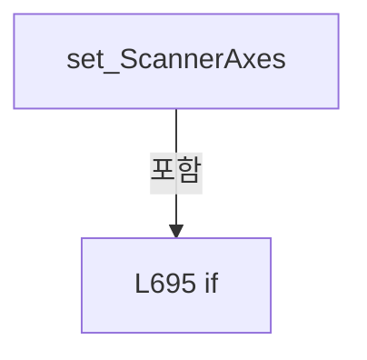

변경 전 점검: 입력/반환 타입, 위 호출자, 예외/취소 경로, 공유 상태와 저장·전송 소비자를 함께 확인합니다. 값의 단위나 물리 방향을 이름만으로 확정하지 않습니다.

### PropertyDeclaration `StageAxes` · L702–702

[Drilling.UI/Menu/Menus/CMenuManual.cs:702–702](https://github.com/kjuws10-rgb/A3Drilling/blob/96e22cd027c84bf302b23f2949b98985d7f301bb/Drilling.UI/Menu/Menus/CMenuManual.cs#L702-L702)

| 항목 | 실제 추출 값 |
| --- | --- |
| 서명 | System.Collections.Generic.IReadOnlyList<Drilling.UI.Menu.Menus.ST_MANUAL_STAGE_AXIS> Drilling.UI.Menu.Menus.CMenuManual.StageAxes |
| 접근/수식자 | Public / public |
| 반환/값 타입 | System.Collections.Generic.IReadOnlyList<Drilling.UI.Menu.Menus.ST_MANUAL_STAGE_AXIS> |
| 소속 타입 | NamedType:Drilling.UI.Menu.Menus.CMenuManual |

현재 부분 분석에서 직접 연결된 호출자는 없습니다. XAML/이벤트/인터페이스·델리게이트·외부 진입을 추가 확인해야 하며, 미사용으로 판정한 것이 아닙니다.

변경 전 점검: 입력/반환 타입, 위 호출자, 예외/취소 경로, 공유 상태와 저장·전송 소비자를 함께 확인합니다. 값의 단위나 물리 방향을 이름만으로 확정하지 않습니다.

### GetAccessorDeclaration `get_StageAxes` · L702–702

[Drilling.UI/Menu/Menus/CMenuManual.cs:702–702](https://github.com/kjuws10-rgb/A3Drilling/blob/96e22cd027c84bf302b23f2949b98985d7f301bb/Drilling.UI/Menu/Menus/CMenuManual.cs#L702-L702)

| 항목 | 실제 추출 값 |
| --- | --- |
| 서명 | System.Collections.Generic.IReadOnlyList<Drilling.UI.Menu.Menus.ST_MANUAL_STAGE_AXIS> Drilling.UI.Menu.Menus.CMenuManual.StageAxes.get |
| 접근/수식자 | Public / get |
| 반환/값 타입 | System.Collections.Generic.IReadOnlyList<Drilling.UI.Menu.Menus.ST_MANUAL_STAGE_AXIS> |
| 소속 타입 | NamedType:Drilling.UI.Menu.Menus.CMenuManual |

현재 부분 분석에서 직접 연결된 호출자는 없습니다. XAML/이벤트/인터페이스·델리게이트·외부 진입을 추가 확인해야 하며, 미사용으로 판정한 것이 아닙니다.

변경 전 점검: 입력/반환 타입, 위 호출자, 예외/취소 경로, 공유 상태와 저장·전송 소비자를 함께 확인합니다. 값의 단위나 물리 방향을 이름만으로 확정하지 않습니다.

### PropertyDeclaration `SelectedStageAxis` · L704–718

[Drilling.UI/Menu/Menus/CMenuManual.cs:704–718](https://github.com/kjuws10-rgb/A3Drilling/blob/96e22cd027c84bf302b23f2949b98985d7f301bb/Drilling.UI/Menu/Menus/CMenuManual.cs#L704-L718)

| 항목 | 실제 추출 값 |
| --- | --- |
| 서명 | Drilling.UI.Menu.Menus.ST_MANUAL_STAGE_AXIS Drilling.UI.Menu.Menus.CMenuManual.SelectedStageAxis |
| 접근/수식자 | Public / public |
| 반환/값 타입 | Drilling.UI.Menu.Menus.ST_MANUAL_STAGE_AXIS |
| 소속 타입 | NamedType:Drilling.UI.Menu.Menus.CMenuManual |

현재 부분 분석에서 직접 연결된 호출자는 없습니다. XAML/이벤트/인터페이스·델리게이트·외부 진입을 추가 확인해야 하며, 미사용으로 판정한 것이 아닙니다.

변경 전 점검: 입력/반환 타입, 위 호출자, 예외/취소 경로, 공유 상태와 저장·전송 소비자를 함께 확인합니다. 값의 단위나 물리 방향을 이름만으로 확정하지 않습니다.

### GetAccessorDeclaration `get_SelectedStageAxis` · L706–709

[Drilling.UI/Menu/Menus/CMenuManual.cs:706–709](https://github.com/kjuws10-rgb/A3Drilling/blob/96e22cd027c84bf302b23f2949b98985d7f301bb/Drilling.UI/Menu/Menus/CMenuManual.cs#L706-L709)

| 항목 | 실제 추출 값 |
| --- | --- |
| 서명 | Drilling.UI.Menu.Menus.ST_MANUAL_STAGE_AXIS Drilling.UI.Menu.Menus.CMenuManual.SelectedStageAxis.get |
| 접근/수식자 | Public / get |
| 반환/값 타입 | Drilling.UI.Menu.Menus.ST_MANUAL_STAGE_AXIS |
| 소속 타입 | NamedType:Drilling.UI.Menu.Menus.CMenuManual |

현재 부분 분석에서 직접 연결된 호출자는 없습니다. XAML/이벤트/인터페이스·델리게이트·외부 진입을 추가 확인해야 하며, 미사용으로 판정한 것이 아닙니다.

본문의 실제 연산·분기·예외·반환 순서(원문 위치 순):

| 원본 행 | 종류 | 주석 해설 |
| --- | --- | --- |
| 708 | return | 호출자에게 값 또는 제어를 반환합니다: return _selectedStageAxis; |

변경 전 점검: 입력/반환 타입, 위 호출자, 예외/취소 경로, 공유 상태와 저장·전송 소비자를 함께 확인합니다. 값의 단위나 물리 방향을 이름만으로 확정하지 않습니다.

### SetAccessorDeclaration `set_SelectedStageAxis` · L711–717

[Drilling.UI/Menu/Menus/CMenuManual.cs:711–717](https://github.com/kjuws10-rgb/A3Drilling/blob/96e22cd027c84bf302b23f2949b98985d7f301bb/Drilling.UI/Menu/Menus/CMenuManual.cs#L711-L717)

| 항목 | 실제 추출 값 |
| --- | --- |
| 서명 | void Drilling.UI.Menu.Menus.CMenuManual.SelectedStageAxis.set |
| 접근/수식자 | Private / private, set |
| 반환/값 타입 | void |
| 소속 타입 | NamedType:Drilling.UI.Menu.Menus.CMenuManual |

입력 계약:

| 이름 | 타입 | 전달 | 선택/기본값 |
| --- | --- | --- | --- |
| value | Drilling.UI.Menu.Menus.ST_MANUAL_STAGE_AXIS | None | False /  |

현재 부분 분석에서 직접 연결된 호출자는 없습니다. XAML/이벤트/인터페이스·델리게이트·외부 진입을 추가 확인해야 하며, 미사용으로 판정한 것이 아닙니다.

호출하는 대상과 해석 범위:

| 원본 행 | 표현식 | 분석 상태 | 대상/소스 위치 |
| --- | --- | --- | --- |
| 713 | SetProperty | resolved | bool Drilling.UI.Menu.CBindingBase.SetProperty<Drilling.UI.Menu.Menus.ST_MANUAL_STAGE_AXIS>(ref Drilling.UI.Menu.Menus.ST_MANUAL_STAGE_AXIS, Drilling.UI.Menu.Menus.ST_MANUAL_STAGE_AXIS, string?) · Drilling.UI/Menu/CBindingBase.cs:760 |
| 715 | RefreshStageAxisSelection | resolved | void Drilling.UI.Menu.Menus.CMenuManual.RefreshStageAxisSelection() · Drilling.UI/Menu/Menus/CMenuManual.cs:3952 |

본문의 실제 연산·분기·예외·반환 순서(원문 위치 순):

| 원본 행 | 종류 | 주석 해설 |
| --- | --- | --- |
| 713 | call | 함수·델리게이트 또는 객체 생성자를 호출합니다: SetProperty(ref _selectedStageAxis, value) |
| 713 | if | 조건에 따라 분기합니다: if (SetProperty(ref _selectedStageAxis, value)) |
| 715 | call | 함수·델리게이트 또는 객체 생성자를 호출합니다: RefreshStageAxisSelection() |

제어 구문의 포함 구조(실제 실행 순서/CFG가 아닌 구문 탐색 그림):

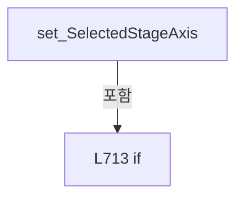

변경 전 점검: 입력/반환 타입, 위 호출자, 예외/취소 경로, 공유 상태와 저장·전송 소비자를 함께 확인합니다. 값의 단위나 물리 방향을 이름만으로 확정하지 않습니다.

### PropertyDeclaration `DioAddress` · L720–731

[Drilling.UI/Menu/Menus/CMenuManual.cs:720–731](https://github.com/kjuws10-rgb/A3Drilling/blob/96e22cd027c84bf302b23f2949b98985d7f301bb/Drilling.UI/Menu/Menus/CMenuManual.cs#L720-L731)

| 항목 | 실제 추출 값 |
| --- | --- |
| 서명 | string Drilling.UI.Menu.Menus.CMenuManual.DioAddress |
| 접근/수식자 | Public / public |
| 반환/값 타입 | string |
| 소속 타입 | NamedType:Drilling.UI.Menu.Menus.CMenuManual |

현재 부분 분석에서 직접 연결된 호출자는 없습니다. XAML/이벤트/인터페이스·델리게이트·외부 진입을 추가 확인해야 하며, 미사용으로 판정한 것이 아닙니다.

변경 전 점검: 입력/반환 타입, 위 호출자, 예외/취소 경로, 공유 상태와 저장·전송 소비자를 함께 확인합니다. 값의 단위나 물리 방향을 이름만으로 확정하지 않습니다.

### GetAccessorDeclaration `get_DioAddress` · L722–725

[Drilling.UI/Menu/Menus/CMenuManual.cs:722–725](https://github.com/kjuws10-rgb/A3Drilling/blob/96e22cd027c84bf302b23f2949b98985d7f301bb/Drilling.UI/Menu/Menus/CMenuManual.cs#L722-L725)

| 항목 | 실제 추출 값 |
| --- | --- |
| 서명 | string Drilling.UI.Menu.Menus.CMenuManual.DioAddress.get |
| 접근/수식자 | Public / get |
| 반환/값 타입 | string |
| 소속 타입 | NamedType:Drilling.UI.Menu.Menus.CMenuManual |

현재 부분 분석에서 직접 연결된 호출자는 없습니다. XAML/이벤트/인터페이스·델리게이트·외부 진입을 추가 확인해야 하며, 미사용으로 판정한 것이 아닙니다.

본문의 실제 연산·분기·예외·반환 순서(원문 위치 순):

| 원본 행 | 종류 | 주석 해설 |
| --- | --- | --- |
| 724 | return | 호출자에게 값 또는 제어를 반환합니다: return _dioAddress; |

변경 전 점검: 입력/반환 타입, 위 호출자, 예외/취소 경로, 공유 상태와 저장·전송 소비자를 함께 확인합니다. 값의 단위나 물리 방향을 이름만으로 확정하지 않습니다.

### SetAccessorDeclaration `set_DioAddress` · L727–730

[Drilling.UI/Menu/Menus/CMenuManual.cs:727–730](https://github.com/kjuws10-rgb/A3Drilling/blob/96e22cd027c84bf302b23f2949b98985d7f301bb/Drilling.UI/Menu/Menus/CMenuManual.cs#L727-L730)

| 항목 | 실제 추출 값 |
| --- | --- |
| 서명 | void Drilling.UI.Menu.Menus.CMenuManual.DioAddress.set |
| 접근/수식자 | Private / private, set |
| 반환/값 타입 | void |
| 소속 타입 | NamedType:Drilling.UI.Menu.Menus.CMenuManual |

입력 계약:

| 이름 | 타입 | 전달 | 선택/기본값 |
| --- | --- | --- | --- |
| value | string | None | False /  |

현재 부분 분석에서 직접 연결된 호출자는 없습니다. XAML/이벤트/인터페이스·델리게이트·외부 진입을 추가 확인해야 하며, 미사용으로 판정한 것이 아닙니다.

호출하는 대상과 해석 범위:

| 원본 행 | 표현식 | 분석 상태 | 대상/소스 위치 |
| --- | --- | --- | --- |
| 729 | SetProperty | resolved | bool Drilling.UI.Menu.CBindingBase.SetProperty<string>(ref string, string, string?) · Drilling.UI/Menu/CBindingBase.cs:760 |

본문의 실제 연산·분기·예외·반환 순서(원문 위치 순):

| 원본 행 | 종류 | 주석 해설 |
| --- | --- | --- |
| 729 | call | 함수·델리게이트 또는 객체 생성자를 호출합니다: SetProperty(ref _dioAddress, value) |

변경 전 점검: 입력/반환 타입, 위 호출자, 예외/취소 경로, 공유 상태와 저장·전송 소비자를 함께 확인합니다. 값의 단위나 물리 방향을 이름만으로 확정하지 않습니다.

### PropertyDeclaration `DioAxisName` · L733–744

[Drilling.UI/Menu/Menus/CMenuManual.cs:733–744](https://github.com/kjuws10-rgb/A3Drilling/blob/96e22cd027c84bf302b23f2949b98985d7f301bb/Drilling.UI/Menu/Menus/CMenuManual.cs#L733-L744)

| 항목 | 실제 추출 값 |
| --- | --- |
| 서명 | string Drilling.UI.Menu.Menus.CMenuManual.DioAxisName |
| 접근/수식자 | Public / public |
| 반환/값 타입 | string |
| 소속 타입 | NamedType:Drilling.UI.Menu.Menus.CMenuManual |

현재 부분 분석에서 직접 연결된 호출자는 없습니다. XAML/이벤트/인터페이스·델리게이트·외부 진입을 추가 확인해야 하며, 미사용으로 판정한 것이 아닙니다.

변경 전 점검: 입력/반환 타입, 위 호출자, 예외/취소 경로, 공유 상태와 저장·전송 소비자를 함께 확인합니다. 값의 단위나 물리 방향을 이름만으로 확정하지 않습니다.

### GetAccessorDeclaration `get_DioAxisName` · L735–738

[Drilling.UI/Menu/Menus/CMenuManual.cs:735–738](https://github.com/kjuws10-rgb/A3Drilling/blob/96e22cd027c84bf302b23f2949b98985d7f301bb/Drilling.UI/Menu/Menus/CMenuManual.cs#L735-L738)

| 항목 | 실제 추출 값 |
| --- | --- |
| 서명 | string Drilling.UI.Menu.Menus.CMenuManual.DioAxisName.get |
| 접근/수식자 | Public / get |
| 반환/값 타입 | string |
| 소속 타입 | NamedType:Drilling.UI.Menu.Menus.CMenuManual |

현재 부분 분석에서 직접 연결된 호출자는 없습니다. XAML/이벤트/인터페이스·델리게이트·외부 진입을 추가 확인해야 하며, 미사용으로 판정한 것이 아닙니다.

본문의 실제 연산·분기·예외·반환 순서(원문 위치 순):

| 원본 행 | 종류 | 주석 해설 |
| --- | --- | --- |
| 737 | return | 호출자에게 값 또는 제어를 반환합니다: return _dioAxisName; |

변경 전 점검: 입력/반환 타입, 위 호출자, 예외/취소 경로, 공유 상태와 저장·전송 소비자를 함께 확인합니다. 값의 단위나 물리 방향을 이름만으로 확정하지 않습니다.

### SetAccessorDeclaration `set_DioAxisName` · L740–743

[Drilling.UI/Menu/Menus/CMenuManual.cs:740–743](https://github.com/kjuws10-rgb/A3Drilling/blob/96e22cd027c84bf302b23f2949b98985d7f301bb/Drilling.UI/Menu/Menus/CMenuManual.cs#L740-L743)

| 항목 | 실제 추출 값 |
| --- | --- |
| 서명 | void Drilling.UI.Menu.Menus.CMenuManual.DioAxisName.set |
| 접근/수식자 | Private / private, set |
| 반환/값 타입 | void |
| 소속 타입 | NamedType:Drilling.UI.Menu.Menus.CMenuManual |

입력 계약:

| 이름 | 타입 | 전달 | 선택/기본값 |
| --- | --- | --- | --- |
| value | string | None | False /  |

현재 부분 분석에서 직접 연결된 호출자는 없습니다. XAML/이벤트/인터페이스·델리게이트·외부 진입을 추가 확인해야 하며, 미사용으로 판정한 것이 아닙니다.

호출하는 대상과 해석 범위:

| 원본 행 | 표현식 | 분석 상태 | 대상/소스 위치 |
| --- | --- | --- | --- |
| 742 | SetProperty | resolved | bool Drilling.UI.Menu.CBindingBase.SetProperty<string>(ref string, string, string?) · Drilling.UI/Menu/CBindingBase.cs:760 |

본문의 실제 연산·분기·예외·반환 순서(원문 위치 순):

| 원본 행 | 종류 | 주석 해설 |
| --- | --- | --- |
| 742 | call | 함수·델리게이트 또는 객체 생성자를 호출합니다: SetProperty(ref _dioAxisName, value) |

변경 전 점검: 입력/반환 타입, 위 호출자, 예외/취소 경로, 공유 상태와 저장·전송 소비자를 함께 확인합니다. 값의 단위나 물리 방향을 이름만으로 확정하지 않습니다.

### PropertyDeclaration `DioNo` · L746–757

[Drilling.UI/Menu/Menus/CMenuManual.cs:746–757](https://github.com/kjuws10-rgb/A3Drilling/blob/96e22cd027c84bf302b23f2949b98985d7f301bb/Drilling.UI/Menu/Menus/CMenuManual.cs#L746-L757)

| 항목 | 실제 추출 값 |
| --- | --- |
| 서명 | string Drilling.UI.Menu.Menus.CMenuManual.DioNo |
| 접근/수식자 | Public / public |
| 반환/값 타입 | string |
| 소속 타입 | NamedType:Drilling.UI.Menu.Menus.CMenuManual |

현재 부분 분석에서 직접 연결된 호출자는 없습니다. XAML/이벤트/인터페이스·델리게이트·외부 진입을 추가 확인해야 하며, 미사용으로 판정한 것이 아닙니다.

변경 전 점검: 입력/반환 타입, 위 호출자, 예외/취소 경로, 공유 상태와 저장·전송 소비자를 함께 확인합니다. 값의 단위나 물리 방향을 이름만으로 확정하지 않습니다.

### GetAccessorDeclaration `get_DioNo` · L748–751

[Drilling.UI/Menu/Menus/CMenuManual.cs:748–751](https://github.com/kjuws10-rgb/A3Drilling/blob/96e22cd027c84bf302b23f2949b98985d7f301bb/Drilling.UI/Menu/Menus/CMenuManual.cs#L748-L751)

| 항목 | 실제 추출 값 |
| --- | --- |
| 서명 | string Drilling.UI.Menu.Menus.CMenuManual.DioNo.get |
| 접근/수식자 | Public / get |
| 반환/값 타입 | string |
| 소속 타입 | NamedType:Drilling.UI.Menu.Menus.CMenuManual |

현재 부분 분석에서 직접 연결된 호출자는 없습니다. XAML/이벤트/인터페이스·델리게이트·외부 진입을 추가 확인해야 하며, 미사용으로 판정한 것이 아닙니다.

본문의 실제 연산·분기·예외·반환 순서(원문 위치 순):

| 원본 행 | 종류 | 주석 해설 |
| --- | --- | --- |
| 750 | return | 호출자에게 값 또는 제어를 반환합니다: return _dioNo; |

변경 전 점검: 입력/반환 타입, 위 호출자, 예외/취소 경로, 공유 상태와 저장·전송 소비자를 함께 확인합니다. 값의 단위나 물리 방향을 이름만으로 확정하지 않습니다.

### SetAccessorDeclaration `set_DioNo` · L753–756

[Drilling.UI/Menu/Menus/CMenuManual.cs:753–756](https://github.com/kjuws10-rgb/A3Drilling/blob/96e22cd027c84bf302b23f2949b98985d7f301bb/Drilling.UI/Menu/Menus/CMenuManual.cs#L753-L756)

| 항목 | 실제 추출 값 |
| --- | --- |
| 서명 | void Drilling.UI.Menu.Menus.CMenuManual.DioNo.set |
| 접근/수식자 | Private / private, set |
| 반환/값 타입 | void |
| 소속 타입 | NamedType:Drilling.UI.Menu.Menus.CMenuManual |

입력 계약:

| 이름 | 타입 | 전달 | 선택/기본값 |
| --- | --- | --- | --- |
| value | string | None | False /  |

현재 부분 분석에서 직접 연결된 호출자는 없습니다. XAML/이벤트/인터페이스·델리게이트·외부 진입을 추가 확인해야 하며, 미사용으로 판정한 것이 아닙니다.

호출하는 대상과 해석 범위:

| 원본 행 | 표현식 | 분석 상태 | 대상/소스 위치 |
| --- | --- | --- | --- |
| 755 | SetProperty | resolved | bool Drilling.UI.Menu.CBindingBase.SetProperty<string>(ref string, string, string?) · Drilling.UI/Menu/CBindingBase.cs:760 |

본문의 실제 연산·분기·예외·반환 순서(원문 위치 순):

| 원본 행 | 종류 | 주석 해설 |
| --- | --- | --- |
| 755 | call | 함수·델리게이트 또는 객체 생성자를 호출합니다: SetProperty(ref _dioNo, value) |

변경 전 점검: 입력/반환 타입, 위 호출자, 예외/취소 경로, 공유 상태와 저장·전송 소비자를 함께 확인합니다. 값의 단위나 물리 방향을 이름만으로 확정하지 않습니다.

### PropertyDeclaration `DioCurrentValue` · L759–774

[Drilling.UI/Menu/Menus/CMenuManual.cs:759–774](https://github.com/kjuws10-rgb/A3Drilling/blob/96e22cd027c84bf302b23f2949b98985d7f301bb/Drilling.UI/Menu/Menus/CMenuManual.cs#L759-L774)

| 항목 | 실제 추출 값 |
| --- | --- |
| 서명 | string Drilling.UI.Menu.Menus.CMenuManual.DioCurrentValue |
| 접근/수식자 | Public / public |
| 반환/값 타입 | string |
| 소속 타입 | NamedType:Drilling.UI.Menu.Menus.CMenuManual |

현재 부분 분석에서 직접 연결된 호출자는 없습니다. XAML/이벤트/인터페이스·델리게이트·외부 진입을 추가 확인해야 하며, 미사용으로 판정한 것이 아닙니다.

변경 전 점검: 입력/반환 타입, 위 호출자, 예외/취소 경로, 공유 상태와 저장·전송 소비자를 함께 확인합니다. 값의 단위나 물리 방향을 이름만으로 확정하지 않습니다.

### GetAccessorDeclaration `get_DioCurrentValue` · L761–764

[Drilling.UI/Menu/Menus/CMenuManual.cs:761–764](https://github.com/kjuws10-rgb/A3Drilling/blob/96e22cd027c84bf302b23f2949b98985d7f301bb/Drilling.UI/Menu/Menus/CMenuManual.cs#L761-L764)

| 항목 | 실제 추출 값 |
| --- | --- |
| 서명 | string Drilling.UI.Menu.Menus.CMenuManual.DioCurrentValue.get |
| 접근/수식자 | Public / get |
| 반환/값 타입 | string |
| 소속 타입 | NamedType:Drilling.UI.Menu.Menus.CMenuManual |

현재 부분 분석에서 직접 연결된 호출자는 없습니다. XAML/이벤트/인터페이스·델리게이트·외부 진입을 추가 확인해야 하며, 미사용으로 판정한 것이 아닙니다.

본문의 실제 연산·분기·예외·반환 순서(원문 위치 순):

| 원본 행 | 종류 | 주석 해설 |
| --- | --- | --- |
| 763 | return | 호출자에게 값 또는 제어를 반환합니다: return _dioCurrentValue; |

변경 전 점검: 입력/반환 타입, 위 호출자, 예외/취소 경로, 공유 상태와 저장·전송 소비자를 함께 확인합니다. 값의 단위나 물리 방향을 이름만으로 확정하지 않습니다.

### SetAccessorDeclaration `set_DioCurrentValue` · L766–773

[Drilling.UI/Menu/Menus/CMenuManual.cs:766–773](https://github.com/kjuws10-rgb/A3Drilling/blob/96e22cd027c84bf302b23f2949b98985d7f301bb/Drilling.UI/Menu/Menus/CMenuManual.cs#L766-L773)

| 항목 | 실제 추출 값 |
| --- | --- |
| 서명 | void Drilling.UI.Menu.Menus.CMenuManual.DioCurrentValue.set |
| 접근/수식자 | Private / private, set |
| 반환/값 타입 | void |
| 소속 타입 | NamedType:Drilling.UI.Menu.Menus.CMenuManual |

입력 계약:

| 이름 | 타입 | 전달 | 선택/기본값 |
| --- | --- | --- | --- |
| value | string | None | False /  |

현재 부분 분석에서 직접 연결된 호출자는 없습니다. XAML/이벤트/인터페이스·델리게이트·외부 진입을 추가 확인해야 하며, 미사용으로 판정한 것이 아닙니다.

호출하는 대상과 해석 범위:

| 원본 행 | 표현식 | 분석 상태 | 대상/소스 위치 |
| --- | --- | --- | --- |
| 768 | SetProperty | resolved | bool Drilling.UI.Menu.CBindingBase.SetProperty<string>(ref string, string, string?) · Drilling.UI/Menu/CBindingBase.cs:760 |
| 770 | OnPropertyChanged | resolved | void Drilling.UI.Menu.CBindingBase.OnPropertyChanged(string?) · Drilling.UI/Menu/CBindingBase.cs:784 |
| 770 | nameof | unresolved | None |
| 771 | OnPropertyChanged | resolved | void Drilling.UI.Menu.CBindingBase.OnPropertyChanged(string?) · Drilling.UI/Menu/CBindingBase.cs:784 |
| 771 | nameof | unresolved | None |

본문의 실제 연산·분기·예외·반환 순서(원문 위치 순):

| 원본 행 | 종류 | 주석 해설 |
| --- | --- | --- |
| 768 | call | 함수·델리게이트 또는 객체 생성자를 호출합니다: SetProperty(ref _dioCurrentValue, value) |
| 768 | if | 조건에 따라 분기합니다: if (SetProperty(ref _dioCurrentValue, value)) |
| 770 | call | 함수·델리게이트 또는 객체 생성자를 호출합니다: OnPropertyChanged(nameof(IsDioOn)) |
| 770 | call | 함수·델리게이트 또는 객체 생성자를 호출합니다: nameof(IsDioOn) |
| 771 | call | 함수·델리게이트 또는 객체 생성자를 호출합니다: OnPropertyChanged(nameof(IsDioOff)) |
| 771 | call | 함수·델리게이트 또는 객체 생성자를 호출합니다: nameof(IsDioOff) |

제어 구문의 포함 구조(실제 실행 순서/CFG가 아닌 구문 탐색 그림):


변경 전 점검: 입력/반환 타입, 위 호출자, 예외/취소 경로, 공유 상태와 저장·전송 소비자를 함께 확인합니다. 값의 단위나 물리 방향을 이름만으로 확정하지 않습니다.

### PropertyDeclaration `IsDioOn` · L776–782

[Drilling.UI/Menu/Menus/CMenuManual.cs:776–782](https://github.com/kjuws10-rgb/A3Drilling/blob/96e22cd027c84bf302b23f2949b98985d7f301bb/Drilling.UI/Menu/Menus/CMenuManual.cs#L776-L782)

| 항목 | 실제 추출 값 |
| --- | --- |
| 서명 | bool Drilling.UI.Menu.Menus.CMenuManual.IsDioOn |
| 접근/수식자 | Public / public |
| 반환/값 타입 | bool |
| 소속 타입 | NamedType:Drilling.UI.Menu.Menus.CMenuManual |

현재 부분 분석에서 직접 연결된 호출자는 없습니다. XAML/이벤트/인터페이스·델리게이트·외부 진입을 추가 확인해야 하며, 미사용으로 판정한 것이 아닙니다.

변경 전 점검: 입력/반환 타입, 위 호출자, 예외/취소 경로, 공유 상태와 저장·전송 소비자를 함께 확인합니다. 값의 단위나 물리 방향을 이름만으로 확정하지 않습니다.

### GetAccessorDeclaration `get_IsDioOn` · L778–781

[Drilling.UI/Menu/Menus/CMenuManual.cs:778–781](https://github.com/kjuws10-rgb/A3Drilling/blob/96e22cd027c84bf302b23f2949b98985d7f301bb/Drilling.UI/Menu/Menus/CMenuManual.cs#L778-L781)

| 항목 | 실제 추출 값 |
| --- | --- |
| 서명 | bool Drilling.UI.Menu.Menus.CMenuManual.IsDioOn.get |
| 접근/수식자 | Public / get |
| 반환/값 타입 | bool |
| 소속 타입 | NamedType:Drilling.UI.Menu.Menus.CMenuManual |

현재 부분 분석에서 직접 연결된 호출자는 없습니다. XAML/이벤트/인터페이스·델리게이트·외부 진입을 추가 확인해야 하며, 미사용으로 판정한 것이 아닙니다.

호출하는 대상과 해석 범위:

| 원본 행 | 표현식 | 분석 상태 | 대상/소스 위치 |
| --- | --- | --- | --- |
| 780 | DioCurrentValue.Equals | resolved | bool string.Equals(string?, System.StringComparison) |

본문의 실제 연산·분기·예외·반환 순서(원문 위치 순):

| 원본 행 | 종류 | 주석 해설 |
| --- | --- | --- |
| 780 | call | 함수·델리게이트 또는 객체 생성자를 호출합니다: DioCurrentValue.Equals("ON", StringComparison.OrdinalIgnoreCase) |
| 780 | return | 호출자에게 값 또는 제어를 반환합니다: return DioCurrentValue.Equals("ON", StringComparison.OrdinalIgnoreCase); |

변경 전 점검: 입력/반환 타입, 위 호출자, 예외/취소 경로, 공유 상태와 저장·전송 소비자를 함께 확인합니다. 값의 단위나 물리 방향을 이름만으로 확정하지 않습니다.

### PropertyDeclaration `IsDioOff` · L784–790

[Drilling.UI/Menu/Menus/CMenuManual.cs:784–790](https://github.com/kjuws10-rgb/A3Drilling/blob/96e22cd027c84bf302b23f2949b98985d7f301bb/Drilling.UI/Menu/Menus/CMenuManual.cs#L784-L790)

| 항목 | 실제 추출 값 |
| --- | --- |
| 서명 | bool Drilling.UI.Menu.Menus.CMenuManual.IsDioOff |
| 접근/수식자 | Public / public |
| 반환/값 타입 | bool |
| 소속 타입 | NamedType:Drilling.UI.Menu.Menus.CMenuManual |

현재 부분 분석에서 직접 연결된 호출자는 없습니다. XAML/이벤트/인터페이스·델리게이트·외부 진입을 추가 확인해야 하며, 미사용으로 판정한 것이 아닙니다.

변경 전 점검: 입력/반환 타입, 위 호출자, 예외/취소 경로, 공유 상태와 저장·전송 소비자를 함께 확인합니다. 값의 단위나 물리 방향을 이름만으로 확정하지 않습니다.

### GetAccessorDeclaration `get_IsDioOff` · L786–789

[Drilling.UI/Menu/Menus/CMenuManual.cs:786–789](https://github.com/kjuws10-rgb/A3Drilling/blob/96e22cd027c84bf302b23f2949b98985d7f301bb/Drilling.UI/Menu/Menus/CMenuManual.cs#L786-L789)

| 항목 | 실제 추출 값 |
| --- | --- |
| 서명 | bool Drilling.UI.Menu.Menus.CMenuManual.IsDioOff.get |
| 접근/수식자 | Public / get |
| 반환/값 타입 | bool |
| 소속 타입 | NamedType:Drilling.UI.Menu.Menus.CMenuManual |

현재 부분 분석에서 직접 연결된 호출자는 없습니다. XAML/이벤트/인터페이스·델리게이트·외부 진입을 추가 확인해야 하며, 미사용으로 판정한 것이 아닙니다.

호출하는 대상과 해석 범위:

| 원본 행 | 표현식 | 분석 상태 | 대상/소스 위치 |
| --- | --- | --- | --- |
| 788 | DioCurrentValue.Equals | resolved | bool string.Equals(string?, System.StringComparison) |

본문의 실제 연산·분기·예외·반환 순서(원문 위치 순):

| 원본 행 | 종류 | 주석 해설 |
| --- | --- | --- |
| 788 | call | 함수·델리게이트 또는 객체 생성자를 호출합니다: DioCurrentValue.Equals("OFF", StringComparison.OrdinalIgnoreCase) |
| 788 | return | 호출자에게 값 또는 제어를 반환합니다: return DioCurrentValue.Equals("OFF", StringComparison.OrdinalIgnoreCase); |

변경 전 점검: 입력/반환 타입, 위 호출자, 예외/취소 경로, 공유 상태와 저장·전송 소비자를 함께 확인합니다. 값의 단위나 물리 방향을 이름만으로 확정하지 않습니다.

### PropertyDeclaration `IsDioTargetReady` · L792–806

[Drilling.UI/Menu/Menus/CMenuManual.cs:792–806](https://github.com/kjuws10-rgb/A3Drilling/blob/96e22cd027c84bf302b23f2949b98985d7f301bb/Drilling.UI/Menu/Menus/CMenuManual.cs#L792-L806)

| 항목 | 실제 추출 값 |
| --- | --- |
| 서명 | bool Drilling.UI.Menu.Menus.CMenuManual.IsDioTargetReady |
| 접근/수식자 | Public / public |
| 반환/값 타입 | bool |
| 소속 타입 | NamedType:Drilling.UI.Menu.Menus.CMenuManual |

현재 부분 분석에서 직접 연결된 호출자는 없습니다. XAML/이벤트/인터페이스·델리게이트·외부 진입을 추가 확인해야 하며, 미사용으로 판정한 것이 아닙니다.

변경 전 점검: 입력/반환 타입, 위 호출자, 예외/취소 경로, 공유 상태와 저장·전송 소비자를 함께 확인합니다. 값의 단위나 물리 방향을 이름만으로 확정하지 않습니다.

### GetAccessorDeclaration `get_IsDioTargetReady` · L794–797

[Drilling.UI/Menu/Menus/CMenuManual.cs:794–797](https://github.com/kjuws10-rgb/A3Drilling/blob/96e22cd027c84bf302b23f2949b98985d7f301bb/Drilling.UI/Menu/Menus/CMenuManual.cs#L794-L797)

| 항목 | 실제 추출 값 |
| --- | --- |
| 서명 | bool Drilling.UI.Menu.Menus.CMenuManual.IsDioTargetReady.get |
| 접근/수식자 | Public / get |
| 반환/값 타입 | bool |
| 소속 타입 | NamedType:Drilling.UI.Menu.Menus.CMenuManual |

현재 부분 분석에서 직접 연결된 호출자는 없습니다. XAML/이벤트/인터페이스·델리게이트·외부 진입을 추가 확인해야 하며, 미사용으로 판정한 것이 아닙니다.

본문의 실제 연산·분기·예외·반환 순서(원문 위치 순):

| 원본 행 | 종류 | 주석 해설 |
| --- | --- | --- |
| 796 | return | 호출자에게 값 또는 제어를 반환합니다: return _isDioTargetReady; |

변경 전 점검: 입력/반환 타입, 위 호출자, 예외/취소 경로, 공유 상태와 저장·전송 소비자를 함께 확인합니다. 값의 단위나 물리 방향을 이름만으로 확정하지 않습니다.

### SetAccessorDeclaration `set_IsDioTargetReady` · L799–805

[Drilling.UI/Menu/Menus/CMenuManual.cs:799–805](https://github.com/kjuws10-rgb/A3Drilling/blob/96e22cd027c84bf302b23f2949b98985d7f301bb/Drilling.UI/Menu/Menus/CMenuManual.cs#L799-L805)

| 항목 | 실제 추출 값 |
| --- | --- |
| 서명 | void Drilling.UI.Menu.Menus.CMenuManual.IsDioTargetReady.set |
| 접근/수식자 | Private / private, set |
| 반환/값 타입 | void |
| 소속 타입 | NamedType:Drilling.UI.Menu.Menus.CMenuManual |

입력 계약:

| 이름 | 타입 | 전달 | 선택/기본값 |
| --- | --- | --- | --- |
| value | bool | None | False /  |

현재 부분 분석에서 직접 연결된 호출자는 없습니다. XAML/이벤트/인터페이스·델리게이트·외부 진입을 추가 확인해야 하며, 미사용으로 판정한 것이 아닙니다.

호출하는 대상과 해석 범위:

| 원본 행 | 표현식 | 분석 상태 | 대상/소스 위치 |
| --- | --- | --- | --- |
| 801 | SetProperty | resolved | bool Drilling.UI.Menu.CBindingBase.SetProperty<bool>(ref bool, bool, string?) · Drilling.UI/Menu/CBindingBase.cs:760 |
| 803 | OnPropertyChanged | resolved | void Drilling.UI.Menu.CBindingBase.OnPropertyChanged(string?) · Drilling.UI/Menu/CBindingBase.cs:784 |
| 803 | nameof | unresolved | None |

본문의 실제 연산·분기·예외·반환 순서(원문 위치 순):

| 원본 행 | 종류 | 주석 해설 |
| --- | --- | --- |
| 801 | call | 함수·델리게이트 또는 객체 생성자를 호출합니다: SetProperty(ref _isDioTargetReady, value) |
| 801 | if | 조건에 따라 분기합니다: if (SetProperty(ref _isDioTargetReady, value)) |
| 803 | call | 함수·델리게이트 또는 객체 생성자를 호출합니다: OnPropertyChanged(nameof(IsDioControlEnabled)) |
| 803 | call | 함수·델리게이트 또는 객체 생성자를 호출합니다: nameof(IsDioControlEnabled) |

제어 구문의 포함 구조(실제 실행 순서/CFG가 아닌 구문 탐색 그림):


변경 전 점검: 입력/반환 타입, 위 호출자, 예외/취소 경로, 공유 상태와 저장·전송 소비자를 함께 확인합니다. 값의 단위나 물리 방향을 이름만으로 확정하지 않습니다.

### PropertyDeclaration `IsDioControlEnabled` · L808–814

[Drilling.UI/Menu/Menus/CMenuManual.cs:808–814](https://github.com/kjuws10-rgb/A3Drilling/blob/96e22cd027c84bf302b23f2949b98985d7f301bb/Drilling.UI/Menu/Menus/CMenuManual.cs#L808-L814)

| 항목 | 실제 추출 값 |
| --- | --- |
| 서명 | bool Drilling.UI.Menu.Menus.CMenuManual.IsDioControlEnabled |
| 접근/수식자 | Public / public |
| 반환/값 타입 | bool |
| 소속 타입 | NamedType:Drilling.UI.Menu.Menus.CMenuManual |

현재 부분 분석에서 직접 연결된 호출자는 없습니다. XAML/이벤트/인터페이스·델리게이트·외부 진입을 추가 확인해야 하며, 미사용으로 판정한 것이 아닙니다.

변경 전 점검: 입력/반환 타입, 위 호출자, 예외/취소 경로, 공유 상태와 저장·전송 소비자를 함께 확인합니다. 값의 단위나 물리 방향을 이름만으로 확정하지 않습니다.

### GetAccessorDeclaration `get_IsDioControlEnabled` · L810–813

[Drilling.UI/Menu/Menus/CMenuManual.cs:810–813](https://github.com/kjuws10-rgb/A3Drilling/blob/96e22cd027c84bf302b23f2949b98985d7f301bb/Drilling.UI/Menu/Menus/CMenuManual.cs#L810-L813)

| 항목 | 실제 추출 값 |
| --- | --- |
| 서명 | bool Drilling.UI.Menu.Menus.CMenuManual.IsDioControlEnabled.get |
| 접근/수식자 | Public / get |
| 반환/값 타입 | bool |
| 소속 타입 | NamedType:Drilling.UI.Menu.Menus.CMenuManual |

현재 부분 분석에서 직접 연결된 호출자는 없습니다. XAML/이벤트/인터페이스·델리게이트·외부 진입을 추가 확인해야 하며, 미사용으로 판정한 것이 아닙니다.

본문의 실제 연산·분기·예외·반환 순서(원문 위치 순):

| 원본 행 | 종류 | 주석 해설 |
| --- | --- | --- |
| 812 | return | 호출자에게 값 또는 제어를 반환합니다: return IsDioTargetReady && !IsDioControlBusy; |

변경 전 점검: 입력/반환 타입, 위 호출자, 예외/취소 경로, 공유 상태와 저장·전송 소비자를 함께 확인합니다. 값의 단위나 물리 방향을 이름만으로 확정하지 않습니다.

### PropertyDeclaration `DioLastResult` · L816–827

[Drilling.UI/Menu/Menus/CMenuManual.cs:816–827](https://github.com/kjuws10-rgb/A3Drilling/blob/96e22cd027c84bf302b23f2949b98985d7f301bb/Drilling.UI/Menu/Menus/CMenuManual.cs#L816-L827)

| 항목 | 실제 추출 값 |
| --- | --- |
| 서명 | string Drilling.UI.Menu.Menus.CMenuManual.DioLastResult |
| 접근/수식자 | Public / public |
| 반환/값 타입 | string |
| 소속 타입 | NamedType:Drilling.UI.Menu.Menus.CMenuManual |

현재 부분 분석에서 직접 연결된 호출자는 없습니다. XAML/이벤트/인터페이스·델리게이트·외부 진입을 추가 확인해야 하며, 미사용으로 판정한 것이 아닙니다.

변경 전 점검: 입력/반환 타입, 위 호출자, 예외/취소 경로, 공유 상태와 저장·전송 소비자를 함께 확인합니다. 값의 단위나 물리 방향을 이름만으로 확정하지 않습니다.

### GetAccessorDeclaration `get_DioLastResult` · L818–821

[Drilling.UI/Menu/Menus/CMenuManual.cs:818–821](https://github.com/kjuws10-rgb/A3Drilling/blob/96e22cd027c84bf302b23f2949b98985d7f301bb/Drilling.UI/Menu/Menus/CMenuManual.cs#L818-L821)

| 항목 | 실제 추출 값 |
| --- | --- |
| 서명 | string Drilling.UI.Menu.Menus.CMenuManual.DioLastResult.get |
| 접근/수식자 | Public / get |
| 반환/값 타입 | string |
| 소속 타입 | NamedType:Drilling.UI.Menu.Menus.CMenuManual |

현재 부분 분석에서 직접 연결된 호출자는 없습니다. XAML/이벤트/인터페이스·델리게이트·외부 진입을 추가 확인해야 하며, 미사용으로 판정한 것이 아닙니다.

본문의 실제 연산·분기·예외·반환 순서(원문 위치 순):

| 원본 행 | 종류 | 주석 해설 |
| --- | --- | --- |
| 820 | return | 호출자에게 값 또는 제어를 반환합니다: return _dioLastResult; |

변경 전 점검: 입력/반환 타입, 위 호출자, 예외/취소 경로, 공유 상태와 저장·전송 소비자를 함께 확인합니다. 값의 단위나 물리 방향을 이름만으로 확정하지 않습니다.

### SetAccessorDeclaration `set_DioLastResult` · L823–826

[Drilling.UI/Menu/Menus/CMenuManual.cs:823–826](https://github.com/kjuws10-rgb/A3Drilling/blob/96e22cd027c84bf302b23f2949b98985d7f301bb/Drilling.UI/Menu/Menus/CMenuManual.cs#L823-L826)

| 항목 | 실제 추출 값 |
| --- | --- |
| 서명 | void Drilling.UI.Menu.Menus.CMenuManual.DioLastResult.set |
| 접근/수식자 | Private / private, set |
| 반환/값 타입 | void |
| 소속 타입 | NamedType:Drilling.UI.Menu.Menus.CMenuManual |

입력 계약:

| 이름 | 타입 | 전달 | 선택/기본값 |
| --- | --- | --- | --- |
| value | string | None | False /  |

현재 부분 분석에서 직접 연결된 호출자는 없습니다. XAML/이벤트/인터페이스·델리게이트·외부 진입을 추가 확인해야 하며, 미사용으로 판정한 것이 아닙니다.

호출하는 대상과 해석 범위:

| 원본 행 | 표현식 | 분석 상태 | 대상/소스 위치 |
| --- | --- | --- | --- |
| 825 | SetProperty | resolved | bool Drilling.UI.Menu.CBindingBase.SetProperty<string>(ref string, string, string?) · Drilling.UI/Menu/CBindingBase.cs:760 |

본문의 실제 연산·분기·예외·반환 순서(원문 위치 순):

| 원본 행 | 종류 | 주석 해설 |
| --- | --- | --- |
| 825 | call | 함수·델리게이트 또는 객체 생성자를 호출합니다: SetProperty(ref _dioLastResult, value) |

변경 전 점검: 입력/반환 타입, 위 호출자, 예외/취소 경로, 공유 상태와 저장·전송 소비자를 함께 확인합니다. 값의 단위나 물리 방향을 이름만으로 확정하지 않습니다.

### PropertyDeclaration `IsDioControlBusy` · L829–843

[Drilling.UI/Menu/Menus/CMenuManual.cs:829–843](https://github.com/kjuws10-rgb/A3Drilling/blob/96e22cd027c84bf302b23f2949b98985d7f301bb/Drilling.UI/Menu/Menus/CMenuManual.cs#L829-L843)

| 항목 | 실제 추출 값 |
| --- | --- |
| 서명 | bool Drilling.UI.Menu.Menus.CMenuManual.IsDioControlBusy |
| 접근/수식자 | Public / public |
| 반환/값 타입 | bool |
| 소속 타입 | NamedType:Drilling.UI.Menu.Menus.CMenuManual |

현재 부분 분석에서 직접 연결된 호출자는 없습니다. XAML/이벤트/인터페이스·델리게이트·외부 진입을 추가 확인해야 하며, 미사용으로 판정한 것이 아닙니다.

변경 전 점검: 입력/반환 타입, 위 호출자, 예외/취소 경로, 공유 상태와 저장·전송 소비자를 함께 확인합니다. 값의 단위나 물리 방향을 이름만으로 확정하지 않습니다.

### GetAccessorDeclaration `get_IsDioControlBusy` · L831–834

[Drilling.UI/Menu/Menus/CMenuManual.cs:831–834](https://github.com/kjuws10-rgb/A3Drilling/blob/96e22cd027c84bf302b23f2949b98985d7f301bb/Drilling.UI/Menu/Menus/CMenuManual.cs#L831-L834)

| 항목 | 실제 추출 값 |
| --- | --- |
| 서명 | bool Drilling.UI.Menu.Menus.CMenuManual.IsDioControlBusy.get |
| 접근/수식자 | Public / get |
| 반환/값 타입 | bool |
| 소속 타입 | NamedType:Drilling.UI.Menu.Menus.CMenuManual |

현재 부분 분석에서 직접 연결된 호출자는 없습니다. XAML/이벤트/인터페이스·델리게이트·외부 진입을 추가 확인해야 하며, 미사용으로 판정한 것이 아닙니다.

본문의 실제 연산·분기·예외·반환 순서(원문 위치 순):

| 원본 행 | 종류 | 주석 해설 |
| --- | --- | --- |
| 833 | return | 호출자에게 값 또는 제어를 반환합니다: return _isDioControlBusy; |

변경 전 점검: 입력/반환 타입, 위 호출자, 예외/취소 경로, 공유 상태와 저장·전송 소비자를 함께 확인합니다. 값의 단위나 물리 방향을 이름만으로 확정하지 않습니다.

### SetAccessorDeclaration `set_IsDioControlBusy` · L836–842

[Drilling.UI/Menu/Menus/CMenuManual.cs:836–842](https://github.com/kjuws10-rgb/A3Drilling/blob/96e22cd027c84bf302b23f2949b98985d7f301bb/Drilling.UI/Menu/Menus/CMenuManual.cs#L836-L842)

| 항목 | 실제 추출 값 |
| --- | --- |
| 서명 | void Drilling.UI.Menu.Menus.CMenuManual.IsDioControlBusy.set |
| 접근/수식자 | Private / private, set |
| 반환/값 타입 | void |
| 소속 타입 | NamedType:Drilling.UI.Menu.Menus.CMenuManual |

입력 계약:

| 이름 | 타입 | 전달 | 선택/기본값 |
| --- | --- | --- | --- |
| value | bool | None | False /  |

현재 부분 분석에서 직접 연결된 호출자는 없습니다. XAML/이벤트/인터페이스·델리게이트·외부 진입을 추가 확인해야 하며, 미사용으로 판정한 것이 아닙니다.

호출하는 대상과 해석 범위:

| 원본 행 | 표현식 | 분석 상태 | 대상/소스 위치 |
| --- | --- | --- | --- |
| 838 | SetProperty | resolved | bool Drilling.UI.Menu.CBindingBase.SetProperty<bool>(ref bool, bool, string?) · Drilling.UI/Menu/CBindingBase.cs:760 |
| 840 | OnPropertyChanged | resolved | void Drilling.UI.Menu.CBindingBase.OnPropertyChanged(string?) · Drilling.UI/Menu/CBindingBase.cs:784 |
| 840 | nameof | unresolved | None |

본문의 실제 연산·분기·예외·반환 순서(원문 위치 순):

| 원본 행 | 종류 | 주석 해설 |
| --- | --- | --- |
| 838 | call | 함수·델리게이트 또는 객체 생성자를 호출합니다: SetProperty(ref _isDioControlBusy, value) |
| 838 | if | 조건에 따라 분기합니다: if (SetProperty(ref _isDioControlBusy, value)) |
| 840 | call | 함수·델리게이트 또는 객체 생성자를 호출합니다: OnPropertyChanged(nameof(IsDioControlEnabled)) |
| 840 | call | 함수·델리게이트 또는 객체 생성자를 호출합니다: nameof(IsDioControlEnabled) |

제어 구문의 포함 구조(실제 실행 순서/CFG가 아닌 구문 탐색 그림):

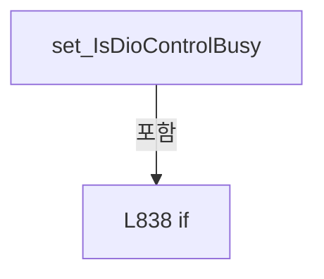

변경 전 점검: 입력/반환 타입, 위 호출자, 예외/취소 경로, 공유 상태와 저장·전송 소비자를 함께 확인합니다. 값의 단위나 물리 방향을 이름만으로 확정하지 않습니다.

### PropertyDeclaration `IsScannerWorkspace` · L845–859

[Drilling.UI/Menu/Menus/CMenuManual.cs:845–859](https://github.com/kjuws10-rgb/A3Drilling/blob/96e22cd027c84bf302b23f2949b98985d7f301bb/Drilling.UI/Menu/Menus/CMenuManual.cs#L845-L859)

| 항목 | 실제 추출 값 |
| --- | --- |
| 서명 | bool Drilling.UI.Menu.Menus.CMenuManual.IsScannerWorkspace |
| 접근/수식자 | Public / public |
| 반환/값 타입 | bool |
| 소속 타입 | NamedType:Drilling.UI.Menu.Menus.CMenuManual |

현재 부분 분석에서 직접 연결된 호출자는 없습니다. XAML/이벤트/인터페이스·델리게이트·외부 진입을 추가 확인해야 하며, 미사용으로 판정한 것이 아닙니다.

변경 전 점검: 입력/반환 타입, 위 호출자, 예외/취소 경로, 공유 상태와 저장·전송 소비자를 함께 확인합니다. 값의 단위나 물리 방향을 이름만으로 확정하지 않습니다.

### GetAccessorDeclaration `get_IsScannerWorkspace` · L847–850

[Drilling.UI/Menu/Menus/CMenuManual.cs:847–850](https://github.com/kjuws10-rgb/A3Drilling/blob/96e22cd027c84bf302b23f2949b98985d7f301bb/Drilling.UI/Menu/Menus/CMenuManual.cs#L847-L850)

| 항목 | 실제 추출 값 |
| --- | --- |
| 서명 | bool Drilling.UI.Menu.Menus.CMenuManual.IsScannerWorkspace.get |
| 접근/수식자 | Public / get |
| 반환/값 타입 | bool |
| 소속 타입 | NamedType:Drilling.UI.Menu.Menus.CMenuManual |

현재 부분 분석에서 직접 연결된 호출자는 없습니다. XAML/이벤트/인터페이스·델리게이트·외부 진입을 추가 확인해야 하며, 미사용으로 판정한 것이 아닙니다.

본문의 실제 연산·분기·예외·반환 순서(원문 위치 순):

| 원본 행 | 종류 | 주석 해설 |
| --- | --- | --- |
| 849 | return | 호출자에게 값 또는 제어를 반환합니다: return _isScannerWorkspace; |

변경 전 점검: 입력/반환 타입, 위 호출자, 예외/취소 경로, 공유 상태와 저장·전송 소비자를 함께 확인합니다. 값의 단위나 물리 방향을 이름만으로 확정하지 않습니다.

### SetAccessorDeclaration `set_IsScannerWorkspace` · L852–858

[Drilling.UI/Menu/Menus/CMenuManual.cs:852–858](https://github.com/kjuws10-rgb/A3Drilling/blob/96e22cd027c84bf302b23f2949b98985d7f301bb/Drilling.UI/Menu/Menus/CMenuManual.cs#L852-L858)

| 항목 | 실제 추출 값 |
| --- | --- |
| 서명 | void Drilling.UI.Menu.Menus.CMenuManual.IsScannerWorkspace.set |
| 접근/수식자 | Private / private, set |
| 반환/값 타입 | void |
| 소속 타입 | NamedType:Drilling.UI.Menu.Menus.CMenuManual |

입력 계약:

| 이름 | 타입 | 전달 | 선택/기본값 |
| --- | --- | --- | --- |
| value | bool | None | False /  |

현재 부분 분석에서 직접 연결된 호출자는 없습니다. XAML/이벤트/인터페이스·델리게이트·외부 진입을 추가 확인해야 하며, 미사용으로 판정한 것이 아닙니다.

호출하는 대상과 해석 범위:

| 원본 행 | 표현식 | 분석 상태 | 대상/소스 위치 |
| --- | --- | --- | --- |
| 854 | SetProperty | resolved | bool Drilling.UI.Menu.CBindingBase.SetProperty<bool>(ref bool, bool, string?) · Drilling.UI/Menu/CBindingBase.cs:760 |
| 856 | OnPropertyChanged | resolved | void Drilling.UI.Menu.CBindingBase.OnPropertyChanged(string?) · Drilling.UI/Menu/CBindingBase.cs:784 |
| 856 | nameof | unresolved | None |

본문의 실제 연산·분기·예외·반환 순서(원문 위치 순):

| 원본 행 | 종류 | 주석 해설 |
| --- | --- | --- |
| 854 | call | 함수·델리게이트 또는 객체 생성자를 호출합니다: SetProperty(ref _isScannerWorkspace, value) |
| 854 | if | 조건에 따라 분기합니다: if (SetProperty(ref _isScannerWorkspace, value)) |
| 856 | call | 함수·델리게이트 또는 객체 생성자를 호출합니다: OnPropertyChanged(nameof(IsStageVisionWorkspace)) |
| 856 | call | 함수·델리게이트 또는 객체 생성자를 호출합니다: nameof(IsStageVisionWorkspace) |

제어 구문의 포함 구조(실제 실행 순서/CFG가 아닌 구문 탐색 그림):


변경 전 점검: 입력/반환 타입, 위 호출자, 예외/취소 경로, 공유 상태와 저장·전송 소비자를 함께 확인합니다. 값의 단위나 물리 방향을 이름만으로 확정하지 않습니다.

### PropertyDeclaration `IsStageVisionWorkspace` · L861–867

[Drilling.UI/Menu/Menus/CMenuManual.cs:861–867](https://github.com/kjuws10-rgb/A3Drilling/blob/96e22cd027c84bf302b23f2949b98985d7f301bb/Drilling.UI/Menu/Menus/CMenuManual.cs#L861-L867)

| 항목 | 실제 추출 값 |
| --- | --- |
| 서명 | bool Drilling.UI.Menu.Menus.CMenuManual.IsStageVisionWorkspace |
| 접근/수식자 | Public / public |
| 반환/값 타입 | bool |
| 소속 타입 | NamedType:Drilling.UI.Menu.Menus.CMenuManual |

현재 부분 분석에서 직접 연결된 호출자는 없습니다. XAML/이벤트/인터페이스·델리게이트·외부 진입을 추가 확인해야 하며, 미사용으로 판정한 것이 아닙니다.

변경 전 점검: 입력/반환 타입, 위 호출자, 예외/취소 경로, 공유 상태와 저장·전송 소비자를 함께 확인합니다. 값의 단위나 물리 방향을 이름만으로 확정하지 않습니다.

### GetAccessorDeclaration `get_IsStageVisionWorkspace` · L863–866

[Drilling.UI/Menu/Menus/CMenuManual.cs:863–866](https://github.com/kjuws10-rgb/A3Drilling/blob/96e22cd027c84bf302b23f2949b98985d7f301bb/Drilling.UI/Menu/Menus/CMenuManual.cs#L863-L866)

| 항목 | 실제 추출 값 |
| --- | --- |
| 서명 | bool Drilling.UI.Menu.Menus.CMenuManual.IsStageVisionWorkspace.get |
| 접근/수식자 | Public / get |
| 반환/값 타입 | bool |
| 소속 타입 | NamedType:Drilling.UI.Menu.Menus.CMenuManual |

현재 부분 분석에서 직접 연결된 호출자는 없습니다. XAML/이벤트/인터페이스·델리게이트·외부 진입을 추가 확인해야 하며, 미사용으로 판정한 것이 아닙니다.

본문의 실제 연산·분기·예외·반환 순서(원문 위치 순):

| 원본 행 | 종류 | 주석 해설 |
| --- | --- | --- |
| 865 | return | 호출자에게 값 또는 제어를 반환합니다: return !IsScannerWorkspace; |

변경 전 점검: 입력/반환 타입, 위 호출자, 예외/취소 경로, 공유 상태와 저장·전송 소비자를 함께 확인합니다. 값의 단위나 물리 방향을 이름만으로 확정하지 않습니다.

### PropertyDeclaration `VisionProtocolCommands` · L869–869

[Drilling.UI/Menu/Menus/CMenuManual.cs:869–869](https://github.com/kjuws10-rgb/A3Drilling/blob/96e22cd027c84bf302b23f2949b98985d7f301bb/Drilling.UI/Menu/Menus/CMenuManual.cs#L869-L869)

| 항목 | 실제 추출 값 |
| --- | --- |
| 서명 | System.Collections.Generic.IReadOnlyList<Drilling.UI.Menu.Menus.ST_MANUAL_VISION_PROTOCOL_COMMAND> Drilling.UI.Menu.Menus.CMenuManual.VisionProtocolCommands |
| 접근/수식자 | Public / public |
| 반환/값 타입 | System.Collections.Generic.IReadOnlyList<Drilling.UI.Menu.Menus.ST_MANUAL_VISION_PROTOCOL_COMMAND> |
| 소속 타입 | NamedType:Drilling.UI.Menu.Menus.CMenuManual |

현재 부분 분석에서 직접 연결된 호출자는 없습니다. XAML/이벤트/인터페이스·델리게이트·외부 진입을 추가 확인해야 하며, 미사용으로 판정한 것이 아닙니다.

변경 전 점검: 입력/반환 타입, 위 호출자, 예외/취소 경로, 공유 상태와 저장·전송 소비자를 함께 확인합니다. 값의 단위나 물리 방향을 이름만으로 확정하지 않습니다.

### GetAccessorDeclaration `get_VisionProtocolCommands` · L869–869

[Drilling.UI/Menu/Menus/CMenuManual.cs:869–869](https://github.com/kjuws10-rgb/A3Drilling/blob/96e22cd027c84bf302b23f2949b98985d7f301bb/Drilling.UI/Menu/Menus/CMenuManual.cs#L869-L869)

| 항목 | 실제 추출 값 |
| --- | --- |
| 서명 | System.Collections.Generic.IReadOnlyList<Drilling.UI.Menu.Menus.ST_MANUAL_VISION_PROTOCOL_COMMAND> Drilling.UI.Menu.Menus.CMenuManual.VisionProtocolCommands.get |
| 접근/수식자 | Public / get |
| 반환/값 타입 | System.Collections.Generic.IReadOnlyList<Drilling.UI.Menu.Menus.ST_MANUAL_VISION_PROTOCOL_COMMAND> |
| 소속 타입 | NamedType:Drilling.UI.Menu.Menus.CMenuManual |

현재 부분 분석에서 직접 연결된 호출자는 없습니다. XAML/이벤트/인터페이스·델리게이트·외부 진입을 추가 확인해야 하며, 미사용으로 판정한 것이 아닙니다.

변경 전 점검: 입력/반환 타입, 위 호출자, 예외/취소 경로, 공유 상태와 저장·전송 소비자를 함께 확인합니다. 값의 단위나 물리 방향을 이름만으로 확정하지 않습니다.

### PropertyDeclaration `SelectedVisionProtocolCommand` · L871–885

[Drilling.UI/Menu/Menus/CMenuManual.cs:871–885](https://github.com/kjuws10-rgb/A3Drilling/blob/96e22cd027c84bf302b23f2949b98985d7f301bb/Drilling.UI/Menu/Menus/CMenuManual.cs#L871-L885)

| 항목 | 실제 추출 값 |
| --- | --- |
| 서명 | Drilling.UI.Menu.Menus.ST_MANUAL_VISION_PROTOCOL_COMMAND Drilling.UI.Menu.Menus.CMenuManual.SelectedVisionProtocolCommand |
| 접근/수식자 | Public / public |
| 반환/값 타입 | Drilling.UI.Menu.Menus.ST_MANUAL_VISION_PROTOCOL_COMMAND |
| 소속 타입 | NamedType:Drilling.UI.Menu.Menus.CMenuManual |

현재 부분 분석에서 직접 연결된 호출자는 없습니다. XAML/이벤트/인터페이스·델리게이트·외부 진입을 추가 확인해야 하며, 미사용으로 판정한 것이 아닙니다.

변경 전 점검: 입력/반환 타입, 위 호출자, 예외/취소 경로, 공유 상태와 저장·전송 소비자를 함께 확인합니다. 값의 단위나 물리 방향을 이름만으로 확정하지 않습니다.

### GetAccessorDeclaration `get_SelectedVisionProtocolCommand` · L873–876

[Drilling.UI/Menu/Menus/CMenuManual.cs:873–876](https://github.com/kjuws10-rgb/A3Drilling/blob/96e22cd027c84bf302b23f2949b98985d7f301bb/Drilling.UI/Menu/Menus/CMenuManual.cs#L873-L876)

| 항목 | 실제 추출 값 |
| --- | --- |
| 서명 | Drilling.UI.Menu.Menus.ST_MANUAL_VISION_PROTOCOL_COMMAND Drilling.UI.Menu.Menus.CMenuManual.SelectedVisionProtocolCommand.get |
| 접근/수식자 | Public / get |
| 반환/값 타입 | Drilling.UI.Menu.Menus.ST_MANUAL_VISION_PROTOCOL_COMMAND |
| 소속 타입 | NamedType:Drilling.UI.Menu.Menus.CMenuManual |

현재 부분 분석에서 직접 연결된 호출자는 없습니다. XAML/이벤트/인터페이스·델리게이트·외부 진입을 추가 확인해야 하며, 미사용으로 판정한 것이 아닙니다.

본문의 실제 연산·분기·예외·반환 순서(원문 위치 순):

| 원본 행 | 종류 | 주석 해설 |
| --- | --- | --- |
| 875 | return | 호출자에게 값 또는 제어를 반환합니다: return _selectedVisionProtocolCommand; |

변경 전 점검: 입력/반환 타입, 위 호출자, 예외/취소 경로, 공유 상태와 저장·전송 소비자를 함께 확인합니다. 값의 단위나 물리 방향을 이름만으로 확정하지 않습니다.

### SetAccessorDeclaration `set_SelectedVisionProtocolCommand` · L878–884

[Drilling.UI/Menu/Menus/CMenuManual.cs:878–884](https://github.com/kjuws10-rgb/A3Drilling/blob/96e22cd027c84bf302b23f2949b98985d7f301bb/Drilling.UI/Menu/Menus/CMenuManual.cs#L878-L884)

| 항목 | 실제 추출 값 |
| --- | --- |
| 서명 | void Drilling.UI.Menu.Menus.CMenuManual.SelectedVisionProtocolCommand.set |
| 접근/수식자 | Public / set |
| 반환/값 타입 | void |
| 소속 타입 | NamedType:Drilling.UI.Menu.Menus.CMenuManual |

입력 계약:

| 이름 | 타입 | 전달 | 선택/기본값 |
| --- | --- | --- | --- |
| value | Drilling.UI.Menu.Menus.ST_MANUAL_VISION_PROTOCOL_COMMAND | None | False /  |

현재 부분 분석에서 직접 연결된 호출자는 없습니다. XAML/이벤트/인터페이스·델리게이트·외부 진입을 추가 확인해야 하며, 미사용으로 판정한 것이 아닙니다.

호출하는 대상과 해석 범위:

| 원본 행 | 표현식 | 분석 상태 | 대상/소스 위치 |
| --- | --- | --- | --- |
| 880 | SetProperty | resolved | bool Drilling.UI.Menu.CBindingBase.SetProperty<Drilling.UI.Menu.Menus.ST_MANUAL_VISION_PROTOCOL_COMMAND>(ref Drilling.UI.Menu.Menus.ST_MANUAL_VISION_PROTOCOL_COMMAND, Drilling.UI.Menu.Menus.ST_MANUAL_VISION_PROTOCOL_COMMAND, string?) · Drilling.UI/Menu/CBindingBase.cs:760 |
| 882 | ResetVisionProtocolInputs | resolved | void Drilling.UI.Menu.Menus.CMenuManual.ResetVisionProtocolInputs() · Drilling.UI/Menu/Menus/CMenuManual.cs:6462 |

본문의 실제 연산·분기·예외·반환 순서(원문 위치 순):

| 원본 행 | 종류 | 주석 해설 |
| --- | --- | --- |
| 880 | call | 함수·델리게이트 또는 객체 생성자를 호출합니다: SetProperty(ref _selectedVisionProtocolCommand, value) |
| 880 | if | 조건에 따라 분기합니다: if (value is not null && SetProperty(ref _selectedVisionProtocolCommand, value)) |
| 882 | call | 함수·델리게이트 또는 객체 생성자를 호출합니다: ResetVisionProtocolInputs() |

제어 구문의 포함 구조(실제 실행 순서/CFG가 아닌 구문 탐색 그림):

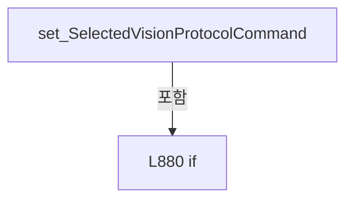

변경 전 점검: 입력/반환 타입, 위 호출자, 예외/취소 경로, 공유 상태와 저장·전송 소비자를 함께 확인합니다. 값의 단위나 물리 방향을 이름만으로 확정하지 않습니다.

### PropertyDeclaration `VisionProtocolCommandDescription` · L887–893

[Drilling.UI/Menu/Menus/CMenuManual.cs:887–893](https://github.com/kjuws10-rgb/A3Drilling/blob/96e22cd027c84bf302b23f2949b98985d7f301bb/Drilling.UI/Menu/Menus/CMenuManual.cs#L887-L893)

| 항목 | 실제 추출 값 |
| --- | --- |
| 서명 | string Drilling.UI.Menu.Menus.CMenuManual.VisionProtocolCommandDescription |
| 접근/수식자 | Public / public |
| 반환/값 타입 | string |
| 소속 타입 | NamedType:Drilling.UI.Menu.Menus.CMenuManual |

현재 부분 분석에서 직접 연결된 호출자는 없습니다. XAML/이벤트/인터페이스·델리게이트·외부 진입을 추가 확인해야 하며, 미사용으로 판정한 것이 아닙니다.

변경 전 점검: 입력/반환 타입, 위 호출자, 예외/취소 경로, 공유 상태와 저장·전송 소비자를 함께 확인합니다. 값의 단위나 물리 방향을 이름만으로 확정하지 않습니다.

### GetAccessorDeclaration `get_VisionProtocolCommandDescription` · L889–892

[Drilling.UI/Menu/Menus/CMenuManual.cs:889–892](https://github.com/kjuws10-rgb/A3Drilling/blob/96e22cd027c84bf302b23f2949b98985d7f301bb/Drilling.UI/Menu/Menus/CMenuManual.cs#L889-L892)

| 항목 | 실제 추출 값 |
| --- | --- |
| 서명 | string Drilling.UI.Menu.Menus.CMenuManual.VisionProtocolCommandDescription.get |
| 접근/수식자 | Public / get |
| 반환/값 타입 | string |
| 소속 타입 | NamedType:Drilling.UI.Menu.Menus.CMenuManual |

현재 부분 분석에서 직접 연결된 호출자는 없습니다. XAML/이벤트/인터페이스·델리게이트·외부 진입을 추가 확인해야 하며, 미사용으로 판정한 것이 아닙니다.

본문의 실제 연산·분기·예외·반환 순서(원문 위치 순):

| 원본 행 | 종류 | 주석 해설 |
| --- | --- | --- |
| 891 | return | 호출자에게 값 또는 제어를 반환합니다: return SelectedVisionProtocolCommand.Description; |

변경 전 점검: 입력/반환 타입, 위 호출자, 예외/취소 경로, 공유 상태와 저장·전송 소비자를 함께 확인합니다. 값의 단위나 물리 방향을 이름만으로 확정하지 않습니다.

### PropertyDeclaration `VisionProtocolUsesMarkRows` · L895–901

[Drilling.UI/Menu/Menus/CMenuManual.cs:895–901](https://github.com/kjuws10-rgb/A3Drilling/blob/96e22cd027c84bf302b23f2949b98985d7f301bb/Drilling.UI/Menu/Menus/CMenuManual.cs#L895-L901)

| 항목 | 실제 추출 값 |
| --- | --- |
| 서명 | bool Drilling.UI.Menu.Menus.CMenuManual.VisionProtocolUsesMarkRows |
| 접근/수식자 | Public / public |
| 반환/값 타입 | bool |
| 소속 타입 | NamedType:Drilling.UI.Menu.Menus.CMenuManual |

현재 부분 분석에서 직접 연결된 호출자는 없습니다. XAML/이벤트/인터페이스·델리게이트·외부 진입을 추가 확인해야 하며, 미사용으로 판정한 것이 아닙니다.

변경 전 점검: 입력/반환 타입, 위 호출자, 예외/취소 경로, 공유 상태와 저장·전송 소비자를 함께 확인합니다. 값의 단위나 물리 방향을 이름만으로 확정하지 않습니다.

### GetAccessorDeclaration `get_VisionProtocolUsesMarkRows` · L897–900

[Drilling.UI/Menu/Menus/CMenuManual.cs:897–900](https://github.com/kjuws10-rgb/A3Drilling/blob/96e22cd027c84bf302b23f2949b98985d7f301bb/Drilling.UI/Menu/Menus/CMenuManual.cs#L897-L900)

| 항목 | 실제 추출 값 |
| --- | --- |
| 서명 | bool Drilling.UI.Menu.Menus.CMenuManual.VisionProtocolUsesMarkRows.get |
| 접근/수식자 | Public / get |
| 반환/값 타입 | bool |
| 소속 타입 | NamedType:Drilling.UI.Menu.Menus.CMenuManual |

현재 부분 분석에서 직접 연결된 호출자는 없습니다. XAML/이벤트/인터페이스·델리게이트·외부 진입을 추가 확인해야 하며, 미사용으로 판정한 것이 아닙니다.

본문의 실제 연산·분기·예외·반환 순서(원문 위치 순):

| 원본 행 | 종류 | 주석 해설 |
| --- | --- | --- |
| 899 | return | 호출자에게 값 또는 제어를 반환합니다: return SelectedVisionProtocolCommand.CommandText is "MARK_FIND_SINGLE" or "FLYING_READY"; |

변경 전 점검: 입력/반환 타입, 위 호출자, 예외/취소 경로, 공유 상태와 저장·전송 소비자를 함께 확인합니다. 값의 단위나 물리 방향을 이름만으로 확정하지 않습니다.

### PropertyDeclaration `VisionProtocolIsFlyingReady` · L903–909

[Drilling.UI/Menu/Menus/CMenuManual.cs:903–909](https://github.com/kjuws10-rgb/A3Drilling/blob/96e22cd027c84bf302b23f2949b98985d7f301bb/Drilling.UI/Menu/Menus/CMenuManual.cs#L903-L909)

| 항목 | 실제 추출 값 |
| --- | --- |
| 서명 | bool Drilling.UI.Menu.Menus.CMenuManual.VisionProtocolIsFlyingReady |
| 접근/수식자 | Public / public |
| 반환/값 타입 | bool |
| 소속 타입 | NamedType:Drilling.UI.Menu.Menus.CMenuManual |

현재 부분 분석에서 직접 연결된 호출자는 없습니다. XAML/이벤트/인터페이스·델리게이트·외부 진입을 추가 확인해야 하며, 미사용으로 판정한 것이 아닙니다.

변경 전 점검: 입력/반환 타입, 위 호출자, 예외/취소 경로, 공유 상태와 저장·전송 소비자를 함께 확인합니다. 값의 단위나 물리 방향을 이름만으로 확정하지 않습니다.

### GetAccessorDeclaration `get_VisionProtocolIsFlyingReady` · L905–908

[Drilling.UI/Menu/Menus/CMenuManual.cs:905–908](https://github.com/kjuws10-rgb/A3Drilling/blob/96e22cd027c84bf302b23f2949b98985d7f301bb/Drilling.UI/Menu/Menus/CMenuManual.cs#L905-L908)

| 항목 | 실제 추출 값 |
| --- | --- |
| 서명 | bool Drilling.UI.Menu.Menus.CMenuManual.VisionProtocolIsFlyingReady.get |
| 접근/수식자 | Public / get |
| 반환/값 타입 | bool |
| 소속 타입 | NamedType:Drilling.UI.Menu.Menus.CMenuManual |

현재 부분 분석에서 직접 연결된 호출자는 없습니다. XAML/이벤트/인터페이스·델리게이트·외부 진입을 추가 확인해야 하며, 미사용으로 판정한 것이 아닙니다.

본문의 실제 연산·분기·예외·반환 순서(원문 위치 순):

| 원본 행 | 종류 | 주석 해설 |
| --- | --- | --- |
| 907 | return | 호출자에게 값 또는 제어를 반환합니다: return SelectedVisionProtocolCommand.CommandText == "FLYING_READY"; |

변경 전 점검: 입력/반환 타입, 위 호출자, 예외/취소 경로, 공유 상태와 저장·전송 소비자를 함께 확인합니다. 값의 단위나 물리 방향을 이름만으로 확정하지 않습니다.

### PropertyDeclaration `VisionProtocolHasNoArguments` · L911–917

[Drilling.UI/Menu/Menus/CMenuManual.cs:911–917](https://github.com/kjuws10-rgb/A3Drilling/blob/96e22cd027c84bf302b23f2949b98985d7f301bb/Drilling.UI/Menu/Menus/CMenuManual.cs#L911-L917)

| 항목 | 실제 추출 값 |
| --- | --- |
| 서명 | bool Drilling.UI.Menu.Menus.CMenuManual.VisionProtocolHasNoArguments |
| 접근/수식자 | Public / public |
| 반환/값 타입 | bool |
| 소속 타입 | NamedType:Drilling.UI.Menu.Menus.CMenuManual |

현재 부분 분석에서 직접 연결된 호출자는 없습니다. XAML/이벤트/인터페이스·델리게이트·외부 진입을 추가 확인해야 하며, 미사용으로 판정한 것이 아닙니다.

변경 전 점검: 입력/반환 타입, 위 호출자, 예외/취소 경로, 공유 상태와 저장·전송 소비자를 함께 확인합니다. 값의 단위나 물리 방향을 이름만으로 확정하지 않습니다.

### GetAccessorDeclaration `get_VisionProtocolHasNoArguments` · L913–916

[Drilling.UI/Menu/Menus/CMenuManual.cs:913–916](https://github.com/kjuws10-rgb/A3Drilling/blob/96e22cd027c84bf302b23f2949b98985d7f301bb/Drilling.UI/Menu/Menus/CMenuManual.cs#L913-L916)

| 항목 | 실제 추출 값 |
| --- | --- |
| 서명 | bool Drilling.UI.Menu.Menus.CMenuManual.VisionProtocolHasNoArguments.get |
| 접근/수식자 | Public / get |
| 반환/값 타입 | bool |
| 소속 타입 | NamedType:Drilling.UI.Menu.Menus.CMenuManual |

현재 부분 분석에서 직접 연결된 호출자는 없습니다. XAML/이벤트/인터페이스·델리게이트·외부 진입을 추가 확인해야 하며, 미사용으로 판정한 것이 아닙니다.

본문의 실제 연산·분기·예외·반환 순서(원문 위치 순):

| 원본 행 | 종류 | 주석 해설 |
| --- | --- | --- |
| 915 | return | 호출자에게 값 또는 제어를 반환합니다: return !VisionProtocolUsesMarkRows; |

변경 전 점검: 입력/반환 타입, 위 호출자, 예외/취소 경로, 공유 상태와 저장·전송 소비자를 함께 확인합니다. 값의 단위나 물리 방향을 이름만으로 확정하지 않습니다.

### PropertyDeclaration `VisionProtocolInspectionType` · L919–933

[Drilling.UI/Menu/Menus/CMenuManual.cs:919–933](https://github.com/kjuws10-rgb/A3Drilling/blob/96e22cd027c84bf302b23f2949b98985d7f301bb/Drilling.UI/Menu/Menus/CMenuManual.cs#L919-L933)

| 항목 | 실제 추출 값 |
| --- | --- |
| 서명 | string Drilling.UI.Menu.Menus.CMenuManual.VisionProtocolInspectionType |
| 접근/수식자 | Public / public |
| 반환/값 타입 | string |
| 소속 타입 | NamedType:Drilling.UI.Menu.Menus.CMenuManual |

현재 부분 분석에서 직접 연결된 호출자는 없습니다. XAML/이벤트/인터페이스·델리게이트·외부 진입을 추가 확인해야 하며, 미사용으로 판정한 것이 아닙니다.

변경 전 점검: 입력/반환 타입, 위 호출자, 예외/취소 경로, 공유 상태와 저장·전송 소비자를 함께 확인합니다. 값의 단위나 물리 방향을 이름만으로 확정하지 않습니다.

### GetAccessorDeclaration `get_VisionProtocolInspectionType` · L921–924

[Drilling.UI/Menu/Menus/CMenuManual.cs:921–924](https://github.com/kjuws10-rgb/A3Drilling/blob/96e22cd027c84bf302b23f2949b98985d7f301bb/Drilling.UI/Menu/Menus/CMenuManual.cs#L921-L924)

| 항목 | 실제 추출 값 |
| --- | --- |
| 서명 | string Drilling.UI.Menu.Menus.CMenuManual.VisionProtocolInspectionType.get |
| 접근/수식자 | Public / get |
| 반환/값 타입 | string |
| 소속 타입 | NamedType:Drilling.UI.Menu.Menus.CMenuManual |

현재 부분 분석에서 직접 연결된 호출자는 없습니다. XAML/이벤트/인터페이스·델리게이트·외부 진입을 추가 확인해야 하며, 미사용으로 판정한 것이 아닙니다.

본문의 실제 연산·분기·예외·반환 순서(원문 위치 순):

| 원본 행 | 종류 | 주석 해설 |
| --- | --- | --- |
| 923 | return | 호출자에게 값 또는 제어를 반환합니다: return _visionProtocolInspectionType; |

변경 전 점검: 입력/반환 타입, 위 호출자, 예외/취소 경로, 공유 상태와 저장·전송 소비자를 함께 확인합니다. 값의 단위나 물리 방향을 이름만으로 확정하지 않습니다.

### SetAccessorDeclaration `set_VisionProtocolInspectionType` · L926–932

[Drilling.UI/Menu/Menus/CMenuManual.cs:926–932](https://github.com/kjuws10-rgb/A3Drilling/blob/96e22cd027c84bf302b23f2949b98985d7f301bb/Drilling.UI/Menu/Menus/CMenuManual.cs#L926-L932)

| 항목 | 실제 추출 값 |
| --- | --- |
| 서명 | void Drilling.UI.Menu.Menus.CMenuManual.VisionProtocolInspectionType.set |
| 접근/수식자 | Public / set |
| 반환/값 타입 | void |
| 소속 타입 | NamedType:Drilling.UI.Menu.Menus.CMenuManual |

입력 계약:

| 이름 | 타입 | 전달 | 선택/기본값 |
| --- | --- | --- | --- |
| value | string | None | False /  |

현재 부분 분석에서 직접 연결된 호출자는 없습니다. XAML/이벤트/인터페이스·델리게이트·외부 진입을 추가 확인해야 하며, 미사용으로 판정한 것이 아닙니다.

호출하는 대상과 해석 범위:

| 원본 행 | 표현식 | 분석 상태 | 대상/소스 위치 |
| --- | --- | --- | --- |
| 928 | SetProperty | resolved | bool Drilling.UI.Menu.CBindingBase.SetProperty<string>(ref string, string, string?) · Drilling.UI/Menu/CBindingBase.cs:760 |
| 930 | OnPropertyChanged | resolved | void Drilling.UI.Menu.CBindingBase.OnPropertyChanged(string?) · Drilling.UI/Menu/CBindingBase.cs:784 |
| 930 | nameof | unresolved | None |

본문의 실제 연산·분기·예외·반환 순서(원문 위치 순):

| 원본 행 | 종류 | 주석 해설 |
| --- | --- | --- |
| 928 | call | 함수·델리게이트 또는 객체 생성자를 호출합니다: SetProperty(ref _visionProtocolInspectionType, value ?? "") |
| 928 | if | 조건에 따라 분기합니다: if (SetProperty(ref _visionProtocolInspectionType, value ?? "")) |
| 930 | call | 함수·델리게이트 또는 객체 생성자를 호출합니다: OnPropertyChanged(nameof(VisionProtocolRequestPreview)) |
| 930 | call | 함수·델리게이트 또는 객체 생성자를 호출합니다: nameof(VisionProtocolRequestPreview) |

제어 구문의 포함 구조(실제 실행 순서/CFG가 아닌 구문 탐색 그림):


변경 전 점검: 입력/반환 타입, 위 호출자, 예외/취소 경로, 공유 상태와 저장·전송 소비자를 함께 확인합니다. 값의 단위나 물리 방향을 이름만으로 확정하지 않습니다.

### PropertyDeclaration `VisionProtocolRequestPreview` · L935–941

[Drilling.UI/Menu/Menus/CMenuManual.cs:935–941](https://github.com/kjuws10-rgb/A3Drilling/blob/96e22cd027c84bf302b23f2949b98985d7f301bb/Drilling.UI/Menu/Menus/CMenuManual.cs#L935-L941)

| 항목 | 실제 추출 값 |
| --- | --- |
| 서명 | string Drilling.UI.Menu.Menus.CMenuManual.VisionProtocolRequestPreview |
| 접근/수식자 | Public / public |
| 반환/값 타입 | string |
| 소속 타입 | NamedType:Drilling.UI.Menu.Menus.CMenuManual |

현재 부분 분석에서 직접 연결된 호출자는 없습니다. XAML/이벤트/인터페이스·델리게이트·외부 진입을 추가 확인해야 하며, 미사용으로 판정한 것이 아닙니다.

변경 전 점검: 입력/반환 타입, 위 호출자, 예외/취소 경로, 공유 상태와 저장·전송 소비자를 함께 확인합니다. 값의 단위나 물리 방향을 이름만으로 확정하지 않습니다.

### GetAccessorDeclaration `get_VisionProtocolRequestPreview` · L937–940

[Drilling.UI/Menu/Menus/CMenuManual.cs:937–940](https://github.com/kjuws10-rgb/A3Drilling/blob/96e22cd027c84bf302b23f2949b98985d7f301bb/Drilling.UI/Menu/Menus/CMenuManual.cs#L937-L940)

| 항목 | 실제 추출 값 |
| --- | --- |
| 서명 | string Drilling.UI.Menu.Menus.CMenuManual.VisionProtocolRequestPreview.get |
| 접근/수식자 | Public / get |
| 반환/값 타입 | string |
| 소속 타입 | NamedType:Drilling.UI.Menu.Menus.CMenuManual |

현재 부분 분석에서 직접 연결된 호출자는 없습니다. XAML/이벤트/인터페이스·델리게이트·외부 진입을 추가 확인해야 하며, 미사용으로 판정한 것이 아닙니다.

호출하는 대상과 해석 범위:

| 원본 행 | 표현식 | 분석 상태 | 대상/소스 위치 |
| --- | --- | --- | --- |
| 939 | BuildVisionProtocolFunction | resolved | string Drilling.UI.Menu.Menus.CMenuManual.BuildVisionProtocolFunction(bool) · Drilling.UI/Menu/Menus/CMenuManual.cs:6514 |

본문의 실제 연산·분기·예외·반환 순서(원문 위치 순):

| 원본 행 | 종류 | 주석 해설 |
| --- | --- | --- |
| 939 | call | 함수·델리게이트 또는 객체 생성자를 호출합니다: BuildVisionProtocolFunction(validate: false) |
| 939 | return | 호출자에게 값 또는 제어를 반환합니다: return BuildVisionProtocolFunction(validate: false); |

변경 전 점검: 입력/반환 타입, 위 호출자, 예외/취소 경로, 공유 상태와 저장·전송 소비자를 함께 확인합니다. 값의 단위나 물리 방향을 이름만으로 확정하지 않습니다.

### PropertyDeclaration `VisionProtocolMarkRowCountText` · L943–949

[Drilling.UI/Menu/Menus/CMenuManual.cs:943–949](https://github.com/kjuws10-rgb/A3Drilling/blob/96e22cd027c84bf302b23f2949b98985d7f301bb/Drilling.UI/Menu/Menus/CMenuManual.cs#L943-L949)

| 항목 | 실제 추출 값 |
| --- | --- |
| 서명 | string Drilling.UI.Menu.Menus.CMenuManual.VisionProtocolMarkRowCountText |
| 접근/수식자 | Public / public |
| 반환/값 타입 | string |
| 소속 타입 | NamedType:Drilling.UI.Menu.Menus.CMenuManual |

현재 부분 분석에서 직접 연결된 호출자는 없습니다. XAML/이벤트/인터페이스·델리게이트·외부 진입을 추가 확인해야 하며, 미사용으로 판정한 것이 아닙니다.

변경 전 점검: 입력/반환 타입, 위 호출자, 예외/취소 경로, 공유 상태와 저장·전송 소비자를 함께 확인합니다. 값의 단위나 물리 방향을 이름만으로 확정하지 않습니다.

### GetAccessorDeclaration `get_VisionProtocolMarkRowCountText` · L945–948

[Drilling.UI/Menu/Menus/CMenuManual.cs:945–948](https://github.com/kjuws10-rgb/A3Drilling/blob/96e22cd027c84bf302b23f2949b98985d7f301bb/Drilling.UI/Menu/Menus/CMenuManual.cs#L945-L948)

| 항목 | 실제 추출 값 |
| --- | --- |
| 서명 | string Drilling.UI.Menu.Menus.CMenuManual.VisionProtocolMarkRowCountText.get |
| 접근/수식자 | Public / get |
| 반환/값 타입 | string |
| 소속 타입 | NamedType:Drilling.UI.Menu.Menus.CMenuManual |

현재 부분 분석에서 직접 연결된 호출자는 없습니다. XAML/이벤트/인터페이스·델리게이트·외부 진입을 추가 확인해야 하며, 미사용으로 판정한 것이 아닙니다.

본문의 실제 연산·분기·예외·반환 순서(원문 위치 순):

| 원본 행 | 종류 | 주석 해설 |
| --- | --- | --- |
| 947 | return | 호출자에게 값 또는 제어를 반환합니다: return $"MARK {VisionProtocolMarkRows.Count} / {CVisionProtocol.MaximumMarkCount}"; |

변경 전 점검: 입력/반환 타입, 위 호출자, 예외/취소 경로, 공유 상태와 저장·전송 소비자를 함께 확인합니다. 값의 단위나 물리 방향을 이름만으로 확정하지 않습니다.

### PropertyDeclaration `VisionProtocolEndpoint` · L951–962

[Drilling.UI/Menu/Menus/CMenuManual.cs:951–962](https://github.com/kjuws10-rgb/A3Drilling/blob/96e22cd027c84bf302b23f2949b98985d7f301bb/Drilling.UI/Menu/Menus/CMenuManual.cs#L951-L962)

| 항목 | 실제 추출 값 |
| --- | --- |
| 서명 | string Drilling.UI.Menu.Menus.CMenuManual.VisionProtocolEndpoint |
| 접근/수식자 | Public / public |
| 반환/값 타입 | string |
| 소속 타입 | NamedType:Drilling.UI.Menu.Menus.CMenuManual |

현재 부분 분석에서 직접 연결된 호출자는 없습니다. XAML/이벤트/인터페이스·델리게이트·외부 진입을 추가 확인해야 하며, 미사용으로 판정한 것이 아닙니다.

변경 전 점검: 입력/반환 타입, 위 호출자, 예외/취소 경로, 공유 상태와 저장·전송 소비자를 함께 확인합니다. 값의 단위나 물리 방향을 이름만으로 확정하지 않습니다.

### GetAccessorDeclaration `get_VisionProtocolEndpoint` · L953–956

[Drilling.UI/Menu/Menus/CMenuManual.cs:953–956](https://github.com/kjuws10-rgb/A3Drilling/blob/96e22cd027c84bf302b23f2949b98985d7f301bb/Drilling.UI/Menu/Menus/CMenuManual.cs#L953-L956)

| 항목 | 실제 추출 값 |
| --- | --- |
| 서명 | string Drilling.UI.Menu.Menus.CMenuManual.VisionProtocolEndpoint.get |
| 접근/수식자 | Public / get |
| 반환/값 타입 | string |
| 소속 타입 | NamedType:Drilling.UI.Menu.Menus.CMenuManual |

현재 부분 분석에서 직접 연결된 호출자는 없습니다. XAML/이벤트/인터페이스·델리게이트·외부 진입을 추가 확인해야 하며, 미사용으로 판정한 것이 아닙니다.

본문의 실제 연산·분기·예외·반환 순서(원문 위치 순):

| 원본 행 | 종류 | 주석 해설 |
| --- | --- | --- |
| 955 | return | 호출자에게 값 또는 제어를 반환합니다: return _visionProtocolEndpoint; |

변경 전 점검: 입력/반환 타입, 위 호출자, 예외/취소 경로, 공유 상태와 저장·전송 소비자를 함께 확인합니다. 값의 단위나 물리 방향을 이름만으로 확정하지 않습니다.

### SetAccessorDeclaration `set_VisionProtocolEndpoint` · L958–961

[Drilling.UI/Menu/Menus/CMenuManual.cs:958–961](https://github.com/kjuws10-rgb/A3Drilling/blob/96e22cd027c84bf302b23f2949b98985d7f301bb/Drilling.UI/Menu/Menus/CMenuManual.cs#L958-L961)

| 항목 | 실제 추출 값 |
| --- | --- |
| 서명 | void Drilling.UI.Menu.Menus.CMenuManual.VisionProtocolEndpoint.set |
| 접근/수식자 | Private / private, set |
| 반환/값 타입 | void |
| 소속 타입 | NamedType:Drilling.UI.Menu.Menus.CMenuManual |

입력 계약:

| 이름 | 타입 | 전달 | 선택/기본값 |
| --- | --- | --- | --- |
| value | string | None | False /  |

현재 부분 분석에서 직접 연결된 호출자는 없습니다. XAML/이벤트/인터페이스·델리게이트·외부 진입을 추가 확인해야 하며, 미사용으로 판정한 것이 아닙니다.

호출하는 대상과 해석 범위:

| 원본 행 | 표현식 | 분석 상태 | 대상/소스 위치 |
| --- | --- | --- | --- |
| 960 | SetProperty | resolved | bool Drilling.UI.Menu.CBindingBase.SetProperty<string>(ref string, string, string?) · Drilling.UI/Menu/CBindingBase.cs:760 |

본문의 실제 연산·분기·예외·반환 순서(원문 위치 순):

| 원본 행 | 종류 | 주석 해설 |
| --- | --- | --- |
| 960 | call | 함수·델리게이트 또는 객체 생성자를 호출합니다: SetProperty(ref _visionProtocolEndpoint, value) |

변경 전 점검: 입력/반환 타입, 위 호출자, 예외/취소 경로, 공유 상태와 저장·전송 소비자를 함께 확인합니다. 값의 단위나 물리 방향을 이름만으로 확정하지 않습니다.

### PropertyDeclaration `VisionProtocolStatus` · L964–975

[Drilling.UI/Menu/Menus/CMenuManual.cs:964–975](https://github.com/kjuws10-rgb/A3Drilling/blob/96e22cd027c84bf302b23f2949b98985d7f301bb/Drilling.UI/Menu/Menus/CMenuManual.cs#L964-L975)

| 항목 | 실제 추출 값 |
| --- | --- |
| 서명 | string Drilling.UI.Menu.Menus.CMenuManual.VisionProtocolStatus |
| 접근/수식자 | Public / public |
| 반환/값 타입 | string |
| 소속 타입 | NamedType:Drilling.UI.Menu.Menus.CMenuManual |

현재 부분 분석에서 직접 연결된 호출자는 없습니다. XAML/이벤트/인터페이스·델리게이트·외부 진입을 추가 확인해야 하며, 미사용으로 판정한 것이 아닙니다.

변경 전 점검: 입력/반환 타입, 위 호출자, 예외/취소 경로, 공유 상태와 저장·전송 소비자를 함께 확인합니다. 값의 단위나 물리 방향을 이름만으로 확정하지 않습니다.

### GetAccessorDeclaration `get_VisionProtocolStatus` · L966–969

[Drilling.UI/Menu/Menus/CMenuManual.cs:966–969](https://github.com/kjuws10-rgb/A3Drilling/blob/96e22cd027c84bf302b23f2949b98985d7f301bb/Drilling.UI/Menu/Menus/CMenuManual.cs#L966-L969)

| 항목 | 실제 추출 값 |
| --- | --- |
| 서명 | string Drilling.UI.Menu.Menus.CMenuManual.VisionProtocolStatus.get |
| 접근/수식자 | Public / get |
| 반환/값 타입 | string |
| 소속 타입 | NamedType:Drilling.UI.Menu.Menus.CMenuManual |

현재 부분 분석에서 직접 연결된 호출자는 없습니다. XAML/이벤트/인터페이스·델리게이트·외부 진입을 추가 확인해야 하며, 미사용으로 판정한 것이 아닙니다.

본문의 실제 연산·분기·예외·반환 순서(원문 위치 순):

| 원본 행 | 종류 | 주석 해설 |
| --- | --- | --- |
| 968 | return | 호출자에게 값 또는 제어를 반환합니다: return _visionProtocolStatus; |

변경 전 점검: 입력/반환 타입, 위 호출자, 예외/취소 경로, 공유 상태와 저장·전송 소비자를 함께 확인합니다. 값의 단위나 물리 방향을 이름만으로 확정하지 않습니다.

### SetAccessorDeclaration `set_VisionProtocolStatus` · L971–974

[Drilling.UI/Menu/Menus/CMenuManual.cs:971–974](https://github.com/kjuws10-rgb/A3Drilling/blob/96e22cd027c84bf302b23f2949b98985d7f301bb/Drilling.UI/Menu/Menus/CMenuManual.cs#L971-L974)

| 항목 | 실제 추출 값 |
| --- | --- |
| 서명 | void Drilling.UI.Menu.Menus.CMenuManual.VisionProtocolStatus.set |
| 접근/수식자 | Private / private, set |
| 반환/값 타입 | void |
| 소속 타입 | NamedType:Drilling.UI.Menu.Menus.CMenuManual |

입력 계약:

| 이름 | 타입 | 전달 | 선택/기본값 |
| --- | --- | --- | --- |
| value | string | None | False /  |

현재 부분 분석에서 직접 연결된 호출자는 없습니다. XAML/이벤트/인터페이스·델리게이트·외부 진입을 추가 확인해야 하며, 미사용으로 판정한 것이 아닙니다.

호출하는 대상과 해석 범위:

| 원본 행 | 표현식 | 분석 상태 | 대상/소스 위치 |
| --- | --- | --- | --- |
| 973 | SetProperty | resolved | bool Drilling.UI.Menu.CBindingBase.SetProperty<string>(ref string, string, string?) · Drilling.UI/Menu/CBindingBase.cs:760 |

본문의 실제 연산·분기·예외·반환 순서(원문 위치 순):

| 원본 행 | 종류 | 주석 해설 |
| --- | --- | --- |
| 973 | call | 함수·델리게이트 또는 객체 생성자를 호출합니다: SetProperty(ref _visionProtocolStatus, value) |

변경 전 점검: 입력/반환 타입, 위 호출자, 예외/취소 경로, 공유 상태와 저장·전송 소비자를 함께 확인합니다. 값의 단위나 물리 방향을 이름만으로 확정하지 않습니다.

### PropertyDeclaration `VisionProtocolKeepAlive` · L977–988

[Drilling.UI/Menu/Menus/CMenuManual.cs:977–988](https://github.com/kjuws10-rgb/A3Drilling/blob/96e22cd027c84bf302b23f2949b98985d7f301bb/Drilling.UI/Menu/Menus/CMenuManual.cs#L977-L988)

| 항목 | 실제 추출 값 |
| --- | --- |
| 서명 | string Drilling.UI.Menu.Menus.CMenuManual.VisionProtocolKeepAlive |
| 접근/수식자 | Public / public |
| 반환/값 타입 | string |
| 소속 타입 | NamedType:Drilling.UI.Menu.Menus.CMenuManual |

현재 부분 분석에서 직접 연결된 호출자는 없습니다. XAML/이벤트/인터페이스·델리게이트·외부 진입을 추가 확인해야 하며, 미사용으로 판정한 것이 아닙니다.

변경 전 점검: 입력/반환 타입, 위 호출자, 예외/취소 경로, 공유 상태와 저장·전송 소비자를 함께 확인합니다. 값의 단위나 물리 방향을 이름만으로 확정하지 않습니다.

### GetAccessorDeclaration `get_VisionProtocolKeepAlive` · L979–982

[Drilling.UI/Menu/Menus/CMenuManual.cs:979–982](https://github.com/kjuws10-rgb/A3Drilling/blob/96e22cd027c84bf302b23f2949b98985d7f301bb/Drilling.UI/Menu/Menus/CMenuManual.cs#L979-L982)

| 항목 | 실제 추출 값 |
| --- | --- |
| 서명 | string Drilling.UI.Menu.Menus.CMenuManual.VisionProtocolKeepAlive.get |
| 접근/수식자 | Public / get |
| 반환/값 타입 | string |
| 소속 타입 | NamedType:Drilling.UI.Menu.Menus.CMenuManual |

현재 부분 분석에서 직접 연결된 호출자는 없습니다. XAML/이벤트/인터페이스·델리게이트·외부 진입을 추가 확인해야 하며, 미사용으로 판정한 것이 아닙니다.

본문의 실제 연산·분기·예외·반환 순서(원문 위치 순):

| 원본 행 | 종류 | 주석 해설 |
| --- | --- | --- |
| 981 | return | 호출자에게 값 또는 제어를 반환합니다: return _visionProtocolKeepAlive; |

변경 전 점검: 입력/반환 타입, 위 호출자, 예외/취소 경로, 공유 상태와 저장·전송 소비자를 함께 확인합니다. 값의 단위나 물리 방향을 이름만으로 확정하지 않습니다.

### SetAccessorDeclaration `set_VisionProtocolKeepAlive` · L984–987

[Drilling.UI/Menu/Menus/CMenuManual.cs:984–987](https://github.com/kjuws10-rgb/A3Drilling/blob/96e22cd027c84bf302b23f2949b98985d7f301bb/Drilling.UI/Menu/Menus/CMenuManual.cs#L984-L987)

| 항목 | 실제 추출 값 |
| --- | --- |
| 서명 | void Drilling.UI.Menu.Menus.CMenuManual.VisionProtocolKeepAlive.set |
| 접근/수식자 | Private / private, set |
| 반환/값 타입 | void |
| 소속 타입 | NamedType:Drilling.UI.Menu.Menus.CMenuManual |

입력 계약:

| 이름 | 타입 | 전달 | 선택/기본값 |
| --- | --- | --- | --- |
| value | string | None | False /  |

현재 부분 분석에서 직접 연결된 호출자는 없습니다. XAML/이벤트/인터페이스·델리게이트·외부 진입을 추가 확인해야 하며, 미사용으로 판정한 것이 아닙니다.

호출하는 대상과 해석 범위:

| 원본 행 | 표현식 | 분석 상태 | 대상/소스 위치 |
| --- | --- | --- | --- |
| 986 | SetProperty | resolved | bool Drilling.UI.Menu.CBindingBase.SetProperty<string>(ref string, string, string?) · Drilling.UI/Menu/CBindingBase.cs:760 |

본문의 실제 연산·분기·예외·반환 순서(원문 위치 순):

| 원본 행 | 종류 | 주석 해설 |
| --- | --- | --- |
| 986 | call | 함수·델리게이트 또는 객체 생성자를 호출합니다: SetProperty(ref _visionProtocolKeepAlive, value) |

변경 전 점검: 입력/반환 타입, 위 호출자, 예외/취소 경로, 공유 상태와 저장·전송 소비자를 함께 확인합니다. 값의 단위나 물리 방향을 이름만으로 확정하지 않습니다.

### PropertyDeclaration `IsVisionProtocolBusy` · L990–1004

[Drilling.UI/Menu/Menus/CMenuManual.cs:990–1004](https://github.com/kjuws10-rgb/A3Drilling/blob/96e22cd027c84bf302b23f2949b98985d7f301bb/Drilling.UI/Menu/Menus/CMenuManual.cs#L990-L1004)

| 항목 | 실제 추출 값 |
| --- | --- |
| 서명 | bool Drilling.UI.Menu.Menus.CMenuManual.IsVisionProtocolBusy |
| 접근/수식자 | Public / public |
| 반환/값 타입 | bool |
| 소속 타입 | NamedType:Drilling.UI.Menu.Menus.CMenuManual |

현재 부분 분석에서 직접 연결된 호출자는 없습니다. XAML/이벤트/인터페이스·델리게이트·외부 진입을 추가 확인해야 하며, 미사용으로 판정한 것이 아닙니다.

변경 전 점검: 입력/반환 타입, 위 호출자, 예외/취소 경로, 공유 상태와 저장·전송 소비자를 함께 확인합니다. 값의 단위나 물리 방향을 이름만으로 확정하지 않습니다.

### GetAccessorDeclaration `get_IsVisionProtocolBusy` · L992–995

[Drilling.UI/Menu/Menus/CMenuManual.cs:992–995](https://github.com/kjuws10-rgb/A3Drilling/blob/96e22cd027c84bf302b23f2949b98985d7f301bb/Drilling.UI/Menu/Menus/CMenuManual.cs#L992-L995)

| 항목 | 실제 추출 값 |
| --- | --- |
| 서명 | bool Drilling.UI.Menu.Menus.CMenuManual.IsVisionProtocolBusy.get |
| 접근/수식자 | Public / get |
| 반환/값 타입 | bool |
| 소속 타입 | NamedType:Drilling.UI.Menu.Menus.CMenuManual |

현재 부분 분석에서 직접 연결된 호출자는 없습니다. XAML/이벤트/인터페이스·델리게이트·외부 진입을 추가 확인해야 하며, 미사용으로 판정한 것이 아닙니다.

본문의 실제 연산·분기·예외·반환 순서(원문 위치 순):

| 원본 행 | 종류 | 주석 해설 |
| --- | --- | --- |
| 994 | return | 호출자에게 값 또는 제어를 반환합니다: return _isVisionProtocolBusy; |

변경 전 점검: 입력/반환 타입, 위 호출자, 예외/취소 경로, 공유 상태와 저장·전송 소비자를 함께 확인합니다. 값의 단위나 물리 방향을 이름만으로 확정하지 않습니다.

### SetAccessorDeclaration `set_IsVisionProtocolBusy` · L997–1003

[Drilling.UI/Menu/Menus/CMenuManual.cs:997–1003](https://github.com/kjuws10-rgb/A3Drilling/blob/96e22cd027c84bf302b23f2949b98985d7f301bb/Drilling.UI/Menu/Menus/CMenuManual.cs#L997-L1003)

| 항목 | 실제 추출 값 |
| --- | --- |
| 서명 | void Drilling.UI.Menu.Menus.CMenuManual.IsVisionProtocolBusy.set |
| 접근/수식자 | Private / private, set |
| 반환/값 타입 | void |
| 소속 타입 | NamedType:Drilling.UI.Menu.Menus.CMenuManual |

입력 계약:

| 이름 | 타입 | 전달 | 선택/기본값 |
| --- | --- | --- | --- |
| value | bool | None | False /  |

현재 부분 분석에서 직접 연결된 호출자는 없습니다. XAML/이벤트/인터페이스·델리게이트·외부 진입을 추가 확인해야 하며, 미사용으로 판정한 것이 아닙니다.

호출하는 대상과 해석 범위:

| 원본 행 | 표현식 | 분석 상태 | 대상/소스 위치 |
| --- | --- | --- | --- |
| 999 | SetProperty | resolved | bool Drilling.UI.Menu.CBindingBase.SetProperty<bool>(ref bool, bool, string?) · Drilling.UI/Menu/CBindingBase.cs:760 |
| 1001 | VisionProtocolSendCommand.NotifyCanExecuteChanged | resolved | void Drilling.UI.Menu.CButtonCommand.NotifyCanExecuteChanged() · Drilling.UI/Menu/CButtonCommand.cs:24 |

본문의 실제 연산·분기·예외·반환 순서(원문 위치 순):

| 원본 행 | 종류 | 주석 해설 |
| --- | --- | --- |
| 999 | call | 함수·델리게이트 또는 객체 생성자를 호출합니다: SetProperty(ref _isVisionProtocolBusy, value) |
| 999 | if | 조건에 따라 분기합니다: if (SetProperty(ref _isVisionProtocolBusy, value)) |
| 1001 | call | 함수·델리게이트 또는 객체 생성자를 호출합니다: VisionProtocolSendCommand.NotifyCanExecuteChanged() |

제어 구문의 포함 구조(실제 실행 순서/CFG가 아닌 구문 탐색 그림):

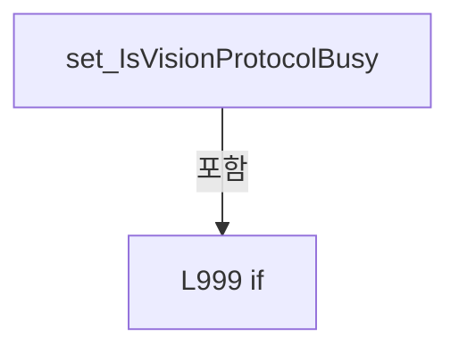

변경 전 점검: 입력/반환 타입, 위 호출자, 예외/취소 경로, 공유 상태와 저장·전송 소비자를 함께 확인합니다. 값의 단위나 물리 방향을 이름만으로 확정하지 않습니다.

### PropertyDeclaration `SelectHeadCommand` · L1006–1006

[Drilling.UI/Menu/Menus/CMenuManual.cs:1006–1006](https://github.com/kjuws10-rgb/A3Drilling/blob/96e22cd027c84bf302b23f2949b98985d7f301bb/Drilling.UI/Menu/Menus/CMenuManual.cs#L1006-L1006)

| 항목 | 실제 추출 값 |
| --- | --- |
| 서명 | Drilling.UI.Menu.CButtonCommand Drilling.UI.Menu.Menus.CMenuManual.SelectHeadCommand |
| 접근/수식자 | Public / public |
| 반환/값 타입 | Drilling.UI.Menu.CButtonCommand |
| 소속 타입 | NamedType:Drilling.UI.Menu.Menus.CMenuManual |

현재 부분 분석에서 직접 연결된 호출자는 없습니다. XAML/이벤트/인터페이스·델리게이트·외부 진입을 추가 확인해야 하며, 미사용으로 판정한 것이 아닙니다.

변경 전 점검: 입력/반환 타입, 위 호출자, 예외/취소 경로, 공유 상태와 저장·전송 소비자를 함께 확인합니다. 값의 단위나 물리 방향을 이름만으로 확정하지 않습니다.

### GetAccessorDeclaration `get_SelectHeadCommand` · L1006–1006

[Drilling.UI/Menu/Menus/CMenuManual.cs:1006–1006](https://github.com/kjuws10-rgb/A3Drilling/blob/96e22cd027c84bf302b23f2949b98985d7f301bb/Drilling.UI/Menu/Menus/CMenuManual.cs#L1006-L1006)

| 항목 | 실제 추출 값 |
| --- | --- |
| 서명 | Drilling.UI.Menu.CButtonCommand Drilling.UI.Menu.Menus.CMenuManual.SelectHeadCommand.get |
| 접근/수식자 | Public / get |
| 반환/값 타입 | Drilling.UI.Menu.CButtonCommand |
| 소속 타입 | NamedType:Drilling.UI.Menu.Menus.CMenuManual |

현재 부분 분석에서 직접 연결된 호출자는 없습니다. XAML/이벤트/인터페이스·델리게이트·외부 진입을 추가 확인해야 하며, 미사용으로 판정한 것이 아닙니다.

변경 전 점검: 입력/반환 타입, 위 호출자, 예외/취소 경로, 공유 상태와 저장·전송 소비자를 함께 확인합니다. 값의 단위나 물리 방향을 이름만으로 확정하지 않습니다.

### PropertyDeclaration `SelectSettingCommand` · L1007–1007

[Drilling.UI/Menu/Menus/CMenuManual.cs:1007–1007](https://github.com/kjuws10-rgb/A3Drilling/blob/96e22cd027c84bf302b23f2949b98985d7f301bb/Drilling.UI/Menu/Menus/CMenuManual.cs#L1007-L1007)

| 항목 | 실제 추출 값 |
| --- | --- |
| 서명 | Drilling.UI.Menu.CButtonCommand Drilling.UI.Menu.Menus.CMenuManual.SelectSettingCommand |
| 접근/수식자 | Public / public |
| 반환/값 타입 | Drilling.UI.Menu.CButtonCommand |
| 소속 타입 | NamedType:Drilling.UI.Menu.Menus.CMenuManual |

현재 부분 분석에서 직접 연결된 호출자는 없습니다. XAML/이벤트/인터페이스·델리게이트·외부 진입을 추가 확인해야 하며, 미사용으로 판정한 것이 아닙니다.

변경 전 점검: 입력/반환 타입, 위 호출자, 예외/취소 경로, 공유 상태와 저장·전송 소비자를 함께 확인합니다. 값의 단위나 물리 방향을 이름만으로 확정하지 않습니다.

### GetAccessorDeclaration `get_SelectSettingCommand` · L1007–1007

[Drilling.UI/Menu/Menus/CMenuManual.cs:1007–1007](https://github.com/kjuws10-rgb/A3Drilling/blob/96e22cd027c84bf302b23f2949b98985d7f301bb/Drilling.UI/Menu/Menus/CMenuManual.cs#L1007-L1007)

| 항목 | 실제 추출 값 |
| --- | --- |
| 서명 | Drilling.UI.Menu.CButtonCommand Drilling.UI.Menu.Menus.CMenuManual.SelectSettingCommand.get |
| 접근/수식자 | Public / get |
| 반환/값 타입 | Drilling.UI.Menu.CButtonCommand |
| 소속 타입 | NamedType:Drilling.UI.Menu.Menus.CMenuManual |

현재 부분 분석에서 직접 연결된 호출자는 없습니다. XAML/이벤트/인터페이스·델리게이트·외부 진입을 추가 확인해야 하며, 미사용으로 판정한 것이 아닙니다.

변경 전 점검: 입력/반환 타입, 위 호출자, 예외/취소 경로, 공유 상태와 저장·전송 소비자를 함께 확인합니다. 값의 단위나 물리 방향을 이름만으로 확정하지 않습니다.

### PropertyDeclaration `PreviousSettingPageCommand` · L1008–1008

[Drilling.UI/Menu/Menus/CMenuManual.cs:1008–1008](https://github.com/kjuws10-rgb/A3Drilling/blob/96e22cd027c84bf302b23f2949b98985d7f301bb/Drilling.UI/Menu/Menus/CMenuManual.cs#L1008-L1008)

| 항목 | 실제 추출 값 |
| --- | --- |
| 서명 | Drilling.UI.Menu.CButtonCommand Drilling.UI.Menu.Menus.CMenuManual.PreviousSettingPageCommand |
| 접근/수식자 | Public / public |
| 반환/값 타입 | Drilling.UI.Menu.CButtonCommand |
| 소속 타입 | NamedType:Drilling.UI.Menu.Menus.CMenuManual |

현재 부분 분석에서 직접 연결된 호출자는 없습니다. XAML/이벤트/인터페이스·델리게이트·외부 진입을 추가 확인해야 하며, 미사용으로 판정한 것이 아닙니다.

변경 전 점검: 입력/반환 타입, 위 호출자, 예외/취소 경로, 공유 상태와 저장·전송 소비자를 함께 확인합니다. 값의 단위나 물리 방향을 이름만으로 확정하지 않습니다.

### GetAccessorDeclaration `get_PreviousSettingPageCommand` · L1008–1008

[Drilling.UI/Menu/Menus/CMenuManual.cs:1008–1008](https://github.com/kjuws10-rgb/A3Drilling/blob/96e22cd027c84bf302b23f2949b98985d7f301bb/Drilling.UI/Menu/Menus/CMenuManual.cs#L1008-L1008)

| 항목 | 실제 추출 값 |
| --- | --- |
| 서명 | Drilling.UI.Menu.CButtonCommand Drilling.UI.Menu.Menus.CMenuManual.PreviousSettingPageCommand.get |
| 접근/수식자 | Public / get |
| 반환/값 타입 | Drilling.UI.Menu.CButtonCommand |
| 소속 타입 | NamedType:Drilling.UI.Menu.Menus.CMenuManual |

현재 부분 분석에서 직접 연결된 호출자는 없습니다. XAML/이벤트/인터페이스·델리게이트·외부 진입을 추가 확인해야 하며, 미사용으로 판정한 것이 아닙니다.

변경 전 점검: 입력/반환 타입, 위 호출자, 예외/취소 경로, 공유 상태와 저장·전송 소비자를 함께 확인합니다. 값의 단위나 물리 방향을 이름만으로 확정하지 않습니다.

### PropertyDeclaration `NextSettingPageCommand` · L1009–1009

[Drilling.UI/Menu/Menus/CMenuManual.cs:1009–1009](https://github.com/kjuws10-rgb/A3Drilling/blob/96e22cd027c84bf302b23f2949b98985d7f301bb/Drilling.UI/Menu/Menus/CMenuManual.cs#L1009-L1009)

| 항목 | 실제 추출 값 |
| --- | --- |
| 서명 | Drilling.UI.Menu.CButtonCommand Drilling.UI.Menu.Menus.CMenuManual.NextSettingPageCommand |
| 접근/수식자 | Public / public |
| 반환/값 타입 | Drilling.UI.Menu.CButtonCommand |
| 소속 타입 | NamedType:Drilling.UI.Menu.Menus.CMenuManual |

현재 부분 분석에서 직접 연결된 호출자는 없습니다. XAML/이벤트/인터페이스·델리게이트·외부 진입을 추가 확인해야 하며, 미사용으로 판정한 것이 아닙니다.

변경 전 점검: 입력/반환 타입, 위 호출자, 예외/취소 경로, 공유 상태와 저장·전송 소비자를 함께 확인합니다. 값의 단위나 물리 방향을 이름만으로 확정하지 않습니다.

### GetAccessorDeclaration `get_NextSettingPageCommand` · L1009–1009

[Drilling.UI/Menu/Menus/CMenuManual.cs:1009–1009](https://github.com/kjuws10-rgb/A3Drilling/blob/96e22cd027c84bf302b23f2949b98985d7f301bb/Drilling.UI/Menu/Menus/CMenuManual.cs#L1009-L1009)

| 항목 | 실제 추출 값 |
| --- | --- |
| 서명 | Drilling.UI.Menu.CButtonCommand Drilling.UI.Menu.Menus.CMenuManual.NextSettingPageCommand.get |
| 접근/수식자 | Public / get |
| 반환/값 타입 | Drilling.UI.Menu.CButtonCommand |
| 소속 타입 | NamedType:Drilling.UI.Menu.Menus.CMenuManual |

현재 부분 분석에서 직접 연결된 호출자는 없습니다. XAML/이벤트/인터페이스·델리게이트·외부 진입을 추가 확인해야 하며, 미사용으로 판정한 것이 아닙니다.

변경 전 점검: 입력/반환 타입, 위 호출자, 예외/취소 경로, 공유 상태와 저장·전송 소비자를 함께 확인합니다. 값의 단위나 물리 방향을 이름만으로 확정하지 않습니다.

### PropertyDeclaration `CreateCommand` · L1010–1010

[Drilling.UI/Menu/Menus/CMenuManual.cs:1010–1010](https://github.com/kjuws10-rgb/A3Drilling/blob/96e22cd027c84bf302b23f2949b98985d7f301bb/Drilling.UI/Menu/Menus/CMenuManual.cs#L1010-L1010)

| 항목 | 실제 추출 값 |
| --- | --- |
| 서명 | Drilling.UI.Menu.CButtonCommand Drilling.UI.Menu.Menus.CMenuManual.CreateCommand |
| 접근/수식자 | Public / public |
| 반환/값 타입 | Drilling.UI.Menu.CButtonCommand |
| 소속 타입 | NamedType:Drilling.UI.Menu.Menus.CMenuManual |

현재 부분 분석에서 직접 연결된 호출자는 없습니다. XAML/이벤트/인터페이스·델리게이트·외부 진입을 추가 확인해야 하며, 미사용으로 판정한 것이 아닙니다.

변경 전 점검: 입력/반환 타입, 위 호출자, 예외/취소 경로, 공유 상태와 저장·전송 소비자를 함께 확인합니다. 값의 단위나 물리 방향을 이름만으로 확정하지 않습니다.

### GetAccessorDeclaration `get_CreateCommand` · L1010–1010

[Drilling.UI/Menu/Menus/CMenuManual.cs:1010–1010](https://github.com/kjuws10-rgb/A3Drilling/blob/96e22cd027c84bf302b23f2949b98985d7f301bb/Drilling.UI/Menu/Menus/CMenuManual.cs#L1010-L1010)

| 항목 | 실제 추출 값 |
| --- | --- |
| 서명 | Drilling.UI.Menu.CButtonCommand Drilling.UI.Menu.Menus.CMenuManual.CreateCommand.get |
| 접근/수식자 | Public / get |
| 반환/값 타입 | Drilling.UI.Menu.CButtonCommand |
| 소속 타입 | NamedType:Drilling.UI.Menu.Menus.CMenuManual |

현재 부분 분석에서 직접 연결된 호출자는 없습니다. XAML/이벤트/인터페이스·델리게이트·외부 진입을 추가 확인해야 하며, 미사용으로 판정한 것이 아닙니다.

변경 전 점검: 입력/반환 타입, 위 호출자, 예외/취소 경로, 공유 상태와 저장·전송 소비자를 함께 확인합니다. 값의 단위나 물리 방향을 이름만으로 확정하지 않습니다.

### PropertyDeclaration `DeleteCommand` · L1011–1011

[Drilling.UI/Menu/Menus/CMenuManual.cs:1011–1011](https://github.com/kjuws10-rgb/A3Drilling/blob/96e22cd027c84bf302b23f2949b98985d7f301bb/Drilling.UI/Menu/Menus/CMenuManual.cs#L1011-L1011)

| 항목 | 실제 추출 값 |
| --- | --- |
| 서명 | Drilling.UI.Menu.CButtonCommand Drilling.UI.Menu.Menus.CMenuManual.DeleteCommand |
| 접근/수식자 | Public / public |
| 반환/값 타입 | Drilling.UI.Menu.CButtonCommand |
| 소속 타입 | NamedType:Drilling.UI.Menu.Menus.CMenuManual |

현재 부분 분석에서 직접 연결된 호출자는 없습니다. XAML/이벤트/인터페이스·델리게이트·외부 진입을 추가 확인해야 하며, 미사용으로 판정한 것이 아닙니다.

변경 전 점검: 입력/반환 타입, 위 호출자, 예외/취소 경로, 공유 상태와 저장·전송 소비자를 함께 확인합니다. 값의 단위나 물리 방향을 이름만으로 확정하지 않습니다.

### GetAccessorDeclaration `get_DeleteCommand` · L1011–1011

[Drilling.UI/Menu/Menus/CMenuManual.cs:1011–1011](https://github.com/kjuws10-rgb/A3Drilling/blob/96e22cd027c84bf302b23f2949b98985d7f301bb/Drilling.UI/Menu/Menus/CMenuManual.cs#L1011-L1011)

| 항목 | 실제 추출 값 |
| --- | --- |
| 서명 | Drilling.UI.Menu.CButtonCommand Drilling.UI.Menu.Menus.CMenuManual.DeleteCommand.get |
| 접근/수식자 | Public / get |
| 반환/값 타입 | Drilling.UI.Menu.CButtonCommand |
| 소속 타입 | NamedType:Drilling.UI.Menu.Menus.CMenuManual |

현재 부분 분석에서 직접 연결된 호출자는 없습니다. XAML/이벤트/인터페이스·델리게이트·외부 진입을 추가 확인해야 하며, 미사용으로 판정한 것이 아닙니다.

변경 전 점검: 입력/반환 타입, 위 호출자, 예외/취소 경로, 공유 상태와 저장·전송 소비자를 함께 확인합니다. 값의 단위나 물리 방향을 이름만으로 확정하지 않습니다.

### PropertyDeclaration `RenameCommand` · L1012–1012

[Drilling.UI/Menu/Menus/CMenuManual.cs:1012–1012](https://github.com/kjuws10-rgb/A3Drilling/blob/96e22cd027c84bf302b23f2949b98985d7f301bb/Drilling.UI/Menu/Menus/CMenuManual.cs#L1012-L1012)

| 항목 | 실제 추출 값 |
| --- | --- |
| 서명 | Drilling.UI.Menu.CButtonCommand Drilling.UI.Menu.Menus.CMenuManual.RenameCommand |
| 접근/수식자 | Public / public |
| 반환/값 타입 | Drilling.UI.Menu.CButtonCommand |
| 소속 타입 | NamedType:Drilling.UI.Menu.Menus.CMenuManual |

현재 부분 분석에서 직접 연결된 호출자는 없습니다. XAML/이벤트/인터페이스·델리게이트·외부 진입을 추가 확인해야 하며, 미사용으로 판정한 것이 아닙니다.

변경 전 점검: 입력/반환 타입, 위 호출자, 예외/취소 경로, 공유 상태와 저장·전송 소비자를 함께 확인합니다. 값의 단위나 물리 방향을 이름만으로 확정하지 않습니다.

### GetAccessorDeclaration `get_RenameCommand` · L1012–1012

[Drilling.UI/Menu/Menus/CMenuManual.cs:1012–1012](https://github.com/kjuws10-rgb/A3Drilling/blob/96e22cd027c84bf302b23f2949b98985d7f301bb/Drilling.UI/Menu/Menus/CMenuManual.cs#L1012-L1012)

| 항목 | 실제 추출 값 |
| --- | --- |
| 서명 | Drilling.UI.Menu.CButtonCommand Drilling.UI.Menu.Menus.CMenuManual.RenameCommand.get |
| 접근/수식자 | Public / get |
| 반환/값 타입 | Drilling.UI.Menu.CButtonCommand |
| 소속 타입 | NamedType:Drilling.UI.Menu.Menus.CMenuManual |

현재 부분 분석에서 직접 연결된 호출자는 없습니다. XAML/이벤트/인터페이스·델리게이트·외부 진입을 추가 확인해야 하며, 미사용으로 판정한 것이 아닙니다.

변경 전 점검: 입력/반환 타입, 위 호출자, 예외/취소 경로, 공유 상태와 저장·전송 소비자를 함께 확인합니다. 값의 단위나 물리 방향을 이름만으로 확정하지 않습니다.

### PropertyDeclaration `SaveCommand` · L1013–1013

[Drilling.UI/Menu/Menus/CMenuManual.cs:1013–1013](https://github.com/kjuws10-rgb/A3Drilling/blob/96e22cd027c84bf302b23f2949b98985d7f301bb/Drilling.UI/Menu/Menus/CMenuManual.cs#L1013-L1013)

| 항목 | 실제 추출 값 |
| --- | --- |
| 서명 | Drilling.UI.Menu.CButtonCommand Drilling.UI.Menu.Menus.CMenuManual.SaveCommand |
| 접근/수식자 | Public / public |
| 반환/값 타입 | Drilling.UI.Menu.CButtonCommand |
| 소속 타입 | NamedType:Drilling.UI.Menu.Menus.CMenuManual |

현재 부분 분석에서 직접 연결된 호출자는 없습니다. XAML/이벤트/인터페이스·델리게이트·외부 진입을 추가 확인해야 하며, 미사용으로 판정한 것이 아닙니다.

변경 전 점검: 입력/반환 타입, 위 호출자, 예외/취소 경로, 공유 상태와 저장·전송 소비자를 함께 확인합니다. 값의 단위나 물리 방향을 이름만으로 확정하지 않습니다.

### GetAccessorDeclaration `get_SaveCommand` · L1013–1013

[Drilling.UI/Menu/Menus/CMenuManual.cs:1013–1013](https://github.com/kjuws10-rgb/A3Drilling/blob/96e22cd027c84bf302b23f2949b98985d7f301bb/Drilling.UI/Menu/Menus/CMenuManual.cs#L1013-L1013)

| 항목 | 실제 추출 값 |
| --- | --- |
| 서명 | Drilling.UI.Menu.CButtonCommand Drilling.UI.Menu.Menus.CMenuManual.SaveCommand.get |
| 접근/수식자 | Public / get |
| 반환/값 타입 | Drilling.UI.Menu.CButtonCommand |
| 소속 타입 | NamedType:Drilling.UI.Menu.Menus.CMenuManual |

현재 부분 분석에서 직접 연결된 호출자는 없습니다. XAML/이벤트/인터페이스·델리게이트·외부 진입을 추가 확인해야 하며, 미사용으로 판정한 것이 아닙니다.

변경 전 점검: 입력/반환 타입, 위 호출자, 예외/취소 경로, 공유 상태와 저장·전송 소비자를 함께 확인합니다. 값의 단위나 물리 방향을 이름만으로 확정하지 않습니다.

### PropertyDeclaration `CenterMoveCommand` · L1014–1014

[Drilling.UI/Menu/Menus/CMenuManual.cs:1014–1014](https://github.com/kjuws10-rgb/A3Drilling/blob/96e22cd027c84bf302b23f2949b98985d7f301bb/Drilling.UI/Menu/Menus/CMenuManual.cs#L1014-L1014)

| 항목 | 실제 추출 값 |
| --- | --- |
| 서명 | Drilling.UI.Menu.CButtonCommand Drilling.UI.Menu.Menus.CMenuManual.CenterMoveCommand |
| 접근/수식자 | Public / public |
| 반환/값 타입 | Drilling.UI.Menu.CButtonCommand |
| 소속 타입 | NamedType:Drilling.UI.Menu.Menus.CMenuManual |

현재 부분 분석에서 직접 연결된 호출자는 없습니다. XAML/이벤트/인터페이스·델리게이트·외부 진입을 추가 확인해야 하며, 미사용으로 판정한 것이 아닙니다.

변경 전 점검: 입력/반환 타입, 위 호출자, 예외/취소 경로, 공유 상태와 저장·전송 소비자를 함께 확인합니다. 값의 단위나 물리 방향을 이름만으로 확정하지 않습니다.

### GetAccessorDeclaration `get_CenterMoveCommand` · L1014–1014

[Drilling.UI/Menu/Menus/CMenuManual.cs:1014–1014](https://github.com/kjuws10-rgb/A3Drilling/blob/96e22cd027c84bf302b23f2949b98985d7f301bb/Drilling.UI/Menu/Menus/CMenuManual.cs#L1014-L1014)

| 항목 | 실제 추출 값 |
| --- | --- |
| 서명 | Drilling.UI.Menu.CButtonCommand Drilling.UI.Menu.Menus.CMenuManual.CenterMoveCommand.get |
| 접근/수식자 | Public / get |
| 반환/값 타입 | Drilling.UI.Menu.CButtonCommand |
| 소속 타입 | NamedType:Drilling.UI.Menu.Menus.CMenuManual |

현재 부분 분석에서 직접 연결된 호출자는 없습니다. XAML/이벤트/인터페이스·델리게이트·외부 진입을 추가 확인해야 하며, 미사용으로 판정한 것이 아닙니다.

변경 전 점검: 입력/반환 타입, 위 호출자, 예외/취소 경로, 공유 상태와 저장·전송 소비자를 함께 확인합니다. 값의 단위나 물리 방향을 이름만으로 확정하지 않습니다.

### PropertyDeclaration `PositionMoveCommand` · L1015–1015

[Drilling.UI/Menu/Menus/CMenuManual.cs:1015–1015](https://github.com/kjuws10-rgb/A3Drilling/blob/96e22cd027c84bf302b23f2949b98985d7f301bb/Drilling.UI/Menu/Menus/CMenuManual.cs#L1015-L1015)

| 항목 | 실제 추출 값 |
| --- | --- |
| 서명 | Drilling.UI.Menu.CButtonCommand Drilling.UI.Menu.Menus.CMenuManual.PositionMoveCommand |
| 접근/수식자 | Public / public |
| 반환/값 타입 | Drilling.UI.Menu.CButtonCommand |
| 소속 타입 | NamedType:Drilling.UI.Menu.Menus.CMenuManual |

현재 부분 분석에서 직접 연결된 호출자는 없습니다. XAML/이벤트/인터페이스·델리게이트·외부 진입을 추가 확인해야 하며, 미사용으로 판정한 것이 아닙니다.

변경 전 점검: 입력/반환 타입, 위 호출자, 예외/취소 경로, 공유 상태와 저장·전송 소비자를 함께 확인합니다. 값의 단위나 물리 방향을 이름만으로 확정하지 않습니다.

### GetAccessorDeclaration `get_PositionMoveCommand` · L1015–1015

[Drilling.UI/Menu/Menus/CMenuManual.cs:1015–1015](https://github.com/kjuws10-rgb/A3Drilling/blob/96e22cd027c84bf302b23f2949b98985d7f301bb/Drilling.UI/Menu/Menus/CMenuManual.cs#L1015-L1015)

| 항목 | 실제 추출 값 |
| --- | --- |
| 서명 | Drilling.UI.Menu.CButtonCommand Drilling.UI.Menu.Menus.CMenuManual.PositionMoveCommand.get |
| 접근/수식자 | Public / get |
| 반환/값 타입 | Drilling.UI.Menu.CButtonCommand |
| 소속 타입 | NamedType:Drilling.UI.Menu.Menus.CMenuManual |

현재 부분 분석에서 직접 연결된 호출자는 없습니다. XAML/이벤트/인터페이스·델리게이트·외부 진입을 추가 확인해야 하며, 미사용으로 판정한 것이 아닙니다.

변경 전 점검: 입력/반환 타입, 위 호출자, 예외/취소 경로, 공유 상태와 저장·전송 소비자를 함께 확인합니다. 값의 단위나 물리 방향을 이름만으로 확정하지 않습니다.

### PropertyDeclaration `ZPositionMoveCommand` · L1016–1016

[Drilling.UI/Menu/Menus/CMenuManual.cs:1016–1016](https://github.com/kjuws10-rgb/A3Drilling/blob/96e22cd027c84bf302b23f2949b98985d7f301bb/Drilling.UI/Menu/Menus/CMenuManual.cs#L1016-L1016)

| 항목 | 실제 추출 값 |
| --- | --- |
| 서명 | Drilling.UI.Menu.CButtonCommand Drilling.UI.Menu.Menus.CMenuManual.ZPositionMoveCommand |
| 접근/수식자 | Public / public |
| 반환/값 타입 | Drilling.UI.Menu.CButtonCommand |
| 소속 타입 | NamedType:Drilling.UI.Menu.Menus.CMenuManual |

현재 부분 분석에서 직접 연결된 호출자는 없습니다. XAML/이벤트/인터페이스·델리게이트·외부 진입을 추가 확인해야 하며, 미사용으로 판정한 것이 아닙니다.

변경 전 점검: 입력/반환 타입, 위 호출자, 예외/취소 경로, 공유 상태와 저장·전송 소비자를 함께 확인합니다. 값의 단위나 물리 방향을 이름만으로 확정하지 않습니다.

### GetAccessorDeclaration `get_ZPositionMoveCommand` · L1016–1016

[Drilling.UI/Menu/Menus/CMenuManual.cs:1016–1016](https://github.com/kjuws10-rgb/A3Drilling/blob/96e22cd027c84bf302b23f2949b98985d7f301bb/Drilling.UI/Menu/Menus/CMenuManual.cs#L1016-L1016)

| 항목 | 실제 추출 값 |
| --- | --- |
| 서명 | Drilling.UI.Menu.CButtonCommand Drilling.UI.Menu.Menus.CMenuManual.ZPositionMoveCommand.get |
| 접근/수식자 | Public / get |
| 반환/값 타입 | Drilling.UI.Menu.CButtonCommand |
| 소속 타입 | NamedType:Drilling.UI.Menu.Menus.CMenuManual |

현재 부분 분석에서 직접 연결된 호출자는 없습니다. XAML/이벤트/인터페이스·델리게이트·외부 진입을 추가 확인해야 하며, 미사용으로 판정한 것이 아닙니다.

변경 전 점검: 입력/반환 타입, 위 호출자, 예외/취소 경로, 공유 상태와 저장·전송 소비자를 함께 확인합니다. 값의 단위나 물리 방향을 이름만으로 확정하지 않습니다.

### PropertyDeclaration `MoveStopCommand` · L1017–1017

[Drilling.UI/Menu/Menus/CMenuManual.cs:1017–1017](https://github.com/kjuws10-rgb/A3Drilling/blob/96e22cd027c84bf302b23f2949b98985d7f301bb/Drilling.UI/Menu/Menus/CMenuManual.cs#L1017-L1017)

| 항목 | 실제 추출 값 |
| --- | --- |
| 서명 | Drilling.UI.Menu.CButtonCommand Drilling.UI.Menu.Menus.CMenuManual.MoveStopCommand |
| 접근/수식자 | Public / public |
| 반환/값 타입 | Drilling.UI.Menu.CButtonCommand |
| 소속 타입 | NamedType:Drilling.UI.Menu.Menus.CMenuManual |

현재 부분 분석에서 직접 연결된 호출자는 없습니다. XAML/이벤트/인터페이스·델리게이트·외부 진입을 추가 확인해야 하며, 미사용으로 판정한 것이 아닙니다.

변경 전 점검: 입력/반환 타입, 위 호출자, 예외/취소 경로, 공유 상태와 저장·전송 소비자를 함께 확인합니다. 값의 단위나 물리 방향을 이름만으로 확정하지 않습니다.

### GetAccessorDeclaration `get_MoveStopCommand` · L1017–1017

[Drilling.UI/Menu/Menus/CMenuManual.cs:1017–1017](https://github.com/kjuws10-rgb/A3Drilling/blob/96e22cd027c84bf302b23f2949b98985d7f301bb/Drilling.UI/Menu/Menus/CMenuManual.cs#L1017-L1017)

| 항목 | 실제 추출 값 |
| --- | --- |
| 서명 | Drilling.UI.Menu.CButtonCommand Drilling.UI.Menu.Menus.CMenuManual.MoveStopCommand.get |
| 접근/수식자 | Public / get |
| 반환/값 타입 | Drilling.UI.Menu.CButtonCommand |
| 소속 타입 | NamedType:Drilling.UI.Menu.Menus.CMenuManual |

현재 부분 분석에서 직접 연결된 호출자는 없습니다. XAML/이벤트/인터페이스·델리게이트·외부 진입을 추가 확인해야 하며, 미사용으로 판정한 것이 아닙니다.

변경 전 점검: 입력/반환 타입, 위 호출자, 예외/취소 경로, 공유 상태와 저장·전송 소비자를 함께 확인합니다. 값의 단위나 물리 방향을 이름만으로 확정하지 않습니다.

### PropertyDeclaration `SelectShapeCommand` · L1018–1018

[Drilling.UI/Menu/Menus/CMenuManual.cs:1018–1018](https://github.com/kjuws10-rgb/A3Drilling/blob/96e22cd027c84bf302b23f2949b98985d7f301bb/Drilling.UI/Menu/Menus/CMenuManual.cs#L1018-L1018)

| 항목 | 실제 추출 값 |
| --- | --- |
| 서명 | Drilling.UI.Menu.CButtonCommand Drilling.UI.Menu.Menus.CMenuManual.SelectShapeCommand |
| 접근/수식자 | Public / public |
| 반환/값 타입 | Drilling.UI.Menu.CButtonCommand |
| 소속 타입 | NamedType:Drilling.UI.Menu.Menus.CMenuManual |

현재 부분 분석에서 직접 연결된 호출자는 없습니다. XAML/이벤트/인터페이스·델리게이트·외부 진입을 추가 확인해야 하며, 미사용으로 판정한 것이 아닙니다.

변경 전 점검: 입력/반환 타입, 위 호출자, 예외/취소 경로, 공유 상태와 저장·전송 소비자를 함께 확인합니다. 값의 단위나 물리 방향을 이름만으로 확정하지 않습니다.

### GetAccessorDeclaration `get_SelectShapeCommand` · L1018–1018

[Drilling.UI/Menu/Menus/CMenuManual.cs:1018–1018](https://github.com/kjuws10-rgb/A3Drilling/blob/96e22cd027c84bf302b23f2949b98985d7f301bb/Drilling.UI/Menu/Menus/CMenuManual.cs#L1018-L1018)

| 항목 | 실제 추출 값 |
| --- | --- |
| 서명 | Drilling.UI.Menu.CButtonCommand Drilling.UI.Menu.Menus.CMenuManual.SelectShapeCommand.get |
| 접근/수식자 | Public / get |
| 반환/값 타입 | Drilling.UI.Menu.CButtonCommand |
| 소속 타입 | NamedType:Drilling.UI.Menu.Menus.CMenuManual |

현재 부분 분석에서 직접 연결된 호출자는 없습니다. XAML/이벤트/인터페이스·델리게이트·외부 진입을 추가 확인해야 하며, 미사용으로 판정한 것이 아닙니다.

변경 전 점검: 입력/반환 타입, 위 호출자, 예외/취소 경로, 공유 상태와 저장·전송 소비자를 함께 확인합니다. 값의 단위나 물리 방향을 이름만으로 확정하지 않습니다.

### PropertyDeclaration `ShapeStartCommand` · L1019–1019

[Drilling.UI/Menu/Menus/CMenuManual.cs:1019–1019](https://github.com/kjuws10-rgb/A3Drilling/blob/96e22cd027c84bf302b23f2949b98985d7f301bb/Drilling.UI/Menu/Menus/CMenuManual.cs#L1019-L1019)

| 항목 | 실제 추출 값 |
| --- | --- |
| 서명 | Drilling.UI.Menu.CButtonCommand Drilling.UI.Menu.Menus.CMenuManual.ShapeStartCommand |
| 접근/수식자 | Public / public |
| 반환/값 타입 | Drilling.UI.Menu.CButtonCommand |
| 소속 타입 | NamedType:Drilling.UI.Menu.Menus.CMenuManual |

현재 부분 분석에서 직접 연결된 호출자는 없습니다. XAML/이벤트/인터페이스·델리게이트·외부 진입을 추가 확인해야 하며, 미사용으로 판정한 것이 아닙니다.

변경 전 점검: 입력/반환 타입, 위 호출자, 예외/취소 경로, 공유 상태와 저장·전송 소비자를 함께 확인합니다. 값의 단위나 물리 방향을 이름만으로 확정하지 않습니다.

### GetAccessorDeclaration `get_ShapeStartCommand` · L1019–1019

[Drilling.UI/Menu/Menus/CMenuManual.cs:1019–1019](https://github.com/kjuws10-rgb/A3Drilling/blob/96e22cd027c84bf302b23f2949b98985d7f301bb/Drilling.UI/Menu/Menus/CMenuManual.cs#L1019-L1019)

| 항목 | 실제 추출 값 |
| --- | --- |
| 서명 | Drilling.UI.Menu.CButtonCommand Drilling.UI.Menu.Menus.CMenuManual.ShapeStartCommand.get |
| 접근/수식자 | Public / get |
| 반환/값 타입 | Drilling.UI.Menu.CButtonCommand |
| 소속 타입 | NamedType:Drilling.UI.Menu.Menus.CMenuManual |

현재 부분 분석에서 직접 연결된 호출자는 없습니다. XAML/이벤트/인터페이스·델리게이트·외부 진입을 추가 확인해야 하며, 미사용으로 판정한 것이 아닙니다.

변경 전 점검: 입력/반환 타입, 위 호출자, 예외/취소 경로, 공유 상태와 저장·전송 소비자를 함께 확인합니다. 값의 단위나 물리 방향을 이름만으로 확정하지 않습니다.

### PropertyDeclaration `ShapeStopCommand` · L1020–1020

[Drilling.UI/Menu/Menus/CMenuManual.cs:1020–1020](https://github.com/kjuws10-rgb/A3Drilling/blob/96e22cd027c84bf302b23f2949b98985d7f301bb/Drilling.UI/Menu/Menus/CMenuManual.cs#L1020-L1020)

| 항목 | 실제 추출 값 |
| --- | --- |
| 서명 | Drilling.UI.Menu.CButtonCommand Drilling.UI.Menu.Menus.CMenuManual.ShapeStopCommand |
| 접근/수식자 | Public / public |
| 반환/값 타입 | Drilling.UI.Menu.CButtonCommand |
| 소속 타입 | NamedType:Drilling.UI.Menu.Menus.CMenuManual |

현재 부분 분석에서 직접 연결된 호출자는 없습니다. XAML/이벤트/인터페이스·델리게이트·외부 진입을 추가 확인해야 하며, 미사용으로 판정한 것이 아닙니다.

변경 전 점검: 입력/반환 타입, 위 호출자, 예외/취소 경로, 공유 상태와 저장·전송 소비자를 함께 확인합니다. 값의 단위나 물리 방향을 이름만으로 확정하지 않습니다.

### GetAccessorDeclaration `get_ShapeStopCommand` · L1020–1020

[Drilling.UI/Menu/Menus/CMenuManual.cs:1020–1020](https://github.com/kjuws10-rgb/A3Drilling/blob/96e22cd027c84bf302b23f2949b98985d7f301bb/Drilling.UI/Menu/Menus/CMenuManual.cs#L1020-L1020)

| 항목 | 실제 추출 값 |
| --- | --- |
| 서명 | Drilling.UI.Menu.CButtonCommand Drilling.UI.Menu.Menus.CMenuManual.ShapeStopCommand.get |
| 접근/수식자 | Public / get |
| 반환/값 타입 | Drilling.UI.Menu.CButtonCommand |
| 소속 타입 | NamedType:Drilling.UI.Menu.Menus.CMenuManual |

현재 부분 분석에서 직접 연결된 호출자는 없습니다. XAML/이벤트/인터페이스·델리게이트·외부 진입을 추가 확인해야 하며, 미사용으로 판정한 것이 아닙니다.

변경 전 점검: 입력/반환 타입, 위 호출자, 예외/취소 경로, 공유 상태와 저장·전송 소비자를 함께 확인합니다. 값의 단위나 물리 방향을 이름만으로 확정하지 않습니다.

### PropertyDeclaration `LaserOnCommand` · L1021–1021

[Drilling.UI/Menu/Menus/CMenuManual.cs:1021–1021](https://github.com/kjuws10-rgb/A3Drilling/blob/96e22cd027c84bf302b23f2949b98985d7f301bb/Drilling.UI/Menu/Menus/CMenuManual.cs#L1021-L1021)

| 항목 | 실제 추출 값 |
| --- | --- |
| 서명 | Drilling.UI.Menu.CButtonCommand Drilling.UI.Menu.Menus.CMenuManual.LaserOnCommand |
| 접근/수식자 | Public / public |
| 반환/값 타입 | Drilling.UI.Menu.CButtonCommand |
| 소속 타입 | NamedType:Drilling.UI.Menu.Menus.CMenuManual |

현재 부분 분석에서 직접 연결된 호출자는 없습니다. XAML/이벤트/인터페이스·델리게이트·외부 진입을 추가 확인해야 하며, 미사용으로 판정한 것이 아닙니다.

변경 전 점검: 입력/반환 타입, 위 호출자, 예외/취소 경로, 공유 상태와 저장·전송 소비자를 함께 확인합니다. 값의 단위나 물리 방향을 이름만으로 확정하지 않습니다.

### GetAccessorDeclaration `get_LaserOnCommand` · L1021–1021

[Drilling.UI/Menu/Menus/CMenuManual.cs:1021–1021](https://github.com/kjuws10-rgb/A3Drilling/blob/96e22cd027c84bf302b23f2949b98985d7f301bb/Drilling.UI/Menu/Menus/CMenuManual.cs#L1021-L1021)

| 항목 | 실제 추출 값 |
| --- | --- |
| 서명 | Drilling.UI.Menu.CButtonCommand Drilling.UI.Menu.Menus.CMenuManual.LaserOnCommand.get |
| 접근/수식자 | Public / get |
| 반환/값 타입 | Drilling.UI.Menu.CButtonCommand |
| 소속 타입 | NamedType:Drilling.UI.Menu.Menus.CMenuManual |

현재 부분 분석에서 직접 연결된 호출자는 없습니다. XAML/이벤트/인터페이스·델리게이트·외부 진입을 추가 확인해야 하며, 미사용으로 판정한 것이 아닙니다.

변경 전 점검: 입력/반환 타입, 위 호출자, 예외/취소 경로, 공유 상태와 저장·전송 소비자를 함께 확인합니다. 값의 단위나 물리 방향을 이름만으로 확정하지 않습니다.

### PropertyDeclaration `LaserOffCommand` · L1022–1022

[Drilling.UI/Menu/Menus/CMenuManual.cs:1022–1022](https://github.com/kjuws10-rgb/A3Drilling/blob/96e22cd027c84bf302b23f2949b98985d7f301bb/Drilling.UI/Menu/Menus/CMenuManual.cs#L1022-L1022)

| 항목 | 실제 추출 값 |
| --- | --- |
| 서명 | Drilling.UI.Menu.CButtonCommand Drilling.UI.Menu.Menus.CMenuManual.LaserOffCommand |
| 접근/수식자 | Public / public |
| 반환/값 타입 | Drilling.UI.Menu.CButtonCommand |
| 소속 타입 | NamedType:Drilling.UI.Menu.Menus.CMenuManual |

현재 부분 분석에서 직접 연결된 호출자는 없습니다. XAML/이벤트/인터페이스·델리게이트·외부 진입을 추가 확인해야 하며, 미사용으로 판정한 것이 아닙니다.

변경 전 점검: 입력/반환 타입, 위 호출자, 예외/취소 경로, 공유 상태와 저장·전송 소비자를 함께 확인합니다. 값의 단위나 물리 방향을 이름만으로 확정하지 않습니다.

### GetAccessorDeclaration `get_LaserOffCommand` · L1022–1022

[Drilling.UI/Menu/Menus/CMenuManual.cs:1022–1022](https://github.com/kjuws10-rgb/A3Drilling/blob/96e22cd027c84bf302b23f2949b98985d7f301bb/Drilling.UI/Menu/Menus/CMenuManual.cs#L1022-L1022)

| 항목 | 실제 추출 값 |
| --- | --- |
| 서명 | Drilling.UI.Menu.CButtonCommand Drilling.UI.Menu.Menus.CMenuManual.LaserOffCommand.get |
| 접근/수식자 | Public / get |
| 반환/값 타입 | Drilling.UI.Menu.CButtonCommand |
| 소속 타입 | NamedType:Drilling.UI.Menu.Menus.CMenuManual |

현재 부분 분석에서 직접 연결된 호출자는 없습니다. XAML/이벤트/인터페이스·델리게이트·외부 진입을 추가 확인해야 하며, 미사용으로 판정한 것이 아닙니다.

변경 전 점검: 입력/반환 타입, 위 호출자, 예외/취소 경로, 공유 상태와 저장·전송 소비자를 함께 확인합니다. 값의 단위나 물리 방향을 이름만으로 확정하지 않습니다.

### PropertyDeclaration `CenterOnCommand` · L1023–1023

[Drilling.UI/Menu/Menus/CMenuManual.cs:1023–1023](https://github.com/kjuws10-rgb/A3Drilling/blob/96e22cd027c84bf302b23f2949b98985d7f301bb/Drilling.UI/Menu/Menus/CMenuManual.cs#L1023-L1023)

| 항목 | 실제 추출 값 |
| --- | --- |
| 서명 | Drilling.UI.Menu.CButtonCommand Drilling.UI.Menu.Menus.CMenuManual.CenterOnCommand |
| 접근/수식자 | Public / public |
| 반환/값 타입 | Drilling.UI.Menu.CButtonCommand |
| 소속 타입 | NamedType:Drilling.UI.Menu.Menus.CMenuManual |

현재 부분 분석에서 직접 연결된 호출자는 없습니다. XAML/이벤트/인터페이스·델리게이트·외부 진입을 추가 확인해야 하며, 미사용으로 판정한 것이 아닙니다.

변경 전 점검: 입력/반환 타입, 위 호출자, 예외/취소 경로, 공유 상태와 저장·전송 소비자를 함께 확인합니다. 값의 단위나 물리 방향을 이름만으로 확정하지 않습니다.

### GetAccessorDeclaration `get_CenterOnCommand` · L1023–1023

[Drilling.UI/Menu/Menus/CMenuManual.cs:1023–1023](https://github.com/kjuws10-rgb/A3Drilling/blob/96e22cd027c84bf302b23f2949b98985d7f301bb/Drilling.UI/Menu/Menus/CMenuManual.cs#L1023-L1023)

| 항목 | 실제 추출 값 |
| --- | --- |
| 서명 | Drilling.UI.Menu.CButtonCommand Drilling.UI.Menu.Menus.CMenuManual.CenterOnCommand.get |
| 접근/수식자 | Public / get |
| 반환/값 타입 | Drilling.UI.Menu.CButtonCommand |
| 소속 타입 | NamedType:Drilling.UI.Menu.Menus.CMenuManual |

현재 부분 분석에서 직접 연결된 호출자는 없습니다. XAML/이벤트/인터페이스·델리게이트·외부 진입을 추가 확인해야 하며, 미사용으로 판정한 것이 아닙니다.

변경 전 점검: 입력/반환 타입, 위 호출자, 예외/취소 경로, 공유 상태와 저장·전송 소비자를 함께 확인합니다. 값의 단위나 물리 방향을 이름만으로 확정하지 않습니다.

### PropertyDeclaration `DioReadCommand` · L1024–1024

[Drilling.UI/Menu/Menus/CMenuManual.cs:1024–1024](https://github.com/kjuws10-rgb/A3Drilling/blob/96e22cd027c84bf302b23f2949b98985d7f301bb/Drilling.UI/Menu/Menus/CMenuManual.cs#L1024-L1024)

| 항목 | 실제 추출 값 |
| --- | --- |
| 서명 | Drilling.UI.Menu.CButtonCommand Drilling.UI.Menu.Menus.CMenuManual.DioReadCommand |
| 접근/수식자 | Public / public |
| 반환/값 타입 | Drilling.UI.Menu.CButtonCommand |
| 소속 타입 | NamedType:Drilling.UI.Menu.Menus.CMenuManual |

현재 부분 분석에서 직접 연결된 호출자는 없습니다. XAML/이벤트/인터페이스·델리게이트·외부 진입을 추가 확인해야 하며, 미사용으로 판정한 것이 아닙니다.

변경 전 점검: 입력/반환 타입, 위 호출자, 예외/취소 경로, 공유 상태와 저장·전송 소비자를 함께 확인합니다. 값의 단위나 물리 방향을 이름만으로 확정하지 않습니다.

### GetAccessorDeclaration `get_DioReadCommand` · L1024–1024

[Drilling.UI/Menu/Menus/CMenuManual.cs:1024–1024](https://github.com/kjuws10-rgb/A3Drilling/blob/96e22cd027c84bf302b23f2949b98985d7f301bb/Drilling.UI/Menu/Menus/CMenuManual.cs#L1024-L1024)

| 항목 | 실제 추출 값 |
| --- | --- |
| 서명 | Drilling.UI.Menu.CButtonCommand Drilling.UI.Menu.Menus.CMenuManual.DioReadCommand.get |
| 접근/수식자 | Public / get |
| 반환/값 타입 | Drilling.UI.Menu.CButtonCommand |
| 소속 타입 | NamedType:Drilling.UI.Menu.Menus.CMenuManual |

현재 부분 분석에서 직접 연결된 호출자는 없습니다. XAML/이벤트/인터페이스·델리게이트·외부 진입을 추가 확인해야 하며, 미사용으로 판정한 것이 아닙니다.

변경 전 점검: 입력/반환 타입, 위 호출자, 예외/취소 경로, 공유 상태와 저장·전송 소비자를 함께 확인합니다. 값의 단위나 물리 방향을 이름만으로 확정하지 않습니다.

### PropertyDeclaration `DioOnCommand` · L1025–1025

[Drilling.UI/Menu/Menus/CMenuManual.cs:1025–1025](https://github.com/kjuws10-rgb/A3Drilling/blob/96e22cd027c84bf302b23f2949b98985d7f301bb/Drilling.UI/Menu/Menus/CMenuManual.cs#L1025-L1025)

| 항목 | 실제 추출 값 |
| --- | --- |
| 서명 | Drilling.UI.Menu.CButtonCommand Drilling.UI.Menu.Menus.CMenuManual.DioOnCommand |
| 접근/수식자 | Public / public |
| 반환/값 타입 | Drilling.UI.Menu.CButtonCommand |
| 소속 타입 | NamedType:Drilling.UI.Menu.Menus.CMenuManual |

현재 부분 분석에서 직접 연결된 호출자는 없습니다. XAML/이벤트/인터페이스·델리게이트·외부 진입을 추가 확인해야 하며, 미사용으로 판정한 것이 아닙니다.

변경 전 점검: 입력/반환 타입, 위 호출자, 예외/취소 경로, 공유 상태와 저장·전송 소비자를 함께 확인합니다. 값의 단위나 물리 방향을 이름만으로 확정하지 않습니다.

### GetAccessorDeclaration `get_DioOnCommand` · L1025–1025

[Drilling.UI/Menu/Menus/CMenuManual.cs:1025–1025](https://github.com/kjuws10-rgb/A3Drilling/blob/96e22cd027c84bf302b23f2949b98985d7f301bb/Drilling.UI/Menu/Menus/CMenuManual.cs#L1025-L1025)

| 항목 | 실제 추출 값 |
| --- | --- |
| 서명 | Drilling.UI.Menu.CButtonCommand Drilling.UI.Menu.Menus.CMenuManual.DioOnCommand.get |
| 접근/수식자 | Public / get |
| 반환/값 타입 | Drilling.UI.Menu.CButtonCommand |
| 소속 타입 | NamedType:Drilling.UI.Menu.Menus.CMenuManual |

현재 부분 분석에서 직접 연결된 호출자는 없습니다. XAML/이벤트/인터페이스·델리게이트·외부 진입을 추가 확인해야 하며, 미사용으로 판정한 것이 아닙니다.

변경 전 점검: 입력/반환 타입, 위 호출자, 예외/취소 경로, 공유 상태와 저장·전송 소비자를 함께 확인합니다. 값의 단위나 물리 방향을 이름만으로 확정하지 않습니다.

### PropertyDeclaration `DioOffCommand` · L1026–1026

[Drilling.UI/Menu/Menus/CMenuManual.cs:1026–1026](https://github.com/kjuws10-rgb/A3Drilling/blob/96e22cd027c84bf302b23f2949b98985d7f301bb/Drilling.UI/Menu/Menus/CMenuManual.cs#L1026-L1026)

| 항목 | 실제 추출 값 |
| --- | --- |
| 서명 | Drilling.UI.Menu.CButtonCommand Drilling.UI.Menu.Menus.CMenuManual.DioOffCommand |
| 접근/수식자 | Public / public |
| 반환/값 타입 | Drilling.UI.Menu.CButtonCommand |
| 소속 타입 | NamedType:Drilling.UI.Menu.Menus.CMenuManual |

현재 부분 분석에서 직접 연결된 호출자는 없습니다. XAML/이벤트/인터페이스·델리게이트·외부 진입을 추가 확인해야 하며, 미사용으로 판정한 것이 아닙니다.

변경 전 점검: 입력/반환 타입, 위 호출자, 예외/취소 경로, 공유 상태와 저장·전송 소비자를 함께 확인합니다. 값의 단위나 물리 방향을 이름만으로 확정하지 않습니다.

### GetAccessorDeclaration `get_DioOffCommand` · L1026–1026

[Drilling.UI/Menu/Menus/CMenuManual.cs:1026–1026](https://github.com/kjuws10-rgb/A3Drilling/blob/96e22cd027c84bf302b23f2949b98985d7f301bb/Drilling.UI/Menu/Menus/CMenuManual.cs#L1026-L1026)

| 항목 | 실제 추출 값 |
| --- | --- |
| 서명 | Drilling.UI.Menu.CButtonCommand Drilling.UI.Menu.Menus.CMenuManual.DioOffCommand.get |
| 접근/수식자 | Public / get |
| 반환/값 타입 | Drilling.UI.Menu.CButtonCommand |
| 소속 타입 | NamedType:Drilling.UI.Menu.Menus.CMenuManual |

현재 부분 분석에서 직접 연결된 호출자는 없습니다. XAML/이벤트/인터페이스·델리게이트·외부 진입을 추가 확인해야 하며, 미사용으로 판정한 것이 아닙니다.

변경 전 점검: 입력/반환 타입, 위 호출자, 예외/취소 경로, 공유 상태와 저장·전송 소비자를 함께 확인합니다. 값의 단위나 물리 방향을 이름만으로 확정하지 않습니다.

### PropertyDeclaration `ScannerAxisHomeCommand` · L1027–1027

[Drilling.UI/Menu/Menus/CMenuManual.cs:1027–1027](https://github.com/kjuws10-rgb/A3Drilling/blob/96e22cd027c84bf302b23f2949b98985d7f301bb/Drilling.UI/Menu/Menus/CMenuManual.cs#L1027-L1027)

| 항목 | 실제 추출 값 |
| --- | --- |
| 서명 | Drilling.UI.Menu.CButtonCommand Drilling.UI.Menu.Menus.CMenuManual.ScannerAxisHomeCommand |
| 접근/수식자 | Public / public |
| 반환/값 타입 | Drilling.UI.Menu.CButtonCommand |
| 소속 타입 | NamedType:Drilling.UI.Menu.Menus.CMenuManual |

현재 부분 분석에서 직접 연결된 호출자는 없습니다. XAML/이벤트/인터페이스·델리게이트·외부 진입을 추가 확인해야 하며, 미사용으로 판정한 것이 아닙니다.

변경 전 점검: 입력/반환 타입, 위 호출자, 예외/취소 경로, 공유 상태와 저장·전송 소비자를 함께 확인합니다. 값의 단위나 물리 방향을 이름만으로 확정하지 않습니다.

### GetAccessorDeclaration `get_ScannerAxisHomeCommand` · L1027–1027

[Drilling.UI/Menu/Menus/CMenuManual.cs:1027–1027](https://github.com/kjuws10-rgb/A3Drilling/blob/96e22cd027c84bf302b23f2949b98985d7f301bb/Drilling.UI/Menu/Menus/CMenuManual.cs#L1027-L1027)

| 항목 | 실제 추출 값 |
| --- | --- |
| 서명 | Drilling.UI.Menu.CButtonCommand Drilling.UI.Menu.Menus.CMenuManual.ScannerAxisHomeCommand.get |
| 접근/수식자 | Public / get |
| 반환/값 타입 | Drilling.UI.Menu.CButtonCommand |
| 소속 타입 | NamedType:Drilling.UI.Menu.Menus.CMenuManual |

현재 부분 분석에서 직접 연결된 호출자는 없습니다. XAML/이벤트/인터페이스·델리게이트·외부 진입을 추가 확인해야 하며, 미사용으로 판정한 것이 아닙니다.

변경 전 점검: 입력/반환 타입, 위 호출자, 예외/취소 경로, 공유 상태와 저장·전송 소비자를 함께 확인합니다. 값의 단위나 물리 방향을 이름만으로 확정하지 않습니다.

### PropertyDeclaration `ScannerAxisEnableCommand` · L1028–1028

[Drilling.UI/Menu/Menus/CMenuManual.cs:1028–1028](https://github.com/kjuws10-rgb/A3Drilling/blob/96e22cd027c84bf302b23f2949b98985d7f301bb/Drilling.UI/Menu/Menus/CMenuManual.cs#L1028-L1028)

| 항목 | 실제 추출 값 |
| --- | --- |
| 서명 | Drilling.UI.Menu.CButtonCommand Drilling.UI.Menu.Menus.CMenuManual.ScannerAxisEnableCommand |
| 접근/수식자 | Public / public |
| 반환/값 타입 | Drilling.UI.Menu.CButtonCommand |
| 소속 타입 | NamedType:Drilling.UI.Menu.Menus.CMenuManual |

현재 부분 분석에서 직접 연결된 호출자는 없습니다. XAML/이벤트/인터페이스·델리게이트·외부 진입을 추가 확인해야 하며, 미사용으로 판정한 것이 아닙니다.

변경 전 점검: 입력/반환 타입, 위 호출자, 예외/취소 경로, 공유 상태와 저장·전송 소비자를 함께 확인합니다. 값의 단위나 물리 방향을 이름만으로 확정하지 않습니다.

### GetAccessorDeclaration `get_ScannerAxisEnableCommand` · L1028–1028

[Drilling.UI/Menu/Menus/CMenuManual.cs:1028–1028](https://github.com/kjuws10-rgb/A3Drilling/blob/96e22cd027c84bf302b23f2949b98985d7f301bb/Drilling.UI/Menu/Menus/CMenuManual.cs#L1028-L1028)

| 항목 | 실제 추출 값 |
| --- | --- |
| 서명 | Drilling.UI.Menu.CButtonCommand Drilling.UI.Menu.Menus.CMenuManual.ScannerAxisEnableCommand.get |
| 접근/수식자 | Public / get |
| 반환/값 타입 | Drilling.UI.Menu.CButtonCommand |
| 소속 타입 | NamedType:Drilling.UI.Menu.Menus.CMenuManual |

현재 부분 분석에서 직접 연결된 호출자는 없습니다. XAML/이벤트/인터페이스·델리게이트·외부 진입을 추가 확인해야 하며, 미사용으로 판정한 것이 아닙니다.

변경 전 점검: 입력/반환 타입, 위 호출자, 예외/취소 경로, 공유 상태와 저장·전송 소비자를 함께 확인합니다. 값의 단위나 물리 방향을 이름만으로 확정하지 않습니다.

### PropertyDeclaration `ScannerAxisDisableCommand` · L1029–1029

[Drilling.UI/Menu/Menus/CMenuManual.cs:1029–1029](https://github.com/kjuws10-rgb/A3Drilling/blob/96e22cd027c84bf302b23f2949b98985d7f301bb/Drilling.UI/Menu/Menus/CMenuManual.cs#L1029-L1029)

| 항목 | 실제 추출 값 |
| --- | --- |
| 서명 | Drilling.UI.Menu.CButtonCommand Drilling.UI.Menu.Menus.CMenuManual.ScannerAxisDisableCommand |
| 접근/수식자 | Public / public |
| 반환/값 타입 | Drilling.UI.Menu.CButtonCommand |
| 소속 타입 | NamedType:Drilling.UI.Menu.Menus.CMenuManual |

현재 부분 분석에서 직접 연결된 호출자는 없습니다. XAML/이벤트/인터페이스·델리게이트·외부 진입을 추가 확인해야 하며, 미사용으로 판정한 것이 아닙니다.

변경 전 점검: 입력/반환 타입, 위 호출자, 예외/취소 경로, 공유 상태와 저장·전송 소비자를 함께 확인합니다. 값의 단위나 물리 방향을 이름만으로 확정하지 않습니다.

### GetAccessorDeclaration `get_ScannerAxisDisableCommand` · L1029–1029

[Drilling.UI/Menu/Menus/CMenuManual.cs:1029–1029](https://github.com/kjuws10-rgb/A3Drilling/blob/96e22cd027c84bf302b23f2949b98985d7f301bb/Drilling.UI/Menu/Menus/CMenuManual.cs#L1029-L1029)

| 항목 | 실제 추출 값 |
| --- | --- |
| 서명 | Drilling.UI.Menu.CButtonCommand Drilling.UI.Menu.Menus.CMenuManual.ScannerAxisDisableCommand.get |
| 접근/수식자 | Public / get |
| 반환/값 타입 | Drilling.UI.Menu.CButtonCommand |
| 소속 타입 | NamedType:Drilling.UI.Menu.Menus.CMenuManual |

현재 부분 분석에서 직접 연결된 호출자는 없습니다. XAML/이벤트/인터페이스·델리게이트·외부 진입을 추가 확인해야 하며, 미사용으로 판정한 것이 아닙니다.

변경 전 점검: 입력/반환 타입, 위 호출자, 예외/취소 경로, 공유 상태와 저장·전송 소비자를 함께 확인합니다. 값의 단위나 물리 방향을 이름만으로 확정하지 않습니다.

### PropertyDeclaration `ResetAutomationControllerCommand` · L1030–1030

[Drilling.UI/Menu/Menus/CMenuManual.cs:1030–1030](https://github.com/kjuws10-rgb/A3Drilling/blob/96e22cd027c84bf302b23f2949b98985d7f301bb/Drilling.UI/Menu/Menus/CMenuManual.cs#L1030-L1030)

| 항목 | 실제 추출 값 |
| --- | --- |
| 서명 | Drilling.UI.Menu.CButtonCommand Drilling.UI.Menu.Menus.CMenuManual.ResetAutomationControllerCommand |
| 접근/수식자 | Public / public |
| 반환/값 타입 | Drilling.UI.Menu.CButtonCommand |
| 소속 타입 | NamedType:Drilling.UI.Menu.Menus.CMenuManual |

현재 부분 분석에서 직접 연결된 호출자는 없습니다. XAML/이벤트/인터페이스·델리게이트·외부 진입을 추가 확인해야 하며, 미사용으로 판정한 것이 아닙니다.

변경 전 점검: 입력/반환 타입, 위 호출자, 예외/취소 경로, 공유 상태와 저장·전송 소비자를 함께 확인합니다. 값의 단위나 물리 방향을 이름만으로 확정하지 않습니다.

### GetAccessorDeclaration `get_ResetAutomationControllerCommand` · L1030–1030

[Drilling.UI/Menu/Menus/CMenuManual.cs:1030–1030](https://github.com/kjuws10-rgb/A3Drilling/blob/96e22cd027c84bf302b23f2949b98985d7f301bb/Drilling.UI/Menu/Menus/CMenuManual.cs#L1030-L1030)

| 항목 | 실제 추출 값 |
| --- | --- |
| 서명 | Drilling.UI.Menu.CButtonCommand Drilling.UI.Menu.Menus.CMenuManual.ResetAutomationControllerCommand.get |
| 접근/수식자 | Public / get |
| 반환/값 타입 | Drilling.UI.Menu.CButtonCommand |
| 소속 타입 | NamedType:Drilling.UI.Menu.Menus.CMenuManual |

현재 부분 분석에서 직접 연결된 호출자는 없습니다. XAML/이벤트/인터페이스·델리게이트·외부 진입을 추가 확인해야 하며, 미사용으로 판정한 것이 아닙니다.

변경 전 점검: 입력/반환 타입, 위 호출자, 예외/취소 경로, 공유 상태와 저장·전송 소비자를 함께 확인합니다. 값의 단위나 물리 방향을 이름만으로 확정하지 않습니다.

### PropertyDeclaration `HomeAutomationControllerAxesCommand` · L1031–1031

[Drilling.UI/Menu/Menus/CMenuManual.cs:1031–1031](https://github.com/kjuws10-rgb/A3Drilling/blob/96e22cd027c84bf302b23f2949b98985d7f301bb/Drilling.UI/Menu/Menus/CMenuManual.cs#L1031-L1031)

| 항목 | 실제 추출 값 |
| --- | --- |
| 서명 | Drilling.UI.Menu.CButtonCommand Drilling.UI.Menu.Menus.CMenuManual.HomeAutomationControllerAxesCommand |
| 접근/수식자 | Public / public |
| 반환/값 타입 | Drilling.UI.Menu.CButtonCommand |
| 소속 타입 | NamedType:Drilling.UI.Menu.Menus.CMenuManual |

현재 부분 분석에서 직접 연결된 호출자는 없습니다. XAML/이벤트/인터페이스·델리게이트·외부 진입을 추가 확인해야 하며, 미사용으로 판정한 것이 아닙니다.

변경 전 점검: 입력/반환 타입, 위 호출자, 예외/취소 경로, 공유 상태와 저장·전송 소비자를 함께 확인합니다. 값의 단위나 물리 방향을 이름만으로 확정하지 않습니다.

### GetAccessorDeclaration `get_HomeAutomationControllerAxesCommand` · L1031–1031

[Drilling.UI/Menu/Menus/CMenuManual.cs:1031–1031](https://github.com/kjuws10-rgb/A3Drilling/blob/96e22cd027c84bf302b23f2949b98985d7f301bb/Drilling.UI/Menu/Menus/CMenuManual.cs#L1031-L1031)

| 항목 | 실제 추출 값 |
| --- | --- |
| 서명 | Drilling.UI.Menu.CButtonCommand Drilling.UI.Menu.Menus.CMenuManual.HomeAutomationControllerAxesCommand.get |
| 접근/수식자 | Public / get |
| 반환/값 타입 | Drilling.UI.Menu.CButtonCommand |
| 소속 타입 | NamedType:Drilling.UI.Menu.Menus.CMenuManual |

현재 부분 분석에서 직접 연결된 호출자는 없습니다. XAML/이벤트/인터페이스·델리게이트·외부 진입을 추가 확인해야 하며, 미사용으로 판정한 것이 아닙니다.

변경 전 점검: 입력/반환 타입, 위 호출자, 예외/취소 경로, 공유 상태와 저장·전송 소비자를 함께 확인합니다. 값의 단위나 물리 방향을 이름만으로 확정하지 않습니다.

### PropertyDeclaration `DisableControllerMofCommand` · L1032–1032

[Drilling.UI/Menu/Menus/CMenuManual.cs:1032–1032](https://github.com/kjuws10-rgb/A3Drilling/blob/96e22cd027c84bf302b23f2949b98985d7f301bb/Drilling.UI/Menu/Menus/CMenuManual.cs#L1032-L1032)

| 항목 | 실제 추출 값 |
| --- | --- |
| 서명 | Drilling.UI.Menu.CButtonCommand Drilling.UI.Menu.Menus.CMenuManual.DisableControllerMofCommand |
| 접근/수식자 | Public / public |
| 반환/값 타입 | Drilling.UI.Menu.CButtonCommand |
| 소속 타입 | NamedType:Drilling.UI.Menu.Menus.CMenuManual |

현재 부분 분석에서 직접 연결된 호출자는 없습니다. XAML/이벤트/인터페이스·델리게이트·외부 진입을 추가 확인해야 하며, 미사용으로 판정한 것이 아닙니다.

변경 전 점검: 입력/반환 타입, 위 호출자, 예외/취소 경로, 공유 상태와 저장·전송 소비자를 함께 확인합니다. 값의 단위나 물리 방향을 이름만으로 확정하지 않습니다.

### GetAccessorDeclaration `get_DisableControllerMofCommand` · L1032–1032

[Drilling.UI/Menu/Menus/CMenuManual.cs:1032–1032](https://github.com/kjuws10-rgb/A3Drilling/blob/96e22cd027c84bf302b23f2949b98985d7f301bb/Drilling.UI/Menu/Menus/CMenuManual.cs#L1032-L1032)

| 항목 | 실제 추출 값 |
| --- | --- |
| 서명 | Drilling.UI.Menu.CButtonCommand Drilling.UI.Menu.Menus.CMenuManual.DisableControllerMofCommand.get |
| 접근/수식자 | Public / get |
| 반환/값 타입 | Drilling.UI.Menu.CButtonCommand |
| 소속 타입 | NamedType:Drilling.UI.Menu.Menus.CMenuManual |

현재 부분 분석에서 직접 연결된 호출자는 없습니다. XAML/이벤트/인터페이스·델리게이트·외부 진입을 추가 확인해야 하며, 미사용으로 판정한 것이 아닙니다.

변경 전 점검: 입력/반환 타입, 위 호출자, 예외/취소 경로, 공유 상태와 저장·전송 소비자를 함께 확인합니다. 값의 단위나 물리 방향을 이름만으로 확정하지 않습니다.

### PropertyDeclaration `ShowResetSequenceCommand` · L1033–1033

[Drilling.UI/Menu/Menus/CMenuManual.cs:1033–1033](https://github.com/kjuws10-rgb/A3Drilling/blob/96e22cd027c84bf302b23f2949b98985d7f301bb/Drilling.UI/Menu/Menus/CMenuManual.cs#L1033-L1033)

| 항목 | 실제 추출 값 |
| --- | --- |
| 서명 | Drilling.UI.Menu.CButtonCommand Drilling.UI.Menu.Menus.CMenuManual.ShowResetSequenceCommand |
| 접근/수식자 | Public / public |
| 반환/값 타입 | Drilling.UI.Menu.CButtonCommand |
| 소속 타입 | NamedType:Drilling.UI.Menu.Menus.CMenuManual |

현재 부분 분석에서 직접 연결된 호출자는 없습니다. XAML/이벤트/인터페이스·델리게이트·외부 진입을 추가 확인해야 하며, 미사용으로 판정한 것이 아닙니다.

변경 전 점검: 입력/반환 타입, 위 호출자, 예외/취소 경로, 공유 상태와 저장·전송 소비자를 함께 확인합니다. 값의 단위나 물리 방향을 이름만으로 확정하지 않습니다.

### GetAccessorDeclaration `get_ShowResetSequenceCommand` · L1033–1033

[Drilling.UI/Menu/Menus/CMenuManual.cs:1033–1033](https://github.com/kjuws10-rgb/A3Drilling/blob/96e22cd027c84bf302b23f2949b98985d7f301bb/Drilling.UI/Menu/Menus/CMenuManual.cs#L1033-L1033)

| 항목 | 실제 추출 값 |
| --- | --- |
| 서명 | Drilling.UI.Menu.CButtonCommand Drilling.UI.Menu.Menus.CMenuManual.ShowResetSequenceCommand.get |
| 접근/수식자 | Public / get |
| 반환/값 타입 | Drilling.UI.Menu.CButtonCommand |
| 소속 타입 | NamedType:Drilling.UI.Menu.Menus.CMenuManual |

현재 부분 분석에서 직접 연결된 호출자는 없습니다. XAML/이벤트/인터페이스·델리게이트·외부 진입을 추가 확인해야 하며, 미사용으로 판정한 것이 아닙니다.

변경 전 점검: 입력/반환 타입, 위 호출자, 예외/취소 경로, 공유 상태와 저장·전송 소비자를 함께 확인합니다. 값의 단위나 물리 방향을 이름만으로 확정하지 않습니다.

### PropertyDeclaration `SelectManualWorkspaceCommand` · L1034–1034

[Drilling.UI/Menu/Menus/CMenuManual.cs:1034–1034](https://github.com/kjuws10-rgb/A3Drilling/blob/96e22cd027c84bf302b23f2949b98985d7f301bb/Drilling.UI/Menu/Menus/CMenuManual.cs#L1034-L1034)

| 항목 | 실제 추출 값 |
| --- | --- |
| 서명 | Drilling.UI.Menu.CButtonCommand Drilling.UI.Menu.Menus.CMenuManual.SelectManualWorkspaceCommand |
| 접근/수식자 | Public / public |
| 반환/값 타입 | Drilling.UI.Menu.CButtonCommand |
| 소속 타입 | NamedType:Drilling.UI.Menu.Menus.CMenuManual |

현재 부분 분석에서 직접 연결된 호출자는 없습니다. XAML/이벤트/인터페이스·델리게이트·외부 진입을 추가 확인해야 하며, 미사용으로 판정한 것이 아닙니다.

변경 전 점검: 입력/반환 타입, 위 호출자, 예외/취소 경로, 공유 상태와 저장·전송 소비자를 함께 확인합니다. 값의 단위나 물리 방향을 이름만으로 확정하지 않습니다.

### GetAccessorDeclaration `get_SelectManualWorkspaceCommand` · L1034–1034

[Drilling.UI/Menu/Menus/CMenuManual.cs:1034–1034](https://github.com/kjuws10-rgb/A3Drilling/blob/96e22cd027c84bf302b23f2949b98985d7f301bb/Drilling.UI/Menu/Menus/CMenuManual.cs#L1034-L1034)

| 항목 | 실제 추출 값 |
| --- | --- |
| 서명 | Drilling.UI.Menu.CButtonCommand Drilling.UI.Menu.Menus.CMenuManual.SelectManualWorkspaceCommand.get |
| 접근/수식자 | Public / get |
| 반환/값 타입 | Drilling.UI.Menu.CButtonCommand |
| 소속 타입 | NamedType:Drilling.UI.Menu.Menus.CMenuManual |

현재 부분 분석에서 직접 연결된 호출자는 없습니다. XAML/이벤트/인터페이스·델리게이트·외부 진입을 추가 확인해야 하며, 미사용으로 판정한 것이 아닙니다.

변경 전 점검: 입력/반환 타입, 위 호출자, 예외/취소 경로, 공유 상태와 저장·전송 소비자를 함께 확인합니다. 값의 단위나 물리 방향을 이름만으로 확정하지 않습니다.

### PropertyDeclaration `SelectStageAxisCommand` · L1035–1035

[Drilling.UI/Menu/Menus/CMenuManual.cs:1035–1035](https://github.com/kjuws10-rgb/A3Drilling/blob/96e22cd027c84bf302b23f2949b98985d7f301bb/Drilling.UI/Menu/Menus/CMenuManual.cs#L1035-L1035)

| 항목 | 실제 추출 값 |
| --- | --- |
| 서명 | Drilling.UI.Menu.CButtonCommand Drilling.UI.Menu.Menus.CMenuManual.SelectStageAxisCommand |
| 접근/수식자 | Public / public |
| 반환/값 타입 | Drilling.UI.Menu.CButtonCommand |
| 소속 타입 | NamedType:Drilling.UI.Menu.Menus.CMenuManual |

현재 부분 분석에서 직접 연결된 호출자는 없습니다. XAML/이벤트/인터페이스·델리게이트·외부 진입을 추가 확인해야 하며, 미사용으로 판정한 것이 아닙니다.

변경 전 점검: 입력/반환 타입, 위 호출자, 예외/취소 경로, 공유 상태와 저장·전송 소비자를 함께 확인합니다. 값의 단위나 물리 방향을 이름만으로 확정하지 않습니다.

### GetAccessorDeclaration `get_SelectStageAxisCommand` · L1035–1035

[Drilling.UI/Menu/Menus/CMenuManual.cs:1035–1035](https://github.com/kjuws10-rgb/A3Drilling/blob/96e22cd027c84bf302b23f2949b98985d7f301bb/Drilling.UI/Menu/Menus/CMenuManual.cs#L1035-L1035)

| 항목 | 실제 추출 값 |
| --- | --- |
| 서명 | Drilling.UI.Menu.CButtonCommand Drilling.UI.Menu.Menus.CMenuManual.SelectStageAxisCommand.get |
| 접근/수식자 | Public / get |
| 반환/값 타입 | Drilling.UI.Menu.CButtonCommand |
| 소속 타입 | NamedType:Drilling.UI.Menu.Menus.CMenuManual |

현재 부분 분석에서 직접 연결된 호출자는 없습니다. XAML/이벤트/인터페이스·델리게이트·외부 진입을 추가 확인해야 하며, 미사용으로 판정한 것이 아닙니다.

변경 전 점검: 입력/반환 타입, 위 호출자, 예외/취소 경로, 공유 상태와 저장·전송 소비자를 함께 확인합니다. 값의 단위나 물리 방향을 이름만으로 확정하지 않습니다.

### PropertyDeclaration `StageAbsMoveCommand` · L1036–1036

[Drilling.UI/Menu/Menus/CMenuManual.cs:1036–1036](https://github.com/kjuws10-rgb/A3Drilling/blob/96e22cd027c84bf302b23f2949b98985d7f301bb/Drilling.UI/Menu/Menus/CMenuManual.cs#L1036-L1036)

| 항목 | 실제 추출 값 |
| --- | --- |
| 서명 | Drilling.UI.Menu.CButtonCommand Drilling.UI.Menu.Menus.CMenuManual.StageAbsMoveCommand |
| 접근/수식자 | Public / public |
| 반환/값 타입 | Drilling.UI.Menu.CButtonCommand |
| 소속 타입 | NamedType:Drilling.UI.Menu.Menus.CMenuManual |

현재 부분 분석에서 직접 연결된 호출자는 없습니다. XAML/이벤트/인터페이스·델리게이트·외부 진입을 추가 확인해야 하며, 미사용으로 판정한 것이 아닙니다.

변경 전 점검: 입력/반환 타입, 위 호출자, 예외/취소 경로, 공유 상태와 저장·전송 소비자를 함께 확인합니다. 값의 단위나 물리 방향을 이름만으로 확정하지 않습니다.

### GetAccessorDeclaration `get_StageAbsMoveCommand` · L1036–1036

[Drilling.UI/Menu/Menus/CMenuManual.cs:1036–1036](https://github.com/kjuws10-rgb/A3Drilling/blob/96e22cd027c84bf302b23f2949b98985d7f301bb/Drilling.UI/Menu/Menus/CMenuManual.cs#L1036-L1036)

| 항목 | 실제 추출 값 |
| --- | --- |
| 서명 | Drilling.UI.Menu.CButtonCommand Drilling.UI.Menu.Menus.CMenuManual.StageAbsMoveCommand.get |
| 접근/수식자 | Public / get |
| 반환/값 타입 | Drilling.UI.Menu.CButtonCommand |
| 소속 타입 | NamedType:Drilling.UI.Menu.Menus.CMenuManual |

현재 부분 분석에서 직접 연결된 호출자는 없습니다. XAML/이벤트/인터페이스·델리게이트·외부 진입을 추가 확인해야 하며, 미사용으로 판정한 것이 아닙니다.

변경 전 점검: 입력/반환 타입, 위 호출자, 예외/취소 경로, 공유 상태와 저장·전송 소비자를 함께 확인합니다. 값의 단위나 물리 방향을 이름만으로 확정하지 않습니다.

### PropertyDeclaration `StageRelMoveCommand` · L1037–1037

[Drilling.UI/Menu/Menus/CMenuManual.cs:1037–1037](https://github.com/kjuws10-rgb/A3Drilling/blob/96e22cd027c84bf302b23f2949b98985d7f301bb/Drilling.UI/Menu/Menus/CMenuManual.cs#L1037-L1037)

| 항목 | 실제 추출 값 |
| --- | --- |
| 서명 | Drilling.UI.Menu.CButtonCommand Drilling.UI.Menu.Menus.CMenuManual.StageRelMoveCommand |
| 접근/수식자 | Public / public |
| 반환/값 타입 | Drilling.UI.Menu.CButtonCommand |
| 소속 타입 | NamedType:Drilling.UI.Menu.Menus.CMenuManual |

현재 부분 분석에서 직접 연결된 호출자는 없습니다. XAML/이벤트/인터페이스·델리게이트·외부 진입을 추가 확인해야 하며, 미사용으로 판정한 것이 아닙니다.

변경 전 점검: 입력/반환 타입, 위 호출자, 예외/취소 경로, 공유 상태와 저장·전송 소비자를 함께 확인합니다. 값의 단위나 물리 방향을 이름만으로 확정하지 않습니다.

### GetAccessorDeclaration `get_StageRelMoveCommand` · L1037–1037

[Drilling.UI/Menu/Menus/CMenuManual.cs:1037–1037](https://github.com/kjuws10-rgb/A3Drilling/blob/96e22cd027c84bf302b23f2949b98985d7f301bb/Drilling.UI/Menu/Menus/CMenuManual.cs#L1037-L1037)

| 항목 | 실제 추출 값 |
| --- | --- |
| 서명 | Drilling.UI.Menu.CButtonCommand Drilling.UI.Menu.Menus.CMenuManual.StageRelMoveCommand.get |
| 접근/수식자 | Public / get |
| 반환/값 타입 | Drilling.UI.Menu.CButtonCommand |
| 소속 타입 | NamedType:Drilling.UI.Menu.Menus.CMenuManual |

현재 부분 분석에서 직접 연결된 호출자는 없습니다. XAML/이벤트/인터페이스·델리게이트·외부 진입을 추가 확인해야 하며, 미사용으로 판정한 것이 아닙니다.

변경 전 점검: 입력/반환 타입, 위 호출자, 예외/취소 경로, 공유 상태와 저장·전송 소비자를 함께 확인합니다. 값의 단위나 물리 방향을 이름만으로 확정하지 않습니다.

### PropertyDeclaration `StageHomeCommand` · L1038–1038

[Drilling.UI/Menu/Menus/CMenuManual.cs:1038–1038](https://github.com/kjuws10-rgb/A3Drilling/blob/96e22cd027c84bf302b23f2949b98985d7f301bb/Drilling.UI/Menu/Menus/CMenuManual.cs#L1038-L1038)

| 항목 | 실제 추출 값 |
| --- | --- |
| 서명 | Drilling.UI.Menu.CButtonCommand Drilling.UI.Menu.Menus.CMenuManual.StageHomeCommand |
| 접근/수식자 | Public / public |
| 반환/값 타입 | Drilling.UI.Menu.CButtonCommand |
| 소속 타입 | NamedType:Drilling.UI.Menu.Menus.CMenuManual |

현재 부분 분석에서 직접 연결된 호출자는 없습니다. XAML/이벤트/인터페이스·델리게이트·외부 진입을 추가 확인해야 하며, 미사용으로 판정한 것이 아닙니다.

변경 전 점검: 입력/반환 타입, 위 호출자, 예외/취소 경로, 공유 상태와 저장·전송 소비자를 함께 확인합니다. 값의 단위나 물리 방향을 이름만으로 확정하지 않습니다.

### GetAccessorDeclaration `get_StageHomeCommand` · L1038–1038

[Drilling.UI/Menu/Menus/CMenuManual.cs:1038–1038](https://github.com/kjuws10-rgb/A3Drilling/blob/96e22cd027c84bf302b23f2949b98985d7f301bb/Drilling.UI/Menu/Menus/CMenuManual.cs#L1038-L1038)

| 항목 | 실제 추출 값 |
| --- | --- |
| 서명 | Drilling.UI.Menu.CButtonCommand Drilling.UI.Menu.Menus.CMenuManual.StageHomeCommand.get |
| 접근/수식자 | Public / get |
| 반환/값 타입 | Drilling.UI.Menu.CButtonCommand |
| 소속 타입 | NamedType:Drilling.UI.Menu.Menus.CMenuManual |

현재 부분 분석에서 직접 연결된 호출자는 없습니다. XAML/이벤트/인터페이스·델리게이트·외부 진입을 추가 확인해야 하며, 미사용으로 판정한 것이 아닙니다.

변경 전 점검: 입력/반환 타입, 위 호출자, 예외/취소 경로, 공유 상태와 저장·전송 소비자를 함께 확인합니다. 값의 단위나 물리 방향을 이름만으로 확정하지 않습니다.

### PropertyDeclaration `StageStopCommand` · L1039–1039

[Drilling.UI/Menu/Menus/CMenuManual.cs:1039–1039](https://github.com/kjuws10-rgb/A3Drilling/blob/96e22cd027c84bf302b23f2949b98985d7f301bb/Drilling.UI/Menu/Menus/CMenuManual.cs#L1039-L1039)

| 항목 | 실제 추출 값 |
| --- | --- |
| 서명 | Drilling.UI.Menu.CButtonCommand Drilling.UI.Menu.Menus.CMenuManual.StageStopCommand |
| 접근/수식자 | Public / public |
| 반환/값 타입 | Drilling.UI.Menu.CButtonCommand |
| 소속 타입 | NamedType:Drilling.UI.Menu.Menus.CMenuManual |

현재 부분 분석에서 직접 연결된 호출자는 없습니다. XAML/이벤트/인터페이스·델리게이트·외부 진입을 추가 확인해야 하며, 미사용으로 판정한 것이 아닙니다.

변경 전 점검: 입력/반환 타입, 위 호출자, 예외/취소 경로, 공유 상태와 저장·전송 소비자를 함께 확인합니다. 값의 단위나 물리 방향을 이름만으로 확정하지 않습니다.

### GetAccessorDeclaration `get_StageStopCommand` · L1039–1039

[Drilling.UI/Menu/Menus/CMenuManual.cs:1039–1039](https://github.com/kjuws10-rgb/A3Drilling/blob/96e22cd027c84bf302b23f2949b98985d7f301bb/Drilling.UI/Menu/Menus/CMenuManual.cs#L1039-L1039)

| 항목 | 실제 추출 값 |
| --- | --- |
| 서명 | Drilling.UI.Menu.CButtonCommand Drilling.UI.Menu.Menus.CMenuManual.StageStopCommand.get |
| 접근/수식자 | Public / get |
| 반환/값 타입 | Drilling.UI.Menu.CButtonCommand |
| 소속 타입 | NamedType:Drilling.UI.Menu.Menus.CMenuManual |

현재 부분 분석에서 직접 연결된 호출자는 없습니다. XAML/이벤트/인터페이스·델리게이트·외부 진입을 추가 확인해야 하며, 미사용으로 판정한 것이 아닙니다.

변경 전 점검: 입력/반환 타입, 위 호출자, 예외/취소 경로, 공유 상태와 저장·전송 소비자를 함께 확인합니다. 값의 단위나 물리 방향을 이름만으로 확정하지 않습니다.

### PropertyDeclaration `VisionProtocolSendCommand` · L1040–1040

[Drilling.UI/Menu/Menus/CMenuManual.cs:1040–1040](https://github.com/kjuws10-rgb/A3Drilling/blob/96e22cd027c84bf302b23f2949b98985d7f301bb/Drilling.UI/Menu/Menus/CMenuManual.cs#L1040-L1040)

| 항목 | 실제 추출 값 |
| --- | --- |
| 서명 | Drilling.UI.Menu.CButtonCommand Drilling.UI.Menu.Menus.CMenuManual.VisionProtocolSendCommand |
| 접근/수식자 | Public / public |
| 반환/값 타입 | Drilling.UI.Menu.CButtonCommand |
| 소속 타입 | NamedType:Drilling.UI.Menu.Menus.CMenuManual |

현재 부분 분석에서 직접 연결된 호출자는 없습니다. XAML/이벤트/인터페이스·델리게이트·외부 진입을 추가 확인해야 하며, 미사용으로 판정한 것이 아닙니다.

변경 전 점검: 입력/반환 타입, 위 호출자, 예외/취소 경로, 공유 상태와 저장·전송 소비자를 함께 확인합니다. 값의 단위나 물리 방향을 이름만으로 확정하지 않습니다.

### GetAccessorDeclaration `get_VisionProtocolSendCommand` · L1040–1040

[Drilling.UI/Menu/Menus/CMenuManual.cs:1040–1040](https://github.com/kjuws10-rgb/A3Drilling/blob/96e22cd027c84bf302b23f2949b98985d7f301bb/Drilling.UI/Menu/Menus/CMenuManual.cs#L1040-L1040)

| 항목 | 실제 추출 값 |
| --- | --- |
| 서명 | Drilling.UI.Menu.CButtonCommand Drilling.UI.Menu.Menus.CMenuManual.VisionProtocolSendCommand.get |
| 접근/수식자 | Public / get |
| 반환/값 타입 | Drilling.UI.Menu.CButtonCommand |
| 소속 타입 | NamedType:Drilling.UI.Menu.Menus.CMenuManual |

현재 부분 분석에서 직접 연결된 호출자는 없습니다. XAML/이벤트/인터페이스·델리게이트·외부 진입을 추가 확인해야 하며, 미사용으로 판정한 것이 아닙니다.

변경 전 점검: 입력/반환 타입, 위 호출자, 예외/취소 경로, 공유 상태와 저장·전송 소비자를 함께 확인합니다. 값의 단위나 물리 방향을 이름만으로 확정하지 않습니다.

### PropertyDeclaration `VisionProtocolRefreshCommand` · L1041–1041

[Drilling.UI/Menu/Menus/CMenuManual.cs:1041–1041](https://github.com/kjuws10-rgb/A3Drilling/blob/96e22cd027c84bf302b23f2949b98985d7f301bb/Drilling.UI/Menu/Menus/CMenuManual.cs#L1041-L1041)

| 항목 | 실제 추출 값 |
| --- | --- |
| 서명 | Drilling.UI.Menu.CButtonCommand Drilling.UI.Menu.Menus.CMenuManual.VisionProtocolRefreshCommand |
| 접근/수식자 | Public / public |
| 반환/값 타입 | Drilling.UI.Menu.CButtonCommand |
| 소속 타입 | NamedType:Drilling.UI.Menu.Menus.CMenuManual |

현재 부분 분석에서 직접 연결된 호출자는 없습니다. XAML/이벤트/인터페이스·델리게이트·외부 진입을 추가 확인해야 하며, 미사용으로 판정한 것이 아닙니다.

변경 전 점검: 입력/반환 타입, 위 호출자, 예외/취소 경로, 공유 상태와 저장·전송 소비자를 함께 확인합니다. 값의 단위나 물리 방향을 이름만으로 확정하지 않습니다.

### GetAccessorDeclaration `get_VisionProtocolRefreshCommand` · L1041–1041

[Drilling.UI/Menu/Menus/CMenuManual.cs:1041–1041](https://github.com/kjuws10-rgb/A3Drilling/blob/96e22cd027c84bf302b23f2949b98985d7f301bb/Drilling.UI/Menu/Menus/CMenuManual.cs#L1041-L1041)

| 항목 | 실제 추출 값 |
| --- | --- |
| 서명 | Drilling.UI.Menu.CButtonCommand Drilling.UI.Menu.Menus.CMenuManual.VisionProtocolRefreshCommand.get |
| 접근/수식자 | Public / get |
| 반환/값 타입 | Drilling.UI.Menu.CButtonCommand |
| 소속 타입 | NamedType:Drilling.UI.Menu.Menus.CMenuManual |

현재 부분 분석에서 직접 연결된 호출자는 없습니다. XAML/이벤트/인터페이스·델리게이트·외부 진입을 추가 확인해야 하며, 미사용으로 판정한 것이 아닙니다.

변경 전 점검: 입력/반환 타입, 위 호출자, 예외/취소 경로, 공유 상태와 저장·전송 소비자를 함께 확인합니다. 값의 단위나 물리 방향을 이름만으로 확정하지 않습니다.

### PropertyDeclaration `VisionProtocolClearLogCommand` · L1042–1042

[Drilling.UI/Menu/Menus/CMenuManual.cs:1042–1042](https://github.com/kjuws10-rgb/A3Drilling/blob/96e22cd027c84bf302b23f2949b98985d7f301bb/Drilling.UI/Menu/Menus/CMenuManual.cs#L1042-L1042)

| 항목 | 실제 추출 값 |
| --- | --- |
| 서명 | Drilling.UI.Menu.CButtonCommand Drilling.UI.Menu.Menus.CMenuManual.VisionProtocolClearLogCommand |
| 접근/수식자 | Public / public |
| 반환/값 타입 | Drilling.UI.Menu.CButtonCommand |
| 소속 타입 | NamedType:Drilling.UI.Menu.Menus.CMenuManual |

현재 부분 분석에서 직접 연결된 호출자는 없습니다. XAML/이벤트/인터페이스·델리게이트·외부 진입을 추가 확인해야 하며, 미사용으로 판정한 것이 아닙니다.

변경 전 점검: 입력/반환 타입, 위 호출자, 예외/취소 경로, 공유 상태와 저장·전송 소비자를 함께 확인합니다. 값의 단위나 물리 방향을 이름만으로 확정하지 않습니다.

### GetAccessorDeclaration `get_VisionProtocolClearLogCommand` · L1042–1042

[Drilling.UI/Menu/Menus/CMenuManual.cs:1042–1042](https://github.com/kjuws10-rgb/A3Drilling/blob/96e22cd027c84bf302b23f2949b98985d7f301bb/Drilling.UI/Menu/Menus/CMenuManual.cs#L1042-L1042)

| 항목 | 실제 추출 값 |
| --- | --- |
| 서명 | Drilling.UI.Menu.CButtonCommand Drilling.UI.Menu.Menus.CMenuManual.VisionProtocolClearLogCommand.get |
| 접근/수식자 | Public / get |
| 반환/값 타입 | Drilling.UI.Menu.CButtonCommand |
| 소속 타입 | NamedType:Drilling.UI.Menu.Menus.CMenuManual |

현재 부분 분석에서 직접 연결된 호출자는 없습니다. XAML/이벤트/인터페이스·델리게이트·외부 진입을 추가 확인해야 하며, 미사용으로 판정한 것이 아닙니다.

변경 전 점검: 입력/반환 타입, 위 호출자, 예외/취소 경로, 공유 상태와 저장·전송 소비자를 함께 확인합니다. 값의 단위나 물리 방향을 이름만으로 확정하지 않습니다.

### PropertyDeclaration `VisionProtocolAddMarkCommand` · L1043–1043

[Drilling.UI/Menu/Menus/CMenuManual.cs:1043–1043](https://github.com/kjuws10-rgb/A3Drilling/blob/96e22cd027c84bf302b23f2949b98985d7f301bb/Drilling.UI/Menu/Menus/CMenuManual.cs#L1043-L1043)

| 항목 | 실제 추출 값 |
| --- | --- |
| 서명 | Drilling.UI.Menu.CButtonCommand Drilling.UI.Menu.Menus.CMenuManual.VisionProtocolAddMarkCommand |
| 접근/수식자 | Public / public |
| 반환/값 타입 | Drilling.UI.Menu.CButtonCommand |
| 소속 타입 | NamedType:Drilling.UI.Menu.Menus.CMenuManual |

현재 부분 분석에서 직접 연결된 호출자는 없습니다. XAML/이벤트/인터페이스·델리게이트·외부 진입을 추가 확인해야 하며, 미사용으로 판정한 것이 아닙니다.

변경 전 점검: 입력/반환 타입, 위 호출자, 예외/취소 경로, 공유 상태와 저장·전송 소비자를 함께 확인합니다. 값의 단위나 물리 방향을 이름만으로 확정하지 않습니다.

### GetAccessorDeclaration `get_VisionProtocolAddMarkCommand` · L1043–1043

[Drilling.UI/Menu/Menus/CMenuManual.cs:1043–1043](https://github.com/kjuws10-rgb/A3Drilling/blob/96e22cd027c84bf302b23f2949b98985d7f301bb/Drilling.UI/Menu/Menus/CMenuManual.cs#L1043-L1043)

| 항목 | 실제 추출 값 |
| --- | --- |
| 서명 | Drilling.UI.Menu.CButtonCommand Drilling.UI.Menu.Menus.CMenuManual.VisionProtocolAddMarkCommand.get |
| 접근/수식자 | Public / get |
| 반환/값 타입 | Drilling.UI.Menu.CButtonCommand |
| 소속 타입 | NamedType:Drilling.UI.Menu.Menus.CMenuManual |

현재 부분 분석에서 직접 연결된 호출자는 없습니다. XAML/이벤트/인터페이스·델리게이트·외부 진입을 추가 확인해야 하며, 미사용으로 판정한 것이 아닙니다.

변경 전 점검: 입력/반환 타입, 위 호출자, 예외/취소 경로, 공유 상태와 저장·전송 소비자를 함께 확인합니다. 값의 단위나 물리 방향을 이름만으로 확정하지 않습니다.

### PropertyDeclaration `VisionProtocolRemoveMarkCommand` · L1044–1044

[Drilling.UI/Menu/Menus/CMenuManual.cs:1044–1044](https://github.com/kjuws10-rgb/A3Drilling/blob/96e22cd027c84bf302b23f2949b98985d7f301bb/Drilling.UI/Menu/Menus/CMenuManual.cs#L1044-L1044)

| 항목 | 실제 추출 값 |
| --- | --- |
| 서명 | Drilling.UI.Menu.CButtonCommand Drilling.UI.Menu.Menus.CMenuManual.VisionProtocolRemoveMarkCommand |
| 접근/수식자 | Public / public |
| 반환/값 타입 | Drilling.UI.Menu.CButtonCommand |
| 소속 타입 | NamedType:Drilling.UI.Menu.Menus.CMenuManual |

현재 부분 분석에서 직접 연결된 호출자는 없습니다. XAML/이벤트/인터페이스·델리게이트·외부 진입을 추가 확인해야 하며, 미사용으로 판정한 것이 아닙니다.

변경 전 점검: 입력/반환 타입, 위 호출자, 예외/취소 경로, 공유 상태와 저장·전송 소비자를 함께 확인합니다. 값의 단위나 물리 방향을 이름만으로 확정하지 않습니다.

### GetAccessorDeclaration `get_VisionProtocolRemoveMarkCommand` · L1044–1044

[Drilling.UI/Menu/Menus/CMenuManual.cs:1044–1044](https://github.com/kjuws10-rgb/A3Drilling/blob/96e22cd027c84bf302b23f2949b98985d7f301bb/Drilling.UI/Menu/Menus/CMenuManual.cs#L1044-L1044)

| 항목 | 실제 추출 값 |
| --- | --- |
| 서명 | Drilling.UI.Menu.CButtonCommand Drilling.UI.Menu.Menus.CMenuManual.VisionProtocolRemoveMarkCommand.get |
| 접근/수식자 | Public / get |
| 반환/값 타입 | Drilling.UI.Menu.CButtonCommand |
| 소속 타입 | NamedType:Drilling.UI.Menu.Menus.CMenuManual |

현재 부분 분석에서 직접 연결된 호출자는 없습니다. XAML/이벤트/인터페이스·델리게이트·외부 진입을 추가 확인해야 하며, 미사용으로 판정한 것이 아닙니다.

변경 전 점검: 입력/반환 타입, 위 호출자, 예외/취소 경로, 공유 상태와 저장·전송 소비자를 함께 확인합니다. 값의 단위나 물리 방향을 이름만으로 확정하지 않습니다.

### MethodDeclaration `OnActivated` · L1046–1056

[Drilling.UI/Menu/Menus/CMenuManual.cs:1046–1056](https://github.com/kjuws10-rgb/A3Drilling/blob/96e22cd027c84bf302b23f2949b98985d7f301bb/Drilling.UI/Menu/Menus/CMenuManual.cs#L1046-L1056)

| 항목 | 실제 추출 값 |
| --- | --- |
| 서명 | void Drilling.UI.Menu.Menus.CMenuManual.OnActivated() |
| 접근/수식자 | Public / public, override |
| 반환/값 타입 | void |
| 소속 타입 | NamedType:Drilling.UI.Menu.Menus.CMenuManual |

현재 부분 분석에서 직접 연결된 호출자는 없습니다. XAML/이벤트/인터페이스·델리게이트·외부 진입을 추가 확인해야 하며, 미사용으로 판정한 것이 아닙니다.

호출하는 대상과 해석 범위:

| 원본 행 | 표현식 | 분석 상태 | 대상/소스 위치 |
| --- | --- | --- | --- |
| 1052 | _menuLifetimeCancellation.Dispose | resolved | void System.Threading.CancellationTokenSource.Dispose() |
| 1053 | new CancellationTokenSource | resolved | System.Threading.CancellationTokenSource.CancellationTokenSource() |

본문의 실제 연산·분기·예외·반환 순서(원문 위치 순):

| 원본 행 | 종류 | 주석 해설 |
| --- | --- | --- |
| 1048 | lock | 공유 상태의 임계 구역에 진입합니다: lock (_menuLifetimeSync) |
| 1050 | if | 조건에 따라 분기합니다: if (_menuLifetimeCancellation.IsCancellationRequested) |
| 1052 | call | 함수·델리게이트 또는 객체 생성자를 호출합니다: _menuLifetimeCancellation.Dispose() |
| 1053 | assignment | 값을 대상에 대입합니다: _menuLifetimeCancellation = new CancellationTokenSource() |
| 1053 | call | 함수·델리게이트 또는 객체 생성자를 호출합니다: new CancellationTokenSource() |

제어 구문의 포함 구조(실제 실행 순서/CFG가 아닌 구문 탐색 그림):


변경 전 점검: 입력/반환 타입, 위 호출자, 예외/취소 경로, 공유 상태와 저장·전송 소비자를 함께 확인합니다. 값의 단위나 물리 방향을 이름만으로 확정하지 않습니다.

### MethodDeclaration `OnDeactivated` · L1058–1067

[Drilling.UI/Menu/Menus/CMenuManual.cs:1058–1067](https://github.com/kjuws10-rgb/A3Drilling/blob/96e22cd027c84bf302b23f2949b98985d7f301bb/Drilling.UI/Menu/Menus/CMenuManual.cs#L1058-L1067)

| 항목 | 실제 추출 값 |
| --- | --- |
| 서명 | void Drilling.UI.Menu.Menus.CMenuManual.OnDeactivated() |
| 접근/수식자 | Public / public, override |
| 반환/값 타입 | void |
| 소속 타입 | NamedType:Drilling.UI.Menu.Menus.CMenuManual |

현재 부분 분석에서 직접 연결된 호출자는 없습니다. XAML/이벤트/인터페이스·델리게이트·외부 진입을 추가 확인해야 하며, 미사용으로 판정한 것이 아닙니다.

호출하는 대상과 해석 범위:

| 원본 행 | 표현식 | 분석 상태 | 대상/소스 위치 |
| --- | --- | --- | --- |
| 1062 | _menuLifetimeCancellation.Cancel | resolved | void System.Threading.CancellationTokenSource.Cancel() |
| 1063 | .Cancel | resolved | void System.Threading.CancellationTokenSource.Cancel() |
| 1064 | .Dispose | resolved | void System.Threading.CancellationTokenSource.Dispose() |

본문의 실제 연산·분기·예외·반환 순서(원문 위치 순):

| 원본 행 | 종류 | 주석 해설 |
| --- | --- | --- |
| 1060 | lock | 공유 상태의 임계 구역에 진입합니다: lock (_menuLifetimeSync) |
| 1062 | call | 함수·델리게이트 또는 객체 생성자를 호출합니다: _menuLifetimeCancellation.Cancel() |
| 1063 | call | 함수·델리게이트 또는 객체 생성자를 호출합니다: .Cancel() |
| 1064 | call | 함수·델리게이트 또는 객체 생성자를 호출합니다: .Dispose() |
| 1065 | assignment | 값을 대상에 대입합니다: _statusPollingCancellation = null |

제어 구문의 포함 구조(실제 실행 순서/CFG가 아닌 구문 탐색 그림):


변경 전 점검: 입력/반환 타입, 위 호출자, 예외/취소 경로, 공유 상태와 저장·전송 소비자를 함께 확인합니다. 값의 단위나 물리 방향을 이름만으로 확정하지 않습니다.

### MethodDeclaration `Build` · L1069–1192

[Drilling.UI/Menu/Menus/CMenuManual.cs:1069–1192](https://github.com/kjuws10-rgb/A3Drilling/blob/96e22cd027c84bf302b23f2949b98985d7f301bb/Drilling.UI/Menu/Menus/CMenuManual.cs#L1069-L1192)

| 항목 | 실제 추출 값 |
| --- | --- |
| 서명 | System.Threading.Tasks.Task<Drilling.UI.Menu.Menus.CScreenViewModel> Drilling.UI.Menu.Menus.CMenuManual.Build(System.Threading.CancellationToken) |
| 접근/수식자 | Public / public, override, async |
| 반환/값 타입 | System.Threading.Tasks.Task<Drilling.UI.Menu.Menus.CScreenViewModel> |
| 소속 타입 | NamedType:Drilling.UI.Menu.Menus.CMenuManual |

입력 계약:

| 이름 | 타입 | 전달 | 선택/기본값 |
| --- | --- | --- | --- |
| cancellationToken | System.Threading.CancellationToken | None | True / null |

현재 부분 분석에서 직접 연결된 호출자는 없습니다. XAML/이벤트/인터페이스·델리게이트·외부 진입을 추가 확인해야 하며, 미사용으로 판정한 것이 아닙니다.

호출하는 대상과 해석 범위:

| 원본 행 | 표현식 | 분석 상태 | 대상/소스 위치 |
| --- | --- | --- | --- |
| 1071 | _scanFile.List | resolved | System.Threading.Tasks.Task<System.Collections.Generic.IReadOnlyList<string>> Drilling.Common.Managers.CManualScanFileBase.List(System.Threading.CancellationToken) · Drilling.Common/Managers/CManager.cs:781 |
| 1072 | OrderSettingNames | resolved | System.Collections.Generic.IReadOnlyList<string> Drilling.UI.Menu.Menus.CMenuManual.OrderSettingNames(System.Collections.Generic.IReadOnlyList<string>) · Drilling.UI/Menu/Menus/CMenuManual.cs:5803 |
| 1074 | _scanFile.LoadForm | resolved | System.Threading.Tasks.Task<System.Collections.Generic.IReadOnlyList<Drilling.Common.Managers.ST_MANUAL_SCAN_FORM>> Drilling.Common.Managers.CManualScanFileBase.LoadForm(System.Threading.CancellationToken) · Drilling.Common/Managers/CManager.cs:782 |
| 1075 | ResolveSelectedSettingName | resolved | string Drilling.UI.Menu.Menus.CMenuManual.ResolveSelectedSettingName(System.Collections.Generic.IReadOnlyList<string>, string) · Drilling.UI/Menu/Menus/CMenuManual.cs:5723 |
| 1075 | _selectedSettingNameProvider | resolved · 동적 구현 선택 가능 | string System.Func<string>.Invoke() |
| 1076 | _scanFile.Load | resolved | System.Threading.Tasks.Task<Drilling.Common.Managers.ST_MANUAL_SCAN_PARAM> Drilling.Common.Managers.CManualScanFileBase.Load(string, System.Threading.CancellationToken) · Drilling.Common/Managers/CManager.cs:784 |
| 1077 | SyncSettingFilesPage | resolved | void Drilling.UI.Menu.Menus.CMenuManual.SyncSettingFilesPage(System.Collections.Generic.IReadOnlyList<string>, string) · Drilling.UI/Menu/Menus/CMenuManual.cs:5744 |
| 1078 | _selectedHeadNoProvider | resolved · 동적 구현 선택 가능 | int System.Func<int>.Invoke() |
| 1079 | _manager.Setting().LoadSection | resolved | System.Collections.Generic.IReadOnlyList<Drilling.Common.Managers.ST_SYSTEM_PARAMETER> Drilling.Common.Managers.CSettingManager.LoadSection(Drilling.Common.Managers.EN_SETTING_TAB, System.Threading.CancellationToken) · Drilling.Common/Managers/CSettingManager.cs:26 |
| 1079 | _manager.Setting | resolved | Drilling.Common.Managers.CSettingManager Drilling.Common.Managers.CManager.Setting() · Drilling.Common/Managers/CManager.cs:340 |
| 1081 | NormalizeManualScannerHeadNo | resolved | int Drilling.UI.Menu.Menus.CMenuManual.NormalizeManualScannerHeadNo(System.Collections.Generic.IReadOnlyList<Drilling.Common.Managers.ST_SYSTEM_PARAMETER>, int) · Drilling.UI/Menu/Menus/CMenuManual.cs:6734 |
| 1081 | Math.Clamp | resolved | int System.Math.Clamp(int, int, int) |
| 1082 | ReadManualScannerAxesSnapshot | resolved | System.Collections.Generic.IReadOnlyList<Drilling.UI.Menu.Menus.ST_MANUAL_SCANNER_AXIS> Drilling.UI.Menu.Menus.CMenuManual.ReadManualScannerAxesSnapshot(System.Collections.Generic.IReadOnlyList<Drilling.Common.Managers.ST_SYSTEM_PARAMETER>, int) · Drilling.UI/Menu/Menus/CMenuManual.cs:3068 |
| 1083 | ApplyManualHeadSelection | resolved | System.Collections.Generic.IReadOnlyList<Drilling.UI.Menu.Menus.ST_MANUAL_HEAD_CARD> Drilling.UI.Menu.Menus.CMenuManual.ApplyManualHeadSelection(System.Collections.Generic.IReadOnlyList<Drilling.UI.Menu.Menus.ST_MANUAL_HEAD_CARD>, int) · Drilling.UI/Menu/Menus/CMenuManual.cs:6254 |
| 1083 | BuildHeadCards | resolved | System.Collections.Generic.IReadOnlyList<Drilling.UI.Menu.Menus.ST_MANUAL_HEAD_CARD> Drilling.UI.Menu.Menus.CMenuManual.BuildHeadCards(int, System.Collections.Generic.IReadOnlyList<Drilling.Common.Managers.ST_SYSTEM_PARAMETER>, System.Collections.Generic.IReadOnlyList<Drilling.UI.Menu.Menus.ST_MANUAL_SCANNER_AXIS>) · Drilling.UI/Menu/Menus/CMenuManual.cs:6720 |
| 1084 | LoadSelectedRecipe | resolved | System.Threading.Tasks.Task<Drilling.Common.Managers.ST_RECIPE_DEFINITION?> Drilling.UI.Menu.Menus.CMenuManual.LoadSelectedRecipe(System.Threading.CancellationToken) · Drilling.UI/Menu/Menus/CMenuManual.cs:1607 |
| 1085 | MofPreview.Update | resolved | void Drilling.UI.Menu.Menus.CManualMofPreviewPanel.Update(Drilling.Common.Managers.ST_RECIPE_DEFINITION?, System.Collections.Generic.IReadOnlyList<Drilling.Common.Managers.ST_SYSTEM_PARAMETER>) · Drilling.UI/Menu/Menus/CMenuManual.cs:7019 |
| 1086 | MofStage.UpdateTargets | resolved | void Drilling.UI.Menu.Menus.CManualMofStagePanel.UpdateTargets(Drilling.Common.Managers.ST_RECIPE_DEFINITION?, System.Collections.Generic.IReadOnlyList<Drilling.Common.Managers.ST_SYSTEM_PARAMETER>) · Drilling.UI/Menu/Menus/CMenuManual.cs:7320 |
| 1086 | _manager.Setting().LoadSection | resolved | System.Collections.Generic.IReadOnlyList<Drilling.Common.Managers.ST_SYSTEM_PARAMETER> Drilling.Common.Managers.CSettingManager.LoadSection(Drilling.Common.Managers.EN_SETTING_TAB, System.Threading.CancellationToken) · Drilling.Common/Managers/CSettingManager.cs:26 |
| 1086 | _manager.Setting | resolved | Drilling.Common.Managers.CSettingManager Drilling.Common.Managers.CManager.Setting() · Drilling.Common/Managers/CManager.cs:340 |
| 1087 | MofRun.SetInputs | resolved | void Drilling.UI.Menu.Menus.CManualMofRunPanel.SetInputs(Drilling.Common.Managers.ST_RECIPE_DEFINITION?, System.Collections.Generic.IReadOnlyList<Drilling.Common.Managers.ST_SYSTEM_PARAMETER>, System.Collections.Generic.IEnumerable<int>) · Drilling.UI/Menu/Menus/CMenuManual.cs:7118 |
| 1088 | SetAutomationStatusInputs | resolved | void Drilling.UI.Menu.Menus.CMenuManual.SetAutomationStatusInputs(Drilling.Common.Managers.ST_RECIPE_DEFINITION?, System.Collections.Generic.IReadOnlyList<Drilling.Common.Managers.ST_SYSTEM_PARAMETER>) · Drilling.UI/Menu/Menus/CMenuManual.cs:1886 |
| 1089 | RefreshMofStageSnapshot | resolved | void Drilling.UI.Menu.Menus.CMenuManual.RefreshMofStageSnapshot() · Drilling.UI/Menu/Menus/CMenuManual.cs:3310 |
| 1090 | RefreshAutomationStatusSnapshot | resolved | void Drilling.UI.Menu.Menus.CMenuManual.RefreshAutomationStatusSnapshot() · Drilling.UI/Menu/Menus/CMenuManual.cs:1897 |
| 1096 | headCards.First | resolved | Drilling.UI.Menu.Menus.ST_MANUAL_HEAD_CARD System.Collections.Generic.IEnumerable<Drilling.UI.Menu.Menus.ST_MANUAL_HEAD_CARD>.First<Drilling.UI.Menu.Menus.ST_MANUAL_HEAD_CARD>(System.Func<Drilling.UI.Menu.Menus.ST_MANUAL_HEAD_CARD, bool>) |
| 1097 | ReadScannerAxisReference | resolved | string Drilling.UI.Menu.Menus.CMenuManual.ReadScannerAxisReference(System.Collections.Generic.IReadOnlyList<Drilling.UI.Menu.Menus.ST_MANUAL_SCANNER_AXIS>, string, string) · Drilling.UI/Menu/Menus/CMenuManual.cs:3205 |
| 1098 | ReadScannerAxisReference | resolved | string Drilling.UI.Menu.Menus.CMenuManual.ReadScannerAxisReference(System.Collections.Generic.IReadOnlyList<Drilling.UI.Menu.Menus.ST_MANUAL_SCANNER_AXIS>, string, string) · Drilling.UI/Menu/Menus/CMenuManual.cs:3205 |
| 1099 | ReadScannerAxisReference | resolved | string Drilling.UI.Menu.Menus.CMenuManual.ReadScannerAxisReference(System.Collections.Generic.IReadOnlyList<Drilling.UI.Menu.Menus.ST_MANUAL_SCANNER_AXIS>, string, string) · Drilling.UI/Menu/Menus/CMenuManual.cs:3205 |
| 1100 | IsScannerAxisAvailable | resolved | bool Drilling.UI.Menu.Menus.CMenuManual.IsScannerAxisAvailable(System.Collections.Generic.IReadOnlyList<Drilling.UI.Menu.Menus.ST_MANUAL_SCANNER_AXIS>, string) · Drilling.UI/Menu/Menus/CMenuManual.cs:3231 |
| 1101 | FormatDouble | resolved | string Drilling.UI.Menu.Menus.CMenuManual.FormatDouble(double, int) · Drilling.UI/Menu/Menus/CMenuManual.cs:1601 |
| 1101 | ReadHeadRecipeDouble | resolved | double Drilling.UI.Menu.Menus.CMenuManual.ReadHeadRecipeDouble(Drilling.Common.Managers.ST_RECIPE_DEFINITION?, int, double, params string[]) · Drilling.UI/Menu/Menus/CMenuManual.cs:1633 |
| 1102 | string.IsNullOrWhiteSpace | resolved | bool string.IsNullOrWhiteSpace(string?) |
| 1102 | string.IsNullOrWhiteSpace | resolved | bool string.IsNullOrWhiteSpace(string?) |
| 1105 | ReadScannerAxisTarget | resolved | string Drilling.UI.Menu.Menus.CMenuManual.ReadScannerAxisTarget(System.Collections.Generic.IReadOnlyList<Drilling.UI.Menu.Menus.ST_MANUAL_SCANNER_AXIS>, string, string) · Drilling.UI/Menu/Menus/CMenuManual.cs:3192 |
| 1106 | ReadScannerAxisTarget | resolved | string Drilling.UI.Menu.Menus.CMenuManual.ReadScannerAxisTarget(System.Collections.Generic.IReadOnlyList<Drilling.UI.Menu.Menus.ST_MANUAL_SCANNER_AXIS>, string, string) · Drilling.UI/Menu/Menus/CMenuManual.cs:3192 |
| 1108 | HasReadableScannerPosition | resolved | bool Drilling.UI.Menu.Menus.CMenuManual.HasReadableScannerPosition(System.Collections.Generic.IReadOnlyList<Drilling.UI.Menu.Menus.ST_MANUAL_SCANNER_AXIS>) · Drilling.UI/Menu/Menus/CMenuManual.cs:4166 |
| 1115 | string.IsNullOrWhiteSpace | resolved | bool string.IsNullOrWhiteSpace(string?) |
| 1115 | TargetGz.Equals | resolved | bool string.Equals(string?, System.StringComparison) |
| 1117 | ReadScannerAxisTarget | resolved | string Drilling.UI.Menu.Menus.CMenuManual.ReadScannerAxisTarget(System.Collections.Generic.IReadOnlyList<Drilling.UI.Menu.Menus.ST_MANUAL_SCANNER_AXIS>, string, string) · Drilling.UI/Menu/Menus/CMenuManual.cs:3192 |
| 1120 | _lastLoadedSettingName.Equals | resolved | bool string.Equals(string?, System.StringComparison) |
| 1122 | FormatDouble | resolved | string Drilling.UI.Menu.Menus.CMenuManual.FormatDouble(double, int) · Drilling.UI/Menu/Menus/CMenuManual.cs:1601 |
| 1123 | FormatDouble | resolved | string Drilling.UI.Menu.Menus.CMenuManual.FormatDouble(double, int) · Drilling.UI/Menu/Menus/CMenuManual.cs:1601 |
| 1124 | FormatDouble | resolved | string Drilling.UI.Menu.Menus.CMenuManual.FormatDouble(double, int) · Drilling.UI/Menu/Menus/CMenuManual.cs:1601 |
| 1125 | string.IsNullOrWhiteSpace | resolved | bool string.IsNullOrWhiteSpace(string?) |
| 1127 | settings.GridRowLines.ToString | resolved | string int.ToString(System.IFormatProvider?) |
| 1128 | settings.GridColLines.ToString | resolved | string int.ToString(System.IFormatProvider?) |
| 1132 | BeginDioTargetRefresh | resolved | long Drilling.UI.Menu.Menus.CMenuManual.BeginDioTargetRefresh(string) · Drilling.UI/Menu/Menus/CMenuManual.cs:2809 |
| 1135 | ResolveDioTarget | resolved | System.Threading.Tasks.Task<Drilling.UI.Menu.Menus.ST_MANUAL_DIO_TARGET> Drilling.UI.Menu.Menus.CMenuManual.ResolveDioTarget(int, System.Threading.CancellationToken) · Drilling.UI/Menu/Menus/CMenuManual.cs:2769 |
| 1136 | IsCurrentDioGeneration | resolved | bool Drilling.UI.Menu.Menus.CMenuManual.IsCurrentDioGeneration(long) · Drilling.UI/Menu/Menus/CMenuManual.cs:2816 |
| 1138 | ApplyDioTarget | resolved | void Drilling.UI.Menu.Menus.CMenuManual.ApplyDioTarget(Drilling.UI.Menu.Menus.ST_MANUAL_DIO_TARGET) · Drilling.UI/Menu/Menus/CMenuManual.cs:2788 |
| 1143 | IsCurrentDioGeneration | resolved | bool Drilling.UI.Menu.Menus.CMenuManual.IsCurrentDioGeneration(long) · Drilling.UI/Menu/Menus/CMenuManual.cs:2816 |
| 1145 | InvalidateDioTarget | resolved | void Drilling.UI.Menu.Menus.CMenuManual.InvalidateDioTarget(string) · Drilling.UI/Menu/Menus/CMenuManual.cs:2798 |
| 1149 | Apply | resolved | void Drilling.UI.Menu.Menus.CMenuManual.Apply(System.Collections.Generic.IReadOnlyList<Drilling.UI.Menu.Menus.ST_DISPLAY_ITEM>, System.Collections.Generic.IReadOnlyList<Drilling.UI.Menu.Menus.ST_DISPLAY_ITEM>, System.Collections.Generic.IReadOnlyList<Drilling.UI.Menu.Menus.ST_DISPLAY_ITEM>, System.Collections.Generic.IReadOnlyList<Drilling.UI.Menu.Menus.ST_DISPLAY_ITEM>, System.Collections.Generic.IReadOnlyList<Drilling.UI.Menu.Menus.ST_DISPLAY_ITEM>, string, string, string, System.Collections.Generic.IReadOnlyList<Drilling.UI.Menu.Menus.ST_MANUAL_HEAD_CARD>, System.Collections.Generic.IReadOnlyList<Drilling.UI.Menu.Menus.ST_MANUAL_SETTING_FILE>, System.Collections.Generic.IReadOnlyList<Drilling.UI.Menu.Menus.ST_MANUAL_PARAMETER>, System.Collections.Generic.IReadOnlyList<Drilling.UI.Menu.Menus.ST_MANUAL_COMMAND_STATE>, System.Collections.Generic.IReadOnlyList<Drilling.UI.Menu.Menus.ST_MANUAL_SCANNER_AXIS>) · Drilling.UI/Menu/Menus/CMenuManual.cs:1394 |
| 1150 | BuildManualSettings | resolved | System.Collections.Generic.IReadOnlyList<Drilling.UI.Menu.Menus.ST_DISPLAY_ITEM> Drilling.UI.Menu.Menus.CMenuManual.BuildManualSettings(Drilling.Common.Managers.ST_MANUAL_SCAN_PARAM) · Drilling.UI/Menu/Menus/CMenuManual.cs:1426 |
| 1151 | BuildSelectedHeadItems | resolved | System.Collections.Generic.IReadOnlyList<Drilling.UI.Menu.Menus.ST_DISPLAY_ITEM> Drilling.UI.Menu.Menus.CMenuManual.BuildSelectedHeadItems(Drilling.UI.Menu.Menus.ST_MANUAL_HEAD_CARD) · Drilling.UI/Menu/Menus/CMenuManual.cs:6708 |
| 1153 | new | resolved | Drilling.UI.Menu.Menus.ST_DISPLAY_ITEM.ST_DISPLAY_ITEM(string, string, string) · Drilling.UI/Menu/Menus/CMenuBase.cs:43 |
| 1154 | new | resolved | Drilling.UI.Menu.Menus.ST_DISPLAY_ITEM.ST_DISPLAY_ITEM(string, string, string) · Drilling.UI/Menu/Menus/CMenuBase.cs:43 |
| 1155 | new | resolved | Drilling.UI.Menu.Menus.ST_DISPLAY_ITEM.ST_DISPLAY_ITEM(string, string, string) · Drilling.UI/Menu/Menus/CMenuBase.cs:43 |
| 1156 | new | resolved | Drilling.UI.Menu.Menus.ST_DISPLAY_ITEM.ST_DISPLAY_ITEM(string, string, string) · Drilling.UI/Menu/Menus/CMenuBase.cs:43 |
| 1157 | new | resolved | Drilling.UI.Menu.Menus.ST_DISPLAY_ITEM.ST_DISPLAY_ITEM(string, string, string) · Drilling.UI/Menu/Menus/CMenuBase.cs:43 |
| 1158 | new | resolved | Drilling.UI.Menu.Menus.ST_DISPLAY_ITEM.ST_DISPLAY_ITEM(string, string, string) · Drilling.UI/Menu/Menus/CMenuBase.cs:43 |
| 1159 | new | resolved | Drilling.UI.Menu.Menus.ST_DISPLAY_ITEM.ST_DISPLAY_ITEM(string, string, string) · Drilling.UI/Menu/Menus/CMenuBase.cs:43 |
| 1162 | new | resolved | Drilling.UI.Menu.Menus.ST_DISPLAY_ITEM.ST_DISPLAY_ITEM(string, string, string) · Drilling.UI/Menu/Menus/CMenuBase.cs:43 |
| 1163 | new | resolved | Drilling.UI.Menu.Menus.ST_DISPLAY_ITEM.ST_DISPLAY_ITEM(string, string, string) · Drilling.UI/Menu/Menus/CMenuBase.cs:43 |
| 1164 | new | resolved | Drilling.UI.Menu.Menus.ST_DISPLAY_ITEM.ST_DISPLAY_ITEM(string, string, string) · Drilling.UI/Menu/Menus/CMenuBase.cs:43 |
| 1165 | new | resolved | Drilling.UI.Menu.Menus.ST_DISPLAY_ITEM.ST_DISPLAY_ITEM(string, string, string) · Drilling.UI/Menu/Menus/CMenuBase.cs:43 |
| 1166 | new | resolved | Drilling.UI.Menu.Menus.ST_DISPLAY_ITEM.ST_DISPLAY_ITEM(string, string, string) · Drilling.UI/Menu/Menus/CMenuBase.cs:43 |
| 1167 | new | resolved | Drilling.UI.Menu.Menus.ST_DISPLAY_ITEM.ST_DISPLAY_ITEM(string, string, string) · Drilling.UI/Menu/Menus/CMenuBase.cs:43 |
| 1168 | new | resolved | Drilling.UI.Menu.Menus.ST_DISPLAY_ITEM.ST_DISPLAY_ITEM(string, string, string) · Drilling.UI/Menu/Menus/CMenuBase.cs:43 |
| 1169 | new | resolved | Drilling.UI.Menu.Menus.ST_DISPLAY_ITEM.ST_DISPLAY_ITEM(string, string, string) · Drilling.UI/Menu/Menus/CMenuBase.cs:43 |
| 1170 | new | resolved | Drilling.UI.Menu.Menus.ST_DISPLAY_ITEM.ST_DISPLAY_ITEM(string, string, string) · Drilling.UI/Menu/Menus/CMenuBase.cs:43 |
| 1172 | new | resolved | Drilling.UI.Menu.Menus.ST_DISPLAY_ITEM.ST_DISPLAY_ITEM(string, string, string) · Drilling.UI/Menu/Menus/CMenuBase.cs:43 |
| 1172 | new | resolved | Drilling.UI.Menu.Menus.ST_DISPLAY_ITEM.ST_DISPLAY_ITEM(string, string, string) · Drilling.UI/Menu/Menus/CMenuBase.cs:43 |
| 1172 | new | resolved | Drilling.UI.Menu.Menus.ST_DISPLAY_ITEM.ST_DISPLAY_ITEM(string, string, string) · Drilling.UI/Menu/Menus/CMenuBase.cs:43 |
| 1172 | new | resolved | Drilling.UI.Menu.Menus.ST_DISPLAY_ITEM.ST_DISPLAY_ITEM(string, string, string) · Drilling.UI/Menu/Menus/CMenuBase.cs:43 |
| 1177 | BuildSettingFiles | resolved | System.Collections.Generic.IReadOnlyList<Drilling.UI.Menu.Menus.ST_MANUAL_SETTING_FILE> Drilling.UI.Menu.Menus.CMenuManual.BuildSettingFiles(System.Collections.Generic.IReadOnlyList<string>, string, int) · Drilling.UI/Menu/Menus/CMenuManual.cs:5815 |
| 1178 | BuildSettingParameters | resolved | System.Collections.Generic.IReadOnlyList<Drilling.UI.Menu.Menus.ST_MANUAL_PARAMETER> Drilling.UI.Menu.Menus.CMenuManual.BuildSettingParameters(Drilling.Common.Managers.ST_MANUAL_SCAN_PARAM, System.Collections.Generic.IReadOnlyList<Drilling.Common.Managers.ST_MANUAL_SCAN_FORM>) · Drilling.UI/Menu/Menus/CMenuManual.cs:5834 |
| 1179 | BuildCommandStateRows | resolved | System.Collections.Generic.IReadOnlyList<Drilling.UI.Menu.Menus.ST_MANUAL_COMMAND_STATE> Drilling.UI.Menu.Menus.CMenuManual.BuildCommandStateRows(Drilling.UI.Menu.Menus.ST_MANUAL_HEAD_CARD) · Drilling.UI/Menu/Menus/CMenuManual.cs:1531 |
| 1182 | RefreshManualControllerHeads | resolved | void Drilling.UI.Menu.Menus.CMenuManual.RefreshManualControllerHeads() · Drilling.UI/Menu/Menus/CMenuManual.cs:1689 |
| 1183 | RefreshVisionProtocolStatus | resolved | void Drilling.UI.Menu.Menus.CMenuManual.RefreshVisionProtocolStatus(bool) · Drilling.UI/Menu/Menus/CMenuManual.cs:6566 |
| 1184 | new CScreenViewModel | resolved | Drilling.UI.Menu.Menus.CScreenViewModel.CScreenViewModel(Drilling.UI.Menu.Menus.EN_MENU, string, string, System.Collections.Generic.IReadOnlyList<Drilling.UI.Menu.Menus.ST_DISPLAY_ITEM>, System.Collections.Generic.IReadOnlyList<Drilling.UI.Menu.Menus.ST_SCREEN_SECTION>, bool, Drilling.UI.Menu.Menus.CMenuMain?, Drilling.UI.Menu.Menus.CMenuManual?, Drilling.UI.Menu.Menus.CMenuRecipe?, Drilling.UI.Menu.Menus.CMenuSetting?, Drilling.UI.Menu.Menus.CMenuAlarm?, Drilling.UI.Menu.Menus.CMenuMonitor?, Drilling.UI.Menu.Menus.CMenuReview?, Drilling.UI.Menu.Menus.CMenuCorrection?, Drilling.UI.Menu.Menus.CMenuPm?) · Drilling.UI/Menu/Menus/CMenuBase.cs:411 |
| 1188 | new | resolved | Drilling.UI.Menu.Menus.ST_DISPLAY_ITEM.ST_DISPLAY_ITEM(string, string, string) · Drilling.UI/Menu/Menus/CMenuBase.cs:43 |
| 1188 | new | resolved | Drilling.UI.Menu.Menus.ST_DISPLAY_ITEM.ST_DISPLAY_ITEM(string, string, string) · Drilling.UI/Menu/Menus/CMenuBase.cs:43 |
| 1188 | new | resolved | Drilling.UI.Menu.Menus.ST_DISPLAY_ITEM.ST_DISPLAY_ITEM(string, string, string) · Drilling.UI/Menu/Menus/CMenuBase.cs:43 |
| 1189 | new | resolved | Drilling.UI.Menu.Menus.ST_SCREEN_SECTION.ST_SCREEN_SECTION(string, System.Collections.Generic.IReadOnlyList<Drilling.UI.Menu.Menus.ST_DISPLAY_ITEM>) · Drilling.UI/Menu/Menus/CMenuBase.cs:410 |
| 1189 | BuildManualSettings | resolved | System.Collections.Generic.IReadOnlyList<Drilling.UI.Menu.Menus.ST_DISPLAY_ITEM> Drilling.UI.Menu.Menus.CMenuManual.BuildManualSettings(Drilling.Common.Managers.ST_MANUAL_SCAN_PARAM) · Drilling.UI/Menu/Menus/CMenuManual.cs:1426 |
| 1189 | new | resolved | Drilling.UI.Menu.Menus.ST_SCREEN_SECTION.ST_SCREEN_SECTION(string, System.Collections.Generic.IReadOnlyList<Drilling.UI.Menu.Menus.ST_DISPLAY_ITEM>) · Drilling.UI/Menu/Menus/CMenuBase.cs:410 |
| 1189 | new | resolved | Drilling.UI.Menu.Menus.ST_DISPLAY_ITEM.ST_DISPLAY_ITEM(string, string, string) · Drilling.UI/Menu/Menus/CMenuBase.cs:43 |
| 1189 | new | resolved | Drilling.UI.Menu.Menus.ST_DISPLAY_ITEM.ST_DISPLAY_ITEM(string, string, string) · Drilling.UI/Menu/Menus/CMenuBase.cs:43 |
| 1189 | new | resolved | Drilling.UI.Menu.Menus.ST_DISPLAY_ITEM.ST_DISPLAY_ITEM(string, string, string) · Drilling.UI/Menu/Menus/CMenuBase.cs:43 |
| 1189 | new | resolved | Drilling.UI.Menu.Menus.ST_DISPLAY_ITEM.ST_DISPLAY_ITEM(string, string, string) · Drilling.UI/Menu/Menus/CMenuBase.cs:43 |

본문의 실제 연산·분기·예외·반환 순서(원문 위치 순):

| 원본 행 | 종류 | 주석 해설 |
| --- | --- | --- |
| 1071 | await | 비동기 완료를 기다립니다: await _scanFile.List(cancellationToken) |
| 1071 | call | 함수·델리게이트 또는 객체 생성자를 호출합니다: _scanFile.List(cancellationToken) |
| 1071 | local-declaration | 지역 변수를 선언합니다: var settingNames = await _scanFile.List(cancellationToken); |
| 1071 | variable-initializer | 변수의 초기값을 지정합니다: settingNames = await _scanFile.List(cancellationToken) |
| 1072 | call | 함수·델리게이트 또는 객체 생성자를 호출합니다: OrderSettingNames(settingNames) |
| 1072 | local-declaration | 지역 변수를 선언합니다: var orderedSettingNames = OrderSettingNames(settingNames); |
| 1072 | variable-initializer | 변수의 초기값을 지정합니다: orderedSettingNames = OrderSettingNames(settingNames) |
| 1073 | assignment | 값을 대상에 대입합니다: _manualScanSettingNames = orderedSettingNames |
| 1074 | await | 비동기 완료를 기다립니다: await _scanFile.LoadForm(cancellationToken) |
| 1074 | call | 함수·델리게이트 또는 객체 생성자를 호출합니다: _scanFile.LoadForm(cancellationToken) |
| 1074 | local-declaration | 지역 변수를 선언합니다: var formItems = await _scanFile.LoadForm(cancellationToken); |
| 1074 | variable-initializer | 변수의 초기값을 지정합니다: formItems = await _scanFile.LoadForm(cancellationToken) |
| 1075 | call | 함수·델리게이트 또는 객체 생성자를 호출합니다: ResolveSelectedSettingName(orderedSettingNames, _selectedSettingNameProvider()) |
| 1075 | call | 함수·델리게이트 또는 객체 생성자를 호출합니다: _selectedSettingNameProvider() |
| 1075 | local-declaration | 지역 변수를 선언합니다: var selectedSettingName = ResolveSelectedSettingName(orderedSettingNames, _selectedSettingNameProvider()); |
| 1075 | variable-initializer | 변수의 초기값을 지정합니다: selectedSettingName = ResolveSelectedSettingName(orderedSettingNames, _selectedSettingNameProvider()) |
| 1076 | await | 비동기 완료를 기다립니다: await _scanFile.Load(selectedSettingName, cancellationToken) |
| 1076 | call | 함수·델리게이트 또는 객체 생성자를 호출합니다: _scanFile.Load(selectedSettingName, cancellationToken) |
| 1076 | local-declaration | 지역 변수를 선언합니다: var settings = await _scanFile.Load(selectedSettingName, cancellationToken); |
| 1076 | variable-initializer | 변수의 초기값을 지정합니다: settings = await _scanFile.Load(selectedSettingName, cancellationToken) |
| 1077 | call | 함수·델리게이트 또는 객체 생성자를 호출합니다: SyncSettingFilesPage(orderedSettingNames, selectedSettingName) |
| 1078 | call | 함수·델리게이트 또는 객체 생성자를 호출합니다: _selectedHeadNoProvider() |
| 1078 | local-declaration | 지역 변수를 선언합니다: var selectedHeadNoRaw = _selectedHeadNoProvider(); |
| 1078 | variable-initializer | 변수의 초기값을 지정합니다: selectedHeadNoRaw = _selectedHeadNoProvider() |
| 1079 | call | 함수·델리게이트 또는 객체 생성자를 호출합니다: _manager.Setting().LoadSection(EN_SETTING_TAB.Option, cancellationToken) |
| 1079 | call | 함수·델리게이트 또는 객체 생성자를 호출합니다: _manager.Setting() |
| 1079 | local-declaration | 지역 변수를 선언합니다: var optionSettings = _manager.Setting().LoadSection(EN_SETTING_TAB.Option, cancellationToken); |
| 1079 | variable-initializer | 변수의 초기값을 지정합니다: optionSettings = _manager.Setting().LoadSection(EN_SETTING_TAB.Option, cancellationToken) |
| 1080 | assignment | 값을 대상에 대입합니다: _manualScannerOptionSettings = optionSettings |
| 1081 | call | 함수·델리게이트 또는 객체 생성자를 호출합니다: NormalizeManualScannerHeadNo(optionSettings, Math.Clamp(selectedHeadNoRaw, 1, 8)) |
| 1081 | call | 함수·델리게이트 또는 객체 생성자를 호출합니다: Math.Clamp(selectedHeadNoRaw, 1, 8) |
| 1081 | local-declaration | 지역 변수를 선언합니다: var selectedHeadNo = NormalizeManualScannerHeadNo(optionSettings, Math.Clamp(selectedHeadNoRaw, 1, 8)); |
| 1081 | variable-initializer | 변수의 초기값을 지정합니다: selectedHeadNo = NormalizeManualScannerHeadNo(optionSettings, Math.Clamp(selectedHeadNoRaw, 1, 8)) |
| 1082 | call | 함수·델리게이트 또는 객체 생성자를 호출합니다: ReadManualScannerAxesSnapshot(optionSettings, selectedHeadNo) |
| 1082 | local-declaration | 지역 변수를 선언합니다: var scannerAxes = ReadManualScannerAxesSnapshot(optionSettings, selectedHeadNo); |
| 1082 | variable-initializer | 변수의 초기값을 지정합니다: scannerAxes = ReadManualScannerAxesSnapshot(optionSettings, selectedHeadNo) |
| 1083 | call | 함수·델리게이트 또는 객체 생성자를 호출합니다: ApplyManualHeadSelection(BuildHeadCards(selectedHeadNo, optionSettings, scannerAxes), selectedHeadNo) |
| 1083 | call | 함수·델리게이트 또는 객체 생성자를 호출합니다: BuildHeadCards(selectedHeadNo, optionSettings, scannerAxes) |
| 1083 | local-declaration | 지역 변수를 선언합니다: var headCards = ApplyManualHeadSelection(BuildHeadCards(selectedHeadNo, optionSettings, scannerAxes), selectedHeadNo); |
| 1083 | variable-initializer | 변수의 초기값을 지정합니다: headCards = ApplyManualHeadSelection(BuildHeadCards(selectedHeadNo, optionSettings, scannerAxes), selectedHeadNo) |
| 1084 | await | 비동기 완료를 기다립니다: await LoadSelectedRecipe(cancellationToken) |
| 1084 | call | 함수·델리게이트 또는 객체 생성자를 호출합니다: LoadSelectedRecipe(cancellationToken) |
| 1084 | local-declaration | 지역 변수를 선언합니다: var selectedRecipe = await LoadSelectedRecipe(cancellationToken); |
| 1084 | variable-initializer | 변수의 초기값을 지정합니다: selectedRecipe = await LoadSelectedRecipe(cancellationToken) |
| 1085 | call | 함수·델리게이트 또는 객체 생성자를 호출합니다: MofPreview.Update(selectedRecipe, optionSettings) |
| 1086 | call | 함수·델리게이트 또는 객체 생성자를 호출합니다: MofStage.UpdateTargets(selectedRecipe, _manager.Setting().LoadSection(EN_SETTING_TAB.Motor, cancellationToken)) |
| 1086 | call | 함수·델리게이트 또는 객체 생성자를 호출합니다: _manager.Setting().LoadSection(EN_SETTING_TAB.Motor, cancellationToken) |
| 1086 | call | 함수·델리게이트 또는 객체 생성자를 호출합니다: _manager.Setting() |
| 1087 | call | 함수·델리게이트 또는 객체 생성자를 호출합니다: MofRun.SetInputs(selectedRecipe, optionSettings, SelectedManualHeadNos) |
| 1088 | call | 함수·델리게이트 또는 객체 생성자를 호출합니다: SetAutomationStatusInputs(selectedRecipe, optionSettings) |
| 1089 | call | 함수·델리게이트 또는 객체 생성자를 호출합니다: RefreshMofStageSnapshot() |
| 1090 | call | 함수·델리게이트 또는 객체 생성자를 호출합니다: RefreshAutomationStatusSnapshot() |
| 1096 | call | 함수·델리게이트 또는 객체 생성자를 호출합니다: headCards.First(IsSelectedHeadCard) |
| 1096 | local-declaration | 지역 변수를 선언합니다: var selectedHead = headCards.First(IsSelectedHeadCard); |
| 1096 | variable-initializer | 변수의 초기값을 지정합니다: selectedHead = headCards.First(IsSelectedHeadCard) |
| 1097 | call | 함수·델리게이트 또는 객체 생성자를 호출합니다: ReadScannerAxisReference(scannerAxes, "X", "X") |
| 1097 | local-declaration | 지역 변수를 선언합니다: var xAxisReference = ReadScannerAxisReference(scannerAxes, "X", "X"); |
| 1097 | variable-initializer | 변수의 초기값을 지정합니다: xAxisReference = ReadScannerAxisReference(scannerAxes, "X", "X") |
| 1098 | call | 함수·델리게이트 또는 객체 생성자를 호출합니다: ReadScannerAxisReference(scannerAxes, "Y", "Y") |
| 1098 | local-declaration | 지역 변수를 선언합니다: var yAxisReference = ReadScannerAxisReference(scannerAxes, "Y", "Y"); |
| 1098 | variable-initializer | 변수의 초기값을 지정합니다: yAxisReference = ReadScannerAxisReference(scannerAxes, "Y", "Y") |
| 1099 | call | 함수·델리게이트 또는 객체 생성자를 호출합니다: ReadScannerAxisReference(scannerAxes, "Z", "Z") |
| 1099 | local-declaration | 지역 변수를 선언합니다: var zAxisReference = ReadScannerAxisReference(scannerAxes, "Z", "Z"); |
| 1099 | variable-initializer | 변수의 초기값을 지정합니다: zAxisReference = ReadScannerAxisReference(scannerAxes, "Z", "Z") |
| 1100 | call | 함수·델리게이트 또는 객체 생성자를 호출합니다: IsScannerAxisAvailable(scannerAxes, "Z") |
| 1100 | local-declaration | 지역 변수를 선언합니다: var isZAxisAvailable = IsScannerAxisAvailable(scannerAxes, "Z"); |
| 1100 | variable-initializer | 변수의 초기값을 지정합니다: isZAxisAvailable = IsScannerAxisAvailable(scannerAxes, "Z") |
| 1101 | call | 함수·델리게이트 또는 객체 생성자를 호출합니다: FormatDouble(ReadHeadRecipeDouble(selectedRecipe, selectedHeadNo, 0.0, "DOE_Z_POSITION"), 3) |
| 1101 | call | 함수·델리게이트 또는 객체 생성자를 호출합니다: ReadHeadRecipeDouble(selectedRecipe, selectedHeadNo, 0.0, "DOE_Z_POSITION") |
| 1101 | conditional-expression | 조건에 따라 결과식을 선택합니다: isZAxisAvailable ? FormatDouble(ReadHeadRecipeDouble(selectedRecipe, selectedHeadNo, 0.0, "DOE_Z_POSITION"), 3) : "NOT USE" |
| 1101 | local-declaration | 지역 변수를 선언합니다: var zTargetDefault = isZAxisAvailable ? FormatDouble(ReadHeadRecipeDouble(selectedRecipe, selectedHeadNo, 0.0, "DOE_Z_POSITION"), 3) : "NOT USE"; |
| 1101 | variable-initializer | 변수의 초기값을 지정합니다: zTargetDefault = isZAxisAvailable ? FormatDouble(ReadHeadRecipeDouble(selectedRecipe, selectedHeadNo, 0.0, "DOE_Z_POSITION"), 3) : "NOT USE" |
| 1102 | call | 함수·델리게이트 또는 객체 생성자를 호출합니다: string.IsNullOrWhiteSpace(TargetGx) |
| 1102 | call | 함수·델리게이트 또는 객체 생성자를 호출합니다: string.IsNullOrWhiteSpace(TargetGy) |
| 1102 | local-declaration | 지역 변수를 선언합니다: var shouldRefreshPositionTargets = _lastBuiltHeadNo != selectedHeadNo &#124;&#124; string.IsNullOrWhiteSpace(TargetGx) &#124;&#124; string.IsNullOrWhiteSpace(TargetGy); |
| 1102 | variable-initializer | 변수의 초기값을 지정합니다: shouldRefreshPositionTargets = _lastBuiltHeadNo != selectedHeadNo &#124;&#124; string.IsNullOrWhiteSpace(TargetGx) &#124;&#124; string.IsNullOrWhiteSpace(TargetGy) |
| 1103 | if | 조건에 따라 분기합니다: if (shouldRefreshPositionTargets) |
| 1105 | assignment | 값을 대상에 대입합니다: TargetGx = ReadScannerAxisTarget(scannerAxes, "X") |
| 1105 | call | 함수·델리게이트 또는 객체 생성자를 호출합니다: ReadScannerAxisTarget(scannerAxes, "X") |
| 1106 | assignment | 값을 대상에 대입합니다: TargetGy = ReadScannerAxisTarget(scannerAxes, "Y") |
| 1106 | call | 함수·델리게이트 또는 객체 생성자를 호출합니다: ReadScannerAxisTarget(scannerAxes, "Y") |
| 1107 | assignment | 값을 대상에 대입합니다: _lastBuiltHeadNo = selectedHeadNo |
| 1108 | assignment | 값을 대상에 대입합니다: _hasScannerTargetSnapshot = HasReadableScannerPosition(scannerAxes) |
| 1108 | call | 함수·델리게이트 또는 객체 생성자를 호출합니다: HasReadableScannerPosition(scannerAxes) |
| 1111 | if | 조건에 따라 분기합니다: if (!isZAxisAvailable) |
| 1113 | assignment | 값을 대상에 대입합니다: TargetGz = "NOT USE" |
| 1115 | call | 함수·델리게이트 또는 객체 생성자를 호출합니다: string.IsNullOrWhiteSpace(TargetGz) |
| 1115 | call | 함수·델리게이트 또는 객체 생성자를 호출합니다: TargetGz.Equals("NOT USE", StringComparison.OrdinalIgnoreCase) |
| 1115 | else | 앞 조건이 거짓인 경로입니다: else |
| 1115 | if | 조건에 따라 분기합니다: if (shouldRefreshPositionTargets &#124;&#124; string.IsNullOrWhiteSpace(TargetGz) &#124;&#124; TargetGz.Equals("NOT USE", StringComparison.OrdinalIgnoreCase)) |
| 1117 | assignment | 값을 대상에 대입합니다: TargetGz = ReadScannerAxisTarget(scannerAxes, "Z", zTargetDefault) |
| 1117 | call | 함수·델리게이트 또는 객체 생성자를 호출합니다: ReadScannerAxisTarget(scannerAxes, "Z", zTargetDefault) |
| 1120 | call | 함수·델리게이트 또는 객체 생성자를 호출합니다: _lastLoadedSettingName.Equals(selectedSettingName, StringComparison.OrdinalIgnoreCase) |
| 1120 | if | 조건에 따라 분기합니다: if (!_lastLoadedSettingName.Equals(selectedSettingName, StringComparison.OrdinalIgnoreCase)) |
| 1122 | assignment | 값을 대상에 대입합니다: ShapeSize = FormatDouble(settings.ShapeSize, 3) |
| 1122 | call | 함수·델리게이트 또는 객체 생성자를 호출합니다: FormatDouble(settings.ShapeSize, 3) |
| 1123 | assignment | 값을 대상에 대입합니다: ShapeOffsetX = FormatDouble(settings.OffsetX, 3) |
| 1123 | call | 함수·델리게이트 또는 객체 생성자를 호출합니다: FormatDouble(settings.OffsetX, 3) |
| 1124 | assignment | 값을 대상에 대입합니다: ShapeOffsetY = FormatDouble(settings.OffsetY, 3) |
| 1124 | call | 함수·델리게이트 또는 객체 생성자를 호출합니다: FormatDouble(settings.OffsetY, 3) |
| 1125 | assignment | 값을 대상에 대입합니다: ShapeDirection = string.IsNullOrWhiteSpace(settings.Direction) ? "CW" : settings.Direction |
| 1125 | call | 함수·델리게이트 또는 객체 생성자를 호출합니다: string.IsNullOrWhiteSpace(settings.Direction) |
| 1125 | conditional-expression | 조건에 따라 결과식을 선택합니다: string.IsNullOrWhiteSpace(settings.Direction) ? "CW" : settings.Direction |
| 1126 | assignment | 값을 대상에 대입합니다: ShapeName = settings.ShapeName |
| 1127 | assignment | 값을 대상에 대입합니다: GridRowLines = settings.GridRowLines.ToString(CultureInfo.InvariantCulture) |
| 1127 | call | 함수·델리게이트 또는 객체 생성자를 호출합니다: settings.GridRowLines.ToString(CultureInfo.InvariantCulture) |
| 1128 | assignment | 값을 대상에 대입합니다: GridColLines = settings.GridColLines.ToString(CultureInfo.InvariantCulture) |
| 1128 | call | 함수·델리게이트 또는 객체 생성자를 호출합니다: settings.GridColLines.ToString(CultureInfo.InvariantCulture) |
| 1129 | assignment | 값을 대상에 대입합니다: _lastLoadedSettingName = selectedSettingName |
| 1132 | call | 함수·델리게이트 또는 객체 생성자를 호출합니다: BeginDioTargetRefresh("Loading") |
| 1132 | local-declaration | 지역 변수를 선언합니다: var dioGeneration = BeginDioTargetRefresh("Loading"); |
| 1132 | variable-initializer | 변수의 초기값을 지정합니다: dioGeneration = BeginDioTargetRefresh("Loading") |
| 1133 | try | 예외 처리 범위입니다: try |
| 1135 | await | 비동기 완료를 기다립니다: await ResolveDioTarget(selectedHeadNo, cancellationToken) |
| 1135 | call | 함수·델리게이트 또는 객체 생성자를 호출합니다: ResolveDioTarget(selectedHeadNo, cancellationToken) |
| 1135 | local-declaration | 지역 변수를 선언합니다: var dioTarget = await ResolveDioTarget(selectedHeadNo, cancellationToken); |
| 1135 | variable-initializer | 변수의 초기값을 지정합니다: dioTarget = await ResolveDioTarget(selectedHeadNo, cancellationToken) |
| 1136 | call | 함수·델리게이트 또는 객체 생성자를 호출합니다: IsCurrentDioGeneration(dioGeneration) |
| 1136 | if | 조건에 따라 분기합니다: if (IsCurrentDioGeneration(dioGeneration)) |
| 1138 | call | 함수·델리게이트 또는 객체 생성자를 호출합니다: ApplyDioTarget(dioTarget) |
| 1141 | catch | 지정 예외를 처리합니다: catch (Exception exception) when (exception is InvalidOperationException or InvalidDataException or IOException or TimeoutException or KeyNotFoundException) |
| 1143 | call | 함수·델리게이트 또는 객체 생성자를 호출합니다: IsCurrentDioGeneration(dioGeneration) |
| 1143 | if | 조건에 따라 분기합니다: if (IsCurrentDioGeneration(dioGeneration)) |
| 1145 | call | 함수·델리게이트 또는 객체 생성자를 호출합니다: InvalidateDioTarget($"ERROR: {exception.Message}") |
| 1149 | call | 함수·델리게이트 또는 객체 생성자를 호출합니다: Apply( BuildManualSettings(settings), BuildSelectedHeadItems(selectedHead), [ new("Center Move", "Ready"), new("Position Move", $"{xAxisReference}/{yAxisReference} Target"), new("Z Move", $"{zAxisReference} Target"), new… |
| 1150 | call | 함수·델리게이트 또는 객체 생성자를 호출합니다: BuildManualSettings(settings) |
| 1151 | call | 함수·델리게이트 또는 객체 생성자를 호출합니다: BuildSelectedHeadItems(selectedHead) |
| 1153 | call | 함수·델리게이트 또는 객체 생성자를 호출합니다: new("Center Move", "Ready") |
| 1154 | call | 함수·델리게이트 또는 객체 생성자를 호출합니다: new("Position Move", $"{xAxisReference}/{yAxisReference} Target") |
| 1155 | call | 함수·델리게이트 또는 객체 생성자를 호출합니다: new("Z Move", $"{zAxisReference} Target") |
| 1156 | call | 함수·델리게이트 또는 객체 생성자를 호출합니다: new("Move Stop", "Ready") |
| 1157 | call | 함수·델리게이트 또는 객체 생성자를 호출합니다: new($"{xAxisReference} Target", TargetGx, "mm") |
| 1158 | call | 함수·델리게이트 또는 객체 생성자를 호출합니다: new($"{yAxisReference} Target", TargetGy, "mm") |
| 1159 | call | 함수·델리게이트 또는 객체 생성자를 호출합니다: new($"{zAxisReference} Target", TargetGz, "mm") |
| 1162 | call | 함수·델리게이트 또는 객체 생성자를 호출합니다: new("Shape Size", ShapeSize, "mm") |
| 1163 | call | 함수·델리게이트 또는 객체 생성자를 호출합니다: new("Offset X", ShapeOffsetX, "mm") |
| 1164 | call | 함수·델리게이트 또는 객체 생성자를 호출합니다: new("Offset Y", ShapeOffsetY, "mm") |
| 1165 | call | 함수·델리게이트 또는 객체 생성자를 호출합니다: new("Direction", ShapeDirection) |
| 1166 | call | 함수·델리게이트 또는 객체 생성자를 호출합니다: new("Shape", ShapeName) |
| 1167 | call | 함수·델리게이트 또는 객체 생성자를 호출합니다: new("Grid Row Lines", GridRowLines, "ea") |
| 1168 | call | 함수·델리게이트 또는 객체 생성자를 호출합니다: new("Grid Col Lines", GridColLines, "ea") |
| 1169 | call | 함수·델리게이트 또는 객체 생성자를 호출합니다: new("Start", "Ready") |
| 1170 | call | 함수·델리게이트 또는 객체 생성자를 호출합니다: new("Stop", "Ready") |
| 1172 | call | 함수·델리게이트 또는 객체 생성자를 호출합니다: new("Laser", _laserState) |
| 1172 | call | 함수·델리게이트 또는 객체 생성자를 호출합니다: new("CENTER", _centerState) |
| 1172 | call | 함수·델리게이트 또는 객체 생성자를 호출합니다: new("Last Command", _lastCommand) |
| 1172 | call | 함수·델리게이트 또는 객체 생성자를 호출합니다: new("Result", _lastResult) |
| 1177 | call | 함수·델리게이트 또는 객체 생성자를 호출합니다: BuildSettingFiles(orderedSettingNames, selectedSettingName, _settingFilesPageIndex) |
| 1178 | call | 함수·델리게이트 또는 객체 생성자를 호출합니다: BuildSettingParameters(settings, formItems) |
| 1179 | call | 함수·델리게이트 또는 객체 생성자를 호출합니다: BuildCommandStateRows(selectedHead) |
| 1182 | call | 함수·델리게이트 또는 객체 생성자를 호출합니다: RefreshManualControllerHeads() |
| 1183 | call | 함수·델리게이트 또는 객체 생성자를 호출합니다: RefreshVisionProtocolStatus(writeLog: false) |
| 1184 | call | 함수·델리게이트 또는 객체 생성자를 호출합니다: new CScreenViewModel( EN_MENU.Manual, "MANUAL / CONTROL", "Scanner, stage and protocol test operation.", [new("Selected Head", selectedHead.HeadName), new("Mode", "Manual"), new("Laser", _laserState)], [new("Manual Setti… |
| 1184 | return | 호출자에게 값 또는 제어를 반환합니다: return new CScreenViewModel( EN_MENU.Manual, "MANUAL / CONTROL", "Scanner, stage and protocol test operation.", [new("Selected Head", selectedHead.HeadName), new("Mode", "Manual"), new("Laser", _laserState)], [new("Manual Setting" |
| 1188 | call | 함수·델리게이트 또는 객체 생성자를 호출합니다: new("Selected Head", selectedHead.HeadName) |
| 1188 | call | 함수·델리게이트 또는 객체 생성자를 호출합니다: new("Mode", "Manual") |
| 1188 | call | 함수·델리게이트 또는 객체 생성자를 호출합니다: new("Laser", _laserState) |
| 1189 | call | 함수·델리게이트 또는 객체 생성자를 호출합니다: new("Manual Setting", BuildManualSettings(settings)) |
| 1189 | call | 함수·델리게이트 또는 객체 생성자를 호출합니다: BuildManualSettings(settings) |
| 1189 | call | 함수·델리게이트 또는 객체 생성자를 호출합니다: new("Position Move", [new("Center Move", "Ready"), new("Position Move", $"{xAxisReference}/{yAxisReference} target input"), new("Z Move", $"{zAxisReference} target input"), new("Move Stop", "Ready")]) |
| 1189 | call | 함수·델리게이트 또는 객체 생성자를 호출합니다: new("Center Move", "Ready") |
| 1189 | call | 함수·델리게이트 또는 객체 생성자를 호출합니다: new("Position Move", $"{xAxisReference}/{yAxisReference} target input") |
| 1189 | call | 함수·델리게이트 또는 객체 생성자를 호출합니다: new("Z Move", $"{zAxisReference} target input") |
| 1189 | call | 함수·델리게이트 또는 객체 생성자를 호출합니다: new("Move Stop", "Ready") |

제어 구문의 포함 구조(실제 실행 순서/CFG가 아닌 구문 탐색 그림):

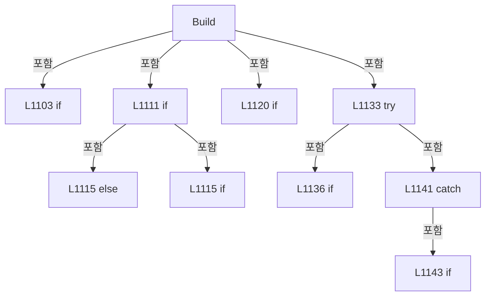

변경 전 점검: 입력/반환 타입, 위 호출자, 예외/취소 경로, 공유 상태와 저장·전송 소비자를 함께 확인합니다. 값의 단위나 물리 방향을 이름만으로 확정하지 않습니다.

### LocalFunctionStatement `IsSelectedHeadCard` · L1091–1094

[Drilling.UI/Menu/Menus/CMenuManual.cs:1091–1094](https://github.com/kjuws10-rgb/A3Drilling/blob/96e22cd027c84bf302b23f2949b98985d7f301bb/Drilling.UI/Menu/Menus/CMenuManual.cs#L1091-L1094)

| 항목 | 실제 추출 값 |
| --- | --- |
| 서명 | bool IsSelectedHeadCard(Drilling.UI.Menu.Menus.ST_MANUAL_HEAD_CARD) |
| 접근/수식자 | Private /  |
| 반환/값 타입 | bool |
| 소속 타입 | NamedType:Drilling.UI.Menu.Menus.CMenuManual |

입력 계약:

| 이름 | 타입 | 전달 | 선택/기본값 |
| --- | --- | --- | --- |
| head | Drilling.UI.Menu.Menus.ST_MANUAL_HEAD_CARD | None | False /  |

현재 부분 분석에서 직접 연결된 호출자는 없습니다. XAML/이벤트/인터페이스·델리게이트·외부 진입을 추가 확인해야 하며, 미사용으로 판정한 것이 아닙니다.

본문의 실제 연산·분기·예외·반환 순서(원문 위치 순):

| 원본 행 | 종류 | 주석 해설 |
| --- | --- | --- |
| 1093 | return | 호출자에게 값 또는 제어를 반환합니다: return head.HeadNo == selectedHeadNo; |

변경 전 점검: 입력/반환 타입, 위 호출자, 예외/취소 경로, 공유 상태와 저장·전송 소비자를 함께 확인합니다. 값의 단위나 물리 방향을 이름만으로 확정하지 않습니다.

### MethodDeclaration `ReadOptionalHeadSettingInt` · L1194–1197

[Drilling.UI/Menu/Menus/CMenuManual.cs:1194–1197](https://github.com/kjuws10-rgb/A3Drilling/blob/96e22cd027c84bf302b23f2949b98985d7f301bb/Drilling.UI/Menu/Menus/CMenuManual.cs#L1194-L1197)

| 항목 | 실제 추출 값 |
| --- | --- |
| 서명 | int Drilling.UI.Menu.Menus.CMenuManual.ReadOptionalHeadSettingInt(System.Collections.Generic.IReadOnlyList<Drilling.Common.Managers.ST_SYSTEM_PARAMETER>, int, int, params string[]) |
| 접근/수식자 | Private / private, static |
| 반환/값 타입 | int |
| 소속 타입 | NamedType:Drilling.UI.Menu.Menus.CMenuManual |

입력 계약:

| 이름 | 타입 | 전달 | 선택/기본값 |
| --- | --- | --- | --- |
| settings | System.Collections.Generic.IReadOnlyList<Drilling.Common.Managers.ST_SYSTEM_PARAMETER> | None | False /  |
| defaultValue | int | None | False /  |
| headNo | int | None | False /  |
| suffixes | string[] | None | False /  |

정적 호출자로 확인된 위치:

| 호출 파일/행 | 호출 표현식 | 런타임 분기 가능 |
| --- | --- | --- |
| [Drilling.UI/Menu/Menus/CMenuManual.cs:1453–1453](https://github.com/kjuws10-rgb/A3Drilling/blob/96e22cd027c84bf302b23f2949b98985d7f301bb/Drilling.UI/Menu/Menus/CMenuManual.cs#L1453-L1453) | ReadOptionalHeadSettingInt | False |
| [Drilling.UI/Menu/Menus/CMenuManual.cs:1459–1459](https://github.com/kjuws10-rgb/A3Drilling/blob/96e22cd027c84bf302b23f2949b98985d7f301bb/Drilling.UI/Menu/Menus/CMenuManual.cs#L1459-L1459) | ReadOptionalHeadSettingInt | False |
| [Drilling.UI/Menu/Menus/CMenuManual.cs:2539–2539](https://github.com/kjuws10-rgb/A3Drilling/blob/96e22cd027c84bf302b23f2949b98985d7f301bb/Drilling.UI/Menu/Menus/CMenuManual.cs#L2539-L2539) | ReadOptionalHeadSettingInt | False |
| [Drilling.UI/Menu/Menus/CMenuManual.cs:2777–2777](https://github.com/kjuws10-rgb/A3Drilling/blob/96e22cd027c84bf302b23f2949b98985d7f301bb/Drilling.UI/Menu/Menus/CMenuManual.cs#L2777-L2777) | ReadOptionalHeadSettingInt | False |
| [Drilling.UI/Menu/Menus/CMenuManual.cs:2779–2779](https://github.com/kjuws10-rgb/A3Drilling/blob/96e22cd027c84bf302b23f2949b98985d7f301bb/Drilling.UI/Menu/Menus/CMenuManual.cs#L2779-L2779) | ReadOptionalHeadSettingInt | False |

호출하는 대상과 해석 범위:

| 원본 행 | 표현식 | 분석 상태 | 대상/소스 위치 |
| --- | --- | --- | --- |
| 1196 | TryFindHeadSetting | resolved | bool Drilling.UI.Menu.Menus.CMenuManual.TryFindHeadSetting(System.Collections.Generic.IReadOnlyList<Drilling.Common.Managers.ST_SYSTEM_PARAMETER>, int, System.Collections.Generic.IReadOnlyList<string>, out string, out string) · Drilling.UI/Menu/Menus/CMenuManual.cs:1209 |
| 1196 | ParseHeadSettingInt | resolved | int Drilling.UI.Menu.Menus.CMenuManual.ParseHeadSettingInt(int, string, string) · Drilling.UI/Menu/Menus/CMenuManual.cs:1234 |

본문의 실제 연산·분기·예외·반환 순서(원문 위치 순):

| 원본 행 | 종류 | 주석 해설 |
| --- | --- | --- |
| 1196 | call | 함수·델리게이트 또는 객체 생성자를 호출합니다: TryFindHeadSetting(settings, headNo, suffixes, out var key, out var value) |
| 1196 | call | 함수·델리게이트 또는 객체 생성자를 호출합니다: ParseHeadSettingInt(headNo, key, value) |
| 1196 | conditional-expression | 조건에 따라 결과식을 선택합니다: TryFindHeadSetting(settings, headNo, suffixes, out var key, out var value) ? ParseHeadSettingInt(headNo, key, value) : defaultValue |
| 1196 | return | 호출자에게 값 또는 제어를 반환합니다: return TryFindHeadSetting(settings, headNo, suffixes, out var key, out var value) ? ParseHeadSettingInt(headNo, key, value) : defaultValue; |

변경 전 점검: 입력/반환 타입, 위 호출자, 예외/취소 경로, 공유 상태와 저장·전송 소비자를 함께 확인합니다. 값의 단위나 물리 방향을 이름만으로 확정하지 않습니다.

### MethodDeclaration `ReadRequiredHeadSettingInt` · L1199–1207

[Drilling.UI/Menu/Menus/CMenuManual.cs:1199–1207](https://github.com/kjuws10-rgb/A3Drilling/blob/96e22cd027c84bf302b23f2949b98985d7f301bb/Drilling.UI/Menu/Menus/CMenuManual.cs#L1199-L1207)

| 항목 | 실제 추출 값 |
| --- | --- |
| 서명 | int Drilling.UI.Menu.Menus.CMenuManual.ReadRequiredHeadSettingInt(System.Collections.Generic.IReadOnlyList<Drilling.Common.Managers.ST_SYSTEM_PARAMETER>, int, params string[]) |
| 접근/수식자 | Private / private, static |
| 반환/값 타입 | int |
| 소속 타입 | NamedType:Drilling.UI.Menu.Menus.CMenuManual |

입력 계약:

| 이름 | 타입 | 전달 | 선택/기본값 |
| --- | --- | --- | --- |
| settings | System.Collections.Generic.IReadOnlyList<Drilling.Common.Managers.ST_SYSTEM_PARAMETER> | None | False /  |
| headNo | int | None | False /  |
| suffixes | string[] | None | False /  |

정적 호출자로 확인된 위치:

| 호출 파일/행 | 호출 표현식 | 런타임 분기 가능 |
| --- | --- | --- |
| [Drilling.UI/Menu/Menus/CMenuManual.cs:2541–2541](https://github.com/kjuws10-rgb/A3Drilling/blob/96e22cd027c84bf302b23f2949b98985d7f301bb/Drilling.UI/Menu/Menus/CMenuManual.cs#L2541-L2541) | ReadRequiredHeadSettingInt | False |
| [Drilling.UI/Menu/Menus/CMenuManual.cs:2782–2782](https://github.com/kjuws10-rgb/A3Drilling/blob/96e22cd027c84bf302b23f2949b98985d7f301bb/Drilling.UI/Menu/Menus/CMenuManual.cs#L2782-L2782) | ReadRequiredHeadSettingInt | False |

호출하는 대상과 해석 범위:

| 원본 행 | 표현식 | 분석 상태 | 대상/소스 위치 |
| --- | --- | --- | --- |
| 1201 | TryFindHeadSetting | resolved | bool Drilling.UI.Menu.Menus.CMenuManual.TryFindHeadSetting(System.Collections.Generic.IReadOnlyList<Drilling.Common.Managers.ST_SYSTEM_PARAMETER>, int, System.Collections.Generic.IReadOnlyList<string>, out string, out string) · Drilling.UI/Menu/Menus/CMenuManual.cs:1209 |
| 1203 | new InvalidOperationException | resolved | System.InvalidOperationException.InvalidOperationException(string?) |
| 1206 | ParseHeadSettingInt | resolved | int Drilling.UI.Menu.Menus.CMenuManual.ParseHeadSettingInt(int, string, string) · Drilling.UI/Menu/Menus/CMenuManual.cs:1234 |

본문의 실제 연산·분기·예외·반환 순서(원문 위치 순):

| 원본 행 | 종류 | 주석 해설 |
| --- | --- | --- |
| 1201 | call | 함수·델리게이트 또는 객체 생성자를 호출합니다: TryFindHeadSetting(settings, headNo, suffixes, out var key, out var value) |
| 1201 | if | 조건에 따라 분기합니다: if (!TryFindHeadSetting(settings, headNo, suffixes, out var key, out var value)) |
| 1203 | call | 함수·델리게이트 또는 객체 생성자를 호출합니다: new InvalidOperationException($"H{headNo:00} scanner DIO number is not configured.") |
| 1203 | throw | 예외를 발생/전달합니다: throw new InvalidOperationException($"H{headNo:00} scanner DIO number is not configured."); |
| 1206 | call | 함수·델리게이트 또는 객체 생성자를 호출합니다: ParseHeadSettingInt(headNo, key, value) |
| 1206 | return | 호출자에게 값 또는 제어를 반환합니다: return ParseHeadSettingInt(headNo, key, value); |

제어 구문의 포함 구조(실제 실행 순서/CFG가 아닌 구문 탐색 그림):

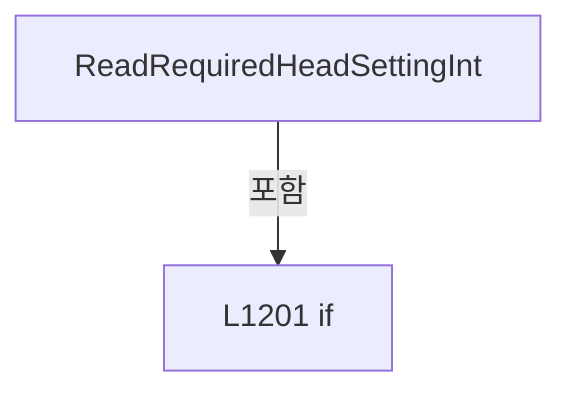

변경 전 점검: 입력/반환 타입, 위 호출자, 예외/취소 경로, 공유 상태와 저장·전송 소비자를 함께 확인합니다. 값의 단위나 물리 방향을 이름만으로 확정하지 않습니다.

### MethodDeclaration `TryFindHeadSetting` · L1209–1232

[Drilling.UI/Menu/Menus/CMenuManual.cs:1209–1232](https://github.com/kjuws10-rgb/A3Drilling/blob/96e22cd027c84bf302b23f2949b98985d7f301bb/Drilling.UI/Menu/Menus/CMenuManual.cs#L1209-L1232)

| 항목 | 실제 추출 값 |
| --- | --- |
| 서명 | bool Drilling.UI.Menu.Menus.CMenuManual.TryFindHeadSetting(System.Collections.Generic.IReadOnlyList<Drilling.Common.Managers.ST_SYSTEM_PARAMETER>, int, System.Collections.Generic.IReadOnlyList<string>, out string, out string) |
| 접근/수식자 | Private / private, static |
| 반환/값 타입 | bool |
| 소속 타입 | NamedType:Drilling.UI.Menu.Menus.CMenuManual |

입력 계약:

| 이름 | 타입 | 전달 | 선택/기본값 |
| --- | --- | --- | --- |
| settings | System.Collections.Generic.IReadOnlyList<Drilling.Common.Managers.ST_SYSTEM_PARAMETER> | None | False /  |
| headNo | int | None | False /  |
| suffixes | System.Collections.Generic.IReadOnlyList<string> | None | False /  |
| key | string | Out | False /  |
| value | string | Out | False /  |

정적 호출자로 확인된 위치:

| 호출 파일/행 | 호출 표현식 | 런타임 분기 가능 |
| --- | --- | --- |
| [Drilling.UI/Menu/Menus/CMenuManual.cs:1196–1196](https://github.com/kjuws10-rgb/A3Drilling/blob/96e22cd027c84bf302b23f2949b98985d7f301bb/Drilling.UI/Menu/Menus/CMenuManual.cs#L1196-L1196) | TryFindHeadSetting | False |
| [Drilling.UI/Menu/Menus/CMenuManual.cs:1201–1201](https://github.com/kjuws10-rgb/A3Drilling/blob/96e22cd027c84bf302b23f2949b98985d7f301bb/Drilling.UI/Menu/Menus/CMenuManual.cs#L1201-L1201) | TryFindHeadSetting | False |

호출하는 대상과 해석 범위:

| 원본 행 | 표현식 | 분석 상태 | 대상/소스 위치 |
| --- | --- | --- | --- |
| 1220 | settings.FirstOrDefault | resolved | Drilling.Common.Managers.ST_SYSTEM_PARAMETER? System.Collections.Generic.IEnumerable<Drilling.Common.Managers.ST_SYSTEM_PARAMETER>.FirstOrDefault<Drilling.Common.Managers.ST_SYSTEM_PARAMETER>(System.Func<Drilling.Common.Managers.ST_SYSTEM_PARAMETER, bool>) |

본문의 실제 연산·분기·예외·반환 순서(원문 위치 순):

| 원본 행 | 종류 | 주석 해설 |
| --- | --- | --- |
| 1211 | local-declaration | 지역 변수를 선언합니다: var prefix = $"H{headNo:00}_"; |
| 1211 | variable-initializer | 변수의 초기값을 지정합니다: prefix = $"H{headNo:00}_" |
| 1212 | foreach | 컬렉션 요소를 순회합니다: foreach (var suffix in suffixes) |
| 1214 | local-declaration | 지역 변수를 선언합니다: var searchKey = prefix + suffix; |
| 1214 | variable-initializer | 변수의 초기값을 지정합니다: searchKey = prefix + suffix |
| 1220 | call | 함수·델리게이트 또는 객체 생성자를 호출합니다: settings.FirstOrDefault(MatchesHeadSettingKey) |
| 1220 | local-declaration | 지역 변수를 선언합니다: var setting = settings.FirstOrDefault(MatchesHeadSettingKey); |
| 1220 | variable-initializer | 변수의 초기값을 지정합니다: setting = settings.FirstOrDefault(MatchesHeadSettingKey) |
| 1221 | if | 조건에 따라 분기합니다: if (setting is not null) |
| 1223 | assignment | 값을 대상에 대입합니다: key = searchKey |
| 1224 | assignment | 값을 대상에 대입합니다: value = setting.Value |
| 1225 | return | 호출자에게 값 또는 제어를 반환합니다: return true; |
| 1229 | assignment | 값을 대상에 대입합니다: key = "" |
| 1230 | assignment | 값을 대상에 대입합니다: value = "" |
| 1231 | return | 호출자에게 값 또는 제어를 반환합니다: return false; |

제어 구문의 포함 구조(실제 실행 순서/CFG가 아닌 구문 탐색 그림):


변경 전 점검: 입력/반환 타입, 위 호출자, 예외/취소 경로, 공유 상태와 저장·전송 소비자를 함께 확인합니다. 값의 단위나 물리 방향을 이름만으로 확정하지 않습니다.

### LocalFunctionStatement `MatchesHeadSettingKey` · L1215–1218

[Drilling.UI/Menu/Menus/CMenuManual.cs:1215–1218](https://github.com/kjuws10-rgb/A3Drilling/blob/96e22cd027c84bf302b23f2949b98985d7f301bb/Drilling.UI/Menu/Menus/CMenuManual.cs#L1215-L1218)

| 항목 | 실제 추출 값 |
| --- | --- |
| 서명 | bool MatchesHeadSettingKey(Drilling.Common.Managers.ST_SYSTEM_PARAMETER) |
| 접근/수식자 | Private /  |
| 반환/값 타입 | bool |
| 소속 타입 | NamedType:Drilling.UI.Menu.Menus.CMenuManual |

입력 계약:

| 이름 | 타입 | 전달 | 선택/기본값 |
| --- | --- | --- | --- |
| item | Drilling.Common.Managers.ST_SYSTEM_PARAMETER | None | False /  |

현재 부분 분석에서 직접 연결된 호출자는 없습니다. XAML/이벤트/인터페이스·델리게이트·외부 진입을 추가 확인해야 하며, 미사용으로 판정한 것이 아닙니다.

호출하는 대상과 해석 범위:

| 원본 행 | 표현식 | 분석 상태 | 대상/소스 위치 |
| --- | --- | --- | --- |
| 1217 | searchKey.Equals | resolved | bool string.Equals(string?, System.StringComparison) |
| 1217 | searchKey.Equals | resolved | bool string.Equals(string?, System.StringComparison) |

본문의 실제 연산·분기·예외·반환 순서(원문 위치 순):

| 원본 행 | 종류 | 주석 해설 |
| --- | --- | --- |
| 1217 | call | 함수·델리게이트 또는 객체 생성자를 호출합니다: searchKey.Equals(item.Key, StringComparison.OrdinalIgnoreCase) |
| 1217 | call | 함수·델리게이트 또는 객체 생성자를 호출합니다: searchKey.Equals(item.Name, StringComparison.OrdinalIgnoreCase) |
| 1217 | return | 호출자에게 값 또는 제어를 반환합니다: return searchKey.Equals(item.Key, StringComparison.OrdinalIgnoreCase) &#124;&#124; searchKey.Equals(item.Name, StringComparison.OrdinalIgnoreCase); |

변경 전 점검: 입력/반환 타입, 위 호출자, 예외/취소 경로, 공유 상태와 저장·전송 소비자를 함께 확인합니다. 값의 단위나 물리 방향을 이름만으로 확정하지 않습니다.

### MethodDeclaration `ParseHeadSettingInt` · L1234–1247

[Drilling.UI/Menu/Menus/CMenuManual.cs:1234–1247](https://github.com/kjuws10-rgb/A3Drilling/blob/96e22cd027c84bf302b23f2949b98985d7f301bb/Drilling.UI/Menu/Menus/CMenuManual.cs#L1234-L1247)

| 항목 | 실제 추출 값 |
| --- | --- |
| 서명 | int Drilling.UI.Menu.Menus.CMenuManual.ParseHeadSettingInt(int, string, string) |
| 접근/수식자 | Private / private, static |
| 반환/값 타입 | int |
| 소속 타입 | NamedType:Drilling.UI.Menu.Menus.CMenuManual |

입력 계약:

| 이름 | 타입 | 전달 | 선택/기본값 |
| --- | --- | --- | --- |
| headNo | int | None | False /  |
| key | string | None | False /  |
| value | string | None | False /  |

정적 호출자로 확인된 위치:

| 호출 파일/행 | 호출 표현식 | 런타임 분기 가능 |
| --- | --- | --- |
| [Drilling.UI/Menu/Menus/CMenuManual.cs:1196–1196](https://github.com/kjuws10-rgb/A3Drilling/blob/96e22cd027c84bf302b23f2949b98985d7f301bb/Drilling.UI/Menu/Menus/CMenuManual.cs#L1196-L1196) | ParseHeadSettingInt | False |
| [Drilling.UI/Menu/Menus/CMenuManual.cs:1206–1206](https://github.com/kjuws10-rgb/A3Drilling/blob/96e22cd027c84bf302b23f2949b98985d7f301bb/Drilling.UI/Menu/Menus/CMenuManual.cs#L1206-L1206) | ParseHeadSettingInt | False |

호출하는 대상과 해석 범위:

| 원본 행 | 표현식 | 분석 상태 | 대상/소스 위치 |
| --- | --- | --- | --- |
| 1236 | string.IsNullOrWhiteSpace | resolved | bool string.IsNullOrWhiteSpace(string?) |
| 1238 | new InvalidOperationException | resolved | System.InvalidOperationException.InvalidOperationException(string?) |
| 1241 | int.TryParse | resolved | bool int.TryParse(string?, System.Globalization.NumberStyles, System.IFormatProvider?, out int) |
| 1241 | value.Trim | resolved | string string.Trim() |
| 1243 | new InvalidOperationException | resolved | System.InvalidOperationException.InvalidOperationException(string?) |

본문의 실제 연산·분기·예외·반환 순서(원문 위치 순):

| 원본 행 | 종류 | 주석 해설 |
| --- | --- | --- |
| 1236 | call | 함수·델리게이트 또는 객체 생성자를 호출합니다: string.IsNullOrWhiteSpace(value) |
| 1236 | if | 조건에 따라 분기합니다: if (string.IsNullOrWhiteSpace(value)) |
| 1238 | call | 함수·델리게이트 또는 객체 생성자를 호출합니다: new InvalidOperationException($"H{headNo:00} setting {key} is empty.") |
| 1238 | throw | 예외를 발생/전달합니다: throw new InvalidOperationException($"H{headNo:00} setting {key} is empty."); |
| 1241 | call | 함수·델리게이트 또는 객체 생성자를 호출합니다: int.TryParse(value.Trim(), NumberStyles.Integer, CultureInfo.InvariantCulture, out var parsed) |
| 1241 | call | 함수·델리게이트 또는 객체 생성자를 호출합니다: value.Trim() |
| 1241 | if | 조건에 따라 분기합니다: if (!int.TryParse(value.Trim(), NumberStyles.Integer, CultureInfo.InvariantCulture, out var parsed)) |
| 1243 | call | 함수·델리게이트 또는 객체 생성자를 호출합니다: new InvalidOperationException($"H{headNo:00} setting {key} must be an integer. Value={value}") |
| 1243 | throw | 예외를 발생/전달합니다: throw new InvalidOperationException($"H{headNo:00} setting {key} must be an integer. Value={value}"); |
| 1246 | return | 호출자에게 값 또는 제어를 반환합니다: return parsed; |

제어 구문의 포함 구조(실제 실행 순서/CFG가 아닌 구문 탐색 그림):

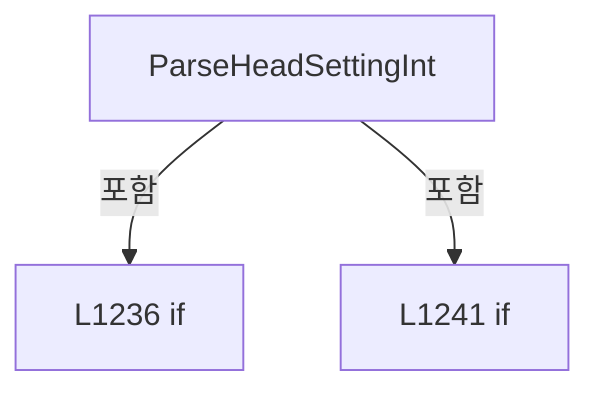

변경 전 점검: 입력/반환 타입, 위 호출자, 예외/취소 경로, 공유 상태와 저장·전송 소비자를 함께 확인합니다. 값의 단위나 물리 방향을 이름만으로 확정하지 않습니다.

### MethodDeclaration `ReadHeadSettingText` · L1249–1268

[Drilling.UI/Menu/Menus/CMenuManual.cs:1249–1268](https://github.com/kjuws10-rgb/A3Drilling/blob/96e22cd027c84bf302b23f2949b98985d7f301bb/Drilling.UI/Menu/Menus/CMenuManual.cs#L1249-L1268)

| 항목 | 실제 추출 값 |
| --- | --- |
| 서명 | string Drilling.UI.Menu.Menus.CMenuManual.ReadHeadSettingText(System.Collections.Generic.IReadOnlyList<Drilling.Common.Managers.ST_SYSTEM_PARAMETER>, string, int, params string[]) |
| 접근/수식자 | Private / private, static |
| 반환/값 타입 | string |
| 소속 타입 | NamedType:Drilling.UI.Menu.Menus.CMenuManual |

입력 계약:

| 이름 | 타입 | 전달 | 선택/기본값 |
| --- | --- | --- | --- |
| settings | System.Collections.Generic.IReadOnlyList<Drilling.Common.Managers.ST_SYSTEM_PARAMETER> | None | False /  |
| defaultValue | string | None | False /  |
| headNo | int | None | False /  |
| suffixes | string[] | None | False /  |

정적 호출자로 확인된 위치:

| 호출 파일/행 | 호출 표현식 | 런타임 분기 가능 |
| --- | --- | --- |
| [Drilling.UI/Menu/Menus/CMenuManual.cs:2780–2780](https://github.com/kjuws10-rgb/A3Drilling/blob/96e22cd027c84bf302b23f2949b98985d7f301bb/Drilling.UI/Menu/Menus/CMenuManual.cs#L2780-L2780) | ReadHeadSettingText | False |
| [Drilling.UI/Menu/Menus/CMenuManual.cs:4840–4840](https://github.com/kjuws10-rgb/A3Drilling/blob/96e22cd027c84bf302b23f2949b98985d7f301bb/Drilling.UI/Menu/Menus/CMenuManual.cs#L4840-L4840) | ReadHeadSettingText | False |

호출하는 대상과 해석 범위:

| 원본 행 | 표현식 | 분석 상태 | 대상/소스 위치 |
| --- | --- | --- | --- |
| 1260 | settings.FirstOrDefault | resolved | Drilling.Common.Managers.ST_SYSTEM_PARAMETER? System.Collections.Generic.IEnumerable<Drilling.Common.Managers.ST_SYSTEM_PARAMETER>.FirstOrDefault<Drilling.Common.Managers.ST_SYSTEM_PARAMETER>(System.Func<Drilling.Common.Managers.ST_SYSTEM_PARAMETER, bool>) |
| 1261 | string.IsNullOrWhiteSpace | resolved | bool string.IsNullOrWhiteSpace(string?) |
| 1263 | setting.Value.Trim | resolved | string string.Trim() |

본문의 실제 연산·분기·예외·반환 순서(원문 위치 순):

| 원본 행 | 종류 | 주석 해설 |
| --- | --- | --- |
| 1251 | local-declaration | 지역 변수를 선언합니다: var prefix = $"H{headNo:00}_"; |
| 1251 | variable-initializer | 변수의 초기값을 지정합니다: prefix = $"H{headNo:00}_" |
| 1252 | foreach | 컬렉션 요소를 순회합니다: foreach (var suffix in suffixes) |
| 1254 | local-declaration | 지역 변수를 선언합니다: var key = prefix + suffix; |
| 1254 | variable-initializer | 변수의 초기값을 지정합니다: key = prefix + suffix |
| 1260 | call | 함수·델리게이트 또는 객체 생성자를 호출합니다: settings.FirstOrDefault(MatchesHeadSettingKey) |
| 1260 | local-declaration | 지역 변수를 선언합니다: var setting = settings.FirstOrDefault(MatchesHeadSettingKey); |
| 1260 | variable-initializer | 변수의 초기값을 지정합니다: setting = settings.FirstOrDefault(MatchesHeadSettingKey) |
| 1261 | call | 함수·델리게이트 또는 객체 생성자를 호출합니다: string.IsNullOrWhiteSpace(setting.Value) |
| 1261 | if | 조건에 따라 분기합니다: if (setting is not null && !string.IsNullOrWhiteSpace(setting.Value)) |
| 1263 | call | 함수·델리게이트 또는 객체 생성자를 호출합니다: setting.Value.Trim() |
| 1263 | return | 호출자에게 값 또는 제어를 반환합니다: return setting.Value.Trim(); |
| 1267 | return | 호출자에게 값 또는 제어를 반환합니다: return defaultValue; |

제어 구문의 포함 구조(실제 실행 순서/CFG가 아닌 구문 탐색 그림):

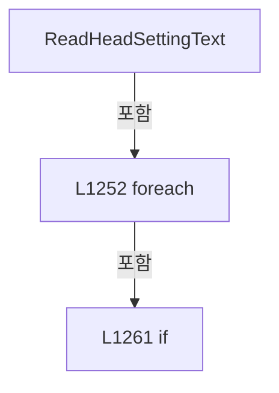

변경 전 점검: 입력/반환 타입, 위 호출자, 예외/취소 경로, 공유 상태와 저장·전송 소비자를 함께 확인합니다. 값의 단위나 물리 방향을 이름만으로 확정하지 않습니다.

### LocalFunctionStatement `MatchesHeadSettingKey` · L1255–1258

[Drilling.UI/Menu/Menus/CMenuManual.cs:1255–1258](https://github.com/kjuws10-rgb/A3Drilling/blob/96e22cd027c84bf302b23f2949b98985d7f301bb/Drilling.UI/Menu/Menus/CMenuManual.cs#L1255-L1258)

| 항목 | 실제 추출 값 |
| --- | --- |
| 서명 | bool MatchesHeadSettingKey(Drilling.Common.Managers.ST_SYSTEM_PARAMETER) |
| 접근/수식자 | Private /  |
| 반환/값 타입 | bool |
| 소속 타입 | NamedType:Drilling.UI.Menu.Menus.CMenuManual |

입력 계약:

| 이름 | 타입 | 전달 | 선택/기본값 |
| --- | --- | --- | --- |
| item | Drilling.Common.Managers.ST_SYSTEM_PARAMETER | None | False /  |

현재 부분 분석에서 직접 연결된 호출자는 없습니다. XAML/이벤트/인터페이스·델리게이트·외부 진입을 추가 확인해야 하며, 미사용으로 판정한 것이 아닙니다.

호출하는 대상과 해석 범위:

| 원본 행 | 표현식 | 분석 상태 | 대상/소스 위치 |
| --- | --- | --- | --- |
| 1257 | key.Equals | resolved | bool string.Equals(string?, System.StringComparison) |
| 1257 | key.Equals | resolved | bool string.Equals(string?, System.StringComparison) |

본문의 실제 연산·분기·예외·반환 순서(원문 위치 순):

| 원본 행 | 종류 | 주석 해설 |
| --- | --- | --- |
| 1257 | call | 함수·델리게이트 또는 객체 생성자를 호출합니다: key.Equals(item.Key, StringComparison.OrdinalIgnoreCase) |
| 1257 | call | 함수·델리게이트 또는 객체 생성자를 호출합니다: key.Equals(item.Name, StringComparison.OrdinalIgnoreCase) |
| 1257 | return | 호출자에게 값 또는 제어를 반환합니다: return key.Equals(item.Key, StringComparison.OrdinalIgnoreCase) &#124;&#124; key.Equals(item.Name, StringComparison.OrdinalIgnoreCase); |

변경 전 점검: 입력/반환 타입, 위 호출자, 예외/취소 경로, 공유 상태와 저장·전송 소비자를 함께 확인합니다. 값의 단위나 물리 방향을 이름만으로 확정하지 않습니다.

### MethodDeclaration `TryBlockManualAutomationCommand` · L1270–1317

[Drilling.UI/Menu/Menus/CMenuManual.cs:1270–1317](https://github.com/kjuws10-rgb/A3Drilling/blob/96e22cd027c84bf302b23f2949b98985d7f301bb/Drilling.UI/Menu/Menus/CMenuManual.cs#L1270-L1317)

| 항목 | 실제 추출 값 |
| --- | --- |
| 서명 | bool Drilling.UI.Menu.Menus.CMenuManual.TryBlockManualAutomationCommand(string) |
| 접근/수식자 | Private / private |
| 반환/값 타입 | bool |
| 소속 타입 | NamedType:Drilling.UI.Menu.Menus.CMenuManual |

입력 계약:

| 이름 | 타입 | 전달 | 선택/기본값 |
| --- | --- | --- | --- |
| commandName | string | None | False /  |

정적 호출자로 확인된 위치:

| 호출 파일/행 | 호출 표현식 | 런타임 분기 가능 |
| --- | --- | --- |
| [Drilling.UI/Menu/Menus/CMenuManual.cs:1734–1734](https://github.com/kjuws10-rgb/A3Drilling/blob/96e22cd027c84bf302b23f2949b98985d7f301bb/Drilling.UI/Menu/Menus/CMenuManual.cs#L1734-L1734) | TryBlockManualAutomationCommand | False |
| [Drilling.UI/Menu/Menus/CMenuManual.cs:1771–1771](https://github.com/kjuws10-rgb/A3Drilling/blob/96e22cd027c84bf302b23f2949b98985d7f301bb/Drilling.UI/Menu/Menus/CMenuManual.cs#L1771-L1771) | TryBlockManualAutomationCommand | False |
| [Drilling.UI/Menu/Menus/CMenuManual.cs:1782–1782](https://github.com/kjuws10-rgb/A3Drilling/blob/96e22cd027c84bf302b23f2949b98985d7f301bb/Drilling.UI/Menu/Menus/CMenuManual.cs#L1782-L1782) | TryBlockManualAutomationCommand | False |
| [Drilling.UI/Menu/Menus/CMenuManual.cs:1874–1874](https://github.com/kjuws10-rgb/A3Drilling/blob/96e22cd027c84bf302b23f2949b98985d7f301bb/Drilling.UI/Menu/Menus/CMenuManual.cs#L1874-L1874) | TryBlockManualAutomationCommand | False |
| [Drilling.UI/Menu/Menus/CMenuManual.cs:1973–1973](https://github.com/kjuws10-rgb/A3Drilling/blob/96e22cd027c84bf302b23f2949b98985d7f301bb/Drilling.UI/Menu/Menus/CMenuManual.cs#L1973-L1973) | TryBlockManualAutomationCommand | False |
| [Drilling.UI/Menu/Menus/CMenuManual.cs:1992–1992](https://github.com/kjuws10-rgb/A3Drilling/blob/96e22cd027c84bf302b23f2949b98985d7f301bb/Drilling.UI/Menu/Menus/CMenuManual.cs#L1992-L1992) | TryBlockManualAutomationCommand | False |
| [Drilling.UI/Menu/Menus/CMenuManual.cs:2174–2174](https://github.com/kjuws10-rgb/A3Drilling/blob/96e22cd027c84bf302b23f2949b98985d7f301bb/Drilling.UI/Menu/Menus/CMenuManual.cs#L2174-L2174) | TryBlockManualAutomationCommand | False |
| [Drilling.UI/Menu/Menus/CMenuManual.cs:2243–2243](https://github.com/kjuws10-rgb/A3Drilling/blob/96e22cd027c84bf302b23f2949b98985d7f301bb/Drilling.UI/Menu/Menus/CMenuManual.cs#L2243-L2243) | TryBlockManualAutomationCommand | False |
| [Drilling.UI/Menu/Menus/CMenuManual.cs:2563–2563](https://github.com/kjuws10-rgb/A3Drilling/blob/96e22cd027c84bf302b23f2949b98985d7f301bb/Drilling.UI/Menu/Menus/CMenuManual.cs#L2563-L2563) | TryBlockManualAutomationCommand | False |
| [Drilling.UI/Menu/Menus/CMenuManual.cs:2700–2700](https://github.com/kjuws10-rgb/A3Drilling/blob/96e22cd027c84bf302b23f2949b98985d7f301bb/Drilling.UI/Menu/Menus/CMenuManual.cs#L2700-L2700) | TryBlockManualAutomationCommand | False |
| [Drilling.UI/Menu/Menus/CMenuManual.cs:3258–3258](https://github.com/kjuws10-rgb/A3Drilling/blob/96e22cd027c84bf302b23f2949b98985d7f301bb/Drilling.UI/Menu/Menus/CMenuManual.cs#L3258-L3258) | TryBlockManualAutomationCommand | False |
| [Drilling.UI/Menu/Menus/CMenuManual.cs:3278–3278](https://github.com/kjuws10-rgb/A3Drilling/blob/96e22cd027c84bf302b23f2949b98985d7f301bb/Drilling.UI/Menu/Menus/CMenuManual.cs#L3278-L3278) | TryBlockManualAutomationCommand | False |
| [Drilling.UI/Menu/Menus/CMenuManual.cs:3330–3330](https://github.com/kjuws10-rgb/A3Drilling/blob/96e22cd027c84bf302b23f2949b98985d7f301bb/Drilling.UI/Menu/Menus/CMenuManual.cs#L3330-L3330) | TryBlockManualAutomationCommand | False |
| [Drilling.UI/Menu/Menus/CMenuManual.cs:3357–3357](https://github.com/kjuws10-rgb/A3Drilling/blob/96e22cd027c84bf302b23f2949b98985d7f301bb/Drilling.UI/Menu/Menus/CMenuManual.cs#L3357-L3357) | TryBlockManualAutomationCommand | False |
| [Drilling.UI/Menu/Menus/CMenuManual.cs:3454–3454](https://github.com/kjuws10-rgb/A3Drilling/blob/96e22cd027c84bf302b23f2949b98985d7f301bb/Drilling.UI/Menu/Menus/CMenuManual.cs#L3454-L3454) | TryBlockManualAutomationCommand | False |
| [Drilling.UI/Menu/Menus/CMenuManual.cs:4013–4013](https://github.com/kjuws10-rgb/A3Drilling/blob/96e22cd027c84bf302b23f2949b98985d7f301bb/Drilling.UI/Menu/Menus/CMenuManual.cs#L4013-L4013) | TryBlockManualAutomationCommand | False |
| [Drilling.UI/Menu/Menus/CMenuManual.cs:4281–4281](https://github.com/kjuws10-rgb/A3Drilling/blob/96e22cd027c84bf302b23f2949b98985d7f301bb/Drilling.UI/Menu/Menus/CMenuManual.cs#L4281-L4281) | TryBlockManualAutomationCommand | False |
| [Drilling.UI/Menu/Menus/CMenuManual.cs:4292–4292](https://github.com/kjuws10-rgb/A3Drilling/blob/96e22cd027c84bf302b23f2949b98985d7f301bb/Drilling.UI/Menu/Menus/CMenuManual.cs#L4292-L4292) | TryBlockManualAutomationCommand | False |
| [Drilling.UI/Menu/Menus/CMenuManual.cs:4619–4619](https://github.com/kjuws10-rgb/A3Drilling/blob/96e22cd027c84bf302b23f2949b98985d7f301bb/Drilling.UI/Menu/Menus/CMenuManual.cs#L4619-L4619) | TryBlockManualAutomationCommand | False |
| [Drilling.UI/Menu/Menus/CMenuManual.cs:5278–5278](https://github.com/kjuws10-rgb/A3Drilling/blob/96e22cd027c84bf302b23f2949b98985d7f301bb/Drilling.UI/Menu/Menus/CMenuManual.cs#L5278-L5278) | TryBlockManualAutomationCommand | False |
| [Drilling.UI/Menu/Menus/CMenuManual.cs:5384–5384](https://github.com/kjuws10-rgb/A3Drilling/blob/96e22cd027c84bf302b23f2949b98985d7f301bb/Drilling.UI/Menu/Menus/CMenuManual.cs#L5384-L5384) | TryBlockManualAutomationCommand | False |

호출하는 대상과 해석 범위:

| 원본 행 | 표현식 | 분석 상태 | 대상/소스 위치 |
| --- | --- | --- | --- |
| 1272 | commandName.Contains | resolved | bool string.Contains(string, System.StringComparison) |
| 1272 | commandName.EndsWith | resolved | bool string.EndsWith(string, System.StringComparison) |
| 1272 | commandName.Contains | resolved | bool string.Contains(string, System.StringComparison) |
| 1272 | commandName.Contains | resolved | bool string.Contains(string, System.StringComparison) |
| 1272 | commandName.EndsWith | resolved | bool string.EndsWith(string, System.StringComparison) |
| 1273 | CheckOperationAlarm | resolved | bool Drilling.UI.Menu.Menus.CMenuBase.CheckOperationAlarm(string) · Drilling.UI/Menu/Menus/CMenuBase.cs:15 |
| 1277 | commandName.Equals | resolved | bool string.Equals(string?, System.StringComparison) |
| 1278 | _manager.Interface | resolved | Drilling.Common.Interface.CInterfaceManager Drilling.Common.Managers.CManager.Interface() · Drilling.Common/Managers/CManager.cs:355 |
| 1280 | ShowManualWarning | resolved | void Drilling.UI.Menu.Menus.CMenuManual.ShowManualWarning(string) · Drilling.UI/Menu/Menus/CMenuManual.cs:1591 |
| 1283 | _manager.Station | resolved | Drilling.Common.Station.CStationManager Drilling.Common.Managers.CManager.Station() · Drilling.Common/Managers/CManager.cs:330 |
| 1285 | ShowManualWarning | resolved | void Drilling.UI.Menu.Menus.CMenuManual.ShowManualWarning(string) · Drilling.UI/Menu/Menus/CMenuManual.cs:1591 |
| 1291 | ShowManualWarning | resolved | void Drilling.UI.Menu.Menus.CMenuManual.ShowManualWarning(string) · Drilling.UI/Menu/Menus/CMenuManual.cs:1591 |
| 1296 | commandName.Equals | resolved | bool string.Equals(string?, System.StringComparison) |
| 1296 | commandName.StartsWith | resolved | bool string.StartsWith(string, System.StringComparison) |
| 1296 | commandName.EndsWith | resolved | bool string.EndsWith(string, System.StringComparison) |
| 1297 | commandName.Equals | resolved | bool string.Equals(string?, System.StringComparison) |
| 1300 | _setStatusMessage | resolved · 동적 구현 선택 가능 | void System.Action<string>.Invoke(string) |
| 1301 | ShowManualWarning | resolved | void Drilling.UI.Menu.Menus.CMenuManual.ShowManualWarning(string) · Drilling.UI/Menu/Menus/CMenuManual.cs:1591 |
| 1305 | IsAutoProcessRunning | resolved | bool Drilling.UI.Menu.Menus.CMenuManual.IsAutoProcessRunning() · Drilling.UI/Menu/Menus/CMenuManual.cs:1319 |
| 1313 | RefreshCommandStateRows | resolved | void Drilling.UI.Menu.Menus.CMenuManual.RefreshCommandStateRows() · Drilling.UI/Menu/Menus/CMenuManual.cs:5508 |
| 1314 | _setStatusMessage | resolved · 동적 구현 선택 가능 | void System.Action<string>.Invoke(string) |
| 1315 | _refreshShellStatus | resolved · 동적 구현 선택 가능 | void System.Action.Invoke() |

본문의 실제 연산·분기·예외·반환 순서(원문 위치 순):

| 원본 행 | 종류 | 주석 해설 |
| --- | --- | --- |
| 1272 | call | 함수·델리게이트 또는 객체 생성자를 호출합니다: commandName.Contains("STOP", StringComparison.OrdinalIgnoreCase) |
| 1272 | call | 함수·델리게이트 또는 객체 생성자를 호출합니다: commandName.EndsWith("OFF", StringComparison.OrdinalIgnoreCase) |
| 1272 | call | 함수·델리게이트 또는 객체 생성자를 호출합니다: commandName.Contains("DISABLE", StringComparison.OrdinalIgnoreCase) |
| 1272 | call | 함수·델리게이트 또는 객체 생성자를 호출합니다: commandName.Contains("FAULT_CLEAR", StringComparison.OrdinalIgnoreCase) |
| 1272 | call | 함수·델리게이트 또는 객체 생성자를 호출합니다: commandName.EndsWith("_RESET", StringComparison.OrdinalIgnoreCase) |
| 1272 | local-declaration | 지역 변수를 선언합니다: var recovery = commandName.Contains("STOP", StringComparison.OrdinalIgnoreCase) &#124;&#124; commandName.EndsWith("OFF", StringComparison.OrdinalIgnoreCase) &#124;&#124; commandName.Contains("DISABLE", StringComparison.OrdinalIgnoreCase) &#124;&#124; commandNa |
| 1272 | variable-initializer | 변수의 초기값을 지정합니다: recovery = commandName.Contains("STOP", StringComparison.OrdinalIgnoreCase) &#124;&#124; commandName.EndsWith("OFF", StringComparison.OrdinalIgnoreCase) &#124;&#124; commandName.Contains("DISABLE", StringComparison.OrdinalIgnoreCase) &#124;&#124; commandName.C |
| 1273 | call | 함수·델리게이트 또는 객체 생성자를 호출합니다: CheckOperationAlarm(commandName) |
| 1273 | if | 조건에 따라 분기합니다: if (!recovery && !CheckOperationAlarm(commandName)) |
| 1274 | return | 호출자에게 값 또는 제어를 반환합니다: return true; |
| 1277 | call | 함수·델리게이트 또는 객체 생성자를 호출합니다: commandName.Equals("STAGE_REVIEW_MOVE", StringComparison.OrdinalIgnoreCase) |
| 1277 | if | 조건에 따라 분기합니다: if (!recovery && !commandName.Equals("STAGE_REVIEW_MOVE", StringComparison.OrdinalIgnoreCase) && (IsManualStageMovePending &#124;&#124; _manager.Interface().StageReviewSequences.IsActive)) |
| 1278 | call | 함수·델리게이트 또는 객체 생성자를 호출합니다: _manager.Interface() |
| 1280 | call | 함수·델리게이트 또는 객체 생성자를 호출합니다: ShowManualWarning("Stage/Review 이동이 실행 중이거나 정리 중입니다. 이동 완료 또는 STOP 정리 완료 후 실행해 주세요.") |
| 1281 | return | 호출자에게 값 또는 제어를 반환합니다: return true; |
| 1283 | call | 함수·델리게이트 또는 객체 생성자를 호출합니다: _manager.Station() |
| 1283 | if | 조건에 따라 분기합니다: if (_manager.Station().ManualMofStatus is { IsRunning: true } or { RequiresStop: true }) |
| 1285 | call | 함수·델리게이트 또는 객체 생성자를 호출합니다: ShowManualWarning("MOF 가공이 실행 중이거나 정지가 확인되지 않았습니다. MOF STOP 후 실행해 주세요.") |
| 1286 | return | 호출자에게 값 또는 제어를 반환합니다: return true; |
| 1289 | if | 조건에 따라 분기합니다: if (IsManualMotionScriptActive && commandName is not "MANUAL_MOTION" and not "MOVE_STOP") |
| 1291 | call | 함수·델리게이트 또는 객체 생성자를 호출합니다: ShowManualWarning("수동 이동 스크립트가 실행 중이거나 정지가 확인되지 않았습니다. 완료 또는 MOVE STOP 후 실행해 주세요.") |
| 1292 | return | 호출자에게 값 또는 제어를 반환합니다: return true; |
| 1296 | call | 함수·델리게이트 또는 객체 생성자를 호출합니다: commandName.Equals("SCANNER_FAULT_CLEAR", StringComparison.OrdinalIgnoreCase) |
| 1296 | call | 함수·델리게이트 또는 객체 생성자를 호출합니다: commandName.StartsWith("CONTROLLER_", StringComparison.OrdinalIgnoreCase) |
| 1296 | call | 함수·델리게이트 또는 객체 생성자를 호출합니다: commandName.EndsWith("_RESET", StringComparison.OrdinalIgnoreCase) |
| 1296 | local-declaration | 지역 변수를 선언합니다: var canRecoverStoppedScan = _activeManualShapeScan is null && !_manualShapeScanStopInProgress && _activeManualLaserAction is null && !_manualLaserOffInProgress && (commandName.Equals("SCANNER_FAULT_CLEAR", StringComparison.Ordinal |
| 1296 | variable-initializer | 변수의 초기값을 지정합니다: canRecoverStoppedScan = _activeManualShapeScan is null && !_manualShapeScanStopInProgress && _activeManualLaserAction is null && !_manualLaserOffInProgress && (commandName.Equals("SCANNER_FAULT_CLEAR", StringComparison.OrdinalIgno |
| 1297 | call | 함수·델리게이트 또는 객체 생성자를 호출합니다: commandName.Equals("SHAPE_START", StringComparison.OrdinalIgnoreCase) |
| 1297 | if | 조건에 따라 분기합니다: if (IsManualShapeScanActive && !canRecoverStoppedScan && !commandName.Equals("SHAPE_START", StringComparison.OrdinalIgnoreCase)) |
| 1299 | local-declaration | 지역 변수를 선언합니다: const string scanMessage = "수동 가공이 진행 중이거나 정지가 확인되지 않았습니다. LASER OFF 또는 Scan STOP으로 정지한 후 실행해 주세요."; |
| 1299 | variable-initializer | 변수의 초기값을 지정합니다: scanMessage = "수동 가공이 진행 중이거나 정지가 확인되지 않았습니다. LASER OFF 또는 Scan STOP으로 정지한 후 실행해 주세요." |
| 1300 | call | 함수·델리게이트 또는 객체 생성자를 호출합니다: _setStatusMessage(scanMessage) |
| 1301 | call | 함수·델리게이트 또는 객체 생성자를 호출합니다: ShowManualWarning(scanMessage) |
| 1302 | return | 호출자에게 값 또는 제어를 반환합니다: return true; |
| 1305 | call | 함수·델리게이트 또는 객체 생성자를 호출합니다: IsAutoProcessRunning() |
| 1305 | if | 조건에 따라 분기합니다: if (!IsAutoProcessRunning()) |
| 1307 | return | 호출자에게 값 또는 제어를 반환합니다: return false; |
| 1310 | local-declaration | 지역 변수를 선언합니다: var message = "Auto process is running. Manual Automation1 command is blocked."; |
| 1310 | variable-initializer | 변수의 초기값을 지정합니다: message = "Auto process is running. Manual Automation1 command is blocked." |
| 1311 | assignment | 값을 대상에 대입합니다: _lastCommand = commandName |
| 1312 | assignment | 값을 대상에 대입합니다: _lastResult = message |
| 1313 | call | 함수·델리게이트 또는 객체 생성자를 호출합니다: RefreshCommandStateRows() |
| 1314 | call | 함수·델리게이트 또는 객체 생성자를 호출합니다: _setStatusMessage(message) |
| 1315 | call | 함수·델리게이트 또는 객체 생성자를 호출합니다: _refreshShellStatus() |
| 1316 | return | 호출자에게 값 또는 제어를 반환합니다: return true; |

제어 구문의 포함 구조(실제 실행 순서/CFG가 아닌 구문 탐색 그림):

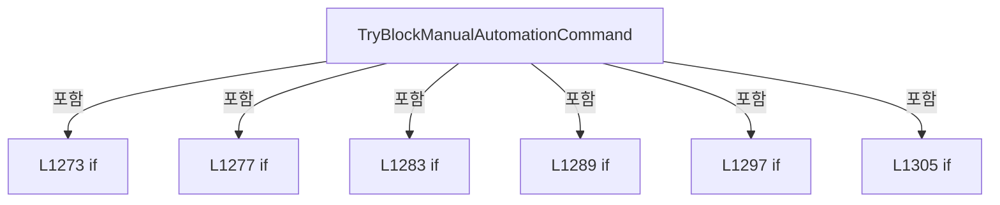

변경 전 점검: 입력/반환 타입, 위 호출자, 예외/취소 경로, 공유 상태와 저장·전송 소비자를 함께 확인합니다. 값의 단위나 물리 방향을 이름만으로 확정하지 않습니다.

### MethodDeclaration `IsAutoProcessRunning` · L1319–1330

[Drilling.UI/Menu/Menus/CMenuManual.cs:1319–1330](https://github.com/kjuws10-rgb/A3Drilling/blob/96e22cd027c84bf302b23f2949b98985d7f301bb/Drilling.UI/Menu/Menus/CMenuManual.cs#L1319-L1330)

| 항목 | 실제 추출 값 |
| --- | --- |
| 서명 | bool Drilling.UI.Menu.Menus.CMenuManual.IsAutoProcessRunning() |
| 접근/수식자 | Private / private |
| 반환/값 타입 | bool |
| 소속 타입 | NamedType:Drilling.UI.Menu.Menus.CMenuManual |

정적 호출자로 확인된 위치:

| 호출 파일/행 | 호출 표현식 | 런타임 분기 가능 |
| --- | --- | --- |
| [Drilling.UI/Menu/Menus/CMenuManual.cs:1305–1305](https://github.com/kjuws10-rgb/A3Drilling/blob/96e22cd027c84bf302b23f2949b98985d7f301bb/Drilling.UI/Menu/Menus/CMenuManual.cs#L1305-L1305) | IsAutoProcessRunning | False |
| [Drilling.UI/Menu/Menus/CMenuManual.cs:2968–2968](https://github.com/kjuws10-rgb/A3Drilling/blob/96e22cd027c84bf302b23f2949b98985d7f301bb/Drilling.UI/Menu/Menus/CMenuManual.cs#L2968-L2968) | IsAutoProcessRunning | False |
| [Drilling.UI/Menu/Menus/CMenuManual.cs:4531–4531](https://github.com/kjuws10-rgb/A3Drilling/blob/96e22cd027c84bf302b23f2949b98985d7f301bb/Drilling.UI/Menu/Menus/CMenuManual.cs#L4531-L4531) | IsAutoProcessRunning | False |
| [Drilling.UI/Menu/Menus/CMenuManual.cs:4772–4772](https://github.com/kjuws10-rgb/A3Drilling/blob/96e22cd027c84bf302b23f2949b98985d7f301bb/Drilling.UI/Menu/Menus/CMenuManual.cs#L4772-L4772) | IsAutoProcessRunning | False |

호출하는 대상과 해석 범위:

| 원본 행 | 표현식 | 분석 상태 | 대상/소스 위치 |
| --- | --- | --- | --- |
| 1323 | _manager.Station().GetStatus | resolved | Drilling.Common.Station.ST_STATION_PROCESS_STATUS Drilling.Common.Station.CStationManager.GetStatus(System.Threading.CancellationToken) · Drilling.Common/Station/CStationManager.cs:65 |
| 1323 | _manager.Station | resolved | Drilling.Common.Station.CStationManager Drilling.Common.Managers.CManager.Station() · Drilling.Common/Managers/CManager.cs:330 |

본문의 실제 연산·분기·예외·반환 순서(원문 위치 순):

| 원본 행 | 종류 | 주석 해설 |
| --- | --- | --- |
| 1321 | try | 예외 처리 범위입니다: try |
| 1323 | call | 함수·델리게이트 또는 객체 생성자를 호출합니다: _manager.Station().GetStatus(CancellationToken.None) |
| 1323 | call | 함수·델리게이트 또는 객체 생성자를 호출합니다: _manager.Station() |
| 1323 | local-declaration | 지역 변수를 선언합니다: var snapshot = _manager.Station().GetStatus(CancellationToken.None); |
| 1323 | variable-initializer | 변수의 초기값을 지정합니다: snapshot = _manager.Station().GetStatus(CancellationToken.None) |
| 1324 | return | 호출자에게 값 또는 제어를 반환합니다: return snapshot.ScriptStatus == EN_SCRIPT_STATUS.Running &#124;&#124; snapshot.ProcessStep is EN_PROCESS_STEP.PowerCheck or EN_PROCESS_STEP.Align or EN_PROCESS_STEP.Process or EN_PROCESS_STEP.Inspection; |
| 1326 | catch | 지정 예외를 처리합니다: catch  |
| 1328 | return | 호출자에게 값 또는 제어를 반환합니다: return false; |

제어 구문의 포함 구조(실제 실행 순서/CFG가 아닌 구문 탐색 그림):

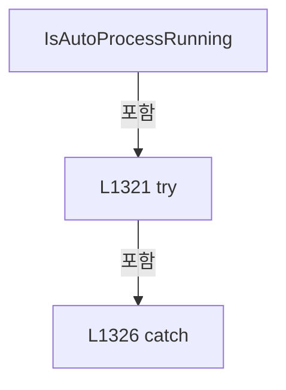

변경 전 점검: 입력/반환 타입, 위 호출자, 예외/취소 경로, 공유 상태와 저장·전송 소비자를 함께 확인합니다. 값의 단위나 물리 방향을 이름만으로 확정하지 않습니다.

### MethodDeclaration `ContainsAutomationFailureToken` · L1332–1344

[Drilling.UI/Menu/Menus/CMenuManual.cs:1332–1344](https://github.com/kjuws10-rgb/A3Drilling/blob/96e22cd027c84bf302b23f2949b98985d7f301bb/Drilling.UI/Menu/Menus/CMenuManual.cs#L1332-L1344)

| 항목 | 실제 추출 값 |
| --- | --- |
| 서명 | bool Drilling.UI.Menu.Menus.CMenuManual.ContainsAutomationFailureToken(string) |
| 접근/수식자 | Private / private, static |
| 반환/값 타입 | bool |
| 소속 타입 | NamedType:Drilling.UI.Menu.Menus.CMenuManual |

입력 계약:

| 이름 | 타입 | 전달 | 선택/기본값 |
| --- | --- | --- | --- |
| response | string | None | False /  |

정적 호출자로 확인된 위치:

| 호출 파일/행 | 호출 표현식 | 런타임 분기 가능 |
| --- | --- | --- |
| [Drilling.UI/Menu/Menus/CMenuManual.cs:5701–5701](https://github.com/kjuws10-rgb/A3Drilling/blob/96e22cd027c84bf302b23f2949b98985d7f301bb/Drilling.UI/Menu/Menus/CMenuManual.cs#L5701-L5701) | ContainsAutomationFailureToken | False |

호출하는 대상과 해석 범위:

| 원본 행 | 표현식 | 분석 상태 | 대상/소스 위치 |
| --- | --- | --- | --- |
| 1334 | response.Split | resolved | string[] string.Split(char, System.StringSplitOptions) |
| 1337 | IsAutomationFailureToken | resolved | bool Drilling.UI.Menu.Menus.CMenuManual.IsAutomationFailureToken(string) · Drilling.UI/Menu/Menus/CMenuManual.cs:1362 |

본문의 실제 연산·분기·예외·반환 순서(원문 위치 순):

| 원본 행 | 종류 | 주석 해설 |
| --- | --- | --- |
| 1334 | call | 함수·델리게이트 또는 객체 생성자를 호출합니다: response.Split(':', StringSplitOptions.TrimEntries &#124; StringSplitOptions.RemoveEmptyEntries) |
| 1334 | local-declaration | 지역 변수를 선언합니다: var tokens = response.Split(':', StringSplitOptions.TrimEntries &#124; StringSplitOptions.RemoveEmptyEntries); |
| 1334 | variable-initializer | 변수의 초기값을 지정합니다: tokens = response.Split(':', StringSplitOptions.TrimEntries &#124; StringSplitOptions.RemoveEmptyEntries) |
| 1335 | variable-initializer | 변수의 초기값을 지정합니다: index = 0 |
| 1335 | for | 초기화·조건·증감이 있는 반복입니다: for (var index = 0; index < tokens.Length; index++) |
| 1337 | call | 함수·델리게이트 또는 객체 생성자를 호출합니다: IsAutomationFailureToken(tokens[index]) |
| 1337 | if | 조건에 따라 분기합니다: if (IsAutomationFailureToken(tokens[index])) |
| 1339 | return | 호출자에게 값 또는 제어를 반환합니다: return true; |
| 1343 | return | 호출자에게 값 또는 제어를 반환합니다: return false; |

제어 구문의 포함 구조(실제 실행 순서/CFG가 아닌 구문 탐색 그림):

```mermaid
flowchart TD
 M["ContainsAutomationFailureToken"]
 N0["L1335 for"]
 M -->|포함| N0
 N1["L1337 if"]
 N0 -->|포함| N1
```

변경 전 점검: 입력/반환 타입, 위 호출자, 예외/취소 경로, 공유 상태와 저장·전송 소비자를 함께 확인합니다. 값의 단위나 물리 방향을 이름만으로 확정하지 않습니다.

### MethodDeclaration `FormatAutomationFailureResponse` · L1346–1360

[Drilling.UI/Menu/Menus/CMenuManual.cs:1346–1360](https://github.com/kjuws10-rgb/A3Drilling/blob/96e22cd027c84bf302b23f2949b98985d7f301bb/Drilling.UI/Menu/Menus/CMenuManual.cs#L1346-L1360)

| 항목 | 실제 추출 값 |
| --- | --- |
| 서명 | string Drilling.UI.Menu.Menus.CMenuManual.FormatAutomationFailureResponse(string) |
| 접근/수식자 | Private / private, static |
| 반환/값 타입 | string |
| 소속 타입 | NamedType:Drilling.UI.Menu.Menus.CMenuManual |

입력 계약:

| 이름 | 타입 | 전달 | 선택/기본값 |
| --- | --- | --- | --- |
| response | string | None | False /  |

정적 호출자로 확인된 위치:

| 호출 파일/행 | 호출 표현식 | 런타임 분기 가능 |
| --- | --- | --- |
| [Drilling.UI/Menu/Menus/CMenuManual.cs:5703–5703](https://github.com/kjuws10-rgb/A3Drilling/blob/96e22cd027c84bf302b23f2949b98985d7f301bb/Drilling.UI/Menu/Menus/CMenuManual.cs#L5703-L5703) | FormatAutomationFailureResponse | False |

호출하는 대상과 해석 범위:

| 원본 행 | 표현식 | 분석 상태 | 대상/소스 위치 |
| --- | --- | --- | --- |
| 1348 | string.IsNullOrWhiteSpace | resolved | bool string.IsNullOrWhiteSpace(string?) |
| 1353 | response.Trim().Split | resolved | string[] string.Split(char, int, System.StringSplitOptions) |
| 1353 | response.Trim | resolved | string string.Trim() |
| 1354 | fields[0].Equals | resolved | bool string.Equals(string?, System.StringComparison) |
| 1354 | fields[1].Equals | resolved | bool string.Equals(string?, System.StringComparison) |
| 1359 | response.Trim | resolved | string string.Trim() |

본문의 실제 연산·분기·예외·반환 순서(원문 위치 순):

| 원본 행 | 종류 | 주석 해설 |
| --- | --- | --- |
| 1348 | call | 함수·델리게이트 또는 객체 생성자를 호출합니다: string.IsNullOrWhiteSpace(response) |
| 1348 | if | 조건에 따라 분기합니다: if (string.IsNullOrWhiteSpace(response)) |
| 1350 | return | 호출자에게 값 또는 제어를 반환합니다: return "<empty>"; |
| 1353 | call | 함수·델리게이트 또는 객체 생성자를 호출합니다: response.Trim().Split(':', 4, StringSplitOptions.TrimEntries) |
| 1353 | call | 함수·델리게이트 또는 객체 생성자를 호출합니다: response.Trim() |
| 1353 | local-declaration | 지역 변수를 선언합니다: var fields = response.Trim().Split(':', 4, StringSplitOptions.TrimEntries); |
| 1353 | variable-initializer | 변수의 초기값을 지정합니다: fields = response.Trim().Split(':', 4, StringSplitOptions.TrimEntries) |
| 1354 | call | 함수·델리게이트 또는 객체 생성자를 호출합니다: fields[0].Equals("ERROR", StringComparison.OrdinalIgnoreCase) |
| 1354 | call | 함수·델리게이트 또는 객체 생성자를 호출합니다: fields[1].Equals("AUTOMATION1", StringComparison.OrdinalIgnoreCase) |
| 1354 | if | 조건에 따라 분기합니다: if (fields.Length >= 4 && fields[0].Equals("ERROR", StringComparison.OrdinalIgnoreCase) && fields[1].Equals("AUTOMATION1", StringComparison.OrdinalIgnoreCase)) |
| 1356 | return | 호출자에게 값 또는 제어를 반환합니다: return $"{fields[2]}: {fields[3]}"; |
| 1359 | call | 함수·델리게이트 또는 객체 생성자를 호출합니다: response.Trim() |
| 1359 | return | 호출자에게 값 또는 제어를 반환합니다: return response.Trim(); |

제어 구문의 포함 구조(실제 실행 순서/CFG가 아닌 구문 탐색 그림):

```mermaid
flowchart TD
 M["FormatAutomationFailureResponse"]
 N0["L1348 if"]
 M -->|포함| N0
 N1["L1354 if"]
 M -->|포함| N1
```

변경 전 점검: 입력/반환 타입, 위 호출자, 예외/취소 경로, 공유 상태와 저장·전송 소비자를 함께 확인합니다. 값의 단위나 물리 방향을 이름만으로 확정하지 않습니다.

### MethodDeclaration `IsAutomationFailureToken` · L1362–1365

[Drilling.UI/Menu/Menus/CMenuManual.cs:1362–1365](https://github.com/kjuws10-rgb/A3Drilling/blob/96e22cd027c84bf302b23f2949b98985d7f301bb/Drilling.UI/Menu/Menus/CMenuManual.cs#L1362-L1365)

| 항목 | 실제 추출 값 |
| --- | --- |
| 서명 | bool Drilling.UI.Menu.Menus.CMenuManual.IsAutomationFailureToken(string) |
| 접근/수식자 | Private / private, static |
| 반환/값 타입 | bool |
| 소속 타입 | NamedType:Drilling.UI.Menu.Menus.CMenuManual |

입력 계약:

| 이름 | 타입 | 전달 | 선택/기본값 |
| --- | --- | --- | --- |
| token | string | None | False /  |

정적 호출자로 확인된 위치:

| 호출 파일/행 | 호출 표현식 | 런타임 분기 가능 |
| --- | --- | --- |
| [Drilling.UI/Menu/Menus/CMenuManual.cs:1337–1337](https://github.com/kjuws10-rgb/A3Drilling/blob/96e22cd027c84bf302b23f2949b98985d7f301bb/Drilling.UI/Menu/Menus/CMenuManual.cs#L1337-L1337) | IsAutomationFailureToken | False |

호출하는 대상과 해석 범위:

| 원본 행 | 표현식 | 분석 상태 | 대상/소스 위치 |
| --- | --- | --- | --- |
| 1364 | token.Equals | resolved | bool string.Equals(string?, System.StringComparison) |
| 1364 | token.Equals | resolved | bool string.Equals(string?, System.StringComparison) |
| 1364 | token.Equals | resolved | bool string.Equals(string?, System.StringComparison) |
| 1364 | token.Equals | resolved | bool string.Equals(string?, System.StringComparison) |
| 1364 | token.Equals | resolved | bool string.Equals(string?, System.StringComparison) |
| 1364 | token.Equals | resolved | bool string.Equals(string?, System.StringComparison) |

본문의 실제 연산·분기·예외·반환 순서(원문 위치 순):

| 원본 행 | 종류 | 주석 해설 |
| --- | --- | --- |
| 1364 | call | 함수·델리게이트 또는 객체 생성자를 호출합니다: token.Equals("ERROR", StringComparison.OrdinalIgnoreCase) |
| 1364 | call | 함수·델리게이트 또는 객체 생성자를 호출합니다: token.Equals("ERR", StringComparison.OrdinalIgnoreCase) |
| 1364 | call | 함수·델리게이트 또는 객체 생성자를 호출합니다: token.Equals("FAIL", StringComparison.OrdinalIgnoreCase) |
| 1364 | call | 함수·델리게이트 또는 객체 생성자를 호출합니다: token.Equals("FAILED", StringComparison.OrdinalIgnoreCase) |
| 1364 | call | 함수·델리게이트 또는 객체 생성자를 호출합니다: token.Equals("NG", StringComparison.OrdinalIgnoreCase) |
| 1364 | call | 함수·델리게이트 또는 객체 생성자를 호출합니다: token.Equals("NAK", StringComparison.OrdinalIgnoreCase) |
| 1364 | return | 호출자에게 값 또는 제어를 반환합니다: return token.Equals("ERROR", StringComparison.OrdinalIgnoreCase) &#124;&#124; token.Equals("ERR", StringComparison.OrdinalIgnoreCase) &#124;&#124; token.Equals("FAIL", StringComparison.OrdinalIgnoreCase) &#124;&#124; token.Equals("FAILED", StringComparison.Ord |

변경 전 점검: 입력/반환 타입, 위 호출자, 예외/취소 경로, 공유 상태와 저장·전송 소비자를 함께 확인합니다. 값의 단위나 물리 방향을 이름만으로 확정하지 않습니다.

### MethodDeclaration `ReadManualParamFromScreen` · L1367–1392

[Drilling.UI/Menu/Menus/CMenuManual.cs:1367–1392](https://github.com/kjuws10-rgb/A3Drilling/blob/96e22cd027c84bf302b23f2949b98985d7f301bb/Drilling.UI/Menu/Menus/CMenuManual.cs#L1367-L1392)

| 항목 | 실제 추출 값 |
| --- | --- |
| 서명 | Drilling.Common.Managers.ST_MANUAL_SCAN_PARAM Drilling.UI.Menu.Menus.CMenuManual.ReadManualParamFromScreen() |
| 접근/수식자 | Private / private |
| 반환/값 타입 | Drilling.Common.Managers.ST_MANUAL_SCAN_PARAM |
| 소속 타입 | NamedType:Drilling.UI.Menu.Menus.CMenuManual |

정적 호출자로 확인된 위치:

| 호출 파일/행 | 호출 표현식 | 런타임 분기 가능 |
| --- | --- | --- |
| [Drilling.UI/Menu/Menus/CMenuManual.cs:5711–5711](https://github.com/kjuws10-rgb/A3Drilling/blob/96e22cd027c84bf302b23f2949b98985d7f301bb/Drilling.UI/Menu/Menus/CMenuManual.cs#L5711-L5711) | ReadManualParamFromScreen | False |

호출하는 대상과 해석 범위:

| 원본 행 | 표현식 | 분석 상태 | 대상/소스 위치 |
| --- | --- | --- | --- |
| 1369 | new ST_MANUAL_SCAN_PARAM | resolved | Drilling.Common.Managers.ST_MANUAL_SCAN_PARAM.ST_MANUAL_SCAN_PARAM(double, double, double, string, string, double, double, double, double, double, double, double, double, int, int, int, string, int, double) · Drilling.Common/Managers/CManager.cs:673 |
| 1370 | ReadManualDouble | resolved | double Drilling.UI.Menu.Menus.CMenuManual.ReadManualDouble(string) · Drilling.UI/Menu/Menus/CMenuManual.cs:1568 |
| 1371 | ReadManualDouble | resolved | double Drilling.UI.Menu.Menus.CMenuManual.ReadManualDouble(string) · Drilling.UI/Menu/Menus/CMenuManual.cs:1568 |
| 1372 | ReadManualDouble | resolved | double Drilling.UI.Menu.Menus.CMenuManual.ReadManualDouble(string) · Drilling.UI/Menu/Menus/CMenuManual.cs:1568 |
| 1373 | ReadManualText | resolved | string Drilling.UI.Menu.Menus.CMenuManual.ReadManualText(Drilling.UI.Menu.Menus.ST_MANUAL_PARAMETER, string) · Drilling.UI/Menu/Menus/CMenuManual.cs:5993 |
| 1373 | FindManualParameter | resolved | Drilling.UI.Menu.Menus.ST_MANUAL_PARAMETER Drilling.UI.Menu.Menus.CMenuManual.FindManualParameter(string) · Drilling.UI/Menu/Menus/CMenuManual.cs:5983 |
| 1374 | ReadManualText | resolved | string Drilling.UI.Menu.Menus.CMenuManual.ReadManualText(Drilling.UI.Menu.Menus.ST_MANUAL_PARAMETER, string) · Drilling.UI/Menu/Menus/CMenuManual.cs:5993 |
| 1374 | FindManualParameter | resolved | Drilling.UI.Menu.Menus.ST_MANUAL_PARAMETER Drilling.UI.Menu.Menus.CMenuManual.FindManualParameter(string) · Drilling.UI/Menu/Menus/CMenuManual.cs:5983 |
| 1375 | ReadManualDouble | resolved | double Drilling.UI.Menu.Menus.CMenuManual.ReadManualDouble(string) · Drilling.UI/Menu/Menus/CMenuManual.cs:1568 |
| 1376 | ReadManualDouble | resolved | double Drilling.UI.Menu.Menus.CMenuManual.ReadManualDouble(string) · Drilling.UI/Menu/Menus/CMenuManual.cs:1568 |
| 1377 | ReadManualDouble | resolved | double Drilling.UI.Menu.Menus.CMenuManual.ReadManualDouble(string) · Drilling.UI/Menu/Menus/CMenuManual.cs:1568 |
| 1379 | ReadManualDouble | resolved | double Drilling.UI.Menu.Menus.CMenuManual.ReadManualDouble(string) · Drilling.UI/Menu/Menus/CMenuManual.cs:1568 |
| 1380 | ReadManualDouble | resolved | double Drilling.UI.Menu.Menus.CMenuManual.ReadManualDouble(string) · Drilling.UI/Menu/Menus/CMenuManual.cs:1568 |
| 1381 | ReadManualDouble | resolved | double Drilling.UI.Menu.Menus.CMenuManual.ReadManualDouble(string) · Drilling.UI/Menu/Menus/CMenuManual.cs:1568 |
| 1382 | ReadManualDouble | resolved | double Drilling.UI.Menu.Menus.CMenuManual.ReadManualDouble(string) · Drilling.UI/Menu/Menus/CMenuManual.cs:1568 |
| 1383 | ReadManualInt | resolved | int Drilling.UI.Menu.Menus.CMenuManual.ReadManualInt(string) · Drilling.UI/Menu/Menus/CMenuManual.cs:5949 |
| 1384 | ReadManualInt | resolved | int Drilling.UI.Menu.Menus.CMenuManual.ReadManualInt(string) · Drilling.UI/Menu/Menus/CMenuManual.cs:5949 |
| 1385 | ReadManualInt | resolved | int Drilling.UI.Menu.Menus.CMenuManual.ReadManualInt(string) · Drilling.UI/Menu/Menus/CMenuManual.cs:5949 |
| 1386 | ReadManualText | resolved | string Drilling.UI.Menu.Menus.CMenuManual.ReadManualText(Drilling.UI.Menu.Menus.ST_MANUAL_PARAMETER, string) · Drilling.UI/Menu/Menus/CMenuManual.cs:5993 |
| 1386 | FindManualParameter | resolved | Drilling.UI.Menu.Menus.ST_MANUAL_PARAMETER Drilling.UI.Menu.Menus.CMenuManual.FindManualParameter(string) · Drilling.UI/Menu/Menus/CMenuManual.cs:5983 |
| 1387 | ReadManualInt | resolved | int Drilling.UI.Menu.Menus.CMenuManual.ReadManualInt(string) · Drilling.UI/Menu/Menus/CMenuManual.cs:5949 |
| 1388 | ReadManualDouble | resolved | double Drilling.UI.Menu.Menus.CMenuManual.ReadManualDouble(string) · Drilling.UI/Menu/Menus/CMenuManual.cs:1568 |
| 1390 | ValidateManualScanParameters | resolved | void Drilling.UI.Menu.Menus.CMenuManual.ValidateManualScanParameters(Drilling.Common.Managers.ST_MANUAL_SCAN_PARAM, System.Collections.Generic.IReadOnlyList<Drilling.Common.Managers.ST_MANUAL_SCAN_FORM>) · Drilling.UI/Menu/Menus/CMenuManual.cs:1473 |

본문의 실제 연산·분기·예외·반환 순서(원문 위치 순):

| 원본 행 | 종류 | 주석 해설 |
| --- | --- | --- |
| 1369 | call | 함수·델리게이트 또는 객체 생성자를 호출합니다: new ST_MANUAL_SCAN_PARAM( ReadManualDouble("ShapeSize"), ReadManualDouble("OffsetX"), ReadManualDouble("OffsetY"), ReadManualText(FindManualParameter("Direction")), ReadManualText(FindManualParameter("ShapeName")), ReadM… |
| 1369 | local-declaration | 지역 변수를 선언합니다: var settings = new ST_MANUAL_SCAN_PARAM( ReadManualDouble("ShapeSize"), ReadManualDouble("OffsetX"), ReadManualDouble("OffsetY"), ReadManualText(FindManualParameter("Direction")), ReadManualText(FindManualParameter("ShapeName")),  |
| 1369 | variable-initializer | 변수의 초기값을 지정합니다: settings = new ST_MANUAL_SCAN_PARAM( ReadManualDouble("ShapeSize"), ReadManualDouble("OffsetX"), ReadManualDouble("OffsetY"), ReadManualText(FindManualParameter("Direction")), ReadManualText(FindManualParameter("ShapeName")), Read |
| 1370 | call | 함수·델리게이트 또는 객체 생성자를 호출합니다: ReadManualDouble("ShapeSize") |
| 1371 | call | 함수·델리게이트 또는 객체 생성자를 호출합니다: ReadManualDouble("OffsetX") |
| 1372 | call | 함수·델리게이트 또는 객체 생성자를 호출합니다: ReadManualDouble("OffsetY") |
| 1373 | call | 함수·델리게이트 또는 객체 생성자를 호출합니다: ReadManualText(FindManualParameter("Direction")) |
| 1373 | call | 함수·델리게이트 또는 객체 생성자를 호출합니다: FindManualParameter("Direction") |
| 1374 | call | 함수·델리게이트 또는 객체 생성자를 호출합니다: ReadManualText(FindManualParameter("ShapeName")) |
| 1374 | call | 함수·델리게이트 또는 객체 생성자를 호출합니다: FindManualParameter("ShapeName") |
| 1375 | call | 함수·델리게이트 또는 객체 생성자를 호출합니다: ReadManualDouble("LaserPower") |
| 1376 | call | 함수·델리게이트 또는 객체 생성자를 호출합니다: ReadManualDouble("JumpSpeed") |
| 1377 | call | 함수·델리게이트 또는 객체 생성자를 호출합니다: ReadManualDouble("MarkSpeed") |
| 1379 | call | 함수·델리게이트 또는 객체 생성자를 호출합니다: ReadManualDouble("LaserFrequency") |
| 1380 | call | 함수·델리게이트 또는 객체 생성자를 호출합니다: ReadManualDouble("LaserOnDelay") |
| 1381 | call | 함수·델리게이트 또는 객체 생성자를 호출합니다: ReadManualDouble("LaserOffDelay") |
| 1382 | call | 함수·델리게이트 또는 객체 생성자를 호출합니다: ReadManualDouble("Time") |
| 1383 | call | 함수·델리게이트 또는 객체 생성자를 호출합니다: ReadManualInt("Count") |
| 1384 | call | 함수·델리게이트 또는 객체 생성자를 호출합니다: ReadManualInt("GridRowLines") |
| 1385 | call | 함수·델리게이트 또는 객체 생성자를 호출합니다: ReadManualInt("GridColLines") |
| 1386 | call | 함수·델리게이트 또는 객체 생성자를 호출합니다: ReadManualText(FindManualParameter("LaserOnMode")) |
| 1386 | call | 함수·델리게이트 또는 객체 생성자를 호출합니다: FindManualParameter("LaserOnMode") |
| 1387 | call | 함수·델리게이트 또는 객체 생성자를 호출합니다: ReadManualInt("RepeatCount") |
| 1388 | call | 함수·델리게이트 또는 객체 생성자를 호출합니다: ReadManualDouble("RepeatDelayTime") |
| 1390 | call | 함수·델리게이트 또는 객체 생성자를 호출합니다: ValidateManualScanParameters(settings, []) |
| 1391 | return | 호출자에게 값 또는 제어를 반환합니다: return settings; |

변경 전 점검: 입력/반환 타입, 위 호출자, 예외/취소 경로, 공유 상태와 저장·전송 소비자를 함께 확인합니다. 값의 단위나 물리 방향을 이름만으로 확정하지 않습니다.

### MethodDeclaration `Apply` · L1394–1424

[Drilling.UI/Menu/Menus/CMenuManual.cs:1394–1424](https://github.com/kjuws10-rgb/A3Drilling/blob/96e22cd027c84bf302b23f2949b98985d7f301bb/Drilling.UI/Menu/Menus/CMenuManual.cs#L1394-L1424)

| 항목 | 실제 추출 값 |
| --- | --- |
| 서명 | void Drilling.UI.Menu.Menus.CMenuManual.Apply(System.Collections.Generic.IReadOnlyList<Drilling.UI.Menu.Menus.ST_DISPLAY_ITEM>, System.Collections.Generic.IReadOnlyList<Drilling.UI.Menu.Menus.ST_DISPLAY_ITEM>, System.Collections.Generic.IReadOnlyList<Drilling.UI.Menu.Menus.ST_DISPLAY_ITEM>, System.Collections.Generic.IReadOnlyList<Drilling.UI.Menu.Menus.ST_DISPLAY_ITEM>, System.Collections.Generic.IReadOnlyList<Drilling.UI.Menu.Menus.ST_DISPLAY_ITEM>, string, string, string, System.Collections.Generic.IReadOnlyList<Drilling.UI.Menu.Menus.ST_MANUAL_HEAD_CARD>, System.Collections.Generic.IReadOnlyList<Drilling.UI.Menu.Menus.ST_MANUAL_SETTING_FILE>, System.Collections.Generic.IReadOnlyList<Drilling.UI.Menu.Menus.ST_MANUAL_PARAMETER>, System.Collections.Generic.IReadOnlyList<Drilling.UI.Menu.Menus.ST_MANUAL_COMMAND_STATE>, System.Collections.Generic.IReadOnlyList<Drilling.UI.Menu.Menus.ST_MANUAL_SCANNER_AXIS>) |
| 접근/수식자 | Private / private |
| 반환/값 타입 | void |
| 소속 타입 | NamedType:Drilling.UI.Menu.Menus.CMenuManual |

입력 계약:

| 이름 | 타입 | 전달 | 선택/기본값 |
| --- | --- | --- | --- |
| manualSettings | System.Collections.Generic.IReadOnlyList<Drilling.UI.Menu.Menus.ST_DISPLAY_ITEM> | None | False /  |
| selectedHeadItems | System.Collections.Generic.IReadOnlyList<Drilling.UI.Menu.Menus.ST_DISPLAY_ITEM> | None | False /  |
| positionMoveItems | System.Collections.Generic.IReadOnlyList<Drilling.UI.Menu.Menus.ST_DISPLAY_ITEM> | None | False /  |
| shapeScanItems | System.Collections.Generic.IReadOnlyList<Drilling.UI.Menu.Menus.ST_DISPLAY_ITEM> | None | False /  |
| commandStateItems | System.Collections.Generic.IReadOnlyList<Drilling.UI.Menu.Menus.ST_DISPLAY_ITEM> | None | False /  |
| selectedHead | string | None | False /  |
| loadedSettingName | string | None | False /  |
| loadedSettingPath | string | None | False /  |
| headCards | System.Collections.Generic.IReadOnlyList<Drilling.UI.Menu.Menus.ST_MANUAL_HEAD_CARD> | None | False /  |
| settingFiles | System.Collections.Generic.IReadOnlyList<Drilling.UI.Menu.Menus.ST_MANUAL_SETTING_FILE> | None | False /  |
| settingParameters | System.Collections.Generic.IReadOnlyList<Drilling.UI.Menu.Menus.ST_MANUAL_PARAMETER> | None | False /  |
| commandStateRows | System.Collections.Generic.IReadOnlyList<Drilling.UI.Menu.Menus.ST_MANUAL_COMMAND_STATE> | None | False /  |
| scannerAxes | System.Collections.Generic.IReadOnlyList<Drilling.UI.Menu.Menus.ST_MANUAL_SCANNER_AXIS> | None | False /  |

정적 호출자로 확인된 위치:

| 호출 파일/행 | 호출 표현식 | 런타임 분기 가능 |
| --- | --- | --- |
| [Drilling.UI/Menu/Menus/CMenuManual.cs:1149–1181](https://github.com/kjuws10-rgb/A3Drilling/blob/96e22cd027c84bf302b23f2949b98985d7f301bb/Drilling.UI/Menu/Menus/CMenuManual.cs#L1149-L1181) | Apply | False |

호출하는 대상과 해석 범위:

| 원본 행 | 표현식 | 분석 상태 | 대상/소스 위치 |
| --- | --- | --- | --- |
| 1419 | BuildHeadGroups | resolved | System.Collections.Generic.IReadOnlyList<Drilling.UI.Menu.Menus.ST_MANUAL_HEAD_GROUP> Drilling.UI.Menu.Menus.CMenuManual.BuildHeadGroups(System.Collections.Generic.IReadOnlyList<Drilling.UI.Menu.Menus.ST_MANUAL_HEAD_CARD>) · Drilling.UI/Menu/Menus/CMenuManual.cs:6740 |

본문의 실제 연산·분기·예외·반환 순서(원문 위치 순):

| 원본 행 | 종류 | 주석 해설 |
| --- | --- | --- |
| 1410 | assignment | 값을 대상에 대입합니다: ManualSettings = manualSettings |
| 1411 | assignment | 값을 대상에 대입합니다: SelectedHeadItems = selectedHeadItems |
| 1412 | assignment | 값을 대상에 대입합니다: PositionMoveItems = positionMoveItems |
| 1413 | assignment | 값을 대상에 대입합니다: ShapeScanItems = shapeScanItems |
| 1414 | assignment | 값을 대상에 대입합니다: CommandStateItems = commandStateItems |
| 1415 | assignment | 값을 대상에 대입합니다: SelectedHead = selectedHead |
| 1416 | assignment | 값을 대상에 대입합니다: LoadedSettingName = loadedSettingName |
| 1417 | assignment | 값을 대상에 대입합니다: LoadedSettingPath = loadedSettingPath |
| 1418 | assignment | 값을 대상에 대입합니다: HeadCards = headCards |
| 1419 | assignment | 값을 대상에 대입합니다: HeadGroups = BuildHeadGroups(headCards) |
| 1419 | call | 함수·델리게이트 또는 객체 생성자를 호출합니다: BuildHeadGroups(headCards) |
| 1420 | assignment | 값을 대상에 대입합니다: SettingFiles = settingFiles |
| 1421 | assignment | 값을 대상에 대입합니다: SettingParameters = settingParameters |
| 1422 | assignment | 값을 대상에 대입합니다: CommandStateRows = commandStateRows |
| 1423 | assignment | 값을 대상에 대입합니다: ScannerAxes = scannerAxes |

변경 전 점검: 입력/반환 타입, 위 호출자, 예외/취소 경로, 공유 상태와 저장·전송 소비자를 함께 확인합니다. 값의 단위나 물리 방향을 이름만으로 확정하지 않습니다.

### MethodDeclaration `BuildManualSettings` · L1426–1436

[Drilling.UI/Menu/Menus/CMenuManual.cs:1426–1436](https://github.com/kjuws10-rgb/A3Drilling/blob/96e22cd027c84bf302b23f2949b98985d7f301bb/Drilling.UI/Menu/Menus/CMenuManual.cs#L1426-L1436)

| 항목 | 실제 추출 값 |
| --- | --- |
| 서명 | System.Collections.Generic.IReadOnlyList<Drilling.UI.Menu.Menus.ST_DISPLAY_ITEM> Drilling.UI.Menu.Menus.CMenuManual.BuildManualSettings(Drilling.Common.Managers.ST_MANUAL_SCAN_PARAM) |
| 접근/수식자 | Private / private, static |
| 반환/값 타입 | System.Collections.Generic.IReadOnlyList<Drilling.UI.Menu.Menus.ST_DISPLAY_ITEM> |
| 소속 타입 | NamedType:Drilling.UI.Menu.Menus.CMenuManual |

입력 계약:

| 이름 | 타입 | 전달 | 선택/기본값 |
| --- | --- | --- | --- |
| settings | Drilling.Common.Managers.ST_MANUAL_SCAN_PARAM | None | False /  |

정적 호출자로 확인된 위치:

| 호출 파일/행 | 호출 표현식 | 런타임 분기 가능 |
| --- | --- | --- |
| [Drilling.UI/Menu/Menus/CMenuManual.cs:1150–1150](https://github.com/kjuws10-rgb/A3Drilling/blob/96e22cd027c84bf302b23f2949b98985d7f301bb/Drilling.UI/Menu/Menus/CMenuManual.cs#L1150-L1150) | BuildManualSettings | False |
| [Drilling.UI/Menu/Menus/CMenuManual.cs:1189–1189](https://github.com/kjuws10-rgb/A3Drilling/blob/96e22cd027c84bf302b23f2949b98985d7f301bb/Drilling.UI/Menu/Menus/CMenuManual.cs#L1189-L1189) | BuildManualSettings | False |

호출하는 대상과 해석 범위:

| 원본 행 | 표현식 | 분석 상태 | 대상/소스 위치 |
| --- | --- | --- | --- |
| 1429 | new | resolved | Drilling.UI.Menu.Menus.ST_DISPLAY_ITEM.ST_DISPLAY_ITEM(string, string, string) · Drilling.UI/Menu/Menus/CMenuBase.cs:43 |
| 1429 | FormatDouble | resolved | string Drilling.UI.Menu.Menus.CMenuManual.FormatDouble(double, int) · Drilling.UI/Menu/Menus/CMenuManual.cs:1601 |
| 1430 | new | resolved | Drilling.UI.Menu.Menus.ST_DISPLAY_ITEM.ST_DISPLAY_ITEM(string, string, string) · Drilling.UI/Menu/Menus/CMenuBase.cs:43 |
| 1430 | FormatDouble | resolved | string Drilling.UI.Menu.Menus.CMenuManual.FormatDouble(double, int) · Drilling.UI/Menu/Menus/CMenuManual.cs:1601 |
| 1431 | new | resolved | Drilling.UI.Menu.Menus.ST_DISPLAY_ITEM.ST_DISPLAY_ITEM(string, string, string) · Drilling.UI/Menu/Menus/CMenuBase.cs:43 |
| 1431 | FormatDouble | resolved | string Drilling.UI.Menu.Menus.CMenuManual.FormatDouble(double, int) · Drilling.UI/Menu/Menus/CMenuManual.cs:1601 |
| 1432 | new | resolved | Drilling.UI.Menu.Menus.ST_DISPLAY_ITEM.ST_DISPLAY_ITEM(string, string, string) · Drilling.UI/Menu/Menus/CMenuBase.cs:43 |
| 1432 | FormatDouble | resolved | string Drilling.UI.Menu.Menus.CMenuManual.FormatDouble(double, int) · Drilling.UI/Menu/Menus/CMenuManual.cs:1601 |
| 1433 | new | resolved | Drilling.UI.Menu.Menus.ST_DISPLAY_ITEM.ST_DISPLAY_ITEM(string, string, string) · Drilling.UI/Menu/Menus/CMenuBase.cs:43 |
| 1433 | FormatDouble | resolved | string Drilling.UI.Menu.Menus.CMenuManual.FormatDouble(double, int) · Drilling.UI/Menu/Menus/CMenuManual.cs:1601 |
| 1434 | new | resolved | Drilling.UI.Menu.Menus.ST_DISPLAY_ITEM.ST_DISPLAY_ITEM(string, string, string) · Drilling.UI/Menu/Menus/CMenuBase.cs:43 |
| 1434 | FormatDouble | resolved | string Drilling.UI.Menu.Menus.CMenuManual.FormatDouble(double, int) · Drilling.UI/Menu/Menus/CMenuManual.cs:1601 |

본문의 실제 연산·분기·예외·반환 순서(원문 위치 순):

| 원본 행 | 종류 | 주석 해설 |
| --- | --- | --- |
| 1428 | return | 호출자에게 값 또는 제어를 반환합니다: return[ new("Laser Power", FormatDouble(settings.LaserPower, 2), "W"), new("Jump Speed", FormatDouble(settings.JumpSpeed, 3), "m/sec"), new("Mark Speed", FormatDouble(settings.MarkSpeed, 3), "m/sec"), new("Laser Frequency", Format |
| 1429 | call | 함수·델리게이트 또는 객체 생성자를 호출합니다: new("Laser Power", FormatDouble(settings.LaserPower, 2), "W") |
| 1429 | call | 함수·델리게이트 또는 객체 생성자를 호출합니다: FormatDouble(settings.LaserPower, 2) |
| 1430 | call | 함수·델리게이트 또는 객체 생성자를 호출합니다: new("Jump Speed", FormatDouble(settings.JumpSpeed, 3), "m/sec") |
| 1430 | call | 함수·델리게이트 또는 객체 생성자를 호출합니다: FormatDouble(settings.JumpSpeed, 3) |
| 1431 | call | 함수·델리게이트 또는 객체 생성자를 호출합니다: new("Mark Speed", FormatDouble(settings.MarkSpeed, 3), "m/sec") |
| 1431 | call | 함수·델리게이트 또는 객체 생성자를 호출합니다: FormatDouble(settings.MarkSpeed, 3) |
| 1432 | call | 함수·델리게이트 또는 객체 생성자를 호출합니다: new("Laser Frequency", FormatDouble(settings.LaserFrequency, 3), "kHz") |
| 1432 | call | 함수·델리게이트 또는 객체 생성자를 호출합니다: FormatDouble(settings.LaserFrequency, 3) |
| 1433 | call | 함수·델리게이트 또는 객체 생성자를 호출합니다: new("Laser On Delay", FormatDouble(settings.LaserOnDelay, 3), "msec") |
| 1433 | call | 함수·델리게이트 또는 객체 생성자를 호출합니다: FormatDouble(settings.LaserOnDelay, 3) |
| 1434 | call | 함수·델리게이트 또는 객체 생성자를 호출합니다: new("Laser Off Delay", FormatDouble(settings.LaserOffDelay, 3), "msec") |
| 1434 | call | 함수·델리게이트 또는 객체 생성자를 호출합니다: FormatDouble(settings.LaserOffDelay, 3) |

변경 전 점검: 입력/반환 타입, 위 호출자, 예외/취소 경로, 공유 상태와 저장·전송 소비자를 함께 확인합니다. 값의 단위나 물리 방향을 이름만으로 확정하지 않습니다.

### MethodDeclaration `ReadEnabledManualScannerHeadNo` · L1438–1449

[Drilling.UI/Menu/Menus/CMenuManual.cs:1438–1449](https://github.com/kjuws10-rgb/A3Drilling/blob/96e22cd027c84bf302b23f2949b98985d7f301bb/Drilling.UI/Menu/Menus/CMenuManual.cs#L1438-L1449)

| 항목 | 실제 추출 값 |
| --- | --- |
| 서명 | int Drilling.UI.Menu.Menus.CMenuManual.ReadEnabledManualScannerHeadNo(System.Threading.CancellationToken) |
| 접근/수식자 | Private / private |
| 반환/값 타입 | int |
| 소속 타입 | NamedType:Drilling.UI.Menu.Menus.CMenuManual |

입력 계약:

| 이름 | 타입 | 전달 | 선택/기본값 |
| --- | --- | --- | --- |
| cancellationToken | System.Threading.CancellationToken | None | False /  |

정적 호출자로 확인된 위치:

| 호출 파일/행 | 호출 표현식 | 런타임 분기 가능 |
| --- | --- | --- |
| [Drilling.UI/Menu/Menus/CMenuManual.cs:3981–3981](https://github.com/kjuws10-rgb/A3Drilling/blob/96e22cd027c84bf302b23f2949b98985d7f301bb/Drilling.UI/Menu/Menus/CMenuManual.cs#L3981-L3981) | ReadEnabledManualScannerHeadNo | False |
| [Drilling.UI/Menu/Menus/CMenuManual.cs:4025–4025](https://github.com/kjuws10-rgb/A3Drilling/blob/96e22cd027c84bf302b23f2949b98985d7f301bb/Drilling.UI/Menu/Menus/CMenuManual.cs#L4025-L4025) | ReadEnabledManualScannerHeadNo | False |
| [Drilling.UI/Menu/Menus/CMenuManual.cs:5288–5288](https://github.com/kjuws10-rgb/A3Drilling/blob/96e22cd027c84bf302b23f2949b98985d7f301bb/Drilling.UI/Menu/Menus/CMenuManual.cs#L5288-L5288) | ReadEnabledManualScannerHeadNo | False |

호출하는 대상과 해석 범위:

| 원본 행 | 표현식 | 분석 상태 | 대상/소스 위치 |
| --- | --- | --- | --- |
| 1440 | _manager.Setting().LoadSection | resolved | System.Collections.Generic.IReadOnlyList<Drilling.Common.Managers.ST_SYSTEM_PARAMETER> Drilling.Common.Managers.CSettingManager.LoadSection(Drilling.Common.Managers.EN_SETTING_TAB, System.Threading.CancellationToken) · Drilling.Common/Managers/CSettingManager.cs:26 |
| 1440 | _manager.Setting | resolved | Drilling.Common.Managers.CSettingManager Drilling.Common.Managers.CManager.Setting() · Drilling.Common/Managers/CManager.cs:340 |
| 1441 | CScannerStatusSnapshotReader.BuildEnabledHeadNumbers | resolved | System.Collections.Generic.IReadOnlyList<int> Drilling.UI.Menu.Menus.CScannerStatusSnapshotReader.BuildEnabledHeadNumbers(System.Collections.Generic.IReadOnlyList<Drilling.Common.Managers.ST_SYSTEM_PARAMETER>, int) · Drilling.UI/Menu/Menus/CScannerStatusSnapshotReader.cs:126 |
| 1444 | new InvalidOperationException | resolved | System.InvalidOperationException.InvalidOperationException(string?) |
| 1447 | Math.Clamp | resolved | int System.Math.Clamp(int, int, int) |
| 1447 | _selectedHeadNoProvider | resolved · 동적 구현 선택 가능 | int System.Func<int>.Invoke() |
| 1448 | enabledHeadNos.Contains | resolved | bool System.Collections.Generic.IEnumerable<int>.Contains<int>(int) |

본문의 실제 연산·분기·예외·반환 순서(원문 위치 순):

| 원본 행 | 종류 | 주석 해설 |
| --- | --- | --- |
| 1440 | call | 함수·델리게이트 또는 객체 생성자를 호출합니다: _manager.Setting().LoadSection(EN_SETTING_TAB.Option, cancellationToken) |
| 1440 | call | 함수·델리게이트 또는 객체 생성자를 호출합니다: _manager.Setting() |
| 1440 | local-declaration | 지역 변수를 선언합니다: var optionSettings = _manager.Setting().LoadSection(EN_SETTING_TAB.Option, cancellationToken); |
| 1440 | variable-initializer | 변수의 초기값을 지정합니다: optionSettings = _manager.Setting().LoadSection(EN_SETTING_TAB.Option, cancellationToken) |
| 1441 | call | 함수·델리게이트 또는 객체 생성자를 호출합니다: CScannerStatusSnapshotReader.BuildEnabledHeadNumbers(optionSettings) |
| 1441 | local-declaration | 지역 변수를 선언합니다: var enabledHeadNos = CScannerStatusSnapshotReader.BuildEnabledHeadNumbers(optionSettings); |
| 1441 | variable-initializer | 변수의 초기값을 지정합니다: enabledHeadNos = CScannerStatusSnapshotReader.BuildEnabledHeadNumbers(optionSettings) |
| 1442 | if | 조건에 따라 분기합니다: if (enabledHeadNos.Count == 0) |
| 1444 | call | 함수·델리게이트 또는 객체 생성자를 호출합니다: new InvalidOperationException("No manual scanner head is enabled. Check Hxx_USE option settings.") |
| 1444 | throw | 예외를 발생/전달합니다: throw new InvalidOperationException("No manual scanner head is enabled. Check Hxx_USE option settings."); |
| 1447 | call | 함수·델리게이트 또는 객체 생성자를 호출합니다: Math.Clamp(_selectedHeadNoProvider(), 1, 8) |
| 1447 | call | 함수·델리게이트 또는 객체 생성자를 호출합니다: _selectedHeadNoProvider() |
| 1447 | local-declaration | 지역 변수를 선언합니다: var selectedHeadNo = Math.Clamp(_selectedHeadNoProvider(), 1, 8); |
| 1447 | variable-initializer | 변수의 초기값을 지정합니다: selectedHeadNo = Math.Clamp(_selectedHeadNoProvider(), 1, 8) |
| 1448 | call | 함수·델리게이트 또는 객체 생성자를 호출합니다: enabledHeadNos.Contains(selectedHeadNo) |
| 1448 | conditional-expression | 조건에 따라 결과식을 선택합니다: enabledHeadNos.Contains(selectedHeadNo) ? selectedHeadNo : enabledHeadNos[0] |
| 1448 | return | 호출자에게 값 또는 제어를 반환합니다: return enabledHeadNos.Contains(selectedHeadNo) ? selectedHeadNo : enabledHeadNos[0]; |

제어 구문의 포함 구조(실제 실행 순서/CFG가 아닌 구문 탐색 그림):

```mermaid
flowchart TD
 M["ReadEnabledManualScannerHeadNo"]
 N0["L1442 if"]
 M -->|포함| N0
```

변경 전 점검: 입력/반환 타입, 위 호출자, 예외/취소 경로, 공유 상태와 저장·전송 소비자를 함께 확인합니다. 값의 단위나 물리 방향을 이름만으로 확정하지 않습니다.

### MethodDeclaration `ReadManualHeadAutomationNo` · L1451–1454

[Drilling.UI/Menu/Menus/CMenuManual.cs:1451–1454](https://github.com/kjuws10-rgb/A3Drilling/blob/96e22cd027c84bf302b23f2949b98985d7f301bb/Drilling.UI/Menu/Menus/CMenuManual.cs#L1451-L1454)

| 항목 | 실제 추출 값 |
| --- | --- |
| 서명 | int Drilling.UI.Menu.Menus.CMenuManual.ReadManualHeadAutomationNo(System.Collections.Generic.IReadOnlyList<Drilling.Common.Managers.ST_SYSTEM_PARAMETER>, int) |
| 접근/수식자 | Private / private, static |
| 반환/값 타입 | int |
| 소속 타입 | NamedType:Drilling.UI.Menu.Menus.CMenuManual |

입력 계약:

| 이름 | 타입 | 전달 | 선택/기본값 |
| --- | --- | --- | --- |
| settings | System.Collections.Generic.IReadOnlyList<Drilling.Common.Managers.ST_SYSTEM_PARAMETER> | None | False /  |
| headNo | int | None | False /  |

정적 호출자로 확인된 위치:

| 호출 파일/행 | 호출 표현식 | 런타임 분기 가능 |
| --- | --- | --- |
| [Drilling.UI/Menu/Menus/CMenuManual.cs:2058–2058](https://github.com/kjuws10-rgb/A3Drilling/blob/96e22cd027c84bf302b23f2949b98985d7f301bb/Drilling.UI/Menu/Menus/CMenuManual.cs#L2058-L2058) | ReadManualHeadAutomationNo | False |
| [Drilling.UI/Menu/Menus/CMenuManual.cs:2532–2532](https://github.com/kjuws10-rgb/A3Drilling/blob/96e22cd027c84bf302b23f2949b98985d7f301bb/Drilling.UI/Menu/Menus/CMenuManual.cs#L2532-L2532) | ReadManualHeadAutomationNo | False |
| [Drilling.UI/Menu/Menus/CMenuManual.cs:4434–4434](https://github.com/kjuws10-rgb/A3Drilling/blob/96e22cd027c84bf302b23f2949b98985d7f301bb/Drilling.UI/Menu/Menus/CMenuManual.cs#L4434-L4434) | ReadManualHeadAutomationNo | False |
| [Drilling.UI/Menu/Menus/CMenuManual.cs:4847–4847](https://github.com/kjuws10-rgb/A3Drilling/blob/96e22cd027c84bf302b23f2949b98985d7f301bb/Drilling.UI/Menu/Menus/CMenuManual.cs#L4847-L4847) | ReadManualHeadAutomationNo | False |
| [Drilling.UI/Menu/Menus/CMenuManual.cs:5290–5290](https://github.com/kjuws10-rgb/A3Drilling/blob/96e22cd027c84bf302b23f2949b98985d7f301bb/Drilling.UI/Menu/Menus/CMenuManual.cs#L5290-L5290) | ReadManualHeadAutomationNo | False |
| [Drilling.UI/Menu/Menus/CMenuManual.cs:6727–6727](https://github.com/kjuws10-rgb/A3Drilling/blob/96e22cd027c84bf302b23f2949b98985d7f301bb/Drilling.UI/Menu/Menus/CMenuManual.cs#L6727-L6727) | ReadManualHeadAutomationNo | False |

호출하는 대상과 해석 범위:

| 원본 행 | 표현식 | 분석 상태 | 대상/소스 위치 |
| --- | --- | --- | --- |
| 1453 | ReadOptionalHeadSettingInt | resolved | int Drilling.UI.Menu.Menus.CMenuManual.ReadOptionalHeadSettingInt(System.Collections.Generic.IReadOnlyList<Drilling.Common.Managers.ST_SYSTEM_PARAMETER>, int, int, params string[]) · Drilling.UI/Menu/Menus/CMenuManual.cs:1194 |

본문의 실제 연산·분기·예외·반환 순서(원문 위치 순):

| 원본 행 | 종류 | 주석 해설 |
| --- | --- | --- |
| 1453 | call | 함수·델리게이트 또는 객체 생성자를 호출합니다: ReadOptionalHeadSettingInt(settings, headNo <= 4 ? 0 : 1, headNo, "AUTOMATION_NO") |
| 1453 | conditional-expression | 조건에 따라 결과식을 선택합니다: headNo <= 4 ? 0 : 1 |
| 1453 | return | 호출자에게 값 또는 제어를 반환합니다: return ReadOptionalHeadSettingInt(settings, headNo <= 4 ? 0 : 1, headNo, "AUTOMATION_NO"); |

변경 전 점검: 입력/반환 타입, 위 호출자, 예외/취소 경로, 공유 상태와 저장·전송 소비자를 함께 확인합니다. 값의 단위나 물리 방향을 이름만으로 확정하지 않습니다.

### MethodDeclaration `ReadManualHeadAutomationTaskNo` · L1456–1460

[Drilling.UI/Menu/Menus/CMenuManual.cs:1456–1460](https://github.com/kjuws10-rgb/A3Drilling/blob/96e22cd027c84bf302b23f2949b98985d7f301bb/Drilling.UI/Menu/Menus/CMenuManual.cs#L1456-L1460)

| 항목 | 실제 추출 값 |
| --- | --- |
| 서명 | int Drilling.UI.Menu.Menus.CMenuManual.ReadManualHeadAutomationTaskNo(System.Collections.Generic.IReadOnlyList<Drilling.Common.Managers.ST_SYSTEM_PARAMETER>, int) |
| 접근/수식자 | Private / private, static |
| 반환/값 타입 | int |
| 소속 타입 | NamedType:Drilling.UI.Menu.Menus.CMenuManual |

입력 계약:

| 이름 | 타입 | 전달 | 선택/기본값 |
| --- | --- | --- | --- |
| settings | System.Collections.Generic.IReadOnlyList<Drilling.Common.Managers.ST_SYSTEM_PARAMETER> | None | False /  |
| headNo | int | None | False /  |

정적 호출자로 확인된 위치:

| 호출 파일/행 | 호출 표현식 | 런타임 분기 가능 |
| --- | --- | --- |
| [Drilling.UI/Menu/Menus/CMenuManual.cs:3088–3088](https://github.com/kjuws10-rgb/A3Drilling/blob/96e22cd027c84bf302b23f2949b98985d7f301bb/Drilling.UI/Menu/Menus/CMenuManual.cs#L3088-L3088) | ReadManualHeadAutomationTaskNo | False |
| [Drilling.UI/Menu/Menus/CMenuManual.cs:3648–3648](https://github.com/kjuws10-rgb/A3Drilling/blob/96e22cd027c84bf302b23f2949b98985d7f301bb/Drilling.UI/Menu/Menus/CMenuManual.cs#L3648-L3648) | ReadManualHeadAutomationTaskNo | False |
| [Drilling.UI/Menu/Menus/CMenuManual.cs:4435–4435](https://github.com/kjuws10-rgb/A3Drilling/blob/96e22cd027c84bf302b23f2949b98985d7f301bb/Drilling.UI/Menu/Menus/CMenuManual.cs#L4435-L4435) | ReadManualHeadAutomationTaskNo | False |
| [Drilling.UI/Menu/Menus/CMenuManual.cs:4848–4848](https://github.com/kjuws10-rgb/A3Drilling/blob/96e22cd027c84bf302b23f2949b98985d7f301bb/Drilling.UI/Menu/Menus/CMenuManual.cs#L4848-L4848) | ReadManualHeadAutomationTaskNo | False |

호출하는 대상과 해석 범위:

| 원본 행 | 표현식 | 분석 상태 | 대상/소스 위치 |
| --- | --- | --- | --- |
| 1459 | Math.Max | resolved | int System.Math.Max(int, int) |
| 1459 | ReadOptionalHeadSettingInt | resolved | int Drilling.UI.Menu.Menus.CMenuManual.ReadOptionalHeadSettingInt(System.Collections.Generic.IReadOnlyList<Drilling.Common.Managers.ST_SYSTEM_PARAMETER>, int, int, params string[]) · Drilling.UI/Menu/Menus/CMenuManual.cs:1194 |

본문의 실제 연산·분기·예외·반환 순서(원문 위치 순):

| 원본 행 | 종류 | 주석 해설 |
| --- | --- | --- |
| 1458 | local-declaration | 지역 변수를 선언합니다: var defaultTaskNo = ((headNo - 1) % 4) + 1; |
| 1458 | variable-initializer | 변수의 초기값을 지정합니다: defaultTaskNo = ((headNo - 1) % 4) + 1 |
| 1459 | call | 함수·델리게이트 또는 객체 생성자를 호출합니다: Math.Max(1, ReadOptionalHeadSettingInt(settings, defaultTaskNo, headNo, "AUTOMATION_TASK_NO")) |
| 1459 | call | 함수·델리게이트 또는 객체 생성자를 호출합니다: ReadOptionalHeadSettingInt(settings, defaultTaskNo, headNo, "AUTOMATION_TASK_NO") |
| 1459 | return | 호출자에게 값 또는 제어를 반환합니다: return Math.Max(1, ReadOptionalHeadSettingInt(settings, defaultTaskNo, headNo, "AUTOMATION_TASK_NO")); |

변경 전 점검: 입력/반환 타입, 위 호출자, 예외/취소 경로, 공유 상태와 저장·전송 소비자를 함께 확인합니다. 값의 단위나 물리 방향을 이름만으로 확정하지 않습니다.

### MethodDeclaration `FormatControllerHomeRunSummary` · L1462–1471

[Drilling.UI/Menu/Menus/CMenuManual.cs:1462–1471](https://github.com/kjuws10-rgb/A3Drilling/blob/96e22cd027c84bf302b23f2949b98985d7f301bb/Drilling.UI/Menu/Menus/CMenuManual.cs#L1462-L1471)

| 항목 | 실제 추출 값 |
| --- | --- |
| 서명 | string Drilling.UI.Menu.Menus.CMenuManual.FormatControllerHomeRunSummary(System.Collections.Generic.IReadOnlyList<Drilling.UI.Menu.Menus.CMenuManual.ST_CONTROLLER_HOME_RUN>) |
| 접근/수식자 | Private / private, static |
| 반환/값 타입 | string |
| 소속 타입 | NamedType:Drilling.UI.Menu.Menus.CMenuManual |

입력 계약:

| 이름 | 타입 | 전달 | 선택/기본값 |
| --- | --- | --- | --- |
| runItems | System.Collections.Generic.IReadOnlyList<Drilling.UI.Menu.Menus.CMenuManual.ST_CONTROLLER_HOME_RUN> | None | False /  |

정적 호출자로 확인된 위치:

| 호출 파일/행 | 호출 표현식 | 런타임 분기 가능 |
| --- | --- | --- |
| [Drilling.UI/Menu/Menus/CMenuManual.cs:2644–2644](https://github.com/kjuws10-rgb/A3Drilling/blob/96e22cd027c84bf302b23f2949b98985d7f301bb/Drilling.UI/Menu/Menus/CMenuManual.cs#L2644-L2644) | FormatControllerHomeRunSummary | False |
| [Drilling.UI/Menu/Menus/CMenuManual.cs:2662–2662](https://github.com/kjuws10-rgb/A3Drilling/blob/96e22cd027c84bf302b23f2949b98985d7f301bb/Drilling.UI/Menu/Menus/CMenuManual.cs#L2662-L2662) | FormatControllerHomeRunSummary | False |

호출하는 대상과 해석 범위:

| 원본 행 | 표현식 | 분석 상태 | 대상/소스 위치 |
| --- | --- | --- | --- |
| 1464 | new List<string> | resolved | System.Collections.Generic.List<string>.List(int) |
| 1467 | items.Add | resolved | void System.Collections.Generic.List<string>.Add(string) |
| 1470 | string.Join | resolved | string string.Join(string?, System.Collections.Generic.IEnumerable<string?>) |

본문의 실제 연산·분기·예외·반환 순서(원문 위치 순):

| 원본 행 | 종류 | 주석 해설 |
| --- | --- | --- |
| 1464 | call | 함수·델리게이트 또는 객체 생성자를 호출합니다: new List<string>(runItems.Count) |
| 1464 | local-declaration | 지역 변수를 선언합니다: var items = new List<string>(runItems.Count); |
| 1464 | variable-initializer | 변수의 초기값을 지정합니다: items = new List<string>(runItems.Count) |
| 1465 | foreach | 컬렉션 요소를 순회합니다: foreach (var runItem in runItems) |
| 1467 | call | 함수·델리게이트 또는 객체 생성자를 호출합니다: items.Add($"T{runItem.TaskNo}:{runItem.ScriptFileName}") |
| 1470 | call | 함수·델리게이트 또는 객체 생성자를 호출합니다: string.Join(", ", items) |
| 1470 | return | 호출자에게 값 또는 제어를 반환합니다: return string.Join(", ", items); |

제어 구문의 포함 구조(실제 실행 순서/CFG가 아닌 구문 탐색 그림):

```mermaid
flowchart TD
 M["FormatControllerHomeRunSummary"]
 N0["L1465 foreach"]
 M -->|포함| N0
```

변경 전 점검: 입력/반환 타입, 위 호출자, 예외/취소 경로, 공유 상태와 저장·전송 소비자를 함께 확인합니다. 값의 단위나 물리 방향을 이름만으로 확정하지 않습니다.

### MethodDeclaration `ValidateManualScanParameters` · L1473–1529

[Drilling.UI/Menu/Menus/CMenuManual.cs:1473–1529](https://github.com/kjuws10-rgb/A3Drilling/blob/96e22cd027c84bf302b23f2949b98985d7f301bb/Drilling.UI/Menu/Menus/CMenuManual.cs#L1473-L1529)

| 항목 | 실제 추출 값 |
| --- | --- |
| 서명 | void Drilling.UI.Menu.Menus.CMenuManual.ValidateManualScanParameters(Drilling.Common.Managers.ST_MANUAL_SCAN_PARAM, System.Collections.Generic.IReadOnlyList<Drilling.Common.Managers.ST_MANUAL_SCAN_FORM>) |
| 접근/수식자 | Private / private, static |
| 반환/값 타입 | void |
| 소속 타입 | NamedType:Drilling.UI.Menu.Menus.CMenuManual |

입력 계약:

| 이름 | 타입 | 전달 | 선택/기본값 |
| --- | --- | --- | --- |
| settings | Drilling.Common.Managers.ST_MANUAL_SCAN_PARAM | None | False /  |
| formItems | System.Collections.Generic.IReadOnlyList<Drilling.Common.Managers.ST_MANUAL_SCAN_FORM> | None | False /  |

정적 호출자로 확인된 위치:

| 호출 파일/행 | 호출 표현식 | 런타임 분기 가능 |
| --- | --- | --- |
| [Drilling.UI/Menu/Menus/CMenuManual.cs:1390–1390](https://github.com/kjuws10-rgb/A3Drilling/blob/96e22cd027c84bf302b23f2949b98985d7f301bb/Drilling.UI/Menu/Menus/CMenuManual.cs#L1390-L1390) | ValidateManualScanParameters | False |
| [Drilling.UI/Menu/Menus/CMenuManual.cs:4197–4197](https://github.com/kjuws10-rgb/A3Drilling/blob/96e22cd027c84bf302b23f2949b98985d7f301bb/Drilling.UI/Menu/Menus/CMenuManual.cs#L4197-L4197) | ValidateManualScanParameters | False |

호출하는 대상과 해석 범위:

| 원본 행 | 표현식 | 분석 상태 | 대상/소스 위치 |
| --- | --- | --- | --- |
| 1475 | double.IsFinite | resolved | bool double.IsFinite(double) |
| 1476 | new InvalidDataException | resolved | System.IO.InvalidDataException.InvalidDataException(string?) |
| 1477 | ST_MANUAL_PARAMETER.ShapeOptions.Contains | resolved | bool System.Collections.Generic.IEnumerable<string>.Contains<string>(string, System.Collections.Generic.IEqualityComparer<string>?) |
| 1478 | new InvalidDataException | resolved | System.IO.InvalidDataException.InvalidDataException(string?) |
| 1479 | ST_MANUAL_PARAMETER.DirectionOptions.Contains | resolved | bool System.Collections.Generic.IEnumerable<string>.Contains<string>(string, System.Collections.Generic.IEqualityComparer<string>?) |
| 1480 | new InvalidDataException | resolved | System.IO.InvalidDataException.InvalidDataException(string?) |
| 1482 | new InvalidDataException | resolved | System.IO.InvalidDataException.InvalidDataException(string?) |
| 1483 | ST_MANUAL_PARAMETER.LaserModeOptions.Contains | resolved | bool System.Collections.Generic.IEnumerable<string>.Contains<string>(string, System.Collections.Generic.IEqualityComparer<string>?) |
| 1484 | new InvalidDataException | resolved | System.IO.InvalidDataException.InvalidDataException(string?) |
| 1485 | double.IsFinite | resolved | bool double.IsFinite(double) |
| 1486 | new InvalidDataException | resolved | System.IO.InvalidDataException.InvalidDataException(string?) |
| 1488 | new InvalidDataException | resolved | System.IO.InvalidDataException.InvalidDataException(string?) |
| 1489 | double.IsFinite | resolved | bool double.IsFinite(double) |
| 1490 | new InvalidDataException | resolved | System.IO.InvalidDataException.InvalidDataException(string?) |
| 1504 | double.IsFinite | resolved | bool double.IsFinite(double) |
| 1505 | new InvalidDataException | resolved | System.IO.InvalidDataException.InvalidDataException(string?) |
| 1507 | new InvalidDataException | resolved | System.IO.InvalidDataException.InvalidDataException(string?) |
| 1508 | new Dictionary<string, double> | resolved | System.Collections.Generic.Dictionary<string, double>.Dictionary(System.Collections.Generic.IEqualityComparer<string>?) |
| 1526 | BuildSettingParameters | resolved | System.Collections.Generic.IReadOnlyList<Drilling.UI.Menu.Menus.ST_MANUAL_PARAMETER> Drilling.UI.Menu.Menus.CMenuManual.BuildSettingParameters(Drilling.Common.Managers.ST_MANUAL_SCAN_PARAM, System.Collections.Generic.IReadOnlyList<Drilling.Common.Managers.ST_MANUAL_SCAN_FORM>) · Drilling.UI/Menu/Menus/CMenuManual.cs:5834 |
| 1528 | ValidateManualParameterRange | resolved | void Drilling.UI.Menu.Menus.CMenuManual.ValidateManualParameterRange(Drilling.UI.Menu.Menus.ST_MANUAL_PARAMETER, double) · Drilling.UI/Menu/Menus/CMenuManual.cs:6009 |
| 1528 | numericValues.TryGetValue | resolved | bool System.Collections.Generic.Dictionary<string, double>.TryGetValue(string, out double) |
| 1528 | ReadRequiredDouble | resolved | double Drilling.UI.Menu.Menus.CMenuManual.ReadRequiredDouble(string, string) · Drilling.UI/Menu/Menus/CMenuManual.cs:1581 |

본문의 실제 연산·분기·예외·반환 순서(원문 위치 순):

| 원본 행 | 종류 | 주석 해설 |
| --- | --- | --- |
| 1475 | call | 함수·델리게이트 또는 객체 생성자를 호출합니다: double.IsFinite(settings.ShapeSize) |
| 1475 | if | 조건에 따라 분기합니다: if (!double.IsFinite(settings.ShapeSize) &#124;&#124; settings.ShapeSize <= 0) |
| 1476 | call | 함수·델리게이트 또는 객체 생성자를 호출합니다: new InvalidDataException("Shape Size는 0보다 큰 유한한 값이어야 합니다.") |
| 1476 | throw | 예외를 발생/전달합니다: throw new InvalidDataException("Shape Size는 0보다 큰 유한한 값이어야 합니다."); |
| 1477 | call | 함수·델리게이트 또는 객체 생성자를 호출합니다: ST_MANUAL_PARAMETER.ShapeOptions.Contains(settings.ShapeName, StringComparer.OrdinalIgnoreCase) |
| 1477 | if | 조건에 따라 분기합니다: if (!ST_MANUAL_PARAMETER.ShapeOptions.Contains(settings.ShapeName, StringComparer.OrdinalIgnoreCase)) |
| 1478 | call | 함수·델리게이트 또는 객체 생성자를 호출합니다: new InvalidDataException($"지원하지 않는 Shape Type입니다: {settings.ShapeName}") |
| 1478 | throw | 예외를 발생/전달합니다: throw new InvalidDataException($"지원하지 않는 Shape Type입니다: {settings.ShapeName}"); |
| 1479 | call | 함수·델리게이트 또는 객체 생성자를 호출합니다: ST_MANUAL_PARAMETER.DirectionOptions.Contains(settings.Direction, StringComparer.OrdinalIgnoreCase) |
| 1479 | if | 조건에 따라 분기합니다: if (!ST_MANUAL_PARAMETER.DirectionOptions.Contains(settings.Direction, StringComparer.OrdinalIgnoreCase)) |
| 1480 | call | 함수·델리게이트 또는 객체 생성자를 호출합니다: new InvalidDataException("Direction은 CW 또는 CCW여야 합니다.") |
| 1480 | throw | 예외를 발생/전달합니다: throw new InvalidDataException("Direction은 CW 또는 CCW여야 합니다."); |
| 1481 | if | 조건에 따라 분기합니다: if (settings.GridRowLines < 2 &#124;&#124; settings.GridColLines < 2) |
| 1482 | call | 함수·델리게이트 또는 객체 생성자를 호출합니다: new InvalidDataException("Grid Row Count / Col Count는 2 이상의 정수여야 합니다.") |
| 1482 | throw | 예외를 발생/전달합니다: throw new InvalidDataException("Grid Row Count / Col Count는 2 이상의 정수여야 합니다."); |
| 1483 | call | 함수·델리게이트 또는 객체 생성자를 호출합니다: ST_MANUAL_PARAMETER.LaserModeOptions.Contains(settings.LaserOnMode, StringComparer.OrdinalIgnoreCase) |
| 1483 | if | 조건에 따라 분기합니다: if (!ST_MANUAL_PARAMETER.LaserModeOptions.Contains(settings.LaserOnMode, StringComparer.OrdinalIgnoreCase)) |
| 1484 | call | 함수·델리게이트 또는 객체 생성자를 호출합니다: new InvalidDataException("Mode는 TIME 또는 COUNT여야 합니다.") |
| 1484 | throw | 예외를 발생/전달합니다: throw new InvalidDataException("Mode는 TIME 또는 COUNT여야 합니다."); |
| 1485 | call | 함수·델리게이트 또는 객체 생성자를 호출합니다: double.IsFinite(settings.Time) |
| 1485 | if | 조건에 따라 분기합니다: if (!double.IsFinite(settings.Time) &#124;&#124; settings.Time <= 0) |
| 1486 | call | 함수·델리게이트 또는 객체 생성자를 호출합니다: new InvalidDataException("On Time은 0보다 큰 유한한 값이어야 합니다. (msec)") |
| 1486 | throw | 예외를 발생/전달합니다: throw new InvalidDataException("On Time은 0보다 큰 유한한 값이어야 합니다. (msec)"); |
| 1487 | if | 조건에 따라 분기합니다: if (settings.Count < 1 &#124;&#124; settings.RepeatCount < 1) |
| 1488 | call | 함수·델리게이트 또는 객체 생성자를 호출합니다: new InvalidDataException("Shot Count / Repeat Count는 1 이상의 정수여야 합니다.") |
| 1488 | throw | 예외를 발생/전달합니다: throw new InvalidDataException("Shot Count / Repeat Count는 1 이상의 정수여야 합니다."); |
| 1489 | call | 함수·델리게이트 또는 객체 생성자를 호출합니다: double.IsFinite(settings.RepeatDelayTime) |
| 1489 | if | 조건에 따라 분기합니다: if (!double.IsFinite(settings.RepeatDelayTime) &#124;&#124; settings.RepeatDelayTime < 0) |
| 1490 | call | 함수·델리게이트 또는 객체 생성자를 호출합니다: new InvalidDataException("Repeat Delay Time은 0 이상의 유한한 값이어야 합니다. (msec)") |
| 1490 | throw | 예외를 발생/전달합니다: throw new InvalidDataException("Repeat Delay Time은 0 이상의 유한한 값이어야 합니다. (msec)"); |
| 1491 | foreach | 컬렉션 요소를 순회합니다: foreach (var value in new[] { settings.OffsetX, settings.OffsetY, settings.LaserPower, settings.JumpSpeed, settings.MarkSpeed, settings.LaserFrequency, settings.LaserOnDelay, settings.LaserOffDelay }) |
| 1504 | call | 함수·델리게이트 또는 객체 생성자를 호출합니다: double.IsFinite(value) |
| 1504 | if | 조건에 따라 분기합니다: if (!double.IsFinite(value)) |
| 1505 | call | 함수·델리게이트 또는 객체 생성자를 호출합니다: new InvalidDataException("Scan Parameter는 유한한 숫자여야 합니다.") |
| 1505 | throw | 예외를 발생/전달합니다: throw new InvalidDataException("Scan Parameter는 유한한 숫자여야 합니다."); |
| 1506 | if | 조건에 따라 분기합니다: if (settings.LaserPower < 0 &#124;&#124; settings.JumpSpeed <= 0 &#124;&#124; settings.MarkSpeed <= 0 &#124;&#124; settings.LaserFrequency <= 0 &#124;&#124; settings.LaserOnDelay < 0 &#124;&#124; settings.LaserOffDelay < 0) |
| 1507 | call | 함수·델리게이트 또는 객체 생성자를 호출합니다: new InvalidDataException("레이저 Power·Delay는 0 이상, Speed·Frequency는 0보다 커야 합니다.") |
| 1507 | throw | 예외를 발생/전달합니다: throw new InvalidDataException("레이저 Power·Delay는 0 이상, Speed·Frequency는 0보다 커야 합니다."); |
| 1508 | call | 함수·델리게이트 또는 객체 생성자를 호출합니다: new Dictionary<string, double>(StringComparer.OrdinalIgnoreCase) { ["ShapeSize"] = settings.ShapeSize, ["OffsetX"] = settings.OffsetX, ["OffsetY"] = settings.OffsetY, ["GridRowLines"] = settings.GridRowLines, ["GridColLi… |
| 1508 | local-declaration | 지역 변수를 선언합니다: var numericValues = new Dictionary<string, double>(StringComparer.OrdinalIgnoreCase) { ["ShapeSize"] = settings.ShapeSize, ["OffsetX"] = settings.OffsetX, ["OffsetY"] = settings.OffsetY, ["GridRowLines"] = settings.GridRowLines, [ |
| 1508 | variable-initializer | 변수의 초기값을 지정합니다: numericValues = new Dictionary<string, double>(StringComparer.OrdinalIgnoreCase) { ["ShapeSize"] = settings.ShapeSize, ["OffsetX"] = settings.OffsetX, ["OffsetY"] = settings.OffsetY, ["GridRowLines"] = settings.GridRowLines, ["Gri |
| 1510 | assignment | 값을 대상에 대입합니다: ["ShapeSize"] = settings.ShapeSize |
| 1511 | assignment | 값을 대상에 대입합니다: ["OffsetX"] = settings.OffsetX |
| 1512 | assignment | 값을 대상에 대입합니다: ["OffsetY"] = settings.OffsetY |
| 1513 | assignment | 값을 대상에 대입합니다: ["GridRowLines"] = settings.GridRowLines |
| 1514 | assignment | 값을 대상에 대입합니다: ["GridColLines"] = settings.GridColLines |
| 1515 | assignment | 값을 대상에 대입합니다: ["LaserPower"] = settings.LaserPower |
| 1516 | assignment | 값을 대상에 대입합니다: ["JumpSpeed"] = settings.JumpSpeed |
| 1517 | assignment | 값을 대상에 대입합니다: ["MarkSpeed"] = settings.MarkSpeed |
| 1518 | assignment | 값을 대상에 대입합니다: ["LaserFrequency"] = settings.LaserFrequency |
| 1519 | assignment | 값을 대상에 대입합니다: ["LaserOnDelay"] = settings.LaserOnDelay |
| 1520 | assignment | 값을 대상에 대입합니다: ["LaserOffDelay"] = settings.LaserOffDelay |
| 1521 | assignment | 값을 대상에 대입합니다: ["Time"] = settings.Time |
| 1522 | assignment | 값을 대상에 대입합니다: ["Count"] = settings.Count |
| 1523 | assignment | 값을 대상에 대입합니다: ["RepeatCount"] = settings.RepeatCount |
| 1524 | assignment | 값을 대상에 대입합니다: ["RepeatDelayTime"] = settings.RepeatDelayTime |
| 1526 | call | 함수·델리게이트 또는 객체 생성자를 호출합니다: BuildSettingParameters(settings, formItems) |
| 1526 | foreach | 컬렉션 요소를 순회합니다: foreach (var parameter in BuildSettingParameters(settings, formItems)) |
| 1527 | if | 조건에 따라 분기합니다: if (parameter.DataType is EN_RECIPE_DATA_TYPE.Double or EN_RECIPE_DATA_TYPE.Int) |
| 1528 | call | 함수·델리게이트 또는 객체 생성자를 호출합니다: ValidateManualParameterRange(parameter, numericValues.TryGetValue(parameter.Key, out var value) ? value : ReadRequiredDouble(parameter.Value, parameter.Parameter)) |
| 1528 | call | 함수·델리게이트 또는 객체 생성자를 호출합니다: numericValues.TryGetValue(parameter.Key, out var value) |
| 1528 | call | 함수·델리게이트 또는 객체 생성자를 호출합니다: ReadRequiredDouble(parameter.Value, parameter.Parameter) |
| 1528 | conditional-expression | 조건에 따라 결과식을 선택합니다: numericValues.TryGetValue(parameter.Key, out var value) ? value : ReadRequiredDouble(parameter.Value, parameter.Parameter) |

제어 구문의 포함 구조(실제 실행 순서/CFG가 아닌 구문 탐색 그림):

```mermaid
flowchart TD
 M["ValidateManualScanParameters"]
 N0["L1475 if"]
 M -->|포함| N0
 N1["L1477 if"]
 M -->|포함| N1
 N2["L1479 if"]
 M -->|포함| N2
 N3["L1481 if"]
 M -->|포함| N3
 N4["L1483 if"]
 M -->|포함| N4
 N5["L1485 if"]
 M -->|포함| N5
 N6["L1487 if"]
 M -->|포함| N6
 N7["L1489 if"]
 M -->|포함| N7
 N8["L1491 foreach"]
 M -->|포함| N8
 N9["L1504 if"]
 N8 -->|포함| N9
 N10["L1506 if"]
 M -->|포함| N10
 N11["L1526 foreach"]
 M -->|포함| N11
 N12["L1527 if"]
 N11 -->|포함| N12
```

변경 전 점검: 입력/반환 타입, 위 호출자, 예외/취소 경로, 공유 상태와 저장·전송 소비자를 함께 확인합니다. 값의 단위나 물리 방향을 이름만으로 확정하지 않습니다.

### MethodDeclaration `BuildCommandStateRows` · L1531–1566

[Drilling.UI/Menu/Menus/CMenuManual.cs:1531–1566](https://github.com/kjuws10-rgb/A3Drilling/blob/96e22cd027c84bf302b23f2949b98985d7f301bb/Drilling.UI/Menu/Menus/CMenuManual.cs#L1531-L1566)

| 항목 | 실제 추출 값 |
| --- | --- |
| 서명 | System.Collections.Generic.IReadOnlyList<Drilling.UI.Menu.Menus.ST_MANUAL_COMMAND_STATE> Drilling.UI.Menu.Menus.CMenuManual.BuildCommandStateRows(Drilling.UI.Menu.Menus.ST_MANUAL_HEAD_CARD) |
| 접근/수식자 | Private / private |
| 반환/값 타입 | System.Collections.Generic.IReadOnlyList<Drilling.UI.Menu.Menus.ST_MANUAL_COMMAND_STATE> |
| 소속 타입 | NamedType:Drilling.UI.Menu.Menus.CMenuManual |

입력 계약:

| 이름 | 타입 | 전달 | 선택/기본값 |
| --- | --- | --- | --- |
| selectedHead | Drilling.UI.Menu.Menus.ST_MANUAL_HEAD_CARD | None | False /  |

정적 호출자로 확인된 위치:

| 호출 파일/행 | 호출 표현식 | 런타임 분기 가능 |
| --- | --- | --- |
| [Drilling.UI/Menu/Menus/CMenuManual.cs:1179–1179](https://github.com/kjuws10-rgb/A3Drilling/blob/96e22cd027c84bf302b23f2949b98985d7f301bb/Drilling.UI/Menu/Menus/CMenuManual.cs#L1179-L1179) | BuildCommandStateRows | False |
| [Drilling.UI/Menu/Menus/CMenuManual.cs:2128–2128](https://github.com/kjuws10-rgb/A3Drilling/blob/96e22cd027c84bf302b23f2949b98985d7f301bb/Drilling.UI/Menu/Menus/CMenuManual.cs#L2128-L2128) | BuildCommandStateRows | False |
| [Drilling.UI/Menu/Menus/CMenuManual.cs:5532–5532](https://github.com/kjuws10-rgb/A3Drilling/blob/96e22cd027c84bf302b23f2949b98985d7f301bb/Drilling.UI/Menu/Menus/CMenuManual.cs#L5532-L5532) | BuildCommandStateRows | False |

호출하는 대상과 해석 범위:

| 원본 행 | 표현식 | 분석 상태 | 대상/소스 위치 |
| --- | --- | --- | --- |
| 1559 | new | resolved | Drilling.UI.Menu.Menus.ST_MANUAL_COMMAND_STATE.ST_MANUAL_COMMAND_STATE(string, string, string, bool, System.Action<string>?, System.Func<string, string>?) · Drilling.UI/Menu/Menus/CMenuManual.cs:8599 |
| 1560 | new | resolved | Drilling.UI.Menu.Menus.ST_MANUAL_COMMAND_STATE.ST_MANUAL_COMMAND_STATE(string, string, string, bool, System.Action<string>?, System.Func<string, string>?) · Drilling.UI/Menu/Menus/CMenuManual.cs:8599 |
| 1561 | new | resolved | Drilling.UI.Menu.Menus.ST_MANUAL_COMMAND_STATE.ST_MANUAL_COMMAND_STATE(string, string, string, bool, System.Action<string>?, System.Func<string, string>?) · Drilling.UI/Menu/Menus/CMenuManual.cs:8599 |
| 1562 | new | resolved | Drilling.UI.Menu.Menus.ST_MANUAL_COMMAND_STATE.ST_MANUAL_COMMAND_STATE(string, string, string, bool, System.Action<string>?, System.Func<string, string>?) · Drilling.UI/Menu/Menus/CMenuManual.cs:8599 |
| 1563 | new | resolved | Drilling.UI.Menu.Menus.ST_MANUAL_COMMAND_STATE.ST_MANUAL_COMMAND_STATE(string, string, string, bool, System.Action<string>?, System.Func<string, string>?) · Drilling.UI/Menu/Menus/CMenuManual.cs:8599 |
| 1564 | new | resolved | Drilling.UI.Menu.Menus.ST_MANUAL_COMMAND_STATE.ST_MANUAL_COMMAND_STATE(string, string, string, bool, System.Action<string>?, System.Func<string, string>?) · Drilling.UI/Menu/Menus/CMenuManual.cs:8599 |

본문의 실제 연산·분기·예외·반환 순서(원문 위치 순):

| 원본 행 | 종류 | 주석 해설 |
| --- | --- | --- |
| 1558 | return | 호출자에게 값 또는 제어를 반환합니다: return[ new("Selected Head", selectedHead.HeadName), new("Laser Power", _laserActionPower, "W", true, SetLaserActionPower), new("Frequency", _laserActionFrequency, "kHz", true, SetLaserActionFrequency), new("Laser On Mode", LaserO |
| 1559 | call | 함수·델리게이트 또는 객체 생성자를 호출합니다: new("Selected Head", selectedHead.HeadName) |
| 1560 | call | 함수·델리게이트 또는 객체 생성자를 호출합니다: new("Laser Power", _laserActionPower, "W", true, SetLaserActionPower) |
| 1561 | call | 함수·델리게이트 또는 객체 생성자를 호출합니다: new("Frequency", _laserActionFrequency, "kHz", true, SetLaserActionFrequency) |
| 1562 | call | 함수·델리게이트 또는 객체 생성자를 호출합니다: new("Laser On Mode", LaserOnMode, "-", true, SetLaserOnMode, NormalizeLaserOnMode) |
| 1563 | call | 함수·델리게이트 또는 객체 생성자를 호출합니다: new("Laser On Time", LaserOnTimeMsec, "msec", true, SetLaserOnTimeMsec) |
| 1564 | call | 함수·델리게이트 또는 객체 생성자를 호출합니다: new("Shot Count", LaserShotCount, "count", true, SetLaserShotCount) |

변경 전 점검: 입력/반환 타입, 위 호출자, 예외/취소 경로, 공유 상태와 저장·전송 소비자를 함께 확인합니다. 값의 단위나 물리 방향을 이름만으로 확정하지 않습니다.

### LocalFunctionStatement `SetLaserActionPower` · L1533–1536

[Drilling.UI/Menu/Menus/CMenuManual.cs:1533–1536](https://github.com/kjuws10-rgb/A3Drilling/blob/96e22cd027c84bf302b23f2949b98985d7f301bb/Drilling.UI/Menu/Menus/CMenuManual.cs#L1533-L1536)

| 항목 | 실제 추출 값 |
| --- | --- |
| 서명 | void SetLaserActionPower(string) |
| 접근/수식자 | Private /  |
| 반환/값 타입 | void |
| 소속 타입 | NamedType:Drilling.UI.Menu.Menus.CMenuManual |

입력 계약:

| 이름 | 타입 | 전달 | 선택/기본값 |
| --- | --- | --- | --- |
| value | string | None | False /  |

현재 부분 분석에서 직접 연결된 호출자는 없습니다. XAML/이벤트/인터페이스·델리게이트·외부 진입을 추가 확인해야 하며, 미사용으로 판정한 것이 아닙니다.

본문의 실제 연산·분기·예외·반환 순서(원문 위치 순):

| 원본 행 | 종류 | 주석 해설 |
| --- | --- | --- |
| 1535 | assignment | 값을 대상에 대입합니다: _laserActionPower = value |

변경 전 점검: 입력/반환 타입, 위 호출자, 예외/취소 경로, 공유 상태와 저장·전송 소비자를 함께 확인합니다. 값의 단위나 물리 방향을 이름만으로 확정하지 않습니다.

### LocalFunctionStatement `SetLaserActionFrequency` · L1538–1541

[Drilling.UI/Menu/Menus/CMenuManual.cs:1538–1541](https://github.com/kjuws10-rgb/A3Drilling/blob/96e22cd027c84bf302b23f2949b98985d7f301bb/Drilling.UI/Menu/Menus/CMenuManual.cs#L1538-L1541)

| 항목 | 실제 추출 값 |
| --- | --- |
| 서명 | void SetLaserActionFrequency(string) |
| 접근/수식자 | Private /  |
| 반환/값 타입 | void |
| 소속 타입 | NamedType:Drilling.UI.Menu.Menus.CMenuManual |

입력 계약:

| 이름 | 타입 | 전달 | 선택/기본값 |
| --- | --- | --- | --- |
| value | string | None | False /  |

현재 부분 분석에서 직접 연결된 호출자는 없습니다. XAML/이벤트/인터페이스·델리게이트·외부 진입을 추가 확인해야 하며, 미사용으로 판정한 것이 아닙니다.

본문의 실제 연산·분기·예외·반환 순서(원문 위치 순):

| 원본 행 | 종류 | 주석 해설 |
| --- | --- | --- |
| 1540 | assignment | 값을 대상에 대입합니다: _laserActionFrequency = value |

변경 전 점검: 입력/반환 타입, 위 호출자, 예외/취소 경로, 공유 상태와 저장·전송 소비자를 함께 확인합니다. 값의 단위나 물리 방향을 이름만으로 확정하지 않습니다.

### LocalFunctionStatement `SetLaserOnMode` · L1543–1546

[Drilling.UI/Menu/Menus/CMenuManual.cs:1543–1546](https://github.com/kjuws10-rgb/A3Drilling/blob/96e22cd027c84bf302b23f2949b98985d7f301bb/Drilling.UI/Menu/Menus/CMenuManual.cs#L1543-L1546)

| 항목 | 실제 추출 값 |
| --- | --- |
| 서명 | void SetLaserOnMode(string) |
| 접근/수식자 | Private /  |
| 반환/값 타입 | void |
| 소속 타입 | NamedType:Drilling.UI.Menu.Menus.CMenuManual |

입력 계약:

| 이름 | 타입 | 전달 | 선택/기본값 |
| --- | --- | --- | --- |
| value | string | None | False /  |

현재 부분 분석에서 직접 연결된 호출자는 없습니다. XAML/이벤트/인터페이스·델리게이트·외부 진입을 추가 확인해야 하며, 미사용으로 판정한 것이 아닙니다.

본문의 실제 연산·분기·예외·반환 순서(원문 위치 순):

| 원본 행 | 종류 | 주석 해설 |
| --- | --- | --- |
| 1545 | assignment | 값을 대상에 대입합니다: LaserOnMode = value |

변경 전 점검: 입력/반환 타입, 위 호출자, 예외/취소 경로, 공유 상태와 저장·전송 소비자를 함께 확인합니다. 값의 단위나 물리 방향을 이름만으로 확정하지 않습니다.

### LocalFunctionStatement `SetLaserOnTimeMsec` · L1548–1551

[Drilling.UI/Menu/Menus/CMenuManual.cs:1548–1551](https://github.com/kjuws10-rgb/A3Drilling/blob/96e22cd027c84bf302b23f2949b98985d7f301bb/Drilling.UI/Menu/Menus/CMenuManual.cs#L1548-L1551)

| 항목 | 실제 추출 값 |
| --- | --- |
| 서명 | void SetLaserOnTimeMsec(string) |
| 접근/수식자 | Private /  |
| 반환/값 타입 | void |
| 소속 타입 | NamedType:Drilling.UI.Menu.Menus.CMenuManual |

입력 계약:

| 이름 | 타입 | 전달 | 선택/기본값 |
| --- | --- | --- | --- |
| value | string | None | False /  |

현재 부분 분석에서 직접 연결된 호출자는 없습니다. XAML/이벤트/인터페이스·델리게이트·외부 진입을 추가 확인해야 하며, 미사용으로 판정한 것이 아닙니다.

본문의 실제 연산·분기·예외·반환 순서(원문 위치 순):

| 원본 행 | 종류 | 주석 해설 |
| --- | --- | --- |
| 1550 | assignment | 값을 대상에 대입합니다: LaserOnTimeMsec = value |

변경 전 점검: 입력/반환 타입, 위 호출자, 예외/취소 경로, 공유 상태와 저장·전송 소비자를 함께 확인합니다. 값의 단위나 물리 방향을 이름만으로 확정하지 않습니다.

### LocalFunctionStatement `SetLaserShotCount` · L1553–1556

[Drilling.UI/Menu/Menus/CMenuManual.cs:1553–1556](https://github.com/kjuws10-rgb/A3Drilling/blob/96e22cd027c84bf302b23f2949b98985d7f301bb/Drilling.UI/Menu/Menus/CMenuManual.cs#L1553-L1556)

| 항목 | 실제 추출 값 |
| --- | --- |
| 서명 | void SetLaserShotCount(string) |
| 접근/수식자 | Private /  |
| 반환/값 타입 | void |
| 소속 타입 | NamedType:Drilling.UI.Menu.Menus.CMenuManual |

입력 계약:

| 이름 | 타입 | 전달 | 선택/기본값 |
| --- | --- | --- | --- |
| value | string | None | False /  |

현재 부분 분석에서 직접 연결된 호출자는 없습니다. XAML/이벤트/인터페이스·델리게이트·외부 진입을 추가 확인해야 하며, 미사용으로 판정한 것이 아닙니다.

본문의 실제 연산·분기·예외·반환 순서(원문 위치 순):

| 원본 행 | 종류 | 주석 해설 |
| --- | --- | --- |
| 1555 | assignment | 값을 대상에 대입합니다: LaserShotCount = value |

변경 전 점검: 입력/반환 타입, 위 호출자, 예외/취소 경로, 공유 상태와 저장·전송 소비자를 함께 확인합니다. 값의 단위나 물리 방향을 이름만으로 확정하지 않습니다.

### MethodDeclaration `ReadManualDouble` · L1568–1579

[Drilling.UI/Menu/Menus/CMenuManual.cs:1568–1579](https://github.com/kjuws10-rgb/A3Drilling/blob/96e22cd027c84bf302b23f2949b98985d7f301bb/Drilling.UI/Menu/Menus/CMenuManual.cs#L1568-L1579)

| 항목 | 실제 추출 값 |
| --- | --- |
| 서명 | double Drilling.UI.Menu.Menus.CMenuManual.ReadManualDouble(string) |
| 접근/수식자 | Private / private |
| 반환/값 타입 | double |
| 소속 타입 | NamedType:Drilling.UI.Menu.Menus.CMenuManual |

입력 계약:

| 이름 | 타입 | 전달 | 선택/기본값 |
| --- | --- | --- | --- |
| parameterName | string | None | False /  |

정적 호출자로 확인된 위치:

| 호출 파일/행 | 호출 표현식 | 런타임 분기 가능 |
| --- | --- | --- |
| [Drilling.UI/Menu/Menus/CMenuManual.cs:1370–1370](https://github.com/kjuws10-rgb/A3Drilling/blob/96e22cd027c84bf302b23f2949b98985d7f301bb/Drilling.UI/Menu/Menus/CMenuManual.cs#L1370-L1370) | ReadManualDouble | False |
| [Drilling.UI/Menu/Menus/CMenuManual.cs:1371–1371](https://github.com/kjuws10-rgb/A3Drilling/blob/96e22cd027c84bf302b23f2949b98985d7f301bb/Drilling.UI/Menu/Menus/CMenuManual.cs#L1371-L1371) | ReadManualDouble | False |
| [Drilling.UI/Menu/Menus/CMenuManual.cs:1372–1372](https://github.com/kjuws10-rgb/A3Drilling/blob/96e22cd027c84bf302b23f2949b98985d7f301bb/Drilling.UI/Menu/Menus/CMenuManual.cs#L1372-L1372) | ReadManualDouble | False |
| [Drilling.UI/Menu/Menus/CMenuManual.cs:1375–1375](https://github.com/kjuws10-rgb/A3Drilling/blob/96e22cd027c84bf302b23f2949b98985d7f301bb/Drilling.UI/Menu/Menus/CMenuManual.cs#L1375-L1375) | ReadManualDouble | False |
| [Drilling.UI/Menu/Menus/CMenuManual.cs:1376–1376](https://github.com/kjuws10-rgb/A3Drilling/blob/96e22cd027c84bf302b23f2949b98985d7f301bb/Drilling.UI/Menu/Menus/CMenuManual.cs#L1376-L1376) | ReadManualDouble | False |
| [Drilling.UI/Menu/Menus/CMenuManual.cs:1377–1377](https://github.com/kjuws10-rgb/A3Drilling/blob/96e22cd027c84bf302b23f2949b98985d7f301bb/Drilling.UI/Menu/Menus/CMenuManual.cs#L1377-L1377) | ReadManualDouble | False |
| [Drilling.UI/Menu/Menus/CMenuManual.cs:1379–1379](https://github.com/kjuws10-rgb/A3Drilling/blob/96e22cd027c84bf302b23f2949b98985d7f301bb/Drilling.UI/Menu/Menus/CMenuManual.cs#L1379-L1379) | ReadManualDouble | False |
| [Drilling.UI/Menu/Menus/CMenuManual.cs:1380–1380](https://github.com/kjuws10-rgb/A3Drilling/blob/96e22cd027c84bf302b23f2949b98985d7f301bb/Drilling.UI/Menu/Menus/CMenuManual.cs#L1380-L1380) | ReadManualDouble | False |
| [Drilling.UI/Menu/Menus/CMenuManual.cs:1381–1381](https://github.com/kjuws10-rgb/A3Drilling/blob/96e22cd027c84bf302b23f2949b98985d7f301bb/Drilling.UI/Menu/Menus/CMenuManual.cs#L1381-L1381) | ReadManualDouble | False |
| [Drilling.UI/Menu/Menus/CMenuManual.cs:1382–1382](https://github.com/kjuws10-rgb/A3Drilling/blob/96e22cd027c84bf302b23f2949b98985d7f301bb/Drilling.UI/Menu/Menus/CMenuManual.cs#L1382-L1382) | ReadManualDouble | False |
| [Drilling.UI/Menu/Menus/CMenuManual.cs:1388–1388](https://github.com/kjuws10-rgb/A3Drilling/blob/96e22cd027c84bf302b23f2949b98985d7f301bb/Drilling.UI/Menu/Menus/CMenuManual.cs#L1388-L1388) | ReadManualDouble | False |
| [Drilling.UI/Menu/Menus/CMenuManual.cs:3494–3494](https://github.com/kjuws10-rgb/A3Drilling/blob/96e22cd027c84bf302b23f2949b98985d7f301bb/Drilling.UI/Menu/Menus/CMenuManual.cs#L3494-L3494) | ReadManualDouble | False |
| [Drilling.UI/Menu/Menus/CMenuManual.cs:3650–3650](https://github.com/kjuws10-rgb/A3Drilling/blob/96e22cd027c84bf302b23f2949b98985d7f301bb/Drilling.UI/Menu/Menus/CMenuManual.cs#L3650-L3650) | ReadManualDouble | False |

호출하는 대상과 해석 범위:

| 원본 행 | 표현식 | 분석 상태 | 대상/소스 위치 |
| --- | --- | --- | --- |
| 1570 | FindManualParameter | resolved | Drilling.UI.Menu.Menus.ST_MANUAL_PARAMETER Drilling.UI.Menu.Menus.CMenuManual.FindManualParameter(string) · Drilling.UI/Menu/Menus/CMenuManual.cs:5983 |
| 1571 | ReadManualText | resolved | string Drilling.UI.Menu.Menus.CMenuManual.ReadManualText(Drilling.UI.Menu.Menus.ST_MANUAL_PARAMETER, string) · Drilling.UI/Menu/Menus/CMenuManual.cs:5993 |
| 1572 | double.TryParse | resolved | bool double.TryParse(string?, System.Globalization.NumberStyles, System.IFormatProvider?, out double) |
| 1572 | double.IsFinite | resolved | bool double.IsFinite(double) |
| 1574 | ValidateManualParameterRange | resolved | void Drilling.UI.Menu.Menus.CMenuManual.ValidateManualParameterRange(Drilling.UI.Menu.Menus.ST_MANUAL_PARAMETER, double) · Drilling.UI/Menu/Menus/CMenuManual.cs:6009 |
| 1578 | new InvalidDataException | resolved | System.IO.InvalidDataException.InvalidDataException(string?) |

본문의 실제 연산·분기·예외·반환 순서(원문 위치 순):

| 원본 행 | 종류 | 주석 해설 |
| --- | --- | --- |
| 1570 | call | 함수·델리게이트 또는 객체 생성자를 호출합니다: FindManualParameter(parameterName) |
| 1570 | local-declaration | 지역 변수를 선언합니다: var row = FindManualParameter(parameterName); |
| 1570 | variable-initializer | 변수의 초기값을 지정합니다: row = FindManualParameter(parameterName) |
| 1571 | call | 함수·델리게이트 또는 객체 생성자를 호출합니다: ReadManualText(row) |
| 1571 | local-declaration | 지역 변수를 선언합니다: var value = ReadManualText(row); |
| 1571 | variable-initializer | 변수의 초기값을 지정합니다: value = ReadManualText(row) |
| 1572 | call | 함수·델리게이트 또는 객체 생성자를 호출합니다: double.TryParse(value, NumberStyles.Float, CultureInfo.InvariantCulture, out var result) |
| 1572 | call | 함수·델리게이트 또는 객체 생성자를 호출합니다: double.IsFinite(result) |
| 1572 | if | 조건에 따라 분기합니다: if (double.TryParse(value, NumberStyles.Float, CultureInfo.InvariantCulture, out var result) && double.IsFinite(result)) |
| 1574 | call | 함수·델리게이트 또는 객체 생성자를 호출합니다: ValidateManualParameterRange(row, result) |
| 1575 | return | 호출자에게 값 또는 제어를 반환합니다: return result; |
| 1578 | call | 함수·델리게이트 또는 객체 생성자를 호출합니다: new InvalidDataException($"{parameterName} value is not a valid number: {value}") |
| 1578 | throw | 예외를 발생/전달합니다: throw new InvalidDataException($"{parameterName} value is not a valid number: {value}"); |

제어 구문의 포함 구조(실제 실행 순서/CFG가 아닌 구문 탐색 그림):

```mermaid
flowchart TD
 M["ReadManualDouble"]
 N0["L1572 if"]
 M -->|포함| N0
```

변경 전 점검: 입력/반환 타입, 위 호출자, 예외/취소 경로, 공유 상태와 저장·전송 소비자를 함께 확인합니다. 값의 단위나 물리 방향을 이름만으로 확정하지 않습니다.

### MethodDeclaration `ReadRequiredDouble` · L1581–1589

[Drilling.UI/Menu/Menus/CMenuManual.cs:1581–1589](https://github.com/kjuws10-rgb/A3Drilling/blob/96e22cd027c84bf302b23f2949b98985d7f301bb/Drilling.UI/Menu/Menus/CMenuManual.cs#L1581-L1589)

| 항목 | 실제 추출 값 |
| --- | --- |
| 서명 | double Drilling.UI.Menu.Menus.CMenuManual.ReadRequiredDouble(string, string) |
| 접근/수식자 | Private / private, static |
| 반환/값 타입 | double |
| 소속 타입 | NamedType:Drilling.UI.Menu.Menus.CMenuManual |

입력 계약:

| 이름 | 타입 | 전달 | 선택/기본값 |
| --- | --- | --- | --- |
| value | string | None | False /  |
| name | string | None | False /  |

정적 호출자로 확인된 위치:

| 호출 파일/행 | 호출 표현식 | 런타임 분기 가능 |
| --- | --- | --- |
| [Drilling.UI/Menu/Menus/CMenuManual.cs:1528–1528](https://github.com/kjuws10-rgb/A3Drilling/blob/96e22cd027c84bf302b23f2949b98985d7f301bb/Drilling.UI/Menu/Menus/CMenuManual.cs#L1528-L1528) | ReadRequiredDouble | False |
| [Drilling.UI/Menu/Menus/CMenuManual.cs:3493–3493](https://github.com/kjuws10-rgb/A3Drilling/blob/96e22cd027c84bf302b23f2949b98985d7f301bb/Drilling.UI/Menu/Menus/CMenuManual.cs#L3493-L3493) | ReadRequiredDouble | False |
| [Drilling.UI/Menu/Menus/CMenuManual.cs:4001–4001](https://github.com/kjuws10-rgb/A3Drilling/blob/96e22cd027c84bf302b23f2949b98985d7f301bb/Drilling.UI/Menu/Menus/CMenuManual.cs#L4001-L4001) | ReadRequiredDouble | False |
| [Drilling.UI/Menu/Menus/CMenuManual.cs:4002–4002](https://github.com/kjuws10-rgb/A3Drilling/blob/96e22cd027c84bf302b23f2949b98985d7f301bb/Drilling.UI/Menu/Menus/CMenuManual.cs#L4002-L4002) | ReadRequiredDouble | False |
| [Drilling.UI/Menu/Menus/CMenuManual.cs:4027–4027](https://github.com/kjuws10-rgb/A3Drilling/blob/96e22cd027c84bf302b23f2949b98985d7f301bb/Drilling.UI/Menu/Menus/CMenuManual.cs#L4027-L4027) | ReadRequiredDouble | False |
| [Drilling.UI/Menu/Menus/CMenuManual.cs:5204–5204](https://github.com/kjuws10-rgb/A3Drilling/blob/96e22cd027c84bf302b23f2949b98985d7f301bb/Drilling.UI/Menu/Menus/CMenuManual.cs#L5204-L5204) | ReadRequiredDouble | False |
| [Drilling.UI/Menu/Menus/CMenuManual.cs:5912–5912](https://github.com/kjuws10-rgb/A3Drilling/blob/96e22cd027c84bf302b23f2949b98985d7f301bb/Drilling.UI/Menu/Menus/CMenuManual.cs#L5912-L5912) | ReadRequiredDouble | False |
| [Drilling.UI/Menu/Menus/CMenuManual.cs:5913–5913](https://github.com/kjuws10-rgb/A3Drilling/blob/96e22cd027c84bf302b23f2949b98985d7f301bb/Drilling.UI/Menu/Menus/CMenuManual.cs#L5913-L5913) | ReadRequiredDouble | False |
| [Drilling.UI/Menu/Menus/CMenuManual.cs:5921–5921](https://github.com/kjuws10-rgb/A3Drilling/blob/96e22cd027c84bf302b23f2949b98985d7f301bb/Drilling.UI/Menu/Menus/CMenuManual.cs#L5921-L5921) | ReadRequiredDouble | False |

호출하는 대상과 해석 범위:

| 원본 행 | 표현식 | 분석 상태 | 대상/소스 위치 |
| --- | --- | --- | --- |
| 1583 | double.TryParse | resolved | bool double.TryParse(string?, System.Globalization.NumberStyles, System.IFormatProvider?, out double) |
| 1588 | new InvalidDataException | resolved | System.IO.InvalidDataException.InvalidDataException(string?) |

본문의 실제 연산·분기·예외·반환 순서(원문 위치 순):

| 원본 행 | 종류 | 주석 해설 |
| --- | --- | --- |
| 1583 | call | 함수·델리게이트 또는 객체 생성자를 호출합니다: double.TryParse(value, NumberStyles.Float, CultureInfo.InvariantCulture, out var result) |
| 1583 | if | 조건에 따라 분기합니다: if (double.TryParse(value, NumberStyles.Float, CultureInfo.InvariantCulture, out var result)) |
| 1585 | return | 호출자에게 값 또는 제어를 반환합니다: return result; |
| 1588 | call | 함수·델리게이트 또는 객체 생성자를 호출합니다: new InvalidDataException($"{name} is not a valid number: {value}") |
| 1588 | throw | 예외를 발생/전달합니다: throw new InvalidDataException($"{name} is not a valid number: {value}"); |

제어 구문의 포함 구조(실제 실행 순서/CFG가 아닌 구문 탐색 그림):

```mermaid
flowchart TD
 M["ReadRequiredDouble"]
 N0["L1583 if"]
 M -->|포함| N0
```

변경 전 점검: 입력/반환 타입, 위 호출자, 예외/취소 경로, 공유 상태와 저장·전송 소비자를 함께 확인합니다. 값의 단위나 물리 방향을 이름만으로 확정하지 않습니다.

### MethodDeclaration `ShowManualWarning` · L1591–1594

[Drilling.UI/Menu/Menus/CMenuManual.cs:1591–1594](https://github.com/kjuws10-rgb/A3Drilling/blob/96e22cd027c84bf302b23f2949b98985d7f301bb/Drilling.UI/Menu/Menus/CMenuManual.cs#L1591-L1594)

| 항목 | 실제 추출 값 |
| --- | --- |
| 서명 | void Drilling.UI.Menu.Menus.CMenuManual.ShowManualWarning(string) |
| 접근/수식자 | Private / private, static |
| 반환/값 타입 | void |
| 소속 타입 | NamedType:Drilling.UI.Menu.Menus.CMenuManual |

입력 계약:

| 이름 | 타입 | 전달 | 선택/기본값 |
| --- | --- | --- | --- |
| message | string | None | False /  |

정적 호출자로 확인된 위치:

| 호출 파일/행 | 호출 표현식 | 런타임 분기 가능 |
| --- | --- | --- |
| [Drilling.UI/Menu/Menus/CMenuManual.cs:1280–1280](https://github.com/kjuws10-rgb/A3Drilling/blob/96e22cd027c84bf302b23f2949b98985d7f301bb/Drilling.UI/Menu/Menus/CMenuManual.cs#L1280-L1280) | ShowManualWarning | False |
| [Drilling.UI/Menu/Menus/CMenuManual.cs:1285–1285](https://github.com/kjuws10-rgb/A3Drilling/blob/96e22cd027c84bf302b23f2949b98985d7f301bb/Drilling.UI/Menu/Menus/CMenuManual.cs#L1285-L1285) | ShowManualWarning | False |
| [Drilling.UI/Menu/Menus/CMenuManual.cs:1291–1291](https://github.com/kjuws10-rgb/A3Drilling/blob/96e22cd027c84bf302b23f2949b98985d7f301bb/Drilling.UI/Menu/Menus/CMenuManual.cs#L1291-L1291) | ShowManualWarning | False |
| [Drilling.UI/Menu/Menus/CMenuManual.cs:1301–1301](https://github.com/kjuws10-rgb/A3Drilling/blob/96e22cd027c84bf302b23f2949b98985d7f301bb/Drilling.UI/Menu/Menus/CMenuManual.cs#L1301-L1301) | ShowManualWarning | False |
| [Drilling.UI/Menu/Menus/CMenuManual.cs:3285–3285](https://github.com/kjuws10-rgb/A3Drilling/blob/96e22cd027c84bf302b23f2949b98985d7f301bb/Drilling.UI/Menu/Menus/CMenuManual.cs#L3285-L3285) | ShowManualWarning | False |
| [Drilling.UI/Menu/Menus/CMenuManual.cs:3334–3334](https://github.com/kjuws10-rgb/A3Drilling/blob/96e22cd027c84bf302b23f2949b98985d7f301bb/Drilling.UI/Menu/Menus/CMenuManual.cs#L3334-L3334) | ShowManualWarning | False |
| [Drilling.UI/Menu/Menus/CMenuManual.cs:3886–3886](https://github.com/kjuws10-rgb/A3Drilling/blob/96e22cd027c84bf302b23f2949b98985d7f301bb/Drilling.UI/Menu/Menus/CMenuManual.cs#L3886-L3886) | ShowManualWarning | False |
| [Drilling.UI/Menu/Menus/CMenuManual.cs:3894–3894](https://github.com/kjuws10-rgb/A3Drilling/blob/96e22cd027c84bf302b23f2949b98985d7f301bb/Drilling.UI/Menu/Menus/CMenuManual.cs#L3894-L3894) | ShowManualWarning | False |
| [Drilling.UI/Menu/Menus/CMenuManual.cs:3924–3924](https://github.com/kjuws10-rgb/A3Drilling/blob/96e22cd027c84bf302b23f2949b98985d7f301bb/Drilling.UI/Menu/Menus/CMenuManual.cs#L3924-L3924) | ShowManualWarning | False |
| [Drilling.UI/Menu/Menus/CMenuManual.cs:5017–5017](https://github.com/kjuws10-rgb/A3Drilling/blob/96e22cd027c84bf302b23f2949b98985d7f301bb/Drilling.UI/Menu/Menus/CMenuManual.cs#L5017-L5017) | ShowManualWarning | False |
| [Drilling.UI/Menu/Menus/CMenuManual.cs:5048–5048](https://github.com/kjuws10-rgb/A3Drilling/blob/96e22cd027c84bf302b23f2949b98985d7f301bb/Drilling.UI/Menu/Menus/CMenuManual.cs#L5048-L5048) | ShowManualWarning | False |
| [Drilling.UI/Menu/Menus/CMenuManual.cs:5102–5102](https://github.com/kjuws10-rgb/A3Drilling/blob/96e22cd027c84bf302b23f2949b98985d7f301bb/Drilling.UI/Menu/Menus/CMenuManual.cs#L5102-L5102) | ShowManualWarning | False |
| [Drilling.UI/Menu/Menus/CMenuManual.cs:5138–5138](https://github.com/kjuws10-rgb/A3Drilling/blob/96e22cd027c84bf302b23f2949b98985d7f301bb/Drilling.UI/Menu/Menus/CMenuManual.cs#L5138-L5138) | ShowManualWarning | False |
| [Drilling.UI/Menu/Menus/CMenuManual.cs:5341–5341](https://github.com/kjuws10-rgb/A3Drilling/blob/96e22cd027c84bf302b23f2949b98985d7f301bb/Drilling.UI/Menu/Menus/CMenuManual.cs#L5341-L5341) | ShowManualWarning | False |
| [Drilling.UI/Menu/Menus/CMenuManual.cs:6302–6302](https://github.com/kjuws10-rgb/A3Drilling/blob/96e22cd027c84bf302b23f2949b98985d7f301bb/Drilling.UI/Menu/Menus/CMenuManual.cs#L6302-L6302) | ShowManualWarning | False |

호출하는 대상과 해석 범위:

| 원본 행 | 표현식 | 분석 상태 | 대상/소스 위치 |
| --- | --- | --- | --- |
| 1593 | MessageBox.Show | unresolved | None |
| 1593 | GetActiveWindow | resolved | Window? Drilling.UI.Menu.Menus.CMenuManual.GetActiveWindow() · Drilling.UI/Menu/Menus/CMenuManual.cs:1596 |

본문의 실제 연산·분기·예외·반환 순서(원문 위치 순):

| 원본 행 | 종류 | 주석 해설 |
| --- | --- | --- |
| 1593 | call | 함수·델리게이트 또는 객체 생성자를 호출합니다: MessageBox.Show(GetActiveWindow(), message, "수동 스캔 경고", MessageBoxButton.OK, MessageBoxImage.Warning) |
| 1593 | call | 함수·델리게이트 또는 객체 생성자를 호출합니다: GetActiveWindow() |

변경 전 점검: 입력/반환 타입, 위 호출자, 예외/취소 경로, 공유 상태와 저장·전송 소비자를 함께 확인합니다. 값의 단위나 물리 방향을 이름만으로 확정하지 않습니다.

### MethodDeclaration `GetActiveWindow` · L1596–1599

[Drilling.UI/Menu/Menus/CMenuManual.cs:1596–1599](https://github.com/kjuws10-rgb/A3Drilling/blob/96e22cd027c84bf302b23f2949b98985d7f301bb/Drilling.UI/Menu/Menus/CMenuManual.cs#L1596-L1599)

| 항목 | 실제 추출 값 |
| --- | --- |
| 서명 | Window? Drilling.UI.Menu.Menus.CMenuManual.GetActiveWindow() |
| 접근/수식자 | Private / private, static |
| 반환/값 타입 | Window? |
| 소속 타입 | NamedType:Drilling.UI.Menu.Menus.CMenuManual |

정적 호출자로 확인된 위치:

| 호출 파일/행 | 호출 표현식 | 런타임 분기 가능 |
| --- | --- | --- |
| [Drilling.UI/Menu/Menus/CMenuManual.cs:1593–1593](https://github.com/kjuws10-rgb/A3Drilling/blob/96e22cd027c84bf302b23f2949b98985d7f301bb/Drilling.UI/Menu/Menus/CMenuManual.cs#L1593-L1593) | GetActiveWindow | False |
| [Drilling.UI/Menu/Menus/CMenuManual.cs:2161–2161](https://github.com/kjuws10-rgb/A3Drilling/blob/96e22cd027c84bf302b23f2949b98985d7f301bb/Drilling.UI/Menu/Menus/CMenuManual.cs#L2161-L2161) | GetActiveWindow | False |
| [Drilling.UI/Menu/Menus/CMenuManual.cs:6052–6052](https://github.com/kjuws10-rgb/A3Drilling/blob/96e22cd027c84bf302b23f2949b98985d7f301bb/Drilling.UI/Menu/Menus/CMenuManual.cs#L6052-L6052) | GetActiveWindow | False |
| [Drilling.UI/Menu/Menus/CMenuManual.cs:6061–6061](https://github.com/kjuws10-rgb/A3Drilling/blob/96e22cd027c84bf302b23f2949b98985d7f301bb/Drilling.UI/Menu/Menus/CMenuManual.cs#L6061-L6061) | GetActiveWindow | False |

호출하는 대상과 해석 범위:

| 원본 행 | 표현식 | 분석 상태 | 대상/소스 위치 |
| --- | --- | --- | --- |
| 1598 | .Windows.OfType<Window>().FirstOrDefault | unresolved | None |
| 1598 | .Windows.OfType<Window> | unresolved | None |

본문의 실제 연산·분기·예외·반환 순서(원문 위치 순):

| 원본 행 | 종류 | 주석 해설 |
| --- | --- | --- |
| 1598 | call | 함수·델리게이트 또는 객체 생성자를 호출합니다: .Windows.OfType<Window>().FirstOrDefault(window => window.IsActive) |
| 1598 | call | 함수·델리게이트 또는 객체 생성자를 호출합니다: .Windows.OfType<Window>() |
| 1598 | return | 호출자에게 값 또는 제어를 반환합니다: return Application.Current?.Windows.OfType<Window>().FirstOrDefault(window => window.IsActive); |

변경 전 점검: 입력/반환 타입, 위 호출자, 예외/취소 경로, 공유 상태와 저장·전송 소비자를 함께 확인합니다. 값의 단위나 물리 방향을 이름만으로 확정하지 않습니다.

### MethodDeclaration `FormatDouble` · L1601–1605

[Drilling.UI/Menu/Menus/CMenuManual.cs:1601–1605](https://github.com/kjuws10-rgb/A3Drilling/blob/96e22cd027c84bf302b23f2949b98985d7f301bb/Drilling.UI/Menu/Menus/CMenuManual.cs#L1601-L1605)

| 항목 | 실제 추출 값 |
| --- | --- |
| 서명 | string Drilling.UI.Menu.Menus.CMenuManual.FormatDouble(double, int) |
| 접근/수식자 | Private / private, static |
| 반환/값 타입 | string |
| 소속 타입 | NamedType:Drilling.UI.Menu.Menus.CMenuManual |

입력 계약:

| 이름 | 타입 | 전달 | 선택/기본값 |
| --- | --- | --- | --- |
| value | double | None | False /  |
| decimals | int | None | False /  |

정적 호출자로 확인된 위치:

| 호출 파일/행 | 호출 표현식 | 런타임 분기 가능 |
| --- | --- | --- |
| [Drilling.UI/Menu/Menus/CMenuManual.cs:1101–1101](https://github.com/kjuws10-rgb/A3Drilling/blob/96e22cd027c84bf302b23f2949b98985d7f301bb/Drilling.UI/Menu/Menus/CMenuManual.cs#L1101-L1101) | FormatDouble | False |
| [Drilling.UI/Menu/Menus/CMenuManual.cs:1122–1122](https://github.com/kjuws10-rgb/A3Drilling/blob/96e22cd027c84bf302b23f2949b98985d7f301bb/Drilling.UI/Menu/Menus/CMenuManual.cs#L1122-L1122) | FormatDouble | False |
| [Drilling.UI/Menu/Menus/CMenuManual.cs:1123–1123](https://github.com/kjuws10-rgb/A3Drilling/blob/96e22cd027c84bf302b23f2949b98985d7f301bb/Drilling.UI/Menu/Menus/CMenuManual.cs#L1123-L1123) | FormatDouble | False |
| [Drilling.UI/Menu/Menus/CMenuManual.cs:1124–1124](https://github.com/kjuws10-rgb/A3Drilling/blob/96e22cd027c84bf302b23f2949b98985d7f301bb/Drilling.UI/Menu/Menus/CMenuManual.cs#L1124-L1124) | FormatDouble | False |
| [Drilling.UI/Menu/Menus/CMenuManual.cs:1429–1429](https://github.com/kjuws10-rgb/A3Drilling/blob/96e22cd027c84bf302b23f2949b98985d7f301bb/Drilling.UI/Menu/Menus/CMenuManual.cs#L1429-L1429) | FormatDouble | False |
| [Drilling.UI/Menu/Menus/CMenuManual.cs:1430–1430](https://github.com/kjuws10-rgb/A3Drilling/blob/96e22cd027c84bf302b23f2949b98985d7f301bb/Drilling.UI/Menu/Menus/CMenuManual.cs#L1430-L1430) | FormatDouble | False |
| [Drilling.UI/Menu/Menus/CMenuManual.cs:1431–1431](https://github.com/kjuws10-rgb/A3Drilling/blob/96e22cd027c84bf302b23f2949b98985d7f301bb/Drilling.UI/Menu/Menus/CMenuManual.cs#L1431-L1431) | FormatDouble | False |
| [Drilling.UI/Menu/Menus/CMenuManual.cs:1432–1432](https://github.com/kjuws10-rgb/A3Drilling/blob/96e22cd027c84bf302b23f2949b98985d7f301bb/Drilling.UI/Menu/Menus/CMenuManual.cs#L1432-L1432) | FormatDouble | False |
| [Drilling.UI/Menu/Menus/CMenuManual.cs:1433–1433](https://github.com/kjuws10-rgb/A3Drilling/blob/96e22cd027c84bf302b23f2949b98985d7f301bb/Drilling.UI/Menu/Menus/CMenuManual.cs#L1433-L1433) | FormatDouble | False |
| [Drilling.UI/Menu/Menus/CMenuManual.cs:1434–1434](https://github.com/kjuws10-rgb/A3Drilling/blob/96e22cd027c84bf302b23f2949b98985d7f301bb/Drilling.UI/Menu/Menus/CMenuManual.cs#L1434-L1434) | FormatDouble | False |
| [Drilling.UI/Menu/Menus/CMenuManual.cs:4109–4109](https://github.com/kjuws10-rgb/A3Drilling/blob/96e22cd027c84bf302b23f2949b98985d7f301bb/Drilling.UI/Menu/Menus/CMenuManual.cs#L4109-L4109) | FormatDouble | False |
| [Drilling.UI/Menu/Menus/CMenuManual.cs:4139–4139](https://github.com/kjuws10-rgb/A3Drilling/blob/96e22cd027c84bf302b23f2949b98985d7f301bb/Drilling.UI/Menu/Menus/CMenuManual.cs#L4139-L4139) | FormatDouble | False |
| [Drilling.UI/Menu/Menus/CMenuManual.cs:4140–4140](https://github.com/kjuws10-rgb/A3Drilling/blob/96e22cd027c84bf302b23f2949b98985d7f301bb/Drilling.UI/Menu/Menus/CMenuManual.cs#L4140-L4140) | FormatDouble | False |
| [Drilling.UI/Menu/Menus/CMenuManual.cs:4140–4140](https://github.com/kjuws10-rgb/A3Drilling/blob/96e22cd027c84bf302b23f2949b98985d7f301bb/Drilling.UI/Menu/Menus/CMenuManual.cs#L4140-L4140) | FormatDouble | False |
| [Drilling.UI/Menu/Menus/CMenuManual.cs:5574–5574](https://github.com/kjuws10-rgb/A3Drilling/blob/96e22cd027c84bf302b23f2949b98985d7f301bb/Drilling.UI/Menu/Menus/CMenuManual.cs#L5574-L5574) | FormatDouble | False |
| [Drilling.UI/Menu/Menus/CMenuManual.cs:5575–5575](https://github.com/kjuws10-rgb/A3Drilling/blob/96e22cd027c84bf302b23f2949b98985d7f301bb/Drilling.UI/Menu/Menus/CMenuManual.cs#L5575-L5575) | FormatDouble | False |
| [Drilling.UI/Menu/Menus/CMenuManual.cs:5576–5576](https://github.com/kjuws10-rgb/A3Drilling/blob/96e22cd027c84bf302b23f2949b98985d7f301bb/Drilling.UI/Menu/Menus/CMenuManual.cs#L5576-L5576) | FormatDouble | False |
| [Drilling.UI/Menu/Menus/CMenuManual.cs:5577–5577](https://github.com/kjuws10-rgb/A3Drilling/blob/96e22cd027c84bf302b23f2949b98985d7f301bb/Drilling.UI/Menu/Menus/CMenuManual.cs#L5577-L5577) | FormatDouble | False |
| [Drilling.UI/Menu/Menus/CMenuManual.cs:5578–5578](https://github.com/kjuws10-rgb/A3Drilling/blob/96e22cd027c84bf302b23f2949b98985d7f301bb/Drilling.UI/Menu/Menus/CMenuManual.cs#L5578-L5578) | FormatDouble | False |
| [Drilling.UI/Menu/Menus/CMenuManual.cs:5578–5578](https://github.com/kjuws10-rgb/A3Drilling/blob/96e22cd027c84bf302b23f2949b98985d7f301bb/Drilling.UI/Menu/Menus/CMenuManual.cs#L5578-L5578) | FormatDouble | False |
| [Drilling.UI/Menu/Menus/CMenuManual.cs:5838–5838](https://github.com/kjuws10-rgb/A3Drilling/blob/96e22cd027c84bf302b23f2949b98985d7f301bb/Drilling.UI/Menu/Menus/CMenuManual.cs#L5838-L5838) | FormatDouble | False |
| [Drilling.UI/Menu/Menus/CMenuManual.cs:5839–5839](https://github.com/kjuws10-rgb/A3Drilling/blob/96e22cd027c84bf302b23f2949b98985d7f301bb/Drilling.UI/Menu/Menus/CMenuManual.cs#L5839-L5839) | FormatDouble | False |
| [Drilling.UI/Menu/Menus/CMenuManual.cs:5840–5840](https://github.com/kjuws10-rgb/A3Drilling/blob/96e22cd027c84bf302b23f2949b98985d7f301bb/Drilling.UI/Menu/Menus/CMenuManual.cs#L5840-L5840) | FormatDouble | False |
| [Drilling.UI/Menu/Menus/CMenuManual.cs:5845–5845](https://github.com/kjuws10-rgb/A3Drilling/blob/96e22cd027c84bf302b23f2949b98985d7f301bb/Drilling.UI/Menu/Menus/CMenuManual.cs#L5845-L5845) | FormatDouble | False |
| [Drilling.UI/Menu/Menus/CMenuManual.cs:5846–5846](https://github.com/kjuws10-rgb/A3Drilling/blob/96e22cd027c84bf302b23f2949b98985d7f301bb/Drilling.UI/Menu/Menus/CMenuManual.cs#L5846-L5846) | FormatDouble | False |
| [Drilling.UI/Menu/Menus/CMenuManual.cs:5847–5847](https://github.com/kjuws10-rgb/A3Drilling/blob/96e22cd027c84bf302b23f2949b98985d7f301bb/Drilling.UI/Menu/Menus/CMenuManual.cs#L5847-L5847) | FormatDouble | False |
| [Drilling.UI/Menu/Menus/CMenuManual.cs:5848–5848](https://github.com/kjuws10-rgb/A3Drilling/blob/96e22cd027c84bf302b23f2949b98985d7f301bb/Drilling.UI/Menu/Menus/CMenuManual.cs#L5848-L5848) | FormatDouble | False |
| [Drilling.UI/Menu/Menus/CMenuManual.cs:5849–5849](https://github.com/kjuws10-rgb/A3Drilling/blob/96e22cd027c84bf302b23f2949b98985d7f301bb/Drilling.UI/Menu/Menus/CMenuManual.cs#L5849-L5849) | FormatDouble | False |
| [Drilling.UI/Menu/Menus/CMenuManual.cs:5850–5850](https://github.com/kjuws10-rgb/A3Drilling/blob/96e22cd027c84bf302b23f2949b98985d7f301bb/Drilling.UI/Menu/Menus/CMenuManual.cs#L5850-L5850) | FormatDouble | False |

호출하는 대상과 해석 범위:

| 원본 행 | 표현식 | 분석 상태 | 대상/소스 위치 |
| --- | --- | --- | --- |
| 1603 | new string | resolved | string.String(char, int) |
| 1604 | value.ToString | resolved | string double.ToString(string?, System.IFormatProvider?) |

본문의 실제 연산·분기·예외·반환 순서(원문 위치 순):

| 원본 행 | 종류 | 주석 해설 |
| --- | --- | --- |
| 1603 | call | 함수·델리게이트 또는 객체 생성자를 호출합니다: new string ('0', decimals) |
| 1603 | conditional-expression | 조건에 따라 결과식을 선택합니다: decimals <= 0 ? "0" : $"0.{new string ('0', decimals)}" |
| 1603 | local-declaration | 지역 변수를 선언합니다: var format = decimals <= 0 ? "0" : $"0.{new string ('0', decimals)}"; |
| 1603 | variable-initializer | 변수의 초기값을 지정합니다: format = decimals <= 0 ? "0" : $"0.{new string ('0', decimals)}" |
| 1604 | call | 함수·델리게이트 또는 객체 생성자를 호출합니다: value.ToString(format, CultureInfo.InvariantCulture) |
| 1604 | return | 호출자에게 값 또는 제어를 반환합니다: return value.ToString(format, CultureInfo.InvariantCulture); |

변경 전 점검: 입력/반환 타입, 위 호출자, 예외/취소 경로, 공유 상태와 저장·전송 소비자를 함께 확인합니다. 값의 단위나 물리 방향을 이름만으로 확정하지 않습니다.

### MethodDeclaration `LoadSelectedRecipe` · L1607–1631

[Drilling.UI/Menu/Menus/CMenuManual.cs:1607–1631](https://github.com/kjuws10-rgb/A3Drilling/blob/96e22cd027c84bf302b23f2949b98985d7f301bb/Drilling.UI/Menu/Menus/CMenuManual.cs#L1607-L1631)

| 항목 | 실제 추출 값 |
| --- | --- |
| 서명 | System.Threading.Tasks.Task<Drilling.Common.Managers.ST_RECIPE_DEFINITION?> Drilling.UI.Menu.Menus.CMenuManual.LoadSelectedRecipe(System.Threading.CancellationToken) |
| 접근/수식자 | Private / private, async |
| 반환/값 타입 | System.Threading.Tasks.Task<Drilling.Common.Managers.ST_RECIPE_DEFINITION?> |
| 소속 타입 | NamedType:Drilling.UI.Menu.Menus.CMenuManual |

입력 계약:

| 이름 | 타입 | 전달 | 선택/기본값 |
| --- | --- | --- | --- |
| cancellationToken | System.Threading.CancellationToken | None | False /  |

정적 호출자로 확인된 위치:

| 호출 파일/행 | 호출 표현식 | 런타임 분기 가능 |
| --- | --- | --- |
| [Drilling.UI/Menu/Menus/CMenuManual.cs:1084–1084](https://github.com/kjuws10-rgb/A3Drilling/blob/96e22cd027c84bf302b23f2949b98985d7f301bb/Drilling.UI/Menu/Menus/CMenuManual.cs#L1084-L1084) | LoadSelectedRecipe | False |
| [Drilling.UI/Menu/Menus/CMenuManual.cs:1921–1921](https://github.com/kjuws10-rgb/A3Drilling/blob/96e22cd027c84bf302b23f2949b98985d7f301bb/Drilling.UI/Menu/Menus/CMenuManual.cs#L1921-L1921) | LoadSelectedRecipe | False |
| [Drilling.UI/Menu/Menus/CMenuManual.cs:3344–3344](https://github.com/kjuws10-rgb/A3Drilling/blob/96e22cd027c84bf302b23f2949b98985d7f301bb/Drilling.UI/Menu/Menus/CMenuManual.cs#L3344-L3344) | LoadSelectedRecipe | False |
| [Drilling.UI/Menu/Menus/CMenuManual.cs:3498–3498](https://github.com/kjuws10-rgb/A3Drilling/blob/96e22cd027c84bf302b23f2949b98985d7f301bb/Drilling.UI/Menu/Menus/CMenuManual.cs#L3498-L3498) | LoadSelectedRecipe | False |
| [Drilling.UI/Menu/Menus/CMenuManual.cs:4028–4028](https://github.com/kjuws10-rgb/A3Drilling/blob/96e22cd027c84bf302b23f2949b98985d7f301bb/Drilling.UI/Menu/Menus/CMenuManual.cs#L4028-L4028) | LoadSelectedRecipe | False |
| [Drilling.UI/Menu/Menus/CMenuManual.cs:6294–6294](https://github.com/kjuws10-rgb/A3Drilling/blob/96e22cd027c84bf302b23f2949b98985d7f301bb/Drilling.UI/Menu/Menus/CMenuManual.cs#L6294-L6294) | LoadSelectedRecipe | False |

호출하는 대상과 해석 범위:

| 원본 행 | 표현식 | 분석 상태 | 대상/소스 위치 |
| --- | --- | --- | --- |
| 1609 | (_selectedRecipeIdProvider() ?? "").Trim | resolved | string string.Trim() |
| 1609 | _selectedRecipeIdProvider | resolved · 동적 구현 선택 가능 | string System.Func<string>.Invoke() |
| 1610 | _manager.Recipe().LoadRecipes | resolved | System.Threading.Tasks.Task<System.Collections.Generic.IReadOnlyList<Drilling.Common.Managers.ST_RECIPE_DEFINITION>> Drilling.Common.Managers.CRecipeManager.LoadRecipes(System.Threading.CancellationToken) · Drilling.Common/Managers/CRecipeManager.cs:40 |
| 1610 | _manager.Recipe | resolved | Drilling.Common.Managers.CRecipeManager Drilling.Common.Managers.CManager.Recipe() · Drilling.Common/Managers/CManager.cs:335 |
| 1611 | string.IsNullOrWhiteSpace | resolved | bool string.IsNullOrWhiteSpace(string?) |
| 1615 | recipe.Id.Equals | resolved | bool string.Equals(string?, System.StringComparison) |
| 1624 | recipe.Id.Equals | resolved | bool string.Equals(string?, System.StringComparison) |

본문의 실제 연산·분기·예외·반환 순서(원문 위치 순):

| 원본 행 | 종류 | 주석 해설 |
| --- | --- | --- |
| 1609 | call | 함수·델리게이트 또는 객체 생성자를 호출합니다: (_selectedRecipeIdProvider() ?? "").Trim() |
| 1609 | call | 함수·델리게이트 또는 객체 생성자를 호출합니다: _selectedRecipeIdProvider() |
| 1609 | local-declaration | 지역 변수를 선언합니다: var selectedRecipeId = (_selectedRecipeIdProvider() ?? "").Trim(); |
| 1609 | variable-initializer | 변수의 초기값을 지정합니다: selectedRecipeId = (_selectedRecipeIdProvider() ?? "").Trim() |
| 1610 | await | 비동기 완료를 기다립니다: await _manager.Recipe().LoadRecipes(cancellationToken) |
| 1610 | call | 함수·델리게이트 또는 객체 생성자를 호출합니다: _manager.Recipe().LoadRecipes(cancellationToken) |
| 1610 | call | 함수·델리게이트 또는 객체 생성자를 호출합니다: _manager.Recipe() |
| 1610 | local-declaration | 지역 변수를 선언합니다: var recipes = await _manager.Recipe().LoadRecipes(cancellationToken); |
| 1610 | variable-initializer | 변수의 초기값을 지정합니다: recipes = await _manager.Recipe().LoadRecipes(cancellationToken) |
| 1611 | call | 함수·델리게이트 또는 객체 생성자를 호출합니다: string.IsNullOrWhiteSpace(selectedRecipeId) |
| 1611 | if | 조건에 따라 분기합니다: if (!string.IsNullOrWhiteSpace(selectedRecipeId)) |
| 1613 | foreach | 컬렉션 요소를 순회합니다: foreach (var recipe in recipes) |
| 1615 | call | 함수·델리게이트 또는 객체 생성자를 호출합니다: recipe.Id.Equals(selectedRecipeId, StringComparison.OrdinalIgnoreCase) |
| 1615 | if | 조건에 따라 분기합니다: if (recipe.Id.Equals(selectedRecipeId, StringComparison.OrdinalIgnoreCase)) |
| 1617 | return | 호출자에게 값 또는 제어를 반환합니다: return recipe; |
| 1622 | foreach | 컬렉션 요소를 순회합니다: foreach (var recipe in recipes) |
| 1624 | call | 함수·델리게이트 또는 객체 생성자를 호출합니다: recipe.Id.Equals("DRILL_A01", StringComparison.OrdinalIgnoreCase) |
| 1624 | if | 조건에 따라 분기합니다: if (recipe.Id.Equals("DRILL_A01", StringComparison.OrdinalIgnoreCase)) |
| 1626 | return | 호출자에게 값 또는 제어를 반환합니다: return recipe; |
| 1630 | conditional-expression | 조건에 따라 결과식을 선택합니다: recipes.Count > 0 ? recipes[0] : null |
| 1630 | return | 호출자에게 값 또는 제어를 반환합니다: return recipes.Count > 0 ? recipes[0] : null; |

제어 구문의 포함 구조(실제 실행 순서/CFG가 아닌 구문 탐색 그림):

```mermaid
flowchart TD
 M["LoadSelectedRecipe"]
 N0["L1611 if"]
 M -->|포함| N0
 N1["L1613 foreach"]
 N0 -->|포함| N1
 N2["L1615 if"]
 N1 -->|포함| N2
 N3["L1622 foreach"]
 M -->|포함| N3
 N4["L1624 if"]
 N3 -->|포함| N4
```

변경 전 점검: 입력/반환 타입, 위 호출자, 예외/취소 경로, 공유 상태와 저장·전송 소비자를 함께 확인합니다. 값의 단위나 물리 방향을 이름만으로 확정하지 않습니다.

### MethodDeclaration `ReadHeadRecipeDouble` · L1633–1659

[Drilling.UI/Menu/Menus/CMenuManual.cs:1633–1659](https://github.com/kjuws10-rgb/A3Drilling/blob/96e22cd027c84bf302b23f2949b98985d7f301bb/Drilling.UI/Menu/Menus/CMenuManual.cs#L1633-L1659)

| 항목 | 실제 추출 값 |
| --- | --- |
| 서명 | double Drilling.UI.Menu.Menus.CMenuManual.ReadHeadRecipeDouble(Drilling.Common.Managers.ST_RECIPE_DEFINITION?, int, double, params string[]) |
| 접근/수식자 | Private / private, static |
| 반환/값 타입 | double |
| 소속 타입 | NamedType:Drilling.UI.Menu.Menus.CMenuManual |

입력 계약:

| 이름 | 타입 | 전달 | 선택/기본값 |
| --- | --- | --- | --- |
| recipe | Drilling.Common.Managers.ST_RECIPE_DEFINITION? | None | False /  |
| headNo | int | None | False /  |
| defaultValue | double | None | False /  |
| suffixes | string[] | None | False /  |

정적 호출자로 확인된 위치:

| 호출 파일/행 | 호출 표현식 | 런타임 분기 가능 |
| --- | --- | --- |
| [Drilling.UI/Menu/Menus/CMenuManual.cs:1101–1101](https://github.com/kjuws10-rgb/A3Drilling/blob/96e22cd027c84bf302b23f2949b98985d7f301bb/Drilling.UI/Menu/Menus/CMenuManual.cs#L1101-L1101) | ReadHeadRecipeDouble | False |
| [Drilling.UI/Menu/Menus/CMenuManual.cs:3501–3501](https://github.com/kjuws10-rgb/A3Drilling/blob/96e22cd027c84bf302b23f2949b98985d7f301bb/Drilling.UI/Menu/Menus/CMenuManual.cs#L3501-L3501) | ReadHeadRecipeDouble | False |
| [Drilling.UI/Menu/Menus/CMenuManual.cs:3503–3503](https://github.com/kjuws10-rgb/A3Drilling/blob/96e22cd027c84bf302b23f2949b98985d7f301bb/Drilling.UI/Menu/Menus/CMenuManual.cs#L3503-L3503) | ReadHeadRecipeDouble | False |
| [Drilling.UI/Menu/Menus/CMenuManual.cs:4029–4029](https://github.com/kjuws10-rgb/A3Drilling/blob/96e22cd027c84bf302b23f2949b98985d7f301bb/Drilling.UI/Menu/Menus/CMenuManual.cs#L4029-L4029) | ReadHeadRecipeDouble | False |
| [Drilling.UI/Menu/Menus/CMenuManual.cs:4030–4030](https://github.com/kjuws10-rgb/A3Drilling/blob/96e22cd027c84bf302b23f2949b98985d7f301bb/Drilling.UI/Menu/Menus/CMenuManual.cs#L4030-L4030) | ReadHeadRecipeDouble | False |

호출하는 대상과 해석 범위:

| 원본 행 | 표현식 | 분석 상태 | 대상/소스 위치 |
| --- | --- | --- | --- |
| 1646 | key.Equals | resolved | bool string.Equals(string?, System.StringComparison) |
| 1646 | key.Equals | resolved | bool string.Equals(string?, System.StringComparison) |
| 1651 | double.TryParse | resolved | bool double.TryParse(string?, System.Globalization.NumberStyles, System.IFormatProvider?, out double) |

본문의 실제 연산·분기·예외·반환 순서(원문 위치 순):

| 원본 행 | 종류 | 주석 해설 |
| --- | --- | --- |
| 1635 | if | 조건에 따라 분기합니다: if (recipe is null) |
| 1637 | return | 호출자에게 값 또는 제어를 반환합니다: return defaultValue; |
| 1640 | local-declaration | 지역 변수를 선언합니다: var prefix = $"H{headNo:00}_"; |
| 1640 | variable-initializer | 변수의 초기값을 지정합니다: prefix = $"H{headNo:00}_" |
| 1641 | foreach | 컬렉션 요소를 순회합니다: foreach (var suffix in suffixes) |
| 1643 | local-declaration | 지역 변수를 선언합니다: var key = prefix + suffix; |
| 1643 | variable-initializer | 변수의 초기값을 지정합니다: key = prefix + suffix |
| 1644 | foreach | 컬렉션 요소를 순회합니다: foreach (var parameter in recipe.Parameters) |
| 1646 | call | 함수·델리게이트 또는 객체 생성자를 호출합니다: key.Equals(parameter.Key, StringComparison.OrdinalIgnoreCase) |
| 1646 | call | 함수·델리게이트 또는 객체 생성자를 호출합니다: key.Equals(parameter.Name, StringComparison.OrdinalIgnoreCase) |
| 1646 | if | 조건에 따라 분기합니다: if (!key.Equals(parameter.Key, StringComparison.OrdinalIgnoreCase) && !key.Equals(parameter.Name, StringComparison.OrdinalIgnoreCase)) |
| 1648 | continue | 다음 반복으로 진행합니다: continue; |
| 1651 | call | 함수·델리게이트 또는 객체 생성자를 호출합니다: double.TryParse(parameter.Value, NumberStyles.Float, CultureInfo.InvariantCulture, out var value) |
| 1651 | if | 조건에 따라 분기합니다: if (double.TryParse(parameter.Value, NumberStyles.Float, CultureInfo.InvariantCulture, out var value)) |
| 1653 | return | 호출자에게 값 또는 제어를 반환합니다: return value; |
| 1658 | return | 호출자에게 값 또는 제어를 반환합니다: return defaultValue; |

제어 구문의 포함 구조(실제 실행 순서/CFG가 아닌 구문 탐색 그림):

```mermaid
flowchart TD
 M["ReadHeadRecipeDouble"]
 N0["L1635 if"]
 M -->|포함| N0
 N1["L1641 foreach"]
 M -->|포함| N1
 N2["L1644 foreach"]
 N1 -->|포함| N2
 N3["L1646 if"]
 N2 -->|포함| N3
 N4["L1651 if"]
 N2 -->|포함| N4
```

변경 전 점검: 입력/반환 타입, 위 호출자, 예외/취소 경로, 공유 상태와 저장·전송 소비자를 함께 확인합니다. 값의 단위나 물리 방향을 이름만으로 확정하지 않습니다.

### MethodDeclaration `IsConfiguredScannerAxisName` · L1661–1678

[Drilling.UI/Menu/Menus/CMenuManual.cs:1661–1678](https://github.com/kjuws10-rgb/A3Drilling/blob/96e22cd027c84bf302b23f2949b98985d7f301bb/Drilling.UI/Menu/Menus/CMenuManual.cs#L1661-L1678)

| 항목 | 실제 추출 값 |
| --- | --- |
| 서명 | bool Drilling.UI.Menu.Menus.CMenuManual.IsConfiguredScannerAxisName(string) |
| 접근/수식자 | Private / private, static |
| 반환/값 타입 | bool |
| 소속 타입 | NamedType:Drilling.UI.Menu.Menus.CMenuManual |

입력 계약:

| 이름 | 타입 | 전달 | 선택/기본값 |
| --- | --- | --- | --- |
| axisReference | string | None | False /  |

정적 호출자로 확인된 위치:

| 호출 파일/행 | 호출 표현식 | 런타임 분기 가능 |
| --- | --- | --- |
| [Drilling.UI/Menu/Menus/CMenuManual.cs:1935–1935](https://github.com/kjuws10-rgb/A3Drilling/blob/96e22cd027c84bf302b23f2949b98985d7f301bb/Drilling.UI/Menu/Menus/CMenuManual.cs#L1935-L1935) | IsConfiguredScannerAxisName | False |
| [Drilling.UI/Menu/Menus/CMenuManual.cs:2689–2689](https://github.com/kjuws10-rgb/A3Drilling/blob/96e22cd027c84bf302b23f2949b98985d7f301bb/Drilling.UI/Menu/Menus/CMenuManual.cs#L2689-L2689) | IsConfiguredScannerAxisName | False |
| [Drilling.UI/Menu/Menus/CMenuManual.cs:3234–3234](https://github.com/kjuws10-rgb/A3Drilling/blob/96e22cd027c84bf302b23f2949b98985d7f301bb/Drilling.UI/Menu/Menus/CMenuManual.cs#L3234-L3234) | IsConfiguredScannerAxisName | False |
| [Drilling.UI/Menu/Menus/CMenuManual.cs:4158–4158](https://github.com/kjuws10-rgb/A3Drilling/blob/96e22cd027c84bf302b23f2949b98985d7f301bb/Drilling.UI/Menu/Menus/CMenuManual.cs#L4158-L4158) | IsConfiguredScannerAxisName | False |
| [Drilling.UI/Menu/Menus/CMenuManual.cs:4449–4449](https://github.com/kjuws10-rgb/A3Drilling/blob/96e22cd027c84bf302b23f2949b98985d7f301bb/Drilling.UI/Menu/Menus/CMenuManual.cs#L4449-L4449) | IsConfiguredScannerAxisName | False |
| [Drilling.UI/Menu/Menus/CMenuManual.cs:4849–4849](https://github.com/kjuws10-rgb/A3Drilling/blob/96e22cd027c84bf302b23f2949b98985d7f301bb/Drilling.UI/Menu/Menus/CMenuManual.cs#L4849-L4849) | IsConfiguredScannerAxisName | False |
| [Drilling.UI/Menu/Menus/CMenuManual.cs:4870–4870](https://github.com/kjuws10-rgb/A3Drilling/blob/96e22cd027c84bf302b23f2949b98985d7f301bb/Drilling.UI/Menu/Menus/CMenuManual.cs#L4870-L4870) | IsConfiguredScannerAxisName | False |

호출하는 대상과 해석 범위:

| 원본 행 | 표현식 | 분석 상태 | 대상/소스 위치 |
| --- | --- | --- | --- |
| 1663 | axisReference.Trim | resolved | string string.Trim() |
| 1664 | normalized.Equals | resolved | bool string.Equals(string?, System.StringComparison) |
| 1664 | char.IsAsciiLetter | resolved | bool char.IsAsciiLetter(char) |
| 1671 | char.IsAsciiLetter | resolved | bool char.IsAsciiLetter(char) |
| 1671 | char.IsAsciiDigit | resolved | bool char.IsAsciiDigit(char) |

본문의 실제 연산·분기·예외·반환 순서(원문 위치 순):

| 원본 행 | 종류 | 주석 해설 |
| --- | --- | --- |
| 1663 | call | 함수·델리게이트 또는 객체 생성자를 호출합니다: axisReference.Trim() |
| 1663 | local-declaration | 지역 변수를 선언합니다: var normalized = axisReference.Trim(); |
| 1663 | variable-initializer | 변수의 초기값을 지정합니다: normalized = axisReference.Trim() |
| 1664 | call | 함수·델리게이트 또는 객체 생성자를 호출합니다: normalized.Equals("-", StringComparison.Ordinal) |
| 1664 | call | 함수·델리게이트 또는 객체 생성자를 호출합니다: char.IsAsciiLetter(normalized[0]) |
| 1664 | if | 조건에 따라 분기합니다: if (normalized.Length == 0 &#124;&#124; normalized.Equals("-", StringComparison.Ordinal) &#124;&#124; !char.IsAsciiLetter(normalized[0])) |
| 1666 | return | 호출자에게 값 또는 제어를 반환합니다: return false; |
| 1669 | foreach | 컬렉션 요소를 순회합니다: foreach (var character in normalized) |
| 1671 | call | 함수·델리게이트 또는 객체 생성자를 호출합니다: char.IsAsciiLetter(character) |
| 1671 | call | 함수·델리게이트 또는 객체 생성자를 호출합니다: char.IsAsciiDigit(character) |
| 1671 | if | 조건에 따라 분기합니다: if (!char.IsAsciiLetter(character) && !char.IsAsciiDigit(character) && character != '_') |
| 1673 | return | 호출자에게 값 또는 제어를 반환합니다: return false; |
| 1677 | return | 호출자에게 값 또는 제어를 반환합니다: return true; |

제어 구문의 포함 구조(실제 실행 순서/CFG가 아닌 구문 탐색 그림):

```mermaid
flowchart TD
 M["IsConfiguredScannerAxisName"]
 N0["L1664 if"]
 M -->|포함| N0
 N1["L1669 foreach"]
 M -->|포함| N1
 N2["L1671 if"]
 N1 -->|포함| N2
```

변경 전 점검: 입력/반환 타입, 위 호출자, 예외/취소 경로, 공유 상태와 저장·전송 소비자를 함께 확인합니다. 값의 단위나 물리 방향을 이름만으로 확정하지 않습니다.

### MethodDeclaration `RefreshManualControllerHeads` · L1689–1727

[Drilling.UI/Menu/Menus/CMenuManual.cs:1689–1727](https://github.com/kjuws10-rgb/A3Drilling/blob/96e22cd027c84bf302b23f2949b98985d7f301bb/Drilling.UI/Menu/Menus/CMenuManual.cs#L1689-L1727)

| 항목 | 실제 추출 값 |
| --- | --- |
| 서명 | void Drilling.UI.Menu.Menus.CMenuManual.RefreshManualControllerHeads() |
| 접근/수식자 | Private / private |
| 반환/값 타입 | void |
| 소속 타입 | NamedType:Drilling.UI.Menu.Menus.CMenuManual |

정적 호출자로 확인된 위치:

| 호출 파일/행 | 호출 표현식 | 런타임 분기 가능 |
| --- | --- | --- |
| [Drilling.UI/Menu/Menus/CMenuManual.cs:1182–1182](https://github.com/kjuws10-rgb/A3Drilling/blob/96e22cd027c84bf302b23f2949b98985d7f301bb/Drilling.UI/Menu/Menus/CMenuManual.cs#L1182-L1182) | RefreshManualControllerHeads | False |
| [Drilling.UI/Menu/Menus/CMenuManual.cs:2134–2134](https://github.com/kjuws10-rgb/A3Drilling/blob/96e22cd027c84bf302b23f2949b98985d7f301bb/Drilling.UI/Menu/Menus/CMenuManual.cs#L2134-L2134) | RefreshManualControllerHeads | False |
| [Drilling.UI/Menu/Menus/CMenuManual.cs:6230–6230](https://github.com/kjuws10-rgb/A3Drilling/blob/96e22cd027c84bf302b23f2949b98985d7f301bb/Drilling.UI/Menu/Menus/CMenuManual.cs#L6230-L6230) | RefreshManualControllerHeads | False |
| [Drilling.UI/Menu/Menus/CMenuManual.cs:6247–6247](https://github.com/kjuws10-rgb/A3Drilling/blob/96e22cd027c84bf302b23f2949b98985d7f301bb/Drilling.UI/Menu/Menus/CMenuManual.cs#L6247-L6247) | RefreshManualControllerHeads | False |

호출하는 대상과 해석 범위:

| 원본 행 | 표현식 | 분석 상태 | 대상/소스 위치 |
| --- | --- | --- | --- |
| 1692 | .SelectHeads | resolved | void Drilling.UI.Menu.Menus.CManualScannerSnapshotReader.SelectHeads(System.Collections.Generic.IEnumerable<int>, System.Collections.Generic.IReadOnlyList<Drilling.Common.Managers.ST_SYSTEM_PARAMETER>) · Drilling.UI/Menu/Menus/CMenuManual.cs:7603 |
| 1693 | .GetSnapshot | resolved | System.Collections.Generic.IReadOnlyList<Drilling.UI.Menu.Menus.ST_MANUAL_SCANNER_AXIS> Drilling.UI.Menu.Menus.CManualScannerSnapshotReader.GetSnapshot() · Drilling.UI/Menu/Menus/CMenuManual.cs:7621 |
| 1694 | new List<ST_MANUAL_CONTROLLER_HEAD> | resolved | System.Collections.Generic.List<Drilling.UI.Menu.Menus.ST_MANUAL_CONTROLLER_HEAD>.List() |
| 1697 | _controllerHeadCache.TryGetValue | resolved | bool System.Collections.Generic.Dictionary<int, Drilling.UI.Menu.Menus.ST_MANUAL_CONTROLLER_HEAD>.TryGetValue(int, out Drilling.UI.Menu.Menus.ST_MANUAL_CONTROLLER_HEAD) |
| 1699 | new ST_MANUAL_CONTROLLER_HEAD | resolved | Drilling.UI.Menu.Menus.ST_MANUAL_CONTROLLER_HEAD.ST_MANUAL_CONTROLLER_HEAD(int, System.Func<bool?, System.Threading.Tasks.Task>) · Drilling.UI/Menu/Menus/CMenuManual.cs:7888 |
| 1699 | RunHeadDioCommand | resolved | System.Threading.Tasks.Task Drilling.UI.Menu.Menus.CMenuManual.RunHeadDioCommand(int, bool?) · Drilling.UI/Menu/Menus/CMenuManual.cs:1729 |
| 1700 | _controllerHeadCache.Add | resolved | void System.Collections.Generic.Dictionary<int, Drilling.UI.Menu.Menus.ST_MANUAL_CONTROLLER_HEAD>.Add(int, Drilling.UI.Menu.Menus.ST_MANUAL_CONTROLLER_HEAD) |
| 1703 | snapshot.Where(axis => axis.HeadNo == head).ToArray | resolved | Drilling.UI.Menu.Menus.ST_MANUAL_SCANNER_AXIS[] System.Collections.Generic.IEnumerable<Drilling.UI.Menu.Menus.ST_MANUAL_SCANNER_AXIS>.ToArray<Drilling.UI.Menu.Menus.ST_MANUAL_SCANNER_AXIS>() |
| 1703 | snapshot.Where | resolved | System.Collections.Generic.IEnumerable<Drilling.UI.Menu.Menus.ST_MANUAL_SCANNER_AXIS> System.Collections.Generic.IEnumerable<Drilling.UI.Menu.Menus.ST_MANUAL_SCANNER_AXIS>.Where<Drilling.UI.Menu.Menus.ST_MANUAL_SCANNER_AXIS>(System.Func<Drilling.UI.Menu.Menus.ST_MANUAL_SCANNER_AXIS, bool>) |
| 1704 | card.SetAxes | resolved | void Drilling.UI.Menu.Menus.ST_MANUAL_CONTROLLER_HEAD.SetAxes(System.Collections.Generic.IReadOnlyList<Drilling.UI.Menu.Menus.ST_MANUAL_SCANNER_AXIS>) · Drilling.UI/Menu/Menus/CMenuManual.cs:7896 |
| 1704 | CManualScannerSnapshotReader.BuildFallbackAxes | resolved | System.Collections.Generic.IReadOnlyList<Drilling.UI.Menu.Menus.ST_MANUAL_SCANNER_AXIS> Drilling.UI.Menu.Menus.CManualScannerSnapshotReader.BuildFallbackAxes(System.Collections.Generic.IReadOnlyList<Drilling.Common.Managers.ST_SYSTEM_PARAMETER>, int) · Drilling.UI/Menu/Menus/CMenuManual.cs:7628 |
| 1707 | card.SetTarget | resolved | void Drilling.UI.Menu.Menus.ST_MANUAL_CONTROLLER_HEAD.SetTarget(Drilling.UI.Menu.Menus.ST_MANUAL_DIO_TARGET?, string) · Drilling.UI/Menu/Menus/CMenuManual.cs:7916 |
| 1707 | CreateManualDioTarget | resolved | Drilling.UI.Menu.Menus.ST_MANUAL_DIO_TARGET Drilling.UI.Menu.Menus.CMenuManual.CreateManualDioTarget(System.Collections.Generic.IReadOnlyList<Drilling.Common.Managers.ST_SYSTEM_PARAMETER>, int) · Drilling.UI/Menu/Menus/CMenuManual.cs:2770 |
| 1711 | card.SetTarget | resolved | void Drilling.UI.Menu.Menus.ST_MANUAL_CONTROLLER_HEAD.SetTarget(Drilling.UI.Menu.Menus.ST_MANUAL_DIO_TARGET?, string) · Drilling.UI/Menu/Menus/CMenuManual.cs:7916 |
| 1714 | cards.Add | resolved | void System.Collections.Generic.List<Drilling.UI.Menu.Menus.ST_MANUAL_CONTROLLER_HEAD>.Add(Drilling.UI.Menu.Menus.ST_MANUAL_CONTROLLER_HEAD) |
| 1717 | ManualControllerHeads.SequenceEqual | resolved | bool System.Collections.Generic.IEnumerable<Drilling.UI.Menu.Menus.ST_MANUAL_CONTROLLER_HEAD>.SequenceEqual<Drilling.UI.Menu.Menus.ST_MANUAL_CONTROLLER_HEAD>(System.Collections.Generic.IEnumerable<Drilling.UI.Menu.Menus.ST_MANUAL_CONTROLLER_HEAD>) |
| 1720 | OnPropertyChanged | resolved | void Drilling.UI.Menu.CBindingBase.OnPropertyChanged(string?) · Drilling.UI/Menu/CBindingBase.cs:784 |
| 1720 | nameof | unresolved | None |
| 1723 | MotionPanel.RefreshHeads | resolved | void Drilling.UI.Menu.Menus.CManualMotionPanel.RefreshHeads(System.Collections.Generic.IReadOnlyList<Drilling.UI.Menu.Menus.ST_MANUAL_CONTROLLER_HEAD>) · Drilling.UI/Menu/Menus/CMenuManual.cs:8709 |
| 1724 | RefreshManualHomeSpeedTargets | resolved | void Drilling.UI.Menu.Menus.CMenuManual.RefreshManualHomeSpeedTargets() · Drilling.UI/Menu/Menus/CMenuManual.cs:1857 |
| 1725 | RefreshManualScanAssignments | resolved | void Drilling.UI.Menu.Menus.CMenuManual.RefreshManualScanAssignments() · Drilling.UI/Menu/Menus/CMenuManual.cs:4183 |
| 1726 | RefreshPowerMeasurePanel | resolved | void Drilling.UI.Menu.Menus.CMenuManual.RefreshPowerMeasurePanel() · Drilling.UI/Menu/Menus/CMenuManual.cs:6318 |

본문의 실제 연산·분기·예외·반환 순서(원문 위치 순):

| 원본 행 | 종류 | 주석 해설 |
| --- | --- | --- |
| 1691 | local-declaration | 지역 변수를 선언합니다: var heads = SelectedManualHeadNos; |
| 1691 | variable-initializer | 변수의 초기값을 지정합니다: heads = SelectedManualHeadNos |
| 1692 | call | 함수·델리게이트 또는 객체 생성자를 호출합니다: .SelectHeads(heads, _manualScannerOptionSettings) |
| 1693 | call | 함수·델리게이트 또는 객체 생성자를 호출합니다: .GetSnapshot() |
| 1693 | local-declaration | 지역 변수를 선언합니다: var snapshot = _scannerStatusSnapshotReader?.GetSnapshot() ?? []; |
| 1693 | variable-initializer | 변수의 초기값을 지정합니다: snapshot = _scannerStatusSnapshotReader?.GetSnapshot() ?? [] |
| 1694 | call | 함수·델리게이트 또는 객체 생성자를 호출합니다: new List<ST_MANUAL_CONTROLLER_HEAD>() |
| 1694 | local-declaration | 지역 변수를 선언합니다: var cards = new List<ST_MANUAL_CONTROLLER_HEAD>(); |
| 1694 | variable-initializer | 변수의 초기값을 지정합니다: cards = new List<ST_MANUAL_CONTROLLER_HEAD>() |
| 1695 | foreach | 컬렉션 요소를 순회합니다: foreach (var head in heads) |
| 1697 | call | 함수·델리게이트 또는 객체 생성자를 호출합니다: _controllerHeadCache.TryGetValue(head, out var card) |
| 1697 | if | 조건에 따라 분기합니다: if (!_controllerHeadCache.TryGetValue(head, out var card)) |
| 1699 | assignment | 값을 대상에 대입합니다: card = new ST_MANUAL_CONTROLLER_HEAD(head, value => RunHeadDioCommand(head, value)) |
| 1699 | call | 함수·델리게이트 또는 객체 생성자를 호출합니다: new ST_MANUAL_CONTROLLER_HEAD(head, value => RunHeadDioCommand(head, value)) |
| 1699 | call | 함수·델리게이트 또는 객체 생성자를 호출합니다: RunHeadDioCommand(head, value) |
| 1700 | call | 함수·델리게이트 또는 객체 생성자를 호출합니다: _controllerHeadCache.Add(head, card) |
| 1703 | call | 함수·델리게이트 또는 객체 생성자를 호출합니다: snapshot.Where(axis => axis.HeadNo == head).ToArray() |
| 1703 | call | 함수·델리게이트 또는 객체 생성자를 호출합니다: snapshot.Where(axis => axis.HeadNo == head) |
| 1703 | local-declaration | 지역 변수를 선언합니다: var axes = snapshot.Where(axis => axis.HeadNo == head).ToArray(); |
| 1703 | variable-initializer | 변수의 초기값을 지정합니다: axes = snapshot.Where(axis => axis.HeadNo == head).ToArray() |
| 1704 | call | 함수·델리게이트 또는 객체 생성자를 호출합니다: card.SetAxes(axes.Length > 0 ? axes : CManualScannerSnapshotReader.BuildFallbackAxes(_manualScannerOptionSettings, head)) |
| 1704 | call | 함수·델리게이트 또는 객체 생성자를 호출합니다: CManualScannerSnapshotReader.BuildFallbackAxes(_manualScannerOptionSettings, head) |
| 1704 | conditional-expression | 조건에 따라 결과식을 선택합니다: axes.Length > 0 ? axes : CManualScannerSnapshotReader.BuildFallbackAxes(_manualScannerOptionSettings, head) |
| 1705 | try | 예외 처리 범위입니다: try |
| 1707 | call | 함수·델리게이트 또는 객체 생성자를 호출합니다: card.SetTarget(CreateManualDioTarget(_manualScannerOptionSettings, head), "") |
| 1707 | call | 함수·델리게이트 또는 객체 생성자를 호출합니다: CreateManualDioTarget(_manualScannerOptionSettings, head) |
| 1709 | catch | 지정 예외를 처리합니다: catch (Exception exception) when (exception is InvalidOperationException or InvalidDataException) |
| 1711 | call | 함수·델리게이트 또는 객체 생성자를 호출합니다: card.SetTarget(null, exception.Message) |
| 1714 | call | 함수·델리게이트 또는 객체 생성자를 호출합니다: cards.Add(card) |
| 1717 | call | 함수·델리게이트 또는 객체 생성자를 호출합니다: ManualControllerHeads.SequenceEqual(cards) |
| 1717 | if | 조건에 따라 분기합니다: if (!ManualControllerHeads.SequenceEqual(cards)) |
| 1719 | assignment | 값을 대상에 대입합니다: ManualControllerHeads = cards |
| 1720 | call | 함수·델리게이트 또는 객체 생성자를 호출합니다: OnPropertyChanged(nameof(ManualControllerHeads)) |
| 1720 | call | 함수·델리게이트 또는 객체 생성자를 호출합니다: nameof(ManualControllerHeads) |
| 1723 | call | 함수·델리게이트 또는 객체 생성자를 호출합니다: MotionPanel.RefreshHeads(ManualControllerHeads) |
| 1724 | call | 함수·델리게이트 또는 객체 생성자를 호출합니다: RefreshManualHomeSpeedTargets() |
| 1725 | call | 함수·델리게이트 또는 객체 생성자를 호출합니다: RefreshManualScanAssignments() |
| 1726 | call | 함수·델리게이트 또는 객체 생성자를 호출합니다: RefreshPowerMeasurePanel() |

제어 구문의 포함 구조(실제 실행 순서/CFG가 아닌 구문 탐색 그림):

```mermaid
flowchart TD
 M["RefreshManualControllerHeads"]
 N0["L1695 foreach"]
 M -->|포함| N0
 N1["L1697 if"]
 N0 -->|포함| N1
 N2["L1705 try"]
 N0 -->|포함| N2
 N3["L1709 catch"]
 N2 -->|포함| N3
 N4["L1717 if"]
 M -->|포함| N4
```

변경 전 점검: 입력/반환 타입, 위 호출자, 예외/취소 경로, 공유 상태와 저장·전송 소비자를 함께 확인합니다. 값의 단위나 물리 방향을 이름만으로 확정하지 않습니다.

### MethodDeclaration `RunHeadDioCommand` · L1729–1760

[Drilling.UI/Menu/Menus/CMenuManual.cs:1729–1760](https://github.com/kjuws10-rgb/A3Drilling/blob/96e22cd027c84bf302b23f2949b98985d7f301bb/Drilling.UI/Menu/Menus/CMenuManual.cs#L1729-L1760)

| 항목 | 실제 추출 값 |
| --- | --- |
| 서명 | System.Threading.Tasks.Task Drilling.UI.Menu.Menus.CMenuManual.RunHeadDioCommand(int, bool?) |
| 접근/수식자 | Private / private, async |
| 반환/값 타입 | System.Threading.Tasks.Task |
| 소속 타입 | NamedType:Drilling.UI.Menu.Menus.CMenuManual |

입력 계약:

| 이름 | 타입 | 전달 | 선택/기본값 |
| --- | --- | --- | --- |
| headNo | int | None | False /  |
| output | bool? | None | False /  |

정적 호출자로 확인된 위치:

| 호출 파일/행 | 호출 표현식 | 런타임 분기 가능 |
| --- | --- | --- |
| [Drilling.UI/Menu/Menus/CMenuManual.cs:1699–1699](https://github.com/kjuws10-rgb/A3Drilling/blob/96e22cd027c84bf302b23f2949b98985d7f301bb/Drilling.UI/Menu/Menus/CMenuManual.cs#L1699-L1699) | RunHeadDioCommand | False |

호출하는 대상과 해석 범위:

| 원본 행 | 표현식 | 분석 상태 | 대상/소스 위치 |
| --- | --- | --- | --- |
| 1731 | _selectedManualHeadNos.Contains | resolved | bool System.Collections.Generic.HashSet<int>.Contains(int) |
| 1731 | _controllerHeadCache.TryGetValue | resolved | bool System.Collections.Generic.Dictionary<int, Drilling.UI.Menu.Menus.ST_MANUAL_CONTROLLER_HEAD>.TryGetValue(int, out Drilling.UI.Menu.Menus.ST_MANUAL_CONTROLLER_HEAD) |
| 1734 | TryBlockManualAutomationCommand | resolved | bool Drilling.UI.Menu.Menus.CMenuManual.TryBlockManualAutomationCommand(string) · Drilling.UI/Menu/Menus/CMenuManual.cs:1270 |
| 1736 | card.SetBusy | resolved | void Drilling.UI.Menu.Menus.ST_MANUAL_CONTROLLER_HEAD.SetBusy(bool) · Drilling.UI/Menu/Menus/CMenuManual.cs:7933 |
| 1739 | _manager.Setting().LoadSection | resolved | System.Collections.Generic.IReadOnlyList<Drilling.Common.Managers.ST_SYSTEM_PARAMETER> Drilling.Common.Managers.CSettingManager.LoadSection(Drilling.Common.Managers.EN_SETTING_TAB, System.Threading.CancellationToken) · Drilling.Common/Managers/CSettingManager.cs:26 |
| 1739 | _manager.Setting | resolved | Drilling.Common.Managers.CSettingManager Drilling.Common.Managers.CManager.Setting() · Drilling.Common/Managers/CManager.cs:340 |
| 1740 | CScannerStatusSnapshotReader.BuildEnabledHeadNumbers(settings).Contains | resolved | bool System.Collections.Generic.IEnumerable<int>.Contains<int>(int) |
| 1740 | CScannerStatusSnapshotReader.BuildEnabledHeadNumbers | resolved | System.Collections.Generic.IReadOnlyList<int> Drilling.UI.Menu.Menus.CScannerStatusSnapshotReader.BuildEnabledHeadNumbers(System.Collections.Generic.IReadOnlyList<Drilling.Common.Managers.ST_SYSTEM_PARAMETER>, int) · Drilling.UI/Menu/Menus/CScannerStatusSnapshotReader.cs:126 |
| 1740 | CreateManualDioTarget | resolved | Drilling.UI.Menu.Menus.ST_MANUAL_DIO_TARGET Drilling.UI.Menu.Menus.CMenuManual.CreateManualDioTarget(System.Collections.Generic.IReadOnlyList<Drilling.Common.Managers.ST_SYSTEM_PARAMETER>, int) · Drilling.UI/Menu/Menus/CMenuManual.cs:2770 |
| 1741 | new InvalidOperationException | resolved | System.InvalidOperationException.InvalidOperationException(string?) |
| 1742 | _manager.automation.SetIo | resolved | System.Threading.Tasks.Task<string> Drilling.Common.Automation.CAutomationManager.SetIo(string, bool, int, System.Threading.CancellationToken) · Drilling.Common/Automation/CAutomationManager.cs:103 |
| 1742 | _manager.automation.ReadIo | resolved | System.Threading.Tasks.Task<string> Drilling.Common.Automation.CAutomationManager.ReadIo(string, int, System.Threading.CancellationToken) · Drilling.Common/Automation/CAutomationManager.cs:97 |
| 1743 | EnsureAutomationResponse | resolved | void Drilling.UI.Menu.Menus.CMenuManual.EnsureAutomationResponse(string, string) · Drilling.UI/Menu/Menus/CMenuManual.cs:5694 |
| 1744 | ReadDioValueFromResponse | resolved | string Drilling.UI.Menu.Menus.CMenuManual.ReadDioValueFromResponse(string) · Drilling.UI/Menu/Menus/CMenuManual.cs:3046 |
| 1746 | card.SetDioState | resolved | void Drilling.UI.Menu.Menus.ST_MANUAL_CONTROLLER_HEAD.SetDioState(string, string) · Drilling.UI/Menu/Menus/CMenuManual.cs:7926 |
| 1747 | _setStatusMessage | resolved · 동적 구현 선택 가능 | void System.Action<string>.Invoke(string) |
| 1752 | card.SetDioState | resolved | void Drilling.UI.Menu.Menus.ST_MANUAL_CONTROLLER_HEAD.SetDioState(string, string) · Drilling.UI/Menu/Menus/CMenuManual.cs:7926 |
| 1753 | _setStatusMessage | resolved · 동적 구현 선택 가능 | void System.Action<string>.Invoke(string) |
| 1757 | card.SetBusy | resolved | void Drilling.UI.Menu.Menus.ST_MANUAL_CONTROLLER_HEAD.SetBusy(bool) · Drilling.UI/Menu/Menus/CMenuManual.cs:7933 |
| 1758 | _refreshShellStatus | resolved · 동적 구현 선택 가능 | void System.Action.Invoke() |

본문의 실제 연산·분기·예외·반환 순서(원문 위치 순):

| 원본 행 | 종류 | 주석 해설 |
| --- | --- | --- |
| 1731 | call | 함수·델리게이트 또는 객체 생성자를 호출합니다: _selectedManualHeadNos.Contains(headNo) |
| 1731 | call | 함수·델리게이트 또는 객체 생성자를 호출합니다: _controllerHeadCache.TryGetValue(headNo, out var card) |
| 1731 | if | 조건에 따라 분기합니다: if (!_selectedManualHeadNos.Contains(headNo) &#124;&#124; !_controllerHeadCache.TryGetValue(headNo, out var card) &#124;&#124; !card.CanControlDio &#124;&#124; card.DioTarget is not { } target) |
| 1732 | return | 호출자에게 값 또는 제어를 반환합니다: return; |
| 1733 | conditional-expression | 조건에 따라 결과식을 선택합니다: output.HasValue ? output.Value ? "DIO_ON" : "DIO_OFF" : "DIO_READ" |
| 1733 | conditional-expression | 조건에 따라 결과식을 선택합니다: output.Value ? "DIO_ON" : "DIO_OFF" |
| 1733 | local-declaration | 지역 변수를 선언합니다: var command = output.HasValue ? output.Value ? "DIO_ON" : "DIO_OFF" : "DIO_READ"; |
| 1733 | variable-initializer | 변수의 초기값을 지정합니다: command = output.HasValue ? output.Value ? "DIO_ON" : "DIO_OFF" : "DIO_READ" |
| 1734 | call | 함수·델리게이트 또는 객체 생성자를 호출합니다: TryBlockManualAutomationCommand(command) |
| 1734 | if | 조건에 따라 분기합니다: if (TryBlockManualAutomationCommand(command)) |
| 1735 | return | 호출자에게 값 또는 제어를 반환합니다: return; |
| 1736 | call | 함수·델리게이트 또는 객체 생성자를 호출합니다: card.SetBusy(true) |
| 1737 | try | 예외 처리 범위입니다: try |
| 1739 | call | 함수·델리게이트 또는 객체 생성자를 호출합니다: _manager.Setting().LoadSection(EN_SETTING_TAB.Option) |
| 1739 | call | 함수·델리게이트 또는 객체 생성자를 호출합니다: _manager.Setting() |
| 1739 | local-declaration | 지역 변수를 선언합니다: var settings = _manager.Setting().LoadSection(EN_SETTING_TAB.Option); |
| 1739 | variable-initializer | 변수의 초기값을 지정합니다: settings = _manager.Setting().LoadSection(EN_SETTING_TAB.Option) |
| 1740 | call | 함수·델리게이트 또는 객체 생성자를 호출합니다: CScannerStatusSnapshotReader.BuildEnabledHeadNumbers(settings).Contains(headNo) |
| 1740 | call | 함수·델리게이트 또는 객체 생성자를 호출합니다: CScannerStatusSnapshotReader.BuildEnabledHeadNumbers(settings) |
| 1740 | call | 함수·델리게이트 또는 객체 생성자를 호출합니다: CreateManualDioTarget(settings, headNo) |
| 1740 | if | 조건에 따라 분기합니다: if (!CScannerStatusSnapshotReader.BuildEnabledHeadNumbers(settings).Contains(headNo) &#124;&#124; CreateManualDioTarget(settings, headNo) != target) |
| 1741 | call | 함수·델리게이트 또는 객체 생성자를 호출합니다: new InvalidOperationException("Head 또는 DIO 설정이 변경되었습니다. 다시 선택해 주세요.") |
| 1741 | throw | 예외를 발생/전달합니다: throw new InvalidOperationException("Head 또는 DIO 설정이 변경되었습니다. 다시 선택해 주세요."); |
| 1742 | await | 비동기 완료를 기다립니다: await _manager.automation.SetIo(target.Address, output.Value, target.AutomationNo) |
| 1742 | await | 비동기 완료를 기다립니다: await _manager.automation.ReadIo(target.Address, target.AutomationNo) |
| 1742 | call | 함수·델리게이트 또는 객체 생성자를 호출합니다: _manager.automation.SetIo(target.Address, output.Value, target.AutomationNo) |
| 1742 | call | 함수·델리게이트 또는 객체 생성자를 호출합니다: _manager.automation.ReadIo(target.Address, target.AutomationNo) |
| 1742 | conditional-expression | 조건에 따라 결과식을 선택합니다: output.HasValue ? await _manager.automation.SetIo(target.Address, output.Value, target.AutomationNo) : await _manager.automation.ReadIo(target.Address, target.AutomationNo) |
| 1742 | local-declaration | 지역 변수를 선언합니다: var response = output.HasValue ? await _manager.automation.SetIo(target.Address, output.Value, target.AutomationNo) : await _manager.automation.ReadIo(target.Address, target.AutomationNo); |
| 1742 | variable-initializer | 변수의 초기값을 지정합니다: response = output.HasValue ? await _manager.automation.SetIo(target.Address, output.Value, target.AutomationNo) : await _manager.automation.ReadIo(target.Address, target.AutomationNo) |
| 1743 | call | 함수·델리게이트 또는 객체 생성자를 호출합니다: EnsureAutomationResponse(response, $"H{headNo:00} {command}") |
| 1744 | call | 함수·델리게이트 또는 객체 생성자를 호출합니다: ReadDioValueFromResponse(response) |
| 1744 | local-declaration | 지역 변수를 선언합니다: var value = ReadDioValueFromResponse(response); |
| 1744 | variable-initializer | 변수의 초기값을 지정합니다: value = ReadDioValueFromResponse(response) |
| 1745 | if | 조건에 따라 분기합니다: if (card.DioTarget == target) |
| 1746 | call | 함수·델리게이트 또는 객체 생성자를 호출합니다: card.SetDioState(value, $"Current {value}") |
| 1747 | call | 함수·델리게이트 또는 객체 생성자를 호출합니다: _setStatusMessage($"H{headNo:00} {command} · {target.Address}: {value}") |
| 1749 | catch | 지정 예외를 처리합니다: catch (Exception exception) when (exception is InvalidOperationException or IOException or TimeoutException or KeyNotFoundException) |
| 1751 | if | 조건에 따라 분기합니다: if (card.DioTarget == target) |
| 1752 | call | 함수·델리게이트 또는 객체 생성자를 호출합니다: card.SetDioState("UNKNOWN", exception.Message) |
| 1753 | call | 함수·델리게이트 또는 객체 생성자를 호출합니다: _setStatusMessage($"H{headNo:00} {command} failed. {exception.Message}") |
| 1755 | finally | 종료 정리 구간입니다: finally |
| 1757 | call | 함수·델리게이트 또는 객체 생성자를 호출합니다: card.SetBusy(false) |
| 1758 | call | 함수·델리게이트 또는 객체 생성자를 호출합니다: _refreshShellStatus() |

제어 구문의 포함 구조(실제 실행 순서/CFG가 아닌 구문 탐색 그림):

```mermaid
flowchart TD
 M["RunHeadDioCommand"]
 N0["L1731 if"]
 M -->|포함| N0
 N1["L1734 if"]
 M -->|포함| N1
 N2["L1737 try"]
 M -->|포함| N2
 N3["L1740 if"]
 N2 -->|포함| N3
 N4["L1745 if"]
 N2 -->|포함| N4
 N5["L1749 catch"]
 N2 -->|포함| N5
 N6["L1751 if"]
 N5 -->|포함| N6
 N7["L1755 finally"]
 N2 -->|포함| N7
```

변경 전 점검: 입력/반환 타입, 위 호출자, 예외/취소 경로, 공유 상태와 저장·전송 소비자를 함께 확인합니다. 값의 단위나 물리 방향을 이름만으로 확정하지 않습니다.

### PropertyDeclaration `ClearingAxisFaults` · L1762–1762

[Drilling.UI/Menu/Menus/CMenuManual.cs:1762–1762](https://github.com/kjuws10-rgb/A3Drilling/blob/96e22cd027c84bf302b23f2949b98985d7f301bb/Drilling.UI/Menu/Menus/CMenuManual.cs#L1762-L1762)

| 항목 | 실제 추출 값 |
| --- | --- |
| 서명 | System.Collections.Generic.HashSet<(int Controller, string Axis)> Drilling.UI.Menu.Menus.CMenuManual.ClearingAxisFaults |
| 접근/수식자 | Private / private |
| 반환/값 타입 | System.Collections.Generic.HashSet<(int Controller, string Axis)> |
| 소속 타입 | NamedType:Drilling.UI.Menu.Menus.CMenuManual |

현재 부분 분석에서 직접 연결된 호출자는 없습니다. XAML/이벤트/인터페이스·델리게이트·외부 진입을 추가 확인해야 하며, 미사용으로 판정한 것이 아닙니다.

본문의 실제 연산·분기·예외·반환 순서(원문 위치 순):

| 원본 행 | 종류 | 주석 해설 |
| --- | --- | --- |
| 1762 | assignment | 값을 대상에 대입합니다: _clearingAxisFaults ??= [] |

변경 전 점검: 입력/반환 타입, 위 호출자, 예외/취소 경로, 공유 상태와 저장·전송 소비자를 함께 확인합니다. 값의 단위나 물리 방향을 이름만으로 확정하지 않습니다.

### PropertyDeclaration `ScannerAxisClearFaultCommand` · L1763–1767

[Drilling.UI/Menu/Menus/CMenuManual.cs:1763–1767](https://github.com/kjuws10-rgb/A3Drilling/blob/96e22cd027c84bf302b23f2949b98985d7f301bb/Drilling.UI/Menu/Menus/CMenuManual.cs#L1763-L1767)

| 항목 | 실제 추출 값 |
| --- | --- |
| 서명 | Drilling.UI.Menu.CButtonCommand Drilling.UI.Menu.Menus.CMenuManual.ScannerAxisClearFaultCommand |
| 접근/수식자 | Public / public |
| 반환/값 타입 | Drilling.UI.Menu.CButtonCommand |
| 소속 타입 | NamedType:Drilling.UI.Menu.Menus.CMenuManual |

현재 부분 분석에서 직접 연결된 호출자는 없습니다. XAML/이벤트/인터페이스·델리게이트·외부 진입을 추가 확인해야 하며, 미사용으로 판정한 것이 아닙니다.

호출하는 대상과 해석 범위:

| 원본 행 | 표현식 | 분석 상태 | 대상/소스 위치 |
| --- | --- | --- | --- |
| 1763 | new | resolved | Drilling.UI.Menu.CButtonCommand.CButtonCommand(System.Action<object?>, System.Predicate<object?>?) · Drilling.UI/Menu/CButtonCommand.cs:9 |
| 1766 | ClearScannerAxisFault | resolved | System.Threading.Tasks.Task Drilling.UI.Menu.Menus.CMenuManual.ClearScannerAxisFault(Drilling.UI.Menu.Menus.ST_MANUAL_SCANNER_AXIS) · Drilling.UI/Menu/Menus/CMenuManual.cs:1769 |
| 1767 | ClearingAxisFaults.Contains | resolved | bool System.Collections.Generic.HashSet<(int Controller, string Axis)>.Contains((int Controller, string Axis)) |

본문의 실제 연산·분기·예외·반환 순서(원문 위치 순):

| 원본 행 | 종류 | 주석 해설 |
| --- | --- | --- |
| 1763 | assignment | 값을 대상에 대입합니다: _scannerAxisClearFaultCommand ??= new(async value => { if (value is ST_MANUAL_SCANNER_AXIS axis) await ClearScannerAxisFault(axis); }, value => value is ST_MANUAL_SCANNER_AXIS { CanClearFault: true } axis && !ClearingAxisFaults.Co |
| 1763 | call | 함수·델리게이트 또는 객체 생성자를 호출합니다: new(async value => { if (value is ST_MANUAL_SCANNER_AXIS axis) await ClearScannerAxisFault(axis); }, value => value is ST_MANUAL_SCANNER_AXIS { CanClearFault: true } axis && !ClearingAxisFaults.Contains((axis.AutomationN… |
| 1765 | if | 조건에 따라 분기합니다: if (value is ST_MANUAL_SCANNER_AXIS axis) |
| 1766 | await | 비동기 완료를 기다립니다: await ClearScannerAxisFault(axis) |
| 1766 | call | 함수·델리게이트 또는 객체 생성자를 호출합니다: ClearScannerAxisFault(axis) |
| 1767 | call | 함수·델리게이트 또는 객체 생성자를 호출합니다: ClearingAxisFaults.Contains((axis.AutomationNo, axis.AxisReference)) |

제어 구문의 포함 구조(실제 실행 순서/CFG가 아닌 구문 탐색 그림):

```mermaid
flowchart TD
 M["ScannerAxisClearFaultCommand"]
 N0["L1765 if"]
 M -->|포함| N0
```

변경 전 점검: 입력/반환 타입, 위 호출자, 예외/취소 경로, 공유 상태와 저장·전송 소비자를 함께 확인합니다. 값의 단위나 물리 방향을 이름만으로 확정하지 않습니다.

### MethodDeclaration `ClearScannerAxisFault` · L1769–1817

[Drilling.UI/Menu/Menus/CMenuManual.cs:1769–1817](https://github.com/kjuws10-rgb/A3Drilling/blob/96e22cd027c84bf302b23f2949b98985d7f301bb/Drilling.UI/Menu/Menus/CMenuManual.cs#L1769-L1817)

| 항목 | 실제 추출 값 |
| --- | --- |
| 서명 | System.Threading.Tasks.Task Drilling.UI.Menu.Menus.CMenuManual.ClearScannerAxisFault(Drilling.UI.Menu.Menus.ST_MANUAL_SCANNER_AXIS) |
| 접근/수식자 | Private / private, async |
| 반환/값 타입 | System.Threading.Tasks.Task |
| 소속 타입 | NamedType:Drilling.UI.Menu.Menus.CMenuManual |

입력 계약:

| 이름 | 타입 | 전달 | 선택/기본값 |
| --- | --- | --- | --- |
| axis | Drilling.UI.Menu.Menus.ST_MANUAL_SCANNER_AXIS | None | False /  |

정적 호출자로 확인된 위치:

| 호출 파일/행 | 호출 표현식 | 런타임 분기 가능 |
| --- | --- | --- |
| [Drilling.UI/Menu/Menus/CMenuManual.cs:1766–1766](https://github.com/kjuws10-rgb/A3Drilling/blob/96e22cd027c84bf302b23f2949b98985d7f301bb/Drilling.UI/Menu/Menus/CMenuManual.cs#L1766-L1766) | ClearScannerAxisFault | False |

호출하는 대상과 해석 범위:

| 원본 행 | 표현식 | 분석 상태 | 대상/소스 위치 |
| --- | --- | --- | --- |
| 1771 | TryBlockManualAutomationCommand | resolved | bool Drilling.UI.Menu.Menus.CMenuManual.TryBlockManualAutomationCommand(string) · Drilling.UI/Menu/Menus/CMenuManual.cs:1270 |
| 1774 | ClearingAxisFaults.Add | resolved | bool System.Collections.Generic.HashSet<(int Controller, string Axis)>.Add((int Controller, string Axis)) |
| 1776 | ScannerAxisClearFaultCommand.NotifyCanExecuteChanged | resolved | void Drilling.UI.Menu.CButtonCommand.NotifyCanExecuteChanged() · Drilling.UI/Menu/CButtonCommand.cs:24 |
| 1779 | CAutomationAxisFault.HasLimitFault | resolved | bool Drilling.Common.Automation.CAutomationAxisFault.HasLimitFault(long) · Drilling.Common/Automation/CAutomationManager.cs:1416 |
| 1780 | CRecipeConfirmDialog.ShowConfirmation | resolved | bool Drilling.UI.Popup.CRecipeConfirmDialog.ShowConfirmation(string, string, string, bool) · Drilling.UI/Popup/CRecipeConfirmDialog.xaml.cs:11 |
| 1782 | TryBlockManualAutomationCommand | resolved | bool Drilling.UI.Menu.Menus.CMenuManual.TryBlockManualAutomationCommand(string) · Drilling.UI/Menu/Menus/CMenuManual.cs:1270 |
| 1784 | _manager.Setting().LoadSection | resolved | System.Collections.Generic.IReadOnlyList<Drilling.Common.Managers.ST_SYSTEM_PARAMETER> Drilling.Common.Managers.CSettingManager.LoadSection(Drilling.Common.Managers.EN_SETTING_TAB, System.Threading.CancellationToken) · Drilling.Common/Managers/CSettingManager.cs:26 |
| 1784 | _manager.Setting | resolved | Drilling.Common.Managers.CSettingManager Drilling.Common.Managers.CManager.Setting() · Drilling.Common/Managers/CManager.cs:340 |
| 1785 | CScannerStatusSnapshotReader.BuildAxisDefinitions(settings, axis.HeadNo).SingleOrDefault | resolved | Drilling.Common.Automation.ST_SCANNER_AXIS_SETTING System.Collections.Generic.IEnumerable<Drilling.Common.Automation.ST_SCANNER_AXIS_SETTING>.SingleOrDefault<Drilling.Common.Automation.ST_SCANNER_AXIS_SETTING>(System.Func<Drilling.Common.Automation.ST_SCANNER_AXIS_SETTING, bool>) |
| 1785 | CScannerStatusSnapshotReader.BuildAxisDefinitions | resolved | System.Collections.Generic.IReadOnlyList<Drilling.Common.Automation.ST_SCANNER_AXIS_SETTING> Drilling.UI.Menu.Menus.CScannerStatusSnapshotReader.BuildAxisDefinitions(System.Collections.Generic.IReadOnlyList<Drilling.Common.Managers.ST_SYSTEM_PARAMETER>, int) · Drilling.UI/Menu/Menus/CScannerStatusSnapshotReader.cs:120 |
| 1786 | SelectedManualHeadNos.Contains | resolved | bool System.Collections.Generic.IEnumerable<int>.Contains<int>(int) |
| 1786 | string.IsNullOrEmpty | resolved | bool string.IsNullOrEmpty(string?) |
| 1787 | new InvalidOperationException | resolved | System.InvalidOperationException.InvalidOperationException(string?) |
| 1788 | _manager.automation.IsSimul | resolved | bool Drilling.Common.Automation.CAutomationManager.IsSimul(int) · Drilling.Common/Automation/CAutomationManager.cs:63 |
| 1788 | _manager.automation.IsConnect | resolved | bool Drilling.Common.Automation.CAutomationManager.IsConnect(int) · Drilling.Common/Automation/CAutomationManager.cs:58 |
| 1789 | new InvalidOperationException | resolved | System.InvalidOperationException.InvalidOperationException(string?) |
| 1790 | _manager.automation.StatusSnapshots.GetAxis | resolved | Drilling.Common.Automation.ST_AUTOMATION_STATUS_SNAPSHOT<Drilling.Common.Automation.ST_AUTOMATION_AXIS_STATUS> Drilling.Common.Automation.CAutomationStatusSnapshotService.GetAxis(string, int, int, bool) · Drilling.Common/Automation/CAutomationStatusSnapshotService.cs:23 |
| 1791 | CAutomationAxisFault.ParseMask | resolved | long? Drilling.Common.Automation.CAutomationAxisFault.ParseMask(string) · Drilling.Common/Automation/CAutomationManager.cs:1405 |
| 1793 | new InvalidOperationException | resolved | System.InvalidOperationException.InvalidOperationException(string?) |
| 1794 | CAutomationAxisFault.RequiresReset | resolved | bool Drilling.Common.Automation.CAutomationAxisFault.RequiresReset(long) · Drilling.Common/Automation/CAutomationManager.cs:1415 |
| 1795 | new InvalidOperationException | resolved | System.InvalidOperationException.InvalidOperationException(string?) |
| 1798 | _setStatusMessage | resolved · 동적 구현 선택 가능 | void System.Action<string>.Invoke(string) |
| 1802 | EnsureAutomationResponse | resolved | void Drilling.UI.Menu.Menus.CMenuManual.EnsureAutomationResponse(string, string) · Drilling.UI/Menu/Menus/CMenuManual.cs:5694 |
| 1802 | _manager.automation.ResetAlarm | resolved | System.Threading.Tasks.Task<string> Drilling.Common.Automation.CAutomationManager.ResetAlarm(string, int, System.Threading.CancellationToken) · Drilling.Common/Automation/CAutomationManager.cs:237 |
| 1804 | _setStatusMessage | resolved · 동적 구현 선택 가능 | void System.Action<string>.Invoke(string) |
| 1808 | _setStatusMessage | resolved · 동적 구현 선택 가능 | void System.Action<string>.Invoke(string) |
| 1809 | CRecipeConfirmDialog.ShowWarning | resolved | void Drilling.UI.Popup.CRecipeConfirmDialog.ShowWarning(string, string, Window?) · Drilling.UI/Popup/CRecipeConfirmDialog.xaml.cs:86 |
| 1813 | ClearingAxisFaults.Remove | resolved | bool System.Collections.Generic.HashSet<(int Controller, string Axis)>.Remove((int Controller, string Axis)) |
| 1814 | ScannerAxisClearFaultCommand.NotifyCanExecuteChanged | resolved | void Drilling.UI.Menu.CButtonCommand.NotifyCanExecuteChanged() · Drilling.UI/Menu/CButtonCommand.cs:24 |
| 1815 | _refreshShellStatus | resolved · 동적 구현 선택 가능 | void System.Action.Invoke() |

본문의 실제 연산·분기·예외·반환 순서(원문 위치 순):

| 원본 행 | 종류 | 주석 해설 |
| --- | --- | --- |
| 1771 | call | 함수·델리게이트 또는 객체 생성자를 호출합니다: TryBlockManualAutomationCommand("SCANNER_FAULT_CLEAR") |
| 1771 | if | 조건에 따라 분기합니다: if (!axis.CanClearFault &#124;&#124; TryBlockManualAutomationCommand("SCANNER_FAULT_CLEAR")) |
| 1772 | return | 호출자에게 값 또는 제어를 반환합니다: return; |
| 1773 | local-declaration | 지역 변수를 선언합니다: var key = (axis.AutomationNo, axis.AxisReference); |
| 1773 | variable-initializer | 변수의 초기값을 지정합니다: key = (axis.AutomationNo, axis.AxisReference) |
| 1774 | call | 함수·델리게이트 또는 객체 생성자를 호출합니다: ClearingAxisFaults.Add(key) |
| 1774 | if | 조건에 따라 분기합니다: if (!ClearingAxisFaults.Add(key)) |
| 1775 | return | 호출자에게 값 또는 제어를 반환합니다: return; |
| 1776 | call | 함수·델리게이트 또는 객체 생성자를 호출합니다: ScannerAxisClearFaultCommand.NotifyCanExecuteChanged() |
| 1777 | try | 예외 처리 범위입니다: try |
| 1779 | call | 함수·델리게이트 또는 객체 생성자를 호출합니다: CAutomationAxisFault.HasLimitFault(axis.FaultMask!.Value) |
| 1779 | conditional-expression | 조건에 따라 결과식을 선택합니다: CAutomationAxisFault.HasLimitFault(axis.FaultMask!.Value) ? "\n리미트 오류는 컨트롤러 설정에 따라 CLEAR 시 축이 리미트 밖으로 이동할 수 있습니다." : "" |
| 1779 | local-declaration | 지역 변수를 선언합니다: var limitNote = CAutomationAxisFault.HasLimitFault(axis.FaultMask!.Value) ? "\n리미트 오류는 컨트롤러 설정에 따라 CLEAR 시 축이 리미트 밖으로 이동할 수 있습니다." : ""; |
| 1779 | variable-initializer | 변수의 초기값을 지정합니다: limitNote = CAutomationAxisFault.HasLimitFault(axis.FaultMask!.Value) ? "\n리미트 오류는 컨트롤러 설정에 따라 CLEAR 시 축이 리미트 밖으로 이동할 수 있습니다." : "" |
| 1780 | call | 함수·델리게이트 또는 객체 생성자를 호출합니다: CRecipeConfirmDialog.ShowConfirmation("축 FAULT CLEAR", $"{axis.Head} / {axis.AxisReference}\n{axis.FaultDetail}{limitNote}\n\n해당 축의 Fault를 해제하시겠습니까?", "CLEAR") |
| 1780 | if | 조건에 따라 분기합니다: if (!CRecipeConfirmDialog.ShowConfirmation("축 FAULT CLEAR", $"{axis.Head} / {axis.AxisReference}\n{axis.FaultDetail}{limitNote}\n\n해당 축의 Fault를 해제하시겠습니까?", "CLEAR")) |
| 1781 | return | 호출자에게 값 또는 제어를 반환합니다: return; |
| 1782 | call | 함수·델리게이트 또는 객체 생성자를 호출합니다: TryBlockManualAutomationCommand("SCANNER_FAULT_CLEAR") |
| 1782 | if | 조건에 따라 분기합니다: if (TryBlockManualAutomationCommand("SCANNER_FAULT_CLEAR")) |
| 1783 | return | 호출자에게 값 또는 제어를 반환합니다: return; |
| 1784 | call | 함수·델리게이트 또는 객체 생성자를 호출합니다: _manager.Setting().LoadSection(EN_SETTING_TAB.Option) |
| 1784 | call | 함수·델리게이트 또는 객체 생성자를 호출합니다: _manager.Setting() |
| 1784 | local-declaration | 지역 변수를 선언합니다: var settings = _manager.Setting().LoadSection(EN_SETTING_TAB.Option); |
| 1784 | variable-initializer | 변수의 초기값을 지정합니다: settings = _manager.Setting().LoadSection(EN_SETTING_TAB.Option) |
| 1785 | call | 함수·델리게이트 또는 객체 생성자를 호출합니다: CScannerStatusSnapshotReader.BuildAxisDefinitions(settings, axis.HeadNo).SingleOrDefault(item => item.AxisName == axis.AxisRole) |
| 1785 | call | 함수·델리게이트 또는 객체 생성자를 호출합니다: CScannerStatusSnapshotReader.BuildAxisDefinitions(settings, axis.HeadNo) |
| 1785 | local-declaration | 지역 변수를 선언합니다: var current = CScannerStatusSnapshotReader.BuildAxisDefinitions(settings, axis.HeadNo).SingleOrDefault(item => item.AxisName == axis.AxisRole); |
| 1785 | variable-initializer | 변수의 초기값을 지정합니다: current = CScannerStatusSnapshotReader.BuildAxisDefinitions(settings, axis.HeadNo).SingleOrDefault(item => item.AxisName == axis.AxisRole) |
| 1786 | call | 함수·델리게이트 또는 객체 생성자를 호출합니다: SelectedManualHeadNos.Contains(axis.HeadNo) |
| 1786 | call | 함수·델리게이트 또는 객체 생성자를 호출합니다: string.IsNullOrEmpty(current.ConfigurationError) |
| 1786 | if | 조건에 따라 분기합니다: if (!IsManualControllerTab &#124;&#124; !SelectedManualHeadNos.Contains(axis.HeadNo) &#124;&#124; !current.IsUsed &#124;&#124; current.AutomationNo != axis.AutomationNo &#124;&#124; current.AxisReference != axis.AxisReference &#124;&#124; !string.IsNullOrEmpty(current.Confi…) |
| 1787 | call | 함수·델리게이트 또는 객체 생성자를 호출합니다: new InvalidOperationException("Head 또는 축 설정이 변경되었습니다. 다시 선택해 주세요.") |
| 1787 | throw | 예외를 발생/전달합니다: throw new InvalidOperationException("Head 또는 축 설정이 변경되었습니다. 다시 선택해 주세요."); |
| 1788 | call | 함수·델리게이트 또는 객체 생성자를 호출합니다: _manager.automation.IsSimul(axis.AutomationNo) |
| 1788 | call | 함수·델리게이트 또는 객체 생성자를 호출합니다: _manager.automation.IsConnect(axis.AutomationNo) |
| 1788 | if | 조건에 따라 분기합니다: if (!_manager.automation.IsSimul(axis.AutomationNo) && !_manager.automation.IsConnect(axis.AutomationNo)) |
| 1789 | call | 함수·델리게이트 또는 객체 생성자를 호출합니다: new InvalidOperationException("Automation 장비가 연결되어 있지 않습니다.") |
| 1789 | throw | 예외를 발생/전달합니다: throw new InvalidOperationException("Automation 장비가 연결되어 있지 않습니다."); |
| 1790 | call | 함수·델리게이트 또는 객체 생성자를 호출합니다: _manager.automation.StatusSnapshots.GetAxis(axis.AxisReference, axis.AutomationNo, current.AioNo, current.ReadExtendedStatus) |
| 1790 | local-declaration | 지역 변수를 선언합니다: var snapshot = _manager.automation.StatusSnapshots.GetAxis(axis.AxisReference, axis.AutomationNo, current.AioNo, current.ReadExtendedStatus); |
| 1790 | variable-initializer | 변수의 초기값을 지정합니다: snapshot = _manager.automation.StatusSnapshots.GetAxis(axis.AxisReference, axis.AutomationNo, current.AioNo, current.ReadExtendedStatus) |
| 1791 | call | 함수·델리게이트 또는 객체 생성자를 호출합니다: CAutomationAxisFault.ParseMask(status.Fault) |
| 1791 | conditional-expression | 조건에 따라 결과식을 선택합니다: snapshot.Value is { } status ? CAutomationAxisFault.ParseMask(status.Fault) : null |
| 1791 | local-declaration | 지역 변수를 선언합니다: var mask = snapshot.Value is { } status ? CAutomationAxisFault.ParseMask(status.Fault) : null; |
| 1791 | variable-initializer | 변수의 초기값을 지정합니다: mask = snapshot.Value is { } status ? CAutomationAxisFault.ParseMask(status.Fault) : null |
| 1792 | if | 조건에 따라 분기합니다: if (!mask.HasValue) |
| 1793 | call | 함수·델리게이트 또는 객체 생성자를 호출합니다: new InvalidOperationException("현재 축 Fault 상태를 확인할 수 없습니다. 상태 갱신 후 다시 시도해 주세요.") |
| 1793 | throw | 예외를 발생/전달합니다: throw new InvalidOperationException("현재 축 Fault 상태를 확인할 수 없습니다. 상태 갱신 후 다시 시도해 주세요."); |
| 1794 | call | 함수·델리게이트 또는 객체 생성자를 호출합니다: CAutomationAxisFault.RequiresReset(mask.Value) |
| 1794 | if | 조건에 따라 분기합니다: if (CAutomationAxisFault.RequiresReset(mask.Value)) |
| 1795 | call | 함수·델리게이트 또는 객체 생성자를 호출합니다: new InvalidOperationException("InternalFault는 축 CLEAR로 해제할 수 없습니다. 컨트롤러 RESET이 필요합니다.") |
| 1795 | throw | 예외를 발생/전달합니다: throw new InvalidOperationException("InternalFault는 축 CLEAR로 해제할 수 없습니다. 컨트롤러 RESET이 필요합니다."); |
| 1796 | if | 조건에 따라 분기합니다: if (mask.Value == 0) |
| 1798 | call | 함수·델리게이트 또는 객체 생성자를 호출합니다: _setStatusMessage($"{axis.Head} / {axis.AxisReference}: 활성 Fault가 없습니다.") |
| 1799 | return | 호출자에게 값 또는 제어를 반환합니다: return; |
| 1802 | await | 비동기 완료를 기다립니다: await _manager.automation.ResetAlarm(axis.AxisReference, axis.AutomationNo) |
| 1802 | call | 함수·델리게이트 또는 객체 생성자를 호출합니다: EnsureAutomationResponse(await _manager.automation.ResetAlarm(axis.AxisReference, axis.AutomationNo), "FAULT CLEAR") |
| 1802 | call | 함수·델리게이트 또는 객체 생성자를 호출합니다: _manager.automation.ResetAlarm(axis.AxisReference, axis.AutomationNo) |
| 1804 | call | 함수·델리게이트 또는 객체 생성자를 호출합니다: _setStatusMessage($"{axis.Head} / {axis.AxisReference}: FAULT CLEAR 명령 전송. 해제 결과는 상태 갱신 시 표시됩니다.") |
| 1806 | catch | 지정 예외를 처리합니다: catch (Exception exception) |
| 1808 | call | 함수·델리게이트 또는 객체 생성자를 호출합니다: _setStatusMessage($"{axis.Head} / {axis.AxisReference}: FAULT CLEAR 실패. {exception.Message}") |
| 1809 | call | 함수·델리게이트 또는 객체 생성자를 호출합니다: CRecipeConfirmDialog.ShowWarning("축 FAULT CLEAR 실패", exception.Message) |
| 1811 | finally | 종료 정리 구간입니다: finally |
| 1813 | call | 함수·델리게이트 또는 객체 생성자를 호출합니다: ClearingAxisFaults.Remove(key) |
| 1814 | call | 함수·델리게이트 또는 객체 생성자를 호출합니다: ScannerAxisClearFaultCommand.NotifyCanExecuteChanged() |
| 1815 | call | 함수·델리게이트 또는 객체 생성자를 호출합니다: _refreshShellStatus() |

제어 구문의 포함 구조(실제 실행 순서/CFG가 아닌 구문 탐색 그림):

```mermaid
flowchart TD
 M["ClearScannerAxisFault"]
 N0["L1771 if"]
 M -->|포함| N0
 N1["L1774 if"]
 M -->|포함| N1
 N2["L1777 try"]
 M -->|포함| N2
 N3["L1780 if"]
 N2 -->|포함| N3
 N4["L1782 if"]
 N2 -->|포함| N4
 N5["L1786 if"]
 N2 -->|포함| N5
 N6["L1788 if"]
 N2 -->|포함| N6
 N7["L1792 if"]
 N2 -->|포함| N7
 N8["L1794 if"]
 N2 -->|포함| N8
 N9["L1796 if"]
 N2 -->|포함| N9
 N10["L1806 catch"]
 N2 -->|포함| N10
 N11["L1811 finally"]
 N2 -->|포함| N11
```

변경 전 점검: 입력/반환 타입, 위 호출자, 예외/취소 경로, 공유 상태와 저장·전송 소비자를 함께 확인합니다. 값의 단위나 물리 방향을 이름만으로 확정하지 않습니다.

### PropertyDeclaration `OpenHomeSpeedSettingsCommand` · L1819–1819

[Drilling.UI/Menu/Menus/CMenuManual.cs:1819–1819](https://github.com/kjuws10-rgb/A3Drilling/blob/96e22cd027c84bf302b23f2949b98985d7f301bb/Drilling.UI/Menu/Menus/CMenuManual.cs#L1819-L1819)

| 항목 | 실제 추출 값 |
| --- | --- |
| 서명 | Drilling.UI.Menu.CButtonCommand Drilling.UI.Menu.Menus.CMenuManual.OpenHomeSpeedSettingsCommand |
| 접근/수식자 | Public / public |
| 반환/값 타입 | Drilling.UI.Menu.CButtonCommand |
| 소속 타입 | NamedType:Drilling.UI.Menu.Menus.CMenuManual |

현재 부분 분석에서 직접 연결된 호출자는 없습니다. XAML/이벤트/인터페이스·델리게이트·외부 진입을 추가 확인해야 하며, 미사용으로 판정한 것이 아닙니다.

호출하는 대상과 해석 범위:

| 원본 행 | 표현식 | 분석 상태 | 대상/소스 위치 |
| --- | --- | --- | --- |
| 1819 | new | resolved | Drilling.UI.Menu.CButtonCommand.CButtonCommand(System.Action<object?>, System.Predicate<object?>?) · Drilling.UI/Menu/CButtonCommand.cs:9 |
| 1819 | group.Heads.Any | resolved | bool System.Collections.Generic.IEnumerable<Drilling.UI.Menu.Menus.ST_MANUAL_HEAD_CARD>.Any<Drilling.UI.Menu.Menus.ST_MANUAL_HEAD_CARD>(System.Func<Drilling.UI.Menu.Menus.ST_MANUAL_HEAD_CARD, bool>) |
| 1819 | SelectedManualHeadNos.Contains | resolved | bool System.Collections.Generic.IEnumerable<int>.Contains<int>(int) |

본문의 실제 연산·분기·예외·반환 순서(원문 위치 순):

| 원본 행 | 종류 | 주석 해설 |
| --- | --- | --- |
| 1819 | assignment | 값을 대상에 대입합니다: _openHomeSpeedSettingsCommand ??= new(OpenHomeSpeedSettings, value => _homeSpeedDialog is null && value is ST_MANUAL_HEAD_GROUP group && group.Heads.Any(head => SelectedManualHeadNos.Contains(head.HeadNo))) |
| 1819 | call | 함수·델리게이트 또는 객체 생성자를 호출합니다: new(OpenHomeSpeedSettings, value => _homeSpeedDialog is null && value is ST_MANUAL_HEAD_GROUP group && group.Heads.Any(head => SelectedManualHeadNos.Contains(head.HeadNo))) |
| 1819 | call | 함수·델리게이트 또는 객체 생성자를 호출합니다: group.Heads.Any(head => SelectedManualHeadNos.Contains(head.HeadNo)) |
| 1819 | call | 함수·델리게이트 또는 객체 생성자를 호출합니다: SelectedManualHeadNos.Contains(head.HeadNo) |

변경 전 점검: 입력/반환 타입, 위 호출자, 예외/취소 경로, 공유 상태와 저장·전송 소비자를 함께 확인합니다. 값의 단위나 물리 방향을 이름만으로 확정하지 않습니다.

### PropertyDeclaration `HomeSpeedPanel` · L1820–1830

[Drilling.UI/Menu/Menus/CMenuManual.cs:1820–1830](https://github.com/kjuws10-rgb/A3Drilling/blob/96e22cd027c84bf302b23f2949b98985d7f301bb/Drilling.UI/Menu/Menus/CMenuManual.cs#L1820-L1830)

| 항목 | 실제 추출 값 |
| --- | --- |
| 서명 | Drilling.UI.Menu.Menus.CManualHomeSpeedPanel Drilling.UI.Menu.Menus.CMenuManual.HomeSpeedPanel |
| 접근/수식자 | Public / public |
| 반환/값 타입 | Drilling.UI.Menu.Menus.CManualHomeSpeedPanel |
| 소속 타입 | NamedType:Drilling.UI.Menu.Menus.CMenuManual |

현재 부분 분석에서 직접 연결된 호출자는 없습니다. XAML/이벤트/인터페이스·델리게이트·외부 진입을 추가 확인해야 하며, 미사용으로 판정한 것이 아닙니다.

호출하는 대상과 해석 범위:

| 원본 행 | 표현식 | 분석 상태 | 대상/소스 위치 |
| --- | --- | --- | --- |
| 1820 | new | candidate | OverloadResolutionFailure |
| 1821 | _manager.automation.StatusSnapshots.GetConfiguredHomeSpeeds | resolved | Drilling.Common.Automation.ST_AUTOMATION_STATUS_SNAPSHOT<System.Collections.Generic.IReadOnlyDictionary<string, double>> Drilling.Common.Automation.CAutomationStatusSnapshotService.GetConfiguredHomeSpeeds(System.Collections.Generic.IReadOnlyList<string>, int) · Drilling.Common/Automation/CAutomationStatusSnapshotService.cs:207 |
| 1822 | _manager.automation.StatusSnapshots.RequestConfiguredHomeSpeedsRefresh | resolved | void Drilling.Common.Automation.CAutomationStatusSnapshotService.RequestConfiguredHomeSpeedsRefresh(int) · Drilling.Common/Automation/CAutomationStatusSnapshotService.cs:241 |
| 1824 | CRecipeConfirmDialog.ShowWarning | candidate | OverloadResolutionFailure |
| 1827 | _setStatusMessage | resolved · 동적 구현 선택 가능 | void System.Action<string>.Invoke(string) |
| 1828 | CRecipeConfirmDialog.ShowCompletion | candidate | OverloadResolutionFailure |

본문의 실제 연산·분기·예외·반환 순서(원문 위치 순):

| 원본 행 | 종류 | 주석 해설 |
| --- | --- | --- |
| 1820 | assignment | 값을 대상에 대입합니다: _homeSpeedPanel ??= new( (controller, axes) => _manager.automation.StatusSnapshots.GetConfiguredHomeSpeeds(axes, controller), controller => _manager.automation.StatusSnapshots.RequestConfiguredHomeSpeedsRefresh(controller), SaveMa |
| 1820 | call | 함수·델리게이트 또는 객체 생성자를 호출합니다: new( (controller, axes) => _manager.automation.StatusSnapshots.GetConfiguredHomeSpeeds(axes, controller), controller => _manager.automation.StatusSnapshots.RequestConfiguredHomeSpeedsRefresh(controller), SaveManualHomeSp… |
| 1821 | call | 함수·델리게이트 또는 객체 생성자를 호출합니다: _manager.automation.StatusSnapshots.GetConfiguredHomeSpeeds(axes, controller) |
| 1822 | call | 함수·델리게이트 또는 객체 생성자를 호출합니다: _manager.automation.StatusSnapshots.RequestConfiguredHomeSpeedsRefresh(controller) |
| 1824 | call | 함수·델리게이트 또는 객체 생성자를 호출합니다: CRecipeConfirmDialog.ShowWarning("HOME SPEED SET", message, _homeSpeedDialog is { IsVisible: true } ? _homeSpeedDialog : null) |
| 1824 | conditional-expression | 조건에 따라 결과식을 선택합니다: _homeSpeedDialog is { IsVisible: true } ? _homeSpeedDialog : null |
| 1827 | call | 함수·델리게이트 또는 객체 생성자를 호출합니다: _setStatusMessage(message) |
| 1828 | call | 함수·델리게이트 또는 객체 생성자를 호출합니다: CRecipeConfirmDialog.ShowCompletion("HOME SPEED 저장 완료", message, _homeSpeedDialog is { IsVisible: true } ? _homeSpeedDialog : null) |
| 1828 | conditional-expression | 조건에 따라 결과식을 선택합니다: _homeSpeedDialog is { IsVisible: true } ? _homeSpeedDialog : null |

변경 전 점검: 입력/반환 타입, 위 호출자, 예외/취소 경로, 공유 상태와 저장·전송 소비자를 함께 확인합니다. 값의 단위나 물리 방향을 이름만으로 확정하지 않습니다.

### MethodDeclaration `OpenHomeSpeedSettings` · L1832–1855

[Drilling.UI/Menu/Menus/CMenuManual.cs:1832–1855](https://github.com/kjuws10-rgb/A3Drilling/blob/96e22cd027c84bf302b23f2949b98985d7f301bb/Drilling.UI/Menu/Menus/CMenuManual.cs#L1832-L1855)

| 항목 | 실제 추출 값 |
| --- | --- |
| 서명 | void Drilling.UI.Menu.Menus.CMenuManual.OpenHomeSpeedSettings(object?) |
| 접근/수식자 | Private / private |
| 반환/값 타입 | void |
| 소속 타입 | NamedType:Drilling.UI.Menu.Menus.CMenuManual |

입력 계약:

| 이름 | 타입 | 전달 | 선택/기본값 |
| --- | --- | --- | --- |
| parameter | object? | None | False /  |

현재 부분 분석에서 직접 연결된 호출자는 없습니다. XAML/이벤트/인터페이스·델리게이트·외부 진입을 추가 확인해야 하며, 미사용으로 판정한 것이 아닙니다.

호출하는 대상과 해석 범위:

| 원본 행 | 표현식 | 분석 상태 | 대상/소스 위치 |
| --- | --- | --- | --- |
| 1839 | RefreshManualHomeSpeedTargets | resolved | void Drilling.UI.Menu.Menus.CMenuManual.RefreshManualHomeSpeedTargets() · Drilling.UI/Menu/Menus/CMenuManual.cs:1857 |
| 1840 | new CManualHomeSpeedDialog | resolved | Drilling.UI.Popup.CManualHomeSpeedDialog.CManualHomeSpeedDialog(string, Drilling.UI.Menu.Menus.CManualHomeSpeedPanel) · Drilling.UI/Popup/CManualHomeSpeedDialog.xaml.cs:11 |
| 1845 | OpenHomeSpeedSettingsCommand.NotifyCanExecuteChanged | resolved | void Drilling.UI.Menu.CButtonCommand.NotifyCanExecuteChanged() · Drilling.UI/Menu/CButtonCommand.cs:24 |
| 1846 | dialog.ShowDialog | unresolved | None |
| 1852 | HomeSpeedPanel.SetActive | resolved | void Drilling.UI.Menu.Menus.CManualHomeSpeedPanel.SetActive(bool) · Drilling.UI/Menu/Menus/CMenuManual.cs:8005 |
| 1853 | OpenHomeSpeedSettingsCommand.NotifyCanExecuteChanged | resolved | void Drilling.UI.Menu.CButtonCommand.NotifyCanExecuteChanged() · Drilling.UI/Menu/CButtonCommand.cs:24 |

본문의 실제 연산·분기·예외·반환 순서(원문 위치 순):

| 원본 행 | 종류 | 주석 해설 |
| --- | --- | --- |
| 1834 | if | 조건에 따라 분기합니다: if (parameter is not ST_MANUAL_HEAD_GROUP group &#124;&#124; _homeSpeedDialog is not null) |
| 1835 | return | 호출자에게 값 또는 제어를 반환합니다: return; |
| 1836 | try | 예외 처리 범위입니다: try |
| 1838 | assignment | 값을 대상에 대입합니다: _homeSpeedController = group.AutomationNo |
| 1839 | call | 함수·델리게이트 또는 객체 생성자를 호출합니다: RefreshManualHomeSpeedTargets() |
| 1840 | call | 함수·델리게이트 또는 객체 생성자를 호출합니다: new CManualHomeSpeedDialog(group.Title, HomeSpeedPanel) { Owner = Application.Current?.MainWindow } |
| 1840 | local-declaration | 지역 변수를 선언합니다: var dialog = new CManualHomeSpeedDialog(group.Title, HomeSpeedPanel) { Owner = Application.Current?.MainWindow }; |
| 1840 | variable-initializer | 변수의 초기값을 지정합니다: dialog = new CManualHomeSpeedDialog(group.Title, HomeSpeedPanel) { Owner = Application.Current?.MainWindow } |
| 1842 | assignment | 값을 대상에 대입합니다: Owner = Application.Current?.MainWindow |
| 1844 | assignment | 값을 대상에 대입합니다: _homeSpeedDialog = dialog |
| 1845 | call | 함수·델리게이트 또는 객체 생성자를 호출합니다: OpenHomeSpeedSettingsCommand.NotifyCanExecuteChanged() |
| 1846 | call | 함수·델리게이트 또는 객체 생성자를 호출합니다: dialog.ShowDialog() |
| 1848 | finally | 종료 정리 구간입니다: finally |
| 1850 | assignment | 값을 대상에 대입합니다: _homeSpeedDialog = null |
| 1851 | assignment | 값을 대상에 대입합니다: _homeSpeedController = null |
| 1852 | call | 함수·델리게이트 또는 객체 생성자를 호출합니다: HomeSpeedPanel.SetActive(false) |
| 1853 | call | 함수·델리게이트 또는 객체 생성자를 호출합니다: OpenHomeSpeedSettingsCommand.NotifyCanExecuteChanged() |

제어 구문의 포함 구조(실제 실행 순서/CFG가 아닌 구문 탐색 그림):

```mermaid
flowchart TD
 M["OpenHomeSpeedSettings"]
 N0["L1834 if"]
 M -->|포함| N0
 N1["L1836 try"]
 M -->|포함| N1
 N2["L1848 finally"]
 N1 -->|포함| N2
```

변경 전 점검: 입력/반환 타입, 위 호출자, 예외/취소 경로, 공유 상태와 저장·전송 소비자를 함께 확인합니다. 값의 단위나 물리 방향을 이름만으로 확정하지 않습니다.

### MethodDeclaration `RefreshManualHomeSpeedTargets` · L1857–1870

[Drilling.UI/Menu/Menus/CMenuManual.cs:1857–1870](https://github.com/kjuws10-rgb/A3Drilling/blob/96e22cd027c84bf302b23f2949b98985d7f301bb/Drilling.UI/Menu/Menus/CMenuManual.cs#L1857-L1870)

| 항목 | 실제 추출 값 |
| --- | --- |
| 서명 | void Drilling.UI.Menu.Menus.CMenuManual.RefreshManualHomeSpeedTargets() |
| 접근/수식자 | Private / private |
| 반환/값 타입 | void |
| 소속 타입 | NamedType:Drilling.UI.Menu.Menus.CMenuManual |

정적 호출자로 확인된 위치:

| 호출 파일/행 | 호출 표현식 | 런타임 분기 가능 |
| --- | --- | --- |
| [Drilling.UI/Menu/Menus/CMenuManual.cs:1724–1724](https://github.com/kjuws10-rgb/A3Drilling/blob/96e22cd027c84bf302b23f2949b98985d7f301bb/Drilling.UI/Menu/Menus/CMenuManual.cs#L1724-L1724) | RefreshManualHomeSpeedTargets | False |
| [Drilling.UI/Menu/Menus/CMenuManual.cs:1839–1839](https://github.com/kjuws10-rgb/A3Drilling/blob/96e22cd027c84bf302b23f2949b98985d7f301bb/Drilling.UI/Menu/Menus/CMenuManual.cs#L1839-L1839) | RefreshManualHomeSpeedTargets | False |

호출하는 대상과 해석 범위:

| 원본 행 | 표현식 | 분석 상태 | 대상/소스 위치 |
| --- | --- | --- | --- |
| 1859 | .NotifyCanExecuteChanged | resolved | void Drilling.UI.Menu.CButtonCommand.NotifyCanExecuteChanged() · Drilling.UI/Menu/CButtonCommand.cs:24 |
| 1862 | .SetActive | resolved | void Drilling.UI.Menu.Menus.CManualHomeSpeedPanel.SetActive(bool) · Drilling.UI/Menu/Menus/CMenuManual.cs:8005 |
| 1866 | SelectedManualHeadNos.SelectMany(head => CScannerStatusSnapshotReader.BuildAxisDefinitions(_manualScannerOptionSettings, head)).Where(axis => axis.AutomationNo == controller).Select(axis => new ST_MANUAL_HOME_SPEED_TARGET(axis.HeadNo, axis.AutomationNo, axis.AxisName, axis.AxisReference, axis.IsUsed && string.IsNullOrEmpty(axis.ConfigurationError),… | resolved | Drilling.UI.Menu.Menus.ST_MANUAL_HOME_SPEED_TARGET[] System.Collections.Generic.IEnumerable<Drilling.UI.Menu.Menus.ST_MANUAL_HOME_SPEED_TARGET>.ToArray<Drilling.UI.Menu.Menus.ST_MANUAL_HOME_SPEED_TARGET>() |
| 1866 | SelectedManualHeadNos.SelectMany(head => CScannerStatusSnapshotReader.BuildAxisDefinitions(_manualScannerOptionSettings, head)).Where(axis => axis.AutomationNo == controller).Select | resolved | System.Collections.Generic.IEnumerable<Drilling.UI.Menu.Menus.ST_MANUAL_HOME_SPEED_TARGET> System.Collections.Generic.IEnumerable<Drilling.Common.Automation.ST_SCANNER_AXIS_SETTING>.Select<Drilling.Common.Automation.ST_SCANNER_AXIS_SETTING, Drilling.UI.Menu.Menus.ST_MANUAL_HOME_SPEED_TARGET>(System.Func<Drilling.Common.Automation.ST_SCANNER_AXIS_SETTING, Drilling.UI.Menu.Menus.ST_MANUAL_HOME_SPEED_TARGET>) |
| 1866 | SelectedManualHeadNos.SelectMany(head => CScannerStatusSnapshotReader.BuildAxisDefinitions(_manualScannerOptionSettings, head)).Where | resolved | System.Collections.Generic.IEnumerable<Drilling.Common.Automation.ST_SCANNER_AXIS_SETTING> System.Collections.Generic.IEnumerable<Drilling.Common.Automation.ST_SCANNER_AXIS_SETTING>.Where<Drilling.Common.Automation.ST_SCANNER_AXIS_SETTING>(System.Func<Drilling.Common.Automation.ST_SCANNER_AXIS_SETTING, bool>) |
| 1866 | SelectedManualHeadNos.SelectMany | resolved | System.Collections.Generic.IEnumerable<Drilling.Common.Automation.ST_SCANNER_AXIS_SETTING> System.Collections.Generic.IEnumerable<int>.SelectMany<int, Drilling.Common.Automation.ST_SCANNER_AXIS_SETTING>(System.Func<int, System.Collections.Generic.IEnumerable<Drilling.Common.Automation.ST_SCANNER_AXIS_SETTING>>) |
| 1866 | CScannerStatusSnapshotReader.BuildAxisDefinitions | resolved | System.Collections.Generic.IReadOnlyList<Drilling.Common.Automation.ST_SCANNER_AXIS_SETTING> Drilling.UI.Menu.Menus.CScannerStatusSnapshotReader.BuildAxisDefinitions(System.Collections.Generic.IReadOnlyList<Drilling.Common.Managers.ST_SYSTEM_PARAMETER>, int) · Drilling.UI/Menu/Menus/CScannerStatusSnapshotReader.cs:120 |
| 1866 | new ST_MANUAL_HOME_SPEED_TARGET | resolved | Drilling.UI.Menu.Menus.ST_MANUAL_HOME_SPEED_TARGET.ST_MANUAL_HOME_SPEED_TARGET(int, int, string, string, bool, string) · Drilling.UI/Menu/Menus/CMenuManual.cs:7948 |
| 1866 | string.IsNullOrEmpty | resolved | bool string.IsNullOrEmpty(string?) |
| 1867 | HomeSpeedPanel.UpdateTargets | resolved | void Drilling.UI.Menu.Menus.CManualHomeSpeedPanel.UpdateTargets(System.Collections.Generic.IReadOnlyList<Drilling.UI.Menu.Menus.ST_MANUAL_HOME_SPEED_TARGET>) · Drilling.UI/Menu/Menus/CMenuManual.cs:7987 |
| 1868 | HomeSpeedPanel.SetActive | resolved | void Drilling.UI.Menu.Menus.CManualHomeSpeedPanel.SetActive(bool) · Drilling.UI/Menu/Menus/CMenuManual.cs:8005 |
| 1869 | HomeSpeedPanel.ApplySnapshots | resolved | void Drilling.UI.Menu.Menus.CManualHomeSpeedPanel.ApplySnapshots() · Drilling.UI/Menu/Menus/CMenuManual.cs:8025 |

본문의 실제 연산·분기·예외·반환 순서(원문 위치 순):

| 원본 행 | 종류 | 주석 해설 |
| --- | --- | --- |
| 1859 | call | 함수·델리게이트 또는 객체 생성자를 호출합니다: .NotifyCanExecuteChanged() |
| 1860 | if | 조건에 따라 분기합니다: if (_homeSpeedController is not { } controller) |
| 1862 | call | 함수·델리게이트 또는 객체 생성자를 호출합니다: .SetActive(false) |
| 1863 | return | 호출자에게 값 또는 제어를 반환합니다: return; |
| 1866 | call | 함수·델리게이트 또는 객체 생성자를 호출합니다: SelectedManualHeadNos.SelectMany(head => CScannerStatusSnapshotReader.BuildAxisDefinitions(_manualScannerOptionSettings, head)).Where(axis => axis.AutomationNo == controller).Select(axis => new ST_MANUAL_HOME_SPEED_TARGE… |
| 1866 | call | 함수·델리게이트 또는 객체 생성자를 호출합니다: SelectedManualHeadNos.SelectMany(head => CScannerStatusSnapshotReader.BuildAxisDefinitions(_manualScannerOptionSettings, head)).Where(axis => axis.AutomationNo == controller).Select(axis => new ST_MANUAL_HOME_SPEED_TARGE… |
| 1866 | call | 함수·델리게이트 또는 객체 생성자를 호출합니다: SelectedManualHeadNos.SelectMany(head => CScannerStatusSnapshotReader.BuildAxisDefinitions(_manualScannerOptionSettings, head)).Where(axis => axis.AutomationNo == controller) |
| 1866 | call | 함수·델리게이트 또는 객체 생성자를 호출합니다: SelectedManualHeadNos.SelectMany(head => CScannerStatusSnapshotReader.BuildAxisDefinitions(_manualScannerOptionSettings, head)) |
| 1866 | call | 함수·델리게이트 또는 객체 생성자를 호출합니다: CScannerStatusSnapshotReader.BuildAxisDefinitions(_manualScannerOptionSettings, head) |
| 1866 | call | 함수·델리게이트 또는 객체 생성자를 호출합니다: new ST_MANUAL_HOME_SPEED_TARGET(axis.HeadNo, axis.AutomationNo, axis.AxisName, axis.AxisReference, axis.IsUsed && string.IsNullOrEmpty(axis.ConfigurationError), axis.IsUsed ? axis.ConfigurationError : "NOT USE") |
| 1866 | call | 함수·델리게이트 또는 객체 생성자를 호출합니다: string.IsNullOrEmpty(axis.ConfigurationError) |
| 1866 | conditional-expression | 조건에 따라 결과식을 선택합니다: axis.IsUsed ? axis.ConfigurationError : "NOT USE" |
| 1866 | local-declaration | 지역 변수를 선언합니다: var targets = SelectedManualHeadNos.SelectMany(head => CScannerStatusSnapshotReader.BuildAxisDefinitions(_manualScannerOptionSettings, head)).Where(axis => axis.AutomationNo == controller).Select(axis => new ST_MANUAL_HOME_SPEED_T |
| 1866 | variable-initializer | 변수의 초기값을 지정합니다: targets = SelectedManualHeadNos.SelectMany(head => CScannerStatusSnapshotReader.BuildAxisDefinitions(_manualScannerOptionSettings, head)).Where(axis => axis.AutomationNo == controller).Select(axis => new ST_MANUAL_HOME_SPEED_TARGE |
| 1867 | call | 함수·델리게이트 또는 객체 생성자를 호출합니다: HomeSpeedPanel.UpdateTargets(targets) |
| 1868 | call | 함수·델리게이트 또는 객체 생성자를 호출합니다: HomeSpeedPanel.SetActive(IsManualControllerTab && IsScannerWorkspace) |
| 1869 | call | 함수·델리게이트 또는 객체 생성자를 호출합니다: HomeSpeedPanel.ApplySnapshots() |

제어 구문의 포함 구조(실제 실행 순서/CFG가 아닌 구문 탐색 그림):

```mermaid
flowchart TD
 M["RefreshManualHomeSpeedTargets"]
 N0["L1860 if"]
 M -->|포함| N0
```

변경 전 점검: 입력/반환 타입, 위 호출자, 예외/취소 경로, 공유 상태와 저장·전송 소비자를 함께 확인합니다. 값의 단위나 물리 방향을 이름만으로 확정하지 않습니다.

### MethodDeclaration `SaveManualHomeSpeed` · L1872–1883

[Drilling.UI/Menu/Menus/CMenuManual.cs:1872–1883](https://github.com/kjuws10-rgb/A3Drilling/blob/96e22cd027c84bf302b23f2949b98985d7f301bb/Drilling.UI/Menu/Menus/CMenuManual.cs#L1872-L1883)

| 항목 | 실제 추출 값 |
| --- | --- |
| 서명 | System.Threading.Tasks.Task<double> Drilling.UI.Menu.Menus.CMenuManual.SaveManualHomeSpeed(Drilling.UI.Menu.Menus.ST_MANUAL_HOME_SPEED_TARGET, double) |
| 접근/수식자 | Private / private, async |
| 반환/값 타입 | System.Threading.Tasks.Task<double> |
| 소속 타입 | NamedType:Drilling.UI.Menu.Menus.CMenuManual |

입력 계약:

| 이름 | 타입 | 전달 | 선택/기본값 |
| --- | --- | --- | --- |
| target | Drilling.UI.Menu.Menus.ST_MANUAL_HOME_SPEED_TARGET | None | False /  |
| speed | double | None | False /  |

현재 부분 분석에서 직접 연결된 호출자는 없습니다. XAML/이벤트/인터페이스·델리게이트·외부 진입을 추가 확인해야 하며, 미사용으로 판정한 것이 아닙니다.

호출하는 대상과 해석 범위:

| 원본 행 | 표현식 | 분석 상태 | 대상/소스 위치 |
| --- | --- | --- | --- |
| 1874 | TryBlockManualAutomationCommand | resolved | bool Drilling.UI.Menu.Menus.CMenuManual.TryBlockManualAutomationCommand(string) · Drilling.UI/Menu/Menus/CMenuManual.cs:1270 |
| 1875 | new InvalidOperationException | resolved | System.InvalidOperationException.InvalidOperationException(string?) |
| 1876 | _manager.Setting().LoadSection | resolved | System.Collections.Generic.IReadOnlyList<Drilling.Common.Managers.ST_SYSTEM_PARAMETER> Drilling.Common.Managers.CSettingManager.LoadSection(Drilling.Common.Managers.EN_SETTING_TAB, System.Threading.CancellationToken) · Drilling.Common/Managers/CSettingManager.cs:26 |
| 1876 | _manager.Setting | resolved | Drilling.Common.Managers.CSettingManager Drilling.Common.Managers.CManager.Setting() · Drilling.Common/Managers/CManager.cs:340 |
| 1877 | CScannerStatusSnapshotReader.BuildAxisDefinitions(settings, target.HeadNo).SingleOrDefault | resolved | Drilling.Common.Automation.ST_SCANNER_AXIS_SETTING System.Collections.Generic.IEnumerable<Drilling.Common.Automation.ST_SCANNER_AXIS_SETTING>.SingleOrDefault<Drilling.Common.Automation.ST_SCANNER_AXIS_SETTING>(System.Func<Drilling.Common.Automation.ST_SCANNER_AXIS_SETTING, bool>) |
| 1877 | CScannerStatusSnapshotReader.BuildAxisDefinitions | resolved | System.Collections.Generic.IReadOnlyList<Drilling.Common.Automation.ST_SCANNER_AXIS_SETTING> Drilling.UI.Menu.Menus.CScannerStatusSnapshotReader.BuildAxisDefinitions(System.Collections.Generic.IReadOnlyList<Drilling.Common.Managers.ST_SYSTEM_PARAMETER>, int) · Drilling.UI/Menu/Menus/CScannerStatusSnapshotReader.cs:120 |
| 1878 | SelectedManualHeadNos.Contains | resolved | bool System.Collections.Generic.IEnumerable<int>.Contains<int>(int) |
| 1878 | string.IsNullOrEmpty | resolved | bool string.IsNullOrEmpty(string?) |
| 1879 | new InvalidOperationException | resolved | System.InvalidOperationException.InvalidOperationException(string?) |
| 1880 | _manager.automation.IsSimul | resolved | bool Drilling.Common.Automation.CAutomationManager.IsSimul(int) · Drilling.Common/Automation/CAutomationManager.cs:63 |
| 1880 | _manager.automation.IsConnect | resolved | bool Drilling.Common.Automation.CAutomationManager.IsConnect(int) · Drilling.Common/Automation/CAutomationManager.cs:58 |
| 1881 | new InvalidOperationException | resolved | System.InvalidOperationException.InvalidOperationException(string?) |
| 1882 | _manager.automation.SetConfiguredHomeSpeed | resolved · 동적 구현 선택 가능 | System.Threading.Tasks.Task<double> Drilling.Common.Automation.CAutomationManager.SetConfiguredHomeSpeed(string, double, int, System.Threading.CancellationToken) · Drilling.Common/Automation/CAutomationManager.cs:1191 |

본문의 실제 연산·분기·예외·반환 순서(원문 위치 순):

| 원본 행 | 종류 | 주석 해설 |
| --- | --- | --- |
| 1874 | call | 함수·델리게이트 또는 객체 생성자를 호출합니다: TryBlockManualAutomationCommand("HOME_SPEED_SET") |
| 1874 | if | 조건에 따라 분기합니다: if (TryBlockManualAutomationCommand("HOME_SPEED_SET")) |
| 1875 | call | 함수·델리게이트 또는 객체 생성자를 호출합니다: new InvalidOperationException("자동 운전 중에는 홈 속도를 저장할 수 없습니다.") |
| 1875 | throw | 예외를 발생/전달합니다: throw new InvalidOperationException("자동 운전 중에는 홈 속도를 저장할 수 없습니다."); |
| 1876 | call | 함수·델리게이트 또는 객체 생성자를 호출합니다: _manager.Setting().LoadSection(EN_SETTING_TAB.Option) |
| 1876 | call | 함수·델리게이트 또는 객체 생성자를 호출합니다: _manager.Setting() |
| 1876 | local-declaration | 지역 변수를 선언합니다: var settings = _manager.Setting().LoadSection(EN_SETTING_TAB.Option); |
| 1876 | variable-initializer | 변수의 초기값을 지정합니다: settings = _manager.Setting().LoadSection(EN_SETTING_TAB.Option) |
| 1877 | call | 함수·델리게이트 또는 객체 생성자를 호출합니다: CScannerStatusSnapshotReader.BuildAxisDefinitions(settings, target.HeadNo).SingleOrDefault(axis => axis.AxisName == target.Role) |
| 1877 | call | 함수·델리게이트 또는 객체 생성자를 호출합니다: CScannerStatusSnapshotReader.BuildAxisDefinitions(settings, target.HeadNo) |
| 1877 | local-declaration | 지역 변수를 선언합니다: var current = CScannerStatusSnapshotReader.BuildAxisDefinitions(settings, target.HeadNo).SingleOrDefault(axis => axis.AxisName == target.Role); |
| 1877 | variable-initializer | 변수의 초기값을 지정합니다: current = CScannerStatusSnapshotReader.BuildAxisDefinitions(settings, target.HeadNo).SingleOrDefault(axis => axis.AxisName == target.Role) |
| 1878 | call | 함수·델리게이트 또는 객체 생성자를 호출합니다: SelectedManualHeadNos.Contains(target.HeadNo) |
| 1878 | call | 함수·델리게이트 또는 객체 생성자를 호출합니다: string.IsNullOrEmpty(current.ConfigurationError) |
| 1878 | if | 조건에 따라 분기합니다: if (_homeSpeedController != target.Controller &#124;&#124; !IsManualControllerTab &#124;&#124; !IsScannerWorkspace &#124;&#124; !SelectedManualHeadNos.Contains(target.HeadNo) &#124;&#124; !current.IsUsed &#124;&#124; !string.IsNullOrEmpty(current.ConfigurationError) &#124;&#124; curr…) |
| 1879 | call | 함수·델리게이트 또는 객체 생성자를 호출합니다: new InvalidOperationException("Head 또는 축 설정이 변경되었습니다. 다시 선택해 주세요.") |
| 1879 | throw | 예외를 발생/전달합니다: throw new InvalidOperationException("Head 또는 축 설정이 변경되었습니다. 다시 선택해 주세요."); |
| 1880 | call | 함수·델리게이트 또는 객체 생성자를 호출합니다: _manager.automation.IsSimul(target.Controller) |
| 1880 | call | 함수·델리게이트 또는 객체 생성자를 호출합니다: _manager.automation.IsConnect(target.Controller) |
| 1880 | if | 조건에 따라 분기합니다: if (!_manager.automation.IsSimul(target.Controller) && !_manager.automation.IsConnect(target.Controller)) |
| 1881 | call | 함수·델리게이트 또는 객체 생성자를 호출합니다: new InvalidOperationException($"Automation {target.Controller}: OFFLINE") |
| 1881 | throw | 예외를 발생/전달합니다: throw new InvalidOperationException($"Automation {target.Controller}: OFFLINE"); |
| 1882 | await | 비동기 완료를 기다립니다: await _manager.automation.SetConfiguredHomeSpeed(target.AxisName, speed, target.Controller) |
| 1882 | call | 함수·델리게이트 또는 객체 생성자를 호출합니다: _manager.automation.SetConfiguredHomeSpeed(target.AxisName, speed, target.Controller) |
| 1882 | return | 호출자에게 값 또는 제어를 반환합니다: return await _manager.automation.SetConfiguredHomeSpeed(target.AxisName, speed, target.Controller); |

제어 구문의 포함 구조(실제 실행 순서/CFG가 아닌 구문 탐색 그림):

```mermaid
flowchart TD
 M["SaveManualHomeSpeed"]
 N0["L1874 if"]
 M -->|포함| N0
 N1["L1878 if"]
 M -->|포함| N1
 N2["L1880 if"]
 M -->|포함| N2
```

변경 전 점검: 입력/반환 타입, 위 호출자, 예외/취소 경로, 공유 상태와 저장·전송 소비자를 함께 확인합니다. 값의 단위나 물리 방향을 이름만으로 확정하지 않습니다.

### MethodDeclaration `ConfigureAutomationStatusReader` · L1885–1885

[Drilling.UI/Menu/Menus/CMenuManual.cs:1885–1885](https://github.com/kjuws10-rgb/A3Drilling/blob/96e22cd027c84bf302b23f2949b98985d7f301bb/Drilling.UI/Menu/Menus/CMenuManual.cs#L1885-L1885)

| 항목 | 실제 추출 값 |
| --- | --- |
| 서명 | void Drilling.UI.Menu.Menus.CMenuManual.ConfigureAutomationStatusReader(System.Func<Drilling.Common.Station.ST_STATION_PROCESS_STATUS, System.Collections.Generic.IReadOnlyDictionary<string, string>, System.Threading.CancellationToken, System.Collections.Generic.IReadOnlyList<Drilling.UI.Menu.Menus.ST_AUTOMATION_CONTROLLER_STATUS_ITEM>>) |
| 접근/수식자 | Internal / internal |
| 반환/값 타입 | void |
| 소속 타입 | NamedType:Drilling.UI.Menu.Menus.CMenuManual |

입력 계약:

| 이름 | 타입 | 전달 | 선택/기본값 |
| --- | --- | --- | --- |
| read | System.Func<Drilling.Common.Station.ST_STATION_PROCESS_STATUS, System.Collections.Generic.IReadOnlyDictionary<string, string>, System.Threading.CancellationToken, System.Collections.Generic.IReadOnlyList<Drilling.UI.Menu.Menus.ST_AUTOMATION_CONTROLLER_STATUS_ITEM>> | None | False /  |

정적 호출자로 확인된 위치:

| 호출 파일/행 | 호출 표현식 | 런타임 분기 가능 |
| --- | --- | --- |
| [Drilling.UI/CRootView.cs:2261–2261](https://github.com/kjuws10-rgb/A3Drilling/blob/96e22cd027c84bf302b23f2949b98985d7f301bb/Drilling.UI/CRootView.cs#L2261-L2261) | menus.OfType<CMenuManual>().Single().ConfigureAutomationStatusReader | False |

본문의 실제 연산·분기·예외·반환 순서(원문 위치 순):

| 원본 행 | 종류 | 주석 해설 |
| --- | --- | --- |
| 1885 | assignment | 값을 대상에 대입합니다: _readAutomationStatus = read |

변경 전 점검: 입력/반환 타입, 위 호출자, 예외/취소 경로, 공유 상태와 저장·전송 소비자를 함께 확인합니다. 값의 단위나 물리 방향을 이름만으로 확정하지 않습니다.

### MethodDeclaration `SetAutomationStatusInputs` · L1886–1895

[Drilling.UI/Menu/Menus/CMenuManual.cs:1886–1895](https://github.com/kjuws10-rgb/A3Drilling/blob/96e22cd027c84bf302b23f2949b98985d7f301bb/Drilling.UI/Menu/Menus/CMenuManual.cs#L1886-L1895)

| 항목 | 실제 추출 값 |
| --- | --- |
| 서명 | void Drilling.UI.Menu.Menus.CMenuManual.SetAutomationStatusInputs(Drilling.Common.Managers.ST_RECIPE_DEFINITION?, System.Collections.Generic.IReadOnlyList<Drilling.Common.Managers.ST_SYSTEM_PARAMETER>) |
| 접근/수식자 | Private / private |
| 반환/값 타입 | void |
| 소속 타입 | NamedType:Drilling.UI.Menu.Menus.CMenuManual |

입력 계약:

| 이름 | 타입 | 전달 | 선택/기본값 |
| --- | --- | --- | --- |
| recipe | Drilling.Common.Managers.ST_RECIPE_DEFINITION? | None | False /  |
| settings | System.Collections.Generic.IReadOnlyList<Drilling.Common.Managers.ST_SYSTEM_PARAMETER> | None | False /  |

정적 호출자로 확인된 위치:

| 호출 파일/행 | 호출 표현식 | 런타임 분기 가능 |
| --- | --- | --- |
| [Drilling.UI/Menu/Menus/CMenuManual.cs:1088–1088](https://github.com/kjuws10-rgb/A3Drilling/blob/96e22cd027c84bf302b23f2949b98985d7f301bb/Drilling.UI/Menu/Menus/CMenuManual.cs#L1088-L1088) | SetAutomationStatusInputs | False |

호출하는 대상과 해석 범위:

| 원본 행 | 표현식 | 분석 상태 | 대상/소스 위치 |
| --- | --- | --- | --- |
| 1888 | new Dictionary<string, string> | resolved | System.Collections.Generic.Dictionary<string, string>.Dictionary(System.Collections.Generic.IEqualityComparer<string>?) |
| 1890 | recipe.Parameters.Where | resolved | System.Collections.Generic.IEnumerable<Drilling.Common.Managers.ST_RECIPE_PARAMETER> System.Collections.Generic.IEnumerable<Drilling.Common.Managers.ST_RECIPE_PARAMETER>.Where<Drilling.Common.Managers.ST_RECIPE_PARAMETER>(System.Func<Drilling.Common.Managers.ST_RECIPE_PARAMETER, bool>) |
| 1890 | string.IsNullOrWhiteSpace | resolved | bool string.IsNullOrWhiteSpace(string?) |
| 1892 | settings.Where | resolved | System.Collections.Generic.IEnumerable<Drilling.Common.Managers.ST_SYSTEM_PARAMETER> System.Collections.Generic.IEnumerable<Drilling.Common.Managers.ST_SYSTEM_PARAMETER>.Where<Drilling.Common.Managers.ST_SYSTEM_PARAMETER>(System.Func<Drilling.Common.Managers.ST_SYSTEM_PARAMETER, bool>) |
| 1892 | string.IsNullOrWhiteSpace | resolved | bool string.IsNullOrWhiteSpace(string?) |

본문의 실제 연산·분기·예외·반환 순서(원문 위치 순):

| 원본 행 | 종류 | 주석 해설 |
| --- | --- | --- |
| 1888 | call | 함수·델리게이트 또는 객체 생성자를 호출합니다: new Dictionary<string, string>(StringComparer.OrdinalIgnoreCase) |
| 1888 | local-declaration | 지역 변수를 선언합니다: var parameters = new Dictionary<string, string>(StringComparer.OrdinalIgnoreCase); |
| 1888 | variable-initializer | 변수의 초기값을 지정합니다: parameters = new Dictionary<string, string>(StringComparer.OrdinalIgnoreCase) |
| 1889 | if | 조건에 따라 분기합니다: if (recipe is not null) |
| 1890 | call | 함수·델리게이트 또는 객체 생성자를 호출합니다: recipe.Parameters.Where(item => !string.IsNullOrWhiteSpace(item.Key)) |
| 1890 | call | 함수·델리게이트 또는 객체 생성자를 호출합니다: string.IsNullOrWhiteSpace(item.Key) |
| 1890 | foreach | 컬렉션 요소를 순회합니다: foreach (var item in recipe.Parameters.Where(item => !string.IsNullOrWhiteSpace(item.Key))) |
| 1891 | assignment | 값을 대상에 대입합니다: parameters[item.Key] = item.Value |
| 1892 | call | 함수·델리게이트 또는 객체 생성자를 호출합니다: settings.Where(item => !string.IsNullOrWhiteSpace(item.Key)) |
| 1892 | call | 함수·델리게이트 또는 객체 생성자를 호출합니다: string.IsNullOrWhiteSpace(item.Key) |
| 1892 | foreach | 컬렉션 요소를 순회합니다: foreach (var item in settings.Where(item => !string.IsNullOrWhiteSpace(item.Key))) |
| 1893 | assignment | 값을 대상에 대입합니다: parameters[item.Key] = item.Value |
| 1894 | assignment | 값을 대상에 대입합니다: _automationStatusParameters = parameters |

제어 구문의 포함 구조(실제 실행 순서/CFG가 아닌 구문 탐색 그림):

```mermaid
flowchart TD
 M["SetAutomationStatusInputs"]
 N0["L1889 if"]
 M -->|포함| N0
 N1["L1890 foreach"]
 N0 -->|포함| N1
 N2["L1892 foreach"]
 M -->|포함| N2
```

변경 전 점검: 입력/반환 타입, 위 호출자, 예외/취소 경로, 공유 상태와 저장·전송 소비자를 함께 확인합니다. 값의 단위나 물리 방향을 이름만으로 확정하지 않습니다.

### MethodDeclaration `RefreshAutomationStatusSnapshot` · L1897–1906

[Drilling.UI/Menu/Menus/CMenuManual.cs:1897–1906](https://github.com/kjuws10-rgb/A3Drilling/blob/96e22cd027c84bf302b23f2949b98985d7f301bb/Drilling.UI/Menu/Menus/CMenuManual.cs#L1897-L1906)

| 항목 | 실제 추출 값 |
| --- | --- |
| 서명 | void Drilling.UI.Menu.Menus.CMenuManual.RefreshAutomationStatusSnapshot() |
| 접근/수식자 | Private / private |
| 반환/값 타입 | void |
| 소속 타입 | NamedType:Drilling.UI.Menu.Menus.CMenuManual |

정적 호출자로 확인된 위치:

| 호출 파일/행 | 호출 표현식 | 런타임 분기 가능 |
| --- | --- | --- |
| [Drilling.UI/Menu/Menus/CMenuManual.cs:1090–1090](https://github.com/kjuws10-rgb/A3Drilling/blob/96e22cd027c84bf302b23f2949b98985d7f301bb/Drilling.UI/Menu/Menus/CMenuManual.cs#L1090-L1090) | RefreshAutomationStatusSnapshot | False |
| [Drilling.UI/Menu/Menus/CMenuManual.cs:2091–2091](https://github.com/kjuws10-rgb/A3Drilling/blob/96e22cd027c84bf302b23f2949b98985d7f301bb/Drilling.UI/Menu/Menus/CMenuManual.cs#L2091-L2091) | RefreshAutomationStatusSnapshot | False |
| [Drilling.UI/Menu/Menus/CMenuManual.cs:6210–6210](https://github.com/kjuws10-rgb/A3Drilling/blob/96e22cd027c84bf302b23f2949b98985d7f301bb/Drilling.UI/Menu/Menus/CMenuManual.cs#L6210-L6210) | RefreshAutomationStatusSnapshot | False |

호출하는 대상과 해석 범위:

| 원본 행 | 표현식 | 분석 상태 | 대상/소스 위치 |
| --- | --- | --- | --- |
| 1901 | _readAutomationStatus | resolved · 동적 구현 선택 가능 | System.Collections.Generic.IReadOnlyList<Drilling.UI.Menu.Menus.ST_AUTOMATION_CONTROLLER_STATUS_ITEM> System.Func<Drilling.Common.Station.ST_STATION_PROCESS_STATUS, System.Collections.Generic.IReadOnlyDictionary<string, string>, System.Threading.CancellationToken, System.Collections.Generic.IReadOnlyList<Drilling.UI.Menu.Menus.ST_AUTOMATION_CONTROLLER_STATUS_ITEM>>.Invoke(Drilling.Common.Station.ST_STATION_PROCESS_STATUS, System.Collections.Generic.IReadOnlyDictionary<string, string>, System.Threading.CancellationToken) |
| 1901 | _manager.Station().GetStatus | resolved | Drilling.Common.Station.ST_STATION_PROCESS_STATUS Drilling.Common.Station.CStationManager.GetStatus(System.Threading.CancellationToken) · Drilling.Common/Station/CStationManager.cs:65 |
| 1901 | _manager.Station | resolved | Drilling.Common.Station.CStationManager Drilling.Common.Managers.CManager.Station() · Drilling.Common/Managers/CManager.cs:330 |
| 1902 | AutomationControllerStatusItems.Zip(next).All | resolved | bool System.Collections.Generic.IEnumerable<(Drilling.UI.Menu.Menus.ST_AUTOMATION_CONTROLLER_STATUS_ITEM First, Drilling.UI.Menu.Menus.ST_AUTOMATION_CONTROLLER_STATUS_ITEM Second)>.All<(Drilling.UI.Menu.Menus.ST_AUTOMATION_CONTROLLER_STATUS_ITEM First, Drilling.UI.Menu.Menus.ST_AUTOMATION_CONTROLLER_STATUS_ITEM Second)>(System.Func<(Drilling.UI.Menu.Menus.ST_AUTOMATION_CONTROLLER_STATUS_ITEM First, Drilling.UI.Menu.Menus.ST_AUTOMATION_CONTROLLER_STATUS_ITEM Second), bool>) |
| 1902 | AutomationControllerStatusItems.Zip | resolved | System.Collections.Generic.IEnumerable<(Drilling.UI.Menu.Menus.ST_AUTOMATION_CONTROLLER_STATUS_ITEM First, Drilling.UI.Menu.Menus.ST_AUTOMATION_CONTROLLER_STATUS_ITEM Second)> System.Collections.Generic.IEnumerable<Drilling.UI.Menu.Menus.ST_AUTOMATION_CONTROLLER_STATUS_ITEM>.Zip<Drilling.UI.Menu.Menus.ST_AUTOMATION_CONTROLLER_STATUS_ITEM, Drilling.UI.Menu.Menus.ST_AUTOMATION_CONTROLLER_STATUS_ITEM>(System.Collections.Generic.IEnumerable<Drilling.UI.Menu.Menus.ST_AUTOMATION_CONTROLLER_STATUS_ITEM>) |
| 1902 | pair.First.Tasks.SequenceEqual | resolved | bool System.Collections.Generic.IEnumerable<Drilling.UI.Menu.Menus.ST_SCRIPT_TASK_STATUS_ITEM>.SequenceEqual<Drilling.UI.Menu.Menus.ST_SCRIPT_TASK_STATUS_ITEM>(System.Collections.Generic.IEnumerable<Drilling.UI.Menu.Menus.ST_SCRIPT_TASK_STATUS_ITEM>) |
| 1905 | OnPropertyChanged | resolved | void Drilling.UI.Menu.CBindingBase.OnPropertyChanged(string?) · Drilling.UI/Menu/CBindingBase.cs:784 |
| 1905 | nameof | unresolved | None |

본문의 실제 연산·분기·예외·반환 순서(원문 위치 순):

| 원본 행 | 종류 | 주석 해설 |
| --- | --- | --- |
| 1899 | if | 조건에 따라 분기합니다: if (_readAutomationStatus is null) |
| 1900 | return | 호출자에게 값 또는 제어를 반환합니다: return; |
| 1901 | call | 함수·델리게이트 또는 객체 생성자를 호출합니다: _readAutomationStatus(_manager.Station().GetStatus(), _automationStatusParameters, CancellationToken.None) |
| 1901 | call | 함수·델리게이트 또는 객체 생성자를 호출합니다: _manager.Station().GetStatus() |
| 1901 | call | 함수·델리게이트 또는 객체 생성자를 호출합니다: _manager.Station() |
| 1901 | local-declaration | 지역 변수를 선언합니다: var next = _readAutomationStatus(_manager.Station().GetStatus(), _automationStatusParameters, CancellationToken.None); |
| 1901 | variable-initializer | 변수의 초기값을 지정합니다: next = _readAutomationStatus(_manager.Station().GetStatus(), _automationStatusParameters, CancellationToken.None) |
| 1902 | call | 함수·델리게이트 또는 객체 생성자를 호출합니다: AutomationControllerStatusItems.Zip(next).All(pair => pair.First.AutomationNo == pair.Second.AutomationNo && pair.First.State == pair.Second.State && pair.First.CpuUsagePercent == pair.Second.CpuUsagePercent && pair.Firs… |
| 1902 | call | 함수·델리게이트 또는 객체 생성자를 호출합니다: AutomationControllerStatusItems.Zip(next) |
| 1902 | call | 함수·델리게이트 또는 객체 생성자를 호출합니다: pair.First.Tasks.SequenceEqual(pair.Second.Tasks) |
| 1902 | if | 조건에 따라 분기합니다: if (AutomationControllerStatusItems.Count == next.Count && AutomationControllerStatusItems.Zip(next).All(pair => pair.First.AutomationNo == pair.Second.AutomationNo && pair.First.State == pair.Second.State && pair.First.CpuU…) |
| 1903 | return | 호출자에게 값 또는 제어를 반환합니다: return; |
| 1904 | assignment | 값을 대상에 대입합니다: AutomationControllerStatusItems = next |
| 1905 | call | 함수·델리게이트 또는 객체 생성자를 호출합니다: OnPropertyChanged(nameof(AutomationControllerStatusItems)) |
| 1905 | call | 함수·델리게이트 또는 객체 생성자를 호출합니다: nameof(AutomationControllerStatusItems) |

제어 구문의 포함 구조(실제 실행 순서/CFG가 아닌 구문 탐색 그림):

```mermaid
flowchart TD
 M["RefreshAutomationStatusSnapshot"]
 N0["L1899 if"]
 M -->|포함| N0
 N1["L1902 if"]
 M -->|포함| N1
```

변경 전 점검: 입력/반환 타입, 위 호출자, 예외/취소 경로, 공유 상태와 저장·전송 소비자를 함께 확인합니다. 값의 단위나 물리 방향을 이름만으로 확정하지 않습니다.

### MethodDeclaration `PrepareResetRecipeZMoves` · L1908–1914

[Drilling.UI/Menu/Menus/CMenuManual.cs:1908–1914](https://github.com/kjuws10-rgb/A3Drilling/blob/96e22cd027c84bf302b23f2949b98985d7f301bb/Drilling.UI/Menu/Menus/CMenuManual.cs#L1908-L1914)

| 항목 | 실제 추출 값 |
| --- | --- |
| 서명 | System.Threading.Tasks.Task<System.Collections.Generic.IReadOnlyDictionary<int, System.Collections.Generic.IReadOnlyList<Drilling.Common.Automation.ST_AUTOMATION_ABSOLUTE_MOVE_TARGET>>> Drilling.UI.Menu.Menus.CMenuManual.PrepareResetRecipeZMoves(System.Collections.Generic.IReadOnlyList<Drilling.Common.Managers.ST_SYSTEM_PARAMETER>, System.Collections.Generic.IReadOnlyList<Drilling.UI.Popup.ST_CONTROLLER_RESET_SEQUENCE_TARGET_OPTION>, System.Threading.CancellationToken) |
| 접근/수식자 | Private / private, async |
| 반환/값 타입 | System.Threading.Tasks.Task<System.Collections.Generic.IReadOnlyDictionary<int, System.Collections.Generic.IReadOnlyList<Drilling.Common.Automation.ST_AUTOMATION_ABSOLUTE_MOVE_TARGET>>> |
| 소속 타입 | NamedType:Drilling.UI.Menu.Menus.CMenuManual |

입력 계약:

| 이름 | 타입 | 전달 | 선택/기본값 |
| --- | --- | --- | --- |
| settings | System.Collections.Generic.IReadOnlyList<Drilling.Common.Managers.ST_SYSTEM_PARAMETER> | None | False /  |
| controllers | System.Collections.Generic.IReadOnlyList<Drilling.UI.Popup.ST_CONTROLLER_RESET_SEQUENCE_TARGET_OPTION> | None | False /  |
| cancellationToken | System.Threading.CancellationToken | None | False /  |

정적 호출자로 확인된 위치:

| 호출 파일/행 | 호출 표현식 | 런타임 분기 가능 |
| --- | --- | --- |
| [Drilling.UI/Menu/Menus/CMenuManual.cs:2250–2250](https://github.com/kjuws10-rgb/A3Drilling/blob/96e22cd027c84bf302b23f2949b98985d7f301bb/Drilling.UI/Menu/Menus/CMenuManual.cs#L2250-L2250) | PrepareResetRecipeZMoves | False |

호출하는 대상과 해석 범위:

| 원본 행 | 표현식 | 분석 상태 | 대상/소스 위치 |
| --- | --- | --- | --- |
| 1910 | controllers.Select(controller => controller.AutomationNo).ToHashSet | resolved | System.Collections.Generic.HashSet<int> System.Collections.Generic.IEnumerable<int>.ToHashSet<int>() |
| 1910 | controllers.Select | resolved | System.Collections.Generic.IEnumerable<int> System.Collections.Generic.IEnumerable<Drilling.UI.Popup.ST_CONTROLLER_RESET_SEQUENCE_TARGET_OPTION>.Select<Drilling.UI.Popup.ST_CONTROLLER_RESET_SEQUENCE_TARGET_OPTION, int>(System.Func<Drilling.UI.Popup.ST_CONTROLLER_RESET_SEQUENCE_TARGET_OPTION, int>) |
| 1911 | CScannerStatusSnapshotReader.BuildEnabledHeadNumbers(settings).SelectMany(head => CScannerStatusSnapshotReader.BuildAxisDefinitions(settings, head)).Any | resolved | bool System.Collections.Generic.IEnumerable<Drilling.Common.Automation.ST_SCANNER_AXIS_SETTING>.Any<Drilling.Common.Automation.ST_SCANNER_AXIS_SETTING>(System.Func<Drilling.Common.Automation.ST_SCANNER_AXIS_SETTING, bool>) |
| 1911 | CScannerStatusSnapshotReader.BuildEnabledHeadNumbers(settings).SelectMany | resolved | System.Collections.Generic.IEnumerable<Drilling.Common.Automation.ST_SCANNER_AXIS_SETTING> System.Collections.Generic.IEnumerable<int>.SelectMany<int, Drilling.Common.Automation.ST_SCANNER_AXIS_SETTING>(System.Func<int, System.Collections.Generic.IEnumerable<Drilling.Common.Automation.ST_SCANNER_AXIS_SETTING>>) |
| 1911 | CScannerStatusSnapshotReader.BuildEnabledHeadNumbers | resolved | System.Collections.Generic.IReadOnlyList<int> Drilling.UI.Menu.Menus.CScannerStatusSnapshotReader.BuildEnabledHeadNumbers(System.Collections.Generic.IReadOnlyList<Drilling.Common.Managers.ST_SYSTEM_PARAMETER>, int) · Drilling.UI/Menu/Menus/CScannerStatusSnapshotReader.cs:126 |
| 1911 | CScannerStatusSnapshotReader.BuildAxisDefinitions | resolved | System.Collections.Generic.IReadOnlyList<Drilling.Common.Automation.ST_SCANNER_AXIS_SETTING> Drilling.UI.Menu.Menus.CScannerStatusSnapshotReader.BuildAxisDefinitions(System.Collections.Generic.IReadOnlyList<Drilling.Common.Managers.ST_SYSTEM_PARAMETER>, int) · Drilling.UI/Menu/Menus/CScannerStatusSnapshotReader.cs:120 |
| 1911 | selectedControllers.Contains | resolved | bool System.Collections.Generic.HashSet<int>.Contains(int) |
| 1912 | LoadExactMotionRecipe | resolved | System.Threading.Tasks.Task<Drilling.Common.Managers.ST_RECIPE_DEFINITION> Drilling.UI.Menu.Menus.CMenuManual.LoadExactMotionRecipe(System.Threading.CancellationToken) · Drilling.UI/Menu/Menus/CMenuManual.cs:1916 |
| 1913 | controllers.ToDictionary | resolved | System.Collections.Generic.Dictionary<int, System.Collections.Generic.IReadOnlyList<Drilling.Common.Automation.ST_AUTOMATION_ABSOLUTE_MOVE_TARGET>> System.Collections.Generic.IEnumerable<Drilling.UI.Popup.ST_CONTROLLER_RESET_SEQUENCE_TARGET_OPTION>.ToDictionary<Drilling.UI.Popup.ST_CONTROLLER_RESET_SEQUENCE_TARGET_OPTION, int, System.Collections.Generic.IReadOnlyList<Drilling.Common.Automation.ST_AUTOMATION_ABSOLUTE_MOVE_TARGET>>(System.Func<Drilling.UI.Popup.ST_CONTROLLER_RESET_SEQUENCE_TARGET_OPTION, int>, System.Func<Drilling.UI.Popup.ST_CONTROLLER_RESET_SEQUENCE_TARGET_OPTION, System.Collections.Generic.IReadOnlyList<Drilling.Common.Automation.ST_AUTOMATION_ABSOLUTE_MOVE_TARGET>>) |
| 1913 | BuildResetRecipeZMoves | resolved | System.Collections.Generic.IReadOnlyList<Drilling.Common.Automation.ST_AUTOMATION_ABSOLUTE_MOVE_TARGET> Drilling.UI.Menu.Menus.CMenuManual.BuildResetRecipeZMoves(System.Collections.Generic.IReadOnlyList<Drilling.Common.Managers.ST_SYSTEM_PARAMETER>, Drilling.Common.Managers.ST_RECIPE_DEFINITION?, int) · Drilling.UI/Menu/Menus/CMenuManual.cs:1927 |

본문의 실제 연산·분기·예외·반환 순서(원문 위치 순):

| 원본 행 | 종류 | 주석 해설 |
| --- | --- | --- |
| 1910 | call | 함수·델리게이트 또는 객체 생성자를 호출합니다: controllers.Select(controller => controller.AutomationNo).ToHashSet() |
| 1910 | call | 함수·델리게이트 또는 객체 생성자를 호출합니다: controllers.Select(controller => controller.AutomationNo) |
| 1910 | local-declaration | 지역 변수를 선언합니다: var selectedControllers = controllers.Select(controller => controller.AutomationNo).ToHashSet(); |
| 1910 | variable-initializer | 변수의 초기값을 지정합니다: selectedControllers = controllers.Select(controller => controller.AutomationNo).ToHashSet() |
| 1911 | call | 함수·델리게이트 또는 객체 생성자를 호출합니다: CScannerStatusSnapshotReader.BuildEnabledHeadNumbers(settings).SelectMany(head => CScannerStatusSnapshotReader.BuildAxisDefinitions(settings, head)).Any(axis => axis.AxisName == "Z" && axis.IsUsed && selectedControllers.… |
| 1911 | call | 함수·델리게이트 또는 객체 생성자를 호출합니다: CScannerStatusSnapshotReader.BuildEnabledHeadNumbers(settings).SelectMany(head => CScannerStatusSnapshotReader.BuildAxisDefinitions(settings, head)) |
| 1911 | call | 함수·델리게이트 또는 객체 생성자를 호출합니다: CScannerStatusSnapshotReader.BuildEnabledHeadNumbers(settings) |
| 1911 | call | 함수·델리게이트 또는 객체 생성자를 호출합니다: CScannerStatusSnapshotReader.BuildAxisDefinitions(settings, head) |
| 1911 | call | 함수·델리게이트 또는 객체 생성자를 호출합니다: selectedControllers.Contains(axis.AutomationNo) |
| 1911 | local-declaration | 지역 변수를 선언합니다: var hasZ = CScannerStatusSnapshotReader.BuildEnabledHeadNumbers(settings).SelectMany(head => CScannerStatusSnapshotReader.BuildAxisDefinitions(settings, head)).Any(axis => axis.AxisName == "Z" && axis.IsUsed && selectedControllers |
| 1911 | variable-initializer | 변수의 초기값을 지정합니다: hasZ = CScannerStatusSnapshotReader.BuildEnabledHeadNumbers(settings).SelectMany(head => CScannerStatusSnapshotReader.BuildAxisDefinitions(settings, head)).Any(axis => axis.AxisName == "Z" && axis.IsUsed && selectedControllers.Con |
| 1912 | await | 비동기 완료를 기다립니다: await LoadExactMotionRecipe(cancellationToken) |
| 1912 | call | 함수·델리게이트 또는 객체 생성자를 호출합니다: LoadExactMotionRecipe(cancellationToken) |
| 1912 | conditional-expression | 조건에 따라 결과식을 선택합니다: hasZ ? await LoadExactMotionRecipe(cancellationToken) : null |
| 1912 | local-declaration | 지역 변수를 선언합니다: var recipe = hasZ ? await LoadExactMotionRecipe(cancellationToken) : null; |
| 1912 | variable-initializer | 변수의 초기값을 지정합니다: recipe = hasZ ? await LoadExactMotionRecipe(cancellationToken) : null |
| 1913 | call | 함수·델리게이트 또는 객체 생성자를 호출합니다: controllers.ToDictionary(controller => controller.AutomationNo, controller => BuildResetRecipeZMoves(settings, recipe, controller.AutomationNo)) |
| 1913 | call | 함수·델리게이트 또는 객체 생성자를 호출합니다: BuildResetRecipeZMoves(settings, recipe, controller.AutomationNo) |
| 1913 | return | 호출자에게 값 또는 제어를 반환합니다: return controllers.ToDictionary(controller => controller.AutomationNo, controller => BuildResetRecipeZMoves(settings, recipe, controller.AutomationNo)); |

변경 전 점검: 입력/반환 타입, 위 호출자, 예외/취소 경로, 공유 상태와 저장·전송 소비자를 함께 확인합니다. 값의 단위나 물리 방향을 이름만으로 확정하지 않습니다.

### MethodDeclaration `LoadExactMotionRecipe` · L1916–1925

[Drilling.UI/Menu/Menus/CMenuManual.cs:1916–1925](https://github.com/kjuws10-rgb/A3Drilling/blob/96e22cd027c84bf302b23f2949b98985d7f301bb/Drilling.UI/Menu/Menus/CMenuManual.cs#L1916-L1925)

| 항목 | 실제 추출 값 |
| --- | --- |
| 서명 | System.Threading.Tasks.Task<Drilling.Common.Managers.ST_RECIPE_DEFINITION> Drilling.UI.Menu.Menus.CMenuManual.LoadExactMotionRecipe(System.Threading.CancellationToken) |
| 접근/수식자 | Private / private, async |
| 반환/값 타입 | System.Threading.Tasks.Task<Drilling.Common.Managers.ST_RECIPE_DEFINITION> |
| 소속 타입 | NamedType:Drilling.UI.Menu.Menus.CMenuManual |

입력 계약:

| 이름 | 타입 | 전달 | 선택/기본값 |
| --- | --- | --- | --- |
| cancellationToken | System.Threading.CancellationToken | None | False /  |

정적 호출자로 확인된 위치:

| 호출 파일/행 | 호출 표현식 | 런타임 분기 가능 |
| --- | --- | --- |
| [Drilling.UI/Menu/Menus/CMenuManual.cs:1912–1912](https://github.com/kjuws10-rgb/A3Drilling/blob/96e22cd027c84bf302b23f2949b98985d7f301bb/Drilling.UI/Menu/Menus/CMenuManual.cs#L1912-L1912) | LoadExactMotionRecipe | False |
| [Drilling.UI/Menu/Menus/CMenuManual.cs:3654–3654](https://github.com/kjuws10-rgb/A3Drilling/blob/96e22cd027c84bf302b23f2949b98985d7f301bb/Drilling.UI/Menu/Menus/CMenuManual.cs#L3654-L3654) | LoadExactMotionRecipe | False |

호출하는 대상과 해석 범위:

| 원본 행 | 표현식 | 분석 상태 | 대상/소스 위치 |
| --- | --- | --- | --- |
| 1918 | (_selectedRecipeIdProvider() ?? "").Trim | resolved | string string.Trim() |
| 1918 | _selectedRecipeIdProvider | resolved · 동적 구현 선택 가능 | string System.Func<string>.Invoke() |
| 1920 | new InvalidOperationException | resolved | System.InvalidOperationException.InvalidOperationException(string?) |
| 1921 | LoadSelectedRecipe | resolved | System.Threading.Tasks.Task<Drilling.Common.Managers.ST_RECIPE_DEFINITION?> Drilling.UI.Menu.Menus.CMenuManual.LoadSelectedRecipe(System.Threading.CancellationToken) · Drilling.UI/Menu/Menus/CMenuManual.cs:1607 |
| 1922 | recipe.Id.Equals | resolved | bool string.Equals(string?, System.StringComparison) |
| 1922 | recipeId.Equals | resolved | bool string.Equals(string?, System.StringComparison) |
| 1922 | (_selectedRecipeIdProvider() ?? "").Trim | resolved | string string.Trim() |
| 1922 | _selectedRecipeIdProvider | resolved · 동적 구현 선택 가능 | string System.Func<string>.Invoke() |
| 1923 | new InvalidOperationException | resolved | System.InvalidOperationException.InvalidOperationException(string?) |

본문의 실제 연산·분기·예외·반환 순서(원문 위치 순):

| 원본 행 | 종류 | 주석 해설 |
| --- | --- | --- |
| 1918 | call | 함수·델리게이트 또는 객체 생성자를 호출합니다: (_selectedRecipeIdProvider() ?? "").Trim() |
| 1918 | call | 함수·델리게이트 또는 객체 생성자를 호출합니다: _selectedRecipeIdProvider() |
| 1918 | local-declaration | 지역 변수를 선언합니다: var recipeId = (_selectedRecipeIdProvider() ?? "").Trim(); |
| 1918 | variable-initializer | 변수의 초기값을 지정합니다: recipeId = (_selectedRecipeIdProvider() ?? "").Trim() |
| 1919 | if | 조건에 따라 분기합니다: if (recipeId.Length == 0) |
| 1920 | call | 함수·델리게이트 또는 객체 생성자를 호출합니다: new InvalidOperationException("DOE Z 이동에 사용할 Recipe를 선택해 주세요.") |
| 1920 | throw | 예외를 발생/전달합니다: throw new InvalidOperationException("DOE Z 이동에 사용할 Recipe를 선택해 주세요."); |
| 1921 | await | 비동기 완료를 기다립니다: await LoadSelectedRecipe(cancellationToken) |
| 1921 | call | 함수·델리게이트 또는 객체 생성자를 호출합니다: LoadSelectedRecipe(cancellationToken) |
| 1921 | local-declaration | 지역 변수를 선언합니다: var recipe = await LoadSelectedRecipe(cancellationToken); |
| 1921 | variable-initializer | 변수의 초기값을 지정합니다: recipe = await LoadSelectedRecipe(cancellationToken) |
| 1922 | call | 함수·델리게이트 또는 객체 생성자를 호출합니다: recipe.Id.Equals(recipeId, StringComparison.OrdinalIgnoreCase) |
| 1922 | call | 함수·델리게이트 또는 객체 생성자를 호출합니다: recipeId.Equals((_selectedRecipeIdProvider() ?? "").Trim(), StringComparison.OrdinalIgnoreCase) |
| 1922 | call | 함수·델리게이트 또는 객체 생성자를 호출합니다: (_selectedRecipeIdProvider() ?? "").Trim() |
| 1922 | call | 함수·델리게이트 또는 객체 생성자를 호출합니다: _selectedRecipeIdProvider() |
| 1922 | if | 조건에 따라 분기합니다: if (recipe is null &#124;&#124; !recipe.Id.Equals(recipeId, StringComparison.OrdinalIgnoreCase) &#124;&#124; !recipeId.Equals((_selectedRecipeIdProvider() ?? "").Trim(), StringComparison.OrdinalIgnoreCase)) |
| 1923 | call | 함수·델리게이트 또는 객체 생성자를 호출합니다: new InvalidOperationException("선택된 Recipe가 변경되었거나 Recipe를 불러올 수 없습니다.") |
| 1923 | throw | 예외를 발생/전달합니다: throw new InvalidOperationException("선택된 Recipe가 변경되었거나 Recipe를 불러올 수 없습니다."); |
| 1924 | return | 호출자에게 값 또는 제어를 반환합니다: return recipe; |

제어 구문의 포함 구조(실제 실행 순서/CFG가 아닌 구문 탐색 그림):

```mermaid
flowchart TD
 M["LoadExactMotionRecipe"]
 N0["L1919 if"]
 M -->|포함| N0
 N1["L1922 if"]
 M -->|포함| N1
```

변경 전 점검: 입력/반환 타입, 위 호출자, 예외/취소 경로, 공유 상태와 저장·전송 소비자를 함께 확인합니다. 값의 단위나 물리 방향을 이름만으로 확정하지 않습니다.

### MethodDeclaration `BuildResetRecipeZMoves` · L1927–1954

[Drilling.UI/Menu/Menus/CMenuManual.cs:1927–1954](https://github.com/kjuws10-rgb/A3Drilling/blob/96e22cd027c84bf302b23f2949b98985d7f301bb/Drilling.UI/Menu/Menus/CMenuManual.cs#L1927-L1954)

| 항목 | 실제 추출 값 |
| --- | --- |
| 서명 | System.Collections.Generic.IReadOnlyList<Drilling.Common.Automation.ST_AUTOMATION_ABSOLUTE_MOVE_TARGET> Drilling.UI.Menu.Menus.CMenuManual.BuildResetRecipeZMoves(System.Collections.Generic.IReadOnlyList<Drilling.Common.Managers.ST_SYSTEM_PARAMETER>, Drilling.Common.Managers.ST_RECIPE_DEFINITION?, int) |
| 접근/수식자 | Private / private, static |
| 반환/값 타입 | System.Collections.Generic.IReadOnlyList<Drilling.Common.Automation.ST_AUTOMATION_ABSOLUTE_MOVE_TARGET> |
| 소속 타입 | NamedType:Drilling.UI.Menu.Menus.CMenuManual |

입력 계약:

| 이름 | 타입 | 전달 | 선택/기본값 |
| --- | --- | --- | --- |
| settings | System.Collections.Generic.IReadOnlyList<Drilling.Common.Managers.ST_SYSTEM_PARAMETER> | None | False /  |
| recipe | Drilling.Common.Managers.ST_RECIPE_DEFINITION? | None | False /  |
| controller | int | None | False /  |

정적 호출자로 확인된 위치:

| 호출 파일/행 | 호출 표현식 | 런타임 분기 가능 |
| --- | --- | --- |
| [Drilling.UI/Menu/Menus/CMenuManual.cs:1913–1913](https://github.com/kjuws10-rgb/A3Drilling/blob/96e22cd027c84bf302b23f2949b98985d7f301bb/Drilling.UI/Menu/Menus/CMenuManual.cs#L1913-L1913) | BuildResetRecipeZMoves | False |

호출하는 대상과 해석 범위:

| 원본 행 | 표현식 | 분석 상태 | 대상/소스 위치 |
| --- | --- | --- | --- |
| 1929 | new List<ST_AUTOMATION_ABSOLUTE_MOVE_TARGET> | resolved | System.Collections.Generic.List<Drilling.Common.Automation.ST_AUTOMATION_ABSOLUTE_MOVE_TARGET>.List() |
| 1930 | CScannerStatusSnapshotReader.BuildEnabledHeadNumbers | resolved | System.Collections.Generic.IReadOnlyList<int> Drilling.UI.Menu.Menus.CScannerStatusSnapshotReader.BuildEnabledHeadNumbers(System.Collections.Generic.IReadOnlyList<Drilling.Common.Managers.ST_SYSTEM_PARAMETER>, int) · Drilling.UI/Menu/Menus/CScannerStatusSnapshotReader.cs:126 |
| 1932 | CScannerStatusSnapshotReader.BuildAxisDefinitions(settings, head).FirstOrDefault | resolved | Drilling.Common.Automation.ST_SCANNER_AXIS_SETTING System.Collections.Generic.IEnumerable<Drilling.Common.Automation.ST_SCANNER_AXIS_SETTING>.FirstOrDefault<Drilling.Common.Automation.ST_SCANNER_AXIS_SETTING>(System.Func<Drilling.Common.Automation.ST_SCANNER_AXIS_SETTING, bool>) |
| 1932 | CScannerStatusSnapshotReader.BuildAxisDefinitions | resolved | System.Collections.Generic.IReadOnlyList<Drilling.Common.Automation.ST_SCANNER_AXIS_SETTING> Drilling.UI.Menu.Menus.CScannerStatusSnapshotReader.BuildAxisDefinitions(System.Collections.Generic.IReadOnlyList<Drilling.Common.Managers.ST_SYSTEM_PARAMETER>, int) · Drilling.UI/Menu/Menus/CScannerStatusSnapshotReader.cs:120 |
| 1935 | IsConfiguredScannerAxisName | resolved | bool Drilling.UI.Menu.Menus.CMenuManual.IsConfiguredScannerAxisName(string) · Drilling.UI/Menu/Menus/CMenuManual.cs:1661 |
| 1936 | new InvalidDataException | resolved | System.IO.InvalidDataException.InvalidDataException(string?) |
| 1937 | ReadMotionRecipeValue | resolved | double Drilling.UI.Menu.Menus.CMenuManual.ReadMotionRecipeValue(Drilling.Common.Managers.ST_RECIPE_DEFINITION?, int, string, double) · Drilling.UI/Menu/Menus/CMenuManual.cs:1956 |
| 1938 | ReadMotionRecipeValue | resolved | double Drilling.UI.Menu.Menus.CMenuManual.ReadMotionRecipeValue(Drilling.Common.Managers.ST_RECIPE_DEFINITION?, int, string, double) · Drilling.UI/Menu/Menus/CMenuManual.cs:1956 |
| 1940 | new InvalidDataException | resolved | System.IO.InvalidDataException.InvalidDataException(string?) |
| 1941 | new ST_AUTOMATION_ABSOLUTE_MOVE_TARGET | resolved | Drilling.Common.Automation.ST_AUTOMATION_ABSOLUTE_MOVE_TARGET.ST_AUTOMATION_ABSOLUTE_MOVE_TARGET(string, int, string, int, bool, double, double) · Drilling.Common/Automation/CAutomationManager.cs:1533 |
| 1942 | moves.FirstOrDefault | resolved | Drilling.Common.Automation.ST_AUTOMATION_ABSOLUTE_MOVE_TARGET? System.Collections.Generic.IEnumerable<Drilling.Common.Automation.ST_AUTOMATION_ABSOLUTE_MOVE_TARGET>.FirstOrDefault<Drilling.Common.Automation.ST_AUTOMATION_ABSOLUTE_MOVE_TARGET>(System.Func<Drilling.Common.Automation.ST_AUTOMATION_ABSOLUTE_MOVE_TARGET, bool>) |
| 1942 | existing.AxisReference.Equals | resolved | bool string.Equals(string?, System.StringComparison) |
| 1946 | new InvalidDataException | resolved | System.IO.InvalidDataException.InvalidDataException(string?) |
| 1950 | moves.Add | resolved | void System.Collections.Generic.List<Drilling.Common.Automation.ST_AUTOMATION_ABSOLUTE_MOVE_TARGET>.Add(Drilling.Common.Automation.ST_AUTOMATION_ABSOLUTE_MOVE_TARGET) |

본문의 실제 연산·분기·예외·반환 순서(원문 위치 순):

| 원본 행 | 종류 | 주석 해설 |
| --- | --- | --- |
| 1929 | call | 함수·델리게이트 또는 객체 생성자를 호출합니다: new List<ST_AUTOMATION_ABSOLUTE_MOVE_TARGET>() |
| 1929 | local-declaration | 지역 변수를 선언합니다: var moves = new List<ST_AUTOMATION_ABSOLUTE_MOVE_TARGET>(); |
| 1929 | variable-initializer | 변수의 초기값을 지정합니다: moves = new List<ST_AUTOMATION_ABSOLUTE_MOVE_TARGET>() |
| 1930 | call | 함수·델리게이트 또는 객체 생성자를 호출합니다: CScannerStatusSnapshotReader.BuildEnabledHeadNumbers(settings) |
| 1930 | foreach | 컬렉션 요소를 순회합니다: foreach (var head in CScannerStatusSnapshotReader.BuildEnabledHeadNumbers(settings)) |
| 1932 | call | 함수·델리게이트 또는 객체 생성자를 호출합니다: CScannerStatusSnapshotReader.BuildAxisDefinitions(settings, head).FirstOrDefault(axis => axis.AxisName == "Z" && axis.IsUsed && axis.AutomationNo == controller) |
| 1932 | call | 함수·델리게이트 또는 객체 생성자를 호출합니다: CScannerStatusSnapshotReader.BuildAxisDefinitions(settings, head) |
| 1932 | local-declaration | 지역 변수를 선언합니다: var axis = CScannerStatusSnapshotReader.BuildAxisDefinitions(settings, head).FirstOrDefault(axis => axis.AxisName == "Z" && axis.IsUsed && axis.AutomationNo == controller); |
| 1932 | variable-initializer | 변수의 초기값을 지정합니다: axis = CScannerStatusSnapshotReader.BuildAxisDefinitions(settings, head).FirstOrDefault(axis => axis.AxisName == "Z" && axis.IsUsed && axis.AutomationNo == controller) |
| 1933 | if | 조건에 따라 분기합니다: if (!axis.IsUsed) |
| 1934 | continue | 다음 반복으로 진행합니다: continue; |
| 1935 | call | 함수·델리게이트 또는 객체 생성자를 호출합니다: IsConfiguredScannerAxisName(axis.AxisReference) |
| 1935 | if | 조건에 따라 분기합니다: if (axis.ConfigurationError.Length > 0 &#124;&#124; !IsConfiguredScannerAxisName(axis.AxisReference)) |
| 1936 | call | 함수·델리게이트 또는 객체 생성자를 호출합니다: new InvalidDataException($"HEAD {head:00} DOE Z축 설정을 확인해 주세요. {axis.ConfigurationError}") |
| 1936 | throw | 예외를 발생/전달합니다: throw new InvalidDataException($"HEAD {head:00} DOE Z축 설정을 확인해 주세요. {axis.ConfigurationError}"); |
| 1937 | call | 함수·델리게이트 또는 객체 생성자를 호출합니다: ReadMotionRecipeValue(recipe, head, "DOE_Z_POSITION", double.NaN) |
| 1937 | local-declaration | 지역 변수를 선언합니다: var position = ReadMotionRecipeValue(recipe, head, "DOE_Z_POSITION", double.NaN); |
| 1937 | variable-initializer | 변수의 초기값을 지정합니다: position = ReadMotionRecipeValue(recipe, head, "DOE_Z_POSITION", double.NaN) |
| 1938 | call | 함수·델리게이트 또는 객체 생성자를 호출합니다: ReadMotionRecipeValue(recipe, head, "SCANNER_Z_SPEED", 1.0) |
| 1938 | local-declaration | 지역 변수를 선언합니다: var speed = ReadMotionRecipeValue(recipe, head, "SCANNER_Z_SPEED", 1.0); |
| 1938 | variable-initializer | 변수의 초기값을 지정합니다: speed = ReadMotionRecipeValue(recipe, head, "SCANNER_Z_SPEED", 1.0) |
| 1939 | if | 조건에 따라 분기합니다: if (speed <= 0) |
| 1940 | call | 함수·델리게이트 또는 객체 생성자를 호출합니다: new InvalidDataException($"HEAD {head:00} Scanner Z Speed는 0보다 커야 합니다.") |
| 1940 | throw | 예외를 발생/전달합니다: throw new InvalidDataException($"HEAD {head:00} Scanner Z Speed는 0보다 커야 합니다."); |
| 1941 | call | 함수·델리게이트 또는 객체 생성자를 호출합니다: new ST_AUTOMATION_ABSOLUTE_MOVE_TARGET($"HEAD {head:00} / {axis.AxisReference}", controller, axis.AxisReference, axis.AioNo, axis.ReadExtendedStatus, position, speed) |
| 1941 | local-declaration | 지역 변수를 선언합니다: var move = new ST_AUTOMATION_ABSOLUTE_MOVE_TARGET($"HEAD {head:00} / {axis.AxisReference}", controller, axis.AxisReference, axis.AioNo, axis.ReadExtendedStatus, position, speed); |
| 1941 | variable-initializer | 변수의 초기값을 지정합니다: move = new ST_AUTOMATION_ABSOLUTE_MOVE_TARGET($"HEAD {head:00} / {axis.AxisReference}", controller, axis.AxisReference, axis.AioNo, axis.ReadExtendedStatus, position, speed) |
| 1942 | call | 함수·델리게이트 또는 객체 생성자를 호출합니다: moves.FirstOrDefault(existing => existing.AxisReference.Equals(move.AxisReference, StringComparison.OrdinalIgnoreCase)) |
| 1942 | call | 함수·델리게이트 또는 객체 생성자를 호출합니다: existing.AxisReference.Equals(move.AxisReference, StringComparison.OrdinalIgnoreCase) |
| 1942 | local-declaration | 지역 변수를 선언합니다: var duplicate = moves.FirstOrDefault(existing => existing.AxisReference.Equals(move.AxisReference, StringComparison.OrdinalIgnoreCase)); |
| 1942 | variable-initializer | 변수의 초기값을 지정합니다: duplicate = moves.FirstOrDefault(existing => existing.AxisReference.Equals(move.AxisReference, StringComparison.OrdinalIgnoreCase)) |
| 1943 | if | 조건에 따라 분기합니다: if (duplicate is not null) |
| 1945 | if | 조건에 따라 분기합니다: if (duplicate.Position != move.Position &#124;&#124; duplicate.Speed != move.Speed) |
| 1946 | call | 함수·델리게이트 또는 객체 생성자를 호출합니다: new InvalidDataException($"{duplicate.Label}와 {move.Label}에 동일 축의 서로 다른 Recipe 이동값이 지정되어 있습니다.") |
| 1946 | throw | 예외를 발생/전달합니다: throw new InvalidDataException($"{duplicate.Label}와 {move.Label}에 동일 축의 서로 다른 Recipe 이동값이 지정되어 있습니다."); |
| 1947 | continue | 다음 반복으로 진행합니다: continue; |
| 1950 | call | 함수·델리게이트 또는 객체 생성자를 호출합니다: moves.Add(move) |
| 1953 | return | 호출자에게 값 또는 제어를 반환합니다: return moves; |

제어 구문의 포함 구조(실제 실행 순서/CFG가 아닌 구문 탐색 그림):

```mermaid
flowchart TD
 M["BuildResetRecipeZMoves"]
 N0["L1930 foreach"]
 M -->|포함| N0
 N1["L1933 if"]
 N0 -->|포함| N1
 N2["L1935 if"]
 N0 -->|포함| N2
 N3["L1939 if"]
 N0 -->|포함| N3
 N4["L1943 if"]
 N0 -->|포함| N4
 N5["L1945 if"]
 N4 -->|포함| N5
```

변경 전 점검: 입력/반환 타입, 위 호출자, 예외/취소 경로, 공유 상태와 저장·전송 소비자를 함께 확인합니다. 값의 단위나 물리 방향을 이름만으로 확정하지 않습니다.

### MethodDeclaration `ReadMotionRecipeValue` · L1956–1966

[Drilling.UI/Menu/Menus/CMenuManual.cs:1956–1966](https://github.com/kjuws10-rgb/A3Drilling/blob/96e22cd027c84bf302b23f2949b98985d7f301bb/Drilling.UI/Menu/Menus/CMenuManual.cs#L1956-L1966)

| 항목 | 실제 추출 값 |
| --- | --- |
| 서명 | double Drilling.UI.Menu.Menus.CMenuManual.ReadMotionRecipeValue(Drilling.Common.Managers.ST_RECIPE_DEFINITION?, int, string, double) |
| 접근/수식자 | Private / private, static |
| 반환/값 타입 | double |
| 소속 타입 | NamedType:Drilling.UI.Menu.Menus.CMenuManual |

입력 계약:

| 이름 | 타입 | 전달 | 선택/기본값 |
| --- | --- | --- | --- |
| recipe | Drilling.Common.Managers.ST_RECIPE_DEFINITION? | None | False /  |
| head | int | None | False /  |
| suffix | string | None | False /  |
| defaultValue | double | None | False /  |

정적 호출자로 확인된 위치:

| 호출 파일/행 | 호출 표현식 | 런타임 분기 가능 |
| --- | --- | --- |
| [Drilling.UI/Menu/Menus/CMenuManual.cs:1937–1937](https://github.com/kjuws10-rgb/A3Drilling/blob/96e22cd027c84bf302b23f2949b98985d7f301bb/Drilling.UI/Menu/Menus/CMenuManual.cs#L1937-L1937) | ReadMotionRecipeValue | False |
| [Drilling.UI/Menu/Menus/CMenuManual.cs:1938–1938](https://github.com/kjuws10-rgb/A3Drilling/blob/96e22cd027c84bf302b23f2949b98985d7f301bb/Drilling.UI/Menu/Menus/CMenuManual.cs#L1938-L1938) | ReadMotionRecipeValue | False |
| [Drilling.UI/Menu/Menus/CMenuManual.cs:3655–3655](https://github.com/kjuws10-rgb/A3Drilling/blob/96e22cd027c84bf302b23f2949b98985d7f301bb/Drilling.UI/Menu/Menus/CMenuManual.cs#L3655-L3655) | ReadMotionRecipeValue | False |
| [Drilling.UI/Menu/Menus/CMenuManual.cs:3656–3656](https://github.com/kjuws10-rgb/A3Drilling/blob/96e22cd027c84bf302b23f2949b98985d7f301bb/Drilling.UI/Menu/Menus/CMenuManual.cs#L3656-L3656) | ReadMotionRecipeValue | False |
| [Drilling.UI/Menu/Menus/CMenuManual.cs:3657–3657](https://github.com/kjuws10-rgb/A3Drilling/blob/96e22cd027c84bf302b23f2949b98985d7f301bb/Drilling.UI/Menu/Menus/CMenuManual.cs#L3657-L3657) | ReadMotionRecipeValue | False |

호출하는 대상과 해석 범위:

| 원본 행 | 표현식 | 분석 상태 | 대상/소스 위치 |
| --- | --- | --- | --- |
| 1959 | new InvalidDataException | resolved | System.IO.InvalidDataException.InvalidDataException(string?) |
| 1961 | recipe.Parameters.FirstOrDefault | resolved | Drilling.Common.Managers.ST_RECIPE_PARAMETER? System.Collections.Generic.IEnumerable<Drilling.Common.Managers.ST_RECIPE_PARAMETER>.FirstOrDefault<Drilling.Common.Managers.ST_RECIPE_PARAMETER>(System.Func<Drilling.Common.Managers.ST_RECIPE_PARAMETER, bool>) |
| 1961 | key.Equals | resolved | bool string.Equals(string?, System.StringComparison) |
| 1961 | key.Equals | resolved | bool string.Equals(string?, System.StringComparison) |
| 1963 | double.TryParse | resolved | bool double.TryParse(string?, System.Globalization.NumberStyles, System.IFormatProvider?, out double) |
| 1963 | double.IsFinite | resolved | bool double.IsFinite(double) |
| 1964 | new InvalidDataException | resolved | System.IO.InvalidDataException.InvalidDataException(string?) |

본문의 실제 연산·분기·예외·반환 순서(원문 위치 순):

| 원본 행 | 종류 | 주석 해설 |
| --- | --- | --- |
| 1958 | if | 조건에 따라 분기합니다: if (recipe is null) |
| 1959 | call | 함수·델리게이트 또는 객체 생성자를 호출합니다: new InvalidDataException("선택된 Recipe를 불러올 수 없습니다.") |
| 1959 | throw | 예외를 발생/전달합니다: throw new InvalidDataException("선택된 Recipe를 불러올 수 없습니다."); |
| 1960 | local-declaration | 지역 변수를 선언합니다: var key = $"H{head:00}_{suffix}"; |
| 1960 | variable-initializer | 변수의 초기값을 지정합니다: key = $"H{head:00}_{suffix}" |
| 1961 | call | 함수·델리게이트 또는 객체 생성자를 호출합니다: recipe.Parameters.FirstOrDefault(p => key.Equals(p.Key, StringComparison.OrdinalIgnoreCase) &#124;&#124; key.Equals(p.Name, StringComparison.OrdinalIgnoreCase)) |
| 1961 | call | 함수·델리게이트 또는 객체 생성자를 호출합니다: key.Equals(p.Key, StringComparison.OrdinalIgnoreCase) |
| 1961 | call | 함수·델리게이트 또는 객체 생성자를 호출합니다: key.Equals(p.Name, StringComparison.OrdinalIgnoreCase) |
| 1961 | local-declaration | 지역 변수를 선언합니다: var parameter = recipe.Parameters.FirstOrDefault(p => key.Equals(p.Key, StringComparison.OrdinalIgnoreCase) &#124;&#124; key.Equals(p.Name, StringComparison.OrdinalIgnoreCase)); |
| 1961 | variable-initializer | 변수의 초기값을 지정합니다: parameter = recipe.Parameters.FirstOrDefault(p => key.Equals(p.Key, StringComparison.OrdinalIgnoreCase) &#124;&#124; key.Equals(p.Name, StringComparison.OrdinalIgnoreCase)) |
| 1962 | local-declaration | 지역 변수를 선언합니다: var value = defaultValue; |
| 1962 | variable-initializer | 변수의 초기값을 지정합니다: value = defaultValue |
| 1963 | call | 함수·델리게이트 또는 객체 생성자를 호출합니다: double.TryParse(parameter.Value, NumberStyles.Float, CultureInfo.InvariantCulture, out value) |
| 1963 | call | 함수·델리게이트 또는 객체 생성자를 호출합니다: double.IsFinite(value) |
| 1963 | if | 조건에 따라 분기합니다: if (parameter is not null && !double.TryParse(parameter.Value, NumberStyles.Float, CultureInfo.InvariantCulture, out value) &#124;&#124; !double.IsFinite(value)) |
| 1964 | call | 함수·델리게이트 또는 객체 생성자를 호출합니다: new InvalidDataException($"Recipe {recipe.Id}: {key} 값을 확인해 주세요.") |
| 1964 | throw | 예외를 발생/전달합니다: throw new InvalidDataException($"Recipe {recipe.Id}: {key} 값을 확인해 주세요."); |
| 1965 | return | 호출자에게 값 또는 제어를 반환합니다: return value; |

제어 구문의 포함 구조(실제 실행 순서/CFG가 아닌 구문 탐색 그림):

```mermaid
flowchart TD
 M["ReadMotionRecipeValue"]
 N0["L1958 if"]
 M -->|포함| N0
 N1["L1963 if"]
 M -->|포함| N1
```

변경 전 점검: 입력/반환 타입, 위 호출자, 예외/취소 경로, 공유 상태와 저장·전송 소비자를 함께 확인합니다. 값의 단위나 물리 방향을 이름만으로 확정하지 않습니다.

### MethodDeclaration `DisableControllerMof` · L1968–2051

[Drilling.UI/Menu/Menus/CMenuManual.cs:1968–2051](https://github.com/kjuws10-rgb/A3Drilling/blob/96e22cd027c84bf302b23f2949b98985d7f301bb/Drilling.UI/Menu/Menus/CMenuManual.cs#L1968-L2051)

| 항목 | 실제 추출 값 |
| --- | --- |
| 서명 | System.Threading.Tasks.Task Drilling.UI.Menu.Menus.CMenuManual.DisableControllerMof(object?) |
| 접근/수식자 | Private / private, async |
| 반환/값 타입 | System.Threading.Tasks.Task |
| 소속 타입 | NamedType:Drilling.UI.Menu.Menus.CMenuManual |

입력 계약:

| 이름 | 타입 | 전달 | 선택/기본값 |
| --- | --- | --- | --- |
| parameter | object? | None | False /  |

정적 호출자로 확인된 위치:

| 호출 파일/행 | 호출 표현식 | 런타임 분기 가능 |
| --- | --- | --- |
| [Drilling.UI/Menu/Menus/CMenuManual.cs:358–358](https://github.com/kjuws10-rgb/A3Drilling/blob/96e22cd027c84bf302b23f2949b98985d7f301bb/Drilling.UI/Menu/Menus/CMenuManual.cs#L358-L358) | DisableControllerMof | False |

호출하는 대상과 해석 범위:

| 원본 행 | 표현식 | 분석 상태 | 대상/소스 위치 |
| --- | --- | --- | --- |
| 1973 | TryBlockManualAutomationCommand | resolved | bool Drilling.UI.Menu.Menus.CMenuManual.TryBlockManualAutomationCommand(string) · Drilling.UI/Menu/Menus/CMenuManual.cs:1270 |
| 1978 | _manager.automation.IsSimul | resolved | bool Drilling.Common.Automation.CAutomationManager.IsSimul(int) · Drilling.Common/Automation/CAutomationManager.cs:63 |
| 1979 | _manager.automation.IsConnect | resolved | bool Drilling.Common.Automation.CAutomationManager.IsConnect(int) · Drilling.Common/Automation/CAutomationManager.cs:58 |
| 1980 | new InvalidOperationException | resolved | System.InvalidOperationException.InvalidOperationException(string?) |
| 1981 | _manager.Setting().LoadSection | resolved | System.Collections.Generic.IReadOnlyList<Drilling.Common.Managers.ST_SYSTEM_PARAMETER> Drilling.Common.Managers.CSettingManager.LoadSection(Drilling.Common.Managers.EN_SETTING_TAB, System.Threading.CancellationToken) · Drilling.Common/Managers/CSettingManager.cs:26 |
| 1981 | _manager.Setting | resolved | Drilling.Common.Managers.CSettingManager Drilling.Common.Managers.CManager.Setting() · Drilling.Common/Managers/CManager.cs:340 |
| 1982 | BuildControllerHomeTasks(settings, group.AutomationNo).SelectMany(task => task.AxisReferences).Distinct(StringComparer.OrdinalIgnoreCase).ToArray | resolved | string[] System.Collections.Generic.IEnumerable<string>.ToArray<string>() |
| 1982 | BuildControllerHomeTasks(settings, group.AutomationNo).SelectMany(task => task.AxisReferences).Distinct | resolved | System.Collections.Generic.IEnumerable<string> System.Collections.Generic.IEnumerable<string>.Distinct<string>(System.Collections.Generic.IEqualityComparer<string>?) |
| 1982 | BuildControllerHomeTasks(settings, group.AutomationNo).SelectMany | resolved | System.Collections.Generic.IEnumerable<string> System.Collections.Generic.IEnumerable<Drilling.UI.Menu.Menus.CMenuManual.ST_CONTROLLER_HOME_TASK>.SelectMany<Drilling.UI.Menu.Menus.CMenuManual.ST_CONTROLLER_HOME_TASK, string>(System.Func<Drilling.UI.Menu.Menus.CMenuManual.ST_CONTROLLER_HOME_TASK, System.Collections.Generic.IEnumerable<string>>) |
| 1982 | BuildControllerHomeTasks | resolved | System.Collections.Generic.IReadOnlyList<Drilling.UI.Menu.Menus.CMenuManual.ST_CONTROLLER_HOME_TASK> Drilling.UI.Menu.Menus.CMenuManual.BuildControllerHomeTasks(System.Collections.Generic.IReadOnlyList<Drilling.Common.Managers.ST_SYSTEM_PARAMETER>, int) · Drilling.UI/Menu/Menus/CMenuManual.cs:3080 |
| 1982 | _manager.automation.ReadControllerAxes | resolved | System.Threading.Tasks.Task<System.Collections.Generic.IReadOnlyList<string>> Drilling.Common.Automation.CAutomationManager.ReadControllerAxes(int, System.Threading.CancellationToken) · Drilling.Common/Automation/CAutomationManager.cs:73 |
| 1983 | FilterMofAxes | resolved | System.Collections.Generic.IReadOnlyList<string> Drilling.UI.Menu.Menus.CMenuManual.FilterMofAxes(System.Collections.Generic.IReadOnlyList<string>, System.Collections.Generic.IReadOnlyList<Drilling.Common.Managers.ST_SYSTEM_PARAMETER>, int) · Drilling.UI/Menu/Menus/CMenuManual.cs:2053 |
| 1985 | new InvalidOperationException | resolved | System.InvalidOperationException.InvalidOperationException(string?) |
| 1986 | new CMofDisableDialog | resolved | Drilling.UI.Popup.CMofDisableDialog.CMofDisableDialog(string, System.Collections.Generic.IReadOnlyList<string>) · Drilling.UI/Popup/CMofDisableDialog.xaml.cs:11 |
| 1990 | dialog.ShowDialog | unresolved | None |
| 1992 | TryBlockManualAutomationCommand | resolved | bool Drilling.UI.Menu.Menus.CMenuManual.TryBlockManualAutomationCommand(string) · Drilling.UI/Menu/Menus/CMenuManual.cs:1270 |
| 1996 | _manager.automation.ReadControllerAxes | resolved | System.Threading.Tasks.Task<System.Collections.Generic.IReadOnlyList<string>> Drilling.Common.Automation.CAutomationManager.ReadControllerAxes(int, System.Threading.CancellationToken) · Drilling.Common/Automation/CAutomationManager.cs:73 |
| 1997 | FilterMofAxes | resolved | System.Collections.Generic.IReadOnlyList<string> Drilling.UI.Menu.Menus.CMenuManual.FilterMofAxes(System.Collections.Generic.IReadOnlyList<string>, System.Collections.Generic.IReadOnlyList<Drilling.Common.Managers.ST_SYSTEM_PARAMETER>, int) · Drilling.UI/Menu/Menus/CMenuManual.cs:2053 |
| 1997 | _manager.Setting().LoadSection | resolved | System.Collections.Generic.IReadOnlyList<Drilling.Common.Managers.ST_SYSTEM_PARAMETER> Drilling.Common.Managers.CSettingManager.LoadSection(Drilling.Common.Managers.EN_SETTING_TAB, System.Threading.CancellationToken) · Drilling.Common/Managers/CSettingManager.cs:26 |
| 1997 | _manager.Setting | resolved | Drilling.Common.Managers.CSettingManager Drilling.Common.Managers.CManager.Setting() · Drilling.Common/Managers/CManager.cs:340 |
| 1998 | selected.Any | resolved | bool System.Collections.Generic.IEnumerable<string>.Any<string>(System.Func<string, bool>) |
| 1998 | currentAxes.Contains | resolved | bool System.Collections.Generic.IEnumerable<string>.Contains<string>(string, System.Collections.Generic.IEqualityComparer<string>?) |
| 1999 | new InvalidOperationException | resolved | System.InvalidOperationException.InvalidOperationException(string?) |
| 2000 | _manager.automation.ReadTaskStatus | resolved · 동적 구현 선택 가능 | System.Threading.Tasks.Task<string> Drilling.Common.Automation.CAutomationManager.ReadTaskStatus(int, int, System.Threading.CancellationToken) · Drilling.Common/Automation/CAutomationManager.cs:523 |
| 2001 | taskStatus.Split | resolved | string[] string.Split(char, System.StringSplitOptions) |
| 2002 | fields[3].Equals | resolved | bool string.Equals(string?, System.StringComparison) |
| 2002 | fields[3].Equals | resolved | bool string.Equals(string?, System.StringComparison) |
| 2003 | new InvalidOperationException | resolved | System.InvalidOperationException.InvalidOperationException(string?) |
| 2004 | BuildMofDisableScriptLines | resolved | System.Collections.Generic.IReadOnlyList<string> Drilling.UI.Menu.Menus.CMenuManual.BuildMofDisableScriptLines(System.Collections.Generic.IReadOnlyList<string>) · Drilling.UI/Menu/Menus/CMenuManual.cs:2067 |
| 2005 | _scriptFile.Create | resolved | Drilling.Common.Station.CAutomation1ScriptBase Drilling.Common.Station.CAutomationScriptFileBase.Create(string?) · Drilling.Common/Station/CStationManager.cs:487 |
| 2007 | script.AddLine | resolved | void Drilling.Common.Station.CAutomation1ScriptBase.AddLine(string) · Drilling.Common/Station/CStationManager.cs:364 |
| 2008 | script.Save | resolved | Drilling.Common.Station.ST_SCRIPT_BUILD_RESULT Drilling.Common.Station.CAutomation1ScriptBase.Save(System.Threading.CancellationToken) · Drilling.Common/Station/CStationManager.cs:480 |
| 2009 | CancelStatusPolling | resolved | void Drilling.UI.Menu.Menus.CMenuManual.CancelStatusPolling() · Drilling.UI/Menu/Menus/CMenuManual.cs:5451 |
| 2012 | RefreshCommandStateRows | resolved | void Drilling.UI.Menu.Menus.CMenuManual.RefreshCommandStateRows() · Drilling.UI/Menu/Menus/CMenuManual.cs:5508 |
| 2013 | _manager.automation.UploadScript | resolved · 동적 구현 선택 가능 | System.Threading.Tasks.Task<string> Drilling.Common.Automation.CAutomationManager.UploadScript(string, string, int, System.Threading.CancellationToken) · Drilling.Common/Automation/CAutomationManager.cs:315 |
| 2014 | EnsureAutomationResponse | resolved | void Drilling.UI.Menu.Menus.CMenuManual.EnsureAutomationResponse(string, string) · Drilling.UI/Menu/Menus/CMenuManual.cs:5694 |
| 2015 | _manager.automation.RunScriptIfIdle | resolved | System.Threading.Tasks.Task<string> Drilling.Common.Automation.CAutomationManager.RunScriptIfIdle(string, int, int, System.Threading.CancellationToken) · Drilling.Common/Automation/CAutomationManager.cs:336 |
| 2016 | EnsureAutomationResponse | resolved | void Drilling.UI.Menu.Menus.CMenuManual.EnsureAutomationResponse(string, string) · Drilling.UI/Menu/Menus/CMenuManual.cs:5694 |
| 2017 | new CancellationTokenSource | resolved | System.Threading.CancellationTokenSource.CancellationTokenSource(System.TimeSpan) |
| 2017 | TimeSpan.FromSeconds | resolved | System.TimeSpan System.TimeSpan.FromSeconds(long) |
| 2018 | CreateStatusPollingCancellation | resolved | System.Threading.CancellationTokenSource Drilling.UI.Menu.Menus.CMenuManual.CreateStatusPollingCancellation(System.Threading.CancellationToken) · Drilling.UI/Menu/Menus/CMenuManual.cs:5440 |
| 2021 | WaitManualTaskCompleted | resolved | System.Threading.Tasks.Task Drilling.UI.Menu.Menus.CMenuManual.WaitManualTaskCompleted(string, bool, int, int, System.Threading.CancellationToken) · Drilling.UI/Menu/Menus/CMenuManual.cs:5475 |
| 2025 | ReleaseStatusPollingCancellation | resolved | void Drilling.UI.Menu.Menus.CMenuManual.ReleaseStatusPollingCancellation(System.Threading.CancellationTokenSource) · Drilling.UI/Menu/Menus/CMenuManual.cs:5461 |
| 2029 | string.Join | resolved | string string.Join(string?, System.Collections.Generic.IEnumerable<string?>) |
| 2030 | _setStatusMessage | resolved · 동적 구현 선택 가능 | void System.Action<string>.Invoke(string) |
| 2031 | CRecipeConfirmDialog.ShowCompletion | resolved | void Drilling.UI.Popup.CRecipeConfirmDialog.ShowCompletion(string, string, Window?) · Drilling.UI/Popup/CRecipeConfirmDialog.xaml.cs:81 |
| 2036 | _setStatusMessage | resolved · 동적 구현 선택 가능 | void System.Action<string>.Invoke(string) |
| 2041 | _setStatusMessage | resolved · 동적 구현 선택 가능 | void System.Action<string>.Invoke(string) |
| 2042 | CRecipeConfirmDialog.ShowWarning | resolved | void Drilling.UI.Popup.CRecipeConfirmDialog.ShowWarning(string, string, Window?) · Drilling.UI/Popup/CRecipeConfirmDialog.xaml.cs:86 |
| 2047 | RefreshCommandStateRows | resolved | void Drilling.UI.Menu.Menus.CMenuManual.RefreshCommandStateRows() · Drilling.UI/Menu/Menus/CMenuManual.cs:5508 |
| 2048 | _refreshShellStatus | resolved · 동적 구현 선택 가능 | void System.Action.Invoke() |
| 2049 | _refreshCurrentScreen | resolved · 동적 구현 선택 가능 | System.Threading.Tasks.Task System.Func<System.Threading.Tasks.Task>.Invoke() |

본문의 실제 연산·분기·예외·반환 순서(원문 위치 순):

| 원본 행 | 종류 | 주석 해설 |
| --- | --- | --- |
| 1970 | if | 조건에 따라 분기합니다: if (parameter is not ST_MANUAL_HEAD_GROUP group &#124;&#124; _mofDisableBusy) |
| 1971 | return | 호출자에게 값 또는 제어를 반환합니다: return; |
| 1972 | local-declaration | 지역 변수를 선언합니다: var commandName = $"CONTROLLER_{group.AutomationNo + 1}_MOF_DISABLE"; |
| 1972 | variable-initializer | 변수의 초기값을 지정합니다: commandName = $"CONTROLLER_{group.AutomationNo + 1}_MOF_DISABLE" |
| 1973 | call | 함수·델리게이트 또는 객체 생성자를 호출합니다: TryBlockManualAutomationCommand(commandName) |
| 1973 | if | 조건에 따라 분기합니다: if (TryBlockManualAutomationCommand(commandName)) |
| 1974 | return | 호출자에게 값 또는 제어를 반환합니다: return; |
| 1975 | assignment | 값을 대상에 대입합니다: _mofDisableBusy = true |
| 1976 | try | 예외 처리 범위입니다: try |
| 1978 | call | 함수·델리게이트 또는 객체 생성자를 호출합니다: _manager.automation.IsSimul(group.AutomationNo) |
| 1978 | local-declaration | 지역 변수를 선언합니다: var simulation = _manager.automation.IsSimul(group.AutomationNo); |
| 1978 | variable-initializer | 변수의 초기값을 지정합니다: simulation = _manager.automation.IsSimul(group.AutomationNo) |
| 1979 | call | 함수·델리게이트 또는 객체 생성자를 호출합니다: _manager.automation.IsConnect(group.AutomationNo) |
| 1979 | if | 조건에 따라 분기합니다: if (!simulation && !_manager.automation.IsConnect(group.AutomationNo)) |
| 1980 | call | 함수·델리게이트 또는 객체 생성자를 호출합니다: new InvalidOperationException($"{group.Title} Automation 장비가 연결되어 있지 않습니다.") |
| 1980 | throw | 예외를 발생/전달합니다: throw new InvalidOperationException($"{group.Title} Automation 장비가 연결되어 있지 않습니다."); |
| 1981 | call | 함수·델리게이트 또는 객체 생성자를 호출합니다: _manager.Setting().LoadSection(EN_SETTING_TAB.Option) |
| 1981 | call | 함수·델리게이트 또는 객체 생성자를 호출합니다: _manager.Setting() |
| 1981 | local-declaration | 지역 변수를 선언합니다: var settings = _manager.Setting().LoadSection(EN_SETTING_TAB.Option); |
| 1981 | variable-initializer | 변수의 초기값을 지정합니다: settings = _manager.Setting().LoadSection(EN_SETTING_TAB.Option) |
| 1982 | await | 비동기 완료를 기다립니다: await _manager.automation.ReadControllerAxes(group.AutomationNo) |
| 1982 | call | 함수·델리게이트 또는 객체 생성자를 호출합니다: BuildControllerHomeTasks(settings, group.AutomationNo).SelectMany(task => task.AxisReferences).Distinct(StringComparer.OrdinalIgnoreCase).ToArray() |
| 1982 | call | 함수·델리게이트 또는 객체 생성자를 호출합니다: BuildControllerHomeTasks(settings, group.AutomationNo).SelectMany(task => task.AxisReferences).Distinct(StringComparer.OrdinalIgnoreCase) |
| 1982 | call | 함수·델리게이트 또는 객체 생성자를 호출합니다: BuildControllerHomeTasks(settings, group.AutomationNo).SelectMany(task => task.AxisReferences) |
| 1982 | call | 함수·델리게이트 또는 객체 생성자를 호출합니다: BuildControllerHomeTasks(settings, group.AutomationNo) |
| 1982 | call | 함수·델리게이트 또는 객체 생성자를 호출합니다: _manager.automation.ReadControllerAxes(group.AutomationNo) |
| 1982 | conditional-expression | 조건에 따라 결과식을 선택합니다: simulation ? BuildControllerHomeTasks(settings, group.AutomationNo).SelectMany(task => task.AxisReferences).Distinct(StringComparer.OrdinalIgnoreCase).ToArray() : await _manager.automation.ReadControllerAxes(group.AutomationNo) |
| 1982 | local-declaration | 지역 변수를 선언합니다: IReadOnlyList<string> axes = simulation ? BuildControllerHomeTasks(settings, group.AutomationNo).SelectMany(task => task.AxisReferences).Distinct(StringComparer.OrdinalIgnoreCase).ToArray() : await _manager.automation.ReadControll |
| 1982 | variable-initializer | 변수의 초기값을 지정합니다: axes = simulation ? BuildControllerHomeTasks(settings, group.AutomationNo).SelectMany(task => task.AxisReferences).Distinct(StringComparer.OrdinalIgnoreCase).ToArray() : await _manager.automation.ReadControllerAxes(group.Automatio |
| 1983 | assignment | 값을 대상에 대입합니다: axes = FilterMofAxes(axes, settings, group.AutomationNo) |
| 1983 | call | 함수·델리게이트 또는 객체 생성자를 호출합니다: FilterMofAxes(axes, settings, group.AutomationNo) |
| 1984 | if | 조건에 따라 분기합니다: if (axes.Count == 0) |
| 1985 | call | 함수·델리게이트 또는 객체 생성자를 호출합니다: new InvalidOperationException("컨트롤러에 표시할 축이 없습니다.") |
| 1985 | throw | 예외를 발생/전달합니다: throw new InvalidOperationException("컨트롤러에 표시할 축이 없습니다."); |
| 1986 | call | 함수·델리게이트 또는 객체 생성자를 호출합니다: new CMofDisableDialog(group.Title, axes) { Owner = Application.Current?.MainWindow } |
| 1986 | local-declaration | 지역 변수를 선언합니다: var dialog = new CMofDisableDialog(group.Title, axes) { Owner = Application.Current?.MainWindow }; |
| 1986 | variable-initializer | 변수의 초기값을 지정합니다: dialog = new CMofDisableDialog(group.Title, axes) { Owner = Application.Current?.MainWindow } |
| 1988 | assignment | 값을 대상에 대입합니다: Owner = Application.Current?.MainWindow |
| 1990 | call | 함수·델리게이트 또는 객체 생성자를 호출합니다: dialog.ShowDialog() |
| 1990 | if | 조건에 따라 분기합니다: if (dialog.ShowDialog() != true) |
| 1991 | return | 호출자에게 값 또는 제어를 반환합니다: return; |
| 1992 | call | 함수·델리게이트 또는 객체 생성자를 호출합니다: TryBlockManualAutomationCommand(commandName) |
| 1992 | if | 조건에 따라 분기합니다: if (TryBlockManualAutomationCommand(commandName)) |
| 1993 | return | 호출자에게 값 또는 제어를 반환합니다: return; |
| 1994 | local-declaration | 지역 변수를 선언합니다: var selected = dialog.SelectedAxes; |
| 1994 | variable-initializer | 변수의 초기값을 지정합니다: selected = dialog.SelectedAxes |
| 1996 | await | 비동기 완료를 기다립니다: await _manager.automation.ReadControllerAxes(group.AutomationNo) |
| 1996 | call | 함수·델리게이트 또는 객체 생성자를 호출합니다: _manager.automation.ReadControllerAxes(group.AutomationNo) |
| 1996 | conditional-expression | 조건에 따라 결과식을 선택합니다: simulation ? axes : await _manager.automation.ReadControllerAxes(group.AutomationNo) |
| 1996 | local-declaration | 지역 변수를 선언합니다: var currentAxes = simulation ? axes : await _manager.automation.ReadControllerAxes(group.AutomationNo); |
| 1996 | variable-initializer | 변수의 초기값을 지정합니다: currentAxes = simulation ? axes : await _manager.automation.ReadControllerAxes(group.AutomationNo) |
| 1997 | assignment | 값을 대상에 대입합니다: currentAxes = FilterMofAxes(currentAxes, _manager.Setting().LoadSection(EN_SETTING_TAB.Option), group.AutomationNo) |
| 1997 | call | 함수·델리게이트 또는 객체 생성자를 호출합니다: FilterMofAxes(currentAxes, _manager.Setting().LoadSection(EN_SETTING_TAB.Option), group.AutomationNo) |
| 1997 | call | 함수·델리게이트 또는 객체 생성자를 호출합니다: _manager.Setting().LoadSection(EN_SETTING_TAB.Option) |
| 1997 | call | 함수·델리게이트 또는 객체 생성자를 호출합니다: _manager.Setting() |
| 1998 | call | 함수·델리게이트 또는 객체 생성자를 호출합니다: selected.Any(axis => !currentAxes.Contains(axis, StringComparer.OrdinalIgnoreCase)) |
| 1998 | call | 함수·델리게이트 또는 객체 생성자를 호출합니다: currentAxes.Contains(axis, StringComparer.OrdinalIgnoreCase) |
| 1998 | if | 조건에 따라 분기합니다: if (selected.Any(axis => !currentAxes.Contains(axis, StringComparer.OrdinalIgnoreCase))) |
| 1999 | call | 함수·델리게이트 또는 객체 생성자를 호출합니다: new InvalidOperationException("컨트롤러 축 구성이 변경되었습니다. 창을 다시 열어 선택하세요.") |
| 1999 | throw | 예외를 발생/전달합니다: throw new InvalidOperationException("컨트롤러 축 구성이 변경되었습니다. 창을 다시 열어 선택하세요."); |
| 2000 | await | 비동기 완료를 기다립니다: await _manager.automation.ReadTaskStatus(1, group.AutomationNo) |
| 2000 | call | 함수·델리게이트 또는 객체 생성자를 호출합니다: _manager.automation.ReadTaskStatus(1, group.AutomationNo) |
| 2000 | local-declaration | 지역 변수를 선언합니다: var taskStatus = await _manager.automation.ReadTaskStatus(1, group.AutomationNo); |
| 2000 | variable-initializer | 변수의 초기값을 지정합니다: taskStatus = await _manager.automation.ReadTaskStatus(1, group.AutomationNo) |
| 2001 | call | 함수·델리게이트 또는 객체 생성자를 호출합니다: taskStatus.Split(':') |
| 2001 | local-declaration | 지역 변수를 선언합니다: var fields = taskStatus.Split(':'); |
| 2001 | variable-initializer | 변수의 초기값을 지정합니다: fields = taskStatus.Split(':') |
| 2002 | call | 함수·델리게이트 또는 객체 생성자를 호출합니다: fields[3].Equals("Idle", StringComparison.OrdinalIgnoreCase) |
| 2002 | call | 함수·델리게이트 또는 객체 생성자를 호출합니다: fields[3].Equals("ProgramComplete", StringComparison.OrdinalIgnoreCase) |
| 2002 | if | 조건에 따라 분기합니다: if (fields.Length < 4 &#124;&#124; fields[0] != "OK" &#124;&#124; fields[1] != "TASK" &#124;&#124; fields[2] != "1" &#124;&#124; !(fields[3].Equals("Idle", StringComparison.OrdinalIgnoreCase) &#124;&#124; fields[3].Equals("ProgramComplete", StringComparison.OrdinalIgnoreCas…) |
| 2003 | call | 함수·델리게이트 또는 객체 생성자를 호출합니다: new InvalidOperationException($"Task 1이 실행 가능한 대기 상태가 아닙니다. {taskStatus}") |
| 2003 | throw | 예외를 발생/전달합니다: throw new InvalidOperationException($"Task 1이 실행 가능한 대기 상태가 아닙니다. {taskStatus}"); |
| 2004 | call | 함수·델리게이트 또는 객체 생성자를 호출합니다: BuildMofDisableScriptLines(selected) |
| 2004 | local-declaration | 지역 변수를 선언합니다: var lines = BuildMofDisableScriptLines(selected); |
| 2004 | variable-initializer | 변수의 초기값을 지정합니다: lines = BuildMofDisableScriptLines(selected) |
| 2005 | call | 함수·델리게이트 또는 객체 생성자를 호출합니다: _scriptFile.Create("MANUAL_MOF_DISABLE.ascript") |
| 2005 | local-declaration | 지역 변수를 선언합니다: var script = _scriptFile.Create("MANUAL_MOF_DISABLE.ascript"); |
| 2005 | variable-initializer | 변수의 초기값을 지정합니다: script = _scriptFile.Create("MANUAL_MOF_DISABLE.ascript") |
| 2006 | foreach | 컬렉션 요소를 순회합니다: foreach (var line in lines) |
| 2007 | call | 함수·델리게이트 또는 객체 생성자를 호출합니다: script.AddLine(line) |
| 2008 | call | 함수·델리게이트 또는 객체 생성자를 호출합니다: script.Save() |
| 2008 | local-declaration | 지역 변수를 선언합니다: var saved = script.Save(); |
| 2008 | variable-initializer | 변수의 초기값을 지정합니다: saved = script.Save() |
| 2009 | call | 함수·델리게이트 또는 객체 생성자를 호출합니다: CancelStatusPolling() |
| 2010 | assignment | 값을 대상에 대입합니다: _lastCommand = commandName |
| 2011 | assignment | 값을 대상에 대입합니다: _lastResult = "Running Task 1" |
| 2012 | call | 함수·델리게이트 또는 객체 생성자를 호출합니다: RefreshCommandStateRows() |
| 2013 | await | 비동기 완료를 기다립니다: await _manager.automation.UploadScript(saved.FilePath, saved.FileName, group.AutomationNo) |
| 2013 | call | 함수·델리게이트 또는 객체 생성자를 호출합니다: _manager.automation.UploadScript(saved.FilePath, saved.FileName, group.AutomationNo) |
| 2013 | local-declaration | 지역 변수를 선언합니다: var upload = await _manager.automation.UploadScript(saved.FilePath, saved.FileName, group.AutomationNo); |
| 2013 | variable-initializer | 변수의 초기값을 지정합니다: upload = await _manager.automation.UploadScript(saved.FilePath, saved.FileName, group.AutomationNo) |
| 2014 | call | 함수·델리게이트 또는 객체 생성자를 호출합니다: EnsureAutomationResponse(upload, "MOF Disable upload") |
| 2015 | await | 비동기 완료를 기다립니다: await _manager.automation.RunScriptIfIdle(saved.FileName, 1, group.AutomationNo) |
| 2015 | call | 함수·델리게이트 또는 객체 생성자를 호출합니다: _manager.automation.RunScriptIfIdle(saved.FileName, 1, group.AutomationNo) |
| 2015 | local-declaration | 지역 변수를 선언합니다: var response = await _manager.automation.RunScriptIfIdle(saved.FileName, 1, group.AutomationNo); |
| 2015 | variable-initializer | 변수의 초기값을 지정합니다: response = await _manager.automation.RunScriptIfIdle(saved.FileName, 1, group.AutomationNo) |
| 2016 | call | 함수·델리게이트 또는 객체 생성자를 호출합니다: EnsureAutomationResponse(response, "MOF Disable run Task 1") |
| 2017 | call | 함수·델리게이트 또는 객체 생성자를 호출합니다: new CancellationTokenSource(TimeSpan.FromSeconds(30)) |
| 2017 | call | 함수·델리게이트 또는 객체 생성자를 호출합니다: TimeSpan.FromSeconds(30) |
| 2017 | using-declaration | 정리할 자원을 선언합니다: using var timeout = new CancellationTokenSource(TimeSpan.FromSeconds(30)); |
| 2017 | variable-initializer | 변수의 초기값을 지정합니다: timeout = new CancellationTokenSource(TimeSpan.FromSeconds(30)) |
| 2018 | call | 함수·델리게이트 또는 객체 생성자를 호출합니다: CreateStatusPollingCancellation(timeout.Token) |
| 2018 | local-declaration | 지역 변수를 선언합니다: var polling = CreateStatusPollingCancellation(timeout.Token); |
| 2018 | variable-initializer | 변수의 초기값을 지정합니다: polling = CreateStatusPollingCancellation(timeout.Token) |
| 2019 | try | 예외 처리 범위입니다: try |
| 2021 | await | 비동기 완료를 기다립니다: await WaitManualTaskCompleted(response, requireExecutionStart: false, automationNo: group.AutomationNo, taskNo: 1, cancellationToken: polling.Token) |
| 2021 | call | 함수·델리게이트 또는 객체 생성자를 호출합니다: WaitManualTaskCompleted(response, requireExecutionStart: false, automationNo: group.AutomationNo, taskNo: 1, cancellationToken: polling.Token) |
| 2023 | finally | 종료 정리 구간입니다: finally |
| 2025 | call | 함수·델리게이트 또는 객체 생성자를 호출합니다: ReleaseStatusPollingCancellation(polling) |
| 2028 | assignment | 값을 대상에 대입합니다: _lastResult = "MOF Disable completed" |
| 2029 | call | 함수·델리게이트 또는 객체 생성자를 호출합니다: string.Join(", ", selected) |
| 2029 | local-declaration | 지역 변수를 선언합니다: var message = $"{group.Title} MOF 해제 완료: {string.Join(", ", selected)}"; |
| 2029 | variable-initializer | 변수의 초기값을 지정합니다: message = $"{group.Title} MOF 해제 완료: {string.Join(", ", selected)}" |
| 2030 | call | 함수·델리게이트 또는 객체 생성자를 호출합니다: _setStatusMessage(message) |
| 2031 | call | 함수·델리게이트 또는 객체 생성자를 호출합니다: CRecipeConfirmDialog.ShowCompletion("MOF Disable", message) |
| 2033 | catch | 지정 예외를 처리합니다: catch (OperationCanceledException) |
| 2035 | assignment | 값을 대상에 대입합니다: _lastResult = "MOF Disable completion check cancelled" |
| 2036 | call | 함수·델리게이트 또는 객체 생성자를 호출합니다: _setStatusMessage("MOF 해제 완료 확인이 중단되었습니다. 컨트롤러의 Task 1 상태를 확인하세요.") |
| 2038 | catch | 지정 예외를 처리합니다: catch (Exception exception) |
| 2040 | assignment | 값을 대상에 대입합니다: _lastResult = $"ERROR: {exception.Message}" |
| 2041 | call | 함수·델리게이트 또는 객체 생성자를 호출합니다: _setStatusMessage($"{group.Title} MOF 해제 실패: {exception.Message}") |
| 2042 | call | 함수·델리게이트 또는 객체 생성자를 호출합니다: CRecipeConfirmDialog.ShowWarning("MOF Disable 실패", exception.Message) |
| 2044 | finally | 종료 정리 구간입니다: finally |
| 2046 | assignment | 값을 대상에 대입합니다: _mofDisableBusy = false |
| 2047 | call | 함수·델리게이트 또는 객체 생성자를 호출합니다: RefreshCommandStateRows() |
| 2048 | call | 함수·델리게이트 또는 객체 생성자를 호출합니다: _refreshShellStatus() |
| 2049 | await | 비동기 완료를 기다립니다: await _refreshCurrentScreen() |
| 2049 | call | 함수·델리게이트 또는 객체 생성자를 호출합니다: _refreshCurrentScreen() |

제어 구문의 포함 구조(실제 실행 순서/CFG가 아닌 구문 탐색 그림):

```mermaid
flowchart TD
 M["DisableControllerMof"]
 N0["L1970 if"]
 M -->|포함| N0
 N1["L1973 if"]
 M -->|포함| N1
 N2["L1976 try"]
 M -->|포함| N2
 N3["L1979 if"]
 N2 -->|포함| N3
 N4["L1984 if"]
 N2 -->|포함| N4
 N5["L1990 if"]
 N2 -->|포함| N5
 N6["L1992 if"]
 N2 -->|포함| N6
 N7["L1998 if"]
 N2 -->|포함| N7
 N8["L2002 if"]
 N2 -->|포함| N8
 N9["L2006 foreach"]
 N2 -->|포함| N9
 N10["L2019 try"]
 N2 -->|포함| N10
 N11["L2023 finally"]
 N10 -->|포함| N11
 N12["L2033 catch"]
 N2 -->|포함| N12
 N13["L2038 catch"]
 N2 -->|포함| N13
 N14["L2044 finally"]
 N2 -->|포함| N14
```

변경 전 점검: 입력/반환 타입, 위 호출자, 예외/취소 경로, 공유 상태와 저장·전송 소비자를 함께 확인합니다. 값의 단위나 물리 방향을 이름만으로 확정하지 않습니다.

### MethodDeclaration `FilterMofAxes` · L2053–2065

[Drilling.UI/Menu/Menus/CMenuManual.cs:2053–2065](https://github.com/kjuws10-rgb/A3Drilling/blob/96e22cd027c84bf302b23f2949b98985d7f301bb/Drilling.UI/Menu/Menus/CMenuManual.cs#L2053-L2065)

| 항목 | 실제 추출 값 |
| --- | --- |
| 서명 | System.Collections.Generic.IReadOnlyList<string> Drilling.UI.Menu.Menus.CMenuManual.FilterMofAxes(System.Collections.Generic.IReadOnlyList<string>, System.Collections.Generic.IReadOnlyList<Drilling.Common.Managers.ST_SYSTEM_PARAMETER>, int) |
| 접근/수식자 | Internal / internal, static |
| 반환/값 타입 | System.Collections.Generic.IReadOnlyList<string> |
| 소속 타입 | NamedType:Drilling.UI.Menu.Menus.CMenuManual |

입력 계약:

| 이름 | 타입 | 전달 | 선택/기본값 |
| --- | --- | --- | --- |
| axes | System.Collections.Generic.IReadOnlyList<string> | None | False /  |
| settings | System.Collections.Generic.IReadOnlyList<Drilling.Common.Managers.ST_SYSTEM_PARAMETER> | None | False /  |
| automationNo | int | None | False /  |

정적 호출자로 확인된 위치:

| 호출 파일/행 | 호출 표현식 | 런타임 분기 가능 |
| --- | --- | --- |
| [Drilling.UI/Menu/Menus/CMenuManual.cs:1983–1983](https://github.com/kjuws10-rgb/A3Drilling/blob/96e22cd027c84bf302b23f2949b98985d7f301bb/Drilling.UI/Menu/Menus/CMenuManual.cs#L1983-L1983) | FilterMofAxes | False |
| [Drilling.UI/Menu/Menus/CMenuManual.cs:1997–1997](https://github.com/kjuws10-rgb/A3Drilling/blob/96e22cd027c84bf302b23f2949b98985d7f301bb/Drilling.UI/Menu/Menus/CMenuManual.cs#L1997-L1997) | FilterMofAxes | False |

호출하는 대상과 해석 범위:

| 원본 행 | 표현식 | 분석 상태 | 대상/소스 위치 |
| --- | --- | --- | --- |
| 2055 | new HashSet<string> | resolved | System.Collections.Generic.HashSet<string>.HashSet(System.Collections.Generic.IEqualityComparer<string>?) |
| 2058 | ReadManualHeadAutomationNo | resolved | int Drilling.UI.Menu.Menus.CMenuManual.ReadManualHeadAutomationNo(System.Collections.Generic.IReadOnlyList<Drilling.Common.Managers.ST_SYSTEM_PARAMETER>, int) · Drilling.UI/Menu/Menus/CMenuManual.cs:1451 |
| 2060 | settings.Where | resolved | System.Collections.Generic.IEnumerable<Drilling.Common.Managers.ST_SYSTEM_PARAMETER> System.Collections.Generic.IEnumerable<Drilling.Common.Managers.ST_SYSTEM_PARAMETER>.Where<Drilling.Common.Managers.ST_SYSTEM_PARAMETER>(System.Func<Drilling.Common.Managers.ST_SYSTEM_PARAMETER, bool>) |
| 2060 | item.Key.Equals | resolved | bool string.Equals(string?, System.StringComparison) |
| 2060 | item.Key.Equals | resolved | bool string.Equals(string?, System.StringComparison) |
| 2061 | zAxes.Add | resolved | bool System.Collections.Generic.HashSet<string>.Add(string) |
| 2061 | setting.Value.Trim | resolved | string string.Trim() |
| 2064 | axes.Where(axis => !zAxes.Contains(axis.Trim()) && !Regex.IsMatch(axis.Trim(), @"\AG?Z(?:_?[0-9]+)?\z", RegexOptions.IgnoreCase)).ToArray | resolved | string[] System.Collections.Generic.IEnumerable<string>.ToArray<string>() |
| 2064 | axes.Where | resolved | System.Collections.Generic.IEnumerable<string> System.Collections.Generic.IEnumerable<string>.Where<string>(System.Func<string, bool>) |
| 2064 | zAxes.Contains | resolved | bool System.Collections.Generic.HashSet<string>.Contains(string) |
| 2064 | axis.Trim | resolved | string string.Trim() |
| 2064 | Regex.IsMatch | resolved | bool System.Text.RegularExpressions.Regex.IsMatch(string, string, System.Text.RegularExpressions.RegexOptions) |
| 2064 | axis.Trim | resolved | string string.Trim() |

본문의 실제 연산·분기·예외·반환 순서(원문 위치 순):

| 원본 행 | 종류 | 주석 해설 |
| --- | --- | --- |
| 2055 | call | 함수·델리게이트 또는 객체 생성자를 호출합니다: new HashSet<string>(StringComparer.OrdinalIgnoreCase) |
| 2055 | local-declaration | 지역 변수를 선언합니다: var zAxes = new HashSet<string>(StringComparer.OrdinalIgnoreCase); |
| 2055 | variable-initializer | 변수의 초기값을 지정합니다: zAxes = new HashSet<string>(StringComparer.OrdinalIgnoreCase) |
| 2056 | variable-initializer | 변수의 초기값을 지정합니다: head = 1 |
| 2056 | for | 초기화·조건·증감이 있는 반복입니다: for (var head = 1; head <= 8; head++) |
| 2058 | call | 함수·델리게이트 또는 객체 생성자를 호출합니다: ReadManualHeadAutomationNo(settings, head) |
| 2058 | if | 조건에 따라 분기합니다: if (ReadManualHeadAutomationNo(settings, head) != automationNo) |
| 2059 | continue | 다음 반복으로 진행합니다: continue; |
| 2060 | call | 함수·델리게이트 또는 객체 생성자를 호출합니다: settings.Where(item => item.Key.Equals($"H{head:00}_SCANNER_Z_AXIS", StringComparison.OrdinalIgnoreCase) &#124;&#124; item.Key.Equals($"H{head:00}_Z_AXIS", StringComparison.OrdinalIgnoreCase)) |
| 2060 | call | 함수·델리게이트 또는 객체 생성자를 호출합니다: item.Key.Equals($"H{head:00}_SCANNER_Z_AXIS", StringComparison.OrdinalIgnoreCase) |
| 2060 | call | 함수·델리게이트 또는 객체 생성자를 호출합니다: item.Key.Equals($"H{head:00}_Z_AXIS", StringComparison.OrdinalIgnoreCase) |
| 2060 | foreach | 컬렉션 요소를 순회합니다: foreach (var setting in settings.Where(item => item.Key.Equals($"H{head:00}_SCANNER_Z_AXIS", StringComparison.OrdinalIgnoreCase) &#124;&#124; item.Key.Equals($"H{head:00}_Z_AXIS", StringComparison.OrdinalIgnoreCase))) |
| 2061 | call | 함수·델리게이트 또는 객체 생성자를 호출합니다: zAxes.Add(setting.Value.Trim()) |
| 2061 | call | 함수·델리게이트 또는 객체 생성자를 호출합니다: setting.Value.Trim() |
| 2064 | call | 함수·델리게이트 또는 객체 생성자를 호출합니다: axes.Where(axis => !zAxes.Contains(axis.Trim()) && !Regex.IsMatch(axis.Trim(), @"\AG?Z(?:_?[0-9]+)?\z", RegexOptions.IgnoreCase)).ToArray() |
| 2064 | call | 함수·델리게이트 또는 객체 생성자를 호출합니다: axes.Where(axis => !zAxes.Contains(axis.Trim()) && !Regex.IsMatch(axis.Trim(), @"\AG?Z(?:_?[0-9]+)?\z", RegexOptions.IgnoreCase)) |
| 2064 | call | 함수·델리게이트 또는 객체 생성자를 호출합니다: zAxes.Contains(axis.Trim()) |
| 2064 | call | 함수·델리게이트 또는 객체 생성자를 호출합니다: axis.Trim() |
| 2064 | call | 함수·델리게이트 또는 객체 생성자를 호출합니다: Regex.IsMatch(axis.Trim(), @"\AG?Z(?:_?[0-9]+)?\z", RegexOptions.IgnoreCase) |
| 2064 | call | 함수·델리게이트 또는 객체 생성자를 호출합니다: axis.Trim() |
| 2064 | return | 호출자에게 값 또는 제어를 반환합니다: return axes.Where(axis => !zAxes.Contains(axis.Trim()) && !Regex.IsMatch(axis.Trim(), @"\AG?Z(?:_?[0-9]+)?\z", RegexOptions.IgnoreCase)).ToArray(); |

제어 구문의 포함 구조(실제 실행 순서/CFG가 아닌 구문 탐색 그림):

```mermaid
flowchart TD
 M["FilterMofAxes"]
 N0["L2056 for"]
 M -->|포함| N0
 N1["L2058 if"]
 N0 -->|포함| N1
 N2["L2060 foreach"]
 N0 -->|포함| N2
```

변경 전 점검: 입력/반환 타입, 위 호출자, 예외/취소 경로, 공유 상태와 저장·전송 소비자를 함께 확인합니다. 값의 단위나 물리 방향을 이름만으로 확정하지 않습니다.

### MethodDeclaration `BuildMofDisableScriptLines` · L2067–2084

[Drilling.UI/Menu/Menus/CMenuManual.cs:2067–2084](https://github.com/kjuws10-rgb/A3Drilling/blob/96e22cd027c84bf302b23f2949b98985d7f301bb/Drilling.UI/Menu/Menus/CMenuManual.cs#L2067-L2084)

| 항목 | 실제 추출 값 |
| --- | --- |
| 서명 | System.Collections.Generic.IReadOnlyList<string> Drilling.UI.Menu.Menus.CMenuManual.BuildMofDisableScriptLines(System.Collections.Generic.IReadOnlyList<string>) |
| 접근/수식자 | Internal / internal, static |
| 반환/값 타입 | System.Collections.Generic.IReadOnlyList<string> |
| 소속 타입 | NamedType:Drilling.UI.Menu.Menus.CMenuManual |

입력 계약:

| 이름 | 타입 | 전달 | 선택/기본값 |
| --- | --- | --- | --- |
| selectedAxes | System.Collections.Generic.IReadOnlyList<string> | None | False /  |

정적 호출자로 확인된 위치:

| 호출 파일/행 | 호출 표현식 | 런타임 분기 가능 |
| --- | --- | --- |
| [Drilling.UI/Menu/Menus/CMenuManual.cs:2004–2004](https://github.com/kjuws10-rgb/A3Drilling/blob/96e22cd027c84bf302b23f2949b98985d7f301bb/Drilling.UI/Menu/Menus/CMenuManual.cs#L2004-L2004) | BuildMofDisableScriptLines | False |

호출하는 대상과 해석 범위:

| 원본 행 | 표현식 | 분석 상태 | 대상/소스 위치 |
| --- | --- | --- | --- |
| 2070 | new InvalidDataException | resolved | System.IO.InvalidDataException.InvalidDataException(string?) |
| 2071 | new List<string> | resolved | System.Collections.Generic.List<string>.List() |
| 2075 | selectedAxes.Distinct | resolved | System.Collections.Generic.IEnumerable<string> System.Collections.Generic.IEnumerable<string>.Distinct<string>(System.Collections.Generic.IEqualityComparer<string>?) |
| 2077 | Regex.IsMatch | resolved | bool System.Text.RegularExpressions.Regex.IsMatch(string, string) |
| 2078 | new InvalidDataException | resolved | System.IO.InvalidDataException.InvalidDataException(string?) |
| 2079 | lines.Add | resolved | void System.Collections.Generic.List<string>.Add(string) |
| 2082 | lines.Add | resolved | void System.Collections.Generic.List<string>.Add(string) |

본문의 실제 연산·분기·예외·반환 순서(원문 위치 순):

| 원본 행 | 종류 | 주석 해설 |
| --- | --- | --- |
| 2069 | if | 조건에 따라 분기합니다: if (selectedAxes.Count == 0) |
| 2070 | call | 함수·델리게이트 또는 객체 생성자를 호출합니다: new InvalidDataException("MOF를 해제할 축을 선택하세요.") |
| 2070 | throw | 예외를 발생/전달합니다: throw new InvalidDataException("MOF를 해제할 축을 선택하세요."); |
| 2071 | call | 함수·델리게이트 또는 객체 생성자를 호출합니다: new List<string> { "Program" } |
| 2071 | local-declaration | 지역 변수를 선언합니다: var lines = new List<string> { "Program" }; |
| 2071 | variable-initializer | 변수의 초기값을 지정합니다: lines = new List<string> { "Program" } |
| 2075 | call | 함수·델리게이트 또는 객체 생성자를 호출합니다: selectedAxes.Distinct(StringComparer.OrdinalIgnoreCase) |
| 2075 | foreach | 컬렉션 요소를 순회합니다: foreach (var axis in selectedAxes.Distinct(StringComparer.OrdinalIgnoreCase)) |
| 2077 | call | 함수·델리게이트 또는 객체 생성자를 호출합니다: Regex.IsMatch(axis, @"\A(?:[A-Za-z_][A-Za-z0-9_]*&#124;[0-9]+)\z") |
| 2077 | if | 조건에 따라 분기합니다: if (!Regex.IsMatch(axis, @"\A(?:[A-Za-z_][A-Za-z0-9_]*&#124;[0-9]+)\z")) |
| 2078 | call | 함수·델리게이트 또는 객체 생성자를 호출합니다: new InvalidDataException($"스크립트에서 사용할 수 없는 축 이름입니다: {axis}") |
| 2078 | throw | 예외를 발생/전달합니다: throw new InvalidDataException($"스크립트에서 사용할 수 없는 축 이름입니다: {axis}"); |
| 2079 | call | 함수·델리게이트 또는 객체 생성자를 호출합니다: lines.Add($"GalvoEncoderScaleFactorSet({axis}, 0)") |
| 2082 | call | 함수·델리게이트 또는 객체 생성자를 호출합니다: lines.Add("End") |
| 2083 | return | 호출자에게 값 또는 제어를 반환합니다: return lines; |

제어 구문의 포함 구조(실제 실행 순서/CFG가 아닌 구문 탐색 그림):

```mermaid
flowchart TD
 M["BuildMofDisableScriptLines"]
 N0["L2069 if"]
 M -->|포함| N0
 N1["L2075 foreach"]
 M -->|포함| N1
 N2["L2077 if"]
 N1 -->|포함| N2
```

변경 전 점검: 입력/반환 타입, 위 호출자, 예외/취소 경로, 공유 상태와 저장·전송 소비자를 함께 확인합니다. 값의 단위나 물리 방향을 이름만으로 확정하지 않습니다.

### MethodDeclaration `RefreshScannerStatusSnapshot` · L2086–2135

[Drilling.UI/Menu/Menus/CMenuManual.cs:2086–2135](https://github.com/kjuws10-rgb/A3Drilling/blob/96e22cd027c84bf302b23f2949b98985d7f301bb/Drilling.UI/Menu/Menus/CMenuManual.cs#L2086-L2135)

| 항목 | 실제 추출 값 |
| --- | --- |
| 서명 | void Drilling.UI.Menu.Menus.CMenuManual.RefreshScannerStatusSnapshot() |
| 접근/수식자 | Public / public |
| 반환/값 타입 | void |
| 소속 타입 | NamedType:Drilling.UI.Menu.Menus.CMenuManual |

정적 호출자로 확인된 위치:

| 호출 파일/행 | 호출 표현식 | 런타임 분기 가능 |
| --- | --- | --- |
| [Drilling.UI/CRootView.cs:889–889](https://github.com/kjuws10-rgb/A3Drilling/blob/96e22cd027c84bf302b23f2949b98985d7f301bb/Drilling.UI/CRootView.cs#L889-L889) | manualMenu.RefreshScannerStatusSnapshot | False |

호출하는 대상과 해석 범위:

| 원본 행 | 표현식 | 분석 상태 | 대상/소스 위치 |
| --- | --- | --- | --- |
| 2089 | RefreshMofStageSnapshot | resolved | void Drilling.UI.Menu.Menus.CMenuManual.RefreshMofStageSnapshot() · Drilling.UI/Menu/Menus/CMenuManual.cs:3310 |
| 2091 | RefreshAutomationStatusSnapshot | resolved | void Drilling.UI.Menu.Menus.CMenuManual.RefreshAutomationStatusSnapshot() · Drilling.UI/Menu/Menus/CMenuManual.cs:1897 |
| 2097 | NormalizeManualScannerHeadNo | resolved | int Drilling.UI.Menu.Menus.CMenuManual.NormalizeManualScannerHeadNo(System.Collections.Generic.IReadOnlyList<Drilling.Common.Managers.ST_SYSTEM_PARAMETER>, int) · Drilling.UI/Menu/Menus/CMenuManual.cs:6734 |
| 2097 | Math.Clamp | resolved | int System.Math.Clamp(int, int, int) |
| 2097 | _selectedHeadNoProvider | resolved · 동적 구현 선택 가능 | int System.Func<int>.Invoke() |
| 2098 | ReadManualScannerAxesSnapshot | resolved | System.Collections.Generic.IReadOnlyList<Drilling.UI.Menu.Menus.ST_MANUAL_SCANNER_AXIS> Drilling.UI.Menu.Menus.CMenuManual.ReadManualScannerAxesSnapshot(System.Collections.Generic.IReadOnlyList<Drilling.Common.Managers.ST_SYSTEM_PARAMETER>, int) · Drilling.UI/Menu/Menus/CMenuManual.cs:3068 |
| 2099 | ApplyManualHeadSelection | resolved | System.Collections.Generic.IReadOnlyList<Drilling.UI.Menu.Menus.ST_MANUAL_HEAD_CARD> Drilling.UI.Menu.Menus.CMenuManual.ApplyManualHeadSelection(System.Collections.Generic.IReadOnlyList<Drilling.UI.Menu.Menus.ST_MANUAL_HEAD_CARD>, int) · Drilling.UI/Menu/Menus/CMenuManual.cs:6254 |
| 2099 | BuildHeadCards | resolved | System.Collections.Generic.IReadOnlyList<Drilling.UI.Menu.Menus.ST_MANUAL_HEAD_CARD> Drilling.UI.Menu.Menus.CMenuManual.BuildHeadCards(int, System.Collections.Generic.IReadOnlyList<Drilling.Common.Managers.ST_SYSTEM_PARAMETER>, System.Collections.Generic.IReadOnlyList<Drilling.UI.Menu.Menus.ST_MANUAL_SCANNER_AXIS>) · Drilling.UI/Menu/Menus/CMenuManual.cs:6720 |
| 2105 | headCards.FirstOrDefault | resolved | Drilling.UI.Menu.Menus.ST_MANUAL_HEAD_CARD? System.Collections.Generic.IEnumerable<Drilling.UI.Menu.Menus.ST_MANUAL_HEAD_CARD>.FirstOrDefault<Drilling.UI.Menu.Menus.ST_MANUAL_HEAD_CARD>(System.Func<Drilling.UI.Menu.Menus.ST_MANUAL_HEAD_CARD, bool>) |
| 2105 | new ST_MANUAL_HEAD_CARD | resolved | Drilling.UI.Menu.Menus.ST_MANUAL_HEAD_CARD.ST_MANUAL_HEAD_CARD(int, string, string, string, string, string, bool, bool, int) · Drilling.UI/Menu/Menus/CMenuManual.cs:8187 |
| 2106 | HasReadableScannerPosition | resolved | bool Drilling.UI.Menu.Menus.CMenuManual.HasReadableScannerPosition(System.Collections.Generic.IReadOnlyList<Drilling.UI.Menu.Menus.ST_MANUAL_SCANNER_AXIS>) · Drilling.UI/Menu/Menus/CMenuManual.cs:4166 |
| 2108 | ReadScannerAxisTarget | resolved | string Drilling.UI.Menu.Menus.CMenuManual.ReadScannerAxisTarget(System.Collections.Generic.IReadOnlyList<Drilling.UI.Menu.Menus.ST_MANUAL_SCANNER_AXIS>, string, string) · Drilling.UI/Menu/Menus/CMenuManual.cs:3192 |
| 2109 | ReadScannerAxisTarget | resolved | string Drilling.UI.Menu.Menus.CMenuManual.ReadScannerAxisTarget(System.Collections.Generic.IReadOnlyList<Drilling.UI.Menu.Menus.ST_MANUAL_SCANNER_AXIS>, string, string) · Drilling.UI/Menu/Menus/CMenuManual.cs:3192 |
| 2110 | ReadScannerAxisTarget | resolved | string Drilling.UI.Menu.Menus.CMenuManual.ReadScannerAxisTarget(System.Collections.Generic.IReadOnlyList<Drilling.UI.Menu.Menus.ST_MANUAL_SCANNER_AXIS>, string, string) · Drilling.UI/Menu/Menus/CMenuManual.cs:3192 |
| 2110 | IsScannerAxisAvailable | resolved | bool Drilling.UI.Menu.Menus.CMenuManual.IsScannerAxisAvailable(System.Collections.Generic.IReadOnlyList<Drilling.UI.Menu.Menus.ST_MANUAL_SCANNER_AXIS>, string) · Drilling.UI/Menu/Menus/CMenuManual.cs:3231 |
| 2115 | BuildHeadGroups | resolved | System.Collections.Generic.IReadOnlyList<Drilling.UI.Menu.Menus.ST_MANUAL_HEAD_GROUP> Drilling.UI.Menu.Menus.CMenuManual.BuildHeadGroups(System.Collections.Generic.IReadOnlyList<Drilling.UI.Menu.Menus.ST_MANUAL_HEAD_CARD>) · Drilling.UI/Menu/Menus/CMenuManual.cs:6740 |
| 2116 | BuildSelectedHeadItems | resolved | System.Collections.Generic.IReadOnlyList<Drilling.UI.Menu.Menus.ST_DISPLAY_ITEM> Drilling.UI.Menu.Menus.CMenuManual.BuildSelectedHeadItems(Drilling.UI.Menu.Menus.ST_MANUAL_HEAD_CARD) · Drilling.UI/Menu/Menus/CMenuManual.cs:6708 |
| 2121 | RefreshStageMotionSnapshot | resolved | void Drilling.UI.Menu.Menus.CMenuManual.RefreshStageMotionSnapshot() · Drilling.UI/Menu/Menus/CMenuManual.cs:3840 |
| 2125 | StopStageMotionPolling | resolved | void Drilling.UI.Menu.Menus.CMenuManual.StopStageMotionPolling() · Drilling.UI/Menu/Menus/CMenuManual.cs:3823 |
| 2128 | BuildCommandStateRows | resolved | System.Collections.Generic.IReadOnlyList<Drilling.UI.Menu.Menus.ST_MANUAL_COMMAND_STATE> Drilling.UI.Menu.Menus.CMenuManual.BuildCommandStateRows(Drilling.UI.Menu.Menus.ST_MANUAL_HEAD_CARD) · Drilling.UI/Menu/Menus/CMenuManual.cs:1531 |
| 2129 | OnPropertyChanged | resolved | void Drilling.UI.Menu.CBindingBase.OnPropertyChanged(string?) · Drilling.UI/Menu/CBindingBase.cs:784 |
| 2129 | nameof | unresolved | None |
| 2130 | OnPropertyChanged | resolved | void Drilling.UI.Menu.CBindingBase.OnPropertyChanged(string?) · Drilling.UI/Menu/CBindingBase.cs:784 |
| 2130 | nameof | unresolved | None |
| 2131 | OnPropertyChanged | resolved | void Drilling.UI.Menu.CBindingBase.OnPropertyChanged(string?) · Drilling.UI/Menu/CBindingBase.cs:784 |
| 2131 | nameof | unresolved | None |
| 2132 | OnPropertyChanged | resolved | void Drilling.UI.Menu.CBindingBase.OnPropertyChanged(string?) · Drilling.UI/Menu/CBindingBase.cs:784 |
| 2132 | nameof | unresolved | None |
| 2133 | OnPropertyChanged | resolved | void Drilling.UI.Menu.CBindingBase.OnPropertyChanged(string?) · Drilling.UI/Menu/CBindingBase.cs:784 |
| 2133 | nameof | unresolved | None |
| 2134 | RefreshManualControllerHeads | resolved | void Drilling.UI.Menu.Menus.CMenuManual.RefreshManualControllerHeads() · Drilling.UI/Menu/Menus/CMenuManual.cs:1689 |

본문의 실제 연산·분기·예외·반환 순서(원문 위치 순):

| 원본 행 | 종류 | 주석 해설 |
| --- | --- | --- |
| 2088 | if | 조건에 따라 분기합니다: if (IsScannerWorkspace && IsManualMofTab) |
| 2089 | call | 함수·델리게이트 또는 객체 생성자를 호출합니다: RefreshMofStageSnapshot() |
| 2090 | if | 조건에 따라 분기합니다: if (IsScannerWorkspace && (IsManualScanTab &#124;&#124; IsManualMofTab)) |
| 2091 | call | 함수·델리게이트 또는 객체 생성자를 호출합니다: RefreshAutomationStatusSnapshot() |
| 2092 | if | 조건에 따라 분기합니다: if (_manualScannerOptionSettings.Count == 0) |
| 2094 | return | 호출자에게 값 또는 제어를 반환합니다: return; |
| 2097 | call | 함수·델리게이트 또는 객체 생성자를 호출합니다: NormalizeManualScannerHeadNo(_manualScannerOptionSettings, Math.Clamp(_selectedHeadNoProvider(), 1, 8)) |
| 2097 | call | 함수·델리게이트 또는 객체 생성자를 호출합니다: Math.Clamp(_selectedHeadNoProvider(), 1, 8) |
| 2097 | call | 함수·델리게이트 또는 객체 생성자를 호출합니다: _selectedHeadNoProvider() |
| 2097 | local-declaration | 지역 변수를 선언합니다: var selectedHeadNo = NormalizeManualScannerHeadNo(_manualScannerOptionSettings, Math.Clamp(_selectedHeadNoProvider(), 1, 8)); |
| 2097 | variable-initializer | 변수의 초기값을 지정합니다: selectedHeadNo = NormalizeManualScannerHeadNo(_manualScannerOptionSettings, Math.Clamp(_selectedHeadNoProvider(), 1, 8)) |
| 2098 | call | 함수·델리게이트 또는 객체 생성자를 호출합니다: ReadManualScannerAxesSnapshot(_manualScannerOptionSettings, selectedHeadNo) |
| 2098 | local-declaration | 지역 변수를 선언합니다: var scannerAxes = ReadManualScannerAxesSnapshot(_manualScannerOptionSettings, selectedHeadNo); |
| 2098 | variable-initializer | 변수의 초기값을 지정합니다: scannerAxes = ReadManualScannerAxesSnapshot(_manualScannerOptionSettings, selectedHeadNo) |
| 2099 | call | 함수·델리게이트 또는 객체 생성자를 호출합니다: ApplyManualHeadSelection(BuildHeadCards(selectedHeadNo, _manualScannerOptionSettings, scannerAxes), selectedHeadNo) |
| 2099 | call | 함수·델리게이트 또는 객체 생성자를 호출합니다: BuildHeadCards(selectedHeadNo, _manualScannerOptionSettings, scannerAxes) |
| 2099 | local-declaration | 지역 변수를 선언합니다: var headCards = ApplyManualHeadSelection(BuildHeadCards(selectedHeadNo, _manualScannerOptionSettings, scannerAxes), selectedHeadNo); |
| 2099 | variable-initializer | 변수의 초기값을 지정합니다: headCards = ApplyManualHeadSelection(BuildHeadCards(selectedHeadNo, _manualScannerOptionSettings, scannerAxes), selectedHeadNo) |
| 2105 | call | 함수·델리게이트 또는 객체 생성자를 호출합니다: headCards.FirstOrDefault(IsSelectedHeadCard) |
| 2105 | call | 함수·델리게이트 또는 객체 생성자를 호출합니다: new ST_MANUAL_HEAD_CARD(selectedHeadNo, $"H{selectedHeadNo:00}", "X -", "Y -", "Z -", "Disabled", true) |
| 2105 | local-declaration | 지역 변수를 선언합니다: var selectedHead = headCards.FirstOrDefault(IsSelectedHeadCard) ?? new ST_MANUAL_HEAD_CARD(selectedHeadNo, $"H{selectedHeadNo:00}", "X -", "Y -", "Z -", "Disabled", true); |
| 2105 | variable-initializer | 변수의 초기값을 지정합니다: selectedHead = headCards.FirstOrDefault(IsSelectedHeadCard) ?? new ST_MANUAL_HEAD_CARD(selectedHeadNo, $"H{selectedHeadNo:00}", "X -", "Y -", "Z -", "Disabled", true) |
| 2106 | call | 함수·델리게이트 또는 객체 생성자를 호출합니다: HasReadableScannerPosition(scannerAxes) |
| 2106 | if | 조건에 따라 분기합니다: if (!_hasScannerTargetSnapshot && HasReadableScannerPosition(scannerAxes)) |
| 2108 | assignment | 값을 대상에 대입합니다: TargetGx = ReadScannerAxisTarget(scannerAxes, "X") |
| 2108 | call | 함수·델리게이트 또는 객체 생성자를 호출합니다: ReadScannerAxisTarget(scannerAxes, "X") |
| 2109 | assignment | 값을 대상에 대입합니다: TargetGy = ReadScannerAxisTarget(scannerAxes, "Y") |
| 2109 | call | 함수·델리게이트 또는 객체 생성자를 호출합니다: ReadScannerAxisTarget(scannerAxes, "Y") |
| 2110 | assignment | 값을 대상에 대입합니다: TargetGz = ReadScannerAxisTarget(scannerAxes, "Z", IsScannerAxisAvailable(scannerAxes, "Z") ? TargetGz : "NOT USE") |
| 2110 | call | 함수·델리게이트 또는 객체 생성자를 호출합니다: ReadScannerAxisTarget(scannerAxes, "Z", IsScannerAxisAvailable(scannerAxes, "Z") ? TargetGz : "NOT USE") |
| 2110 | call | 함수·델리게이트 또는 객체 생성자를 호출합니다: IsScannerAxisAvailable(scannerAxes, "Z") |
| 2110 | conditional-expression | 조건에 따라 결과식을 선택합니다: IsScannerAxisAvailable(scannerAxes, "Z") ? TargetGz : "NOT USE" |
| 2111 | assignment | 값을 대상에 대입합니다: _hasScannerTargetSnapshot = true |
| 2114 | assignment | 값을 대상에 대입합니다: HeadCards = headCards |
| 2115 | assignment | 값을 대상에 대입합니다: HeadGroups = BuildHeadGroups(headCards) |
| 2115 | call | 함수·델리게이트 또는 객체 생성자를 호출합니다: BuildHeadGroups(headCards) |
| 2116 | assignment | 값을 대상에 대입합니다: SelectedHeadItems = BuildSelectedHeadItems(selectedHead) |
| 2116 | call | 함수·델리게이트 또는 객체 생성자를 호출합니다: BuildSelectedHeadItems(selectedHead) |
| 2117 | assignment | 값을 대상에 대입합니다: SelectedHead = selectedHead.HeadName |
| 2118 | assignment | 값을 대상에 대입합니다: ScannerAxes = scannerAxes |
| 2119 | if | 조건에 따라 분기합니다: if (IsStageVisionWorkspace) |
| 2121 | call | 함수·델리게이트 또는 객체 생성자를 호출합니다: RefreshStageMotionSnapshot() |
| 2123 | else | 앞 조건이 거짓인 경로입니다: else |
| 2125 | call | 함수·델리게이트 또는 객체 생성자를 호출합니다: StopStageMotionPolling() |
| 2128 | assignment | 값을 대상에 대입합니다: CommandStateRows = BuildCommandStateRows(selectedHead) |
| 2128 | call | 함수·델리게이트 또는 객체 생성자를 호출합니다: BuildCommandStateRows(selectedHead) |
| 2129 | call | 함수·델리게이트 또는 객체 생성자를 호출합니다: OnPropertyChanged(nameof(HeadCards)) |
| 2129 | call | 함수·델리게이트 또는 객체 생성자를 호출합니다: nameof(HeadCards) |
| 2130 | call | 함수·델리게이트 또는 객체 생성자를 호출합니다: OnPropertyChanged(nameof(SelectedHeadItems)) |
| 2130 | call | 함수·델리게이트 또는 객체 생성자를 호출합니다: nameof(SelectedHeadItems) |
| 2131 | call | 함수·델리게이트 또는 객체 생성자를 호출합니다: OnPropertyChanged(nameof(SelectedHead)) |
| 2131 | call | 함수·델리게이트 또는 객체 생성자를 호출합니다: nameof(SelectedHead) |
| 2132 | call | 함수·델리게이트 또는 객체 생성자를 호출합니다: OnPropertyChanged(nameof(CommandStateRows)) |
| 2132 | call | 함수·델리게이트 또는 객체 생성자를 호출합니다: nameof(CommandStateRows) |
| 2133 | call | 함수·델리게이트 또는 객체 생성자를 호출합니다: OnPropertyChanged(nameof(IsZPositionMoveEnabled)) |
| 2133 | call | 함수·델리게이트 또는 객체 생성자를 호출합니다: nameof(IsZPositionMoveEnabled) |
| 2134 | call | 함수·델리게이트 또는 객체 생성자를 호출합니다: RefreshManualControllerHeads() |

제어 구문의 포함 구조(실제 실행 순서/CFG가 아닌 구문 탐색 그림):

```mermaid
flowchart TD
 M["RefreshScannerStatusSnapshot"]
 N0["L2088 if"]
 M -->|포함| N0
 N1["L2090 if"]
 M -->|포함| N1
 N2["L2092 if"]
 M -->|포함| N2
 N3["L2106 if"]
 M -->|포함| N3
 N4["L2119 if"]
 M -->|포함| N4
 N5["L2123 else"]
 N4 -->|포함| N5
```

변경 전 점검: 입력/반환 타입, 위 호출자, 예외/취소 경로, 공유 상태와 저장·전송 소비자를 함께 확인합니다. 값의 단위나 물리 방향을 이름만으로 확정하지 않습니다.

### LocalFunctionStatement `IsSelectedHeadCard` · L2100–2103

[Drilling.UI/Menu/Menus/CMenuManual.cs:2100–2103](https://github.com/kjuws10-rgb/A3Drilling/blob/96e22cd027c84bf302b23f2949b98985d7f301bb/Drilling.UI/Menu/Menus/CMenuManual.cs#L2100-L2103)

| 항목 | 실제 추출 값 |
| --- | --- |
| 서명 | bool IsSelectedHeadCard(Drilling.UI.Menu.Menus.ST_MANUAL_HEAD_CARD) |
| 접근/수식자 | Private /  |
| 반환/값 타입 | bool |
| 소속 타입 | NamedType:Drilling.UI.Menu.Menus.CMenuManual |

입력 계약:

| 이름 | 타입 | 전달 | 선택/기본값 |
| --- | --- | --- | --- |
| head | Drilling.UI.Menu.Menus.ST_MANUAL_HEAD_CARD | None | False /  |

현재 부분 분석에서 직접 연결된 호출자는 없습니다. XAML/이벤트/인터페이스·델리게이트·외부 진입을 추가 확인해야 하며, 미사용으로 판정한 것이 아닙니다.

본문의 실제 연산·분기·예외·반환 순서(원문 위치 순):

| 원본 행 | 종류 | 주석 해설 |
| --- | --- | --- |
| 2102 | return | 호출자에게 값 또는 제어를 반환합니다: return head.HeadNo == selectedHeadNo; |

변경 전 점검: 입력/반환 타입, 위 호출자, 예외/취소 경로, 공유 상태와 저장·전송 소비자를 함께 확인합니다. 값의 단위나 물리 방향을 이름만으로 확정하지 않습니다.

### MethodDeclaration `HomeScannerAxis` · L2137–2140

[Drilling.UI/Menu/Menus/CMenuManual.cs:2137–2140](https://github.com/kjuws10-rgb/A3Drilling/blob/96e22cd027c84bf302b23f2949b98985d7f301bb/Drilling.UI/Menu/Menus/CMenuManual.cs#L2137-L2140)

| 항목 | 실제 추출 값 |
| --- | --- |
| 서명 | System.Threading.Tasks.Task Drilling.UI.Menu.Menus.CMenuManual.HomeScannerAxis(object?) |
| 접근/수식자 | Private / private, async |
| 반환/값 타입 | System.Threading.Tasks.Task |
| 소속 타입 | NamedType:Drilling.UI.Menu.Menus.CMenuManual |

입력 계약:

| 이름 | 타입 | 전달 | 선택/기본값 |
| --- | --- | --- | --- |
| parameter | object? | None | False /  |

정적 호출자로 확인된 위치:

| 호출 파일/행 | 호출 표현식 | 런타임 분기 가능 |
| --- | --- | --- |
| [Drilling.UI/Menu/Menus/CMenuManual.cs:330–330](https://github.com/kjuws10-rgb/A3Drilling/blob/96e22cd027c84bf302b23f2949b98985d7f301bb/Drilling.UI/Menu/Menus/CMenuManual.cs#L330-L330) | HomeScannerAxis | False |

호출하는 대상과 해석 범위:

| 원본 행 | 표현식 | 분석 상태 | 대상/소스 위치 |
| --- | --- | --- | --- |
| 2139 | ExecuteScannerAxisCommand | resolved | System.Threading.Tasks.Task Drilling.UI.Menu.Menus.CMenuManual.ExecuteScannerAxisCommand(object?, string, System.Threading.CancellationToken) · Drilling.UI/Menu/Menus/CMenuManual.cs:2682 |

본문의 실제 연산·분기·예외·반환 순서(원문 위치 순):

| 원본 행 | 종류 | 주석 해설 |
| --- | --- | --- |
| 2139 | await | 비동기 완료를 기다립니다: await ExecuteScannerAxisCommand(parameter, "HOME") |
| 2139 | call | 함수·델리게이트 또는 객체 생성자를 호출합니다: ExecuteScannerAxisCommand(parameter, "HOME") |

변경 전 점검: 입력/반환 타입, 위 호출자, 예외/취소 경로, 공유 상태와 저장·전송 소비자를 함께 확인합니다. 값의 단위나 물리 방향을 이름만으로 확정하지 않습니다.

### MethodDeclaration `EnableScannerAxis` · L2142–2145

[Drilling.UI/Menu/Menus/CMenuManual.cs:2142–2145](https://github.com/kjuws10-rgb/A3Drilling/blob/96e22cd027c84bf302b23f2949b98985d7f301bb/Drilling.UI/Menu/Menus/CMenuManual.cs#L2142-L2145)

| 항목 | 실제 추출 값 |
| --- | --- |
| 서명 | System.Threading.Tasks.Task Drilling.UI.Menu.Menus.CMenuManual.EnableScannerAxis(object?) |
| 접근/수식자 | Private / private, async |
| 반환/값 타입 | System.Threading.Tasks.Task |
| 소속 타입 | NamedType:Drilling.UI.Menu.Menus.CMenuManual |

입력 계약:

| 이름 | 타입 | 전달 | 선택/기본값 |
| --- | --- | --- | --- |
| parameter | object? | None | False /  |

정적 호출자로 확인된 위치:

| 호출 파일/행 | 호출 표현식 | 런타임 분기 가능 |
| --- | --- | --- |
| [Drilling.UI/Menu/Menus/CMenuManual.cs:336–336](https://github.com/kjuws10-rgb/A3Drilling/blob/96e22cd027c84bf302b23f2949b98985d7f301bb/Drilling.UI/Menu/Menus/CMenuManual.cs#L336-L336) | EnableScannerAxis | False |

호출하는 대상과 해석 범위:

| 원본 행 | 표현식 | 분석 상태 | 대상/소스 위치 |
| --- | --- | --- | --- |
| 2144 | ExecuteScannerAxisCommand | resolved | System.Threading.Tasks.Task Drilling.UI.Menu.Menus.CMenuManual.ExecuteScannerAxisCommand(object?, string, System.Threading.CancellationToken) · Drilling.UI/Menu/Menus/CMenuManual.cs:2682 |

본문의 실제 연산·분기·예외·반환 순서(원문 위치 순):

| 원본 행 | 종류 | 주석 해설 |
| --- | --- | --- |
| 2144 | await | 비동기 완료를 기다립니다: await ExecuteScannerAxisCommand(parameter, "ENABLE") |
| 2144 | call | 함수·델리게이트 또는 객체 생성자를 호출합니다: ExecuteScannerAxisCommand(parameter, "ENABLE") |

변경 전 점검: 입력/반환 타입, 위 호출자, 예외/취소 경로, 공유 상태와 저장·전송 소비자를 함께 확인합니다. 값의 단위나 물리 방향을 이름만으로 확정하지 않습니다.

### MethodDeclaration `DisableScannerAxis` · L2147–2150

[Drilling.UI/Menu/Menus/CMenuManual.cs:2147–2150](https://github.com/kjuws10-rgb/A3Drilling/blob/96e22cd027c84bf302b23f2949b98985d7f301bb/Drilling.UI/Menu/Menus/CMenuManual.cs#L2147-L2150)

| 항목 | 실제 추출 값 |
| --- | --- |
| 서명 | System.Threading.Tasks.Task Drilling.UI.Menu.Menus.CMenuManual.DisableScannerAxis(object?) |
| 접근/수식자 | Private / private, async |
| 반환/값 타입 | System.Threading.Tasks.Task |
| 소속 타입 | NamedType:Drilling.UI.Menu.Menus.CMenuManual |

입력 계약:

| 이름 | 타입 | 전달 | 선택/기본값 |
| --- | --- | --- | --- |
| parameter | object? | None | False /  |

정적 호출자로 확인된 위치:

| 호출 파일/행 | 호출 표현식 | 런타임 분기 가능 |
| --- | --- | --- |
| [Drilling.UI/Menu/Menus/CMenuManual.cs:342–342](https://github.com/kjuws10-rgb/A3Drilling/blob/96e22cd027c84bf302b23f2949b98985d7f301bb/Drilling.UI/Menu/Menus/CMenuManual.cs#L342-L342) | DisableScannerAxis | False |

호출하는 대상과 해석 범위:

| 원본 행 | 표현식 | 분석 상태 | 대상/소스 위치 |
| --- | --- | --- | --- |
| 2149 | ExecuteScannerAxisCommand | resolved | System.Threading.Tasks.Task Drilling.UI.Menu.Menus.CMenuManual.ExecuteScannerAxisCommand(object?, string, System.Threading.CancellationToken) · Drilling.UI/Menu/Menus/CMenuManual.cs:2682 |

본문의 실제 연산·분기·예외·반환 순서(원문 위치 순):

| 원본 행 | 종류 | 주석 해설 |
| --- | --- | --- |
| 2149 | await | 비동기 완료를 기다립니다: await ExecuteScannerAxisCommand(parameter, "DISABLE") |
| 2149 | call | 함수·델리게이트 또는 객체 생성자를 호출합니다: ExecuteScannerAxisCommand(parameter, "DISABLE") |

변경 전 점검: 입력/반환 타입, 위 호출자, 예외/취소 경로, 공유 상태와 저장·전송 소비자를 함께 확인합니다. 값의 단위나 물리 방향을 이름만으로 확정하지 않습니다.

### MethodDeclaration `ShowResetSequenceDialog` · L2152–2164

[Drilling.UI/Menu/Menus/CMenuManual.cs:2152–2164](https://github.com/kjuws10-rgb/A3Drilling/blob/96e22cd027c84bf302b23f2949b98985d7f301bb/Drilling.UI/Menu/Menus/CMenuManual.cs#L2152-L2164)

| 항목 | 실제 추출 값 |
| --- | --- |
| 서명 | void Drilling.UI.Menu.Menus.CMenuManual.ShowResetSequenceDialog(object?) |
| 접근/수식자 | Private / private |
| 반환/값 타입 | void |
| 소속 타입 | NamedType:Drilling.UI.Menu.Menus.CMenuManual |

입력 계약:

| 이름 | 타입 | 전달 | 선택/기본값 |
| --- | --- | --- | --- |
| parameter | object? | None | False /  |

현재 부분 분석에서 직접 연결된 호출자는 없습니다. XAML/이벤트/인터페이스·델리게이트·외부 진입을 추가 확인해야 하며, 미사용으로 판정한 것이 아닙니다.

호출하는 대상과 해석 범위:

| 원본 행 | 표현식 | 분석 상태 | 대상/소스 위치 |
| --- | --- | --- | --- |
| 2159 | new CControllerResetSequenceDialog | resolved | Drilling.UI.Popup.CControllerResetSequenceDialog.CControllerResetSequenceDialog(System.Collections.Generic.IReadOnlyList<Drilling.UI.Popup.ST_CONTROLLER_RESET_SEQUENCE_TARGET_OPTION>, System.Func<Drilling.UI.Popup.CControllerResetSequenceDialog, System.Collections.Generic.IReadOnlyList<Drilling.UI.Popup.ST_CONTROLLER_RESET_SEQUENCE_TARGET_OPTION>, System.Func<bool>, System.Threading.CancellationToken, System.Threading.Tasks.Task>) · Drilling.UI/Popup/CControllerResetSequenceDialog.xaml.cs:16 |
| 2159 | BuildResetSequenceTargetOptions | resolved | System.Collections.Generic.IReadOnlyList<Drilling.UI.Popup.ST_CONTROLLER_RESET_SEQUENCE_TARGET_OPTION> Drilling.UI.Menu.Menus.CMenuManual.BuildResetSequenceTargetOptions() · Drilling.UI/Menu/Menus/CMenuManual.cs:2220 |
| 2161 | GetActiveWindow | resolved | Window? Drilling.UI.Menu.Menus.CMenuManual.GetActiveWindow() · Drilling.UI/Menu/Menus/CMenuManual.cs:1596 |
| 2163 | dialog.ShowDialog | unresolved | None |

본문의 실제 연산·분기·예외·반환 순서(원문 위치 순):

| 원본 행 | 종류 | 주석 해설 |
| --- | --- | --- |
| 2154 | if | 조건에 따라 분기합니다: if (!IsScannerWorkspace) |
| 2156 | return | 호출자에게 값 또는 제어를 반환합니다: return; |
| 2159 | call | 함수·델리게이트 또는 객체 생성자를 호출합니다: BuildResetSequenceTargetOptions() |
| 2159 | call | 함수·델리게이트 또는 객체 생성자를 호출합니다: new CControllerResetSequenceDialog(BuildResetSequenceTargetOptions(), ExecuteResetSequence) { Owner = GetActiveWindow() } |
| 2159 | local-declaration | 지역 변수를 선언합니다: var dialog = new CControllerResetSequenceDialog(BuildResetSequenceTargetOptions(), ExecuteResetSequence) { Owner = GetActiveWindow() }; |
| 2159 | variable-initializer | 변수의 초기값을 지정합니다: dialog = new CControllerResetSequenceDialog(BuildResetSequenceTargetOptions(), ExecuteResetSequence) { Owner = GetActiveWindow() } |
| 2161 | assignment | 값을 대상에 대입합니다: Owner = GetActiveWindow() |
| 2161 | call | 함수·델리게이트 또는 객체 생성자를 호출합니다: GetActiveWindow() |
| 2163 | call | 함수·델리게이트 또는 객체 생성자를 호출합니다: dialog.ShowDialog() |

제어 구문의 포함 구조(실제 실행 순서/CFG가 아닌 구문 탐색 그림):

```mermaid
flowchart TD
 M["ShowResetSequenceDialog"]
 N0["L2154 if"]
 M -->|포함| N0
```

변경 전 점검: 입력/반환 타입, 위 호출자, 예외/취소 경로, 공유 상태와 저장·전송 소비자를 함께 확인합니다. 값의 단위나 물리 방향을 이름만으로 확정하지 않습니다.

### MethodDeclaration `ResetAutomationController` · L2166–2218

[Drilling.UI/Menu/Menus/CMenuManual.cs:2166–2218](https://github.com/kjuws10-rgb/A3Drilling/blob/96e22cd027c84bf302b23f2949b98985d7f301bb/Drilling.UI/Menu/Menus/CMenuManual.cs#L2166-L2218)

| 항목 | 실제 추출 값 |
| --- | --- |
| 서명 | System.Threading.Tasks.Task Drilling.UI.Menu.Menus.CMenuManual.ResetAutomationController(object?, System.Threading.CancellationToken) |
| 접근/수식자 | Private / private, async |
| 반환/값 타입 | System.Threading.Tasks.Task |
| 소속 타입 | NamedType:Drilling.UI.Menu.Menus.CMenuManual |

입력 계약:

| 이름 | 타입 | 전달 | 선택/기본값 |
| --- | --- | --- | --- |
| parameter | object? | None | False /  |
| cancellationToken | System.Threading.CancellationToken | None | True / null |

정적 호출자로 확인된 위치:

| 호출 파일/행 | 호출 표현식 | 런타임 분기 가능 |
| --- | --- | --- |
| [Drilling.UI/Menu/Menus/CMenuManual.cs:348–348](https://github.com/kjuws10-rgb/A3Drilling/blob/96e22cd027c84bf302b23f2949b98985d7f301bb/Drilling.UI/Menu/Menus/CMenuManual.cs#L348-L348) | ResetAutomationController | False |

호출하는 대상과 해석 범위:

| 원본 행 | 표현식 | 분석 상태 | 대상/소스 위치 |
| --- | --- | --- | --- |
| 2174 | TryBlockManualAutomationCommand | resolved | bool Drilling.UI.Menu.Menus.CMenuManual.TryBlockManualAutomationCommand(string) · Drilling.UI/Menu/Menus/CMenuManual.cs:1270 |
| 2179 | _manager.automation.IsSimul | resolved | bool Drilling.Common.Automation.CAutomationManager.IsSimul(int) · Drilling.Common/Automation/CAutomationManager.cs:63 |
| 2179 | _manager.automation.IsConnect | resolved | bool Drilling.Common.Automation.CAutomationManager.IsConnect(int) · Drilling.Common/Automation/CAutomationManager.cs:58 |
| 2183 | _setStatusMessage | resolved · 동적 구현 선택 가능 | void System.Action<string>.Invoke(string) |
| 2184 | RefreshCommandStateRows | resolved | void Drilling.UI.Menu.Menus.CMenuManual.RefreshCommandStateRows() · Drilling.UI/Menu/Menus/CMenuManual.cs:5508 |
| 2185 | _refreshShellStatus | resolved · 동적 구현 선택 가능 | void System.Action.Invoke() |
| 2186 | CRecipeConfirmDialog.ShowWarning | resolved | void Drilling.UI.Popup.CRecipeConfirmDialog.ShowWarning(string, string, Window?) · Drilling.UI/Popup/CRecipeConfirmDialog.xaml.cs:86 |
| 2190 | CRecipeConfirmDialog.ShowConfirmation | resolved | bool Drilling.UI.Popup.CRecipeConfirmDialog.ShowConfirmation(string, string, string, bool) · Drilling.UI/Popup/CRecipeConfirmDialog.xaml.cs:11 |
| 2197 | RefreshCommandStateRows | resolved | void Drilling.UI.Menu.Menus.CMenuManual.RefreshCommandStateRows() · Drilling.UI/Menu/Menus/CMenuManual.cs:5508 |
| 2198 | _refreshShellStatus | resolved · 동적 구현 선택 가능 | void System.Action.Invoke() |
| 2201 | _manager.automation.ResetController | resolved | System.Threading.Tasks.Task<string> Drilling.Common.Automation.CAutomationManager.ResetController(int, System.Threading.CancellationToken) · Drilling.Common/Automation/CAutomationManager.cs:87 |
| 2202 | EnsureAutomationResponse | resolved | void Drilling.UI.Menu.Menus.CMenuManual.EnsureAutomationResponse(string, string) · Drilling.UI/Menu/Menus/CMenuManual.cs:5694 |
| 2204 | _setStatusMessage | resolved · 동적 구현 선택 가능 | void System.Action<string>.Invoke(string) |
| 2205 | RefreshCommandStateRows | resolved | void Drilling.UI.Menu.Menus.CMenuManual.RefreshCommandStateRows() · Drilling.UI/Menu/Menus/CMenuManual.cs:5508 |
| 2206 | _refreshShellStatus | resolved · 동적 구현 선택 가능 | void System.Action.Invoke() |
| 2207 | _refreshCurrentScreen | resolved · 동적 구현 선택 가능 | System.Threading.Tasks.Task System.Func<System.Threading.Tasks.Task>.Invoke() |
| 2212 | _setStatusMessage | resolved · 동적 구현 선택 가능 | void System.Action<string>.Invoke(string) |
| 2213 | RefreshCommandStateRows | resolved | void Drilling.UI.Menu.Menus.CMenuManual.RefreshCommandStateRows() · Drilling.UI/Menu/Menus/CMenuManual.cs:5508 |
| 2214 | _refreshShellStatus | resolved · 동적 구현 선택 가능 | void System.Action.Invoke() |
| 2215 | _refreshCurrentScreen | resolved · 동적 구현 선택 가능 | System.Threading.Tasks.Task System.Func<System.Threading.Tasks.Task>.Invoke() |
| 2216 | CRecipeConfirmDialog.ShowWarning | resolved | void Drilling.UI.Popup.CRecipeConfirmDialog.ShowWarning(string, string, Window?) · Drilling.UI/Popup/CRecipeConfirmDialog.xaml.cs:86 |

본문의 실제 연산·분기·예외·반환 순서(원문 위치 순):

| 원본 행 | 종류 | 주석 해설 |
| --- | --- | --- |
| 2168 | if | 조건에 따라 분기합니다: if (parameter is not ST_MANUAL_HEAD_GROUP group) |
| 2170 | return | 호출자에게 값 또는 제어를 반환합니다: return; |
| 2173 | local-declaration | 지역 변수를 선언합니다: var commandName = $"CONTROLLER_{group.AutomationNo + 1}_RESET"; |
| 2173 | variable-initializer | 변수의 초기값을 지정합니다: commandName = $"CONTROLLER_{group.AutomationNo + 1}_RESET" |
| 2174 | call | 함수·델리게이트 또는 객체 생성자를 호출합니다: TryBlockManualAutomationCommand(commandName) |
| 2174 | if | 조건에 따라 분기합니다: if (TryBlockManualAutomationCommand(commandName)) |
| 2176 | return | 호출자에게 값 또는 제어를 반환합니다: return; |
| 2179 | call | 함수·델리게이트 또는 객체 생성자를 호출합니다: _manager.automation.IsSimul(group.AutomationNo) |
| 2179 | call | 함수·델리게이트 또는 객체 생성자를 호출합니다: _manager.automation.IsConnect(group.AutomationNo) |
| 2179 | if | 조건에 따라 분기합니다: if (!_manager.automation.IsSimul(group.AutomationNo) && !_manager.automation.IsConnect(group.AutomationNo)) |
| 2181 | assignment | 값을 대상에 대입합니다: _lastCommand = commandName |
| 2182 | assignment | 값을 대상에 대입합니다: _lastResult = "OFFLINE" |
| 2183 | call | 함수·델리게이트 또는 객체 생성자를 호출합니다: _setStatusMessage($"{group.Title} reset failed. Automation is offline.") |
| 2184 | call | 함수·델리게이트 또는 객체 생성자를 호출합니다: RefreshCommandStateRows() |
| 2185 | call | 함수·델리게이트 또는 객체 생성자를 호출합니다: _refreshShellStatus() |
| 2186 | call | 함수·델리게이트 또는 객체 생성자를 호출합니다: CRecipeConfirmDialog.ShowWarning("컨트롤러 리셋 실패", $"{group.Title} Automation 장비가 연결되어 있지 않아 리셋을 실행할 수 없습니다.") |
| 2187 | return | 호출자에게 값 또는 제어를 반환합니다: return; |
| 2190 | call | 함수·델리게이트 또는 객체 생성자를 호출합니다: CRecipeConfirmDialog.ShowConfirmation("컨트롤러 리셋", $"{group.Title} 컨트롤러를 리셋하시겠습니까?\n축 Enable과 Home 상태가 해제될 수 있습니다.") |
| 2190 | if | 조건에 따라 분기합니다: if (!CRecipeConfirmDialog.ShowConfirmation("컨트롤러 리셋", $"{group.Title} 컨트롤러를 리셋하시겠습니까?\n축 Enable과 Home 상태가 해제될 수 있습니다.")) |
| 2192 | return | 호출자에게 값 또는 제어를 반환합니다: return; |
| 2195 | assignment | 값을 대상에 대입합니다: _lastCommand = commandName |
| 2196 | assignment | 값을 대상에 대입합니다: _lastResult = "Sending" |
| 2197 | call | 함수·델리게이트 또는 객체 생성자를 호출합니다: RefreshCommandStateRows() |
| 2198 | call | 함수·델리게이트 또는 객체 생성자를 호출합니다: _refreshShellStatus() |
| 2199 | try | 예외 처리 범위입니다: try |
| 2201 | await | 비동기 완료를 기다립니다: await _manager.automation.ResetController(group.AutomationNo, cancellationToken) |
| 2201 | call | 함수·델리게이트 또는 객체 생성자를 호출합니다: _manager.automation.ResetController(group.AutomationNo, cancellationToken) |
| 2201 | local-declaration | 지역 변수를 선언합니다: var response = await _manager.automation.ResetController(group.AutomationNo, cancellationToken); |
| 2201 | variable-initializer | 변수의 초기값을 지정합니다: response = await _manager.automation.ResetController(group.AutomationNo, cancellationToken) |
| 2202 | call | 함수·델리게이트 또는 객체 생성자를 호출합니다: EnsureAutomationResponse(response, $"{group.Title} reset") |
| 2203 | assignment | 값을 대상에 대입합니다: _lastResult = $"OK: {group.Title}" |
| 2204 | call | 함수·델리게이트 또는 객체 생성자를 호출합니다: _setStatusMessage($"{group.Title} reset command OK.") |
| 2205 | call | 함수·델리게이트 또는 객체 생성자를 호출합니다: RefreshCommandStateRows() |
| 2206 | call | 함수·델리게이트 또는 객체 생성자를 호출합니다: _refreshShellStatus() |
| 2207 | await | 비동기 완료를 기다립니다: await _refreshCurrentScreen() |
| 2207 | call | 함수·델리게이트 또는 객체 생성자를 호출합니다: _refreshCurrentScreen() |
| 2209 | catch | 지정 예외를 처리합니다: catch (Exception exception) when (exception is InvalidOperationException or IOException or TimeoutException or KeyNotFoundException) |
| 2211 | assignment | 값을 대상에 대입합니다: _lastResult = $"ERROR: {exception.Message}" |
| 2212 | call | 함수·델리게이트 또는 객체 생성자를 호출합니다: _setStatusMessage($"{group.Title} reset failed. {exception.Message}") |
| 2213 | call | 함수·델리게이트 또는 객체 생성자를 호출합니다: RefreshCommandStateRows() |
| 2214 | call | 함수·델리게이트 또는 객체 생성자를 호출합니다: _refreshShellStatus() |
| 2215 | await | 비동기 완료를 기다립니다: await _refreshCurrentScreen() |
| 2215 | call | 함수·델리게이트 또는 객체 생성자를 호출합니다: _refreshCurrentScreen() |
| 2216 | call | 함수·델리게이트 또는 객체 생성자를 호출합니다: CRecipeConfirmDialog.ShowWarning("컨트롤러 리셋 실패", $"{group.Title} 리셋 명령을 완료하지 못했습니다.\n{exception.Message}") |

제어 구문의 포함 구조(실제 실행 순서/CFG가 아닌 구문 탐색 그림):

```mermaid
flowchart TD
 M["ResetAutomationController"]
 N0["L2168 if"]
 M -->|포함| N0
 N1["L2174 if"]
 M -->|포함| N1
 N2["L2179 if"]
 M -->|포함| N2
 N3["L2190 if"]
 M -->|포함| N3
 N4["L2199 try"]
 M -->|포함| N4
 N5["L2209 catch"]
 N4 -->|포함| N5
```

변경 전 점검: 입력/반환 타입, 위 호출자, 예외/취소 경로, 공유 상태와 저장·전송 소비자를 함께 확인합니다. 값의 단위나 물리 방향을 이름만으로 확정하지 않습니다.

### MethodDeclaration `BuildResetSequenceTargetOptions` · L2220–2234

[Drilling.UI/Menu/Menus/CMenuManual.cs:2220–2234](https://github.com/kjuws10-rgb/A3Drilling/blob/96e22cd027c84bf302b23f2949b98985d7f301bb/Drilling.UI/Menu/Menus/CMenuManual.cs#L2220-L2234)

| 항목 | 실제 추출 값 |
| --- | --- |
| 서명 | System.Collections.Generic.IReadOnlyList<Drilling.UI.Popup.ST_CONTROLLER_RESET_SEQUENCE_TARGET_OPTION> Drilling.UI.Menu.Menus.CMenuManual.BuildResetSequenceTargetOptions() |
| 접근/수식자 | Private / private |
| 반환/값 타입 | System.Collections.Generic.IReadOnlyList<Drilling.UI.Popup.ST_CONTROLLER_RESET_SEQUENCE_TARGET_OPTION> |
| 소속 타입 | NamedType:Drilling.UI.Menu.Menus.CMenuManual |

정적 호출자로 확인된 위치:

| 호출 파일/행 | 호출 표현식 | 런타임 분기 가능 |
| --- | --- | --- |
| [Drilling.UI/Menu/Menus/CMenuManual.cs:2159–2159](https://github.com/kjuws10-rgb/A3Drilling/blob/96e22cd027c84bf302b23f2949b98985d7f301bb/Drilling.UI/Menu/Menus/CMenuManual.cs#L2159-L2159) | BuildResetSequenceTargetOptions | False |

호출하는 대상과 해석 범위:

| 원본 행 | 표현식 | 분석 상태 | 대상/소스 위치 |
| --- | --- | --- | --- |
| 2233 | _manager.Interface().GetInterfaceList(EN_EQP_MODULE.Automation1).OrderBy(SelectInterfaceNumber).Select(data => new ST_CONTROLLER_RESET_SEQUENCE_TARGET_OPTION(FormatControllerName(data), data.Number, false)).ToArray | resolved | Drilling.UI.Popup.ST_CONTROLLER_RESET_SEQUENCE_TARGET_OPTION[] System.Collections.Generic.IEnumerable<Drilling.UI.Popup.ST_CONTROLLER_RESET_SEQUENCE_TARGET_OPTION>.ToArray<Drilling.UI.Popup.ST_CONTROLLER_RESET_SEQUENCE_TARGET_OPTION>() |
| 2233 | _manager.Interface().GetInterfaceList(EN_EQP_MODULE.Automation1).OrderBy(SelectInterfaceNumber).Select | resolved | System.Collections.Generic.IEnumerable<Drilling.UI.Popup.ST_CONTROLLER_RESET_SEQUENCE_TARGET_OPTION> System.Collections.Generic.IEnumerable<Drilling.Common.Interface.ST_INTERFACE_DATA>.Select<Drilling.Common.Interface.ST_INTERFACE_DATA, Drilling.UI.Popup.ST_CONTROLLER_RESET_SEQUENCE_TARGET_OPTION>(System.Func<Drilling.Common.Interface.ST_INTERFACE_DATA, Drilling.UI.Popup.ST_CONTROLLER_RESET_SEQUENCE_TARGET_OPTION>) |
| 2233 | _manager.Interface().GetInterfaceList(EN_EQP_MODULE.Automation1).OrderBy | resolved | System.Linq.IOrderedEnumerable<Drilling.Common.Interface.ST_INTERFACE_DATA> System.Collections.Generic.IEnumerable<Drilling.Common.Interface.ST_INTERFACE_DATA>.OrderBy<Drilling.Common.Interface.ST_INTERFACE_DATA, int>(System.Func<Drilling.Common.Interface.ST_INTERFACE_DATA, int>) |
| 2233 | _manager.Interface().GetInterfaceList | resolved | System.Collections.Generic.IReadOnlyList<Drilling.Common.Interface.ST_INTERFACE_DATA> Drilling.Common.Interface.CInterfaceManager.GetInterfaceList(Drilling.Common.Interface.EN_EQP_MODULE?) · Drilling.Common/Interface/CInterfaceManager.cs:442 |
| 2233 | _manager.Interface | resolved | Drilling.Common.Interface.CInterfaceManager Drilling.Common.Managers.CManager.Interface() · Drilling.Common/Managers/CManager.cs:355 |
| 2233 | new ST_CONTROLLER_RESET_SEQUENCE_TARGET_OPTION | resolved | Drilling.UI.Popup.ST_CONTROLLER_RESET_SEQUENCE_TARGET_OPTION.ST_CONTROLLER_RESET_SEQUENCE_TARGET_OPTION(string, int, bool) · Drilling.UI/Popup/CControllerResetSequenceDialog.xaml.cs:236 |
| 2233 | FormatControllerName | resolved | string FormatControllerName(Drilling.Common.Interface.ST_INTERFACE_DATA) · Drilling.UI/Menu/Menus/CMenuManual.cs:2227 |

본문의 실제 연산·분기·예외·반환 순서(원문 위치 순):

| 원본 행 | 종류 | 주석 해설 |
| --- | --- | --- |
| 2233 | call | 함수·델리게이트 또는 객체 생성자를 호출합니다: _manager.Interface().GetInterfaceList(EN_EQP_MODULE.Automation1).OrderBy(SelectInterfaceNumber).Select(data => new ST_CONTROLLER_RESET_SEQUENCE_TARGET_OPTION(FormatControllerName(data), data.Number, false)).ToArray() |
| 2233 | call | 함수·델리게이트 또는 객체 생성자를 호출합니다: _manager.Interface().GetInterfaceList(EN_EQP_MODULE.Automation1).OrderBy(SelectInterfaceNumber).Select(data => new ST_CONTROLLER_RESET_SEQUENCE_TARGET_OPTION(FormatControllerName(data), data.Number, false)) |
| 2233 | call | 함수·델리게이트 또는 객체 생성자를 호출합니다: _manager.Interface().GetInterfaceList(EN_EQP_MODULE.Automation1).OrderBy(SelectInterfaceNumber) |
| 2233 | call | 함수·델리게이트 또는 객체 생성자를 호출합니다: _manager.Interface().GetInterfaceList(EN_EQP_MODULE.Automation1) |
| 2233 | call | 함수·델리게이트 또는 객체 생성자를 호출합니다: _manager.Interface() |
| 2233 | call | 함수·델리게이트 또는 객체 생성자를 호출합니다: new ST_CONTROLLER_RESET_SEQUENCE_TARGET_OPTION(FormatControllerName(data), data.Number, false) |
| 2233 | call | 함수·델리게이트 또는 객체 생성자를 호출합니다: FormatControllerName(data) |
| 2233 | return | 호출자에게 값 또는 제어를 반환합니다: return _manager.Interface().GetInterfaceList(EN_EQP_MODULE.Automation1).OrderBy(SelectInterfaceNumber).Select(data => new ST_CONTROLLER_RESET_SEQUENCE_TARGET_OPTION(FormatControllerName(data), data.Number, false)).ToArray(); |

변경 전 점검: 입력/반환 타입, 위 호출자, 예외/취소 경로, 공유 상태와 저장·전송 소비자를 함께 확인합니다. 값의 단위나 물리 방향을 이름만으로 확정하지 않습니다.

### LocalFunctionStatement `SelectInterfaceNumber` · L2222–2225

[Drilling.UI/Menu/Menus/CMenuManual.cs:2222–2225](https://github.com/kjuws10-rgb/A3Drilling/blob/96e22cd027c84bf302b23f2949b98985d7f301bb/Drilling.UI/Menu/Menus/CMenuManual.cs#L2222-L2225)

| 항목 | 실제 추출 값 |
| --- | --- |
| 서명 | int SelectInterfaceNumber(Drilling.Common.Interface.ST_INTERFACE_DATA) |
| 접근/수식자 | Private /  |
| 반환/값 타입 | int |
| 소속 타입 | NamedType:Drilling.UI.Menu.Menus.CMenuManual |

입력 계약:

| 이름 | 타입 | 전달 | 선택/기본값 |
| --- | --- | --- | --- |
| data | Drilling.Common.Interface.ST_INTERFACE_DATA | None | False /  |

현재 부분 분석에서 직접 연결된 호출자는 없습니다. XAML/이벤트/인터페이스·델리게이트·외부 진입을 추가 확인해야 하며, 미사용으로 판정한 것이 아닙니다.

본문의 실제 연산·분기·예외·반환 순서(원문 위치 순):

| 원본 행 | 종류 | 주석 해설 |
| --- | --- | --- |
| 2224 | return | 호출자에게 값 또는 제어를 반환합니다: return data.Number; |

변경 전 점검: 입력/반환 타입, 위 호출자, 예외/취소 경로, 공유 상태와 저장·전송 소비자를 함께 확인합니다. 값의 단위나 물리 방향을 이름만으로 확정하지 않습니다.

### LocalFunctionStatement `FormatControllerName` · L2227–2231

[Drilling.UI/Menu/Menus/CMenuManual.cs:2227–2231](https://github.com/kjuws10-rgb/A3Drilling/blob/96e22cd027c84bf302b23f2949b98985d7f301bb/Drilling.UI/Menu/Menus/CMenuManual.cs#L2227-L2231)

| 항목 | 실제 추출 값 |
| --- | --- |
| 서명 | string FormatControllerName(Drilling.Common.Interface.ST_INTERFACE_DATA) |
| 접근/수식자 | Private /  |
| 반환/값 타입 | string |
| 소속 타입 | NamedType:Drilling.UI.Menu.Menus.CMenuManual |

입력 계약:

| 이름 | 타입 | 전달 | 선택/기본값 |
| --- | --- | --- | --- |
| data | Drilling.Common.Interface.ST_INTERFACE_DATA | None | False /  |

정적 호출자로 확인된 위치:

| 호출 파일/행 | 호출 표현식 | 런타임 분기 가능 |
| --- | --- | --- |
| [Drilling.UI/Menu/Menus/CMenuManual.cs:2233–2233](https://github.com/kjuws10-rgb/A3Drilling/blob/96e22cd027c84bf302b23f2949b98985d7f301bb/Drilling.UI/Menu/Menus/CMenuManual.cs#L2233-L2233) | FormatControllerName | False |

호출하는 대상과 해석 범위:

| 원본 행 | 표현식 | 분석 상태 | 대상/소스 위치 |
| --- | --- | --- | --- |
| 2230 | string.IsNullOrWhiteSpace | resolved | bool string.IsNullOrWhiteSpace(string?) |

본문의 실제 연산·분기·예외·반환 순서(원문 위치 순):

| 원본 행 | 종류 | 주석 해설 |
| --- | --- | --- |
| 2229 | local-declaration | 지역 변수를 선언합니다: var controllerName = $"CONTROLLER {data.Number + 1}"; |
| 2229 | variable-initializer | 변수의 초기값을 지정합니다: controllerName = $"CONTROLLER {data.Number + 1}" |
| 2230 | call | 함수·델리게이트 또는 객체 생성자를 호출합니다: string.IsNullOrWhiteSpace(data.NickName) |
| 2230 | conditional-expression | 조건에 따라 결과식을 선택합니다: string.IsNullOrWhiteSpace(data.NickName) ? controllerName : $"{controllerName} ({data.NickName})" |
| 2230 | return | 호출자에게 값 또는 제어를 반환합니다: return string.IsNullOrWhiteSpace(data.NickName) ? controllerName : $"{controllerName} ({data.NickName})"; |

변경 전 점검: 입력/반환 타입, 위 호출자, 예외/취소 경로, 공유 상태와 저장·전송 소비자를 함께 확인합니다. 값의 단위나 물리 방향을 이름만으로 확정하지 않습니다.

### MethodDeclaration `ExecuteResetSequence` · L2236–2312

[Drilling.UI/Menu/Menus/CMenuManual.cs:2236–2312](https://github.com/kjuws10-rgb/A3Drilling/blob/96e22cd027c84bf302b23f2949b98985d7f301bb/Drilling.UI/Menu/Menus/CMenuManual.cs#L2236-L2312)

| 항목 | 실제 추출 값 |
| --- | --- |
| 서명 | System.Threading.Tasks.Task Drilling.UI.Menu.Menus.CMenuManual.ExecuteResetSequence(Drilling.UI.Popup.CControllerResetSequenceDialog, System.Collections.Generic.IReadOnlyList<Drilling.UI.Popup.ST_CONTROLLER_RESET_SEQUENCE_TARGET_OPTION>, System.Func<bool>, System.Threading.CancellationToken) |
| 접근/수식자 | Private / private, async |
| 반환/값 타입 | System.Threading.Tasks.Task |
| 소속 타입 | NamedType:Drilling.UI.Menu.Menus.CMenuManual |

입력 계약:

| 이름 | 타입 | 전달 | 선택/기본값 |
| --- | --- | --- | --- |
| dialog | Drilling.UI.Popup.CControllerResetSequenceDialog | None | False /  |
| controllers | System.Collections.Generic.IReadOnlyList<Drilling.UI.Popup.ST_CONTROLLER_RESET_SEQUENCE_TARGET_OPTION> | None | False /  |
| isStopRequested | System.Func<bool> | None | False /  |
| cancellationToken | System.Threading.CancellationToken | None | False /  |

현재 부분 분석에서 직접 연결된 호출자는 없습니다. XAML/이벤트/인터페이스·델리게이트·외부 진입을 추가 확인해야 하며, 미사용으로 판정한 것이 아닙니다.

호출하는 대상과 해석 범위:

| 원본 행 | 표현식 | 분석 상태 | 대상/소스 위치 |
| --- | --- | --- | --- |
| 2243 | TryBlockManualAutomationCommand | resolved | bool Drilling.UI.Menu.Menus.CMenuManual.TryBlockManualAutomationCommand(string) · Drilling.UI/Menu/Menus/CMenuManual.cs:1270 |
| 2245 | new InvalidOperationException | resolved | System.InvalidOperationException.InvalidOperationException(string?) |
| 2248 | _manager.Setting().LoadSection | resolved | System.Collections.Generic.IReadOnlyList<Drilling.Common.Managers.ST_SYSTEM_PARAMETER> Drilling.Common.Managers.CSettingManager.LoadSection(Drilling.Common.Managers.EN_SETTING_TAB, System.Threading.CancellationToken) · Drilling.Common/Managers/CSettingManager.cs:26 |
| 2248 | _manager.Setting | resolved | Drilling.Common.Managers.CSettingManager Drilling.Common.Managers.CManager.Setting() · Drilling.Common/Managers/CManager.cs:340 |
| 2250 | PrepareResetRecipeZMoves | resolved | System.Threading.Tasks.Task<System.Collections.Generic.IReadOnlyDictionary<int, System.Collections.Generic.IReadOnlyList<Drilling.Common.Automation.ST_AUTOMATION_ABSOLUTE_MOVE_TARGET>>> Drilling.UI.Menu.Menus.CMenuManual.PrepareResetRecipeZMoves(System.Collections.Generic.IReadOnlyList<Drilling.Common.Managers.ST_SYSTEM_PARAMETER>, System.Collections.Generic.IReadOnlyList<Drilling.UI.Popup.ST_CONTROLLER_RESET_SEQUENCE_TARGET_OPTION>, System.Threading.CancellationToken) · Drilling.UI/Menu/Menus/CMenuManual.cs:1908 |
| 2253 | RefreshCommandStateRows | resolved | void Drilling.UI.Menu.Menus.CMenuManual.RefreshCommandStateRows() · Drilling.UI/Menu/Menus/CMenuManual.cs:5508 |
| 2254 | _refreshShellStatus | resolved · 동적 구현 선택 가능 | void System.Action.Invoke() |
| 2257 | cancellationToken.ThrowIfCancellationRequested | resolved | void System.Threading.CancellationToken.ThrowIfCancellationRequested() |
| 2258 | isStopRequested | resolved · 동적 구현 선택 가능 | bool System.Func<bool>.Invoke() |
| 2260 | dialog.SkipAllWaitingSteps | resolved | void Drilling.UI.Popup.CControllerResetSequenceDialog.SkipAllWaitingSteps() · Drilling.UI/Popup/CControllerResetSequenceDialog.xaml.cs:141 |
| 2264 | ExecuteResetSequenceStep | resolved | System.Threading.Tasks.Task Drilling.UI.Menu.Menus.CMenuManual.ExecuteResetSequenceStep(Drilling.UI.Popup.CControllerResetSequenceDialog, Drilling.UI.Popup.ST_CONTROLLER_RESET_SEQUENCE_TARGET_OPTION, int, string, System.Func<System.Threading.Tasks.Task>) · Drilling.UI/Menu/Menus/CMenuManual.cs:2314 |
| 2264 | ResetSequenceController | resolved | System.Threading.Tasks.Task Drilling.UI.Menu.Menus.CMenuManual.ResetSequenceController(Drilling.UI.Popup.ST_CONTROLLER_RESET_SEQUENCE_TARGET_OPTION, System.Threading.CancellationToken) · Drilling.UI/Menu/Menus/CMenuManual.cs:2335 |
| 2265 | isStopRequested | resolved · 동적 구현 선택 가능 | bool System.Func<bool>.Invoke() |
| 2267 | dialog.SkipWaitingSteps | resolved | void Drilling.UI.Popup.CControllerResetSequenceDialog.SkipWaitingSteps(int) · Drilling.UI/Popup/CControllerResetSequenceDialog.xaml.cs:116 |
| 2268 | dialog.SkipAllWaitingSteps | resolved | void Drilling.UI.Popup.CControllerResetSequenceDialog.SkipAllWaitingSteps() · Drilling.UI/Popup/CControllerResetSequenceDialog.xaml.cs:141 |
| 2272 | BuildResetSequenceAxisTargets | resolved | System.Collections.Generic.IReadOnlyList<Drilling.UI.Menu.Menus.CMenuManual.ST_RESET_SEQUENCE_AXIS_TARGET> Drilling.UI.Menu.Menus.CMenuManual.BuildResetSequenceAxisTargets(System.Collections.Generic.IReadOnlyList<Drilling.Common.Managers.ST_SYSTEM_PARAMETER>, int) · Drilling.UI/Menu/Menus/CMenuManual.cs:2488 |
| 2273 | ExecuteResetSequenceStep | resolved | System.Threading.Tasks.Task Drilling.UI.Menu.Menus.CMenuManual.ExecuteResetSequenceStep(Drilling.UI.Popup.CControllerResetSequenceDialog, Drilling.UI.Popup.ST_CONTROLLER_RESET_SEQUENCE_TARGET_OPTION, int, string, System.Func<System.Threading.Tasks.Task>) · Drilling.UI/Menu/Menus/CMenuManual.cs:2314 |
| 2273 | ResetSequenceEnableAxes | resolved | System.Threading.Tasks.Task Drilling.UI.Menu.Menus.CMenuManual.ResetSequenceEnableAxes(Drilling.UI.Popup.ST_CONTROLLER_RESET_SEQUENCE_TARGET_OPTION, System.Collections.Generic.IReadOnlyList<Drilling.UI.Menu.Menus.CMenuManual.ST_RESET_SEQUENCE_AXIS_TARGET>, System.Threading.CancellationToken) · Drilling.UI/Menu/Menus/CMenuManual.cs:2371 |
| 2274 | isStopRequested | resolved · 동적 구현 선택 가능 | bool System.Func<bool>.Invoke() |
| 2276 | dialog.SkipWaitingSteps | resolved | void Drilling.UI.Popup.CControllerResetSequenceDialog.SkipWaitingSteps(int) · Drilling.UI/Popup/CControllerResetSequenceDialog.xaml.cs:116 |
| 2277 | dialog.SkipAllWaitingSteps | resolved | void Drilling.UI.Popup.CControllerResetSequenceDialog.SkipAllWaitingSteps() · Drilling.UI/Popup/CControllerResetSequenceDialog.xaml.cs:141 |
| 2281 | ExecuteResetSequenceStep | resolved | System.Threading.Tasks.Task Drilling.UI.Menu.Menus.CMenuManual.ExecuteResetSequenceStep(Drilling.UI.Popup.CControllerResetSequenceDialog, Drilling.UI.Popup.ST_CONTROLLER_RESET_SEQUENCE_TARGET_OPTION, int, string, System.Func<System.Threading.Tasks.Task>) · Drilling.UI/Menu/Menus/CMenuManual.cs:2314 |
| 2281 | ResetSequenceHomeAxes | resolved | System.Threading.Tasks.Task Drilling.UI.Menu.Menus.CMenuManual.ResetSequenceHomeAxes(Drilling.UI.Popup.ST_CONTROLLER_RESET_SEQUENCE_TARGET_OPTION, System.Collections.Generic.IReadOnlyList<Drilling.UI.Menu.Menus.CMenuManual.ST_RESET_SEQUENCE_AXIS_TARGET>, System.Threading.CancellationToken) · Drilling.UI/Menu/Menus/CMenuManual.cs:2387 |
| 2282 | isStopRequested | resolved · 동적 구현 선택 가능 | bool System.Func<bool>.Invoke() |
| 2284 | dialog.SkipWaitingSteps | resolved | void Drilling.UI.Popup.CControllerResetSequenceDialog.SkipWaitingSteps(int) · Drilling.UI/Popup/CControllerResetSequenceDialog.xaml.cs:116 |
| 2285 | dialog.SkipAllWaitingSteps | resolved | void Drilling.UI.Popup.CControllerResetSequenceDialog.SkipAllWaitingSteps() · Drilling.UI/Popup/CControllerResetSequenceDialog.xaml.cs:141 |
| 2289 | BuildResetSequenceDioTargets | resolved | System.Collections.Generic.IReadOnlyList<Drilling.UI.Menu.Menus.CMenuManual.ST_RESET_SEQUENCE_DIO_TARGET> Drilling.UI.Menu.Menus.CMenuManual.BuildResetSequenceDioTargets(System.Collections.Generic.IReadOnlyList<Drilling.Common.Managers.ST_SYSTEM_PARAMETER>, int) · Drilling.UI/Menu/Menus/CMenuManual.cs:2525 |
| 2290 | ExecuteResetSequenceStep | resolved | System.Threading.Tasks.Task Drilling.UI.Menu.Menus.CMenuManual.ExecuteResetSequenceStep(Drilling.UI.Popup.CControllerResetSequenceDialog, Drilling.UI.Popup.ST_CONTROLLER_RESET_SEQUENCE_TARGET_OPTION, int, string, System.Func<System.Threading.Tasks.Task>) · Drilling.UI/Menu/Menus/CMenuManual.cs:2314 |
| 2290 | ResetSequenceDioOn | resolved | System.Threading.Tasks.Task Drilling.UI.Menu.Menus.CMenuManual.ResetSequenceDioOn(Drilling.UI.Popup.ST_CONTROLLER_RESET_SEQUENCE_TARGET_OPTION, System.Collections.Generic.IReadOnlyList<Drilling.UI.Menu.Menus.CMenuManual.ST_RESET_SEQUENCE_DIO_TARGET>, System.Threading.CancellationToken) · Drilling.UI/Menu/Menus/CMenuManual.cs:2447 |
| 2291 | isStopRequested | resolved · 동적 구현 선택 가능 | bool System.Func<bool>.Invoke() |
| 2293 | dialog.SkipAllWaitingSteps | resolved | void Drilling.UI.Popup.CControllerResetSequenceDialog.SkipAllWaitingSteps() · Drilling.UI/Popup/CControllerResetSequenceDialog.xaml.cs:141 |
| 2300 | dialog.SetStepState | resolved | void Drilling.UI.Popup.CControllerResetSequenceDialog.SetStepState(int, int, string) · Drilling.UI/Popup/CControllerResetSequenceDialog.xaml.cs:90 |
| 2301 | dialog.SetStatusMessage | resolved | void Drilling.UI.Popup.CControllerResetSequenceDialog.SetStatusMessage(string) · Drilling.UI/Popup/CControllerResetSequenceDialog.xaml.cs:79 |
| 2305 | ExecuteResetSequenceStep | resolved | System.Threading.Tasks.Task Drilling.UI.Menu.Menus.CMenuManual.ExecuteResetSequenceStep(Drilling.UI.Popup.CControllerResetSequenceDialog, Drilling.UI.Popup.ST_CONTROLLER_RESET_SEQUENCE_TARGET_OPTION, int, string, System.Func<System.Threading.Tasks.Task>) · Drilling.UI/Menu/Menus/CMenuManual.cs:2314 |
| 2305 | new CAutomationPositioningService(_manager.automation).MoveAndWait | resolved | System.Threading.Tasks.Task Drilling.Common.Automation.CAutomationPositioningService.MoveAndWait(System.Collections.Generic.IReadOnlyList<Drilling.Common.Automation.ST_AUTOMATION_ABSOLUTE_MOVE_TARGET>, System.Threading.CancellationToken) · Drilling.Common/Automation/CAutomationManager.cs:1537 |
| 2305 | new CAutomationPositioningService | resolved | Drilling.Common.Automation.CAutomationPositioningService.CAutomationPositioningService(Drilling.Common.Automation.CAutomationManager) · Drilling.Common/Automation/CAutomationManager.cs:1535 |
| 2309 | isStopRequested | resolved · 동적 구현 선택 가능 | bool System.Func<bool>.Invoke() |
| 2310 | RefreshCommandStateRows | resolved | void Drilling.UI.Menu.Menus.CMenuManual.RefreshCommandStateRows() · Drilling.UI/Menu/Menus/CMenuManual.cs:5508 |
| 2311 | _refreshShellStatus | resolved · 동적 구현 선택 가능 | void System.Action.Invoke() |

본문의 실제 연산·분기·예외·반환 순서(원문 위치 순):

| 원본 행 | 종류 | 주석 해설 |
| --- | --- | --- |
| 2243 | call | 함수·델리게이트 또는 객체 생성자를 호출합니다: TryBlockManualAutomationCommand("RESET_SEQUENCE") |
| 2243 | if | 조건에 따라 분기합니다: if (TryBlockManualAutomationCommand("RESET_SEQUENCE")) |
| 2245 | call | 함수·델리게이트 또는 객체 생성자를 호출합니다: new InvalidOperationException("Auto process is running. Reset sequence is blocked.") |
| 2245 | throw | 예외를 발생/전달합니다: throw new InvalidOperationException("Auto process is running. Reset sequence is blocked."); |
| 2248 | call | 함수·델리게이트 또는 객체 생성자를 호출합니다: _manager.Setting().LoadSection(EN_SETTING_TAB.Option, cancellationToken) |
| 2248 | call | 함수·델리게이트 또는 객체 생성자를 호출합니다: _manager.Setting() |
| 2248 | local-declaration | 지역 변수를 선언합니다: var settings = _manager.Setting().LoadSection(EN_SETTING_TAB.Option, cancellationToken); |
| 2248 | variable-initializer | 변수의 초기값을 지정합니다: settings = _manager.Setting().LoadSection(EN_SETTING_TAB.Option, cancellationToken) |
| 2250 | await | 비동기 완료를 기다립니다: await PrepareResetRecipeZMoves(settings, controllers, cancellationToken) |
| 2250 | call | 함수·델리게이트 또는 객체 생성자를 호출합니다: PrepareResetRecipeZMoves(settings, controllers, cancellationToken) |
| 2250 | local-declaration | 지역 변수를 선언합니다: var recipeZMoves = await PrepareResetRecipeZMoves(settings, controllers, cancellationToken); |
| 2250 | variable-initializer | 변수의 초기값을 지정합니다: recipeZMoves = await PrepareResetRecipeZMoves(settings, controllers, cancellationToken) |
| 2251 | assignment | 값을 대상에 대입합니다: _lastCommand = "RESET_SEQUENCE" |
| 2252 | assignment | 값을 대상에 대입합니다: _lastResult = "Running" |
| 2253 | call | 함수·델리게이트 또는 객체 생성자를 호출합니다: RefreshCommandStateRows() |
| 2254 | call | 함수·델리게이트 또는 객체 생성자를 호출합니다: _refreshShellStatus() |
| 2255 | foreach | 컬렉션 요소를 순회합니다: foreach (var controller in controllers) |
| 2257 | call | 함수·델리게이트 또는 객체 생성자를 호출합니다: cancellationToken.ThrowIfCancellationRequested() |
| 2258 | call | 함수·델리게이트 또는 객체 생성자를 호출합니다: isStopRequested() |
| 2258 | if | 조건에 따라 분기합니다: if (isStopRequested()) |
| 2260 | call | 함수·델리게이트 또는 객체 생성자를 호출합니다: dialog.SkipAllWaitingSteps() |
| 2261 | break | 해당 반복/분기 구간을 종료합니다: break; |
| 2264 | await | 비동기 완료를 기다립니다: await ExecuteResetSequenceStep(dialog, controller, 1, "Controller Reset", () => ResetSequenceController(controller, cancellationToken)) |
| 2264 | call | 함수·델리게이트 또는 객체 생성자를 호출합니다: ExecuteResetSequenceStep(dialog, controller, 1, "Controller Reset", () => ResetSequenceController(controller, cancellationToken)) |
| 2264 | call | 함수·델리게이트 또는 객체 생성자를 호출합니다: ResetSequenceController(controller, cancellationToken) |
| 2265 | call | 함수·델리게이트 또는 객체 생성자를 호출합니다: isStopRequested() |
| 2265 | if | 조건에 따라 분기합니다: if (isStopRequested()) |
| 2267 | call | 함수·델리게이트 또는 객체 생성자를 호출합니다: dialog.SkipWaitingSteps(controller.AutomationNo) |
| 2268 | call | 함수·델리게이트 또는 객체 생성자를 호출합니다: dialog.SkipAllWaitingSteps() |
| 2269 | break | 해당 반복/분기 구간을 종료합니다: break; |
| 2272 | call | 함수·델리게이트 또는 객체 생성자를 호출합니다: BuildResetSequenceAxisTargets(settings, controller.AutomationNo) |
| 2272 | local-declaration | 지역 변수를 선언합니다: var axes = BuildResetSequenceAxisTargets(settings, controller.AutomationNo); |
| 2272 | variable-initializer | 변수의 초기값을 지정합니다: axes = BuildResetSequenceAxisTargets(settings, controller.AutomationNo) |
| 2273 | await | 비동기 완료를 기다립니다: await ExecuteResetSequenceStep(dialog, controller, 2, "All Axis Enable", () => ResetSequenceEnableAxes(controller, axes, cancellationToken)) |
| 2273 | call | 함수·델리게이트 또는 객체 생성자를 호출합니다: ExecuteResetSequenceStep(dialog, controller, 2, "All Axis Enable", () => ResetSequenceEnableAxes(controller, axes, cancellationToken)) |
| 2273 | call | 함수·델리게이트 또는 객체 생성자를 호출합니다: ResetSequenceEnableAxes(controller, axes, cancellationToken) |
| 2274 | call | 함수·델리게이트 또는 객체 생성자를 호출합니다: isStopRequested() |
| 2274 | if | 조건에 따라 분기합니다: if (isStopRequested()) |
| 2276 | call | 함수·델리게이트 또는 객체 생성자를 호출합니다: dialog.SkipWaitingSteps(controller.AutomationNo) |
| 2277 | call | 함수·델리게이트 또는 객체 생성자를 호출합니다: dialog.SkipAllWaitingSteps() |
| 2278 | break | 해당 반복/분기 구간을 종료합니다: break; |
| 2281 | await | 비동기 완료를 기다립니다: await ExecuteResetSequenceStep(dialog, controller, 3, "All Axis Home", () => ResetSequenceHomeAxes(controller, axes, cancellationToken)) |
| 2281 | call | 함수·델리게이트 또는 객체 생성자를 호출합니다: ExecuteResetSequenceStep(dialog, controller, 3, "All Axis Home", () => ResetSequenceHomeAxes(controller, axes, cancellationToken)) |
| 2281 | call | 함수·델리게이트 또는 객체 생성자를 호출합니다: ResetSequenceHomeAxes(controller, axes, cancellationToken) |
| 2282 | call | 함수·델리게이트 또는 객체 생성자를 호출합니다: isStopRequested() |
| 2282 | if | 조건에 따라 분기합니다: if (isStopRequested()) |
| 2284 | call | 함수·델리게이트 또는 객체 생성자를 호출합니다: dialog.SkipWaitingSteps(controller.AutomationNo) |
| 2285 | call | 함수·델리게이트 또는 객체 생성자를 호출합니다: dialog.SkipAllWaitingSteps() |
| 2286 | break | 해당 반복/분기 구간을 종료합니다: break; |
| 2289 | call | 함수·델리게이트 또는 객체 생성자를 호출합니다: BuildResetSequenceDioTargets(settings, controller.AutomationNo) |
| 2289 | local-declaration | 지역 변수를 선언합니다: var dioTargets = BuildResetSequenceDioTargets(settings, controller.AutomationNo); |
| 2289 | variable-initializer | 변수의 초기값을 지정합니다: dioTargets = BuildResetSequenceDioTargets(settings, controller.AutomationNo) |
| 2290 | await | 비동기 완료를 기다립니다: await ExecuteResetSequenceStep(dialog, controller, 4, "DIO ON", () => ResetSequenceDioOn(controller, dioTargets, cancellationToken)) |
| 2290 | call | 함수·델리게이트 또는 객체 생성자를 호출합니다: ExecuteResetSequenceStep(dialog, controller, 4, "DIO ON", () => ResetSequenceDioOn(controller, dioTargets, cancellationToken)) |
| 2290 | call | 함수·델리게이트 또는 객체 생성자를 호출합니다: ResetSequenceDioOn(controller, dioTargets, cancellationToken) |
| 2291 | call | 함수·델리게이트 또는 객체 생성자를 호출합니다: isStopRequested() |
| 2291 | if | 조건에 따라 분기합니다: if (isStopRequested()) |
| 2293 | call | 함수·델리게이트 또는 객체 생성자를 호출합니다: dialog.SkipAllWaitingSteps() |
| 2294 | break | 해당 반복/분기 구간을 종료합니다: break; |
| 2297 | local-declaration | 지역 변수를 선언합니다: var zMoves = recipeZMoves[controller.AutomationNo]; |
| 2297 | variable-initializer | 변수의 초기값을 지정합니다: zMoves = recipeZMoves[controller.AutomationNo] |
| 2298 | if | 조건에 따라 분기합니다: if (zMoves.Count == 0) |
| 2300 | call | 함수·델리게이트 또는 객체 생성자를 호출합니다: dialog.SetStepState(controller.AutomationNo, 5, "SKIP") |
| 2301 | call | 함수·델리게이트 또는 객체 생성자를 호출합니다: dialog.SetStatusMessage($"{controller.DisplayName}: 사용 중인 DOE Z축이 없어 5번 단계를 건너뜁니다.") |
| 2303 | else | 앞 조건이 거짓인 경로입니다: else |
| 2305 | await | 비동기 완료를 기다립니다: await ExecuteResetSequenceStep(dialog, controller, 5, "DOE Z Recipe Position Move", () => new CAutomationPositioningService(_manager.automation).MoveAndWait(zMoves, cancellationToken)) |
| 2305 | call | 함수·델리게이트 또는 객체 생성자를 호출합니다: ExecuteResetSequenceStep(dialog, controller, 5, "DOE Z Recipe Position Move", () => new CAutomationPositioningService(_manager.automation).MoveAndWait(zMoves, cancellationToken)) |
| 2305 | call | 함수·델리게이트 또는 객체 생성자를 호출합니다: new CAutomationPositioningService(_manager.automation).MoveAndWait(zMoves, cancellationToken) |
| 2305 | call | 함수·델리게이트 또는 객체 생성자를 호출합니다: new CAutomationPositioningService(_manager.automation) |
| 2309 | assignment | 값을 대상에 대입합니다: _lastResult = isStopRequested() ? "STOPPED" : "OK" |
| 2309 | call | 함수·델리게이트 또는 객체 생성자를 호출합니다: isStopRequested() |
| 2309 | conditional-expression | 조건에 따라 결과식을 선택합니다: isStopRequested() ? "STOPPED" : "OK" |
| 2310 | call | 함수·델리게이트 또는 객체 생성자를 호출합니다: RefreshCommandStateRows() |
| 2311 | call | 함수·델리게이트 또는 객체 생성자를 호출합니다: _refreshShellStatus() |

제어 구문의 포함 구조(실제 실행 순서/CFG가 아닌 구문 탐색 그림):

```mermaid
flowchart TD
 M["ExecuteResetSequence"]
 N0["L2243 if"]
 M -->|포함| N0
 N1["L2255 foreach"]
 M -->|포함| N1
 N2["L2258 if"]
 N1 -->|포함| N2
 N3["L2265 if"]
 N1 -->|포함| N3
 N4["L2274 if"]
 N1 -->|포함| N4
 N5["L2282 if"]
 N1 -->|포함| N5
 N6["L2291 if"]
 N1 -->|포함| N6
 N7["L2298 if"]
 N1 -->|포함| N7
 N8["L2303 else"]
 N7 -->|포함| N8
```

변경 전 점검: 입력/반환 타입, 위 호출자, 예외/취소 경로, 공유 상태와 저장·전송 소비자를 함께 확인합니다. 값의 단위나 물리 방향을 이름만으로 확정하지 않습니다.

### MethodDeclaration `ExecuteResetSequenceStep` · L2314–2333

[Drilling.UI/Menu/Menus/CMenuManual.cs:2314–2333](https://github.com/kjuws10-rgb/A3Drilling/blob/96e22cd027c84bf302b23f2949b98985d7f301bb/Drilling.UI/Menu/Menus/CMenuManual.cs#L2314-L2333)

| 항목 | 실제 추출 값 |
| --- | --- |
| 서명 | System.Threading.Tasks.Task Drilling.UI.Menu.Menus.CMenuManual.ExecuteResetSequenceStep(Drilling.UI.Popup.CControllerResetSequenceDialog, Drilling.UI.Popup.ST_CONTROLLER_RESET_SEQUENCE_TARGET_OPTION, int, string, System.Func<System.Threading.Tasks.Task>) |
| 접근/수식자 | Private / private, async |
| 반환/값 타입 | System.Threading.Tasks.Task |
| 소속 타입 | NamedType:Drilling.UI.Menu.Menus.CMenuManual |

입력 계약:

| 이름 | 타입 | 전달 | 선택/기본값 |
| --- | --- | --- | --- |
| dialog | Drilling.UI.Popup.CControllerResetSequenceDialog | None | False /  |
| controller | Drilling.UI.Popup.ST_CONTROLLER_RESET_SEQUENCE_TARGET_OPTION | None | False /  |
| stepNo | int | None | False /  |
| stepName | string | None | False /  |
| action | System.Func<System.Threading.Tasks.Task> | None | False /  |

정적 호출자로 확인된 위치:

| 호출 파일/행 | 호출 표현식 | 런타임 분기 가능 |
| --- | --- | --- |
| [Drilling.UI/Menu/Menus/CMenuManual.cs:2264–2264](https://github.com/kjuws10-rgb/A3Drilling/blob/96e22cd027c84bf302b23f2949b98985d7f301bb/Drilling.UI/Menu/Menus/CMenuManual.cs#L2264-L2264) | ExecuteResetSequenceStep | False |
| [Drilling.UI/Menu/Menus/CMenuManual.cs:2273–2273](https://github.com/kjuws10-rgb/A3Drilling/blob/96e22cd027c84bf302b23f2949b98985d7f301bb/Drilling.UI/Menu/Menus/CMenuManual.cs#L2273-L2273) | ExecuteResetSequenceStep | False |
| [Drilling.UI/Menu/Menus/CMenuManual.cs:2281–2281](https://github.com/kjuws10-rgb/A3Drilling/blob/96e22cd027c84bf302b23f2949b98985d7f301bb/Drilling.UI/Menu/Menus/CMenuManual.cs#L2281-L2281) | ExecuteResetSequenceStep | False |
| [Drilling.UI/Menu/Menus/CMenuManual.cs:2290–2290](https://github.com/kjuws10-rgb/A3Drilling/blob/96e22cd027c84bf302b23f2949b98985d7f301bb/Drilling.UI/Menu/Menus/CMenuManual.cs#L2290-L2290) | ExecuteResetSequenceStep | False |
| [Drilling.UI/Menu/Menus/CMenuManual.cs:2305–2305](https://github.com/kjuws10-rgb/A3Drilling/blob/96e22cd027c84bf302b23f2949b98985d7f301bb/Drilling.UI/Menu/Menus/CMenuManual.cs#L2305-L2305) | ExecuteResetSequenceStep | False |

호출하는 대상과 해석 범위:

| 원본 행 | 표현식 | 분석 상태 | 대상/소스 위치 |
| --- | --- | --- | --- |
| 2316 | dialog.SetStatusMessage | resolved | void Drilling.UI.Popup.CControllerResetSequenceDialog.SetStatusMessage(string) · Drilling.UI/Popup/CControllerResetSequenceDialog.xaml.cs:79 |
| 2317 | dialog.SetStepState | resolved | void Drilling.UI.Popup.CControllerResetSequenceDialog.SetStepState(int, int, string) · Drilling.UI/Popup/CControllerResetSequenceDialog.xaml.cs:90 |
| 2320 | action | resolved · 동적 구현 선택 가능 | System.Threading.Tasks.Task System.Func<System.Threading.Tasks.Task>.Invoke() |
| 2321 | dialog.SetStepState | resolved | void Drilling.UI.Popup.CControllerResetSequenceDialog.SetStepState(int, int, string) · Drilling.UI/Popup/CControllerResetSequenceDialog.xaml.cs:90 |
| 2322 | dialog.SetStatusMessage | resolved | void Drilling.UI.Popup.CControllerResetSequenceDialog.SetStatusMessage(string) · Drilling.UI/Popup/CControllerResetSequenceDialog.xaml.cs:79 |
| 2326 | dialog.SetStepState | resolved | void Drilling.UI.Popup.CControllerResetSequenceDialog.SetStepState(int, int, string) · Drilling.UI/Popup/CControllerResetSequenceDialog.xaml.cs:90 |
| 2327 | dialog.SkipAllWaitingSteps | resolved | void Drilling.UI.Popup.CControllerResetSequenceDialog.SkipAllWaitingSteps() · Drilling.UI/Popup/CControllerResetSequenceDialog.xaml.cs:141 |
| 2329 | RefreshCommandStateRows | resolved | void Drilling.UI.Menu.Menus.CMenuManual.RefreshCommandStateRows() · Drilling.UI/Menu/Menus/CMenuManual.cs:5508 |
| 2330 | _refreshShellStatus | resolved · 동적 구현 선택 가능 | void System.Action.Invoke() |

본문의 실제 연산·분기·예외·반환 순서(원문 위치 순):

| 원본 행 | 종류 | 주석 해설 |
| --- | --- | --- |
| 2316 | call | 함수·델리게이트 또는 객체 생성자를 호출합니다: dialog.SetStatusMessage($"{controller.DisplayName} {stepName} running.") |
| 2317 | call | 함수·델리게이트 또는 객체 생성자를 호출합니다: dialog.SetStepState(controller.AutomationNo, stepNo, "RUNNING") |
| 2318 | try | 예외 처리 범위입니다: try |
| 2320 | await | 비동기 완료를 기다립니다: await action() |
| 2320 | call | 함수·델리게이트 또는 객체 생성자를 호출합니다: action() |
| 2321 | call | 함수·델리게이트 또는 객체 생성자를 호출합니다: dialog.SetStepState(controller.AutomationNo, stepNo, "OK") |
| 2322 | call | 함수·델리게이트 또는 객체 생성자를 호출합니다: dialog.SetStatusMessage($"{controller.DisplayName} {stepName} OK.") |
| 2324 | catch | 지정 예외를 처리합니다: catch  |
| 2326 | call | 함수·델리게이트 또는 객체 생성자를 호출합니다: dialog.SetStepState(controller.AutomationNo, stepNo, "NG") |
| 2327 | call | 함수·델리게이트 또는 객체 생성자를 호출합니다: dialog.SkipAllWaitingSteps() |
| 2328 | assignment | 값을 대상에 대입합니다: _lastResult = $"NG: {controller.DisplayName} {stepName}" |
| 2329 | call | 함수·델리게이트 또는 객체 생성자를 호출합니다: RefreshCommandStateRows() |
| 2330 | call | 함수·델리게이트 또는 객체 생성자를 호출합니다: _refreshShellStatus() |
| 2331 | throw | 예외를 발생/전달합니다: throw; |

제어 구문의 포함 구조(실제 실행 순서/CFG가 아닌 구문 탐색 그림):

```mermaid
flowchart TD
 M["ExecuteResetSequenceStep"]
 N0["L2318 try"]
 M -->|포함| N0
 N1["L2324 catch"]
 N0 -->|포함| N1
```

변경 전 점검: 입력/반환 타입, 위 호출자, 예외/취소 경로, 공유 상태와 저장·전송 소비자를 함께 확인합니다. 값의 단위나 물리 방향을 이름만으로 확정하지 않습니다.

### MethodDeclaration `ResetSequenceController` · L2335–2345

[Drilling.UI/Menu/Menus/CMenuManual.cs:2335–2345](https://github.com/kjuws10-rgb/A3Drilling/blob/96e22cd027c84bf302b23f2949b98985d7f301bb/Drilling.UI/Menu/Menus/CMenuManual.cs#L2335-L2345)

| 항목 | 실제 추출 값 |
| --- | --- |
| 서명 | System.Threading.Tasks.Task Drilling.UI.Menu.Menus.CMenuManual.ResetSequenceController(Drilling.UI.Popup.ST_CONTROLLER_RESET_SEQUENCE_TARGET_OPTION, System.Threading.CancellationToken) |
| 접근/수식자 | Private / private, async |
| 반환/값 타입 | System.Threading.Tasks.Task |
| 소속 타입 | NamedType:Drilling.UI.Menu.Menus.CMenuManual |

입력 계약:

| 이름 | 타입 | 전달 | 선택/기본값 |
| --- | --- | --- | --- |
| controller | Drilling.UI.Popup.ST_CONTROLLER_RESET_SEQUENCE_TARGET_OPTION | None | False /  |
| cancellationToken | System.Threading.CancellationToken | None | False /  |

정적 호출자로 확인된 위치:

| 호출 파일/행 | 호출 표현식 | 런타임 분기 가능 |
| --- | --- | --- |
| [Drilling.UI/Menu/Menus/CMenuManual.cs:2264–2264](https://github.com/kjuws10-rgb/A3Drilling/blob/96e22cd027c84bf302b23f2949b98985d7f301bb/Drilling.UI/Menu/Menus/CMenuManual.cs#L2264-L2264) | ResetSequenceController | False |

호출하는 대상과 해석 범위:

| 원본 행 | 표현식 | 분석 상태 | 대상/소스 위치 |
| --- | --- | --- | --- |
| 2337 | _manager.automation.IsSimul | resolved | bool Drilling.Common.Automation.CAutomationManager.IsSimul(int) · Drilling.Common/Automation/CAutomationManager.cs:63 |
| 2337 | _manager.automation.IsConnect | resolved | bool Drilling.Common.Automation.CAutomationManager.IsConnect(int) · Drilling.Common/Automation/CAutomationManager.cs:58 |
| 2339 | new InvalidOperationException | resolved | System.InvalidOperationException.InvalidOperationException(string?) |
| 2342 | WithTimeout | resolved | System.Threading.Tasks.Task<string> Drilling.UI.Menu.Menus.CMenuManual.WithTimeout<string>(System.Func<System.Threading.CancellationToken, System.Threading.Tasks.Task<string>>, System.TimeSpan, System.Threading.CancellationToken) · Drilling.UI/Menu/Menus/CMenuManual.cs:2474 |
| 2342 | _manager.automation.ResetController | resolved | System.Threading.Tasks.Task<string> Drilling.Common.Automation.CAutomationManager.ResetController(int, System.Threading.CancellationToken) · Drilling.Common/Automation/CAutomationManager.cs:87 |
| 2343 | EnsureAutomationResponse | resolved | void Drilling.UI.Menu.Menus.CMenuManual.EnsureAutomationResponse(string, string) · Drilling.UI/Menu/Menus/CMenuManual.cs:5694 |
| 2344 | WaitControllerReady | resolved | System.Threading.Tasks.Task Drilling.UI.Menu.Menus.CMenuManual.WaitControllerReady(Drilling.UI.Popup.ST_CONTROLLER_RESET_SEQUENCE_TARGET_OPTION, System.Threading.CancellationToken) · Drilling.UI/Menu/Menus/CMenuManual.cs:2347 |

본문의 실제 연산·분기·예외·반환 순서(원문 위치 순):

| 원본 행 | 종류 | 주석 해설 |
| --- | --- | --- |
| 2337 | call | 함수·델리게이트 또는 객체 생성자를 호출합니다: _manager.automation.IsSimul(controller.AutomationNo) |
| 2337 | call | 함수·델리게이트 또는 객체 생성자를 호출합니다: _manager.automation.IsConnect(controller.AutomationNo) |
| 2337 | if | 조건에 따라 분기합니다: if (!_manager.automation.IsSimul(controller.AutomationNo) && !_manager.automation.IsConnect(controller.AutomationNo)) |
| 2339 | call | 함수·델리게이트 또는 객체 생성자를 호출합니다: new InvalidOperationException($"{controller.DisplayName} Automation is offline.") |
| 2339 | throw | 예외를 발생/전달합니다: throw new InvalidOperationException($"{controller.DisplayName} Automation is offline."); |
| 2342 | await | 비동기 완료를 기다립니다: await WithTimeout(token => _manager.automation.ResetController(controller.AutomationNo, token), ResetSequenceResetTimeout, cancellationToken) |
| 2342 | call | 함수·델리게이트 또는 객체 생성자를 호출합니다: WithTimeout(token => _manager.automation.ResetController(controller.AutomationNo, token), ResetSequenceResetTimeout, cancellationToken) |
| 2342 | call | 함수·델리게이트 또는 객체 생성자를 호출합니다: _manager.automation.ResetController(controller.AutomationNo, token) |
| 2342 | local-declaration | 지역 변수를 선언합니다: var response = await WithTimeout(token => _manager.automation.ResetController(controller.AutomationNo, token), ResetSequenceResetTimeout, cancellationToken); |
| 2342 | variable-initializer | 변수의 초기값을 지정합니다: response = await WithTimeout(token => _manager.automation.ResetController(controller.AutomationNo, token), ResetSequenceResetTimeout, cancellationToken) |
| 2343 | call | 함수·델리게이트 또는 객체 생성자를 호출합니다: EnsureAutomationResponse(response, $"{controller.DisplayName} reset") |
| 2344 | await | 비동기 완료를 기다립니다: await WaitControllerReady(controller, cancellationToken) |
| 2344 | call | 함수·델리게이트 또는 객체 생성자를 호출합니다: WaitControllerReady(controller, cancellationToken) |

제어 구문의 포함 구조(실제 실행 순서/CFG가 아닌 구문 탐색 그림):

```mermaid
flowchart TD
 M["ResetSequenceController"]
 N0["L2337 if"]
 M -->|포함| N0
```

변경 전 점검: 입력/반환 타입, 위 호출자, 예외/취소 경로, 공유 상태와 저장·전송 소비자를 함께 확인합니다. 값의 단위나 물리 방향을 이름만으로 확정하지 않습니다.

### MethodDeclaration `WaitControllerReady` · L2347–2369

[Drilling.UI/Menu/Menus/CMenuManual.cs:2347–2369](https://github.com/kjuws10-rgb/A3Drilling/blob/96e22cd027c84bf302b23f2949b98985d7f301bb/Drilling.UI/Menu/Menus/CMenuManual.cs#L2347-L2369)

| 항목 | 실제 추출 값 |
| --- | --- |
| 서명 | System.Threading.Tasks.Task Drilling.UI.Menu.Menus.CMenuManual.WaitControllerReady(Drilling.UI.Popup.ST_CONTROLLER_RESET_SEQUENCE_TARGET_OPTION, System.Threading.CancellationToken) |
| 접근/수식자 | Private / private, async |
| 반환/값 타입 | System.Threading.Tasks.Task |
| 소속 타입 | NamedType:Drilling.UI.Menu.Menus.CMenuManual |

입력 계약:

| 이름 | 타입 | 전달 | 선택/기본값 |
| --- | --- | --- | --- |
| controller | Drilling.UI.Popup.ST_CONTROLLER_RESET_SEQUENCE_TARGET_OPTION | None | False /  |
| cancellationToken | System.Threading.CancellationToken | None | False /  |

정적 호출자로 확인된 위치:

| 호출 파일/행 | 호출 표현식 | 런타임 분기 가능 |
| --- | --- | --- |
| [Drilling.UI/Menu/Menus/CMenuManual.cs:2344–2344](https://github.com/kjuws10-rgb/A3Drilling/blob/96e22cd027c84bf302b23f2949b98985d7f301bb/Drilling.UI/Menu/Menus/CMenuManual.cs#L2344-L2344) | WaitControllerReady | False |

호출하는 대상과 해석 범위:

| 원본 행 | 표현식 | 분석 상태 | 대상/소스 위치 |
| --- | --- | --- | --- |
| 2349 | _manager.automation.IsSimul | resolved | bool Drilling.Common.Automation.CAutomationManager.IsSimul(int) · Drilling.Common/Automation/CAutomationManager.cs:63 |
| 2357 | cancellationToken.ThrowIfCancellationRequested | resolved | void System.Threading.CancellationToken.ThrowIfCancellationRequested() |
| 2358 | _manager.automation.IsConnect | resolved | bool Drilling.Common.Automation.CAutomationManager.IsConnect(int) · Drilling.Common/Automation/CAutomationManager.cs:58 |
| 2360 | WithTimeout | resolved | System.Threading.Tasks.Task<string> Drilling.UI.Menu.Menus.CMenuManual.WithTimeout<string>(System.Func<System.Threading.CancellationToken, System.Threading.Tasks.Task<string>>, System.TimeSpan, System.Threading.CancellationToken) · Drilling.UI/Menu/Menus/CMenuManual.cs:2474 |
| 2360 | _manager.automation.ReadStatus | resolved | System.Threading.Tasks.Task<string> Drilling.Common.Automation.CAutomationManager.ReadStatus(int, System.Threading.CancellationToken) · Drilling.Common/Automation/CAutomationManager.cs:68 |
| 2361 | EnsureAutomationResponse | resolved | void Drilling.UI.Menu.Menus.CMenuManual.EnsureAutomationResponse(string, string) · Drilling.UI/Menu/Menus/CMenuManual.cs:5694 |
| 2365 | Task.Delay | resolved | System.Threading.Tasks.Task System.Threading.Tasks.Task.Delay(System.TimeSpan, System.Threading.CancellationToken) |
| 2368 | new TimeoutException | resolved | System.TimeoutException.TimeoutException(string?) |

본문의 실제 연산·분기·예외·반환 순서(원문 위치 순):

| 원본 행 | 종류 | 주석 해설 |
| --- | --- | --- |
| 2349 | call | 함수·델리게이트 또는 객체 생성자를 호출합니다: _manager.automation.IsSimul(controller.AutomationNo) |
| 2349 | if | 조건에 따라 분기합니다: if (_manager.automation.IsSimul(controller.AutomationNo)) |
| 2351 | return | 호출자에게 값 또는 제어를 반환합니다: return; |
| 2354 | local-declaration | 지역 변수를 선언합니다: var deadline = DateTimeOffset.Now + ResetSequenceResetTimeout; |
| 2354 | variable-initializer | 변수의 초기값을 지정합니다: deadline = DateTimeOffset.Now + ResetSequenceResetTimeout |
| 2355 | while | 조건을 먼저 확인하며 반복합니다: while (DateTimeOffset.Now <= deadline) |
| 2357 | call | 함수·델리게이트 또는 객체 생성자를 호출합니다: cancellationToken.ThrowIfCancellationRequested() |
| 2358 | call | 함수·델리게이트 또는 객체 생성자를 호출합니다: _manager.automation.IsConnect(controller.AutomationNo) |
| 2358 | if | 조건에 따라 분기합니다: if (_manager.automation.IsConnect(controller.AutomationNo)) |
| 2360 | await | 비동기 완료를 기다립니다: await WithTimeout(token => _manager.automation.ReadStatus(controller.AutomationNo, token), ResetSequenceCommandTimeout, cancellationToken) |
| 2360 | call | 함수·델리게이트 또는 객체 생성자를 호출합니다: WithTimeout(token => _manager.automation.ReadStatus(controller.AutomationNo, token), ResetSequenceCommandTimeout, cancellationToken) |
| 2360 | call | 함수·델리게이트 또는 객체 생성자를 호출합니다: _manager.automation.ReadStatus(controller.AutomationNo, token) |
| 2360 | local-declaration | 지역 변수를 선언합니다: var response = await WithTimeout(token => _manager.automation.ReadStatus(controller.AutomationNo, token), ResetSequenceCommandTimeout, cancellationToken); |
| 2360 | variable-initializer | 변수의 초기값을 지정합니다: response = await WithTimeout(token => _manager.automation.ReadStatus(controller.AutomationNo, token), ResetSequenceCommandTimeout, cancellationToken) |
| 2361 | call | 함수·델리게이트 또는 객체 생성자를 호출합니다: EnsureAutomationResponse(response, $"{controller.DisplayName} status") |
| 2362 | return | 호출자에게 값 또는 제어를 반환합니다: return; |
| 2365 | await | 비동기 완료를 기다립니다: await Task.Delay(ResetSequencePollInterval, cancellationToken) |
| 2365 | call | 함수·델리게이트 또는 객체 생성자를 호출합니다: Task.Delay(ResetSequencePollInterval, cancellationToken) |
| 2368 | call | 함수·델리게이트 또는 객체 생성자를 호출합니다: new TimeoutException($"{controller.DisplayName} reset ready check timed out.") |
| 2368 | throw | 예외를 발생/전달합니다: throw new TimeoutException($"{controller.DisplayName} reset ready check timed out."); |

제어 구문의 포함 구조(실제 실행 순서/CFG가 아닌 구문 탐색 그림):

```mermaid
flowchart TD
 M["WaitControllerReady"]
 N0["L2349 if"]
 M -->|포함| N0
 N1["L2355 while"]
 M -->|포함| N1
 N2["L2358 if"]
 N1 -->|포함| N2
```

변경 전 점검: 입력/반환 타입, 위 호출자, 예외/취소 경로, 공유 상태와 저장·전송 소비자를 함께 확인합니다. 값의 단위나 물리 방향을 이름만으로 확정하지 않습니다.

### MethodDeclaration `ResetSequenceEnableAxes` · L2371–2385

[Drilling.UI/Menu/Menus/CMenuManual.cs:2371–2385](https://github.com/kjuws10-rgb/A3Drilling/blob/96e22cd027c84bf302b23f2949b98985d7f301bb/Drilling.UI/Menu/Menus/CMenuManual.cs#L2371-L2385)

| 항목 | 실제 추출 값 |
| --- | --- |
| 서명 | System.Threading.Tasks.Task Drilling.UI.Menu.Menus.CMenuManual.ResetSequenceEnableAxes(Drilling.UI.Popup.ST_CONTROLLER_RESET_SEQUENCE_TARGET_OPTION, System.Collections.Generic.IReadOnlyList<Drilling.UI.Menu.Menus.CMenuManual.ST_RESET_SEQUENCE_AXIS_TARGET>, System.Threading.CancellationToken) |
| 접근/수식자 | Private / private, async |
| 반환/값 타입 | System.Threading.Tasks.Task |
| 소속 타입 | NamedType:Drilling.UI.Menu.Menus.CMenuManual |

입력 계약:

| 이름 | 타입 | 전달 | 선택/기본값 |
| --- | --- | --- | --- |
| controller | Drilling.UI.Popup.ST_CONTROLLER_RESET_SEQUENCE_TARGET_OPTION | None | False /  |
| axes | System.Collections.Generic.IReadOnlyList<Drilling.UI.Menu.Menus.CMenuManual.ST_RESET_SEQUENCE_AXIS_TARGET> | None | False /  |
| cancellationToken | System.Threading.CancellationToken | None | False /  |

정적 호출자로 확인된 위치:

| 호출 파일/행 | 호출 표현식 | 런타임 분기 가능 |
| --- | --- | --- |
| [Drilling.UI/Menu/Menus/CMenuManual.cs:2273–2273](https://github.com/kjuws10-rgb/A3Drilling/blob/96e22cd027c84bf302b23f2949b98985d7f301bb/Drilling.UI/Menu/Menus/CMenuManual.cs#L2273-L2273) | ResetSequenceEnableAxes | False |

호출하는 대상과 해석 범위:

| 원본 행 | 표현식 | 분석 상태 | 대상/소스 위치 |
| --- | --- | --- | --- |
| 2375 | new InvalidOperationException | resolved | System.InvalidOperationException.InvalidOperationException(string?) |
| 2380 | WithTimeout | resolved | System.Threading.Tasks.Task<string> Drilling.UI.Menu.Menus.CMenuManual.WithTimeout<string>(System.Func<System.Threading.CancellationToken, System.Threading.Tasks.Task<string>>, System.TimeSpan, System.Threading.CancellationToken) · Drilling.UI/Menu/Menus/CMenuManual.cs:2474 |
| 2380 | _manager.automation.ServoOn | resolved | System.Threading.Tasks.Task<string> Drilling.Common.Automation.CAutomationManager.ServoOn(string, int, System.Threading.CancellationToken) · Drilling.Common/Automation/CAutomationManager.cs:217 |
| 2381 | EnsureAutomationResponse | resolved | void Drilling.UI.Menu.Menus.CMenuManual.EnsureAutomationResponse(string, string) · Drilling.UI/Menu/Menus/CMenuManual.cs:5694 |
| 2384 | WaitAxesReady | resolved | System.Threading.Tasks.Task Drilling.UI.Menu.Menus.CMenuManual.WaitAxesReady(Drilling.UI.Popup.ST_CONTROLLER_RESET_SEQUENCE_TARGET_OPTION, System.Collections.Generic.IReadOnlyList<Drilling.UI.Menu.Menus.CMenuManual.ST_RESET_SEQUENCE_AXIS_TARGET>, System.Func<Drilling.Common.Automation.ST_AUTOMATION_AXIS_STATUS, bool>, string, System.TimeSpan, System.Threading.CancellationToken) · Drilling.UI/Menu/Menus/CMenuManual.cs:2403 |

본문의 실제 연산·분기·예외·반환 순서(원문 위치 순):

| 원본 행 | 종류 | 주석 해설 |
| --- | --- | --- |
| 2373 | if | 조건에 따라 분기합니다: if (axes.Count == 0) |
| 2375 | call | 함수·델리게이트 또는 객체 생성자를 호출합니다: new InvalidOperationException($"{controller.DisplayName} has no configured scanner axis.") |
| 2375 | throw | 예외를 발생/전달합니다: throw new InvalidOperationException($"{controller.DisplayName} has no configured scanner axis."); |
| 2378 | foreach | 컬렉션 요소를 순회합니다: foreach (var axis in axes) |
| 2380 | await | 비동기 완료를 기다립니다: await WithTimeout(token => _manager.automation.ServoOn(axis.AxisReference, controller.AutomationNo, token), ResetSequenceCommandTimeout, cancellationToken) |
| 2380 | call | 함수·델리게이트 또는 객체 생성자를 호출합니다: WithTimeout(token => _manager.automation.ServoOn(axis.AxisReference, controller.AutomationNo, token), ResetSequenceCommandTimeout, cancellationToken) |
| 2380 | call | 함수·델리게이트 또는 객체 생성자를 호출합니다: _manager.automation.ServoOn(axis.AxisReference, controller.AutomationNo, token) |
| 2380 | local-declaration | 지역 변수를 선언합니다: var response = await WithTimeout(token => _manager.automation.ServoOn(axis.AxisReference, controller.AutomationNo, token), ResetSequenceCommandTimeout, cancellationToken); |
| 2380 | variable-initializer | 변수의 초기값을 지정합니다: response = await WithTimeout(token => _manager.automation.ServoOn(axis.AxisReference, controller.AutomationNo, token), ResetSequenceCommandTimeout, cancellationToken) |
| 2381 | call | 함수·델리게이트 또는 객체 생성자를 호출합니다: EnsureAutomationResponse(response, $"{controller.DisplayName} {axis.AxisReference} enable") |
| 2384 | await | 비동기 완료를 기다립니다: await WaitAxesReady(controller, axes, status => status.Able && !status.HasError, "enable", ResetSequenceEnableTimeout, cancellationToken) |
| 2384 | call | 함수·델리게이트 또는 객체 생성자를 호출합니다: WaitAxesReady(controller, axes, status => status.Able && !status.HasError, "enable", ResetSequenceEnableTimeout, cancellationToken) |

제어 구문의 포함 구조(실제 실행 순서/CFG가 아닌 구문 탐색 그림):

```mermaid
flowchart TD
 M["ResetSequenceEnableAxes"]
 N0["L2373 if"]
 M -->|포함| N0
 N1["L2378 foreach"]
 M -->|포함| N1
```

변경 전 점검: 입력/반환 타입, 위 호출자, 예외/취소 경로, 공유 상태와 저장·전송 소비자를 함께 확인합니다. 값의 단위나 물리 방향을 이름만으로 확정하지 않습니다.

### MethodDeclaration `ResetSequenceHomeAxes` · L2387–2401

[Drilling.UI/Menu/Menus/CMenuManual.cs:2387–2401](https://github.com/kjuws10-rgb/A3Drilling/blob/96e22cd027c84bf302b23f2949b98985d7f301bb/Drilling.UI/Menu/Menus/CMenuManual.cs#L2387-L2401)

| 항목 | 실제 추출 값 |
| --- | --- |
| 서명 | System.Threading.Tasks.Task Drilling.UI.Menu.Menus.CMenuManual.ResetSequenceHomeAxes(Drilling.UI.Popup.ST_CONTROLLER_RESET_SEQUENCE_TARGET_OPTION, System.Collections.Generic.IReadOnlyList<Drilling.UI.Menu.Menus.CMenuManual.ST_RESET_SEQUENCE_AXIS_TARGET>, System.Threading.CancellationToken) |
| 접근/수식자 | Private / private, async |
| 반환/값 타입 | System.Threading.Tasks.Task |
| 소속 타입 | NamedType:Drilling.UI.Menu.Menus.CMenuManual |

입력 계약:

| 이름 | 타입 | 전달 | 선택/기본값 |
| --- | --- | --- | --- |
| controller | Drilling.UI.Popup.ST_CONTROLLER_RESET_SEQUENCE_TARGET_OPTION | None | False /  |
| axes | System.Collections.Generic.IReadOnlyList<Drilling.UI.Menu.Menus.CMenuManual.ST_RESET_SEQUENCE_AXIS_TARGET> | None | False /  |
| cancellationToken | System.Threading.CancellationToken | None | False /  |

정적 호출자로 확인된 위치:

| 호출 파일/행 | 호출 표현식 | 런타임 분기 가능 |
| --- | --- | --- |
| [Drilling.UI/Menu/Menus/CMenuManual.cs:2281–2281](https://github.com/kjuws10-rgb/A3Drilling/blob/96e22cd027c84bf302b23f2949b98985d7f301bb/Drilling.UI/Menu/Menus/CMenuManual.cs#L2281-L2281) | ResetSequenceHomeAxes | False |

호출하는 대상과 해석 범위:

| 원본 행 | 표현식 | 분석 상태 | 대상/소스 위치 |
| --- | --- | --- | --- |
| 2391 | new InvalidOperationException | resolved | System.InvalidOperationException.InvalidOperationException(string?) |
| 2396 | WithTimeout | resolved | System.Threading.Tasks.Task<string> Drilling.UI.Menu.Menus.CMenuManual.WithTimeout<string>(System.Func<System.Threading.CancellationToken, System.Threading.Tasks.Task<string>>, System.TimeSpan, System.Threading.CancellationToken) · Drilling.UI/Menu/Menus/CMenuManual.cs:2474 |
| 2396 | _manager.automation.HomeAsync | resolved | System.Threading.Tasks.Task<string> Drilling.Common.Automation.CAutomationManager.HomeAsync(string, int, System.Threading.CancellationToken) · Drilling.Common/Automation/CAutomationManager.cs:232 |
| 2397 | EnsureAutomationResponse | resolved | void Drilling.UI.Menu.Menus.CMenuManual.EnsureAutomationResponse(string, string) · Drilling.UI/Menu/Menus/CMenuManual.cs:5694 |
| 2400 | WaitAxesReady | resolved | System.Threading.Tasks.Task Drilling.UI.Menu.Menus.CMenuManual.WaitAxesReady(Drilling.UI.Popup.ST_CONTROLLER_RESET_SEQUENCE_TARGET_OPTION, System.Collections.Generic.IReadOnlyList<Drilling.UI.Menu.Menus.CMenuManual.ST_RESET_SEQUENCE_AXIS_TARGET>, System.Func<Drilling.Common.Automation.ST_AUTOMATION_AXIS_STATUS, bool>, string, System.TimeSpan, System.Threading.CancellationToken) · Drilling.UI/Menu/Menus/CMenuManual.cs:2403 |

본문의 실제 연산·분기·예외·반환 순서(원문 위치 순):

| 원본 행 | 종류 | 주석 해설 |
| --- | --- | --- |
| 2389 | if | 조건에 따라 분기합니다: if (axes.Count == 0) |
| 2391 | call | 함수·델리게이트 또는 객체 생성자를 호출합니다: new InvalidOperationException($"{controller.DisplayName} has no configured scanner axis.") |
| 2391 | throw | 예외를 발생/전달합니다: throw new InvalidOperationException($"{controller.DisplayName} has no configured scanner axis."); |
| 2394 | foreach | 컬렉션 요소를 순회합니다: foreach (var axis in axes) |
| 2396 | await | 비동기 완료를 기다립니다: await WithTimeout(token => _manager.automation.HomeAsync(axis.AxisReference, controller.AutomationNo, token), ResetSequenceCommandTimeout, cancellationToken) |
| 2396 | call | 함수·델리게이트 또는 객체 생성자를 호출합니다: WithTimeout(token => _manager.automation.HomeAsync(axis.AxisReference, controller.AutomationNo, token), ResetSequenceCommandTimeout, cancellationToken) |
| 2396 | call | 함수·델리게이트 또는 객체 생성자를 호출합니다: _manager.automation.HomeAsync(axis.AxisReference, controller.AutomationNo, token) |
| 2396 | local-declaration | 지역 변수를 선언합니다: var response = await WithTimeout(token => _manager.automation.HomeAsync(axis.AxisReference, controller.AutomationNo, token), ResetSequenceCommandTimeout, cancellationToken); |
| 2396 | variable-initializer | 변수의 초기값을 지정합니다: response = await WithTimeout(token => _manager.automation.HomeAsync(axis.AxisReference, controller.AutomationNo, token), ResetSequenceCommandTimeout, cancellationToken) |
| 2397 | call | 함수·델리게이트 또는 객체 생성자를 호출합니다: EnsureAutomationResponse(response, $"{controller.DisplayName} {axis.AxisReference} home") |
| 2400 | await | 비동기 완료를 기다립니다: await WaitAxesReady(controller, axes, status => status.Able && status.HomeDone && !status.HasError, "home", ResetSequenceHomeTimeout, cancellationToken) |
| 2400 | call | 함수·델리게이트 또는 객체 생성자를 호출합니다: WaitAxesReady(controller, axes, status => status.Able && status.HomeDone && !status.HasError, "home", ResetSequenceHomeTimeout, cancellationToken) |

제어 구문의 포함 구조(실제 실행 순서/CFG가 아닌 구문 탐색 그림):

```mermaid
flowchart TD
 M["ResetSequenceHomeAxes"]
 N0["L2389 if"]
 M -->|포함| N0
 N1["L2394 foreach"]
 M -->|포함| N1
```

변경 전 점검: 입력/반환 타입, 위 호출자, 예외/취소 경로, 공유 상태와 저장·전송 소비자를 함께 확인합니다. 값의 단위나 물리 방향을 이름만으로 확정하지 않습니다.

### MethodDeclaration `WaitAxesReady` · L2403–2440

[Drilling.UI/Menu/Menus/CMenuManual.cs:2403–2440](https://github.com/kjuws10-rgb/A3Drilling/blob/96e22cd027c84bf302b23f2949b98985d7f301bb/Drilling.UI/Menu/Menus/CMenuManual.cs#L2403-L2440)

| 항목 | 실제 추출 값 |
| --- | --- |
| 서명 | System.Threading.Tasks.Task Drilling.UI.Menu.Menus.CMenuManual.WaitAxesReady(Drilling.UI.Popup.ST_CONTROLLER_RESET_SEQUENCE_TARGET_OPTION, System.Collections.Generic.IReadOnlyList<Drilling.UI.Menu.Menus.CMenuManual.ST_RESET_SEQUENCE_AXIS_TARGET>, System.Func<Drilling.Common.Automation.ST_AUTOMATION_AXIS_STATUS, bool>, string, System.TimeSpan, System.Threading.CancellationToken) |
| 접근/수식자 | Private / private, async |
| 반환/값 타입 | System.Threading.Tasks.Task |
| 소속 타입 | NamedType:Drilling.UI.Menu.Menus.CMenuManual |

입력 계약:

| 이름 | 타입 | 전달 | 선택/기본값 |
| --- | --- | --- | --- |
| controller | Drilling.UI.Popup.ST_CONTROLLER_RESET_SEQUENCE_TARGET_OPTION | None | False /  |
| axes | System.Collections.Generic.IReadOnlyList<Drilling.UI.Menu.Menus.CMenuManual.ST_RESET_SEQUENCE_AXIS_TARGET> | None | False /  |
| isReady | System.Func<Drilling.Common.Automation.ST_AUTOMATION_AXIS_STATUS, bool> | None | False /  |
| actionName | string | None | False /  |
| timeout | System.TimeSpan | None | False /  |
| cancellationToken | System.Threading.CancellationToken | None | False /  |

정적 호출자로 확인된 위치:

| 호출 파일/행 | 호출 표현식 | 런타임 분기 가능 |
| --- | --- | --- |
| [Drilling.UI/Menu/Menus/CMenuManual.cs:2384–2384](https://github.com/kjuws10-rgb/A3Drilling/blob/96e22cd027c84bf302b23f2949b98985d7f301bb/Drilling.UI/Menu/Menus/CMenuManual.cs#L2384-L2384) | WaitAxesReady | False |
| [Drilling.UI/Menu/Menus/CMenuManual.cs:2400–2400](https://github.com/kjuws10-rgb/A3Drilling/blob/96e22cd027c84bf302b23f2949b98985d7f301bb/Drilling.UI/Menu/Menus/CMenuManual.cs#L2400-L2400) | WaitAxesReady | False |

호출하는 대상과 해석 범위:

| 원본 행 | 표현식 | 분석 상태 | 대상/소스 위치 |
| --- | --- | --- | --- |
| 2415 | cancellationToken.ThrowIfCancellationRequested | resolved | void System.Threading.CancellationToken.ThrowIfCancellationRequested() |
| 2419 | ReadAxisStatusWithTimeout | resolved | System.Threading.Tasks.Task<Drilling.Common.Automation.ST_AUTOMATION_AXIS_STATUS> Drilling.UI.Menu.Menus.CMenuManual.ReadAxisStatusWithTimeout(Drilling.UI.Menu.Menus.CMenuManual.ST_RESET_SEQUENCE_AXIS_TARGET, System.Threading.CancellationToken) · Drilling.UI/Menu/Menus/CMenuManual.cs:2442 |
| 2422 | new InvalidOperationException | resolved | System.InvalidOperationException.InvalidOperationException(string?) |
| 2425 | isReady | resolved · 동적 구현 선택 가능 | bool System.Func<Drilling.Common.Automation.ST_AUTOMATION_AXIS_STATUS, bool>.Invoke(Drilling.Common.Automation.ST_AUTOMATION_AXIS_STATUS) |
| 2436 | Task.Delay | resolved | System.Threading.Tasks.Task System.Threading.Tasks.Task.Delay(System.TimeSpan, System.Threading.CancellationToken) |
| 2439 | new TimeoutException | resolved | System.TimeoutException.TimeoutException(string?) |

본문의 실제 연산·분기·예외·반환 순서(원문 위치 순):

| 원본 행 | 종류 | 주석 해설 |
| --- | --- | --- |
| 2412 | local-declaration | 지역 변수를 선언합니다: var deadline = DateTimeOffset.Now + timeout; |
| 2412 | variable-initializer | 변수의 초기값을 지정합니다: deadline = DateTimeOffset.Now + timeout |
| 2413 | while | 조건을 먼저 확인하며 반복합니다: while (DateTimeOffset.Now <= deadline) |
| 2415 | call | 함수·델리게이트 또는 객체 생성자를 호출합니다: cancellationToken.ThrowIfCancellationRequested() |
| 2416 | local-declaration | 지역 변수를 선언합니다: var readyCount = 0; |
| 2416 | variable-initializer | 변수의 초기값을 지정합니다: readyCount = 0 |
| 2417 | foreach | 컬렉션 요소를 순회합니다: foreach (var axis in axes) |
| 2419 | await | 비동기 완료를 기다립니다: await ReadAxisStatusWithTimeout(axis, cancellationToken) |
| 2419 | call | 함수·델리게이트 또는 객체 생성자를 호출합니다: ReadAxisStatusWithTimeout(axis, cancellationToken) |
| 2419 | local-declaration | 지역 변수를 선언합니다: var status = await ReadAxisStatusWithTimeout(axis, cancellationToken); |
| 2419 | variable-initializer | 변수의 초기값을 지정합니다: status = await ReadAxisStatusWithTimeout(axis, cancellationToken) |
| 2420 | if | 조건에 따라 분기합니다: if (status.HasError) |
| 2422 | call | 함수·델리게이트 또는 객체 생성자를 호출합니다: new InvalidOperationException($"{controller.DisplayName} {axis.AxisReference} fault during {actionName}. Fault={status.Fault}") |
| 2422 | throw | 예외를 발생/전달합니다: throw new InvalidOperationException($"{controller.DisplayName} {axis.AxisReference} fault during {actionName}. Fault={status.Fault}"); |
| 2425 | call | 함수·델리게이트 또는 객체 생성자를 호출합니다: isReady(status) |
| 2425 | if | 조건에 따라 분기합니다: if (isReady(status)) |
| 2431 | if | 조건에 따라 분기합니다: if (readyCount == axes.Count) |
| 2433 | return | 호출자에게 값 또는 제어를 반환합니다: return; |
| 2436 | await | 비동기 완료를 기다립니다: await Task.Delay(ResetSequencePollInterval, cancellationToken) |
| 2436 | call | 함수·델리게이트 또는 객체 생성자를 호출합니다: Task.Delay(ResetSequencePollInterval, cancellationToken) |
| 2439 | call | 함수·델리게이트 또는 객체 생성자를 호출합니다: new TimeoutException($"{controller.DisplayName} axis {actionName} check timed out.") |
| 2439 | throw | 예외를 발생/전달합니다: throw new TimeoutException($"{controller.DisplayName} axis {actionName} check timed out."); |

제어 구문의 포함 구조(실제 실행 순서/CFG가 아닌 구문 탐색 그림):

```mermaid
flowchart TD
 M["WaitAxesReady"]
 N0["L2413 while"]
 M -->|포함| N0
 N1["L2417 foreach"]
 N0 -->|포함| N1
 N2["L2420 if"]
 N1 -->|포함| N2
 N3["L2425 if"]
 N1 -->|포함| N3
 N4["L2431 if"]
 N0 -->|포함| N4
```

변경 전 점검: 입력/반환 타입, 위 호출자, 예외/취소 경로, 공유 상태와 저장·전송 소비자를 함께 확인합니다. 값의 단위나 물리 방향을 이름만으로 확정하지 않습니다.

### MethodDeclaration `ReadAxisStatusWithTimeout` · L2442–2445

[Drilling.UI/Menu/Menus/CMenuManual.cs:2442–2445](https://github.com/kjuws10-rgb/A3Drilling/blob/96e22cd027c84bf302b23f2949b98985d7f301bb/Drilling.UI/Menu/Menus/CMenuManual.cs#L2442-L2445)

| 항목 | 실제 추출 값 |
| --- | --- |
| 서명 | System.Threading.Tasks.Task<Drilling.Common.Automation.ST_AUTOMATION_AXIS_STATUS> Drilling.UI.Menu.Menus.CMenuManual.ReadAxisStatusWithTimeout(Drilling.UI.Menu.Menus.CMenuManual.ST_RESET_SEQUENCE_AXIS_TARGET, System.Threading.CancellationToken) |
| 접근/수식자 | Private / private, async |
| 반환/값 타입 | System.Threading.Tasks.Task<Drilling.Common.Automation.ST_AUTOMATION_AXIS_STATUS> |
| 소속 타입 | NamedType:Drilling.UI.Menu.Menus.CMenuManual |

입력 계약:

| 이름 | 타입 | 전달 | 선택/기본값 |
| --- | --- | --- | --- |
| axis | Drilling.UI.Menu.Menus.CMenuManual.ST_RESET_SEQUENCE_AXIS_TARGET | None | False /  |
| cancellationToken | System.Threading.CancellationToken | None | False /  |

정적 호출자로 확인된 위치:

| 호출 파일/행 | 호출 표현식 | 런타임 분기 가능 |
| --- | --- | --- |
| [Drilling.UI/Menu/Menus/CMenuManual.cs:2419–2419](https://github.com/kjuws10-rgb/A3Drilling/blob/96e22cd027c84bf302b23f2949b98985d7f301bb/Drilling.UI/Menu/Menus/CMenuManual.cs#L2419-L2419) | ReadAxisStatusWithTimeout | False |

호출하는 대상과 해석 범위:

| 원본 행 | 표현식 | 분석 상태 | 대상/소스 위치 |
| --- | --- | --- | --- |
| 2444 | WithTimeout | resolved | System.Threading.Tasks.Task<Drilling.Common.Automation.ST_AUTOMATION_AXIS_STATUS> Drilling.UI.Menu.Menus.CMenuManual.WithTimeout<Drilling.Common.Automation.ST_AUTOMATION_AXIS_STATUS>(System.Func<System.Threading.CancellationToken, System.Threading.Tasks.Task<Drilling.Common.Automation.ST_AUTOMATION_AXIS_STATUS>>, System.TimeSpan, System.Threading.CancellationToken) · Drilling.UI/Menu/Menus/CMenuManual.cs:2474 |
| 2444 | Task.Run | resolved | System.Threading.Tasks.Task<Drilling.Common.Automation.ST_AUTOMATION_AXIS_STATUS> System.Threading.Tasks.Task.Run<Drilling.Common.Automation.ST_AUTOMATION_AXIS_STATUS>(System.Func<Drilling.Common.Automation.ST_AUTOMATION_AXIS_STATUS>, System.Threading.CancellationToken) |
| 2444 | _manager.automation.ReadAxisStatusByNameNoLog | resolved | Drilling.Common.Automation.ST_AUTOMATION_AXIS_STATUS Drilling.Common.Automation.CAutomationManager.ReadAxisStatusByNameNoLog(string, int, int, bool, System.Threading.CancellationToken) · Drilling.Common/Automation/CAutomationManager.cs:286 |

본문의 실제 연산·분기·예외·반환 순서(원문 위치 순):

| 원본 행 | 종류 | 주석 해설 |
| --- | --- | --- |
| 2444 | await | 비동기 완료를 기다립니다: await WithTimeout(token => Task.Run(() => _manager.automation.ReadAxisStatusByNameNoLog(axis.AxisReference, axis.AutomationNo, axis.AioNo, axis.ReadExtendedStatus, token), token), ResetSequenceCommandTimeout, cancellationToken) |
| 2444 | call | 함수·델리게이트 또는 객체 생성자를 호출합니다: WithTimeout(token => Task.Run(() => _manager.automation.ReadAxisStatusByNameNoLog(axis.AxisReference, axis.AutomationNo, axis.AioNo, axis.ReadExtendedStatus, token), token), ResetSequenceCommandTimeout, cancellationToken… |
| 2444 | call | 함수·델리게이트 또는 객체 생성자를 호출합니다: Task.Run(() => _manager.automation.ReadAxisStatusByNameNoLog(axis.AxisReference, axis.AutomationNo, axis.AioNo, axis.ReadExtendedStatus, token), token) |
| 2444 | call | 함수·델리게이트 또는 객체 생성자를 호출합니다: _manager.automation.ReadAxisStatusByNameNoLog(axis.AxisReference, axis.AutomationNo, axis.AioNo, axis.ReadExtendedStatus, token) |
| 2444 | return | 호출자에게 값 또는 제어를 반환합니다: return await WithTimeout(token => Task.Run(() => _manager.automation.ReadAxisStatusByNameNoLog(axis.AxisReference, axis.AutomationNo, axis.AioNo, axis.ReadExtendedStatus, token), token), ResetSequenceCommandTimeout, cancellationTo |

변경 전 점검: 입력/반환 타입, 위 호출자, 예외/취소 경로, 공유 상태와 저장·전송 소비자를 함께 확인합니다. 값의 단위나 물리 방향을 이름만으로 확정하지 않습니다.

### MethodDeclaration `ResetSequenceDioOn` · L2447–2472

[Drilling.UI/Menu/Menus/CMenuManual.cs:2447–2472](https://github.com/kjuws10-rgb/A3Drilling/blob/96e22cd027c84bf302b23f2949b98985d7f301bb/Drilling.UI/Menu/Menus/CMenuManual.cs#L2447-L2472)

| 항목 | 실제 추출 값 |
| --- | --- |
| 서명 | System.Threading.Tasks.Task Drilling.UI.Menu.Menus.CMenuManual.ResetSequenceDioOn(Drilling.UI.Popup.ST_CONTROLLER_RESET_SEQUENCE_TARGET_OPTION, System.Collections.Generic.IReadOnlyList<Drilling.UI.Menu.Menus.CMenuManual.ST_RESET_SEQUENCE_DIO_TARGET>, System.Threading.CancellationToken) |
| 접근/수식자 | Private / private, async |
| 반환/값 타입 | System.Threading.Tasks.Task |
| 소속 타입 | NamedType:Drilling.UI.Menu.Menus.CMenuManual |

입력 계약:

| 이름 | 타입 | 전달 | 선택/기본값 |
| --- | --- | --- | --- |
| controller | Drilling.UI.Popup.ST_CONTROLLER_RESET_SEQUENCE_TARGET_OPTION | None | False /  |
| dioTargets | System.Collections.Generic.IReadOnlyList<Drilling.UI.Menu.Menus.CMenuManual.ST_RESET_SEQUENCE_DIO_TARGET> | None | False /  |
| cancellationToken | System.Threading.CancellationToken | None | False /  |

정적 호출자로 확인된 위치:

| 호출 파일/행 | 호출 표현식 | 런타임 분기 가능 |
| --- | --- | --- |
| [Drilling.UI/Menu/Menus/CMenuManual.cs:2290–2290](https://github.com/kjuws10-rgb/A3Drilling/blob/96e22cd027c84bf302b23f2949b98985d7f301bb/Drilling.UI/Menu/Menus/CMenuManual.cs#L2290-L2290) | ResetSequenceDioOn | False |

호출하는 대상과 해석 범위:

| 원본 행 | 표현식 | 분석 상태 | 대상/소스 위치 |
| --- | --- | --- | --- |
| 2451 | new InvalidOperationException | resolved | System.InvalidOperationException.InvalidOperationException(string?) |
| 2456 | WithTimeout | resolved | System.Threading.Tasks.Task<string> Drilling.UI.Menu.Menus.CMenuManual.WithTimeout<string>(System.Func<System.Threading.CancellationToken, System.Threading.Tasks.Task<string>>, System.TimeSpan, System.Threading.CancellationToken) · Drilling.UI/Menu/Menus/CMenuManual.cs:2474 |
| 2456 | _manager.automation.SetIo | resolved | System.Threading.Tasks.Task<string> Drilling.Common.Automation.CAutomationManager.SetIo(string, bool, int, System.Threading.CancellationToken) · Drilling.Common/Automation/CAutomationManager.cs:103 |
| 2457 | EnsureAutomationResponse | resolved | void Drilling.UI.Menu.Menus.CMenuManual.EnsureAutomationResponse(string, string) · Drilling.UI/Menu/Menus/CMenuManual.cs:5694 |
| 2458 | ReadDioValueFromResponse | resolved | string Drilling.UI.Menu.Menus.CMenuManual.ReadDioValueFromResponse(string) · Drilling.UI/Menu/Menus/CMenuManual.cs:3046 |
| 2459 | setValue.Equals | resolved | bool string.Equals(string?, System.StringComparison) |
| 2461 | new InvalidOperationException | resolved | System.InvalidOperationException.InvalidOperationException(string?) |
| 2464 | WithTimeout | resolved | System.Threading.Tasks.Task<string> Drilling.UI.Menu.Menus.CMenuManual.WithTimeout<string>(System.Func<System.Threading.CancellationToken, System.Threading.Tasks.Task<string>>, System.TimeSpan, System.Threading.CancellationToken) · Drilling.UI/Menu/Menus/CMenuManual.cs:2474 |
| 2464 | _manager.automation.ReadIo | resolved | System.Threading.Tasks.Task<string> Drilling.Common.Automation.CAutomationManager.ReadIo(string, int, System.Threading.CancellationToken) · Drilling.Common/Automation/CAutomationManager.cs:97 |
| 2465 | EnsureAutomationResponse | resolved | void Drilling.UI.Menu.Menus.CMenuManual.EnsureAutomationResponse(string, string) · Drilling.UI/Menu/Menus/CMenuManual.cs:5694 |
| 2466 | ReadDioValueFromResponse | resolved | string Drilling.UI.Menu.Menus.CMenuManual.ReadDioValueFromResponse(string) · Drilling.UI/Menu/Menus/CMenuManual.cs:3046 |
| 2467 | readValue.Equals | resolved | bool string.Equals(string?, System.StringComparison) |
| 2469 | new InvalidOperationException | resolved | System.InvalidOperationException.InvalidOperationException(string?) |

본문의 실제 연산·분기·예외·반환 순서(원문 위치 순):

| 원본 행 | 종류 | 주석 해설 |
| --- | --- | --- |
| 2449 | if | 조건에 따라 분기합니다: if (dioTargets.Count == 0) |
| 2451 | call | 함수·델리게이트 또는 객체 생성자를 호출합니다: new InvalidOperationException($"{controller.DisplayName} has no configured scanner DIO.") |
| 2451 | throw | 예외를 발생/전달합니다: throw new InvalidOperationException($"{controller.DisplayName} has no configured scanner DIO."); |
| 2454 | foreach | 컬렉션 요소를 순회합니다: foreach (var target in dioTargets) |
| 2456 | await | 비동기 완료를 기다립니다: await WithTimeout(token => _manager.automation.SetIo(target.Address, true, controller.AutomationNo, token), ResetSequenceCommandTimeout, cancellationToken) |
| 2456 | call | 함수·델리게이트 또는 객체 생성자를 호출합니다: WithTimeout(token => _manager.automation.SetIo(target.Address, true, controller.AutomationNo, token), ResetSequenceCommandTimeout, cancellationToken) |
| 2456 | call | 함수·델리게이트 또는 객체 생성자를 호출합니다: _manager.automation.SetIo(target.Address, true, controller.AutomationNo, token) |
| 2456 | local-declaration | 지역 변수를 선언합니다: var response = await WithTimeout(token => _manager.automation.SetIo(target.Address, true, controller.AutomationNo, token), ResetSequenceCommandTimeout, cancellationToken); |
| 2456 | variable-initializer | 변수의 초기값을 지정합니다: response = await WithTimeout(token => _manager.automation.SetIo(target.Address, true, controller.AutomationNo, token), ResetSequenceCommandTimeout, cancellationToken) |
| 2457 | call | 함수·델리게이트 또는 객체 생성자를 호출합니다: EnsureAutomationResponse(response, $"{controller.DisplayName} {target.Address} ON") |
| 2458 | call | 함수·델리게이트 또는 객체 생성자를 호출합니다: ReadDioValueFromResponse(response) |
| 2458 | local-declaration | 지역 변수를 선언합니다: var setValue = ReadDioValueFromResponse(response); |
| 2458 | variable-initializer | 변수의 초기값을 지정합니다: setValue = ReadDioValueFromResponse(response) |
| 2459 | call | 함수·델리게이트 또는 객체 생성자를 호출합니다: setValue.Equals("ON", StringComparison.OrdinalIgnoreCase) |
| 2459 | if | 조건에 따라 분기합니다: if (!setValue.Equals("ON", StringComparison.OrdinalIgnoreCase)) |
| 2461 | call | 함수·델리게이트 또는 객체 생성자를 호출합니다: new InvalidOperationException($"{controller.DisplayName} {target.Address} ON response mismatch. Response={setValue}") |
| 2461 | throw | 예외를 발생/전달합니다: throw new InvalidOperationException($"{controller.DisplayName} {target.Address} ON response mismatch. Response={setValue}"); |
| 2464 | await | 비동기 완료를 기다립니다: await WithTimeout(token => _manager.automation.ReadIo(target.Address, controller.AutomationNo, token), ResetSequenceDioTimeout, cancellationToken) |
| 2464 | call | 함수·델리게이트 또는 객체 생성자를 호출합니다: WithTimeout(token => _manager.automation.ReadIo(target.Address, controller.AutomationNo, token), ResetSequenceDioTimeout, cancellationToken) |
| 2464 | call | 함수·델리게이트 또는 객체 생성자를 호출합니다: _manager.automation.ReadIo(target.Address, controller.AutomationNo, token) |
| 2464 | local-declaration | 지역 변수를 선언합니다: var readResponse = await WithTimeout(token => _manager.automation.ReadIo(target.Address, controller.AutomationNo, token), ResetSequenceDioTimeout, cancellationToken); |
| 2464 | variable-initializer | 변수의 초기값을 지정합니다: readResponse = await WithTimeout(token => _manager.automation.ReadIo(target.Address, controller.AutomationNo, token), ResetSequenceDioTimeout, cancellationToken) |
| 2465 | call | 함수·델리게이트 또는 객체 생성자를 호출합니다: EnsureAutomationResponse(readResponse, $"{controller.DisplayName} {target.Address} read") |
| 2466 | call | 함수·델리게이트 또는 객체 생성자를 호출합니다: ReadDioValueFromResponse(readResponse) |
| 2466 | local-declaration | 지역 변수를 선언합니다: var readValue = ReadDioValueFromResponse(readResponse); |
| 2466 | variable-initializer | 변수의 초기값을 지정합니다: readValue = ReadDioValueFromResponse(readResponse) |
| 2467 | call | 함수·델리게이트 또는 객체 생성자를 호출합니다: readValue.Equals("ON", StringComparison.OrdinalIgnoreCase) |
| 2467 | if | 조건에 따라 분기합니다: if (!readValue.Equals("ON", StringComparison.OrdinalIgnoreCase)) |
| 2469 | call | 함수·델리게이트 또는 객체 생성자를 호출합니다: new InvalidOperationException($"{controller.DisplayName} {target.Address} readback mismatch. Current={readValue}") |
| 2469 | throw | 예외를 발생/전달합니다: throw new InvalidOperationException($"{controller.DisplayName} {target.Address} readback mismatch. Current={readValue}"); |

제어 구문의 포함 구조(실제 실행 순서/CFG가 아닌 구문 탐색 그림):

```mermaid
flowchart TD
 M["ResetSequenceDioOn"]
 N0["L2449 if"]
 M -->|포함| N0
 N1["L2454 foreach"]
 M -->|포함| N1
 N2["L2459 if"]
 N1 -->|포함| N2
 N3["L2467 if"]
 N1 -->|포함| N3
```

변경 전 점검: 입력/반환 타입, 위 호출자, 예외/취소 경로, 공유 상태와 저장·전송 소비자를 함께 확인합니다. 값의 단위나 물리 방향을 이름만으로 확정하지 않습니다.

### MethodDeclaration `WithTimeout` · L2474–2486

[Drilling.UI/Menu/Menus/CMenuManual.cs:2474–2486](https://github.com/kjuws10-rgb/A3Drilling/blob/96e22cd027c84bf302b23f2949b98985d7f301bb/Drilling.UI/Menu/Menus/CMenuManual.cs#L2474-L2486)

| 항목 | 실제 추출 값 |
| --- | --- |
| 서명 | System.Threading.Tasks.Task<T> Drilling.UI.Menu.Menus.CMenuManual.WithTimeout<T>(System.Func<System.Threading.CancellationToken, System.Threading.Tasks.Task<T>>, System.TimeSpan, System.Threading.CancellationToken) |
| 접근/수식자 | Private / private, static, async |
| 반환/값 타입 | System.Threading.Tasks.Task<T> |
| 소속 타입 | NamedType:Drilling.UI.Menu.Menus.CMenuManual |

입력 계약:

| 이름 | 타입 | 전달 | 선택/기본값 |
| --- | --- | --- | --- |
| action | System.Func<System.Threading.CancellationToken, System.Threading.Tasks.Task<T>> | None | False /  |
| timeout | System.TimeSpan | None | False /  |
| cancellationToken | System.Threading.CancellationToken | None | False /  |

정적 호출자로 확인된 위치:

| 호출 파일/행 | 호출 표현식 | 런타임 분기 가능 |
| --- | --- | --- |
| [Drilling.UI/Menu/Menus/CMenuManual.cs:2342–2342](https://github.com/kjuws10-rgb/A3Drilling/blob/96e22cd027c84bf302b23f2949b98985d7f301bb/Drilling.UI/Menu/Menus/CMenuManual.cs#L2342-L2342) | WithTimeout | False |
| [Drilling.UI/Menu/Menus/CMenuManual.cs:2360–2360](https://github.com/kjuws10-rgb/A3Drilling/blob/96e22cd027c84bf302b23f2949b98985d7f301bb/Drilling.UI/Menu/Menus/CMenuManual.cs#L2360-L2360) | WithTimeout | False |
| [Drilling.UI/Menu/Menus/CMenuManual.cs:2380–2380](https://github.com/kjuws10-rgb/A3Drilling/blob/96e22cd027c84bf302b23f2949b98985d7f301bb/Drilling.UI/Menu/Menus/CMenuManual.cs#L2380-L2380) | WithTimeout | False |
| [Drilling.UI/Menu/Menus/CMenuManual.cs:2396–2396](https://github.com/kjuws10-rgb/A3Drilling/blob/96e22cd027c84bf302b23f2949b98985d7f301bb/Drilling.UI/Menu/Menus/CMenuManual.cs#L2396-L2396) | WithTimeout | False |
| [Drilling.UI/Menu/Menus/CMenuManual.cs:2444–2444](https://github.com/kjuws10-rgb/A3Drilling/blob/96e22cd027c84bf302b23f2949b98985d7f301bb/Drilling.UI/Menu/Menus/CMenuManual.cs#L2444-L2444) | WithTimeout | False |
| [Drilling.UI/Menu/Menus/CMenuManual.cs:2456–2456](https://github.com/kjuws10-rgb/A3Drilling/blob/96e22cd027c84bf302b23f2949b98985d7f301bb/Drilling.UI/Menu/Menus/CMenuManual.cs#L2456-L2456) | WithTimeout | False |
| [Drilling.UI/Menu/Menus/CMenuManual.cs:2464–2464](https://github.com/kjuws10-rgb/A3Drilling/blob/96e22cd027c84bf302b23f2949b98985d7f301bb/Drilling.UI/Menu/Menus/CMenuManual.cs#L2464-L2464) | WithTimeout | False |

호출하는 대상과 해석 범위:

| 원본 행 | 표현식 | 분석 상태 | 대상/소스 위치 |
| --- | --- | --- | --- |
| 2476 | CancellationTokenSource.CreateLinkedTokenSource | resolved | System.Threading.CancellationTokenSource System.Threading.CancellationTokenSource.CreateLinkedTokenSource(System.Threading.CancellationToken) |
| 2477 | action | resolved · 동적 구현 선택 가능 | System.Threading.Tasks.Task<T> System.Func<System.Threading.CancellationToken, System.Threading.Tasks.Task<T>>.Invoke(System.Threading.CancellationToken) |
| 2478 | Task.WhenAny | resolved | System.Threading.Tasks.Task<System.Threading.Tasks.Task> System.Threading.Tasks.Task.WhenAny(System.Threading.Tasks.Task, System.Threading.Tasks.Task) |
| 2478 | Task.Delay | resolved | System.Threading.Tasks.Task System.Threading.Tasks.Task.Delay(System.TimeSpan, System.Threading.CancellationToken) |
| 2479 | ReferenceEquals | resolved | bool object.ReferenceEquals(object?, object?) |
| 2481 | timeoutCancellation.Cancel | resolved | void System.Threading.CancellationTokenSource.Cancel() |
| 2482 | new TimeoutException | resolved | System.TimeoutException.TimeoutException(string?) |

본문의 실제 연산·분기·예외·반환 순서(원문 위치 순):

| 원본 행 | 종류 | 주석 해설 |
| --- | --- | --- |
| 2476 | call | 함수·델리게이트 또는 객체 생성자를 호출합니다: CancellationTokenSource.CreateLinkedTokenSource(cancellationToken) |
| 2476 | using-declaration | 정리할 자원을 선언합니다: using var timeoutCancellation = CancellationTokenSource.CreateLinkedTokenSource(cancellationToken); |
| 2476 | variable-initializer | 변수의 초기값을 지정합니다: timeoutCancellation = CancellationTokenSource.CreateLinkedTokenSource(cancellationToken) |
| 2477 | call | 함수·델리게이트 또는 객체 생성자를 호출합니다: action(timeoutCancellation.Token) |
| 2477 | local-declaration | 지역 변수를 선언합니다: var task = action(timeoutCancellation.Token); |
| 2477 | variable-initializer | 변수의 초기값을 지정합니다: task = action(timeoutCancellation.Token) |
| 2478 | await | 비동기 완료를 기다립니다: await Task.WhenAny(task, Task.Delay(timeout, cancellationToken)) |
| 2478 | call | 함수·델리게이트 또는 객체 생성자를 호출합니다: Task.WhenAny(task, Task.Delay(timeout, cancellationToken)) |
| 2478 | call | 함수·델리게이트 또는 객체 생성자를 호출합니다: Task.Delay(timeout, cancellationToken) |
| 2478 | local-declaration | 지역 변수를 선언합니다: var completed = await Task.WhenAny(task, Task.Delay(timeout, cancellationToken)); |
| 2478 | variable-initializer | 변수의 초기값을 지정합니다: completed = await Task.WhenAny(task, Task.Delay(timeout, cancellationToken)) |
| 2479 | call | 함수·델리게이트 또는 객체 생성자를 호출합니다: ReferenceEquals(completed, task) |
| 2479 | if | 조건에 따라 분기합니다: if (!ReferenceEquals(completed, task)) |
| 2481 | call | 함수·델리게이트 또는 객체 생성자를 호출합니다: timeoutCancellation.Cancel() |
| 2482 | call | 함수·델리게이트 또는 객체 생성자를 호출합니다: new TimeoutException($"Automation command timed out after {timeout.TotalSeconds:0.#} sec.") |
| 2482 | throw | 예외를 발생/전달합니다: throw new TimeoutException($"Automation command timed out after {timeout.TotalSeconds:0.#} sec."); |
| 2485 | await | 비동기 완료를 기다립니다: await task |
| 2485 | return | 호출자에게 값 또는 제어를 반환합니다: return await task; |

제어 구문의 포함 구조(실제 실행 순서/CFG가 아닌 구문 탐색 그림):

```mermaid
flowchart TD
 M["WithTimeout"]
 N0["L2479 if"]
 M -->|포함| N0
```

변경 전 점검: 입력/반환 타입, 위 호출자, 예외/취소 경로, 공유 상태와 저장·전송 소비자를 함께 확인합니다. 값의 단위나 물리 방향을 이름만으로 확정하지 않습니다.

### MethodDeclaration `BuildResetSequenceAxisTargets` · L2488–2523

[Drilling.UI/Menu/Menus/CMenuManual.cs:2488–2523](https://github.com/kjuws10-rgb/A3Drilling/blob/96e22cd027c84bf302b23f2949b98985d7f301bb/Drilling.UI/Menu/Menus/CMenuManual.cs#L2488-L2523)

| 항목 | 실제 추출 값 |
| --- | --- |
| 서명 | System.Collections.Generic.IReadOnlyList<Drilling.UI.Menu.Menus.CMenuManual.ST_RESET_SEQUENCE_AXIS_TARGET> Drilling.UI.Menu.Menus.CMenuManual.BuildResetSequenceAxisTargets(System.Collections.Generic.IReadOnlyList<Drilling.Common.Managers.ST_SYSTEM_PARAMETER>, int) |
| 접근/수식자 | Private / private, static |
| 반환/값 타입 | System.Collections.Generic.IReadOnlyList<Drilling.UI.Menu.Menus.CMenuManual.ST_RESET_SEQUENCE_AXIS_TARGET> |
| 소속 타입 | NamedType:Drilling.UI.Menu.Menus.CMenuManual |

입력 계약:

| 이름 | 타입 | 전달 | 선택/기본값 |
| --- | --- | --- | --- |
| settings | System.Collections.Generic.IReadOnlyList<Drilling.Common.Managers.ST_SYSTEM_PARAMETER> | None | False /  |
| automationNo | int | None | False /  |

정적 호출자로 확인된 위치:

| 호출 파일/행 | 호출 표현식 | 런타임 분기 가능 |
| --- | --- | --- |
| [Drilling.UI/Menu/Menus/CMenuManual.cs:2272–2272](https://github.com/kjuws10-rgb/A3Drilling/blob/96e22cd027c84bf302b23f2949b98985d7f301bb/Drilling.UI/Menu/Menus/CMenuManual.cs#L2272-L2272) | BuildResetSequenceAxisTargets | False |

호출하는 대상과 해석 범위:

| 원본 행 | 표현식 | 분석 상태 | 대상/소스 위치 |
| --- | --- | --- | --- |
| 2491 | new List<ST_RESET_SEQUENCE_AXIS_TARGET> | resolved | System.Collections.Generic.List<Drilling.UI.Menu.Menus.CMenuManual.ST_RESET_SEQUENCE_AXIS_TARGET>.List() |
| 2492 | new HashSet<string> | resolved | System.Collections.Generic.HashSet<string>.HashSet(System.Collections.Generic.IEqualityComparer<string>?) |
| 2495 | CScannerStatusSnapshotReader.BuildAxisDefinitions | resolved | System.Collections.Generic.IReadOnlyList<Drilling.Common.Automation.ST_SCANNER_AXIS_SETTING> Drilling.UI.Menu.Menus.CScannerStatusSnapshotReader.BuildAxisDefinitions(System.Collections.Generic.IReadOnlyList<Drilling.Common.Managers.ST_SYSTEM_PARAMETER>, int) · Drilling.UI/Menu/Menus/CScannerStatusSnapshotReader.cs:120 |
| 2503 | string.IsNullOrWhiteSpace | resolved | bool string.IsNullOrWhiteSpace(string?) |
| 2505 | new InvalidOperationException | resolved | System.InvalidOperationException.InvalidOperationException(string?) |
| 2508 | string.IsNullOrWhiteSpace | resolved | bool string.IsNullOrWhiteSpace(string?) |
| 2510 | new InvalidOperationException | resolved | System.InvalidOperationException.InvalidOperationException(string?) |
| 2513 | axisSet.Add | resolved | bool System.Collections.Generic.HashSet<string>.Add(string) |
| 2518 | targets.Add | resolved | void System.Collections.Generic.List<Drilling.UI.Menu.Menus.CMenuManual.ST_RESET_SEQUENCE_AXIS_TARGET>.Add(Drilling.UI.Menu.Menus.CMenuManual.ST_RESET_SEQUENCE_AXIS_TARGET) |
| 2518 | new ST_RESET_SEQUENCE_AXIS_TARGET | resolved | Drilling.UI.Menu.Menus.CMenuManual.ST_RESET_SEQUENCE_AXIS_TARGET.ST_RESET_SEQUENCE_AXIS_TARGET(int, int, string, string, int, bool) · Drilling.UI/Menu/Menus/CMenuManual.cs:1685 |

본문의 실제 연산·분기·예외·반환 순서(원문 위치 순):

| 원본 행 | 종류 | 주석 해설 |
| --- | --- | --- |
| 2490 | local-declaration | 지역 변수를 선언합니다: const int headCount = 8; |
| 2490 | variable-initializer | 변수의 초기값을 지정합니다: headCount = 8 |
| 2491 | call | 함수·델리게이트 또는 객체 생성자를 호출합니다: new List<ST_RESET_SEQUENCE_AXIS_TARGET>() |
| 2491 | local-declaration | 지역 변수를 선언합니다: var targets = new List<ST_RESET_SEQUENCE_AXIS_TARGET>(); |
| 2491 | variable-initializer | 변수의 초기값을 지정합니다: targets = new List<ST_RESET_SEQUENCE_AXIS_TARGET>() |
| 2492 | call | 함수·델리게이트 또는 객체 생성자를 호출합니다: new HashSet<string>(StringComparer.OrdinalIgnoreCase) |
| 2492 | local-declaration | 지역 변수를 선언합니다: var axisSet = new HashSet<string>(StringComparer.OrdinalIgnoreCase); |
| 2492 | variable-initializer | 변수의 초기값을 지정합니다: axisSet = new HashSet<string>(StringComparer.OrdinalIgnoreCase) |
| 2493 | variable-initializer | 변수의 초기값을 지정합니다: headNo = 1 |
| 2493 | for | 초기화·조건·증감이 있는 반복입니다: for (var headNo = 1; headNo <= headCount; headNo++) |
| 2495 | call | 함수·델리게이트 또는 객체 생성자를 호출합니다: CScannerStatusSnapshotReader.BuildAxisDefinitions(settings, headNo) |
| 2495 | local-declaration | 지역 변수를 선언합니다: var definitions = CScannerStatusSnapshotReader.BuildAxisDefinitions(settings, headNo); |
| 2495 | variable-initializer | 변수의 초기값을 지정합니다: definitions = CScannerStatusSnapshotReader.BuildAxisDefinitions(settings, headNo) |
| 2496 | foreach | 컬렉션 요소를 순회합니다: foreach (var definition in definitions) |
| 2498 | if | 조건에 따라 분기합니다: if (definition.AutomationNo != automationNo &#124;&#124; !definition.IsUsed) |
| 2500 | continue | 다음 반복으로 진행합니다: continue; |
| 2503 | call | 함수·델리게이트 또는 객체 생성자를 호출합니다: string.IsNullOrWhiteSpace(definition.ConfigurationError) |
| 2503 | if | 조건에 따라 분기합니다: if (!string.IsNullOrWhiteSpace(definition.ConfigurationError)) |
| 2505 | call | 함수·델리게이트 또는 객체 생성자를 호출합니다: new InvalidOperationException(definition.ConfigurationError) |
| 2505 | throw | 예외를 발생/전달합니다: throw new InvalidOperationException(definition.ConfigurationError); |
| 2508 | call | 함수·델리게이트 또는 객체 생성자를 호출합니다: string.IsNullOrWhiteSpace(definition.AxisReference) |
| 2508 | if | 조건에 따라 분기합니다: if (string.IsNullOrWhiteSpace(definition.AxisReference)) |
| 2510 | call | 함수·델리게이트 또는 객체 생성자를 호출합니다: new InvalidOperationException($"H{headNo:00} {definition.AxisName} axis name is not configured.") |
| 2510 | throw | 예외를 발생/전달합니다: throw new InvalidOperationException($"H{headNo:00} {definition.AxisName} axis name is not configured."); |
| 2513 | call | 함수·델리게이트 또는 객체 생성자를 호출합니다: axisSet.Add(definition.AxisReference) |
| 2513 | if | 조건에 따라 분기합니다: if (!axisSet.Add(definition.AxisReference)) |
| 2515 | continue | 다음 반복으로 진행합니다: continue; |
| 2518 | call | 함수·델리게이트 또는 객체 생성자를 호출합니다: targets.Add(new ST_RESET_SEQUENCE_AXIS_TARGET(headNo, definition.AutomationNo, definition.AxisName, definition.AxisReference, definition.AioNo, definition.ReadExtendedStatus)) |
| 2518 | call | 함수·델리게이트 또는 객체 생성자를 호출합니다: new ST_RESET_SEQUENCE_AXIS_TARGET(headNo, definition.AutomationNo, definition.AxisName, definition.AxisReference, definition.AioNo, definition.ReadExtendedStatus) |
| 2522 | return | 호출자에게 값 또는 제어를 반환합니다: return targets; |

제어 구문의 포함 구조(실제 실행 순서/CFG가 아닌 구문 탐색 그림):

```mermaid
flowchart TD
 M["BuildResetSequenceAxisTargets"]
 N0["L2493 for"]
 M -->|포함| N0
 N1["L2496 foreach"]
 N0 -->|포함| N1
 N2["L2498 if"]
 N1 -->|포함| N2
 N3["L2503 if"]
 N1 -->|포함| N3
 N4["L2508 if"]
 N1 -->|포함| N4
 N5["L2513 if"]
 N1 -->|포함| N5
```

변경 전 점검: 입력/반환 타입, 위 호출자, 예외/취소 경로, 공유 상태와 저장·전송 소비자를 함께 확인합니다. 값의 단위나 물리 방향을 이름만으로 확정하지 않습니다.

### MethodDeclaration `BuildResetSequenceDioTargets` · L2525–2553

[Drilling.UI/Menu/Menus/CMenuManual.cs:2525–2553](https://github.com/kjuws10-rgb/A3Drilling/blob/96e22cd027c84bf302b23f2949b98985d7f301bb/Drilling.UI/Menu/Menus/CMenuManual.cs#L2525-L2553)

| 항목 | 실제 추출 값 |
| --- | --- |
| 서명 | System.Collections.Generic.IReadOnlyList<Drilling.UI.Menu.Menus.CMenuManual.ST_RESET_SEQUENCE_DIO_TARGET> Drilling.UI.Menu.Menus.CMenuManual.BuildResetSequenceDioTargets(System.Collections.Generic.IReadOnlyList<Drilling.Common.Managers.ST_SYSTEM_PARAMETER>, int) |
| 접근/수식자 | Private / private, static |
| 반환/값 타입 | System.Collections.Generic.IReadOnlyList<Drilling.UI.Menu.Menus.CMenuManual.ST_RESET_SEQUENCE_DIO_TARGET> |
| 소속 타입 | NamedType:Drilling.UI.Menu.Menus.CMenuManual |

입력 계약:

| 이름 | 타입 | 전달 | 선택/기본값 |
| --- | --- | --- | --- |
| settings | System.Collections.Generic.IReadOnlyList<Drilling.Common.Managers.ST_SYSTEM_PARAMETER> | None | False /  |
| automationNo | int | None | False /  |

정적 호출자로 확인된 위치:

| 호출 파일/행 | 호출 표현식 | 런타임 분기 가능 |
| --- | --- | --- |
| [Drilling.UI/Menu/Menus/CMenuManual.cs:2289–2289](https://github.com/kjuws10-rgb/A3Drilling/blob/96e22cd027c84bf302b23f2949b98985d7f301bb/Drilling.UI/Menu/Menus/CMenuManual.cs#L2289-L2289) | BuildResetSequenceDioTargets | False |

호출하는 대상과 해석 범위:

| 원본 행 | 표현식 | 분석 상태 | 대상/소스 위치 |
| --- | --- | --- | --- |
| 2527 | new List<ST_RESET_SEQUENCE_DIO_TARGET> | resolved | System.Collections.Generic.List<Drilling.UI.Menu.Menus.CMenuManual.ST_RESET_SEQUENCE_DIO_TARGET>.List() |
| 2528 | new HashSet<string> | resolved | System.Collections.Generic.HashSet<string>.HashSet(System.Collections.Generic.IEqualityComparer<string>?) |
| 2529 | CScannerStatusSnapshotReader.BuildEnabledHeadNumbers | resolved | System.Collections.Generic.IReadOnlyList<int> Drilling.UI.Menu.Menus.CScannerStatusSnapshotReader.BuildEnabledHeadNumbers(System.Collections.Generic.IReadOnlyList<Drilling.Common.Managers.ST_SYSTEM_PARAMETER>, int) · Drilling.UI/Menu/Menus/CScannerStatusSnapshotReader.cs:126 |
| 2532 | ReadManualHeadAutomationNo | resolved | int Drilling.UI.Menu.Menus.CMenuManual.ReadManualHeadAutomationNo(System.Collections.Generic.IReadOnlyList<Drilling.Common.Managers.ST_SYSTEM_PARAMETER>, int) · Drilling.UI/Menu/Menus/CMenuManual.cs:1451 |
| 2539 | ReadOptionalHeadSettingInt | resolved | int Drilling.UI.Menu.Menus.CMenuManual.ReadOptionalHeadSettingInt(System.Collections.Generic.IReadOnlyList<Drilling.Common.Managers.ST_SYSTEM_PARAMETER>, int, int, params string[]) · Drilling.UI/Menu/Menus/CMenuManual.cs:1194 |
| 2540 | ValidateDioAxisNo | resolved | void Drilling.UI.Menu.Menus.CMenuManual.ValidateDioAxisNo(int, int) · Drilling.UI/Menu/Menus/CMenuManual.cs:2821 |
| 2541 | ReadRequiredHeadSettingInt | resolved | int Drilling.UI.Menu.Menus.CMenuManual.ReadRequiredHeadSettingInt(System.Collections.Generic.IReadOnlyList<Drilling.Common.Managers.ST_SYSTEM_PARAMETER>, int, params string[]) · Drilling.UI/Menu/Menus/CMenuManual.cs:1199 |
| 2542 | ValidateDioNo | resolved | void Drilling.UI.Menu.Menus.CMenuManual.ValidateDioNo(int, int) · Drilling.UI/Menu/Menus/CMenuManual.cs:2829 |
| 2543 | gxAxisNo.ToString | resolved | string int.ToString(System.IFormatProvider?) |
| 2543 | dioNo.ToString | resolved | string int.ToString(System.IFormatProvider?) |
| 2544 | addressSet.Add | resolved | bool System.Collections.Generic.HashSet<string>.Add(string) |
| 2549 | targets.Add | resolved | void System.Collections.Generic.List<Drilling.UI.Menu.Menus.CMenuManual.ST_RESET_SEQUENCE_DIO_TARGET>.Add(Drilling.UI.Menu.Menus.CMenuManual.ST_RESET_SEQUENCE_DIO_TARGET) |
| 2549 | new ST_RESET_SEQUENCE_DIO_TARGET | resolved | Drilling.UI.Menu.Menus.CMenuManual.ST_RESET_SEQUENCE_DIO_TARGET.ST_RESET_SEQUENCE_DIO_TARGET(int, int, string) · Drilling.UI/Menu/Menus/CMenuManual.cs:1686 |

본문의 실제 연산·분기·예외·반환 순서(원문 위치 순):

| 원본 행 | 종류 | 주석 해설 |
| --- | --- | --- |
| 2527 | call | 함수·델리게이트 또는 객체 생성자를 호출합니다: new List<ST_RESET_SEQUENCE_DIO_TARGET>() |
| 2527 | local-declaration | 지역 변수를 선언합니다: var targets = new List<ST_RESET_SEQUENCE_DIO_TARGET>(); |
| 2527 | variable-initializer | 변수의 초기값을 지정합니다: targets = new List<ST_RESET_SEQUENCE_DIO_TARGET>() |
| 2528 | call | 함수·델리게이트 또는 객체 생성자를 호출합니다: new HashSet<string>(StringComparer.OrdinalIgnoreCase) |
| 2528 | local-declaration | 지역 변수를 선언합니다: var addressSet = new HashSet<string>(StringComparer.OrdinalIgnoreCase); |
| 2528 | variable-initializer | 변수의 초기값을 지정합니다: addressSet = new HashSet<string>(StringComparer.OrdinalIgnoreCase) |
| 2529 | call | 함수·델리게이트 또는 객체 생성자를 호출합니다: CScannerStatusSnapshotReader.BuildEnabledHeadNumbers(settings, 8) |
| 2529 | local-declaration | 지역 변수를 선언합니다: var enabledHeadNos = CScannerStatusSnapshotReader.BuildEnabledHeadNumbers(settings, 8); |
| 2529 | variable-initializer | 변수의 초기값을 지정합니다: enabledHeadNos = CScannerStatusSnapshotReader.BuildEnabledHeadNumbers(settings, 8) |
| 2530 | foreach | 컬렉션 요소를 순회합니다: foreach (var headNo in enabledHeadNos) |
| 2532 | call | 함수·델리게이트 또는 객체 생성자를 호출합니다: ReadManualHeadAutomationNo(settings, headNo) |
| 2532 | local-declaration | 지역 변수를 선언합니다: var headAutomationNo = ReadManualHeadAutomationNo(settings, headNo); |
| 2532 | variable-initializer | 변수의 초기값을 지정합니다: headAutomationNo = ReadManualHeadAutomationNo(settings, headNo) |
| 2533 | if | 조건에 따라 분기합니다: if (headAutomationNo != automationNo) |
| 2535 | continue | 다음 반복으로 진행합니다: continue; |
| 2538 | local-declaration | 지역 변수를 선언합니다: var defaultGxAxisNo = ((headNo - 1) % 4) * 2; |
| 2538 | variable-initializer | 변수의 초기값을 지정합니다: defaultGxAxisNo = ((headNo - 1) % 4) * 2 |
| 2539 | call | 함수·델리게이트 또는 객체 생성자를 호출합니다: ReadOptionalHeadSettingInt(settings, defaultGxAxisNo, headNo, "GX_AXIS_NO") |
| 2539 | local-declaration | 지역 변수를 선언합니다: var gxAxisNo = ReadOptionalHeadSettingInt(settings, defaultGxAxisNo, headNo, "GX_AXIS_NO"); |
| 2539 | variable-initializer | 변수의 초기값을 지정합니다: gxAxisNo = ReadOptionalHeadSettingInt(settings, defaultGxAxisNo, headNo, "GX_AXIS_NO") |
| 2540 | call | 함수·델리게이트 또는 객체 생성자를 호출합니다: ValidateDioAxisNo(headNo, gxAxisNo) |
| 2541 | call | 함수·델리게이트 또는 객체 생성자를 호출합니다: ReadRequiredHeadSettingInt(settings, headNo, "SCANNER_DIO_NO") |
| 2541 | local-declaration | 지역 변수를 선언합니다: var dioNo = ReadRequiredHeadSettingInt(settings, headNo, "SCANNER_DIO_NO"); |
| 2541 | variable-initializer | 변수의 초기값을 지정합니다: dioNo = ReadRequiredHeadSettingInt(settings, headNo, "SCANNER_DIO_NO") |
| 2542 | call | 함수·델리게이트 또는 객체 생성자를 호출합니다: ValidateDioNo(headNo, dioNo) |
| 2543 | call | 함수·델리게이트 또는 객체 생성자를 호출합니다: gxAxisNo.ToString(CultureInfo.InvariantCulture) |
| 2543 | call | 함수·델리게이트 또는 객체 생성자를 호출합니다: dioNo.ToString(CultureInfo.InvariantCulture) |
| 2543 | local-declaration | 지역 변수를 선언합니다: var address = $"A{gxAxisNo.ToString(CultureInfo.InvariantCulture)}.DO{dioNo.ToString(CultureInfo.InvariantCulture)}"; |
| 2543 | variable-initializer | 변수의 초기값을 지정합니다: address = $"A{gxAxisNo.ToString(CultureInfo.InvariantCulture)}.DO{dioNo.ToString(CultureInfo.InvariantCulture)}" |
| 2544 | call | 함수·델리게이트 또는 객체 생성자를 호출합니다: addressSet.Add(address) |
| 2544 | if | 조건에 따라 분기합니다: if (!addressSet.Add(address)) |
| 2546 | continue | 다음 반복으로 진행합니다: continue; |
| 2549 | call | 함수·델리게이트 또는 객체 생성자를 호출합니다: targets.Add(new ST_RESET_SEQUENCE_DIO_TARGET(headNo, automationNo, address)) |
| 2549 | call | 함수·델리게이트 또는 객체 생성자를 호출합니다: new ST_RESET_SEQUENCE_DIO_TARGET(headNo, automationNo, address) |
| 2552 | return | 호출자에게 값 또는 제어를 반환합니다: return targets; |

제어 구문의 포함 구조(실제 실행 순서/CFG가 아닌 구문 탐색 그림):

```mermaid
flowchart TD
 M["BuildResetSequenceDioTargets"]
 N0["L2530 foreach"]
 M -->|포함| N0
 N1["L2533 if"]
 N0 -->|포함| N1
 N2["L2544 if"]
 N0 -->|포함| N2
```

변경 전 점검: 입력/반환 타입, 위 호출자, 예외/취소 경로, 공유 상태와 저장·전송 소비자를 함께 확인합니다. 값의 단위나 물리 방향을 이름만으로 확정하지 않습니다.

### MethodDeclaration `HomeAutomationControllerAxes` · L2555–2680

[Drilling.UI/Menu/Menus/CMenuManual.cs:2555–2680](https://github.com/kjuws10-rgb/A3Drilling/blob/96e22cd027c84bf302b23f2949b98985d7f301bb/Drilling.UI/Menu/Menus/CMenuManual.cs#L2555-L2680)

| 항목 | 실제 추출 값 |
| --- | --- |
| 서명 | System.Threading.Tasks.Task Drilling.UI.Menu.Menus.CMenuManual.HomeAutomationControllerAxes(object?, System.Threading.CancellationToken) |
| 접근/수식자 | Private / private, async |
| 반환/값 타입 | System.Threading.Tasks.Task |
| 소속 타입 | NamedType:Drilling.UI.Menu.Menus.CMenuManual |

입력 계약:

| 이름 | 타입 | 전달 | 선택/기본값 |
| --- | --- | --- | --- |
| parameter | object? | None | False /  |
| cancellationToken | System.Threading.CancellationToken | None | True / null |

정적 호출자로 확인된 위치:

| 호출 파일/행 | 호출 표현식 | 런타임 분기 가능 |
| --- | --- | --- |
| [Drilling.UI/Menu/Menus/CMenuManual.cs:354–354](https://github.com/kjuws10-rgb/A3Drilling/blob/96e22cd027c84bf302b23f2949b98985d7f301bb/Drilling.UI/Menu/Menus/CMenuManual.cs#L354-L354) | HomeAutomationControllerAxes | False |

호출하는 대상과 해석 범위:

| 원본 행 | 표현식 | 분석 상태 | 대상/소스 위치 |
| --- | --- | --- | --- |
| 2563 | TryBlockManualAutomationCommand | resolved | bool Drilling.UI.Menu.Menus.CMenuManual.TryBlockManualAutomationCommand(string) · Drilling.UI/Menu/Menus/CMenuManual.cs:1270 |
| 2568 | _manager.automation.IsSimul | resolved | bool Drilling.Common.Automation.CAutomationManager.IsSimul(int) · Drilling.Common/Automation/CAutomationManager.cs:63 |
| 2568 | _manager.automation.IsConnect | resolved | bool Drilling.Common.Automation.CAutomationManager.IsConnect(int) · Drilling.Common/Automation/CAutomationManager.cs:58 |
| 2572 | _setStatusMessage | resolved · 동적 구현 선택 가능 | void System.Action<string>.Invoke(string) |
| 2573 | RefreshCommandStateRows | resolved | void Drilling.UI.Menu.Menus.CMenuManual.RefreshCommandStateRows() · Drilling.UI/Menu/Menus/CMenuManual.cs:5508 |
| 2574 | _refreshShellStatus | resolved · 동적 구현 선택 가능 | void System.Action.Invoke() |
| 2575 | CRecipeConfirmDialog.ShowWarning | resolved | void Drilling.UI.Popup.CRecipeConfirmDialog.ShowWarning(string, string, Window?) · Drilling.UI/Popup/CRecipeConfirmDialog.xaml.cs:86 |
| 2582 | _manager.Setting().LoadSection | resolved | System.Collections.Generic.IReadOnlyList<Drilling.Common.Managers.ST_SYSTEM_PARAMETER> Drilling.Common.Managers.CSettingManager.LoadSection(Drilling.Common.Managers.EN_SETTING_TAB, System.Threading.CancellationToken) · Drilling.Common/Managers/CSettingManager.cs:26 |
| 2582 | _manager.Setting | resolved | Drilling.Common.Managers.CSettingManager Drilling.Common.Managers.CManager.Setting() · Drilling.Common/Managers/CManager.cs:340 |
| 2583 | BuildControllerHomeTasks | resolved | System.Collections.Generic.IReadOnlyList<Drilling.UI.Menu.Menus.CMenuManual.ST_CONTROLLER_HOME_TASK> Drilling.UI.Menu.Menus.CMenuManual.BuildControllerHomeTasks(System.Collections.Generic.IReadOnlyList<Drilling.Common.Managers.ST_SYSTEM_PARAMETER>, int) · Drilling.UI/Menu/Menus/CMenuManual.cs:3080 |
| 2589 | _setStatusMessage | resolved · 동적 구현 선택 가능 | void System.Action<string>.Invoke(string) |
| 2590 | RefreshCommandStateRows | resolved | void Drilling.UI.Menu.Menus.CMenuManual.RefreshCommandStateRows() · Drilling.UI/Menu/Menus/CMenuManual.cs:5508 |
| 2591 | _refreshShellStatus | resolved · 동적 구현 선택 가능 | void System.Action.Invoke() |
| 2592 | CRecipeConfirmDialog.ShowWarning | resolved | void Drilling.UI.Popup.CRecipeConfirmDialog.ShowWarning(string, string, Window?) · Drilling.UI/Popup/CRecipeConfirmDialog.xaml.cs:86 |
| 2600 | _setStatusMessage | resolved · 동적 구현 선택 가능 | void System.Action<string>.Invoke(string) |
| 2601 | RefreshCommandStateRows | resolved | void Drilling.UI.Menu.Menus.CMenuManual.RefreshCommandStateRows() · Drilling.UI/Menu/Menus/CMenuManual.cs:5508 |
| 2602 | _refreshShellStatus | resolved · 동적 구현 선택 가능 | void System.Action.Invoke() |
| 2603 | CRecipeConfirmDialog.ShowWarning | resolved | void Drilling.UI.Popup.CRecipeConfirmDialog.ShowWarning(string, string, Window?) · Drilling.UI/Popup/CRecipeConfirmDialog.xaml.cs:86 |
| 2607 | FormatControllerHomeAxisList | resolved | string Drilling.UI.Menu.Menus.CMenuManual.FormatControllerHomeAxisList(System.Collections.Generic.IReadOnlyList<Drilling.UI.Menu.Menus.CMenuManual.ST_CONTROLLER_HOME_TASK>) · Drilling.UI/Menu/Menus/CMenuManual.cs:3146 |
| 2611 | FormatControllerHomeTaskSummary | resolved | string Drilling.UI.Menu.Menus.CMenuManual.FormatControllerHomeTaskSummary(System.Collections.Generic.IReadOnlyList<Drilling.UI.Menu.Menus.CMenuManual.ST_CONTROLLER_HOME_TASK>) · Drilling.UI/Menu/Menus/CMenuManual.cs:3160 |
| 2614 | CRecipeConfirmDialog.ShowConfirmation | resolved | bool Drilling.UI.Popup.CRecipeConfirmDialog.ShowConfirmation(string, string, string, bool) · Drilling.UI/Popup/CRecipeConfirmDialog.xaml.cs:11 |
| 2619 | CancelStatusPolling | resolved | void Drilling.UI.Menu.Menus.CMenuManual.CancelStatusPolling() · Drilling.UI/Menu/Menus/CMenuManual.cs:5451 |
| 2622 | RefreshCommandStateRows | resolved | void Drilling.UI.Menu.Menus.CMenuManual.RefreshCommandStateRows() · Drilling.UI/Menu/Menus/CMenuManual.cs:5508 |
| 2623 | _refreshShellStatus | resolved · 동적 구현 선택 가능 | void System.Action.Invoke() |
| 2626 | new List<ST_CONTROLLER_HOME_RUN> | resolved | System.Collections.Generic.List<Drilling.UI.Menu.Menus.CMenuManual.ST_CONTROLLER_HOME_RUN>.List(int) |
| 2629 | string.Join | resolved | string string.Join(string?, System.Collections.Generic.IEnumerable<string?>) |
| 2630 | BuildControllerHomeScriptFileName | resolved | string Drilling.UI.Menu.Menus.CMenuManual.BuildControllerHomeScriptFileName(Drilling.UI.Menu.Menus.CMenuManual.ST_CONTROLLER_HOME_TASK) · Drilling.UI/Menu/Menus/CMenuManual.cs:3171 |
| 2631 | _scriptFile.Create | resolved | Drilling.Common.Station.CAutomation1ScriptBase Drilling.Common.Station.CAutomationScriptFileBase.Create(string?) · Drilling.Common/Station/CStationManager.cs:487 |
| 2632 | script.Start | resolved | void Drilling.Common.Station.CAutomation1ScriptBase.Start(string) · Drilling.Common/Station/CStationManager.cs:365 |
| 2632 | FormatControllerHomeHeadSummary | resolved | string Drilling.UI.Menu.Menus.CMenuManual.FormatControllerHomeHeadSummary(System.Collections.Generic.IReadOnlyList<int>) · Drilling.UI/Menu/Menus/CMenuManual.cs:3176 |
| 2633 | script.AddLine | resolved | void Drilling.Common.Station.CAutomation1ScriptBase.AddLine(string) · Drilling.Common/Station/CStationManager.cs:364 |
| 2634 | script.End | resolved | void Drilling.Common.Station.CAutomation1ScriptBase.End(bool) · Drilling.Common/Station/CStationManager.cs:479 |
| 2635 | script.Save | resolved | Drilling.Common.Station.ST_SCRIPT_BUILD_RESULT Drilling.Common.Station.CAutomation1ScriptBase.Save(System.Threading.CancellationToken) · Drilling.Common/Station/CStationManager.cs:480 |
| 2636 | _manager.automation.UploadScript | resolved · 동적 구현 선택 가능 | System.Threading.Tasks.Task<string> Drilling.Common.Automation.CAutomationManager.UploadScript(string, string, int, System.Threading.CancellationToken) · Drilling.Common/Automation/CAutomationManager.cs:315 |
| 2637 | EnsureAutomationResponse | resolved | void Drilling.UI.Menu.Menus.CMenuManual.EnsureAutomationResponse(string, string) · Drilling.UI/Menu/Menus/CMenuManual.cs:5694 |
| 2638 | _manager.automation.RunScript | resolved · 동적 구현 선택 가능 | System.Threading.Tasks.Task<string> Drilling.Common.Automation.CAutomationManager.RunScript(string, int, int, System.Threading.CancellationToken) · Drilling.Common/Automation/CAutomationManager.cs:323 |
| 2639 | EnsureAutomationResponse | resolved | void Drilling.UI.Menu.Menus.CMenuManual.EnsureAutomationResponse(string, string) · Drilling.UI/Menu/Menus/CMenuManual.cs:5694 |
| 2640 | runItems.Add | resolved | void System.Collections.Generic.List<Drilling.UI.Menu.Menus.CMenuManual.ST_CONTROLLER_HOME_RUN>.Add(Drilling.UI.Menu.Menus.CMenuManual.ST_CONTROLLER_HOME_RUN) |
| 2640 | new ST_CONTROLLER_HOME_RUN | resolved | Drilling.UI.Menu.Menus.CMenuManual.ST_CONTROLLER_HOME_RUN.ST_CONTROLLER_HOME_RUN(int, string, string) · Drilling.UI/Menu/Menus/CMenuManual.cs:1684 |
| 2644 | _setStatusMessage | resolved · 동적 구현 선택 가능 | void System.Action<string>.Invoke(string) |
| 2644 | FormatControllerHomeRunSummary | resolved | string Drilling.UI.Menu.Menus.CMenuManual.FormatControllerHomeRunSummary(System.Collections.Generic.IReadOnlyList<Drilling.UI.Menu.Menus.CMenuManual.ST_CONTROLLER_HOME_RUN>) · Drilling.UI/Menu/Menus/CMenuManual.cs:1462 |
| 2645 | CreateStatusPollingCancellation | resolved | System.Threading.CancellationTokenSource Drilling.UI.Menu.Menus.CMenuManual.CreateStatusPollingCancellation(System.Threading.CancellationToken) · Drilling.UI/Menu/Menus/CMenuManual.cs:5440 |
| 2651 | WaitManualTaskCompleted | resolved | System.Threading.Tasks.Task Drilling.UI.Menu.Menus.CMenuManual.WaitManualTaskCompleted(string, bool, int, int, System.Threading.CancellationToken) · Drilling.UI/Menu/Menus/CMenuManual.cs:5475 |
| 2651 | _manager.automation.IsSimul | resolved | bool Drilling.Common.Automation.CAutomationManager.IsSimul(int) · Drilling.Common/Automation/CAutomationManager.cs:63 |
| 2654 | statusToken.ThrowIfCancellationRequested | resolved | void System.Threading.CancellationToken.ThrowIfCancellationRequested() |
| 2658 | ReleaseStatusPollingCancellation | resolved | void Drilling.UI.Menu.Menus.CMenuManual.ReleaseStatusPollingCancellation(System.Threading.CancellationTokenSource) · Drilling.UI/Menu/Menus/CMenuManual.cs:5461 |
| 2662 | _setStatusMessage | resolved · 동적 구현 선택 가능 | void System.Action<string>.Invoke(string) |
| 2662 | FormatControllerHomeRunSummary | resolved | string Drilling.UI.Menu.Menus.CMenuManual.FormatControllerHomeRunSummary(System.Collections.Generic.IReadOnlyList<Drilling.UI.Menu.Menus.CMenuManual.ST_CONTROLLER_HOME_RUN>) · Drilling.UI/Menu/Menus/CMenuManual.cs:1462 |
| 2663 | RefreshCommandStateRows | resolved | void Drilling.UI.Menu.Menus.CMenuManual.RefreshCommandStateRows() · Drilling.UI/Menu/Menus/CMenuManual.cs:5508 |
| 2664 | _refreshShellStatus | resolved · 동적 구현 선택 가능 | void System.Action.Invoke() |
| 2665 | _refreshCurrentScreen | resolved · 동적 구현 선택 가능 | System.Threading.Tasks.Task System.Func<System.Threading.Tasks.Task>.Invoke() |
| 2675 | _setStatusMessage | resolved · 동적 구현 선택 가능 | void System.Action<string>.Invoke(string) |
| 2676 | RefreshCommandStateRows | resolved | void Drilling.UI.Menu.Menus.CMenuManual.RefreshCommandStateRows() · Drilling.UI/Menu/Menus/CMenuManual.cs:5508 |
| 2677 | _refreshShellStatus | resolved · 동적 구현 선택 가능 | void System.Action.Invoke() |
| 2678 | CRecipeConfirmDialog.ShowWarning | resolved | void Drilling.UI.Popup.CRecipeConfirmDialog.ShowWarning(string, string, Window?) · Drilling.UI/Popup/CRecipeConfirmDialog.xaml.cs:86 |

본문의 실제 연산·분기·예외·반환 순서(원문 위치 순):

| 원본 행 | 종류 | 주석 해설 |
| --- | --- | --- |
| 2557 | if | 조건에 따라 분기합니다: if (parameter is not ST_MANUAL_HEAD_GROUP group) |
| 2559 | return | 호출자에게 값 또는 제어를 반환합니다: return; |
| 2562 | local-declaration | 지역 변수를 선언합니다: var commandName = $"CONTROLLER_{group.AutomationNo + 1}_ALL_HOME"; |
| 2562 | variable-initializer | 변수의 초기값을 지정합니다: commandName = $"CONTROLLER_{group.AutomationNo + 1}_ALL_HOME" |
| 2563 | call | 함수·델리게이트 또는 객체 생성자를 호출합니다: TryBlockManualAutomationCommand(commandName) |
| 2563 | if | 조건에 따라 분기합니다: if (TryBlockManualAutomationCommand(commandName)) |
| 2565 | return | 호출자에게 값 또는 제어를 반환합니다: return; |
| 2568 | call | 함수·델리게이트 또는 객체 생성자를 호출합니다: _manager.automation.IsSimul(group.AutomationNo) |
| 2568 | call | 함수·델리게이트 또는 객체 생성자를 호출합니다: _manager.automation.IsConnect(group.AutomationNo) |
| 2568 | if | 조건에 따라 분기합니다: if (!_manager.automation.IsSimul(group.AutomationNo) && !_manager.automation.IsConnect(group.AutomationNo)) |
| 2570 | assignment | 값을 대상에 대입합니다: _lastCommand = commandName |
| 2571 | assignment | 값을 대상에 대입합니다: _lastResult = "OFFLINE" |
| 2572 | call | 함수·델리게이트 또는 객체 생성자를 호출합니다: _setStatusMessage($"{group.Title} all home failed. Automation is offline.") |
| 2573 | call | 함수·델리게이트 또는 객체 생성자를 호출합니다: RefreshCommandStateRows() |
| 2574 | call | 함수·델리게이트 또는 객체 생성자를 호출합니다: _refreshShellStatus() |
| 2575 | call | 함수·델리게이트 또는 객체 생성자를 호출합니다: CRecipeConfirmDialog.ShowWarning("컨트롤러 ALL HOME 실패", $"{group.Title} Automation 장비가 연결되어 있지 않아 ALL HOME을 실행할 수 없습니다.") |
| 2576 | return | 호출자에게 값 또는 제어를 반환합니다: return; |
| 2579 | local-declaration | 지역 변수를 선언합니다: IReadOnlyList<ST_CONTROLLER_HOME_TASK> homeTasks; |
| 2580 | try | 예외 처리 범위입니다: try |
| 2582 | call | 함수·델리게이트 또는 객체 생성자를 호출합니다: _manager.Setting().LoadSection(EN_SETTING_TAB.Option, cancellationToken) |
| 2582 | call | 함수·델리게이트 또는 객체 생성자를 호출합니다: _manager.Setting() |
| 2582 | local-declaration | 지역 변수를 선언합니다: var optionSettings = _manager.Setting().LoadSection(EN_SETTING_TAB.Option, cancellationToken); |
| 2582 | variable-initializer | 변수의 초기값을 지정합니다: optionSettings = _manager.Setting().LoadSection(EN_SETTING_TAB.Option, cancellationToken) |
| 2583 | assignment | 값을 대상에 대입합니다: homeTasks = BuildControllerHomeTasks(optionSettings, group.AutomationNo) |
| 2583 | call | 함수·델리게이트 또는 객체 생성자를 호출합니다: BuildControllerHomeTasks(optionSettings, group.AutomationNo) |
| 2585 | catch | 지정 예외를 처리합니다: catch (Exception exception) when (exception is InvalidOperationException or IOException or TimeoutException or KeyNotFoundException) |
| 2587 | assignment | 값을 대상에 대입합니다: _lastCommand = commandName |
| 2588 | assignment | 값을 대상에 대입합니다: _lastResult = $"ERROR: {exception.Message}" |
| 2589 | call | 함수·델리게이트 또는 객체 생성자를 호출합니다: _setStatusMessage($"{group.Title} all home failed. {exception.Message}") |
| 2590 | call | 함수·델리게이트 또는 객체 생성자를 호출합니다: RefreshCommandStateRows() |
| 2591 | call | 함수·델리게이트 또는 객체 생성자를 호출합니다: _refreshShellStatus() |
| 2592 | call | 함수·델리게이트 또는 객체 생성자를 호출합니다: CRecipeConfirmDialog.ShowWarning("컨트롤러 ALL HOME 실패", exception.Message) |
| 2593 | return | 호출자에게 값 또는 제어를 반환합니다: return; |
| 2596 | if | 조건에 따라 분기합니다: if (homeTasks.Count == 0) |
| 2598 | assignment | 값을 대상에 대입합니다: _lastCommand = commandName |
| 2599 | assignment | 값을 대상에 대입합니다: _lastResult = "NO AXIS" |
| 2600 | call | 함수·델리게이트 또는 객체 생성자를 호출합니다: _setStatusMessage($"{group.Title} all home skipped. No enabled scanner axis is configured.") |
| 2601 | call | 함수·델리게이트 또는 객체 생성자를 호출합니다: RefreshCommandStateRows() |
| 2602 | call | 함수·델리게이트 또는 객체 생성자를 호출합니다: _refreshShellStatus() |
| 2603 | call | 함수·델리게이트 또는 객체 생성자를 호출합니다: CRecipeConfirmDialog.ShowWarning("컨트롤러 ALL HOME 실패", $"{group.Title}에 사용 설정된 스캐너 축이 없습니다.") |
| 2604 | return | 호출자에게 값 또는 제어를 반환합니다: return; |
| 2607 | call | 함수·델리게이트 또는 객체 생성자를 호출합니다: FormatControllerHomeAxisList(homeTasks) |
| 2607 | local-declaration | 지역 변수를 선언합니다: var axisList = FormatControllerHomeAxisList(homeTasks); |
| 2607 | variable-initializer | 변수의 초기값을 지정합니다: axisList = FormatControllerHomeAxisList(homeTasks) |
| 2608 | local-declaration | 지역 변수를 선언합니다: var confirmationMessage = $"{axisList} 의 Home을 실행하시겠습니까?"; |
| 2608 | variable-initializer | 변수의 초기값을 지정합니다: confirmationMessage = $"{axisList} 의 Home을 실행하시겠습니까?" |
| 2609 | if | 조건에 따라 분기합니다: if (homeTasks.Count > 1) |
| 2611 | assignment | 값을 대상에 대입합니다: confirmationMessage = $"{confirmationMessage}{Environment.NewLine}{FormatControllerHomeTaskSummary(homeTasks)}" |
| 2611 | call | 함수·델리게이트 또는 객체 생성자를 호출합니다: FormatControllerHomeTaskSummary(homeTasks) |
| 2614 | call | 함수·델리게이트 또는 객체 생성자를 호출합니다: CRecipeConfirmDialog.ShowConfirmation("컨트롤러 ALL HOME", confirmationMessage) |
| 2614 | if | 조건에 따라 분기합니다: if (!CRecipeConfirmDialog.ShowConfirmation("컨트롤러 ALL HOME", confirmationMessage)) |
| 2616 | return | 호출자에게 값 또는 제어를 반환합니다: return; |
| 2619 | call | 함수·델리게이트 또는 객체 생성자를 호출합니다: CancelStatusPolling() |
| 2620 | assignment | 값을 대상에 대입합니다: _lastCommand = commandName |
| 2621 | assignment | 값을 대상에 대입합니다: _lastResult = "Building" |
| 2622 | call | 함수·델리게이트 또는 객체 생성자를 호출합니다: RefreshCommandStateRows() |
| 2623 | call | 함수·델리게이트 또는 객체 생성자를 호출합니다: _refreshShellStatus() |
| 2624 | try | 예외 처리 범위입니다: try |
| 2626 | call | 함수·델리게이트 또는 객체 생성자를 호출합니다: new List<ST_CONTROLLER_HOME_RUN>(homeTasks.Count) |
| 2626 | local-declaration | 지역 변수를 선언합니다: var runItems = new List<ST_CONTROLLER_HOME_RUN>(homeTasks.Count); |
| 2626 | variable-initializer | 변수의 초기값을 지정합니다: runItems = new List<ST_CONTROLLER_HOME_RUN>(homeTasks.Count) |
| 2627 | foreach | 컬렉션 요소를 순회합니다: foreach (var homeTask in homeTasks) |
| 2629 | call | 함수·델리게이트 또는 객체 생성자를 호출합니다: string.Join(",", homeTask.AxisReferences) |
| 2629 | local-declaration | 지역 변수를 선언합니다: var taskAxisList = string.Join(",", homeTask.AxisReferences); |
| 2629 | variable-initializer | 변수의 초기값을 지정합니다: taskAxisList = string.Join(",", homeTask.AxisReferences) |
| 2630 | call | 함수·델리게이트 또는 객체 생성자를 호출합니다: BuildControllerHomeScriptFileName(homeTask) |
| 2630 | local-declaration | 지역 변수를 선언합니다: var scriptFileName = BuildControllerHomeScriptFileName(homeTask); |
| 2630 | variable-initializer | 변수의 초기값을 지정합니다: scriptFileName = BuildControllerHomeScriptFileName(homeTask) |
| 2631 | call | 함수·델리게이트 또는 객체 생성자를 호출합니다: _scriptFile.Create(scriptFileName) |
| 2631 | local-declaration | 지역 변수를 선언합니다: var script = _scriptFile.Create(scriptFileName); |
| 2631 | variable-initializer | 변수의 초기값을 지정합니다: script = _scriptFile.Create(scriptFileName) |
| 2632 | call | 함수·델리게이트 또는 객체 생성자를 호출합니다: script.Start($"Manual {group.Title} {FormatControllerHomeHeadSummary(homeTask.HeadNos)} ALL HOME") |
| 2632 | call | 함수·델리게이트 또는 객체 생성자를 호출합니다: FormatControllerHomeHeadSummary(homeTask.HeadNos) |
| 2633 | call | 함수·델리게이트 또는 객체 생성자를 호출합니다: script.AddLine($"Home([{taskAxisList}])") |
| 2634 | call | 함수·델리게이트 또는 객체 생성자를 호출합니다: script.End() |
| 2635 | call | 함수·델리게이트 또는 객체 생성자를 호출합니다: script.Save(cancellationToken) |
| 2635 | local-declaration | 지역 변수를 선언합니다: var savedScript = script.Save(cancellationToken); |
| 2635 | variable-initializer | 변수의 초기값을 지정합니다: savedScript = script.Save(cancellationToken) |
| 2636 | await | 비동기 완료를 기다립니다: await _manager.automation.UploadScript(savedScript.FilePath, savedScript.FileName, group.AutomationNo, cancellationToken) |
| 2636 | call | 함수·델리게이트 또는 객체 생성자를 호출합니다: _manager.automation.UploadScript(savedScript.FilePath, savedScript.FileName, group.AutomationNo, cancellationToken) |
| 2636 | local-declaration | 지역 변수를 선언합니다: var uploadResponse = await _manager.automation.UploadScript(savedScript.FilePath, savedScript.FileName, group.AutomationNo, cancellationToken); |
| 2636 | variable-initializer | 변수의 초기값을 지정합니다: uploadResponse = await _manager.automation.UploadScript(savedScript.FilePath, savedScript.FileName, group.AutomationNo, cancellationToken) |
| 2637 | call | 함수·델리게이트 또는 객체 생성자를 호출합니다: EnsureAutomationResponse(uploadResponse, $"{commandName} upload T{homeTask.TaskNo}") |
| 2638 | await | 비동기 완료를 기다립니다: await _manager.automation.RunScript(savedScript.FileName, homeTask.TaskNo, group.AutomationNo, cancellationToken) |
| 2638 | call | 함수·델리게이트 또는 객체 생성자를 호출합니다: _manager.automation.RunScript(savedScript.FileName, homeTask.TaskNo, group.AutomationNo, cancellationToken) |
| 2638 | local-declaration | 지역 변수를 선언합니다: var runResponse = await _manager.automation.RunScript(savedScript.FileName, homeTask.TaskNo, group.AutomationNo, cancellationToken); |
| 2638 | variable-initializer | 변수의 초기값을 지정합니다: runResponse = await _manager.automation.RunScript(savedScript.FileName, homeTask.TaskNo, group.AutomationNo, cancellationToken) |
| 2639 | call | 함수·델리게이트 또는 객체 생성자를 호출합니다: EnsureAutomationResponse(runResponse, $"{commandName} run T{homeTask.TaskNo}") |
| 2640 | call | 함수·델리게이트 또는 객체 생성자를 호출합니다: runItems.Add(new ST_CONTROLLER_HOME_RUN(homeTask.TaskNo, savedScript.FileName, runResponse)) |
| 2640 | call | 함수·델리게이트 또는 객체 생성자를 호출합니다: new ST_CONTROLLER_HOME_RUN(homeTask.TaskNo, savedScript.FileName, runResponse) |
| 2643 | assignment | 값을 대상에 대입합니다: _lastResult = $"Running {runItems.Count} task(s)" |
| 2644 | call | 함수·델리게이트 또는 객체 생성자를 호출합니다: _setStatusMessage($"{group.Title} all home scripts uploaded and started: {FormatControllerHomeRunSummary(runItems)}") |
| 2644 | call | 함수·델리게이트 또는 객체 생성자를 호출합니다: FormatControllerHomeRunSummary(runItems) |
| 2645 | call | 함수·델리게이트 또는 객체 생성자를 호출합니다: CreateStatusPollingCancellation(cancellationToken) |
| 2645 | local-declaration | 지역 변수를 선언합니다: var statusCancellation = CreateStatusPollingCancellation(cancellationToken); |
| 2645 | variable-initializer | 변수의 초기값을 지정합니다: statusCancellation = CreateStatusPollingCancellation(cancellationToken) |
| 2646 | local-declaration | 지역 변수를 선언합니다: var statusToken = statusCancellation.Token; |
| 2646 | variable-initializer | 변수의 초기값을 지정합니다: statusToken = statusCancellation.Token |
| 2647 | try | 예외 처리 범위입니다: try |
| 2649 | foreach | 컬렉션 요소를 순회합니다: foreach (var runItem in runItems) |
| 2651 | await | 비동기 완료를 기다립니다: await WaitManualTaskCompleted(runItem.InitialResponse, requireExecutionStart: !_manager.automation.IsSimul(group.AutomationNo), automationNo: group.AutomationNo, taskNo: runItem.TaskNo, cancellationToken: statusToken) |
| 2651 | call | 함수·델리게이트 또는 객체 생성자를 호출합니다: WaitManualTaskCompleted(runItem.InitialResponse, requireExecutionStart: !_manager.automation.IsSimul(group.AutomationNo), automationNo: group.AutomationNo, taskNo: runItem.TaskNo, cancellationToken: statusToken) |
| 2651 | call | 함수·델리게이트 또는 객체 생성자를 호출합니다: _manager.automation.IsSimul(group.AutomationNo) |
| 2654 | call | 함수·델리게이트 또는 객체 생성자를 호출합니다: statusToken.ThrowIfCancellationRequested() |
| 2656 | finally | 종료 정리 구간입니다: finally |
| 2658 | call | 함수·델리게이트 또는 객체 생성자를 호출합니다: ReleaseStatusPollingCancellation(statusCancellation) |
| 2661 | assignment | 값을 대상에 대입합니다: _lastResult = $"Completed {runItems.Count} task(s)" |
| 2662 | call | 함수·델리게이트 또는 객체 생성자를 호출합니다: _setStatusMessage($"{group.Title} all home completed: {FormatControllerHomeRunSummary(runItems)}") |
| 2662 | call | 함수·델리게이트 또는 객체 생성자를 호출합니다: FormatControllerHomeRunSummary(runItems) |
| 2663 | call | 함수·델리게이트 또는 객체 생성자를 호출합니다: RefreshCommandStateRows() |
| 2664 | call | 함수·델리게이트 또는 객체 생성자를 호출합니다: _refreshShellStatus() |
| 2665 | await | 비동기 완료를 기다립니다: await _refreshCurrentScreen() |
| 2665 | call | 함수·델리게이트 또는 객체 생성자를 호출합니다: _refreshCurrentScreen() |
| 2667 | catch | 지정 예외를 처리합니다: catch (OperationCanceledException) |
| 2672 | catch | 지정 예외를 처리합니다: catch (Exception exception) when (exception is InvalidDataException or InvalidOperationException or IOException or TimeoutException or KeyNotFoundException) |
| 2674 | assignment | 값을 대상에 대입합니다: _lastResult = $"ERROR: {exception.Message}" |
| 2675 | call | 함수·델리게이트 또는 객체 생성자를 호출합니다: _setStatusMessage($"{group.Title} all home failed. {exception.Message}") |
| 2676 | call | 함수·델리게이트 또는 객체 생성자를 호출합니다: RefreshCommandStateRows() |
| 2677 | call | 함수·델리게이트 또는 객체 생성자를 호출합니다: _refreshShellStatus() |
| 2678 | call | 함수·델리게이트 또는 객체 생성자를 호출합니다: CRecipeConfirmDialog.ShowWarning("컨트롤러 ALL HOME 실패", $"ALL HOME 동작을 완료하지 못했습니다.\n{exception.Message}") |

제어 구문의 포함 구조(실제 실행 순서/CFG가 아닌 구문 탐색 그림):

```mermaid
flowchart TD
 M["HomeAutomationControllerAxes"]
 N0["L2557 if"]
 M -->|포함| N0
 N1["L2563 if"]
 M -->|포함| N1
 N2["L2568 if"]
 M -->|포함| N2
 N3["L2580 try"]
 M -->|포함| N3
 N4["L2585 catch"]
 N3 -->|포함| N4
 N5["L2596 if"]
 M -->|포함| N5
 N6["L2609 if"]
 M -->|포함| N6
 N7["L2614 if"]
 M -->|포함| N7
 N8["L2624 try"]
 M -->|포함| N8
 N9["L2627 foreach"]
 N8 -->|포함| N9
 N10["L2647 try"]
 N8 -->|포함| N10
 N11["L2649 foreach"]
 N10 -->|포함| N11
 N12["L2656 finally"]
 N10 -->|포함| N12
 N13["L2667 catch"]
 N8 -->|포함| N13
 N14["L2672 catch"]
 N8 -->|포함| N14
```

변경 전 점검: 입력/반환 타입, 위 호출자, 예외/취소 경로, 공유 상태와 저장·전송 소비자를 함께 확인합니다. 값의 단위나 물리 방향을 이름만으로 확정하지 않습니다.

### MethodDeclaration `ExecuteScannerAxisCommand` · L2682–2767

[Drilling.UI/Menu/Menus/CMenuManual.cs:2682–2767](https://github.com/kjuws10-rgb/A3Drilling/blob/96e22cd027c84bf302b23f2949b98985d7f301bb/Drilling.UI/Menu/Menus/CMenuManual.cs#L2682-L2767)

| 항목 | 실제 추출 값 |
| --- | --- |
| 서명 | System.Threading.Tasks.Task Drilling.UI.Menu.Menus.CMenuManual.ExecuteScannerAxisCommand(object?, string, System.Threading.CancellationToken) |
| 접근/수식자 | Private / private, async |
| 반환/값 타입 | System.Threading.Tasks.Task |
| 소속 타입 | NamedType:Drilling.UI.Menu.Menus.CMenuManual |

입력 계약:

| 이름 | 타입 | 전달 | 선택/기본값 |
| --- | --- | --- | --- |
| parameter | object? | None | False /  |
| commandName | string | None | False /  |
| cancellationToken | System.Threading.CancellationToken | None | True / null |

정적 호출자로 확인된 위치:

| 호출 파일/행 | 호출 표현식 | 런타임 분기 가능 |
| --- | --- | --- |
| [Drilling.UI/Menu/Menus/CMenuManual.cs:2139–2139](https://github.com/kjuws10-rgb/A3Drilling/blob/96e22cd027c84bf302b23f2949b98985d7f301bb/Drilling.UI/Menu/Menus/CMenuManual.cs#L2139-L2139) | ExecuteScannerAxisCommand | False |
| [Drilling.UI/Menu/Menus/CMenuManual.cs:2144–2144](https://github.com/kjuws10-rgb/A3Drilling/blob/96e22cd027c84bf302b23f2949b98985d7f301bb/Drilling.UI/Menu/Menus/CMenuManual.cs#L2144-L2144) | ExecuteScannerAxisCommand | False |
| [Drilling.UI/Menu/Menus/CMenuManual.cs:2149–2149](https://github.com/kjuws10-rgb/A3Drilling/blob/96e22cd027c84bf302b23f2949b98985d7f301bb/Drilling.UI/Menu/Menus/CMenuManual.cs#L2149-L2149) | ExecuteScannerAxisCommand | False |

호출하는 대상과 해석 범위:

| 원본 행 | 표현식 | 분석 상태 | 대상/소스 위치 |
| --- | --- | --- | --- |
| 2689 | IsConfiguredScannerAxisName | resolved | bool Drilling.UI.Menu.Menus.CMenuManual.IsConfiguredScannerAxisName(string) · Drilling.UI/Menu/Menus/CMenuManual.cs:1661 |
| 2693 | _setStatusMessage | resolved · 동적 구현 선택 가능 | void System.Action<string>.Invoke(string) |
| 2694 | RefreshCommandStateRows | resolved | void Drilling.UI.Menu.Menus.CMenuManual.RefreshCommandStateRows() · Drilling.UI/Menu/Menus/CMenuManual.cs:5508 |
| 2695 | _refreshShellStatus | resolved · 동적 구현 선택 가능 | void System.Action.Invoke() |
| 2696 | CRecipeConfirmDialog.ShowWarning | resolved | void Drilling.UI.Popup.CRecipeConfirmDialog.ShowWarning(string, string, Window?) · Drilling.UI/Popup/CRecipeConfirmDialog.xaml.cs:86 |
| 2700 | TryBlockManualAutomationCommand | resolved | bool Drilling.UI.Menu.Menus.CMenuManual.TryBlockManualAutomationCommand(string) · Drilling.UI/Menu/Menus/CMenuManual.cs:1270 |
| 2712 | _manager.automation.IsSimul | resolved | bool Drilling.Common.Automation.CAutomationManager.IsSimul(int) · Drilling.Common/Automation/CAutomationManager.cs:63 |
| 2712 | _manager.automation.IsConnect | resolved | bool Drilling.Common.Automation.CAutomationManager.IsConnect(int) · Drilling.Common/Automation/CAutomationManager.cs:58 |
| 2716 | _setStatusMessage | resolved · 동적 구현 선택 가능 | void System.Action<string>.Invoke(string) |
| 2717 | RefreshCommandStateRows | resolved | void Drilling.UI.Menu.Menus.CMenuManual.RefreshCommandStateRows() · Drilling.UI/Menu/Menus/CMenuManual.cs:5508 |
| 2718 | _refreshShellStatus | resolved · 동적 구현 선택 가능 | void System.Action.Invoke() |
| 2719 | CRecipeConfirmDialog.ShowWarning | resolved | void Drilling.UI.Popup.CRecipeConfirmDialog.ShowWarning(string, string, Window?) · Drilling.UI/Popup/CRecipeConfirmDialog.xaml.cs:86 |
| 2723 | CRecipeConfirmDialog.ShowConfirmation | resolved | bool Drilling.UI.Popup.CRecipeConfirmDialog.ShowConfirmation(string, string, string, bool) · Drilling.UI/Popup/CRecipeConfirmDialog.xaml.cs:11 |
| 2730 | RefreshCommandStateRows | resolved | void Drilling.UI.Menu.Menus.CMenuManual.RefreshCommandStateRows() · Drilling.UI/Menu/Menus/CMenuManual.cs:5508 |
| 2734 | commandName.Equals | resolved | bool string.Equals(string?, System.StringComparison) |
| 2736 | _manager.automation.HomeAsync | resolved | System.Threading.Tasks.Task<string> Drilling.Common.Automation.CAutomationManager.HomeAsync(string, int, System.Threading.CancellationToken) · Drilling.Common/Automation/CAutomationManager.cs:232 |
| 2738 | commandName.Equals | resolved | bool string.Equals(string?, System.StringComparison) |
| 2740 | _manager.automation.ServoOn | resolved | System.Threading.Tasks.Task<string> Drilling.Common.Automation.CAutomationManager.ServoOn(string, int, System.Threading.CancellationToken) · Drilling.Common/Automation/CAutomationManager.cs:217 |
| 2742 | commandName.Equals | resolved | bool string.Equals(string?, System.StringComparison) |
| 2744 | _manager.automation.ServoOff | resolved | System.Threading.Tasks.Task<string> Drilling.Common.Automation.CAutomationManager.ServoOff(string, int, System.Threading.CancellationToken) · Drilling.Common/Automation/CAutomationManager.cs:222 |
| 2748 | new InvalidOperationException | resolved | System.InvalidOperationException.InvalidOperationException(string?) |
| 2751 | EnsureAutomationResponse | resolved | void Drilling.UI.Menu.Menus.CMenuManual.EnsureAutomationResponse(string, string) · Drilling.UI/Menu/Menus/CMenuManual.cs:5694 |
| 2753 | _setStatusMessage | resolved · 동적 구현 선택 가능 | void System.Action<string>.Invoke(string) |
| 2754 | RefreshCommandStateRows | resolved | void Drilling.UI.Menu.Menus.CMenuManual.RefreshCommandStateRows() · Drilling.UI/Menu/Menus/CMenuManual.cs:5508 |
| 2755 | _refreshShellStatus | resolved · 동적 구현 선택 가능 | void System.Action.Invoke() |
| 2756 | _refreshCurrentScreen | resolved · 동적 구현 선택 가능 | System.Threading.Tasks.Task System.Func<System.Threading.Tasks.Task>.Invoke() |
| 2761 | _setStatusMessage | resolved · 동적 구현 선택 가능 | void System.Action<string>.Invoke(string) |
| 2762 | RefreshCommandStateRows | resolved | void Drilling.UI.Menu.Menus.CMenuManual.RefreshCommandStateRows() · Drilling.UI/Menu/Menus/CMenuManual.cs:5508 |
| 2763 | _refreshShellStatus | resolved · 동적 구현 선택 가능 | void System.Action.Invoke() |
| 2764 | _refreshCurrentScreen | resolved · 동적 구현 선택 가능 | System.Threading.Tasks.Task System.Func<System.Threading.Tasks.Task>.Invoke() |
| 2765 | CRecipeConfirmDialog.ShowWarning | resolved | void Drilling.UI.Popup.CRecipeConfirmDialog.ShowWarning(string, string, Window?) · Drilling.UI/Popup/CRecipeConfirmDialog.xaml.cs:86 |

본문의 실제 연산·분기·예외·반환 순서(원문 위치 순):

| 원본 행 | 종류 | 주석 해설 |
| --- | --- | --- |
| 2684 | if | 조건에 따라 분기합니다: if (parameter is not ST_MANUAL_SCANNER_AXIS axis) |
| 2686 | return | 호출자에게 값 또는 제어를 반환합니다: return; |
| 2689 | call | 함수·델리게이트 또는 객체 생성자를 호출합니다: IsConfiguredScannerAxisName(axis.AxisReference) |
| 2689 | if | 조건에 따라 분기합니다: if (!IsConfiguredScannerAxisName(axis.AxisReference)) |
| 2691 | assignment | 값을 대상에 대입합니다: _lastCommand = $"SCANNER_{axis.Head}_{axis.AxisRole}_{commandName}" |
| 2692 | assignment | 값을 대상에 대입합니다: _lastResult = "NOT CONFIGURED" |
| 2693 | call | 함수·델리게이트 또는 객체 생성자를 호출합니다: _setStatusMessage($"{axis.Head} {axis.AxisRole} axis name is not configured.") |
| 2694 | call | 함수·델리게이트 또는 객체 생성자를 호출합니다: RefreshCommandStateRows() |
| 2695 | call | 함수·델리게이트 또는 객체 생성자를 호출합니다: _refreshShellStatus() |
| 2696 | call | 함수·델리게이트 또는 객체 생성자를 호출합니다: CRecipeConfirmDialog.ShowWarning("스캐너 축 제어 실패", $"{axis.Head} {axis.AxisRole}축의 Automation1 축 이름을 설정한 뒤 다시 시도하십시오.") |
| 2697 | return | 호출자에게 값 또는 제어를 반환합니다: return; |
| 2700 | call | 함수·델리게이트 또는 객체 생성자를 호출합니다: TryBlockManualAutomationCommand($"SCANNER_{axis.Head}_{axis.AxisRole}_{commandName}") |
| 2700 | if | 조건에 따라 분기합니다: if (TryBlockManualAutomationCommand($"SCANNER_{axis.Head}_{axis.AxisRole}_{commandName}")) |
| 2702 | return | 호출자에게 값 또는 제어를 반환합니다: return; |
| 2705 | local-declaration | 지역 변수를 선언합니다: var commandText = commandName switch { "HOME" => "원점으로 복귀", "ENABLE" => "활성화", "DISABLE" => "비활성화", _ => commandName }; |
| 2705 | switch-expression | 값별 결과식을 선택합니다: commandName switch { "HOME" => "원점으로 복귀", "ENABLE" => "활성화", "DISABLE" => "비활성화", _ => commandName } |
| 2705 | variable-initializer | 변수의 초기값을 지정합니다: commandText = commandName switch { "HOME" => "원점으로 복귀", "ENABLE" => "활성화", "DISABLE" => "비활성화", _ => commandName } |
| 2712 | call | 함수·델리게이트 또는 객체 생성자를 호출합니다: _manager.automation.IsSimul(axis.AutomationNo) |
| 2712 | call | 함수·델리게이트 또는 객체 생성자를 호출합니다: _manager.automation.IsConnect(axis.AutomationNo) |
| 2712 | if | 조건에 따라 분기합니다: if (!_manager.automation.IsSimul(axis.AutomationNo) && !_manager.automation.IsConnect(axis.AutomationNo)) |
| 2714 | assignment | 값을 대상에 대입합니다: _lastCommand = $"SCANNER_{axis.Head}_{axis.AxisRole}_{commandName}" |
| 2715 | assignment | 값을 대상에 대입합니다: _lastResult = "OFFLINE" |
| 2716 | call | 함수·델리게이트 또는 객체 생성자를 호출합니다: _setStatusMessage($"{axis.Head} {axis.AxisRole} {commandName} failed. Automation is offline.") |
| 2717 | call | 함수·델리게이트 또는 객체 생성자를 호출합니다: RefreshCommandStateRows() |
| 2718 | call | 함수·델리게이트 또는 객체 생성자를 호출합니다: _refreshShellStatus() |
| 2719 | call | 함수·델리게이트 또는 객체 생성자를 호출합니다: CRecipeConfirmDialog.ShowWarning("스캐너 축 제어 실패", "Automation 장비가 연결되어 있지 않아 동작을 실행할 수 없습니다.") |
| 2720 | return | 호출자에게 값 또는 제어를 반환합니다: return; |
| 2723 | call | 함수·델리게이트 또는 객체 생성자를 호출합니다: CRecipeConfirmDialog.ShowConfirmation("스캐너 축 제어", $"{axis.Head} / {axis.AxisReference}축을 {commandText}하시겠습니까?") |
| 2723 | if | 조건에 따라 분기합니다: if (!CRecipeConfirmDialog.ShowConfirmation("스캐너 축 제어", $"{axis.Head} / {axis.AxisReference}축을 {commandText}하시겠습니까?")) |
| 2725 | return | 호출자에게 값 또는 제어를 반환합니다: return; |
| 2728 | assignment | 값을 대상에 대입합니다: _lastCommand = $"SCANNER_{axis.Head}_{axis.AxisRole}_{commandName}" |
| 2729 | assignment | 값을 대상에 대입합니다: _lastResult = "Sending" |
| 2730 | call | 함수·델리게이트 또는 객체 생성자를 호출합니다: RefreshCommandStateRows() |
| 2731 | try | 예외 처리 범위입니다: try |
| 2733 | local-declaration | 지역 변수를 선언합니다: string response; |
| 2734 | call | 함수·델리게이트 또는 객체 생성자를 호출합니다: commandName.Equals("HOME", StringComparison.OrdinalIgnoreCase) |
| 2734 | if | 조건에 따라 분기합니다: if (commandName.Equals("HOME", StringComparison.OrdinalIgnoreCase)) |
| 2736 | assignment | 값을 대상에 대입합니다: response = await _manager.automation.HomeAsync(axis.AxisReference, axis.AutomationNo, cancellationToken) |
| 2736 | await | 비동기 완료를 기다립니다: await _manager.automation.HomeAsync(axis.AxisReference, axis.AutomationNo, cancellationToken) |
| 2736 | call | 함수·델리게이트 또는 객체 생성자를 호출합니다: _manager.automation.HomeAsync(axis.AxisReference, axis.AutomationNo, cancellationToken) |
| 2738 | call | 함수·델리게이트 또는 객체 생성자를 호출합니다: commandName.Equals("ENABLE", StringComparison.OrdinalIgnoreCase) |
| 2738 | else | 앞 조건이 거짓인 경로입니다: else |
| 2738 | if | 조건에 따라 분기합니다: if (commandName.Equals("ENABLE", StringComparison.OrdinalIgnoreCase)) |
| 2740 | assignment | 값을 대상에 대입합니다: response = await _manager.automation.ServoOn(axis.AxisReference, axis.AutomationNo, cancellationToken) |
| 2740 | await | 비동기 완료를 기다립니다: await _manager.automation.ServoOn(axis.AxisReference, axis.AutomationNo, cancellationToken) |
| 2740 | call | 함수·델리게이트 또는 객체 생성자를 호출합니다: _manager.automation.ServoOn(axis.AxisReference, axis.AutomationNo, cancellationToken) |
| 2742 | call | 함수·델리게이트 또는 객체 생성자를 호출합니다: commandName.Equals("DISABLE", StringComparison.OrdinalIgnoreCase) |
| 2742 | else | 앞 조건이 거짓인 경로입니다: else |
| 2742 | if | 조건에 따라 분기합니다: if (commandName.Equals("DISABLE", StringComparison.OrdinalIgnoreCase)) |
| 2744 | assignment | 값을 대상에 대입합니다: response = await _manager.automation.ServoOff(axis.AxisReference, axis.AutomationNo, cancellationToken) |
| 2744 | await | 비동기 완료를 기다립니다: await _manager.automation.ServoOff(axis.AxisReference, axis.AutomationNo, cancellationToken) |
| 2744 | call | 함수·델리게이트 또는 객체 생성자를 호출합니다: _manager.automation.ServoOff(axis.AxisReference, axis.AutomationNo, cancellationToken) |
| 2746 | else | 앞 조건이 거짓인 경로입니다: else |
| 2748 | call | 함수·델리게이트 또는 객체 생성자를 호출합니다: new InvalidOperationException($"Scanner axis command is unknown: {commandName}.") |
| 2748 | throw | 예외를 발생/전달합니다: throw new InvalidOperationException($"Scanner axis command is unknown: {commandName}."); |
| 2751 | call | 함수·델리게이트 또는 객체 생성자를 호출합니다: EnsureAutomationResponse(response, $"{commandName} {axis.Head} {axis.AxisRole}") |
| 2752 | assignment | 값을 대상에 대입합니다: _lastResult = $"OK: {axis.AxisReference}" |
| 2753 | call | 함수·델리게이트 또는 객체 생성자를 호출합니다: _setStatusMessage($"{axis.Head} {axis.AxisRole} axis {axis.AxisReference} {commandName} command OK.") |
| 2754 | call | 함수·델리게이트 또는 객체 생성자를 호출합니다: RefreshCommandStateRows() |
| 2755 | call | 함수·델리게이트 또는 객체 생성자를 호출합니다: _refreshShellStatus() |
| 2756 | await | 비동기 완료를 기다립니다: await _refreshCurrentScreen() |
| 2756 | call | 함수·델리게이트 또는 객체 생성자를 호출합니다: _refreshCurrentScreen() |
| 2758 | catch | 지정 예외를 처리합니다: catch (Exception exception) when (exception is InvalidOperationException or IOException or TimeoutException or KeyNotFoundException) |
| 2760 | assignment | 값을 대상에 대입합니다: _lastResult = $"ERROR: {exception.Message}" |
| 2761 | call | 함수·델리게이트 또는 객체 생성자를 호출합니다: _setStatusMessage($"{axis.Head} {axis.AxisRole} {commandName} failed. {exception.Message}") |
| 2762 | call | 함수·델리게이트 또는 객체 생성자를 호출합니다: RefreshCommandStateRows() |
| 2763 | call | 함수·델리게이트 또는 객체 생성자를 호출합니다: _refreshShellStatus() |
| 2764 | await | 비동기 완료를 기다립니다: await _refreshCurrentScreen() |
| 2764 | call | 함수·델리게이트 또는 객체 생성자를 호출합니다: _refreshCurrentScreen() |
| 2765 | call | 함수·델리게이트 또는 객체 생성자를 호출합니다: CRecipeConfirmDialog.ShowWarning("스캐너 축 제어 실패", $"{axis.AxisRole}축 {commandText} 동작을 완료하지 못했습니다.\n{exception.Message}") |

제어 구문의 포함 구조(실제 실행 순서/CFG가 아닌 구문 탐색 그림):

```mermaid
flowchart TD
 M["ExecuteScannerAxisCommand"]
 N0["L2684 if"]
 M -->|포함| N0
 N1["L2689 if"]
 M -->|포함| N1
 N2["L2700 if"]
 M -->|포함| N2
 N3["L2705 switch-expression"]
 M -->|포함| N3
 N4["L2712 if"]
 M -->|포함| N4
 N5["L2723 if"]
 M -->|포함| N5
 N6["L2731 try"]
 M -->|포함| N6
 N7["L2734 if"]
 N6 -->|포함| N7
 N8["L2738 else"]
 N7 -->|포함| N8
 N9["L2738 if"]
 N7 -->|포함| N9
 N10["L2742 else"]
 N8 -->|포함| N10
 N11["L2742 if"]
 N8 -->|포함| N11
 N12["L2746 else"]
 N10 -->|포함| N12
 N13["L2758 catch"]
 N6 -->|포함| N13
```

변경 전 점검: 입력/반환 타입, 위 호출자, 예외/취소 경로, 공유 상태와 저장·전송 소비자를 함께 확인합니다. 값의 단위나 물리 방향을 이름만으로 확정하지 않습니다.

### MethodDeclaration `ResolveDioTarget` · L2769–2769

[Drilling.UI/Menu/Menus/CMenuManual.cs:2769–2769](https://github.com/kjuws10-rgb/A3Drilling/blob/96e22cd027c84bf302b23f2949b98985d7f301bb/Drilling.UI/Menu/Menus/CMenuManual.cs#L2769-L2769)

| 항목 | 실제 추출 값 |
| --- | --- |
| 서명 | System.Threading.Tasks.Task<Drilling.UI.Menu.Menus.ST_MANUAL_DIO_TARGET> Drilling.UI.Menu.Menus.CMenuManual.ResolveDioTarget(int, System.Threading.CancellationToken) |
| 접근/수식자 | Private / private |
| 반환/값 타입 | System.Threading.Tasks.Task<Drilling.UI.Menu.Menus.ST_MANUAL_DIO_TARGET> |
| 소속 타입 | NamedType:Drilling.UI.Menu.Menus.CMenuManual |

입력 계약:

| 이름 | 타입 | 전달 | 선택/기본값 |
| --- | --- | --- | --- |
| headNo | int | None | False /  |
| cancellationToken | System.Threading.CancellationToken | None | False /  |

정적 호출자로 확인된 위치:

| 호출 파일/행 | 호출 표현식 | 런타임 분기 가능 |
| --- | --- | --- |
| [Drilling.UI/Menu/Menus/CMenuManual.cs:1135–1135](https://github.com/kjuws10-rgb/A3Drilling/blob/96e22cd027c84bf302b23f2949b98985d7f301bb/Drilling.UI/Menu/Menus/CMenuManual.cs#L1135-L1135) | ResolveDioTarget | False |

호출하는 대상과 해석 범위:

| 원본 행 | 표현식 | 분석 상태 | 대상/소스 위치 |
| --- | --- | --- | --- |
| 2769 | Task.FromResult | resolved | System.Threading.Tasks.Task<Drilling.UI.Menu.Menus.ST_MANUAL_DIO_TARGET> System.Threading.Tasks.Task.FromResult<Drilling.UI.Menu.Menus.ST_MANUAL_DIO_TARGET>(Drilling.UI.Menu.Menus.ST_MANUAL_DIO_TARGET) |
| 2769 | CreateManualDioTarget | resolved | Drilling.UI.Menu.Menus.ST_MANUAL_DIO_TARGET Drilling.UI.Menu.Menus.CMenuManual.CreateManualDioTarget(System.Collections.Generic.IReadOnlyList<Drilling.Common.Managers.ST_SYSTEM_PARAMETER>, int) · Drilling.UI/Menu/Menus/CMenuManual.cs:2770 |
| 2769 | _manager.Setting().LoadSection | resolved | System.Collections.Generic.IReadOnlyList<Drilling.Common.Managers.ST_SYSTEM_PARAMETER> Drilling.Common.Managers.CSettingManager.LoadSection(Drilling.Common.Managers.EN_SETTING_TAB, System.Threading.CancellationToken) · Drilling.Common/Managers/CSettingManager.cs:26 |
| 2769 | _manager.Setting | resolved | Drilling.Common.Managers.CSettingManager Drilling.Common.Managers.CManager.Setting() · Drilling.Common/Managers/CManager.cs:340 |

본문의 실제 연산·분기·예외·반환 순서(원문 위치 순):

| 원본 행 | 종류 | 주석 해설 |
| --- | --- | --- |
| 2769 | call | 함수·델리게이트 또는 객체 생성자를 호출합니다: Task.FromResult(CreateManualDioTarget(_manager.Setting().LoadSection(EN_SETTING_TAB.Option, cancellationToken), headNo)) |
| 2769 | call | 함수·델리게이트 또는 객체 생성자를 호출합니다: CreateManualDioTarget(_manager.Setting().LoadSection(EN_SETTING_TAB.Option, cancellationToken), headNo) |
| 2769 | call | 함수·델리게이트 또는 객체 생성자를 호출합니다: _manager.Setting().LoadSection(EN_SETTING_TAB.Option, cancellationToken) |
| 2769 | call | 함수·델리게이트 또는 객체 생성자를 호출합니다: _manager.Setting() |

변경 전 점검: 입력/반환 타입, 위 호출자, 예외/취소 경로, 공유 상태와 저장·전송 소비자를 함께 확인합니다. 값의 단위나 물리 방향을 이름만으로 확정하지 않습니다.

### MethodDeclaration `CreateManualDioTarget` · L2770–2786

[Drilling.UI/Menu/Menus/CMenuManual.cs:2770–2786](https://github.com/kjuws10-rgb/A3Drilling/blob/96e22cd027c84bf302b23f2949b98985d7f301bb/Drilling.UI/Menu/Menus/CMenuManual.cs#L2770-L2786)

| 항목 | 실제 추출 값 |
| --- | --- |
| 서명 | Drilling.UI.Menu.Menus.ST_MANUAL_DIO_TARGET Drilling.UI.Menu.Menus.CMenuManual.CreateManualDioTarget(System.Collections.Generic.IReadOnlyList<Drilling.Common.Managers.ST_SYSTEM_PARAMETER>, int) |
| 접근/수식자 | Private / private, static |
| 반환/값 타입 | Drilling.UI.Menu.Menus.ST_MANUAL_DIO_TARGET |
| 소속 타입 | NamedType:Drilling.UI.Menu.Menus.CMenuManual |

입력 계약:

| 이름 | 타입 | 전달 | 선택/기본값 |
| --- | --- | --- | --- |
| settings | System.Collections.Generic.IReadOnlyList<Drilling.Common.Managers.ST_SYSTEM_PARAMETER> | None | False /  |
| headNo | int | None | False /  |

정적 호출자로 확인된 위치:

| 호출 파일/행 | 호출 표현식 | 런타임 분기 가능 |
| --- | --- | --- |
| [Drilling.UI/Menu/Menus/CMenuManual.cs:1707–1707](https://github.com/kjuws10-rgb/A3Drilling/blob/96e22cd027c84bf302b23f2949b98985d7f301bb/Drilling.UI/Menu/Menus/CMenuManual.cs#L1707-L1707) | CreateManualDioTarget | False |
| [Drilling.UI/Menu/Menus/CMenuManual.cs:1740–1740](https://github.com/kjuws10-rgb/A3Drilling/blob/96e22cd027c84bf302b23f2949b98985d7f301bb/Drilling.UI/Menu/Menus/CMenuManual.cs#L1740-L1740) | CreateManualDioTarget | False |
| [Drilling.UI/Menu/Menus/CMenuManual.cs:2769–2769](https://github.com/kjuws10-rgb/A3Drilling/blob/96e22cd027c84bf302b23f2949b98985d7f301bb/Drilling.UI/Menu/Menus/CMenuManual.cs#L2769-L2769) | CreateManualDioTarget | False |

호출하는 대상과 해석 범위:

| 원본 행 | 표현식 | 분석 상태 | 대상/소스 위치 |
| --- | --- | --- | --- |
| 2774 | new InvalidOperationException | resolved | System.InvalidOperationException.InvalidOperationException(string?) |
| 2777 | ReadOptionalHeadSettingInt | resolved | int Drilling.UI.Menu.Menus.CMenuManual.ReadOptionalHeadSettingInt(System.Collections.Generic.IReadOnlyList<Drilling.Common.Managers.ST_SYSTEM_PARAMETER>, int, int, params string[]) · Drilling.UI/Menu/Menus/CMenuManual.cs:1194 |
| 2779 | ReadOptionalHeadSettingInt | resolved | int Drilling.UI.Menu.Menus.CMenuManual.ReadOptionalHeadSettingInt(System.Collections.Generic.IReadOnlyList<Drilling.Common.Managers.ST_SYSTEM_PARAMETER>, int, int, params string[]) · Drilling.UI/Menu/Menus/CMenuManual.cs:1194 |
| 2780 | ReadHeadSettingText | resolved | string Drilling.UI.Menu.Menus.CMenuManual.ReadHeadSettingText(System.Collections.Generic.IReadOnlyList<Drilling.Common.Managers.ST_SYSTEM_PARAMETER>, string, int, params string[]) · Drilling.UI/Menu/Menus/CMenuManual.cs:1249 |
| 2780 | headNo.ToString | resolved | string int.ToString(System.IFormatProvider?) |
| 2781 | ValidateDioAxisNo | resolved | void Drilling.UI.Menu.Menus.CMenuManual.ValidateDioAxisNo(int, int) · Drilling.UI/Menu/Menus/CMenuManual.cs:2821 |
| 2782 | ReadRequiredHeadSettingInt | resolved | int Drilling.UI.Menu.Menus.CMenuManual.ReadRequiredHeadSettingInt(System.Collections.Generic.IReadOnlyList<Drilling.Common.Managers.ST_SYSTEM_PARAMETER>, int, params string[]) · Drilling.UI/Menu/Menus/CMenuManual.cs:1199 |
| 2783 | ValidateDioNo | resolved | void Drilling.UI.Menu.Menus.CMenuManual.ValidateDioNo(int, int) · Drilling.UI/Menu/Menus/CMenuManual.cs:2829 |
| 2784 | gxAxisNo.ToString | resolved | string int.ToString(System.IFormatProvider?) |
| 2784 | dioNo.ToString | resolved | string int.ToString(System.IFormatProvider?) |
| 2785 | new ST_MANUAL_DIO_TARGET | resolved | Drilling.UI.Menu.Menus.ST_MANUAL_DIO_TARGET.ST_MANUAL_DIO_TARGET(int, string, string, int) · Drilling.UI/Menu/Menus/CMenuManual.cs:8207 |

본문의 실제 연산·분기·예외·반환 순서(원문 위치 순):

| 원본 행 | 종류 | 주석 해설 |
| --- | --- | --- |
| 2772 | if | 조건에 따라 분기합니다: if (headNo is < 1 or > 8) |
| 2774 | call | 함수·델리게이트 또는 객체 생성자를 호출합니다: new InvalidOperationException($"Manual scanner DIO head number is invalid: {headNo}. Use H01-H08.") |
| 2774 | throw | 예외를 발생/전달합니다: throw new InvalidOperationException($"Manual scanner DIO head number is invalid: {headNo}. Use H01-H08."); |
| 2777 | call | 함수·델리게이트 또는 객체 생성자를 호출합니다: ReadOptionalHeadSettingInt(settings, headNo <= 4 ? 0 : 1, headNo, "AUTOMATION_NO") |
| 2777 | conditional-expression | 조건에 따라 결과식을 선택합니다: headNo <= 4 ? 0 : 1 |
| 2777 | local-declaration | 지역 변수를 선언합니다: var automationNo = ReadOptionalHeadSettingInt(settings, headNo <= 4 ? 0 : 1, headNo, "AUTOMATION_NO"); |
| 2777 | variable-initializer | 변수의 초기값을 지정합니다: automationNo = ReadOptionalHeadSettingInt(settings, headNo <= 4 ? 0 : 1, headNo, "AUTOMATION_NO") |
| 2778 | local-declaration | 지역 변수를 선언합니다: var defaultGxAxisNo = ((headNo - 1) % 4) * 2; |
| 2778 | variable-initializer | 변수의 초기값을 지정합니다: defaultGxAxisNo = ((headNo - 1) % 4) * 2 |
| 2779 | call | 함수·델리게이트 또는 객체 생성자를 호출합니다: ReadOptionalHeadSettingInt(settings, defaultGxAxisNo, headNo, "GX_AXIS_NO") |
| 2779 | local-declaration | 지역 변수를 선언합니다: var gxAxisNo = ReadOptionalHeadSettingInt(settings, defaultGxAxisNo, headNo, "GX_AXIS_NO"); |
| 2779 | variable-initializer | 변수의 초기값을 지정합니다: gxAxisNo = ReadOptionalHeadSettingInt(settings, defaultGxAxisNo, headNo, "GX_AXIS_NO") |
| 2780 | call | 함수·델리게이트 또는 객체 생성자를 호출합니다: ReadHeadSettingText(settings, $"GX_{headNo.ToString(CultureInfo.InvariantCulture)}", headNo, "X_AXIS", "GX_AXIS") |
| 2780 | call | 함수·델리게이트 또는 객체 생성자를 호출합니다: headNo.ToString(CultureInfo.InvariantCulture) |
| 2780 | local-declaration | 지역 변수를 선언합니다: var gxAxisName = ReadHeadSettingText(settings, $"GX_{headNo.ToString(CultureInfo.InvariantCulture)}", headNo, "X_AXIS", "GX_AXIS"); |
| 2780 | variable-initializer | 변수의 초기값을 지정합니다: gxAxisName = ReadHeadSettingText(settings, $"GX_{headNo.ToString(CultureInfo.InvariantCulture)}", headNo, "X_AXIS", "GX_AXIS") |
| 2781 | call | 함수·델리게이트 또는 객체 생성자를 호출합니다: ValidateDioAxisNo(headNo, gxAxisNo) |
| 2782 | call | 함수·델리게이트 또는 객체 생성자를 호출합니다: ReadRequiredHeadSettingInt(settings, headNo, "SCANNER_DIO_NO") |
| 2782 | local-declaration | 지역 변수를 선언합니다: var dioNo = ReadRequiredHeadSettingInt(settings, headNo, "SCANNER_DIO_NO"); |
| 2782 | variable-initializer | 변수의 초기값을 지정합니다: dioNo = ReadRequiredHeadSettingInt(settings, headNo, "SCANNER_DIO_NO") |
| 2783 | call | 함수·델리게이트 또는 객체 생성자를 호출합니다: ValidateDioNo(headNo, dioNo) |
| 2784 | call | 함수·델리게이트 또는 객체 생성자를 호출합니다: gxAxisNo.ToString(CultureInfo.InvariantCulture) |
| 2784 | call | 함수·델리게이트 또는 객체 생성자를 호출합니다: dioNo.ToString(CultureInfo.InvariantCulture) |
| 2784 | local-declaration | 지역 변수를 선언합니다: var address = $"A{gxAxisNo.ToString(CultureInfo.InvariantCulture)}.DO{dioNo.ToString(CultureInfo.InvariantCulture)}"; |
| 2784 | variable-initializer | 변수의 초기값을 지정합니다: address = $"A{gxAxisNo.ToString(CultureInfo.InvariantCulture)}.DO{dioNo.ToString(CultureInfo.InvariantCulture)}" |
| 2785 | call | 함수·델리게이트 또는 객체 생성자를 호출합니다: new ST_MANUAL_DIO_TARGET(automationNo, address, gxAxisName, dioNo) |
| 2785 | return | 호출자에게 값 또는 제어를 반환합니다: return new ST_MANUAL_DIO_TARGET(automationNo, address, gxAxisName, dioNo); |

제어 구문의 포함 구조(실제 실행 순서/CFG가 아닌 구문 탐색 그림):

```mermaid
flowchart TD
 M["CreateManualDioTarget"]
 N0["L2772 if"]
 M -->|포함| N0
```

변경 전 점검: 입력/반환 타입, 위 호출자, 예외/취소 경로, 공유 상태와 저장·전송 소비자를 함께 확인합니다. 값의 단위나 물리 방향을 이름만으로 확정하지 않습니다.

### MethodDeclaration `ApplyDioTarget` · L2788–2796

[Drilling.UI/Menu/Menus/CMenuManual.cs:2788–2796](https://github.com/kjuws10-rgb/A3Drilling/blob/96e22cd027c84bf302b23f2949b98985d7f301bb/Drilling.UI/Menu/Menus/CMenuManual.cs#L2788-L2796)

| 항목 | 실제 추출 값 |
| --- | --- |
| 서명 | void Drilling.UI.Menu.Menus.CMenuManual.ApplyDioTarget(Drilling.UI.Menu.Menus.ST_MANUAL_DIO_TARGET) |
| 접근/수식자 | Private / private |
| 반환/값 타입 | void |
| 소속 타입 | NamedType:Drilling.UI.Menu.Menus.CMenuManual |

입력 계약:

| 이름 | 타입 | 전달 | 선택/기본값 |
| --- | --- | --- | --- |
| target | Drilling.UI.Menu.Menus.ST_MANUAL_DIO_TARGET | None | False /  |

정적 호출자로 확인된 위치:

| 호출 파일/행 | 호출 표현식 | 런타임 분기 가능 |
| --- | --- | --- |
| [Drilling.UI/Menu/Menus/CMenuManual.cs:1138–1138](https://github.com/kjuws10-rgb/A3Drilling/blob/96e22cd027c84bf302b23f2949b98985d7f301bb/Drilling.UI/Menu/Menus/CMenuManual.cs#L1138-L1138) | ApplyDioTarget | False |

호출하는 대상과 해석 범위:

| 원본 행 | 표현식 | 분석 상태 | 대상/소스 위치 |
| --- | --- | --- | --- |
| 2793 | target.DioNo.ToString | resolved | string int.ToString(System.IFormatProvider?) |

본문의 실제 연산·분기·예외·반환 순서(원문 위치 순):

| 원본 행 | 종류 | 주석 해설 |
| --- | --- | --- |
| 2790 | assignment | 값을 대상에 대입합니다: _dioAutomationNo = target.AutomationNo |
| 2791 | assignment | 값을 대상에 대입합니다: DioAddress = target.Address |
| 2792 | assignment | 값을 대상에 대입합니다: DioAxisName = target.AxisName |
| 2793 | assignment | 값을 대상에 대입합니다: DioNo = target.DioNo.ToString(CultureInfo.InvariantCulture) |
| 2793 | call | 함수·델리게이트 또는 객체 생성자를 호출합니다: target.DioNo.ToString(CultureInfo.InvariantCulture) |
| 2794 | assignment | 값을 대상에 대입합니다: DioLastResult = "Ready" |
| 2795 | assignment | 값을 대상에 대입합니다: IsDioTargetReady = true |

변경 전 점검: 입력/반환 타입, 위 호출자, 예외/취소 경로, 공유 상태와 저장·전송 소비자를 함께 확인합니다. 값의 단위나 물리 방향을 이름만으로 확정하지 않습니다.

### MethodDeclaration `InvalidateDioTarget` · L2798–2807

[Drilling.UI/Menu/Menus/CMenuManual.cs:2798–2807](https://github.com/kjuws10-rgb/A3Drilling/blob/96e22cd027c84bf302b23f2949b98985d7f301bb/Drilling.UI/Menu/Menus/CMenuManual.cs#L2798-L2807)

| 항목 | 실제 추출 값 |
| --- | --- |
| 서명 | void Drilling.UI.Menu.Menus.CMenuManual.InvalidateDioTarget(string) |
| 접근/수식자 | Private / private |
| 반환/값 타입 | void |
| 소속 타입 | NamedType:Drilling.UI.Menu.Menus.CMenuManual |

입력 계약:

| 이름 | 타입 | 전달 | 선택/기본값 |
| --- | --- | --- | --- |
| result | string | None | False /  |

정적 호출자로 확인된 위치:

| 호출 파일/행 | 호출 표현식 | 런타임 분기 가능 |
| --- | --- | --- |
| [Drilling.UI/Menu/Menus/CMenuManual.cs:1145–1145](https://github.com/kjuws10-rgb/A3Drilling/blob/96e22cd027c84bf302b23f2949b98985d7f301bb/Drilling.UI/Menu/Menus/CMenuManual.cs#L1145-L1145) | InvalidateDioTarget | False |
| [Drilling.UI/Menu/Menus/CMenuManual.cs:2812–2812](https://github.com/kjuws10-rgb/A3Drilling/blob/96e22cd027c84bf302b23f2949b98985d7f301bb/Drilling.UI/Menu/Menus/CMenuManual.cs#L2812-L2812) | InvalidateDioTarget | False |

본문의 실제 연산·분기·예외·반환 순서(원문 위치 순):

| 원본 행 | 종류 | 주석 해설 |
| --- | --- | --- |
| 2800 | assignment | 값을 대상에 대입합니다: _dioAutomationNo = 0 |
| 2801 | assignment | 값을 대상에 대입합니다: DioAddress = "" |
| 2802 | assignment | 값을 대상에 대입합니다: DioAxisName = "-" |
| 2803 | assignment | 값을 대상에 대입합니다: DioNo = "-" |
| 2804 | assignment | 값을 대상에 대입합니다: DioCurrentValue = "UNKNOWN" |
| 2805 | assignment | 값을 대상에 대입합니다: DioLastResult = result |
| 2806 | assignment | 값을 대상에 대입합니다: IsDioTargetReady = false |

변경 전 점검: 입력/반환 타입, 위 호출자, 예외/취소 경로, 공유 상태와 저장·전송 소비자를 함께 확인합니다. 값의 단위나 물리 방향을 이름만으로 확정하지 않습니다.

### MethodDeclaration `BeginDioTargetRefresh` · L2809–2814

[Drilling.UI/Menu/Menus/CMenuManual.cs:2809–2814](https://github.com/kjuws10-rgb/A3Drilling/blob/96e22cd027c84bf302b23f2949b98985d7f301bb/Drilling.UI/Menu/Menus/CMenuManual.cs#L2809-L2814)

| 항목 | 실제 추출 값 |
| --- | --- |
| 서명 | long Drilling.UI.Menu.Menus.CMenuManual.BeginDioTargetRefresh(string) |
| 접근/수식자 | Private / private |
| 반환/값 타입 | long |
| 소속 타입 | NamedType:Drilling.UI.Menu.Menus.CMenuManual |

입력 계약:

| 이름 | 타입 | 전달 | 선택/기본값 |
| --- | --- | --- | --- |
| result | string | None | False /  |

정적 호출자로 확인된 위치:

| 호출 파일/행 | 호출 표현식 | 런타임 분기 가능 |
| --- | --- | --- |
| [Drilling.UI/Menu/Menus/CMenuManual.cs:1132–1132](https://github.com/kjuws10-rgb/A3Drilling/blob/96e22cd027c84bf302b23f2949b98985d7f301bb/Drilling.UI/Menu/Menus/CMenuManual.cs#L1132-L1132) | BeginDioTargetRefresh | False |

호출하는 대상과 해석 범위:

| 원본 행 | 표현식 | 분석 상태 | 대상/소스 위치 |
| --- | --- | --- | --- |
| 2811 | Interlocked.Increment | resolved | long System.Threading.Interlocked.Increment(ref long) |
| 2812 | InvalidateDioTarget | resolved | void Drilling.UI.Menu.Menus.CMenuManual.InvalidateDioTarget(string) · Drilling.UI/Menu/Menus/CMenuManual.cs:2798 |

본문의 실제 연산·분기·예외·반환 순서(원문 위치 순):

| 원본 행 | 종류 | 주석 해설 |
| --- | --- | --- |
| 2811 | call | 함수·델리게이트 또는 객체 생성자를 호출합니다: Interlocked.Increment(ref _dioGeneration) |
| 2811 | local-declaration | 지역 변수를 선언합니다: var generation = Interlocked.Increment(ref _dioGeneration); |
| 2811 | variable-initializer | 변수의 초기값을 지정합니다: generation = Interlocked.Increment(ref _dioGeneration) |
| 2812 | call | 함수·델리게이트 또는 객체 생성자를 호출합니다: InvalidateDioTarget(result) |
| 2813 | return | 호출자에게 값 또는 제어를 반환합니다: return generation; |

변경 전 점검: 입력/반환 타입, 위 호출자, 예외/취소 경로, 공유 상태와 저장·전송 소비자를 함께 확인합니다. 값의 단위나 물리 방향을 이름만으로 확정하지 않습니다.

### MethodDeclaration `IsCurrentDioGeneration` · L2816–2819

[Drilling.UI/Menu/Menus/CMenuManual.cs:2816–2819](https://github.com/kjuws10-rgb/A3Drilling/blob/96e22cd027c84bf302b23f2949b98985d7f301bb/Drilling.UI/Menu/Menus/CMenuManual.cs#L2816-L2819)

| 항목 | 실제 추출 값 |
| --- | --- |
| 서명 | bool Drilling.UI.Menu.Menus.CMenuManual.IsCurrentDioGeneration(long) |
| 접근/수식자 | Private / private |
| 반환/값 타입 | bool |
| 소속 타입 | NamedType:Drilling.UI.Menu.Menus.CMenuManual |

입력 계약:

| 이름 | 타입 | 전달 | 선택/기본값 |
| --- | --- | --- | --- |
| generation | long | None | False /  |

정적 호출자로 확인된 위치:

| 호출 파일/행 | 호출 표현식 | 런타임 분기 가능 |
| --- | --- | --- |
| [Drilling.UI/Menu/Menus/CMenuManual.cs:1136–1136](https://github.com/kjuws10-rgb/A3Drilling/blob/96e22cd027c84bf302b23f2949b98985d7f301bb/Drilling.UI/Menu/Menus/CMenuManual.cs#L1136-L1136) | IsCurrentDioGeneration | False |
| [Drilling.UI/Menu/Menus/CMenuManual.cs:1143–1143](https://github.com/kjuws10-rgb/A3Drilling/blob/96e22cd027c84bf302b23f2949b98985d7f301bb/Drilling.UI/Menu/Menus/CMenuManual.cs#L1143-L1143) | IsCurrentDioGeneration | False |
| [Drilling.UI/Menu/Menus/CMenuManual.cs:2860–2860](https://github.com/kjuws10-rgb/A3Drilling/blob/96e22cd027c84bf302b23f2949b98985d7f301bb/Drilling.UI/Menu/Menus/CMenuManual.cs#L2860-L2860) | IsCurrentDioGeneration | False |
| [Drilling.UI/Menu/Menus/CMenuManual.cs:2879–2879](https://github.com/kjuws10-rgb/A3Drilling/blob/96e22cd027c84bf302b23f2949b98985d7f301bb/Drilling.UI/Menu/Menus/CMenuManual.cs#L2879-L2879) | IsCurrentDioGeneration | False |
| [Drilling.UI/Menu/Menus/CMenuManual.cs:2930–2930](https://github.com/kjuws10-rgb/A3Drilling/blob/96e22cd027c84bf302b23f2949b98985d7f301bb/Drilling.UI/Menu/Menus/CMenuManual.cs#L2930-L2930) | IsCurrentDioGeneration | False |
| [Drilling.UI/Menu/Menus/CMenuManual.cs:2942–2942](https://github.com/kjuws10-rgb/A3Drilling/blob/96e22cd027c84bf302b23f2949b98985d7f301bb/Drilling.UI/Menu/Menus/CMenuManual.cs#L2942-L2942) | IsCurrentDioGeneration | False |
| [Drilling.UI/Menu/Menus/CMenuManual.cs:2963–2963](https://github.com/kjuws10-rgb/A3Drilling/blob/96e22cd027c84bf302b23f2949b98985d7f301bb/Drilling.UI/Menu/Menus/CMenuManual.cs#L2963-L2963) | IsCurrentDioGeneration | False |

호출하는 대상과 해석 범위:

| 원본 행 | 표현식 | 분석 상태 | 대상/소스 위치 |
| --- | --- | --- | --- |
| 2818 | Interlocked.Read | resolved | long System.Threading.Interlocked.Read(ref readonly long) |

본문의 실제 연산·분기·예외·반환 순서(원문 위치 순):

| 원본 행 | 종류 | 주석 해설 |
| --- | --- | --- |
| 2818 | call | 함수·델리게이트 또는 객체 생성자를 호출합니다: Interlocked.Read(ref _dioGeneration) |
| 2818 | return | 호출자에게 값 또는 제어를 반환합니다: return Interlocked.Read(ref _dioGeneration) == generation; |

변경 전 점검: 입력/반환 타입, 위 호출자, 예외/취소 경로, 공유 상태와 저장·전송 소비자를 함께 확인합니다. 값의 단위나 물리 방향을 이름만으로 확정하지 않습니다.

### MethodDeclaration `ValidateDioAxisNo` · L2821–2827

[Drilling.UI/Menu/Menus/CMenuManual.cs:2821–2827](https://github.com/kjuws10-rgb/A3Drilling/blob/96e22cd027c84bf302b23f2949b98985d7f301bb/Drilling.UI/Menu/Menus/CMenuManual.cs#L2821-L2827)

| 항목 | 실제 추출 값 |
| --- | --- |
| 서명 | void Drilling.UI.Menu.Menus.CMenuManual.ValidateDioAxisNo(int, int) |
| 접근/수식자 | Private / private, static |
| 반환/값 타입 | void |
| 소속 타입 | NamedType:Drilling.UI.Menu.Menus.CMenuManual |

입력 계약:

| 이름 | 타입 | 전달 | 선택/기본값 |
| --- | --- | --- | --- |
| headNo | int | None | False /  |
| axisNo | int | None | False /  |

정적 호출자로 확인된 위치:

| 호출 파일/행 | 호출 표현식 | 런타임 분기 가능 |
| --- | --- | --- |
| [Drilling.UI/Menu/Menus/CMenuManual.cs:2540–2540](https://github.com/kjuws10-rgb/A3Drilling/blob/96e22cd027c84bf302b23f2949b98985d7f301bb/Drilling.UI/Menu/Menus/CMenuManual.cs#L2540-L2540) | ValidateDioAxisNo | False |
| [Drilling.UI/Menu/Menus/CMenuManual.cs:2781–2781](https://github.com/kjuws10-rgb/A3Drilling/blob/96e22cd027c84bf302b23f2949b98985d7f301bb/Drilling.UI/Menu/Menus/CMenuManual.cs#L2781-L2781) | ValidateDioAxisNo | False |

호출하는 대상과 해석 범위:

| 원본 행 | 표현식 | 분석 상태 | 대상/소스 위치 |
| --- | --- | --- | --- |
| 2825 | new InvalidOperationException | resolved | System.InvalidOperationException.InvalidOperationException(string?) |

본문의 실제 연산·분기·예외·반환 순서(원문 위치 순):

| 원본 행 | 종류 | 주석 해설 |
| --- | --- | --- |
| 2823 | if | 조건에 따라 분기합니다: if (axisNo < 0) |
| 2825 | call | 함수·델리게이트 또는 객체 생성자를 호출합니다: new InvalidOperationException($"H{headNo:00} scanner GX axis number is invalid: {axisNo}.") |
| 2825 | throw | 예외를 발생/전달합니다: throw new InvalidOperationException($"H{headNo:00} scanner GX axis number is invalid: {axisNo}."); |

제어 구문의 포함 구조(실제 실행 순서/CFG가 아닌 구문 탐색 그림):

```mermaid
flowchart TD
 M["ValidateDioAxisNo"]
 N0["L2823 if"]
 M -->|포함| N0
```

변경 전 점검: 입력/반환 타입, 위 호출자, 예외/취소 경로, 공유 상태와 저장·전송 소비자를 함께 확인합니다. 값의 단위나 물리 방향을 이름만으로 확정하지 않습니다.

### MethodDeclaration `ValidateDioNo` · L2829–2840

[Drilling.UI/Menu/Menus/CMenuManual.cs:2829–2840](https://github.com/kjuws10-rgb/A3Drilling/blob/96e22cd027c84bf302b23f2949b98985d7f301bb/Drilling.UI/Menu/Menus/CMenuManual.cs#L2829-L2840)

| 항목 | 실제 추출 값 |
| --- | --- |
| 서명 | void Drilling.UI.Menu.Menus.CMenuManual.ValidateDioNo(int, int) |
| 접근/수식자 | Private / private, static |
| 반환/값 타입 | void |
| 소속 타입 | NamedType:Drilling.UI.Menu.Menus.CMenuManual |

입력 계약:

| 이름 | 타입 | 전달 | 선택/기본값 |
| --- | --- | --- | --- |
| headNo | int | None | False /  |
| dioNo | int | None | False /  |

정적 호출자로 확인된 위치:

| 호출 파일/행 | 호출 표현식 | 런타임 분기 가능 |
| --- | --- | --- |
| [Drilling.UI/Menu/Menus/CMenuManual.cs:2542–2542](https://github.com/kjuws10-rgb/A3Drilling/blob/96e22cd027c84bf302b23f2949b98985d7f301bb/Drilling.UI/Menu/Menus/CMenuManual.cs#L2542-L2542) | ValidateDioNo | False |
| [Drilling.UI/Menu/Menus/CMenuManual.cs:2783–2783](https://github.com/kjuws10-rgb/A3Drilling/blob/96e22cd027c84bf302b23f2949b98985d7f301bb/Drilling.UI/Menu/Menus/CMenuManual.cs#L2783-L2783) | ValidateDioNo | False |

호출하는 대상과 해석 범위:

| 원본 행 | 표현식 | 분석 상태 | 대상/소스 위치 |
| --- | --- | --- | --- |
| 2833 | new InvalidOperationException | resolved | System.InvalidOperationException.InvalidOperationException(string?) |
| 2838 | new InvalidOperationException | resolved | System.InvalidOperationException.InvalidOperationException(string?) |

본문의 실제 연산·분기·예외·반환 순서(원문 위치 순):

| 원본 행 | 종류 | 주석 해설 |
| --- | --- | --- |
| 2831 | if | 조건에 따라 분기합니다: if (dioNo == UnconfiguredScannerDioNo) |
| 2833 | call | 함수·델리게이트 또는 객체 생성자를 호출합니다: new InvalidOperationException($"H{headNo:00} scanner DIO number is not configured.") |
| 2833 | throw | 예외를 발생/전달합니다: throw new InvalidOperationException($"H{headNo:00} scanner DIO number is not configured."); |
| 2836 | if | 조건에 따라 분기합니다: if (dioNo is < 0 or > 63) |
| 2838 | call | 함수·델리게이트 또는 객체 생성자를 호출합니다: new InvalidOperationException($"H{headNo:00} scanner DIO number must be between 0 and 63. Value={dioNo}.") |
| 2838 | throw | 예외를 발생/전달합니다: throw new InvalidOperationException($"H{headNo:00} scanner DIO number must be between 0 and 63. Value={dioNo}."); |

제어 구문의 포함 구조(실제 실행 순서/CFG가 아닌 구문 탐색 그림):

```mermaid
flowchart TD
 M["ValidateDioNo"]
 N0["L2831 if"]
 M -->|포함| N0
 N1["L2836 if"]
 M -->|포함| N1
```

변경 전 점검: 입력/반환 타입, 위 호출자, 예외/취소 경로, 공유 상태와 저장·전송 소비자를 함께 확인합니다. 값의 단위나 물리 방향을 이름만으로 확정하지 않습니다.

### MethodDeclaration `RefreshDioState` · L2842–2909

[Drilling.UI/Menu/Menus/CMenuManual.cs:2842–2909](https://github.com/kjuws10-rgb/A3Drilling/blob/96e22cd027c84bf302b23f2949b98985d7f301bb/Drilling.UI/Menu/Menus/CMenuManual.cs#L2842-L2909)

| 항목 | 실제 추출 값 |
| --- | --- |
| 서명 | System.Threading.Tasks.Task Drilling.UI.Menu.Menus.CMenuManual.RefreshDioState(string, bool, bool, long?, System.Threading.CancellationToken) |
| 접근/수식자 | Private / private, async |
| 반환/값 타입 | System.Threading.Tasks.Task |
| 소속 타입 | NamedType:Drilling.UI.Menu.Menus.CMenuManual |

입력 계약:

| 이름 | 타입 | 전달 | 선택/기본값 |
| --- | --- | --- | --- |
| commandName | string | None | True / "DIO_READ" |
| recordCommand | bool | None | True / true |
| showStatus | bool | None | True / true |
| expectedGeneration | long? | None | True / null |
| cancellationToken | System.Threading.CancellationToken | None | True / null |

정적 호출자로 확인된 위치:

| 호출 파일/행 | 호출 표현식 | 런타임 분기 가능 |
| --- | --- | --- |
| [Drilling.UI/Menu/Menus/CMenuManual.cs:312–312](https://github.com/kjuws10-rgb/A3Drilling/blob/96e22cd027c84bf302b23f2949b98985d7f301bb/Drilling.UI/Menu/Menus/CMenuManual.cs#L312-L312) | RefreshDioState | False |

호출하는 대상과 해석 범위:

| 원본 행 | 표현식 | 분석 상태 | 대상/소스 위치 |
| --- | --- | --- | --- |
| 2850 | TryBeginDioCommand | resolved | bool Drilling.UI.Menu.Menus.CMenuManual.TryBeginDioCommand(string, bool, bool, string, long?, out Drilling.UI.Menu.Menus.CMenuManual.ST_ACTIVE_DIO_TARGET) · Drilling.UI/Menu/Menus/CMenuManual.cs:2960 |
| 2857 | _manager.automation.ReadIo | resolved | System.Threading.Tasks.Task<string> Drilling.Common.Automation.CAutomationManager.ReadIo(string, int, System.Threading.CancellationToken) · Drilling.Common/Automation/CAutomationManager.cs:97 |
| 2858 | EnsureAutomationResponse | resolved | void Drilling.UI.Menu.Menus.CMenuManual.EnsureAutomationResponse(string, string) · Drilling.UI/Menu/Menus/CMenuManual.cs:5694 |
| 2859 | ReadDioValueFromResponse | resolved | string Drilling.UI.Menu.Menus.CMenuManual.ReadDioValueFromResponse(string) · Drilling.UI/Menu/Menus/CMenuManual.cs:3046 |
| 2860 | IsCurrentDioGeneration | resolved | bool Drilling.UI.Menu.Menus.CMenuManual.IsCurrentDioGeneration(long) · Drilling.UI/Menu/Menus/CMenuManual.cs:2816 |
| 2874 | _setStatusMessage | resolved · 동적 구현 선택 가능 | void System.Action<string>.Invoke(string) |
| 2879 | IsCurrentDioGeneration | resolved | bool Drilling.UI.Menu.Menus.CMenuManual.IsCurrentDioGeneration(long) · Drilling.UI/Menu/Menus/CMenuManual.cs:2816 |
| 2893 | _setStatusMessage | resolved · 동적 구현 선택 가능 | void System.Action<string>.Invoke(string) |
| 2901 | RefreshCommandStateRows | resolved | void Drilling.UI.Menu.Menus.CMenuManual.RefreshCommandStateRows() · Drilling.UI/Menu/Menus/CMenuManual.cs:5508 |
| 2906 | _refreshShellStatus | resolved · 동적 구현 선택 가능 | void System.Action.Invoke() |

본문의 실제 연산·분기·예외·반환 순서(원문 위치 순):

| 원본 행 | 종류 | 주석 해설 |
| --- | --- | --- |
| 2850 | call | 함수·델리게이트 또는 객체 생성자를 호출합니다: TryBeginDioCommand(commandName, recordCommand, showStatus, "Reading", expectedGeneration, out var target) |
| 2850 | if | 조건에 따라 분기합니다: if (!TryBeginDioCommand(commandName, recordCommand, showStatus, "Reading", expectedGeneration, out var target)) |
| 2852 | return | 호출자에게 값 또는 제어를 반환합니다: return; |
| 2855 | try | 예외 처리 범위입니다: try |
| 2857 | await | 비동기 완료를 기다립니다: await _manager.automation.ReadIo(target.Address, target.AutomationNo, cancellationToken: cancellationToken) |
| 2857 | call | 함수·델리게이트 또는 객체 생성자를 호출합니다: _manager.automation.ReadIo(target.Address, target.AutomationNo, cancellationToken: cancellationToken) |
| 2857 | local-declaration | 지역 변수를 선언합니다: var response = await _manager.automation.ReadIo(target.Address, target.AutomationNo, cancellationToken: cancellationToken); |
| 2857 | variable-initializer | 변수의 초기값을 지정합니다: response = await _manager.automation.ReadIo(target.Address, target.AutomationNo, cancellationToken: cancellationToken) |
| 2858 | call | 함수·델리게이트 또는 객체 생성자를 호출합니다: EnsureAutomationResponse(response, $"{commandName} read") |
| 2859 | call | 함수·델리게이트 또는 객체 생성자를 호출합니다: ReadDioValueFromResponse(response) |
| 2859 | local-declaration | 지역 변수를 선언합니다: var dioValue = ReadDioValueFromResponse(response); |
| 2859 | variable-initializer | 변수의 초기값을 지정합니다: dioValue = ReadDioValueFromResponse(response) |
| 2860 | call | 함수·델리게이트 또는 객체 생성자를 호출합니다: IsCurrentDioGeneration(target.Generation) |
| 2860 | if | 조건에 따라 분기합니다: if (!IsCurrentDioGeneration(target.Generation)) |
| 2862 | return | 호출자에게 값 또는 제어를 반환합니다: return; |
| 2865 | assignment | 값을 대상에 대입합니다: DioCurrentValue = dioValue |
| 2866 | assignment | 값을 대상에 대입합니다: DioLastResult = $"Current {dioValue}" |
| 2867 | if | 조건에 따라 분기합니다: if (recordCommand) |
| 2869 | assignment | 값을 대상에 대입합니다: _lastResult = DioLastResult |
| 2872 | if | 조건에 따라 분기합니다: if (showStatus) |
| 2874 | call | 함수·델리게이트 또는 객체 생성자를 호출합니다: _setStatusMessage($"Manual scanner DIO {target.Address} read: {dioValue}.") |
| 2877 | catch | 지정 예외를 처리합니다: catch (Exception exception) when (exception is InvalidOperationException or IOException or TimeoutException or KeyNotFoundException) |
| 2879 | call | 함수·델리게이트 또는 객체 생성자를 호출합니다: IsCurrentDioGeneration(target.Generation) |
| 2879 | if | 조건에 따라 분기합니다: if (!IsCurrentDioGeneration(target.Generation)) |
| 2881 | return | 호출자에게 값 또는 제어를 반환합니다: return; |
| 2884 | assignment | 값을 대상에 대입합니다: DioCurrentValue = "UNKNOWN" |
| 2885 | assignment | 값을 대상에 대입합니다: DioLastResult = $"ERROR: {exception.Message}" |
| 2886 | if | 조건에 따라 분기합니다: if (recordCommand) |
| 2888 | assignment | 값을 대상에 대입합니다: _lastResult = DioLastResult |
| 2891 | if | 조건에 따라 분기합니다: if (showStatus) |
| 2893 | call | 함수·델리게이트 또는 객체 생성자를 호출합니다: _setStatusMessage($"{commandName} failed. {exception.Message}") |
| 2896 | finally | 종료 정리 구간입니다: finally |
| 2898 | assignment | 값을 대상에 대입합니다: IsDioControlBusy = false |
| 2899 | if | 조건에 따라 분기합니다: if (recordCommand) |
| 2901 | call | 함수·델리게이트 또는 객체 생성자를 호출합니다: RefreshCommandStateRows() |
| 2904 | if | 조건에 따라 분기합니다: if (showStatus) |
| 2906 | call | 함수·델리게이트 또는 객체 생성자를 호출합니다: _refreshShellStatus() |

제어 구문의 포함 구조(실제 실행 순서/CFG가 아닌 구문 탐색 그림):

```mermaid
flowchart TD
 M["RefreshDioState"]
 N0["L2850 if"]
 M -->|포함| N0
 N1["L2855 try"]
 M -->|포함| N1
 N2["L2860 if"]
 N1 -->|포함| N2
 N3["L2867 if"]
 N1 -->|포함| N3
 N4["L2872 if"]
 N1 -->|포함| N4
 N5["L2877 catch"]
 N1 -->|포함| N5
 N6["L2879 if"]
 N5 -->|포함| N6
 N7["L2886 if"]
 N5 -->|포함| N7
 N8["L2891 if"]
 N5 -->|포함| N8
 N9["L2896 finally"]
 N1 -->|포함| N9
 N10["L2899 if"]
 N9 -->|포함| N10
 N11["L2904 if"]
 N9 -->|포함| N11
```

변경 전 점검: 입력/반환 타입, 위 호출자, 예외/취소 경로, 공유 상태와 저장·전송 소비자를 함께 확인합니다. 값의 단위나 물리 방향을 이름만으로 확정하지 않습니다.

### MethodDeclaration `SetDioOutput` · L2911–2958

[Drilling.UI/Menu/Menus/CMenuManual.cs:2911–2958](https://github.com/kjuws10-rgb/A3Drilling/blob/96e22cd027c84bf302b23f2949b98985d7f301bb/Drilling.UI/Menu/Menus/CMenuManual.cs#L2911-L2958)

| 항목 | 실제 추출 값 |
| --- | --- |
| 서명 | System.Threading.Tasks.Task Drilling.UI.Menu.Menus.CMenuManual.SetDioOutput(bool, System.Threading.CancellationToken) |
| 접근/수식자 | Private / private, async |
| 반환/값 타입 | System.Threading.Tasks.Task |
| 소속 타입 | NamedType:Drilling.UI.Menu.Menus.CMenuManual |

입력 계약:

| 이름 | 타입 | 전달 | 선택/기본값 |
| --- | --- | --- | --- |
| isOn | bool | None | False /  |
| cancellationToken | System.Threading.CancellationToken | None | True / null |

정적 호출자로 확인된 위치:

| 호출 파일/행 | 호출 표현식 | 런타임 분기 가능 |
| --- | --- | --- |
| [Drilling.UI/Menu/Menus/CMenuManual.cs:318–318](https://github.com/kjuws10-rgb/A3Drilling/blob/96e22cd027c84bf302b23f2949b98985d7f301bb/Drilling.UI/Menu/Menus/CMenuManual.cs#L318-L318) | SetDioOutput | False |
| [Drilling.UI/Menu/Menus/CMenuManual.cs:324–324](https://github.com/kjuws10-rgb/A3Drilling/blob/96e22cd027c84bf302b23f2949b98985d7f301bb/Drilling.UI/Menu/Menus/CMenuManual.cs#L324-L324) | SetDioOutput | False |

호출하는 대상과 해석 범위:

| 원본 행 | 표현식 | 분석 상태 | 대상/소스 위치 |
| --- | --- | --- | --- |
| 2914 | TryBeginDioCommand | resolved | bool Drilling.UI.Menu.Menus.CMenuManual.TryBeginDioCommand(string, bool, bool, string, long?, out Drilling.UI.Menu.Menus.CMenuManual.ST_ACTIVE_DIO_TARGET) · Drilling.UI/Menu/Menus/CMenuManual.cs:2960 |
| 2921 | _manager.automation.SetIo | resolved | System.Threading.Tasks.Task<string> Drilling.Common.Automation.CAutomationManager.SetIo(string, bool, int, System.Threading.CancellationToken) · Drilling.Common/Automation/CAutomationManager.cs:103 |
| 2922 | EnsureAutomationResponse | resolved | void Drilling.UI.Menu.Menus.CMenuManual.EnsureAutomationResponse(string, string) · Drilling.UI/Menu/Menus/CMenuManual.cs:5694 |
| 2923 | ReadDioValueFromResponse | resolved | string Drilling.UI.Menu.Menus.CMenuManual.ReadDioValueFromResponse(string) · Drilling.UI/Menu/Menus/CMenuManual.cs:3046 |
| 2925 | dioValue.Equals | resolved | bool string.Equals(string?, System.StringComparison) |
| 2927 | new InvalidOperationException | resolved | System.InvalidOperationException.InvalidOperationException(string?) |
| 2930 | IsCurrentDioGeneration | resolved | bool Drilling.UI.Menu.Menus.CMenuManual.IsCurrentDioGeneration(long) · Drilling.UI/Menu/Menus/CMenuManual.cs:2816 |
| 2938 | _setStatusMessage | resolved · 동적 구현 선택 가능 | void System.Action<string>.Invoke(string) |
| 2942 | IsCurrentDioGeneration | resolved | bool Drilling.UI.Menu.Menus.CMenuManual.IsCurrentDioGeneration(long) · Drilling.UI/Menu/Menus/CMenuManual.cs:2816 |
| 2950 | _setStatusMessage | resolved · 동적 구현 선택 가능 | void System.Action<string>.Invoke(string) |
| 2955 | RefreshCommandStateRows | resolved | void Drilling.UI.Menu.Menus.CMenuManual.RefreshCommandStateRows() · Drilling.UI/Menu/Menus/CMenuManual.cs:5508 |
| 2956 | _refreshShellStatus | resolved · 동적 구현 선택 가능 | void System.Action.Invoke() |

본문의 실제 연산·분기·예외·반환 순서(원문 위치 순):

| 원본 행 | 종류 | 주석 해설 |
| --- | --- | --- |
| 2913 | conditional-expression | 조건에 따라 결과식을 선택합니다: isOn ? "DIO_ON" : "DIO_OFF" |
| 2913 | local-declaration | 지역 변수를 선언합니다: var commandName = isOn ? "DIO_ON" : "DIO_OFF"; |
| 2913 | variable-initializer | 변수의 초기값을 지정합니다: commandName = isOn ? "DIO_ON" : "DIO_OFF" |
| 2914 | call | 함수·델리게이트 또는 객체 생성자를 호출합니다: TryBeginDioCommand(commandName, recordCommand: true, showStatus: true, "Sending", expectedGeneration: null, out var target) |
| 2914 | if | 조건에 따라 분기합니다: if (!TryBeginDioCommand(commandName, recordCommand: true, showStatus: true, "Sending", expectedGeneration: null, out var target)) |
| 2916 | return | 호출자에게 값 또는 제어를 반환합니다: return; |
| 2919 | try | 예외 처리 범위입니다: try |
| 2921 | await | 비동기 완료를 기다립니다: await _manager.automation.SetIo(target.Address, isOn, target.AutomationNo, cancellationToken: cancellationToken) |
| 2921 | call | 함수·델리게이트 또는 객체 생성자를 호출합니다: _manager.automation.SetIo(target.Address, isOn, target.AutomationNo, cancellationToken: cancellationToken) |
| 2921 | local-declaration | 지역 변수를 선언합니다: var response = await _manager.automation.SetIo(target.Address, isOn, target.AutomationNo, cancellationToken: cancellationToken); |
| 2921 | variable-initializer | 변수의 초기값을 지정합니다: response = await _manager.automation.SetIo(target.Address, isOn, target.AutomationNo, cancellationToken: cancellationToken) |
| 2922 | call | 함수·델리게이트 또는 객체 생성자를 호출합니다: EnsureAutomationResponse(response, $"{commandName} output") |
| 2923 | call | 함수·델리게이트 또는 객체 생성자를 호출합니다: ReadDioValueFromResponse(response) |
| 2923 | local-declaration | 지역 변수를 선언합니다: var dioValue = ReadDioValueFromResponse(response); |
| 2923 | variable-initializer | 변수의 초기값을 지정합니다: dioValue = ReadDioValueFromResponse(response) |
| 2924 | conditional-expression | 조건에 따라 결과식을 선택합니다: isOn ? "ON" : "OFF" |
| 2924 | local-declaration | 지역 변수를 선언합니다: var expectedValue = isOn ? "ON" : "OFF"; |
| 2924 | variable-initializer | 변수의 초기값을 지정합니다: expectedValue = isOn ? "ON" : "OFF" |
| 2925 | call | 함수·델리게이트 또는 객체 생성자를 호출합니다: dioValue.Equals(expectedValue, StringComparison.OrdinalIgnoreCase) |
| 2925 | if | 조건에 따라 분기합니다: if (!dioValue.Equals(expectedValue, StringComparison.OrdinalIgnoreCase)) |
| 2927 | call | 함수·델리게이트 또는 객체 생성자를 호출합니다: new InvalidOperationException($"DIO output state mismatch. Requested={expectedValue}, Response={dioValue}.") |
| 2927 | throw | 예외를 발생/전달합니다: throw new InvalidOperationException($"DIO output state mismatch. Requested={expectedValue}, Response={dioValue}."); |
| 2930 | call | 함수·델리게이트 또는 객체 생성자를 호출합니다: IsCurrentDioGeneration(target.Generation) |
| 2930 | if | 조건에 따라 분기합니다: if (!IsCurrentDioGeneration(target.Generation)) |
| 2932 | return | 호출자에게 값 또는 제어를 반환합니다: return; |
| 2935 | assignment | 값을 대상에 대입합니다: DioCurrentValue = dioValue |
| 2936 | assignment | 값을 대상에 대입합니다: DioLastResult = $"Output {dioValue}" |
| 2937 | assignment | 값을 대상에 대입합니다: _lastResult = DioLastResult |
| 2938 | call | 함수·델리게이트 또는 객체 생성자를 호출합니다: _setStatusMessage($"Manual scanner DIO {target.Address} set to {dioValue}.") |
| 2940 | catch | 지정 예외를 처리합니다: catch (Exception exception) when (exception is InvalidOperationException or IOException or TimeoutException or KeyNotFoundException) |
| 2942 | call | 함수·델리게이트 또는 객체 생성자를 호출합니다: IsCurrentDioGeneration(target.Generation) |
| 2942 | if | 조건에 따라 분기합니다: if (!IsCurrentDioGeneration(target.Generation)) |
| 2944 | return | 호출자에게 값 또는 제어를 반환합니다: return; |
| 2947 | assignment | 값을 대상에 대입합니다: DioCurrentValue = "UNKNOWN" |
| 2948 | assignment | 값을 대상에 대입합니다: DioLastResult = $"ERROR: {exception.Message}" |
| 2949 | assignment | 값을 대상에 대입합니다: _lastResult = DioLastResult |
| 2950 | call | 함수·델리게이트 또는 객체 생성자를 호출합니다: _setStatusMessage($"{commandName} failed. {exception.Message}") |
| 2952 | finally | 종료 정리 구간입니다: finally |
| 2954 | assignment | 값을 대상에 대입합니다: IsDioControlBusy = false |
| 2955 | call | 함수·델리게이트 또는 객체 생성자를 호출합니다: RefreshCommandStateRows() |
| 2956 | call | 함수·델리게이트 또는 객체 생성자를 호출합니다: _refreshShellStatus() |

제어 구문의 포함 구조(실제 실행 순서/CFG가 아닌 구문 탐색 그림):

```mermaid
flowchart TD
 M["SetDioOutput"]
 N0["L2914 if"]
 M -->|포함| N0
 N1["L2919 try"]
 M -->|포함| N1
 N2["L2925 if"]
 N1 -->|포함| N2
 N3["L2930 if"]
 N1 -->|포함| N3
 N4["L2940 catch"]
 N1 -->|포함| N4
 N5["L2942 if"]
 N4 -->|포함| N5
 N6["L2952 finally"]
 N1 -->|포함| N6
```

변경 전 점검: 입력/반환 타입, 위 호출자, 예외/취소 경로, 공유 상태와 저장·전송 소비자를 함께 확인합니다. 값의 단위나 물리 방향을 이름만으로 확정하지 않습니다.

### MethodDeclaration `TryBeginDioCommand` · L2960–3044

[Drilling.UI/Menu/Menus/CMenuManual.cs:2960–3044](https://github.com/kjuws10-rgb/A3Drilling/blob/96e22cd027c84bf302b23f2949b98985d7f301bb/Drilling.UI/Menu/Menus/CMenuManual.cs#L2960-L3044)

| 항목 | 실제 추출 값 |
| --- | --- |
| 서명 | bool Drilling.UI.Menu.Menus.CMenuManual.TryBeginDioCommand(string, bool, bool, string, long?, out Drilling.UI.Menu.Menus.CMenuManual.ST_ACTIVE_DIO_TARGET) |
| 접근/수식자 | Private / private |
| 반환/값 타입 | bool |
| 소속 타입 | NamedType:Drilling.UI.Menu.Menus.CMenuManual |

입력 계약:

| 이름 | 타입 | 전달 | 선택/기본값 |
| --- | --- | --- | --- |
| commandName | string | None | False /  |
| recordCommand | bool | None | False /  |
| showStatus | bool | None | False /  |
| pendingResult | string | None | False /  |
| expectedGeneration | long? | None | False /  |
| target | Drilling.UI.Menu.Menus.CMenuManual.ST_ACTIVE_DIO_TARGET | Out | False /  |

정적 호출자로 확인된 위치:

| 호출 파일/행 | 호출 표현식 | 런타임 분기 가능 |
| --- | --- | --- |
| [Drilling.UI/Menu/Menus/CMenuManual.cs:2850–2850](https://github.com/kjuws10-rgb/A3Drilling/blob/96e22cd027c84bf302b23f2949b98985d7f301bb/Drilling.UI/Menu/Menus/CMenuManual.cs#L2850-L2850) | TryBeginDioCommand | False |
| [Drilling.UI/Menu/Menus/CMenuManual.cs:2914–2914](https://github.com/kjuws10-rgb/A3Drilling/blob/96e22cd027c84bf302b23f2949b98985d7f301bb/Drilling.UI/Menu/Menus/CMenuManual.cs#L2914-L2914) | TryBeginDioCommand | False |

호출하는 대상과 해석 범위:

| 원본 행 | 표현식 | 분석 상태 | 대상/소스 위치 |
| --- | --- | --- | --- |
| 2963 | IsCurrentDioGeneration | resolved | bool Drilling.UI.Menu.Menus.CMenuManual.IsCurrentDioGeneration(long) · Drilling.UI/Menu/Menus/CMenuManual.cs:2816 |
| 2968 | IsAutoProcessRunning | resolved | bool Drilling.UI.Menu.Menus.CMenuManual.IsAutoProcessRunning() · Drilling.UI/Menu/Menus/CMenuManual.cs:1319 |
| 2975 | RefreshCommandStateRows | resolved | void Drilling.UI.Menu.Menus.CMenuManual.RefreshCommandStateRows() · Drilling.UI/Menu/Menus/CMenuManual.cs:5508 |
| 2981 | _setStatusMessage | resolved · 동적 구현 선택 가능 | void System.Action<string>.Invoke(string) |
| 2982 | _refreshShellStatus | resolved · 동적 구현 선택 가능 | void System.Action.Invoke() |
| 2995 | RefreshCommandStateRows | resolved | void Drilling.UI.Menu.Menus.CMenuManual.RefreshCommandStateRows() · Drilling.UI/Menu/Menus/CMenuManual.cs:5508 |
| 3000 | _setStatusMessage | resolved · 동적 구현 선택 가능 | void System.Action<string>.Invoke(string) |
| 3001 | _refreshShellStatus | resolved · 동적 구현 선택 가능 | void System.Action.Invoke() |
| 3007 | Interlocked.Read | resolved | long System.Threading.Interlocked.Read(ref readonly long) |
| 3013 | string.IsNullOrWhiteSpace | resolved | bool string.IsNullOrWhiteSpace(string?) |
| 3022 | RefreshCommandStateRows | resolved | void Drilling.UI.Menu.Menus.CMenuManual.RefreshCommandStateRows() · Drilling.UI/Menu/Menus/CMenuManual.cs:5508 |
| 3027 | _setStatusMessage | resolved · 동적 구현 선택 가능 | void System.Action<string>.Invoke(string) |
| 3028 | _refreshShellStatus | resolved · 동적 구현 선택 가능 | void System.Action.Invoke() |
| 3042 | new ST_ACTIVE_DIO_TARGET | resolved | Drilling.UI.Menu.Menus.CMenuManual.ST_ACTIVE_DIO_TARGET.ST_ACTIVE_DIO_TARGET(long, int, string) · Drilling.UI/Menu/Menus/CMenuManual.cs:1680 |

본문의 실제 연산·분기·예외·반환 순서(원문 위치 순):

| 원본 행 | 종류 | 주석 해설 |
| --- | --- | --- |
| 2962 | assignment | 값을 대상에 대입합니다: target = default |
| 2963 | call | 함수·델리게이트 또는 객체 생성자를 호출합니다: IsCurrentDioGeneration(expectedGeneration.Value) |
| 2963 | if | 조건에 따라 분기합니다: if (expectedGeneration.HasValue && !IsCurrentDioGeneration(expectedGeneration.Value)) |
| 2965 | return | 호출자에게 값 또는 제어를 반환합니다: return false; |
| 2968 | call | 함수·델리게이트 또는 객체 생성자를 호출합니다: IsAutoProcessRunning() |
| 2968 | if | 조건에 따라 분기합니다: if (IsAutoProcessRunning()) |
| 2970 | local-declaration | 지역 변수를 선언합니다: var message = "Auto process is running. Manual scanner DIO command is blocked."; |
| 2970 | variable-initializer | 변수의 초기값을 지정합니다: message = "Auto process is running. Manual scanner DIO command is blocked." |
| 2971 | if | 조건에 따라 분기합니다: if (recordCommand) |
| 2973 | assignment | 값을 대상에 대입합니다: _lastCommand = commandName |
| 2974 | assignment | 값을 대상에 대입합니다: _lastResult = message |
| 2975 | call | 함수·델리게이트 또는 객체 생성자를 호출합니다: RefreshCommandStateRows() |
| 2978 | assignment | 값을 대상에 대입합니다: DioLastResult = message |
| 2979 | if | 조건에 따라 분기합니다: if (showStatus) |
| 2981 | call | 함수·델리게이트 또는 객체 생성자를 호출합니다: _setStatusMessage(message) |
| 2982 | call | 함수·델리게이트 또는 객체 생성자를 호출합니다: _refreshShellStatus() |
| 2985 | return | 호출자에게 값 또는 제어를 반환합니다: return false; |
| 2988 | if | 조건에 따라 분기합니다: if (IsDioControlBusy) |
| 2990 | local-declaration | 지역 변수를 선언합니다: var message = "Manual scanner DIO command is already running."; |
| 2990 | variable-initializer | 변수의 초기값을 지정합니다: message = "Manual scanner DIO command is already running." |
| 2991 | if | 조건에 따라 분기합니다: if (recordCommand) |
| 2993 | assignment | 값을 대상에 대입합니다: _lastCommand = commandName |
| 2994 | assignment | 값을 대상에 대입합니다: _lastResult = message |
| 2995 | call | 함수·델리게이트 또는 객체 생성자를 호출합니다: RefreshCommandStateRows() |
| 2998 | if | 조건에 따라 분기합니다: if (showStatus) |
| 3000 | call | 함수·델리게이트 또는 객체 생성자를 호출합니다: _setStatusMessage(message) |
| 3001 | call | 함수·델리게이트 또는 객체 생성자를 호출합니다: _refreshShellStatus() |
| 3004 | return | 호출자에게 값 또는 제어를 반환합니다: return false; |
| 3007 | call | 함수·델리게이트 또는 객체 생성자를 호출합니다: Interlocked.Read(ref _dioGeneration) |
| 3007 | local-declaration | 지역 변수를 선언합니다: var generation = Interlocked.Read(ref _dioGeneration); |
| 3007 | variable-initializer | 변수의 초기값을 지정합니다: generation = Interlocked.Read(ref _dioGeneration) |
| 3008 | if | 조건에 따라 분기합니다: if (expectedGeneration.HasValue && generation != expectedGeneration.Value) |
| 3010 | return | 호출자에게 값 또는 제어를 반환합니다: return false; |
| 3013 | call | 함수·델리게이트 또는 객체 생성자를 호출합니다: string.IsNullOrWhiteSpace(DioAddress) |
| 3013 | if | 조건에 따라 분기합니다: if (!IsDioTargetReady &#124;&#124; string.IsNullOrWhiteSpace(DioAddress)) |
| 3015 | local-declaration | 지역 변수를 선언합니다: var message = "Manual scanner DIO target is not ready."; |
| 3015 | variable-initializer | 변수의 초기값을 지정합니다: message = "Manual scanner DIO target is not ready." |
| 3016 | assignment | 값을 대상에 대입합니다: DioCurrentValue = "UNKNOWN" |
| 3017 | assignment | 값을 대상에 대입합니다: DioLastResult = message |
| 3018 | if | 조건에 따라 분기합니다: if (recordCommand) |
| 3020 | assignment | 값을 대상에 대입합니다: _lastCommand = commandName |
| 3021 | assignment | 값을 대상에 대입합니다: _lastResult = message |
| 3022 | call | 함수·델리게이트 또는 객체 생성자를 호출합니다: RefreshCommandStateRows() |
| 3025 | if | 조건에 따라 분기합니다: if (showStatus) |
| 3027 | call | 함수·델리게이트 또는 객체 생성자를 호출합니다: _setStatusMessage(message) |
| 3028 | call | 함수·델리게이트 또는 객체 생성자를 호출합니다: _refreshShellStatus() |
| 3031 | return | 호출자에게 값 또는 제어를 반환합니다: return false; |
| 3034 | if | 조건에 따라 분기합니다: if (recordCommand) |
| 3036 | assignment | 값을 대상에 대입합니다: _lastCommand = commandName |
| 3037 | assignment | 값을 대상에 대입합니다: _lastResult = pendingResult |
| 3040 | assignment | 값을 대상에 대입합니다: DioLastResult = pendingResult |
| 3041 | assignment | 값을 대상에 대입합니다: IsDioControlBusy = true |
| 3042 | assignment | 값을 대상에 대입합니다: target = new ST_ACTIVE_DIO_TARGET(generation, _dioAutomationNo, DioAddress) |
| 3042 | call | 함수·델리게이트 또는 객체 생성자를 호출합니다: new ST_ACTIVE_DIO_TARGET(generation, _dioAutomationNo, DioAddress) |
| 3043 | return | 호출자에게 값 또는 제어를 반환합니다: return true; |

제어 구문의 포함 구조(실제 실행 순서/CFG가 아닌 구문 탐색 그림):

```mermaid
flowchart TD
 M["TryBeginDioCommand"]
 N0["L2963 if"]
 M -->|포함| N0
 N1["L2968 if"]
 M -->|포함| N1
 N2["L2971 if"]
 N1 -->|포함| N2
 N3["L2979 if"]
 N1 -->|포함| N3
 N4["L2988 if"]
 M -->|포함| N4
 N5["L2991 if"]
 N4 -->|포함| N5
 N6["L2998 if"]
 N4 -->|포함| N6
 N7["L3008 if"]
 M -->|포함| N7
 N8["L3013 if"]
 M -->|포함| N8
 N9["L3018 if"]
 N8 -->|포함| N9
 N10["L3025 if"]
 N8 -->|포함| N10
 N11["L3034 if"]
 M -->|포함| N11
```

변경 전 점검: 입력/반환 타입, 위 호출자, 예외/취소 경로, 공유 상태와 저장·전송 소비자를 함께 확인합니다. 값의 단위나 물리 방향을 이름만으로 확정하지 않습니다.

### MethodDeclaration `ReadDioValueFromResponse` · L3046–3066

[Drilling.UI/Menu/Menus/CMenuManual.cs:3046–3066](https://github.com/kjuws10-rgb/A3Drilling/blob/96e22cd027c84bf302b23f2949b98985d7f301bb/Drilling.UI/Menu/Menus/CMenuManual.cs#L3046-L3066)

| 항목 | 실제 추출 값 |
| --- | --- |
| 서명 | string Drilling.UI.Menu.Menus.CMenuManual.ReadDioValueFromResponse(string) |
| 접근/수식자 | Private / private, static |
| 반환/값 타입 | string |
| 소속 타입 | NamedType:Drilling.UI.Menu.Menus.CMenuManual |

입력 계약:

| 이름 | 타입 | 전달 | 선택/기본값 |
| --- | --- | --- | --- |
| response | string | None | False /  |

정적 호출자로 확인된 위치:

| 호출 파일/행 | 호출 표현식 | 런타임 분기 가능 |
| --- | --- | --- |
| [Drilling.UI/Menu/Menus/CMenuManual.cs:1744–1744](https://github.com/kjuws10-rgb/A3Drilling/blob/96e22cd027c84bf302b23f2949b98985d7f301bb/Drilling.UI/Menu/Menus/CMenuManual.cs#L1744-L1744) | ReadDioValueFromResponse | False |
| [Drilling.UI/Menu/Menus/CMenuManual.cs:2458–2458](https://github.com/kjuws10-rgb/A3Drilling/blob/96e22cd027c84bf302b23f2949b98985d7f301bb/Drilling.UI/Menu/Menus/CMenuManual.cs#L2458-L2458) | ReadDioValueFromResponse | False |
| [Drilling.UI/Menu/Menus/CMenuManual.cs:2466–2466](https://github.com/kjuws10-rgb/A3Drilling/blob/96e22cd027c84bf302b23f2949b98985d7f301bb/Drilling.UI/Menu/Menus/CMenuManual.cs#L2466-L2466) | ReadDioValueFromResponse | False |
| [Drilling.UI/Menu/Menus/CMenuManual.cs:2859–2859](https://github.com/kjuws10-rgb/A3Drilling/blob/96e22cd027c84bf302b23f2949b98985d7f301bb/Drilling.UI/Menu/Menus/CMenuManual.cs#L2859-L2859) | ReadDioValueFromResponse | False |
| [Drilling.UI/Menu/Menus/CMenuManual.cs:2923–2923](https://github.com/kjuws10-rgb/A3Drilling/blob/96e22cd027c84bf302b23f2949b98985d7f301bb/Drilling.UI/Menu/Menus/CMenuManual.cs#L2923-L2923) | ReadDioValueFromResponse | False |

호출하는 대상과 해석 범위:

| 원본 행 | 표현식 | 분석 상태 | 대상/소스 위치 |
| --- | --- | --- | --- |
| 3048 | response.Split | resolved | string[] string.Split(char, System.StringSplitOptions) |
| 3049 | tokens.Any | resolved | bool System.Collections.Generic.IEnumerable<string>.Any<string>(System.Func<string, bool>) |
| 3051 | new InvalidOperationException | resolved | System.InvalidOperationException.InvalidOperationException(string?) |
| 3059 | tokens.LastOrDefault | resolved | string? System.Collections.Generic.IEnumerable<string>.LastOrDefault<string>(System.Func<string, bool>) |
| 3062 | new InvalidOperationException | resolved | System.InvalidOperationException.InvalidOperationException(string?) |
| 3065 | value.ToUpperInvariant | resolved | string string.ToUpperInvariant() |

본문의 실제 연산·분기·예외·반환 순서(원문 위치 순):

| 원본 행 | 종류 | 주석 해설 |
| --- | --- | --- |
| 3048 | call | 함수·델리게이트 또는 객체 생성자를 호출합니다: response.Split(':', StringSplitOptions.TrimEntries &#124; StringSplitOptions.RemoveEmptyEntries) |
| 3048 | local-declaration | 지역 변수를 선언합니다: var tokens = response.Split(':', StringSplitOptions.TrimEntries &#124; StringSplitOptions.RemoveEmptyEntries); |
| 3048 | variable-initializer | 변수의 초기값을 지정합니다: tokens = response.Split(':', StringSplitOptions.TrimEntries &#124; StringSplitOptions.RemoveEmptyEntries) |
| 3049 | call | 함수·델리게이트 또는 객체 생성자를 호출합니다: tokens.Any(IsAutomationFailureToken) |
| 3049 | if | 조건에 따라 분기합니다: if (tokens.Any(IsAutomationFailureToken)) |
| 3051 | call | 함수·델리게이트 또는 객체 생성자를 호출합니다: new InvalidOperationException($"Automation1 DIO response failed: {response}") |
| 3051 | throw | 예외를 발생/전달합니다: throw new InvalidOperationException($"Automation1 DIO response failed: {response}"); |
| 3059 | call | 함수·델리게이트 또는 객체 생성자를 호출합니다: tokens.LastOrDefault(IsOnOffToken) |
| 3059 | local-declaration | 지역 변수를 선언합니다: var value = tokens.LastOrDefault(IsOnOffToken); |
| 3059 | variable-initializer | 변수의 초기값을 지정합니다: value = tokens.LastOrDefault(IsOnOffToken) |
| 3060 | if | 조건에 따라 분기합니다: if (value is null) |
| 3062 | call | 함수·델리게이트 또는 객체 생성자를 호출합니다: new InvalidOperationException($"Automation1 DIO response is invalid: {response}") |
| 3062 | throw | 예외를 발생/전달합니다: throw new InvalidOperationException($"Automation1 DIO response is invalid: {response}"); |
| 3065 | call | 함수·델리게이트 또는 객체 생성자를 호출합니다: value.ToUpperInvariant() |
| 3065 | return | 호출자에게 값 또는 제어를 반환합니다: return value.ToUpperInvariant(); |

제어 구문의 포함 구조(실제 실행 순서/CFG가 아닌 구문 탐색 그림):

```mermaid
flowchart TD
 M["ReadDioValueFromResponse"]
 N0["L3049 if"]
 M -->|포함| N0
 N1["L3060 if"]
 M -->|포함| N1
```

변경 전 점검: 입력/반환 타입, 위 호출자, 예외/취소 경로, 공유 상태와 저장·전송 소비자를 함께 확인합니다. 값의 단위나 물리 방향을 이름만으로 확정하지 않습니다.

### LocalFunctionStatement `IsOnOffToken` · L3054–3057

[Drilling.UI/Menu/Menus/CMenuManual.cs:3054–3057](https://github.com/kjuws10-rgb/A3Drilling/blob/96e22cd027c84bf302b23f2949b98985d7f301bb/Drilling.UI/Menu/Menus/CMenuManual.cs#L3054-L3057)

| 항목 | 실제 추출 값 |
| --- | --- |
| 서명 | bool IsOnOffToken(string) |
| 접근/수식자 | Private /  |
| 반환/값 타입 | bool |
| 소속 타입 | NamedType:Drilling.UI.Menu.Menus.CMenuManual |

입력 계약:

| 이름 | 타입 | 전달 | 선택/기본값 |
| --- | --- | --- | --- |
| token | string | None | False /  |

현재 부분 분석에서 직접 연결된 호출자는 없습니다. XAML/이벤트/인터페이스·델리게이트·외부 진입을 추가 확인해야 하며, 미사용으로 판정한 것이 아닙니다.

호출하는 대상과 해석 범위:

| 원본 행 | 표현식 | 분석 상태 | 대상/소스 위치 |
| --- | --- | --- | --- |
| 3056 | token.Equals | resolved | bool string.Equals(string?, System.StringComparison) |
| 3056 | token.Equals | resolved | bool string.Equals(string?, System.StringComparison) |

본문의 실제 연산·분기·예외·반환 순서(원문 위치 순):

| 원본 행 | 종류 | 주석 해설 |
| --- | --- | --- |
| 3056 | call | 함수·델리게이트 또는 객체 생성자를 호출합니다: token.Equals("ON", StringComparison.OrdinalIgnoreCase) |
| 3056 | call | 함수·델리게이트 또는 객체 생성자를 호출합니다: token.Equals("OFF", StringComparison.OrdinalIgnoreCase) |
| 3056 | return | 호출자에게 값 또는 제어를 반환합니다: return token.Equals("ON", StringComparison.OrdinalIgnoreCase) &#124;&#124; token.Equals("OFF", StringComparison.OrdinalIgnoreCase); |

변경 전 점검: 입력/반환 타입, 위 호출자, 예외/취소 경로, 공유 상태와 저장·전송 소비자를 함께 확인합니다. 값의 단위나 물리 방향을 이름만으로 확정하지 않습니다.

### MethodDeclaration `ReadManualScannerAxesSnapshot` · L3068–3078

[Drilling.UI/Menu/Menus/CMenuManual.cs:3068–3078](https://github.com/kjuws10-rgb/A3Drilling/blob/96e22cd027c84bf302b23f2949b98985d7f301bb/Drilling.UI/Menu/Menus/CMenuManual.cs#L3068-L3078)

| 항목 | 실제 추출 값 |
| --- | --- |
| 서명 | System.Collections.Generic.IReadOnlyList<Drilling.UI.Menu.Menus.ST_MANUAL_SCANNER_AXIS> Drilling.UI.Menu.Menus.CMenuManual.ReadManualScannerAxesSnapshot(System.Collections.Generic.IReadOnlyList<Drilling.Common.Managers.ST_SYSTEM_PARAMETER>, int) |
| 접근/수식자 | Private / private |
| 반환/값 타입 | System.Collections.Generic.IReadOnlyList<Drilling.UI.Menu.Menus.ST_MANUAL_SCANNER_AXIS> |
| 소속 타입 | NamedType:Drilling.UI.Menu.Menus.CMenuManual |

입력 계약:

| 이름 | 타입 | 전달 | 선택/기본값 |
| --- | --- | --- | --- |
| settings | System.Collections.Generic.IReadOnlyList<Drilling.Common.Managers.ST_SYSTEM_PARAMETER> | None | False /  |
| selectedHeadNo | int | None | False /  |

정적 호출자로 확인된 위치:

| 호출 파일/행 | 호출 표현식 | 런타임 분기 가능 |
| --- | --- | --- |
| [Drilling.UI/Menu/Menus/CMenuManual.cs:1082–1082](https://github.com/kjuws10-rgb/A3Drilling/blob/96e22cd027c84bf302b23f2949b98985d7f301bb/Drilling.UI/Menu/Menus/CMenuManual.cs#L1082-L1082) | ReadManualScannerAxesSnapshot | False |
| [Drilling.UI/Menu/Menus/CMenuManual.cs:2098–2098](https://github.com/kjuws10-rgb/A3Drilling/blob/96e22cd027c84bf302b23f2949b98985d7f301bb/Drilling.UI/Menu/Menus/CMenuManual.cs#L2098-L2098) | ReadManualScannerAxesSnapshot | False |
| [Drilling.UI/Menu/Menus/CMenuManual.cs:5525–5525](https://github.com/kjuws10-rgb/A3Drilling/blob/96e22cd027c84bf302b23f2949b98985d7f301bb/Drilling.UI/Menu/Menus/CMenuManual.cs#L5525-L5525) | ReadManualScannerAxesSnapshot | False |

호출하는 대상과 해석 범위:

| 원본 행 | 표현식 | 분석 상태 | 대상/소스 위치 |
| --- | --- | --- | --- |
| 3070 | _scannerStatusSnapshotReader.SelectHeads | resolved | void Drilling.UI.Menu.Menus.CManualScannerSnapshotReader.SelectHeads(System.Collections.Generic.IEnumerable<int>, System.Collections.Generic.IReadOnlyList<Drilling.Common.Managers.ST_SYSTEM_PARAMETER>) · Drilling.UI/Menu/Menus/CMenuManual.cs:7603 |
| 3071 | _scannerStatusSnapshotReader.GetSnapshot().Where(axis => axis.HeadNo == selectedHeadNo).ToArray | resolved | Drilling.UI.Menu.Menus.ST_MANUAL_SCANNER_AXIS[] System.Collections.Generic.IEnumerable<Drilling.UI.Menu.Menus.ST_MANUAL_SCANNER_AXIS>.ToArray<Drilling.UI.Menu.Menus.ST_MANUAL_SCANNER_AXIS>() |
| 3071 | _scannerStatusSnapshotReader.GetSnapshot().Where | resolved | System.Collections.Generic.IEnumerable<Drilling.UI.Menu.Menus.ST_MANUAL_SCANNER_AXIS> System.Collections.Generic.IEnumerable<Drilling.UI.Menu.Menus.ST_MANUAL_SCANNER_AXIS>.Where<Drilling.UI.Menu.Menus.ST_MANUAL_SCANNER_AXIS>(System.Func<Drilling.UI.Menu.Menus.ST_MANUAL_SCANNER_AXIS, bool>) |
| 3071 | _scannerStatusSnapshotReader.GetSnapshot | resolved | System.Collections.Generic.IReadOnlyList<Drilling.UI.Menu.Menus.ST_MANUAL_SCANNER_AXIS> Drilling.UI.Menu.Menus.CManualScannerSnapshotReader.GetSnapshot() · Drilling.UI/Menu/Menus/CMenuManual.cs:7621 |
| 3077 | CManualScannerSnapshotReader.BuildFallbackAxes | resolved | System.Collections.Generic.IReadOnlyList<Drilling.UI.Menu.Menus.ST_MANUAL_SCANNER_AXIS> Drilling.UI.Menu.Menus.CManualScannerSnapshotReader.BuildFallbackAxes(System.Collections.Generic.IReadOnlyList<Drilling.Common.Managers.ST_SYSTEM_PARAMETER>, int) · Drilling.UI/Menu/Menus/CMenuManual.cs:7628 |

본문의 실제 연산·분기·예외·반환 순서(원문 위치 순):

| 원본 행 | 종류 | 주석 해설 |
| --- | --- | --- |
| 3070 | call | 함수·델리게이트 또는 객체 생성자를 호출합니다: _scannerStatusSnapshotReader.SelectHeads(_manualHeadSelectionInitialized ? SelectedManualHeadNos : [selectedHeadNo], settings) |
| 3070 | conditional-expression | 조건에 따라 결과식을 선택합니다: _manualHeadSelectionInitialized ? SelectedManualHeadNos : [selectedHeadNo] |
| 3071 | call | 함수·델리게이트 또는 객체 생성자를 호출합니다: _scannerStatusSnapshotReader.GetSnapshot().Where(axis => axis.HeadNo == selectedHeadNo).ToArray() |
| 3071 | call | 함수·델리게이트 또는 객체 생성자를 호출합니다: _scannerStatusSnapshotReader.GetSnapshot().Where(axis => axis.HeadNo == selectedHeadNo) |
| 3071 | call | 함수·델리게이트 또는 객체 생성자를 호출합니다: _scannerStatusSnapshotReader.GetSnapshot() |
| 3071 | local-declaration | 지역 변수를 선언합니다: var snapshot = _scannerStatusSnapshotReader.GetSnapshot().Where(axis => axis.HeadNo == selectedHeadNo).ToArray(); |
| 3071 | variable-initializer | 변수의 초기값을 지정합니다: snapshot = _scannerStatusSnapshotReader.GetSnapshot().Where(axis => axis.HeadNo == selectedHeadNo).ToArray() |
| 3072 | if | 조건에 따라 분기합니다: if (snapshot.Length > 0) |
| 3074 | return | 호출자에게 값 또는 제어를 반환합니다: return snapshot; |
| 3077 | call | 함수·델리게이트 또는 객체 생성자를 호출합니다: CManualScannerSnapshotReader.BuildFallbackAxes(settings, selectedHeadNo) |
| 3077 | return | 호출자에게 값 또는 제어를 반환합니다: return CManualScannerSnapshotReader.BuildFallbackAxes(settings, selectedHeadNo); |

제어 구문의 포함 구조(실제 실행 순서/CFG가 아닌 구문 탐색 그림):

```mermaid
flowchart TD
 M["ReadManualScannerAxesSnapshot"]
 N0["L3072 if"]
 M -->|포함| N0
```

변경 전 점검: 입력/반환 타입, 위 호출자, 예외/취소 경로, 공유 상태와 저장·전송 소비자를 함께 확인합니다. 값의 단위나 물리 방향을 이름만으로 확정하지 않습니다.

### MethodDeclaration `BuildControllerHomeTasks` · L3080–3144

[Drilling.UI/Menu/Menus/CMenuManual.cs:3080–3144](https://github.com/kjuws10-rgb/A3Drilling/blob/96e22cd027c84bf302b23f2949b98985d7f301bb/Drilling.UI/Menu/Menus/CMenuManual.cs#L3080-L3144)

| 항목 | 실제 추출 값 |
| --- | --- |
| 서명 | System.Collections.Generic.IReadOnlyList<Drilling.UI.Menu.Menus.CMenuManual.ST_CONTROLLER_HOME_TASK> Drilling.UI.Menu.Menus.CMenuManual.BuildControllerHomeTasks(System.Collections.Generic.IReadOnlyList<Drilling.Common.Managers.ST_SYSTEM_PARAMETER>, int) |
| 접근/수식자 | Private / private, static |
| 반환/값 타입 | System.Collections.Generic.IReadOnlyList<Drilling.UI.Menu.Menus.CMenuManual.ST_CONTROLLER_HOME_TASK> |
| 소속 타입 | NamedType:Drilling.UI.Menu.Menus.CMenuManual |

입력 계약:

| 이름 | 타입 | 전달 | 선택/기본값 |
| --- | --- | --- | --- |
| settings | System.Collections.Generic.IReadOnlyList<Drilling.Common.Managers.ST_SYSTEM_PARAMETER> | None | False /  |
| automationNo | int | None | False /  |

정적 호출자로 확인된 위치:

| 호출 파일/행 | 호출 표현식 | 런타임 분기 가능 |
| --- | --- | --- |
| [Drilling.UI/Menu/Menus/CMenuManual.cs:1982–1982](https://github.com/kjuws10-rgb/A3Drilling/blob/96e22cd027c84bf302b23f2949b98985d7f301bb/Drilling.UI/Menu/Menus/CMenuManual.cs#L1982-L1982) | BuildControllerHomeTasks | False |
| [Drilling.UI/Menu/Menus/CMenuManual.cs:2583–2583](https://github.com/kjuws10-rgb/A3Drilling/blob/96e22cd027c84bf302b23f2949b98985d7f301bb/Drilling.UI/Menu/Menus/CMenuManual.cs#L2583-L2583) | BuildControllerHomeTasks | False |

호출하는 대상과 해석 범위:

| 원본 행 | 표현식 | 분석 상태 | 대상/소스 위치 |
| --- | --- | --- | --- |
| 3083 | new SortedDictionary<int, List<string>> | resolved | System.Collections.Generic.SortedDictionary<int, System.Collections.Generic.List<string>>.SortedDictionary() |
| 3084 | new SortedDictionary<int, List<int>> | resolved | System.Collections.Generic.SortedDictionary<int, System.Collections.Generic.List<int>>.SortedDictionary() |
| 3085 | new HashSet<string> | resolved | System.Collections.Generic.HashSet<string>.HashSet(System.Collections.Generic.IEqualityComparer<string>?) |
| 3088 | ReadManualHeadAutomationTaskNo | resolved | int Drilling.UI.Menu.Menus.CMenuManual.ReadManualHeadAutomationTaskNo(System.Collections.Generic.IReadOnlyList<Drilling.Common.Managers.ST_SYSTEM_PARAMETER>, int) · Drilling.UI/Menu/Menus/CMenuManual.cs:1456 |
| 3089 | CScannerStatusSnapshotReader.BuildAxisDefinitions | resolved | System.Collections.Generic.IReadOnlyList<Drilling.Common.Automation.ST_SCANNER_AXIS_SETTING> Drilling.UI.Menu.Menus.CScannerStatusSnapshotReader.BuildAxisDefinitions(System.Collections.Generic.IReadOnlyList<Drilling.Common.Managers.ST_SYSTEM_PARAMETER>, int) · Drilling.UI/Menu/Menus/CScannerStatusSnapshotReader.cs:120 |
| 3104 | string.IsNullOrWhiteSpace | resolved | bool string.IsNullOrWhiteSpace(string?) |
| 3106 | new InvalidOperationException | resolved | System.InvalidOperationException.InvalidOperationException(string?) |
| 3109 | string.IsNullOrWhiteSpace | resolved | bool string.IsNullOrWhiteSpace(string?) |
| 3111 | new InvalidOperationException | resolved | System.InvalidOperationException.InvalidOperationException(string?) |
| 3114 | axisSet.Add | resolved | bool System.Collections.Generic.HashSet<string>.Add(string) |
| 3119 | axesByTask.TryGetValue | resolved | bool System.Collections.Generic.SortedDictionary<int, System.Collections.Generic.List<string>>.TryGetValue(int, out System.Collections.Generic.List<string>) |
| 3122 | axesByTask.Add | resolved | void System.Collections.Generic.SortedDictionary<int, System.Collections.Generic.List<string>>.Add(int, System.Collections.Generic.List<string>) |
| 3123 | headsByTask.Add | resolved | void System.Collections.Generic.SortedDictionary<int, System.Collections.Generic.List<int>>.Add(int, System.Collections.Generic.List<int>) |
| 3126 | axes.Add | resolved | void System.Collections.Generic.List<string>.Add(string) |
| 3130 | headsByTask.TryGetValue | resolved | bool System.Collections.Generic.SortedDictionary<int, System.Collections.Generic.List<int>>.TryGetValue(int, out System.Collections.Generic.List<int>) |
| 3130 | heads.Contains | resolved | bool System.Collections.Generic.List<int>.Contains(int) |
| 3132 | heads.Add | resolved | void System.Collections.Generic.List<int>.Add(int) |
| 3136 | new List<ST_CONTROLLER_HOME_TASK> | resolved | System.Collections.Generic.List<Drilling.UI.Menu.Menus.CMenuManual.ST_CONTROLLER_HOME_TASK>.List(int) |
| 3139 | headsByTask.TryGetValue | resolved | bool System.Collections.Generic.SortedDictionary<int, System.Collections.Generic.List<int>>.TryGetValue(int, out System.Collections.Generic.List<int>) |
| 3140 | tasks.Add | resolved | void System.Collections.Generic.List<Drilling.UI.Menu.Menus.CMenuManual.ST_CONTROLLER_HOME_TASK>.Add(Drilling.UI.Menu.Menus.CMenuManual.ST_CONTROLLER_HOME_TASK) |
| 3140 | new ST_CONTROLLER_HOME_TASK | resolved | Drilling.UI.Menu.Menus.CMenuManual.ST_CONTROLLER_HOME_TASK.ST_CONTROLLER_HOME_TASK(int, System.Collections.Generic.IReadOnlyList<int>, System.Collections.Generic.IReadOnlyList<string>) · Drilling.UI/Menu/Menus/CMenuManual.cs:1683 |

본문의 실제 연산·분기·예외·반환 순서(원문 위치 순):

| 원본 행 | 종류 | 주석 해설 |
| --- | --- | --- |
| 3082 | local-declaration | 지역 변수를 선언합니다: const int headCount = 8; |
| 3082 | variable-initializer | 변수의 초기값을 지정합니다: headCount = 8 |
| 3083 | call | 함수·델리게이트 또는 객체 생성자를 호출합니다: new SortedDictionary<int, List<string>>() |
| 3083 | local-declaration | 지역 변수를 선언합니다: var axesByTask = new SortedDictionary<int, List<string>>(); |
| 3083 | variable-initializer | 변수의 초기값을 지정합니다: axesByTask = new SortedDictionary<int, List<string>>() |
| 3084 | call | 함수·델리게이트 또는 객체 생성자를 호출합니다: new SortedDictionary<int, List<int>>() |
| 3084 | local-declaration | 지역 변수를 선언합니다: var headsByTask = new SortedDictionary<int, List<int>>(); |
| 3084 | variable-initializer | 변수의 초기값을 지정합니다: headsByTask = new SortedDictionary<int, List<int>>() |
| 3085 | call | 함수·델리게이트 또는 객체 생성자를 호출합니다: new HashSet<string>(StringComparer.OrdinalIgnoreCase) |
| 3085 | local-declaration | 지역 변수를 선언합니다: var axisSet = new HashSet<string>(StringComparer.OrdinalIgnoreCase); |
| 3085 | variable-initializer | 변수의 초기값을 지정합니다: axisSet = new HashSet<string>(StringComparer.OrdinalIgnoreCase) |
| 3086 | variable-initializer | 변수의 초기값을 지정합니다: headNo = 1 |
| 3086 | for | 초기화·조건·증감이 있는 반복입니다: for (var headNo = 1; headNo <= headCount; headNo++) |
| 3088 | call | 함수·델리게이트 또는 객체 생성자를 호출합니다: ReadManualHeadAutomationTaskNo(settings, headNo) |
| 3088 | local-declaration | 지역 변수를 선언합니다: var taskNo = ReadManualHeadAutomationTaskNo(settings, headNo); |
| 3088 | variable-initializer | 변수의 초기값을 지정합니다: taskNo = ReadManualHeadAutomationTaskNo(settings, headNo) |
| 3089 | call | 함수·델리게이트 또는 객체 생성자를 호출합니다: CScannerStatusSnapshotReader.BuildAxisDefinitions(settings, headNo) |
| 3089 | local-declaration | 지역 변수를 선언합니다: var definitions = CScannerStatusSnapshotReader.BuildAxisDefinitions(settings, headNo); |
| 3089 | variable-initializer | 변수의 초기값을 지정합니다: definitions = CScannerStatusSnapshotReader.BuildAxisDefinitions(settings, headNo) |
| 3090 | local-declaration | 지역 변수를 선언합니다: var headHasAxis = false; |
| 3090 | variable-initializer | 변수의 초기값을 지정합니다: headHasAxis = false |
| 3091 | variable-initializer | 변수의 초기값을 지정합니다: index = 0 |
| 3091 | for | 초기화·조건·증감이 있는 반복입니다: for (var index = 0; index < definitions.Count; index++) |
| 3093 | local-declaration | 지역 변수를 선언합니다: var definition = definitions[index]; |
| 3093 | variable-initializer | 변수의 초기값을 지정합니다: definition = definitions[index] |
| 3094 | if | 조건에 따라 분기합니다: if (definition.AutomationNo != automationNo) |
| 3096 | continue | 다음 반복으로 진행합니다: continue; |
| 3099 | if | 조건에 따라 분기합니다: if (!definition.IsUsed) |
| 3101 | continue | 다음 반복으로 진행합니다: continue; |
| 3104 | call | 함수·델리게이트 또는 객체 생성자를 호출합니다: string.IsNullOrWhiteSpace(definition.ConfigurationError) |
| 3104 | if | 조건에 따라 분기합니다: if (!string.IsNullOrWhiteSpace(definition.ConfigurationError)) |
| 3106 | call | 함수·델리게이트 또는 객체 생성자를 호출합니다: new InvalidOperationException(definition.ConfigurationError) |
| 3106 | throw | 예외를 발생/전달합니다: throw new InvalidOperationException(definition.ConfigurationError); |
| 3109 | call | 함수·델리게이트 또는 객체 생성자를 호출합니다: string.IsNullOrWhiteSpace(definition.AxisReference) |
| 3109 | if | 조건에 따라 분기합니다: if (string.IsNullOrWhiteSpace(definition.AxisReference)) |
| 3111 | call | 함수·델리게이트 또는 객체 생성자를 호출합니다: new InvalidOperationException($"H{headNo:00} {definition.AxisName} axis name is not configured.") |
| 3111 | throw | 예외를 발생/전달합니다: throw new InvalidOperationException($"H{headNo:00} {definition.AxisName} axis name is not configured."); |
| 3114 | call | 함수·델리게이트 또는 객체 생성자를 호출합니다: axisSet.Add(definition.AxisReference) |
| 3114 | if | 조건에 따라 분기합니다: if (!axisSet.Add(definition.AxisReference)) |
| 3116 | continue | 다음 반복으로 진행합니다: continue; |
| 3119 | call | 함수·델리게이트 또는 객체 생성자를 호출합니다: axesByTask.TryGetValue(taskNo, out var axes) |
| 3119 | if | 조건에 따라 분기합니다: if (!axesByTask.TryGetValue(taskNo, out var axes)) |
| 3121 | assignment | 값을 대상에 대입합니다: axes = [] |
| 3122 | call | 함수·델리게이트 또는 객체 생성자를 호출합니다: axesByTask.Add(taskNo, axes) |
| 3123 | call | 함수·델리게이트 또는 객체 생성자를 호출합니다: headsByTask.Add(taskNo, []) |
| 3126 | call | 함수·델리게이트 또는 객체 생성자를 호출합니다: axes.Add(definition.AxisReference) |
| 3127 | assignment | 값을 대상에 대입합니다: headHasAxis = true |
| 3130 | call | 함수·델리게이트 또는 객체 생성자를 호출합니다: headsByTask.TryGetValue(taskNo, out var heads) |
| 3130 | call | 함수·델리게이트 또는 객체 생성자를 호출합니다: heads.Contains(headNo) |
| 3130 | if | 조건에 따라 분기합니다: if (headHasAxis && headsByTask.TryGetValue(taskNo, out var heads) && !heads.Contains(headNo)) |
| 3132 | call | 함수·델리게이트 또는 객체 생성자를 호출합니다: heads.Add(headNo) |
| 3136 | call | 함수·델리게이트 또는 객체 생성자를 호출합니다: new List<ST_CONTROLLER_HOME_TASK>(axesByTask.Count) |
| 3136 | local-declaration | 지역 변수를 선언합니다: var tasks = new List<ST_CONTROLLER_HOME_TASK>(axesByTask.Count); |
| 3136 | variable-initializer | 변수의 초기값을 지정합니다: tasks = new List<ST_CONTROLLER_HOME_TASK>(axesByTask.Count) |
| 3137 | foreach | 컬렉션 요소를 순회합니다: foreach (var item in axesByTask) |
| 3139 | call | 함수·델리게이트 또는 객체 생성자를 호출합니다: headsByTask.TryGetValue(item.Key, out var taskHeads) |
| 3139 | conditional-expression | 조건에 따라 결과식을 선택합니다: headsByTask.TryGetValue(item.Key, out var taskHeads) ? taskHeads : [] |
| 3139 | local-declaration | 지역 변수를 선언합니다: var heads = headsByTask.TryGetValue(item.Key, out var taskHeads) ? taskHeads : []; |
| 3139 | variable-initializer | 변수의 초기값을 지정합니다: heads = headsByTask.TryGetValue(item.Key, out var taskHeads) ? taskHeads : [] |
| 3140 | call | 함수·델리게이트 또는 객체 생성자를 호출합니다: tasks.Add(new ST_CONTROLLER_HOME_TASK(item.Key, heads, item.Value)) |
| 3140 | call | 함수·델리게이트 또는 객체 생성자를 호출합니다: new ST_CONTROLLER_HOME_TASK(item.Key, heads, item.Value) |
| 3143 | return | 호출자에게 값 또는 제어를 반환합니다: return tasks; |

제어 구문의 포함 구조(실제 실행 순서/CFG가 아닌 구문 탐색 그림):

```mermaid
flowchart TD
 M["BuildControllerHomeTasks"]
 N0["L3086 for"]
 M -->|포함| N0
 N1["L3091 for"]
 N0 -->|포함| N1
 N2["L3094 if"]
 N1 -->|포함| N2
 N3["L3099 if"]
 N1 -->|포함| N3
 N4["L3104 if"]
 N1 -->|포함| N4
 N5["L3109 if"]
 N1 -->|포함| N5
 N6["L3114 if"]
 N1 -->|포함| N6
 N7["L3119 if"]
 N1 -->|포함| N7
 N8["L3130 if"]
 N0 -->|포함| N8
 N9["L3137 foreach"]
 M -->|포함| N9
```

변경 전 점검: 입력/반환 타입, 위 호출자, 예외/취소 경로, 공유 상태와 저장·전송 소비자를 함께 확인합니다. 값의 단위나 물리 방향을 이름만으로 확정하지 않습니다.

### MethodDeclaration `FormatControllerHomeAxisList` · L3146–3158

[Drilling.UI/Menu/Menus/CMenuManual.cs:3146–3158](https://github.com/kjuws10-rgb/A3Drilling/blob/96e22cd027c84bf302b23f2949b98985d7f301bb/Drilling.UI/Menu/Menus/CMenuManual.cs#L3146-L3158)

| 항목 | 실제 추출 값 |
| --- | --- |
| 서명 | string Drilling.UI.Menu.Menus.CMenuManual.FormatControllerHomeAxisList(System.Collections.Generic.IReadOnlyList<Drilling.UI.Menu.Menus.CMenuManual.ST_CONTROLLER_HOME_TASK>) |
| 접근/수식자 | Private / private, static |
| 반환/값 타입 | string |
| 소속 타입 | NamedType:Drilling.UI.Menu.Menus.CMenuManual |

입력 계약:

| 이름 | 타입 | 전달 | 선택/기본값 |
| --- | --- | --- | --- |
| homeTasks | System.Collections.Generic.IReadOnlyList<Drilling.UI.Menu.Menus.CMenuManual.ST_CONTROLLER_HOME_TASK> | None | False /  |

정적 호출자로 확인된 위치:

| 호출 파일/행 | 호출 표현식 | 런타임 분기 가능 |
| --- | --- | --- |
| [Drilling.UI/Menu/Menus/CMenuManual.cs:2607–2607](https://github.com/kjuws10-rgb/A3Drilling/blob/96e22cd027c84bf302b23f2949b98985d7f301bb/Drilling.UI/Menu/Menus/CMenuManual.cs#L2607-L2607) | FormatControllerHomeAxisList | False |

호출하는 대상과 해석 범위:

| 원본 행 | 표현식 | 분석 상태 | 대상/소스 위치 |
| --- | --- | --- | --- |
| 3148 | new List<string> | resolved | System.Collections.Generic.List<string>.List() |
| 3153 | axes.Add | resolved | void System.Collections.Generic.List<string>.Add(string) |
| 3157 | string.Join | resolved | string string.Join(string?, System.Collections.Generic.IEnumerable<string?>) |

본문의 실제 연산·분기·예외·반환 순서(원문 위치 순):

| 원본 행 | 종류 | 주석 해설 |
| --- | --- | --- |
| 3148 | call | 함수·델리게이트 또는 객체 생성자를 호출합니다: new List<string>() |
| 3148 | local-declaration | 지역 변수를 선언합니다: var axes = new List<string>(); |
| 3148 | variable-initializer | 변수의 초기값을 지정합니다: axes = new List<string>() |
| 3149 | foreach | 컬렉션 요소를 순회합니다: foreach (var homeTask in homeTasks) |
| 3151 | variable-initializer | 변수의 초기값을 지정합니다: index = 0 |
| 3151 | for | 초기화·조건·증감이 있는 반복입니다: for (var index = 0; index < homeTask.AxisReferences.Count; index++) |
| 3153 | call | 함수·델리게이트 또는 객체 생성자를 호출합니다: axes.Add(homeTask.AxisReferences[index]) |
| 3157 | call | 함수·델리게이트 또는 객체 생성자를 호출합니다: string.Join(",", axes) |
| 3157 | return | 호출자에게 값 또는 제어를 반환합니다: return string.Join(",", axes); |

제어 구문의 포함 구조(실제 실행 순서/CFG가 아닌 구문 탐색 그림):

```mermaid
flowchart TD
 M["FormatControllerHomeAxisList"]
 N0["L3149 foreach"]
 M -->|포함| N0
 N1["L3151 for"]
 N0 -->|포함| N1
```

변경 전 점검: 입력/반환 타입, 위 호출자, 예외/취소 경로, 공유 상태와 저장·전송 소비자를 함께 확인합니다. 값의 단위나 물리 방향을 이름만으로 확정하지 않습니다.

### MethodDeclaration `FormatControllerHomeTaskSummary` · L3160–3169

[Drilling.UI/Menu/Menus/CMenuManual.cs:3160–3169](https://github.com/kjuws10-rgb/A3Drilling/blob/96e22cd027c84bf302b23f2949b98985d7f301bb/Drilling.UI/Menu/Menus/CMenuManual.cs#L3160-L3169)

| 항목 | 실제 추출 값 |
| --- | --- |
| 서명 | string Drilling.UI.Menu.Menus.CMenuManual.FormatControllerHomeTaskSummary(System.Collections.Generic.IReadOnlyList<Drilling.UI.Menu.Menus.CMenuManual.ST_CONTROLLER_HOME_TASK>) |
| 접근/수식자 | Private / private, static |
| 반환/값 타입 | string |
| 소속 타입 | NamedType:Drilling.UI.Menu.Menus.CMenuManual |

입력 계약:

| 이름 | 타입 | 전달 | 선택/기본값 |
| --- | --- | --- | --- |
| homeTasks | System.Collections.Generic.IReadOnlyList<Drilling.UI.Menu.Menus.CMenuManual.ST_CONTROLLER_HOME_TASK> | None | False /  |

정적 호출자로 확인된 위치:

| 호출 파일/행 | 호출 표현식 | 런타임 분기 가능 |
| --- | --- | --- |
| [Drilling.UI/Menu/Menus/CMenuManual.cs:2611–2611](https://github.com/kjuws10-rgb/A3Drilling/blob/96e22cd027c84bf302b23f2949b98985d7f301bb/Drilling.UI/Menu/Menus/CMenuManual.cs#L2611-L2611) | FormatControllerHomeTaskSummary | False |

호출하는 대상과 해석 범위:

| 원본 행 | 표현식 | 분석 상태 | 대상/소스 위치 |
| --- | --- | --- | --- |
| 3162 | new List<string> | resolved | System.Collections.Generic.List<string>.List(int) |
| 3165 | items.Add | resolved | void System.Collections.Generic.List<string>.Add(string) |
| 3165 | string.Join | resolved | string string.Join(string?, System.Collections.Generic.IEnumerable<string?>) |
| 3168 | string.Join | resolved | string string.Join(string?, System.Collections.Generic.IEnumerable<string?>) |

본문의 실제 연산·분기·예외·반환 순서(원문 위치 순):

| 원본 행 | 종류 | 주석 해설 |
| --- | --- | --- |
| 3162 | call | 함수·델리게이트 또는 객체 생성자를 호출합니다: new List<string>(homeTasks.Count) |
| 3162 | local-declaration | 지역 변수를 선언합니다: var items = new List<string>(homeTasks.Count); |
| 3162 | variable-initializer | 변수의 초기값을 지정합니다: items = new List<string>(homeTasks.Count) |
| 3163 | foreach | 컬렉션 요소를 순회합니다: foreach (var homeTask in homeTasks) |
| 3165 | call | 함수·델리게이트 또는 객체 생성자를 호출합니다: items.Add($"TASK {homeTask.TaskNo}: {string.Join(",", homeTask.AxisReferences)}") |
| 3165 | call | 함수·델리게이트 또는 객체 생성자를 호출합니다: string.Join(",", homeTask.AxisReferences) |
| 3168 | call | 함수·델리게이트 또는 객체 생성자를 호출합니다: string.Join(Environment.NewLine, items) |
| 3168 | return | 호출자에게 값 또는 제어를 반환합니다: return string.Join(Environment.NewLine, items); |

제어 구문의 포함 구조(실제 실행 순서/CFG가 아닌 구문 탐색 그림):

```mermaid
flowchart TD
 M["FormatControllerHomeTaskSummary"]
 N0["L3163 foreach"]
 M -->|포함| N0
```

변경 전 점검: 입력/반환 타입, 위 호출자, 예외/취소 경로, 공유 상태와 저장·전송 소비자를 함께 확인합니다. 값의 단위나 물리 방향을 이름만으로 확정하지 않습니다.

### MethodDeclaration `BuildControllerHomeScriptFileName` · L3171–3174

[Drilling.UI/Menu/Menus/CMenuManual.cs:3171–3174](https://github.com/kjuws10-rgb/A3Drilling/blob/96e22cd027c84bf302b23f2949b98985d7f301bb/Drilling.UI/Menu/Menus/CMenuManual.cs#L3171-L3174)

| 항목 | 실제 추출 값 |
| --- | --- |
| 서명 | string Drilling.UI.Menu.Menus.CMenuManual.BuildControllerHomeScriptFileName(Drilling.UI.Menu.Menus.CMenuManual.ST_CONTROLLER_HOME_TASK) |
| 접근/수식자 | Private / private, static |
| 반환/값 타입 | string |
| 소속 타입 | NamedType:Drilling.UI.Menu.Menus.CMenuManual |

입력 계약:

| 이름 | 타입 | 전달 | 선택/기본값 |
| --- | --- | --- | --- |
| homeTask | Drilling.UI.Menu.Menus.CMenuManual.ST_CONTROLLER_HOME_TASK | None | False /  |

정적 호출자로 확인된 위치:

| 호출 파일/행 | 호출 표현식 | 런타임 분기 가능 |
| --- | --- | --- |
| [Drilling.UI/Menu/Menus/CMenuManual.cs:2630–2630](https://github.com/kjuws10-rgb/A3Drilling/blob/96e22cd027c84bf302b23f2949b98985d7f301bb/Drilling.UI/Menu/Menus/CMenuManual.cs#L2630-L2630) | BuildControllerHomeScriptFileName | False |

호출하는 대상과 해석 범위:

| 원본 행 | 표현식 | 분석 상태 | 대상/소스 위치 |
| --- | --- | --- | --- |
| 3173 | FormatControllerHomeHeadSummary | resolved | string Drilling.UI.Menu.Menus.CMenuManual.FormatControllerHomeHeadSummary(System.Collections.Generic.IReadOnlyList<int>) · Drilling.UI/Menu/Menus/CMenuManual.cs:3176 |

본문의 실제 연산·분기·예외·반환 순서(원문 위치 순):

| 원본 행 | 종류 | 주석 해설 |
| --- | --- | --- |
| 3173 | call | 함수·델리게이트 또는 객체 생성자를 호출합니다: FormatControllerHomeHeadSummary(homeTask.HeadNos) |
| 3173 | return | 호출자에게 값 또는 제어를 반환합니다: return $"MANUAL_{FormatControllerHomeHeadSummary(homeTask.HeadNos)}_ALL_HOME.ascript"; |

변경 전 점검: 입력/반환 타입, 위 호출자, 예외/취소 경로, 공유 상태와 저장·전송 소비자를 함께 확인합니다. 값의 단위나 물리 방향을 이름만으로 확정하지 않습니다.

### MethodDeclaration `FormatControllerHomeHeadSummary` · L3176–3190

[Drilling.UI/Menu/Menus/CMenuManual.cs:3176–3190](https://github.com/kjuws10-rgb/A3Drilling/blob/96e22cd027c84bf302b23f2949b98985d7f301bb/Drilling.UI/Menu/Menus/CMenuManual.cs#L3176-L3190)

| 항목 | 실제 추출 값 |
| --- | --- |
| 서명 | string Drilling.UI.Menu.Menus.CMenuManual.FormatControllerHomeHeadSummary(System.Collections.Generic.IReadOnlyList<int>) |
| 접근/수식자 | Private / private, static |
| 반환/값 타입 | string |
| 소속 타입 | NamedType:Drilling.UI.Menu.Menus.CMenuManual |

입력 계약:

| 이름 | 타입 | 전달 | 선택/기본값 |
| --- | --- | --- | --- |
| headNos | System.Collections.Generic.IReadOnlyList<int> | None | False /  |

정적 호출자로 확인된 위치:

| 호출 파일/행 | 호출 표현식 | 런타임 분기 가능 |
| --- | --- | --- |
| [Drilling.UI/Menu/Menus/CMenuManual.cs:2632–2632](https://github.com/kjuws10-rgb/A3Drilling/blob/96e22cd027c84bf302b23f2949b98985d7f301bb/Drilling.UI/Menu/Menus/CMenuManual.cs#L2632-L2632) | FormatControllerHomeHeadSummary | False |
| [Drilling.UI/Menu/Menus/CMenuManual.cs:3173–3173](https://github.com/kjuws10-rgb/A3Drilling/blob/96e22cd027c84bf302b23f2949b98985d7f301bb/Drilling.UI/Menu/Menus/CMenuManual.cs#L3173-L3173) | FormatControllerHomeHeadSummary | False |

호출하는 대상과 해석 범위:

| 원본 행 | 표현식 | 분석 상태 | 대상/소스 위치 |
| --- | --- | --- | --- |
| 3183 | new List<string> | resolved | System.Collections.Generic.List<string>.List(int) |
| 3186 | names.Add | resolved | void System.Collections.Generic.List<string>.Add(string) |
| 3189 | string.Join | resolved | string string.Join(string?, System.Collections.Generic.IEnumerable<string?>) |

본문의 실제 연산·분기·예외·반환 순서(원문 위치 순):

| 원본 행 | 종류 | 주석 해설 |
| --- | --- | --- |
| 3178 | if | 조건에 따라 분기합니다: if (headNos.Count == 0) |
| 3180 | return | 호출자에게 값 또는 제어를 반환합니다: return "HEAD"; |
| 3183 | call | 함수·델리게이트 또는 객체 생성자를 호출합니다: new List<string>(headNos.Count) |
| 3183 | local-declaration | 지역 변수를 선언합니다: var names = new List<string>(headNos.Count); |
| 3183 | variable-initializer | 변수의 초기값을 지정합니다: names = new List<string>(headNos.Count) |
| 3184 | variable-initializer | 변수의 초기값을 지정합니다: index = 0 |
| 3184 | for | 초기화·조건·증감이 있는 반복입니다: for (var index = 0; index < headNos.Count; index++) |
| 3186 | call | 함수·델리게이트 또는 객체 생성자를 호출합니다: names.Add($"H{headNos[index]:00}") |
| 3189 | call | 함수·델리게이트 또는 객체 생성자를 호출합니다: string.Join("_", names) |
| 3189 | return | 호출자에게 값 또는 제어를 반환합니다: return string.Join("_", names); |

제어 구문의 포함 구조(실제 실행 순서/CFG가 아닌 구문 탐색 그림):

```mermaid
flowchart TD
 M["FormatControllerHomeHeadSummary"]
 N0["L3178 if"]
 M -->|포함| N0
 N1["L3184 for"]
 M -->|포함| N1
```

변경 전 점검: 입력/반환 타입, 위 호출자, 예외/취소 경로, 공유 상태와 저장·전송 소비자를 함께 확인합니다. 값의 단위나 물리 방향을 이름만으로 확정하지 않습니다.

### MethodDeclaration `ReadScannerAxisTarget` · L3192–3203

[Drilling.UI/Menu/Menus/CMenuManual.cs:3192–3203](https://github.com/kjuws10-rgb/A3Drilling/blob/96e22cd027c84bf302b23f2949b98985d7f301bb/Drilling.UI/Menu/Menus/CMenuManual.cs#L3192-L3203)

| 항목 | 실제 추출 값 |
| --- | --- |
| 서명 | string Drilling.UI.Menu.Menus.CMenuManual.ReadScannerAxisTarget(System.Collections.Generic.IReadOnlyList<Drilling.UI.Menu.Menus.ST_MANUAL_SCANNER_AXIS>, string, string) |
| 접근/수식자 | Private / private, static |
| 반환/값 타입 | string |
| 소속 타입 | NamedType:Drilling.UI.Menu.Menus.CMenuManual |

입력 계약:

| 이름 | 타입 | 전달 | 선택/기본값 |
| --- | --- | --- | --- |
| axes | System.Collections.Generic.IReadOnlyList<Drilling.UI.Menu.Menus.ST_MANUAL_SCANNER_AXIS> | None | False /  |
| axisRole | string | None | False /  |
| defaultValue | string | None | True / "0.000" |

정적 호출자로 확인된 위치:

| 호출 파일/행 | 호출 표현식 | 런타임 분기 가능 |
| --- | --- | --- |
| [Drilling.UI/Menu/Menus/CMenuManual.cs:1105–1105](https://github.com/kjuws10-rgb/A3Drilling/blob/96e22cd027c84bf302b23f2949b98985d7f301bb/Drilling.UI/Menu/Menus/CMenuManual.cs#L1105-L1105) | ReadScannerAxisTarget | False |
| [Drilling.UI/Menu/Menus/CMenuManual.cs:1106–1106](https://github.com/kjuws10-rgb/A3Drilling/blob/96e22cd027c84bf302b23f2949b98985d7f301bb/Drilling.UI/Menu/Menus/CMenuManual.cs#L1106-L1106) | ReadScannerAxisTarget | False |
| [Drilling.UI/Menu/Menus/CMenuManual.cs:1117–1117](https://github.com/kjuws10-rgb/A3Drilling/blob/96e22cd027c84bf302b23f2949b98985d7f301bb/Drilling.UI/Menu/Menus/CMenuManual.cs#L1117-L1117) | ReadScannerAxisTarget | False |
| [Drilling.UI/Menu/Menus/CMenuManual.cs:2108–2108](https://github.com/kjuws10-rgb/A3Drilling/blob/96e22cd027c84bf302b23f2949b98985d7f301bb/Drilling.UI/Menu/Menus/CMenuManual.cs#L2108-L2108) | ReadScannerAxisTarget | False |
| [Drilling.UI/Menu/Menus/CMenuManual.cs:2109–2109](https://github.com/kjuws10-rgb/A3Drilling/blob/96e22cd027c84bf302b23f2949b98985d7f301bb/Drilling.UI/Menu/Menus/CMenuManual.cs#L2109-L2109) | ReadScannerAxisTarget | False |
| [Drilling.UI/Menu/Menus/CMenuManual.cs:2110–2110](https://github.com/kjuws10-rgb/A3Drilling/blob/96e22cd027c84bf302b23f2949b98985d7f301bb/Drilling.UI/Menu/Menus/CMenuManual.cs#L2110-L2110) | ReadScannerAxisTarget | False |

호출하는 대상과 해석 범위:

| 원본 행 | 표현식 | 분석 상태 | 대상/소스 위치 |
| --- | --- | --- | --- |
| 3196 | axis.AxisRole.Equals | resolved | bool string.Equals(string?, System.StringComparison) |
| 3196 | double.TryParse | resolved | bool double.TryParse(string?, System.Globalization.NumberStyles, System.IFormatProvider?, out double) |

본문의 실제 연산·분기·예외·반환 순서(원문 위치 순):

| 원본 행 | 종류 | 주석 해설 |
| --- | --- | --- |
| 3194 | foreach | 컬렉션 요소를 순회합니다: foreach (var axis in axes) |
| 3196 | call | 함수·델리게이트 또는 객체 생성자를 호출합니다: axis.AxisRole.Equals(axisRole, StringComparison.OrdinalIgnoreCase) |
| 3196 | call | 함수·델리게이트 또는 객체 생성자를 호출합니다: double.TryParse(axis.CurrentPosition, NumberStyles.Float, CultureInfo.InvariantCulture, out _) |
| 3196 | if | 조건에 따라 분기합니다: if (axis.AxisRole.Equals(axisRole, StringComparison.OrdinalIgnoreCase) && double.TryParse(axis.CurrentPosition, NumberStyles.Float, CultureInfo.InvariantCulture, out _)) |
| 3198 | return | 호출자에게 값 또는 제어를 반환합니다: return axis.CurrentPosition; |
| 3202 | return | 호출자에게 값 또는 제어를 반환합니다: return defaultValue; |

제어 구문의 포함 구조(실제 실행 순서/CFG가 아닌 구문 탐색 그림):

```mermaid
flowchart TD
 M["ReadScannerAxisTarget"]
 N0["L3194 foreach"]
 M -->|포함| N0
 N1["L3196 if"]
 N0 -->|포함| N1
```

변경 전 점검: 입력/반환 타입, 위 호출자, 예외/취소 경로, 공유 상태와 저장·전송 소비자를 함께 확인합니다. 값의 단위나 물리 방향을 이름만으로 확정하지 않습니다.

### MethodDeclaration `ReadScannerAxisReference` · L3205–3216

[Drilling.UI/Menu/Menus/CMenuManual.cs:3205–3216](https://github.com/kjuws10-rgb/A3Drilling/blob/96e22cd027c84bf302b23f2949b98985d7f301bb/Drilling.UI/Menu/Menus/CMenuManual.cs#L3205-L3216)

| 항목 | 실제 추출 값 |
| --- | --- |
| 서명 | string Drilling.UI.Menu.Menus.CMenuManual.ReadScannerAxisReference(System.Collections.Generic.IReadOnlyList<Drilling.UI.Menu.Menus.ST_MANUAL_SCANNER_AXIS>, string, string) |
| 접근/수식자 | Private / private, static |
| 반환/값 타입 | string |
| 소속 타입 | NamedType:Drilling.UI.Menu.Menus.CMenuManual |

입력 계약:

| 이름 | 타입 | 전달 | 선택/기본값 |
| --- | --- | --- | --- |
| axes | System.Collections.Generic.IReadOnlyList<Drilling.UI.Menu.Menus.ST_MANUAL_SCANNER_AXIS> | None | False /  |
| axisRole | string | None | False /  |
| defaultValue | string | None | False /  |

정적 호출자로 확인된 위치:

| 호출 파일/행 | 호출 표현식 | 런타임 분기 가능 |
| --- | --- | --- |
| [Drilling.UI/Menu/Menus/CMenuManual.cs:1097–1097](https://github.com/kjuws10-rgb/A3Drilling/blob/96e22cd027c84bf302b23f2949b98985d7f301bb/Drilling.UI/Menu/Menus/CMenuManual.cs#L1097-L1097) | ReadScannerAxisReference | False |
| [Drilling.UI/Menu/Menus/CMenuManual.cs:1098–1098](https://github.com/kjuws10-rgb/A3Drilling/blob/96e22cd027c84bf302b23f2949b98985d7f301bb/Drilling.UI/Menu/Menus/CMenuManual.cs#L1098-L1098) | ReadScannerAxisReference | False |
| [Drilling.UI/Menu/Menus/CMenuManual.cs:1099–1099](https://github.com/kjuws10-rgb/A3Drilling/blob/96e22cd027c84bf302b23f2949b98985d7f301bb/Drilling.UI/Menu/Menus/CMenuManual.cs#L1099-L1099) | ReadScannerAxisReference | False |

호출하는 대상과 해석 범위:

| 원본 행 | 표현식 | 분석 상태 | 대상/소스 위치 |
| --- | --- | --- | --- |
| 3209 | axis.AxisRole.Equals | resolved | bool string.Equals(string?, System.StringComparison) |
| 3209 | string.IsNullOrWhiteSpace | resolved | bool string.IsNullOrWhiteSpace(string?) |

본문의 실제 연산·분기·예외·반환 순서(원문 위치 순):

| 원본 행 | 종류 | 주석 해설 |
| --- | --- | --- |
| 3207 | foreach | 컬렉션 요소를 순회합니다: foreach (var axis in axes) |
| 3209 | call | 함수·델리게이트 또는 객체 생성자를 호출합니다: axis.AxisRole.Equals(axisRole, StringComparison.OrdinalIgnoreCase) |
| 3209 | call | 함수·델리게이트 또는 객체 생성자를 호출합니다: string.IsNullOrWhiteSpace(axis.AxisReference) |
| 3209 | if | 조건에 따라 분기합니다: if (axis.AxisRole.Equals(axisRole, StringComparison.OrdinalIgnoreCase) && !string.IsNullOrWhiteSpace(axis.AxisReference)) |
| 3211 | return | 호출자에게 값 또는 제어를 반환합니다: return axis.AxisReference; |
| 3215 | return | 호출자에게 값 또는 제어를 반환합니다: return defaultValue; |

제어 구문의 포함 구조(실제 실행 순서/CFG가 아닌 구문 탐색 그림):

```mermaid
flowchart TD
 M["ReadScannerAxisReference"]
 N0["L3207 foreach"]
 M -->|포함| N0
 N1["L3209 if"]
 N0 -->|포함| N1
```

변경 전 점검: 입력/반환 타입, 위 호출자, 예외/취소 경로, 공유 상태와 저장·전송 소비자를 함께 확인합니다. 값의 단위나 물리 방향을 이름만으로 확정하지 않습니다.

### MethodDeclaration `FindScannerAxis` · L3218–3229

[Drilling.UI/Menu/Menus/CMenuManual.cs:3218–3229](https://github.com/kjuws10-rgb/A3Drilling/blob/96e22cd027c84bf302b23f2949b98985d7f301bb/Drilling.UI/Menu/Menus/CMenuManual.cs#L3218-L3229)

| 항목 | 실제 추출 값 |
| --- | --- |
| 서명 | Drilling.UI.Menu.Menus.ST_MANUAL_SCANNER_AXIS? Drilling.UI.Menu.Menus.CMenuManual.FindScannerAxis(System.Collections.Generic.IReadOnlyList<Drilling.UI.Menu.Menus.ST_MANUAL_SCANNER_AXIS>, string) |
| 접근/수식자 | Private / private, static |
| 반환/값 타입 | Drilling.UI.Menu.Menus.ST_MANUAL_SCANNER_AXIS? |
| 소속 타입 | NamedType:Drilling.UI.Menu.Menus.CMenuManual |

입력 계약:

| 이름 | 타입 | 전달 | 선택/기본값 |
| --- | --- | --- | --- |
| axes | System.Collections.Generic.IReadOnlyList<Drilling.UI.Menu.Menus.ST_MANUAL_SCANNER_AXIS> | None | False /  |
| axisRole | string | None | False /  |

정적 호출자로 확인된 위치:

| 호출 파일/행 | 호출 표현식 | 런타임 분기 가능 |
| --- | --- | --- |
| [Drilling.UI/Menu/Menus/CMenuManual.cs:3233–3233](https://github.com/kjuws10-rgb/A3Drilling/blob/96e22cd027c84bf302b23f2949b98985d7f301bb/Drilling.UI/Menu/Menus/CMenuManual.cs#L3233-L3233) | FindScannerAxis | False |

호출하는 대상과 해석 범위:

| 원본 행 | 표현식 | 분석 상태 | 대상/소스 위치 |
| --- | --- | --- | --- |
| 3222 | axis.AxisRole.Equals | resolved | bool string.Equals(string?, System.StringComparison) |

본문의 실제 연산·분기·예외·반환 순서(원문 위치 순):

| 원본 행 | 종류 | 주석 해설 |
| --- | --- | --- |
| 3220 | foreach | 컬렉션 요소를 순회합니다: foreach (var axis in axes) |
| 3222 | call | 함수·델리게이트 또는 객체 생성자를 호출합니다: axis.AxisRole.Equals(axisRole, StringComparison.OrdinalIgnoreCase) |
| 3222 | if | 조건에 따라 분기합니다: if (axis.AxisRole.Equals(axisRole, StringComparison.OrdinalIgnoreCase)) |
| 3224 | return | 호출자에게 값 또는 제어를 반환합니다: return axis; |
| 3228 | return | 호출자에게 값 또는 제어를 반환합니다: return null; |

제어 구문의 포함 구조(실제 실행 순서/CFG가 아닌 구문 탐색 그림):

```mermaid
flowchart TD
 M["FindScannerAxis"]
 N0["L3220 foreach"]
 M -->|포함| N0
 N1["L3222 if"]
 N0 -->|포함| N1
```

변경 전 점검: 입력/반환 타입, 위 호출자, 예외/취소 경로, 공유 상태와 저장·전송 소비자를 함께 확인합니다. 값의 단위나 물리 방향을 이름만으로 확정하지 않습니다.

### MethodDeclaration `IsScannerAxisAvailable` · L3231–3235

[Drilling.UI/Menu/Menus/CMenuManual.cs:3231–3235](https://github.com/kjuws10-rgb/A3Drilling/blob/96e22cd027c84bf302b23f2949b98985d7f301bb/Drilling.UI/Menu/Menus/CMenuManual.cs#L3231-L3235)

| 항목 | 실제 추출 값 |
| --- | --- |
| 서명 | bool Drilling.UI.Menu.Menus.CMenuManual.IsScannerAxisAvailable(System.Collections.Generic.IReadOnlyList<Drilling.UI.Menu.Menus.ST_MANUAL_SCANNER_AXIS>, string) |
| 접근/수식자 | Private / private, static |
| 반환/값 타입 | bool |
| 소속 타입 | NamedType:Drilling.UI.Menu.Menus.CMenuManual |

입력 계약:

| 이름 | 타입 | 전달 | 선택/기본값 |
| --- | --- | --- | --- |
| axes | System.Collections.Generic.IReadOnlyList<Drilling.UI.Menu.Menus.ST_MANUAL_SCANNER_AXIS> | None | False /  |
| axisRole | string | None | False /  |

정적 호출자로 확인된 위치:

| 호출 파일/행 | 호출 표현식 | 런타임 분기 가능 |
| --- | --- | --- |
| [Drilling.UI/Menu/Menus/CMenuManual.cs:488–488](https://github.com/kjuws10-rgb/A3Drilling/blob/96e22cd027c84bf302b23f2949b98985d7f301bb/Drilling.UI/Menu/Menus/CMenuManual.cs#L488-L488) | IsScannerAxisAvailable | False |
| [Drilling.UI/Menu/Menus/CMenuManual.cs:1100–1100](https://github.com/kjuws10-rgb/A3Drilling/blob/96e22cd027c84bf302b23f2949b98985d7f301bb/Drilling.UI/Menu/Menus/CMenuManual.cs#L1100-L1100) | IsScannerAxisAvailable | False |
| [Drilling.UI/Menu/Menus/CMenuManual.cs:2110–2110](https://github.com/kjuws10-rgb/A3Drilling/blob/96e22cd027c84bf302b23f2949b98985d7f301bb/Drilling.UI/Menu/Menus/CMenuManual.cs#L2110-L2110) | IsScannerAxisAvailable | False |

호출하는 대상과 해석 범위:

| 원본 행 | 표현식 | 분석 상태 | 대상/소스 위치 |
| --- | --- | --- | --- |
| 3233 | FindScannerAxis | resolved | Drilling.UI.Menu.Menus.ST_MANUAL_SCANNER_AXIS? Drilling.UI.Menu.Menus.CMenuManual.FindScannerAxis(System.Collections.Generic.IReadOnlyList<Drilling.UI.Menu.Menus.ST_MANUAL_SCANNER_AXIS>, string) · Drilling.UI/Menu/Menus/CMenuManual.cs:3218 |
| 3234 | IsManualScannerAxisNotUsed | resolved | bool Drilling.UI.Menu.Menus.CMenuManual.IsManualScannerAxisNotUsed(Drilling.UI.Menu.Menus.ST_MANUAL_SCANNER_AXIS) · Drilling.UI/Menu/Menus/CMenuManual.cs:6835 |
| 3234 | IsConfiguredScannerAxisName | resolved | bool Drilling.UI.Menu.Menus.CMenuManual.IsConfiguredScannerAxisName(string) · Drilling.UI/Menu/Menus/CMenuManual.cs:1661 |

본문의 실제 연산·분기·예외·반환 순서(원문 위치 순):

| 원본 행 | 종류 | 주석 해설 |
| --- | --- | --- |
| 3233 | call | 함수·델리게이트 또는 객체 생성자를 호출합니다: FindScannerAxis(axes, axisRole) |
| 3233 | local-declaration | 지역 변수를 선언합니다: var axis = FindScannerAxis(axes, axisRole); |
| 3233 | variable-initializer | 변수의 초기값을 지정합니다: axis = FindScannerAxis(axes, axisRole) |
| 3234 | call | 함수·델리게이트 또는 객체 생성자를 호출합니다: IsManualScannerAxisNotUsed(axis) |
| 3234 | call | 함수·델리게이트 또는 객체 생성자를 호출합니다: IsConfiguredScannerAxisName(axis.AxisReference) |
| 3234 | return | 호출자에게 값 또는 제어를 반환합니다: return axis is not null && !IsManualScannerAxisNotUsed(axis) && IsConfiguredScannerAxisName(axis.AxisReference); |

변경 전 점검: 입력/반환 타입, 위 호출자, 예외/취소 경로, 공유 상태와 저장·전송 소비자를 함께 확인합니다. 값의 단위나 물리 방향을 이름만으로 확정하지 않습니다.

### MethodDeclaration `FindScannerAxisDefinition` · L3237–3249

[Drilling.UI/Menu/Menus/CMenuManual.cs:3237–3249](https://github.com/kjuws10-rgb/A3Drilling/blob/96e22cd027c84bf302b23f2949b98985d7f301bb/Drilling.UI/Menu/Menus/CMenuManual.cs#L3237-L3249)

| 항목 | 실제 추출 값 |
| --- | --- |
| 서명 | Drilling.Common.Automation.ST_SCANNER_AXIS_SETTING? Drilling.UI.Menu.Menus.CMenuManual.FindScannerAxisDefinition(System.Collections.Generic.IReadOnlyList<Drilling.Common.Managers.ST_SYSTEM_PARAMETER>, int, string) |
| 접근/수식자 | Private / private, static |
| 반환/값 타입 | Drilling.Common.Automation.ST_SCANNER_AXIS_SETTING? |
| 소속 타입 | NamedType:Drilling.UI.Menu.Menus.CMenuManual |

입력 계약:

| 이름 | 타입 | 전달 | 선택/기본값 |
| --- | --- | --- | --- |
| settings | System.Collections.Generic.IReadOnlyList<Drilling.Common.Managers.ST_SYSTEM_PARAMETER> | None | False /  |
| headNo | int | None | False /  |
| axisRole | string | None | False /  |

정적 호출자로 확인된 위치:

| 호출 파일/행 | 호출 표현식 | 런타임 분기 가능 |
| --- | --- | --- |
| [Drilling.UI/Menu/Menus/CMenuManual.cs:4147–4147](https://github.com/kjuws10-rgb/A3Drilling/blob/96e22cd027c84bf302b23f2949b98985d7f301bb/Drilling.UI/Menu/Menus/CMenuManual.cs#L4147-L4147) | FindScannerAxisDefinition | False |

호출하는 대상과 해석 범위:

| 원본 행 | 표현식 | 분석 상태 | 대상/소스 위치 |
| --- | --- | --- | --- |
| 3239 | CScannerStatusSnapshotReader.BuildAxisDefinitions | resolved | System.Collections.Generic.IReadOnlyList<Drilling.Common.Automation.ST_SCANNER_AXIS_SETTING> Drilling.UI.Menu.Menus.CScannerStatusSnapshotReader.BuildAxisDefinitions(System.Collections.Generic.IReadOnlyList<Drilling.Common.Managers.ST_SYSTEM_PARAMETER>, int) · Drilling.UI/Menu/Menus/CScannerStatusSnapshotReader.cs:120 |
| 3242 | definition.AxisName.Equals | resolved | bool string.Equals(string?, System.StringComparison) |

본문의 실제 연산·분기·예외·반환 순서(원문 위치 순):

| 원본 행 | 종류 | 주석 해설 |
| --- | --- | --- |
| 3239 | call | 함수·델리게이트 또는 객체 생성자를 호출합니다: CScannerStatusSnapshotReader.BuildAxisDefinitions(settings, headNo) |
| 3239 | local-declaration | 지역 변수를 선언합니다: var definitions = CScannerStatusSnapshotReader.BuildAxisDefinitions(settings, headNo); |
| 3239 | variable-initializer | 변수의 초기값을 지정합니다: definitions = CScannerStatusSnapshotReader.BuildAxisDefinitions(settings, headNo) |
| 3240 | foreach | 컬렉션 요소를 순회합니다: foreach (var definition in definitions) |
| 3242 | call | 함수·델리게이트 또는 객체 생성자를 호출합니다: definition.AxisName.Equals(axisRole, StringComparison.OrdinalIgnoreCase) |
| 3242 | if | 조건에 따라 분기합니다: if (definition.AxisName.Equals(axisRole, StringComparison.OrdinalIgnoreCase)) |
| 3244 | return | 호출자에게 값 또는 제어를 반환합니다: return definition; |
| 3248 | return | 호출자에게 값 또는 제어를 반환합니다: return null; |

제어 구문의 포함 구조(실제 실행 순서/CFG가 아닌 구문 탐색 그림):

```mermaid
flowchart TD
 M["FindScannerAxisDefinition"]
 N0["L3240 foreach"]
 M -->|포함| N0
 N1["L3242 if"]
 N0 -->|포함| N1
```

변경 전 점검: 입력/반환 타입, 위 호출자, 예외/취소 경로, 공유 상태와 저장·전송 소비자를 함께 확인합니다. 값의 단위나 물리 방향을 이름만으로 확정하지 않습니다.

### PropertyDeclaration `MofAlign` · L3253–3260

[Drilling.UI/Menu/Menus/CMenuManual.cs:3253–3260](https://github.com/kjuws10-rgb/A3Drilling/blob/96e22cd027c84bf302b23f2949b98985d7f301bb/Drilling.UI/Menu/Menus/CMenuManual.cs#L3253-L3260)

| 항목 | 실제 추출 값 |
| --- | --- |
| 서명 | Drilling.UI.Menu.Menus.CManualMofAlignPanel Drilling.UI.Menu.Menus.CMenuManual.MofAlign |
| 접근/수식자 | Public / public |
| 반환/값 타입 | Drilling.UI.Menu.Menus.CManualMofAlignPanel |
| 소속 타입 | NamedType:Drilling.UI.Menu.Menus.CMenuManual |

현재 부분 분석에서 직접 연결된 호출자는 없습니다. XAML/이벤트/인터페이스·델리게이트·외부 진입을 추가 확인해야 하며, 미사용으로 판정한 것이 아닙니다.

호출하는 대상과 해석 범위:

| 원본 행 | 표현식 | 분석 상태 | 대상/소스 위치 |
| --- | --- | --- | --- |
| 3253 | new | resolved | Drilling.UI.Menu.Menus.CManualMofAlignPanel.CManualMofAlignPanel(Drilling.Common.Interface.CMelsec, System.Func<bool>, System.Action<string>, System.Action<string>, System.Func<bool>, System.Action<Drilling.Common.Alarm.CSequenceFailureException>?) · Drilling.UI/Menu/Menus/CMenuManual.cs:6854 |
| 3254 | _manager.Interface | resolved | Drilling.Common.Interface.CInterfaceManager Drilling.Common.Managers.CManager.Interface() · Drilling.Common/Managers/CManager.cs:355 |
| 3255 | CRecipeConfirmDialog.ShowConfirmation | resolved | bool Drilling.UI.Popup.CRecipeConfirmDialog.ShowConfirmation(string, string, string, bool) · Drilling.UI/Popup/CRecipeConfirmDialog.xaml.cs:11 |
| 3256 | CRecipeConfirmDialog.ShowWarning | resolved | void Drilling.UI.Popup.CRecipeConfirmDialog.ShowWarning(string, string, Window?) · Drilling.UI/Popup/CRecipeConfirmDialog.xaml.cs:86 |
| 3258 | TryBlockManualAutomationCommand | resolved | bool Drilling.UI.Menu.Menus.CMenuManual.TryBlockManualAutomationCommand(string) · Drilling.UI/Menu/Menus/CMenuManual.cs:1270 |
| 3259 | _manager.Alarm | resolved | Drilling.Common.Alarm.CAlarmManager Drilling.Common.Managers.CManager.Alarm() · Drilling.Common/Managers/CManager.cs:378 |

본문의 실제 연산·분기·예외·반환 순서(원문 위치 순):

| 원본 행 | 종류 | 주석 해설 |
| --- | --- | --- |
| 3253 | assignment | 값을 대상에 대입합니다: _mofAlign ??= new( _manager.Interface().Melsec, () => CRecipeConfirmDialog.ShowConfirmation("ALIGN REQUEST", "STAGE PC에 얼라인 요청하시겠습니까?"), message => CRecipeConfirmDialog.ShowWarning("STAGE ALIGN", message), _setStatusMessage, () => |
| 3253 | call | 함수·델리게이트 또는 객체 생성자를 호출합니다: new( _manager.Interface().Melsec, () => CRecipeConfirmDialog.ShowConfirmation("ALIGN REQUEST", "STAGE PC에 얼라인 요청하시겠습니까?"), message => CRecipeConfirmDialog.ShowWarning("STAGE ALIGN", message), _setStatusMessage, () => Try… |
| 3254 | call | 함수·델리게이트 또는 객체 생성자를 호출합니다: _manager.Interface() |
| 3255 | call | 함수·델리게이트 또는 객체 생성자를 호출합니다: CRecipeConfirmDialog.ShowConfirmation("ALIGN REQUEST", "STAGE PC에 얼라인 요청하시겠습니까?") |
| 3256 | call | 함수·델리게이트 또는 객체 생성자를 호출합니다: CRecipeConfirmDialog.ShowWarning("STAGE ALIGN", message) |
| 3258 | call | 함수·델리게이트 또는 객체 생성자를 호출합니다: TryBlockManualAutomationCommand("STAGE_ALIGN_REQUEST") |
| 3259 | call | 함수·델리게이트 또는 객체 생성자를 호출합니다: _manager.Alarm() |

변경 전 점검: 입력/반환 타입, 위 호출자, 예외/취소 경로, 공유 상태와 저장·전송 소비자를 함께 확인합니다. 값의 단위나 물리 방향을 이름만으로 확정하지 않습니다.

### PropertyDeclaration `ManualStageMoveOperation` · L3261–3271

[Drilling.UI/Menu/Menus/CMenuManual.cs:3261–3271](https://github.com/kjuws10-rgb/A3Drilling/blob/96e22cd027c84bf302b23f2949b98985d7f301bb/Drilling.UI/Menu/Menus/CMenuManual.cs#L3261-L3271)

| 항목 | 실제 추출 값 |
| --- | --- |
| 서명 | Drilling.UI.Menu.Menus.CManualStageMoveOperation Drilling.UI.Menu.Menus.CMenuManual.ManualStageMoveOperation |
| 접근/수식자 | Private / private |
| 반환/값 타입 | Drilling.UI.Menu.Menus.CManualStageMoveOperation |
| 소속 타입 | NamedType:Drilling.UI.Menu.Menus.CMenuManual |

현재 부분 분석에서 직접 연결된 호출자는 없습니다. XAML/이벤트/인터페이스·델리게이트·외부 진입을 추가 확인해야 하며, 미사용으로 판정한 것이 아닙니다.

호출하는 대상과 해석 범위:

| 원본 행 | 표현식 | 분석 상태 | 대상/소스 위치 |
| --- | --- | --- | --- |
| 3261 | new | resolved | Drilling.UI.Menu.Menus.CManualStageMoveOperation.CManualStageMoveOperation(System.Func<Drilling.Common.Motion.EN_MANUAL_STAGE_AXIS, double, bool, double, System.Threading.CancellationToken, System.Threading.Tasks.Task>, System.Action?, System.Func<bool>?) · Drilling.UI/Menu/Menus/CManualPowerStagePanel.cs:12 |
| 3263 | CheckManualStageMoveAllowed | resolved | bool Drilling.UI.Menu.Menus.CMenuManual.CheckManualStageMoveAllowed() · Drilling.UI/Menu/Menus/CMenuManual.cs:3276 |
| 3264 | new InvalidOperationException | resolved | System.InvalidOperationException.InvalidOperationException(string?) |
| 3265 | _manager.Interface | resolved | Drilling.Common.Interface.CInterfaceManager Drilling.Common.Managers.CManager.Interface() · Drilling.Common/Managers/CManager.cs:355 |
| 3266 | interfaces.Melsec.Map.SingleOrDefault | resolved | Drilling.Common.Interface.ST_MELSEC_MAP_DATA? System.Collections.Generic.IEnumerable<Drilling.Common.Interface.ST_MELSEC_MAP_DATA>.SingleOrDefault<Drilling.Common.Interface.ST_MELSEC_MAP_DATA>(System.Func<Drilling.Common.Interface.ST_MELSEC_MAP_DATA, bool>) |
| 3266 | item.Id.Equals | resolved | bool string.Equals(string?, System.StringComparison) |
| 3267 | new InvalidOperationException | resolved | System.InvalidOperationException.InvalidOperationException(string?) |
| 3268 | interfaces.StageReviewSequences.MoveManualAxis | resolved | System.Threading.Tasks.Task Drilling.Common.Station.CStageReviewSequences.MoveManualAxis(int, Drilling.Common.Motion.EN_MANUAL_STAGE_AXIS, double, bool, double, System.Threading.CancellationToken) · Drilling.Common/Station/CStageReviewSequences.cs:168 |
| 3270 | _manager.Interface().StageReviewSequences.RequestMoveStop | resolved | void Drilling.Common.Station.CStageReviewSequences.RequestMoveStop(int) · Drilling.Common/Station/CStageReviewSequences.cs:97 |
| 3270 | _manager.Interface | resolved | Drilling.Common.Interface.CInterfaceManager Drilling.Common.Managers.CManager.Interface() · Drilling.Common/Managers/CManager.cs:355 |
| 3270 | ManualStageDeviceNo | resolved | int Drilling.UI.Menu.Menus.CMenuManual.ManualStageDeviceNo() · Drilling.UI/Menu/Menus/CMenuManual.cs:3273 |
| 3271 | _manager.Interface().StageReviewSequences.HasActiveMove | resolved | bool Drilling.Common.Station.CStageReviewSequences.HasActiveMove(int) · Drilling.Common/Station/CStageReviewSequences.cs:60 |
| 3271 | _manager.Interface | resolved | Drilling.Common.Interface.CInterfaceManager Drilling.Common.Managers.CManager.Interface() · Drilling.Common/Managers/CManager.cs:355 |
| 3271 | ManualStageDeviceNo | resolved | int Drilling.UI.Menu.Menus.CMenuManual.ManualStageDeviceNo() · Drilling.UI/Menu/Menus/CMenuManual.cs:3273 |

본문의 실제 연산·분기·예외·반환 순서(원문 위치 순):

| 원본 행 | 종류 | 주석 해설 |
| --- | --- | --- |
| 3261 | assignment | 값을 대상에 대입합니다: _manualStageMoveOperation ??= new(async (axis, value, relative, speed, token) => { if (!CheckManualStageMoveAllowed()) throw new InvalidOperationException("Stage/Review 수동 이동 허용 조건을 확인해 주세요."); var interfaces = _manager.Interface( |
| 3261 | call | 함수·델리게이트 또는 객체 생성자를 호출합니다: new(async (axis, value, relative, speed, token) => { if (!CheckManualStageMoveAllowed()) throw new InvalidOperationException("Stage/Review 수동 이동 허용 조건을 확인해 주세요."); var interfaces = _manager.Interface(); var row = interfa… |
| 3263 | call | 함수·델리게이트 또는 객체 생성자를 호출합니다: CheckManualStageMoveAllowed() |
| 3263 | if | 조건에 따라 분기합니다: if (!CheckManualStageMoveAllowed()) |
| 3264 | call | 함수·델리게이트 또는 객체 생성자를 호출합니다: new InvalidOperationException("Stage/Review 수동 이동 허용 조건을 확인해 주세요.") |
| 3264 | throw | 예외를 발생/전달합니다: throw new InvalidOperationException("Stage/Review 수동 이동 허용 조건을 확인해 주세요."); |
| 3265 | call | 함수·델리게이트 또는 객체 생성자를 호출합니다: _manager.Interface() |
| 3265 | local-declaration | 지역 변수를 선언합니다: var interfaces = _manager.Interface(); |
| 3265 | variable-initializer | 변수의 초기값을 지정합니다: interfaces = _manager.Interface() |
| 3266 | call | 함수·델리게이트 또는 객체 생성자를 호출합니다: interfaces.Melsec.Map.SingleOrDefault(item => item.Use && item.Id.Equals("MOTOR_STAGE_Y_CUR_POS", StringComparison.OrdinalIgnoreCase)) |
| 3266 | call | 함수·델리게이트 또는 객체 생성자를 호출합니다: item.Id.Equals("MOTOR_STAGE_Y_CUR_POS", StringComparison.OrdinalIgnoreCase) |
| 3266 | local-declaration | 지역 변수를 선언합니다: var row = interfaces.Melsec.Map.SingleOrDefault(item => item.Use && item.Id.Equals("MOTOR_STAGE_Y_CUR_POS", StringComparison.OrdinalIgnoreCase)) ?? throw new InvalidOperationException("MOTOR_STAGE_Y_CUR_POS 맵이 사용 설정되어 있지 않습니다."); |
| 3266 | variable-initializer | 변수의 초기값을 지정합니다: row = interfaces.Melsec.Map.SingleOrDefault(item => item.Use && item.Id.Equals("MOTOR_STAGE_Y_CUR_POS", StringComparison.OrdinalIgnoreCase)) ?? throw new InvalidOperationException("MOTOR_STAGE_Y_CUR_POS 맵이 사용 설정되어 있지 않습니다.") |
| 3267 | call | 함수·델리게이트 또는 객체 생성자를 호출합니다: new InvalidOperationException("MOTOR_STAGE_Y_CUR_POS 맵이 사용 설정되어 있지 않습니다.") |
| 3267 | throw | 예외를 발생/전달합니다: throw new InvalidOperationException("MOTOR_STAGE_Y_CUR_POS 맵이 사용 설정되어 있지 않습니다.") |
| 3268 | await | 비동기 완료를 기다립니다: await interfaces.StageReviewSequences.MoveManualAxis(row.DeviceNo, axis, value, relative, speed, token) |
| 3268 | call | 함수·델리게이트 또는 객체 생성자를 호출합니다: interfaces.StageReviewSequences.MoveManualAxis(row.DeviceNo, axis, value, relative, speed, token) |
| 3270 | call | 함수·델리게이트 또는 객체 생성자를 호출합니다: _manager.Interface().StageReviewSequences.RequestMoveStop(ManualStageDeviceNo()) |
| 3270 | call | 함수·델리게이트 또는 객체 생성자를 호출합니다: _manager.Interface() |
| 3270 | call | 함수·델리게이트 또는 객체 생성자를 호출합니다: ManualStageDeviceNo() |
| 3271 | call | 함수·델리게이트 또는 객체 생성자를 호출합니다: _manager.Interface().StageReviewSequences.HasActiveMove(ManualStageDeviceNo()) |
| 3271 | call | 함수·델리게이트 또는 객체 생성자를 호출합니다: _manager.Interface() |
| 3271 | call | 함수·델리게이트 또는 객체 생성자를 호출합니다: ManualStageDeviceNo() |

제어 구문의 포함 구조(실제 실행 순서/CFG가 아닌 구문 탐색 그림):

```mermaid
flowchart TD
 M["ManualStageMoveOperation"]
 N0["L3263 if"]
 M -->|포함| N0
```

변경 전 점검: 입력/반환 타입, 위 호출자, 예외/취소 경로, 공유 상태와 저장·전송 소비자를 함께 확인합니다. 값의 단위나 물리 방향을 이름만으로 확정하지 않습니다.

### MethodDeclaration `ManualStageDeviceNo` · L3273–3274

[Drilling.UI/Menu/Menus/CMenuManual.cs:3273–3274](https://github.com/kjuws10-rgb/A3Drilling/blob/96e22cd027c84bf302b23f2949b98985d7f301bb/Drilling.UI/Menu/Menus/CMenuManual.cs#L3273-L3274)

| 항목 | 실제 추출 값 |
| --- | --- |
| 서명 | int Drilling.UI.Menu.Menus.CMenuManual.ManualStageDeviceNo() |
| 접근/수식자 | Private / private |
| 반환/값 타입 | int |
| 소속 타입 | NamedType:Drilling.UI.Menu.Menus.CMenuManual |

정적 호출자로 확인된 위치:

| 호출 파일/행 | 호출 표현식 | 런타임 분기 가능 |
| --- | --- | --- |
| [Drilling.UI/Menu/Menus/CMenuManual.cs:3270–3270](https://github.com/kjuws10-rgb/A3Drilling/blob/96e22cd027c84bf302b23f2949b98985d7f301bb/Drilling.UI/Menu/Menus/CMenuManual.cs#L3270-L3270) | ManualStageDeviceNo | False |
| [Drilling.UI/Menu/Menus/CMenuManual.cs:3271–3271](https://github.com/kjuws10-rgb/A3Drilling/blob/96e22cd027c84bf302b23f2949b98985d7f301bb/Drilling.UI/Menu/Menus/CMenuManual.cs#L3271-L3271) | ManualStageDeviceNo | False |

호출하는 대상과 해석 범위:

| 원본 행 | 표현식 | 분석 상태 | 대상/소스 위치 |
| --- | --- | --- | --- |
| 3273 | _manager.Interface().Melsec.Map .FirstOrDefault | resolved | Drilling.Common.Interface.ST_MELSEC_MAP_DATA? System.Collections.Generic.IEnumerable<Drilling.Common.Interface.ST_MELSEC_MAP_DATA>.FirstOrDefault<Drilling.Common.Interface.ST_MELSEC_MAP_DATA>(System.Func<Drilling.Common.Interface.ST_MELSEC_MAP_DATA, bool>) |
| 3273 | _manager.Interface | resolved | Drilling.Common.Interface.CInterfaceManager Drilling.Common.Managers.CManager.Interface() · Drilling.Common/Managers/CManager.cs:355 |
| 3274 | row.Id.Equals | resolved | bool string.Equals(string?, System.StringComparison) |

본문의 실제 연산·분기·예외·반환 순서(원문 위치 순):

| 원본 행 | 종류 | 주석 해설 |
| --- | --- | --- |
| 3273 | call | 함수·델리게이트 또는 객체 생성자를 호출합니다: _manager.Interface() |
| 3273 | call | 함수·델리게이트 또는 객체 생성자를 호출합니다: _manager.Interface().Melsec.Map .FirstOrDefault(row => row.Use && row.Id.Equals("MOTOR_STAGE_Y_CUR_POS", StringComparison.OrdinalIgnoreCase)) |
| 3274 | call | 함수·델리게이트 또는 객체 생성자를 호출합니다: row.Id.Equals("MOTOR_STAGE_Y_CUR_POS", StringComparison.OrdinalIgnoreCase) |

변경 전 점검: 입력/반환 타입, 위 호출자, 예외/취소 경로, 공유 상태와 저장·전송 소비자를 함께 확인합니다. 값의 단위나 물리 방향을 이름만으로 확정하지 않습니다.

### MethodDeclaration `CheckManualStageMoveAllowed` · L3276–3289

[Drilling.UI/Menu/Menus/CMenuManual.cs:3276–3289](https://github.com/kjuws10-rgb/A3Drilling/blob/96e22cd027c84bf302b23f2949b98985d7f301bb/Drilling.UI/Menu/Menus/CMenuManual.cs#L3276-L3289)

| 항목 | 실제 추출 값 |
| --- | --- |
| 서명 | bool Drilling.UI.Menu.Menus.CMenuManual.CheckManualStageMoveAllowed() |
| 접근/수식자 | Private / private |
| 반환/값 타입 | bool |
| 소속 타입 | NamedType:Drilling.UI.Menu.Menus.CMenuManual |

정적 호출자로 확인된 위치:

| 호출 파일/행 | 호출 표현식 | 런타임 분기 가능 |
| --- | --- | --- |
| [Drilling.UI/Menu/Menus/CMenuManual.cs:3263–3263](https://github.com/kjuws10-rgb/A3Drilling/blob/96e22cd027c84bf302b23f2949b98985d7f301bb/Drilling.UI/Menu/Menus/CMenuManual.cs#L3263-L3263) | CheckManualStageMoveAllowed | False |
| [Drilling.UI/Menu/Menus/CMenuManual.cs:3298–3298](https://github.com/kjuws10-rgb/A3Drilling/blob/96e22cd027c84bf302b23f2949b98985d7f301bb/Drilling.UI/Menu/Menus/CMenuManual.cs#L3298-L3298) | CheckManualStageMoveAllowed | False |
| [Drilling.UI/Menu/Menus/CMenuManual.cs:3879–3879](https://github.com/kjuws10-rgb/A3Drilling/blob/96e22cd027c84bf302b23f2949b98985d7f301bb/Drilling.UI/Menu/Menus/CMenuManual.cs#L3879-L3879) | CheckManualStageMoveAllowed | False |
| [Drilling.UI/Menu/Menus/CMenuManual.cs:6305–6305](https://github.com/kjuws10-rgb/A3Drilling/blob/96e22cd027c84bf302b23f2949b98985d7f301bb/Drilling.UI/Menu/Menus/CMenuManual.cs#L6305-L6305) | CheckManualStageMoveAllowed | False |

호출하는 대상과 해석 범위:

| 원본 행 | 표현식 | 분석 상태 | 대상/소스 위치 |
| --- | --- | --- | --- |
| 3278 | TryBlockManualAutomationCommand | resolved | bool Drilling.UI.Menu.Menus.CMenuManual.TryBlockManualAutomationCommand(string) · Drilling.UI/Menu/Menus/CMenuManual.cs:1270 |
| 3280 | _manager.Station | resolved | Drilling.Common.Station.CStationManager Drilling.Common.Managers.CManager.Station() · Drilling.Common/Managers/CManager.cs:330 |
| 3280 | _manager.Station | resolved | Drilling.Common.Station.CStationManager Drilling.Common.Managers.CManager.Station() · Drilling.Common/Managers/CManager.cs:330 |
| 3281 | _manager.Interface | resolved | Drilling.Common.Interface.CInterfaceManager Drilling.Common.Managers.CManager.Interface() · Drilling.Common/Managers/CManager.cs:355 |
| 3282 | _manager.Review | resolved | Drilling.Common.Review.CReviewManager Drilling.Common.Managers.CManager.Review() · Drilling.Common/Managers/CManager.cs:350 |
| 3285 | ShowManualWarning | resolved | void Drilling.UI.Menu.Menus.CMenuManual.ShowManualWarning(string) · Drilling.UI/Menu/Menus/CMenuManual.cs:1591 |

본문의 실제 연산·분기·예외·반환 순서(원문 위치 순):

| 원본 행 | 종류 | 주석 해설 |
| --- | --- | --- |
| 3278 | call | 함수·델리게이트 또는 객체 생성자를 호출합니다: TryBlockManualAutomationCommand("STAGE_REVIEW_MOVE") |
| 3278 | if | 조건에 따라 분기합니다: if (TryBlockManualAutomationCommand("STAGE_REVIEW_MOVE")) |
| 3279 | return | 호출자에게 값 또는 제어를 반환합니다: return false; |
| 3280 | call | 함수·델리게이트 또는 객체 생성자를 호출합니다: _manager.Station() |
| 3280 | call | 함수·델리게이트 또는 객체 생성자를 호출합니다: _manager.Station() |
| 3280 | if | 조건에 따라 분기합니다: if (_manager.Station().StageRequests.IsRunning &#124;&#124; _manager.Station().StageRequests.NeedsCleanup &#124;&#124; _manager.Interface().StageReviewSequences.IsActive &#124;&#124; _manager.Review().SequenceState is EN_REVIEW_SEQUENCE_STATE.Running or …) |
| 3281 | call | 함수·델리게이트 또는 객체 생성자를 호출합니다: _manager.Interface() |
| 3282 | call | 함수·델리게이트 또는 객체 생성자를 호출합니다: _manager.Review() |
| 3285 | call | 함수·델리게이트 또는 객체 생성자를 호출합니다: ShowManualWarning("AUTO/Review/PowerMeasure가 실행 중이거나 정리 대기 중입니다. 정지와 소유권 해제를 확인한 후 이동해 주세요.") |
| 3286 | return | 호출자에게 값 또는 제어를 반환합니다: return false; |
| 3288 | return | 호출자에게 값 또는 제어를 반환합니다: return true; |

제어 구문의 포함 구조(실제 실행 순서/CFG가 아닌 구문 탐색 그림):

```mermaid
flowchart TD
 M["CheckManualStageMoveAllowed"]
 N0["L3278 if"]
 M -->|포함| N0
 N1["L3280 if"]
 M -->|포함| N1
```

변경 전 점검: 입력/반환 타입, 위 호출자, 예외/취소 경로, 공유 상태와 저장·전송 소비자를 함께 확인합니다. 값의 단위나 물리 방향을 이름만으로 확정하지 않습니다.

### PropertyDeclaration `MofStage` · L3291–3300

[Drilling.UI/Menu/Menus/CMenuManual.cs:3291–3300](https://github.com/kjuws10-rgb/A3Drilling/blob/96e22cd027c84bf302b23f2949b98985d7f301bb/Drilling.UI/Menu/Menus/CMenuManual.cs#L3291-L3300)

| 항목 | 실제 추출 값 |
| --- | --- |
| 서명 | Drilling.UI.Menu.Menus.CManualMofStagePanel Drilling.UI.Menu.Menus.CMenuManual.MofStage |
| 접근/수식자 | Public / public |
| 반환/값 타입 | Drilling.UI.Menu.Menus.CManualMofStagePanel |
| 소속 타입 | NamedType:Drilling.UI.Menu.Menus.CMenuManual |

현재 부분 분석에서 직접 연결된 호출자는 없습니다. XAML/이벤트/인터페이스·델리게이트·외부 진입을 추가 확인해야 하며, 미사용으로 판정한 것이 아닙니다.

호출하는 대상과 해석 범위:

| 원본 행 | 표현식 | 분석 상태 | 대상/소스 위치 |
| --- | --- | --- | --- |
| 3291 | new | resolved | Drilling.UI.Menu.Menus.CManualMofStagePanel.CManualMofStagePanel(System.Func<Drilling.Common.Interface.EN_COMM_STATE>?, System.Func<Drilling.Common.Motion.CManualStageMotionSimulation>?, System.Action?, System.Func<string, bool>?, System.Action<string>?, System.Action<string>?, System.Func<bool>?, Drilling.UI.Menu.Menus.CManualStageMoveOperation?) · Drilling.UI/Menu/Menus/CMenuManual.cs:7279 |
| 3293 | _manager.Interface().GetStageMotionSimulation | resolved | Drilling.Common.Motion.CManualStageMotionSimulation Drilling.Common.Interface.CInterfaceManager.GetStageMotionSimulation(int?) · Drilling.Common/Interface/CInterfaceManager.cs:2162 |
| 3293 | _manager.Interface | resolved | Drilling.Common.Interface.CInterfaceManager Drilling.Common.Managers.CManager.Interface() · Drilling.Common/Managers/CManager.cs:355 |
| 3295 | CRecipeConfirmDialog.ShowConfirmation | resolved | bool Drilling.UI.Popup.CRecipeConfirmDialog.ShowConfirmation(string, string, string, bool) · Drilling.UI/Popup/CRecipeConfirmDialog.xaml.cs:11 |
| 3296 | CRecipeConfirmDialog.ShowWarning | resolved | void Drilling.UI.Popup.CRecipeConfirmDialog.ShowWarning(string, string, Window?) · Drilling.UI/Popup/CRecipeConfirmDialog.xaml.cs:86 |
| 3298 | CheckManualStageMoveAllowed | resolved | bool Drilling.UI.Menu.Menus.CMenuManual.CheckManualStageMoveAllowed() · Drilling.UI/Menu/Menus/CMenuManual.cs:3276 |

본문의 실제 연산·분기·예외·반환 순서(원문 위치 순):

| 원본 행 | 종류 | 주석 해설 |
| --- | --- | --- |
| 3291 | assignment | 값을 대상에 대입합니다: _mofStage ??= new( ReadMofStageConnectionState, () => _manager.Interface().GetStageMotionSimulation(), RefreshMofStageSnapshot, message => CRecipeConfirmDialog.ShowConfirmation("READY POSITION MOVE", message), message => CRecipeCo |
| 3291 | call | 함수·델리게이트 또는 객체 생성자를 호출합니다: new( ReadMofStageConnectionState, () => _manager.Interface().GetStageMotionSimulation(), RefreshMofStageSnapshot, message => CRecipeConfirmDialog.ShowConfirmation("READY POSITION MOVE", message), message => CRecipeConfir… |
| 3293 | call | 함수·델리게이트 또는 객체 생성자를 호출합니다: _manager.Interface().GetStageMotionSimulation() |
| 3293 | call | 함수·델리게이트 또는 객체 생성자를 호출합니다: _manager.Interface() |
| 3295 | call | 함수·델리게이트 또는 객체 생성자를 호출합니다: CRecipeConfirmDialog.ShowConfirmation("READY POSITION MOVE", message) |
| 3296 | call | 함수·델리게이트 또는 객체 생성자를 호출합니다: CRecipeConfirmDialog.ShowWarning("STAGE Y", message) |
| 3298 | call | 함수·델리게이트 또는 객체 생성자를 호출합니다: CheckManualStageMoveAllowed() |

변경 전 점검: 입력/반환 타입, 위 호출자, 예외/취소 경로, 공유 상태와 저장·전송 소비자를 함께 확인합니다. 값의 단위나 물리 방향을 이름만으로 확정하지 않습니다.

### MethodDeclaration `ReadMofStageConnectionState` · L3302–3308

[Drilling.UI/Menu/Menus/CMenuManual.cs:3302–3308](https://github.com/kjuws10-rgb/A3Drilling/blob/96e22cd027c84bf302b23f2949b98985d7f301bb/Drilling.UI/Menu/Menus/CMenuManual.cs#L3302-L3308)

| 항목 | 실제 추출 값 |
| --- | --- |
| 서명 | Drilling.Common.Interface.EN_COMM_STATE Drilling.UI.Menu.Menus.CMenuManual.ReadMofStageConnectionState() |
| 접근/수식자 | Private / private |
| 반환/값 타입 | Drilling.Common.Interface.EN_COMM_STATE |
| 소속 타입 | NamedType:Drilling.UI.Menu.Menus.CMenuManual |

현재 부분 분석에서 직접 연결된 호출자는 없습니다. XAML/이벤트/인터페이스·델리게이트·외부 진입을 추가 확인해야 하며, 미사용으로 판정한 것이 아닙니다.

호출하는 대상과 해석 범위:

| 원본 행 | 표현식 | 분석 상태 | 대상/소스 위치 |
| --- | --- | --- | --- |
| 3304 | _manager.Interface | resolved | Drilling.Common.Interface.CInterfaceManager Drilling.Common.Managers.CManager.Interface() · Drilling.Common/Managers/CManager.cs:355 |
| 3305 | interfaces.Melsec.Map.FirstOrDefault | resolved | Drilling.Common.Interface.ST_MELSEC_MAP_DATA? System.Collections.Generic.IEnumerable<Drilling.Common.Interface.ST_MELSEC_MAP_DATA>.FirstOrDefault<Drilling.Common.Interface.ST_MELSEC_MAP_DATA>(System.Func<Drilling.Common.Interface.ST_MELSEC_MAP_DATA, bool>) |
| 3305 | row.Id.Equals | resolved | bool string.Equals(string?, System.StringComparison) |
| 3305 | interfaces.GetInterfaceList(EN_EQP_MODULE.Melsec).FirstOrDefault | resolved | Drilling.Common.Interface.ST_INTERFACE_DATA? System.Collections.Generic.IEnumerable<Drilling.Common.Interface.ST_INTERFACE_DATA>.FirstOrDefault<Drilling.Common.Interface.ST_INTERFACE_DATA>() |
| 3305 | interfaces.GetInterfaceList | resolved | System.Collections.Generic.IReadOnlyList<Drilling.Common.Interface.ST_INTERFACE_DATA> Drilling.Common.Interface.CInterfaceManager.GetInterfaceList(Drilling.Common.Interface.EN_EQP_MODULE?) · Drilling.Common/Interface/CInterfaceManager.cs:442 |
| 3306 | interfaces.GetInterfaceCommunicationList(EN_EQP_MODULE.Melsec).FirstOrDefault | resolved | Drilling.Common.Interface.ST_INTERFACE_COMM_STATUS? System.Collections.Generic.IEnumerable<Drilling.Common.Interface.ST_INTERFACE_COMM_STATUS>.FirstOrDefault<Drilling.Common.Interface.ST_INTERFACE_COMM_STATUS>(System.Func<Drilling.Common.Interface.ST_INTERFACE_COMM_STATUS, bool>) |
| 3306 | interfaces.GetInterfaceCommunicationList | resolved | System.Collections.Generic.IReadOnlyList<Drilling.Common.Interface.ST_INTERFACE_COMM_STATUS> Drilling.Common.Interface.CInterfaceManager.GetInterfaceCommunicationList(Drilling.Common.Interface.EN_EQP_MODULE?) · Drilling.Common/Interface/CInterfaceManager.cs:472 |

본문의 실제 연산·분기·예외·반환 순서(원문 위치 순):

| 원본 행 | 종류 | 주석 해설 |
| --- | --- | --- |
| 3304 | call | 함수·델리게이트 또는 객체 생성자를 호출합니다: _manager.Interface() |
| 3304 | local-declaration | 지역 변수를 선언합니다: var interfaces = _manager.Interface(); |
| 3304 | variable-initializer | 변수의 초기값을 지정합니다: interfaces = _manager.Interface() |
| 3305 | call | 함수·델리게이트 또는 객체 생성자를 호출합니다: interfaces.Melsec.Map.FirstOrDefault(row => row.Id.Equals("MOTOR_STAGE_Y_CUR_POS", StringComparison.OrdinalIgnoreCase)) |
| 3305 | call | 함수·델리게이트 또는 객체 생성자를 호출합니다: row.Id.Equals("MOTOR_STAGE_Y_CUR_POS", StringComparison.OrdinalIgnoreCase) |
| 3305 | call | 함수·델리게이트 또는 객체 생성자를 호출합니다: interfaces.GetInterfaceList(EN_EQP_MODULE.Melsec).FirstOrDefault() |
| 3305 | call | 함수·델리게이트 또는 객체 생성자를 호출합니다: interfaces.GetInterfaceList(EN_EQP_MODULE.Melsec) |
| 3305 | local-declaration | 지역 변수를 선언합니다: var deviceNo = interfaces.Melsec.Map.FirstOrDefault(row => row.Id.Equals("MOTOR_STAGE_Y_CUR_POS", StringComparison.OrdinalIgnoreCase))?.DeviceNo ?? interfaces.GetInterfaceList(EN_EQP_MODULE.Melsec).FirstOrDefault()?.Number; |
| 3305 | variable-initializer | 변수의 초기값을 지정합니다: deviceNo = interfaces.Melsec.Map.FirstOrDefault(row => row.Id.Equals("MOTOR_STAGE_Y_CUR_POS", StringComparison.OrdinalIgnoreCase))?.DeviceNo ?? interfaces.GetInterfaceList(EN_EQP_MODULE.Melsec).FirstOrDefault()?.Number |
| 3306 | call | 함수·델리게이트 또는 객체 생성자를 호출합니다: interfaces.GetInterfaceCommunicationList(EN_EQP_MODULE.Melsec).FirstOrDefault(item => item.Number == deviceNo) |
| 3306 | call | 함수·델리게이트 또는 객체 생성자를 호출합니다: interfaces.GetInterfaceCommunicationList(EN_EQP_MODULE.Melsec) |
| 3306 | local-declaration | 지역 변수를 선언합니다: var device = interfaces.GetInterfaceCommunicationList(EN_EQP_MODULE.Melsec).FirstOrDefault(item => item.Number == deviceNo); |
| 3306 | variable-initializer | 변수의 초기값을 지정합니다: device = interfaces.GetInterfaceCommunicationList(EN_EQP_MODULE.Melsec).FirstOrDefault(item => item.Number == deviceNo) |
| 3307 | conditional-expression | 조건에 따라 결과식을 선택합니다: device?.IsSimulation == true ? EN_COMM_STATE.Simulation : device?.ConnectionState ?? EN_COMM_STATE.Offline |
| 3307 | return | 호출자에게 값 또는 제어를 반환합니다: return device?.IsSimulation == true ? EN_COMM_STATE.Simulation : device?.ConnectionState ?? EN_COMM_STATE.Offline; |

변경 전 점검: 입력/반환 타입, 위 호출자, 예외/취소 경로, 공유 상태와 저장·전송 소비자를 함께 확인합니다. 값의 단위나 물리 방향을 이름만으로 확정하지 않습니다.

### MethodDeclaration `RefreshMofStageSnapshot` · L3310–3317

[Drilling.UI/Menu/Menus/CMenuManual.cs:3310–3317](https://github.com/kjuws10-rgb/A3Drilling/blob/96e22cd027c84bf302b23f2949b98985d7f301bb/Drilling.UI/Menu/Menus/CMenuManual.cs#L3310-L3317)

| 항목 | 실제 추출 값 |
| --- | --- |
| 서명 | void Drilling.UI.Menu.Menus.CMenuManual.RefreshMofStageSnapshot() |
| 접근/수식자 | Private / private |
| 반환/값 타입 | void |
| 소속 타입 | NamedType:Drilling.UI.Menu.Menus.CMenuManual |

정적 호출자로 확인된 위치:

| 호출 파일/행 | 호출 표현식 | 런타임 분기 가능 |
| --- | --- | --- |
| [Drilling.UI/Menu/Menus/CMenuManual.cs:1089–1089](https://github.com/kjuws10-rgb/A3Drilling/blob/96e22cd027c84bf302b23f2949b98985d7f301bb/Drilling.UI/Menu/Menus/CMenuManual.cs#L1089-L1089) | RefreshMofStageSnapshot | False |
| [Drilling.UI/Menu/Menus/CMenuManual.cs:2089–2089](https://github.com/kjuws10-rgb/A3Drilling/blob/96e22cd027c84bf302b23f2949b98985d7f301bb/Drilling.UI/Menu/Menus/CMenuManual.cs#L2089-L2089) | RefreshMofStageSnapshot | False |

호출하는 대상과 해석 범위:

| 원본 행 | 표현식 | 분석 상태 | 대상/소스 위치 |
| --- | --- | --- | --- |
| 3312 | _manager.Interface().Melsec.GetCachedSnapshot | resolved | System.Collections.Generic.IReadOnlyDictionary<string, Drilling.Common.Interface.ST_MELSEC_CACHED_VALUE> Drilling.Common.Interface.CMelsec.GetCachedSnapshot(out System.Collections.Generic.IReadOnlyList<Drilling.Common.Interface.ST_MELSEC_MAP_DATA>) · Drilling.Common/Interface/Melsec/CMelsec.cs:2538 |
| 3312 | _manager.Interface | resolved | Drilling.Common.Interface.CInterfaceManager Drilling.Common.Managers.CManager.Interface() · Drilling.Common/Managers/CManager.cs:355 |
| 3313 | MofStage.UpdateSnapshot | resolved | void Drilling.UI.Menu.Menus.CManualMofStagePanel.UpdateSnapshot(System.Collections.Generic.IReadOnlyList<Drilling.Common.Interface.ST_MELSEC_MAP_DATA>, System.Collections.Generic.IReadOnlyDictionary<string, Drilling.Common.Interface.ST_MELSEC_CACHED_VALUE>) · Drilling.UI/Menu/Menus/CMenuManual.cs:7330 |
| 3314 | MofAlign.UpdateSnapshot | resolved | void Drilling.UI.Menu.Menus.CManualMofAlignPanel.UpdateSnapshot(System.Collections.Generic.IReadOnlyList<Drilling.Common.Interface.ST_MELSEC_MAP_DATA>, System.Collections.Generic.IReadOnlyDictionary<string, Drilling.Common.Interface.ST_MELSEC_CACHED_VALUE>) · Drilling.UI/Menu/Menus/CMenuManual.cs:6874 |
| 3315 | MofRun.SetSelectedHeads | resolved | void Drilling.UI.Menu.Menus.CManualMofRunPanel.SetSelectedHeads(System.Collections.Generic.IEnumerable<int>) · Drilling.UI/Menu/Menus/CMenuManual.cs:7136 |
| 3316 | MofRun.Refresh | resolved | void Drilling.UI.Menu.Menus.CManualMofRunPanel.Refresh() · Drilling.UI/Menu/Menus/CMenuManual.cs:7170 |

본문의 실제 연산·분기·예외·반환 순서(원문 위치 순):

| 원본 행 | 종류 | 주석 해설 |
| --- | --- | --- |
| 3312 | call | 함수·델리게이트 또는 객체 생성자를 호출합니다: _manager.Interface().Melsec.GetCachedSnapshot(out var map) |
| 3312 | call | 함수·델리게이트 또는 객체 생성자를 호출합니다: _manager.Interface() |
| 3312 | local-declaration | 지역 변수를 선언합니다: var snapshot = _manager.Interface().Melsec.GetCachedSnapshot(out var map); |
| 3312 | variable-initializer | 변수의 초기값을 지정합니다: snapshot = _manager.Interface().Melsec.GetCachedSnapshot(out var map) |
| 3313 | call | 함수·델리게이트 또는 객체 생성자를 호출합니다: MofStage.UpdateSnapshot(map, snapshot) |
| 3314 | call | 함수·델리게이트 또는 객체 생성자를 호출합니다: MofAlign.UpdateSnapshot(map, snapshot) |
| 3315 | call | 함수·델리게이트 또는 객체 생성자를 호출합니다: MofRun.SetSelectedHeads(SelectedManualHeadNos) |
| 3316 | call | 함수·델리게이트 또는 객체 생성자를 호출합니다: MofRun.Refresh() |

변경 전 점검: 입력/반환 타입, 위 호출자, 예외/취소 경로, 공유 상태와 저장·전송 소비자를 함께 확인합니다. 값의 단위나 물리 방향을 이름만으로 확정하지 않습니다.

### PropertyDeclaration `MofRun` · L3319–3326

[Drilling.UI/Menu/Menus/CMenuManual.cs:3319–3326](https://github.com/kjuws10-rgb/A3Drilling/blob/96e22cd027c84bf302b23f2949b98985d7f301bb/Drilling.UI/Menu/Menus/CMenuManual.cs#L3319-L3326)

| 항목 | 실제 추출 값 |
| --- | --- |
| 서명 | Drilling.UI.Menu.Menus.CManualMofRunPanel Drilling.UI.Menu.Menus.CMenuManual.MofRun |
| 접근/수식자 | Public / public |
| 반환/값 타입 | Drilling.UI.Menu.Menus.CManualMofRunPanel |
| 소속 타입 | NamedType:Drilling.UI.Menu.Menus.CMenuManual |

현재 부분 분석에서 직접 연결된 호출자는 없습니다. XAML/이벤트/인터페이스·델리게이트·외부 진입을 추가 확인해야 하며, 미사용으로 판정한 것이 아닙니다.

호출하는 대상과 해석 범위:

| 원본 행 | 표현식 | 분석 상태 | 대상/소스 위치 |
| --- | --- | --- | --- |
| 3319 | new | candidate | OverloadResolutionFailure |
| 3320 | _manager.Station().GetManualInterlockItems | resolved | System.Collections.Generic.IReadOnlyList<Drilling.Common.InterLock.ST_INTERLOCK_ITEM> Drilling.Common.Station.CStationManager.GetManualInterlockItems(System.Collections.Generic.IReadOnlyDictionary<string, string>, System.Collections.Generic.IReadOnlySet<int>, System.Threading.CancellationToken) · Drilling.Common/Station/CStationManager.cs:78 |
| 3320 | _manager.Station | resolved | Drilling.Common.Station.CStationManager Drilling.Common.Managers.CManager.Station() · Drilling.Common/Managers/CManager.cs:330 |
| 3321 | new CInterlockDetailsDialog(group) { Owner = Application.Current?.MainWindow }.ShowDialog | unresolved | None |
| 3321 | new CInterlockDetailsDialog | resolved | Drilling.UI.Popup.CInterlockDetailsDialog.CInterlockDetailsDialog(Drilling.UI.Menu.Menus.ST_INTERLOCK_GROUP) · Drilling.UI/Popup/CInterlockDetailsDialog.xaml.cs:8 |
| 3325 | _manager.Station | resolved | Drilling.Common.Station.CStationManager Drilling.Common.Managers.CManager.Station() · Drilling.Common/Managers/CManager.cs:330 |

본문의 실제 연산·분기·예외·반환 순서(원문 위치 순):

| 원본 행 | 종류 | 주석 해설 |
| --- | --- | --- |
| 3319 | assignment | 값을 대상에 대입합니다: _mofRun ??= new( (parameters, heads) => _manager.Station().GetManualInterlockItems(parameters, heads), group => new CInterlockDetailsDialog(group) { Owner = Application.Current?.MainWindow }.ShowDialog(), _setStatusMessage, RunMan |
| 3319 | call | 함수·델리게이트 또는 객체 생성자를 호출합니다: new( (parameters, heads) => _manager.Station().GetManualInterlockItems(parameters, heads), group => new CInterlockDetailsDialog(group) { Owner = Application.Current?.MainWindow }.ShowDialog(), _setStatusMessage, RunManua… |
| 3320 | call | 함수·델리게이트 또는 객체 생성자를 호출합니다: _manager.Station().GetManualInterlockItems(parameters, heads) |
| 3320 | call | 함수·델리게이트 또는 객체 생성자를 호출합니다: _manager.Station() |
| 3321 | assignment | 값을 대상에 대입합니다: Owner = Application.Current?.MainWindow |
| 3321 | call | 함수·델리게이트 또는 객체 생성자를 호출합니다: new CInterlockDetailsDialog(group) { Owner = Application.Current?.MainWindow }.ShowDialog() |
| 3321 | call | 함수·델리게이트 또는 객체 생성자를 호출합니다: new CInterlockDetailsDialog(group) { Owner = Application.Current?.MainWindow } |
| 3325 | call | 함수·델리게이트 또는 객체 생성자를 호출합니다: _manager.Station() |

변경 전 점검: 입력/반환 타입, 위 호출자, 예외/취소 경로, 공유 상태와 저장·전송 소비자를 함께 확인합니다. 값의 단위나 물리 방향을 이름만으로 확정하지 않습니다.

### MethodDeclaration `RunManualMof` · L3328–3385

[Drilling.UI/Menu/Menus/CMenuManual.cs:3328–3385](https://github.com/kjuws10-rgb/A3Drilling/blob/96e22cd027c84bf302b23f2949b98985d7f301bb/Drilling.UI/Menu/Menus/CMenuManual.cs#L3328-L3385)

| 항목 | 실제 추출 값 |
| --- | --- |
| 서명 | void Drilling.UI.Menu.Menus.CMenuManual.RunManualMof() |
| 접근/수식자 | Private / private, async |
| 반환/값 타입 | void |
| 소속 타입 | NamedType:Drilling.UI.Menu.Menus.CMenuManual |

현재 부분 분석에서 직접 연결된 호출자는 없습니다. XAML/이벤트/인터페이스·델리게이트·외부 진입을 추가 확인해야 하며, 미사용으로 판정한 것이 아닙니다.

호출하는 대상과 해석 범위:

| 원본 행 | 표현식 | 분석 상태 | 대상/소스 위치 |
| --- | --- | --- | --- |
| 3330 | TryBlockManualAutomationCommand | resolved | bool Drilling.UI.Menu.Menus.CMenuManual.TryBlockManualAutomationCommand(string) · Drilling.UI/Menu/Menus/CMenuManual.cs:1270 |
| 3334 | ShowManualWarning | resolved | void Drilling.UI.Menu.Menus.CMenuManual.ShowManualWarning(string) · Drilling.UI/Menu/Menus/CMenuManual.cs:1591 |
| 3338 | SelectedManualHeadNos.ToHashSet | resolved | System.Collections.Generic.HashSet<int> System.Collections.Generic.IEnumerable<int>.ToHashSet<int>() |
| 3339 | MofRun.SetRequesting | resolved | void Drilling.UI.Menu.Menus.CManualMofRunPanel.SetRequesting(bool) · Drilling.UI/Menu/Menus/CMenuManual.cs:7147 |
| 3340 | SelectHeadCommand.NotifyCanExecuteChanged | resolved | void Drilling.UI.Menu.CButtonCommand.NotifyCanExecuteChanged() · Drilling.UI/Menu/CButtonCommand.cs:24 |
| 3341 | SelectManualHeadsCommand.NotifyCanExecuteChanged | resolved | void Drilling.UI.Menu.CButtonCommand.NotifyCanExecuteChanged() · Drilling.UI/Menu/CButtonCommand.cs:24 |
| 3344 | LoadSelectedRecipe | resolved | System.Threading.Tasks.Task<Drilling.Common.Managers.ST_RECIPE_DEFINITION?> Drilling.UI.Menu.Menus.CMenuManual.LoadSelectedRecipe(System.Threading.CancellationToken) · Drilling.UI/Menu/Menus/CMenuManual.cs:1607 |
| 3345 | recipe.Id.Equals | resolved | bool string.Equals(string?, System.StringComparison) |
| 3345 | _selectedRecipeIdProvider | resolved · 동적 구현 선택 가능 | string System.Func<string>.Invoke() |
| 3346 | new InvalidOperationException | resolved | System.InvalidOperationException.InvalidOperationException(string?) |
| 3347 | MofRun.SetInputs | resolved | void Drilling.UI.Menu.Menus.CManualMofRunPanel.SetInputs(Drilling.Common.Managers.ST_RECIPE_DEFINITION?, System.Collections.Generic.IReadOnlyList<Drilling.Common.Managers.ST_SYSTEM_PARAMETER>, System.Collections.Generic.IEnumerable<int>) · Drilling.UI/Menu/Menus/CMenuManual.cs:7118 |
| 3347 | _manager.Setting().LoadSection | resolved | System.Collections.Generic.IReadOnlyList<Drilling.Common.Managers.ST_SYSTEM_PARAMETER> Drilling.Common.Managers.CSettingManager.LoadSection(Drilling.Common.Managers.EN_SETTING_TAB, System.Threading.CancellationToken) · Drilling.Common/Managers/CSettingManager.cs:26 |
| 3347 | _manager.Setting | resolved | Drilling.Common.Managers.CSettingManager Drilling.Common.Managers.CManager.Setting() · Drilling.Common/Managers/CManager.cs:340 |
| 3348 | MofRun.Refresh | resolved | void Drilling.UI.Menu.Menus.CManualMofRunPanel.Refresh() · Drilling.UI/Menu/Menus/CMenuManual.cs:7170 |
| 3350 | new InvalidOperationException | resolved | System.InvalidOperationException.InvalidOperationException(string?) |
| 3351 | _manualMofShiftOffsetProvider | resolved · 동적 구현 선택 가능 | (double X, double Y) System.Func<(double X, double Y)>.Invoke() |
| 3352 | recipe.Parameters.Where(item => !string.IsNullOrWhiteSpace(item.Key)).GroupBy(item => item.Key, StringComparer.OrdinalIgnoreCase).ToDictionary | resolved | System.Collections.Generic.Dictionary<string, string> System.Collections.Generic.IEnumerable<System.Linq.IGrouping<string, Drilling.Common.Managers.ST_RECIPE_PARAMETER>>.ToDictionary<System.Linq.IGrouping<string, Drilling.Common.Managers.ST_RECIPE_PARAMETER>, string, string>(System.Func<System.Linq.IGrouping<string, Drilling.Common.Managers.ST_RECIPE_PARAMETER>, string>, System.Func<System.Linq.IGrouping<string, Drilling.Common.Managers.ST_RECIPE_PARAMETER>, string>, System.Collections.Generic.IEqualityComparer<string>?) |
| 3352 | recipe.Parameters.Where(item => !string.IsNullOrWhiteSpace(item.Key)).GroupBy | resolved | System.Collections.Generic.IEnumerable<System.Linq.IGrouping<string, Drilling.Common.Managers.ST_RECIPE_PARAMETER>> System.Collections.Generic.IEnumerable<Drilling.Common.Managers.ST_RECIPE_PARAMETER>.GroupBy<Drilling.Common.Managers.ST_RECIPE_PARAMETER, string>(System.Func<Drilling.Common.Managers.ST_RECIPE_PARAMETER, string>, System.Collections.Generic.IEqualityComparer<string>?) |
| 3352 | recipe.Parameters.Where | resolved | System.Collections.Generic.IEnumerable<Drilling.Common.Managers.ST_RECIPE_PARAMETER> System.Collections.Generic.IEnumerable<Drilling.Common.Managers.ST_RECIPE_PARAMETER>.Where<Drilling.Common.Managers.ST_RECIPE_PARAMETER>(System.Func<Drilling.Common.Managers.ST_RECIPE_PARAMETER, bool>) |
| 3352 | string.IsNullOrWhiteSpace | resolved | bool string.IsNullOrWhiteSpace(string?) |
| 3352 | group.Last | resolved | Drilling.Common.Managers.ST_RECIPE_PARAMETER System.Collections.Generic.IEnumerable<Drilling.Common.Managers.ST_RECIPE_PARAMETER>.Last<Drilling.Common.Managers.ST_RECIPE_PARAMETER>() |
| 3353 | shift.X.ToString | resolved | string double.ToString(string?, System.IFormatProvider?) |
| 3354 | shift.Y.ToString | resolved | string double.ToString(string?, System.IFormatProvider?) |
| 3355 | CRecipeConfirmDialog.ShowConfirmation | resolved | bool Drilling.UI.Popup.CRecipeConfirmDialog.ShowConfirmation(string, string, string, bool) · Drilling.UI/Popup/CRecipeConfirmDialog.xaml.cs:11 |
| 3355 | string.Join | resolved | string string.Join<int>(string?, System.Collections.Generic.IEnumerable<int>) |
| 3355 | heads.Order | resolved | System.Linq.IOrderedEnumerable<int> System.Collections.Generic.IEnumerable<int>.Order<int>() |
| 3357 | TryBlockManualAutomationCommand | resolved | bool Drilling.UI.Menu.Menus.CMenuManual.TryBlockManualAutomationCommand(string) · Drilling.UI/Menu/Menus/CMenuManual.cs:1270 |
| 3359 | new ST_STAGE_PROCESS_REQUEST | resolved | Drilling.Common.Station.ST_STAGE_PROCESS_REQUEST.ST_STAGE_PROCESS_REQUEST(string, string, string, string, System.Collections.Generic.IReadOnlyDictionary<string, string>) · Drilling.Common/Station/CStationProcess.cs:5955 |
| 3360 | _manager.Station().RunManualMofAsync | resolved | System.Threading.Tasks.Task Drilling.Common.Station.CStationManager.RunManualMofAsync(Drilling.Common.Station.ST_STAGE_PROCESS_REQUEST, System.Collections.Generic.IReadOnlySet<int>, System.Threading.CancellationToken) · Drilling.Common/Station/CStationManager.cs:25 |
| 3360 | _manager.Station | resolved | Drilling.Common.Station.CStationManager Drilling.Common.Managers.CManager.Station() · Drilling.Common/Managers/CManager.cs:330 |
| 3361 | MofRun.RefreshExecution | resolved | void Drilling.UI.Menu.Menus.CManualMofRunPanel.RefreshExecution() · Drilling.UI/Menu/Menus/CMenuManual.cs:7154 |
| 3362 | _refreshShellStatus | resolved · 동적 구현 선택 가능 | void System.Action.Invoke() |
| 3364 | _setStatusMessage | resolved · 동적 구현 선택 가능 | void System.Action<string>.Invoke(string) |
| 3368 | _manager.Station | resolved | Drilling.Common.Station.CStationManager Drilling.Common.Managers.CManager.Station() · Drilling.Common/Managers/CManager.cs:330 |
| 3369 | _setStatusMessage | resolved · 동적 구현 선택 가능 | void System.Action<string>.Invoke(string) |
| 3371 | CRecipeConfirmDialog.ShowWarning | resolved | void Drilling.UI.Popup.CRecipeConfirmDialog.ShowWarning(string, string, Window?) · Drilling.UI/Popup/CRecipeConfirmDialog.xaml.cs:86 |
| 3375 | _setStatusMessage | resolved · 동적 구현 선택 가능 | void System.Action<string>.Invoke(string) |
| 3376 | CRecipeConfirmDialog.ShowWarning | resolved | void Drilling.UI.Popup.CRecipeConfirmDialog.ShowWarning(string, string, Window?) · Drilling.UI/Popup/CRecipeConfirmDialog.xaml.cs:86 |
| 3380 | MofRun.SetRequesting | resolved | void Drilling.UI.Menu.Menus.CManualMofRunPanel.SetRequesting(bool) · Drilling.UI/Menu/Menus/CMenuManual.cs:7147 |
| 3381 | SelectHeadCommand.NotifyCanExecuteChanged | resolved | void Drilling.UI.Menu.CButtonCommand.NotifyCanExecuteChanged() · Drilling.UI/Menu/CButtonCommand.cs:24 |
| 3382 | SelectManualHeadsCommand.NotifyCanExecuteChanged | resolved | void Drilling.UI.Menu.CButtonCommand.NotifyCanExecuteChanged() · Drilling.UI/Menu/CButtonCommand.cs:24 |
| 3383 | _refreshShellStatus | resolved · 동적 구현 선택 가능 | void System.Action.Invoke() |

본문의 실제 연산·분기·예외·반환 순서(원문 위치 순):

| 원본 행 | 종류 | 주석 해설 |
| --- | --- | --- |
| 3330 | call | 함수·델리게이트 또는 객체 생성자를 호출합니다: TryBlockManualAutomationCommand("MANUAL_MOF_RUN") |
| 3330 | if | 조건에 따라 분기합니다: if (MofRun.IsBusy &#124;&#124; TryBlockManualAutomationCommand("MANUAL_MOF_RUN")) |
| 3331 | return | 호출자에게 값 또는 제어를 반환합니다: return; |
| 3332 | if | 조건에 따라 분기합니다: if (_powerMeasurePanel?.IsRunning == true) |
| 3334 | call | 함수·델리게이트 또는 객체 생성자를 호출합니다: ShowManualWarning("PowerMeasure 완료 후 실행해 주세요.") |
| 3335 | return | 호출자에게 값 또는 제어를 반환합니다: return; |
| 3338 | call | 함수·델리게이트 또는 객체 생성자를 호출합니다: SelectedManualHeadNos.ToHashSet() |
| 3338 | local-declaration | 지역 변수를 선언합니다: var heads = SelectedManualHeadNos.ToHashSet(); |
| 3338 | variable-initializer | 변수의 초기값을 지정합니다: heads = SelectedManualHeadNos.ToHashSet() |
| 3339 | call | 함수·델리게이트 또는 객체 생성자를 호출합니다: MofRun.SetRequesting(true) |
| 3340 | call | 함수·델리게이트 또는 객체 생성자를 호출합니다: SelectHeadCommand.NotifyCanExecuteChanged() |
| 3341 | call | 함수·델리게이트 또는 객체 생성자를 호출합니다: SelectManualHeadsCommand.NotifyCanExecuteChanged() |
| 3342 | try | 예외 처리 범위입니다: try |
| 3344 | await | 비동기 완료를 기다립니다: await LoadSelectedRecipe(CancellationToken.None) |
| 3344 | call | 함수·델리게이트 또는 객체 생성자를 호출합니다: LoadSelectedRecipe(CancellationToken.None) |
| 3344 | local-declaration | 지역 변수를 선언합니다: var recipe = await LoadSelectedRecipe(CancellationToken.None); |
| 3344 | variable-initializer | 변수의 초기값을 지정합니다: recipe = await LoadSelectedRecipe(CancellationToken.None) |
| 3345 | call | 함수·델리게이트 또는 객체 생성자를 호출합니다: recipe.Id.Equals(_selectedRecipeIdProvider(), StringComparison.OrdinalIgnoreCase) |
| 3345 | call | 함수·델리게이트 또는 객체 생성자를 호출합니다: _selectedRecipeIdProvider() |
| 3345 | if | 조건에 따라 분기합니다: if (recipe is null &#124;&#124; !recipe.Id.Equals(_selectedRecipeIdProvider(), StringComparison.OrdinalIgnoreCase)) |
| 3346 | call | 함수·델리게이트 또는 객체 생성자를 호출합니다: new InvalidOperationException("현재 선택한 Recipe를 불러올 수 없습니다.") |
| 3346 | throw | 예외를 발생/전달합니다: throw new InvalidOperationException("현재 선택한 Recipe를 불러올 수 없습니다."); |
| 3347 | call | 함수·델리게이트 또는 객체 생성자를 호출합니다: MofRun.SetInputs(recipe, _manager.Setting().LoadSection(EN_SETTING_TAB.Option), heads) |
| 3347 | call | 함수·델리게이트 또는 객체 생성자를 호출합니다: _manager.Setting().LoadSection(EN_SETTING_TAB.Option) |
| 3347 | call | 함수·델리게이트 또는 객체 생성자를 호출합니다: _manager.Setting() |
| 3348 | call | 함수·델리게이트 또는 객체 생성자를 호출합니다: MofRun.Refresh() |
| 3349 | if | 조건에 따라 분기합니다: if (MofRun.State != "OK") |
| 3350 | call | 함수·델리게이트 또는 객체 생성자를 호출합니다: new InvalidOperationException("Interlock/Safety를 확인해 주세요.") |
| 3350 | throw | 예외를 발생/전달합니다: throw new InvalidOperationException("Interlock/Safety를 확인해 주세요."); |
| 3351 | call | 함수·델리게이트 또는 객체 생성자를 호출합니다: _manualMofShiftOffsetProvider() |
| 3351 | local-declaration | 지역 변수를 선언합니다: var shift = _manualMofShiftOffsetProvider(); |
| 3351 | variable-initializer | 변수의 초기값을 지정합니다: shift = _manualMofShiftOffsetProvider() |
| 3352 | call | 함수·델리게이트 또는 객체 생성자를 호출합니다: recipe.Parameters.Where(item => !string.IsNullOrWhiteSpace(item.Key)).GroupBy(item => item.Key, StringComparer.OrdinalIgnoreCase).ToDictionary(group => group.Key, group => group.Last().Value, StringComparer.OrdinalIgnore… |
| 3352 | call | 함수·델리게이트 또는 객체 생성자를 호출합니다: recipe.Parameters.Where(item => !string.IsNullOrWhiteSpace(item.Key)).GroupBy(item => item.Key, StringComparer.OrdinalIgnoreCase) |
| 3352 | call | 함수·델리게이트 또는 객체 생성자를 호출합니다: recipe.Parameters.Where(item => !string.IsNullOrWhiteSpace(item.Key)) |
| 3352 | call | 함수·델리게이트 또는 객체 생성자를 호출합니다: string.IsNullOrWhiteSpace(item.Key) |
| 3352 | call | 함수·델리게이트 또는 객체 생성자를 호출합니다: group.Last() |
| 3352 | local-declaration | 지역 변수를 선언합니다: var parameters = recipe.Parameters.Where(item => !string.IsNullOrWhiteSpace(item.Key)).GroupBy(item => item.Key, StringComparer.OrdinalIgnoreCase).ToDictionary(group => group.Key, group => group.Last().Value, StringComparer.Ordina |
| 3352 | variable-initializer | 변수의 초기값을 지정합니다: parameters = recipe.Parameters.Where(item => !string.IsNullOrWhiteSpace(item.Key)).GroupBy(item => item.Key, StringComparer.OrdinalIgnoreCase).ToDictionary(group => group.Key, group => group.Last().Value, StringComparer.OrdinalIgn |
| 3353 | assignment | 값을 대상에 대입합니다: parameters["SHIFT_OFFSET_X"] = shift.X.ToString("0.000000", CultureInfo.InvariantCulture) |
| 3353 | call | 함수·델리게이트 또는 객체 생성자를 호출합니다: shift.X.ToString("0.000000", CultureInfo.InvariantCulture) |
| 3354 | assignment | 값을 대상에 대입합니다: parameters["SHIFT_OFFSET_Y"] = shift.Y.ToString("0.000000", CultureInfo.InvariantCulture) |
| 3354 | call | 함수·델리게이트 또는 객체 생성자를 호출합니다: shift.Y.ToString("0.000000", CultureInfo.InvariantCulture) |
| 3355 | call | 함수·델리게이트 또는 객체 생성자를 호출합니다: CRecipeConfirmDialog.ShowConfirmation("MOF Run", $"선택한 Head {string.Join(", ", heads.Order())}의 MOF 가공을 실행하시겠습니까?\n\nRecipe: {recipe.Name}\nTask 준비 완료 후 현재 Stage Y 위치에서 Glass Size Y만큼 설정 방향으로 이동합니다.") |
| 3355 | call | 함수·델리게이트 또는 객체 생성자를 호출합니다: string.Join(", ", heads.Order()) |
| 3355 | call | 함수·델리게이트 또는 객체 생성자를 호출합니다: heads.Order() |
| 3355 | if | 조건에 따라 분기합니다: if (!CRecipeConfirmDialog.ShowConfirmation("MOF Run", $"선택한 Head {string.Join(", ", heads.Order())}의 MOF 가공을 실행하시겠습니까?\n\nRecipe: {recipe.Name}\nTask 준비 완료 후 현재 Stage Y 위치에서 Glass Size Y만큼 설정 방향으로 이동합니다.")) |
| 3356 | return | 호출자에게 값 또는 제어를 반환합니다: return; |
| 3357 | call | 함수·델리게이트 또는 객체 생성자를 호출합니다: TryBlockManualAutomationCommand("MANUAL_MOF_RUN") |
| 3357 | if | 조건에 따라 분기합니다: if (TryBlockManualAutomationCommand("MANUAL_MOF_RUN")) |
| 3358 | return | 호출자에게 값 또는 제어를 반환합니다: return; |
| 3359 | call | 함수·델리게이트 또는 객체 생성자를 호출합니다: new ST_STAGE_PROCESS_REQUEST($"MANUAL_MOF_{DateTime.Now:yyyyMMdd_HHmmss_fff}", recipe.Id, recipe.Name, "", parameters) |
| 3359 | local-declaration | 지역 변수를 선언합니다: var request = new ST_STAGE_PROCESS_REQUEST($"MANUAL_MOF_{DateTime.Now:yyyyMMdd_HHmmss_fff}", recipe.Id, recipe.Name, "", parameters); |
| 3359 | variable-initializer | 변수의 초기값을 지정합니다: request = new ST_STAGE_PROCESS_REQUEST($"MANUAL_MOF_{DateTime.Now:yyyyMMdd_HHmmss_fff}", recipe.Id, recipe.Name, "", parameters) |
| 3360 | call | 함수·델리게이트 또는 객체 생성자를 호출합니다: _manager.Station().RunManualMofAsync(request, heads) |
| 3360 | call | 함수·델리게이트 또는 객체 생성자를 호출합니다: _manager.Station() |
| 3360 | local-declaration | 지역 변수를 선언합니다: var execution = _manager.Station().RunManualMofAsync(request, heads); |
| 3360 | variable-initializer | 변수의 초기값을 지정합니다: execution = _manager.Station().RunManualMofAsync(request, heads) |
| 3361 | call | 함수·델리게이트 또는 객체 생성자를 호출합니다: MofRun.RefreshExecution() |
| 3362 | call | 함수·델리게이트 또는 객체 생성자를 호출합니다: _refreshShellStatus() |
| 3363 | await | 비동기 완료를 기다립니다: await execution |
| 3364 | call | 함수·델리게이트 또는 객체 생성자를 호출합니다: _setStatusMessage("MOF 가공이 완료되었습니다.") |
| 3366 | catch | 지정 예외를 처리합니다: catch (OperationCanceledException) |
| 3368 | call | 함수·델리게이트 또는 객체 생성자를 호출합니다: _manager.Station() |
| 3368 | local-declaration | 지역 변수를 선언합니다: var stopped = _manager.Station().ManualMofStatus; |
| 3368 | variable-initializer | 변수의 초기값을 지정합니다: stopped = _manager.Station().ManualMofStatus |
| 3369 | call | 함수·델리게이트 또는 객체 생성자를 호출합니다: _setStatusMessage(stopped.RequiresStop ? stopped.Message : "MOF 가공을 정지했습니다. Stage 이동은 유지됩니다.") |
| 3369 | conditional-expression | 조건에 따라 결과식을 선택합니다: stopped.RequiresStop ? stopped.Message : "MOF 가공을 정지했습니다. Stage 이동은 유지됩니다." |
| 3370 | if | 조건에 따라 분기합니다: if (stopped.RequiresStop) |
| 3371 | call | 함수·델리게이트 또는 객체 생성자를 호출합니다: CRecipeConfirmDialog.ShowWarning("MOF STOP", stopped.Message) |
| 3373 | catch | 지정 예외를 처리합니다: catch (Exception exception) |
| 3375 | call | 함수·델리게이트 또는 객체 생성자를 호출합니다: _setStatusMessage(exception.Message) |
| 3376 | call | 함수·델리게이트 또는 객체 생성자를 호출합니다: CRecipeConfirmDialog.ShowWarning("MOF Run", exception.Message) |
| 3378 | finally | 종료 정리 구간입니다: finally |
| 3380 | call | 함수·델리게이트 또는 객체 생성자를 호출합니다: MofRun.SetRequesting(false) |
| 3381 | call | 함수·델리게이트 또는 객체 생성자를 호출합니다: SelectHeadCommand.NotifyCanExecuteChanged() |
| 3382 | call | 함수·델리게이트 또는 객체 생성자를 호출합니다: SelectManualHeadsCommand.NotifyCanExecuteChanged() |
| 3383 | call | 함수·델리게이트 또는 객체 생성자를 호출합니다: _refreshShellStatus() |

제어 구문의 포함 구조(실제 실행 순서/CFG가 아닌 구문 탐색 그림):

```mermaid
flowchart TD
 M["RunManualMof"]
 N0["L3330 if"]
 M -->|포함| N0
 N1["L3332 if"]
 M -->|포함| N1
 N2["L3342 try"]
 M -->|포함| N2
 N3["L3345 if"]
 N2 -->|포함| N3
 N4["L3349 if"]
 N2 -->|포함| N4
 N5["L3355 if"]
 N2 -->|포함| N5
 N6["L3357 if"]
 N2 -->|포함| N6
 N7["L3366 catch"]
 N2 -->|포함| N7
 N8["L3370 if"]
 N7 -->|포함| N8
 N9["L3373 catch"]
 N2 -->|포함| N9
 N10["L3378 finally"]
 N2 -->|포함| N10
```

변경 전 점검: 입력/반환 타입, 위 호출자, 예외/취소 경로, 공유 상태와 저장·전송 소비자를 함께 확인합니다. 값의 단위나 물리 방향을 이름만으로 확정하지 않습니다.

### MethodDeclaration `StopManualMof` · L3387–3403

[Drilling.UI/Menu/Menus/CMenuManual.cs:3387–3403](https://github.com/kjuws10-rgb/A3Drilling/blob/96e22cd027c84bf302b23f2949b98985d7f301bb/Drilling.UI/Menu/Menus/CMenuManual.cs#L3387-L3403)

| 항목 | 실제 추출 값 |
| --- | --- |
| 서명 | void Drilling.UI.Menu.Menus.CMenuManual.StopManualMof() |
| 접근/수식자 | Private / private, async |
| 반환/값 타입 | void |
| 소속 타입 | NamedType:Drilling.UI.Menu.Menus.CMenuManual |

현재 부분 분석에서 직접 연결된 호출자는 없습니다. XAML/이벤트/인터페이스·델리게이트·외부 진입을 추가 확인해야 하며, 미사용으로 판정한 것이 아닙니다.

호출하는 대상과 해석 범위:

| 원본 행 | 표현식 | 분석 상태 | 대상/소스 위치 |
| --- | --- | --- | --- |
| 3391 | _manager.Station().StopManualMofAsync | resolved | System.Threading.Tasks.Task Drilling.Common.Station.CStationManager.StopManualMofAsync() · Drilling.Common/Station/CStationManager.cs:26 |
| 3391 | _manager.Station | resolved | Drilling.Common.Station.CStationManager Drilling.Common.Managers.CManager.Station() · Drilling.Common/Managers/CManager.cs:330 |
| 3395 | _setStatusMessage | resolved · 동적 구현 선택 가능 | void System.Action<string>.Invoke(string) |
| 3396 | CRecipeConfirmDialog.ShowWarning | resolved | void Drilling.UI.Popup.CRecipeConfirmDialog.ShowWarning(string, string, Window?) · Drilling.UI/Popup/CRecipeConfirmDialog.xaml.cs:86 |
| 3400 | MofRun.RefreshExecution | resolved | void Drilling.UI.Menu.Menus.CManualMofRunPanel.RefreshExecution() · Drilling.UI/Menu/Menus/CMenuManual.cs:7154 |
| 3401 | _refreshShellStatus | resolved · 동적 구현 선택 가능 | void System.Action.Invoke() |

본문의 실제 연산·분기·예외·반환 순서(원문 위치 순):

| 원본 행 | 종류 | 주석 해설 |
| --- | --- | --- |
| 3389 | try | 예외 처리 범위입니다: try |
| 3391 | await | 비동기 완료를 기다립니다: await _manager.Station().StopManualMofAsync() |
| 3391 | call | 함수·델리게이트 또는 객체 생성자를 호출합니다: _manager.Station().StopManualMofAsync() |
| 3391 | call | 함수·델리게이트 또는 객체 생성자를 호출합니다: _manager.Station() |
| 3393 | catch | 지정 예외를 처리합니다: catch (Exception exception) |
| 3395 | call | 함수·델리게이트 또는 객체 생성자를 호출합니다: _setStatusMessage(exception.Message) |
| 3396 | call | 함수·델리게이트 또는 객체 생성자를 호출합니다: CRecipeConfirmDialog.ShowWarning("MOF STOP", exception.Message) |
| 3398 | finally | 종료 정리 구간입니다: finally |
| 3400 | call | 함수·델리게이트 또는 객체 생성자를 호출합니다: MofRun.RefreshExecution() |
| 3401 | call | 함수·델리게이트 또는 객체 생성자를 호출합니다: _refreshShellStatus() |

제어 구문의 포함 구조(실제 실행 순서/CFG가 아닌 구문 탐색 그림):

```mermaid
flowchart TD
 M["StopManualMof"]
 N0["L3389 try"]
 M -->|포함| N0
 N1["L3393 catch"]
 N0 -->|포함| N1
 N2["L3398 finally"]
 N0 -->|포함| N2
```

변경 전 점검: 입력/반환 타입, 위 호출자, 예외/취소 경로, 공유 상태와 저장·전송 소비자를 함께 확인합니다. 값의 단위나 물리 방향을 이름만으로 확정하지 않습니다.

### PropertyDeclaration `MotionPanel` · L3407–3407

[Drilling.UI/Menu/Menus/CMenuManual.cs:3407–3407](https://github.com/kjuws10-rgb/A3Drilling/blob/96e22cd027c84bf302b23f2949b98985d7f301bb/Drilling.UI/Menu/Menus/CMenuManual.cs#L3407-L3407)

| 항목 | 실제 추출 값 |
| --- | --- |
| 서명 | Drilling.UI.Menu.Menus.CManualMotionPanel Drilling.UI.Menu.Menus.CMenuManual.MotionPanel |
| 접근/수식자 | Public / public |
| 반환/값 타입 | Drilling.UI.Menu.Menus.CManualMotionPanel |
| 소속 타입 | NamedType:Drilling.UI.Menu.Menus.CMenuManual |

현재 부분 분석에서 직접 연결된 호출자는 없습니다. XAML/이벤트/인터페이스·델리게이트·외부 진입을 추가 확인해야 하며, 미사용으로 판정한 것이 아닙니다.

호출하는 대상과 해석 범위:

| 원본 행 | 표현식 | 분석 상태 | 대상/소스 위치 |
| --- | --- | --- | --- |
| 3407 | new | resolved | Drilling.UI.Menu.Menus.CManualMotionPanel.CManualMotionPanel(Drilling.UI.Menu.Menus.CMenuManual) · Drilling.UI/Menu/Menus/CMenuManual.cs:8681 |

본문의 실제 연산·분기·예외·반환 순서(원문 위치 순):

| 원본 행 | 종류 | 주석 해설 |
| --- | --- | --- |
| 3407 | assignment | 값을 대상에 대입합니다: _motionPanel ??= new(this) |
| 3407 | call | 함수·델리게이트 또는 객체 생성자를 호출합니다: new(this) |

변경 전 점검: 입력/반환 타입, 위 호출자, 예외/취소 경로, 공유 상태와 저장·전송 소비자를 함께 확인합니다. 값의 단위나 물리 방향을 이름만으로 확정하지 않습니다.

### PropertyDeclaration `MotionSession` · L3408–3408

[Drilling.UI/Menu/Menus/CMenuManual.cs:3408–3408](https://github.com/kjuws10-rgb/A3Drilling/blob/96e22cd027c84bf302b23f2949b98985d7f301bb/Drilling.UI/Menu/Menus/CMenuManual.cs#L3408-L3408)

| 항목 | 실제 추출 값 |
| --- | --- |
| 서명 | Drilling.Common.Automation.CManualMotionSession Drilling.UI.Menu.Menus.CMenuManual.MotionSession |
| 접근/수식자 | Private / private |
| 반환/값 타입 | Drilling.Common.Automation.CManualMotionSession |
| 소속 타입 | NamedType:Drilling.UI.Menu.Menus.CMenuManual |

현재 부분 분석에서 직접 연결된 호출자는 없습니다. XAML/이벤트/인터페이스·델리게이트·외부 진입을 추가 확인해야 하며, 미사용으로 판정한 것이 아닙니다.

호출하는 대상과 해석 범위:

| 원본 행 | 표현식 | 분석 상태 | 대상/소스 위치 |
| --- | --- | --- | --- |
| 3408 | new | resolved | Drilling.Common.Automation.CManualMotionSession.CManualMotionSession() · Drilling.Common/Automation/CAutomationManager.cs:1673 |

본문의 실제 연산·분기·예외·반환 순서(원문 위치 순):

| 원본 행 | 종류 | 주석 해설 |
| --- | --- | --- |
| 3408 | assignment | 값을 대상에 대입합니다: _motionSession ??= new() |
| 3408 | call | 함수·델리게이트 또는 객체 생성자를 호출합니다: new() |

변경 전 점검: 입력/반환 타입, 위 호출자, 예외/취소 경로, 공유 상태와 저장·전송 소비자를 함께 확인합니다. 값의 단위나 물리 방향을 이름만으로 확정하지 않습니다.

### PropertyDeclaration `IsMotionConfirmationOpen` · L3409–3409

[Drilling.UI/Menu/Menus/CMenuManual.cs:3409–3409](https://github.com/kjuws10-rgb/A3Drilling/blob/96e22cd027c84bf302b23f2949b98985d7f301bb/Drilling.UI/Menu/Menus/CMenuManual.cs#L3409-L3409)

| 항목 | 실제 추출 값 |
| --- | --- |
| 서명 | bool Drilling.UI.Menu.Menus.CMenuManual.IsMotionConfirmationOpen |
| 접근/수식자 | Internal / internal |
| 반환/값 타입 | bool |
| 소속 타입 | NamedType:Drilling.UI.Menu.Menus.CMenuManual |

현재 부분 분석에서 직접 연결된 호출자는 없습니다. XAML/이벤트/인터페이스·델리게이트·외부 진입을 추가 확인해야 하며, 미사용으로 판정한 것이 아닙니다.

변경 전 점검: 입력/반환 타입, 위 호출자, 예외/취소 경로, 공유 상태와 저장·전송 소비자를 함께 확인합니다. 값의 단위나 물리 방향을 이름만으로 확정하지 않습니다.

### GetAccessorDeclaration `get_IsMotionConfirmationOpen` · L3409–3409

[Drilling.UI/Menu/Menus/CMenuManual.cs:3409–3409](https://github.com/kjuws10-rgb/A3Drilling/blob/96e22cd027c84bf302b23f2949b98985d7f301bb/Drilling.UI/Menu/Menus/CMenuManual.cs#L3409-L3409)

| 항목 | 실제 추출 값 |
| --- | --- |
| 서명 | bool Drilling.UI.Menu.Menus.CMenuManual.IsMotionConfirmationOpen.get |
| 접근/수식자 | Internal / get |
| 반환/값 타입 | bool |
| 소속 타입 | NamedType:Drilling.UI.Menu.Menus.CMenuManual |

현재 부분 분석에서 직접 연결된 호출자는 없습니다. XAML/이벤트/인터페이스·델리게이트·외부 진입을 추가 확인해야 하며, 미사용으로 판정한 것이 아닙니다.

변경 전 점검: 입력/반환 타입, 위 호출자, 예외/취소 경로, 공유 상태와 저장·전송 소비자를 함께 확인합니다. 값의 단위나 물리 방향을 이름만으로 확정하지 않습니다.

### SetAccessorDeclaration `set_IsMotionConfirmationOpen` · L3409–3409

[Drilling.UI/Menu/Menus/CMenuManual.cs:3409–3409](https://github.com/kjuws10-rgb/A3Drilling/blob/96e22cd027c84bf302b23f2949b98985d7f301bb/Drilling.UI/Menu/Menus/CMenuManual.cs#L3409-L3409)

| 항목 | 실제 추출 값 |
| --- | --- |
| 서명 | void Drilling.UI.Menu.Menus.CMenuManual.IsMotionConfirmationOpen.set |
| 접근/수식자 | Private / private, set |
| 반환/값 타입 | void |
| 소속 타입 | NamedType:Drilling.UI.Menu.Menus.CMenuManual |

입력 계약:

| 이름 | 타입 | 전달 | 선택/기본값 |
| --- | --- | --- | --- |
| value | bool | None | False /  |

현재 부분 분석에서 직접 연결된 호출자는 없습니다. XAML/이벤트/인터페이스·델리게이트·외부 진입을 추가 확인해야 하며, 미사용으로 판정한 것이 아닙니다.

변경 전 점검: 입력/반환 타입, 위 호출자, 예외/취소 경로, 공유 상태와 저장·전송 소비자를 함께 확인합니다. 값의 단위나 물리 방향을 이름만으로 확정하지 않습니다.

### MethodDeclaration `StopMotionJog` · L3411–3434

[Drilling.UI/Menu/Menus/CMenuManual.cs:3411–3434](https://github.com/kjuws10-rgb/A3Drilling/blob/96e22cd027c84bf302b23f2949b98985d7f301bb/Drilling.UI/Menu/Menus/CMenuManual.cs#L3411-L3434)

| 항목 | 실제 추출 값 |
| --- | --- |
| 서명 | System.Threading.Tasks.Task Drilling.UI.Menu.Menus.CMenuManual.StopMotionJog() |
| 접근/수식자 | Internal / internal, async |
| 반환/값 타입 | System.Threading.Tasks.Task |
| 소속 타입 | NamedType:Drilling.UI.Menu.Menus.CMenuManual |

정적 호출자로 확인된 위치:

| 호출 파일/행 | 호출 표현식 | 런타임 분기 가능 |
| --- | --- | --- |
| [Drilling.UI/Menu/Menus/CMenuManual.cs:3575–3575](https://github.com/kjuws10-rgb/A3Drilling/blob/96e22cd027c84bf302b23f2949b98985d7f301bb/Drilling.UI/Menu/Menus/CMenuManual.cs#L3575-L3575) | StopMotionJog | False |
| [Drilling.UI/Menu/Menus/CMenuManual.cs:6197–6197](https://github.com/kjuws10-rgb/A3Drilling/blob/96e22cd027c84bf302b23f2949b98985d7f301bb/Drilling.UI/Menu/Menus/CMenuManual.cs#L6197-L6197) | StopMotionJog | False |
| [Drilling.UI/Menu/Menus/CMenuManual.cs:8669–8669](https://github.com/kjuws10-rgb/A3Drilling/blob/96e22cd027c84bf302b23f2949b98985d7f301bb/Drilling.UI/Menu/Menus/CMenuManual.cs#L8669-L8669) | _owner.StopMotionJog | False |
| [Drilling.UI/Menu/Menus/CMenuManual.cs:8715–8715](https://github.com/kjuws10-rgb/A3Drilling/blob/96e22cd027c84bf302b23f2949b98985d7f301bb/Drilling.UI/Menu/Menus/CMenuManual.cs#L8715-L8715) | _owner.StopMotionJog | False |
| [Drilling.UI/Menu/Menus/CMenuManual.cs:8741–8741](https://github.com/kjuws10-rgb/A3Drilling/blob/96e22cd027c84bf302b23f2949b98985d7f301bb/Drilling.UI/Menu/Menus/CMenuManual.cs#L8741-L8741) | _owner.StopMotionJog | False |

호출하는 대상과 해석 범위:

| 원본 행 | 표현식 | 분석 상태 | 대상/소스 위치 |
| --- | --- | --- | --- |
| 3417 | MotionSession.Invalidate | resolved | void Drilling.Common.Automation.CManualMotionSession.Invalidate() · Drilling.Common/Automation/CAutomationManager.cs:1680 |
| 3424 | MotionSession.StopJog | resolved | System.Threading.Tasks.Task Drilling.Common.Automation.CManualMotionSession.StopJog() · Drilling.Common/Automation/CAutomationManager.cs:1700 |
| 3428 | MotionError | resolved | void Drilling.UI.Menu.Menus.CMenuManual.MotionError(System.Exception) · Drilling.UI/Menu/Menus/CMenuManual.cs:3436 |

본문의 실제 연산·분기·예외·반환 순서(원문 위치 순):

| 원본 행 | 종류 | 주석 해설 |
| --- | --- | --- |
| 3415 | if | 조건에 따라 분기합니다: if (_stoppingMotionJog) |
| 3417 | call | 함수·델리게이트 또는 객체 생성자를 호출합니다: MotionSession.Invalidate() |
| 3418 | return | 호출자에게 값 또는 제어를 반환합니다: return; |
| 3421 | assignment | 값을 대상에 대입합니다: _stoppingMotionJog = true |
| 3422 | try | 예외 처리 범위입니다: try |
| 3424 | await | 비동기 완료를 기다립니다: await MotionSession.StopJog() |
| 3424 | call | 함수·델리게이트 또는 객체 생성자를 호출합니다: MotionSession.StopJog() |
| 3426 | catch | 지정 예외를 처리합니다: catch (Exception exception) |
| 3428 | call | 함수·델리게이트 또는 객체 생성자를 호출합니다: MotionError(exception) |
| 3430 | finally | 종료 정리 구간입니다: finally |
| 3432 | assignment | 값을 대상에 대입합니다: _stoppingMotionJog = false |

제어 구문의 포함 구조(실제 실행 순서/CFG가 아닌 구문 탐색 그림):

```mermaid
flowchart TD
 M["StopMotionJog"]
 N0["L3415 if"]
 M -->|포함| N0
 N1["L3422 try"]
 M -->|포함| N1
 N2["L3426 catch"]
 N1 -->|포함| N2
 N3["L3430 finally"]
 N1 -->|포함| N3
```

변경 전 점검: 입력/반환 타입, 위 호출자, 예외/취소 경로, 공유 상태와 저장·전송 소비자를 함께 확인합니다. 값의 단위나 물리 방향을 이름만으로 확정하지 않습니다.

### MethodDeclaration `MotionError` · L3436–3450

[Drilling.UI/Menu/Menus/CMenuManual.cs:3436–3450](https://github.com/kjuws10-rgb/A3Drilling/blob/96e22cd027c84bf302b23f2949b98985d7f301bb/Drilling.UI/Menu/Menus/CMenuManual.cs#L3436-L3450)

| 항목 | 실제 추출 값 |
| --- | --- |
| 서명 | void Drilling.UI.Menu.Menus.CMenuManual.MotionError(System.Exception) |
| 접근/수식자 | Private / private |
| 반환/값 타입 | void |
| 소속 타입 | NamedType:Drilling.UI.Menu.Menus.CMenuManual |

입력 계약:

| 이름 | 타입 | 전달 | 선택/기본값 |
| --- | --- | --- | --- |
| exception | System.Exception | None | False /  |

정적 호출자로 확인된 위치:

| 호출 파일/행 | 호출 표현식 | 런타임 분기 가능 |
| --- | --- | --- |
| [Drilling.UI/Menu/Menus/CMenuManual.cs:3428–3428](https://github.com/kjuws10-rgb/A3Drilling/blob/96e22cd027c84bf302b23f2949b98985d7f301bb/Drilling.UI/Menu/Menus/CMenuManual.cs#L3428-L3428) | MotionError | False |
| [Drilling.UI/Menu/Menus/CMenuManual.cs:3475–3475](https://github.com/kjuws10-rgb/A3Drilling/blob/96e22cd027c84bf302b23f2949b98985d7f301bb/Drilling.UI/Menu/Menus/CMenuManual.cs#L3475-L3475) | MotionError | False |
| [Drilling.UI/Menu/Menus/CMenuManual.cs:3544–3544](https://github.com/kjuws10-rgb/A3Drilling/blob/96e22cd027c84bf302b23f2949b98985d7f301bb/Drilling.UI/Menu/Menus/CMenuManual.cs#L3544-L3544) | MotionError | False |
| [Drilling.UI/Menu/Menus/CMenuManual.cs:3554–3554](https://github.com/kjuws10-rgb/A3Drilling/blob/96e22cd027c84bf302b23f2949b98985d7f301bb/Drilling.UI/Menu/Menus/CMenuManual.cs#L3554-L3554) | MotionError | False |
| [Drilling.UI/Menu/Menus/CMenuManual.cs:3576–3576](https://github.com/kjuws10-rgb/A3Drilling/blob/96e22cd027c84bf302b23f2949b98985d7f301bb/Drilling.UI/Menu/Menus/CMenuManual.cs#L3576-L3576) | MotionError | False |
| [Drilling.UI/Menu/Menus/CMenuManual.cs:3631–3631](https://github.com/kjuws10-rgb/A3Drilling/blob/96e22cd027c84bf302b23f2949b98985d7f301bb/Drilling.UI/Menu/Menus/CMenuManual.cs#L3631-L3631) | MotionError | False |
| [Drilling.UI/Menu/Menus/CMenuManual.cs:3739–3739](https://github.com/kjuws10-rgb/A3Drilling/blob/96e22cd027c84bf302b23f2949b98985d7f301bb/Drilling.UI/Menu/Menus/CMenuManual.cs#L3739-L3739) | MotionError | False |

호출하는 대상과 해석 범위:

| 원본 행 | 표현식 | 분석 상태 | 대상/소스 위치 |
| --- | --- | --- | --- |
| 3438 | .Invoke | resolved · 동적 구현 선택 가능 | void System.Action<string>.Invoke(string) |
| 3444 | CRecipeConfirmDialog.ShowWarning | resolved | void Drilling.UI.Popup.CRecipeConfirmDialog.ShowWarning(string, string, Window?) · Drilling.UI/Popup/CRecipeConfirmDialog.xaml.cs:86 |

본문의 실제 연산·분기·예외·반환 순서(원문 위치 순):

| 원본 행 | 종류 | 주석 해설 |
| --- | --- | --- |
| 3438 | call | 함수·델리게이트 또는 객체 생성자를 호출합니다: .Invoke($"Manual Motion: {exception.Message}") |
| 3439 | if | 조건에 따라 분기합니다: if (_motionErrorOpen) |
| 3440 | return | 호출자에게 값 또는 제어를 반환합니다: return; |
| 3441 | assignment | 값을 대상에 대입합니다: _motionErrorOpen = true |
| 3442 | try | 예외 처리 범위입니다: try |
| 3444 | call | 함수·델리게이트 또는 객체 생성자를 호출합니다: CRecipeConfirmDialog.ShowWarning("Manual Motion", exception.Message) |
| 3446 | finally | 종료 정리 구간입니다: finally |
| 3448 | assignment | 값을 대상에 대입합니다: _motionErrorOpen = false |

제어 구문의 포함 구조(실제 실행 순서/CFG가 아닌 구문 탐색 그림):

```mermaid
flowchart TD
 M["MotionError"]
 N0["L3439 if"]
 M -->|포함| N0
 N1["L3442 try"]
 M -->|포함| N1
 N2["L3446 finally"]
 N1 -->|포함| N2
```

변경 전 점검: 입력/반환 타입, 위 호출자, 예외/취소 경로, 공유 상태와 저장·전송 소비자를 함께 확인합니다. 값의 단위나 물리 방향을 이름만으로 확정하지 않습니다.

### MethodDeclaration `ValidateMotionAxis` · L3452–3467

[Drilling.UI/Menu/Menus/CMenuManual.cs:3452–3467](https://github.com/kjuws10-rgb/A3Drilling/blob/96e22cd027c84bf302b23f2949b98985d7f301bb/Drilling.UI/Menu/Menus/CMenuManual.cs#L3452-L3467)

| 항목 | 실제 추출 값 |
| --- | --- |
| 서명 | Drilling.Common.Automation.ST_SCANNER_AXIS_SETTING Drilling.UI.Menu.Menus.CMenuManual.ValidateMotionAxis(int, string, string) |
| 접근/수식자 | Private / private |
| 반환/값 타입 | Drilling.Common.Automation.ST_SCANNER_AXIS_SETTING |
| 소속 타입 | NamedType:Drilling.UI.Menu.Menus.CMenuManual |

입력 계약:

| 이름 | 타입 | 전달 | 선택/기본값 |
| --- | --- | --- | --- |
| head | int | None | False /  |
| role | string | None | False /  |
| expectedAxis | string | None | False /  |

정적 호출자로 확인된 위치:

| 호출 파일/행 | 호출 표현식 | 런타임 분기 가능 |
| --- | --- | --- |
| [Drilling.UI/Menu/Menus/CMenuManual.cs:3491–3491](https://github.com/kjuws10-rgb/A3Drilling/blob/96e22cd027c84bf302b23f2949b98985d7f301bb/Drilling.UI/Menu/Menus/CMenuManual.cs#L3491-L3491) | ValidateMotionAxis | False |
| [Drilling.UI/Menu/Menus/CMenuManual.cs:3492–3492](https://github.com/kjuws10-rgb/A3Drilling/blob/96e22cd027c84bf302b23f2949b98985d7f301bb/Drilling.UI/Menu/Menus/CMenuManual.cs#L3492-L3492) | ValidateMotionAxis | False |
| [Drilling.UI/Menu/Menus/CMenuManual.cs:3527–3527](https://github.com/kjuws10-rgb/A3Drilling/blob/96e22cd027c84bf302b23f2949b98985d7f301bb/Drilling.UI/Menu/Menus/CMenuManual.cs#L3527-L3527) | ValidateMotionAxis | False |
| [Drilling.UI/Menu/Menus/CMenuManual.cs:3533–3533](https://github.com/kjuws10-rgb/A3Drilling/blob/96e22cd027c84bf302b23f2949b98985d7f301bb/Drilling.UI/Menu/Menus/CMenuManual.cs#L3533-L3533) | ValidateMotionAxis | False |
| [Drilling.UI/Menu/Menus/CMenuManual.cs:3563–3563](https://github.com/kjuws10-rgb/A3Drilling/blob/96e22cd027c84bf302b23f2949b98985d7f301bb/Drilling.UI/Menu/Menus/CMenuManual.cs#L3563-L3563) | ValidateMotionAxis | False |
| [Drilling.UI/Menu/Menus/CMenuManual.cs:3566–3566](https://github.com/kjuws10-rgb/A3Drilling/blob/96e22cd027c84bf302b23f2949b98985d7f301bb/Drilling.UI/Menu/Menus/CMenuManual.cs#L3566-L3566) | ValidateMotionAxis | False |
| [Drilling.UI/Menu/Menus/CMenuManual.cs:3645–3645](https://github.com/kjuws10-rgb/A3Drilling/blob/96e22cd027c84bf302b23f2949b98985d7f301bb/Drilling.UI/Menu/Menus/CMenuManual.cs#L3645-L3645) | ValidateMotionAxis | False |
| [Drilling.UI/Menu/Menus/CMenuManual.cs:3646–3646](https://github.com/kjuws10-rgb/A3Drilling/blob/96e22cd027c84bf302b23f2949b98985d7f301bb/Drilling.UI/Menu/Menus/CMenuManual.cs#L3646-L3646) | ValidateMotionAxis | False |
| [Drilling.UI/Menu/Menus/CMenuManual.cs:3678–3678](https://github.com/kjuws10-rgb/A3Drilling/blob/96e22cd027c84bf302b23f2949b98985d7f301bb/Drilling.UI/Menu/Menus/CMenuManual.cs#L3678-L3678) | ValidateMotionAxis | False |
| [Drilling.UI/Menu/Menus/CMenuManual.cs:3678–3678](https://github.com/kjuws10-rgb/A3Drilling/blob/96e22cd027c84bf302b23f2949b98985d7f301bb/Drilling.UI/Menu/Menus/CMenuManual.cs#L3678-L3678) | ValidateMotionAxis | False |

호출하는 대상과 해석 범위:

| 원본 행 | 표현식 | 분석 상태 | 대상/소스 위치 |
| --- | --- | --- | --- |
| 3454 | TryBlockManualAutomationCommand | resolved | bool Drilling.UI.Menu.Menus.CMenuManual.TryBlockManualAutomationCommand(string) · Drilling.UI/Menu/Menus/CMenuManual.cs:1270 |
| 3455 | new InvalidOperationException | resolved | System.InvalidOperationException.InvalidOperationException(string?) |
| 3456 | SelectedManualHeadNos.Contains | resolved | bool System.Collections.Generic.IEnumerable<int>.Contains<int>(int) |
| 3457 | new InvalidOperationException | resolved | System.InvalidOperationException.InvalidOperationException(string?) |
| 3458 | _manager.Setting().LoadSection | resolved | System.Collections.Generic.IReadOnlyList<Drilling.Common.Managers.ST_SYSTEM_PARAMETER> Drilling.Common.Managers.CSettingManager.LoadSection(Drilling.Common.Managers.EN_SETTING_TAB, System.Threading.CancellationToken) · Drilling.Common/Managers/CSettingManager.cs:26 |
| 3458 | _manager.Setting | resolved | Drilling.Common.Managers.CSettingManager Drilling.Common.Managers.CManager.Setting() · Drilling.Common/Managers/CManager.cs:340 |
| 3459 | CScannerStatusSnapshotReader.BuildEnabledHeadNumbers(settings).Contains | resolved | bool System.Collections.Generic.IEnumerable<int>.Contains<int>(int) |
| 3459 | CScannerStatusSnapshotReader.BuildEnabledHeadNumbers | resolved | System.Collections.Generic.IReadOnlyList<int> Drilling.UI.Menu.Menus.CScannerStatusSnapshotReader.BuildEnabledHeadNumbers(System.Collections.Generic.IReadOnlyList<Drilling.Common.Managers.ST_SYSTEM_PARAMETER>, int) · Drilling.UI/Menu/Menus/CScannerStatusSnapshotReader.cs:126 |
| 3460 | new InvalidOperationException | resolved | System.InvalidOperationException.InvalidOperationException(string?) |
| 3461 | CScannerStatusSnapshotReader.BuildAxisDefinitions(settings, head).Single | resolved | Drilling.Common.Automation.ST_SCANNER_AXIS_SETTING System.Collections.Generic.IEnumerable<Drilling.Common.Automation.ST_SCANNER_AXIS_SETTING>.Single<Drilling.Common.Automation.ST_SCANNER_AXIS_SETTING>(System.Func<Drilling.Common.Automation.ST_SCANNER_AXIS_SETTING, bool>) |
| 3461 | CScannerStatusSnapshotReader.BuildAxisDefinitions | resolved | System.Collections.Generic.IReadOnlyList<Drilling.Common.Automation.ST_SCANNER_AXIS_SETTING> Drilling.UI.Menu.Menus.CScannerStatusSnapshotReader.BuildAxisDefinitions(System.Collections.Generic.IReadOnlyList<Drilling.Common.Managers.ST_SYSTEM_PARAMETER>, int) · Drilling.UI/Menu/Menus/CScannerStatusSnapshotReader.cs:120 |
| 3463 | new InvalidOperationException | resolved | System.InvalidOperationException.InvalidOperationException(string?) |
| 3464 | _manager.automation.IsSimul | resolved | bool Drilling.Common.Automation.CAutomationManager.IsSimul(int) · Drilling.Common/Automation/CAutomationManager.cs:63 |
| 3464 | _manager.automation.IsConnect | resolved | bool Drilling.Common.Automation.CAutomationManager.IsConnect(int) · Drilling.Common/Automation/CAutomationManager.cs:58 |
| 3465 | new InvalidOperationException | resolved | System.InvalidOperationException.InvalidOperationException(string?) |

본문의 실제 연산·분기·예외·반환 순서(원문 위치 순):

| 원본 행 | 종류 | 주석 해설 |
| --- | --- | --- |
| 3454 | call | 함수·델리게이트 또는 객체 생성자를 호출합니다: TryBlockManualAutomationCommand("MANUAL_MOTION") |
| 3454 | if | 조건에 따라 분기합니다: if (TryBlockManualAutomationCommand("MANUAL_MOTION")) |
| 3455 | call | 함수·델리게이트 또는 객체 생성자를 호출합니다: new InvalidOperationException("자동 운전 중에는 수동 이동할 수 없습니다.") |
| 3455 | throw | 예외를 발생/전달합니다: throw new InvalidOperationException("자동 운전 중에는 수동 이동할 수 없습니다."); |
| 3456 | call | 함수·델리게이트 또는 객체 생성자를 호출합니다: SelectedManualHeadNos.Contains(head) |
| 3456 | if | 조건에 따라 분기합니다: if (!IsManualMotionTab &#124;&#124; MotionPanel.SelectedHead?.HeadNo != head &#124;&#124; !SelectedManualHeadNos.Contains(head)) |
| 3457 | call | 함수·델리게이트 또는 객체 생성자를 호출합니다: new InvalidOperationException("이동할 Head를 다시 선택해 주세요.") |
| 3457 | throw | 예외를 발생/전달합니다: throw new InvalidOperationException("이동할 Head를 다시 선택해 주세요."); |
| 3458 | call | 함수·델리게이트 또는 객체 생성자를 호출합니다: _manager.Setting().LoadSection(EN_SETTING_TAB.Option) |
| 3458 | call | 함수·델리게이트 또는 객체 생성자를 호출합니다: _manager.Setting() |
| 3458 | local-declaration | 지역 변수를 선언합니다: var settings = _manager.Setting().LoadSection(EN_SETTING_TAB.Option); |
| 3458 | variable-initializer | 변수의 초기값을 지정합니다: settings = _manager.Setting().LoadSection(EN_SETTING_TAB.Option) |
| 3459 | call | 함수·델리게이트 또는 객체 생성자를 호출합니다: CScannerStatusSnapshotReader.BuildEnabledHeadNumbers(settings).Contains(head) |
| 3459 | call | 함수·델리게이트 또는 객체 생성자를 호출합니다: CScannerStatusSnapshotReader.BuildEnabledHeadNumbers(settings) |
| 3459 | if | 조건에 따라 분기합니다: if (!CScannerStatusSnapshotReader.BuildEnabledHeadNumbers(settings).Contains(head)) |
| 3460 | call | 함수·델리게이트 또는 객체 생성자를 호출합니다: new InvalidOperationException("사용하지 않는 Head입니다.") |
| 3460 | throw | 예외를 발생/전달합니다: throw new InvalidOperationException("사용하지 않는 Head입니다."); |
| 3461 | call | 함수·델리게이트 또는 객체 생성자를 호출합니다: CScannerStatusSnapshotReader.BuildAxisDefinitions(settings, head).Single(a => a.AxisName == role) |
| 3461 | call | 함수·델리게이트 또는 객체 생성자를 호출합니다: CScannerStatusSnapshotReader.BuildAxisDefinitions(settings, head) |
| 3461 | local-declaration | 지역 변수를 선언합니다: var axis = CScannerStatusSnapshotReader.BuildAxisDefinitions(settings, head).Single(a => a.AxisName == role); |
| 3461 | variable-initializer | 변수의 초기값을 지정합니다: axis = CScannerStatusSnapshotReader.BuildAxisDefinitions(settings, head).Single(a => a.AxisName == role) |
| 3462 | if | 조건에 따라 분기합니다: if (!axis.IsUsed &#124;&#124; axis.ConfigurationError.Length > 0 &#124;&#124; axis.AxisReference != expectedAxis) |
| 3463 | call | 함수·델리게이트 또는 객체 생성자를 호출합니다: new InvalidOperationException("축 설정을 확인하고 Head를 다시 선택해 주세요.") |
| 3463 | throw | 예외를 발생/전달합니다: throw new InvalidOperationException("축 설정을 확인하고 Head를 다시 선택해 주세요."); |
| 3464 | call | 함수·델리게이트 또는 객체 생성자를 호출합니다: _manager.automation.IsSimul(axis.AutomationNo) |
| 3464 | call | 함수·델리게이트 또는 객체 생성자를 호출합니다: _manager.automation.IsConnect(axis.AutomationNo) |
| 3464 | if | 조건에 따라 분기합니다: if (!_manager.automation.IsSimul(axis.AutomationNo) && !_manager.automation.IsConnect(axis.AutomationNo)) |
| 3465 | call | 함수·델리게이트 또는 객체 생성자를 호출합니다: new InvalidOperationException($"Automation {axis.AutomationNo}: OFFLINE") |
| 3465 | throw | 예외를 발생/전달합니다: throw new InvalidOperationException($"Automation {axis.AutomationNo}: OFFLINE"); |
| 3466 | return | 호출자에게 값 또는 제어를 반환합니다: return axis; |

제어 구문의 포함 구조(실제 실행 순서/CFG가 아닌 구문 탐색 그림):

```mermaid
flowchart TD
 M["ValidateMotionAxis"]
 N0["L3454 if"]
 M -->|포함| N0
 N1["L3456 if"]
 M -->|포함| N1
 N2["L3459 if"]
 M -->|포함| N2
 N3["L3462 if"]
 M -->|포함| N3
 N4["L3464 if"]
 M -->|포함| N4
```

변경 전 점검: 입력/반환 타입, 위 호출자, 예외/취소 경로, 공유 상태와 저장·전송 소비자를 함께 확인합니다. 값의 단위나 물리 방향을 이름만으로 확정하지 않습니다.

### MethodDeclaration `RunMotion` · L3469–3546

[Drilling.UI/Menu/Menus/CMenuManual.cs:3469–3546](https://github.com/kjuws10-rgb/A3Drilling/blob/96e22cd027c84bf302b23f2949b98985d7f301bb/Drilling.UI/Menu/Menus/CMenuManual.cs#L3469-L3546)

| 항목 | 실제 추출 값 |
| --- | --- |
| 서명 | System.Threading.Tasks.Task Drilling.UI.Menu.Menus.CMenuManual.RunMotion(Drilling.UI.Menu.Menus.CManualMotionAxis, string) |
| 접근/수식자 | Internal / internal, async |
| 반환/값 타입 | System.Threading.Tasks.Task |
| 소속 타입 | NamedType:Drilling.UI.Menu.Menus.CMenuManual |

입력 계약:

| 이름 | 타입 | 전달 | 선택/기본값 |
| --- | --- | --- | --- |
| row | Drilling.UI.Menu.Menus.CManualMotionAxis | None | False /  |
| mode | string | None | False /  |

정적 호출자로 확인된 위치:

| 호출 파일/행 | 호출 표현식 | 런타임 분기 가능 |
| --- | --- | --- |
| [Drilling.UI/Menu/Menus/CMenuManual.cs:8690–8690](https://github.com/kjuws10-rgb/A3Drilling/blob/96e22cd027c84bf302b23f2949b98985d7f301bb/Drilling.UI/Menu/Menus/CMenuManual.cs#L8690-L8690) | owner.RunMotion | False |
| [Drilling.UI/Menu/Menus/CMenuManual.cs:8691–8691](https://github.com/kjuws10-rgb/A3Drilling/blob/96e22cd027c84bf302b23f2949b98985d7f301bb/Drilling.UI/Menu/Menus/CMenuManual.cs#L8691-L8691) | owner.RunMotion | False |
| [Drilling.UI/Menu/Menus/CMenuManual.cs:8736–8736](https://github.com/kjuws10-rgb/A3Drilling/blob/96e22cd027c84bf302b23f2949b98985d7f301bb/Drilling.UI/Menu/Menus/CMenuManual.cs#L8736-L8736) | owner.RunMotion | False |
| [Drilling.UI/Menu/Menus/CMenuManual.cs:8737–8737](https://github.com/kjuws10-rgb/A3Drilling/blob/96e22cd027c84bf302b23f2949b98985d7f301bb/Drilling.UI/Menu/Menus/CMenuManual.cs#L8737-L8737) | owner.RunMotion | False |

호출하는 대상과 해석 범위:

| 원본 행 | 표현식 | 분석 상태 | 대상/소스 위치 |
| --- | --- | --- | --- |
| 3471 | CheckOperationAlarm | resolved | bool Drilling.UI.Menu.Menus.CMenuBase.CheckOperationAlarm(string) · Drilling.UI/Menu/Menus/CMenuBase.cs:15 |
| 3475 | MotionError | resolved | void Drilling.UI.Menu.Menus.CMenuManual.MotionError(System.Exception) · Drilling.UI/Menu/Menus/CMenuManual.cs:3436 |
| 3475 | new InvalidOperationException | resolved | System.InvalidOperationException.InvalidOperationException(string?) |
| 3481 | RunMotionScript | resolved | System.Threading.Tasks.Task Drilling.UI.Menu.Menus.CMenuManual.RunMotionScript(Drilling.UI.Menu.Menus.CManualMotionAxis, string) · Drilling.UI/Menu/Menus/CMenuManual.cs:3637 |
| 3491 | ValidateMotionAxis | resolved | Drilling.Common.Automation.ST_SCANNER_AXIS_SETTING Drilling.UI.Menu.Menus.CMenuManual.ValidateMotionAxis(int, string, string) · Drilling.UI/Menu/Menus/CMenuManual.cs:3452 |
| 3492 | ValidateMotionAxis | resolved | Drilling.Common.Automation.ST_SCANNER_AXIS_SETTING Drilling.UI.Menu.Menus.CMenuManual.ValidateMotionAxis(int, string, string) · Drilling.UI/Menu/Menus/CMenuManual.cs:3452 |
| 3493 | ReadRequiredDouble | resolved | double Drilling.UI.Menu.Menus.CMenuManual.ReadRequiredDouble(string, string) · Drilling.UI/Menu/Menus/CMenuManual.cs:1581 |
| 3494 | ReadManualDouble | resolved | double Drilling.UI.Menu.Menus.CMenuManual.ReadManualDouble(string) · Drilling.UI/Menu/Menus/CMenuManual.cs:1568 |
| 3497 | _selectedRecipeIdProvider | resolved · 동적 구현 선택 가능 | string System.Func<string>.Invoke() |
| 3498 | LoadSelectedRecipe | resolved | System.Threading.Tasks.Task<Drilling.Common.Managers.ST_RECIPE_DEFINITION?> Drilling.UI.Menu.Menus.CMenuManual.LoadSelectedRecipe(System.Threading.CancellationToken) · Drilling.UI/Menu/Menus/CMenuManual.cs:1607 |
| 3499 | recipe.Id.Equals | resolved | bool string.Equals(string?, System.StringComparison) |
| 3500 | new InvalidOperationException | resolved | System.InvalidOperationException.InvalidOperationException(string?) |
| 3501 | ReadHeadRecipeDouble | resolved | double Drilling.UI.Menu.Menus.CMenuManual.ReadHeadRecipeDouble(Drilling.Common.Managers.ST_RECIPE_DEFINITION?, int, double, params string[]) · Drilling.UI/Menu/Menus/CMenuManual.cs:1633 |
| 3503 | ReadHeadRecipeDouble | resolved | double Drilling.UI.Menu.Menus.CMenuManual.ReadHeadRecipeDouble(Drilling.Common.Managers.ST_RECIPE_DEFINITION?, int, double, params string[]) · Drilling.UI/Menu/Menus/CMenuManual.cs:1633 |
| 3506 | double.IsFinite | resolved | bool double.IsFinite(double) |
| 3506 | double.IsFinite | resolved | bool double.IsFinite(double) |
| 3507 | new InvalidOperationException | resolved | System.InvalidOperationException.InvalidOperationException(string?) |
| 3516 | CRecipeConfirmDialog.ShowConfirmation | resolved | bool Drilling.UI.Popup.CRecipeConfirmDialog.ShowConfirmation(string, string, string, bool) · Drilling.UI/Popup/CRecipeConfirmDialog.xaml.cs:11 |
| 3525 | MotionSession.Execute | resolved | System.Threading.Tasks.Task Drilling.Common.Automation.CManualMotionSession.Execute(long, System.Func<System.Threading.Tasks.Task>, System.Func<System.Threading.Tasks.Task>?) · Drilling.Common/Automation/CAutomationManager.cs:1681 |
| 3527 | ValidateMotionAxis | resolved | Drilling.Common.Automation.ST_SCANNER_AXIS_SETTING Drilling.UI.Menu.Menus.CMenuManual.ValidateMotionAxis(int, string, string) · Drilling.UI/Menu/Menus/CMenuManual.cs:3452 |
| 3528 | new InvalidOperationException | resolved | System.InvalidOperationException.InvalidOperationException(string?) |
| 3529 | _manualMotionTargets.Add | resolved | bool System.Collections.Generic.HashSet<(int Controller, string Axis)>.Add((int Controller, string Axis)) |
| 3530 | EnsureAutomationResponse | resolved | void Drilling.UI.Menu.Menus.CMenuManual.EnsureAutomationResponse(string, string) · Drilling.UI/Menu/Menus/CMenuManual.cs:5694 |
| 3530 | _manager.automation.ManualMove | resolved | System.Threading.Tasks.Task<string> Drilling.Common.Automation.CAutomationManager.ManualMove(string, double, double, bool, int, System.Threading.CancellationToken) · Drilling.Common/Automation/CAutomationManager.cs:201 |
| 3533 | ValidateMotionAxis | resolved | Drilling.Common.Automation.ST_SCANNER_AXIS_SETTING Drilling.UI.Menu.Menus.CMenuManual.ValidateMotionAxis(int, string, string) · Drilling.UI/Menu/Menus/CMenuManual.cs:3452 |
| 3534 | new InvalidOperationException | resolved | System.InvalidOperationException.InvalidOperationException(string?) |
| 3535 | _manualMotionTargets.Add | resolved | bool System.Collections.Generic.HashSet<(int Controller, string Axis)>.Add((int Controller, string Axis)) |
| 3536 | EnsureAutomationResponse | resolved | void Drilling.UI.Menu.Menus.CMenuManual.EnsureAutomationResponse(string, string) · Drilling.UI/Menu/Menus/CMenuManual.cs:5694 |
| 3536 | _manager.automation.ManualMove | resolved | System.Threading.Tasks.Task<string> Drilling.Common.Automation.CAutomationManager.ManualMove(string, double, double, bool, int, System.Threading.CancellationToken) · Drilling.Common/Automation/CAutomationManager.cs:201 |
| 3539 | _setStatusMessage | resolved · 동적 구현 선택 가능 | void System.Action<string>.Invoke(string) |
| 3544 | MotionError | resolved | void Drilling.UI.Menu.Menus.CMenuManual.MotionError(System.Exception) · Drilling.UI/Menu/Menus/CMenuManual.cs:3436 |

본문의 실제 연산·분기·예외·반환 순서(원문 위치 순):

| 원본 행 | 종류 | 주석 해설 |
| --- | --- | --- |
| 3471 | call | 함수·델리게이트 또는 객체 생성자를 호출합니다: CheckOperationAlarm("MANUAL MOTION") |
| 3471 | if | 조건에 따라 분기합니다: if (!CheckOperationAlarm("MANUAL MOTION")) |
| 3472 | return | 호출자에게 값 또는 제어를 반환합니다: return; |
| 3473 | if | 조건에 따라 분기합니다: if (IsManualMotionScriptActive) |
| 3475 | call | 함수·델리게이트 또는 객체 생성자를 호출합니다: MotionError(new InvalidOperationException("이동 스크립트가 실행 중입니다. 완료 또는 MOVE STOP 후 실행해 주세요.")) |
| 3475 | call | 함수·델리게이트 또는 객체 생성자를 호출합니다: new InvalidOperationException("이동 스크립트가 실행 중입니다. 완료 또는 MOVE STOP 후 실행해 주세요.") |
| 3476 | return | 호출자에게 값 또는 제어를 반환합니다: return; |
| 3479 | if | 조건에 따라 분기합니다: if (mode is "CENTER" or "RECIPE") |
| 3481 | await | 비동기 완료를 기다립니다: await RunMotionScript(row, mode) |
| 3481 | call | 함수·델리게이트 또는 객체 생성자를 호출합니다: RunMotionScript(row, mode) |
| 3482 | return | 호출자에게 값 또는 제어를 반환합니다: return; |
| 3485 | local-declaration | 지역 변수를 선언합니다: var generation = MotionSession.Generation; |
| 3485 | variable-initializer | 변수의 초기값을 지정합니다: generation = MotionSession.Generation |
| 3486 | local-declaration | 지역 변수를 선언합니다: var head = MotionPanel.SelectedHead?.HeadNo ?? 0; |
| 3486 | variable-initializer | 변수의 초기값을 지정합니다: head = MotionPanel.SelectedHead?.HeadNo ?? 0 |
| 3487 | local-declaration | 지역 변수를 선언합니다: var axisName = row.AxisName; |
| 3487 | variable-initializer | 변수의 초기값을 지정합니다: axisName = row.AxisName |
| 3488 | conditional-expression | 조건에 따라 결과식을 선택합니다: mode == "REL" ? row.Relative : row.Absolute |
| 3488 | local-declaration | 지역 변수를 선언합니다: var input = mode == "REL" ? row.Relative : row.Absolute; |
| 3488 | variable-initializer | 변수의 초기값을 지정합니다: input = mode == "REL" ? row.Relative : row.Absolute |
| 3489 | try | 예외 처리 범위입니다: try |
| 3491 | call | 함수·델리게이트 또는 객체 생성자를 호출합니다: ValidateMotionAxis(head, row.Role, axisName) |
| 3491 | local-declaration | 지역 변수를 선언합니다: var target = ValidateMotionAxis(head, row.Role, axisName); |
| 3491 | variable-initializer | 변수의 초기값을 지정합니다: target = ValidateMotionAxis(head, row.Role, axisName) |
| 3492 | call | 함수·델리게이트 또는 객체 생성자를 호출합니다: ValidateMotionAxis(head, "Y", MotionPanel.Axes[1].AxisName) |
| 3492 | conditional-expression | 조건에 따라 결과식을 선택합니다: mode == "CENTER" ? ValidateMotionAxis(head, "Y", MotionPanel.Axes[1].AxisName) : target |
| 3492 | local-declaration | 지역 변수를 선언합니다: var centerY = mode == "CENTER" ? ValidateMotionAxis(head, "Y", MotionPanel.Axes[1].AxisName) : target; |
| 3492 | variable-initializer | 변수의 초기값을 지정합니다: centerY = mode == "CENTER" ? ValidateMotionAxis(head, "Y", MotionPanel.Axes[1].AxisName) : target |
| 3493 | call | 함수·델리게이트 또는 객체 생성자를 호출합니다: ReadRequiredDouble(input, axisName) |
| 3493 | conditional-expression | 조건에 따라 결과식을 선택합니다: mode == "CENTER" ? 0 : mode == "RECIPE" ? double.NaN : ReadRequiredDouble(input, axisName) |
| 3493 | conditional-expression | 조건에 따라 결과식을 선택합니다: mode == "RECIPE" ? double.NaN : ReadRequiredDouble(input, axisName) |
| 3493 | local-declaration | 지역 변수를 선언합니다: var value = mode == "CENTER" ? 0 : mode == "RECIPE" ? double.NaN : ReadRequiredDouble(input, axisName); |
| 3493 | variable-initializer | 변수의 초기값을 지정합니다: value = mode == "CENTER" ? 0 : mode == "RECIPE" ? double.NaN : ReadRequiredDouble(input, axisName) |
| 3494 | call | 함수·델리게이트 또는 객체 생성자를 호출합니다: ReadManualDouble("JumpSpeed") |
| 3494 | conditional-expression | 조건에 따라 결과식을 선택합니다: row.Role == "Z" ? 1.0 : ReadManualDouble("JumpSpeed") * 1000.0 |
| 3494 | local-declaration | 지역 변수를 선언합니다: var speed = row.Role == "Z" ? 1.0 : ReadManualDouble("JumpSpeed") * 1000.0; |
| 3494 | variable-initializer | 변수의 초기값을 지정합니다: speed = row.Role == "Z" ? 1.0 : ReadManualDouble("JumpSpeed") * 1000.0 |
| 3495 | if | 조건에 따라 분기합니다: if (row.Role == "Z") |
| 3497 | call | 함수·델리게이트 또는 객체 생성자를 호출합니다: _selectedRecipeIdProvider() |
| 3497 | local-declaration | 지역 변수를 선언합니다: var recipeId = _selectedRecipeIdProvider(); |
| 3497 | variable-initializer | 변수의 초기값을 지정합니다: recipeId = _selectedRecipeIdProvider() |
| 3498 | await | 비동기 완료를 기다립니다: await LoadSelectedRecipe(default) |
| 3498 | call | 함수·델리게이트 또는 객체 생성자를 호출합니다: LoadSelectedRecipe(default) |
| 3498 | local-declaration | 지역 변수를 선언합니다: var recipe = await LoadSelectedRecipe(default); |
| 3498 | variable-initializer | 변수의 초기값을 지정합니다: recipe = await LoadSelectedRecipe(default) |
| 3499 | call | 함수·델리게이트 또는 객체 생성자를 호출합니다: recipe.Id.Equals(recipeId, StringComparison.OrdinalIgnoreCase) |
| 3499 | if | 조건에 따라 분기합니다: if (recipe is null &#124;&#124; !recipe.Id.Equals(recipeId, StringComparison.OrdinalIgnoreCase)) |
| 3500 | call | 함수·델리게이트 또는 객체 생성자를 호출합니다: new InvalidOperationException("선택된 Recipe를 확인해 주세요.") |
| 3500 | throw | 예외를 발생/전달합니다: throw new InvalidOperationException("선택된 Recipe를 확인해 주세요."); |
| 3501 | assignment | 값을 대상에 대입합니다: speed = ReadHeadRecipeDouble(recipe, head, 1.0, "SCANNER_Z_SPEED") |
| 3501 | call | 함수·델리게이트 또는 객체 생성자를 호출합니다: ReadHeadRecipeDouble(recipe, head, 1.0, "SCANNER_Z_SPEED") |
| 3502 | if | 조건에 따라 분기합니다: if (mode == "RECIPE") |
| 3503 | assignment | 값을 대상에 대입합니다: value = ReadHeadRecipeDouble(recipe, head, double.NaN, "DOE_Z_POSITION") |
| 3503 | call | 함수·델리게이트 또는 객체 생성자를 호출합니다: ReadHeadRecipeDouble(recipe, head, double.NaN, "DOE_Z_POSITION") |
| 3506 | call | 함수·델리게이트 또는 객체 생성자를 호출합니다: double.IsFinite(value) |
| 3506 | call | 함수·델리게이트 또는 객체 생성자를 호출합니다: double.IsFinite(speed) |
| 3506 | if | 조건에 따라 분기합니다: if (!double.IsFinite(value) &#124;&#124; !double.IsFinite(speed) &#124;&#124; speed <= 0) |
| 3507 | call | 함수·델리게이트 또는 객체 생성자를 호출합니다: new InvalidOperationException("이동값과 Recipe/Manual 이동 속도를 확인해 주세요.") |
| 3507 | throw | 예외를 발생/전달합니다: throw new InvalidOperationException("이동값과 Recipe/Manual 이동 속도를 확인해 주세요."); |
| 3508 | if | 조건에 따라 분기합니다: if (generation != MotionSession.Generation) |
| 3509 | return | 호출자에게 값 또는 제어를 반환합니다: return; |
| 3510 | if | 조건에 따라 분기합니다: if (mode is "ABS" or "REL") |
| 3512 | assignment | 값을 대상에 대입합니다: IsMotionConfirmationOpen = true |
| 3513 | try | 예외 처리 범위입니다: try |
| 3515 | conditional-expression | 조건에 따라 결과식을 선택합니다: mode == "ABS" ? "절대 목표 위치" : "상대 이동 거리" |
| 3515 | local-declaration | 지역 변수를 선언합니다: var description = mode == "ABS" ? "절대 목표 위치" : "상대 이동 거리"; |
| 3515 | variable-initializer | 변수의 초기값을 지정합니다: description = mode == "ABS" ? "절대 목표 위치" : "상대 이동 거리" |
| 3516 | call | 함수·델리게이트 또는 객체 생성자를 호출합니다: CRecipeConfirmDialog.ShowConfirmation($"{mode} 이동 확인", $"HEAD {head:00} / {axisName}\n{description}: {value:G} mm\n\n이동하시겠습니까?", "이동") |
| 3516 | if | 조건에 따라 분기합니다: if (!CRecipeConfirmDialog.ShowConfirmation($"{mode} 이동 확인", $"HEAD {head:00} / {axisName}\n{description}: {value:G} mm\n\n이동하시겠습니까?", "이동")) |
| 3517 | return | 호출자에게 값 또는 제어를 반환합니다: return; |
| 3519 | finally | 종료 정리 구간입니다: finally |
| 3521 | assignment | 값을 대상에 대입합니다: IsMotionConfirmationOpen = false |
| 3525 | await | 비동기 완료를 기다립니다: await MotionSession.Execute(generation, async () => { if (ValidateMotionAxis(head, row.Role, axisName) != target) throw new InvalidOperationException("이동 축 설정이 변경되었습니다."); _manualMotionTargets.Add((target.AutomationNo, target.Axis |
| 3525 | call | 함수·델리게이트 또는 객체 생성자를 호출합니다: MotionSession.Execute(generation, async () => { if (ValidateMotionAxis(head, row.Role, axisName) != target) throw new InvalidOperationException("이동 축 설정이 변경되었습니다."); _manualMotionTargets.Add((target.AutomationNo, target.… |
| 3527 | call | 함수·델리게이트 또는 객체 생성자를 호출합니다: ValidateMotionAxis(head, row.Role, axisName) |
| 3527 | if | 조건에 따라 분기합니다: if (ValidateMotionAxis(head, row.Role, axisName) != target) |
| 3528 | call | 함수·델리게이트 또는 객체 생성자를 호출합니다: new InvalidOperationException("이동 축 설정이 변경되었습니다.") |
| 3528 | throw | 예외를 발생/전달합니다: throw new InvalidOperationException("이동 축 설정이 변경되었습니다."); |
| 3529 | call | 함수·델리게이트 또는 객체 생성자를 호출합니다: _manualMotionTargets.Add((target.AutomationNo, target.AxisReference)) |
| 3530 | await | 비동기 완료를 기다립니다: await _manager.automation.ManualMove(axisName, value, speed, mode == "REL", target.AutomationNo) |
| 3530 | call | 함수·델리게이트 또는 객체 생성자를 호출합니다: EnsureAutomationResponse(await _manager.automation.ManualMove(axisName, value, speed, mode == "REL", target.AutomationNo), "Manual Motion") |
| 3530 | call | 함수·델리게이트 또는 객체 생성자를 호출합니다: _manager.automation.ManualMove(axisName, value, speed, mode == "REL", target.AutomationNo) |
| 3531 | if | 조건에 따라 분기합니다: if (mode == "CENTER" && generation == MotionSession.Generation) |
| 3533 | call | 함수·델리게이트 또는 객체 생성자를 호출합니다: ValidateMotionAxis(head, "Y", centerY.AxisReference) |
| 3533 | if | 조건에 따라 분기합니다: if (ValidateMotionAxis(head, "Y", centerY.AxisReference) != centerY) |
| 3534 | call | 함수·델리게이트 또는 객체 생성자를 호출합니다: new InvalidOperationException("Y축 설정이 변경되었습니다.") |
| 3534 | throw | 예외를 발생/전달합니다: throw new InvalidOperationException("Y축 설정이 변경되었습니다."); |
| 3535 | call | 함수·델리게이트 또는 객체 생성자를 호출합니다: _manualMotionTargets.Add((centerY.AutomationNo, centerY.AxisReference)) |
| 3536 | await | 비동기 완료를 기다립니다: await _manager.automation.ManualMove(centerY.AxisReference, 0, speed, false, centerY.AutomationNo) |
| 3536 | call | 함수·델리게이트 또는 객체 생성자를 호출합니다: EnsureAutomationResponse(await _manager.automation.ManualMove(centerY.AxisReference, 0, speed, false, centerY.AutomationNo), "CENTER MOVE Y") |
| 3536 | call | 함수·델리게이트 또는 객체 생성자를 호출합니다: _manager.automation.ManualMove(centerY.AxisReference, 0, speed, false, centerY.AutomationNo) |
| 3539 | call | 함수·델리게이트 또는 객체 생성자를 호출합니다: _setStatusMessage($"HEAD {head:00} · {axisName} {mode} {value:0.###} mm 명령 전송") |
| 3542 | catch | 지정 예외를 처리합니다: catch (Exception exception) |
| 3544 | call | 함수·델리게이트 또는 객체 생성자를 호출합니다: MotionError(exception) |

제어 구문의 포함 구조(실제 실행 순서/CFG가 아닌 구문 탐색 그림):

```mermaid
flowchart TD
 M["RunMotion"]
 N0["L3471 if"]
 M -->|포함| N0
 N1["L3473 if"]
 M -->|포함| N1
 N2["L3479 if"]
 M -->|포함| N2
 N3["L3489 try"]
 M -->|포함| N3
 N4["L3495 if"]
 N3 -->|포함| N4
 N5["L3499 if"]
 N4 -->|포함| N5
 N6["L3502 if"]
 N4 -->|포함| N6
 N7["L3506 if"]
 N3 -->|포함| N7
 N8["L3508 if"]
 N3 -->|포함| N8
 N9["L3510 if"]
 N3 -->|포함| N9
 N10["L3513 try"]
 N9 -->|포함| N10
 N11["L3516 if"]
 N10 -->|포함| N11
 N12["L3519 finally"]
 N10 -->|포함| N12
 N13["L3527 if"]
 N3 -->|포함| N13
 N14["L3531 if"]
 N3 -->|포함| N14
 N15["L3533 if"]
 N14 -->|포함| N15
 N16["L3542 catch"]
 N3 -->|포함| N16
```

변경 전 점검: 입력/반환 타입, 위 호출자, 예외/취소 경로, 공유 상태와 저장·전송 소비자를 함께 확인합니다. 값의 단위나 물리 방향을 이름만으로 확정하지 않습니다.

### MethodDeclaration `StartMotionJog` · L3548–3578

[Drilling.UI/Menu/Menus/CMenuManual.cs:3548–3578](https://github.com/kjuws10-rgb/A3Drilling/blob/96e22cd027c84bf302b23f2949b98985d7f301bb/Drilling.UI/Menu/Menus/CMenuManual.cs#L3548-L3578)

| 항목 | 실제 추출 값 |
| --- | --- |
| 서명 | System.Threading.Tasks.Task Drilling.UI.Menu.Menus.CMenuManual.StartMotionJog(Drilling.UI.Menu.Menus.CManualMotionAxis, int) |
| 접근/수식자 | Internal / internal, async |
| 반환/값 타입 | System.Threading.Tasks.Task |
| 소속 타입 | NamedType:Drilling.UI.Menu.Menus.CMenuManual |

입력 계약:

| 이름 | 타입 | 전달 | 선택/기본값 |
| --- | --- | --- | --- |
| row | Drilling.UI.Menu.Menus.CManualMotionAxis | None | False /  |
| direction | int | None | False /  |

정적 호출자로 확인된 위치:

| 호출 파일/행 | 호출 표현식 | 런타임 분기 가능 |
| --- | --- | --- |
| [Drilling.UI/Menu/Menus/CMenuManual.cs:8740–8740](https://github.com/kjuws10-rgb/A3Drilling/blob/96e22cd027c84bf302b23f2949b98985d7f301bb/Drilling.UI/Menu/Menus/CMenuManual.cs#L8740-L8740) | _owner.StartMotionJog | False |

호출하는 대상과 해석 범위:

| 원본 행 | 표현식 | 분석 상태 | 대상/소스 위치 |
| --- | --- | --- | --- |
| 3550 | CheckOperationAlarm | resolved | bool Drilling.UI.Menu.Menus.CMenuBase.CheckOperationAlarm(string) · Drilling.UI/Menu/Menus/CMenuBase.cs:15 |
| 3554 | MotionError | resolved | void Drilling.UI.Menu.Menus.CMenuManual.MotionError(System.Exception) · Drilling.UI/Menu/Menus/CMenuManual.cs:3436 |
| 3554 | new InvalidOperationException | resolved | System.InvalidOperationException.InvalidOperationException(string?) |
| 3563 | ValidateMotionAxis | resolved | Drilling.Common.Automation.ST_SCANNER_AXIS_SETTING Drilling.UI.Menu.Menus.CMenuManual.ValidateMotionAxis(int, string, string) · Drilling.UI/Menu/Menus/CMenuManual.cs:3452 |
| 3564 | MotionSession.Execute | resolved | System.Threading.Tasks.Task Drilling.Common.Automation.CManualMotionSession.Execute(long, System.Func<System.Threading.Tasks.Task>, System.Func<System.Threading.Tasks.Task>?) · Drilling.Common/Automation/CAutomationManager.cs:1681 |
| 3566 | ValidateMotionAxis | resolved | Drilling.Common.Automation.ST_SCANNER_AXIS_SETTING Drilling.UI.Menu.Menus.CMenuManual.ValidateMotionAxis(int, string, string) · Drilling.UI/Menu/Menus/CMenuManual.cs:3452 |
| 3567 | new InvalidOperationException | resolved | System.InvalidOperationException.InvalidOperationException(string?) |
| 3568 | _manualMotionTargets.Add | resolved | bool System.Collections.Generic.HashSet<(int Controller, string Axis)>.Add((int Controller, string Axis)) |
| 3569 | EnsureAutomationResponse | resolved | void Drilling.UI.Menu.Menus.CMenuManual.EnsureAutomationResponse(string, string) · Drilling.UI/Menu/Menus/CMenuManual.cs:5694 |
| 3569 | _manager.automation.JogStart | resolved | System.Threading.Tasks.Task<string> Drilling.Common.Automation.CAutomationManager.JogStart(string, double, int) · Drilling.Common/Automation/CAutomationManager.cs:208 |
| 3570 | EnsureAutomationResponse | resolved | void Drilling.UI.Menu.Menus.CMenuManual.EnsureAutomationResponse(string, string) · Drilling.UI/Menu/Menus/CMenuManual.cs:5694 |
| 3570 | _manager.automation.JogStop | resolved | System.Threading.Tasks.Task<string> Drilling.Common.Automation.CAutomationManager.JogStop(string, int) · Drilling.Common/Automation/CAutomationManager.cs:215 |
| 3575 | StopMotionJog | resolved | System.Threading.Tasks.Task Drilling.UI.Menu.Menus.CMenuManual.StopMotionJog() · Drilling.UI/Menu/Menus/CMenuManual.cs:3411 |
| 3576 | MotionError | resolved | void Drilling.UI.Menu.Menus.CMenuManual.MotionError(System.Exception) · Drilling.UI/Menu/Menus/CMenuManual.cs:3436 |

본문의 실제 연산·분기·예외·반환 순서(원문 위치 순):

| 원본 행 | 종류 | 주석 해설 |
| --- | --- | --- |
| 3550 | call | 함수·델리게이트 또는 객체 생성자를 호출합니다: CheckOperationAlarm("MANUAL JOG") |
| 3550 | if | 조건에 따라 분기합니다: if (!CheckOperationAlarm("MANUAL JOG")) |
| 3551 | return | 호출자에게 값 또는 제어를 반환합니다: return; |
| 3552 | if | 조건에 따라 분기합니다: if (IsManualMotionScriptActive) |
| 3554 | call | 함수·델리게이트 또는 객체 생성자를 호출합니다: MotionError(new InvalidOperationException("이동 스크립트 실행 중에는 JOG를 시작할 수 없습니다.")) |
| 3554 | call | 함수·델리게이트 또는 객체 생성자를 호출합니다: new InvalidOperationException("이동 스크립트 실행 중에는 JOG를 시작할 수 없습니다.") |
| 3555 | return | 호출자에게 값 또는 제어를 반환합니다: return; |
| 3558 | local-declaration | 지역 변수를 선언합니다: var generation = MotionSession.Generation; |
| 3558 | variable-initializer | 변수의 초기값을 지정합니다: generation = MotionSession.Generation |
| 3559 | local-declaration | 지역 변수를 선언합니다: var head = MotionPanel.SelectedHead?.HeadNo ?? 0; |
| 3559 | variable-initializer | 변수의 초기값을 지정합니다: head = MotionPanel.SelectedHead?.HeadNo ?? 0 |
| 3560 | local-declaration | 지역 변수를 선언합니다: var axisName = row.AxisName; |
| 3560 | variable-initializer | 변수의 초기값을 지정합니다: axisName = row.AxisName |
| 3561 | try | 예외 처리 범위입니다: try |
| 3563 | call | 함수·델리게이트 또는 객체 생성자를 호출합니다: ValidateMotionAxis(head, row.Role, axisName) |
| 3563 | local-declaration | 지역 변수를 선언합니다: var target = ValidateMotionAxis(head, row.Role, axisName); |
| 3563 | variable-initializer | 변수의 초기값을 지정합니다: target = ValidateMotionAxis(head, row.Role, axisName) |
| 3564 | await | 비동기 완료를 기다립니다: await MotionSession.Execute(generation, async () => { if (ValidateMotionAxis(head, row.Role, axisName) != target) throw new InvalidOperationException("이동 축 설정이 변경되었습니다."); _manualMotionTargets.Add((target.AutomationNo, axisName)); |
| 3564 | call | 함수·델리게이트 또는 객체 생성자를 호출합니다: MotionSession.Execute(generation, async () => { if (ValidateMotionAxis(head, row.Role, axisName) != target) throw new InvalidOperationException("이동 축 설정이 변경되었습니다."); _manualMotionTargets.Add((target.AutomationNo, axisNam… |
| 3566 | call | 함수·델리게이트 또는 객체 생성자를 호출합니다: ValidateMotionAxis(head, row.Role, axisName) |
| 3566 | if | 조건에 따라 분기합니다: if (ValidateMotionAxis(head, row.Role, axisName) != target) |
| 3567 | call | 함수·델리게이트 또는 객체 생성자를 호출합니다: new InvalidOperationException("이동 축 설정이 변경되었습니다.") |
| 3567 | throw | 예외를 발생/전달합니다: throw new InvalidOperationException("이동 축 설정이 변경되었습니다."); |
| 3568 | call | 함수·델리게이트 또는 객체 생성자를 호출합니다: _manualMotionTargets.Add((target.AutomationNo, axisName)) |
| 3569 | await | 비동기 완료를 기다립니다: await _manager.automation.JogStart(axisName, direction < 0 ? -5.0 : 5.0, target.AutomationNo) |
| 3569 | call | 함수·델리게이트 또는 객체 생성자를 호출합니다: EnsureAutomationResponse(await _manager.automation.JogStart(axisName, direction < 0 ? -5.0 : 5.0, target.AutomationNo), "JOG") |
| 3569 | call | 함수·델리게이트 또는 객체 생성자를 호출합니다: _manager.automation.JogStart(axisName, direction < 0 ? -5.0 : 5.0, target.AutomationNo) |
| 3569 | conditional-expression | 조건에 따라 결과식을 선택합니다: direction < 0 ? -5.0 : 5.0 |
| 3570 | await | 비동기 완료를 기다립니다: await _manager.automation.JogStop(axisName, target.AutomationNo) |
| 3570 | call | 함수·델리게이트 또는 객체 생성자를 호출합니다: EnsureAutomationResponse(await _manager.automation.JogStop(axisName, target.AutomationNo), "JOG STOP") |
| 3570 | call | 함수·델리게이트 또는 객체 생성자를 호출합니다: _manager.automation.JogStop(axisName, target.AutomationNo) |
| 3572 | catch | 지정 예외를 처리합니다: catch (Exception exception) |
| 3575 | await | 비동기 완료를 기다립니다: await StopMotionJog() |
| 3575 | call | 함수·델리게이트 또는 객체 생성자를 호출합니다: StopMotionJog() |
| 3576 | call | 함수·델리게이트 또는 객체 생성자를 호출합니다: MotionError(exception) |

제어 구문의 포함 구조(실제 실행 순서/CFG가 아닌 구문 탐색 그림):

```mermaid
flowchart TD
 M["StartMotionJog"]
 N0["L3550 if"]
 M -->|포함| N0
 N1["L3552 if"]
 M -->|포함| N1
 N2["L3561 try"]
 M -->|포함| N2
 N3["L3566 if"]
 N2 -->|포함| N3
 N4["L3572 catch"]
 N2 -->|포함| N4
```

변경 전 점검: 입력/반환 타입, 위 호출자, 예외/취소 경로, 공유 상태와 저장·전송 소비자를 함께 확인합니다. 값의 단위나 물리 방향을 이름만으로 확정하지 않습니다.

### MethodDeclaration `StopAllManualMotion` · L3580–3633

[Drilling.UI/Menu/Menus/CMenuManual.cs:3580–3633](https://github.com/kjuws10-rgb/A3Drilling/blob/96e22cd027c84bf302b23f2949b98985d7f301bb/Drilling.UI/Menu/Menus/CMenuManual.cs#L3580-L3633)

| 항목 | 실제 추출 값 |
| --- | --- |
| 서명 | System.Threading.Tasks.Task Drilling.UI.Menu.Menus.CMenuManual.StopAllManualMotion() |
| 접근/수식자 | Internal / internal, async |
| 반환/값 타입 | System.Threading.Tasks.Task |
| 소속 타입 | NamedType:Drilling.UI.Menu.Menus.CMenuManual |

정적 호출자로 확인된 위치:

| 호출 파일/행 | 호출 표현식 | 런타임 분기 가능 |
| --- | --- | --- |
| [Drilling.UI/Menu/Menus/CMenuManual.cs:8692–8692](https://github.com/kjuws10-rgb/A3Drilling/blob/96e22cd027c84bf302b23f2949b98985d7f301bb/Drilling.UI/Menu/Menus/CMenuManual.cs#L8692-L8692) | owner.StopAllManualMotion | False |

호출하는 대상과 해석 범위:

| 원본 행 | 표현식 | 분석 상태 | 대상/소스 위치 |
| --- | --- | --- | --- |
| 3582 | .Cancel | resolved | void System.Threading.CancellationTokenSource.Cancel() |
| 3585 | MotionSession.StopAll | resolved | System.Threading.Tasks.Task Drilling.Common.Automation.CManualMotionSession.StopAll(System.Func<System.Threading.Tasks.Task>) · Drilling.Common/Automation/CAutomationManager.cs:1717 |
| 3587 | new HashSet<(int Controller, string Axis)> | resolved | System.Collections.Generic.HashSet<(int Controller, string Axis)>.HashSet(System.Collections.Generic.IEnumerable<(int Controller, string Axis)>) |
| 3588 | new List<string> | resolved | System.Collections.Generic.List<string>.List() |
| 3591 | StopMotionScriptTask | resolved | System.Threading.Tasks.Task Drilling.UI.Menu.Menus.CMenuManual.StopMotionScriptTask() · Drilling.UI/Menu/Menus/CMenuManual.cs:3814 |
| 3595 | errors.Add | resolved | void System.Collections.Generic.List<string>.Add(string) |
| 3600 | _manager.Setting().LoadSection | resolved | System.Collections.Generic.IReadOnlyList<Drilling.Common.Managers.ST_SYSTEM_PARAMETER> Drilling.Common.Managers.CSettingManager.LoadSection(Drilling.Common.Managers.EN_SETTING_TAB, System.Threading.CancellationToken) · Drilling.Common/Managers/CSettingManager.cs:26 |
| 3600 | _manager.Setting | resolved | Drilling.Common.Managers.CSettingManager Drilling.Common.Managers.CManager.Setting() · Drilling.Common/Managers/CManager.cs:340 |
| 3601 | CScannerStatusSnapshotReader.BuildEnabledHeadNumbers | resolved | System.Collections.Generic.IReadOnlyList<int> Drilling.UI.Menu.Menus.CScannerStatusSnapshotReader.BuildEnabledHeadNumbers(System.Collections.Generic.IReadOnlyList<Drilling.Common.Managers.ST_SYSTEM_PARAMETER>, int) · Drilling.UI/Menu/Menus/CScannerStatusSnapshotReader.cs:126 |
| 3602 | CScannerStatusSnapshotReader.BuildAxisDefinitions | resolved | System.Collections.Generic.IReadOnlyList<Drilling.Common.Automation.ST_SCANNER_AXIS_SETTING> Drilling.UI.Menu.Menus.CScannerStatusSnapshotReader.BuildAxisDefinitions(System.Collections.Generic.IReadOnlyList<Drilling.Common.Managers.ST_SYSTEM_PARAMETER>, int) · Drilling.UI/Menu/Menus/CScannerStatusSnapshotReader.cs:120 |
| 3604 | targets.Add | resolved | bool System.Collections.Generic.HashSet<(int Controller, string Axis)>.Add((int Controller, string Axis)) |
| 3608 | errors.Add | resolved | void System.Collections.Generic.List<string>.Add(string) |
| 3615 | EnsureAutomationResponse | resolved | void Drilling.UI.Menu.Menus.CMenuManual.EnsureAutomationResponse(string, string) · Drilling.UI/Menu/Menus/CMenuManual.cs:5694 |
| 3615 | _manager.automation.AbortMotion | resolved | System.Threading.Tasks.Task<string> Drilling.Common.Automation.CAutomationManager.AbortMotion(string, int, System.Threading.CancellationToken) · Drilling.Common/Automation/CAutomationManager.cs:216 |
| 3619 | errors.Add | resolved | void System.Collections.Generic.List<string>.Add(string) |
| 3624 | new InvalidOperationException | resolved | System.InvalidOperationException.InvalidOperationException(string?) |
| 3624 | string.Join | resolved | string string.Join(string?, System.Collections.Generic.IEnumerable<string?>) |
| 3626 | _setStatusMessage | resolved · 동적 구현 선택 가능 | void System.Action<string>.Invoke(string) |
| 3631 | MotionError | resolved | void Drilling.UI.Menu.Menus.CMenuManual.MotionError(System.Exception) · Drilling.UI/Menu/Menus/CMenuManual.cs:3436 |

본문의 실제 연산·분기·예외·반환 순서(원문 위치 순):

| 원본 행 | 종류 | 주석 해설 |
| --- | --- | --- |
| 3582 | call | 함수·델리게이트 또는 객체 생성자를 호출합니다: .Cancel() |
| 3583 | try | 예외 처리 범위입니다: try |
| 3585 | await | 비동기 완료를 기다립니다: await MotionSession.StopAll(async () => { var targets = new HashSet<(int Controller, string Axis)>(_manualMotionTargets); var errors = new List<string>(); try { await StopMotionScriptTask(); } catch (Exception exception) { errors. |
| 3585 | call | 함수·델리게이트 또는 객체 생성자를 호출합니다: MotionSession.StopAll(async () => { var targets = new HashSet<(int Controller, string Axis)>(_manualMotionTargets); var errors = new List<string>(); try { await StopMotionScriptTask(); } catch (Exception exception) { err… |
| 3587 | call | 함수·델리게이트 또는 객체 생성자를 호출합니다: new HashSet<(int Controller, string Axis)>(_manualMotionTargets) |
| 3587 | local-declaration | 지역 변수를 선언합니다: var targets = new HashSet<(int Controller, string Axis)>(_manualMotionTargets); |
| 3587 | variable-initializer | 변수의 초기값을 지정합니다: targets = new HashSet<(int Controller, string Axis)>(_manualMotionTargets) |
| 3588 | call | 함수·델리게이트 또는 객체 생성자를 호출합니다: new List<string>() |
| 3588 | local-declaration | 지역 변수를 선언합니다: var errors = new List<string>(); |
| 3588 | variable-initializer | 변수의 초기값을 지정합니다: errors = new List<string>() |
| 3589 | try | 예외 처리 범위입니다: try |
| 3591 | await | 비동기 완료를 기다립니다: await StopMotionScriptTask() |
| 3591 | call | 함수·델리게이트 또는 객체 생성자를 호출합니다: StopMotionScriptTask() |
| 3593 | catch | 지정 예외를 처리합니다: catch (Exception exception) |
| 3595 | call | 함수·델리게이트 또는 객체 생성자를 호출합니다: errors.Add(exception.Message) |
| 3598 | try | 예외 처리 범위입니다: try |
| 3600 | call | 함수·델리게이트 또는 객체 생성자를 호출합니다: _manager.Setting().LoadSection(EN_SETTING_TAB.Option) |
| 3600 | call | 함수·델리게이트 또는 객체 생성자를 호출합니다: _manager.Setting() |
| 3600 | local-declaration | 지역 변수를 선언합니다: var settings = _manager.Setting().LoadSection(EN_SETTING_TAB.Option); |
| 3600 | variable-initializer | 변수의 초기값을 지정합니다: settings = _manager.Setting().LoadSection(EN_SETTING_TAB.Option) |
| 3601 | call | 함수·델리게이트 또는 객체 생성자를 호출합니다: CScannerStatusSnapshotReader.BuildEnabledHeadNumbers(settings) |
| 3601 | foreach | 컬렉션 요소를 순회합니다: foreach (var head in CScannerStatusSnapshotReader.BuildEnabledHeadNumbers(settings)) |
| 3602 | call | 함수·델리게이트 또는 객체 생성자를 호출합니다: CScannerStatusSnapshotReader.BuildAxisDefinitions(settings, head) |
| 3602 | foreach | 컬렉션 요소를 순회합니다: foreach (var axis in CScannerStatusSnapshotReader.BuildAxisDefinitions(settings, head)) |
| 3603 | if | 조건에 따라 분기합니다: if (axis.IsUsed && axis.ConfigurationError.Length == 0) |
| 3604 | call | 함수·델리게이트 또는 객체 생성자를 호출합니다: targets.Add((axis.AutomationNo, axis.AxisReference)) |
| 3606 | catch | 지정 예외를 처리합니다: catch (Exception exception) |
| 3608 | call | 함수·델리게이트 또는 객체 생성자를 호출합니다: errors.Add(exception.Message) |
| 3611 | foreach | 컬렉션 요소를 순회합니다: foreach (var target in targets) |
| 3613 | try | 예외 처리 범위입니다: try |
| 3615 | await | 비동기 완료를 기다립니다: await _manager.automation.AbortMotion(target.Axis, target.Controller) |
| 3615 | call | 함수·델리게이트 또는 객체 생성자를 호출합니다: EnsureAutomationResponse(await _manager.automation.AbortMotion(target.Axis, target.Controller), "MOVE STOP") |
| 3615 | call | 함수·델리게이트 또는 객체 생성자를 호출합니다: _manager.automation.AbortMotion(target.Axis, target.Controller) |
| 3617 | catch | 지정 예외를 처리합니다: catch (Exception exception) |
| 3619 | call | 함수·델리게이트 또는 객체 생성자를 호출합니다: errors.Add($"Automation {target.Controller} / {target.Axis}: {exception.Message}") |
| 3623 | if | 조건에 따라 분기합니다: if (errors.Count > 0) |
| 3624 | call | 함수·델리게이트 또는 객체 생성자를 호출합니다: new InvalidOperationException(string.Join("\n", errors)) |
| 3624 | call | 함수·델리게이트 또는 객체 생성자를 호출합니다: string.Join("\n", errors) |
| 3624 | throw | 예외를 발생/전달합니다: throw new InvalidOperationException(string.Join("\n", errors)); |
| 3625 | assignment | 값을 대상에 대입합니다: _manualMotionStopPending = false |
| 3626 | call | 함수·델리게이트 또는 객체 생성자를 호출합니다: _setStatusMessage("모든 Head 축에 MOVE STOP 명령을 전송했습니다.") |
| 3629 | catch | 지정 예외를 처리합니다: catch (Exception exception) |
| 3631 | call | 함수·델리게이트 또는 객체 생성자를 호출합니다: MotionError(exception) |

제어 구문의 포함 구조(실제 실행 순서/CFG가 아닌 구문 탐색 그림):

```mermaid
flowchart TD
 M["StopAllManualMotion"]
 N0["L3583 try"]
 M -->|포함| N0
 N1["L3589 try"]
 N0 -->|포함| N1
 N2["L3593 catch"]
 N1 -->|포함| N2
 N3["L3598 try"]
 N0 -->|포함| N3
 N4["L3601 foreach"]
 N3 -->|포함| N4
 N5["L3602 foreach"]
 N4 -->|포함| N5
 N6["L3603 if"]
 N5 -->|포함| N6
 N7["L3606 catch"]
 N3 -->|포함| N7
 N8["L3611 foreach"]
 N0 -->|포함| N8
 N9["L3613 try"]
 N8 -->|포함| N9
 N10["L3617 catch"]
 N9 -->|포함| N10
 N11["L3623 if"]
 N0 -->|포함| N11
 N12["L3629 catch"]
 N0 -->|포함| N12
```

변경 전 점검: 입력/반환 타입, 위 호출자, 예외/취소 경로, 공유 상태와 저장·전송 소비자를 함께 확인합니다. 값의 단위나 물리 방향을 이름만으로 확정하지 않습니다.

### PropertyDeclaration `IsManualMotionScriptActive` · L3635–3635

[Drilling.UI/Menu/Menus/CMenuManual.cs:3635–3635](https://github.com/kjuws10-rgb/A3Drilling/blob/96e22cd027c84bf302b23f2949b98985d7f301bb/Drilling.UI/Menu/Menus/CMenuManual.cs#L3635-L3635)

| 항목 | 실제 추출 값 |
| --- | --- |
| 서명 | bool Drilling.UI.Menu.Menus.CMenuManual.IsManualMotionScriptActive |
| 접근/수식자 | Private / private |
| 반환/값 타입 | bool |
| 소속 타입 | NamedType:Drilling.UI.Menu.Menus.CMenuManual |

현재 부분 분석에서 직접 연결된 호출자는 없습니다. XAML/이벤트/인터페이스·델리게이트·외부 진입을 추가 확인해야 하며, 미사용으로 판정한 것이 아닙니다.

변경 전 점검: 입력/반환 타입, 위 호출자, 예외/취소 경로, 공유 상태와 저장·전송 소비자를 함께 확인합니다. 값의 단위나 물리 방향을 이름만으로 확정하지 않습니다.

### MethodDeclaration `RunMotionScript` · L3637–3747

[Drilling.UI/Menu/Menus/CMenuManual.cs:3637–3747](https://github.com/kjuws10-rgb/A3Drilling/blob/96e22cd027c84bf302b23f2949b98985d7f301bb/Drilling.UI/Menu/Menus/CMenuManual.cs#L3637-L3747)

| 항목 | 실제 추출 값 |
| --- | --- |
| 서명 | System.Threading.Tasks.Task Drilling.UI.Menu.Menus.CMenuManual.RunMotionScript(Drilling.UI.Menu.Menus.CManualMotionAxis, string) |
| 접근/수식자 | Private / private, async |
| 반환/값 타입 | System.Threading.Tasks.Task |
| 소속 타입 | NamedType:Drilling.UI.Menu.Menus.CMenuManual |

입력 계약:

| 이름 | 타입 | 전달 | 선택/기본값 |
| --- | --- | --- | --- |
| row | Drilling.UI.Menu.Menus.CManualMotionAxis | None | False /  |
| mode | string | None | False /  |

정적 호출자로 확인된 위치:

| 호출 파일/행 | 호출 표현식 | 런타임 분기 가능 |
| --- | --- | --- |
| [Drilling.UI/Menu/Menus/CMenuManual.cs:3481–3481](https://github.com/kjuws10-rgb/A3Drilling/blob/96e22cd027c84bf302b23f2949b98985d7f301bb/Drilling.UI/Menu/Menus/CMenuManual.cs#L3481-L3481) | RunMotionScript | False |

호출하는 대상과 해석 범위:

| 원본 행 | 표현식 | 분석 상태 | 대상/소스 위치 |
| --- | --- | --- | --- |
| 3642 | new List<(int Controller, string Axis)> | resolved | System.Collections.Generic.List<(int Controller, string Axis)>.List() |
| 3645 | ValidateMotionAxis | resolved | Drilling.Common.Automation.ST_SCANNER_AXIS_SETTING Drilling.UI.Menu.Menus.CMenuManual.ValidateMotionAxis(int, string, string) · Drilling.UI/Menu/Menus/CMenuManual.cs:3452 |
| 3646 | ValidateMotionAxis | resolved | Drilling.Common.Automation.ST_SCANNER_AXIS_SETTING Drilling.UI.Menu.Menus.CMenuManual.ValidateMotionAxis(int, string, string) · Drilling.UI/Menu/Menus/CMenuManual.cs:3452 |
| 3647 | _manager.Setting().LoadSection | resolved | System.Collections.Generic.IReadOnlyList<Drilling.Common.Managers.ST_SYSTEM_PARAMETER> Drilling.Common.Managers.CSettingManager.LoadSection(Drilling.Common.Managers.EN_SETTING_TAB, System.Threading.CancellationToken) · Drilling.Common/Managers/CSettingManager.cs:26 |
| 3647 | _manager.Setting | resolved | Drilling.Common.Managers.CSettingManager Drilling.Common.Managers.CManager.Setting() · Drilling.Common/Managers/CManager.cs:340 |
| 3648 | ReadManualHeadAutomationTaskNo | resolved | int Drilling.UI.Menu.Menus.CMenuManual.ReadManualHeadAutomationTaskNo(System.Collections.Generic.IReadOnlyList<Drilling.Common.Managers.ST_SYSTEM_PARAMETER>, int) · Drilling.UI/Menu/Menus/CMenuManual.cs:1456 |
| 3650 | ReadManualDouble | resolved | double Drilling.UI.Menu.Menus.CMenuManual.ReadManualDouble(string) · Drilling.UI/Menu/Menus/CMenuManual.cs:1568 |
| 3654 | LoadExactMotionRecipe | resolved | System.Threading.Tasks.Task<Drilling.Common.Managers.ST_RECIPE_DEFINITION> Drilling.UI.Menu.Menus.CMenuManual.LoadExactMotionRecipe(System.Threading.CancellationToken) · Drilling.UI/Menu/Menus/CMenuManual.cs:1916 |
| 3655 | ReadMotionRecipeValue | resolved | double Drilling.UI.Menu.Menus.CMenuManual.ReadMotionRecipeValue(Drilling.Common.Managers.ST_RECIPE_DEFINITION?, int, string, double) · Drilling.UI/Menu/Menus/CMenuManual.cs:1956 |
| 3656 | ReadMotionRecipeValue | resolved | double Drilling.UI.Menu.Menus.CMenuManual.ReadMotionRecipeValue(Drilling.Common.Managers.ST_RECIPE_DEFINITION?, int, string, double) · Drilling.UI/Menu/Menus/CMenuManual.cs:1956 |
| 3657 | ReadMotionRecipeValue | resolved | double Drilling.UI.Menu.Menus.CMenuManual.ReadMotionRecipeValue(Drilling.Common.Managers.ST_RECIPE_DEFINITION?, int, string, double) · Drilling.UI/Menu/Menus/CMenuManual.cs:1956 |
| 3660 | double.IsFinite | resolved | bool double.IsFinite(double) |
| 3660 | double.IsFinite | resolved | bool double.IsFinite(double) |
| 3661 | new InvalidDataException | resolved | System.IO.InvalidDataException.InvalidDataException(string?) |
| 3664 | new CancellationTokenSource | resolved | System.Threading.CancellationTokenSource.CancellationTokenSource() |
| 3668 | _scriptFile.Create | resolved | Drilling.Common.Station.CAutomation1ScriptBase Drilling.Common.Station.CAutomationScriptFileBase.Create(string?) · Drilling.Common/Station/CStationManager.cs:487 |
| 3669 | script.SetDeviceNo | resolved | void Drilling.Common.Station.CAutomation1ScriptBase.SetDeviceNo(int) · Drilling.Common/Station/CStationManager.cs:366 |
| 3670 | script.Start | resolved | void Drilling.Common.Station.CAutomation1ScriptBase.Start(string) · Drilling.Common/Station/CStationManager.cs:365 |
| 3671 | AppendMotionPositionScript | resolved | void Drilling.UI.Menu.Menus.CMenuManual.AppendMotionPositionScript(Drilling.Common.Station.CAutomation1ScriptBase, string, string, string, double, double, double) · Drilling.UI/Menu/Menus/CMenuManual.cs:3749 |
| 3672 | script.End | resolved | void Drilling.Common.Station.CAutomation1ScriptBase.End(bool) · Drilling.Common/Station/CStationManager.cs:479 |
| 3673 | script.Save | resolved | Drilling.Common.Station.ST_SCRIPT_BUILD_RESULT Drilling.Common.Station.CAutomation1ScriptBase.Save(System.Threading.CancellationToken) · Drilling.Common/Station/CStationManager.cs:480 |
| 3676 | MotionSession.Execute | resolved | System.Threading.Tasks.Task Drilling.Common.Automation.CManualMotionSession.Execute(long, System.Func<System.Threading.Tasks.Task>, System.Func<System.Threading.Tasks.Task>?) · Drilling.Common/Automation/CAutomationManager.cs:1681 |
| 3678 | ValidateMotionAxis | resolved | Drilling.Common.Automation.ST_SCANNER_AXIS_SETTING Drilling.UI.Menu.Menus.CMenuManual.ValidateMotionAxis(int, string, string) · Drilling.UI/Menu/Menus/CMenuManual.cs:3452 |
| 3678 | ValidateMotionAxis | resolved | Drilling.Common.Automation.ST_SCANNER_AXIS_SETTING Drilling.UI.Menu.Menus.CMenuManual.ValidateMotionAxis(int, string, string) · Drilling.UI/Menu/Menus/CMenuManual.cs:3452 |
| 3679 | new InvalidOperationException | resolved | System.InvalidOperationException.InvalidOperationException(string?) |
| 3680 | EnsureMotionScriptTaskReady | resolved | System.Threading.Tasks.Task Drilling.UI.Menu.Menus.CMenuManual.EnsureMotionScriptTaskReady(int, int, System.Threading.CancellationToken) · Drilling.UI/Menu/Menus/CMenuManual.cs:3769 |
| 3681 | EnsureAutomationResponse | resolved | void Drilling.UI.Menu.Menus.CMenuManual.EnsureAutomationResponse(string, string) · Drilling.UI/Menu/Menus/CMenuManual.cs:5694 |
| 3681 | _manager.automation.UploadScript | resolved · 동적 구현 선택 가능 | System.Threading.Tasks.Task<string> Drilling.Common.Automation.CAutomationManager.UploadScript(string, string, int, System.Threading.CancellationToken) · Drilling.Common/Automation/CAutomationManager.cs:315 |
| 3682 | token.ThrowIfCancellationRequested | resolved | void System.Threading.CancellationToken.ThrowIfCancellationRequested() |
| 3685 | EnsureMotionScriptTaskReady | resolved | System.Threading.Tasks.Task Drilling.UI.Menu.Menus.CMenuManual.EnsureMotionScriptTaskReady(int, int, System.Threading.CancellationToken) · Drilling.UI/Menu/Menus/CMenuManual.cs:3769 |
| 3686 | token.ThrowIfCancellationRequested | resolved | void System.Threading.CancellationToken.ThrowIfCancellationRequested() |
| 3689 | _manualMotionTargets.Add | resolved | bool System.Collections.Generic.HashSet<(int Controller, string Axis)>.Add((int Controller, string Axis)) |
| 3691 | _manualMotionTargets.Add | resolved | bool System.Collections.Generic.HashSet<(int Controller, string Axis)>.Add((int Controller, string Axis)) |
| 3693 | attemptedAxes.Add | resolved | void System.Collections.Generic.List<(int Controller, string Axis)>.Add((int Controller, string Axis)) |
| 3695 | attemptedAxes.Add | resolved | void System.Collections.Generic.List<(int Controller, string Axis)>.Add((int Controller, string Axis)) |
| 3696 | _manager.automation.RunScript | resolved · 동적 구현 선택 가능 | System.Threading.Tasks.Task<string> Drilling.Common.Automation.CAutomationManager.RunScript(string, int, int, System.Threading.CancellationToken) · Drilling.Common/Automation/CAutomationManager.cs:323 |
| 3697 | EnsureAutomationResponse | resolved | void Drilling.UI.Menu.Menus.CMenuManual.EnsureAutomationResponse(string, string) · Drilling.UI/Menu/Menus/CMenuManual.cs:5694 |
| 3698 | Stopwatch.GetTimestamp | resolved | long System.Diagnostics.Stopwatch.GetTimestamp() |
| 3702 | _setStatusMessage | resolved · 동적 구현 선택 가능 | void System.Action<string>.Invoke(string) |
| 3703 | WaitMotionScriptFinished | resolved | System.Threading.Tasks.Task Drilling.UI.Menu.Menus.CMenuManual.WaitMotionScriptFinished(string, int, int, long, System.Threading.CancellationToken) · Drilling.UI/Menu/Menus/CMenuManual.cs:3777 |
| 3705 | _setStatusMessage | resolved · 동적 구현 선택 가능 | void System.Action<string>.Invoke(string) |
| 3709 | new List<string> | resolved | System.Collections.Generic.List<string>.List() |
| 3712 | StopMotionScriptTask | resolved | System.Threading.Tasks.Task Drilling.UI.Menu.Menus.CMenuManual.StopMotionScriptTask() · Drilling.UI/Menu/Menus/CMenuManual.cs:3814 |
| 3716 | stopErrors.Add | resolved | void System.Collections.Generic.List<string>.Add(string) |
| 3723 | new CancellationTokenSource | resolved | System.Threading.CancellationTokenSource.CancellationTokenSource(System.TimeSpan) |
| 3723 | TimeSpan.FromSeconds | resolved | System.TimeSpan System.TimeSpan.FromSeconds(long) |
| 3724 | EnsureAutomationResponse | resolved | void Drilling.UI.Menu.Menus.CMenuManual.EnsureAutomationResponse(string, string) · Drilling.UI/Menu/Menus/CMenuManual.cs:5694 |
| 3724 | _manager.automation.AbortMotion(target.Axis, target.Controller, stop.Token).WaitAsync | resolved | System.Threading.Tasks.Task<string> System.Threading.Tasks.Task<string>.WaitAsync(System.Threading.CancellationToken) |
| 3724 | _manager.automation.AbortMotion | resolved | System.Threading.Tasks.Task<string> Drilling.Common.Automation.CAutomationManager.AbortMotion(string, int, System.Threading.CancellationToken) · Drilling.Common/Automation/CAutomationManager.cs:216 |
| 3728 | stopErrors.Add | resolved | void System.Collections.Generic.List<string>.Add(string) |
| 3735 | new InvalidOperationException | resolved | System.InvalidOperationException.InvalidOperationException(string?, System.Exception?) |
| 3735 | string.Join | resolved | string string.Join(string?, System.Collections.Generic.IEnumerable<string?>) |
| 3739 | MotionError | resolved | void Drilling.UI.Menu.Menus.CMenuManual.MotionError(System.Exception) · Drilling.UI/Menu/Menus/CMenuManual.cs:3436 |
| 3743 | ReferenceEquals | resolved | bool object.ReferenceEquals(object?, object?) |
| 3745 | .Dispose | resolved | void System.Threading.CancellationTokenSource.Dispose() |

본문의 실제 연산·분기·예외·반환 순서(원문 위치 순):

| 원본 행 | 종류 | 주석 해설 |
| --- | --- | --- |
| 3639 | local-declaration | 지역 변수를 선언합니다: var generation = MotionSession.Generation; |
| 3639 | variable-initializer | 변수의 초기값을 지정합니다: generation = MotionSession.Generation |
| 3640 | local-declaration | 지역 변수를 선언합니다: var head = MotionPanel.SelectedHead?.HeadNo ?? 0; |
| 3640 | variable-initializer | 변수의 초기값을 지정합니다: head = MotionPanel.SelectedHead?.HeadNo ?? 0 |
| 3641 | local-declaration | 지역 변수를 선언합니다: CancellationTokenSource? run = null; |
| 3641 | variable-initializer | 변수의 초기값을 지정합니다: run = null |
| 3642 | call | 함수·델리게이트 또는 객체 생성자를 호출합니다: new List<(int Controller, string Axis)>() |
| 3642 | local-declaration | 지역 변수를 선언합니다: var attemptedAxes = new List<(int Controller, string Axis)>(); |
| 3642 | variable-initializer | 변수의 초기값을 지정합니다: attemptedAxes = new List<(int Controller, string Axis)>() |
| 3643 | try | 예외 처리 범위입니다: try |
| 3645 | call | 함수·델리게이트 또는 객체 생성자를 호출합니다: ValidateMotionAxis(head, row.Role, row.AxisName) |
| 3645 | local-declaration | 지역 변수를 선언합니다: var axis = ValidateMotionAxis(head, row.Role, row.AxisName); |
| 3645 | variable-initializer | 변수의 초기값을 지정합니다: axis = ValidateMotionAxis(head, row.Role, row.AxisName) |
| 3646 | call | 함수·델리게이트 또는 객체 생성자를 호출합니다: ValidateMotionAxis(head, "Y", MotionPanel.Axes[1].AxisName) |
| 3646 | conditional-expression | 조건에 따라 결과식을 선택합니다: mode == "CENTER" ? ValidateMotionAxis(head, "Y", MotionPanel.Axes[1].AxisName) : axis |
| 3646 | local-declaration | 지역 변수를 선언합니다: var y = mode == "CENTER" ? ValidateMotionAxis(head, "Y", MotionPanel.Axes[1].AxisName) : axis; |
| 3646 | variable-initializer | 변수의 초기값을 지정합니다: y = mode == "CENTER" ? ValidateMotionAxis(head, "Y", MotionPanel.Axes[1].AxisName) : axis |
| 3647 | call | 함수·델리게이트 또는 객체 생성자를 호출합니다: _manager.Setting().LoadSection(EN_SETTING_TAB.Option) |
| 3647 | call | 함수·델리게이트 또는 객체 생성자를 호출합니다: _manager.Setting() |
| 3647 | local-declaration | 지역 변수를 선언합니다: var options = _manager.Setting().LoadSection(EN_SETTING_TAB.Option); |
| 3647 | variable-initializer | 변수의 초기값을 지정합니다: options = _manager.Setting().LoadSection(EN_SETTING_TAB.Option) |
| 3648 | call | 함수·델리게이트 또는 객체 생성자를 호출합니다: ReadManualHeadAutomationTaskNo(options, head) |
| 3648 | local-declaration | 지역 변수를 선언합니다: var task = ReadManualHeadAutomationTaskNo(options, head); |
| 3648 | variable-initializer | 변수의 초기값을 지정합니다: task = ReadManualHeadAutomationTaskNo(options, head) |
| 3649 | local-declaration | 지역 변수를 선언합니다: var position = 0.0; |
| 3649 | variable-initializer | 변수의 초기값을 지정합니다: position = 0.0 |
| 3650 | call | 함수·델리게이트 또는 객체 생성자를 호출합니다: ReadManualDouble("JumpSpeed") |
| 3650 | conditional-expression | 조건에 따라 결과식을 선택합니다: mode == "CENTER" ? ReadManualDouble("JumpSpeed") * 1000.0 : 1.0 |
| 3650 | local-declaration | 지역 변수를 선언합니다: var speed = mode == "CENTER" ? ReadManualDouble("JumpSpeed") * 1000.0 : 1.0; |
| 3650 | variable-initializer | 변수의 초기값을 지정합니다: speed = mode == "CENTER" ? ReadManualDouble("JumpSpeed") * 1000.0 : 1.0 |
| 3651 | local-declaration | 지역 변수를 선언합니다: var ramp = 500000.0; |
| 3651 | variable-initializer | 변수의 초기값을 지정합니다: ramp = 500000.0 |
| 3652 | if | 조건에 따라 분기합니다: if (mode == "RECIPE") |
| 3654 | await | 비동기 완료를 기다립니다: await LoadExactMotionRecipe(default) |
| 3654 | call | 함수·델리게이트 또는 객체 생성자를 호출합니다: LoadExactMotionRecipe(default) |
| 3654 | local-declaration | 지역 변수를 선언합니다: var recipe = await LoadExactMotionRecipe(default); |
| 3654 | variable-initializer | 변수의 초기값을 지정합니다: recipe = await LoadExactMotionRecipe(default) |
| 3655 | assignment | 값을 대상에 대입합니다: position = ReadMotionRecipeValue(recipe, head, "DOE_Z_POSITION", double.NaN) |
| 3655 | call | 함수·델리게이트 또는 객체 생성자를 호출합니다: ReadMotionRecipeValue(recipe, head, "DOE_Z_POSITION", double.NaN) |
| 3656 | assignment | 값을 대상에 대입합니다: speed = ReadMotionRecipeValue(recipe, head, "SCANNER_Z_SPEED", 1.0) |
| 3656 | call | 함수·델리게이트 또는 객체 생성자를 호출합니다: ReadMotionRecipeValue(recipe, head, "SCANNER_Z_SPEED", 1.0) |
| 3657 | assignment | 값을 대상에 대입합니다: ramp = ReadMotionRecipeValue(recipe, head, "SCANNER_Z_RAMP_RATE", 500000.0) |
| 3657 | call | 함수·델리게이트 또는 객체 생성자를 호출합니다: ReadMotionRecipeValue(recipe, head, "SCANNER_Z_RAMP_RATE", 500000.0) |
| 3660 | call | 함수·델리게이트 또는 객체 생성자를 호출합니다: double.IsFinite(speed) |
| 3660 | call | 함수·델리게이트 또는 객체 생성자를 호출합니다: double.IsFinite(ramp) |
| 3660 | if | 조건에 따라 분기합니다: if (!double.IsFinite(speed) &#124;&#124; speed <= 0 &#124;&#124; !double.IsFinite(ramp) &#124;&#124; ramp <= 0) |
| 3661 | call | 함수·델리게이트 또는 객체 생성자를 호출합니다: new InvalidDataException("Recipe/Manual 이동 속도와 가속도를 확인해 주세요.") |
| 3661 | throw | 예외를 발생/전달합니다: throw new InvalidDataException("Recipe/Manual 이동 속도와 가속도를 확인해 주세요."); |
| 3662 | if | 조건에 따라 분기합니다: if (generation != MotionSession.Generation &#124;&#124; IsManualMotionScriptActive) |
| 3663 | return | 호출자에게 값 또는 제어를 반환합니다: return; |
| 3664 | assignment | 값을 대상에 대입합니다: run = new CancellationTokenSource() |
| 3664 | call | 함수·델리게이트 또는 객체 생성자를 호출합니다: new CancellationTokenSource() |
| 3665 | assignment | 값을 대상에 대입합니다: _manualMotionScriptCancellation = run |
| 3666 | local-declaration | 지역 변수를 선언합니다: var token = run.Token; |
| 3666 | variable-initializer | 변수의 초기값을 지정합니다: token = run.Token |
| 3667 | conditional-expression | 조건에 따라 결과식을 선택합니다: mode == "CENTER" ? "CENTER_MOVE" : "Z_RECIPE_POSITION_MOVE" |
| 3667 | local-declaration | 지역 변수를 선언합니다: var name = $"MANUAL_H{head:00}_{(mode == "CENTER" ? "CENTER_MOVE" : "Z_RECIPE_POSITION_MOVE")}.ascript"; |
| 3667 | variable-initializer | 변수의 초기값을 지정합니다: name = $"MANUAL_H{head:00}_{(mode == "CENTER" ? "CENTER_MOVE" : "Z_RECIPE_POSITION_MOVE")}.ascript" |
| 3668 | call | 함수·델리게이트 또는 객체 생성자를 호출합니다: _scriptFile.Create(name) |
| 3668 | local-declaration | 지역 변수를 선언합니다: var script = _scriptFile.Create(name); |
| 3668 | variable-initializer | 변수의 초기값을 지정합니다: script = _scriptFile.Create(name) |
| 3669 | call | 함수·델리게이트 또는 객체 생성자를 호출합니다: script.SetDeviceNo(head - 1) |
| 3670 | call | 함수·델리게이트 또는 객체 생성자를 호출합니다: script.Start($"Manual HEAD {head:00} {mode}") |
| 3671 | call | 함수·델리게이트 또는 객체 생성자를 호출합니다: AppendMotionPositionScript(script, mode, axis.AxisReference, y.AxisReference, position, speed, ramp) |
| 3672 | call | 함수·델리게이트 또는 객체 생성자를 호출합니다: script.End() |
| 3673 | call | 함수·델리게이트 또는 객체 생성자를 호출합니다: script.Save(token) |
| 3673 | local-declaration | 지역 변수를 선언합니다: var saved = script.Save(token); |
| 3673 | variable-initializer | 변수의 초기값을 지정합니다: saved = script.Save(token) |
| 3674 | local-declaration | 지역 변수를 선언합니다: string? response = null; |
| 3674 | variable-initializer | 변수의 초기값을 지정합니다: response = null |
| 3675 | local-declaration | 지역 변수를 선언합니다: var launchedAt = 0L; |
| 3675 | variable-initializer | 변수의 초기값을 지정합니다: launchedAt = 0L |
| 3676 | await | 비동기 완료를 기다립니다: await MotionSession.Execute(generation, async () => { if (ValidateMotionAxis(head, row.Role, row.AxisName) != axis &#124;&#124; mode == "CENTER" && ValidateMotionAxis(head, "Y", y.AxisReference) != y) throw new InvalidOperationException("이동 |
| 3676 | call | 함수·델리게이트 또는 객체 생성자를 호출합니다: MotionSession.Execute(generation, async () => { if (ValidateMotionAxis(head, row.Role, row.AxisName) != axis &#124;&#124; mode == "CENTER" && ValidateMotionAxis(head, "Y", y.AxisReference) != y) throw new InvalidOperationException… |
| 3678 | call | 함수·델리게이트 또는 객체 생성자를 호출합니다: ValidateMotionAxis(head, row.Role, row.AxisName) |
| 3678 | call | 함수·델리게이트 또는 객체 생성자를 호출합니다: ValidateMotionAxis(head, "Y", y.AxisReference) |
| 3678 | if | 조건에 따라 분기합니다: if (ValidateMotionAxis(head, row.Role, row.AxisName) != axis &#124;&#124; mode == "CENTER" && ValidateMotionAxis(head, "Y", y.AxisReference) != y) |
| 3679 | call | 함수·델리게이트 또는 객체 생성자를 호출합니다: new InvalidOperationException("이동 축 설정이 변경되었습니다.") |
| 3679 | throw | 예외를 발생/전달합니다: throw new InvalidOperationException("이동 축 설정이 변경되었습니다."); |
| 3680 | await | 비동기 완료를 기다립니다: await EnsureMotionScriptTaskReady(axis.AutomationNo, task, token) |
| 3680 | call | 함수·델리게이트 또는 객체 생성자를 호출합니다: EnsureMotionScriptTaskReady(axis.AutomationNo, task, token) |
| 3681 | await | 비동기 완료를 기다립니다: await _manager.automation.UploadScript(saved.FilePath, saved.FileName, axis.AutomationNo, token) |
| 3681 | call | 함수·델리게이트 또는 객체 생성자를 호출합니다: EnsureAutomationResponse(await _manager.automation.UploadScript(saved.FilePath, saved.FileName, axis.AutomationNo, token), "Motion script upload") |
| 3681 | call | 함수·델리게이트 또는 객체 생성자를 호출합니다: _manager.automation.UploadScript(saved.FilePath, saved.FileName, axis.AutomationNo, token) |
| 3682 | call | 함수·델리게이트 또는 객체 생성자를 호출합니다: token.ThrowIfCancellationRequested() |
| 3683 | if | 조건에 따라 분기합니다: if (generation != MotionSession.Generation) |
| 3684 | return | 호출자에게 값 또는 제어를 반환합니다: return; |
| 3685 | await | 비동기 완료를 기다립니다: await EnsureMotionScriptTaskReady(axis.AutomationNo, task, token) |
| 3685 | call | 함수·델리게이트 또는 객체 생성자를 호출합니다: EnsureMotionScriptTaskReady(axis.AutomationNo, task, token) |
| 3686 | call | 함수·델리게이트 또는 객체 생성자를 호출합니다: token.ThrowIfCancellationRequested() |
| 3687 | if | 조건에 따라 분기합니다: if (generation != MotionSession.Generation) |
| 3688 | return | 호출자에게 값 또는 제어를 반환합니다: return; |
| 3689 | call | 함수·델리게이트 또는 객체 생성자를 호출합니다: _manualMotionTargets.Add((axis.AutomationNo, axis.AxisReference)) |
| 3690 | if | 조건에 따라 분기합니다: if (mode == "CENTER") |
| 3691 | call | 함수·델리게이트 또는 객체 생성자를 호출합니다: _manualMotionTargets.Add((y.AutomationNo, y.AxisReference)) |
| 3692 | assignment | 값을 대상에 대입합니다: _manualMotionScriptTask = (axis.AutomationNo, task) |
| 3693 | call | 함수·델리게이트 또는 객체 생성자를 호출합니다: attemptedAxes.Add((axis.AutomationNo, axis.AxisReference)) |
| 3694 | if | 조건에 따라 분기합니다: if (mode == "CENTER") |
| 3695 | call | 함수·델리게이트 또는 객체 생성자를 호출합니다: attemptedAxes.Add((y.AutomationNo, y.AxisReference)) |
| 3696 | assignment | 값을 대상에 대입합니다: response = await _manager.automation.RunScript(saved.FileName, task, axis.AutomationNo, token) |
| 3696 | await | 비동기 완료를 기다립니다: await _manager.automation.RunScript(saved.FileName, task, axis.AutomationNo, token) |
| 3696 | call | 함수·델리게이트 또는 객체 생성자를 호출합니다: _manager.automation.RunScript(saved.FileName, task, axis.AutomationNo, token) |
| 3697 | call | 함수·델리게이트 또는 객체 생성자를 호출합니다: EnsureAutomationResponse(response, "Motion script run") |
| 3698 | assignment | 값을 대상에 대입합니다: launchedAt = Stopwatch.GetTimestamp() |
| 3698 | call | 함수·델리게이트 또는 객체 생성자를 호출합니다: Stopwatch.GetTimestamp() |
| 3700 | if | 조건에 따라 분기합니다: if (response is null) |
| 3701 | return | 호출자에게 값 또는 제어를 반환합니다: return; |
| 3702 | call | 함수·델리게이트 또는 객체 생성자를 호출합니다: _setStatusMessage($"HEAD {head:00}: {saved.FileName} 실행 중") |
| 3703 | await | 비동기 완료를 기다립니다: await WaitMotionScriptFinished(response, axis.AutomationNo, task, launchedAt, token) |
| 3703 | call | 함수·델리게이트 또는 객체 생성자를 호출합니다: WaitMotionScriptFinished(response, axis.AutomationNo, task, launchedAt, token) |
| 3704 | assignment | 값을 대상에 대입합니다: _manualMotionScriptTask = null |
| 3705 | call | 함수·델리게이트 또는 객체 생성자를 호출합니다: _setStatusMessage($"HEAD {head:00}: {saved.FileName} 완료") |
| 3707 | catch | 지정 예외를 처리합니다: catch (Exception exception) |
| 3709 | call | 함수·델리게이트 또는 객체 생성자를 호출합니다: new List<string>() |
| 3709 | local-declaration | 지역 변수를 선언합니다: var stopErrors = new List<string>(); |
| 3709 | variable-initializer | 변수의 초기값을 지정합니다: stopErrors = new List<string>() |
| 3710 | try | 예외 처리 범위입니다: try |
| 3712 | await | 비동기 완료를 기다립니다: await StopMotionScriptTask() |
| 3712 | call | 함수·델리게이트 또는 객체 생성자를 호출합니다: StopMotionScriptTask() |
| 3714 | catch | 지정 예외를 처리합니다: catch (Exception stopFailure) |
| 3716 | call | 함수·델리게이트 또는 객체 생성자를 호출합니다: stopErrors.Add(stopFailure.Message) |
| 3719 | foreach | 컬렉션 요소를 순회합니다: foreach (var target in attemptedAxes) |
| 3721 | try | 예외 처리 범위입니다: try |
| 3723 | call | 함수·델리게이트 또는 객체 생성자를 호출합니다: new CancellationTokenSource(TimeSpan.FromSeconds(5)) |
| 3723 | call | 함수·델리게이트 또는 객체 생성자를 호출합니다: TimeSpan.FromSeconds(5) |
| 3723 | using-declaration | 정리할 자원을 선언합니다: using var stop = new CancellationTokenSource(TimeSpan.FromSeconds(5)); |
| 3723 | variable-initializer | 변수의 초기값을 지정합니다: stop = new CancellationTokenSource(TimeSpan.FromSeconds(5)) |
| 3724 | await | 비동기 완료를 기다립니다: await _manager.automation.AbortMotion(target.Axis, target.Controller, stop.Token).WaitAsync(stop.Token) |
| 3724 | call | 함수·델리게이트 또는 객체 생성자를 호출합니다: EnsureAutomationResponse(await _manager.automation.AbortMotion(target.Axis, target.Controller, stop.Token).WaitAsync(stop.Token), "Motion STOP") |
| 3724 | call | 함수·델리게이트 또는 객체 생성자를 호출합니다: _manager.automation.AbortMotion(target.Axis, target.Controller, stop.Token).WaitAsync(stop.Token) |
| 3724 | call | 함수·델리게이트 또는 객체 생성자를 호출합니다: _manager.automation.AbortMotion(target.Axis, target.Controller, stop.Token) |
| 3726 | catch | 지정 예외를 처리합니다: catch (Exception stopFailure) |
| 3728 | call | 함수·델리게이트 또는 객체 생성자를 호출합니다: stopErrors.Add($"{target.Axis}: {stopFailure.Message}") |
| 3732 | if | 조건에 따라 분기합니다: if (stopErrors.Count > 0) |
| 3734 | assignment | 값을 대상에 대입합니다: _manualMotionStopPending = true |
| 3735 | assignment | 값을 대상에 대입합니다: exception = new InvalidOperationException($"{exception.Message}\n정지 실패 (MOVE STOP으로 다시 정지해 주세요): {string.Join("\n", stopErrors)}", exception) |
| 3735 | call | 함수·델리게이트 또는 객체 생성자를 호출합니다: new InvalidOperationException($"{exception.Message}\n정지 실패 (MOVE STOP으로 다시 정지해 주세요): {string.Join("\n", stopErrors)}", exception) |
| 3735 | call | 함수·델리게이트 또는 객체 생성자를 호출합니다: string.Join("\n", stopErrors) |
| 3738 | if | 조건에 따라 분기합니다: if (exception is not OperationCanceledException) |
| 3739 | call | 함수·델리게이트 또는 객체 생성자를 호출합니다: MotionError(exception) |
| 3741 | finally | 종료 정리 구간입니다: finally |
| 3743 | call | 함수·델리게이트 또는 객체 생성자를 호출합니다: ReferenceEquals(_manualMotionScriptCancellation, run) |
| 3743 | if | 조건에 따라 분기합니다: if (ReferenceEquals(_manualMotionScriptCancellation, run)) |
| 3744 | assignment | 값을 대상에 대입합니다: _manualMotionScriptCancellation = null |
| 3745 | call | 함수·델리게이트 또는 객체 생성자를 호출합니다: .Dispose() |

제어 구문의 포함 구조(실제 실행 순서/CFG가 아닌 구문 탐색 그림):

```mermaid
flowchart TD
 M["RunMotionScript"]
 N0["L3643 try"]
 M -->|포함| N0
 N1["L3652 if"]
 N0 -->|포함| N1
 N2["L3660 if"]
 N0 -->|포함| N2
 N3["L3662 if"]
 N0 -->|포함| N3
 N4["L3678 if"]
 N0 -->|포함| N4
 N5["L3683 if"]
 N0 -->|포함| N5
 N6["L3687 if"]
 N0 -->|포함| N6
 N7["L3690 if"]
 N0 -->|포함| N7
 N8["L3694 if"]
 N0 -->|포함| N8
 N9["L3700 if"]
 N0 -->|포함| N9
 N10["L3707 catch"]
 N0 -->|포함| N10
 N11["L3710 try"]
 N10 -->|포함| N11
 N12["L3714 catch"]
 N11 -->|포함| N12
 N13["L3719 foreach"]
 N10 -->|포함| N13
 N14["L3721 try"]
 N13 -->|포함| N14
 N15["L3726 catch"]
 N14 -->|포함| N15
 N16["L3732 if"]
 N10 -->|포함| N16
 N17["L3738 if"]
 N10 -->|포함| N17
 N18["L3741 finally"]
 N0 -->|포함| N18
 N19["L3743 if"]
 N18 -->|포함| N19
```

변경 전 점검: 입력/반환 타입, 위 호출자, 예외/취소 경로, 공유 상태와 저장·전송 소비자를 함께 확인합니다. 값의 단위나 물리 방향을 이름만으로 확정하지 않습니다.

### MethodDeclaration `AppendMotionPositionScript` · L3749–3767

[Drilling.UI/Menu/Menus/CMenuManual.cs:3749–3767](https://github.com/kjuws10-rgb/A3Drilling/blob/96e22cd027c84bf302b23f2949b98985d7f301bb/Drilling.UI/Menu/Menus/CMenuManual.cs#L3749-L3767)

| 항목 | 실제 추출 값 |
| --- | --- |
| 서명 | void Drilling.UI.Menu.Menus.CMenuManual.AppendMotionPositionScript(Drilling.Common.Station.CAutomation1ScriptBase, string, string, string, double, double, double) |
| 접근/수식자 | Private / private, static |
| 반환/값 타입 | void |
| 소속 타입 | NamedType:Drilling.UI.Menu.Menus.CMenuManual |

입력 계약:

| 이름 | 타입 | 전달 | 선택/기본값 |
| --- | --- | --- | --- |
| script | Drilling.Common.Station.CAutomation1ScriptBase | None | False /  |
| mode | string | None | False /  |
| axis | string | None | False /  |
| yAxis | string | None | False /  |
| position | double | None | False /  |
| speed | double | None | False /  |
| ramp | double | None | False /  |

정적 호출자로 확인된 위치:

| 호출 파일/행 | 호출 표현식 | 런타임 분기 가능 |
| --- | --- | --- |
| [Drilling.UI/Menu/Menus/CMenuManual.cs:3671–3671](https://github.com/kjuws10-rgb/A3Drilling/blob/96e22cd027c84bf302b23f2949b98985d7f301bb/Drilling.UI/Menu/Menus/CMenuManual.cs#L3671-L3671) | AppendMotionPositionScript | False |

호출하는 대상과 해석 범위:

| 원본 행 | 표현식 | 분석 상태 | 대상/소스 위치 |
| --- | --- | --- | --- |
| 3753 | AppendManualZMoveScript | resolved | void Drilling.UI.Menu.Menus.CMenuManual.AppendManualZMoveScript(Drilling.Common.Station.CAutomation1ScriptBase, string, double, double, double) · Drilling.UI/Menu/Menus/CMenuManual.cs:4130 |
| 3757 | script.SetAxis | resolved | void Drilling.Common.Station.CAutomation1ScriptBase.SetAxis(string, string, string?) · Drilling.Common/Station/CStationManager.cs:371 |
| 3758 | script.AddLine | resolved | void Drilling.Common.Station.CAutomation1ScriptBase.AddLine(string) · Drilling.Common/Station/CStationManager.cs:364 |
| 3759 | script.AddLine | resolved | void Drilling.Common.Station.CAutomation1ScriptBase.AddLine(string) · Drilling.Common/Station/CStationManager.cs:364 |
| 3760 | script.AddLine | resolved | void Drilling.Common.Station.CAutomation1ScriptBase.AddLine(string) · Drilling.Common/Station/CStationManager.cs:364 |
| 3761 | script.AddLine | resolved | void Drilling.Common.Station.CAutomation1ScriptBase.AddLine(string) · Drilling.Common/Station/CStationManager.cs:364 |
| 3762 | script.AddLine | resolved | void Drilling.Common.Station.CAutomation1ScriptBase.AddLine(string) · Drilling.Common/Station/CStationManager.cs:364 |
| 3763 | script.AddLine | resolved | void Drilling.Common.Station.CAutomation1ScriptBase.AddLine(string) · Drilling.Common/Station/CStationManager.cs:364 |
| 3764 | script.SetJumpSpeed | resolved | void Drilling.Common.Station.CAutomation1ScriptBase.SetJumpSpeed(double) · Drilling.Common/Station/CStationManager.cs:379 |
| 3765 | script.Jump | resolved | void Drilling.Common.Station.CAutomation1ScriptBase.Jump(double, double) · Drilling.Common/Station/CStationManager.cs:457 |
| 3766 | script.WaitMoveDone | resolved | void Drilling.Common.Station.CAutomation1ScriptBase.WaitMoveDone() · Drilling.Common/Station/CStationManager.cs:464 |

본문의 실제 연산·분기·예외·반환 순서(원문 위치 순):

| 원본 행 | 종류 | 주석 해설 |
| --- | --- | --- |
| 3751 | if | 조건에 따라 분기합니다: if (mode == "RECIPE") |
| 3753 | call | 함수·델리게이트 또는 객체 생성자를 호출합니다: AppendManualZMoveScript(script, axis, position, speed, ramp) |
| 3754 | return | 호출자에게 값 또는 제어를 반환합니다: return; |
| 3757 | call | 함수·델리게이트 또는 객체 생성자를 호출합니다: script.SetAxis(axis, yAxis) |
| 3758 | call | 함수·델리게이트 또는 객체 생성자를 호출합니다: script.AddLine("IfovOff()") |
| 3759 | call | 함수·델리게이트 또는 객체 생성자를 호출합니다: script.AddLine("SetupTaskDistanceUnits(DistanceUnits.Primary)") |
| 3760 | call | 함수·델리게이트 또는 객체 생성자를 호출합니다: script.AddLine("SetupTaskTimeUnits(TimeUnits.Seconds)") |
| 3761 | call | 함수·델리게이트 또는 객체 생성자를 호출합니다: script.AddLine("VelocityBlendingOff()") |
| 3762 | call | 함수·델리게이트 또는 객체 생성자를 호출합니다: script.AddLine("SetupTaskWaitMode(WaitMode.Auto)") |
| 3763 | call | 함수·델리게이트 또는 객체 생성자를 호출합니다: script.AddLine("SetupTaskTargetMode(TargetMode.Absolute)") |
| 3764 | call | 함수·델리게이트 또는 객체 생성자를 호출합니다: script.SetJumpSpeed(speed / 1000.0) |
| 3765 | call | 함수·델리게이트 또는 객체 생성자를 호출합니다: script.Jump(0, 0) |
| 3766 | call | 함수·델리게이트 또는 객체 생성자를 호출합니다: script.WaitMoveDone() |

제어 구문의 포함 구조(실제 실행 순서/CFG가 아닌 구문 탐색 그림):

```mermaid
flowchart TD
 M["AppendMotionPositionScript"]
 N0["L3751 if"]
 M -->|포함| N0
```

변경 전 점검: 입력/반환 타입, 위 호출자, 예외/취소 경로, 공유 상태와 저장·전송 소비자를 함께 확인합니다. 값의 단위나 물리 방향을 이름만으로 확정하지 않습니다.

### MethodDeclaration `EnsureMotionScriptTaskReady` · L3769–3775

[Drilling.UI/Menu/Menus/CMenuManual.cs:3769–3775](https://github.com/kjuws10-rgb/A3Drilling/blob/96e22cd027c84bf302b23f2949b98985d7f301bb/Drilling.UI/Menu/Menus/CMenuManual.cs#L3769-L3775)

| 항목 | 실제 추출 값 |
| --- | --- |
| 서명 | System.Threading.Tasks.Task Drilling.UI.Menu.Menus.CMenuManual.EnsureMotionScriptTaskReady(int, int, System.Threading.CancellationToken) |
| 접근/수식자 | Private / private, async |
| 반환/값 타입 | System.Threading.Tasks.Task |
| 소속 타입 | NamedType:Drilling.UI.Menu.Menus.CMenuManual |

입력 계약:

| 이름 | 타입 | 전달 | 선택/기본값 |
| --- | --- | --- | --- |
| controller | int | None | False /  |
| task | int | None | False /  |
| token | System.Threading.CancellationToken | None | False /  |

정적 호출자로 확인된 위치:

| 호출 파일/행 | 호출 표현식 | 런타임 분기 가능 |
| --- | --- | --- |
| [Drilling.UI/Menu/Menus/CMenuManual.cs:3680–3680](https://github.com/kjuws10-rgb/A3Drilling/blob/96e22cd027c84bf302b23f2949b98985d7f301bb/Drilling.UI/Menu/Menus/CMenuManual.cs#L3680-L3680) | EnsureMotionScriptTaskReady | False |
| [Drilling.UI/Menu/Menus/CMenuManual.cs:3685–3685](https://github.com/kjuws10-rgb/A3Drilling/blob/96e22cd027c84bf302b23f2949b98985d7f301bb/Drilling.UI/Menu/Menus/CMenuManual.cs#L3685-L3685) | EnsureMotionScriptTaskReady | False |

호출하는 대상과 해석 범위:

| 원본 행 | 표현식 | 분석 상태 | 대상/소스 위치 |
| --- | --- | --- | --- |
| 3771 | _manager.automation.ReadTaskStatus | resolved · 동적 구현 선택 가능 | System.Threading.Tasks.Task<string> Drilling.Common.Automation.CAutomationManager.ReadTaskStatus(int, int, System.Threading.CancellationToken) · Drilling.Common/Automation/CAutomationManager.cs:523 |
| 3772 | ReadMotionTaskState | resolved | string Drilling.UI.Menu.Menus.CMenuManual.ReadMotionTaskState(string, int) · Drilling.UI/Menu/Menus/CMenuManual.cs:3806 |
| 3774 | new InvalidOperationException | resolved | System.InvalidOperationException.InvalidOperationException(string?) |

본문의 실제 연산·분기·예외·반환 순서(원문 위치 순):

| 원본 행 | 종류 | 주석 해설 |
| --- | --- | --- |
| 3771 | await | 비동기 완료를 기다립니다: await _manager.automation.ReadTaskStatus(task, controller, token) |
| 3771 | call | 함수·델리게이트 또는 객체 생성자를 호출합니다: _manager.automation.ReadTaskStatus(task, controller, token) |
| 3771 | local-declaration | 지역 변수를 선언합니다: var response = await _manager.automation.ReadTaskStatus(task, controller, token); |
| 3771 | variable-initializer | 변수의 초기값을 지정합니다: response = await _manager.automation.ReadTaskStatus(task, controller, token) |
| 3772 | call | 함수·델리게이트 또는 객체 생성자를 호출합니다: ReadMotionTaskState(response, task) |
| 3772 | local-declaration | 지역 변수를 선언합니다: var state = ReadMotionTaskState(response, task); |
| 3772 | variable-initializer | 변수의 초기값을 지정합니다: state = ReadMotionTaskState(response, task) |
| 3773 | if | 조건에 따라 분기합니다: if (state is not "Idle" and not "ProgramComplete") |
| 3774 | call | 함수·델리게이트 또는 객체 생성자를 호출합니다: new InvalidOperationException($"CONTROLLER {controller + 1} Task {task}: {state}") |
| 3774 | throw | 예외를 발생/전달합니다: throw new InvalidOperationException($"CONTROLLER {controller + 1} Task {task}: {state}"); |

제어 구문의 포함 구조(실제 실행 순서/CFG가 아닌 구문 탐색 그림):

```mermaid
flowchart TD
 M["EnsureMotionScriptTaskReady"]
 N0["L3773 if"]
 M -->|포함| N0
```

변경 전 점검: 입력/반환 타입, 위 호출자, 예외/취소 경로, 공유 상태와 저장·전송 소비자를 함께 확인합니다. 값의 단위나 물리 방향을 이름만으로 확정하지 않습니다.

### MethodDeclaration `WaitMotionScriptFinished` · L3777–3804

[Drilling.UI/Menu/Menus/CMenuManual.cs:3777–3804](https://github.com/kjuws10-rgb/A3Drilling/blob/96e22cd027c84bf302b23f2949b98985d7f301bb/Drilling.UI/Menu/Menus/CMenuManual.cs#L3777-L3804)

| 항목 | 실제 추출 값 |
| --- | --- |
| 서명 | System.Threading.Tasks.Task Drilling.UI.Menu.Menus.CMenuManual.WaitMotionScriptFinished(string, int, int, long, System.Threading.CancellationToken) |
| 접근/수식자 | Private / private, async |
| 반환/값 타입 | System.Threading.Tasks.Task |
| 소속 타입 | NamedType:Drilling.UI.Menu.Menus.CMenuManual |

입력 계약:

| 이름 | 타입 | 전달 | 선택/기본값 |
| --- | --- | --- | --- |
| response | string | None | False /  |
| controller | int | None | False /  |
| task | int | None | False /  |
| launchedAt | long | None | False /  |
| token | System.Threading.CancellationToken | None | False /  |

정적 호출자로 확인된 위치:

| 호출 파일/행 | 호출 표현식 | 런타임 분기 가능 |
| --- | --- | --- |
| [Drilling.UI/Menu/Menus/CMenuManual.cs:3703–3703](https://github.com/kjuws10-rgb/A3Drilling/blob/96e22cd027c84bf302b23f2949b98985d7f301bb/Drilling.UI/Menu/Menus/CMenuManual.cs#L3703-L3703) | WaitMotionScriptFinished | False |

호출하는 대상과 해석 범위:

| 원본 행 | 표현식 | 분석 상태 | 대상/소스 위치 |
| --- | --- | --- | --- |
| 3779 | ReadMotionTaskState | resolved | string Drilling.UI.Menu.Menus.CMenuManual.ReadMotionTaskState(string, int) · Drilling.UI/Menu/Menus/CMenuManual.cs:3806 |
| 3780 | _manager.automation.IsSimul | resolved | bool Drilling.Common.Automation.CAutomationManager.IsSimul(int) · Drilling.Common/Automation/CAutomationManager.cs:63 |
| 3783 | Stopwatch.StartNew | resolved | System.Diagnostics.Stopwatch System.Diagnostics.Stopwatch.StartNew() |
| 3784 | TimeSpan.FromSeconds | resolved | System.TimeSpan System.TimeSpan.FromSeconds(long) |
| 3786 | token.ThrowIfCancellationRequested | resolved | void System.Threading.CancellationToken.ThrowIfCancellationRequested() |
| 3787 | _manager.automation.StatusSnapshots.GetTask | resolved | Drilling.Common.Automation.ST_AUTOMATION_STATUS_SNAPSHOT<string> Drilling.Common.Automation.CAutomationStatusSnapshotService.GetTask(int, int) · Drilling.Common/Automation/CAutomationStatusSnapshotService.cs:44 |
| 3789 | new InvalidOperationException | resolved | System.InvalidOperationException.InvalidOperationException(string?) |
| 3792 | ReadMotionTaskState | resolved | string Drilling.UI.Menu.Menus.CMenuManual.ReadMotionTaskState(string, int) · Drilling.UI/Menu/Menus/CMenuManual.cs:3806 |
| 3796 | new InvalidOperationException | resolved | System.InvalidOperationException.InvalidOperationException(string?) |
| 3800 | Task.Delay | resolved | System.Threading.Tasks.Task System.Threading.Tasks.Task.Delay(int, System.Threading.CancellationToken) |
| 3803 | new TimeoutException | resolved | System.TimeoutException.TimeoutException(string?) |

본문의 실제 연산·분기·예외·반환 순서(원문 위치 순):

| 원본 행 | 종류 | 주석 해설 |
| --- | --- | --- |
| 3779 | call | 함수·델리게이트 또는 객체 생성자를 호출합니다: ReadMotionTaskState(response, task) |
| 3779 | local-declaration | 지역 변수를 선언합니다: var state = ReadMotionTaskState(response, task); |
| 3779 | variable-initializer | 변수의 초기값을 지정합니다: state = ReadMotionTaskState(response, task) |
| 3780 | call | 함수·델리게이트 또는 객체 생성자를 호출합니다: _manager.automation.IsSimul(controller) |
| 3780 | if | 조건에 따라 분기합니다: if (_manager.automation.IsSimul(controller) && state == "Idle" &#124;&#124; state == "ProgramComplete") |
| 3781 | return | 호출자에게 값 또는 제어를 반환합니다: return; |
| 3782 | local-declaration | 지역 변수를 선언합니다: var started = state is "Running" or "ProgramRunning"; |
| 3782 | variable-initializer | 변수의 초기값을 지정합니다: started = state is "Running" or "ProgramRunning" |
| 3783 | call | 함수·델리게이트 또는 객체 생성자를 호출합니다: Stopwatch.StartNew() |
| 3783 | local-declaration | 지역 변수를 선언합니다: var elapsed = Stopwatch.StartNew(); |
| 3783 | variable-initializer | 변수의 초기값을 지정합니다: elapsed = Stopwatch.StartNew() |
| 3784 | call | 함수·델리게이트 또는 객체 생성자를 호출합니다: TimeSpan.FromSeconds(60) |
| 3784 | while | 조건을 먼저 확인하며 반복합니다: while (elapsed.Elapsed < TimeSpan.FromSeconds(60)) |
| 3786 | call | 함수·델리게이트 또는 객체 생성자를 호출합니다: token.ThrowIfCancellationRequested() |
| 3787 | call | 함수·델리게이트 또는 객체 생성자를 호출합니다: _manager.automation.StatusSnapshots.GetTask(task, controller) |
| 3787 | local-declaration | 지역 변수를 선언합니다: var snapshot = _manager.automation.StatusSnapshots.GetTask(task, controller); |
| 3787 | variable-initializer | 변수의 초기값을 지정합니다: snapshot = _manager.automation.StatusSnapshots.GetTask(task, controller) |
| 3788 | if | 조건에 따라 분기합니다: if (snapshot.State is "ERROR" or "OFFLINE" or "STOPPED") |
| 3789 | call | 함수·델리게이트 또는 객체 생성자를 호출합니다: new InvalidOperationException(snapshot.Detail) |
| 3789 | throw | 예외를 발생/전달합니다: throw new InvalidOperationException(snapshot.Detail); |
| 3790 | if | 조건에 따라 분기합니다: if (snapshot.State == "OK" && snapshot.Value is { } status && snapshot.CollectedTimestamp > launchedAt) |
| 3792 | assignment | 값을 대상에 대입합니다: state = ReadMotionTaskState(status, task) |
| 3792 | call | 함수·델리게이트 또는 객체 생성자를 호출합니다: ReadMotionTaskState(status, task) |
| 3793 | if | 조건에 따라 분기합니다: if (state == "ProgramComplete" &#124;&#124; started && state == "Idle") |
| 3794 | return | 호출자에게 값 또는 제어를 반환합니다: return; |
| 3795 | if | 조건에 따라 분기합니다: if (state is "Error" or "Unavailable" or "Inactive") |
| 3796 | call | 함수·델리게이트 또는 객체 생성자를 호출합니다: new InvalidOperationException(status) |
| 3796 | throw | 예외를 발생/전달합니다: throw new InvalidOperationException(status); |
| 3797 | assignment | 값을 대상에 대입합니다: started &#124;= state is "Running" or "ProgramRunning" |
| 3800 | await | 비동기 완료를 기다립니다: await Task.Delay(200, token) |
| 3800 | call | 함수·델리게이트 또는 객체 생성자를 호출합니다: Task.Delay(200, token) |
| 3803 | call | 함수·델리게이트 또는 객체 생성자를 호출합니다: new TimeoutException($"CONTROLLER {controller + 1} Task {task} 이동 완료 확인 시간 초과") |
| 3803 | throw | 예외를 발생/전달합니다: throw new TimeoutException($"CONTROLLER {controller + 1} Task {task} 이동 완료 확인 시간 초과"); |

제어 구문의 포함 구조(실제 실행 순서/CFG가 아닌 구문 탐색 그림):

```mermaid
flowchart TD
 M["WaitMotionScriptFinished"]
 N0["L3780 if"]
 M -->|포함| N0
 N1["L3784 while"]
 M -->|포함| N1
 N2["L3788 if"]
 N1 -->|포함| N2
 N3["L3790 if"]
 N1 -->|포함| N3
 N4["L3793 if"]
 N3 -->|포함| N4
 N5["L3795 if"]
 N3 -->|포함| N5
```

변경 전 점검: 입력/반환 타입, 위 호출자, 예외/취소 경로, 공유 상태와 저장·전송 소비자를 함께 확인합니다. 값의 단위나 물리 방향을 이름만으로 확정하지 않습니다.

### MethodDeclaration `ReadMotionTaskState` · L3806–3812

[Drilling.UI/Menu/Menus/CMenuManual.cs:3806–3812](https://github.com/kjuws10-rgb/A3Drilling/blob/96e22cd027c84bf302b23f2949b98985d7f301bb/Drilling.UI/Menu/Menus/CMenuManual.cs#L3806-L3812)

| 항목 | 실제 추출 값 |
| --- | --- |
| 서명 | string Drilling.UI.Menu.Menus.CMenuManual.ReadMotionTaskState(string, int) |
| 접근/수식자 | Private / private, static |
| 반환/값 타입 | string |
| 소속 타입 | NamedType:Drilling.UI.Menu.Menus.CMenuManual |

입력 계약:

| 이름 | 타입 | 전달 | 선택/기본값 |
| --- | --- | --- | --- |
| response | string | None | False /  |
| task | int | None | False /  |

정적 호출자로 확인된 위치:

| 호출 파일/행 | 호출 표현식 | 런타임 분기 가능 |
| --- | --- | --- |
| [Drilling.UI/Menu/Menus/CMenuManual.cs:3772–3772](https://github.com/kjuws10-rgb/A3Drilling/blob/96e22cd027c84bf302b23f2949b98985d7f301bb/Drilling.UI/Menu/Menus/CMenuManual.cs#L3772-L3772) | ReadMotionTaskState | False |
| [Drilling.UI/Menu/Menus/CMenuManual.cs:3779–3779](https://github.com/kjuws10-rgb/A3Drilling/blob/96e22cd027c84bf302b23f2949b98985d7f301bb/Drilling.UI/Menu/Menus/CMenuManual.cs#L3779-L3779) | ReadMotionTaskState | False |
| [Drilling.UI/Menu/Menus/CMenuManual.cs:3792–3792](https://github.com/kjuws10-rgb/A3Drilling/blob/96e22cd027c84bf302b23f2949b98985d7f301bb/Drilling.UI/Menu/Menus/CMenuManual.cs#L3792-L3792) | ReadMotionTaskState | False |

호출하는 대상과 해석 범위:

| 원본 행 | 표현식 | 분석 상태 | 대상/소스 위치 |
| --- | --- | --- | --- |
| 3808 | response.Split | resolved | string[] string.Split(char, System.StringSplitOptions) |
| 3809 | task.ToString | resolved | string int.ToString(System.IFormatProvider?) |
| 3810 | new InvalidOperationException | resolved | System.InvalidOperationException.InvalidOperationException(string?) |

본문의 실제 연산·분기·예외·반환 순서(원문 위치 순):

| 원본 행 | 종류 | 주석 해설 |
| --- | --- | --- |
| 3808 | call | 함수·델리게이트 또는 객체 생성자를 호출합니다: response.Split(':') |
| 3808 | local-declaration | 지역 변수를 선언합니다: var fields = response.Split(':'); |
| 3808 | variable-initializer | 변수의 초기값을 지정합니다: fields = response.Split(':') |
| 3809 | call | 함수·델리게이트 또는 객체 생성자를 호출합니다: task.ToString(System.Globalization.CultureInfo.InvariantCulture) |
| 3809 | if | 조건에 따라 분기합니다: if (fields.Length < 4 &#124;&#124; fields[0] != "OK" &#124;&#124; fields[1] != "TASK" &#124;&#124; fields[2] != task.ToString(System.Globalization.CultureInfo.InvariantCulture)) |
| 3810 | call | 함수·델리게이트 또는 객체 생성자를 호출합니다: new InvalidOperationException($"이동 Task 응답이 올바르지 않습니다: {response}") |
| 3810 | throw | 예외를 발생/전달합니다: throw new InvalidOperationException($"이동 Task 응답이 올바르지 않습니다: {response}"); |
| 3811 | return | 호출자에게 값 또는 제어를 반환합니다: return fields[3]; |

제어 구문의 포함 구조(실제 실행 순서/CFG가 아닌 구문 탐색 그림):

```mermaid
flowchart TD
 M["ReadMotionTaskState"]
 N0["L3809 if"]
 M -->|포함| N0
```

변경 전 점검: 입력/반환 타입, 위 호출자, 예외/취소 경로, 공유 상태와 저장·전송 소비자를 함께 확인합니다. 값의 단위나 물리 방향을 이름만으로 확정하지 않습니다.

### MethodDeclaration `StopMotionScriptTask` · L3814–3821

[Drilling.UI/Menu/Menus/CMenuManual.cs:3814–3821](https://github.com/kjuws10-rgb/A3Drilling/blob/96e22cd027c84bf302b23f2949b98985d7f301bb/Drilling.UI/Menu/Menus/CMenuManual.cs#L3814-L3821)

| 항목 | 실제 추출 값 |
| --- | --- |
| 서명 | System.Threading.Tasks.Task Drilling.UI.Menu.Menus.CMenuManual.StopMotionScriptTask() |
| 접근/수식자 | Private / private, async |
| 반환/값 타입 | System.Threading.Tasks.Task |
| 소속 타입 | NamedType:Drilling.UI.Menu.Menus.CMenuManual |

정적 호출자로 확인된 위치:

| 호출 파일/행 | 호출 표현식 | 런타임 분기 가능 |
| --- | --- | --- |
| [Drilling.UI/Menu/Menus/CMenuManual.cs:3591–3591](https://github.com/kjuws10-rgb/A3Drilling/blob/96e22cd027c84bf302b23f2949b98985d7f301bb/Drilling.UI/Menu/Menus/CMenuManual.cs#L3591-L3591) | StopMotionScriptTask | False |
| [Drilling.UI/Menu/Menus/CMenuManual.cs:3712–3712](https://github.com/kjuws10-rgb/A3Drilling/blob/96e22cd027c84bf302b23f2949b98985d7f301bb/Drilling.UI/Menu/Menus/CMenuManual.cs#L3712-L3712) | StopMotionScriptTask | False |
| [Drilling.UI/Menu/Menus/CMenuManual.cs:6353–6353](https://github.com/kjuws10-rgb/A3Drilling/blob/96e22cd027c84bf302b23f2949b98985d7f301bb/Drilling.UI/Menu/Menus/CMenuManual.cs#L6353-L6353) | StopMotionScriptTask | False |

호출하는 대상과 해석 범위:

| 원본 행 | 표현식 | 분석 상태 | 대상/소스 위치 |
| --- | --- | --- | --- |
| 3818 | new CancellationTokenSource | resolved | System.Threading.CancellationTokenSource.CancellationTokenSource(System.TimeSpan) |
| 3818 | TimeSpan.FromSeconds | resolved | System.TimeSpan System.TimeSpan.FromSeconds(long) |
| 3819 | EnsureAutomationResponse | resolved | void Drilling.UI.Menu.Menus.CMenuManual.EnsureAutomationResponse(string, string) · Drilling.UI/Menu/Menus/CMenuManual.cs:5694 |
| 3819 | _manager.automation.StopTask(target.Task, target.Controller, timeout.Token).WaitAsync | resolved | System.Threading.Tasks.Task<string> System.Threading.Tasks.Task<string>.WaitAsync(System.Threading.CancellationToken) |
| 3819 | _manager.automation.StopTask | resolved · 동적 구현 선택 가능 | System.Threading.Tasks.Task<string> Drilling.Common.Automation.CAutomationManager.StopTask(int, int, System.Threading.CancellationToken) · Drilling.Common/Automation/CAutomationManager.cs:506 |

본문의 실제 연산·분기·예외·반환 순서(원문 위치 순):

| 원본 행 | 종류 | 주석 해설 |
| --- | --- | --- |
| 3816 | if | 조건에 따라 분기합니다: if (_manualMotionScriptTask is not { } target) |
| 3817 | return | 호출자에게 값 또는 제어를 반환합니다: return; |
| 3818 | call | 함수·델리게이트 또는 객체 생성자를 호출합니다: new CancellationTokenSource(TimeSpan.FromSeconds(5)) |
| 3818 | call | 함수·델리게이트 또는 객체 생성자를 호출합니다: TimeSpan.FromSeconds(5) |
| 3818 | using-declaration | 정리할 자원을 선언합니다: using var timeout = new CancellationTokenSource(TimeSpan.FromSeconds(5)); |
| 3818 | variable-initializer | 변수의 초기값을 지정합니다: timeout = new CancellationTokenSource(TimeSpan.FromSeconds(5)) |
| 3819 | await | 비동기 완료를 기다립니다: await _manager.automation.StopTask(target.Task, target.Controller, timeout.Token).WaitAsync(timeout.Token) |
| 3819 | call | 함수·델리게이트 또는 객체 생성자를 호출합니다: EnsureAutomationResponse(await _manager.automation.StopTask(target.Task, target.Controller, timeout.Token).WaitAsync(timeout.Token), "Motion script STOP") |
| 3819 | call | 함수·델리게이트 또는 객체 생성자를 호출합니다: _manager.automation.StopTask(target.Task, target.Controller, timeout.Token).WaitAsync(timeout.Token) |
| 3819 | call | 함수·델리게이트 또는 객체 생성자를 호출합니다: _manager.automation.StopTask(target.Task, target.Controller, timeout.Token) |
| 3820 | assignment | 값을 대상에 대입합니다: _manualMotionScriptTask = null |

제어 구문의 포함 구조(실제 실행 순서/CFG가 아닌 구문 탐색 그림):

```mermaid
flowchart TD
 M["StopMotionScriptTask"]
 N0["L3816 if"]
 M -->|포함| N0
```

변경 전 점검: 입력/반환 타입, 위 호출자, 예외/취소 경로, 공유 상태와 저장·전송 소비자를 함께 확인합니다. 값의 단위나 물리 방향을 이름만으로 확정하지 않습니다.

### MethodDeclaration `StopStageMotionPolling` · L3823–3838

[Drilling.UI/Menu/Menus/CMenuManual.cs:3823–3838](https://github.com/kjuws10-rgb/A3Drilling/blob/96e22cd027c84bf302b23f2949b98985d7f301bb/Drilling.UI/Menu/Menus/CMenuManual.cs#L3823-L3838)

| 항목 | 실제 추출 값 |
| --- | --- |
| 서명 | void Drilling.UI.Menu.Menus.CMenuManual.StopStageMotionPolling() |
| 접근/수식자 | Private / private |
| 반환/값 타입 | void |
| 소속 타입 | NamedType:Drilling.UI.Menu.Menus.CMenuManual |

정적 호출자로 확인된 위치:

| 호출 파일/행 | 호출 표현식 | 런타임 분기 가능 |
| --- | --- | --- |
| [Drilling.UI/Menu/Menus/CMenuManual.cs:442–442](https://github.com/kjuws10-rgb/A3Drilling/blob/96e22cd027c84bf302b23f2949b98985d7f301bb/Drilling.UI/Menu/Menus/CMenuManual.cs#L442-L442) | StopStageMotionPolling | False |
| [Drilling.UI/Menu/Menus/CMenuManual.cs:2125–2125](https://github.com/kjuws10-rgb/A3Drilling/blob/96e22cd027c84bf302b23f2949b98985d7f301bb/Drilling.UI/Menu/Menus/CMenuManual.cs#L2125-L2125) | StopStageMotionPolling | False |
| [Drilling.UI/Menu/Menus/CMenuManual.cs:6394–6394](https://github.com/kjuws10-rgb/A3Drilling/blob/96e22cd027c84bf302b23f2949b98985d7f301bb/Drilling.UI/Menu/Menus/CMenuManual.cs#L6394-L6394) | StopStageMotionPolling | False |

호출하는 대상과 해석 범위:

| 원본 행 | 표현식 | 분석 상태 | 대상/소스 위치 |
| --- | --- | --- | --- |
| 3832 | _stageMotionPollingService.Stop | resolved | void Drilling.Common.Threading.CtrlThread.Stop() · Drilling.Common/Threading/CtrlThread.cs:128 |
| 3836 | _setStatusMessage | resolved · 동적 구현 선택 가능 | void System.Action<string>.Invoke(string) |

본문의 실제 연산·분기·예외·반환 순서(원문 위치 순):

| 원본 행 | 종류 | 주석 해설 |
| --- | --- | --- |
| 3825 | if | 조건에 따라 분기합니다: if (!_stageMotionPollingService.IsRunning) |
| 3827 | return | 호출자에게 값 또는 제어를 반환합니다: return; |
| 3830 | try | 예외 처리 범위입니다: try |
| 3832 | call | 함수·델리게이트 또는 객체 생성자를 호출합니다: _stageMotionPollingService.Stop() |
| 3834 | catch | 지정 예외를 처리합니다: catch (TimeoutException exception) |
| 3836 | call | 함수·델리게이트 또는 객체 생성자를 호출합니다: _setStatusMessage($"Manual stage motion polling stop timeout. {exception.Message}") |

제어 구문의 포함 구조(실제 실행 순서/CFG가 아닌 구문 탐색 그림):

```mermaid
flowchart TD
 M["StopStageMotionPolling"]
 N0["L3825 if"]
 M -->|포함| N0
 N1["L3830 try"]
 M -->|포함| N1
 N2["L3834 catch"]
 N1 -->|포함| N2
```

변경 전 점검: 입력/반환 타입, 위 호출자, 예외/취소 경로, 공유 상태와 저장·전송 소비자를 함께 확인합니다. 값의 단위나 물리 방향을 이름만으로 확정하지 않습니다.

### MethodDeclaration `RefreshStageMotionSnapshot` · L3840–3855

[Drilling.UI/Menu/Menus/CMenuManual.cs:3840–3855](https://github.com/kjuws10-rgb/A3Drilling/blob/96e22cd027c84bf302b23f2949b98985d7f301bb/Drilling.UI/Menu/Menus/CMenuManual.cs#L3840-L3855)

| 항목 | 실제 추출 값 |
| --- | --- |
| 서명 | void Drilling.UI.Menu.Menus.CMenuManual.RefreshStageMotionSnapshot() |
| 접근/수식자 | Private / private |
| 반환/값 타입 | void |
| 소속 타입 | NamedType:Drilling.UI.Menu.Menus.CMenuManual |

정적 호출자로 확인된 위치:

| 호출 파일/행 | 호출 표현식 | 런타임 분기 가능 |
| --- | --- | --- |
| [Drilling.UI/Menu/Menus/CMenuManual.cs:2121–2121](https://github.com/kjuws10-rgb/A3Drilling/blob/96e22cd027c84bf302b23f2949b98985d7f301bb/Drilling.UI/Menu/Menus/CMenuManual.cs#L2121-L2121) | RefreshStageMotionSnapshot | False |
| [Drilling.UI/Menu/Menus/CMenuManual.cs:3914–3914](https://github.com/kjuws10-rgb/A3Drilling/blob/96e22cd027c84bf302b23f2949b98985d7f301bb/Drilling.UI/Menu/Menus/CMenuManual.cs#L3914-L3914) | RefreshStageMotionSnapshot | False |

호출하는 대상과 해석 범위:

| 원본 행 | 표현식 | 분석 상태 | 대상/소스 위치 |
| --- | --- | --- | --- |
| 3842 | _stageMotionPollingService.SelectAxes | resolved | void Drilling.UI.Menu.Menus.CManualStageMotionPollingService.SelectAxes(System.Collections.Generic.IReadOnlyList<Drilling.UI.Menu.Menus.ST_MANUAL_STAGE_AXIS>) · Drilling.UI/Menu/Menus/CMenuManual.cs:7794 |
| 3843 | _stageMotionPollingService.Start | resolved | void Drilling.UI.Menu.Menus.CManualStageMotionPollingService.Start() · Drilling.UI/Menu/Menus/CMenuManual.cs:7802 |
| 3844 | _stageMotionPollingService.GetSnapshot | resolved | System.Collections.Generic.IReadOnlyDictionary<string, Drilling.UI.Menu.Menus.ST_MANUAL_STAGE_MOTION_VALUE> Drilling.UI.Menu.Menus.CManualStageMotionPollingService.GetSnapshot() · Drilling.UI/Menu/Menus/CMenuManual.cs:7807 |
| 3847 | snapshot.TryGetValue | resolved · 동적 구현 선택 가능 | bool System.Collections.Generic.IReadOnlyDictionary<string, Drilling.UI.Menu.Menus.ST_MANUAL_STAGE_MOTION_VALUE>.TryGetValue(string, out Drilling.UI.Menu.Menus.ST_MANUAL_STAGE_MOTION_VALUE) |

본문의 실제 연산·분기·예외·반환 순서(원문 위치 순):

| 원본 행 | 종류 | 주석 해설 |
| --- | --- | --- |
| 3842 | call | 함수·델리게이트 또는 객체 생성자를 호출합니다: _stageMotionPollingService.SelectAxes(StageAxes) |
| 3843 | call | 함수·델리게이트 또는 객체 생성자를 호출합니다: _stageMotionPollingService.Start() |
| 3844 | call | 함수·델리게이트 또는 객체 생성자를 호출합니다: _stageMotionPollingService.GetSnapshot() |
| 3844 | local-declaration | 지역 변수를 선언합니다: var snapshot = _stageMotionPollingService.GetSnapshot(); |
| 3844 | variable-initializer | 변수의 초기값을 지정합니다: snapshot = _stageMotionPollingService.GetSnapshot() |
| 3845 | foreach | 컬렉션 요소를 순회합니다: foreach (var axis in StageAxes) |
| 3847 | call | 함수·델리게이트 또는 객체 생성자를 호출합니다: snapshot.TryGetValue(axis.Key, out var value) |
| 3847 | if | 조건에 따라 분기합니다: if (snapshot.TryGetValue(axis.Key, out var value)) |
| 3849 | assignment | 값을 대상에 대입합니다: axis.CurrentPosition = value.Position |
| 3850 | assignment | 값을 대상에 대입합니다: axis.CurrentSpeed = value.Speed |
| 3851 | assignment | 값을 대상에 대입합니다: axis.Status = value.State |
| 3852 | assignment | 값을 대상에 대입합니다: axis.StatusMessage = value.Message |

제어 구문의 포함 구조(실제 실행 순서/CFG가 아닌 구문 탐색 그림):

```mermaid
flowchart TD
 M["RefreshStageMotionSnapshot"]
 N0["L3845 foreach"]
 M -->|포함| N0
 N1["L3847 if"]
 N0 -->|포함| N1
```

변경 전 점검: 입력/반환 타입, 위 호출자, 예외/취소 경로, 공유 상태와 저장·전송 소비자를 함께 확인합니다. 값의 단위나 물리 방향을 이름만으로 확정하지 않습니다.

### MethodDeclaration `SelectStageAxis` · L3857–3865

[Drilling.UI/Menu/Menus/CMenuManual.cs:3857–3865](https://github.com/kjuws10-rgb/A3Drilling/blob/96e22cd027c84bf302b23f2949b98985d7f301bb/Drilling.UI/Menu/Menus/CMenuManual.cs#L3857-L3865)

| 항목 | 실제 추출 값 |
| --- | --- |
| 서명 | void Drilling.UI.Menu.Menus.CMenuManual.SelectStageAxis(object?) |
| 접근/수식자 | Private / private |
| 반환/값 타입 | void |
| 소속 타입 | NamedType:Drilling.UI.Menu.Menus.CMenuManual |

입력 계약:

| 이름 | 타입 | 전달 | 선택/기본값 |
| --- | --- | --- | --- |
| parameter | object? | None | False /  |

현재 부분 분석에서 직접 연결된 호출자는 없습니다. XAML/이벤트/인터페이스·델리게이트·외부 진입을 추가 확인해야 하며, 미사용으로 판정한 것이 아닙니다.

본문의 실제 연산·분기·예외·반환 순서(원문 위치 순):

| 원본 행 | 종류 | 주석 해설 |
| --- | --- | --- |
| 3859 | if | 조건에 따라 분기합니다: if (parameter is not ST_MANUAL_STAGE_AXIS axis) |
| 3861 | return | 호출자에게 값 또는 제어를 반환합니다: return; |
| 3864 | assignment | 값을 대상에 대입합니다: SelectedStageAxis = axis |

제어 구문의 포함 구조(실제 실행 순서/CFG가 아닌 구문 탐색 그림):

```mermaid
flowchart TD
 M["SelectStageAxis"]
 N0["L3859 if"]
 M -->|포함| N0
```

변경 전 점검: 입력/반환 타입, 위 호출자, 예외/취소 경로, 공유 상태와 저장·전송 소비자를 함께 확인합니다. 값의 단위나 물리 방향을 이름만으로 확정하지 않습니다.

### MethodDeclaration `StageAbsMove` · L3867–3870

[Drilling.UI/Menu/Menus/CMenuManual.cs:3867–3870](https://github.com/kjuws10-rgb/A3Drilling/blob/96e22cd027c84bf302b23f2949b98985d7f301bb/Drilling.UI/Menu/Menus/CMenuManual.cs#L3867-L3870)

| 항목 | 실제 추출 값 |
| --- | --- |
| 서명 | void Drilling.UI.Menu.Menus.CMenuManual.StageAbsMove(object?) |
| 접근/수식자 | Private / private, async |
| 반환/값 타입 | void |
| 소속 타입 | NamedType:Drilling.UI.Menu.Menus.CMenuManual |

입력 계약:

| 이름 | 타입 | 전달 | 선택/기본값 |
| --- | --- | --- | --- |
| parameter | object? | None | False /  |

현재 부분 분석에서 직접 연결된 호출자는 없습니다. XAML/이벤트/인터페이스·델리게이트·외부 진입을 추가 확인해야 하며, 미사용으로 판정한 것이 아닙니다.

호출하는 대상과 해석 범위:

| 원본 행 | 표현식 | 분석 상태 | 대상/소스 위치 |
| --- | --- | --- | --- |
| 3869 | ExecuteMotionMove | resolved | System.Threading.Tasks.Task Drilling.UI.Menu.Menus.CMenuManual.ExecuteMotionMove(string, string) · Drilling.UI/Menu/Menus/CMenuManual.cs:3877 |

본문의 실제 연산·분기·예외·반환 순서(원문 위치 순):

| 원본 행 | 종류 | 주석 해설 |
| --- | --- | --- |
| 3869 | await | 비동기 완료를 기다립니다: await ExecuteMotionMove("ABS", "절대 이동") |
| 3869 | call | 함수·델리게이트 또는 객체 생성자를 호출합니다: ExecuteMotionMove("ABS", "절대 이동") |

변경 전 점검: 입력/반환 타입, 위 호출자, 예외/취소 경로, 공유 상태와 저장·전송 소비자를 함께 확인합니다. 값의 단위나 물리 방향을 이름만으로 확정하지 않습니다.

### MethodDeclaration `StageRelMove` · L3872–3875

[Drilling.UI/Menu/Menus/CMenuManual.cs:3872–3875](https://github.com/kjuws10-rgb/A3Drilling/blob/96e22cd027c84bf302b23f2949b98985d7f301bb/Drilling.UI/Menu/Menus/CMenuManual.cs#L3872-L3875)

| 항목 | 실제 추출 값 |
| --- | --- |
| 서명 | void Drilling.UI.Menu.Menus.CMenuManual.StageRelMove(object?) |
| 접근/수식자 | Private / private, async |
| 반환/값 타입 | void |
| 소속 타입 | NamedType:Drilling.UI.Menu.Menus.CMenuManual |

입력 계약:

| 이름 | 타입 | 전달 | 선택/기본값 |
| --- | --- | --- | --- |
| parameter | object? | None | False /  |

현재 부분 분석에서 직접 연결된 호출자는 없습니다. XAML/이벤트/인터페이스·델리게이트·외부 진입을 추가 확인해야 하며, 미사용으로 판정한 것이 아닙니다.

호출하는 대상과 해석 범위:

| 원본 행 | 표현식 | 분석 상태 | 대상/소스 위치 |
| --- | --- | --- | --- |
| 3874 | ExecuteMotionMove | resolved | System.Threading.Tasks.Task Drilling.UI.Menu.Menus.CMenuManual.ExecuteMotionMove(string, string) · Drilling.UI/Menu/Menus/CMenuManual.cs:3877 |

본문의 실제 연산·분기·예외·반환 순서(원문 위치 순):

| 원본 행 | 종류 | 주석 해설 |
| --- | --- | --- |
| 3874 | await | 비동기 완료를 기다립니다: await ExecuteMotionMove("REL", "상대 이동") |
| 3874 | call | 함수·델리게이트 또는 객체 생성자를 호출합니다: ExecuteMotionMove("REL", "상대 이동") |

변경 전 점검: 입력/반환 타입, 위 호출자, 예외/취소 경로, 공유 상태와 저장·전송 소비자를 함께 확인합니다. 값의 단위나 물리 방향을 이름만으로 확정하지 않습니다.

### MethodDeclaration `ExecuteMotionMove` · L3877–3930

[Drilling.UI/Menu/Menus/CMenuManual.cs:3877–3930](https://github.com/kjuws10-rgb/A3Drilling/blob/96e22cd027c84bf302b23f2949b98985d7f301bb/Drilling.UI/Menu/Menus/CMenuManual.cs#L3877-L3930)

| 항목 | 실제 추출 값 |
| --- | --- |
| 서명 | System.Threading.Tasks.Task Drilling.UI.Menu.Menus.CMenuManual.ExecuteMotionMove(string, string) |
| 접근/수식자 | Private / private, async |
| 반환/값 타입 | System.Threading.Tasks.Task |
| 소속 타입 | NamedType:Drilling.UI.Menu.Menus.CMenuManual |

입력 계약:

| 이름 | 타입 | 전달 | 선택/기본값 |
| --- | --- | --- | --- |
| moveMode | string | None | False /  |
| confirmationTitle | string | None | False /  |

정적 호출자로 확인된 위치:

| 호출 파일/행 | 호출 표현식 | 런타임 분기 가능 |
| --- | --- | --- |
| [Drilling.UI/Menu/Menus/CMenuManual.cs:3869–3869](https://github.com/kjuws10-rgb/A3Drilling/blob/96e22cd027c84bf302b23f2949b98985d7f301bb/Drilling.UI/Menu/Menus/CMenuManual.cs#L3869-L3869) | ExecuteMotionMove | False |
| [Drilling.UI/Menu/Menus/CMenuManual.cs:3874–3874](https://github.com/kjuws10-rgb/A3Drilling/blob/96e22cd027c84bf302b23f2949b98985d7f301bb/Drilling.UI/Menu/Menus/CMenuManual.cs#L3874-L3874) | ExecuteMotionMove | False |

호출하는 대상과 해석 범위:

| 원본 행 | 표현식 | 분석 상태 | 대상/소스 위치 |
| --- | --- | --- | --- |
| 3879 | CheckManualStageMoveAllowed | resolved | bool Drilling.UI.Menu.Menus.CMenuManual.CheckManualStageMoveAllowed() · Drilling.UI/Menu/Menus/CMenuManual.cs:3276 |
| 3882 | double.TryParse | resolved | bool double.TryParse(string?, System.Globalization.NumberStyles, System.IFormatProvider?, out double) |
| 3882 | double.IsFinite | resolved | bool double.IsFinite(double) |
| 3885 | _setStatusMessage | resolved · 동적 구현 선택 가능 | void System.Action<string>.Invoke(string) |
| 3886 | ShowManualWarning | resolved | void Drilling.UI.Menu.Menus.CMenuManual.ShowManualWarning(string) · Drilling.UI/Menu/Menus/CMenuManual.cs:1591 |
| 3890 | double.TryParse | resolved | bool double.TryParse(string?, System.Globalization.NumberStyles, System.IFormatProvider?, out double) |
| 3890 | double.IsFinite | resolved | bool double.IsFinite(double) |
| 3893 | _setStatusMessage | resolved · 동적 구현 선택 가능 | void System.Action<string>.Invoke(string) |
| 3894 | ShowManualWarning | resolved | void Drilling.UI.Menu.Menus.CMenuManual.ShowManualWarning(string) · Drilling.UI/Menu/Menus/CMenuManual.cs:1591 |
| 3898 | CRecipeConfirmDialog.ShowConfirmation | resolved | bool Drilling.UI.Popup.CRecipeConfirmDialog.ShowConfirmation(string, string, string, bool) · Drilling.UI/Popup/CRecipeConfirmDialog.xaml.cs:11 |
| 3903 | _setStatusMessage | resolved · 동적 구현 선택 가능 | void System.Action<string>.Invoke(string) |
| 3910 | new InvalidOperationException | resolved | System.InvalidOperationException.InvalidOperationException(string?) |
| 3912 | ManualStageMoveOperation.Move | resolved | System.Threading.Tasks.Task Drilling.UI.Menu.Menus.CManualStageMoveOperation.Move(Drilling.Common.Motion.EN_MANUAL_STAGE_AXIS, double, bool, double) · Drilling.UI/Menu/Menus/CManualPowerStagePanel.cs:24 |
| 3913 | _setStatusMessage | resolved · 동적 구현 선택 가능 | void System.Action<string>.Invoke(string) |
| 3914 | RefreshStageMotionSnapshot | resolved | void Drilling.UI.Menu.Menus.CMenuManual.RefreshStageMotionSnapshot() · Drilling.UI/Menu/Menus/CMenuManual.cs:3840 |
| 3918 | _setStatusMessage | resolved · 동적 구현 선택 가능 | void System.Action<string>.Invoke(string) |
| 3923 | _setStatusMessage | resolved · 동적 구현 선택 가능 | void System.Action<string>.Invoke(string) |
| 3924 | ShowManualWarning | resolved | void Drilling.UI.Menu.Menus.CMenuManual.ShowManualWarning(string) · Drilling.UI/Menu/Menus/CMenuManual.cs:1591 |
| 3928 | _refreshShellStatus | resolved · 동적 구현 선택 가능 | void System.Action.Invoke() |

본문의 실제 연산·분기·예외·반환 순서(원문 위치 순):

| 원본 행 | 종류 | 주석 해설 |
| --- | --- | --- |
| 3879 | call | 함수·델리게이트 또는 객체 생성자를 호출합니다: CheckManualStageMoveAllowed() |
| 3879 | if | 조건에 따라 분기합니다: if (!CheckManualStageMoveAllowed()) |
| 3880 | return | 호출자에게 값 또는 제어를 반환합니다: return; |
| 3881 | local-declaration | 지역 변수를 선언합니다: var axis = SelectedStageAxis; |
| 3881 | variable-initializer | 변수의 초기값을 지정합니다: axis = SelectedStageAxis |
| 3882 | call | 함수·델리게이트 또는 객체 생성자를 호출합니다: double.TryParse(axis.TargetPosition, NumberStyles.Float, CultureInfo.InvariantCulture, out var targetPosition) |
| 3882 | call | 함수·델리게이트 또는 객체 생성자를 호출합니다: double.IsFinite(targetPosition) |
| 3882 | if | 조건에 따라 분기합니다: if (!double.TryParse(axis.TargetPosition, NumberStyles.Float, CultureInfo.InvariantCulture, out var targetPosition) &#124;&#124; !double.IsFinite(targetPosition)) |
| 3884 | local-declaration | 지역 변수를 선언합니다: var message = $"{axis.DisplayName} position is not a valid number: {axis.TargetPosition}"; |
| 3884 | variable-initializer | 변수의 초기값을 지정합니다: message = $"{axis.DisplayName} position is not a valid number: {axis.TargetPosition}" |
| 3885 | call | 함수·델리게이트 또는 객체 생성자를 호출합니다: _setStatusMessage(message) |
| 3886 | call | 함수·델리게이트 또는 객체 생성자를 호출합니다: ShowManualWarning(message) |
| 3887 | return | 호출자에게 값 또는 제어를 반환합니다: return; |
| 3890 | call | 함수·델리게이트 또는 객체 생성자를 호출합니다: double.TryParse(axis.TargetSpeed, NumberStyles.Float, CultureInfo.InvariantCulture, out var targetSpeed) |
| 3890 | call | 함수·델리게이트 또는 객체 생성자를 호출합니다: double.IsFinite(targetSpeed) |
| 3890 | if | 조건에 따라 분기합니다: if (!double.TryParse(axis.TargetSpeed, NumberStyles.Float, CultureInfo.InvariantCulture, out var targetSpeed) &#124;&#124; !double.IsFinite(targetSpeed) &#124;&#124; targetSpeed <= 0.0) |
| 3892 | local-declaration | 지역 변수를 선언합니다: var message = $"{axis.DisplayName} speed is not a valid positive number: {axis.TargetSpeed}"; |
| 3892 | variable-initializer | 변수의 초기값을 지정합니다: message = $"{axis.DisplayName} speed is not a valid positive number: {axis.TargetSpeed}" |
| 3893 | call | 함수·델리게이트 또는 객체 생성자를 호출합니다: _setStatusMessage(message) |
| 3894 | call | 함수·델리게이트 또는 객체 생성자를 호출합니다: ShowManualWarning(message) |
| 3895 | return | 호출자에게 값 또는 제어를 반환합니다: return; |
| 3898 | call | 함수·델리게이트 또는 객체 생성자를 호출합니다: CRecipeConfirmDialog.ShowConfirmation("Motion " + confirmationTitle, $"{axis.DisplayName} 축을 {moveMode} 모드로 이동하시겠습니까?\nPOS={targetPosition:0.###} {axis.Unit}\nSPEED={targetSpeed:0.###} {axis.SpeedUnit}\n공통 Process Move 시… |
| 3898 | if | 조건에 따라 분기합니다: if (!CRecipeConfirmDialog.ShowConfirmation("Motion " + confirmationTitle, $"{axis.DisplayName} 축을 {moveMode} 모드로 이동하시겠습니까?\nPOS={targetPosition:0.###} {axis.Unit}\nSPEED={targetSpeed:0.###} {axis.SpeedUnit}\n공통 Process Move …) |
| 3900 | return | 호출자에게 값 또는 제어를 반환합니다: return; |
| 3903 | call | 함수·델리게이트 또는 객체 생성자를 호출합니다: _setStatusMessage($"{axis.DisplayName} {moveMode} move sending. Pos={targetPosition:0.###} {axis.Unit}.") |
| 3904 | try | 예외 처리 범위입니다: try |
| 3906 | local-declaration | 지역 변수를 선언합니다: var moveAxis = axis.Key switch { "STAGE_Y" => EN_MANUAL_STAGE_AXIS.StageY, "CAMERA_X" => EN_MANUAL_STAGE_AXIS.ReviewX, _ => throw new InvalidOperationException("지원하지 않는 Stage/Review 축입니다.") }; |
| 3906 | switch-expression | 값별 결과식을 선택합니다: axis.Key switch { "STAGE_Y" => EN_MANUAL_STAGE_AXIS.StageY, "CAMERA_X" => EN_MANUAL_STAGE_AXIS.ReviewX, _ => throw new InvalidOperationException("지원하지 않는 Stage/Review 축입니다.") } |
| 3906 | variable-initializer | 변수의 초기값을 지정합니다: moveAxis = axis.Key switch { "STAGE_Y" => EN_MANUAL_STAGE_AXIS.StageY, "CAMERA_X" => EN_MANUAL_STAGE_AXIS.ReviewX, _ => throw new InvalidOperationException("지원하지 않는 Stage/Review 축입니다.") } |
| 3910 | call | 함수·델리게이트 또는 객체 생성자를 호출합니다: new InvalidOperationException("지원하지 않는 Stage/Review 축입니다.") |
| 3910 | throw | 예외를 발생/전달합니다: throw new InvalidOperationException("지원하지 않는 Stage/Review 축입니다.") |
| 3912 | await | 비동기 완료를 기다립니다: await ManualStageMoveOperation.Move(moveAxis, targetPosition, moveMode == "REL", targetSpeed) |
| 3912 | call | 함수·델리게이트 또는 객체 생성자를 호출합니다: ManualStageMoveOperation.Move(moveAxis, targetPosition, moveMode == "REL", targetSpeed) |
| 3913 | call | 함수·델리게이트 또는 객체 생성자를 호출합니다: _setStatusMessage($"{axis.DisplayName} {moveMode} 이동 완료 · Process Move.") |
| 3914 | call | 함수·델리게이트 또는 객체 생성자를 호출합니다: RefreshStageMotionSnapshot() |
| 3916 | catch | 지정 예외를 처리합니다: catch (OperationCanceledException) |
| 3918 | call | 함수·델리게이트 또는 객체 생성자를 호출합니다: _setStatusMessage("Stage/Review 이동 중지. 공통 시퀀스 정리 상태를 확인하세요.") |
| 3920 | catch | 지정 예외를 처리합니다: catch (Exception exception) when (exception is InvalidOperationException or InvalidDataException or IOException or TimeoutException or ArgumentException or OverflowException) |
| 3922 | local-declaration | 지역 변수를 선언합니다: var message = $"{axis.DisplayName} {moveMode} move failed. {exception.Message}"; |
| 3922 | variable-initializer | 변수의 초기값을 지정합니다: message = $"{axis.DisplayName} {moveMode} move failed. {exception.Message}" |
| 3923 | call | 함수·델리게이트 또는 객체 생성자를 호출합니다: _setStatusMessage(message) |
| 3924 | call | 함수·델리게이트 또는 객체 생성자를 호출합니다: ShowManualWarning(message) |
| 3926 | finally | 종료 정리 구간입니다: finally |
| 3928 | call | 함수·델리게이트 또는 객체 생성자를 호출합니다: _refreshShellStatus() |

제어 구문의 포함 구조(실제 실행 순서/CFG가 아닌 구문 탐색 그림):

```mermaid
flowchart TD
 M["ExecuteMotionMove"]
 N0["L3879 if"]
 M -->|포함| N0
 N1["L3882 if"]
 M -->|포함| N1
 N2["L3890 if"]
 M -->|포함| N2
 N3["L3898 if"]
 M -->|포함| N3
 N4["L3904 try"]
 M -->|포함| N4
 N5["L3906 switch-expression"]
 N4 -->|포함| N5
 N6["L3916 catch"]
 N4 -->|포함| N6
 N7["L3920 catch"]
 N4 -->|포함| N7
 N8["L3926 finally"]
 N4 -->|포함| N8
```

변경 전 점검: 입력/반환 타입, 위 호출자, 예외/취소 경로, 공유 상태와 저장·전송 소비자를 함께 확인합니다. 값의 단위나 물리 방향을 이름만으로 확정하지 않습니다.

### MethodDeclaration `StageStop` · L3932–3938

[Drilling.UI/Menu/Menus/CMenuManual.cs:3932–3938](https://github.com/kjuws10-rgb/A3Drilling/blob/96e22cd027c84bf302b23f2949b98985d7f301bb/Drilling.UI/Menu/Menus/CMenuManual.cs#L3932-L3938)

| 항목 | 실제 추출 값 |
| --- | --- |
| 서명 | void Drilling.UI.Menu.Menus.CMenuManual.StageStop(object?) |
| 접근/수식자 | Private / private |
| 반환/값 타입 | void |
| 소속 타입 | NamedType:Drilling.UI.Menu.Menus.CMenuManual |

입력 계약:

| 이름 | 타입 | 전달 | 선택/기본값 |
| --- | --- | --- | --- |
| parameter | object? | None | False /  |

현재 부분 분석에서 직접 연결된 호출자는 없습니다. XAML/이벤트/인터페이스·델리게이트·외부 진입을 추가 확인해야 하며, 미사용으로 판정한 것이 아닙니다.

호출하는 대상과 해석 범위:

| 원본 행 | 표현식 | 분석 상태 | 대상/소스 위치 |
| --- | --- | --- | --- |
| 3935 | ManualStageMoveOperation.Stop | resolved | void Drilling.UI.Menu.Menus.CManualStageMoveOperation.Stop(bool) · Drilling.UI/Menu/Menus/CManualPowerStagePanel.cs:62 |
| 3936 | _setStatusMessage | resolved · 동적 구현 선택 가능 | void System.Action<string>.Invoke(string) |
| 3937 | _refreshShellStatus | resolved · 동적 구현 선택 가능 | void System.Action.Invoke() |

본문의 실제 연산·분기·예외·반환 순서(원문 위치 순):

| 원본 행 | 종류 | 주석 해설 |
| --- | --- | --- |
| 3934 | local-declaration | 지역 변수를 선언합니다: var axis = SelectedStageAxis; |
| 3934 | variable-initializer | 변수의 초기값을 지정합니다: axis = SelectedStageAxis |
| 3935 | call | 함수·델리게이트 또는 객체 생성자를 호출합니다: ManualStageMoveOperation.Stop(includeSharedMove: true) |
| 3936 | call | 함수·델리게이트 또는 객체 생성자를 호출합니다: _setStatusMessage($"{axis.DisplayName} STOP 요청 · 공통 이동 신호 정리 대기.") |
| 3937 | call | 함수·델리게이트 또는 객체 생성자를 호출합니다: _refreshShellStatus() |

변경 전 점검: 입력/반환 타입, 위 호출자, 예외/취소 경로, 공유 상태와 저장·전송 소비자를 함께 확인합니다. 값의 단위나 물리 방향을 이름만으로 확정하지 않습니다.

### MethodDeclaration `StageHome` · L3940–3950

[Drilling.UI/Menu/Menus/CMenuManual.cs:3940–3950](https://github.com/kjuws10-rgb/A3Drilling/blob/96e22cd027c84bf302b23f2949b98985d7f301bb/Drilling.UI/Menu/Menus/CMenuManual.cs#L3940-L3950)

| 항목 | 실제 추출 값 |
| --- | --- |
| 서명 | void Drilling.UI.Menu.Menus.CMenuManual.StageHome(object?) |
| 접근/수식자 | Private / private |
| 반환/값 타입 | void |
| 소속 타입 | NamedType:Drilling.UI.Menu.Menus.CMenuManual |

입력 계약:

| 이름 | 타입 | 전달 | 선택/기본값 |
| --- | --- | --- | --- |
| parameter | object? | None | False /  |

현재 부분 분석에서 직접 연결된 호출자는 없습니다. XAML/이벤트/인터페이스·델리게이트·외부 진입을 추가 확인해야 하며, 미사용으로 판정한 것이 아닙니다.

호출하는 대상과 해석 범위:

| 원본 행 | 표현식 | 분석 상태 | 대상/소스 위치 |
| --- | --- | --- | --- |
| 3943 | CRecipeConfirmDialog.ShowConfirmation | resolved | bool Drilling.UI.Popup.CRecipeConfirmDialog.ShowConfirmation(string, string, string, bool) · Drilling.UI/Popup/CRecipeConfirmDialog.xaml.cs:11 |
| 3948 | _setStatusMessage | resolved · 동적 구현 선택 가능 | void System.Action<string>.Invoke(string) |
| 3949 | _refreshShellStatus | resolved · 동적 구현 선택 가능 | void System.Action.Invoke() |

본문의 실제 연산·분기·예외·반환 순서(원문 위치 순):

| 원본 행 | 종류 | 주석 해설 |
| --- | --- | --- |
| 3942 | local-declaration | 지역 변수를 선언합니다: var axis = SelectedStageAxis; |
| 3942 | variable-initializer | 변수의 초기값을 지정합니다: axis = SelectedStageAxis |
| 3943 | call | 함수·델리게이트 또는 객체 생성자를 호출합니다: CRecipeConfirmDialog.ShowConfirmation("Motion 원점 복귀", $"{axis.DisplayName} 축을 원점으로 복귀하시겠습니까?") |
| 3943 | if | 조건에 따라 분기합니다: if (!CRecipeConfirmDialog.ShowConfirmation("Motion 원점 복귀", $"{axis.DisplayName} 축을 원점으로 복귀하시겠습니까?")) |
| 3945 | return | 호출자에게 값 또는 제어를 반환합니다: return; |
| 3948 | call | 함수·델리게이트 또는 객체 생성자를 호출합니다: _setStatusMessage($"{axis.DisplayName} home requested (UI only).") |
| 3949 | call | 함수·델리게이트 또는 객체 생성자를 호출합니다: _refreshShellStatus() |

제어 구문의 포함 구조(실제 실행 순서/CFG가 아닌 구문 탐색 그림):

```mermaid
flowchart TD
 M["StageHome"]
 N0["L3943 if"]
 M -->|포함| N0
```

변경 전 점검: 입력/반환 타입, 위 호출자, 예외/취소 경로, 공유 상태와 저장·전송 소비자를 함께 확인합니다. 값의 단위나 물리 방향을 이름만으로 확정하지 않습니다.

### MethodDeclaration `RefreshStageAxisSelection` · L3952–3958

[Drilling.UI/Menu/Menus/CMenuManual.cs:3952–3958](https://github.com/kjuws10-rgb/A3Drilling/blob/96e22cd027c84bf302b23f2949b98985d7f301bb/Drilling.UI/Menu/Menus/CMenuManual.cs#L3952-L3958)

| 항목 | 실제 추출 값 |
| --- | --- |
| 서명 | void Drilling.UI.Menu.Menus.CMenuManual.RefreshStageAxisSelection() |
| 접근/수식자 | Private / private |
| 반환/값 타입 | void |
| 소속 타입 | NamedType:Drilling.UI.Menu.Menus.CMenuManual |

정적 호출자로 확인된 위치:

| 호출 파일/행 | 호출 표현식 | 런타임 분기 가능 |
| --- | --- | --- |
| [Drilling.UI/Menu/Menus/CMenuManual.cs:715–715](https://github.com/kjuws10-rgb/A3Drilling/blob/96e22cd027c84bf302b23f2949b98985d7f301bb/Drilling.UI/Menu/Menus/CMenuManual.cs#L715-L715) | RefreshStageAxisSelection | False |

호출하는 대상과 해석 범위:

| 원본 행 | 표현식 | 분석 상태 | 대상/소스 위치 |
| --- | --- | --- | --- |
| 3956 | ReferenceEquals | resolved | bool object.ReferenceEquals(object?, object?) |

본문의 실제 연산·분기·예외·반환 순서(원문 위치 순):

| 원본 행 | 종류 | 주석 해설 |
| --- | --- | --- |
| 3954 | foreach | 컬렉션 요소를 순회합니다: foreach (var axis in StageAxes) |
| 3956 | assignment | 값을 대상에 대입합니다: axis.IsSelected = ReferenceEquals(axis, SelectedStageAxis) |
| 3956 | call | 함수·델리게이트 또는 객체 생성자를 호출합니다: ReferenceEquals(axis, SelectedStageAxis) |

제어 구문의 포함 구조(실제 실행 순서/CFG가 아닌 구문 탐색 그림):

```mermaid
flowchart TD
 M["RefreshStageAxisSelection"]
 N0["L3954 foreach"]
 M -->|포함| N0
```

변경 전 점검: 입력/반환 타입, 위 호출자, 예외/취소 경로, 공유 상태와 저장·전송 소비자를 함께 확인합니다. 값의 단위나 물리 방향을 이름만으로 확정하지 않습니다.

### MethodDeclaration `CenterMove` · L3960–3974

[Drilling.UI/Menu/Menus/CMenuManual.cs:3960–3974](https://github.com/kjuws10-rgb/A3Drilling/blob/96e22cd027c84bf302b23f2949b98985d7f301bb/Drilling.UI/Menu/Menus/CMenuManual.cs#L3960-L3974)

| 항목 | 실제 추출 값 |
| --- | --- |
| 서명 | System.Threading.Tasks.Task Drilling.UI.Menu.Menus.CMenuManual.CenterMove() |
| 접근/수식자 | Private / private, async |
| 반환/값 타입 | System.Threading.Tasks.Task |
| 소속 타입 | NamedType:Drilling.UI.Menu.Menus.CMenuManual |

정적 호출자로 확인된 위치:

| 호출 파일/행 | 호출 표현식 | 런타임 분기 가능 |
| --- | --- | --- |
| [Drilling.UI/Menu/Menus/CMenuManual.cs:252–252](https://github.com/kjuws10-rgb/A3Drilling/blob/96e22cd027c84bf302b23f2949b98985d7f301bb/Drilling.UI/Menu/Menus/CMenuManual.cs#L252-L252) | CenterMove | False |

호출하는 대상과 해석 범위:

| 원본 행 | 표현식 | 분석 상태 | 대상/소스 위치 |
| --- | --- | --- | --- |
| 3962 | CRecipeConfirmDialog.ShowConfirmation | resolved | bool Drilling.UI.Popup.CRecipeConfirmDialog.ShowConfirmation(string, string, string, bool) · Drilling.UI/Popup/CRecipeConfirmDialog.xaml.cs:11 |
| 3973 | RunManualScript | resolved | System.Threading.Tasks.Task Drilling.UI.Menu.Menus.CMenuManual.RunManualScript(string, System.Action<Drilling.Common.Station.CAutomation1ScriptBase, Drilling.Common.Managers.ST_MANUAL_SCAN_PARAM>, System.Action<Drilling.Common.Station.CAutomation1ScriptBase, Drilling.Common.Managers.ST_MANUAL_SCAN_PARAM>?, string?, System.Threading.CancellationToken) · Drilling.UI/Menu/Menus/CMenuManual.cs:5270 |

본문의 실제 연산·분기·예외·반환 순서(원문 위치 순):

| 원본 행 | 종류 | 주석 해설 |
| --- | --- | --- |
| 3962 | call | 함수·델리게이트 또는 객체 생성자를 호출합니다: CRecipeConfirmDialog.ShowConfirmation("중앙 이동", "스캐너를 중앙으로 이동하시겠습니까?") |
| 3962 | if | 조건에 따라 분기합니다: if (!CRecipeConfirmDialog.ShowConfirmation("중앙 이동", "스캐너를 중앙으로 이동하시겠습니까?")) |
| 3964 | return | 호출자에게 값 또는 제어를 반환합니다: return; |
| 3973 | await | 비동기 완료를 기다립니다: await RunManualScript("CENTER_MOVE", AppendCenterMoveScript) |
| 3973 | call | 함수·델리게이트 또는 객체 생성자를 호출합니다: RunManualScript("CENTER_MOVE", AppendCenterMoveScript) |

제어 구문의 포함 구조(실제 실행 순서/CFG가 아닌 구문 탐색 그림):

```mermaid
flowchart TD
 M["CenterMove"]
 N0["L3962 if"]
 M -->|포함| N0
```

변경 전 점검: 입력/반환 타입, 위 호출자, 예외/취소 경로, 공유 상태와 저장·전송 소비자를 함께 확인합니다. 값의 단위나 물리 방향을 이름만으로 확정하지 않습니다.

### LocalFunctionStatement `AppendCenterMoveScript` · L3967–3971

[Drilling.UI/Menu/Menus/CMenuManual.cs:3967–3971](https://github.com/kjuws10-rgb/A3Drilling/blob/96e22cd027c84bf302b23f2949b98985d7f301bb/Drilling.UI/Menu/Menus/CMenuManual.cs#L3967-L3971)

| 항목 | 실제 추출 값 |
| --- | --- |
| 서명 | void AppendCenterMoveScript(Drilling.Common.Station.CAutomation1ScriptBase, Drilling.Common.Managers.ST_MANUAL_SCAN_PARAM) |
| 접근/수식자 | Private /  |
| 반환/값 타입 | void |
| 소속 타입 | NamedType:Drilling.UI.Menu.Menus.CMenuManual |

입력 계약:

| 이름 | 타입 | 전달 | 선택/기본값 |
| --- | --- | --- | --- |
| script | Drilling.Common.Station.CAutomation1ScriptBase | None | False /  |
| arg1 | Drilling.Common.Managers.ST_MANUAL_SCAN_PARAM | None | False /  |

현재 부분 분석에서 직접 연결된 호출자는 없습니다. XAML/이벤트/인터페이스·델리게이트·외부 진입을 추가 확인해야 하며, 미사용으로 판정한 것이 아닙니다.

호출하는 대상과 해석 범위:

| 원본 행 | 표현식 | 분석 상태 | 대상/소스 위치 |
| --- | --- | --- | --- |
| 3969 | script.Jump | resolved | void Drilling.Common.Station.CAutomation1ScriptBase.Jump(double, double) · Drilling.Common/Station/CStationManager.cs:457 |
| 3970 | script.WaitMoveDone | resolved | void Drilling.Common.Station.CAutomation1ScriptBase.WaitMoveDone() · Drilling.Common/Station/CStationManager.cs:464 |

본문의 실제 연산·분기·예외·반환 순서(원문 위치 순):

| 원본 행 | 종류 | 주석 해설 |
| --- | --- | --- |
| 3969 | call | 함수·델리게이트 또는 객체 생성자를 호출합니다: script.Jump(0.0, 0.0) |
| 3970 | call | 함수·델리게이트 또는 객체 생성자를 호출합니다: script.WaitMoveDone() |

변경 전 점검: 입력/반환 타입, 위 호출자, 예외/취소 경로, 공유 상태와 저장·전송 소비자를 함께 확인합니다. 값의 단위나 물리 방향을 이름만으로 확정하지 않습니다.

### MethodDeclaration `PositionMove` · L3976–4008

[Drilling.UI/Menu/Menus/CMenuManual.cs:3976–4008](https://github.com/kjuws10-rgb/A3Drilling/blob/96e22cd027c84bf302b23f2949b98985d7f301bb/Drilling.UI/Menu/Menus/CMenuManual.cs#L3976-L4008)

| 항목 | 실제 추출 값 |
| --- | --- |
| 서명 | System.Threading.Tasks.Task Drilling.UI.Menu.Menus.CMenuManual.PositionMove() |
| 접근/수식자 | Private / private, async |
| 반환/값 타입 | System.Threading.Tasks.Task |
| 소속 타입 | NamedType:Drilling.UI.Menu.Menus.CMenuManual |

정적 호출자로 확인된 위치:

| 호출 파일/행 | 호출 표현식 | 런타임 분기 가능 |
| --- | --- | --- |
| [Drilling.UI/Menu/Menus/CMenuManual.cs:258–258](https://github.com/kjuws10-rgb/A3Drilling/blob/96e22cd027c84bf302b23f2949b98985d7f301bb/Drilling.UI/Menu/Menus/CMenuManual.cs#L258-L258) | PositionMove | False |

호출하는 대상과 해석 범위:

| 원본 행 | 표현식 | 분석 상태 | 대상/소스 위치 |
| --- | --- | --- | --- |
| 3981 | ReadEnabledManualScannerHeadNo | resolved | int Drilling.UI.Menu.Menus.CMenuManual.ReadEnabledManualScannerHeadNo(System.Threading.CancellationToken) · Drilling.UI/Menu/Menus/CMenuManual.cs:1438 |
| 3982 | ReadManualScriptAxes | resolved | Drilling.UI.Menu.Menus.CMenuManual.ST_MANUAL_SCRIPT_AXES Drilling.UI.Menu.Menus.CMenuManual.ReadManualScriptAxes(int, System.Threading.CancellationToken) · Drilling.UI/Menu/Menus/CMenuManual.cs:5356 |
| 3988 | _setStatusMessage | resolved · 동적 구현 선택 가능 | void System.Action<string>.Invoke(string) |
| 3989 | RefreshCommandStateRows | resolved | void Drilling.UI.Menu.Menus.CMenuManual.RefreshCommandStateRows() · Drilling.UI/Menu/Menus/CMenuManual.cs:5508 |
| 3990 | _refreshShellStatus | resolved · 동적 구현 선택 가능 | void System.Action.Invoke() |
| 3994 | CRecipeConfirmDialog.ShowConfirmation | resolved | bool Drilling.UI.Popup.CRecipeConfirmDialog.ShowConfirmation(string, string, string, bool) · Drilling.UI/Popup/CRecipeConfirmDialog.xaml.cs:11 |
| 4007 | RunManualScript | resolved | System.Threading.Tasks.Task Drilling.UI.Menu.Menus.CMenuManual.RunManualScript(string, System.Action<Drilling.Common.Station.CAutomation1ScriptBase, Drilling.Common.Managers.ST_MANUAL_SCAN_PARAM>, System.Action<Drilling.Common.Station.CAutomation1ScriptBase, Drilling.Common.Managers.ST_MANUAL_SCAN_PARAM>?, string?, System.Threading.CancellationToken) · Drilling.UI/Menu/Menus/CMenuManual.cs:5270 |

본문의 실제 연산·분기·예외·반환 순서(원문 위치 순):

| 원본 행 | 종류 | 주석 해설 |
| --- | --- | --- |
| 3978 | local-declaration | 지역 변수를 선언합니다: ST_MANUAL_SCRIPT_AXES axes; |
| 3979 | try | 예외 처리 범위입니다: try |
| 3981 | call | 함수·델리게이트 또는 객체 생성자를 호출합니다: ReadEnabledManualScannerHeadNo(CancellationToken.None) |
| 3981 | local-declaration | 지역 변수를 선언합니다: var headNo = ReadEnabledManualScannerHeadNo(CancellationToken.None); |
| 3981 | variable-initializer | 변수의 초기값을 지정합니다: headNo = ReadEnabledManualScannerHeadNo(CancellationToken.None) |
| 3982 | assignment | 값을 대상에 대입합니다: axes = ReadManualScriptAxes(headNo, CancellationToken.None) |
| 3982 | call | 함수·델리게이트 또는 객체 생성자를 호출합니다: ReadManualScriptAxes(headNo, CancellationToken.None) |
| 3984 | catch | 지정 예외를 처리합니다: catch (Exception exception) when (exception is InvalidDataException or InvalidOperationException or IOException or TimeoutException or KeyNotFoundException) |
| 3986 | assignment | 값을 대상에 대입합니다: _lastCommand = "POSITION_MOVE" |
| 3987 | assignment | 값을 대상에 대입합니다: _lastResult = $"ERROR: {exception.Message}" |
| 3988 | call | 함수·델리게이트 또는 객체 생성자를 호출합니다: _setStatusMessage($"POSITION_MOVE failed. {exception.Message}") |
| 3989 | call | 함수·델리게이트 또는 객체 생성자를 호출합니다: RefreshCommandStateRows() |
| 3990 | call | 함수·델리게이트 또는 객체 생성자를 호출합니다: _refreshShellStatus() |
| 3991 | return | 호출자에게 값 또는 제어를 반환합니다: return; |
| 3994 | call | 함수·델리게이트 또는 객체 생성자를 호출합니다: CRecipeConfirmDialog.ShowConfirmation("위치 이동", $"스캐너를 {axes.XAxis} = {TargetGx}, {axes.YAxis} = {TargetGy} 위치로 이동하시겠습니까?") |
| 3994 | if | 조건에 따라 분기합니다: if (!CRecipeConfirmDialog.ShowConfirmation("위치 이동", $"스캐너를 {axes.XAxis} = {TargetGx}, {axes.YAxis} = {TargetGy} 위치로 이동하시겠습니까?")) |
| 3996 | return | 호출자에게 값 또는 제어를 반환합니다: return; |
| 4007 | await | 비동기 완료를 기다립니다: await RunManualScript("POSITION_MOVE", AppendPositionMoveScript) |
| 4007 | call | 함수·델리게이트 또는 객체 생성자를 호출합니다: RunManualScript("POSITION_MOVE", AppendPositionMoveScript) |

제어 구문의 포함 구조(실제 실행 순서/CFG가 아닌 구문 탐색 그림):

```mermaid
flowchart TD
 M["PositionMove"]
 N0["L3979 try"]
 M -->|포함| N0
 N1["L3984 catch"]
 N0 -->|포함| N1
 N2["L3994 if"]
 M -->|포함| N2
```

변경 전 점검: 입력/반환 타입, 위 호출자, 예외/취소 경로, 공유 상태와 저장·전송 소비자를 함께 확인합니다. 값의 단위나 물리 방향을 이름만으로 확정하지 않습니다.

### LocalFunctionStatement `AppendPositionMoveScript` · L3999–4005

[Drilling.UI/Menu/Menus/CMenuManual.cs:3999–4005](https://github.com/kjuws10-rgb/A3Drilling/blob/96e22cd027c84bf302b23f2949b98985d7f301bb/Drilling.UI/Menu/Menus/CMenuManual.cs#L3999-L4005)

| 항목 | 실제 추출 값 |
| --- | --- |
| 서명 | void AppendPositionMoveScript(Drilling.Common.Station.CAutomation1ScriptBase, Drilling.Common.Managers.ST_MANUAL_SCAN_PARAM) |
| 접근/수식자 | Private /  |
| 반환/값 타입 | void |
| 소속 타입 | NamedType:Drilling.UI.Menu.Menus.CMenuManual |

입력 계약:

| 이름 | 타입 | 전달 | 선택/기본값 |
| --- | --- | --- | --- |
| script | Drilling.Common.Station.CAutomation1ScriptBase | None | False /  |
| arg1 | Drilling.Common.Managers.ST_MANUAL_SCAN_PARAM | None | False /  |

현재 부분 분석에서 직접 연결된 호출자는 없습니다. XAML/이벤트/인터페이스·델리게이트·외부 진입을 추가 확인해야 하며, 미사용으로 판정한 것이 아닙니다.

호출하는 대상과 해석 범위:

| 원본 행 | 표현식 | 분석 상태 | 대상/소스 위치 |
| --- | --- | --- | --- |
| 4001 | ReadRequiredDouble | resolved | double Drilling.UI.Menu.Menus.CMenuManual.ReadRequiredDouble(string, string) · Drilling.UI/Menu/Menus/CMenuManual.cs:1581 |
| 4002 | ReadRequiredDouble | resolved | double Drilling.UI.Menu.Menus.CMenuManual.ReadRequiredDouble(string, string) · Drilling.UI/Menu/Menus/CMenuManual.cs:1581 |
| 4003 | script.Jump | resolved | void Drilling.Common.Station.CAutomation1ScriptBase.Jump(double, double) · Drilling.Common/Station/CStationManager.cs:457 |
| 4004 | script.WaitMoveDone | resolved | void Drilling.Common.Station.CAutomation1ScriptBase.WaitMoveDone() · Drilling.Common/Station/CStationManager.cs:464 |

본문의 실제 연산·분기·예외·반환 순서(원문 위치 순):

| 원본 행 | 종류 | 주석 해설 |
| --- | --- | --- |
| 4001 | call | 함수·델리게이트 또는 객체 생성자를 호출합니다: ReadRequiredDouble(TargetGx, $"{axes.XAxis} Target") |
| 4001 | local-declaration | 지역 변수를 선언합니다: var gx = ReadRequiredDouble(TargetGx, $"{axes.XAxis} Target"); |
| 4001 | variable-initializer | 변수의 초기값을 지정합니다: gx = ReadRequiredDouble(TargetGx, $"{axes.XAxis} Target") |
| 4002 | call | 함수·델리게이트 또는 객체 생성자를 호출합니다: ReadRequiredDouble(TargetGy, $"{axes.YAxis} Target") |
| 4002 | local-declaration | 지역 변수를 선언합니다: var gy = ReadRequiredDouble(TargetGy, $"{axes.YAxis} Target"); |
| 4002 | variable-initializer | 변수의 초기값을 지정합니다: gy = ReadRequiredDouble(TargetGy, $"{axes.YAxis} Target") |
| 4003 | call | 함수·델리게이트 또는 객체 생성자를 호출합니다: script.Jump(gx, gy) |
| 4004 | call | 함수·델리게이트 또는 객체 생성자를 호출합니다: script.WaitMoveDone() |

변경 전 점검: 입력/반환 타입, 위 호출자, 예외/취소 경로, 공유 상태와 저장·전송 소비자를 함께 확인합니다. 값의 단위나 물리 방향을 이름만으로 확정하지 않습니다.

### MethodDeclaration `ZPositionMove` · L4010–4069

[Drilling.UI/Menu/Menus/CMenuManual.cs:4010–4069](https://github.com/kjuws10-rgb/A3Drilling/blob/96e22cd027c84bf302b23f2949b98985d7f301bb/Drilling.UI/Menu/Menus/CMenuManual.cs#L4010-L4069)

| 항목 | 실제 추출 값 |
| --- | --- |
| 서명 | System.Threading.Tasks.Task Drilling.UI.Menu.Menus.CMenuManual.ZPositionMove() |
| 접근/수식자 | Private / private, async |
| 반환/값 타입 | System.Threading.Tasks.Task |
| 소속 타입 | NamedType:Drilling.UI.Menu.Menus.CMenuManual |

정적 호출자로 확인된 위치:

| 호출 파일/행 | 호출 표현식 | 런타임 분기 가능 |
| --- | --- | --- |
| [Drilling.UI/Menu/Menus/CMenuManual.cs:264–264](https://github.com/kjuws10-rgb/A3Drilling/blob/96e22cd027c84bf302b23f2949b98985d7f301bb/Drilling.UI/Menu/Menus/CMenuManual.cs#L264-L264) | ZPositionMove | False |

호출하는 대상과 해석 범위:

| 원본 행 | 표현식 | 분석 상태 | 대상/소스 위치 |
| --- | --- | --- | --- |
| 4013 | TryBlockManualAutomationCommand | resolved | bool Drilling.UI.Menu.Menus.CMenuManual.TryBlockManualAutomationCommand(string) · Drilling.UI/Menu/Menus/CMenuManual.cs:1270 |
| 4025 | ReadEnabledManualScannerHeadNo | resolved | int Drilling.UI.Menu.Menus.CMenuManual.ReadEnabledManualScannerHeadNo(System.Threading.CancellationToken) · Drilling.UI/Menu/Menus/CMenuManual.cs:1438 |
| 4026 | ReadManualScriptZAxis | resolved | Drilling.UI.Menu.Menus.CMenuManual.ST_MANUAL_SCRIPT_Z_AXIS Drilling.UI.Menu.Menus.CMenuManual.ReadManualScriptZAxis(int, System.Threading.CancellationToken) · Drilling.UI/Menu/Menus/CMenuManual.cs:4144 |
| 4027 | ReadRequiredDouble | resolved | double Drilling.UI.Menu.Menus.CMenuManual.ReadRequiredDouble(string, string) · Drilling.UI/Menu/Menus/CMenuManual.cs:1581 |
| 4028 | LoadSelectedRecipe | resolved | System.Threading.Tasks.Task<Drilling.Common.Managers.ST_RECIPE_DEFINITION?> Drilling.UI.Menu.Menus.CMenuManual.LoadSelectedRecipe(System.Threading.CancellationToken) · Drilling.UI/Menu/Menus/CMenuManual.cs:1607 |
| 4029 | ReadHeadRecipeDouble | resolved | double Drilling.UI.Menu.Menus.CMenuManual.ReadHeadRecipeDouble(Drilling.Common.Managers.ST_RECIPE_DEFINITION?, int, double, params string[]) · Drilling.UI/Menu/Menus/CMenuManual.cs:1633 |
| 4030 | ReadHeadRecipeDouble | resolved | double Drilling.UI.Menu.Menus.CMenuManual.ReadHeadRecipeDouble(Drilling.Common.Managers.ST_RECIPE_DEFINITION?, int, double, params string[]) · Drilling.UI/Menu/Menus/CMenuManual.cs:1633 |
| 4031 | double.IsFinite | resolved | bool double.IsFinite(double) |
| 4033 | new InvalidDataException | resolved | System.IO.InvalidDataException.InvalidDataException(string?) |
| 4033 | zSpeed.ToString | resolved | string double.ToString(System.IFormatProvider?) |
| 4036 | double.IsFinite | resolved | bool double.IsFinite(double) |
| 4038 | new InvalidDataException | resolved | System.IO.InvalidDataException.InvalidDataException(string?) |
| 4038 | zRampRate.ToString | resolved | string double.ToString(System.IFormatProvider?) |
| 4045 | _setStatusMessage | resolved · 동적 구현 선택 가능 | void System.Action<string>.Invoke(string) |
| 4046 | RefreshCommandStateRows | resolved | void Drilling.UI.Menu.Menus.CMenuManual.RefreshCommandStateRows() · Drilling.UI/Menu/Menus/CMenuManual.cs:5508 |
| 4047 | _refreshShellStatus | resolved · 동적 구현 선택 가능 | void System.Action.Invoke() |
| 4048 | CRecipeConfirmDialog.ShowWarning | resolved | void Drilling.UI.Popup.CRecipeConfirmDialog.ShowWarning(string, string, Window?) · Drilling.UI/Popup/CRecipeConfirmDialog.xaml.cs:86 |
| 4052 | _manager.automation.IsSimul | resolved | bool Drilling.Common.Automation.CAutomationManager.IsSimul(int) · Drilling.Common/Automation/CAutomationManager.cs:63 |
| 4052 | _manager.automation.IsConnect | resolved | bool Drilling.Common.Automation.CAutomationManager.IsConnect(int) · Drilling.Common/Automation/CAutomationManager.cs:58 |
| 4056 | _setStatusMessage | resolved · 동적 구현 선택 가능 | void System.Action<string>.Invoke(string) |
| 4056 | zAxis.AutomationNo.ToString | resolved | string int.ToString(System.IFormatProvider?) |
| 4057 | RefreshCommandStateRows | resolved | void Drilling.UI.Menu.Menus.CMenuManual.RefreshCommandStateRows() · Drilling.UI/Menu/Menus/CMenuManual.cs:5508 |
| 4058 | _refreshShellStatus | resolved · 동적 구현 선택 가능 | void System.Action.Invoke() |
| 4059 | CRecipeConfirmDialog.ShowWarning | resolved | void Drilling.UI.Popup.CRecipeConfirmDialog.ShowWarning(string, string, Window?) · Drilling.UI/Popup/CRecipeConfirmDialog.xaml.cs:86 |
| 4063 | CRecipeConfirmDialog.ShowConfirmation | resolved | bool Drilling.UI.Popup.CRecipeConfirmDialog.ShowConfirmation(string, string, string, bool) · Drilling.UI/Popup/CRecipeConfirmDialog.xaml.cs:11 |
| 4068 | RunManualZPositionScript | resolved | System.Threading.Tasks.Task Drilling.UI.Menu.Menus.CMenuManual.RunManualZPositionScript(int, Drilling.UI.Menu.Menus.CMenuManual.ST_MANUAL_SCRIPT_Z_AXIS, double, double, double, System.Threading.CancellationToken) · Drilling.UI/Menu/Menus/CMenuManual.cs:4076 |

본문의 실제 연산·분기·예외·반환 순서(원문 위치 순):

| 원본 행 | 종류 | 주석 해설 |
| --- | --- | --- |
| 4012 | local-declaration | 지역 변수를 선언합니다: var commandName = "Z_MOVE"; |
| 4012 | variable-initializer | 변수의 초기값을 지정합니다: commandName = "Z_MOVE" |
| 4013 | call | 함수·델리게이트 또는 객체 생성자를 호출합니다: TryBlockManualAutomationCommand(commandName) |
| 4013 | if | 조건에 따라 분기합니다: if (TryBlockManualAutomationCommand(commandName)) |
| 4015 | return | 호출자에게 값 또는 제어를 반환합니다: return; |
| 4018 | local-declaration | 지역 변수를 선언합니다: ST_MANUAL_SCRIPT_Z_AXIS zAxis; |
| 4019 | local-declaration | 지역 변수를 선언합니다: int headNo; |
| 4020 | local-declaration | 지역 변수를 선언합니다: double targetPosition; |
| 4021 | local-declaration | 지역 변수를 선언합니다: double zSpeed; |
| 4022 | local-declaration | 지역 변수를 선언합니다: double zRampRate; |
| 4023 | try | 예외 처리 범위입니다: try |
| 4025 | assignment | 값을 대상에 대입합니다: headNo = ReadEnabledManualScannerHeadNo(CancellationToken.None) |
| 4025 | call | 함수·델리게이트 또는 객체 생성자를 호출합니다: ReadEnabledManualScannerHeadNo(CancellationToken.None) |
| 4026 | assignment | 값을 대상에 대입합니다: zAxis = ReadManualScriptZAxis(headNo, CancellationToken.None) |
| 4026 | call | 함수·델리게이트 또는 객체 생성자를 호출합니다: ReadManualScriptZAxis(headNo, CancellationToken.None) |
| 4027 | assignment | 값을 대상에 대입합니다: targetPosition = ReadRequiredDouble(TargetGz, $"{zAxis.Axis} Target") |
| 4027 | call | 함수·델리게이트 또는 객체 생성자를 호출합니다: ReadRequiredDouble(TargetGz, $"{zAxis.Axis} Target") |
| 4028 | await | 비동기 완료를 기다립니다: await LoadSelectedRecipe(CancellationToken.None) |
| 4028 | call | 함수·델리게이트 또는 객체 생성자를 호출합니다: LoadSelectedRecipe(CancellationToken.None) |
| 4028 | local-declaration | 지역 변수를 선언합니다: var selectedRecipe = await LoadSelectedRecipe(CancellationToken.None); |
| 4028 | variable-initializer | 변수의 초기값을 지정합니다: selectedRecipe = await LoadSelectedRecipe(CancellationToken.None) |
| 4029 | assignment | 값을 대상에 대입합니다: zSpeed = ReadHeadRecipeDouble(selectedRecipe, headNo, 1.0, "SCANNER_Z_SPEED") |
| 4029 | call | 함수·델리게이트 또는 객체 생성자를 호출합니다: ReadHeadRecipeDouble(selectedRecipe, headNo, 1.0, "SCANNER_Z_SPEED") |
| 4030 | assignment | 값을 대상에 대입합니다: zRampRate = ReadHeadRecipeDouble(selectedRecipe, headNo, 500000.0, "SCANNER_Z_RAMP_RATE") |
| 4030 | call | 함수·델리게이트 또는 객체 생성자를 호출합니다: ReadHeadRecipeDouble(selectedRecipe, headNo, 500000.0, "SCANNER_Z_RAMP_RATE") |
| 4031 | call | 함수·델리게이트 또는 객체 생성자를 호출합니다: double.IsFinite(zSpeed) |
| 4031 | if | 조건에 따라 분기합니다: if (!double.IsFinite(zSpeed) &#124;&#124; zSpeed <= 0.0) |
| 4033 | call | 함수·델리게이트 또는 객체 생성자를 호출합니다: new InvalidDataException($"H{headNo:00} Scanner Z Speed must be greater than 0. Value={zSpeed.ToString(CultureInfo.InvariantCulture)}") |
| 4033 | call | 함수·델리게이트 또는 객체 생성자를 호출합니다: zSpeed.ToString(CultureInfo.InvariantCulture) |
| 4033 | throw | 예외를 발생/전달합니다: throw new InvalidDataException($"H{headNo:00} Scanner Z Speed must be greater than 0. Value={zSpeed.ToString(CultureInfo.InvariantCulture)}"); |
| 4036 | call | 함수·델리게이트 또는 객체 생성자를 호출합니다: double.IsFinite(zRampRate) |
| 4036 | if | 조건에 따라 분기합니다: if (!double.IsFinite(zRampRate) &#124;&#124; zRampRate <= 0.0) |
| 4038 | call | 함수·델리게이트 또는 객체 생성자를 호출합니다: new InvalidDataException($"H{headNo:00} Scanner Z Ramp Rate must be greater than 0. Value={zRampRate.ToString(CultureInfo.InvariantCulture)}") |
| 4038 | call | 함수·델리게이트 또는 객체 생성자를 호출합니다: zRampRate.ToString(CultureInfo.InvariantCulture) |
| 4038 | throw | 예외를 발생/전달합니다: throw new InvalidDataException($"H{headNo:00} Scanner Z Ramp Rate must be greater than 0. Value={zRampRate.ToString(CultureInfo.InvariantCulture)}"); |
| 4041 | catch | 지정 예외를 처리합니다: catch (Exception exception) when (exception is InvalidDataException or InvalidOperationException or IOException or TimeoutException or KeyNotFoundException) |
| 4043 | assignment | 값을 대상에 대입합니다: _lastCommand = commandName |
| 4044 | assignment | 값을 대상에 대입합니다: _lastResult = $"ERROR: {exception.Message}" |
| 4045 | call | 함수·델리게이트 또는 객체 생성자를 호출합니다: _setStatusMessage($"{commandName} failed. {exception.Message}") |
| 4046 | call | 함수·델리게이트 또는 객체 생성자를 호출합니다: RefreshCommandStateRows() |
| 4047 | call | 함수·델리게이트 또는 객체 생성자를 호출합니다: _refreshShellStatus() |
| 4048 | call | 함수·델리게이트 또는 객체 생성자를 호출합니다: CRecipeConfirmDialog.ShowWarning("Z축 이동 실패", $"Z축 이동 조건을 확인하지 못했습니다.\n{exception.Message}") |
| 4049 | return | 호출자에게 값 또는 제어를 반환합니다: return; |
| 4052 | call | 함수·델리게이트 또는 객체 생성자를 호출합니다: _manager.automation.IsSimul(zAxis.AutomationNo) |
| 4052 | call | 함수·델리게이트 또는 객체 생성자를 호출합니다: _manager.automation.IsConnect(zAxis.AutomationNo) |
| 4052 | if | 조건에 따라 분기합니다: if (!_manager.automation.IsSimul(zAxis.AutomationNo) && !_manager.automation.IsConnect(zAxis.AutomationNo)) |
| 4054 | assignment | 값을 대상에 대입합니다: _lastCommand = commandName |
| 4055 | assignment | 값을 대상에 대입합니다: _lastResult = "ERROR: OFFLINE" |
| 4056 | call | 함수·델리게이트 또는 객체 생성자를 호출합니다: _setStatusMessage($"{commandName} failed. Automation{zAxis.AutomationNo.ToString(CultureInfo.InvariantCulture)} is offline.") |
| 4056 | call | 함수·델리게이트 또는 객체 생성자를 호출합니다: zAxis.AutomationNo.ToString(CultureInfo.InvariantCulture) |
| 4057 | call | 함수·델리게이트 또는 객체 생성자를 호출합니다: RefreshCommandStateRows() |
| 4058 | call | 함수·델리게이트 또는 객체 생성자를 호출합니다: _refreshShellStatus() |
| 4059 | call | 함수·델리게이트 또는 객체 생성자를 호출합니다: CRecipeConfirmDialog.ShowWarning("Z축 이동 실패", "Automation 장비가 연결되어 있지 않아 Z축 이동을 실행할 수 없습니다.") |
| 4060 | return | 호출자에게 값 또는 제어를 반환합니다: return; |
| 4063 | call | 함수·델리게이트 또는 객체 생성자를 호출합니다: CRecipeConfirmDialog.ShowConfirmation("Z축 이동", $"{zAxis.Axis}축을 {TargetGz} 위치로 이동하시겠습니까?") |
| 4063 | if | 조건에 따라 분기합니다: if (!CRecipeConfirmDialog.ShowConfirmation("Z축 이동", $"{zAxis.Axis}축을 {TargetGz} 위치로 이동하시겠습니까?")) |
| 4065 | return | 호출자에게 값 또는 제어를 반환합니다: return; |
| 4068 | await | 비동기 완료를 기다립니다: await RunManualZPositionScript(headNo, zAxis, targetPosition, zSpeed, zRampRate) |
| 4068 | call | 함수·델리게이트 또는 객체 생성자를 호출합니다: RunManualZPositionScript(headNo, zAxis, targetPosition, zSpeed, zRampRate) |

제어 구문의 포함 구조(실제 실행 순서/CFG가 아닌 구문 탐색 그림):

```mermaid
flowchart TD
 M["ZPositionMove"]
 N0["L4013 if"]
 M -->|포함| N0
 N1["L4023 try"]
 M -->|포함| N1
 N2["L4031 if"]
 N1 -->|포함| N2
 N3["L4036 if"]
 N1 -->|포함| N3
 N4["L4041 catch"]
 N1 -->|포함| N4
 N5["L4052 if"]
 M -->|포함| N5
 N6["L4063 if"]
 M -->|포함| N6
```

변경 전 점검: 입력/반환 타입, 위 호출자, 예외/취소 경로, 공유 상태와 저장·전송 소비자를 함께 확인합니다. 값의 단위나 물리 방향을 이름만으로 확정하지 않습니다.

### MethodDeclaration `MoveStop` · L4071–4074

[Drilling.UI/Menu/Menus/CMenuManual.cs:4071–4074](https://github.com/kjuws10-rgb/A3Drilling/blob/96e22cd027c84bf302b23f2949b98985d7f301bb/Drilling.UI/Menu/Menus/CMenuManual.cs#L4071-L4074)

| 항목 | 실제 추출 값 |
| --- | --- |
| 서명 | System.Threading.Tasks.Task Drilling.UI.Menu.Menus.CMenuManual.MoveStop() |
| 접근/수식자 | Private / private, async |
| 반환/값 타입 | System.Threading.Tasks.Task |
| 소속 타입 | NamedType:Drilling.UI.Menu.Menus.CMenuManual |

정적 호출자로 확인된 위치:

| 호출 파일/행 | 호출 표현식 | 런타임 분기 가능 |
| --- | --- | --- |
| [Drilling.UI/Menu/Menus/CMenuManual.cs:270–270](https://github.com/kjuws10-rgb/A3Drilling/blob/96e22cd027c84bf302b23f2949b98985d7f301bb/Drilling.UI/Menu/Menus/CMenuManual.cs#L270-L270) | MoveStop | False |

호출하는 대상과 해석 범위:

| 원본 행 | 표현식 | 분석 상태 | 대상/소스 위치 |
| --- | --- | --- | --- |
| 4073 | StopManualTask | resolved | System.Threading.Tasks.Task Drilling.UI.Menu.Menus.CMenuManual.StopManualTask(string, System.Threading.CancellationToken) · Drilling.UI/Menu/Menus/CMenuManual.cs:5382 |

본문의 실제 연산·분기·예외·반환 순서(원문 위치 순):

| 원본 행 | 종류 | 주석 해설 |
| --- | --- | --- |
| 4073 | await | 비동기 완료를 기다립니다: await StopManualTask("MOVE_STOP") |
| 4073 | call | 함수·델리게이트 또는 객체 생성자를 호출합니다: StopManualTask("MOVE_STOP") |

변경 전 점검: 입력/반환 타입, 위 호출자, 예외/취소 경로, 공유 상태와 저장·전송 소비자를 함께 확인합니다. 값의 단위나 물리 방향을 이름만으로 확정하지 않습니다.

### MethodDeclaration `RunManualZPositionScript` · L4076–4128

[Drilling.UI/Menu/Menus/CMenuManual.cs:4076–4128](https://github.com/kjuws10-rgb/A3Drilling/blob/96e22cd027c84bf302b23f2949b98985d7f301bb/Drilling.UI/Menu/Menus/CMenuManual.cs#L4076-L4128)

| 항목 | 실제 추출 값 |
| --- | --- |
| 서명 | System.Threading.Tasks.Task Drilling.UI.Menu.Menus.CMenuManual.RunManualZPositionScript(int, Drilling.UI.Menu.Menus.CMenuManual.ST_MANUAL_SCRIPT_Z_AXIS, double, double, double, System.Threading.CancellationToken) |
| 접근/수식자 | Private / private, async |
| 반환/값 타입 | System.Threading.Tasks.Task |
| 소속 타입 | NamedType:Drilling.UI.Menu.Menus.CMenuManual |

입력 계약:

| 이름 | 타입 | 전달 | 선택/기본값 |
| --- | --- | --- | --- |
| headNo | int | None | False /  |
| zAxis | Drilling.UI.Menu.Menus.CMenuManual.ST_MANUAL_SCRIPT_Z_AXIS | None | False /  |
| targetPosition | double | None | False /  |
| zSpeed | double | None | False /  |
| zRampRate | double | None | False /  |
| cancellationToken | System.Threading.CancellationToken | None | True / null |

정적 호출자로 확인된 위치:

| 호출 파일/행 | 호출 표현식 | 런타임 분기 가능 |
| --- | --- | --- |
| [Drilling.UI/Menu/Menus/CMenuManual.cs:4068–4068](https://github.com/kjuws10-rgb/A3Drilling/blob/96e22cd027c84bf302b23f2949b98985d7f301bb/Drilling.UI/Menu/Menus/CMenuManual.cs#L4068-L4068) | RunManualZPositionScript | False |

호출하는 대상과 해석 범위:

| 원본 행 | 표현식 | 분석 상태 | 대상/소스 위치 |
| --- | --- | --- | --- |
| 4079 | CancelStatusPolling | resolved | void Drilling.UI.Menu.Menus.CMenuManual.CancelStatusPolling() · Drilling.UI/Menu/Menus/CMenuManual.cs:5451 |
| 4085 | _scriptFile.Create | resolved | Drilling.Common.Station.CAutomation1ScriptBase Drilling.Common.Station.CAutomationScriptFileBase.Create(string?) · Drilling.Common/Station/CStationManager.cs:487 |
| 4086 | script.SetDeviceNo | resolved | void Drilling.Common.Station.CAutomation1ScriptBase.SetDeviceNo(int) · Drilling.Common/Station/CStationManager.cs:366 |
| 4087 | script.Start | resolved | void Drilling.Common.Station.CAutomation1ScriptBase.Start(string) · Drilling.Common/Station/CStationManager.cs:365 |
| 4088 | AppendManualZMoveScript | resolved | void Drilling.UI.Menu.Menus.CMenuManual.AppendManualZMoveScript(Drilling.Common.Station.CAutomation1ScriptBase, string, double, double, double) · Drilling.UI/Menu/Menus/CMenuManual.cs:4130 |
| 4089 | script.End | resolved | void Drilling.Common.Station.CAutomation1ScriptBase.End(bool) · Drilling.Common/Station/CStationManager.cs:479 |
| 4090 | script.Save | resolved | Drilling.Common.Station.ST_SCRIPT_BUILD_RESULT Drilling.Common.Station.CAutomation1ScriptBase.Save(System.Threading.CancellationToken) · Drilling.Common/Station/CStationManager.cs:480 |
| 4091 | _manager.automation.UploadScript | resolved · 동적 구현 선택 가능 | System.Threading.Tasks.Task<string> Drilling.Common.Automation.CAutomationManager.UploadScript(string, string, int, System.Threading.CancellationToken) · Drilling.Common/Automation/CAutomationManager.cs:315 |
| 4092 | EnsureAutomationResponse | resolved | void Drilling.UI.Menu.Menus.CMenuManual.EnsureAutomationResponse(string, string) · Drilling.UI/Menu/Menus/CMenuManual.cs:5694 |
| 4093 | _manager.automation.RunScript | resolved · 동적 구현 선택 가능 | System.Threading.Tasks.Task<string> Drilling.Common.Automation.CAutomationManager.RunScript(string, int, int, System.Threading.CancellationToken) · Drilling.Common/Automation/CAutomationManager.cs:323 |
| 4094 | EnsureAutomationResponse | resolved | void Drilling.UI.Menu.Menus.CMenuManual.EnsureAutomationResponse(string, string) · Drilling.UI/Menu/Menus/CMenuManual.cs:5694 |
| 4096 | _setStatusMessage | resolved · 동적 구현 선택 가능 | void System.Action<string>.Invoke(string) |
| 4097 | CreateStatusPollingCancellation | resolved | System.Threading.CancellationTokenSource Drilling.UI.Menu.Menus.CMenuManual.CreateStatusPollingCancellation(System.Threading.CancellationToken) · Drilling.UI/Menu/Menus/CMenuManual.cs:5440 |
| 4101 | WaitManualTaskCompleted | resolved | System.Threading.Tasks.Task Drilling.UI.Menu.Menus.CMenuManual.WaitManualTaskCompleted(string, bool, int, int, System.Threading.CancellationToken) · Drilling.UI/Menu/Menus/CMenuManual.cs:5475 |
| 4101 | _manager.automation.IsSimul | resolved | bool Drilling.Common.Automation.CAutomationManager.IsSimul(int) · Drilling.Common/Automation/CAutomationManager.cs:63 |
| 4102 | statusToken.ThrowIfCancellationRequested | resolved | void System.Threading.CancellationToken.ThrowIfCancellationRequested() |
| 4106 | ReleaseStatusPollingCancellation | resolved | void Drilling.UI.Menu.Menus.CMenuManual.ReleaseStatusPollingCancellation(System.Threading.CancellationTokenSource) · Drilling.UI/Menu/Menus/CMenuManual.cs:5461 |
| 4109 | FormatDouble | resolved | string Drilling.UI.Menu.Menus.CMenuManual.FormatDouble(double, int) · Drilling.UI/Menu/Menus/CMenuManual.cs:1601 |
| 4111 | _setStatusMessage | resolved · 동적 구현 선택 가능 | void System.Action<string>.Invoke(string) |
| 4112 | RefreshCommandStateRows | resolved | void Drilling.UI.Menu.Menus.CMenuManual.RefreshCommandStateRows() · Drilling.UI/Menu/Menus/CMenuManual.cs:5508 |
| 4113 | _refreshShellStatus | resolved · 동적 구현 선택 가능 | void System.Action.Invoke() |
| 4123 | _setStatusMessage | resolved · 동적 구현 선택 가능 | void System.Action<string>.Invoke(string) |
| 4124 | RefreshCommandStateRows | resolved | void Drilling.UI.Menu.Menus.CMenuManual.RefreshCommandStateRows() · Drilling.UI/Menu/Menus/CMenuManual.cs:5508 |
| 4125 | _refreshShellStatus | resolved · 동적 구현 선택 가능 | void System.Action.Invoke() |
| 4126 | CRecipeConfirmDialog.ShowWarning | resolved | void Drilling.UI.Popup.CRecipeConfirmDialog.ShowWarning(string, string, Window?) · Drilling.UI/Popup/CRecipeConfirmDialog.xaml.cs:86 |

본문의 실제 연산·분기·예외·반환 순서(원문 위치 순):

| 원본 행 | 종류 | 주석 해설 |
| --- | --- | --- |
| 4078 | local-declaration | 지역 변수를 선언합니다: var commandName = "Z_MOVE"; |
| 4078 | variable-initializer | 변수의 초기값을 지정합니다: commandName = "Z_MOVE" |
| 4079 | call | 함수·델리게이트 또는 객체 생성자를 호출합니다: CancelStatusPolling() |
| 4080 | assignment | 값을 대상에 대입합니다: _lastCommand = commandName |
| 4081 | assignment | 값을 대상에 대입합니다: _lastResult = "Building" |
| 4082 | try | 예외 처리 범위입니다: try |
| 4084 | local-declaration | 지역 변수를 선언합니다: var fileName = $"MANUAL_H{headNo:00}_Z_MOVE.ascript"; |
| 4084 | variable-initializer | 변수의 초기값을 지정합니다: fileName = $"MANUAL_H{headNo:00}_Z_MOVE.ascript" |
| 4085 | call | 함수·델리게이트 또는 객체 생성자를 호출합니다: _scriptFile.Create(fileName) |
| 4085 | local-declaration | 지역 변수를 선언합니다: var script = _scriptFile.Create(fileName); |
| 4085 | variable-initializer | 변수의 초기값을 지정합니다: script = _scriptFile.Create(fileName) |
| 4086 | call | 함수·델리게이트 또는 객체 생성자를 호출합니다: script.SetDeviceNo(headNo - 1) |
| 4087 | call | 함수·델리게이트 또는 객체 생성자를 호출합니다: script.Start($"Manual H{headNo:00} {commandName}") |
| 4088 | call | 함수·델리게이트 또는 객체 생성자를 호출합니다: AppendManualZMoveScript(script, zAxis.Axis, targetPosition, zSpeed, zRampRate) |
| 4089 | call | 함수·델리게이트 또는 객체 생성자를 호출합니다: script.End() |
| 4090 | call | 함수·델리게이트 또는 객체 생성자를 호출합니다: script.Save(cancellationToken) |
| 4090 | local-declaration | 지역 변수를 선언합니다: var savedScript = script.Save(cancellationToken); |
| 4090 | variable-initializer | 변수의 초기값을 지정합니다: savedScript = script.Save(cancellationToken) |
| 4091 | await | 비동기 완료를 기다립니다: await _manager.automation.UploadScript(savedScript.FilePath, savedScript.FileName, zAxis.AutomationNo, cancellationToken) |
| 4091 | call | 함수·델리게이트 또는 객체 생성자를 호출합니다: _manager.automation.UploadScript(savedScript.FilePath, savedScript.FileName, zAxis.AutomationNo, cancellationToken) |
| 4091 | local-declaration | 지역 변수를 선언합니다: var uploadResponse = await _manager.automation.UploadScript(savedScript.FilePath, savedScript.FileName, zAxis.AutomationNo, cancellationToken); |
| 4091 | variable-initializer | 변수의 초기값을 지정합니다: uploadResponse = await _manager.automation.UploadScript(savedScript.FilePath, savedScript.FileName, zAxis.AutomationNo, cancellationToken) |
| 4092 | call | 함수·델리게이트 또는 객체 생성자를 호출합니다: EnsureAutomationResponse(uploadResponse, $"{commandName} upload") |
| 4093 | await | 비동기 완료를 기다립니다: await _manager.automation.RunScript(savedScript.FileName, ManualTaskIndex, zAxis.AutomationNo, cancellationToken) |
| 4093 | call | 함수·델리게이트 또는 객체 생성자를 호출합니다: _manager.automation.RunScript(savedScript.FileName, ManualTaskIndex, zAxis.AutomationNo, cancellationToken) |
| 4093 | local-declaration | 지역 변수를 선언합니다: var runResponse = await _manager.automation.RunScript(savedScript.FileName, ManualTaskIndex, zAxis.AutomationNo, cancellationToken); |
| 4093 | variable-initializer | 변수의 초기값을 지정합니다: runResponse = await _manager.automation.RunScript(savedScript.FileName, ManualTaskIndex, zAxis.AutomationNo, cancellationToken) |
| 4094 | call | 함수·델리게이트 또는 객체 생성자를 호출합니다: EnsureAutomationResponse(runResponse, $"{commandName} run") |
| 4095 | assignment | 값을 대상에 대입합니다: _lastResult = $"Running {savedScript.FileName}" |
| 4096 | call | 함수·델리게이트 또는 객체 생성자를 호출합니다: _setStatusMessage($"{commandName} script uploaded and started: {savedScript.FileName}") |
| 4097 | call | 함수·델리게이트 또는 객체 생성자를 호출합니다: CreateStatusPollingCancellation(cancellationToken) |
| 4097 | local-declaration | 지역 변수를 선언합니다: var statusCancellation = CreateStatusPollingCancellation(cancellationToken); |
| 4097 | variable-initializer | 변수의 초기값을 지정합니다: statusCancellation = CreateStatusPollingCancellation(cancellationToken) |
| 4098 | local-declaration | 지역 변수를 선언합니다: var statusToken = statusCancellation.Token; |
| 4098 | variable-initializer | 변수의 초기값을 지정합니다: statusToken = statusCancellation.Token |
| 4099 | try | 예외 처리 범위입니다: try |
| 4101 | await | 비동기 완료를 기다립니다: await WaitManualTaskCompleted(runResponse, requireExecutionStart: !_manager.automation.IsSimul(zAxis.AutomationNo), automationNo: zAxis.AutomationNo, taskNo: ManualTaskIndex, cancellationToken: statusToken) |
| 4101 | call | 함수·델리게이트 또는 객체 생성자를 호출합니다: WaitManualTaskCompleted(runResponse, requireExecutionStart: !_manager.automation.IsSimul(zAxis.AutomationNo), automationNo: zAxis.AutomationNo, taskNo: ManualTaskIndex, cancellationToken: statusToken) |
| 4101 | call | 함수·델리게이트 또는 객체 생성자를 호출합니다: _manager.automation.IsSimul(zAxis.AutomationNo) |
| 4102 | call | 함수·델리게이트 또는 객체 생성자를 호출합니다: statusToken.ThrowIfCancellationRequested() |
| 4104 | finally | 종료 정리 구간입니다: finally |
| 4106 | call | 함수·델리게이트 또는 객체 생성자를 호출합니다: ReleaseStatusPollingCancellation(statusCancellation) |
| 4109 | assignment | 값을 대상에 대입합니다: TargetGz = FormatDouble(targetPosition, 3) |
| 4109 | call | 함수·델리게이트 또는 객체 생성자를 호출합니다: FormatDouble(targetPosition, 3) |
| 4110 | assignment | 값을 대상에 대입합니다: _lastResult = $"Completed {savedScript.FileName}" |
| 4111 | call | 함수·델리게이트 또는 객체 생성자를 호출합니다: _setStatusMessage($"{commandName} completed: {savedScript.FileName}") |
| 4112 | call | 함수·델리게이트 또는 객체 생성자를 호출합니다: RefreshCommandStateRows() |
| 4113 | call | 함수·델리게이트 또는 객체 생성자를 호출합니다: _refreshShellStatus() |
| 4115 | catch | 지정 예외를 처리합니다: catch (OperationCanceledException) |
| 4120 | catch | 지정 예외를 처리합니다: catch (Exception exception) when (exception is InvalidDataException or InvalidOperationException or IOException or TimeoutException or KeyNotFoundException) |
| 4122 | assignment | 값을 대상에 대입합니다: _lastResult = $"ERROR: {exception.Message}" |
| 4123 | call | 함수·델리게이트 또는 객체 생성자를 호출합니다: _setStatusMessage($"{commandName} failed. {exception.Message}") |
| 4124 | call | 함수·델리게이트 또는 객체 생성자를 호출합니다: RefreshCommandStateRows() |
| 4125 | call | 함수·델리게이트 또는 객체 생성자를 호출합니다: _refreshShellStatus() |
| 4126 | call | 함수·델리게이트 또는 객체 생성자를 호출합니다: CRecipeConfirmDialog.ShowWarning("Z축 이동 실패", $"Z축 이동을 완료하지 못했습니다.\n{exception.Message}") |

제어 구문의 포함 구조(실제 실행 순서/CFG가 아닌 구문 탐색 그림):

```mermaid
flowchart TD
 M["RunManualZPositionScript"]
 N0["L4082 try"]
 M -->|포함| N0
 N1["L4099 try"]
 N0 -->|포함| N1
 N2["L4104 finally"]
 N1 -->|포함| N2
 N3["L4115 catch"]
 N0 -->|포함| N3
 N4["L4120 catch"]
 N0 -->|포함| N4
```

변경 전 점검: 입력/반환 타입, 위 호출자, 예외/취소 경로, 공유 상태와 저장·전송 소비자를 함께 확인합니다. 값의 단위나 물리 방향을 이름만으로 확정하지 않습니다.

### MethodDeclaration `AppendManualZMoveScript` · L4130–4142

[Drilling.UI/Menu/Menus/CMenuManual.cs:4130–4142](https://github.com/kjuws10-rgb/A3Drilling/blob/96e22cd027c84bf302b23f2949b98985d7f301bb/Drilling.UI/Menu/Menus/CMenuManual.cs#L4130-L4142)

| 항목 | 실제 추출 값 |
| --- | --- |
| 서명 | void Drilling.UI.Menu.Menus.CMenuManual.AppendManualZMoveScript(Drilling.Common.Station.CAutomation1ScriptBase, string, double, double, double) |
| 접근/수식자 | Private / private, static |
| 반환/값 타입 | void |
| 소속 타입 | NamedType:Drilling.UI.Menu.Menus.CMenuManual |

입력 계약:

| 이름 | 타입 | 전달 | 선택/기본값 |
| --- | --- | --- | --- |
| script | Drilling.Common.Station.CAutomation1ScriptBase | None | False /  |
| zAxis | string | None | False /  |
| targetPosition | double | None | False /  |
| zSpeed | double | None | False /  |
| zRampRate | double | None | False /  |

정적 호출자로 확인된 위치:

| 호출 파일/행 | 호출 표현식 | 런타임 분기 가능 |
| --- | --- | --- |
| [Drilling.UI/Menu/Menus/CMenuManual.cs:3753–3753](https://github.com/kjuws10-rgb/A3Drilling/blob/96e22cd027c84bf302b23f2949b98985d7f301bb/Drilling.UI/Menu/Menus/CMenuManual.cs#L3753-L3753) | AppendManualZMoveScript | False |
| [Drilling.UI/Menu/Menus/CMenuManual.cs:4088–4088](https://github.com/kjuws10-rgb/A3Drilling/blob/96e22cd027c84bf302b23f2949b98985d7f301bb/Drilling.UI/Menu/Menus/CMenuManual.cs#L4088-L4088) | AppendManualZMoveScript | False |

호출하는 대상과 해석 범위:

| 원본 행 | 표현식 | 분석 상태 | 대상/소스 위치 |
| --- | --- | --- | --- |
| 4132 | script.AddLine | resolved | void Drilling.Common.Station.CAutomation1ScriptBase.AddLine(string) · Drilling.Common/Station/CStationManager.cs:364 |
| 4133 | script.AddLine | resolved | void Drilling.Common.Station.CAutomation1ScriptBase.AddLine(string) · Drilling.Common/Station/CStationManager.cs:364 |
| 4134 | script.AddLine | resolved | void Drilling.Common.Station.CAutomation1ScriptBase.AddLine(string) · Drilling.Common/Station/CStationManager.cs:364 |
| 4135 | script.AddLine | resolved | void Drilling.Common.Station.CAutomation1ScriptBase.AddLine(string) · Drilling.Common/Station/CStationManager.cs:364 |
| 4136 | script.AddLine | resolved | void Drilling.Common.Station.CAutomation1ScriptBase.AddLine(string) · Drilling.Common/Station/CStationManager.cs:364 |
| 4137 | script.AddLine | resolved | void Drilling.Common.Station.CAutomation1ScriptBase.AddLine(string) · Drilling.Common/Station/CStationManager.cs:364 |
| 4138 | script.AddLine | resolved | void Drilling.Common.Station.CAutomation1ScriptBase.AddLine(string) · Drilling.Common/Station/CStationManager.cs:364 |
| 4139 | script.AddLine | resolved | void Drilling.Common.Station.CAutomation1ScriptBase.AddLine(string) · Drilling.Common/Station/CStationManager.cs:364 |
| 4139 | FormatDouble | resolved | string Drilling.UI.Menu.Menus.CMenuManual.FormatDouble(double, int) · Drilling.UI/Menu/Menus/CMenuManual.cs:1601 |
| 4140 | script.AddLine | resolved | void Drilling.Common.Station.CAutomation1ScriptBase.AddLine(string) · Drilling.Common/Station/CStationManager.cs:364 |
| 4140 | FormatDouble | resolved | string Drilling.UI.Menu.Menus.CMenuManual.FormatDouble(double, int) · Drilling.UI/Menu/Menus/CMenuManual.cs:1601 |
| 4140 | FormatDouble | resolved | string Drilling.UI.Menu.Menus.CMenuManual.FormatDouble(double, int) · Drilling.UI/Menu/Menus/CMenuManual.cs:1601 |
| 4141 | script.AddLine | resolved | void Drilling.Common.Station.CAutomation1ScriptBase.AddLine(string) · Drilling.Common/Station/CStationManager.cs:364 |

본문의 실제 연산·분기·예외·반환 순서(원문 위치 순):

| 원본 행 | 종류 | 주석 해설 |
| --- | --- | --- |
| 4132 | call | 함수·델리게이트 또는 객체 생성자를 호출합니다: script.AddLine("IfovOff()") |
| 4133 | call | 함수·델리게이트 또는 객체 생성자를 호출합니다: script.AddLine("SetupTaskDistanceUnits(DistanceUnits.Primary)") |
| 4134 | call | 함수·델리게이트 또는 객체 생성자를 호출합니다: script.AddLine("SetupTaskTimeUnits(TimeUnits.Seconds)") |
| 4135 | call | 함수·델리게이트 또는 객체 생성자를 호출합니다: script.AddLine("VelocityBlendingOff()") |
| 4136 | call | 함수·델리게이트 또는 객체 생성자를 호출합니다: script.AddLine("SetupTaskWaitMode(WaitMode.Auto)") |
| 4137 | call | 함수·델리게이트 또는 객체 생성자를 호출합니다: script.AddLine("SetupTaskTargetMode(TargetMode.Absolute)") |
| 4138 | call | 함수·델리게이트 또는 객체 생성자를 호출합니다: script.AddLine($"SetupAxisRampType([{zAxis}], RampType.Sine)") |
| 4139 | call | 함수·델리게이트 또는 객체 생성자를 호출합니다: script.AddLine($"SetupAxisRampValue([{zAxis}], RampMode.Rate, {FormatDouble(zRampRate, 6)})") |
| 4139 | call | 함수·델리게이트 또는 객체 생성자를 호출합니다: FormatDouble(zRampRate, 6) |
| 4140 | call | 함수·델리게이트 또는 객체 생성자를 호출합니다: script.AddLine($"MoveAbsolute({zAxis}, {FormatDouble(targetPosition, 6)}, {FormatDouble(zSpeed, 6)})") |
| 4140 | call | 함수·델리게이트 또는 객체 생성자를 호출합니다: FormatDouble(targetPosition, 6) |
| 4140 | call | 함수·델리게이트 또는 객체 생성자를 호출합니다: FormatDouble(zSpeed, 6) |
| 4141 | call | 함수·델리게이트 또는 객체 생성자를 호출합니다: script.AddLine($"WaitForMotionDone({zAxis})") |

변경 전 점검: 입력/반환 타입, 위 호출자, 예외/취소 경로, 공유 상태와 저장·전송 소비자를 함께 확인합니다. 값의 단위나 물리 방향을 이름만으로 확정하지 않습니다.

### MethodDeclaration `ReadManualScriptZAxis` · L4144–4164

[Drilling.UI/Menu/Menus/CMenuManual.cs:4144–4164](https://github.com/kjuws10-rgb/A3Drilling/blob/96e22cd027c84bf302b23f2949b98985d7f301bb/Drilling.UI/Menu/Menus/CMenuManual.cs#L4144-L4164)

| 항목 | 실제 추출 값 |
| --- | --- |
| 서명 | Drilling.UI.Menu.Menus.CMenuManual.ST_MANUAL_SCRIPT_Z_AXIS Drilling.UI.Menu.Menus.CMenuManual.ReadManualScriptZAxis(int, System.Threading.CancellationToken) |
| 접근/수식자 | Private / private |
| 반환/값 타입 | Drilling.UI.Menu.Menus.CMenuManual.ST_MANUAL_SCRIPT_Z_AXIS |
| 소속 타입 | NamedType:Drilling.UI.Menu.Menus.CMenuManual |

입력 계약:

| 이름 | 타입 | 전달 | 선택/기본값 |
| --- | --- | --- | --- |
| headNo | int | None | False /  |
| cancellationToken | System.Threading.CancellationToken | None | False /  |

정적 호출자로 확인된 위치:

| 호출 파일/행 | 호출 표현식 | 런타임 분기 가능 |
| --- | --- | --- |
| [Drilling.UI/Menu/Menus/CMenuManual.cs:4026–4026](https://github.com/kjuws10-rgb/A3Drilling/blob/96e22cd027c84bf302b23f2949b98985d7f301bb/Drilling.UI/Menu/Menus/CMenuManual.cs#L4026-L4026) | ReadManualScriptZAxis | False |

호출하는 대상과 해석 범위:

| 원본 행 | 표현식 | 분석 상태 | 대상/소스 위치 |
| --- | --- | --- | --- |
| 4146 | _manager.Setting().LoadSection | resolved | System.Collections.Generic.IReadOnlyList<Drilling.Common.Managers.ST_SYSTEM_PARAMETER> Drilling.Common.Managers.CSettingManager.LoadSection(Drilling.Common.Managers.EN_SETTING_TAB, System.Threading.CancellationToken) · Drilling.Common/Managers/CSettingManager.cs:26 |
| 4146 | _manager.Setting | resolved | Drilling.Common.Managers.CSettingManager Drilling.Common.Managers.CManager.Setting() · Drilling.Common/Managers/CManager.cs:340 |
| 4147 | FindScannerAxisDefinition | resolved | Drilling.Common.Automation.ST_SCANNER_AXIS_SETTING? Drilling.UI.Menu.Menus.CMenuManual.FindScannerAxisDefinition(System.Collections.Generic.IReadOnlyList<Drilling.Common.Managers.ST_SYSTEM_PARAMETER>, int, string) · Drilling.UI/Menu/Menus/CMenuManual.cs:3237 |
| 4150 | new InvalidOperationException | resolved | System.InvalidOperationException.InvalidOperationException(string?) |
| 4153 | string.IsNullOrWhiteSpace | resolved | bool string.IsNullOrWhiteSpace(string?) |
| 4155 | new InvalidOperationException | resolved | System.InvalidOperationException.InvalidOperationException(string?) |
| 4158 | IsConfiguredScannerAxisName | resolved | bool Drilling.UI.Menu.Menus.CMenuManual.IsConfiguredScannerAxisName(string) · Drilling.UI/Menu/Menus/CMenuManual.cs:1661 |
| 4160 | new InvalidOperationException | resolved | System.InvalidOperationException.InvalidOperationException(string?) |
| 4163 | new ST_MANUAL_SCRIPT_Z_AXIS | resolved | Drilling.UI.Menu.Menus.CMenuManual.ST_MANUAL_SCRIPT_Z_AXIS.ST_MANUAL_SCRIPT_Z_AXIS(string, int) · Drilling.UI/Menu/Menus/CMenuManual.cs:1682 |

본문의 실제 연산·분기·예외·반환 순서(원문 위치 순):

| 원본 행 | 종류 | 주석 해설 |
| --- | --- | --- |
| 4146 | call | 함수·델리게이트 또는 객체 생성자를 호출합니다: _manager.Setting().LoadSection(EN_SETTING_TAB.Option, cancellationToken) |
| 4146 | call | 함수·델리게이트 또는 객체 생성자를 호출합니다: _manager.Setting() |
| 4146 | local-declaration | 지역 변수를 선언합니다: var optionSettings = _manager.Setting().LoadSection(EN_SETTING_TAB.Option, cancellationToken); |
| 4146 | variable-initializer | 변수의 초기값을 지정합니다: optionSettings = _manager.Setting().LoadSection(EN_SETTING_TAB.Option, cancellationToken) |
| 4147 | call | 함수·델리게이트 또는 객체 생성자를 호출합니다: FindScannerAxisDefinition(optionSettings, headNo, "Z") |
| 4147 | local-declaration | 지역 변수를 선언합니다: var zAxis = FindScannerAxisDefinition(optionSettings, headNo, "Z"); |
| 4147 | variable-initializer | 변수의 초기값을 지정합니다: zAxis = FindScannerAxisDefinition(optionSettings, headNo, "Z") |
| 4148 | if | 조건에 따라 분기합니다: if (zAxis is null &#124;&#124; !zAxis.Value.IsUsed) |
| 4150 | call | 함수·델리게이트 또는 객체 생성자를 호출합니다: new InvalidOperationException($"H{headNo:00} scanner Z axis is not used.") |
| 4150 | throw | 예외를 발생/전달합니다: throw new InvalidOperationException($"H{headNo:00} scanner Z axis is not used."); |
| 4153 | call | 함수·델리게이트 또는 객체 생성자를 호출합니다: string.IsNullOrWhiteSpace(zAxis.Value.ConfigurationError) |
| 4153 | if | 조건에 따라 분기합니다: if (!string.IsNullOrWhiteSpace(zAxis.Value.ConfigurationError)) |
| 4155 | call | 함수·델리게이트 또는 객체 생성자를 호출합니다: new InvalidOperationException(zAxis.Value.ConfigurationError) |
| 4155 | throw | 예외를 발생/전달합니다: throw new InvalidOperationException(zAxis.Value.ConfigurationError); |
| 4158 | call | 함수·델리게이트 또는 객체 생성자를 호출합니다: IsConfiguredScannerAxisName(zAxis.Value.AxisReference) |
| 4158 | if | 조건에 따라 분기합니다: if (!IsConfiguredScannerAxisName(zAxis.Value.AxisReference)) |
| 4160 | call | 함수·델리게이트 또는 객체 생성자를 호출합니다: new InvalidOperationException($"H{headNo:00} scanner Z axis settings are not configured.") |
| 4160 | throw | 예외를 발생/전달합니다: throw new InvalidOperationException($"H{headNo:00} scanner Z axis settings are not configured."); |
| 4163 | call | 함수·델리게이트 또는 객체 생성자를 호출합니다: new ST_MANUAL_SCRIPT_Z_AXIS(zAxis.Value.AxisReference, zAxis.Value.AutomationNo) |
| 4163 | return | 호출자에게 값 또는 제어를 반환합니다: return new ST_MANUAL_SCRIPT_Z_AXIS(zAxis.Value.AxisReference, zAxis.Value.AutomationNo); |

제어 구문의 포함 구조(실제 실행 순서/CFG가 아닌 구문 탐색 그림):

```mermaid
flowchart TD
 M["ReadManualScriptZAxis"]
 N0["L4148 if"]
 M -->|포함| N0
 N1["L4153 if"]
 M -->|포함| N1
 N2["L4158 if"]
 M -->|포함| N2
```

변경 전 점검: 입력/반환 타입, 위 호출자, 예외/취소 경로, 공유 상태와 저장·전송 소비자를 함께 확인합니다. 값의 단위나 물리 방향을 이름만으로 확정하지 않습니다.

### MethodDeclaration `HasReadableScannerPosition` · L4166–4177

[Drilling.UI/Menu/Menus/CMenuManual.cs:4166–4177](https://github.com/kjuws10-rgb/A3Drilling/blob/96e22cd027c84bf302b23f2949b98985d7f301bb/Drilling.UI/Menu/Menus/CMenuManual.cs#L4166-L4177)

| 항목 | 실제 추출 값 |
| --- | --- |
| 서명 | bool Drilling.UI.Menu.Menus.CMenuManual.HasReadableScannerPosition(System.Collections.Generic.IReadOnlyList<Drilling.UI.Menu.Menus.ST_MANUAL_SCANNER_AXIS>) |
| 접근/수식자 | Private / private, static |
| 반환/값 타입 | bool |
| 소속 타입 | NamedType:Drilling.UI.Menu.Menus.CMenuManual |

입력 계약:

| 이름 | 타입 | 전달 | 선택/기본값 |
| --- | --- | --- | --- |
| axes | System.Collections.Generic.IReadOnlyList<Drilling.UI.Menu.Menus.ST_MANUAL_SCANNER_AXIS> | None | False /  |

정적 호출자로 확인된 위치:

| 호출 파일/행 | 호출 표현식 | 런타임 분기 가능 |
| --- | --- | --- |
| [Drilling.UI/Menu/Menus/CMenuManual.cs:1108–1108](https://github.com/kjuws10-rgb/A3Drilling/blob/96e22cd027c84bf302b23f2949b98985d7f301bb/Drilling.UI/Menu/Menus/CMenuManual.cs#L1108-L1108) | HasReadableScannerPosition | False |
| [Drilling.UI/Menu/Menus/CMenuManual.cs:2106–2106](https://github.com/kjuws10-rgb/A3Drilling/blob/96e22cd027c84bf302b23f2949b98985d7f301bb/Drilling.UI/Menu/Menus/CMenuManual.cs#L2106-L2106) | HasReadableScannerPosition | False |

호출하는 대상과 해석 범위:

| 원본 행 | 표현식 | 분석 상태 | 대상/소스 위치 |
| --- | --- | --- | --- |
| 4170 | double.TryParse | resolved | bool double.TryParse(string?, System.Globalization.NumberStyles, System.IFormatProvider?, out double) |

본문의 실제 연산·분기·예외·반환 순서(원문 위치 순):

| 원본 행 | 종류 | 주석 해설 |
| --- | --- | --- |
| 4168 | foreach | 컬렉션 요소를 순회합니다: foreach (var axis in axes) |
| 4170 | call | 함수·델리게이트 또는 객체 생성자를 호출합니다: double.TryParse(axis.CurrentPosition, NumberStyles.Float, CultureInfo.InvariantCulture, out _) |
| 4170 | if | 조건에 따라 분기합니다: if (double.TryParse(axis.CurrentPosition, NumberStyles.Float, CultureInfo.InvariantCulture, out _)) |
| 4172 | return | 호출자에게 값 또는 제어를 반환합니다: return true; |
| 4176 | return | 호출자에게 값 또는 제어를 반환합니다: return false; |

제어 구문의 포함 구조(실제 실행 순서/CFG가 아닌 구문 탐색 그림):

```mermaid
flowchart TD
 M["HasReadableScannerPosition"]
 N0["L4168 foreach"]
 M -->|포함| N0
 N1["L4170 if"]
 N0 -->|포함| N1
```

변경 전 점검: 입력/반환 타입, 위 호출자, 예외/취소 경로, 공유 상태와 저장·전송 소비자를 함께 확인합니다. 값의 단위나 물리 방향을 이름만으로 확정하지 않습니다.

### PropertyDeclaration `ScanAssignments` · L4181–4181

[Drilling.UI/Menu/Menus/CMenuManual.cs:4181–4181](https://github.com/kjuws10-rgb/A3Drilling/blob/96e22cd027c84bf302b23f2949b98985d7f301bb/Drilling.UI/Menu/Menus/CMenuManual.cs#L4181-L4181)

| 항목 | 실제 추출 값 |
| --- | --- |
| 서명 | Drilling.UI.Menu.Menus.CManualScanAssignments Drilling.UI.Menu.Menus.CMenuManual.ScanAssignments |
| 접근/수식자 | Public / public |
| 반환/값 타입 | Drilling.UI.Menu.Menus.CManualScanAssignments |
| 소속 타입 | NamedType:Drilling.UI.Menu.Menus.CMenuManual |

현재 부분 분석에서 직접 연결된 호출자는 없습니다. XAML/이벤트/인터페이스·델리게이트·외부 진입을 추가 확인해야 하며, 미사용으로 판정한 것이 아닙니다.

호출하는 대상과 해석 범위:

| 원본 행 | 표현식 | 분석 상태 | 대상/소스 위치 |
| --- | --- | --- | --- |
| 4181 | new | resolved | Drilling.UI.Menu.Menus.CManualScanAssignments.CManualScanAssignments() · Drilling.UI/Menu/Menus/CMenuManual.cs:7481 |

본문의 실제 연산·분기·예외·반환 순서(원문 위치 순):

| 원본 행 | 종류 | 주석 해설 |
| --- | --- | --- |
| 4181 | assignment | 값을 대상에 대입합니다: _scanAssignments ??= new() |
| 4181 | call | 함수·델리게이트 또는 객체 생성자를 호출합니다: new() |

변경 전 점검: 입력/반환 타입, 위 호출자, 예외/취소 경로, 공유 상태와 저장·전송 소비자를 함께 확인합니다. 값의 단위나 물리 방향을 이름만으로 확정하지 않습니다.

### MethodDeclaration `RefreshManualScanAssignments` · L4183–4183

[Drilling.UI/Menu/Menus/CMenuManual.cs:4183–4183](https://github.com/kjuws10-rgb/A3Drilling/blob/96e22cd027c84bf302b23f2949b98985d7f301bb/Drilling.UI/Menu/Menus/CMenuManual.cs#L4183-L4183)

| 항목 | 실제 추출 값 |
| --- | --- |
| 서명 | void Drilling.UI.Menu.Menus.CMenuManual.RefreshManualScanAssignments() |
| 접근/수식자 | Private / private |
| 반환/값 타입 | void |
| 소속 타입 | NamedType:Drilling.UI.Menu.Menus.CMenuManual |

정적 호출자로 확인된 위치:

| 호출 파일/행 | 호출 표현식 | 런타임 분기 가능 |
| --- | --- | --- |
| [Drilling.UI/Menu/Menus/CMenuManual.cs:1725–1725](https://github.com/kjuws10-rgb/A3Drilling/blob/96e22cd027c84bf302b23f2949b98985d7f301bb/Drilling.UI/Menu/Menus/CMenuManual.cs#L1725-L1725) | RefreshManualScanAssignments | False |

호출하는 대상과 해석 범위:

| 원본 행 | 표현식 | 분석 상태 | 대상/소스 위치 |
| --- | --- | --- | --- |
| 4183 | ScanAssignments.Update | resolved | void Drilling.UI.Menu.Menus.CManualScanAssignments.Update(System.Collections.Generic.IReadOnlyList<int>, System.Collections.Generic.IReadOnlyList<string>, string) · Drilling.UI/Menu/Menus/CMenuManual.cs:7488 |

본문의 실제 연산·분기·예외·반환 순서(원문 위치 순):

| 원본 행 | 종류 | 주석 해설 |
| --- | --- | --- |
| 4183 | call | 함수·델리게이트 또는 객체 생성자를 호출합니다: ScanAssignments.Update(SelectedManualHeadNos, _manualScanSettingNames, LoadedSettingName) |

변경 전 점검: 입력/반환 타입, 위 호출자, 예외/취소 경로, 공유 상태와 저장·전송 소비자를 함께 확인합니다. 값의 단위나 물리 방향을 이름만으로 확정하지 않습니다.

### MethodDeclaration `ReadAssignedManualScanParam` · L4184–4184

[Drilling.UI/Menu/Menus/CMenuManual.cs:4184–4184](https://github.com/kjuws10-rgb/A3Drilling/blob/96e22cd027c84bf302b23f2949b98985d7f301bb/Drilling.UI/Menu/Menus/CMenuManual.cs#L4184-L4184)

| 항목 | 실제 추출 값 |
| --- | --- |
| 서명 | System.Threading.Tasks.Task<Drilling.Common.Managers.ST_MANUAL_SCAN_PARAM> Drilling.UI.Menu.Menus.CMenuManual.ReadAssignedManualScanParam(int, System.Threading.CancellationToken) |
| 접근/수식자 | Private / private |
| 반환/값 타입 | System.Threading.Tasks.Task<Drilling.Common.Managers.ST_MANUAL_SCAN_PARAM> |
| 소속 타입 | NamedType:Drilling.UI.Menu.Menus.CMenuManual |

입력 계약:

| 이름 | 타입 | 전달 | 선택/기본값 |
| --- | --- | --- | --- |
| headNo | int | None | False /  |
| cancellationToken | System.Threading.CancellationToken | None | False /  |

정적 호출자로 확인된 위치:

| 호출 파일/행 | 호출 표현식 | 런타임 분기 가능 |
| --- | --- | --- |
| [Drilling.UI/Menu/Menus/CMenuManual.cs:4393–4393](https://github.com/kjuws10-rgb/A3Drilling/blob/96e22cd027c84bf302b23f2949b98985d7f301bb/Drilling.UI/Menu/Menus/CMenuManual.cs#L4393-L4393) | ReadAssignedManualScanParam | False |
| [Drilling.UI/Menu/Menus/CMenuManual.cs:5293–5293](https://github.com/kjuws10-rgb/A3Drilling/blob/96e22cd027c84bf302b23f2949b98985d7f301bb/Drilling.UI/Menu/Menus/CMenuManual.cs#L5293-L5293) | ReadAssignedManualScanParam | False |

호출하는 대상과 해석 범위:

| 원본 행 | 표현식 | 분석 상태 | 대상/소스 위치 |
| --- | --- | --- | --- |
| 4184 | ReadAssignedManualScanParamCore | resolved | System.Threading.Tasks.Task<Drilling.Common.Managers.ST_MANUAL_SCAN_PARAM> Drilling.UI.Menu.Menus.CMenuManual.ReadAssignedManualScanParamCore(int, System.Threading.CancellationToken, bool) · Drilling.UI/Menu/Menus/CMenuManual.cs:4185 |

본문의 실제 연산·분기·예외·반환 순서(원문 위치 순):

| 원본 행 | 종류 | 주석 해설 |
| --- | --- | --- |
| 4184 | call | 함수·델리게이트 또는 객체 생성자를 호출합니다: ReadAssignedManualScanParamCore(headNo, cancellationToken, validateShape: true) |

변경 전 점검: 입력/반환 타입, 위 호출자, 예외/취소 경로, 공유 상태와 저장·전송 소비자를 함께 확인합니다. 값의 단위나 물리 방향을 이름만으로 확정하지 않습니다.

### MethodDeclaration `ReadAssignedManualScanParamCore` · L4185–4201

[Drilling.UI/Menu/Menus/CMenuManual.cs:4185–4201](https://github.com/kjuws10-rgb/A3Drilling/blob/96e22cd027c84bf302b23f2949b98985d7f301bb/Drilling.UI/Menu/Menus/CMenuManual.cs#L4185-L4201)

| 항목 | 실제 추출 값 |
| --- | --- |
| 서명 | System.Threading.Tasks.Task<Drilling.Common.Managers.ST_MANUAL_SCAN_PARAM> Drilling.UI.Menu.Menus.CMenuManual.ReadAssignedManualScanParamCore(int, System.Threading.CancellationToken, bool) |
| 접근/수식자 | Private / private, async |
| 반환/값 타입 | System.Threading.Tasks.Task<Drilling.Common.Managers.ST_MANUAL_SCAN_PARAM> |
| 소속 타입 | NamedType:Drilling.UI.Menu.Menus.CMenuManual |

입력 계약:

| 이름 | 타입 | 전달 | 선택/기본값 |
| --- | --- | --- | --- |
| headNo | int | None | False /  |
| cancellationToken | System.Threading.CancellationToken | None | False /  |
| validateShape | bool | None | False /  |

정적 호출자로 확인된 위치:

| 호출 파일/행 | 호출 표현식 | 런타임 분기 가능 |
| --- | --- | --- |
| [Drilling.UI/Menu/Menus/CMenuManual.cs:4184–4184](https://github.com/kjuws10-rgb/A3Drilling/blob/96e22cd027c84bf302b23f2949b98985d7f301bb/Drilling.UI/Menu/Menus/CMenuManual.cs#L4184-L4184) | ReadAssignedManualScanParamCore | False |
| [Drilling.UI/Menu/Menus/CMenuManual.cs:4673–4673](https://github.com/kjuws10-rgb/A3Drilling/blob/96e22cd027c84bf302b23f2949b98985d7f301bb/Drilling.UI/Menu/Menus/CMenuManual.cs#L4673-L4673) | ReadAssignedManualScanParamCore | False |

호출하는 대상과 해석 범위:

| 원본 행 | 표현식 | 분석 상태 | 대상/소스 위치 |
| --- | --- | --- | --- |
| 4187 | SelectedManualHeadNos.Contains | resolved | bool System.Collections.Generic.IEnumerable<int>.Contains<int>(int) |
| 4188 | new InvalidDataException | resolved | System.IO.InvalidDataException.InvalidDataException(string?) |
| 4189 | ScanAssignments.GetSettingName | resolved | string Drilling.UI.Menu.Menus.CManualScanAssignments.GetSettingName(int) · Drilling.UI/Menu/Menus/CMenuManual.cs:7524 |
| 4190 | _scanFile.List | resolved | System.Threading.Tasks.Task<System.Collections.Generic.IReadOnlyList<string>> Drilling.Common.Managers.CManualScanFileBase.List(System.Threading.CancellationToken) · Drilling.Common/Managers/CManager.cs:781 |
| 4191 | files.FirstOrDefault | resolved | string? System.Collections.Generic.IEnumerable<string>.FirstOrDefault<string>(System.Func<string, bool>) |
| 4191 | file.Equals | resolved | bool string.Equals(string?, System.StringComparison) |
| 4192 | string.IsNullOrEmpty | resolved | bool string.IsNullOrEmpty(string?) |
| 4193 | new InvalidDataException | resolved | System.IO.InvalidDataException.InvalidDataException(string?) |
| 4194 | _scanFile.Load | resolved | System.Threading.Tasks.Task<Drilling.Common.Managers.ST_MANUAL_SCAN_PARAM> Drilling.Common.Managers.CManualScanFileBase.Load(string, System.Threading.CancellationToken) · Drilling.Common/Managers/CManager.cs:784 |
| 4195 | _scanFile.LoadForm | resolved | System.Threading.Tasks.Task<System.Collections.Generic.IReadOnlyList<Drilling.Common.Managers.ST_MANUAL_SCAN_FORM>> Drilling.Common.Managers.CManualScanFileBase.LoadForm(System.Threading.CancellationToken) · Drilling.Common/Managers/CManager.cs:782 |
| 4197 | ValidateManualScanParameters | resolved | void Drilling.UI.Menu.Menus.CMenuManual.ValidateManualScanParameters(Drilling.Common.Managers.ST_MANUAL_SCAN_PARAM, System.Collections.Generic.IReadOnlyList<Drilling.Common.Managers.ST_MANUAL_SCAN_FORM>) · Drilling.UI/Menu/Menus/CMenuManual.cs:1473 |
| 4199 | ValidateSavedManualLaserActionSettings | resolved | void Drilling.UI.Menu.Menus.CMenuManual.ValidateSavedManualLaserActionSettings(Drilling.Common.Managers.ST_MANUAL_SCAN_PARAM) · Drilling.UI/Menu/Menus/CMenuManual.cs:4697 |

본문의 실제 연산·분기·예외·반환 순서(원문 위치 순):

| 원본 행 | 종류 | 주석 해설 |
| --- | --- | --- |
| 4187 | call | 함수·델리게이트 또는 객체 생성자를 호출합니다: SelectedManualHeadNos.Contains(headNo) |
| 4187 | if | 조건에 따라 분기합니다: if (!SelectedManualHeadNos.Contains(headNo)) |
| 4188 | call | 함수·델리게이트 또는 객체 생성자를 호출합니다: new InvalidDataException("이동할 Head를 먼저 선택해 주세요.") |
| 4188 | throw | 예외를 발생/전달합니다: throw new InvalidDataException("이동할 Head를 먼저 선택해 주세요."); |
| 4189 | call | 함수·델리게이트 또는 객체 생성자를 호출합니다: ScanAssignments.GetSettingName(headNo) |
| 4189 | local-declaration | 지역 변수를 선언합니다: var name = ScanAssignments.GetSettingName(headNo); |
| 4189 | variable-initializer | 변수의 초기값을 지정합니다: name = ScanAssignments.GetSettingName(headNo) |
| 4190 | await | 비동기 완료를 기다립니다: await _scanFile.List(cancellationToken) |
| 4190 | call | 함수·델리게이트 또는 객체 생성자를 호출합니다: _scanFile.List(cancellationToken) |
| 4190 | local-declaration | 지역 변수를 선언합니다: var files = await _scanFile.List(cancellationToken); |
| 4190 | variable-initializer | 변수의 초기값을 지정합니다: files = await _scanFile.List(cancellationToken) |
| 4191 | call | 함수·델리게이트 또는 객체 생성자를 호출합니다: files.FirstOrDefault(file => file.Equals(name, StringComparison.OrdinalIgnoreCase)) |
| 4191 | call | 함수·델리게이트 또는 객체 생성자를 호출합니다: file.Equals(name, StringComparison.OrdinalIgnoreCase) |
| 4191 | local-declaration | 지역 변수를 선언합니다: var file = files.FirstOrDefault(file => file.Equals(name, StringComparison.OrdinalIgnoreCase)); |
| 4191 | variable-initializer | 변수의 초기값을 지정합니다: file = files.FirstOrDefault(file => file.Equals(name, StringComparison.OrdinalIgnoreCase)) |
| 4192 | call | 함수·델리게이트 또는 객체 생성자를 호출합니다: string.IsNullOrEmpty(file) |
| 4192 | if | 조건에 따라 분기합니다: if (string.IsNullOrEmpty(file)) |
| 4193 | call | 함수·델리게이트 또는 객체 생성자를 호출합니다: new InvalidDataException($"HEAD {headNo:00}에 사용할 .scan 파일을 지정해 주세요.") |
| 4193 | throw | 예외를 발생/전달합니다: throw new InvalidDataException($"HEAD {headNo:00}에 사용할 .scan 파일을 지정해 주세요."); |
| 4194 | await | 비동기 완료를 기다립니다: await _scanFile.Load(file, cancellationToken) |
| 4194 | call | 함수·델리게이트 또는 객체 생성자를 호출합니다: _scanFile.Load(file, cancellationToken) |
| 4194 | local-declaration | 지역 변수를 선언합니다: var settings = await _scanFile.Load(file, cancellationToken); |
| 4194 | variable-initializer | 변수의 초기값을 지정합니다: settings = await _scanFile.Load(file, cancellationToken) |
| 4195 | await | 비동기 완료를 기다립니다: await _scanFile.LoadForm(cancellationToken) |
| 4195 | call | 함수·델리게이트 또는 객체 생성자를 호출합니다: _scanFile.LoadForm(cancellationToken) |
| 4195 | local-declaration | 지역 변수를 선언합니다: var forms = await _scanFile.LoadForm(cancellationToken); |
| 4195 | variable-initializer | 변수의 초기값을 지정합니다: forms = await _scanFile.LoadForm(cancellationToken) |
| 4196 | if | 조건에 따라 분기합니다: if (validateShape) |
| 4197 | call | 함수·델리게이트 또는 객체 생성자를 호출합니다: ValidateManualScanParameters(settings, forms) |
| 4198 | else | 앞 조건이 거짓인 경로입니다: else |
| 4199 | call | 함수·델리게이트 또는 객체 생성자를 호출합니다: ValidateSavedManualLaserActionSettings(settings) |
| 4200 | return | 호출자에게 값 또는 제어를 반환합니다: return settings; |

제어 구문의 포함 구조(실제 실행 순서/CFG가 아닌 구문 탐색 그림):

```mermaid
flowchart TD
 M["ReadAssignedManualScanParamCore"]
 N0["L4187 if"]
 M -->|포함| N0
 N1["L4192 if"]
 M -->|포함| N1
 N2["L4196 if"]
 M -->|포함| N2
 N3["L4198 else"]
 N2 -->|포함| N3
```

변경 전 점검: 입력/반환 타입, 위 호출자, 예외/취소 경로, 공유 상태와 저장·전송 소비자를 함께 확인합니다. 값의 단위나 물리 방향을 이름만으로 확정하지 않습니다.

### MethodDeclaration `CaptureManualScanOrigins` · L4203–4231

[Drilling.UI/Menu/Menus/CMenuManual.cs:4203–4231](https://github.com/kjuws10-rgb/A3Drilling/blob/96e22cd027c84bf302b23f2949b98985d7f301bb/Drilling.UI/Menu/Menus/CMenuManual.cs#L4203-L4231)

| 항목 | 실제 추출 값 |
| --- | --- |
| 서명 | System.Collections.Generic.IReadOnlyDictionary<int, (double X, double Y)> Drilling.UI.Menu.Menus.CMenuManual.CaptureManualScanOrigins(System.Collections.Generic.IReadOnlyList<Drilling.UI.Menu.Menus.CMenuManual.ST_MANUAL_SHAPE_SCAN_ROUTE>, System.Collections.Generic.IReadOnlyList<Drilling.Common.Managers.ST_SYSTEM_PARAMETER>, bool) |
| 접근/수식자 | Private / private |
| 반환/값 타입 | System.Collections.Generic.IReadOnlyDictionary<int, (double X, double Y)> |
| 소속 타입 | NamedType:Drilling.UI.Menu.Menus.CMenuManual |

입력 계약:

| 이름 | 타입 | 전달 | 선택/기본값 |
| --- | --- | --- | --- |
| routes | System.Collections.Generic.IReadOnlyList<Drilling.UI.Menu.Menus.CMenuManual.ST_MANUAL_SHAPE_SCAN_ROUTE> | None | False /  |
| options | System.Collections.Generic.IReadOnlyList<Drilling.Common.Managers.ST_SYSTEM_PARAMETER> | None | False /  |
| useCurrentPosition | bool | None | False /  |

정적 호출자로 확인된 위치:

| 호출 파일/행 | 호출 표현식 | 런타임 분기 가능 |
| --- | --- | --- |
| [Drilling.UI/Menu/Menus/CMenuManual.cs:4383–4383](https://github.com/kjuws10-rgb/A3Drilling/blob/96e22cd027c84bf302b23f2949b98985d7f301bb/Drilling.UI/Menu/Menus/CMenuManual.cs#L4383-L4383) | CaptureManualScanOrigins | False |
| [Drilling.UI/Menu/Menus/CMenuManual.cs:4666–4666](https://github.com/kjuws10-rgb/A3Drilling/blob/96e22cd027c84bf302b23f2949b98985d7f301bb/Drilling.UI/Menu/Menus/CMenuManual.cs#L4666-L4666) | CaptureManualScanOrigins | False |

호출하는 대상과 해석 범위:

| 원본 행 | 표현식 | 분석 상태 | 대상/소스 위치 |
| --- | --- | --- | --- |
| 4205 | new Dictionary<int, (double X, double Y)> | resolved | System.Collections.Generic.Dictionary<int, (double X, double Y)>.Dictionary() |
| 4209 | _manager.automation.IsSimul | resolved | bool Drilling.Common.Automation.CAutomationManager.IsSimul(int) · Drilling.Common/Automation/CAutomationManager.cs:63 |
| 4209 | _manager.automation.IsConnect | resolved | bool Drilling.Common.Automation.CAutomationManager.IsConnect(int) · Drilling.Common/Automation/CAutomationManager.cs:58 |
| 4210 | new InvalidOperationException | resolved | System.InvalidOperationException.InvalidOperationException(string?) |
| 4213 | origins.Add | resolved | void System.Collections.Generic.Dictionary<int, (double X, double Y)>.Add(int, (double X, double Y)) |
| 4217 | CScannerStatusSnapshotReader.BuildAxisDefinitions | resolved | System.Collections.Generic.IReadOnlyList<Drilling.Common.Automation.ST_SCANNER_AXIS_SETTING> Drilling.UI.Menu.Menus.CScannerStatusSnapshotReader.BuildAxisDefinitions(System.Collections.Generic.IReadOnlyList<Drilling.Common.Managers.ST_SYSTEM_PARAMETER>, int) · Drilling.UI/Menu/Menus/CScannerStatusSnapshotReader.cs:120 |
| 4227 | origins.Add | resolved | void System.Collections.Generic.Dictionary<int, (double X, double Y)>.Add(int, (double X, double Y)) |
| 4227 | ReadPosition | resolved | double ReadPosition(string) · Drilling.UI/Menu/Menus/CMenuManual.cs:4218 |
| 4227 | ReadPosition | resolved | double ReadPosition(string) · Drilling.UI/Menu/Menus/CMenuManual.cs:4218 |

본문의 실제 연산·분기·예외·반환 순서(원문 위치 순):

| 원본 행 | 종류 | 주석 해설 |
| --- | --- | --- |
| 4205 | call | 함수·델리게이트 또는 객체 생성자를 호출합니다: new Dictionary<int, (double X, double Y)>() |
| 4205 | local-declaration | 지역 변수를 선언합니다: var origins = new Dictionary<int, (double X, double Y)>(); |
| 4205 | variable-initializer | 변수의 초기값을 지정합니다: origins = new Dictionary<int, (double X, double Y)>() |
| 4207 | foreach | 컬렉션 요소를 순회합니다: foreach (var route in routes) |
| 4209 | call | 함수·델리게이트 또는 객체 생성자를 호출합니다: _manager.automation.IsSimul(route.AutomationNo) |
| 4209 | call | 함수·델리게이트 또는 객체 생성자를 호출합니다: _manager.automation.IsConnect(route.AutomationNo) |
| 4209 | if | 조건에 따라 분기합니다: if (!_manager.automation.IsSimul(route.AutomationNo) && !_manager.automation.IsConnect(route.AutomationNo)) |
| 4210 | call | 함수·델리게이트 또는 객체 생성자를 호출합니다: new InvalidOperationException($"CONTROLLER {route.AutomationNo + 1}이 연결되어 있지 않습니다.") |
| 4210 | throw | 예외를 발생/전달합니다: throw new InvalidOperationException($"CONTROLLER {route.AutomationNo + 1}이 연결되어 있지 않습니다."); |
| 4211 | if | 조건에 따라 분기합니다: if (!useCurrentPosition) |
| 4213 | call | 함수·델리게이트 또는 객체 생성자를 호출합니다: origins.Add(route.HeadNo, (0, 0)) |
| 4214 | continue | 다음 반복으로 진행합니다: continue; |
| 4217 | call | 함수·델리게이트 또는 객체 생성자를 호출합니다: CScannerStatusSnapshotReader.BuildAxisDefinitions(options, route.HeadNo) |
| 4217 | local-declaration | 지역 변수를 선언합니다: var definitions = CScannerStatusSnapshotReader.BuildAxisDefinitions(options, route.HeadNo); |
| 4217 | variable-initializer | 변수의 초기값을 지정합니다: definitions = CScannerStatusSnapshotReader.BuildAxisDefinitions(options, route.HeadNo) |
| 4227 | call | 함수·델리게이트 또는 객체 생성자를 호출합니다: origins.Add(route.HeadNo, (ReadPosition("X"), ReadPosition("Y"))) |
| 4227 | call | 함수·델리게이트 또는 객체 생성자를 호출합니다: ReadPosition("X") |
| 4227 | call | 함수·델리게이트 또는 객체 생성자를 호출합니다: ReadPosition("Y") |
| 4230 | return | 호출자에게 값 또는 제어를 반환합니다: return origins; |

제어 구문의 포함 구조(실제 실행 순서/CFG가 아닌 구문 탐색 그림):

```mermaid
flowchart TD
 M["CaptureManualScanOrigins"]
 N0["L4207 foreach"]
 M -->|포함| N0
 N1["L4209 if"]
 N0 -->|포함| N1
 N2["L4211 if"]
 N0 -->|포함| N2
```

변경 전 점검: 입력/반환 타입, 위 호출자, 예외/취소 경로, 공유 상태와 저장·전송 소비자를 함께 확인합니다. 값의 단위나 물리 방향을 이름만으로 확정하지 않습니다.

### LocalFunctionStatement `ReadPosition` · L4218–4225

[Drilling.UI/Menu/Menus/CMenuManual.cs:4218–4225](https://github.com/kjuws10-rgb/A3Drilling/blob/96e22cd027c84bf302b23f2949b98985d7f301bb/Drilling.UI/Menu/Menus/CMenuManual.cs#L4218-L4225)

| 항목 | 실제 추출 값 |
| --- | --- |
| 서명 | double ReadPosition(string) |
| 접근/수식자 | Private /  |
| 반환/값 타입 | double |
| 소속 타입 | NamedType:Drilling.UI.Menu.Menus.CMenuManual |

입력 계약:

| 이름 | 타입 | 전달 | 선택/기본값 |
| --- | --- | --- | --- |
| role | string | None | False /  |

정적 호출자로 확인된 위치:

| 호출 파일/행 | 호출 표현식 | 런타임 분기 가능 |
| --- | --- | --- |
| [Drilling.UI/Menu/Menus/CMenuManual.cs:4227–4227](https://github.com/kjuws10-rgb/A3Drilling/blob/96e22cd027c84bf302b23f2949b98985d7f301bb/Drilling.UI/Menu/Menus/CMenuManual.cs#L4227-L4227) | ReadPosition | False |
| [Drilling.UI/Menu/Menus/CMenuManual.cs:4227–4227](https://github.com/kjuws10-rgb/A3Drilling/blob/96e22cd027c84bf302b23f2949b98985d7f301bb/Drilling.UI/Menu/Menus/CMenuManual.cs#L4227-L4227) | ReadPosition | False |

호출하는 대상과 해석 범위:

| 원본 행 | 표현식 | 분석 상태 | 대상/소스 위치 |
| --- | --- | --- | --- |
| 4220 | definitions.Single | resolved | Drilling.Common.Automation.ST_SCANNER_AXIS_SETTING System.Collections.Generic.IEnumerable<Drilling.Common.Automation.ST_SCANNER_AXIS_SETTING>.Single<Drilling.Common.Automation.ST_SCANNER_AXIS_SETTING>(System.Func<Drilling.Common.Automation.ST_SCANNER_AXIS_SETTING, bool>) |
| 4221 | _manager.automation.StatusSnapshots.GetAxis | resolved | Drilling.Common.Automation.ST_AUTOMATION_STATUS_SNAPSHOT<Drilling.Common.Automation.ST_AUTOMATION_AXIS_STATUS> Drilling.Common.Automation.CAutomationStatusSnapshotService.GetAxis(string, int, int, bool) · Drilling.Common/Automation/CAutomationStatusSnapshotService.cs:23 |
| 4222 | double.IsFinite | resolved | bool double.IsFinite(double) |
| 4223 | new InvalidOperationException | resolved | System.InvalidOperationException.InvalidOperationException(string?) |

본문의 실제 연산·분기·예외·반환 순서(원문 위치 순):

| 원본 행 | 종류 | 주석 해설 |
| --- | --- | --- |
| 4220 | call | 함수·델리게이트 또는 객체 생성자를 호출합니다: definitions.Single(definition => definition.AxisName == role) |
| 4220 | local-declaration | 지역 변수를 선언합니다: var axis = definitions.Single(definition => definition.AxisName == role); |
| 4220 | variable-initializer | 변수의 초기값을 지정합니다: axis = definitions.Single(definition => definition.AxisName == role) |
| 4221 | call | 함수·델리게이트 또는 객체 생성자를 호출합니다: _manager.automation.StatusSnapshots.GetAxis(axis.AxisReference, axis.AutomationNo, axis.AioNo, axis.ReadExtendedStatus) |
| 4221 | local-declaration | 지역 변수를 선언합니다: var snapshot = _manager.automation.StatusSnapshots.GetAxis(axis.AxisReference, axis.AutomationNo, axis.AioNo, axis.ReadExtendedStatus); |
| 4221 | variable-initializer | 변수의 초기값을 지정합니다: snapshot = _manager.automation.StatusSnapshots.GetAxis(axis.AxisReference, axis.AutomationNo, axis.AioNo, axis.ReadExtendedStatus) |
| 4222 | call | 함수·델리게이트 또는 객체 생성자를 호출합니다: double.IsFinite(status.PositionFeedback) |
| 4222 | if | 조건에 따라 분기합니다: if (snapshot.State != "OK" &#124;&#124; snapshot.Value is not { } status &#124;&#124; !double.IsFinite(status.PositionFeedback)) |
| 4223 | call | 함수·델리게이트 또는 객체 생성자를 호출합니다: new InvalidOperationException($"HEAD {route.HeadNo:00} / {axis.AxisReference}의 현재 위치를 확인할 수 없습니다.\n" + $"상태: {snapshot.State}\n공통 위치 스냅샷이 갱신된 후 CurPos를 다시 눌러 주세요.") |
| 4223 | throw | 예외를 발생/전달합니다: throw new InvalidOperationException($"HEAD {route.HeadNo:00} / {axis.AxisReference}의 현재 위치를 확인할 수 없습니다.\n" + $"상태: {snapshot.State}\n공통 위치 스냅샷이 갱신된 후 CurPos를 다시 눌러 주세요."); |
| 4224 | return | 호출자에게 값 또는 제어를 반환합니다: return status.PositionFeedback; |

제어 구문의 포함 구조(실제 실행 순서/CFG가 아닌 구문 탐색 그림):

```mermaid
flowchart TD
 M["ReadPosition"]
 N0["L4222 if"]
 M -->|포함| N0
```

변경 전 점검: 입력/반환 타입, 위 호출자, 예외/취소 경로, 공유 상태와 저장·전송 소비자를 함께 확인합니다. 값의 단위나 물리 방향을 이름만으로 확정하지 않습니다.

### MethodDeclaration `ResolveManualScanPosition` · L4233–4246

[Drilling.UI/Menu/Menus/CMenuManual.cs:4233–4246](https://github.com/kjuws10-rgb/A3Drilling/blob/96e22cd027c84bf302b23f2949b98985d7f301bb/Drilling.UI/Menu/Menus/CMenuManual.cs#L4233-L4246)

| 항목 | 실제 추출 값 |
| --- | --- |
| 서명 | Drilling.UI.Menu.Menus.CMenuManual.ST_MANUAL_SCAN_POSITION Drilling.UI.Menu.Menus.CMenuManual.ResolveManualScanPosition(Drilling.UI.Menu.Menus.CMenuManual.ST_MANUAL_SHAPE_SCAN_ROUTE, System.Collections.Generic.IReadOnlyList<Drilling.Common.Managers.ST_SYSTEM_PARAMETER>, Drilling.Common.Managers.ST_MANUAL_SCAN_PARAM, (double X, double Y), bool) |
| 접근/수식자 | Private / private, static |
| 반환/값 타입 | Drilling.UI.Menu.Menus.CMenuManual.ST_MANUAL_SCAN_POSITION |
| 소속 타입 | NamedType:Drilling.UI.Menu.Menus.CMenuManual |

입력 계약:

| 이름 | 타입 | 전달 | 선택/기본값 |
| --- | --- | --- | --- |
| route | Drilling.UI.Menu.Menus.CMenuManual.ST_MANUAL_SHAPE_SCAN_ROUTE | None | False /  |
| options | System.Collections.Generic.IReadOnlyList<Drilling.Common.Managers.ST_SYSTEM_PARAMETER> | None | False /  |
| settings | Drilling.Common.Managers.ST_MANUAL_SCAN_PARAM | None | False /  |
| origin | (double X, double Y) | None | False /  |
| useCurrentPosition | bool | None | False /  |

정적 호출자로 확인된 위치:

| 호출 파일/행 | 호출 표현식 | 런타임 분기 가능 |
| --- | --- | --- |
| [Drilling.UI/Menu/Menus/CMenuManual.cs:4408–4408](https://github.com/kjuws10-rgb/A3Drilling/blob/96e22cd027c84bf302b23f2949b98985d7f301bb/Drilling.UI/Menu/Menus/CMenuManual.cs#L4408-L4408) | ResolveManualScanPosition | False |
| [Drilling.UI/Menu/Menus/CMenuManual.cs:4683–4683](https://github.com/kjuws10-rgb/A3Drilling/blob/96e22cd027c84bf302b23f2949b98985d7f301bb/Drilling.UI/Menu/Menus/CMenuManual.cs#L4683-L4683) | ResolveManualScanPosition | False |

호출하는 대상과 해석 범위:

| 원본 행 | 표현식 | 분석 상태 | 대상/소스 위치 |
| --- | --- | --- | --- |
| 4241 | CScannerAxisTransform.DesignOffsetToScanner | resolved | (double X, double Y) Drilling.Common.Recipe.CScannerAxisTransform.DesignOffsetToScanner(System.Collections.Generic.IReadOnlyList<Drilling.Common.Managers.ST_SYSTEM_PARAMETER>, int, double, double) · Drilling.Common/Recipe/CShotCoordinatePlanBuilder.cs:1253 |
| 4242 | new ST_MANUAL_SCAN_POSITION | resolved | Drilling.UI.Menu.Menus.CMenuManual.ST_MANUAL_SCAN_POSITION.ST_MANUAL_SCAN_POSITION(bool, string, string, double, double, double, double) · Drilling.UI/Menu/Menus/CMenuManual.cs:4264 |
| 4243 | double.IsFinite | resolved | bool double.IsFinite(double) |
| 4243 | double.IsFinite | resolved | bool double.IsFinite(double) |
| 4244 | new InvalidDataException | resolved | System.IO.InvalidDataException.InvalidDataException(string?) |

본문의 실제 연산·분기·예외·반환 순서(원문 위치 순):

| 원본 행 | 종류 | 주석 해설 |
| --- | --- | --- |
| 4241 | call | 함수·델리게이트 또는 객체 생성자를 호출합니다: CScannerAxisTransform.DesignOffsetToScanner(options, route.HeadNo, settings.OffsetX, settings.OffsetY) |
| 4241 | local-declaration | 지역 변수를 선언합니다: var offset = CScannerAxisTransform.DesignOffsetToScanner(options, route.HeadNo, settings.OffsetX, settings.OffsetY); |
| 4241 | variable-initializer | 변수의 초기값을 지정합니다: offset = CScannerAxisTransform.DesignOffsetToScanner(options, route.HeadNo, settings.OffsetX, settings.OffsetY) |
| 4242 | call | 함수·델리게이트 또는 객체 생성자를 호출합니다: new ST_MANUAL_SCAN_POSITION(useCurrentPosition, route.XAxis, route.YAxis, origin.X, origin.Y, offset.X, offset.Y) |
| 4242 | local-declaration | 지역 변수를 선언합니다: var position = new ST_MANUAL_SCAN_POSITION(useCurrentPosition, route.XAxis, route.YAxis, origin.X, origin.Y, offset.X, offset.Y); |
| 4242 | variable-initializer | 변수의 초기값을 지정합니다: position = new ST_MANUAL_SCAN_POSITION(useCurrentPosition, route.XAxis, route.YAxis, origin.X, origin.Y, offset.X, offset.Y) |
| 4243 | call | 함수·델리게이트 또는 객체 생성자를 호출합니다: double.IsFinite(position.TargetX) |
| 4243 | call | 함수·델리게이트 또는 객체 생성자를 호출합니다: double.IsFinite(position.TargetY) |
| 4243 | if | 조건에 따라 분기합니다: if (!double.IsFinite(position.TargetX) &#124;&#124; !double.IsFinite(position.TargetY)) |
| 4244 | call | 함수·델리게이트 또는 객체 생성자를 호출합니다: new InvalidDataException($"HEAD {route.HeadNo:00}의 Offset 적용 위치를 계산할 수 없습니다.") |
| 4244 | throw | 예외를 발생/전달합니다: throw new InvalidDataException($"HEAD {route.HeadNo:00}의 Offset 적용 위치를 계산할 수 없습니다."); |
| 4245 | return | 호출자에게 값 또는 제어를 반환합니다: return position; |

제어 구문의 포함 구조(실제 실행 순서/CFG가 아닌 구문 탐색 그림):

```mermaid
flowchart TD
 M["ResolveManualScanPosition"]
 N0["L4243 if"]
 M -->|포함| N0
```

변경 전 점검: 입력/반환 타입, 위 호출자, 예외/취소 경로, 공유 상태와 저장·전송 소비자를 함께 확인합니다. 값의 단위나 물리 방향을 이름만으로 확정하지 않습니다.

### MethodDeclaration `BuildManualScanConfirmation` · L4248–4261

[Drilling.UI/Menu/Menus/CMenuManual.cs:4248–4261](https://github.com/kjuws10-rgb/A3Drilling/blob/96e22cd027c84bf302b23f2949b98985d7f301bb/Drilling.UI/Menu/Menus/CMenuManual.cs#L4248-L4261)

| 항목 | 실제 추출 값 |
| --- | --- |
| 서명 | string Drilling.UI.Menu.Menus.CMenuManual.BuildManualScanConfirmation(System.Collections.Generic.IReadOnlyList<Drilling.UI.Menu.Menus.CMenuManual.ST_MANUAL_SHAPE_SCAN_PROGRAM>, bool) |
| 접근/수식자 | Private / private, static |
| 반환/값 타입 | string |
| 소속 타입 | NamedType:Drilling.UI.Menu.Menus.CMenuManual |

입력 계약:

| 이름 | 타입 | 전달 | 선택/기본값 |
| --- | --- | --- | --- |
| programs | System.Collections.Generic.IReadOnlyList<Drilling.UI.Menu.Menus.CMenuManual.ST_MANUAL_SHAPE_SCAN_PROGRAM> | None | False /  |
| shapeScan | bool | None | False /  |

정적 호출자로 확인된 위치:

| 호출 파일/행 | 호출 표현식 | 런타임 분기 가능 |
| --- | --- | --- |
| [Drilling.UI/Menu/Menus/CMenuManual.cs:4289–4289](https://github.com/kjuws10-rgb/A3Drilling/blob/96e22cd027c84bf302b23f2949b98985d7f301bb/Drilling.UI/Menu/Menus/CMenuManual.cs#L4289-L4289) | BuildManualScanConfirmation | False |
| [Drilling.UI/Menu/Menus/CMenuManual.cs:4627–4627](https://github.com/kjuws10-rgb/A3Drilling/blob/96e22cd027c84bf302b23f2949b98985d7f301bb/Drilling.UI/Menu/Menus/CMenuManual.cs#L4627-L4627) | BuildManualScanConfirmation | False |

호출하는 대상과 해석 범위:

| 원본 행 | 표현식 | 분석 상태 | 대상/소스 위치 |
| --- | --- | --- | --- |
| 4250 | programs.Select | resolved | System.Collections.Generic.IEnumerable<string> System.Collections.Generic.IEnumerable<Drilling.UI.Menu.Menus.CMenuManual.ST_MANUAL_SHAPE_SCAN_PROGRAM>.Select<Drilling.UI.Menu.Menus.CMenuManual.ST_MANUAL_SHAPE_SCAN_PROGRAM, string>(System.Func<Drilling.UI.Menu.Menus.CMenuManual.ST_MANUAL_SHAPE_SCAN_PROGRAM, string>) |
| 4252 | new InvalidOperationException | resolved | System.InvalidOperationException.InvalidOperationException(string?) |
| 4256 | Coordinate | resolved | string Drilling.UI.Menu.Menus.CMenuManual.Coordinate(double) · Drilling.UI/Menu/Menus/CMenuManual.cs:4263 |
| 4256 | Coordinate | resolved | string Drilling.UI.Menu.Menus.CMenuManual.Coordinate(double) · Drilling.UI/Menu/Menus/CMenuManual.cs:4263 |
| 4257 | Coordinate | resolved | string Drilling.UI.Menu.Menus.CMenuManual.Coordinate(double) · Drilling.UI/Menu/Menus/CMenuManual.cs:4263 |
| 4257 | Coordinate | resolved | string Drilling.UI.Menu.Menus.CMenuManual.Coordinate(double) · Drilling.UI/Menu/Menus/CMenuManual.cs:4263 |
| 4257 | Coordinate | resolved | string Drilling.UI.Menu.Menus.CMenuManual.Coordinate(double) · Drilling.UI/Menu/Menus/CMenuManual.cs:4263 |
| 4257 | Coordinate | resolved | string Drilling.UI.Menu.Menus.CMenuManual.Coordinate(double) · Drilling.UI/Menu/Menus/CMenuManual.cs:4263 |
| 4257 | Coordinate | resolved | string Drilling.UI.Menu.Menus.CMenuManual.Coordinate(double) · Drilling.UI/Menu/Menus/CMenuManual.cs:4263 |
| 4257 | Coordinate | resolved | string Drilling.UI.Menu.Menus.CMenuManual.Coordinate(double) · Drilling.UI/Menu/Menus/CMenuManual.cs:4263 |
| 4260 | string.Join | resolved | string string.Join(string?, System.Collections.Generic.IEnumerable<string?>) |

본문의 실제 연산·분기·예외·반환 순서(원문 위치 순):

| 원본 행 | 종류 | 주석 해설 |
| --- | --- | --- |
| 4250 | call | 함수·델리게이트 또는 객체 생성자를 호출합니다: programs.Select(program => { var position = program.Position ?? throw new InvalidOperationException("가공 위치가 준비되지 않았습니다."); var action = shapeScan ? program.Settings.ShapeName : $"{program.Settings.LaserOnMode} / Repeat {… |
| 4250 | local-declaration | 지역 변수를 선언합니다: var heads = programs.Select(program => { var position = program.Position ?? throw new InvalidOperationException("가공 위치가 준비되지 않았습니다."); var action = shapeScan ? program.Settings.ShapeName : $"{program.Settings.LaserOnMode} / Repeat |
| 4250 | variable-initializer | 변수의 초기값을 지정합니다: heads = programs.Select(program => { var position = program.Position ?? throw new InvalidOperationException("가공 위치가 준비되지 않았습니다."); var action = shapeScan ? program.Settings.ShapeName : $"{program.Settings.LaserOnMode} / Repeat {pr |
| 4252 | call | 함수·델리게이트 또는 객체 생성자를 호출합니다: new InvalidOperationException("가공 위치가 준비되지 않았습니다.") |
| 4252 | local-declaration | 지역 변수를 선언합니다: var position = program.Position ?? throw new InvalidOperationException("가공 위치가 준비되지 않았습니다."); |
| 4252 | throw | 예외를 발생/전달합니다: throw new InvalidOperationException("가공 위치가 준비되지 않았습니다.") |
| 4252 | variable-initializer | 변수의 초기값을 지정합니다: position = program.Position ?? throw new InvalidOperationException("가공 위치가 준비되지 않았습니다.") |
| 4253 | conditional-expression | 조건에 따라 결과식을 선택합니다: shapeScan ? program.Settings.ShapeName : $"{program.Settings.LaserOnMode} / Repeat {program.Settings.RepeatCount}" |
| 4253 | local-declaration | 지역 변수를 선언합니다: var action = shapeScan ? program.Settings.ShapeName : $"{program.Settings.LaserOnMode} / Repeat {program.Settings.RepeatCount}"; |
| 4253 | variable-initializer | 변수의 초기값을 지정합니다: action = shapeScan ? program.Settings.ShapeName : $"{program.Settings.LaserOnMode} / Repeat {program.Settings.RepeatCount}" |
| 4254 | local-declaration | 지역 변수를 선언합니다: var heading = $"HEAD {program.HeadNo:00} · {program.SettingName} / {action}"; |
| 4254 | variable-initializer | 변수의 초기값을 지정합니다: heading = $"HEAD {program.HeadNo:00} · {program.SettingName} / {action}" |
| 4255 | if | 조건에 따라 분기합니다: if (!position.UseCurrentPosition) |
| 4256 | call | 함수·델리게이트 또는 객체 생성자를 호출합니다: Coordinate(position.TargetX) |
| 4256 | call | 함수·델리게이트 또는 객체 생성자를 호출합니다: Coordinate(position.TargetY) |
| 4256 | return | 호출자에게 값 또는 제어를 반환합니다: return $"{heading}\nCenter (0, 0) + Offset = {position.XAxis} {Coordinate(position.TargetX)} mm / {position.YAxis} {Coordinate(position.TargetY)} mm"; |
| 4257 | call | 함수·델리게이트 또는 객체 생성자를 호출합니다: Coordinate(position.BaseX) |
| 4257 | call | 함수·델리게이트 또는 객체 생성자를 호출합니다: Coordinate(position.OffsetX) |
| 4257 | call | 함수·델리게이트 또는 객체 생성자를 호출합니다: Coordinate(position.TargetX) |
| 4257 | call | 함수·델리게이트 또는 객체 생성자를 호출합니다: Coordinate(position.BaseY) |
| 4257 | call | 함수·델리게이트 또는 객체 생성자를 호출합니다: Coordinate(position.OffsetY) |
| 4257 | call | 함수·델리게이트 또는 객체 생성자를 호출합니다: Coordinate(position.TargetY) |
| 4257 | return | 호출자에게 값 또는 제어를 반환합니다: return $"{heading}\nCurPos {position.XAxis} {Coordinate(position.BaseX)} mm + Offset {Coordinate(position.OffsetX)} mm = {Coordinate(position.TargetX)} mm\n" + $"CurPos {position.YAxis} {Coordinate(position.BaseY)} mm + Offset {Co |
| 4259 | conditional-expression | 조건에 따라 결과식을 선택합니다: shapeScan ? "해당 위치를 중심으로 형상 가공하시겠습니까?" : "해당 위치에서 레이저를 동작시키시겠습니까?" |
| 4259 | local-declaration | 지역 변수를 선언합니다: var purpose = shapeScan ? "해당 위치를 중심으로 형상 가공하시겠습니까?" : "해당 위치에서 레이저를 동작시키시겠습니까?"; |
| 4259 | variable-initializer | 변수의 초기값을 지정합니다: purpose = shapeScan ? "해당 위치를 중심으로 형상 가공하시겠습니까?" : "해당 위치에서 레이저를 동작시키시겠습니까?" |
| 4260 | call | 함수·델리게이트 또는 객체 생성자를 호출합니다: string.Join("\n\n", heads) |
| 4260 | return | 호출자에게 값 또는 제어를 반환합니다: return $"각 Head의 .scan 출력(W)에 맞춰 ATT를 이동합니다.\nOffset은 헤드별 축 좌표로 변환된 값입니다.\n\n{string.Join("\n\n", heads)}\n\n{purpose}"; |

제어 구문의 포함 구조(실제 실행 순서/CFG가 아닌 구문 탐색 그림):

```mermaid
flowchart TD
 M["BuildManualScanConfirmation"]
 N0["L4255 if"]
 M -->|포함| N0
```

변경 전 점검: 입력/반환 타입, 위 호출자, 예외/취소 경로, 공유 상태와 저장·전송 소비자를 함께 확인합니다. 값의 단위나 물리 방향을 이름만으로 확정하지 않습니다.

### MethodDeclaration `Coordinate` · L4263–4263

[Drilling.UI/Menu/Menus/CMenuManual.cs:4263–4263](https://github.com/kjuws10-rgb/A3Drilling/blob/96e22cd027c84bf302b23f2949b98985d7f301bb/Drilling.UI/Menu/Menus/CMenuManual.cs#L4263-L4263)

| 항목 | 실제 추출 값 |
| --- | --- |
| 서명 | string Drilling.UI.Menu.Menus.CMenuManual.Coordinate(double) |
| 접근/수식자 | Private / private, static |
| 반환/값 타입 | string |
| 소속 타입 | NamedType:Drilling.UI.Menu.Menus.CMenuManual |

입력 계약:

| 이름 | 타입 | 전달 | 선택/기본값 |
| --- | --- | --- | --- |
| value | double | None | False /  |

정적 호출자로 확인된 위치:

| 호출 파일/행 | 호출 표현식 | 런타임 분기 가능 |
| --- | --- | --- |
| [Drilling.UI/Menu/Menus/CMenuManual.cs:4256–4256](https://github.com/kjuws10-rgb/A3Drilling/blob/96e22cd027c84bf302b23f2949b98985d7f301bb/Drilling.UI/Menu/Menus/CMenuManual.cs#L4256-L4256) | Coordinate | False |
| [Drilling.UI/Menu/Menus/CMenuManual.cs:4256–4256](https://github.com/kjuws10-rgb/A3Drilling/blob/96e22cd027c84bf302b23f2949b98985d7f301bb/Drilling.UI/Menu/Menus/CMenuManual.cs#L4256-L4256) | Coordinate | False |
| [Drilling.UI/Menu/Menus/CMenuManual.cs:4257–4257](https://github.com/kjuws10-rgb/A3Drilling/blob/96e22cd027c84bf302b23f2949b98985d7f301bb/Drilling.UI/Menu/Menus/CMenuManual.cs#L4257-L4257) | Coordinate | False |
| [Drilling.UI/Menu/Menus/CMenuManual.cs:4257–4257](https://github.com/kjuws10-rgb/A3Drilling/blob/96e22cd027c84bf302b23f2949b98985d7f301bb/Drilling.UI/Menu/Menus/CMenuManual.cs#L4257-L4257) | Coordinate | False |
| [Drilling.UI/Menu/Menus/CMenuManual.cs:4257–4257](https://github.com/kjuws10-rgb/A3Drilling/blob/96e22cd027c84bf302b23f2949b98985d7f301bb/Drilling.UI/Menu/Menus/CMenuManual.cs#L4257-L4257) | Coordinate | False |
| [Drilling.UI/Menu/Menus/CMenuManual.cs:4257–4257](https://github.com/kjuws10-rgb/A3Drilling/blob/96e22cd027c84bf302b23f2949b98985d7f301bb/Drilling.UI/Menu/Menus/CMenuManual.cs#L4257-L4257) | Coordinate | False |
| [Drilling.UI/Menu/Menus/CMenuManual.cs:4257–4257](https://github.com/kjuws10-rgb/A3Drilling/blob/96e22cd027c84bf302b23f2949b98985d7f301bb/Drilling.UI/Menu/Menus/CMenuManual.cs#L4257-L4257) | Coordinate | False |
| [Drilling.UI/Menu/Menus/CMenuManual.cs:4257–4257](https://github.com/kjuws10-rgb/A3Drilling/blob/96e22cd027c84bf302b23f2949b98985d7f301bb/Drilling.UI/Menu/Menus/CMenuManual.cs#L4257-L4257) | Coordinate | False |

호출하는 대상과 해석 범위:

| 원본 행 | 표현식 | 분석 상태 | 대상/소스 위치 |
| --- | --- | --- | --- |
| 4263 | (Math.Round(value, 3) == 0 ? 0 : value).ToString | resolved | string double.ToString(string?, System.IFormatProvider?) |
| 4263 | Math.Round | resolved | double System.Math.Round(double, int) |

본문의 실제 연산·분기·예외·반환 순서(원문 위치 순):

| 원본 행 | 종류 | 주석 해설 |
| --- | --- | --- |
| 4263 | call | 함수·델리게이트 또는 객체 생성자를 호출합니다: (Math.Round(value, 3) == 0 ? 0 : value).ToString("F3", CultureInfo.InvariantCulture) |
| 4263 | call | 함수·델리게이트 또는 객체 생성자를 호출합니다: Math.Round(value, 3) |
| 4263 | conditional-expression | 조건에 따라 결과식을 선택합니다: Math.Round(value, 3) == 0 ? 0 : value |

변경 전 점검: 입력/반환 타입, 위 호출자, 예외/취소 경로, 공유 상태와 저장·전송 소비자를 함께 확인합니다. 값의 단위나 물리 방향을 이름만으로 확정하지 않습니다.

### PropertyDeclaration `TargetX` · L4266–4266

[Drilling.UI/Menu/Menus/CMenuManual.cs:4266–4266](https://github.com/kjuws10-rgb/A3Drilling/blob/96e22cd027c84bf302b23f2949b98985d7f301bb/Drilling.UI/Menu/Menus/CMenuManual.cs#L4266-L4266)

| 항목 | 실제 추출 값 |
| --- | --- |
| 서명 | double Drilling.UI.Menu.Menus.CMenuManual.ST_MANUAL_SCAN_POSITION.TargetX |
| 접근/수식자 | Public / public |
| 반환/값 타입 | double |
| 소속 타입 | NamedType:Drilling.UI.Menu.Menus.CMenuManual.ST_MANUAL_SCAN_POSITION |

현재 부분 분석에서 직접 연결된 호출자는 없습니다. XAML/이벤트/인터페이스·델리게이트·외부 진입을 추가 확인해야 하며, 미사용으로 판정한 것이 아닙니다.

변경 전 점검: 입력/반환 타입, 위 호출자, 예외/취소 경로, 공유 상태와 저장·전송 소비자를 함께 확인합니다. 값의 단위나 물리 방향을 이름만으로 확정하지 않습니다.

### PropertyDeclaration `TargetY` · L4267–4267

[Drilling.UI/Menu/Menus/CMenuManual.cs:4267–4267](https://github.com/kjuws10-rgb/A3Drilling/blob/96e22cd027c84bf302b23f2949b98985d7f301bb/Drilling.UI/Menu/Menus/CMenuManual.cs#L4267-L4267)

| 항목 | 실제 추출 값 |
| --- | --- |
| 서명 | double Drilling.UI.Menu.Menus.CMenuManual.ST_MANUAL_SCAN_POSITION.TargetY |
| 접근/수식자 | Public / public |
| 반환/값 타입 | double |
| 소속 타입 | NamedType:Drilling.UI.Menu.Menus.CMenuManual.ST_MANUAL_SCAN_POSITION |

현재 부분 분석에서 직접 연결된 호출자는 없습니다. XAML/이벤트/인터페이스·델리게이트·외부 진입을 추가 확인해야 하며, 미사용으로 판정한 것이 아닙니다.

변경 전 점검: 입력/반환 타입, 위 호출자, 예외/취소 경로, 공유 상태와 저장·전송 소비자를 함께 확인합니다. 값의 단위나 물리 방향을 이름만으로 확정하지 않습니다.

### PropertyDeclaration `ScriptComment` · L4268–4268

[Drilling.UI/Menu/Menus/CMenuManual.cs:4268–4268](https://github.com/kjuws10-rgb/A3Drilling/blob/96e22cd027c84bf302b23f2949b98985d7f301bb/Drilling.UI/Menu/Menus/CMenuManual.cs#L4268-L4268)

| 항목 | 실제 추출 값 |
| --- | --- |
| 서명 | string Drilling.UI.Menu.Menus.CMenuManual.ST_MANUAL_SCAN_POSITION.ScriptComment |
| 접근/수식자 | Public / public |
| 반환/값 타입 | string |
| 소속 타입 | NamedType:Drilling.UI.Menu.Menus.CMenuManual.ST_MANUAL_SCAN_POSITION |

현재 부분 분석에서 직접 연결된 호출자는 없습니다. XAML/이벤트/인터페이스·델리게이트·외부 진입을 추가 확인해야 하며, 미사용으로 판정한 것이 아닙니다.

호출하는 대상과 해석 범위:

| 원본 행 | 표현식 | 분석 상태 | 대상/소스 위치 |
| --- | --- | --- | --- |
| 4268 | FormattableString.Invariant | resolved | string System.FormattableString.Invariant(System.FormattableString) |

본문의 실제 연산·분기·예외·반환 순서(원문 위치 순):

| 원본 행 | 종류 | 주석 해설 |
| --- | --- | --- |
| 4268 | call | 함수·델리게이트 또는 객체 생성자를 호출합니다: FormattableString.Invariant($"// Position Reference={(UseCurrentPosition ? "CurPos" : "Center")}; Base=({BaseX:R}, {BaseY:R}) mm; Offset=({OffsetX:R}, {OffsetY:R}) mm; Target=({TargetX:R}, {TargetY:R}) mm") |
| 4268 | conditional-expression | 조건에 따라 결과식을 선택합니다: UseCurrentPosition ? "CurPos" : "Center" |

변경 전 점검: 입력/반환 타입, 위 호출자, 예외/취소 경로, 공유 상태와 저장·전송 소비자를 함께 확인합니다. 값의 단위나 물리 방향을 이름만으로 확정하지 않습니다.

### PropertyDeclaration `IsManualShapeScanActive` · L4271–4271

[Drilling.UI/Menu/Menus/CMenuManual.cs:4271–4271](https://github.com/kjuws10-rgb/A3Drilling/blob/96e22cd027c84bf302b23f2949b98985d7f301bb/Drilling.UI/Menu/Menus/CMenuManual.cs#L4271-L4271)

| 항목 | 실제 추출 값 |
| --- | --- |
| 서명 | bool Drilling.UI.Menu.Menus.CMenuManual.IsManualShapeScanActive |
| 접근/수식자 | Private / private |
| 반환/값 타입 | bool |
| 소속 타입 | NamedType:Drilling.UI.Menu.Menus.CMenuManual |

현재 부분 분석에서 직접 연결된 호출자는 없습니다. XAML/이벤트/인터페이스·델리게이트·외부 진입을 추가 확인해야 하며, 미사용으로 판정한 것이 아닙니다.

변경 전 점검: 입력/반환 타입, 위 호출자, 예외/취소 경로, 공유 상태와 저장·전송 소비자를 함께 확인합니다. 값의 단위나 물리 방향을 이름만으로 확정하지 않습니다.

### MethodDeclaration `RunSelectedManualShapeScans` · L4273–4323

[Drilling.UI/Menu/Menus/CMenuManual.cs:4273–4323](https://github.com/kjuws10-rgb/A3Drilling/blob/96e22cd027c84bf302b23f2949b98985d7f301bb/Drilling.UI/Menu/Menus/CMenuManual.cs#L4273-L4323)

| 항목 | 실제 추출 값 |
| --- | --- |
| 서명 | System.Threading.Tasks.Task Drilling.UI.Menu.Menus.CMenuManual.RunSelectedManualShapeScans(bool) |
| 접근/수식자 | Private / private, async |
| 반환/값 타입 | System.Threading.Tasks.Task |
| 소속 타입 | NamedType:Drilling.UI.Menu.Menus.CMenuManual |

입력 계약:

| 이름 | 타입 | 전달 | 선택/기본값 |
| --- | --- | --- | --- |
| useCurrentPosition | bool | None | False /  |

정적 호출자로 확인된 위치:

| 호출 파일/행 | 호출 표현식 | 런타임 분기 가능 |
| --- | --- | --- |
| [Drilling.UI/Menu/Menus/CMenuManual.cs:5184–5184](https://github.com/kjuws10-rgb/A3Drilling/blob/96e22cd027c84bf302b23f2949b98985d7f301bb/Drilling.UI/Menu/Menus/CMenuManual.cs#L5184-L5184) | RunSelectedManualShapeScans | False |

호출하는 대상과 해석 범위:

| 원본 행 | 표현식 | 분석 상태 | 대상/소스 위치 |
| --- | --- | --- | --- |
| 4277 | CRecipeConfirmDialog.ShowWarning | resolved | void Drilling.UI.Popup.CRecipeConfirmDialog.ShowWarning(string, string, Window?) · Drilling.UI/Popup/CRecipeConfirmDialog.xaml.cs:86 |
| 4281 | TryBlockManualAutomationCommand | resolved | bool Drilling.UI.Menu.Menus.CMenuManual.TryBlockManualAutomationCommand(string) · Drilling.UI/Menu/Menus/CMenuManual.cs:1270 |
| 4283 | new CManualShapeScanRun | resolved | Drilling.UI.Menu.Menus.CMenuManual.CManualShapeScanRun.CManualShapeScanRun() · Drilling.UI/Menu/Menus/CMenuManual.cs:4595 |
| 4287 | PrepareManualShapeScanPrograms | resolved | System.Threading.Tasks.Task<System.Collections.Generic.IReadOnlyList<Drilling.UI.Menu.Menus.CMenuManual.ST_MANUAL_SHAPE_SCAN_PROGRAM>> Drilling.UI.Menu.Menus.CMenuManual.PrepareManualShapeScanPrograms(System.Threading.CancellationToken, bool) · Drilling.UI/Menu/Menus/CMenuManual.cs:4379 |
| 4289 | CRecipeConfirmDialog.ShowConfirmation | resolved | bool Drilling.UI.Popup.CRecipeConfirmDialog.ShowConfirmation(string, string, string, bool) · Drilling.UI/Popup/CRecipeConfirmDialog.xaml.cs:11 |
| 4289 | BuildManualScanConfirmation | resolved | string Drilling.UI.Menu.Menus.CMenuManual.BuildManualScanConfirmation(System.Collections.Generic.IReadOnlyList<Drilling.UI.Menu.Menus.CMenuManual.ST_MANUAL_SHAPE_SCAN_PROGRAM>, bool) · Drilling.UI/Menu/Menus/CMenuManual.cs:4248 |
| 4291 | run.Cancellation.Token.ThrowIfCancellationRequested | resolved | void System.Threading.CancellationToken.ThrowIfCancellationRequested() |
| 4292 | TryBlockManualAutomationCommand | resolved | bool Drilling.UI.Menu.Menus.CMenuManual.TryBlockManualAutomationCommand(string) · Drilling.UI/Menu/Menus/CMenuManual.cs:1270 |
| 4296 | RefreshCommandStateRows | resolved | void Drilling.UI.Menu.Menus.CMenuManual.RefreshCommandStateRows() · Drilling.UI/Menu/Menus/CMenuManual.cs:5508 |
| 4297 | _setStatusMessage | resolved · 동적 구현 선택 가능 | void System.Action<string>.Invoke(string) |
| 4298 | _refreshShellStatus | resolved · 동적 구현 선택 가능 | void System.Action.Invoke() |
| 4299 | ExecuteManualShapeScanPrograms | resolved | System.Threading.Tasks.Task Drilling.UI.Menu.Menus.CMenuManual.ExecuteManualShapeScanPrograms(System.Collections.Generic.IReadOnlyList<Drilling.UI.Menu.Menus.CMenuManual.ST_MANUAL_SHAPE_SCAN_PROGRAM>, System.Threading.CancellationToken) · Drilling.UI/Menu/Menus/CMenuManual.cs:4473 |
| 4301 | _setStatusMessage | resolved · 동적 구현 선택 가능 | void System.Action<string>.Invoke(string) |
| 4307 | _setStatusMessage | resolved · 동적 구현 선택 가능 | void System.Action<string>.Invoke(string) |
| 4312 | _setStatusMessage | resolved · 동적 구현 선택 가능 | void System.Action<string>.Invoke(string) |
| 4313 | CRecipeConfirmDialog.ShowWarning | resolved | void Drilling.UI.Popup.CRecipeConfirmDialog.ShowWarning(string, string, Window?) · Drilling.UI/Popup/CRecipeConfirmDialog.xaml.cs:86 |
| 4318 | run.Completed.TrySetResult | resolved | bool System.Threading.Tasks.TaskCompletionSource.TrySetResult() |
| 4319 | run.Cancellation.Dispose | resolved | void System.Threading.CancellationTokenSource.Dispose() |
| 4320 | RefreshCommandStateRows | resolved | void Drilling.UI.Menu.Menus.CMenuManual.RefreshCommandStateRows() · Drilling.UI/Menu/Menus/CMenuManual.cs:5508 |
| 4321 | _refreshShellStatus | resolved · 동적 구현 선택 가능 | void System.Action.Invoke() |

본문의 실제 연산·분기·예외·반환 순서(원문 위치 순):

| 원본 행 | 종류 | 주석 해설 |
| --- | --- | --- |
| 4275 | if | 조건에 따라 분기합니다: if (IsManualShapeScanActive) |
| 4277 | call | 함수·델리게이트 또는 객체 생성자를 호출합니다: CRecipeConfirmDialog.ShowWarning("형상 스캔", "수동 가공이 진행 중이거나 정지가 확인되지 않은 Head가 있습니다. LASER OFF 또는 STOP으로 정지한 후 다시 시도해 주세요.") |
| 4278 | return | 호출자에게 값 또는 제어를 반환합니다: return; |
| 4281 | call | 함수·델리게이트 또는 객체 생성자를 호출합니다: TryBlockManualAutomationCommand("SHAPE_START") |
| 4281 | if | 조건에 따라 분기합니다: if (TryBlockManualAutomationCommand("SHAPE_START")) |
| 4282 | return | 호출자에게 값 또는 제어를 반환합니다: return; |
| 4283 | call | 함수·델리게이트 또는 객체 생성자를 호출합니다: new CManualShapeScanRun() |
| 4283 | local-declaration | 지역 변수를 선언합니다: var run = new CManualShapeScanRun(); |
| 4283 | variable-initializer | 변수의 초기값을 지정합니다: run = new CManualShapeScanRun() |
| 4284 | assignment | 값을 대상에 대입합니다: _activeManualShapeScan = run |
| 4285 | try | 예외 처리 범위입니다: try |
| 4287 | await | 비동기 완료를 기다립니다: await PrepareManualShapeScanPrograms(run.Cancellation.Token, useCurrentPosition) |
| 4287 | call | 함수·델리게이트 또는 객체 생성자를 호출합니다: PrepareManualShapeScanPrograms(run.Cancellation.Token, useCurrentPosition) |
| 4287 | local-declaration | 지역 변수를 선언합니다: var programs = await PrepareManualShapeScanPrograms(run.Cancellation.Token, useCurrentPosition); |
| 4287 | variable-initializer | 변수의 초기값을 지정합니다: programs = await PrepareManualShapeScanPrograms(run.Cancellation.Token, useCurrentPosition) |
| 4288 | assignment | 값을 대상에 대입합니다: run.Programs = programs |
| 4289 | call | 함수·델리게이트 또는 객체 생성자를 호출합니다: CRecipeConfirmDialog.ShowConfirmation("형상 레이저 가공", BuildManualScanConfirmation(programs, shapeScan: true)) |
| 4289 | call | 함수·델리게이트 또는 객체 생성자를 호출합니다: BuildManualScanConfirmation(programs, shapeScan: true) |
| 4289 | if | 조건에 따라 분기합니다: if (!CRecipeConfirmDialog.ShowConfirmation("형상 레이저 가공", BuildManualScanConfirmation(programs, shapeScan: true))) |
| 4290 | return | 호출자에게 값 또는 제어를 반환합니다: return; |
| 4291 | call | 함수·델리게이트 또는 객체 생성자를 호출합니다: run.Cancellation.Token.ThrowIfCancellationRequested() |
| 4292 | call | 함수·델리게이트 또는 객체 생성자를 호출합니다: TryBlockManualAutomationCommand("SHAPE_START") |
| 4292 | if | 조건에 따라 분기합니다: if (TryBlockManualAutomationCommand("SHAPE_START")) |
| 4293 | return | 호출자에게 값 또는 제어를 반환합니다: return; |
| 4294 | assignment | 값을 대상에 대입합니다: _lastCommand = "SHAPE_START" |
| 4295 | assignment | 값을 대상에 대입합니다: _lastResult = $"Preparing ATT / {programs.Count} Heads" |
| 4296 | call | 함수·델리게이트 또는 객체 생성자를 호출합니다: RefreshCommandStateRows() |
| 4297 | call | 함수·델리게이트 또는 객체 생성자를 호출합니다: _setStatusMessage($"선택한 {programs.Count}개 Head의 ATT를 설정 출력(W)에 맞는 각도로 이동한 후 형상 가공을 시작합니다.") |
| 4298 | call | 함수·델리게이트 또는 객체 생성자를 호출합니다: _refreshShellStatus() |
| 4299 | await | 비동기 완료를 기다립니다: await ExecuteManualShapeScanPrograms(programs, run.Cancellation.Token) |
| 4299 | call | 함수·델리게이트 또는 객체 생성자를 호출합니다: ExecuteManualShapeScanPrograms(programs, run.Cancellation.Token) |
| 4300 | assignment | 값을 대상에 대입합니다: _lastResult = $"Completed {programs.Count} Heads" |
| 4301 | call | 함수·델리게이트 또는 객체 생성자를 호출합니다: _setStatusMessage($"선택한 {programs.Count}개 Head의 형상 가공이 완료되었습니다.") |
| 4303 | catch | 지정 예외를 처리합니다: catch (OperationCanceledException) |
| 4305 | assignment | 값을 대상에 대입합니다: _laserState = "OFF" |
| 4306 | assignment | 값을 대상에 대입합니다: _lastResult = "Stopped" |
| 4307 | call | 함수·델리게이트 또는 객체 생성자를 호출합니다: _setStatusMessage("선택한 Head의 형상 가공을 정지했습니다.") |
| 4309 | catch | 지정 예외를 처리합니다: catch (Exception exception) when (exception is InvalidDataException or InvalidOperationException or IOException or TimeoutException or KeyNotFoundException) |
| 4311 | assignment | 값을 대상에 대입합니다: _lastResult = $"ERROR: {exception.Message}" |
| 4312 | call | 함수·델리게이트 또는 객체 생성자를 호출합니다: _setStatusMessage($"형상 가공을 완료하지 못했습니다. {exception.Message}") |
| 4313 | call | 함수·델리게이트 또는 객체 생성자를 호출합니다: CRecipeConfirmDialog.ShowWarning("형상 스캔 실패", exception.Message) |
| 4315 | finally | 종료 정리 구간입니다: finally |
| 4317 | assignment | 값을 대상에 대입합니다: _activeManualShapeScan = null |
| 4318 | call | 함수·델리게이트 또는 객체 생성자를 호출합니다: run.Completed.TrySetResult() |
| 4319 | call | 함수·델리게이트 또는 객체 생성자를 호출합니다: run.Cancellation.Dispose() |
| 4320 | call | 함수·델리게이트 또는 객체 생성자를 호출합니다: RefreshCommandStateRows() |
| 4321 | call | 함수·델리게이트 또는 객체 생성자를 호출합니다: _refreshShellStatus() |

제어 구문의 포함 구조(실제 실행 순서/CFG가 아닌 구문 탐색 그림):

```mermaid
flowchart TD
 M["RunSelectedManualShapeScans"]
 N0["L4275 if"]
 M -->|포함| N0
 N1["L4281 if"]
 M -->|포함| N1
 N2["L4285 try"]
 M -->|포함| N2
 N3["L4289 if"]
 N2 -->|포함| N3
 N4["L4292 if"]
 N2 -->|포함| N4
 N5["L4303 catch"]
 N2 -->|포함| N5
 N6["L4309 catch"]
 N2 -->|포함| N6
 N7["L4315 finally"]
 N2 -->|포함| N7
```

변경 전 점검: 입력/반환 타입, 위 호출자, 예외/취소 경로, 공유 상태와 저장·전송 소비자를 함께 확인합니다. 값의 단위나 물리 방향을 이름만으로 확정하지 않습니다.

### MethodDeclaration `StopSelectedManualShapeScans` · L4325–4377

[Drilling.UI/Menu/Menus/CMenuManual.cs:4325–4377](https://github.com/kjuws10-rgb/A3Drilling/blob/96e22cd027c84bf302b23f2949b98985d7f301bb/Drilling.UI/Menu/Menus/CMenuManual.cs#L4325-L4377)

| 항목 | 실제 추출 값 |
| --- | --- |
| 서명 | System.Threading.Tasks.Task Drilling.UI.Menu.Menus.CMenuManual.StopSelectedManualShapeScans() |
| 접근/수식자 | Private / private, async |
| 반환/값 타입 | System.Threading.Tasks.Task |
| 소속 타입 | NamedType:Drilling.UI.Menu.Menus.CMenuManual |

정적 호출자로 확인된 위치:

| 호출 파일/행 | 호출 표현식 | 런타임 분기 가능 |
| --- | --- | --- |
| [Drilling.UI/Menu/Menus/CMenuManual.cs:5189–5189](https://github.com/kjuws10-rgb/A3Drilling/blob/96e22cd027c84bf302b23f2949b98985d7f301bb/Drilling.UI/Menu/Menus/CMenuManual.cs#L5189-L5189) | StopSelectedManualShapeScans | False |

호출하는 대상과 해석 범위:

| 원본 행 | 표현식 | 분석 상태 | 대상/소스 위치 |
| --- | --- | --- | --- |
| 4335 | _setStatusMessage | resolved · 동적 구현 선택 가능 | void System.Action<string>.Invoke(string) |
| 4342 | (await StopManualShapeScanPrograms(pending)).ToList | resolved | System.Collections.Generic.List<string> System.Collections.Generic.IEnumerable<string>.ToList<string>() |
| 4342 | StopManualShapeScanPrograms | resolved | System.Threading.Tasks.Task<System.Collections.Generic.IReadOnlyList<string>> Drilling.UI.Menu.Menus.CMenuManual.StopManualShapeScanPrograms(System.Collections.Generic.IReadOnlyList<Drilling.UI.Menu.Menus.CMenuManual.ST_MANUAL_SHAPE_SCAN_PROGRAM>) · Drilling.UI/Menu/Menus/CMenuManual.cs:4551 |
| 4347 | _manualShapeScanAttenuatorPositioning.StopPendingAsync | resolved | System.Threading.Tasks.Task Drilling.Common.Interface.CAttenuatorPositioningService.StopPendingAsync(System.Threading.CancellationToken) · Drilling.Common/Interface/CInterfaceManager.cs:2294 |
| 4351 | failures.Add | resolved | void System.Collections.Generic.List<string>.Add(string) |
| 4356 | CRecipeConfirmDialog.ShowWarning | resolved | void Drilling.UI.Popup.CRecipeConfirmDialog.ShowWarning(string, string, Window?) · Drilling.UI/Popup/CRecipeConfirmDialog.xaml.cs:86 |
| 4356 | string.Join | resolved | string string.Join(string?, System.Collections.Generic.IEnumerable<string?>) |
| 4361 | _setStatusMessage | resolved · 동적 구현 선택 가능 | void System.Action<string>.Invoke(string) |
| 4367 | RefreshCommandStateRows | resolved | void Drilling.UI.Menu.Menus.CMenuManual.RefreshCommandStateRows() · Drilling.UI/Menu/Menus/CMenuManual.cs:5508 |
| 4368 | _refreshShellStatus | resolved · 동적 구현 선택 가능 | void System.Action.Invoke() |
| 4375 | run.Cancellation.Cancel | resolved | void System.Threading.CancellationTokenSource.Cancel() |

본문의 실제 연산·분기·예외·반환 순서(원문 위치 순):

| 원본 행 | 종류 | 주석 해설 |
| --- | --- | --- |
| 4327 | local-declaration | 지역 변수를 선언합니다: var run = _activeManualShapeScan; |
| 4327 | variable-initializer | 변수의 초기값을 지정합니다: run = _activeManualShapeScan |
| 4328 | if | 조건에 따라 분기합니다: if (run is null) |
| 4330 | if | 조건에 따라 분기합니다: if (_manualShapeScanStopInProgress) |
| 4331 | return | 호출자에게 값 또는 제어를 반환합니다: return; |
| 4332 | local-declaration | 지역 변수를 선언합니다: var pending = _manualShapeScanPendingStops ?? []; |
| 4332 | variable-initializer | 변수의 초기값을 지정합니다: pending = _manualShapeScanPendingStops ?? [] |
| 4333 | if | 조건에 따라 분기합니다: if (pending.Count == 0 && _manualShapeScanAttenuatorPositioning?.HasPendingStops != true) |
| 4335 | call | 함수·델리게이트 또는 객체 생성자를 호출합니다: _setStatusMessage("진행 중인 형상 가공이 없습니다.") |
| 4336 | return | 호출자에게 값 또는 제어를 반환합니다: return; |
| 4339 | assignment | 값을 대상에 대입합니다: _manualShapeScanStopInProgress = true |
| 4340 | try | 예외 처리 범위입니다: try |
| 4342 | await | 비동기 완료를 기다립니다: await StopManualShapeScanPrograms(pending) |
| 4342 | call | 함수·델리게이트 또는 객체 생성자를 호출합니다: (await StopManualShapeScanPrograms(pending)).ToList() |
| 4342 | call | 함수·델리게이트 또는 객체 생성자를 호출합니다: StopManualShapeScanPrograms(pending) |
| 4342 | local-declaration | 지역 변수를 선언합니다: var failures = (await StopManualShapeScanPrograms(pending)).ToList(); |
| 4342 | variable-initializer | 변수의 초기값을 지정합니다: failures = (await StopManualShapeScanPrograms(pending)).ToList() |
| 4343 | if | 조건에 따라 분기합니다: if (_manualShapeScanAttenuatorPositioning?.HasPendingStops == true) |
| 4345 | try | 예외 처리 범위입니다: try |
| 4347 | await | 비동기 완료를 기다립니다: await _manualShapeScanAttenuatorPositioning.StopPendingAsync() |
| 4347 | call | 함수·델리게이트 또는 객체 생성자를 호출합니다: _manualShapeScanAttenuatorPositioning.StopPendingAsync() |
| 4349 | catch | 지정 예외를 처리합니다: catch (Exception exception) |
| 4351 | call | 함수·델리게이트 또는 객체 생성자를 호출합니다: failures.Add(exception.Message) |
| 4355 | if | 조건에 따라 분기합니다: if (failures.Count > 0) |
| 4356 | call | 함수·델리게이트 또는 객체 생성자를 호출합니다: CRecipeConfirmDialog.ShowWarning("형상 스캔 정지 실패", string.Join("\n", failures)) |
| 4356 | call | 함수·델리게이트 또는 객체 생성자를 호출합니다: string.Join("\n", failures) |
| 4357 | else | 앞 조건이 거짓인 경로입니다: else |
| 4359 | assignment | 값을 대상에 대입합니다: _laserState = "OFF" |
| 4360 | assignment | 값을 대상에 대입합니다: _lastResult = "Stopped" |
| 4361 | call | 함수·델리게이트 또는 객체 생성자를 호출합니다: _setStatusMessage("형상 가공 Head의 정지를 확인했습니다.") |
| 4364 | finally | 종료 정리 구간입니다: finally |
| 4366 | assignment | 값을 대상에 대입합니다: _manualShapeScanStopInProgress = false |
| 4367 | call | 함수·델리게이트 또는 객체 생성자를 호출합니다: RefreshCommandStateRows() |
| 4368 | call | 함수·델리게이트 또는 객체 생성자를 호출합니다: _refreshShellStatus() |
| 4371 | return | 호출자에게 값 또는 제어를 반환합니다: return; |
| 4374 | assignment | 값을 대상에 대입합니다: _lastCommand = "SHAPE_STOP" |
| 4375 | call | 함수·델리게이트 또는 객체 생성자를 호출합니다: run.Cancellation.Cancel() |
| 4376 | await | 비동기 완료를 기다립니다: await run.Completed.Task |

제어 구문의 포함 구조(실제 실행 순서/CFG가 아닌 구문 탐색 그림):

```mermaid
flowchart TD
 M["StopSelectedManualShapeScans"]
 N0["L4328 if"]
 M -->|포함| N0
 N1["L4330 if"]
 N0 -->|포함| N1
 N2["L4333 if"]
 N0 -->|포함| N2
 N3["L4340 try"]
 N0 -->|포함| N3
 N4["L4343 if"]
 N3 -->|포함| N4
 N5["L4345 try"]
 N4 -->|포함| N5
 N6["L4349 catch"]
 N5 -->|포함| N6
 N7["L4355 if"]
 N3 -->|포함| N7
 N8["L4357 else"]
 N7 -->|포함| N8
 N9["L4364 finally"]
 N3 -->|포함| N9
```

변경 전 점검: 입력/반환 타입, 위 호출자, 예외/취소 경로, 공유 상태와 저장·전송 소비자를 함께 확인합니다. 값의 단위나 물리 방향을 이름만으로 확정하지 않습니다.

### MethodDeclaration `PrepareManualShapeScanPrograms` · L4379–4420

[Drilling.UI/Menu/Menus/CMenuManual.cs:4379–4420](https://github.com/kjuws10-rgb/A3Drilling/blob/96e22cd027c84bf302b23f2949b98985d7f301bb/Drilling.UI/Menu/Menus/CMenuManual.cs#L4379-L4420)

| 항목 | 실제 추출 값 |
| --- | --- |
| 서명 | System.Threading.Tasks.Task<System.Collections.Generic.IReadOnlyList<Drilling.UI.Menu.Menus.CMenuManual.ST_MANUAL_SHAPE_SCAN_PROGRAM>> Drilling.UI.Menu.Menus.CMenuManual.PrepareManualShapeScanPrograms(System.Threading.CancellationToken, bool) |
| 접근/수식자 | Private / private, async |
| 반환/값 타입 | System.Threading.Tasks.Task<System.Collections.Generic.IReadOnlyList<Drilling.UI.Menu.Menus.CMenuManual.ST_MANUAL_SHAPE_SCAN_PROGRAM>> |
| 소속 타입 | NamedType:Drilling.UI.Menu.Menus.CMenuManual |

입력 계약:

| 이름 | 타입 | 전달 | 선택/기본값 |
| --- | --- | --- | --- |
| cancellationToken | System.Threading.CancellationToken | None | False /  |
| useCurrentPosition | bool | None | False /  |

정적 호출자로 확인된 위치:

| 호출 파일/행 | 호출 표현식 | 런타임 분기 가능 |
| --- | --- | --- |
| [Drilling.UI/Menu/Menus/CMenuManual.cs:4287–4287](https://github.com/kjuws10-rgb/A3Drilling/blob/96e22cd027c84bf302b23f2949b98985d7f301bb/Drilling.UI/Menu/Menus/CMenuManual.cs#L4287-L4287) | PrepareManualShapeScanPrograms | False |

호출하는 대상과 해석 범위:

| 원본 행 | 표현식 | 분석 상태 | 대상/소스 위치 |
| --- | --- | --- | --- |
| 4381 | _manager.Setting().LoadSection | resolved | System.Collections.Generic.IReadOnlyList<Drilling.Common.Managers.ST_SYSTEM_PARAMETER> Drilling.Common.Managers.CSettingManager.LoadSection(Drilling.Common.Managers.EN_SETTING_TAB, System.Threading.CancellationToken) · Drilling.Common/Managers/CSettingManager.cs:26 |
| 4381 | _manager.Setting | resolved | Drilling.Common.Managers.CSettingManager Drilling.Common.Managers.CManager.Setting() · Drilling.Common/Managers/CManager.cs:340 |
| 4382 | BuildManualShapeScanRoutes | resolved | System.Collections.Generic.IReadOnlyList<Drilling.UI.Menu.Menus.CMenuManual.ST_MANUAL_SHAPE_SCAN_ROUTE> Drilling.UI.Menu.Menus.CMenuManual.BuildManualShapeScanRoutes(System.Collections.Generic.IReadOnlyList<Drilling.Common.Managers.ST_SYSTEM_PARAMETER>, System.Collections.Generic.IReadOnlyList<int>) · Drilling.UI/Menu/Menus/CMenuManual.cs:4422 |
| 4383 | CaptureManualScanOrigins | resolved | System.Collections.Generic.IReadOnlyDictionary<int, (double X, double Y)> Drilling.UI.Menu.Menus.CMenuManual.CaptureManualScanOrigins(System.Collections.Generic.IReadOnlyList<Drilling.UI.Menu.Menus.CMenuManual.ST_MANUAL_SHAPE_SCAN_ROUTE>, System.Collections.Generic.IReadOnlyList<Drilling.Common.Managers.ST_SYSTEM_PARAMETER>, bool) · Drilling.UI/Menu/Menus/CMenuManual.cs:4203 |
| 4384 | new List<ST_MANUAL_SHAPE_SCAN_PROGRAM> | resolved | System.Collections.Generic.List<Drilling.UI.Menu.Menus.CMenuManual.ST_MANUAL_SHAPE_SCAN_PROGRAM>.List(int) |
| 4387 | cancellationToken.ThrowIfCancellationRequested | resolved | void System.Threading.CancellationToken.ThrowIfCancellationRequested() |
| 4388 | _manager.automation.IsSimul | resolved | bool Drilling.Common.Automation.CAutomationManager.IsSimul(int) · Drilling.Common/Automation/CAutomationManager.cs:63 |
| 4388 | _manager.automation.IsConnect | resolved | bool Drilling.Common.Automation.CAutomationManager.IsConnect(int) · Drilling.Common/Automation/CAutomationManager.cs:58 |
| 4389 | new InvalidOperationException | resolved | System.InvalidOperationException.InvalidOperationException(string?) |
| 4393 | ReadAssignedManualScanParam | resolved | System.Threading.Tasks.Task<Drilling.Common.Managers.ST_MANUAL_SCAN_PARAM> Drilling.UI.Menu.Menus.CMenuManual.ReadAssignedManualScanParam(int, System.Threading.CancellationToken) · Drilling.UI/Menu/Menus/CMenuManual.cs:4184 |
| 4397 | new InvalidDataException | resolved | System.IO.InvalidDataException.InvalidDataException(string?, System.Exception?) |
| 4397 | ScanAssignments.GetSettingName | resolved | string Drilling.UI.Menu.Menus.CManualScanAssignments.GetSettingName(int) · Drilling.UI/Menu/Menus/CMenuManual.cs:7524 |
| 4400 | BuildShapeScanScriptName | resolved | string Drilling.UI.Menu.Menus.CMenuManual.BuildShapeScanScriptName(int, string) · Drilling.UI/Menu/Menus/CMenuManual.cs:6160 |
| 4401 | _scriptFile.Create | resolved | Drilling.Common.Station.CAutomation1ScriptBase Drilling.Common.Station.CAutomationScriptFileBase.Create(string?) · Drilling.Common/Station/CStationManager.cs:487 |
| 4402 | script.SetDeviceNo | resolved | void Drilling.Common.Station.CAutomation1ScriptBase.SetDeviceNo(int) · Drilling.Common/Station/CStationManager.cs:366 |
| 4403 | script.SetAxis | resolved | void Drilling.Common.Station.CAutomation1ScriptBase.SetAxis(string, string, string?) · Drilling.Common/Station/CStationManager.cs:371 |
| 4404 | AppendManualSettingComment | resolved | void Drilling.UI.Menu.Menus.CMenuManual.AppendManualSettingComment(Drilling.Common.Station.CAutomation1ScriptBase, Drilling.Common.Managers.ST_MANUAL_SCAN_PARAM) · Drilling.UI/Menu/Menus/CMenuManual.cs:5572 |
| 4405 | script.Start | resolved | void Drilling.Common.Station.CAutomation1ScriptBase.Start(string) · Drilling.Common/Station/CStationManager.cs:365 |
| 4406 | script.LaserOff | resolved | void Drilling.Common.Station.CAutomation1ScriptBase.LaserOff() · Drilling.Common/Station/CStationManager.cs:454 |
| 4407 | ApplyManualFigureScanSetup | resolved | void Drilling.UI.Menu.Menus.CMenuManual.ApplyManualFigureScanSetup(Drilling.Common.Station.CAutomation1ScriptBase, Drilling.Common.Managers.ST_MANUAL_SCAN_PARAM) · Drilling.UI/Menu/Menus/CMenuManual.cs:5557 |
| 4408 | ResolveManualScanPosition | resolved | Drilling.UI.Menu.Menus.CMenuManual.ST_MANUAL_SCAN_POSITION Drilling.UI.Menu.Menus.CMenuManual.ResolveManualScanPosition(Drilling.UI.Menu.Menus.CMenuManual.ST_MANUAL_SHAPE_SCAN_ROUTE, System.Collections.Generic.IReadOnlyList<Drilling.Common.Managers.ST_SYSTEM_PARAMETER>, Drilling.Common.Managers.ST_MANUAL_SCAN_PARAM, (double X, double Y), bool) · Drilling.UI/Menu/Menus/CMenuManual.cs:4233 |
| 4409 | script.AddLine | resolved | void Drilling.Common.Station.CAutomation1ScriptBase.AddLine(string) · Drilling.Common/Station/CStationManager.cs:364 |
| 4410 | AppendShape | resolved | void Drilling.UI.Menu.Menus.CMenuManual.AppendShape(Drilling.Common.Station.CAutomation1ScriptBase, Drilling.Common.Managers.ST_MANUAL_SCAN_PARAM) · Drilling.UI/Menu/Menus/CMenuManual.cs:5582 |
| 4411 | script.WaitMoveDone | resolved | void Drilling.Common.Station.CAutomation1ScriptBase.WaitMoveDone() · Drilling.Common/Station/CStationManager.cs:464 |
| 4412 | script.LaserOff | resolved | void Drilling.Common.Station.CAutomation1ScriptBase.LaserOff() · Drilling.Common/Station/CStationManager.cs:454 |
| 4413 | script.End | resolved | void Drilling.Common.Station.CAutomation1ScriptBase.End(bool) · Drilling.Common/Station/CStationManager.cs:479 |
| 4414 | script.Save | resolved | Drilling.Common.Station.ST_SCRIPT_BUILD_RESULT Drilling.Common.Station.CAutomation1ScriptBase.Save(System.Threading.CancellationToken) · Drilling.Common/Station/CStationManager.cs:480 |
| 4415 | programs.Add | resolved | void System.Collections.Generic.List<Drilling.UI.Menu.Menus.CMenuManual.ST_MANUAL_SHAPE_SCAN_PROGRAM>.Add(Drilling.UI.Menu.Menus.CMenuManual.ST_MANUAL_SHAPE_SCAN_PROGRAM) |
| 4415 | new | resolved | Drilling.UI.Menu.Menus.CMenuManual.ST_MANUAL_SHAPE_SCAN_PROGRAM.ST_MANUAL_SHAPE_SCAN_PROGRAM(int, int, int, string, Drilling.Common.Managers.ST_MANUAL_SCAN_PARAM, string, string) · Drilling.UI/Menu/Menus/CMenuManual.cs:4603 |
| 4415 | ScanAssignments.GetSettingName | resolved | string Drilling.UI.Menu.Menus.CManualScanAssignments.GetSettingName(int) · Drilling.UI/Menu/Menus/CMenuManual.cs:7524 |
| 4418 | EnsureManualShapeScanTasksReady | resolved | System.Threading.Tasks.Task Drilling.UI.Menu.Menus.CMenuManual.EnsureManualShapeScanTasksReady(System.Collections.Generic.IReadOnlyList<Drilling.UI.Menu.Menus.CMenuManual.ST_MANUAL_SHAPE_SCAN_PROGRAM>, System.Threading.CancellationToken) · Drilling.UI/Menu/Menus/CMenuManual.cs:4462 |

본문의 실제 연산·분기·예외·반환 순서(원문 위치 순):

| 원본 행 | 종류 | 주석 해설 |
| --- | --- | --- |
| 4381 | call | 함수·델리게이트 또는 객체 생성자를 호출합니다: _manager.Setting().LoadSection(EN_SETTING_TAB.Option, cancellationToken) |
| 4381 | call | 함수·델리게이트 또는 객체 생성자를 호출합니다: _manager.Setting() |
| 4381 | local-declaration | 지역 변수를 선언합니다: var options = _manager.Setting().LoadSection(EN_SETTING_TAB.Option, cancellationToken); |
| 4381 | variable-initializer | 변수의 초기값을 지정합니다: options = _manager.Setting().LoadSection(EN_SETTING_TAB.Option, cancellationToken) |
| 4382 | call | 함수·델리게이트 또는 객체 생성자를 호출합니다: BuildManualShapeScanRoutes(options, SelectedManualHeadNos) |
| 4382 | local-declaration | 지역 변수를 선언합니다: var routes = BuildManualShapeScanRoutes(options, SelectedManualHeadNos); |
| 4382 | variable-initializer | 변수의 초기값을 지정합니다: routes = BuildManualShapeScanRoutes(options, SelectedManualHeadNos) |
| 4383 | call | 함수·델리게이트 또는 객체 생성자를 호출합니다: CaptureManualScanOrigins(routes, options, useCurrentPosition) |
| 4383 | local-declaration | 지역 변수를 선언합니다: var origins = CaptureManualScanOrigins(routes, options, useCurrentPosition); |
| 4383 | variable-initializer | 변수의 초기값을 지정합니다: origins = CaptureManualScanOrigins(routes, options, useCurrentPosition) |
| 4384 | call | 함수·델리게이트 또는 객체 생성자를 호출합니다: new List<ST_MANUAL_SHAPE_SCAN_PROGRAM>(routes.Count) |
| 4384 | local-declaration | 지역 변수를 선언합니다: var programs = new List<ST_MANUAL_SHAPE_SCAN_PROGRAM>(routes.Count); |
| 4384 | variable-initializer | 변수의 초기값을 지정합니다: programs = new List<ST_MANUAL_SHAPE_SCAN_PROGRAM>(routes.Count) |
| 4385 | foreach | 컬렉션 요소를 순회합니다: foreach (var route in routes) |
| 4387 | call | 함수·델리게이트 또는 객체 생성자를 호출합니다: cancellationToken.ThrowIfCancellationRequested() |
| 4388 | call | 함수·델리게이트 또는 객체 생성자를 호출합니다: _manager.automation.IsSimul(route.AutomationNo) |
| 4388 | call | 함수·델리게이트 또는 객체 생성자를 호출합니다: _manager.automation.IsConnect(route.AutomationNo) |
| 4388 | if | 조건에 따라 분기합니다: if (!_manager.automation.IsSimul(route.AutomationNo) && !_manager.automation.IsConnect(route.AutomationNo)) |
| 4389 | call | 함수·델리게이트 또는 객체 생성자를 호출합니다: new InvalidOperationException($"CONTROLLER {route.AutomationNo + 1}이 연결되어 있지 않습니다.") |
| 4389 | throw | 예외를 발생/전달합니다: throw new InvalidOperationException($"CONTROLLER {route.AutomationNo + 1}이 연결되어 있지 않습니다."); |
| 4390 | local-declaration | 지역 변수를 선언합니다: ST_MANUAL_SCAN_PARAM settings; |
| 4391 | try | 예외 처리 범위입니다: try |
| 4393 | assignment | 값을 대상에 대입합니다: settings = await ReadAssignedManualScanParam(route.HeadNo, cancellationToken) |
| 4393 | await | 비동기 완료를 기다립니다: await ReadAssignedManualScanParam(route.HeadNo, cancellationToken) |
| 4393 | call | 함수·델리게이트 또는 객체 생성자를 호출합니다: ReadAssignedManualScanParam(route.HeadNo, cancellationToken) |
| 4395 | catch | 지정 예외를 처리합니다: catch (Exception exception) when (exception is InvalidDataException or IOException or InvalidOperationException) |
| 4397 | call | 함수·델리게이트 또는 객체 생성자를 호출합니다: new InvalidDataException($"HEAD {route.HeadNo:00} / {ScanAssignments.GetSettingName(route.HeadNo)}\n{exception.Message}", exception) |
| 4397 | call | 함수·델리게이트 또는 객체 생성자를 호출합니다: ScanAssignments.GetSettingName(route.HeadNo) |
| 4397 | throw | 예외를 발생/전달합니다: throw new InvalidDataException($"HEAD {route.HeadNo:00} / {ScanAssignments.GetSettingName(route.HeadNo)}\n{exception.Message}", exception); |
| 4400 | call | 함수·델리게이트 또는 객체 생성자를 호출합니다: BuildShapeScanScriptName(route.HeadNo, settings.ShapeName) |
| 4400 | local-declaration | 지역 변수를 선언합니다: var scriptName = BuildShapeScanScriptName(route.HeadNo, settings.ShapeName); |
| 4400 | variable-initializer | 변수의 초기값을 지정합니다: scriptName = BuildShapeScanScriptName(route.HeadNo, settings.ShapeName) |
| 4401 | call | 함수·델리게이트 또는 객체 생성자를 호출합니다: _scriptFile.Create($"{scriptName}.ascript") |
| 4401 | local-declaration | 지역 변수를 선언합니다: var script = _scriptFile.Create($"{scriptName}.ascript"); |
| 4401 | variable-initializer | 변수의 초기값을 지정합니다: script = _scriptFile.Create($"{scriptName}.ascript") |
| 4402 | call | 함수·델리게이트 또는 객체 생성자를 호출합니다: script.SetDeviceNo(route.HeadNo - 1) |
| 4403 | call | 함수·델리게이트 또는 객체 생성자를 호출합니다: script.SetAxis(route.XAxis, route.YAxis) |
| 4404 | call | 함수·델리게이트 또는 객체 생성자를 호출합니다: AppendManualSettingComment(script, settings) |
| 4405 | call | 함수·델리게이트 또는 객체 생성자를 호출합니다: script.Start($"Manual H{route.HeadNo:00} {scriptName}") |
| 4406 | call | 함수·델리게이트 또는 객체 생성자를 호출합니다: script.LaserOff() |
| 4407 | call | 함수·델리게이트 또는 객체 생성자를 호출합니다: ApplyManualFigureScanSetup(script, settings) |
| 4408 | call | 함수·델리게이트 또는 객체 생성자를 호출합니다: ResolveManualScanPosition(route, options, settings, origins[route.HeadNo], useCurrentPosition) |
| 4408 | local-declaration | 지역 변수를 선언합니다: var position = ResolveManualScanPosition(route, options, settings, origins[route.HeadNo], useCurrentPosition); |
| 4408 | variable-initializer | 변수의 초기값을 지정합니다: position = ResolveManualScanPosition(route, options, settings, origins[route.HeadNo], useCurrentPosition) |
| 4409 | call | 함수·델리게이트 또는 객체 생성자를 호출합니다: script.AddLine(position.ScriptComment) |
| 4410 | assignment | 값을 대상에 대입합니다: OffsetX = position.TargetX |
| 4410 | assignment | 값을 대상에 대입합니다: OffsetY = position.TargetY |
| 4410 | call | 함수·델리게이트 또는 객체 생성자를 호출합니다: AppendShape(script, settings with { OffsetX = position.TargetX, OffsetY = position.TargetY }) |
| 4411 | call | 함수·델리게이트 또는 객체 생성자를 호출합니다: script.WaitMoveDone() |
| 4412 | call | 함수·델리게이트 또는 객체 생성자를 호출합니다: script.LaserOff() |
| 4413 | call | 함수·델리게이트 또는 객체 생성자를 호출합니다: script.End() |
| 4414 | call | 함수·델리게이트 또는 객체 생성자를 호출합니다: script.Save(cancellationToken) |
| 4414 | local-declaration | 지역 변수를 선언합니다: var saved = script.Save(cancellationToken); |
| 4414 | variable-initializer | 변수의 초기값을 지정합니다: saved = script.Save(cancellationToken) |
| 4415 | assignment | 값을 대상에 대입합니다: LaserAxis = route.XAxis |
| 4415 | assignment | 값을 대상에 대입합니다: Position = position |
| 4415 | call | 함수·델리게이트 또는 객체 생성자를 호출합니다: programs.Add(new(route.HeadNo, route.AutomationNo, route.TaskNo, ScanAssignments.GetSettingName(route.HeadNo), settings, saved.FileName, saved.FilePath) { LaserAxis = route.XAxis, Position = position }) |
| 4415 | call | 함수·델리게이트 또는 객체 생성자를 호출합니다: new(route.HeadNo, route.AutomationNo, route.TaskNo, ScanAssignments.GetSettingName(route.HeadNo), settings, saved.FileName, saved.FilePath) { LaserAxis = route.XAxis, Position = position } |
| 4415 | call | 함수·델리게이트 또는 객체 생성자를 호출합니다: ScanAssignments.GetSettingName(route.HeadNo) |
| 4418 | await | 비동기 완료를 기다립니다: await EnsureManualShapeScanTasksReady(programs, cancellationToken) |
| 4418 | call | 함수·델리게이트 또는 객체 생성자를 호출합니다: EnsureManualShapeScanTasksReady(programs, cancellationToken) |
| 4419 | return | 호출자에게 값 또는 제어를 반환합니다: return programs; |

제어 구문의 포함 구조(실제 실행 순서/CFG가 아닌 구문 탐색 그림):

```mermaid
flowchart TD
 M["PrepareManualShapeScanPrograms"]
 N0["L4385 foreach"]
 M -->|포함| N0
 N1["L4388 if"]
 N0 -->|포함| N1
 N2["L4391 try"]
 N0 -->|포함| N2
 N3["L4395 catch"]
 N2 -->|포함| N3
```

변경 전 점검: 입력/반환 타입, 위 호출자, 예외/취소 경로, 공유 상태와 저장·전송 소비자를 함께 확인합니다. 값의 단위나 물리 방향을 이름만으로 확정하지 않습니다.

### MethodDeclaration `BuildManualShapeScanRoutes` · L4422–4460

[Drilling.UI/Menu/Menus/CMenuManual.cs:4422–4460](https://github.com/kjuws10-rgb/A3Drilling/blob/96e22cd027c84bf302b23f2949b98985d7f301bb/Drilling.UI/Menu/Menus/CMenuManual.cs#L4422-L4460)

| 항목 | 실제 추출 값 |
| --- | --- |
| 서명 | System.Collections.Generic.IReadOnlyList<Drilling.UI.Menu.Menus.CMenuManual.ST_MANUAL_SHAPE_SCAN_ROUTE> Drilling.UI.Menu.Menus.CMenuManual.BuildManualShapeScanRoutes(System.Collections.Generic.IReadOnlyList<Drilling.Common.Managers.ST_SYSTEM_PARAMETER>, System.Collections.Generic.IReadOnlyList<int>) |
| 접근/수식자 | Private / private, static |
| 반환/값 타입 | System.Collections.Generic.IReadOnlyList<Drilling.UI.Menu.Menus.CMenuManual.ST_MANUAL_SHAPE_SCAN_ROUTE> |
| 소속 타입 | NamedType:Drilling.UI.Menu.Menus.CMenuManual |

입력 계약:

| 이름 | 타입 | 전달 | 선택/기본값 |
| --- | --- | --- | --- |
| options | System.Collections.Generic.IReadOnlyList<Drilling.Common.Managers.ST_SYSTEM_PARAMETER> | None | False /  |
| headNos | System.Collections.Generic.IReadOnlyList<int> | None | False /  |

정적 호출자로 확인된 위치:

| 호출 파일/행 | 호출 표현식 | 런타임 분기 가능 |
| --- | --- | --- |
| [Drilling.UI/Menu/Menus/CMenuManual.cs:4382–4382](https://github.com/kjuws10-rgb/A3Drilling/blob/96e22cd027c84bf302b23f2949b98985d7f301bb/Drilling.UI/Menu/Menus/CMenuManual.cs#L4382-L4382) | BuildManualShapeScanRoutes | False |
| [Drilling.UI/Menu/Menus/CMenuManual.cs:4665–4665](https://github.com/kjuws10-rgb/A3Drilling/blob/96e22cd027c84bf302b23f2949b98985d7f301bb/Drilling.UI/Menu/Menus/CMenuManual.cs#L4665-L4665) | BuildManualShapeScanRoutes | False |

호출하는 대상과 해석 범위:

| 원본 행 | 표현식 | 분석 상태 | 대상/소스 위치 |
| --- | --- | --- | --- |
| 4425 | new InvalidDataException | resolved | System.IO.InvalidDataException.InvalidDataException(string?) |
| 4426 | CScannerStatusSnapshotReader.BuildEnabledHeadNumbers | resolved | System.Collections.Generic.IReadOnlyList<int> Drilling.UI.Menu.Menus.CScannerStatusSnapshotReader.BuildEnabledHeadNumbers(System.Collections.Generic.IReadOnlyList<Drilling.Common.Managers.ST_SYSTEM_PARAMETER>, int) · Drilling.UI/Menu/Menus/CScannerStatusSnapshotReader.cs:126 |
| 4427 | new HashSet<(int Controller, int Task)> | resolved | System.Collections.Generic.HashSet<(int Controller, int Task)>.HashSet() |
| 4428 | new HashSet<(int Controller, string Axis)> | resolved | System.Collections.Generic.HashSet<(int Controller, string Axis)>.HashSet() |
| 4429 | new List<ST_MANUAL_SHAPE_SCAN_ROUTE> | resolved | System.Collections.Generic.List<Drilling.UI.Menu.Menus.CMenuManual.ST_MANUAL_SHAPE_SCAN_ROUTE>.List(int) |
| 4430 | headNos.Distinct().Order | resolved | System.Linq.IOrderedEnumerable<int> System.Collections.Generic.IEnumerable<int>.Order<int>() |
| 4430 | headNos.Distinct | resolved | System.Collections.Generic.IEnumerable<int> System.Collections.Generic.IEnumerable<int>.Distinct<int>() |
| 4432 | enabledHeads.Contains | resolved | bool System.Collections.Generic.IEnumerable<int>.Contains<int>(int) |
| 4433 | new InvalidDataException | resolved | System.IO.InvalidDataException.InvalidDataException(string?) |
| 4434 | ReadManualHeadAutomationNo | resolved | int Drilling.UI.Menu.Menus.CMenuManual.ReadManualHeadAutomationNo(System.Collections.Generic.IReadOnlyList<Drilling.Common.Managers.ST_SYSTEM_PARAMETER>, int) · Drilling.UI/Menu/Menus/CMenuManual.cs:1451 |
| 4435 | ReadManualHeadAutomationTaskNo | resolved | int Drilling.UI.Menu.Menus.CMenuManual.ReadManualHeadAutomationTaskNo(System.Collections.Generic.IReadOnlyList<Drilling.Common.Managers.ST_SYSTEM_PARAMETER>, int) · Drilling.UI/Menu/Menus/CMenuManual.cs:1456 |
| 4436 | tasks.Add | resolved | bool System.Collections.Generic.HashSet<(int Controller, int Task)>.Add((int Controller, int Task)) |
| 4437 | new InvalidDataException | resolved | System.IO.InvalidDataException.InvalidDataException(string?) |
| 4438 | CScannerStatusSnapshotReader.BuildAxisDefinitions | resolved | System.Collections.Generic.IReadOnlyList<Drilling.Common.Automation.ST_SCANNER_AXIS_SETTING> Drilling.UI.Menu.Menus.CScannerStatusSnapshotReader.BuildAxisDefinitions(System.Collections.Generic.IReadOnlyList<Drilling.Common.Managers.ST_SYSTEM_PARAMETER>, int) · Drilling.UI/Menu/Menus/CScannerStatusSnapshotReader.cs:120 |
| 4439 | new Dictionary<string, string> | resolved | System.Collections.Generic.Dictionary<string, string>.Dictionary(System.Collections.Generic.IEqualityComparer<string>?) |
| 4448 | definitions.FirstOrDefault | resolved | Drilling.Common.Automation.ST_SCANNER_AXIS_SETTING System.Collections.Generic.IEnumerable<Drilling.Common.Automation.ST_SCANNER_AXIS_SETTING>.FirstOrDefault<Drilling.Common.Automation.ST_SCANNER_AXIS_SETTING>(System.Func<Drilling.Common.Automation.ST_SCANNER_AXIS_SETTING, bool>) |
| 4448 | definition.AxisName.Equals | resolved | bool string.Equals(string?, System.StringComparison) |
| 4449 | string.IsNullOrWhiteSpace | resolved | bool string.IsNullOrWhiteSpace(string?) |
| 4449 | IsConfiguredScannerAxisName | resolved | bool Drilling.UI.Menu.Menus.CMenuManual.IsConfiguredScannerAxisName(string) · Drilling.UI/Menu/Menus/CMenuManual.cs:1661 |
| 4450 | new InvalidDataException | resolved | System.IO.InvalidDataException.InvalidDataException(string?) |
| 4451 | axes.Add | resolved | bool System.Collections.Generic.HashSet<(int Controller, string Axis)>.Add((int Controller, string Axis)) |
| 4451 | axis.AxisReference.ToUpperInvariant | resolved | string string.ToUpperInvariant() |
| 4452 | new InvalidDataException | resolved | System.IO.InvalidDataException.InvalidDataException(string?) |
| 4456 | routes.Add | resolved | void System.Collections.Generic.List<Drilling.UI.Menu.Menus.CMenuManual.ST_MANUAL_SHAPE_SCAN_ROUTE>.Add(Drilling.UI.Menu.Menus.CMenuManual.ST_MANUAL_SHAPE_SCAN_ROUTE) |
| 4456 | new | resolved | Drilling.UI.Menu.Menus.CMenuManual.ST_MANUAL_SHAPE_SCAN_ROUTE.ST_MANUAL_SHAPE_SCAN_ROUTE(int, int, int, string, string) · Drilling.UI/Menu/Menus/CMenuManual.cs:4602 |

본문의 실제 연산·분기·예외·반환 순서(원문 위치 순):

| 원본 행 | 종류 | 주석 해설 |
| --- | --- | --- |
| 4424 | if | 조건에 따라 분기합니다: if (headNos.Count == 0) |
| 4425 | call | 함수·델리게이트 또는 객체 생성자를 호출합니다: new InvalidDataException("형상 가공할 Head를 먼저 선택해 주세요.") |
| 4425 | throw | 예외를 발생/전달합니다: throw new InvalidDataException("형상 가공할 Head를 먼저 선택해 주세요."); |
| 4426 | call | 함수·델리게이트 또는 객체 생성자를 호출합니다: CScannerStatusSnapshotReader.BuildEnabledHeadNumbers(options) |
| 4426 | local-declaration | 지역 변수를 선언합니다: var enabledHeads = CScannerStatusSnapshotReader.BuildEnabledHeadNumbers(options); |
| 4426 | variable-initializer | 변수의 초기값을 지정합니다: enabledHeads = CScannerStatusSnapshotReader.BuildEnabledHeadNumbers(options) |
| 4427 | call | 함수·델리게이트 또는 객체 생성자를 호출합니다: new HashSet<(int Controller, int Task)>() |
| 4427 | local-declaration | 지역 변수를 선언합니다: var tasks = new HashSet<(int Controller, int Task)>(); |
| 4427 | variable-initializer | 변수의 초기값을 지정합니다: tasks = new HashSet<(int Controller, int Task)>() |
| 4428 | call | 함수·델리게이트 또는 객체 생성자를 호출합니다: new HashSet<(int Controller, string Axis)>() |
| 4428 | local-declaration | 지역 변수를 선언합니다: var axes = new HashSet<(int Controller, string Axis)>(); |
| 4428 | variable-initializer | 변수의 초기값을 지정합니다: axes = new HashSet<(int Controller, string Axis)>() |
| 4429 | call | 함수·델리게이트 또는 객체 생성자를 호출합니다: new List<ST_MANUAL_SHAPE_SCAN_ROUTE>(headNos.Count) |
| 4429 | local-declaration | 지역 변수를 선언합니다: var routes = new List<ST_MANUAL_SHAPE_SCAN_ROUTE>(headNos.Count); |
| 4429 | variable-initializer | 변수의 초기값을 지정합니다: routes = new List<ST_MANUAL_SHAPE_SCAN_ROUTE>(headNos.Count) |
| 4430 | call | 함수·델리게이트 또는 객체 생성자를 호출합니다: headNos.Distinct().Order() |
| 4430 | call | 함수·델리게이트 또는 객체 생성자를 호출합니다: headNos.Distinct() |
| 4430 | foreach | 컬렉션 요소를 순회합니다: foreach (var headNo in headNos.Distinct().Order()) |
| 4432 | call | 함수·델리게이트 또는 객체 생성자를 호출합니다: enabledHeads.Contains(headNo) |
| 4432 | if | 조건에 따라 분기합니다: if (!enabledHeads.Contains(headNo)) |
| 4433 | call | 함수·델리게이트 또는 객체 생성자를 호출합니다: new InvalidDataException($"HEAD {headNo:00}은 사용 설정된 Head가 아닙니다.") |
| 4433 | throw | 예외를 발생/전달합니다: throw new InvalidDataException($"HEAD {headNo:00}은 사용 설정된 Head가 아닙니다."); |
| 4434 | call | 함수·델리게이트 또는 객체 생성자를 호출합니다: ReadManualHeadAutomationNo(options, headNo) |
| 4434 | local-declaration | 지역 변수를 선언합니다: var controller = ReadManualHeadAutomationNo(options, headNo); |
| 4434 | variable-initializer | 변수의 초기값을 지정합니다: controller = ReadManualHeadAutomationNo(options, headNo) |
| 4435 | call | 함수·델리게이트 또는 객체 생성자를 호출합니다: ReadManualHeadAutomationTaskNo(options, headNo) |
| 4435 | local-declaration | 지역 변수를 선언합니다: var task = ReadManualHeadAutomationTaskNo(options, headNo); |
| 4435 | variable-initializer | 변수의 초기값을 지정합니다: task = ReadManualHeadAutomationTaskNo(options, headNo) |
| 4436 | call | 함수·델리게이트 또는 객체 생성자를 호출합니다: tasks.Add((controller, task)) |
| 4436 | if | 조건에 따라 분기합니다: if (!tasks.Add((controller, task))) |
| 4437 | call | 함수·델리게이트 또는 객체 생성자를 호출합니다: new InvalidDataException($"선택한 Head에 동일한 CONTROLLER {controller + 1} / Task {task}가 중복 지정되어 있습니다.") |
| 4437 | throw | 예외를 발생/전달합니다: throw new InvalidDataException($"선택한 Head에 동일한 CONTROLLER {controller + 1} / Task {task}가 중복 지정되어 있습니다."); |
| 4438 | call | 함수·델리게이트 또는 객체 생성자를 호출합니다: CScannerStatusSnapshotReader.BuildAxisDefinitions(options, headNo) |
| 4438 | local-declaration | 지역 변수를 선언합니다: var definitions = CScannerStatusSnapshotReader.BuildAxisDefinitions(options, headNo); |
| 4438 | variable-initializer | 변수의 초기값을 지정합니다: definitions = CScannerStatusSnapshotReader.BuildAxisDefinitions(options, headNo) |
| 4439 | call | 함수·델리게이트 또는 객체 생성자를 호출합니다: new Dictionary<string, string>(StringComparer.OrdinalIgnoreCase) |
| 4439 | local-declaration | 지역 변수를 선언합니다: var names = new Dictionary<string, string>(StringComparer.OrdinalIgnoreCase); |
| 4439 | variable-initializer | 변수의 초기값을 지정합니다: names = new Dictionary<string, string>(StringComparer.OrdinalIgnoreCase) |
| 4440 | foreach | 컬렉션 요소를 순회합니다: foreach (var role in new[] { "X", "Y" }) |
| 4448 | call | 함수·델리게이트 또는 객체 생성자를 호출합니다: definitions.FirstOrDefault(definition => definition.AxisName.Equals(role, StringComparison.OrdinalIgnoreCase)) |
| 4448 | call | 함수·델리게이트 또는 객체 생성자를 호출합니다: definition.AxisName.Equals(role, StringComparison.OrdinalIgnoreCase) |
| 4448 | local-declaration | 지역 변수를 선언합니다: var axis = definitions.FirstOrDefault(definition => definition.AxisName.Equals(role, StringComparison.OrdinalIgnoreCase)); |
| 4448 | variable-initializer | 변수의 초기값을 지정합니다: axis = definitions.FirstOrDefault(definition => definition.AxisName.Equals(role, StringComparison.OrdinalIgnoreCase)) |
| 4449 | call | 함수·델리게이트 또는 객체 생성자를 호출합니다: string.IsNullOrWhiteSpace(axis.ConfigurationError) |
| 4449 | call | 함수·델리게이트 또는 객체 생성자를 호출합니다: IsConfiguredScannerAxisName(axis.AxisReference) |
| 4449 | if | 조건에 따라 분기합니다: if (!axis.IsUsed &#124;&#124; !string.IsNullOrWhiteSpace(axis.ConfigurationError) &#124;&#124; !IsConfiguredScannerAxisName(axis.AxisReference)) |
| 4450 | call | 함수·델리게이트 또는 객체 생성자를 호출합니다: new InvalidDataException($"HEAD {headNo:00} {role}축 설정을 확인해 주세요. {axis.ConfigurationError}") |
| 4450 | throw | 예외를 발생/전달합니다: throw new InvalidDataException($"HEAD {headNo:00} {role}축 설정을 확인해 주세요. {axis.ConfigurationError}"); |
| 4451 | call | 함수·델리게이트 또는 객체 생성자를 호출합니다: axes.Add((controller, axis.AxisReference.ToUpperInvariant())) |
| 4451 | call | 함수·델리게이트 또는 객체 생성자를 호출합니다: axis.AxisReference.ToUpperInvariant() |
| 4451 | if | 조건에 따라 분기합니다: if (axis.AutomationNo != controller &#124;&#124; !axes.Add((controller, axis.AxisReference.ToUpperInvariant()))) |
| 4452 | call | 함수·델리게이트 또는 객체 생성자를 호출합니다: new InvalidDataException($"HEAD {headNo:00} {role}축의 컨트롤러 또는 축 중복 설정을 확인해 주세요.") |
| 4452 | throw | 예외를 발생/전달합니다: throw new InvalidDataException($"HEAD {headNo:00} {role}축의 컨트롤러 또는 축 중복 설정을 확인해 주세요."); |
| 4453 | assignment | 값을 대상에 대입합니다: names[role] = axis.AxisReference |
| 4456 | call | 함수·델리게이트 또는 객체 생성자를 호출합니다: routes.Add(new(headNo, controller, task, names["X"], names["Y"])) |
| 4456 | call | 함수·델리게이트 또는 객체 생성자를 호출합니다: new(headNo, controller, task, names["X"], names["Y"]) |
| 4459 | return | 호출자에게 값 또는 제어를 반환합니다: return routes; |

제어 구문의 포함 구조(실제 실행 순서/CFG가 아닌 구문 탐색 그림):

```mermaid
flowchart TD
 M["BuildManualShapeScanRoutes"]
 N0["L4424 if"]
 M -->|포함| N0
 N1["L4430 foreach"]
 M -->|포함| N1
 N2["L4432 if"]
 N1 -->|포함| N2
 N3["L4436 if"]
 N1 -->|포함| N3
 N4["L4440 foreach"]
 N1 -->|포함| N4
 N5["L4449 if"]
 N4 -->|포함| N5
 N6["L4451 if"]
 N4 -->|포함| N6
```

변경 전 점검: 입력/반환 타입, 위 호출자, 예외/취소 경로, 공유 상태와 저장·전송 소비자를 함께 확인합니다. 값의 단위나 물리 방향을 이름만으로 확정하지 않습니다.

### MethodDeclaration `EnsureManualShapeScanTasksReady` · L4462–4471

[Drilling.UI/Menu/Menus/CMenuManual.cs:4462–4471](https://github.com/kjuws10-rgb/A3Drilling/blob/96e22cd027c84bf302b23f2949b98985d7f301bb/Drilling.UI/Menu/Menus/CMenuManual.cs#L4462-L4471)

| 항목 | 실제 추출 값 |
| --- | --- |
| 서명 | System.Threading.Tasks.Task Drilling.UI.Menu.Menus.CMenuManual.EnsureManualShapeScanTasksReady(System.Collections.Generic.IReadOnlyList<Drilling.UI.Menu.Menus.CMenuManual.ST_MANUAL_SHAPE_SCAN_PROGRAM>, System.Threading.CancellationToken) |
| 접근/수식자 | Private / private, async |
| 반환/값 타입 | System.Threading.Tasks.Task |
| 소속 타입 | NamedType:Drilling.UI.Menu.Menus.CMenuManual |

입력 계약:

| 이름 | 타입 | 전달 | 선택/기본값 |
| --- | --- | --- | --- |
| programs | System.Collections.Generic.IReadOnlyList<Drilling.UI.Menu.Menus.CMenuManual.ST_MANUAL_SHAPE_SCAN_PROGRAM> | None | False /  |
| cancellationToken | System.Threading.CancellationToken | None | False /  |

정적 호출자로 확인된 위치:

| 호출 파일/행 | 호출 표현식 | 런타임 분기 가능 |
| --- | --- | --- |
| [Drilling.UI/Menu/Menus/CMenuManual.cs:4418–4418](https://github.com/kjuws10-rgb/A3Drilling/blob/96e22cd027c84bf302b23f2949b98985d7f301bb/Drilling.UI/Menu/Menus/CMenuManual.cs#L4418-L4418) | EnsureManualShapeScanTasksReady | False |
| [Drilling.UI/Menu/Menus/CMenuManual.cs:4486–4486](https://github.com/kjuws10-rgb/A3Drilling/blob/96e22cd027c84bf302b23f2949b98985d7f301bb/Drilling.UI/Menu/Menus/CMenuManual.cs#L4486-L4486) | EnsureManualShapeScanTasksReady | False |
| [Drilling.UI/Menu/Menus/CMenuManual.cs:4490–4490](https://github.com/kjuws10-rgb/A3Drilling/blob/96e22cd027c84bf302b23f2949b98985d7f301bb/Drilling.UI/Menu/Menus/CMenuManual.cs#L4490-L4490) | EnsureManualShapeScanTasksReady | False |
| [Drilling.UI/Menu/Menus/CMenuManual.cs:4693–4693](https://github.com/kjuws10-rgb/A3Drilling/blob/96e22cd027c84bf302b23f2949b98985d7f301bb/Drilling.UI/Menu/Menus/CMenuManual.cs#L4693-L4693) | EnsureManualShapeScanTasksReady | False |

호출하는 대상과 해석 범위:

| 원본 행 | 표현식 | 분석 상태 | 대상/소스 위치 |
| --- | --- | --- | --- |
| 4466 | _manager.automation.ReadTaskStatus | resolved · 동적 구현 선택 가능 | System.Threading.Tasks.Task<string> Drilling.Common.Automation.CAutomationManager.ReadTaskStatus(int, int, System.Threading.CancellationToken) · Drilling.Common/Automation/CAutomationManager.cs:523 |
| 4467 | response.Split | resolved | string[] string.Split(char, System.StringSplitOptions) |
| 4468 | fields[0].Equals | resolved | bool string.Equals(string?, System.StringComparison) |
| 4468 | fields[1].Equals | resolved | bool string.Equals(string?, System.StringComparison) |
| 4468 | int.TryParse | resolved | bool int.TryParse(string?, System.Globalization.NumberStyles, System.IFormatProvider?, out int) |
| 4468 | fields[3].Equals | resolved | bool string.Equals(string?, System.StringComparison) |
| 4468 | fields[3].Equals | resolved | bool string.Equals(string?, System.StringComparison) |
| 4469 | new InvalidOperationException | resolved | System.InvalidOperationException.InvalidOperationException(string?) |

본문의 실제 연산·분기·예외·반환 순서(원문 위치 순):

| 원본 행 | 종류 | 주석 해설 |
| --- | --- | --- |
| 4464 | foreach | 컬렉션 요소를 순회합니다: foreach (var program in programs) |
| 4466 | await | 비동기 완료를 기다립니다: await _manager.automation.ReadTaskStatus(program.TaskNo, program.AutomationNo, cancellationToken) |
| 4466 | call | 함수·델리게이트 또는 객체 생성자를 호출합니다: _manager.automation.ReadTaskStatus(program.TaskNo, program.AutomationNo, cancellationToken) |
| 4466 | local-declaration | 지역 변수를 선언합니다: var response = await _manager.automation.ReadTaskStatus(program.TaskNo, program.AutomationNo, cancellationToken); |
| 4466 | variable-initializer | 변수의 초기값을 지정합니다: response = await _manager.automation.ReadTaskStatus(program.TaskNo, program.AutomationNo, cancellationToken) |
| 4467 | call | 함수·델리게이트 또는 객체 생성자를 호출합니다: response.Split(':') |
| 4467 | local-declaration | 지역 변수를 선언합니다: var fields = response.Split(':'); |
| 4467 | variable-initializer | 변수의 초기값을 지정합니다: fields = response.Split(':') |
| 4468 | call | 함수·델리게이트 또는 객체 생성자를 호출합니다: fields[0].Equals("OK", StringComparison.OrdinalIgnoreCase) |
| 4468 | call | 함수·델리게이트 또는 객체 생성자를 호출합니다: fields[1].Equals("TASK", StringComparison.OrdinalIgnoreCase) |
| 4468 | call | 함수·델리게이트 또는 객체 생성자를 호출합니다: int.TryParse(fields[2], NumberStyles.Integer, CultureInfo.InvariantCulture, out var task) |
| 4468 | call | 함수·델리게이트 또는 객체 생성자를 호출합니다: fields[3].Equals("Idle", StringComparison.OrdinalIgnoreCase) |
| 4468 | call | 함수·델리게이트 또는 객체 생성자를 호출합니다: fields[3].Equals("ProgramComplete", StringComparison.OrdinalIgnoreCase) |
| 4468 | if | 조건에 따라 분기합니다: if (fields.Length < 4 &#124;&#124; !fields[0].Equals("OK", StringComparison.OrdinalIgnoreCase) &#124;&#124; !fields[1].Equals("TASK", StringComparison.OrdinalIgnoreCase) &#124;&#124; !int.TryParse(fields[2], NumberStyles.Integer, CultureInfo.InvariantCul…) |
| 4469 | call | 함수·델리게이트 또는 객체 생성자를 호출합니다: new InvalidOperationException($"HEAD {program.HeadNo:00}의 Task {program.TaskNo}를 시작할 수 없습니다. {response}") |
| 4469 | throw | 예외를 발생/전달합니다: throw new InvalidOperationException($"HEAD {program.HeadNo:00}의 Task {program.TaskNo}를 시작할 수 없습니다. {response}"); |

제어 구문의 포함 구조(실제 실행 순서/CFG가 아닌 구문 탐색 그림):

```mermaid
flowchart TD
 M["EnsureManualShapeScanTasksReady"]
 N0["L4464 foreach"]
 M -->|포함| N0
 N1["L4468 if"]
 N0 -->|포함| N1
```

변경 전 점검: 입력/반환 타입, 위 호출자, 예외/취소 경로, 공유 상태와 저장·전송 소비자를 함께 확인합니다. 값의 단위나 물리 방향을 이름만으로 확정하지 않습니다.

### MethodDeclaration `ExecuteManualShapeScanPrograms` · L4473–4527

[Drilling.UI/Menu/Menus/CMenuManual.cs:4473–4527](https://github.com/kjuws10-rgb/A3Drilling/blob/96e22cd027c84bf302b23f2949b98985d7f301bb/Drilling.UI/Menu/Menus/CMenuManual.cs#L4473-L4527)

| 항목 | 실제 추출 값 |
| --- | --- |
| 서명 | System.Threading.Tasks.Task Drilling.UI.Menu.Menus.CMenuManual.ExecuteManualShapeScanPrograms(System.Collections.Generic.IReadOnlyList<Drilling.UI.Menu.Menus.CMenuManual.ST_MANUAL_SHAPE_SCAN_PROGRAM>, System.Threading.CancellationToken) |
| 접근/수식자 | Private / private, async |
| 반환/값 타입 | System.Threading.Tasks.Task |
| 소속 타입 | NamedType:Drilling.UI.Menu.Menus.CMenuManual |

입력 계약:

| 이름 | 타입 | 전달 | 선택/기본값 |
| --- | --- | --- | --- |
| programs | System.Collections.Generic.IReadOnlyList<Drilling.UI.Menu.Menus.CMenuManual.ST_MANUAL_SHAPE_SCAN_PROGRAM> | None | False /  |
| cancellationToken | System.Threading.CancellationToken | None | False /  |

정적 호출자로 확인된 위치:

| 호출 파일/행 | 호출 표현식 | 런타임 분기 가능 |
| --- | --- | --- |
| [Drilling.UI/Menu/Menus/CMenuManual.cs:4299–4299](https://github.com/kjuws10-rgb/A3Drilling/blob/96e22cd027c84bf302b23f2949b98985d7f301bb/Drilling.UI/Menu/Menus/CMenuManual.cs#L4299-L4299) | ExecuteManualShapeScanPrograms | False |
| [Drilling.UI/Menu/Menus/CMenuManual.cs:4636–4636](https://github.com/kjuws10-rgb/A3Drilling/blob/96e22cd027c84bf302b23f2949b98985d7f301bb/Drilling.UI/Menu/Menus/CMenuManual.cs#L4636-L4636) | ExecuteManualShapeScanPrograms | False |

호출하는 대상과 해석 범위:

| 원본 행 | 표현식 | 분석 상태 | 대상/소스 위치 |
| --- | --- | --- | --- |
| 4475 | new List<ST_MANUAL_SHAPE_SCAN_PROGRAM> | resolved | System.Collections.Generic.List<Drilling.UI.Menu.Menus.CMenuManual.ST_MANUAL_SHAPE_SCAN_PROGRAM>.List(int) |
| 4481 | cancellationToken.ThrowIfCancellationRequested | resolved | void System.Threading.CancellationToken.ThrowIfCancellationRequested() |
| 4482 | _manager.automation.UploadScript | resolved · 동적 구현 선택 가능 | System.Threading.Tasks.Task<string> Drilling.Common.Automation.CAutomationManager.UploadScript(string, string, int, System.Threading.CancellationToken) · Drilling.Common/Automation/CAutomationManager.cs:315 |
| 4483 | EnsureAutomationResponse | resolved | void Drilling.UI.Menu.Menus.CMenuManual.EnsureAutomationResponse(string, string) · Drilling.UI/Menu/Menus/CMenuManual.cs:5694 |
| 4486 | EnsureManualShapeScanTasksReady | resolved | System.Threading.Tasks.Task Drilling.UI.Menu.Menus.CMenuManual.EnsureManualShapeScanTasksReady(System.Collections.Generic.IReadOnlyList<Drilling.UI.Menu.Menus.CMenuManual.ST_MANUAL_SHAPE_SCAN_PROGRAM>, System.Threading.CancellationToken) · Drilling.UI/Menu/Menus/CMenuManual.cs:4462 |
| 4487 | EnsureManualShapeScanAutoStopped | resolved | void Drilling.UI.Menu.Menus.CMenuManual.EnsureManualShapeScanAutoStopped() · Drilling.UI/Menu/Menus/CMenuManual.cs:4529 |
| 4488 | PrepareManualShapeScanAttenuators | resolved | System.Threading.Tasks.Task Drilling.UI.Menu.Menus.CMenuManual.PrepareManualShapeScanAttenuators(System.Collections.Generic.IReadOnlyList<Drilling.UI.Menu.Menus.CMenuManual.ST_MANUAL_SHAPE_SCAN_PROGRAM>, System.Threading.CancellationToken) · Drilling.UI/Menu/Menus/CMenuManual.cs:4535 |
| 4490 | EnsureManualShapeScanTasksReady | resolved | System.Threading.Tasks.Task Drilling.UI.Menu.Menus.CMenuManual.EnsureManualShapeScanTasksReady(System.Collections.Generic.IReadOnlyList<Drilling.UI.Menu.Menus.CMenuManual.ST_MANUAL_SHAPE_SCAN_PROGRAM>, System.Threading.CancellationToken) · Drilling.UI/Menu/Menus/CMenuManual.cs:4462 |
| 4491 | new List<string> | resolved | System.Collections.Generic.List<string>.List(int) |
| 4494 | cancellationToken.ThrowIfCancellationRequested | resolved | void System.Threading.CancellationToken.ThrowIfCancellationRequested() |
| 4495 | EnsureManualShapeScanAutoStopped | resolved | void Drilling.UI.Menu.Menus.CMenuManual.EnsureManualShapeScanAutoStopped() · Drilling.UI/Menu/Menus/CMenuManual.cs:4529 |
| 4497 | started.Add | resolved | void System.Collections.Generic.List<Drilling.UI.Menu.Menus.CMenuManual.ST_MANUAL_SHAPE_SCAN_PROGRAM>.Add(Drilling.UI.Menu.Menus.CMenuManual.ST_MANUAL_SHAPE_SCAN_PROGRAM) |
| 4498 | _manager.automation.RunScript | resolved · 동적 구현 선택 가능 | System.Threading.Tasks.Task<string> Drilling.Common.Automation.CAutomationManager.RunScript(string, int, int, System.Threading.CancellationToken) · Drilling.Common/Automation/CAutomationManager.cs:323 |
| 4499 | EnsureAutomationResponse | resolved | void Drilling.UI.Menu.Menus.CMenuManual.EnsureAutomationResponse(string, string) · Drilling.UI/Menu/Menus/CMenuManual.cs:5694 |
| 4500 | responses.Add | resolved | void System.Collections.Generic.List<string>.Add(string) |
| 4503 | CancellationTokenSource.CreateLinkedTokenSource | resolved | System.Threading.CancellationTokenSource System.Threading.CancellationTokenSource.CreateLinkedTokenSource(System.Threading.CancellationToken) |
| 4517 | Task.WhenAll | resolved | System.Threading.Tasks.Task System.Threading.Tasks.Task.WhenAll(System.Collections.Generic.IEnumerable<System.Threading.Tasks.Task>) |
| 4517 | programs.Select | resolved | System.Collections.Generic.IEnumerable<System.Threading.Tasks.Task> System.Collections.Generic.IEnumerable<Drilling.UI.Menu.Menus.CMenuManual.ST_MANUAL_SHAPE_SCAN_PROGRAM>.Select<Drilling.UI.Menu.Menus.CMenuManual.ST_MANUAL_SHAPE_SCAN_PROGRAM, System.Threading.Tasks.Task>(System.Func<Drilling.UI.Menu.Menus.CMenuManual.ST_MANUAL_SHAPE_SCAN_PROGRAM, int, System.Threading.Tasks.Task>) |
| 4517 | Monitor | resolved | System.Threading.Tasks.Task Monitor(Drilling.UI.Menu.Menus.CMenuManual.ST_MANUAL_SHAPE_SCAN_PROGRAM, string) · Drilling.UI/Menu/Menus/CMenuManual.cs:4504 |
| 4518 | cancellationToken.ThrowIfCancellationRequested | resolved | void System.Threading.CancellationToken.ThrowIfCancellationRequested() |
| 4522 | StopManualShapeScanPrograms | resolved | System.Threading.Tasks.Task<System.Collections.Generic.IReadOnlyList<string>> Drilling.UI.Menu.Menus.CMenuManual.StopManualShapeScanPrograms(System.Collections.Generic.IReadOnlyList<Drilling.UI.Menu.Menus.CMenuManual.ST_MANUAL_SHAPE_SCAN_PROGRAM>) · Drilling.UI/Menu/Menus/CMenuManual.cs:4551 |
| 4524 | new IOException | resolved | System.IO.IOException.IOException(string?, System.Exception?) |
| 4524 | string.Join | resolved | string string.Join(string?, System.Collections.Generic.IEnumerable<string?>) |

본문의 실제 연산·분기·예외·반환 순서(원문 위치 순):

| 원본 행 | 종류 | 주석 해설 |
| --- | --- | --- |
| 4475 | call | 함수·델리게이트 또는 객체 생성자를 호출합니다: new List<ST_MANUAL_SHAPE_SCAN_PROGRAM>(programs.Count) |
| 4475 | local-declaration | 지역 변수를 선언합니다: var started = new List<ST_MANUAL_SHAPE_SCAN_PROGRAM>(programs.Count); |
| 4475 | variable-initializer | 변수의 초기값을 지정합니다: started = new List<ST_MANUAL_SHAPE_SCAN_PROGRAM>(programs.Count) |
| 4476 | try | 예외 처리 범위입니다: try |
| 4479 | foreach | 컬렉션 요소를 순회합니다: foreach (var program in programs) |
| 4481 | call | 함수·델리게이트 또는 객체 생성자를 호출합니다: cancellationToken.ThrowIfCancellationRequested() |
| 4482 | await | 비동기 완료를 기다립니다: await _manager.automation.UploadScript(program.FilePath, program.FileName, program.AutomationNo, cancellationToken) |
| 4482 | call | 함수·델리게이트 또는 객체 생성자를 호출합니다: _manager.automation.UploadScript(program.FilePath, program.FileName, program.AutomationNo, cancellationToken) |
| 4482 | local-declaration | 지역 변수를 선언합니다: var response = await _manager.automation.UploadScript(program.FilePath, program.FileName, program.AutomationNo, cancellationToken); |
| 4482 | variable-initializer | 변수의 초기값을 지정합니다: response = await _manager.automation.UploadScript(program.FilePath, program.FileName, program.AutomationNo, cancellationToken) |
| 4483 | call | 함수·델리게이트 또는 객체 생성자를 호출합니다: EnsureAutomationResponse(response, $"HEAD {program.HeadNo:00} shape upload") |
| 4486 | await | 비동기 완료를 기다립니다: await EnsureManualShapeScanTasksReady(programs, cancellationToken) |
| 4486 | call | 함수·델리게이트 또는 객체 생성자를 호출합니다: EnsureManualShapeScanTasksReady(programs, cancellationToken) |
| 4487 | call | 함수·델리게이트 또는 객체 생성자를 호출합니다: EnsureManualShapeScanAutoStopped() |
| 4488 | await | 비동기 완료를 기다립니다: await PrepareManualShapeScanAttenuators(programs, cancellationToken) |
| 4488 | call | 함수·델리게이트 또는 객체 생성자를 호출합니다: PrepareManualShapeScanAttenuators(programs, cancellationToken) |
| 4490 | await | 비동기 완료를 기다립니다: await EnsureManualShapeScanTasksReady(programs, cancellationToken) |
| 4490 | call | 함수·델리게이트 또는 객체 생성자를 호출합니다: EnsureManualShapeScanTasksReady(programs, cancellationToken) |
| 4491 | call | 함수·델리게이트 또는 객체 생성자를 호출합니다: new List<string>(programs.Count) |
| 4491 | local-declaration | 지역 변수를 선언합니다: var responses = new List<string>(programs.Count); |
| 4491 | variable-initializer | 변수의 초기값을 지정합니다: responses = new List<string>(programs.Count) |
| 4492 | foreach | 컬렉션 요소를 순회합니다: foreach (var program in programs) |
| 4494 | call | 함수·델리게이트 또는 객체 생성자를 호출합니다: cancellationToken.ThrowIfCancellationRequested() |
| 4495 | call | 함수·델리게이트 또는 객체 생성자를 호출합니다: EnsureManualShapeScanAutoStopped() |
| 4497 | call | 함수·델리게이트 또는 객체 생성자를 호출합니다: started.Add(program) |
| 4498 | await | 비동기 완료를 기다립니다: await _manager.automation.RunScript(program.FileName, program.TaskNo, program.AutomationNo, cancellationToken) |
| 4498 | call | 함수·델리게이트 또는 객체 생성자를 호출합니다: _manager.automation.RunScript(program.FileName, program.TaskNo, program.AutomationNo, cancellationToken) |
| 4498 | local-declaration | 지역 변수를 선언합니다: var response = await _manager.automation.RunScript(program.FileName, program.TaskNo, program.AutomationNo, cancellationToken); |
| 4498 | variable-initializer | 변수의 초기값을 지정합니다: response = await _manager.automation.RunScript(program.FileName, program.TaskNo, program.AutomationNo, cancellationToken) |
| 4499 | call | 함수·델리게이트 또는 객체 생성자를 호출합니다: EnsureAutomationResponse(response, $"HEAD {program.HeadNo:00} shape run") |
| 4500 | call | 함수·델리게이트 또는 객체 생성자를 호출합니다: responses.Add(response) |
| 4503 | call | 함수·델리게이트 또는 객체 생성자를 호출합니다: CancellationTokenSource.CreateLinkedTokenSource(cancellationToken) |
| 4503 | using-declaration | 정리할 자원을 선언합니다: using var monitors = CancellationTokenSource.CreateLinkedTokenSource(cancellationToken); |
| 4503 | variable-initializer | 변수의 초기값을 지정합니다: monitors = CancellationTokenSource.CreateLinkedTokenSource(cancellationToken) |
| 4517 | await | 비동기 완료를 기다립니다: await Task.WhenAll(programs.Select((program, index) => Monitor(program, responses[index]))) |
| 4517 | call | 함수·델리게이트 또는 객체 생성자를 호출합니다: Task.WhenAll(programs.Select((program, index) => Monitor(program, responses[index]))) |
| 4517 | call | 함수·델리게이트 또는 객체 생성자를 호출합니다: programs.Select((program, index) => Monitor(program, responses[index])) |
| 4517 | call | 함수·델리게이트 또는 객체 생성자를 호출합니다: Monitor(program, responses[index]) |
| 4518 | call | 함수·델리게이트 또는 객체 생성자를 호출합니다: cancellationToken.ThrowIfCancellationRequested() |
| 4520 | catch | 지정 예외를 처리합니다: catch (Exception exception) |
| 4522 | await | 비동기 완료를 기다립니다: await StopManualShapeScanPrograms(started) |
| 4522 | call | 함수·델리게이트 또는 객체 생성자를 호출합니다: StopManualShapeScanPrograms(started) |
| 4522 | local-declaration | 지역 변수를 선언합니다: var failures = await StopManualShapeScanPrograms(started); |
| 4522 | variable-initializer | 변수의 초기값을 지정합니다: failures = await StopManualShapeScanPrograms(started) |
| 4523 | if | 조건에 따라 분기합니다: if (failures.Count > 0) |
| 4524 | call | 함수·델리게이트 또는 객체 생성자를 호출합니다: new IOException($"{exception.Message}\n일부 Head의 정지를 확인하지 못했습니다.\n{string.Join("\n", failures)}", exception) |
| 4524 | call | 함수·델리게이트 또는 객체 생성자를 호출합니다: string.Join("\n", failures) |
| 4524 | throw | 예외를 발생/전달합니다: throw new IOException($"{exception.Message}\n일부 Head의 정지를 확인하지 못했습니다.\n{string.Join("\n", failures)}", exception); |
| 4525 | throw | 예외를 발생/전달합니다: throw; |

제어 구문의 포함 구조(실제 실행 순서/CFG가 아닌 구문 탐색 그림):

```mermaid
flowchart TD
 M["ExecuteManualShapeScanPrograms"]
 N0["L4476 try"]
 M -->|포함| N0
 N1["L4479 foreach"]
 N0 -->|포함| N1
 N2["L4492 foreach"]
 N0 -->|포함| N2
 N3["L4520 catch"]
 N0 -->|포함| N3
 N4["L4523 if"]
 N3 -->|포함| N4
```

변경 전 점검: 입력/반환 타입, 위 호출자, 예외/취소 경로, 공유 상태와 저장·전송 소비자를 함께 확인합니다. 값의 단위나 물리 방향을 이름만으로 확정하지 않습니다.

### LocalFunctionStatement `Monitor` · L4504–4515

[Drilling.UI/Menu/Menus/CMenuManual.cs:4504–4515](https://github.com/kjuws10-rgb/A3Drilling/blob/96e22cd027c84bf302b23f2949b98985d7f301bb/Drilling.UI/Menu/Menus/CMenuManual.cs#L4504-L4515)

| 항목 | 실제 추출 값 |
| --- | --- |
| 서명 | System.Threading.Tasks.Task Monitor(Drilling.UI.Menu.Menus.CMenuManual.ST_MANUAL_SHAPE_SCAN_PROGRAM, string) |
| 접근/수식자 | Private / async |
| 반환/값 타입 | System.Threading.Tasks.Task |
| 소속 타입 | NamedType:Drilling.UI.Menu.Menus.CMenuManual |

입력 계약:

| 이름 | 타입 | 전달 | 선택/기본값 |
| --- | --- | --- | --- |
| program | Drilling.UI.Menu.Menus.CMenuManual.ST_MANUAL_SHAPE_SCAN_PROGRAM | None | False /  |
| response | string | None | False /  |

정적 호출자로 확인된 위치:

| 호출 파일/행 | 호출 표현식 | 런타임 분기 가능 |
| --- | --- | --- |
| [Drilling.UI/Menu/Menus/CMenuManual.cs:4517–4517](https://github.com/kjuws10-rgb/A3Drilling/blob/96e22cd027c84bf302b23f2949b98985d7f301bb/Drilling.UI/Menu/Menus/CMenuManual.cs#L4517-L4517) | Monitor | False |

호출하는 대상과 해석 범위:

| 원본 행 | 표현식 | 분석 상태 | 대상/소스 위치 |
| --- | --- | --- | --- |
| 4508 | WaitManualTaskCompleted | resolved | System.Threading.Tasks.Task Drilling.UI.Menu.Menus.CMenuManual.WaitManualTaskCompleted(string, bool, int, int, System.Threading.CancellationToken) · Drilling.UI/Menu/Menus/CMenuManual.cs:5475 |
| 4508 | _manager.automation.IsSimul | resolved | bool Drilling.Common.Automation.CAutomationManager.IsSimul(int) · Drilling.Common/Automation/CAutomationManager.cs:63 |
| 4512 | monitors.Cancel | resolved | void System.Threading.CancellationTokenSource.Cancel() |

본문의 실제 연산·분기·예외·반환 순서(원문 위치 순):

| 원본 행 | 종류 | 주석 해설 |
| --- | --- | --- |
| 4506 | try | 예외 처리 범위입니다: try |
| 4508 | await | 비동기 완료를 기다립니다: await WaitManualTaskCompleted(response, !_manager.automation.IsSimul(program.AutomationNo), program.AutomationNo, program.TaskNo, monitors.Token) |
| 4508 | call | 함수·델리게이트 또는 객체 생성자를 호출합니다: WaitManualTaskCompleted(response, !_manager.automation.IsSimul(program.AutomationNo), program.AutomationNo, program.TaskNo, monitors.Token) |
| 4508 | call | 함수·델리게이트 또는 객체 생성자를 호출합니다: _manager.automation.IsSimul(program.AutomationNo) |
| 4510 | catch | 지정 예외를 처리합니다: catch  |
| 4512 | call | 함수·델리게이트 또는 객체 생성자를 호출합니다: monitors.Cancel() |
| 4513 | throw | 예외를 발생/전달합니다: throw; |

제어 구문의 포함 구조(실제 실행 순서/CFG가 아닌 구문 탐색 그림):

```mermaid
flowchart TD
 M["Monitor"]
 N0["L4506 try"]
 M -->|포함| N0
 N1["L4510 catch"]
 N0 -->|포함| N1
```

변경 전 점검: 입력/반환 타입, 위 호출자, 예외/취소 경로, 공유 상태와 저장·전송 소비자를 함께 확인합니다. 값의 단위나 물리 방향을 이름만으로 확정하지 않습니다.

### MethodDeclaration `EnsureManualShapeScanAutoStopped` · L4529–4533

[Drilling.UI/Menu/Menus/CMenuManual.cs:4529–4533](https://github.com/kjuws10-rgb/A3Drilling/blob/96e22cd027c84bf302b23f2949b98985d7f301bb/Drilling.UI/Menu/Menus/CMenuManual.cs#L4529-L4533)

| 항목 | 실제 추출 값 |
| --- | --- |
| 서명 | void Drilling.UI.Menu.Menus.CMenuManual.EnsureManualShapeScanAutoStopped() |
| 접근/수식자 | Private / private |
| 반환/값 타입 | void |
| 소속 타입 | NamedType:Drilling.UI.Menu.Menus.CMenuManual |

정적 호출자로 확인된 위치:

| 호출 파일/행 | 호출 표현식 | 런타임 분기 가능 |
| --- | --- | --- |
| [Drilling.UI/Menu/Menus/CMenuManual.cs:4487–4487](https://github.com/kjuws10-rgb/A3Drilling/blob/96e22cd027c84bf302b23f2949b98985d7f301bb/Drilling.UI/Menu/Menus/CMenuManual.cs#L4487-L4487) | EnsureManualShapeScanAutoStopped | False |
| [Drilling.UI/Menu/Menus/CMenuManual.cs:4495–4495](https://github.com/kjuws10-rgb/A3Drilling/blob/96e22cd027c84bf302b23f2949b98985d7f301bb/Drilling.UI/Menu/Menus/CMenuManual.cs#L4495-L4495) | EnsureManualShapeScanAutoStopped | False |
| [Drilling.UI/Menu/Menus/CMenuManual.cs:4630–4630](https://github.com/kjuws10-rgb/A3Drilling/blob/96e22cd027c84bf302b23f2949b98985d7f301bb/Drilling.UI/Menu/Menus/CMenuManual.cs#L4630-L4630) | EnsureManualShapeScanAutoStopped | False |

호출하는 대상과 해석 범위:

| 원본 행 | 표현식 | 분석 상태 | 대상/소스 위치 |
| --- | --- | --- | --- |
| 4531 | IsAutoProcessRunning | resolved | bool Drilling.UI.Menu.Menus.CMenuManual.IsAutoProcessRunning() · Drilling.UI/Menu/Menus/CMenuManual.cs:1319 |
| 4532 | new InvalidOperationException | resolved | System.InvalidOperationException.InvalidOperationException(string?) |

본문의 실제 연산·분기·예외·반환 순서(원문 위치 순):

| 원본 행 | 종류 | 주석 해설 |
| --- | --- | --- |
| 4531 | call | 함수·델리게이트 또는 객체 생성자를 호출합니다: IsAutoProcessRunning() |
| 4531 | if | 조건에 따라 분기합니다: if (IsAutoProcessRunning()) |
| 4532 | call | 함수·델리게이트 또는 객체 생성자를 호출합니다: new InvalidOperationException("자동 운전이 시작되어 형상 스캔을 차단했습니다. 자동 운전을 정지한 후 다시 시도해 주세요.") |
| 4532 | throw | 예외를 발생/전달합니다: throw new InvalidOperationException("자동 운전이 시작되어 형상 스캔을 차단했습니다. 자동 운전을 정지한 후 다시 시도해 주세요."); |

제어 구문의 포함 구조(실제 실행 순서/CFG가 아닌 구문 탐색 그림):

```mermaid
flowchart TD
 M["EnsureManualShapeScanAutoStopped"]
 N0["L4531 if"]
 M -->|포함| N0
```

변경 전 점검: 입력/반환 타입, 위 호출자, 예외/취소 경로, 공유 상태와 저장·전송 소비자를 함께 확인합니다. 값의 단위나 물리 방향을 이름만으로 확정하지 않습니다.

### MethodDeclaration `PrepareManualShapeScanAttenuators` · L4535–4549

[Drilling.UI/Menu/Menus/CMenuManual.cs:4535–4549](https://github.com/kjuws10-rgb/A3Drilling/blob/96e22cd027c84bf302b23f2949b98985d7f301bb/Drilling.UI/Menu/Menus/CMenuManual.cs#L4535-L4549)

| 항목 | 실제 추출 값 |
| --- | --- |
| 서명 | System.Threading.Tasks.Task Drilling.UI.Menu.Menus.CMenuManual.PrepareManualShapeScanAttenuators(System.Collections.Generic.IReadOnlyList<Drilling.UI.Menu.Menus.CMenuManual.ST_MANUAL_SHAPE_SCAN_PROGRAM>, System.Threading.CancellationToken) |
| 접근/수식자 | Private / private, async |
| 반환/값 타입 | System.Threading.Tasks.Task |
| 소속 타입 | NamedType:Drilling.UI.Menu.Menus.CMenuManual |

입력 계약:

| 이름 | 타입 | 전달 | 선택/기본값 |
| --- | --- | --- | --- |
| programs | System.Collections.Generic.IReadOnlyList<Drilling.UI.Menu.Menus.CMenuManual.ST_MANUAL_SHAPE_SCAN_PROGRAM> | None | False /  |
| cancellationToken | System.Threading.CancellationToken | None | False /  |

정적 호출자로 확인된 위치:

| 호출 파일/행 | 호출 표현식 | 런타임 분기 가능 |
| --- | --- | --- |
| [Drilling.UI/Menu/Menus/CMenuManual.cs:4488–4488](https://github.com/kjuws10-rgb/A3Drilling/blob/96e22cd027c84bf302b23f2949b98985d7f301bb/Drilling.UI/Menu/Menus/CMenuManual.cs#L4488-L4488) | PrepareManualShapeScanAttenuators | False |

호출하는 대상과 해석 범위:

| 원본 행 | 표현식 | 분석 상태 | 대상/소스 위치 |
| --- | --- | --- | --- |
| 4538 | Task.Run | resolved | System.Threading.Tasks.Task<Drilling.Common.Interface.ST_ATTENUATOR_MOVE_TARGET[]> System.Threading.Tasks.Task.Run<Drilling.Common.Interface.ST_ATTENUATOR_MOVE_TARGET[]>(System.Func<Drilling.Common.Interface.ST_ATTENUATOR_MOVE_TARGET[]>, System.Threading.CancellationToken) |
| 4540 | new CPowerTableFile | resolved | Drilling.File.PowerTable.CPowerTableFile.CPowerTableFile(string, bool) · Drilling.File/PowerTable/CPowerTableFile.cs:19 |
| 4541 | programs.Select(program => { cancellationToken.ThrowIfCancellationRequested(); return new ST_ATTENUATOR_MOVE_TARGET(program.HeadNo, table.ResolveAttenuatorAngle(program.HeadNo, program.Settings.LaserPower, cancellationToken)); }).ToArray | resolved | Drilling.Common.Interface.ST_ATTENUATOR_MOVE_TARGET[] System.Collections.Generic.IEnumerable<Drilling.Common.Interface.ST_ATTENUATOR_MOVE_TARGET>.ToArray<Drilling.Common.Interface.ST_ATTENUATOR_MOVE_TARGET>() |
| 4541 | programs.Select | resolved | System.Collections.Generic.IEnumerable<Drilling.Common.Interface.ST_ATTENUATOR_MOVE_TARGET> System.Collections.Generic.IEnumerable<Drilling.UI.Menu.Menus.CMenuManual.ST_MANUAL_SHAPE_SCAN_PROGRAM>.Select<Drilling.UI.Menu.Menus.CMenuManual.ST_MANUAL_SHAPE_SCAN_PROGRAM, Drilling.Common.Interface.ST_ATTENUATOR_MOVE_TARGET>(System.Func<Drilling.UI.Menu.Menus.CMenuManual.ST_MANUAL_SHAPE_SCAN_PROGRAM, Drilling.Common.Interface.ST_ATTENUATOR_MOVE_TARGET>) |
| 4543 | cancellationToken.ThrowIfCancellationRequested | resolved | void System.Threading.CancellationToken.ThrowIfCancellationRequested() |
| 4544 | new ST_ATTENUATOR_MOVE_TARGET | resolved | Drilling.Common.Interface.ST_ATTENUATOR_MOVE_TARGET.ST_ATTENUATOR_MOVE_TARGET(int, double) · Drilling.Common/Interface/CInterfaceManager.cs:2188 |
| 4544 | table.ResolveAttenuatorAngle | resolved | double Drilling.File.PowerTable.CPowerTableFile.ResolveAttenuatorAngle(int, double, System.Threading.CancellationToken) · Drilling.File/PowerTable/CPowerTableFile.cs:69 |
| 4547 | new CAttenuatorPositioningService | resolved | Drilling.Common.Interface.CAttenuatorPositioningService.CAttenuatorPositioningService(Drilling.Common.Interface.CInterfaceManager) · Drilling.Common/Interface/CInterfaceManager.cs:2203 |
| 4547 | _manager.Interface | resolved | Drilling.Common.Interface.CInterfaceManager Drilling.Common.Managers.CManager.Interface() · Drilling.Common/Managers/CManager.cs:355 |
| 4548 | positioning.MoveAndWaitAsync | resolved | System.Threading.Tasks.Task Drilling.Common.Interface.CAttenuatorPositioningService.MoveAndWaitAsync(System.Collections.Generic.IReadOnlyList<Drilling.Common.Interface.ST_ATTENUATOR_MOVE_TARGET>, System.Threading.CancellationToken) · Drilling.Common/Interface/CInterfaceManager.cs:2244 |

본문의 실제 연산·분기·예외·반환 순서(원문 위치 순):

| 원본 행 | 종류 | 주석 해설 |
| --- | --- | --- |
| 4538 | await | 비동기 완료를 기다립니다: await Task.Run(() => { var table = new CPowerTableFile(_manager.ConfigRoot); return programs.Select(program => { cancellationToken.ThrowIfCancellationRequested(); return new ST_ATTENUATOR_MOVE_TARGET(program.HeadNo, table.ResolveA |
| 4538 | call | 함수·델리게이트 또는 객체 생성자를 호출합니다: Task.Run(() => { var table = new CPowerTableFile(_manager.ConfigRoot); return programs.Select(program => { cancellationToken.ThrowIfCancellationRequested(); return new ST_ATTENUATOR_MOVE_TARGET(program.HeadNo, table.Reso… |
| 4538 | local-declaration | 지역 변수를 선언합니다: var targets = await Task.Run(() => { var table = new CPowerTableFile(_manager.ConfigRoot); return programs.Select(program => { cancellationToken.ThrowIfCancellationRequested(); return new ST_ATTENUATOR_MOVE_TARGET(program.HeadNo,  |
| 4538 | variable-initializer | 변수의 초기값을 지정합니다: targets = await Task.Run(() => { var table = new CPowerTableFile(_manager.ConfigRoot); return programs.Select(program => { cancellationToken.ThrowIfCancellationRequested(); return new ST_ATTENUATOR_MOVE_TARGET(program.HeadNo, tabl |
| 4540 | call | 함수·델리게이트 또는 객체 생성자를 호출합니다: new CPowerTableFile(_manager.ConfigRoot) |
| 4540 | local-declaration | 지역 변수를 선언합니다: var table = new CPowerTableFile(_manager.ConfigRoot); |
| 4540 | variable-initializer | 변수의 초기값을 지정합니다: table = new CPowerTableFile(_manager.ConfigRoot) |
| 4541 | call | 함수·델리게이트 또는 객체 생성자를 호출합니다: programs.Select(program => { cancellationToken.ThrowIfCancellationRequested(); return new ST_ATTENUATOR_MOVE_TARGET(program.HeadNo, table.ResolveAttenuatorAngle(program.HeadNo, program.Settings.LaserPower, cancellationTo… |
| 4541 | call | 함수·델리게이트 또는 객체 생성자를 호출합니다: programs.Select(program => { cancellationToken.ThrowIfCancellationRequested(); return new ST_ATTENUATOR_MOVE_TARGET(program.HeadNo, table.ResolveAttenuatorAngle(program.HeadNo, program.Settings.LaserPower, cancellationTo… |
| 4541 | return | 호출자에게 값 또는 제어를 반환합니다: return programs.Select(program => { cancellationToken.ThrowIfCancellationRequested(); return new ST_ATTENUATOR_MOVE_TARGET(program.HeadNo, table.ResolveAttenuatorAngle(program.HeadNo, program.Settings.LaserPower, cancellationToken |
| 4543 | call | 함수·델리게이트 또는 객체 생성자를 호출합니다: cancellationToken.ThrowIfCancellationRequested() |
| 4544 | call | 함수·델리게이트 또는 객체 생성자를 호출합니다: new ST_ATTENUATOR_MOVE_TARGET(program.HeadNo, table.ResolveAttenuatorAngle(program.HeadNo, program.Settings.LaserPower, cancellationToken)) |
| 4544 | call | 함수·델리게이트 또는 객체 생성자를 호출합니다: table.ResolveAttenuatorAngle(program.HeadNo, program.Settings.LaserPower, cancellationToken) |
| 4544 | return | 호출자에게 값 또는 제어를 반환합니다: return new ST_ATTENUATOR_MOVE_TARGET(program.HeadNo, table.ResolveAttenuatorAngle(program.HeadNo, program.Settings.LaserPower, cancellationToken)); |
| 4547 | assignment | 값을 대상에 대입합니다: _manualShapeScanAttenuatorPositioning ??= new CAttenuatorPositioningService(_manager.Interface()) |
| 4547 | call | 함수·델리게이트 또는 객체 생성자를 호출합니다: new CAttenuatorPositioningService(_manager.Interface()) |
| 4547 | call | 함수·델리게이트 또는 객체 생성자를 호출합니다: _manager.Interface() |
| 4547 | local-declaration | 지역 변수를 선언합니다: var positioning = _manualShapeScanAttenuatorPositioning ??= new CAttenuatorPositioningService(_manager.Interface()); |
| 4547 | variable-initializer | 변수의 초기값을 지정합니다: positioning = _manualShapeScanAttenuatorPositioning ??= new CAttenuatorPositioningService(_manager.Interface()) |
| 4548 | await | 비동기 완료를 기다립니다: await positioning.MoveAndWaitAsync(targets, cancellationToken) |
| 4548 | call | 함수·델리게이트 또는 객체 생성자를 호출합니다: positioning.MoveAndWaitAsync(targets, cancellationToken) |

변경 전 점검: 입력/반환 타입, 위 호출자, 예외/취소 경로, 공유 상태와 저장·전송 소비자를 함께 확인합니다. 값의 단위나 물리 방향을 이름만으로 확정하지 않습니다.

### MethodDeclaration `StopManualShapeScanPrograms` · L4551–4593

[Drilling.UI/Menu/Menus/CMenuManual.cs:4551–4593](https://github.com/kjuws10-rgb/A3Drilling/blob/96e22cd027c84bf302b23f2949b98985d7f301bb/Drilling.UI/Menu/Menus/CMenuManual.cs#L4551-L4593)

| 항목 | 실제 추출 값 |
| --- | --- |
| 서명 | System.Threading.Tasks.Task<System.Collections.Generic.IReadOnlyList<string>> Drilling.UI.Menu.Menus.CMenuManual.StopManualShapeScanPrograms(System.Collections.Generic.IReadOnlyList<Drilling.UI.Menu.Menus.CMenuManual.ST_MANUAL_SHAPE_SCAN_PROGRAM>) |
| 접근/수식자 | Private / private, async |
| 반환/값 타입 | System.Threading.Tasks.Task<System.Collections.Generic.IReadOnlyList<string>> |
| 소속 타입 | NamedType:Drilling.UI.Menu.Menus.CMenuManual |

입력 계약:

| 이름 | 타입 | 전달 | 선택/기본값 |
| --- | --- | --- | --- |
| programs | System.Collections.Generic.IReadOnlyList<Drilling.UI.Menu.Menus.CMenuManual.ST_MANUAL_SHAPE_SCAN_PROGRAM> | None | False /  |

정적 호출자로 확인된 위치:

| 호출 파일/행 | 호출 표현식 | 런타임 분기 가능 |
| --- | --- | --- |
| [Drilling.UI/Menu/Menus/CMenuManual.cs:4342–4342](https://github.com/kjuws10-rgb/A3Drilling/blob/96e22cd027c84bf302b23f2949b98985d7f301bb/Drilling.UI/Menu/Menus/CMenuManual.cs#L4342-L4342) | StopManualShapeScanPrograms | False |
| [Drilling.UI/Menu/Menus/CMenuManual.cs:4522–4522](https://github.com/kjuws10-rgb/A3Drilling/blob/96e22cd027c84bf302b23f2949b98985d7f301bb/Drilling.UI/Menu/Menus/CMenuManual.cs#L4522-L4522) | StopManualShapeScanPrograms | False |

호출하는 대상과 해석 범위:

| 원본 행 | 표현식 | 분석 상태 | 대상/소스 위치 |
| --- | --- | --- | --- |
| 4553 | new List<string> | resolved | System.Collections.Generic.List<string>.List() |
| 4554 | new List<ST_MANUAL_SHAPE_SCAN_PROGRAM> | resolved | System.Collections.Generic.List<Drilling.UI.Menu.Menus.CMenuManual.ST_MANUAL_SHAPE_SCAN_PROGRAM>.List() |
| 4557 | new CancellationTokenSource | resolved | System.Threading.CancellationTokenSource.CancellationTokenSource(System.TimeSpan) |
| 4557 | TimeSpan.FromSeconds | resolved | System.TimeSpan System.TimeSpan.FromSeconds(long) |
| 4561 | _manager.automation.StopTask | resolved · 동적 구현 선택 가능 | System.Threading.Tasks.Task<string> Drilling.Common.Automation.CAutomationManager.StopTask(int, int, System.Threading.CancellationToken) · Drilling.Common/Automation/CAutomationManager.cs:506 |
| 4562 | EnsureAutomationResponse | resolved | void Drilling.UI.Menu.Menus.CMenuManual.EnsureAutomationResponse(string, string) · Drilling.UI/Menu/Menus/CMenuManual.cs:5694 |
| 4563 | WaitManualTaskCompleted | resolved | System.Threading.Tasks.Task Drilling.UI.Menu.Menus.CMenuManual.WaitManualTaskCompleted(string, bool, int, int, System.Threading.CancellationToken) · Drilling.UI/Menu/Menus/CMenuManual.cs:5475 |
| 4568 | failures.Add | resolved | void System.Collections.Generic.List<string>.Add(string) |
| 4571 | string.IsNullOrWhiteSpace | resolved | bool string.IsNullOrWhiteSpace(string?) |
| 4573 | new CancellationTokenSource | resolved | System.Threading.CancellationTokenSource.CancellationTokenSource(System.TimeSpan) |
| 4573 | TimeSpan.FromSeconds | resolved | System.TimeSpan System.TimeSpan.FromSeconds(long) |
| 4576 | _manager.automation.SetGalvoLaserOutput | resolved · 동적 구현 선택 가능 | System.Threading.Tasks.Task<string> Drilling.Common.Automation.CAutomationManager.SetGalvoLaserOutput(string, bool, int, int, System.Threading.CancellationToken) · Drilling.Common/Automation/CAutomationManager.cs:554 |
| 4577 | EnsureAutomationResponse | resolved | void Drilling.UI.Menu.Menus.CMenuManual.EnsureAutomationResponse(string, string) · Drilling.UI/Menu/Menus/CMenuManual.cs:5694 |
| 4582 | failures.Add | resolved | void System.Collections.Generic.List<string>.Add(string) |
| 4587 | pending.Add | resolved | void System.Collections.Generic.List<Drilling.UI.Menu.Menus.CMenuManual.ST_MANUAL_SHAPE_SCAN_PROGRAM>.Add(Drilling.UI.Menu.Menus.CMenuManual.ST_MANUAL_SHAPE_SCAN_PROGRAM) |

본문의 실제 연산·분기·예외·반환 순서(원문 위치 순):

| 원본 행 | 종류 | 주석 해설 |
| --- | --- | --- |
| 4553 | call | 함수·델리게이트 또는 객체 생성자를 호출합니다: new List<string>() |
| 4553 | local-declaration | 지역 변수를 선언합니다: var failures = new List<string>(); |
| 4553 | variable-initializer | 변수의 초기값을 지정합니다: failures = new List<string>() |
| 4554 | call | 함수·델리게이트 또는 객체 생성자를 호출합니다: new List<ST_MANUAL_SHAPE_SCAN_PROGRAM>() |
| 4554 | local-declaration | 지역 변수를 선언합니다: var pending = new List<ST_MANUAL_SHAPE_SCAN_PROGRAM>(); |
| 4554 | variable-initializer | 변수의 초기값을 지정합니다: pending = new List<ST_MANUAL_SHAPE_SCAN_PROGRAM>() |
| 4555 | foreach | 컬렉션 요소를 순회합니다: foreach (var program in programs) |
| 4557 | call | 함수·델리게이트 또는 객체 생성자를 호출합니다: new CancellationTokenSource(TimeSpan.FromSeconds(5)) |
| 4557 | call | 함수·델리게이트 또는 객체 생성자를 호출합니다: TimeSpan.FromSeconds(5) |
| 4557 | using-declaration | 정리할 자원을 선언합니다: using var timeout = new CancellationTokenSource(TimeSpan.FromSeconds(5)); |
| 4557 | variable-initializer | 변수의 초기값을 지정합니다: timeout = new CancellationTokenSource(TimeSpan.FromSeconds(5)) |
| 4558 | local-declaration | 지역 변수를 선언합니다: var failed = false; |
| 4558 | variable-initializer | 변수의 초기값을 지정합니다: failed = false |
| 4559 | try | 예외 처리 범위입니다: try |
| 4561 | await | 비동기 완료를 기다립니다: await _manager.automation.StopTask(program.TaskNo, program.AutomationNo, timeout.Token) |
| 4561 | call | 함수·델리게이트 또는 객체 생성자를 호출합니다: _manager.automation.StopTask(program.TaskNo, program.AutomationNo, timeout.Token) |
| 4561 | local-declaration | 지역 변수를 선언합니다: var response = await _manager.automation.StopTask(program.TaskNo, program.AutomationNo, timeout.Token); |
| 4561 | variable-initializer | 변수의 초기값을 지정합니다: response = await _manager.automation.StopTask(program.TaskNo, program.AutomationNo, timeout.Token) |
| 4562 | call | 함수·델리게이트 또는 객체 생성자를 호출합니다: EnsureAutomationResponse(response, $"HEAD {program.HeadNo:00} shape stop") |
| 4563 | await | 비동기 완료를 기다립니다: await WaitManualTaskCompleted(response, false, program.AutomationNo, program.TaskNo, timeout.Token) |
| 4563 | call | 함수·델리게이트 또는 객체 생성자를 호출합니다: WaitManualTaskCompleted(response, false, program.AutomationNo, program.TaskNo, timeout.Token) |
| 4565 | catch | 지정 예외를 처리합니다: catch (Exception stopException) |
| 4567 | assignment | 값을 대상에 대입합니다: failed = true |
| 4568 | call | 함수·델리게이트 또는 객체 생성자를 호출합니다: failures.Add($"HEAD {program.HeadNo:00}: {stopException.Message}") |
| 4571 | call | 함수·델리게이트 또는 객체 생성자를 호출합니다: string.IsNullOrWhiteSpace(program.LaserAxis) |
| 4571 | if | 조건에 따라 분기합니다: if (!string.IsNullOrWhiteSpace(program.LaserAxis)) |
| 4573 | call | 함수·델리게이트 또는 객체 생성자를 호출합니다: new CancellationTokenSource(TimeSpan.FromSeconds(5)) |
| 4573 | call | 함수·델리게이트 또는 객체 생성자를 호출합니다: TimeSpan.FromSeconds(5) |
| 4573 | using-declaration | 정리할 자원을 선언합니다: using var offTimeout = new CancellationTokenSource(TimeSpan.FromSeconds(5)); |
| 4573 | variable-initializer | 변수의 초기값을 지정합니다: offTimeout = new CancellationTokenSource(TimeSpan.FromSeconds(5)) |
| 4574 | try | 예외 처리 범위입니다: try |
| 4576 | await | 비동기 완료를 기다립니다: await _manager.automation.SetGalvoLaserOutput(program.LaserAxis, false, program.TaskNo, program.AutomationNo, offTimeout.Token) |
| 4576 | call | 함수·델리게이트 또는 객체 생성자를 호출합니다: _manager.automation.SetGalvoLaserOutput(program.LaserAxis, false, program.TaskNo, program.AutomationNo, offTimeout.Token) |
| 4576 | local-declaration | 지역 변수를 선언합니다: var response = await _manager.automation.SetGalvoLaserOutput(program.LaserAxis, false, program.TaskNo, program.AutomationNo, offTimeout.Token); |
| 4576 | variable-initializer | 변수의 초기값을 지정합니다: response = await _manager.automation.SetGalvoLaserOutput(program.LaserAxis, false, program.TaskNo, program.AutomationNo, offTimeout.Token) |
| 4577 | call | 함수·델리게이트 또는 객체 생성자를 호출합니다: EnsureAutomationResponse(response, $"HEAD {program.HeadNo:00} laser off") |
| 4579 | catch | 지정 예외를 처리합니다: catch (Exception exception) |
| 4581 | assignment | 값을 대상에 대입합니다: failed = true |
| 4582 | call | 함수·델리게이트 또는 객체 생성자를 호출합니다: failures.Add($"HEAD {program.HeadNo:00} LASER OFF: {exception.Message}") |
| 4586 | if | 조건에 따라 분기합니다: if (failed) |
| 4587 | call | 함수·델리게이트 또는 객체 생성자를 호출합니다: pending.Add(program) |
| 4591 | assignment | 값을 대상에 대입합니다: _manualShapeScanPendingStops = pending |
| 4592 | return | 호출자에게 값 또는 제어를 반환합니다: return failures; |

제어 구문의 포함 구조(실제 실행 순서/CFG가 아닌 구문 탐색 그림):

```mermaid
flowchart TD
 M["StopManualShapeScanPrograms"]
 N0["L4555 foreach"]
 M -->|포함| N0
 N1["L4559 try"]
 N0 -->|포함| N1
 N2["L4565 catch"]
 N1 -->|포함| N2
 N3["L4571 if"]
 N0 -->|포함| N3
 N4["L4574 try"]
 N3 -->|포함| N4
 N5["L4579 catch"]
 N4 -->|포함| N5
 N6["L4586 if"]
 N0 -->|포함| N6
```

변경 전 점검: 입력/반환 타입, 위 호출자, 예외/취소 경로, 공유 상태와 저장·전송 소비자를 함께 확인합니다. 값의 단위나 물리 방향을 이름만으로 확정하지 않습니다.

### PropertyDeclaration `Cancellation` · L4597–4597

[Drilling.UI/Menu/Menus/CMenuManual.cs:4597–4597](https://github.com/kjuws10-rgb/A3Drilling/blob/96e22cd027c84bf302b23f2949b98985d7f301bb/Drilling.UI/Menu/Menus/CMenuManual.cs#L4597-L4597)

| 항목 | 실제 추출 값 |
| --- | --- |
| 서명 | System.Threading.CancellationTokenSource Drilling.UI.Menu.Menus.CMenuManual.CManualShapeScanRun.Cancellation |
| 접근/수식자 | Public / public |
| 반환/값 타입 | System.Threading.CancellationTokenSource |
| 소속 타입 | NamedType:Drilling.UI.Menu.Menus.CMenuManual.CManualShapeScanRun |

현재 부분 분석에서 직접 연결된 호출자는 없습니다. XAML/이벤트/인터페이스·델리게이트·외부 진입을 추가 확인해야 하며, 미사용으로 판정한 것이 아닙니다.

호출하는 대상과 해석 범위:

| 원본 행 | 표현식 | 분석 상태 | 대상/소스 위치 |
| --- | --- | --- | --- |
| 4597 | new | resolved | System.Threading.CancellationTokenSource.CancellationTokenSource() |

본문의 실제 연산·분기·예외·반환 순서(원문 위치 순):

| 원본 행 | 종류 | 주석 해설 |
| --- | --- | --- |
| 4597 | call | 함수·델리게이트 또는 객체 생성자를 호출합니다: new() |

변경 전 점검: 입력/반환 타입, 위 호출자, 예외/취소 경로, 공유 상태와 저장·전송 소비자를 함께 확인합니다. 값의 단위나 물리 방향을 이름만으로 확정하지 않습니다.

### GetAccessorDeclaration `get_Cancellation` · L4597–4597

[Drilling.UI/Menu/Menus/CMenuManual.cs:4597–4597](https://github.com/kjuws10-rgb/A3Drilling/blob/96e22cd027c84bf302b23f2949b98985d7f301bb/Drilling.UI/Menu/Menus/CMenuManual.cs#L4597-L4597)

| 항목 | 실제 추출 값 |
| --- | --- |
| 서명 | System.Threading.CancellationTokenSource Drilling.UI.Menu.Menus.CMenuManual.CManualShapeScanRun.Cancellation.get |
| 접근/수식자 | Public / get |
| 반환/값 타입 | System.Threading.CancellationTokenSource |
| 소속 타입 | NamedType:Drilling.UI.Menu.Menus.CMenuManual.CManualShapeScanRun |

현재 부분 분석에서 직접 연결된 호출자는 없습니다. XAML/이벤트/인터페이스·델리게이트·외부 진입을 추가 확인해야 하며, 미사용으로 판정한 것이 아닙니다.

변경 전 점검: 입력/반환 타입, 위 호출자, 예외/취소 경로, 공유 상태와 저장·전송 소비자를 함께 확인합니다. 값의 단위나 물리 방향을 이름만으로 확정하지 않습니다.

### PropertyDeclaration `Completed` · L4598–4598

[Drilling.UI/Menu/Menus/CMenuManual.cs:4598–4598](https://github.com/kjuws10-rgb/A3Drilling/blob/96e22cd027c84bf302b23f2949b98985d7f301bb/Drilling.UI/Menu/Menus/CMenuManual.cs#L4598-L4598)

| 항목 | 실제 추출 값 |
| --- | --- |
| 서명 | System.Threading.Tasks.TaskCompletionSource Drilling.UI.Menu.Menus.CMenuManual.CManualShapeScanRun.Completed |
| 접근/수식자 | Public / public |
| 반환/값 타입 | System.Threading.Tasks.TaskCompletionSource |
| 소속 타입 | NamedType:Drilling.UI.Menu.Menus.CMenuManual.CManualShapeScanRun |

현재 부분 분석에서 직접 연결된 호출자는 없습니다. XAML/이벤트/인터페이스·델리게이트·외부 진입을 추가 확인해야 하며, 미사용으로 판정한 것이 아닙니다.

호출하는 대상과 해석 범위:

| 원본 행 | 표현식 | 분석 상태 | 대상/소스 위치 |
| --- | --- | --- | --- |
| 4598 | new | resolved | System.Threading.Tasks.TaskCompletionSource.TaskCompletionSource(System.Threading.Tasks.TaskCreationOptions) |

본문의 실제 연산·분기·예외·반환 순서(원문 위치 순):

| 원본 행 | 종류 | 주석 해설 |
| --- | --- | --- |
| 4598 | call | 함수·델리게이트 또는 객체 생성자를 호출합니다: new(TaskCreationOptions.RunContinuationsAsynchronously) |

변경 전 점검: 입력/반환 타입, 위 호출자, 예외/취소 경로, 공유 상태와 저장·전송 소비자를 함께 확인합니다. 값의 단위나 물리 방향을 이름만으로 확정하지 않습니다.

### GetAccessorDeclaration `get_Completed` · L4598–4598

[Drilling.UI/Menu/Menus/CMenuManual.cs:4598–4598](https://github.com/kjuws10-rgb/A3Drilling/blob/96e22cd027c84bf302b23f2949b98985d7f301bb/Drilling.UI/Menu/Menus/CMenuManual.cs#L4598-L4598)

| 항목 | 실제 추출 값 |
| --- | --- |
| 서명 | System.Threading.Tasks.TaskCompletionSource Drilling.UI.Menu.Menus.CMenuManual.CManualShapeScanRun.Completed.get |
| 접근/수식자 | Public / get |
| 반환/값 타입 | System.Threading.Tasks.TaskCompletionSource |
| 소속 타입 | NamedType:Drilling.UI.Menu.Menus.CMenuManual.CManualShapeScanRun |

현재 부분 분석에서 직접 연결된 호출자는 없습니다. XAML/이벤트/인터페이스·델리게이트·외부 진입을 추가 확인해야 하며, 미사용으로 판정한 것이 아닙니다.

변경 전 점검: 입력/반환 타입, 위 호출자, 예외/취소 경로, 공유 상태와 저장·전송 소비자를 함께 확인합니다. 값의 단위나 물리 방향을 이름만으로 확정하지 않습니다.

### PropertyDeclaration `Programs` · L4599–4599

[Drilling.UI/Menu/Menus/CMenuManual.cs:4599–4599](https://github.com/kjuws10-rgb/A3Drilling/blob/96e22cd027c84bf302b23f2949b98985d7f301bb/Drilling.UI/Menu/Menus/CMenuManual.cs#L4599-L4599)

| 항목 | 실제 추출 값 |
| --- | --- |
| 서명 | System.Collections.Generic.IReadOnlyList<Drilling.UI.Menu.Menus.CMenuManual.ST_MANUAL_SHAPE_SCAN_PROGRAM> Drilling.UI.Menu.Menus.CMenuManual.CManualShapeScanRun.Programs |
| 접근/수식자 | Public / public |
| 반환/값 타입 | System.Collections.Generic.IReadOnlyList<Drilling.UI.Menu.Menus.CMenuManual.ST_MANUAL_SHAPE_SCAN_PROGRAM> |
| 소속 타입 | NamedType:Drilling.UI.Menu.Menus.CMenuManual.CManualShapeScanRun |

현재 부분 분석에서 직접 연결된 호출자는 없습니다. XAML/이벤트/인터페이스·델리게이트·외부 진입을 추가 확인해야 하며, 미사용으로 판정한 것이 아닙니다.

변경 전 점검: 입력/반환 타입, 위 호출자, 예외/취소 경로, 공유 상태와 저장·전송 소비자를 함께 확인합니다. 값의 단위나 물리 방향을 이름만으로 확정하지 않습니다.

### GetAccessorDeclaration `get_Programs` · L4599–4599

[Drilling.UI/Menu/Menus/CMenuManual.cs:4599–4599](https://github.com/kjuws10-rgb/A3Drilling/blob/96e22cd027c84bf302b23f2949b98985d7f301bb/Drilling.UI/Menu/Menus/CMenuManual.cs#L4599-L4599)

| 항목 | 실제 추출 값 |
| --- | --- |
| 서명 | System.Collections.Generic.IReadOnlyList<Drilling.UI.Menu.Menus.CMenuManual.ST_MANUAL_SHAPE_SCAN_PROGRAM> Drilling.UI.Menu.Menus.CMenuManual.CManualShapeScanRun.Programs.get |
| 접근/수식자 | Public / get |
| 반환/값 타입 | System.Collections.Generic.IReadOnlyList<Drilling.UI.Menu.Menus.CMenuManual.ST_MANUAL_SHAPE_SCAN_PROGRAM> |
| 소속 타입 | NamedType:Drilling.UI.Menu.Menus.CMenuManual.CManualShapeScanRun |

현재 부분 분석에서 직접 연결된 호출자는 없습니다. XAML/이벤트/인터페이스·델리게이트·외부 진입을 추가 확인해야 하며, 미사용으로 판정한 것이 아닙니다.

변경 전 점검: 입력/반환 타입, 위 호출자, 예외/취소 경로, 공유 상태와 저장·전송 소비자를 함께 확인합니다. 값의 단위나 물리 방향을 이름만으로 확정하지 않습니다.

### SetAccessorDeclaration `set_Programs` · L4599–4599

[Drilling.UI/Menu/Menus/CMenuManual.cs:4599–4599](https://github.com/kjuws10-rgb/A3Drilling/blob/96e22cd027c84bf302b23f2949b98985d7f301bb/Drilling.UI/Menu/Menus/CMenuManual.cs#L4599-L4599)

| 항목 | 실제 추출 값 |
| --- | --- |
| 서명 | void Drilling.UI.Menu.Menus.CMenuManual.CManualShapeScanRun.Programs.set |
| 접근/수식자 | Public / set |
| 반환/값 타입 | void |
| 소속 타입 | NamedType:Drilling.UI.Menu.Menus.CMenuManual.CManualShapeScanRun |

입력 계약:

| 이름 | 타입 | 전달 | 선택/기본값 |
| --- | --- | --- | --- |
| value | System.Collections.Generic.IReadOnlyList<Drilling.UI.Menu.Menus.CMenuManual.ST_MANUAL_SHAPE_SCAN_PROGRAM> | None | False /  |

현재 부분 분석에서 직접 연결된 호출자는 없습니다. XAML/이벤트/인터페이스·델리게이트·외부 진입을 추가 확인해야 하며, 미사용으로 판정한 것이 아닙니다.

변경 전 점검: 입력/반환 타입, 위 호출자, 예외/취소 경로, 공유 상태와 저장·전송 소비자를 함께 확인합니다. 값의 단위나 물리 방향을 이름만으로 확정하지 않습니다.

### PropertyDeclaration `LaserAxis` · L4605–4605

[Drilling.UI/Menu/Menus/CMenuManual.cs:4605–4605](https://github.com/kjuws10-rgb/A3Drilling/blob/96e22cd027c84bf302b23f2949b98985d7f301bb/Drilling.UI/Menu/Menus/CMenuManual.cs#L4605-L4605)

| 항목 | 실제 추출 값 |
| --- | --- |
| 서명 | string Drilling.UI.Menu.Menus.CMenuManual.ST_MANUAL_SHAPE_SCAN_PROGRAM.LaserAxis |
| 접근/수식자 | Public / public |
| 반환/값 타입 | string |
| 소속 타입 | NamedType:Drilling.UI.Menu.Menus.CMenuManual.ST_MANUAL_SHAPE_SCAN_PROGRAM |

현재 부분 분석에서 직접 연결된 호출자는 없습니다. XAML/이벤트/인터페이스·델리게이트·외부 진입을 추가 확인해야 하며, 미사용으로 판정한 것이 아닙니다.

변경 전 점검: 입력/반환 타입, 위 호출자, 예외/취소 경로, 공유 상태와 저장·전송 소비자를 함께 확인합니다. 값의 단위나 물리 방향을 이름만으로 확정하지 않습니다.

### GetAccessorDeclaration `get_LaserAxis` · L4605–4605

[Drilling.UI/Menu/Menus/CMenuManual.cs:4605–4605](https://github.com/kjuws10-rgb/A3Drilling/blob/96e22cd027c84bf302b23f2949b98985d7f301bb/Drilling.UI/Menu/Menus/CMenuManual.cs#L4605-L4605)

| 항목 | 실제 추출 값 |
| --- | --- |
| 서명 | string Drilling.UI.Menu.Menus.CMenuManual.ST_MANUAL_SHAPE_SCAN_PROGRAM.LaserAxis.get |
| 접근/수식자 | Public / get |
| 반환/값 타입 | string |
| 소속 타입 | NamedType:Drilling.UI.Menu.Menus.CMenuManual.ST_MANUAL_SHAPE_SCAN_PROGRAM |

현재 부분 분석에서 직접 연결된 호출자는 없습니다. XAML/이벤트/인터페이스·델리게이트·외부 진입을 추가 확인해야 하며, 미사용으로 판정한 것이 아닙니다.

변경 전 점검: 입력/반환 타입, 위 호출자, 예외/취소 경로, 공유 상태와 저장·전송 소비자를 함께 확인합니다. 값의 단위나 물리 방향을 이름만으로 확정하지 않습니다.

### InitAccessorDeclaration `set_LaserAxis` · L4605–4605

[Drilling.UI/Menu/Menus/CMenuManual.cs:4605–4605](https://github.com/kjuws10-rgb/A3Drilling/blob/96e22cd027c84bf302b23f2949b98985d7f301bb/Drilling.UI/Menu/Menus/CMenuManual.cs#L4605-L4605)

| 항목 | 실제 추출 값 |
| --- | --- |
| 서명 | void Drilling.UI.Menu.Menus.CMenuManual.ST_MANUAL_SHAPE_SCAN_PROGRAM.LaserAxis.init |
| 접근/수식자 | Public / init |
| 반환/값 타입 | void |
| 소속 타입 | NamedType:Drilling.UI.Menu.Menus.CMenuManual.ST_MANUAL_SHAPE_SCAN_PROGRAM |

입력 계약:

| 이름 | 타입 | 전달 | 선택/기본값 |
| --- | --- | --- | --- |
| value | string | None | False /  |

현재 부분 분석에서 직접 연결된 호출자는 없습니다. XAML/이벤트/인터페이스·델리게이트·외부 진입을 추가 확인해야 하며, 미사용으로 판정한 것이 아닙니다.

변경 전 점검: 입력/반환 타입, 위 호출자, 예외/취소 경로, 공유 상태와 저장·전송 소비자를 함께 확인합니다. 값의 단위나 물리 방향을 이름만으로 확정하지 않습니다.

### PropertyDeclaration `Position` · L4606–4606

[Drilling.UI/Menu/Menus/CMenuManual.cs:4606–4606](https://github.com/kjuws10-rgb/A3Drilling/blob/96e22cd027c84bf302b23f2949b98985d7f301bb/Drilling.UI/Menu/Menus/CMenuManual.cs#L4606-L4606)

| 항목 | 실제 추출 값 |
| --- | --- |
| 서명 | Drilling.UI.Menu.Menus.CMenuManual.ST_MANUAL_SCAN_POSITION? Drilling.UI.Menu.Menus.CMenuManual.ST_MANUAL_SHAPE_SCAN_PROGRAM.Position |
| 접근/수식자 | Public / public |
| 반환/값 타입 | Drilling.UI.Menu.Menus.CMenuManual.ST_MANUAL_SCAN_POSITION? |
| 소속 타입 | NamedType:Drilling.UI.Menu.Menus.CMenuManual.ST_MANUAL_SHAPE_SCAN_PROGRAM |

현재 부분 분석에서 직접 연결된 호출자는 없습니다. XAML/이벤트/인터페이스·델리게이트·외부 진입을 추가 확인해야 하며, 미사용으로 판정한 것이 아닙니다.

변경 전 점검: 입력/반환 타입, 위 호출자, 예외/취소 경로, 공유 상태와 저장·전송 소비자를 함께 확인합니다. 값의 단위나 물리 방향을 이름만으로 확정하지 않습니다.

### GetAccessorDeclaration `get_Position` · L4606–4606

[Drilling.UI/Menu/Menus/CMenuManual.cs:4606–4606](https://github.com/kjuws10-rgb/A3Drilling/blob/96e22cd027c84bf302b23f2949b98985d7f301bb/Drilling.UI/Menu/Menus/CMenuManual.cs#L4606-L4606)

| 항목 | 실제 추출 값 |
| --- | --- |
| 서명 | Drilling.UI.Menu.Menus.CMenuManual.ST_MANUAL_SCAN_POSITION? Drilling.UI.Menu.Menus.CMenuManual.ST_MANUAL_SHAPE_SCAN_PROGRAM.Position.get |
| 접근/수식자 | Public / get |
| 반환/값 타입 | Drilling.UI.Menu.Menus.CMenuManual.ST_MANUAL_SCAN_POSITION? |
| 소속 타입 | NamedType:Drilling.UI.Menu.Menus.CMenuManual.ST_MANUAL_SHAPE_SCAN_PROGRAM |

현재 부분 분석에서 직접 연결된 호출자는 없습니다. XAML/이벤트/인터페이스·델리게이트·외부 진입을 추가 확인해야 하며, 미사용으로 판정한 것이 아닙니다.

변경 전 점검: 입력/반환 타입, 위 호출자, 예외/취소 경로, 공유 상태와 저장·전송 소비자를 함께 확인합니다. 값의 단위나 물리 방향을 이름만으로 확정하지 않습니다.

### InitAccessorDeclaration `set_Position` · L4606–4606

[Drilling.UI/Menu/Menus/CMenuManual.cs:4606–4606](https://github.com/kjuws10-rgb/A3Drilling/blob/96e22cd027c84bf302b23f2949b98985d7f301bb/Drilling.UI/Menu/Menus/CMenuManual.cs#L4606-L4606)

| 항목 | 실제 추출 값 |
| --- | --- |
| 서명 | void Drilling.UI.Menu.Menus.CMenuManual.ST_MANUAL_SHAPE_SCAN_PROGRAM.Position.init |
| 접근/수식자 | Public / init |
| 반환/값 타입 | void |
| 소속 타입 | NamedType:Drilling.UI.Menu.Menus.CMenuManual.ST_MANUAL_SHAPE_SCAN_PROGRAM |

입력 계약:

| 이름 | 타입 | 전달 | 선택/기본값 |
| --- | --- | --- | --- |
| value | Drilling.UI.Menu.Menus.CMenuManual.ST_MANUAL_SCAN_POSITION? | None | False /  |

현재 부분 분석에서 직접 연결된 호출자는 없습니다. XAML/이벤트/인터페이스·델리게이트·외부 진입을 추가 확인해야 하며, 미사용으로 판정한 것이 아닙니다.

변경 전 점검: 입력/반환 타입, 위 호출자, 예외/취소 경로, 공유 상태와 저장·전송 소비자를 함께 확인합니다. 값의 단위나 물리 방향을 이름만으로 확정하지 않습니다.

### PropertyDeclaration `IsManualLaserActionActive` · L4609–4609

[Drilling.UI/Menu/Menus/CMenuManual.cs:4609–4609](https://github.com/kjuws10-rgb/A3Drilling/blob/96e22cd027c84bf302b23f2949b98985d7f301bb/Drilling.UI/Menu/Menus/CMenuManual.cs#L4609-L4609)

| 항목 | 실제 추출 값 |
| --- | --- |
| 서명 | bool Drilling.UI.Menu.Menus.CMenuManual.IsManualLaserActionActive |
| 접근/수식자 | Private / private |
| 반환/값 타입 | bool |
| 소속 타입 | NamedType:Drilling.UI.Menu.Menus.CMenuManual |

현재 부분 분석에서 직접 연결된 호출자는 없습니다. XAML/이벤트/인터페이스·델리게이트·외부 진입을 추가 확인해야 하며, 미사용으로 판정한 것이 아닙니다.

변경 전 점검: 입력/반환 타입, 위 호출자, 예외/취소 경로, 공유 상태와 저장·전송 소비자를 함께 확인합니다. 값의 단위나 물리 방향을 이름만으로 확정하지 않습니다.

### MethodDeclaration `RunSelectedManualLaserActions` · L4611–4660

[Drilling.UI/Menu/Menus/CMenuManual.cs:4611–4660](https://github.com/kjuws10-rgb/A3Drilling/blob/96e22cd027c84bf302b23f2949b98985d7f301bb/Drilling.UI/Menu/Menus/CMenuManual.cs#L4611-L4660)

| 항목 | 실제 추출 값 |
| --- | --- |
| 서명 | System.Threading.Tasks.Task Drilling.UI.Menu.Menus.CMenuManual.RunSelectedManualLaserActions(bool) |
| 접근/수식자 | Private / private, async |
| 반환/값 타입 | System.Threading.Tasks.Task |
| 소속 타입 | NamedType:Drilling.UI.Menu.Menus.CMenuManual |

입력 계약:

| 이름 | 타입 | 전달 | 선택/기본값 |
| --- | --- | --- | --- |
| useCurrentPosition | bool | None | False /  |

정적 호출자로 확인된 위치:

| 호출 파일/행 | 호출 표현식 | 런타임 분기 가능 |
| --- | --- | --- |
| [Drilling.UI/Menu/Menus/CMenuManual.cs:5194–5194](https://github.com/kjuws10-rgb/A3Drilling/blob/96e22cd027c84bf302b23f2949b98985d7f301bb/Drilling.UI/Menu/Menus/CMenuManual.cs#L5194-L5194) | RunSelectedManualLaserActions | False |

호출하는 대상과 해석 범위:

| 원본 행 | 표현식 | 분석 상태 | 대상/소스 위치 |
| --- | --- | --- | --- |
| 4615 | CRecipeConfirmDialog.ShowWarning | resolved | void Drilling.UI.Popup.CRecipeConfirmDialog.ShowWarning(string, string, Window?) · Drilling.UI/Popup/CRecipeConfirmDialog.xaml.cs:86 |
| 4619 | TryBlockManualAutomationCommand | resolved | bool Drilling.UI.Menu.Menus.CMenuManual.TryBlockManualAutomationCommand(string) · Drilling.UI/Menu/Menus/CMenuManual.cs:1270 |
| 4621 | new CManualShapeScanRun | resolved | Drilling.UI.Menu.Menus.CMenuManual.CManualShapeScanRun.CManualShapeScanRun() · Drilling.UI/Menu/Menus/CMenuManual.cs:4595 |
| 4625 | PrepareManualLaserActionPrograms | resolved | System.Threading.Tasks.Task<System.Collections.Generic.IReadOnlyList<Drilling.UI.Menu.Menus.CMenuManual.ST_MANUAL_SHAPE_SCAN_PROGRAM>> Drilling.UI.Menu.Menus.CMenuManual.PrepareManualLaserActionPrograms(System.Threading.CancellationToken, bool) · Drilling.UI/Menu/Menus/CMenuManual.cs:4662 |
| 4627 | CRecipeConfirmDialog.ShowConfirmation | resolved | bool Drilling.UI.Popup.CRecipeConfirmDialog.ShowConfirmation(string, string, string, bool) · Drilling.UI/Popup/CRecipeConfirmDialog.xaml.cs:11 |
| 4627 | BuildManualScanConfirmation | resolved | string Drilling.UI.Menu.Menus.CMenuManual.BuildManualScanConfirmation(System.Collections.Generic.IReadOnlyList<Drilling.UI.Menu.Menus.CMenuManual.ST_MANUAL_SHAPE_SCAN_PROGRAM>, bool) · Drilling.UI/Menu/Menus/CMenuManual.cs:4248 |
| 4629 | run.Cancellation.Token.ThrowIfCancellationRequested | resolved | void System.Threading.CancellationToken.ThrowIfCancellationRequested() |
| 4630 | EnsureManualShapeScanAutoStopped | resolved | void Drilling.UI.Menu.Menus.CMenuManual.EnsureManualShapeScanAutoStopped() · Drilling.UI/Menu/Menus/CMenuManual.cs:4529 |
| 4633 | _setStatusMessage | resolved · 동적 구현 선택 가능 | void System.Action<string>.Invoke(string) |
| 4634 | RefreshCommandStateRows | resolved | void Drilling.UI.Menu.Menus.CMenuManual.RefreshCommandStateRows() · Drilling.UI/Menu/Menus/CMenuManual.cs:5508 |
| 4635 | _refreshShellStatus | resolved · 동적 구현 선택 가능 | void System.Action.Invoke() |
| 4636 | ExecuteManualShapeScanPrograms | resolved | System.Threading.Tasks.Task Drilling.UI.Menu.Menus.CMenuManual.ExecuteManualShapeScanPrograms(System.Collections.Generic.IReadOnlyList<Drilling.UI.Menu.Menus.CMenuManual.ST_MANUAL_SHAPE_SCAN_PROGRAM>, System.Threading.CancellationToken) · Drilling.UI/Menu/Menus/CMenuManual.cs:4473 |
| 4639 | _setStatusMessage | resolved · 동적 구현 선택 가능 | void System.Action<string>.Invoke(string) |
| 4644 | _setStatusMessage | resolved · 동적 구현 선택 가능 | void System.Action<string>.Invoke(string) |
| 4649 | _setStatusMessage | resolved · 동적 구현 선택 가능 | void System.Action<string>.Invoke(string) |
| 4650 | CRecipeConfirmDialog.ShowWarning | resolved | void Drilling.UI.Popup.CRecipeConfirmDialog.ShowWarning(string, string, Window?) · Drilling.UI/Popup/CRecipeConfirmDialog.xaml.cs:86 |
| 4655 | run.Completed.TrySetResult | resolved | bool System.Threading.Tasks.TaskCompletionSource.TrySetResult() |
| 4656 | run.Cancellation.Dispose | resolved | void System.Threading.CancellationTokenSource.Dispose() |
| 4657 | RefreshCommandStateRows | resolved | void Drilling.UI.Menu.Menus.CMenuManual.RefreshCommandStateRows() · Drilling.UI/Menu/Menus/CMenuManual.cs:5508 |
| 4658 | _refreshShellStatus | resolved · 동적 구현 선택 가능 | void System.Action.Invoke() |

본문의 실제 연산·분기·예외·반환 순서(원문 위치 순):

| 원본 행 | 종류 | 주석 해설 |
| --- | --- | --- |
| 4613 | if | 조건에 따라 분기합니다: if (IsManualShapeScanActive) |
| 4615 | call | 함수·델리게이트 또는 객체 생성자를 호출합니다: CRecipeConfirmDialog.ShowWarning("레이저 동작", "수동 가공이 진행 중이거나 정지가 확인되지 않은 Head가 있습니다. LASER OFF로 정지한 후 다시 시도해 주세요.") |
| 4616 | return | 호출자에게 값 또는 제어를 반환합니다: return; |
| 4619 | call | 함수·델리게이트 또는 객체 생성자를 호출합니다: TryBlockManualAutomationCommand("LASER_ON") |
| 4619 | if | 조건에 따라 분기합니다: if (TryBlockManualAutomationCommand("LASER_ON")) |
| 4620 | return | 호출자에게 값 또는 제어를 반환합니다: return; |
| 4621 | call | 함수·델리게이트 또는 객체 생성자를 호출합니다: new CManualShapeScanRun() |
| 4621 | local-declaration | 지역 변수를 선언합니다: var run = new CManualShapeScanRun(); |
| 4621 | variable-initializer | 변수의 초기값을 지정합니다: run = new CManualShapeScanRun() |
| 4622 | assignment | 값을 대상에 대입합니다: _activeManualLaserAction = run |
| 4623 | try | 예외 처리 범위입니다: try |
| 4625 | await | 비동기 완료를 기다립니다: await PrepareManualLaserActionPrograms(run.Cancellation.Token, useCurrentPosition) |
| 4625 | call | 함수·델리게이트 또는 객체 생성자를 호출합니다: PrepareManualLaserActionPrograms(run.Cancellation.Token, useCurrentPosition) |
| 4625 | local-declaration | 지역 변수를 선언합니다: var programs = await PrepareManualLaserActionPrograms(run.Cancellation.Token, useCurrentPosition); |
| 4625 | variable-initializer | 변수의 초기값을 지정합니다: programs = await PrepareManualLaserActionPrograms(run.Cancellation.Token, useCurrentPosition) |
| 4626 | assignment | 값을 대상에 대입합니다: run.Programs = programs |
| 4627 | call | 함수·델리게이트 또는 객체 생성자를 호출합니다: CRecipeConfirmDialog.ShowConfirmation("레이저 동작", BuildManualScanConfirmation(programs, shapeScan: false)) |
| 4627 | call | 함수·델리게이트 또는 객체 생성자를 호출합니다: BuildManualScanConfirmation(programs, shapeScan: false) |
| 4627 | if | 조건에 따라 분기합니다: if (!CRecipeConfirmDialog.ShowConfirmation("레이저 동작", BuildManualScanConfirmation(programs, shapeScan: false))) |
| 4628 | return | 호출자에게 값 또는 제어를 반환합니다: return; |
| 4629 | call | 함수·델리게이트 또는 객체 생성자를 호출합니다: run.Cancellation.Token.ThrowIfCancellationRequested() |
| 4630 | call | 함수·델리게이트 또는 객체 생성자를 호출합니다: EnsureManualShapeScanAutoStopped() |
| 4631 | assignment | 값을 대상에 대입합니다: _lastCommand = "LASER_ON" |
| 4632 | assignment | 값을 대상에 대입합니다: _lastResult = $"Preparing ATT / {programs.Count} Heads" |
| 4633 | call | 함수·델리게이트 또는 객체 생성자를 호출합니다: _setStatusMessage($"선택한 {programs.Count}개 Head의 .scan 설정으로 레이저 동작을 준비합니다.") |
| 4634 | call | 함수·델리게이트 또는 객체 생성자를 호출합니다: RefreshCommandStateRows() |
| 4635 | call | 함수·델리게이트 또는 객체 생성자를 호출합니다: _refreshShellStatus() |
| 4636 | await | 비동기 완료를 기다립니다: await ExecuteManualShapeScanPrograms(programs, run.Cancellation.Token) |
| 4636 | call | 함수·델리게이트 또는 객체 생성자를 호출합니다: ExecuteManualShapeScanPrograms(programs, run.Cancellation.Token) |
| 4637 | assignment | 값을 대상에 대입합니다: _laserState = "OFF" |
| 4638 | assignment | 값을 대상에 대입합니다: _lastResult = $"Completed {programs.Count} Heads" |
| 4639 | call | 함수·델리게이트 또는 객체 생성자를 호출합니다: _setStatusMessage($"선택한 {programs.Count}개 Head의 레이저 동작이 완료되었습니다.") |
| 4641 | catch | 지정 예외를 처리합니다: catch (OperationCanceledException) |
| 4643 | assignment | 값을 대상에 대입합니다: _lastResult = "Stopped" |
| 4644 | call | 함수·델리게이트 또는 객체 생성자를 호출합니다: _setStatusMessage("선택한 Head의 레이저 동작을 정지했습니다.") |
| 4646 | catch | 지정 예외를 처리합니다: catch (Exception exception) when (exception is InvalidDataException or InvalidOperationException or IOException or TimeoutException or KeyNotFoundException) |
| 4648 | assignment | 값을 대상에 대입합니다: _lastResult = $"ERROR: {exception.Message}" |
| 4649 | call | 함수·델리게이트 또는 객체 생성자를 호출합니다: _setStatusMessage($"레이저 동작을 완료하지 못했습니다. {exception.Message}") |
| 4650 | call | 함수·델리게이트 또는 객체 생성자를 호출합니다: CRecipeConfirmDialog.ShowWarning("레이저 동작 실패", exception.Message) |
| 4652 | finally | 종료 정리 구간입니다: finally |
| 4654 | assignment | 값을 대상에 대입합니다: _activeManualLaserAction = null |
| 4655 | call | 함수·델리게이트 또는 객체 생성자를 호출합니다: run.Completed.TrySetResult() |
| 4656 | call | 함수·델리게이트 또는 객체 생성자를 호출합니다: run.Cancellation.Dispose() |
| 4657 | call | 함수·델리게이트 또는 객체 생성자를 호출합니다: RefreshCommandStateRows() |
| 4658 | call | 함수·델리게이트 또는 객체 생성자를 호출합니다: _refreshShellStatus() |

제어 구문의 포함 구조(실제 실행 순서/CFG가 아닌 구문 탐색 그림):

```mermaid
flowchart TD
 M["RunSelectedManualLaserActions"]
 N0["L4613 if"]
 M -->|포함| N0
 N1["L4619 if"]
 M -->|포함| N1
 N2["L4623 try"]
 M -->|포함| N2
 N3["L4627 if"]
 N2 -->|포함| N3
 N4["L4641 catch"]
 N2 -->|포함| N4
 N5["L4646 catch"]
 N2 -->|포함| N5
 N6["L4652 finally"]
 N2 -->|포함| N6
```

변경 전 점검: 입력/반환 타입, 위 호출자, 예외/취소 경로, 공유 상태와 저장·전송 소비자를 함께 확인합니다. 값의 단위나 물리 방향을 이름만으로 확정하지 않습니다.

### MethodDeclaration `PrepareManualLaserActionPrograms` · L4662–4695

[Drilling.UI/Menu/Menus/CMenuManual.cs:4662–4695](https://github.com/kjuws10-rgb/A3Drilling/blob/96e22cd027c84bf302b23f2949b98985d7f301bb/Drilling.UI/Menu/Menus/CMenuManual.cs#L4662-L4695)

| 항목 | 실제 추출 값 |
| --- | --- |
| 서명 | System.Threading.Tasks.Task<System.Collections.Generic.IReadOnlyList<Drilling.UI.Menu.Menus.CMenuManual.ST_MANUAL_SHAPE_SCAN_PROGRAM>> Drilling.UI.Menu.Menus.CMenuManual.PrepareManualLaserActionPrograms(System.Threading.CancellationToken, bool) |
| 접근/수식자 | Private / private, async |
| 반환/값 타입 | System.Threading.Tasks.Task<System.Collections.Generic.IReadOnlyList<Drilling.UI.Menu.Menus.CMenuManual.ST_MANUAL_SHAPE_SCAN_PROGRAM>> |
| 소속 타입 | NamedType:Drilling.UI.Menu.Menus.CMenuManual |

입력 계약:

| 이름 | 타입 | 전달 | 선택/기본값 |
| --- | --- | --- | --- |
| cancellationToken | System.Threading.CancellationToken | None | False /  |
| useCurrentPosition | bool | None | False /  |

정적 호출자로 확인된 위치:

| 호출 파일/행 | 호출 표현식 | 런타임 분기 가능 |
| --- | --- | --- |
| [Drilling.UI/Menu/Menus/CMenuManual.cs:4625–4625](https://github.com/kjuws10-rgb/A3Drilling/blob/96e22cd027c84bf302b23f2949b98985d7f301bb/Drilling.UI/Menu/Menus/CMenuManual.cs#L4625-L4625) | PrepareManualLaserActionPrograms | False |

호출하는 대상과 해석 범위:

| 원본 행 | 표현식 | 분석 상태 | 대상/소스 위치 |
| --- | --- | --- | --- |
| 4664 | _manager.Setting().LoadSection | resolved | System.Collections.Generic.IReadOnlyList<Drilling.Common.Managers.ST_SYSTEM_PARAMETER> Drilling.Common.Managers.CSettingManager.LoadSection(Drilling.Common.Managers.EN_SETTING_TAB, System.Threading.CancellationToken) · Drilling.Common/Managers/CSettingManager.cs:26 |
| 4664 | _manager.Setting | resolved | Drilling.Common.Managers.CSettingManager Drilling.Common.Managers.CManager.Setting() · Drilling.Common/Managers/CManager.cs:340 |
| 4665 | BuildManualShapeScanRoutes | resolved | System.Collections.Generic.IReadOnlyList<Drilling.UI.Menu.Menus.CMenuManual.ST_MANUAL_SHAPE_SCAN_ROUTE> Drilling.UI.Menu.Menus.CMenuManual.BuildManualShapeScanRoutes(System.Collections.Generic.IReadOnlyList<Drilling.Common.Managers.ST_SYSTEM_PARAMETER>, System.Collections.Generic.IReadOnlyList<int>) · Drilling.UI/Menu/Menus/CMenuManual.cs:4422 |
| 4666 | CaptureManualScanOrigins | resolved | System.Collections.Generic.IReadOnlyDictionary<int, (double X, double Y)> Drilling.UI.Menu.Menus.CMenuManual.CaptureManualScanOrigins(System.Collections.Generic.IReadOnlyList<Drilling.UI.Menu.Menus.CMenuManual.ST_MANUAL_SHAPE_SCAN_ROUTE>, System.Collections.Generic.IReadOnlyList<Drilling.Common.Managers.ST_SYSTEM_PARAMETER>, bool) · Drilling.UI/Menu/Menus/CMenuManual.cs:4203 |
| 4667 | new List<ST_MANUAL_SHAPE_SCAN_PROGRAM> | resolved | System.Collections.Generic.List<Drilling.UI.Menu.Menus.CMenuManual.ST_MANUAL_SHAPE_SCAN_PROGRAM>.List(int) |
| 4670 | cancellationToken.ThrowIfCancellationRequested | resolved | void System.Threading.CancellationToken.ThrowIfCancellationRequested() |
| 4671 | _manager.automation.IsSimul | resolved | bool Drilling.Common.Automation.CAutomationManager.IsSimul(int) · Drilling.Common/Automation/CAutomationManager.cs:63 |
| 4671 | _manager.automation.IsConnect | resolved | bool Drilling.Common.Automation.CAutomationManager.IsConnect(int) · Drilling.Common/Automation/CAutomationManager.cs:58 |
| 4672 | new InvalidOperationException | resolved | System.InvalidOperationException.InvalidOperationException(string?) |
| 4673 | ReadAssignedManualScanParamCore | resolved | System.Threading.Tasks.Task<Drilling.Common.Managers.ST_MANUAL_SCAN_PARAM> Drilling.UI.Menu.Menus.CMenuManual.ReadAssignedManualScanParamCore(int, System.Threading.CancellationToken, bool) · Drilling.UI/Menu/Menus/CMenuManual.cs:4185 |
| 4674 | _scriptFile.Create | resolved | Drilling.Common.Station.CAutomation1ScriptBase Drilling.Common.Station.CAutomationScriptFileBase.Create(string?) · Drilling.Common/Station/CStationManager.cs:487 |
| 4675 | script.SetDeviceNo | resolved | void Drilling.Common.Station.CAutomation1ScriptBase.SetDeviceNo(int) · Drilling.Common/Station/CStationManager.cs:366 |
| 4676 | script.SetAxis | resolved | void Drilling.Common.Station.CAutomation1ScriptBase.SetAxis(string, string, string?) · Drilling.Common/Station/CStationManager.cs:371 |
| 4677 | AppendManualSettingComment | resolved | void Drilling.UI.Menu.Menus.CMenuManual.AppendManualSettingComment(Drilling.Common.Station.CAutomation1ScriptBase, Drilling.Common.Managers.ST_MANUAL_SCAN_PARAM) · Drilling.UI/Menu/Menus/CMenuManual.cs:5572 |
| 4678 | script.AddLine | resolved | void Drilling.Common.Station.CAutomation1ScriptBase.AddLine(string) · Drilling.Common/Station/CStationManager.cs:364 |
| 4678 | settings.Time.ToString | resolved | string double.ToString(string?, System.IFormatProvider?) |
| 4679 | script.AddLine | resolved | void Drilling.Common.Station.CAutomation1ScriptBase.AddLine(string) · Drilling.Common/Station/CStationManager.cs:364 |
| 4679 | settings.RepeatDelayTime.ToString | resolved | string double.ToString(string?, System.IFormatProvider?) |
| 4680 | script.Start | resolved | void Drilling.Common.Station.CAutomation1ScriptBase.Start(string) · Drilling.Common/Station/CStationManager.cs:365 |
| 4681 | script.LaserOff | resolved | void Drilling.Common.Station.CAutomation1ScriptBase.LaserOff() · Drilling.Common/Station/CStationManager.cs:454 |
| 4682 | ApplySavedManualLaserActionSetup | resolved | void Drilling.UI.Menu.Menus.CMenuManual.ApplySavedManualLaserActionSetup(Drilling.Common.Station.CAutomation1ScriptBase, Drilling.Common.Managers.ST_MANUAL_SCAN_PARAM) · Drilling.UI/Menu/Menus/CMenuManual.cs:4717 |
| 4683 | ResolveManualScanPosition | resolved | Drilling.UI.Menu.Menus.CMenuManual.ST_MANUAL_SCAN_POSITION Drilling.UI.Menu.Menus.CMenuManual.ResolveManualScanPosition(Drilling.UI.Menu.Menus.CMenuManual.ST_MANUAL_SHAPE_SCAN_ROUTE, System.Collections.Generic.IReadOnlyList<Drilling.Common.Managers.ST_SYSTEM_PARAMETER>, Drilling.Common.Managers.ST_MANUAL_SCAN_PARAM, (double X, double Y), bool) · Drilling.UI/Menu/Menus/CMenuManual.cs:4233 |
| 4684 | script.AddLine | resolved | void Drilling.Common.Station.CAutomation1ScriptBase.AddLine(string) · Drilling.Common/Station/CStationManager.cs:364 |
| 4685 | script.Jump | resolved | void Drilling.Common.Station.CAutomation1ScriptBase.Jump(double, double) · Drilling.Common/Station/CStationManager.cs:457 |
| 4686 | script.WaitMoveDone | resolved | void Drilling.Common.Station.CAutomation1ScriptBase.WaitMoveDone() · Drilling.Common/Station/CStationManager.cs:464 |
| 4687 | AppendSavedManualLaserOnScript | resolved | void Drilling.UI.Menu.Menus.CMenuManual.AppendSavedManualLaserOnScript(Drilling.Common.Station.CAutomation1ScriptBase, Drilling.Common.Managers.ST_MANUAL_SCAN_PARAM) · Drilling.UI/Menu/Menus/CMenuManual.cs:4729 |
| 4688 | script.End | resolved | void Drilling.Common.Station.CAutomation1ScriptBase.End(bool) · Drilling.Common/Station/CStationManager.cs:479 |
| 4689 | script.Save | resolved | Drilling.Common.Station.ST_SCRIPT_BUILD_RESULT Drilling.Common.Station.CAutomation1ScriptBase.Save(System.Threading.CancellationToken) · Drilling.Common/Station/CStationManager.cs:480 |
| 4690 | programs.Add | resolved | void System.Collections.Generic.List<Drilling.UI.Menu.Menus.CMenuManual.ST_MANUAL_SHAPE_SCAN_PROGRAM>.Add(Drilling.UI.Menu.Menus.CMenuManual.ST_MANUAL_SHAPE_SCAN_PROGRAM) |
| 4690 | new | resolved | Drilling.UI.Menu.Menus.CMenuManual.ST_MANUAL_SHAPE_SCAN_PROGRAM.ST_MANUAL_SHAPE_SCAN_PROGRAM(int, int, int, string, Drilling.Common.Managers.ST_MANUAL_SCAN_PARAM, string, string) · Drilling.UI/Menu/Menus/CMenuManual.cs:4603 |
| 4690 | ScanAssignments.GetSettingName | resolved | string Drilling.UI.Menu.Menus.CManualScanAssignments.GetSettingName(int) · Drilling.UI/Menu/Menus/CMenuManual.cs:7524 |
| 4693 | EnsureManualShapeScanTasksReady | resolved | System.Threading.Tasks.Task Drilling.UI.Menu.Menus.CMenuManual.EnsureManualShapeScanTasksReady(System.Collections.Generic.IReadOnlyList<Drilling.UI.Menu.Menus.CMenuManual.ST_MANUAL_SHAPE_SCAN_PROGRAM>, System.Threading.CancellationToken) · Drilling.UI/Menu/Menus/CMenuManual.cs:4462 |

본문의 실제 연산·분기·예외·반환 순서(원문 위치 순):

| 원본 행 | 종류 | 주석 해설 |
| --- | --- | --- |
| 4664 | call | 함수·델리게이트 또는 객체 생성자를 호출합니다: _manager.Setting().LoadSection(EN_SETTING_TAB.Option, cancellationToken) |
| 4664 | call | 함수·델리게이트 또는 객체 생성자를 호출합니다: _manager.Setting() |
| 4664 | local-declaration | 지역 변수를 선언합니다: var options = _manager.Setting().LoadSection(EN_SETTING_TAB.Option, cancellationToken); |
| 4664 | variable-initializer | 변수의 초기값을 지정합니다: options = _manager.Setting().LoadSection(EN_SETTING_TAB.Option, cancellationToken) |
| 4665 | call | 함수·델리게이트 또는 객체 생성자를 호출합니다: BuildManualShapeScanRoutes(options, SelectedManualHeadNos) |
| 4665 | local-declaration | 지역 변수를 선언합니다: var routes = BuildManualShapeScanRoutes(options, SelectedManualHeadNos); |
| 4665 | variable-initializer | 변수의 초기값을 지정합니다: routes = BuildManualShapeScanRoutes(options, SelectedManualHeadNos) |
| 4666 | call | 함수·델리게이트 또는 객체 생성자를 호출합니다: CaptureManualScanOrigins(routes, options, useCurrentPosition) |
| 4666 | local-declaration | 지역 변수를 선언합니다: var origins = CaptureManualScanOrigins(routes, options, useCurrentPosition); |
| 4666 | variable-initializer | 변수의 초기값을 지정합니다: origins = CaptureManualScanOrigins(routes, options, useCurrentPosition) |
| 4667 | call | 함수·델리게이트 또는 객체 생성자를 호출합니다: new List<ST_MANUAL_SHAPE_SCAN_PROGRAM>(routes.Count) |
| 4667 | local-declaration | 지역 변수를 선언합니다: var programs = new List<ST_MANUAL_SHAPE_SCAN_PROGRAM>(routes.Count); |
| 4667 | variable-initializer | 변수의 초기값을 지정합니다: programs = new List<ST_MANUAL_SHAPE_SCAN_PROGRAM>(routes.Count) |
| 4668 | foreach | 컬렉션 요소를 순회합니다: foreach (var route in routes) |
| 4670 | call | 함수·델리게이트 또는 객체 생성자를 호출합니다: cancellationToken.ThrowIfCancellationRequested() |
| 4671 | call | 함수·델리게이트 또는 객체 생성자를 호출합니다: _manager.automation.IsSimul(route.AutomationNo) |
| 4671 | call | 함수·델리게이트 또는 객체 생성자를 호출합니다: _manager.automation.IsConnect(route.AutomationNo) |
| 4671 | if | 조건에 따라 분기합니다: if (!_manager.automation.IsSimul(route.AutomationNo) && !_manager.automation.IsConnect(route.AutomationNo)) |
| 4672 | call | 함수·델리게이트 또는 객체 생성자를 호출합니다: new InvalidOperationException($"CONTROLLER {route.AutomationNo + 1}이 연결되어 있지 않습니다.") |
| 4672 | throw | 예외를 발생/전달합니다: throw new InvalidOperationException($"CONTROLLER {route.AutomationNo + 1}이 연결되어 있지 않습니다."); |
| 4673 | await | 비동기 완료를 기다립니다: await ReadAssignedManualScanParamCore(route.HeadNo, cancellationToken, validateShape: false) |
| 4673 | call | 함수·델리게이트 또는 객체 생성자를 호출합니다: ReadAssignedManualScanParamCore(route.HeadNo, cancellationToken, validateShape: false) |
| 4673 | local-declaration | 지역 변수를 선언합니다: var settings = await ReadAssignedManualScanParamCore(route.HeadNo, cancellationToken, validateShape: false); |
| 4673 | variable-initializer | 변수의 초기값을 지정합니다: settings = await ReadAssignedManualScanParamCore(route.HeadNo, cancellationToken, validateShape: false) |
| 4674 | call | 함수·델리게이트 또는 객체 생성자를 호출합니다: _scriptFile.Create($"MANUAL_H{route.HeadNo:00}_LASER_ON.ascript") |
| 4674 | local-declaration | 지역 변수를 선언합니다: var script = _scriptFile.Create($"MANUAL_H{route.HeadNo:00}_LASER_ON.ascript"); |
| 4674 | variable-initializer | 변수의 초기값을 지정합니다: script = _scriptFile.Create($"MANUAL_H{route.HeadNo:00}_LASER_ON.ascript") |
| 4675 | call | 함수·델리게이트 또는 객체 생성자를 호출합니다: script.SetDeviceNo(route.HeadNo - 1) |
| 4676 | call | 함수·델리게이트 또는 객체 생성자를 호출합니다: script.SetAxis(route.XAxis, route.YAxis) |
| 4677 | call | 함수·델리게이트 또는 객체 생성자를 호출합니다: AppendManualSettingComment(script, settings) |
| 4678 | call | 함수·델리게이트 또는 객체 생성자를 호출합니다: script.AddLine($"// Laser Action Mode={settings.LaserOnMode}, OnTime={settings.Time.ToString("R", CultureInfo.InvariantCulture)} msec, ShotCount={settings.Count}") |
| 4678 | call | 함수·델리게이트 또는 객체 생성자를 호출합니다: settings.Time.ToString("R", CultureInfo.InvariantCulture) |
| 4679 | call | 함수·델리게이트 또는 객체 생성자를 호출합니다: script.AddLine($"// Laser Action RepeatCount={settings.RepeatCount}, RepeatDelay={settings.RepeatDelayTime.ToString("R", CultureInfo.InvariantCulture)} msec") |
| 4679 | call | 함수·델리게이트 또는 객체 생성자를 호출합니다: settings.RepeatDelayTime.ToString("R", CultureInfo.InvariantCulture) |
| 4680 | call | 함수·델리게이트 또는 객체 생성자를 호출합니다: script.Start($"Manual H{route.HeadNo:00} LASER ON") |
| 4681 | call | 함수·델리게이트 또는 객체 생성자를 호출합니다: script.LaserOff() |
| 4682 | call | 함수·델리게이트 또는 객체 생성자를 호출합니다: ApplySavedManualLaserActionSetup(script, settings) |
| 4683 | call | 함수·델리게이트 또는 객체 생성자를 호출합니다: ResolveManualScanPosition(route, options, settings, origins[route.HeadNo], useCurrentPosition) |
| 4683 | local-declaration | 지역 변수를 선언합니다: var position = ResolveManualScanPosition(route, options, settings, origins[route.HeadNo], useCurrentPosition); |
| 4683 | variable-initializer | 변수의 초기값을 지정합니다: position = ResolveManualScanPosition(route, options, settings, origins[route.HeadNo], useCurrentPosition) |
| 4684 | call | 함수·델리게이트 또는 객체 생성자를 호출합니다: script.AddLine(position.ScriptComment) |
| 4685 | call | 함수·델리게이트 또는 객체 생성자를 호출합니다: script.Jump(position.TargetX, position.TargetY) |
| 4686 | call | 함수·델리게이트 또는 객체 생성자를 호출합니다: script.WaitMoveDone() |
| 4687 | call | 함수·델리게이트 또는 객체 생성자를 호출합니다: AppendSavedManualLaserOnScript(script, settings) |
| 4688 | call | 함수·델리게이트 또는 객체 생성자를 호출합니다: script.End() |
| 4689 | call | 함수·델리게이트 또는 객체 생성자를 호출합니다: script.Save(cancellationToken) |
| 4689 | local-declaration | 지역 변수를 선언합니다: var saved = script.Save(cancellationToken); |
| 4689 | variable-initializer | 변수의 초기값을 지정합니다: saved = script.Save(cancellationToken) |
| 4690 | assignment | 값을 대상에 대입합니다: LaserAxis = route.XAxis |
| 4690 | assignment | 값을 대상에 대입합니다: Position = position |
| 4690 | call | 함수·델리게이트 또는 객체 생성자를 호출합니다: programs.Add(new(route.HeadNo, route.AutomationNo, route.TaskNo, ScanAssignments.GetSettingName(route.HeadNo), settings, saved.FileName, saved.FilePath) { LaserAxis = route.XAxis, Position = position }) |
| 4690 | call | 함수·델리게이트 또는 객체 생성자를 호출합니다: new(route.HeadNo, route.AutomationNo, route.TaskNo, ScanAssignments.GetSettingName(route.HeadNo), settings, saved.FileName, saved.FilePath) { LaserAxis = route.XAxis, Position = position } |
| 4690 | call | 함수·델리게이트 또는 객체 생성자를 호출합니다: ScanAssignments.GetSettingName(route.HeadNo) |
| 4693 | await | 비동기 완료를 기다립니다: await EnsureManualShapeScanTasksReady(programs, cancellationToken) |
| 4693 | call | 함수·델리게이트 또는 객체 생성자를 호출합니다: EnsureManualShapeScanTasksReady(programs, cancellationToken) |
| 4694 | return | 호출자에게 값 또는 제어를 반환합니다: return programs; |

제어 구문의 포함 구조(실제 실행 순서/CFG가 아닌 구문 탐색 그림):

```mermaid
flowchart TD
 M["PrepareManualLaserActionPrograms"]
 N0["L4668 foreach"]
 M -->|포함| N0
 N1["L4671 if"]
 N0 -->|포함| N1
```

변경 전 점검: 입력/반환 타입, 위 호출자, 예외/취소 경로, 공유 상태와 저장·전송 소비자를 함께 확인합니다. 값의 단위나 물리 방향을 이름만으로 확정하지 않습니다.

### MethodDeclaration `ValidateSavedManualLaserActionSettings` · L4697–4715

[Drilling.UI/Menu/Menus/CMenuManual.cs:4697–4715](https://github.com/kjuws10-rgb/A3Drilling/blob/96e22cd027c84bf302b23f2949b98985d7f301bb/Drilling.UI/Menu/Menus/CMenuManual.cs#L4697-L4715)

| 항목 | 실제 추출 값 |
| --- | --- |
| 서명 | void Drilling.UI.Menu.Menus.CMenuManual.ValidateSavedManualLaserActionSettings(Drilling.Common.Managers.ST_MANUAL_SCAN_PARAM) |
| 접근/수식자 | Private / private, static |
| 반환/값 타입 | void |
| 소속 타입 | NamedType:Drilling.UI.Menu.Menus.CMenuManual |

입력 계약:

| 이름 | 타입 | 전달 | 선택/기본값 |
| --- | --- | --- | --- |
| settings | Drilling.Common.Managers.ST_MANUAL_SCAN_PARAM | None | False /  |

정적 호출자로 확인된 위치:

| 호출 파일/행 | 호출 표현식 | 런타임 분기 가능 |
| --- | --- | --- |
| [Drilling.UI/Menu/Menus/CMenuManual.cs:4199–4199](https://github.com/kjuws10-rgb/A3Drilling/blob/96e22cd027c84bf302b23f2949b98985d7f301bb/Drilling.UI/Menu/Menus/CMenuManual.cs#L4199-L4199) | ValidateSavedManualLaserActionSettings | False |
| [Drilling.UI/Menu/Menus/CMenuManual.cs:4731–4731](https://github.com/kjuws10-rgb/A3Drilling/blob/96e22cd027c84bf302b23f2949b98985d7f301bb/Drilling.UI/Menu/Menus/CMenuManual.cs#L4731-L4731) | ValidateSavedManualLaserActionSettings | False |

호출하는 대상과 해석 범위:

| 원본 행 | 표현식 | 분석 상태 | 대상/소스 위치 |
| --- | --- | --- | --- |
| 4699 | double.IsFinite | resolved | bool double.IsFinite(double) |
| 4699 | double.IsFinite | resolved | bool double.IsFinite(double) |
| 4700 | new InvalidDataException | resolved | System.IO.InvalidDataException.InvalidDataException(string?) |
| 4701 | double.IsFinite | resolved | bool double.IsFinite(double) |
| 4701 | double.IsFinite | resolved | bool double.IsFinite(double) |
| 4702 | new InvalidDataException | resolved | System.IO.InvalidDataException.InvalidDataException(string?) |
| 4704 | new InvalidDataException | resolved | System.IO.InvalidDataException.InvalidDataException(string?) |
| 4705 | double.IsFinite | resolved | bool double.IsFinite(double) |
| 4706 | new InvalidDataException | resolved | System.IO.InvalidDataException.InvalidDataException(string?) |
| 4707 | double.IsFinite | resolved | bool double.IsFinite(double) |
| 4708 | new InvalidDataException | resolved | System.IO.InvalidDataException.InvalidDataException(string?) |
| 4709 | double.IsFinite | resolved | bool double.IsFinite(double) |
| 4709 | double.IsFinite | resolved | bool double.IsFinite(double) |
| 4710 | new InvalidDataException | resolved | System.IO.InvalidDataException.InvalidDataException(string?) |
| 4711 | double.IsFinite | resolved | bool double.IsFinite(double) |
| 4712 | new InvalidDataException | resolved | System.IO.InvalidDataException.InvalidDataException(string?) |
| 4713 | double.IsFinite | resolved | bool double.IsFinite(double) |
| 4714 | new InvalidDataException | resolved | System.IO.InvalidDataException.InvalidDataException(string?) |

본문의 실제 연산·분기·예외·반환 순서(원문 위치 순):

| 원본 행 | 종류 | 주석 해설 |
| --- | --- | --- |
| 4699 | call | 함수·델리게이트 또는 객체 생성자를 호출합니다: double.IsFinite(settings.OffsetX) |
| 4699 | call | 함수·델리게이트 또는 객체 생성자를 호출합니다: double.IsFinite(settings.OffsetY) |
| 4699 | if | 조건에 따라 분기합니다: if (!double.IsFinite(settings.OffsetX) &#124;&#124; !double.IsFinite(settings.OffsetY)) |
| 4700 | call | 함수·델리게이트 또는 객체 생성자를 호출합니다: new InvalidDataException("Offset X/Y는 유한한 mm 값이어야 합니다.") |
| 4700 | throw | 예외를 발생/전달합니다: throw new InvalidDataException("Offset X/Y는 유한한 mm 값이어야 합니다."); |
| 4701 | call | 함수·델리게이트 또는 객체 생성자를 호출합니다: double.IsFinite(settings.JumpSpeed) |
| 4701 | call | 함수·델리게이트 또는 객체 생성자를 호출합니다: double.IsFinite(settings.JumpSpeed * 1000.0) |
| 4701 | if | 조건에 따라 분기합니다: if (!double.IsFinite(settings.JumpSpeed) &#124;&#124; settings.JumpSpeed <= 0 &#124;&#124; !double.IsFinite(settings.JumpSpeed * 1000.0)) |
| 4702 | call | 함수·델리게이트 또는 객체 생성자를 호출합니다: new InvalidDataException("Jump Speed는 0보다 큰 유한한 이동 속도여야 합니다.") |
| 4702 | throw | 예외를 발생/전달합니다: throw new InvalidDataException("Jump Speed는 0보다 큰 유한한 이동 속도여야 합니다."); |
| 4703 | if | 조건에 따라 분기합니다: if (settings.LaserOnMode is not ("TIME" or "COUNT")) |
| 4704 | call | 함수·델리게이트 또는 객체 생성자를 호출합니다: new InvalidDataException("Laser Action Mode는 TIME 또는 COUNT로 설정해 주세요.") |
| 4704 | throw | 예외를 발생/전달합니다: throw new InvalidDataException("Laser Action Mode는 TIME 또는 COUNT로 설정해 주세요."); |
| 4705 | call | 함수·델리게이트 또는 객체 생성자를 호출합니다: double.IsFinite(settings.LaserPower) |
| 4705 | if | 조건에 따라 분기합니다: if (!double.IsFinite(settings.LaserPower) &#124;&#124; settings.LaserPower < 0) |
| 4706 | call | 함수·델리게이트 또는 객체 생성자를 호출합니다: new InvalidDataException("Laser Power는 0 이상의 유한한 W 값이어야 합니다.") |
| 4706 | throw | 예외를 발생/전달합니다: throw new InvalidDataException("Laser Power는 0 이상의 유한한 W 값이어야 합니다."); |
| 4707 | call | 함수·델리게이트 또는 객체 생성자를 호출합니다: double.IsFinite(settings.LaserFrequency) |
| 4707 | if | 조건에 따라 분기합니다: if (!double.IsFinite(settings.LaserFrequency) &#124;&#124; settings.LaserFrequency <= 0) |
| 4708 | call | 함수·델리게이트 또는 객체 생성자를 호출합니다: new InvalidDataException("Laser Frequency는 0보다 큰 유한한 값이어야 합니다.") |
| 4708 | throw | 예외를 발생/전달합니다: throw new InvalidDataException("Laser Frequency는 0보다 큰 유한한 값이어야 합니다."); |
| 4709 | call | 함수·델리게이트 또는 객체 생성자를 호출합니다: double.IsFinite(settings.LaserOnDelay) |
| 4709 | call | 함수·델리게이트 또는 객체 생성자를 호출합니다: double.IsFinite(settings.LaserOffDelay) |
| 4709 | if | 조건에 따라 분기합니다: if (!double.IsFinite(settings.LaserOnDelay) &#124;&#124; settings.LaserOnDelay < 0 &#124;&#124; !double.IsFinite(settings.LaserOffDelay) &#124;&#124; settings.LaserOffDelay < 0) |
| 4710 | call | 함수·델리게이트 또는 객체 생성자를 호출합니다: new InvalidDataException("Laser On/Off Delay는 0 이상의 유한한 msec 값이어야 합니다.") |
| 4710 | throw | 예외를 발생/전달합니다: throw new InvalidDataException("Laser On/Off Delay는 0 이상의 유한한 msec 값이어야 합니다."); |
| 4711 | call | 함수·델리게이트 또는 객체 생성자를 호출합니다: double.IsFinite(settings.Time) |
| 4711 | if | 조건에 따라 분기합니다: if (!double.IsFinite(settings.Time) &#124;&#124; settings.Time <= 0 &#124;&#124; settings.Count < 1) |
| 4712 | call | 함수·델리게이트 또는 객체 생성자를 호출합니다: new InvalidDataException("On Time은 0보다 큰 msec 값, Shot Count는 1 이상의 정수로 설정해 주세요.") |
| 4712 | throw | 예외를 발생/전달합니다: throw new InvalidDataException("On Time은 0보다 큰 msec 값, Shot Count는 1 이상의 정수로 설정해 주세요."); |
| 4713 | call | 함수·델리게이트 또는 객체 생성자를 호출합니다: double.IsFinite(settings.RepeatDelayTime) |
| 4713 | if | 조건에 따라 분기합니다: if (settings.RepeatCount < 1 &#124;&#124; !double.IsFinite(settings.RepeatDelayTime) &#124;&#124; settings.RepeatDelayTime < 0) |
| 4714 | call | 함수·델리게이트 또는 객체 생성자를 호출합니다: new InvalidDataException("Repeat Count는 1 이상의 정수, Repeat Delay Time은 0 이상의 유한한 msec 값으로 설정해 주세요.") |
| 4714 | throw | 예외를 발생/전달합니다: throw new InvalidDataException("Repeat Count는 1 이상의 정수, Repeat Delay Time은 0 이상의 유한한 msec 값으로 설정해 주세요."); |

제어 구문의 포함 구조(실제 실행 순서/CFG가 아닌 구문 탐색 그림):

```mermaid
flowchart TD
 M["ValidateSavedManualLaserActionSettings"]
 N0["L4699 if"]
 M -->|포함| N0
 N1["L4701 if"]
 M -->|포함| N1
 N2["L4703 if"]
 M -->|포함| N2
 N3["L4705 if"]
 M -->|포함| N3
 N4["L4707 if"]
 M -->|포함| N4
 N5["L4709 if"]
 M -->|포함| N5
 N6["L4711 if"]
 M -->|포함| N6
 N7["L4713 if"]
 M -->|포함| N7
```

변경 전 점검: 입력/반환 타입, 위 호출자, 예외/취소 경로, 공유 상태와 저장·전송 소비자를 함께 확인합니다. 값의 단위나 물리 방향을 이름만으로 확정하지 않습니다.

### MethodDeclaration `ApplySavedManualLaserActionSetup` · L4717–4727

[Drilling.UI/Menu/Menus/CMenuManual.cs:4717–4727](https://github.com/kjuws10-rgb/A3Drilling/blob/96e22cd027c84bf302b23f2949b98985d7f301bb/Drilling.UI/Menu/Menus/CMenuManual.cs#L4717-L4727)

| 항목 | 실제 추출 값 |
| --- | --- |
| 서명 | void Drilling.UI.Menu.Menus.CMenuManual.ApplySavedManualLaserActionSetup(Drilling.Common.Station.CAutomation1ScriptBase, Drilling.Common.Managers.ST_MANUAL_SCAN_PARAM) |
| 접근/수식자 | Private / private, static |
| 반환/값 타입 | void |
| 소속 타입 | NamedType:Drilling.UI.Menu.Menus.CMenuManual |

입력 계약:

| 이름 | 타입 | 전달 | 선택/기본값 |
| --- | --- | --- | --- |
| script | Drilling.Common.Station.CAutomation1ScriptBase | None | False /  |
| settings | Drilling.Common.Managers.ST_MANUAL_SCAN_PARAM | None | False /  |

정적 호출자로 확인된 위치:

| 호출 파일/행 | 호출 표현식 | 런타임 분기 가능 |
| --- | --- | --- |
| [Drilling.UI/Menu/Menus/CMenuManual.cs:4682–4682](https://github.com/kjuws10-rgb/A3Drilling/blob/96e22cd027c84bf302b23f2949b98985d7f301bb/Drilling.UI/Menu/Menus/CMenuManual.cs#L4682-L4682) | ApplySavedManualLaserActionSetup | False |

호출하는 대상과 해석 범위:

| 원본 행 | 표현식 | 분석 상태 | 대상/소스 위치 |
| --- | --- | --- | --- |
| 4719 | script.DefaultSetting | resolved | void Drilling.Common.Station.CAutomation1ScriptBase.DefaultSetting(double, int, int, bool) · Drilling.Common/Station/CStationManager.cs:369 |
| 4720 | script.SetMoveBlending | resolved | void Drilling.Common.Station.CAutomation1ScriptBase.SetMoveBlending(bool) · Drilling.Common/Station/CStationManager.cs:395 |
| 4721 | script.SetJumpSpeed | resolved | void Drilling.Common.Station.CAutomation1ScriptBase.SetJumpSpeed(double) · Drilling.Common/Station/CStationManager.cs:379 |
| 4722 | script.SetLaserDelay | resolved | void Drilling.Common.Station.CAutomation1ScriptBase.SetLaserDelay(double, double) · Drilling.Common/Station/CStationManager.cs:378 |
| 4723 | script.SetFrequency | resolved | void Drilling.Common.Station.CAutomation1ScriptBase.SetFrequency(double) · Drilling.Common/Station/CStationManager.cs:373 |
| 4725 | script.SetLaserPowerNoDelay | resolved | void Drilling.Common.Station.CAutomation1ScriptBase.SetLaserPowerNoDelay(double, double) · Drilling.Common/Station/CStationManager.cs:375 |
| 4726 | script.SetLaserMode | resolved | void Drilling.Common.Station.CAutomation1ScriptBase.SetLaserMode(int) · Drilling.Common/Station/CStationManager.cs:377 |

본문의 실제 연산·분기·예외·반환 순서(원문 위치 순):

| 원본 행 | 종류 | 주석 해설 |
| --- | --- | --- |
| 4719 | call | 함수·델리게이트 또는 객체 생성자를 호출합니다: script.DefaultSetting(resetPso: false) |
| 4720 | call | 함수·델리게이트 또는 객체 생성자를 호출합니다: script.SetMoveBlending(false) |
| 4721 | call | 함수·델리게이트 또는 객체 생성자를 호출합니다: script.SetJumpSpeed(settings.JumpSpeed) |
| 4722 | call | 함수·델리게이트 또는 객체 생성자를 호출합니다: script.SetLaserDelay(0, 0) |
| 4723 | call | 함수·델리게이트 또는 객체 생성자를 호출합니다: script.SetFrequency(settings.LaserFrequency) |
| 4725 | call | 함수·델리게이트 또는 객체 생성자를 호출합니다: script.SetLaserPowerNoDelay(100) |
| 4726 | call | 함수·델리게이트 또는 객체 생성자를 호출합니다: script.SetLaserMode(0) |

변경 전 점검: 입력/반환 타입, 위 호출자, 예외/취소 경로, 공유 상태와 저장·전송 소비자를 함께 확인합니다. 값의 단위나 물리 방향을 이름만으로 확정하지 않습니다.

### MethodDeclaration `AppendSavedManualLaserOnScript` · L4729–4753

[Drilling.UI/Menu/Menus/CMenuManual.cs:4729–4753](https://github.com/kjuws10-rgb/A3Drilling/blob/96e22cd027c84bf302b23f2949b98985d7f301bb/Drilling.UI/Menu/Menus/CMenuManual.cs#L4729-L4753)

| 항목 | 실제 추출 값 |
| --- | --- |
| 서명 | void Drilling.UI.Menu.Menus.CMenuManual.AppendSavedManualLaserOnScript(Drilling.Common.Station.CAutomation1ScriptBase, Drilling.Common.Managers.ST_MANUAL_SCAN_PARAM) |
| 접근/수식자 | Private / private, static |
| 반환/값 타입 | void |
| 소속 타입 | NamedType:Drilling.UI.Menu.Menus.CMenuManual |

입력 계약:

| 이름 | 타입 | 전달 | 선택/기본값 |
| --- | --- | --- | --- |
| script | Drilling.Common.Station.CAutomation1ScriptBase | None | False /  |
| settings | Drilling.Common.Managers.ST_MANUAL_SCAN_PARAM | None | False /  |

정적 호출자로 확인된 위치:

| 호출 파일/행 | 호출 표현식 | 런타임 분기 가능 |
| --- | --- | --- |
| [Drilling.UI/Menu/Menus/CMenuManual.cs:4687–4687](https://github.com/kjuws10-rgb/A3Drilling/blob/96e22cd027c84bf302b23f2949b98985d7f301bb/Drilling.UI/Menu/Menus/CMenuManual.cs#L4687-L4687) | AppendSavedManualLaserOnScript | False |

호출하는 대상과 해석 범위:

| 원본 행 | 표현식 | 분석 상태 | 대상/소스 위치 |
| --- | --- | --- | --- |
| 4731 | ValidateSavedManualLaserActionSettings | resolved | void Drilling.UI.Menu.Menus.CMenuManual.ValidateSavedManualLaserActionSettings(Drilling.Common.Managers.ST_MANUAL_SCAN_PARAM) · Drilling.UI/Menu/Menus/CMenuManual.cs:4697 |
| 4733 | double.IsFinite | resolved | bool double.IsFinite(double) |
| 4734 | new InvalidDataException | resolved | System.IO.InvalidDataException.InvalidDataException(string?) |
| 4746 | script.AddLine | resolved | void Drilling.Common.Station.CAutomation1ScriptBase.AddLine(string) · Drilling.Common/Station/CStationManager.cs:364 |
| 4747 | Cycle | resolved | void Cycle() · Drilling.UI/Menu/Menus/CMenuManual.cs:4735 |
| 4748 | script.SetMoveDelay | resolved | void Drilling.Common.Station.CAutomation1ScriptBase.SetMoveDelay(double, bool, bool) · Drilling.Common/Station/CStationManager.cs:399 |
| 4749 | script.AddLine | resolved | void Drilling.Common.Station.CAutomation1ScriptBase.AddLine(string) · Drilling.Common/Station/CStationManager.cs:364 |
| 4752 | Cycle | resolved | void Cycle() · Drilling.UI/Menu/Menus/CMenuManual.cs:4735 |

본문의 실제 연산·분기·예외·반환 순서(원문 위치 순):

| 원본 행 | 종류 | 주석 해설 |
| --- | --- | --- |
| 4731 | call | 함수·델리게이트 또는 객체 생성자를 호출합니다: ValidateSavedManualLaserActionSettings(settings) |
| 4732 | conditional-expression | 조건에 따라 결과식을 선택합니다: settings.LaserOnMode == "COUNT" ? (settings.Count + 1.0) / settings.LaserFrequency : settings.Time |
| 4732 | local-declaration | 지역 변수를 선언합니다: var onTime = settings.LaserOnMode == "COUNT" ? (settings.Count + 1.0) / settings.LaserFrequency : settings.Time; |
| 4732 | variable-initializer | 변수의 초기값을 지정합니다: onTime = settings.LaserOnMode == "COUNT" ? (settings.Count + 1.0) / settings.LaserFrequency : settings.Time |
| 4733 | call | 함수·델리게이트 또는 객체 생성자를 호출합니다: double.IsFinite(onTime) |
| 4733 | if | 조건에 따라 분기합니다: if (!double.IsFinite(onTime) &#124;&#124; onTime <= 0) |
| 4734 | call | 함수·델리게이트 또는 객체 생성자를 호출합니다: new InvalidDataException("레이저 동작 시간을 계산할 수 없습니다.") |
| 4734 | throw | 예외를 발생/전달합니다: throw new InvalidDataException("레이저 동작 시간을 계산할 수 없습니다."); |
| 4744 | if | 조건에 따라 분기합니다: if (settings.RepeatCount > 1) |
| 4746 | call | 함수·델리게이트 또는 객체 생성자를 호출합니다: script.AddLine($"repeat {settings.RepeatCount - 1}") |
| 4747 | call | 함수·델리게이트 또는 객체 생성자를 호출합니다: Cycle() |
| 4748 | call | 함수·델리게이트 또는 객체 생성자를 호출합니다: script.SetMoveDelay(settings.RepeatDelayTime, applyMinimumDelay: false) |
| 4749 | call | 함수·델리게이트 또는 객체 생성자를 호출합니다: script.AddLine("end") |
| 4752 | call | 함수·델리게이트 또는 객체 생성자를 호출합니다: Cycle() |

제어 구문의 포함 구조(실제 실행 순서/CFG가 아닌 구문 탐색 그림):

```mermaid
flowchart TD
 M["AppendSavedManualLaserOnScript"]
 N0["L4733 if"]
 M -->|포함| N0
 N1["L4744 if"]
 M -->|포함| N1
```

변경 전 점검: 입력/반환 타입, 위 호출자, 예외/취소 경로, 공유 상태와 저장·전송 소비자를 함께 확인합니다. 값의 단위나 물리 방향을 이름만으로 확정하지 않습니다.

### LocalFunctionStatement `Cycle` · L4735–4742

[Drilling.UI/Menu/Menus/CMenuManual.cs:4735–4742](https://github.com/kjuws10-rgb/A3Drilling/blob/96e22cd027c84bf302b23f2949b98985d7f301bb/Drilling.UI/Menu/Menus/CMenuManual.cs#L4735-L4742)

| 항목 | 실제 추출 값 |
| --- | --- |
| 서명 | void Cycle() |
| 접근/수식자 | Private /  |
| 반환/값 타입 | void |
| 소속 타입 | NamedType:Drilling.UI.Menu.Menus.CMenuManual |

정적 호출자로 확인된 위치:

| 호출 파일/행 | 호출 표현식 | 런타임 분기 가능 |
| --- | --- | --- |
| [Drilling.UI/Menu/Menus/CMenuManual.cs:4747–4747](https://github.com/kjuws10-rgb/A3Drilling/blob/96e22cd027c84bf302b23f2949b98985d7f301bb/Drilling.UI/Menu/Menus/CMenuManual.cs#L4747-L4747) | Cycle | False |
| [Drilling.UI/Menu/Menus/CMenuManual.cs:4752–4752](https://github.com/kjuws10-rgb/A3Drilling/blob/96e22cd027c84bf302b23f2949b98985d7f301bb/Drilling.UI/Menu/Menus/CMenuManual.cs#L4752-L4752) | Cycle | False |

호출하는 대상과 해석 범위:

| 원본 행 | 표현식 | 분석 상태 | 대상/소스 위치 |
| --- | --- | --- | --- |
| 4737 | script.SetMoveDelay | resolved | void Drilling.Common.Station.CAutomation1ScriptBase.SetMoveDelay(double, bool, bool) · Drilling.Common/Station/CStationManager.cs:399 |
| 4738 | script.LaserOn | resolved | void Drilling.Common.Station.CAutomation1ScriptBase.LaserOn() · Drilling.Common/Station/CStationManager.cs:453 |
| 4739 | script.SetMoveDelay | resolved | void Drilling.Common.Station.CAutomation1ScriptBase.SetMoveDelay(double, bool, bool) · Drilling.Common/Station/CStationManager.cs:399 |
| 4740 | script.LaserOff | resolved | void Drilling.Common.Station.CAutomation1ScriptBase.LaserOff() · Drilling.Common/Station/CStationManager.cs:454 |
| 4741 | script.SetMoveDelay | resolved | void Drilling.Common.Station.CAutomation1ScriptBase.SetMoveDelay(double, bool, bool) · Drilling.Common/Station/CStationManager.cs:399 |

본문의 실제 연산·분기·예외·반환 순서(원문 위치 순):

| 원본 행 | 종류 | 주석 해설 |
| --- | --- | --- |
| 4737 | call | 함수·델리게이트 또는 객체 생성자를 호출합니다: script.SetMoveDelay(settings.LaserOnDelay, applyMinimumDelay: false) |
| 4738 | call | 함수·델리게이트 또는 객체 생성자를 호출합니다: script.LaserOn() |
| 4739 | call | 함수·델리게이트 또는 객체 생성자를 호출합니다: script.SetMoveDelay(onTime, applyMinimumDelay: false) |
| 4740 | call | 함수·델리게이트 또는 객체 생성자를 호출합니다: script.LaserOff() |
| 4741 | call | 함수·델리게이트 또는 객체 생성자를 호출합니다: script.SetMoveDelay(settings.LaserOffDelay, applyMinimumDelay: false) |

변경 전 점검: 입력/반환 타입, 위 호출자, 예외/취소 경로, 공유 상태와 저장·전송 소비자를 함께 확인합니다. 값의 단위나 물리 방향을 이름만으로 확정하지 않습니다.

### MethodDeclaration `StopAllManualLasers` · L4755–4832

[Drilling.UI/Menu/Menus/CMenuManual.cs:4755–4832](https://github.com/kjuws10-rgb/A3Drilling/blob/96e22cd027c84bf302b23f2949b98985d7f301bb/Drilling.UI/Menu/Menus/CMenuManual.cs#L4755-L4832)

| 항목 | 실제 추출 값 |
| --- | --- |
| 서명 | System.Threading.Tasks.Task Drilling.UI.Menu.Menus.CMenuManual.StopAllManualLasers() |
| 접근/수식자 | Private / private, async |
| 반환/값 타입 | System.Threading.Tasks.Task |
| 소속 타입 | NamedType:Drilling.UI.Menu.Menus.CMenuManual |

정적 호출자로 확인된 위치:

| 호출 파일/행 | 호출 표현식 | 런타임 분기 가능 |
| --- | --- | --- |
| [Drilling.UI/Menu/Menus/CMenuManual.cs:5239–5239](https://github.com/kjuws10-rgb/A3Drilling/blob/96e22cd027c84bf302b23f2949b98985d7f301bb/Drilling.UI/Menu/Menus/CMenuManual.cs#L5239-L5239) | StopAllManualLasers | False |

호출하는 대상과 해석 범위:

| 원본 행 | 표현식 | 분석 상태 | 대상/소스 위치 |
| --- | --- | --- | --- |
| 4761 | new List<string> | resolved | System.Collections.Generic.List<string>.List() |
| 4764 | (laser?.Programs ?? []).Concat(shape?.Programs ?? []).Concat(_manualShapeScanPendingStops ?? []).ToArray | resolved | Drilling.UI.Menu.Menus.CMenuManual.ST_MANUAL_SHAPE_SCAN_PROGRAM[] System.Collections.Generic.IEnumerable<Drilling.UI.Menu.Menus.CMenuManual.ST_MANUAL_SHAPE_SCAN_PROGRAM>.ToArray<Drilling.UI.Menu.Menus.CMenuManual.ST_MANUAL_SHAPE_SCAN_PROGRAM>() |
| 4764 | (laser?.Programs ?? []).Concat(shape?.Programs ?? []).Concat | resolved | System.Collections.Generic.IEnumerable<Drilling.UI.Menu.Menus.CMenuManual.ST_MANUAL_SHAPE_SCAN_PROGRAM> System.Collections.Generic.IEnumerable<Drilling.UI.Menu.Menus.CMenuManual.ST_MANUAL_SHAPE_SCAN_PROGRAM>.Concat<Drilling.UI.Menu.Menus.CMenuManual.ST_MANUAL_SHAPE_SCAN_PROGRAM>(System.Collections.Generic.IEnumerable<Drilling.UI.Menu.Menus.CMenuManual.ST_MANUAL_SHAPE_SCAN_PROGRAM>) |
| 4764 | (laser?.Programs ?? []).Concat | resolved | System.Collections.Generic.IEnumerable<Drilling.UI.Menu.Menus.CMenuManual.ST_MANUAL_SHAPE_SCAN_PROGRAM> System.Collections.Generic.IEnumerable<Drilling.UI.Menu.Menus.CMenuManual.ST_MANUAL_SHAPE_SCAN_PROGRAM>.Concat<Drilling.UI.Menu.Menus.CMenuManual.ST_MANUAL_SHAPE_SCAN_PROGRAM>(System.Collections.Generic.IEnumerable<Drilling.UI.Menu.Menus.CMenuManual.ST_MANUAL_SHAPE_SCAN_PROGRAM>) |
| 4769 | .Cancellation.Cancel | resolved | void System.Threading.CancellationTokenSource.Cancel() |
| 4770 | .Cancellation.Cancel | resolved | void System.Threading.CancellationTokenSource.Cancel() |
| 4771 | CancelStatusPolling | resolved | void Drilling.UI.Menu.Menus.CMenuManual.CancelStatusPolling() · Drilling.UI/Menu/Menus/CMenuManual.cs:5451 |
| 4772 | IsAutoProcessRunning | resolved | bool Drilling.UI.Menu.Menus.CMenuManual.IsAutoProcessRunning() · Drilling.UI/Menu/Menus/CMenuManual.cs:1319 |
| 4776 | _manager.Station().Stop | resolved | Drilling.Common.Station.ST_STATION_PROCESS_STATUS Drilling.Common.Station.CStationManager.Stop(System.Threading.CancellationToken) · Drilling.Common/Station/CStationManager.cs:104 |
| 4776 | _manager.Station | resolved | Drilling.Common.Station.CStationManager Drilling.Common.Managers.CManager.Station() · Drilling.Common/Managers/CManager.cs:330 |
| 4780 | failures.Add | resolved | void System.Collections.Generic.List<string>.Add(string) |
| 4784 | Task.WhenAll | resolved | System.Threading.Tasks.Task System.Threading.Tasks.Task.WhenAll(System.Collections.Generic.IEnumerable<System.Threading.Tasks.Task>) |
| 4784 | new[] { laser?.Completed.Task, shape?.Completed.Task }.OfType<Task> | resolved | System.Collections.Generic.IEnumerable<System.Threading.Tasks.Task> System.Collections.IEnumerable.OfType<System.Threading.Tasks.Task>() |
| 4785 | new List<ST_MANUAL_LASER_OFF_TARGET> | resolved | System.Collections.Generic.List<Drilling.UI.Menu.Menus.CMenuManual.ST_MANUAL_LASER_OFF_TARGET>.List() |
| 4788 | targets.AddRange | resolved | void System.Collections.Generic.List<Drilling.UI.Menu.Menus.CMenuManual.ST_MANUAL_LASER_OFF_TARGET>.AddRange(System.Collections.Generic.IEnumerable<Drilling.UI.Menu.Menus.CMenuManual.ST_MANUAL_LASER_OFF_TARGET>) |
| 4788 | BuildManualLaserOffTargets | resolved | System.Collections.Generic.IReadOnlyList<Drilling.UI.Menu.Menus.CMenuManual.ST_MANUAL_LASER_OFF_TARGET> Drilling.UI.Menu.Menus.CMenuManual.BuildManualLaserOffTargets(System.Collections.Generic.IReadOnlyList<Drilling.Common.Managers.ST_SYSTEM_PARAMETER>) · Drilling.UI/Menu/Menus/CMenuManual.cs:4834 |
| 4788 | _manager.Setting().LoadSection | resolved | System.Collections.Generic.IReadOnlyList<Drilling.Common.Managers.ST_SYSTEM_PARAMETER> Drilling.Common.Managers.CSettingManager.LoadSection(Drilling.Common.Managers.EN_SETTING_TAB, System.Threading.CancellationToken) · Drilling.Common/Managers/CSettingManager.cs:26 |
| 4788 | _manager.Setting | resolved | Drilling.Common.Managers.CSettingManager Drilling.Common.Managers.CManager.Setting() · Drilling.Common/Managers/CManager.cs:340 |
| 4792 | failures.Add | resolved | void System.Collections.Generic.List<string>.Add(string) |
| 4795 | targets.AddRange | resolved | void System.Collections.Generic.List<Drilling.UI.Menu.Menus.CMenuManual.ST_MANUAL_LASER_OFF_TARGET>.AddRange(System.Collections.Generic.IEnumerable<Drilling.UI.Menu.Menus.CMenuManual.ST_MANUAL_LASER_OFF_TARGET>) |
| 4795 | originalPrograms.Where(program => !string.IsNullOrWhiteSpace(program.LaserAxis)).Select | resolved | System.Collections.Generic.IEnumerable<Drilling.UI.Menu.Menus.CMenuManual.ST_MANUAL_LASER_OFF_TARGET> System.Collections.Generic.IEnumerable<Drilling.UI.Menu.Menus.CMenuManual.ST_MANUAL_SHAPE_SCAN_PROGRAM>.Select<Drilling.UI.Menu.Menus.CMenuManual.ST_MANUAL_SHAPE_SCAN_PROGRAM, Drilling.UI.Menu.Menus.CMenuManual.ST_MANUAL_LASER_OFF_TARGET>(System.Func<Drilling.UI.Menu.Menus.CMenuManual.ST_MANUAL_SHAPE_SCAN_PROGRAM, Drilling.UI.Menu.Menus.CMenuManual.ST_MANUAL_LASER_OFF_TARGET>) |
| 4795 | originalPrograms.Where | resolved | System.Collections.Generic.IEnumerable<Drilling.UI.Menu.Menus.CMenuManual.ST_MANUAL_SHAPE_SCAN_PROGRAM> System.Collections.Generic.IEnumerable<Drilling.UI.Menu.Menus.CMenuManual.ST_MANUAL_SHAPE_SCAN_PROGRAM>.Where<Drilling.UI.Menu.Menus.CMenuManual.ST_MANUAL_SHAPE_SCAN_PROGRAM>(System.Func<Drilling.UI.Menu.Menus.CMenuManual.ST_MANUAL_SHAPE_SCAN_PROGRAM, bool>) |
| 4795 | string.IsNullOrWhiteSpace | resolved | bool string.IsNullOrWhiteSpace(string?) |
| 4795 | new ST_MANUAL_LASER_OFF_TARGET | resolved | Drilling.UI.Menu.Menus.CMenuManual.ST_MANUAL_LASER_OFF_TARGET.ST_MANUAL_LASER_OFF_TARGET(int, int, int, string) · Drilling.UI/Menu/Menus/CMenuManual.cs:4933 |
| 4796 | targets.AddRange | resolved | void System.Collections.Generic.List<Drilling.UI.Menu.Menus.CMenuManual.ST_MANUAL_LASER_OFF_TARGET>.AddRange(System.Collections.Generic.IEnumerable<Drilling.UI.Menu.Menus.CMenuManual.ST_MANUAL_LASER_OFF_TARGET>) |
| 4796 | (_manualLaserOffPendingTargets ?? []).Where | resolved | System.Collections.Generic.IEnumerable<Drilling.UI.Menu.Menus.CMenuManual.ST_MANUAL_LASER_OFF_TARGET> System.Collections.Generic.IEnumerable<Drilling.UI.Menu.Menus.CMenuManual.ST_MANUAL_LASER_OFF_TARGET>.Where<Drilling.UI.Menu.Menus.CMenuManual.ST_MANUAL_LASER_OFF_TARGET>(System.Func<Drilling.UI.Menu.Menus.CMenuManual.ST_MANUAL_LASER_OFF_TARGET, bool>) |
| 4796 | string.IsNullOrWhiteSpace | resolved | bool string.IsNullOrWhiteSpace(string?) |
| 4796 | targets.Any | resolved | bool System.Collections.Generic.IEnumerable<Drilling.UI.Menu.Menus.CMenuManual.ST_MANUAL_LASER_OFF_TARGET>.Any<Drilling.UI.Menu.Menus.CMenuManual.ST_MANUAL_LASER_OFF_TARGET>(System.Func<Drilling.UI.Menu.Menus.CMenuManual.ST_MANUAL_LASER_OFF_TARGET, bool>) |
| 4796 | string.IsNullOrWhiteSpace | resolved | bool string.IsNullOrWhiteSpace(string?) |
| 4797 | failures.AddRange | resolved | void System.Collections.Generic.List<string>.AddRange(System.Collections.Generic.IEnumerable<string>) |
| 4797 | ForceManualLasersOff | resolved | System.Threading.Tasks.Task<System.Collections.Generic.IReadOnlyList<string>> Drilling.UI.Menu.Menus.CMenuManual.ForceManualLasersOff(System.Collections.Generic.IReadOnlyList<Drilling.UI.Menu.Menus.CMenuManual.ST_MANUAL_LASER_OFF_TARGET>, System.Threading.CancellationToken) · Drilling.UI/Menu/Menus/CMenuManual.cs:4862 |
| 4797 | targets.Distinct().ToArray | resolved | Drilling.UI.Menu.Menus.CMenuManual.ST_MANUAL_LASER_OFF_TARGET[] System.Collections.Generic.IEnumerable<Drilling.UI.Menu.Menus.CMenuManual.ST_MANUAL_LASER_OFF_TARGET>.ToArray<Drilling.UI.Menu.Menus.CMenuManual.ST_MANUAL_LASER_OFF_TARGET>() |
| 4797 | targets.Distinct | resolved | System.Collections.Generic.IEnumerable<Drilling.UI.Menu.Menus.CMenuManual.ST_MANUAL_LASER_OFF_TARGET> System.Collections.Generic.IEnumerable<Drilling.UI.Menu.Menus.CMenuManual.ST_MANUAL_LASER_OFF_TARGET>.Distinct<Drilling.UI.Menu.Menus.CMenuManual.ST_MANUAL_LASER_OFF_TARGET>() |
| 4802 | _manualShapeScanAttenuatorPositioning.StopPendingAsync | resolved | System.Threading.Tasks.Task Drilling.Common.Interface.CAttenuatorPositioningService.StopPendingAsync(System.Threading.CancellationToken) · Drilling.Common/Interface/CInterfaceManager.cs:2294 |
| 4806 | failures.Add | resolved | void System.Collections.Generic.List<string>.Add(string) |
| 4810 | (_manualShapeScanPendingStops ?? []).Where(program => (_manualLaserOffPendingTargets ?? []).Any(target => target.AutomationNo == program.AutomationNo && target.TaskNo == program.TaskNo)).ToArray | resolved | Drilling.UI.Menu.Menus.CMenuManual.ST_MANUAL_SHAPE_SCAN_PROGRAM[] System.Collections.Generic.IEnumerable<Drilling.UI.Menu.Menus.CMenuManual.ST_MANUAL_SHAPE_SCAN_PROGRAM>.ToArray<Drilling.UI.Menu.Menus.CMenuManual.ST_MANUAL_SHAPE_SCAN_PROGRAM>() |
| 4810 | (_manualShapeScanPendingStops ?? []).Where | resolved | System.Collections.Generic.IEnumerable<Drilling.UI.Menu.Menus.CMenuManual.ST_MANUAL_SHAPE_SCAN_PROGRAM> System.Collections.Generic.IEnumerable<Drilling.UI.Menu.Menus.CMenuManual.ST_MANUAL_SHAPE_SCAN_PROGRAM>.Where<Drilling.UI.Menu.Menus.CMenuManual.ST_MANUAL_SHAPE_SCAN_PROGRAM>(System.Func<Drilling.UI.Menu.Menus.CMenuManual.ST_MANUAL_SHAPE_SCAN_PROGRAM, bool>) |
| 4810 | (_manualLaserOffPendingTargets ?? []).Any | resolved | bool System.Collections.Generic.IEnumerable<Drilling.UI.Menu.Menus.CMenuManual.ST_MANUAL_LASER_OFF_TARGET>.Any<Drilling.UI.Menu.Menus.CMenuManual.ST_MANUAL_LASER_OFF_TARGET>(System.Func<Drilling.UI.Menu.Menus.CMenuManual.ST_MANUAL_LASER_OFF_TARGET, bool>) |
| 4814 | _setStatusMessage | resolved · 동적 구현 선택 가능 | void System.Action<string>.Invoke(string) |
| 4815 | CRecipeConfirmDialog.ShowWarning | resolved | void Drilling.UI.Popup.CRecipeConfirmDialog.ShowWarning(string, string, Window?) · Drilling.UI/Popup/CRecipeConfirmDialog.xaml.cs:86 |
| 4815 | string.Join | resolved | string string.Join(string?, System.Collections.Generic.IEnumerable<string?>) |
| 4823 | _setStatusMessage | resolved · 동적 구현 선택 가능 | void System.Action<string>.Invoke(string) |
| 4829 | RefreshCommandStateRows | resolved | void Drilling.UI.Menu.Menus.CMenuManual.RefreshCommandStateRows() · Drilling.UI/Menu/Menus/CMenuManual.cs:5508 |
| 4830 | _refreshShellStatus | resolved · 동적 구현 선택 가능 | void System.Action.Invoke() |

본문의 실제 연산·분기·예외·반환 순서(원문 위치 순):

| 원본 행 | 종류 | 주석 해설 |
| --- | --- | --- |
| 4757 | if | 조건에 따라 분기합니다: if (_manualLaserOffInProgress) |
| 4758 | return | 호출자에게 값 또는 제어를 반환합니다: return; |
| 4759 | assignment | 값을 대상에 대입합니다: _manualLaserOffInProgress = true |
| 4760 | assignment | 값을 대상에 대입합니다: _manualLaserOffUnconfirmed = true |
| 4761 | call | 함수·델리게이트 또는 객체 생성자를 호출합니다: new List<string>() |
| 4761 | local-declaration | 지역 변수를 선언합니다: var failures = new List<string>(); |
| 4761 | variable-initializer | 변수의 초기값을 지정합니다: failures = new List<string>() |
| 4762 | local-declaration | 지역 변수를 선언합니다: var laser = _activeManualLaserAction; |
| 4762 | variable-initializer | 변수의 초기값을 지정합니다: laser = _activeManualLaserAction |
| 4763 | local-declaration | 지역 변수를 선언합니다: var shape = _activeManualShapeScan; |
| 4763 | variable-initializer | 변수의 초기값을 지정합니다: shape = _activeManualShapeScan |
| 4764 | call | 함수·델리게이트 또는 객체 생성자를 호출합니다: (laser?.Programs ?? []).Concat(shape?.Programs ?? []).Concat(_manualShapeScanPendingStops ?? []).ToArray() |
| 4764 | call | 함수·델리게이트 또는 객체 생성자를 호출합니다: (laser?.Programs ?? []).Concat(shape?.Programs ?? []).Concat(_manualShapeScanPendingStops ?? []) |
| 4764 | call | 함수·델리게이트 또는 객체 생성자를 호출합니다: (laser?.Programs ?? []).Concat(shape?.Programs ?? []) |
| 4764 | local-declaration | 지역 변수를 선언합니다: var originalPrograms = (laser?.Programs ?? []).Concat(shape?.Programs ?? []).Concat(_manualShapeScanPendingStops ?? []).ToArray(); |
| 4764 | variable-initializer | 변수의 초기값을 지정합니다: originalPrograms = (laser?.Programs ?? []).Concat(shape?.Programs ?? []).Concat(_manualShapeScanPendingStops ?? []).ToArray() |
| 4765 | try | 예외 처리 범위입니다: try |
| 4767 | assignment | 값을 대상에 대입합니다: _lastCommand = "LASER_OFF" |
| 4768 | assignment | 값을 대상에 대입합니다: _lastResult = "Stopping all Heads" |
| 4769 | call | 함수·델리게이트 또는 객체 생성자를 호출합니다: .Cancellation.Cancel() |
| 4770 | call | 함수·델리게이트 또는 객체 생성자를 호출합니다: .Cancellation.Cancel() |
| 4771 | call | 함수·델리게이트 또는 객체 생성자를 호출합니다: CancelStatusPolling() |
| 4772 | call | 함수·델리게이트 또는 객체 생성자를 호출합니다: IsAutoProcessRunning() |
| 4772 | if | 조건에 따라 분기합니다: if (IsAutoProcessRunning()) |
| 4774 | try | 예외 처리 범위입니다: try |
| 4776 | call | 함수·델리게이트 또는 객체 생성자를 호출합니다: _manager.Station().Stop() |
| 4776 | call | 함수·델리게이트 또는 객체 생성자를 호출합니다: _manager.Station() |
| 4778 | catch | 지정 예외를 처리합니다: catch (Exception exception) |
| 4780 | call | 함수·델리게이트 또는 객체 생성자를 호출합니다: failures.Add($"자동 운전 정지 요청 실패: {exception.Message}") |
| 4784 | await | 비동기 완료를 기다립니다: await Task.WhenAll(new[] { laser?.Completed.Task, shape?.Completed.Task }.OfType<Task>()) |
| 4784 | call | 함수·델리게이트 또는 객체 생성자를 호출합니다: Task.WhenAll(new[] { laser?.Completed.Task, shape?.Completed.Task }.OfType<Task>()) |
| 4784 | call | 함수·델리게이트 또는 객체 생성자를 호출합니다: new[] { laser?.Completed.Task, shape?.Completed.Task }.OfType<Task>() |
| 4785 | call | 함수·델리게이트 또는 객체 생성자를 호출합니다: new List<ST_MANUAL_LASER_OFF_TARGET>() |
| 4785 | local-declaration | 지역 변수를 선언합니다: var targets = new List<ST_MANUAL_LASER_OFF_TARGET>(); |
| 4785 | variable-initializer | 변수의 초기값을 지정합니다: targets = new List<ST_MANUAL_LASER_OFF_TARGET>() |
| 4786 | try | 예외 처리 범위입니다: try |
| 4788 | call | 함수·델리게이트 또는 객체 생성자를 호출합니다: targets.AddRange(BuildManualLaserOffTargets(_manager.Setting().LoadSection(EN_SETTING_TAB.Option))) |
| 4788 | call | 함수·델리게이트 또는 객체 생성자를 호출합니다: BuildManualLaserOffTargets(_manager.Setting().LoadSection(EN_SETTING_TAB.Option)) |
| 4788 | call | 함수·델리게이트 또는 객체 생성자를 호출합니다: _manager.Setting().LoadSection(EN_SETTING_TAB.Option) |
| 4788 | call | 함수·델리게이트 또는 객체 생성자를 호출합니다: _manager.Setting() |
| 4790 | catch | 지정 예외를 처리합니다: catch (Exception exception) |
| 4792 | call | 함수·델리게이트 또는 객체 생성자를 호출합니다: failures.Add($"Head 설정 확인 실패: {exception.Message}") |
| 4795 | call | 함수·델리게이트 또는 객체 생성자를 호출합니다: targets.AddRange(originalPrograms.Where(program => !string.IsNullOrWhiteSpace(program.LaserAxis)).Select(program => new ST_MANUAL_LASER_OFF_TARGET(program.HeadNo, program.AutomationNo, program.TaskNo, program.LaserAxis))… |
| 4795 | call | 함수·델리게이트 또는 객체 생성자를 호출합니다: originalPrograms.Where(program => !string.IsNullOrWhiteSpace(program.LaserAxis)).Select(program => new ST_MANUAL_LASER_OFF_TARGET(program.HeadNo, program.AutomationNo, program.TaskNo, program.LaserAxis)) |
| 4795 | call | 함수·델리게이트 또는 객체 생성자를 호출합니다: originalPrograms.Where(program => !string.IsNullOrWhiteSpace(program.LaserAxis)) |
| 4795 | call | 함수·델리게이트 또는 객체 생성자를 호출합니다: string.IsNullOrWhiteSpace(program.LaserAxis) |
| 4795 | call | 함수·델리게이트 또는 객체 생성자를 호출합니다: new ST_MANUAL_LASER_OFF_TARGET(program.HeadNo, program.AutomationNo, program.TaskNo, program.LaserAxis) |
| 4796 | call | 함수·델리게이트 또는 객체 생성자를 호출합니다: targets.AddRange((_manualLaserOffPendingTargets ?? []).Where(pending => string.IsNullOrWhiteSpace(pending.ConfigurationError) &#124;&#124; !targets.Any(target => target.HeadNo == pending.HeadNo && string.IsNullOrWhiteSpace(target.… |
| 4796 | call | 함수·델리게이트 또는 객체 생성자를 호출합니다: (_manualLaserOffPendingTargets ?? []).Where(pending => string.IsNullOrWhiteSpace(pending.ConfigurationError) &#124;&#124; !targets.Any(target => target.HeadNo == pending.HeadNo && string.IsNullOrWhiteSpace(target.ConfigurationErro… |
| 4796 | call | 함수·델리게이트 또는 객체 생성자를 호출합니다: string.IsNullOrWhiteSpace(pending.ConfigurationError) |
| 4796 | call | 함수·델리게이트 또는 객체 생성자를 호출합니다: targets.Any(target => target.HeadNo == pending.HeadNo && string.IsNullOrWhiteSpace(target.ConfigurationError)) |
| 4796 | call | 함수·델리게이트 또는 객체 생성자를 호출합니다: string.IsNullOrWhiteSpace(target.ConfigurationError) |
| 4797 | await | 비동기 완료를 기다립니다: await ForceManualLasersOff(targets.Distinct().ToArray(), CancellationToken.None) |
| 4797 | call | 함수·델리게이트 또는 객체 생성자를 호출합니다: failures.AddRange(await ForceManualLasersOff(targets.Distinct().ToArray(), CancellationToken.None)) |
| 4797 | call | 함수·델리게이트 또는 객체 생성자를 호출합니다: ForceManualLasersOff(targets.Distinct().ToArray(), CancellationToken.None) |
| 4797 | call | 함수·델리게이트 또는 객체 생성자를 호출합니다: targets.Distinct().ToArray() |
| 4797 | call | 함수·델리게이트 또는 객체 생성자를 호출합니다: targets.Distinct() |
| 4798 | if | 조건에 따라 분기합니다: if (_manualShapeScanAttenuatorPositioning?.HasPendingStops == true) |
| 4800 | try | 예외 처리 범위입니다: try |
| 4802 | await | 비동기 완료를 기다립니다: await _manualShapeScanAttenuatorPositioning.StopPendingAsync() |
| 4802 | call | 함수·델리게이트 또는 객체 생성자를 호출합니다: _manualShapeScanAttenuatorPositioning.StopPendingAsync() |
| 4804 | catch | 지정 예외를 처리합니다: catch (Exception exception) |
| 4806 | call | 함수·델리게이트 또는 객체 생성자를 호출합니다: failures.Add(exception.Message) |
| 4810 | assignment | 값을 대상에 대입합니다: _manualShapeScanPendingStops = (_manualShapeScanPendingStops ?? []).Where(program => (_manualLaserOffPendingTargets ?? []).Any(target => target.AutomationNo == program.AutomationNo && target.TaskNo == program.TaskNo)).ToArray() |
| 4810 | call | 함수·델리게이트 또는 객체 생성자를 호출합니다: (_manualShapeScanPendingStops ?? []).Where(program => (_manualLaserOffPendingTargets ?? []).Any(target => target.AutomationNo == program.AutomationNo && target.TaskNo == program.TaskNo)).ToArray() |
| 4810 | call | 함수·델리게이트 또는 객체 생성자를 호출합니다: (_manualShapeScanPendingStops ?? []).Where(program => (_manualLaserOffPendingTargets ?? []).Any(target => target.AutomationNo == program.AutomationNo && target.TaskNo == program.TaskNo)) |
| 4810 | call | 함수·델리게이트 또는 객체 생성자를 호출합니다: (_manualLaserOffPendingTargets ?? []).Any(target => target.AutomationNo == program.AutomationNo && target.TaskNo == program.TaskNo) |
| 4811 | if | 조건에 따라 분기합니다: if (failures.Count > 0) |
| 4813 | assignment | 값을 대상에 대입합니다: _lastResult = "ERROR: LASER OFF" |
| 4814 | call | 함수·델리게이트 또는 객체 생성자를 호출합니다: _setStatusMessage("일부 Head의 정지 또는 LASER OFF를 확인하지 못했습니다.") |
| 4815 | call | 함수·델리게이트 또는 객체 생성자를 호출합니다: CRecipeConfirmDialog.ShowWarning("LASER OFF 실패", string.Join("\n", failures)) |
| 4815 | call | 함수·델리게이트 또는 객체 생성자를 호출합니다: string.Join("\n", failures) |
| 4817 | else | 앞 조건이 거짓인 경로입니다: else |
| 4819 | assignment | 값을 대상에 대입합니다: _manualLaserOffUnconfirmed = false |
| 4820 | assignment | 값을 대상에 대입합니다: _laserState = "OFF" |
| 4821 | assignment | 값을 대상에 대입합니다: _centerState = "OFF" |
| 4822 | assignment | 값을 대상에 대입합니다: _lastResult = "All Heads OFF" |
| 4823 | call | 함수·델리게이트 또는 객체 생성자를 호출합니다: _setStatusMessage("전체 Head의 스크립트를 정지하고 LASER OFF 명령을 완료했습니다.") |
| 4826 | finally | 종료 정리 구간입니다: finally |
| 4828 | assignment | 값을 대상에 대입합니다: _manualLaserOffInProgress = false |
| 4829 | call | 함수·델리게이트 또는 객체 생성자를 호출합니다: RefreshCommandStateRows() |
| 4830 | call | 함수·델리게이트 또는 객체 생성자를 호출합니다: _refreshShellStatus() |

제어 구문의 포함 구조(실제 실행 순서/CFG가 아닌 구문 탐색 그림):

```mermaid
flowchart TD
 M["StopAllManualLasers"]
 N0["L4757 if"]
 M -->|포함| N0
 N1["L4765 try"]
 M -->|포함| N1
 N2["L4772 if"]
 N1 -->|포함| N2
 N3["L4774 try"]
 N2 -->|포함| N3
 N4["L4778 catch"]
 N3 -->|포함| N4
 N5["L4786 try"]
 N1 -->|포함| N5
 N6["L4790 catch"]
 N5 -->|포함| N6
 N7["L4798 if"]
 N1 -->|포함| N7
 N8["L4800 try"]
 N7 -->|포함| N8
 N9["L4804 catch"]
 N8 -->|포함| N9
 N10["L4811 if"]
 N1 -->|포함| N10
 N11["L4817 else"]
 N10 -->|포함| N11
 N12["L4826 finally"]
 N1 -->|포함| N12
```

변경 전 점검: 입력/반환 타입, 위 호출자, 예외/취소 경로, 공유 상태와 저장·전송 소비자를 함께 확인합니다. 값의 단위나 물리 방향을 이름만으로 확정하지 않습니다.

### MethodDeclaration `BuildManualLaserOffTargets` · L4834–4860

[Drilling.UI/Menu/Menus/CMenuManual.cs:4834–4860](https://github.com/kjuws10-rgb/A3Drilling/blob/96e22cd027c84bf302b23f2949b98985d7f301bb/Drilling.UI/Menu/Menus/CMenuManual.cs#L4834-L4860)

| 항목 | 실제 추출 값 |
| --- | --- |
| 서명 | System.Collections.Generic.IReadOnlyList<Drilling.UI.Menu.Menus.CMenuManual.ST_MANUAL_LASER_OFF_TARGET> Drilling.UI.Menu.Menus.CMenuManual.BuildManualLaserOffTargets(System.Collections.Generic.IReadOnlyList<Drilling.Common.Managers.ST_SYSTEM_PARAMETER>) |
| 접근/수식자 | Private / private, static |
| 반환/값 타입 | System.Collections.Generic.IReadOnlyList<Drilling.UI.Menu.Menus.CMenuManual.ST_MANUAL_LASER_OFF_TARGET> |
| 소속 타입 | NamedType:Drilling.UI.Menu.Menus.CMenuManual |

입력 계약:

| 이름 | 타입 | 전달 | 선택/기본값 |
| --- | --- | --- | --- |
| options | System.Collections.Generic.IReadOnlyList<Drilling.Common.Managers.ST_SYSTEM_PARAMETER> | None | False /  |

정적 호출자로 확인된 위치:

| 호출 파일/행 | 호출 표현식 | 런타임 분기 가능 |
| --- | --- | --- |
| [Drilling.UI/Menu/Menus/CMenuManual.cs:4788–4788](https://github.com/kjuws10-rgb/A3Drilling/blob/96e22cd027c84bf302b23f2949b98985d7f301bb/Drilling.UI/Menu/Menus/CMenuManual.cs#L4788-L4788) | BuildManualLaserOffTargets | False |

호출하는 대상과 해석 범위:

| 원본 행 | 표현식 | 분석 상태 | 대상/소스 위치 |
| --- | --- | --- | --- |
| 4836 | CScannerStatusSnapshotReader.BuildEnabledHeadNumbers | resolved | System.Collections.Generic.IReadOnlyList<int> Drilling.UI.Menu.Menus.CScannerStatusSnapshotReader.BuildEnabledHeadNumbers(System.Collections.Generic.IReadOnlyList<Drilling.Common.Managers.ST_SYSTEM_PARAMETER>, int) · Drilling.UI/Menu/Menus/CScannerStatusSnapshotReader.cs:126 |
| 4837 | new List<ST_MANUAL_LASER_OFF_TARGET> | resolved | System.Collections.Generic.List<Drilling.UI.Menu.Menus.CMenuManual.ST_MANUAL_LASER_OFF_TARGET>.List() |
| 4838 | Enumerable.Range | resolved | System.Collections.Generic.IEnumerable<int> System.Linq.Enumerable.Range(int, int) |
| 4840 | ReadHeadSettingText | resolved | string Drilling.UI.Menu.Menus.CMenuManual.ReadHeadSettingText(System.Collections.Generic.IReadOnlyList<Drilling.Common.Managers.ST_SYSTEM_PARAMETER>, string, int, params string[]) · Drilling.UI/Menu/Menus/CMenuManual.cs:1249 |
| 4841 | string.IsNullOrWhiteSpace | resolved | bool string.IsNullOrWhiteSpace(string?) |
| 4841 | enabled.Contains | resolved | bool System.Collections.Generic.IEnumerable<int>.Contains<int>(int) |
| 4847 | ReadManualHeadAutomationNo | resolved | int Drilling.UI.Menu.Menus.CMenuManual.ReadManualHeadAutomationNo(System.Collections.Generic.IReadOnlyList<Drilling.Common.Managers.ST_SYSTEM_PARAMETER>, int) · Drilling.UI/Menu/Menus/CMenuManual.cs:1451 |
| 4848 | ReadManualHeadAutomationTaskNo | resolved | int Drilling.UI.Menu.Menus.CMenuManual.ReadManualHeadAutomationTaskNo(System.Collections.Generic.IReadOnlyList<Drilling.Common.Managers.ST_SYSTEM_PARAMETER>, int) · Drilling.UI/Menu/Menus/CMenuManual.cs:1456 |
| 4849 | IsConfiguredScannerAxisName | resolved | bool Drilling.UI.Menu.Menus.CMenuManual.IsConfiguredScannerAxisName(string) · Drilling.UI/Menu/Menus/CMenuManual.cs:1661 |
| 4850 | new InvalidDataException | resolved | System.IO.InvalidDataException.InvalidDataException(string?) |
| 4851 | targets.Add | resolved | void System.Collections.Generic.List<Drilling.UI.Menu.Menus.CMenuManual.ST_MANUAL_LASER_OFF_TARGET>.Add(Drilling.UI.Menu.Menus.CMenuManual.ST_MANUAL_LASER_OFF_TARGET) |
| 4851 | new | resolved | Drilling.UI.Menu.Menus.CMenuManual.ST_MANUAL_LASER_OFF_TARGET.ST_MANUAL_LASER_OFF_TARGET(int, int, int, string) · Drilling.UI/Menu/Menus/CMenuManual.cs:4933 |
| 4855 | targets.Add | resolved | void System.Collections.Generic.List<Drilling.UI.Menu.Menus.CMenuManual.ST_MANUAL_LASER_OFF_TARGET>.Add(Drilling.UI.Menu.Menus.CMenuManual.ST_MANUAL_LASER_OFF_TARGET) |
| 4855 | new | resolved | Drilling.UI.Menu.Menus.CMenuManual.ST_MANUAL_LASER_OFF_TARGET.ST_MANUAL_LASER_OFF_TARGET(int, int, int, string) · Drilling.UI/Menu/Menus/CMenuManual.cs:4933 |

본문의 실제 연산·분기·예외·반환 순서(원문 위치 순):

| 원본 행 | 종류 | 주석 해설 |
| --- | --- | --- |
| 4836 | call | 함수·델리게이트 또는 객체 생성자를 호출합니다: CScannerStatusSnapshotReader.BuildEnabledHeadNumbers(options) |
| 4836 | local-declaration | 지역 변수를 선언합니다: var enabled = CScannerStatusSnapshotReader.BuildEnabledHeadNumbers(options); |
| 4836 | variable-initializer | 변수의 초기값을 지정합니다: enabled = CScannerStatusSnapshotReader.BuildEnabledHeadNumbers(options) |
| 4837 | call | 함수·델리게이트 또는 객체 생성자를 호출합니다: new List<ST_MANUAL_LASER_OFF_TARGET>() |
| 4837 | local-declaration | 지역 변수를 선언합니다: var targets = new List<ST_MANUAL_LASER_OFF_TARGET>(); |
| 4837 | variable-initializer | 변수의 초기값을 지정합니다: targets = new List<ST_MANUAL_LASER_OFF_TARGET>() |
| 4838 | call | 함수·델리게이트 또는 객체 생성자를 호출합니다: Enumerable.Range(1, 8) |
| 4838 | foreach | 컬렉션 요소를 순회합니다: foreach (var head in Enumerable.Range(1, 8)) |
| 4840 | call | 함수·델리게이트 또는 객체 생성자를 호출합니다: ReadHeadSettingText(options, "", head, "X_AXIS", "GX_AXIS") |
| 4840 | local-declaration | 지역 변수를 선언합니다: var axis = ReadHeadSettingText(options, "", head, "X_AXIS", "GX_AXIS"); |
| 4840 | variable-initializer | 변수의 초기값을 지정합니다: axis = ReadHeadSettingText(options, "", head, "X_AXIS", "GX_AXIS") |
| 4841 | call | 함수·델리게이트 또는 객체 생성자를 호출합니다: string.IsNullOrWhiteSpace(axis) |
| 4841 | call | 함수·델리게이트 또는 객체 생성자를 호출합니다: enabled.Contains(head) |
| 4841 | if | 조건에 따라 분기합니다: if (string.IsNullOrWhiteSpace(axis) && !enabled.Contains(head)) |
| 4842 | continue | 다음 반복으로 진행합니다: continue; |
| 4843 | local-declaration | 지역 변수를 선언합니다: var controller = -1; |
| 4843 | variable-initializer | 변수의 초기값을 지정합니다: controller = -1 |
| 4844 | local-declaration | 지역 변수를 선언합니다: var task = 0; |
| 4844 | variable-initializer | 변수의 초기값을 지정합니다: task = 0 |
| 4845 | try | 예외 처리 범위입니다: try |
| 4847 | assignment | 값을 대상에 대입합니다: controller = ReadManualHeadAutomationNo(options, head) |
| 4847 | call | 함수·델리게이트 또는 객체 생성자를 호출합니다: ReadManualHeadAutomationNo(options, head) |
| 4848 | assignment | 값을 대상에 대입합니다: task = ReadManualHeadAutomationTaskNo(options, head) |
| 4848 | call | 함수·델리게이트 또는 객체 생성자를 호출합니다: ReadManualHeadAutomationTaskNo(options, head) |
| 4849 | call | 함수·델리게이트 또는 객체 생성자를 호출합니다: IsConfiguredScannerAxisName(axis) |
| 4849 | if | 조건에 따라 분기합니다: if (!IsConfiguredScannerAxisName(axis)) |
| 4850 | call | 함수·델리게이트 또는 객체 생성자를 호출합니다: new InvalidDataException($"HEAD {head:00} X축 설정을 확인해 주세요.") |
| 4850 | throw | 예외를 발생/전달합니다: throw new InvalidDataException($"HEAD {head:00} X축 설정을 확인해 주세요."); |
| 4851 | call | 함수·델리게이트 또는 객체 생성자를 호출합니다: targets.Add(new(head, controller, task, axis)) |
| 4851 | call | 함수·델리게이트 또는 객체 생성자를 호출합니다: new(head, controller, task, axis) |
| 4853 | catch | 지정 예외를 처리합니다: catch (Exception exception) when (exception is InvalidDataException or InvalidOperationException) |
| 4855 | assignment | 값을 대상에 대입합니다: ConfigurationError = exception.Message |
| 4855 | call | 함수·델리게이트 또는 객체 생성자를 호출합니다: targets.Add(new(head, controller, task, axis) { ConfigurationError = exception.Message }) |
| 4855 | call | 함수·델리게이트 또는 객체 생성자를 호출합니다: new(head, controller, task, axis) { ConfigurationError = exception.Message } |
| 4859 | return | 호출자에게 값 또는 제어를 반환합니다: return targets; |

제어 구문의 포함 구조(실제 실행 순서/CFG가 아닌 구문 탐색 그림):

```mermaid
flowchart TD
 M["BuildManualLaserOffTargets"]
 N0["L4838 foreach"]
 M -->|포함| N0
 N1["L4841 if"]
 N0 -->|포함| N1
 N2["L4845 try"]
 N0 -->|포함| N2
 N3["L4849 if"]
 N2 -->|포함| N3
 N4["L4853 catch"]
 N2 -->|포함| N4
```

변경 전 점검: 입력/반환 타입, 위 호출자, 예외/취소 경로, 공유 상태와 저장·전송 소비자를 함께 확인합니다. 값의 단위나 물리 방향을 이름만으로 확정하지 않습니다.

### MethodDeclaration `ForceManualLasersOff` · L4862–4931

[Drilling.UI/Menu/Menus/CMenuManual.cs:4862–4931](https://github.com/kjuws10-rgb/A3Drilling/blob/96e22cd027c84bf302b23f2949b98985d7f301bb/Drilling.UI/Menu/Menus/CMenuManual.cs#L4862-L4931)

| 항목 | 실제 추출 값 |
| --- | --- |
| 서명 | System.Threading.Tasks.Task<System.Collections.Generic.IReadOnlyList<string>> Drilling.UI.Menu.Menus.CMenuManual.ForceManualLasersOff(System.Collections.Generic.IReadOnlyList<Drilling.UI.Menu.Menus.CMenuManual.ST_MANUAL_LASER_OFF_TARGET>, System.Threading.CancellationToken) |
| 접근/수식자 | Private / private, async |
| 반환/값 타입 | System.Threading.Tasks.Task<System.Collections.Generic.IReadOnlyList<string>> |
| 소속 타입 | NamedType:Drilling.UI.Menu.Menus.CMenuManual |

입력 계약:

| 이름 | 타입 | 전달 | 선택/기본값 |
| --- | --- | --- | --- |
| targets | System.Collections.Generic.IReadOnlyList<Drilling.UI.Menu.Menus.CMenuManual.ST_MANUAL_LASER_OFF_TARGET> | None | False /  |
| cancellationToken | System.Threading.CancellationToken | None | False /  |

정적 호출자로 확인된 위치:

| 호출 파일/행 | 호출 표현식 | 런타임 분기 가능 |
| --- | --- | --- |
| [Drilling.UI/Menu/Menus/CMenuManual.cs:4797–4797](https://github.com/kjuws10-rgb/A3Drilling/blob/96e22cd027c84bf302b23f2949b98985d7f301bb/Drilling.UI/Menu/Menus/CMenuManual.cs#L4797-L4797) | ForceManualLasersOff | False |

호출하는 대상과 해석 범위:

| 원본 행 | 표현식 | 분석 상태 | 대상/소스 위치 |
| --- | --- | --- | --- |
| 4864 | new List<string> | resolved | System.Collections.Generic.List<string>.List() |
| 4865 | new HashSet<ST_MANUAL_LASER_OFF_TARGET> | resolved | System.Collections.Generic.HashSet<Drilling.UI.Menu.Menus.CMenuManual.ST_MANUAL_LASER_OFF_TARGET>.HashSet() |
| 4866 | new List<ST_MANUAL_LASER_OFF_TARGET> | resolved | System.Collections.Generic.List<Drilling.UI.Menu.Menus.CMenuManual.ST_MANUAL_LASER_OFF_TARGET>.List() |
| 4867 | new List<ST_MANUAL_LASER_OFF_TARGET> | resolved | System.Collections.Generic.List<Drilling.UI.Menu.Menus.CMenuManual.ST_MANUAL_LASER_OFF_TARGET>.List() |
| 4870 | string.IsNullOrWhiteSpace | resolved | bool string.IsNullOrWhiteSpace(string?) |
| 4870 | IsConfiguredScannerAxisName | resolved | bool Drilling.UI.Menu.Menus.CMenuManual.IsConfiguredScannerAxisName(string) · Drilling.UI/Menu/Menus/CMenuManual.cs:1661 |
| 4873 | pending.Add | resolved | bool System.Collections.Generic.HashSet<Drilling.UI.Menu.Menus.CMenuManual.ST_MANUAL_LASER_OFF_TARGET>.Add(Drilling.UI.Menu.Menus.CMenuManual.ST_MANUAL_LASER_OFF_TARGET) |
| 4874 | failures.Add | resolved | void System.Collections.Generic.List<string>.Add(string) |
| 4879 | _manager.automation.IsSimul | resolved | bool Drilling.Common.Automation.CAutomationManager.IsSimul(int) · Drilling.Common/Automation/CAutomationManager.cs:63 |
| 4879 | _manager.automation.IsConnect | resolved | bool Drilling.Common.Automation.CAutomationManager.IsConnect(int) · Drilling.Common/Automation/CAutomationManager.cs:58 |
| 4881 | pending.Add | resolved | bool System.Collections.Generic.HashSet<Drilling.UI.Menu.Menus.CMenuManual.ST_MANUAL_LASER_OFF_TARGET>.Add(Drilling.UI.Menu.Menus.CMenuManual.ST_MANUAL_LASER_OFF_TARGET) |
| 4882 | failures.Add | resolved | void System.Collections.Generic.List<string>.Add(string) |
| 4886 | stoppable.Add | resolved | void System.Collections.Generic.List<Drilling.UI.Menu.Menus.CMenuManual.ST_MANUAL_LASER_OFF_TARGET>.Add(Drilling.UI.Menu.Menus.CMenuManual.ST_MANUAL_LASER_OFF_TARGET) |
| 4888 | available.Add | resolved | void System.Collections.Generic.List<Drilling.UI.Menu.Menus.CMenuManual.ST_MANUAL_LASER_OFF_TARGET>.Add(Drilling.UI.Menu.Menus.CMenuManual.ST_MANUAL_LASER_OFF_TARGET) |
| 4893 | stoppable.GroupBy | resolved | System.Collections.Generic.IEnumerable<System.Linq.IGrouping<(int AutomationNo, int TaskNo), Drilling.UI.Menu.Menus.CMenuManual.ST_MANUAL_LASER_OFF_TARGET>> System.Collections.Generic.IEnumerable<Drilling.UI.Menu.Menus.CMenuManual.ST_MANUAL_LASER_OFF_TARGET>.GroupBy<Drilling.UI.Menu.Menus.CMenuManual.ST_MANUAL_LASER_OFF_TARGET, (int AutomationNo, int TaskNo)>(System.Func<Drilling.UI.Menu.Menus.CMenuManual.ST_MANUAL_LASER_OFF_TARGET, (int AutomationNo, int TaskNo)>) |
| 4895 | CancellationTokenSource.CreateLinkedTokenSource | resolved | System.Threading.CancellationTokenSource System.Threading.CancellationTokenSource.CreateLinkedTokenSource(System.Threading.CancellationToken) |
| 4896 | timeout.CancelAfter | resolved | void System.Threading.CancellationTokenSource.CancelAfter(System.TimeSpan) |
| 4896 | TimeSpan.FromSeconds | resolved | System.TimeSpan System.TimeSpan.FromSeconds(long) |
| 4899 | _manager.automation.StopTask | resolved · 동적 구현 선택 가능 | System.Threading.Tasks.Task<string> Drilling.Common.Automation.CAutomationManager.StopTask(int, int, System.Threading.CancellationToken) · Drilling.Common/Automation/CAutomationManager.cs:506 |
| 4900 | EnsureAutomationResponse | resolved | void Drilling.UI.Menu.Menus.CMenuManual.EnsureAutomationResponse(string, string) · Drilling.UI/Menu/Menus/CMenuManual.cs:5694 |
| 4901 | WaitManualTaskCompleted | resolved | System.Threading.Tasks.Task Drilling.UI.Menu.Menus.CMenuManual.WaitManualTaskCompleted(string, bool, int, int, System.Threading.CancellationToken) · Drilling.UI/Menu/Menus/CMenuManual.cs:5475 |
| 4906 | pending.Add | resolved | bool System.Collections.Generic.HashSet<Drilling.UI.Menu.Menus.CMenuManual.ST_MANUAL_LASER_OFF_TARGET>.Add(Drilling.UI.Menu.Menus.CMenuManual.ST_MANUAL_LASER_OFF_TARGET) |
| 4907 | failures.Add | resolved | void System.Collections.Generic.List<string>.Add(string) |
| 4911 | available.GroupBy | resolved | System.Collections.Generic.IEnumerable<System.Linq.IGrouping<(int AutomationNo, string Axis), Drilling.UI.Menu.Menus.CMenuManual.ST_MANUAL_LASER_OFF_TARGET>> System.Collections.Generic.IEnumerable<Drilling.UI.Menu.Menus.CMenuManual.ST_MANUAL_LASER_OFF_TARGET>.GroupBy<Drilling.UI.Menu.Menus.CMenuManual.ST_MANUAL_LASER_OFF_TARGET, (int AutomationNo, string Axis)>(System.Func<Drilling.UI.Menu.Menus.CMenuManual.ST_MANUAL_LASER_OFF_TARGET, (int AutomationNo, string Axis)>) |
| 4911 | target.LaserAxis.ToUpperInvariant | resolved | string string.ToUpperInvariant() |
| 4913 | group.First | resolved | Drilling.UI.Menu.Menus.CMenuManual.ST_MANUAL_LASER_OFF_TARGET System.Collections.Generic.IEnumerable<Drilling.UI.Menu.Menus.CMenuManual.ST_MANUAL_LASER_OFF_TARGET>.First<Drilling.UI.Menu.Menus.CMenuManual.ST_MANUAL_LASER_OFF_TARGET>() |
| 4914 | CancellationTokenSource.CreateLinkedTokenSource | resolved | System.Threading.CancellationTokenSource System.Threading.CancellationTokenSource.CreateLinkedTokenSource(System.Threading.CancellationToken) |
| 4915 | timeout.CancelAfter | resolved | void System.Threading.CancellationTokenSource.CancelAfter(System.TimeSpan) |
| 4915 | TimeSpan.FromSeconds | resolved | System.TimeSpan System.TimeSpan.FromSeconds(long) |
| 4918 | _manager.automation.SetGalvoLaserOutput | resolved · 동적 구현 선택 가능 | System.Threading.Tasks.Task<string> Drilling.Common.Automation.CAutomationManager.SetGalvoLaserOutput(string, bool, int, int, System.Threading.CancellationToken) · Drilling.Common/Automation/CAutomationManager.cs:554 |
| 4919 | EnsureAutomationResponse | resolved | void Drilling.UI.Menu.Menus.CMenuManual.EnsureAutomationResponse(string, string) · Drilling.UI/Menu/Menus/CMenuManual.cs:5694 |
| 4924 | pending.Add | resolved | bool System.Collections.Generic.HashSet<Drilling.UI.Menu.Menus.CMenuManual.ST_MANUAL_LASER_OFF_TARGET>.Add(Drilling.UI.Menu.Menus.CMenuManual.ST_MANUAL_LASER_OFF_TARGET) |
| 4925 | failures.Add | resolved | void System.Collections.Generic.List<string>.Add(string) |
| 4929 | pending.ToArray | resolved | Drilling.UI.Menu.Menus.CMenuManual.ST_MANUAL_LASER_OFF_TARGET[] System.Collections.Generic.IEnumerable<Drilling.UI.Menu.Menus.CMenuManual.ST_MANUAL_LASER_OFF_TARGET>.ToArray<Drilling.UI.Menu.Menus.CMenuManual.ST_MANUAL_LASER_OFF_TARGET>() |

본문의 실제 연산·분기·예외·반환 순서(원문 위치 순):

| 원본 행 | 종류 | 주석 해설 |
| --- | --- | --- |
| 4864 | call | 함수·델리게이트 또는 객체 생성자를 호출합니다: new List<string>() |
| 4864 | local-declaration | 지역 변수를 선언합니다: var failures = new List<string>(); |
| 4864 | variable-initializer | 변수의 초기값을 지정합니다: failures = new List<string>() |
| 4865 | call | 함수·델리게이트 또는 객체 생성자를 호출합니다: new HashSet<ST_MANUAL_LASER_OFF_TARGET>() |
| 4865 | local-declaration | 지역 변수를 선언합니다: var pending = new HashSet<ST_MANUAL_LASER_OFF_TARGET>(); |
| 4865 | variable-initializer | 변수의 초기값을 지정합니다: pending = new HashSet<ST_MANUAL_LASER_OFF_TARGET>() |
| 4866 | call | 함수·델리게이트 또는 객체 생성자를 호출합니다: new List<ST_MANUAL_LASER_OFF_TARGET>() |
| 4866 | local-declaration | 지역 변수를 선언합니다: var available = new List<ST_MANUAL_LASER_OFF_TARGET>(); |
| 4866 | variable-initializer | 변수의 초기값을 지정합니다: available = new List<ST_MANUAL_LASER_OFF_TARGET>() |
| 4867 | call | 함수·델리게이트 또는 객체 생성자를 호출합니다: new List<ST_MANUAL_LASER_OFF_TARGET>() |
| 4867 | local-declaration | 지역 변수를 선언합니다: var stoppable = new List<ST_MANUAL_LASER_OFF_TARGET>(); |
| 4867 | variable-initializer | 변수의 초기값을 지정합니다: stoppable = new List<ST_MANUAL_LASER_OFF_TARGET>() |
| 4868 | foreach | 컬렉션 요소를 순회합니다: foreach (var target in targets) |
| 4870 | call | 함수·델리게이트 또는 객체 생성자를 호출합니다: string.IsNullOrWhiteSpace(target.ConfigurationError) |
| 4870 | call | 함수·델리게이트 또는 객체 생성자를 호출합니다: IsConfiguredScannerAxisName(target.LaserAxis) |
| 4870 | local-declaration | 지역 변수를 선언합니다: var validAxis = string.IsNullOrWhiteSpace(target.ConfigurationError) && IsConfiguredScannerAxisName(target.LaserAxis); |
| 4870 | variable-initializer | 변수의 초기값을 지정합니다: validAxis = string.IsNullOrWhiteSpace(target.ConfigurationError) && IsConfiguredScannerAxisName(target.LaserAxis) |
| 4871 | if | 조건에 따라 분기합니다: if (!validAxis &#124;&#124; target.AutomationNo < 0 &#124;&#124; target.TaskNo < 1) |
| 4873 | call | 함수·델리게이트 또는 객체 생성자를 호출합니다: pending.Add(target) |
| 4874 | call | 함수·델리게이트 또는 객체 생성자를 호출합니다: failures.Add($"HEAD {target.HeadNo:00}: {target.ConfigurationError} LASER OFF 축/Task 설정을 확인해 주세요.") |
| 4877 | if | 조건에 따라 분기합니다: if (target.AutomationNo < 0 &#124;&#124; target.TaskNo < 1) |
| 4878 | continue | 다음 반복으로 진행합니다: continue; |
| 4879 | call | 함수·델리게이트 또는 객체 생성자를 호출합니다: _manager.automation.IsSimul(target.AutomationNo) |
| 4879 | call | 함수·델리게이트 또는 객체 생성자를 호출합니다: _manager.automation.IsConnect(target.AutomationNo) |
| 4879 | if | 조건에 따라 분기합니다: if (!_manager.automation.IsSimul(target.AutomationNo) && !_manager.automation.IsConnect(target.AutomationNo)) |
| 4881 | call | 함수·델리게이트 또는 객체 생성자를 호출합니다: pending.Add(target) |
| 4882 | call | 함수·델리게이트 또는 객체 생성자를 호출합니다: failures.Add($"HEAD {target.HeadNo:00}: CONTROLLER {target.AutomationNo + 1} 미연결로 LASER OFF를 확인할 수 없습니다.") |
| 4884 | else | 앞 조건이 거짓인 경로입니다: else |
| 4886 | call | 함수·델리게이트 또는 객체 생성자를 호출합니다: stoppable.Add(target) |
| 4887 | if | 조건에 따라 분기합니다: if (validAxis) |
| 4888 | call | 함수·델리게이트 또는 객체 생성자를 호출합니다: available.Add(target) |
| 4893 | call | 함수·델리게이트 또는 객체 생성자를 호출합니다: stoppable.GroupBy(target => (target.AutomationNo, target.TaskNo)) |
| 4893 | foreach | 컬렉션 요소를 순회합니다: foreach (var group in stoppable.GroupBy(target => (target.AutomationNo, target.TaskNo))) |
| 4895 | call | 함수·델리게이트 또는 객체 생성자를 호출합니다: CancellationTokenSource.CreateLinkedTokenSource(cancellationToken) |
| 4895 | using-declaration | 정리할 자원을 선언합니다: using var timeout = CancellationTokenSource.CreateLinkedTokenSource(cancellationToken); |
| 4895 | variable-initializer | 변수의 초기값을 지정합니다: timeout = CancellationTokenSource.CreateLinkedTokenSource(cancellationToken) |
| 4896 | call | 함수·델리게이트 또는 객체 생성자를 호출합니다: timeout.CancelAfter(TimeSpan.FromSeconds(5)) |
| 4896 | call | 함수·델리게이트 또는 객체 생성자를 호출합니다: TimeSpan.FromSeconds(5) |
| 4897 | try | 예외 처리 범위입니다: try |
| 4899 | await | 비동기 완료를 기다립니다: await _manager.automation.StopTask(group.Key.TaskNo, group.Key.AutomationNo, timeout.Token) |
| 4899 | call | 함수·델리게이트 또는 객체 생성자를 호출합니다: _manager.automation.StopTask(group.Key.TaskNo, group.Key.AutomationNo, timeout.Token) |
| 4899 | local-declaration | 지역 변수를 선언합니다: var response = await _manager.automation.StopTask(group.Key.TaskNo, group.Key.AutomationNo, timeout.Token); |
| 4899 | variable-initializer | 변수의 초기값을 지정합니다: response = await _manager.automation.StopTask(group.Key.TaskNo, group.Key.AutomationNo, timeout.Token) |
| 4900 | call | 함수·델리게이트 또는 객체 생성자를 호출합니다: EnsureAutomationResponse(response, "LASER OFF task stop") |
| 4901 | await | 비동기 완료를 기다립니다: await WaitManualTaskCompleted(response, false, group.Key.AutomationNo, group.Key.TaskNo, timeout.Token) |
| 4901 | call | 함수·델리게이트 또는 객체 생성자를 호출합니다: WaitManualTaskCompleted(response, false, group.Key.AutomationNo, group.Key.TaskNo, timeout.Token) |
| 4903 | catch | 지정 예외를 처리합니다: catch (Exception exception) |
| 4905 | foreach | 컬렉션 요소를 순회합니다: foreach (var target in group) |
| 4906 | call | 함수·델리게이트 또는 객체 생성자를 호출합니다: pending.Add(target) |
| 4907 | call | 함수·델리게이트 또는 객체 생성자를 호출합니다: failures.Add($"CONTROLLER {group.Key.AutomationNo + 1} / Task {group.Key.TaskNo} 정지 실패: {exception.Message}") |
| 4911 | call | 함수·델리게이트 또는 객체 생성자를 호출합니다: available.GroupBy(target => (target.AutomationNo, Axis: target.LaserAxis.ToUpperInvariant())) |
| 4911 | call | 함수·델리게이트 또는 객체 생성자를 호출합니다: target.LaserAxis.ToUpperInvariant() |
| 4911 | foreach | 컬렉션 요소를 순회합니다: foreach (var group in available.GroupBy(target => (target.AutomationNo, Axis: target.LaserAxis.ToUpperInvariant()))) |
| 4913 | call | 함수·델리게이트 또는 객체 생성자를 호출합니다: group.First() |
| 4913 | local-declaration | 지역 변수를 선언합니다: var target = group.First(); |
| 4913 | variable-initializer | 변수의 초기값을 지정합니다: target = group.First() |
| 4914 | call | 함수·델리게이트 또는 객체 생성자를 호출합니다: CancellationTokenSource.CreateLinkedTokenSource(cancellationToken) |
| 4914 | using-declaration | 정리할 자원을 선언합니다: using var timeout = CancellationTokenSource.CreateLinkedTokenSource(cancellationToken); |
| 4914 | variable-initializer | 변수의 초기값을 지정합니다: timeout = CancellationTokenSource.CreateLinkedTokenSource(cancellationToken) |
| 4915 | call | 함수·델리게이트 또는 객체 생성자를 호출합니다: timeout.CancelAfter(TimeSpan.FromSeconds(5)) |
| 4915 | call | 함수·델리게이트 또는 객체 생성자를 호출합니다: TimeSpan.FromSeconds(5) |
| 4916 | try | 예외 처리 범위입니다: try |
| 4918 | await | 비동기 완료를 기다립니다: await _manager.automation.SetGalvoLaserOutput(target.LaserAxis, false, target.TaskNo, target.AutomationNo, timeout.Token) |
| 4918 | call | 함수·델리게이트 또는 객체 생성자를 호출합니다: _manager.automation.SetGalvoLaserOutput(target.LaserAxis, false, target.TaskNo, target.AutomationNo, timeout.Token) |
| 4918 | local-declaration | 지역 변수를 선언합니다: var response = await _manager.automation.SetGalvoLaserOutput(target.LaserAxis, false, target.TaskNo, target.AutomationNo, timeout.Token); |
| 4918 | variable-initializer | 변수의 초기값을 지정합니다: response = await _manager.automation.SetGalvoLaserOutput(target.LaserAxis, false, target.TaskNo, target.AutomationNo, timeout.Token) |
| 4919 | call | 함수·델리게이트 또는 객체 생성자를 호출합니다: EnsureAutomationResponse(response, $"HEAD {target.HeadNo:00} LASER OFF") |
| 4921 | catch | 지정 예외를 처리합니다: catch (Exception exception) |
| 4923 | foreach | 컬렉션 요소를 순회합니다: foreach (var failed in group) |
| 4924 | call | 함수·델리게이트 또는 객체 생성자를 호출합니다: pending.Add(failed) |
| 4925 | call | 함수·델리게이트 또는 객체 생성자를 호출합니다: failures.Add($"HEAD {target.HeadNo:00} LASER OFF 실패: {exception.Message}") |
| 4929 | assignment | 값을 대상에 대입합니다: _manualLaserOffPendingTargets = pending.ToArray() |
| 4929 | call | 함수·델리게이트 또는 객체 생성자를 호출합니다: pending.ToArray() |
| 4930 | return | 호출자에게 값 또는 제어를 반환합니다: return failures; |

제어 구문의 포함 구조(실제 실행 순서/CFG가 아닌 구문 탐색 그림):

```mermaid
flowchart TD
 M["ForceManualLasersOff"]
 N0["L4868 foreach"]
 M -->|포함| N0
 N1["L4871 if"]
 N0 -->|포함| N1
 N2["L4877 if"]
 N0 -->|포함| N2
 N3["L4879 if"]
 N0 -->|포함| N3
 N4["L4884 else"]
 N3 -->|포함| N4
 N5["L4887 if"]
 N4 -->|포함| N5
 N6["L4893 foreach"]
 M -->|포함| N6
 N7["L4897 try"]
 N6 -->|포함| N7
 N8["L4903 catch"]
 N7 -->|포함| N8
 N9["L4905 foreach"]
 N8 -->|포함| N9
 N10["L4911 foreach"]
 M -->|포함| N10
 N11["L4916 try"]
 N10 -->|포함| N11
 N12["L4921 catch"]
 N11 -->|포함| N12
 N13["L4923 foreach"]
 N12 -->|포함| N13
```

변경 전 점검: 입력/반환 타입, 위 호출자, 예외/취소 경로, 공유 상태와 저장·전송 소비자를 함께 확인합니다. 값의 단위나 물리 방향을 이름만으로 확정하지 않습니다.

### PropertyDeclaration `ConfigurationError` · L4935–4935

[Drilling.UI/Menu/Menus/CMenuManual.cs:4935–4935](https://github.com/kjuws10-rgb/A3Drilling/blob/96e22cd027c84bf302b23f2949b98985d7f301bb/Drilling.UI/Menu/Menus/CMenuManual.cs#L4935-L4935)

| 항목 | 실제 추출 값 |
| --- | --- |
| 서명 | string Drilling.UI.Menu.Menus.CMenuManual.ST_MANUAL_LASER_OFF_TARGET.ConfigurationError |
| 접근/수식자 | Public / public |
| 반환/값 타입 | string |
| 소속 타입 | NamedType:Drilling.UI.Menu.Menus.CMenuManual.ST_MANUAL_LASER_OFF_TARGET |

현재 부분 분석에서 직접 연결된 호출자는 없습니다. XAML/이벤트/인터페이스·델리게이트·외부 진입을 추가 확인해야 하며, 미사용으로 판정한 것이 아닙니다.

변경 전 점검: 입력/반환 타입, 위 호출자, 예외/취소 경로, 공유 상태와 저장·전송 소비자를 함께 확인합니다. 값의 단위나 물리 방향을 이름만으로 확정하지 않습니다.

### GetAccessorDeclaration `get_ConfigurationError` · L4935–4935

[Drilling.UI/Menu/Menus/CMenuManual.cs:4935–4935](https://github.com/kjuws10-rgb/A3Drilling/blob/96e22cd027c84bf302b23f2949b98985d7f301bb/Drilling.UI/Menu/Menus/CMenuManual.cs#L4935-L4935)

| 항목 | 실제 추출 값 |
| --- | --- |
| 서명 | string Drilling.UI.Menu.Menus.CMenuManual.ST_MANUAL_LASER_OFF_TARGET.ConfigurationError.get |
| 접근/수식자 | Public / get |
| 반환/값 타입 | string |
| 소속 타입 | NamedType:Drilling.UI.Menu.Menus.CMenuManual.ST_MANUAL_LASER_OFF_TARGET |

현재 부분 분석에서 직접 연결된 호출자는 없습니다. XAML/이벤트/인터페이스·델리게이트·외부 진입을 추가 확인해야 하며, 미사용으로 판정한 것이 아닙니다.

변경 전 점검: 입력/반환 타입, 위 호출자, 예외/취소 경로, 공유 상태와 저장·전송 소비자를 함께 확인합니다. 값의 단위나 물리 방향을 이름만으로 확정하지 않습니다.

### InitAccessorDeclaration `set_ConfigurationError` · L4935–4935

[Drilling.UI/Menu/Menus/CMenuManual.cs:4935–4935](https://github.com/kjuws10-rgb/A3Drilling/blob/96e22cd027c84bf302b23f2949b98985d7f301bb/Drilling.UI/Menu/Menus/CMenuManual.cs#L4935-L4935)

| 항목 | 실제 추출 값 |
| --- | --- |
| 서명 | void Drilling.UI.Menu.Menus.CMenuManual.ST_MANUAL_LASER_OFF_TARGET.ConfigurationError.init |
| 접근/수식자 | Public / init |
| 반환/값 타입 | void |
| 소속 타입 | NamedType:Drilling.UI.Menu.Menus.CMenuManual.ST_MANUAL_LASER_OFF_TARGET |

입력 계약:

| 이름 | 타입 | 전달 | 선택/기본값 |
| --- | --- | --- | --- |
| value | string | None | False /  |

현재 부분 분석에서 직접 연결된 호출자는 없습니다. XAML/이벤트/인터페이스·델리게이트·외부 진입을 추가 확인해야 하며, 미사용으로 판정한 것이 아닙니다.

변경 전 점검: 입력/반환 타입, 위 호출자, 예외/취소 경로, 공유 상태와 저장·전송 소비자를 함께 확인합니다. 값의 단위나 물리 방향을 이름만으로 확정하지 않습니다.

### MethodDeclaration `ShowPreviousSettingPage` · L4938–4948

[Drilling.UI/Menu/Menus/CMenuManual.cs:4938–4948](https://github.com/kjuws10-rgb/A3Drilling/blob/96e22cd027c84bf302b23f2949b98985d7f301bb/Drilling.UI/Menu/Menus/CMenuManual.cs#L4938-L4948)

| 항목 | 실제 추출 값 |
| --- | --- |
| 서명 | System.Threading.Tasks.Task Drilling.UI.Menu.Menus.CMenuManual.ShowPreviousSettingPage() |
| 접근/수식자 | Private / private, async |
| 반환/값 타입 | System.Threading.Tasks.Task |
| 소속 타입 | NamedType:Drilling.UI.Menu.Menus.CMenuManual |

정적 호출자로 확인된 위치:

| 호출 파일/행 | 호출 표현식 | 런타임 분기 가능 |
| --- | --- | --- |
| [Drilling.UI/Menu/Menus/CMenuManual.cs:206–206](https://github.com/kjuws10-rgb/A3Drilling/blob/96e22cd027c84bf302b23f2949b98985d7f301bb/Drilling.UI/Menu/Menus/CMenuManual.cs#L206-L206) | ShowPreviousSettingPage | False |

호출하는 대상과 해석 범위:

| 원본 행 | 표현식 | 분석 상태 | 대상/소스 위치 |
| --- | --- | --- | --- |
| 4940 | CanShowPreviousSettingPage | resolved | bool Drilling.UI.Menu.Menus.CMenuManual.CanShowPreviousSettingPage() · Drilling.UI/Menu/Menus/CMenuManual.cs:4962 |
| 4946 | NotifySettingFilesPageCommands | resolved | void Drilling.UI.Menu.Menus.CMenuManual.NotifySettingFilesPageCommands() · Drilling.UI/Menu/Menus/CMenuManual.cs:4972 |
| 4947 | _refreshCurrentScreen | resolved · 동적 구현 선택 가능 | System.Threading.Tasks.Task System.Func<System.Threading.Tasks.Task>.Invoke() |

본문의 실제 연산·분기·예외·반환 순서(원문 위치 순):

| 원본 행 | 종류 | 주석 해설 |
| --- | --- | --- |
| 4940 | call | 함수·델리게이트 또는 객체 생성자를 호출합니다: CanShowPreviousSettingPage() |
| 4940 | if | 조건에 따라 분기합니다: if (!CanShowPreviousSettingPage()) |
| 4942 | return | 호출자에게 값 또는 제어를 반환합니다: return; |
| 4946 | call | 함수·델리게이트 또는 객체 생성자를 호출합니다: NotifySettingFilesPageCommands() |
| 4947 | await | 비동기 완료를 기다립니다: await _refreshCurrentScreen() |
| 4947 | call | 함수·델리게이트 또는 객체 생성자를 호출합니다: _refreshCurrentScreen() |

제어 구문의 포함 구조(실제 실행 순서/CFG가 아닌 구문 탐색 그림):

```mermaid
flowchart TD
 M["ShowPreviousSettingPage"]
 N0["L4940 if"]
 M -->|포함| N0
```

변경 전 점검: 입력/반환 타입, 위 호출자, 예외/취소 경로, 공유 상태와 저장·전송 소비자를 함께 확인합니다. 값의 단위나 물리 방향을 이름만으로 확정하지 않습니다.

### MethodDeclaration `ShowNextSettingPage` · L4950–4960

[Drilling.UI/Menu/Menus/CMenuManual.cs:4950–4960](https://github.com/kjuws10-rgb/A3Drilling/blob/96e22cd027c84bf302b23f2949b98985d7f301bb/Drilling.UI/Menu/Menus/CMenuManual.cs#L4950-L4960)

| 항목 | 실제 추출 값 |
| --- | --- |
| 서명 | System.Threading.Tasks.Task Drilling.UI.Menu.Menus.CMenuManual.ShowNextSettingPage() |
| 접근/수식자 | Private / private, async |
| 반환/값 타입 | System.Threading.Tasks.Task |
| 소속 타입 | NamedType:Drilling.UI.Menu.Menus.CMenuManual |

정적 호출자로 확인된 위치:

| 호출 파일/행 | 호출 표현식 | 런타임 분기 가능 |
| --- | --- | --- |
| [Drilling.UI/Menu/Menus/CMenuManual.cs:217–217](https://github.com/kjuws10-rgb/A3Drilling/blob/96e22cd027c84bf302b23f2949b98985d7f301bb/Drilling.UI/Menu/Menus/CMenuManual.cs#L217-L217) | ShowNextSettingPage | False |

호출하는 대상과 해석 범위:

| 원본 행 | 표현식 | 분석 상태 | 대상/소스 위치 |
| --- | --- | --- | --- |
| 4952 | CanShowNextSettingPage | resolved | bool Drilling.UI.Menu.Menus.CMenuManual.CanShowNextSettingPage() · Drilling.UI/Menu/Menus/CMenuManual.cs:4967 |
| 4958 | NotifySettingFilesPageCommands | resolved | void Drilling.UI.Menu.Menus.CMenuManual.NotifySettingFilesPageCommands() · Drilling.UI/Menu/Menus/CMenuManual.cs:4972 |
| 4959 | _refreshCurrentScreen | resolved · 동적 구현 선택 가능 | System.Threading.Tasks.Task System.Func<System.Threading.Tasks.Task>.Invoke() |

본문의 실제 연산·분기·예외·반환 순서(원문 위치 순):

| 원본 행 | 종류 | 주석 해설 |
| --- | --- | --- |
| 4952 | call | 함수·델리게이트 또는 객체 생성자를 호출합니다: CanShowNextSettingPage() |
| 4952 | if | 조건에 따라 분기합니다: if (!CanShowNextSettingPage()) |
| 4954 | return | 호출자에게 값 또는 제어를 반환합니다: return; |
| 4958 | call | 함수·델리게이트 또는 객체 생성자를 호출합니다: NotifySettingFilesPageCommands() |
| 4959 | await | 비동기 완료를 기다립니다: await _refreshCurrentScreen() |
| 4959 | call | 함수·델리게이트 또는 객체 생성자를 호출합니다: _refreshCurrentScreen() |

제어 구문의 포함 구조(실제 실행 순서/CFG가 아닌 구문 탐색 그림):

```mermaid
flowchart TD
 M["ShowNextSettingPage"]
 N0["L4952 if"]
 M -->|포함| N0
```

변경 전 점검: 입력/반환 타입, 위 호출자, 예외/취소 경로, 공유 상태와 저장·전송 소비자를 함께 확인합니다. 값의 단위나 물리 방향을 이름만으로 확정하지 않습니다.

### MethodDeclaration `CanShowPreviousSettingPage` · L4962–4965

[Drilling.UI/Menu/Menus/CMenuManual.cs:4962–4965](https://github.com/kjuws10-rgb/A3Drilling/blob/96e22cd027c84bf302b23f2949b98985d7f301bb/Drilling.UI/Menu/Menus/CMenuManual.cs#L4962-L4965)

| 항목 | 실제 추출 값 |
| --- | --- |
| 서명 | bool Drilling.UI.Menu.Menus.CMenuManual.CanShowPreviousSettingPage() |
| 접근/수식자 | Private / private |
| 반환/값 타입 | bool |
| 소속 타입 | NamedType:Drilling.UI.Menu.Menus.CMenuManual |

정적 호출자로 확인된 위치:

| 호출 파일/행 | 호출 표현식 | 런타임 분기 가능 |
| --- | --- | --- |
| [Drilling.UI/Menu/Menus/CMenuManual.cs:211–211](https://github.com/kjuws10-rgb/A3Drilling/blob/96e22cd027c84bf302b23f2949b98985d7f301bb/Drilling.UI/Menu/Menus/CMenuManual.cs#L211-L211) | CanShowPreviousSettingPage | False |
| [Drilling.UI/Menu/Menus/CMenuManual.cs:4940–4940](https://github.com/kjuws10-rgb/A3Drilling/blob/96e22cd027c84bf302b23f2949b98985d7f301bb/Drilling.UI/Menu/Menus/CMenuManual.cs#L4940-L4940) | CanShowPreviousSettingPage | False |

본문의 실제 연산·분기·예외·반환 순서(원문 위치 순):

| 원본 행 | 종류 | 주석 해설 |
| --- | --- | --- |
| 4964 | return | 호출자에게 값 또는 제어를 반환합니다: return _settingFilesPageIndex > 0; |

변경 전 점검: 입력/반환 타입, 위 호출자, 예외/취소 경로, 공유 상태와 저장·전송 소비자를 함께 확인합니다. 값의 단위나 물리 방향을 이름만으로 확정하지 않습니다.

### MethodDeclaration `CanShowNextSettingPage` · L4967–4970

[Drilling.UI/Menu/Menus/CMenuManual.cs:4967–4970](https://github.com/kjuws10-rgb/A3Drilling/blob/96e22cd027c84bf302b23f2949b98985d7f301bb/Drilling.UI/Menu/Menus/CMenuManual.cs#L4967-L4970)

| 항목 | 실제 추출 값 |
| --- | --- |
| 서명 | bool Drilling.UI.Menu.Menus.CMenuManual.CanShowNextSettingPage() |
| 접근/수식자 | Private / private |
| 반환/값 타입 | bool |
| 소속 타입 | NamedType:Drilling.UI.Menu.Menus.CMenuManual |

정적 호출자로 확인된 위치:

| 호출 파일/행 | 호출 표현식 | 런타임 분기 가능 |
| --- | --- | --- |
| [Drilling.UI/Menu/Menus/CMenuManual.cs:222–222](https://github.com/kjuws10-rgb/A3Drilling/blob/96e22cd027c84bf302b23f2949b98985d7f301bb/Drilling.UI/Menu/Menus/CMenuManual.cs#L222-L222) | CanShowNextSettingPage | False |
| [Drilling.UI/Menu/Menus/CMenuManual.cs:4952–4952](https://github.com/kjuws10-rgb/A3Drilling/blob/96e22cd027c84bf302b23f2949b98985d7f301bb/Drilling.UI/Menu/Menus/CMenuManual.cs#L4952-L4952) | CanShowNextSettingPage | False |

본문의 실제 연산·분기·예외·반환 순서(원문 위치 순):

| 원본 행 | 종류 | 주석 해설 |
| --- | --- | --- |
| 4969 | return | 호출자에게 값 또는 제어를 반환합니다: return _settingFilesPageIndex + 1 < _settingFilesPageCount; |

변경 전 점검: 입력/반환 타입, 위 호출자, 예외/취소 경로, 공유 상태와 저장·전송 소비자를 함께 확인합니다. 값의 단위나 물리 방향을 이름만으로 확정하지 않습니다.

### MethodDeclaration `NotifySettingFilesPageCommands` · L4972–4976

[Drilling.UI/Menu/Menus/CMenuManual.cs:4972–4976](https://github.com/kjuws10-rgb/A3Drilling/blob/96e22cd027c84bf302b23f2949b98985d7f301bb/Drilling.UI/Menu/Menus/CMenuManual.cs#L4972-L4976)

| 항목 | 실제 추출 값 |
| --- | --- |
| 서명 | void Drilling.UI.Menu.Menus.CMenuManual.NotifySettingFilesPageCommands() |
| 접근/수식자 | Private / private |
| 반환/값 타입 | void |
| 소속 타입 | NamedType:Drilling.UI.Menu.Menus.CMenuManual |

정적 호출자로 확인된 위치:

| 호출 파일/행 | 호출 표현식 | 런타임 분기 가능 |
| --- | --- | --- |
| [Drilling.UI/Menu/Menus/CMenuManual.cs:4946–4946](https://github.com/kjuws10-rgb/A3Drilling/blob/96e22cd027c84bf302b23f2949b98985d7f301bb/Drilling.UI/Menu/Menus/CMenuManual.cs#L4946-L4946) | NotifySettingFilesPageCommands | False |
| [Drilling.UI/Menu/Menus/CMenuManual.cs:4958–4958](https://github.com/kjuws10-rgb/A3Drilling/blob/96e22cd027c84bf302b23f2949b98985d7f301bb/Drilling.UI/Menu/Menus/CMenuManual.cs#L4958-L4958) | NotifySettingFilesPageCommands | False |
| [Drilling.UI/Menu/Menus/CMenuManual.cs:5777–5777](https://github.com/kjuws10-rgb/A3Drilling/blob/96e22cd027c84bf302b23f2949b98985d7f301bb/Drilling.UI/Menu/Menus/CMenuManual.cs#L5777-L5777) | NotifySettingFilesPageCommands | False |

호출하는 대상과 해석 범위:

| 원본 행 | 표현식 | 분석 상태 | 대상/소스 위치 |
| --- | --- | --- | --- |
| 4974 | PreviousSettingPageCommand.NotifyCanExecuteChanged | resolved | void Drilling.UI.Menu.CButtonCommand.NotifyCanExecuteChanged() · Drilling.UI/Menu/CButtonCommand.cs:24 |
| 4975 | NextSettingPageCommand.NotifyCanExecuteChanged | resolved | void Drilling.UI.Menu.CButtonCommand.NotifyCanExecuteChanged() · Drilling.UI/Menu/CButtonCommand.cs:24 |

본문의 실제 연산·분기·예외·반환 순서(원문 위치 순):

| 원본 행 | 종류 | 주석 해설 |
| --- | --- | --- |
| 4974 | call | 함수·델리게이트 또는 객체 생성자를 호출합니다: PreviousSettingPageCommand.NotifyCanExecuteChanged() |
| 4975 | call | 함수·델리게이트 또는 객체 생성자를 호출합니다: NextSettingPageCommand.NotifyCanExecuteChanged() |

변경 전 점검: 입력/반환 타입, 위 호출자, 예외/취소 경로, 공유 상태와 저장·전송 소비자를 함께 확인합니다. 값의 단위나 물리 방향을 이름만으로 확정하지 않습니다.

### MethodDeclaration `SelectSetting` · L4978–4990

[Drilling.UI/Menu/Menus/CMenuManual.cs:4978–4990](https://github.com/kjuws10-rgb/A3Drilling/blob/96e22cd027c84bf302b23f2949b98985d7f301bb/Drilling.UI/Menu/Menus/CMenuManual.cs#L4978-L4990)

| 항목 | 실제 추출 값 |
| --- | --- |
| 서명 | System.Threading.Tasks.Task Drilling.UI.Menu.Menus.CMenuManual.SelectSetting(object?) |
| 접근/수식자 | Private / private, async |
| 반환/값 타입 | System.Threading.Tasks.Task |
| 소속 타입 | NamedType:Drilling.UI.Menu.Menus.CMenuManual |

입력 계약:

| 이름 | 타입 | 전달 | 선택/기본값 |
| --- | --- | --- | --- |
| parameter | object? | None | False /  |

정적 호출자로 확인된 위치:

| 호출 파일/행 | 호출 표현식 | 런타임 분기 가능 |
| --- | --- | --- |
| [Drilling.UI/Menu/Menus/CMenuManual.cs:200–200](https://github.com/kjuws10-rgb/A3Drilling/blob/96e22cd027c84bf302b23f2949b98985d7f301bb/Drilling.UI/Menu/Menus/CMenuManual.cs#L200-L200) | SelectSetting | False |

호출하는 대상과 해석 범위:

| 원본 행 | 표현식 | 분석 상태 | 대상/소스 위치 |
| --- | --- | --- | --- |
| 4980 | GetManualSettingNameFromParameter | resolved | string Drilling.UI.Menu.Menus.CMenuManual.GetManualSettingNameFromParameter(object?) · Drilling.UI/Menu/Menus/CMenuManual.cs:6037 |
| 4981 | string.IsNullOrWhiteSpace | resolved | bool string.IsNullOrWhiteSpace(string?) |
| 4986 | _selectedSettingNameSetter | resolved · 동적 구현 선택 가능 | void System.Action<string>.Invoke(string) |
| 4987 | _setStatusMessage | resolved · 동적 구현 선택 가능 | void System.Action<string>.Invoke(string) |
| 4988 | _refreshShellStatus | resolved · 동적 구현 선택 가능 | void System.Action.Invoke() |
| 4989 | _refreshCurrentScreen | resolved · 동적 구현 선택 가능 | System.Threading.Tasks.Task System.Func<System.Threading.Tasks.Task>.Invoke() |

본문의 실제 연산·분기·예외·반환 순서(원문 위치 순):

| 원본 행 | 종류 | 주석 해설 |
| --- | --- | --- |
| 4980 | call | 함수·델리게이트 또는 객체 생성자를 호출합니다: GetManualSettingNameFromParameter(parameter) |
| 4980 | local-declaration | 지역 변수를 선언합니다: var settingName = GetManualSettingNameFromParameter(parameter); |
| 4980 | variable-initializer | 변수의 초기값을 지정합니다: settingName = GetManualSettingNameFromParameter(parameter) |
| 4981 | call | 함수·델리게이트 또는 객체 생성자를 호출합니다: string.IsNullOrWhiteSpace(settingName) |
| 4981 | if | 조건에 따라 분기합니다: if (string.IsNullOrWhiteSpace(settingName)) |
| 4983 | return | 호출자에게 값 또는 제어를 반환합니다: return; |
| 4986 | call | 함수·델리게이트 또는 객체 생성자를 호출합니다: _selectedSettingNameSetter(settingName) |
| 4987 | call | 함수·델리게이트 또는 객체 생성자를 호출합니다: _setStatusMessage($"Manual setting {settingName} selected.") |
| 4988 | call | 함수·델리게이트 또는 객체 생성자를 호출합니다: _refreshShellStatus() |
| 4989 | await | 비동기 완료를 기다립니다: await _refreshCurrentScreen() |
| 4989 | call | 함수·델리게이트 또는 객체 생성자를 호출합니다: _refreshCurrentScreen() |

제어 구문의 포함 구조(실제 실행 순서/CFG가 아닌 구문 탐색 그림):

```mermaid
flowchart TD
 M["SelectSetting"]
 N0["L4981 if"]
 M -->|포함| N0
```

변경 전 점검: 입력/반환 타입, 위 호출자, 예외/취소 경로, 공유 상태와 저장·전송 소비자를 함께 확인합니다. 값의 단위나 물리 방향을 이름만으로 확정하지 않습니다.

### MethodDeclaration `Create` · L4992–5030

[Drilling.UI/Menu/Menus/CMenuManual.cs:4992–5030](https://github.com/kjuws10-rgb/A3Drilling/blob/96e22cd027c84bf302b23f2949b98985d7f301bb/Drilling.UI/Menu/Menus/CMenuManual.cs#L4992-L5030)

| 항목 | 실제 추출 값 |
| --- | --- |
| 서명 | System.Threading.Tasks.Task Drilling.UI.Menu.Menus.CMenuManual.Create() |
| 접근/수식자 | Private / private, async |
| 반환/값 타입 | System.Threading.Tasks.Task |
| 소속 타입 | NamedType:Drilling.UI.Menu.Menus.CMenuManual |

정적 호출자로 확인된 위치:

| 호출 파일/행 | 호출 표현식 | 런타임 분기 가능 |
| --- | --- | --- |
| [Drilling.UI/Menu/Menus/CMenuManual.cs:228–228](https://github.com/kjuws10-rgb/A3Drilling/blob/96e22cd027c84bf302b23f2949b98985d7f301bb/Drilling.UI/Menu/Menus/CMenuManual.cs#L228-L228) | Create | False |

호출하는 대상과 해석 범위:

| 원본 행 | 표현식 | 분석 상태 | 대상/소스 위치 |
| --- | --- | --- | --- |
| 4994 | _scanFile.List | resolved | System.Threading.Tasks.Task<System.Collections.Generic.IReadOnlyList<string>> Drilling.Common.Managers.CManualScanFileBase.List(System.Threading.CancellationToken) · Drilling.Common/Managers/CManager.cs:781 |
| 5000 | ShowManualSettingNameDialog | resolved | string? Drilling.UI.Menu.Menus.CMenuManual.ShowManualSettingNameDialog(string, string, string, System.Func<string, string>?) · Drilling.UI/Menu/Menus/CMenuManual.cs:6048 |
| 5003 | _setStatusMessage | resolved · 동적 구현 선택 가능 | void System.Action<string>.Invoke(string) |
| 5007 | ValidateManualSettingName | resolved | string Drilling.UI.Menu.Menus.CMenuManual.ValidateManualSettingName(string, System.Collections.Generic.IReadOnlyList<string>, string) · Drilling.UI/Menu/Menus/CMenuManual.cs:6078 |
| 5008 | string.IsNullOrWhiteSpace | resolved | bool string.IsNullOrWhiteSpace(string?) |
| 5010 | _setStatusMessage | resolved · 동적 구현 선택 가능 | void System.Action<string>.Invoke(string) |
| 5014 | TryReadManualParamFromScreen | resolved | bool Drilling.UI.Menu.Menus.CMenuManual.TryReadManualParamFromScreen(out Drilling.Common.Managers.ST_MANUAL_SCAN_PARAM, out string) · Drilling.UI/Menu/Menus/CMenuManual.cs:5707 |
| 5016 | _setStatusMessage | resolved · 동적 구현 선택 가능 | void System.Action<string>.Invoke(string) |
| 5017 | ShowManualWarning | resolved | void Drilling.UI.Menu.Menus.CMenuManual.ShowManualWarning(string) · Drilling.UI/Menu/Menus/CMenuManual.cs:1591 |
| 5021 | TrySaveSetting | resolved | System.Threading.Tasks.Task<bool> Drilling.UI.Menu.Menus.CMenuManual.TrySaveSetting(string, Drilling.Common.Managers.ST_MANUAL_SCAN_PARAM) · Drilling.UI/Menu/Menus/CMenuManual.cs:5128 |
| 5026 | _selectedSettingNameSetter | resolved · 동적 구현 선택 가능 | void System.Action<string>.Invoke(string) |
| 5027 | _setStatusMessage | resolved · 동적 구현 선택 가능 | void System.Action<string>.Invoke(string) |
| 5028 | _refreshShellStatus | resolved · 동적 구현 선택 가능 | void System.Action.Invoke() |
| 5029 | _refreshCurrentScreen | resolved · 동적 구현 선택 가능 | System.Threading.Tasks.Task System.Func<System.Threading.Tasks.Task>.Invoke() |

본문의 실제 연산·분기·예외·반환 순서(원문 위치 순):

| 원본 행 | 종류 | 주석 해설 |
| --- | --- | --- |
| 4994 | await | 비동기 완료를 기다립니다: await _scanFile.List() |
| 4994 | call | 함수·델리게이트 또는 객체 생성자를 호출합니다: _scanFile.List() |
| 4994 | local-declaration | 지역 변수를 선언합니다: var settingNames = await _scanFile.List(); |
| 4994 | variable-initializer | 변수의 초기값을 지정합니다: settingNames = await _scanFile.List() |
| 5000 | call | 함수·델리게이트 또는 객체 생성자를 호출합니다: ShowManualSettingNameDialog("Manual Setting 생성", "새 Manual Setting 이름을 입력하세요.", "", ValidateNewSettingNameCallback) |
| 5000 | local-declaration | 지역 변수를 선언합니다: var newSettingName = ShowManualSettingNameDialog("Manual Setting 생성", "새 Manual Setting 이름을 입력하세요.", "", ValidateNewSettingNameCallback); |
| 5000 | variable-initializer | 변수의 초기값을 지정합니다: newSettingName = ShowManualSettingNameDialog("Manual Setting 생성", "새 Manual Setting 이름을 입력하세요.", "", ValidateNewSettingNameCallback) |
| 5001 | if | 조건에 따라 분기합니다: if (newSettingName is null) |
| 5003 | call | 함수·델리게이트 또는 객체 생성자를 호출합니다: _setStatusMessage("Manual setting create canceled.") |
| 5004 | return | 호출자에게 값 또는 제어를 반환합니다: return; |
| 5007 | call | 함수·델리게이트 또는 객체 생성자를 호출합니다: ValidateManualSettingName(newSettingName, settingNames) |
| 5007 | local-declaration | 지역 변수를 선언합니다: var validationMessage = ValidateManualSettingName(newSettingName, settingNames); |
| 5007 | variable-initializer | 변수의 초기값을 지정합니다: validationMessage = ValidateManualSettingName(newSettingName, settingNames) |
| 5008 | call | 함수·델리게이트 또는 객체 생성자를 호출합니다: string.IsNullOrWhiteSpace(validationMessage) |
| 5008 | if | 조건에 따라 분기합니다: if (!string.IsNullOrWhiteSpace(validationMessage)) |
| 5010 | call | 함수·델리게이트 또는 객체 생성자를 호출합니다: _setStatusMessage(validationMessage) |
| 5011 | return | 호출자에게 값 또는 제어를 반환합니다: return; |
| 5014 | call | 함수·델리게이트 또는 객체 생성자를 호출합니다: TryReadManualParamFromScreen(out var settings, out var errorMessage) |
| 5014 | if | 조건에 따라 분기합니다: if (!TryReadManualParamFromScreen(out var settings, out var errorMessage)) |
| 5016 | call | 함수·델리게이트 또는 객체 생성자를 호출합니다: _setStatusMessage(errorMessage) |
| 5017 | call | 함수·델리게이트 또는 객체 생성자를 호출합니다: ShowManualWarning(errorMessage) |
| 5018 | return | 호출자에게 값 또는 제어를 반환합니다: return; |
| 5021 | await | 비동기 완료를 기다립니다: await TrySaveSetting(newSettingName, settings) |
| 5021 | call | 함수·델리게이트 또는 객체 생성자를 호출합니다: TrySaveSetting(newSettingName, settings) |
| 5021 | if | 조건에 따라 분기합니다: if (!await TrySaveSetting(newSettingName, settings)) |
| 5023 | return | 호출자에게 값 또는 제어를 반환합니다: return; |
| 5026 | call | 함수·델리게이트 또는 객체 생성자를 호출합니다: _selectedSettingNameSetter(newSettingName) |
| 5027 | call | 함수·델리게이트 또는 객체 생성자를 호출합니다: _setStatusMessage($"Manual setting {newSettingName} created and CSV verified.") |
| 5028 | call | 함수·델리게이트 또는 객체 생성자를 호출합니다: _refreshShellStatus() |
| 5029 | await | 비동기 완료를 기다립니다: await _refreshCurrentScreen() |
| 5029 | call | 함수·델리게이트 또는 객체 생성자를 호출합니다: _refreshCurrentScreen() |

제어 구문의 포함 구조(실제 실행 순서/CFG가 아닌 구문 탐색 그림):

```mermaid
flowchart TD
 M["Create"]
 N0["L5001 if"]
 M -->|포함| N0
 N1["L5008 if"]
 M -->|포함| N1
 N2["L5014 if"]
 M -->|포함| N2
 N3["L5021 if"]
 M -->|포함| N3
```

변경 전 점검: 입력/반환 타입, 위 호출자, 예외/취소 경로, 공유 상태와 저장·전송 소비자를 함께 확인합니다. 값의 단위나 물리 방향을 이름만으로 확정하지 않습니다.

### LocalFunctionStatement `ValidateNewSettingNameCallback` · L4995–4998

[Drilling.UI/Menu/Menus/CMenuManual.cs:4995–4998](https://github.com/kjuws10-rgb/A3Drilling/blob/96e22cd027c84bf302b23f2949b98985d7f301bb/Drilling.UI/Menu/Menus/CMenuManual.cs#L4995-L4998)

| 항목 | 실제 추출 값 |
| --- | --- |
| 서명 | string ValidateNewSettingNameCallback(string) |
| 접근/수식자 | Private /  |
| 반환/값 타입 | string |
| 소속 타입 | NamedType:Drilling.UI.Menu.Menus.CMenuManual |

입력 계약:

| 이름 | 타입 | 전달 | 선택/기본값 |
| --- | --- | --- | --- |
| value | string | None | False /  |

현재 부분 분석에서 직접 연결된 호출자는 없습니다. XAML/이벤트/인터페이스·델리게이트·외부 진입을 추가 확인해야 하며, 미사용으로 판정한 것이 아닙니다.

호출하는 대상과 해석 범위:

| 원본 행 | 표현식 | 분석 상태 | 대상/소스 위치 |
| --- | --- | --- | --- |
| 4997 | ValidateManualSettingName | resolved | string Drilling.UI.Menu.Menus.CMenuManual.ValidateManualSettingName(string, System.Collections.Generic.IReadOnlyList<string>, string) · Drilling.UI/Menu/Menus/CMenuManual.cs:6078 |
| 4997 | NormalizeManualSettingNameInput | resolved | string Drilling.UI.Menu.Menus.CMenuManual.NormalizeManualSettingNameInput(string) · Drilling.UI/Menu/Menus/CMenuManual.cs:6066 |

본문의 실제 연산·분기·예외·반환 순서(원문 위치 순):

| 원본 행 | 종류 | 주석 해설 |
| --- | --- | --- |
| 4997 | call | 함수·델리게이트 또는 객체 생성자를 호출합니다: ValidateManualSettingName(NormalizeManualSettingNameInput(value), settingNames) |
| 4997 | call | 함수·델리게이트 또는 객체 생성자를 호출합니다: NormalizeManualSettingNameInput(value) |
| 4997 | return | 호출자에게 값 또는 제어를 반환합니다: return ValidateManualSettingName(NormalizeManualSettingNameInput(value), settingNames); |

변경 전 점검: 입력/반환 타입, 위 호출자, 예외/취소 경로, 공유 상태와 저장·전송 소비자를 함께 확인합니다. 값의 단위나 물리 방향을 이름만으로 확정하지 않습니다.

### MethodDeclaration `Save` · L5032–5062

[Drilling.UI/Menu/Menus/CMenuManual.cs:5032–5062](https://github.com/kjuws10-rgb/A3Drilling/blob/96e22cd027c84bf302b23f2949b98985d7f301bb/Drilling.UI/Menu/Menus/CMenuManual.cs#L5032-L5062)

| 항목 | 실제 추출 값 |
| --- | --- |
| 서명 | System.Threading.Tasks.Task Drilling.UI.Menu.Menus.CMenuManual.Save() |
| 접근/수식자 | Private / private, async |
| 반환/값 타입 | System.Threading.Tasks.Task |
| 소속 타입 | NamedType:Drilling.UI.Menu.Menus.CMenuManual |

정적 호출자로 확인된 위치:

| 호출 파일/행 | 호출 표현식 | 런타임 분기 가능 |
| --- | --- | --- |
| [Drilling.UI/Menu/Menus/CMenuManual.cs:246–246](https://github.com/kjuws10-rgb/A3Drilling/blob/96e22cd027c84bf302b23f2949b98985d7f301bb/Drilling.UI/Menu/Menus/CMenuManual.cs#L246-L246) | Save | False |

호출하는 대상과 해석 범위:

| 원본 행 | 표현식 | 분석 상태 | 대상/소스 위치 |
| --- | --- | --- | --- |
| 5034 | string.IsNullOrWhiteSpace | resolved | bool string.IsNullOrWhiteSpace(string?) |
| 5036 | _setStatusMessage | resolved · 동적 구현 선택 가능 | void System.Action<string>.Invoke(string) |
| 5040 | CRecipeConfirmDialog.ShowConfirmation | resolved | bool Drilling.UI.Popup.CRecipeConfirmDialog.ShowConfirmation(string, string, string, bool) · Drilling.UI/Popup/CRecipeConfirmDialog.xaml.cs:11 |
| 5045 | TryReadManualParamFromScreen | resolved | bool Drilling.UI.Menu.Menus.CMenuManual.TryReadManualParamFromScreen(out Drilling.Common.Managers.ST_MANUAL_SCAN_PARAM, out string) · Drilling.UI/Menu/Menus/CMenuManual.cs:5707 |
| 5047 | _setStatusMessage | resolved · 동적 구현 선택 가능 | void System.Action<string>.Invoke(string) |
| 5048 | ShowManualWarning | resolved | void Drilling.UI.Menu.Menus.CMenuManual.ShowManualWarning(string) · Drilling.UI/Menu/Menus/CMenuManual.cs:1591 |
| 5052 | TrySaveSetting | resolved | System.Threading.Tasks.Task<bool> Drilling.UI.Menu.Menus.CMenuManual.TrySaveSetting(string, Drilling.Common.Managers.ST_MANUAL_SCAN_PARAM) · Drilling.UI/Menu/Menus/CMenuManual.cs:5128 |
| 5057 | _selectedSettingNameSetter | resolved · 동적 구현 선택 가능 | void System.Action<string>.Invoke(string) |
| 5058 | _setStatusMessage | resolved · 동적 구현 선택 가능 | void System.Action<string>.Invoke(string) |
| 5059 | _refreshShellStatus | resolved · 동적 구현 선택 가능 | void System.Action.Invoke() |
| 5060 | _refreshCurrentScreen | resolved · 동적 구현 선택 가능 | System.Threading.Tasks.Task System.Func<System.Threading.Tasks.Task>.Invoke() |
| 5061 | CRecipeConfirmDialog.ShowCompletion | resolved | void Drilling.UI.Popup.CRecipeConfirmDialog.ShowCompletion(string, string, Window?) · Drilling.UI/Popup/CRecipeConfirmDialog.xaml.cs:81 |

본문의 실제 연산·분기·예외·반환 순서(원문 위치 순):

| 원본 행 | 종류 | 주석 해설 |
| --- | --- | --- |
| 5034 | call | 함수·델리게이트 또는 객체 생성자를 호출합니다: string.IsNullOrWhiteSpace(LoadedSettingName) |
| 5034 | if | 조건에 따라 분기합니다: if (string.IsNullOrWhiteSpace(LoadedSettingName)) |
| 5036 | call | 함수·델리게이트 또는 객체 생성자를 호출합니다: _setStatusMessage("Manual setting save skipped. No manual setting is selected.") |
| 5037 | return | 호출자에게 값 또는 제어를 반환합니다: return; |
| 5040 | call | 함수·델리게이트 또는 객체 생성자를 호출합니다: CRecipeConfirmDialog.ShowConfirmation("Manual Setting 저장", $"{LoadedSettingName} 설정을 저장하시겠습니까?") |
| 5040 | if | 조건에 따라 분기합니다: if (!CRecipeConfirmDialog.ShowConfirmation("Manual Setting 저장", $"{LoadedSettingName} 설정을 저장하시겠습니까?")) |
| 5042 | return | 호출자에게 값 또는 제어를 반환합니다: return; |
| 5045 | call | 함수·델리게이트 또는 객체 생성자를 호출합니다: TryReadManualParamFromScreen(out var settings, out var errorMessage) |
| 5045 | if | 조건에 따라 분기합니다: if (!TryReadManualParamFromScreen(out var settings, out var errorMessage)) |
| 5047 | call | 함수·델리게이트 또는 객체 생성자를 호출합니다: _setStatusMessage(errorMessage) |
| 5048 | call | 함수·델리게이트 또는 객체 생성자를 호출합니다: ShowManualWarning(errorMessage) |
| 5049 | return | 호출자에게 값 또는 제어를 반환합니다: return; |
| 5052 | await | 비동기 완료를 기다립니다: await TrySaveSetting(LoadedSettingName, settings) |
| 5052 | call | 함수·델리게이트 또는 객체 생성자를 호출합니다: TrySaveSetting(LoadedSettingName, settings) |
| 5052 | if | 조건에 따라 분기합니다: if (!await TrySaveSetting(LoadedSettingName, settings)) |
| 5054 | return | 호출자에게 값 또는 제어를 반환합니다: return; |
| 5057 | call | 함수·델리게이트 또는 객체 생성자를 호출합니다: _selectedSettingNameSetter(LoadedSettingName) |
| 5058 | call | 함수·델리게이트 또는 객체 생성자를 호출합니다: _setStatusMessage($"Manual setting {LoadedSettingName} saved and CSV verified.") |
| 5059 | call | 함수·델리게이트 또는 객체 생성자를 호출합니다: _refreshShellStatus() |
| 5060 | await | 비동기 완료를 기다립니다: await _refreshCurrentScreen() |
| 5060 | call | 함수·델리게이트 또는 객체 생성자를 호출합니다: _refreshCurrentScreen() |
| 5061 | call | 함수·델리게이트 또는 객체 생성자를 호출합니다: CRecipeConfirmDialog.ShowCompletion("Manual Setting 저장 완료", $"{LoadedSettingName} 설정을 저장하였습니다.") |

제어 구문의 포함 구조(실제 실행 순서/CFG가 아닌 구문 탐색 그림):

```mermaid
flowchart TD
 M["Save"]
 N0["L5034 if"]
 M -->|포함| N0
 N1["L5040 if"]
 M -->|포함| N1
 N2["L5045 if"]
 M -->|포함| N2
 N3["L5052 if"]
 M -->|포함| N3
```

변경 전 점검: 입력/반환 타입, 위 호출자, 예외/취소 경로, 공유 상태와 저장·전송 소비자를 함께 확인합니다. 값의 단위나 물리 방향을 이름만으로 확정하지 않습니다.

### MethodDeclaration `Rename` · L5064–5126

[Drilling.UI/Menu/Menus/CMenuManual.cs:5064–5126](https://github.com/kjuws10-rgb/A3Drilling/blob/96e22cd027c84bf302b23f2949b98985d7f301bb/Drilling.UI/Menu/Menus/CMenuManual.cs#L5064-L5126)

| 항목 | 실제 추출 값 |
| --- | --- |
| 서명 | System.Threading.Tasks.Task Drilling.UI.Menu.Menus.CMenuManual.Rename() |
| 접근/수식자 | Private / private, async |
| 반환/값 타입 | System.Threading.Tasks.Task |
| 소속 타입 | NamedType:Drilling.UI.Menu.Menus.CMenuManual |

정적 호출자로 확인된 위치:

| 호출 파일/행 | 호출 표현식 | 런타임 분기 가능 |
| --- | --- | --- |
| [Drilling.UI/Menu/Menus/CMenuManual.cs:240–240](https://github.com/kjuws10-rgb/A3Drilling/blob/96e22cd027c84bf302b23f2949b98985d7f301bb/Drilling.UI/Menu/Menus/CMenuManual.cs#L240-L240) | Rename | False |

호출하는 대상과 해석 범위:

| 원본 행 | 표현식 | 분석 상태 | 대상/소스 위치 |
| --- | --- | --- | --- |
| 5066 | GetManualSettingNameFromParameter | resolved | string Drilling.UI.Menu.Menus.CMenuManual.GetManualSettingNameFromParameter(object?) · Drilling.UI/Menu/Menus/CMenuManual.cs:6037 |
| 5067 | string.IsNullOrWhiteSpace | resolved | bool string.IsNullOrWhiteSpace(string?) |
| 5069 | _setStatusMessage | resolved · 동적 구현 선택 가능 | void System.Action<string>.Invoke(string) |
| 5073 | _scanFile.List | resolved | System.Threading.Tasks.Task<System.Collections.Generic.IReadOnlyList<string>> Drilling.Common.Managers.CManualScanFileBase.List(System.Threading.CancellationToken) · Drilling.Common/Managers/CManager.cs:781 |
| 5079 | ShowManualSettingNameDialog | resolved | string? Drilling.UI.Menu.Menus.CMenuManual.ShowManualSettingNameDialog(string, string, string, System.Func<string, string>?) · Drilling.UI/Menu/Menus/CMenuManual.cs:6048 |
| 5079 | Path.GetFileNameWithoutExtension | resolved | string? System.IO.Path.GetFileNameWithoutExtension(string?) |
| 5082 | _setStatusMessage | resolved · 동적 구현 선택 가능 | void System.Action<string>.Invoke(string) |
| 5086 | newSettingName.Equals | resolved | bool string.Equals(string?, System.StringComparison) |
| 5088 | _setStatusMessage | resolved · 동적 구현 선택 가능 | void System.Action<string>.Invoke(string) |
| 5092 | ValidateManualSettingName | resolved | string Drilling.UI.Menu.Menus.CMenuManual.ValidateManualSettingName(string, System.Collections.Generic.IReadOnlyList<string>, string) · Drilling.UI/Menu/Menus/CMenuManual.cs:6078 |
| 5093 | string.IsNullOrWhiteSpace | resolved | bool string.IsNullOrWhiteSpace(string?) |
| 5095 | _setStatusMessage | resolved · 동적 구현 선택 가능 | void System.Action<string>.Invoke(string) |
| 5099 | TryReadManualParamFromScreen | resolved | bool Drilling.UI.Menu.Menus.CMenuManual.TryReadManualParamFromScreen(out Drilling.Common.Managers.ST_MANUAL_SCAN_PARAM, out string) · Drilling.UI/Menu/Menus/CMenuManual.cs:5707 |
| 5101 | _setStatusMessage | resolved · 동적 구현 선택 가능 | void System.Action<string>.Invoke(string) |
| 5102 | ShowManualWarning | resolved | void Drilling.UI.Menu.Menus.CMenuManual.ShowManualWarning(string) · Drilling.UI/Menu/Menus/CMenuManual.cs:1591 |
| 5106 | TrySaveSetting | resolved | System.Threading.Tasks.Task<bool> Drilling.UI.Menu.Menus.CMenuManual.TrySaveSetting(string, Drilling.Common.Managers.ST_MANUAL_SCAN_PARAM) · Drilling.UI/Menu/Menus/CMenuManual.cs:5128 |
| 5113 | _scanFile.Rename | resolved | System.Threading.Tasks.Task Drilling.Common.Managers.CManualScanFileBase.Rename(string, string, System.Threading.CancellationToken) · Drilling.Common/Managers/CManager.cs:787 |
| 5114 | ScanAssignments.RenameSetting | resolved | void Drilling.UI.Menu.Menus.CManualScanAssignments.RenameSetting(string, string) · Drilling.UI/Menu/Menus/CMenuManual.cs:7513 |
| 5118 | _setStatusMessage | resolved · 동적 구현 선택 가능 | void System.Action<string>.Invoke(string) |
| 5122 | _selectedSettingNameSetter | resolved · 동적 구현 선택 가능 | void System.Action<string>.Invoke(string) |
| 5123 | _setStatusMessage | resolved · 동적 구현 선택 가능 | void System.Action<string>.Invoke(string) |
| 5124 | _refreshShellStatus | resolved · 동적 구현 선택 가능 | void System.Action.Invoke() |
| 5125 | _refreshCurrentScreen | resolved · 동적 구현 선택 가능 | System.Threading.Tasks.Task System.Func<System.Threading.Tasks.Task>.Invoke() |

본문의 실제 연산·분기·예외·반환 순서(원문 위치 순):

| 원본 행 | 종류 | 주석 해설 |
| --- | --- | --- |
| 5066 | call | 함수·델리게이트 또는 객체 생성자를 호출합니다: GetManualSettingNameFromParameter(LoadedSettingName) |
| 5066 | local-declaration | 지역 변수를 선언합니다: var oldSettingName = GetManualSettingNameFromParameter(LoadedSettingName); |
| 5066 | variable-initializer | 변수의 초기값을 지정합니다: oldSettingName = GetManualSettingNameFromParameter(LoadedSettingName) |
| 5067 | call | 함수·델리게이트 또는 객체 생성자를 호출합니다: string.IsNullOrWhiteSpace(oldSettingName) |
| 5067 | if | 조건에 따라 분기합니다: if (string.IsNullOrWhiteSpace(oldSettingName)) |
| 5069 | call | 함수·델리게이트 또는 객체 생성자를 호출합니다: _setStatusMessage("Manual setting rename skipped. No manual setting is selected.") |
| 5070 | return | 호출자에게 값 또는 제어를 반환합니다: return; |
| 5073 | await | 비동기 완료를 기다립니다: await _scanFile.List() |
| 5073 | call | 함수·델리게이트 또는 객체 생성자를 호출합니다: _scanFile.List() |
| 5073 | local-declaration | 지역 변수를 선언합니다: var settingNames = await _scanFile.List(); |
| 5073 | variable-initializer | 변수의 초기값을 지정합니다: settingNames = await _scanFile.List() |
| 5079 | call | 함수·델리게이트 또는 객체 생성자를 호출합니다: ShowManualSettingNameDialog("Manual Setting 이름 변경", "변경할 Manual Setting 이름을 입력하세요.", Path.GetFileNameWithoutExtension(oldSettingName), ValidateRenamedSettingNameCallback) |
| 5079 | call | 함수·델리게이트 또는 객체 생성자를 호출합니다: Path.GetFileNameWithoutExtension(oldSettingName) |
| 5079 | local-declaration | 지역 변수를 선언합니다: var newSettingName = ShowManualSettingNameDialog("Manual Setting 이름 변경", "변경할 Manual Setting 이름을 입력하세요.", Path.GetFileNameWithoutExtension(oldSettingName), ValidateRenamedSettingNameCallback); |
| 5079 | variable-initializer | 변수의 초기값을 지정합니다: newSettingName = ShowManualSettingNameDialog("Manual Setting 이름 변경", "변경할 Manual Setting 이름을 입력하세요.", Path.GetFileNameWithoutExtension(oldSettingName), ValidateRenamedSettingNameCallback) |
| 5080 | if | 조건에 따라 분기합니다: if (newSettingName is null) |
| 5082 | call | 함수·델리게이트 또는 객체 생성자를 호출합니다: _setStatusMessage("Manual setting rename canceled.") |
| 5083 | return | 호출자에게 값 또는 제어를 반환합니다: return; |
| 5086 | call | 함수·델리게이트 또는 객체 생성자를 호출합니다: newSettingName.Equals(oldSettingName, StringComparison.OrdinalIgnoreCase) |
| 5086 | if | 조건에 따라 분기합니다: if (newSettingName.Equals(oldSettingName, StringComparison.OrdinalIgnoreCase)) |
| 5088 | call | 함수·델리게이트 또는 객체 생성자를 호출합니다: _setStatusMessage("Manual setting rename skipped. Name was not changed.") |
| 5089 | return | 호출자에게 값 또는 제어를 반환합니다: return; |
| 5092 | call | 함수·델리게이트 또는 객체 생성자를 호출합니다: ValidateManualSettingName(newSettingName, settingNames, oldSettingName) |
| 5092 | local-declaration | 지역 변수를 선언합니다: var validationMessage = ValidateManualSettingName(newSettingName, settingNames, oldSettingName); |
| 5092 | variable-initializer | 변수의 초기값을 지정합니다: validationMessage = ValidateManualSettingName(newSettingName, settingNames, oldSettingName) |
| 5093 | call | 함수·델리게이트 또는 객체 생성자를 호출합니다: string.IsNullOrWhiteSpace(validationMessage) |
| 5093 | if | 조건에 따라 분기합니다: if (!string.IsNullOrWhiteSpace(validationMessage)) |
| 5095 | call | 함수·델리게이트 또는 객체 생성자를 호출합니다: _setStatusMessage(validationMessage) |
| 5096 | return | 호출자에게 값 또는 제어를 반환합니다: return; |
| 5099 | call | 함수·델리게이트 또는 객체 생성자를 호출합니다: TryReadManualParamFromScreen(out var settings, out var errorMessage) |
| 5099 | if | 조건에 따라 분기합니다: if (!TryReadManualParamFromScreen(out var settings, out var errorMessage)) |
| 5101 | call | 함수·델리게이트 또는 객체 생성자를 호출합니다: _setStatusMessage(errorMessage) |
| 5102 | call | 함수·델리게이트 또는 객체 생성자를 호출합니다: ShowManualWarning(errorMessage) |
| 5103 | return | 호출자에게 값 또는 제어를 반환합니다: return; |
| 5106 | await | 비동기 완료를 기다립니다: await TrySaveSetting(oldSettingName, settings) |
| 5106 | call | 함수·델리게이트 또는 객체 생성자를 호출합니다: TrySaveSetting(oldSettingName, settings) |
| 5106 | if | 조건에 따라 분기합니다: if (!await TrySaveSetting(oldSettingName, settings)) |
| 5108 | return | 호출자에게 값 또는 제어를 반환합니다: return; |
| 5111 | try | 예외 처리 범위입니다: try |
| 5113 | await | 비동기 완료를 기다립니다: await _scanFile.Rename(oldSettingName, newSettingName) |
| 5113 | call | 함수·델리게이트 또는 객체 생성자를 호출합니다: _scanFile.Rename(oldSettingName, newSettingName) |
| 5114 | call | 함수·델리게이트 또는 객체 생성자를 호출합니다: ScanAssignments.RenameSetting(oldSettingName, newSettingName) |
| 5116 | catch | 지정 예외를 처리합니다: catch (IOException exception) |
| 5118 | call | 함수·델리게이트 또는 객체 생성자를 호출합니다: _setStatusMessage($"Manual setting rename blocked. {exception.Message}") |
| 5119 | return | 호출자에게 값 또는 제어를 반환합니다: return; |
| 5122 | call | 함수·델리게이트 또는 객체 생성자를 호출합니다: _selectedSettingNameSetter(newSettingName) |
| 5123 | call | 함수·델리게이트 또는 객체 생성자를 호출합니다: _setStatusMessage($"Manual setting {oldSettingName} renamed to {newSettingName}.") |
| 5124 | call | 함수·델리게이트 또는 객체 생성자를 호출합니다: _refreshShellStatus() |
| 5125 | await | 비동기 완료를 기다립니다: await _refreshCurrentScreen() |
| 5125 | call | 함수·델리게이트 또는 객체 생성자를 호출합니다: _refreshCurrentScreen() |

제어 구문의 포함 구조(실제 실행 순서/CFG가 아닌 구문 탐색 그림):

```mermaid
flowchart TD
 M["Rename"]
 N0["L5067 if"]
 M -->|포함| N0
 N1["L5080 if"]
 M -->|포함| N1
 N2["L5086 if"]
 M -->|포함| N2
 N3["L5093 if"]
 M -->|포함| N3
 N4["L5099 if"]
 M -->|포함| N4
 N5["L5106 if"]
 M -->|포함| N5
 N6["L5111 try"]
 M -->|포함| N6
 N7["L5116 catch"]
 N6 -->|포함| N7
```

변경 전 점검: 입력/반환 타입, 위 호출자, 예외/취소 경로, 공유 상태와 저장·전송 소비자를 함께 확인합니다. 값의 단위나 물리 방향을 이름만으로 확정하지 않습니다.

### LocalFunctionStatement `ValidateRenamedSettingNameCallback` · L5074–5077

[Drilling.UI/Menu/Menus/CMenuManual.cs:5074–5077](https://github.com/kjuws10-rgb/A3Drilling/blob/96e22cd027c84bf302b23f2949b98985d7f301bb/Drilling.UI/Menu/Menus/CMenuManual.cs#L5074-L5077)

| 항목 | 실제 추출 값 |
| --- | --- |
| 서명 | string ValidateRenamedSettingNameCallback(string) |
| 접근/수식자 | Private /  |
| 반환/값 타입 | string |
| 소속 타입 | NamedType:Drilling.UI.Menu.Menus.CMenuManual |

입력 계약:

| 이름 | 타입 | 전달 | 선택/기본값 |
| --- | --- | --- | --- |
| value | string | None | False /  |

현재 부분 분석에서 직접 연결된 호출자는 없습니다. XAML/이벤트/인터페이스·델리게이트·외부 진입을 추가 확인해야 하며, 미사용으로 판정한 것이 아닙니다.

호출하는 대상과 해석 범위:

| 원본 행 | 표현식 | 분석 상태 | 대상/소스 위치 |
| --- | --- | --- | --- |
| 5076 | ValidateManualSettingName | resolved | string Drilling.UI.Menu.Menus.CMenuManual.ValidateManualSettingName(string, System.Collections.Generic.IReadOnlyList<string>, string) · Drilling.UI/Menu/Menus/CMenuManual.cs:6078 |
| 5076 | NormalizeManualSettingNameInput | resolved | string Drilling.UI.Menu.Menus.CMenuManual.NormalizeManualSettingNameInput(string) · Drilling.UI/Menu/Menus/CMenuManual.cs:6066 |

본문의 실제 연산·분기·예외·반환 순서(원문 위치 순):

| 원본 행 | 종류 | 주석 해설 |
| --- | --- | --- |
| 5076 | call | 함수·델리게이트 또는 객체 생성자를 호출합니다: ValidateManualSettingName(NormalizeManualSettingNameInput(value), settingNames, oldSettingName) |
| 5076 | call | 함수·델리게이트 또는 객체 생성자를 호출합니다: NormalizeManualSettingNameInput(value) |
| 5076 | return | 호출자에게 값 또는 제어를 반환합니다: return ValidateManualSettingName(NormalizeManualSettingNameInput(value), settingNames, oldSettingName); |

변경 전 점검: 입력/반환 타입, 위 호출자, 예외/취소 경로, 공유 상태와 저장·전송 소비자를 함께 확인합니다. 값의 단위나 물리 방향을 이름만으로 확정하지 않습니다.

### MethodDeclaration `TrySaveSetting` · L5128–5146

[Drilling.UI/Menu/Menus/CMenuManual.cs:5128–5146](https://github.com/kjuws10-rgb/A3Drilling/blob/96e22cd027c84bf302b23f2949b98985d7f301bb/Drilling.UI/Menu/Menus/CMenuManual.cs#L5128-L5146)

| 항목 | 실제 추출 값 |
| --- | --- |
| 서명 | System.Threading.Tasks.Task<bool> Drilling.UI.Menu.Menus.CMenuManual.TrySaveSetting(string, Drilling.Common.Managers.ST_MANUAL_SCAN_PARAM) |
| 접근/수식자 | Private / private, async |
| 반환/값 타입 | System.Threading.Tasks.Task<bool> |
| 소속 타입 | NamedType:Drilling.UI.Menu.Menus.CMenuManual |

입력 계약:

| 이름 | 타입 | 전달 | 선택/기본값 |
| --- | --- | --- | --- |
| settingName | string | None | False /  |
| settings | Drilling.Common.Managers.ST_MANUAL_SCAN_PARAM | None | False /  |

정적 호출자로 확인된 위치:

| 호출 파일/행 | 호출 표현식 | 런타임 분기 가능 |
| --- | --- | --- |
| [Drilling.UI/Menu/Menus/CMenuManual.cs:5021–5021](https://github.com/kjuws10-rgb/A3Drilling/blob/96e22cd027c84bf302b23f2949b98985d7f301bb/Drilling.UI/Menu/Menus/CMenuManual.cs#L5021-L5021) | TrySaveSetting | False |
| [Drilling.UI/Menu/Menus/CMenuManual.cs:5052–5052](https://github.com/kjuws10-rgb/A3Drilling/blob/96e22cd027c84bf302b23f2949b98985d7f301bb/Drilling.UI/Menu/Menus/CMenuManual.cs#L5052-L5052) | TrySaveSetting | False |
| [Drilling.UI/Menu/Menus/CMenuManual.cs:5106–5106](https://github.com/kjuws10-rgb/A3Drilling/blob/96e22cd027c84bf302b23f2949b98985d7f301bb/Drilling.UI/Menu/Menus/CMenuManual.cs#L5106-L5106) | TrySaveSetting | False |

호출하는 대상과 해석 범위:

| 원본 행 | 표현식 | 분석 상태 | 대상/소스 위치 |
| --- | --- | --- | --- |
| 5132 | _scanFile.Save | resolved | System.Threading.Tasks.Task Drilling.Common.Managers.CManualScanFileBase.Save(string, Drilling.Common.Managers.ST_MANUAL_SCAN_PARAM, System.Threading.CancellationToken) · Drilling.Common/Managers/CManager.cs:786 |
| 5137 | _setStatusMessage | resolved · 동적 구현 선택 가능 | void System.Action<string>.Invoke(string) |
| 5138 | ShowManualWarning | resolved | void Drilling.UI.Menu.Menus.CMenuManual.ShowManualWarning(string) · Drilling.UI/Menu/Menus/CMenuManual.cs:1591 |
| 5143 | _setStatusMessage | resolved · 동적 구현 선택 가능 | void System.Action<string>.Invoke(string) |

본문의 실제 연산·분기·예외·반환 순서(원문 위치 순):

| 원본 행 | 종류 | 주석 해설 |
| --- | --- | --- |
| 5130 | try | 예외 처리 범위입니다: try |
| 5132 | await | 비동기 완료를 기다립니다: await _scanFile.Save(settingName, settings) |
| 5132 | call | 함수·델리게이트 또는 객체 생성자를 호출합니다: _scanFile.Save(settingName, settings) |
| 5133 | return | 호출자에게 값 또는 제어를 반환합니다: return true; |
| 5135 | catch | 지정 예외를 처리합니다: catch (InvalidDataException exception) |
| 5137 | call | 함수·델리게이트 또는 객체 생성자를 호출합니다: _setStatusMessage(exception.Message) |
| 5138 | call | 함수·델리게이트 또는 객체 생성자를 호출합니다: ShowManualWarning(exception.Message) |
| 5139 | return | 호출자에게 값 또는 제어를 반환합니다: return false; |
| 5141 | catch | 지정 예외를 처리합니다: catch (IOException exception) |
| 5143 | call | 함수·델리게이트 또는 객체 생성자를 호출합니다: _setStatusMessage($"Manual setting save blocked. {exception.Message}") |
| 5144 | return | 호출자에게 값 또는 제어를 반환합니다: return false; |

제어 구문의 포함 구조(실제 실행 순서/CFG가 아닌 구문 탐색 그림):

```mermaid
flowchart TD
 M["TrySaveSetting"]
 N0["L5130 try"]
 M -->|포함| N0
 N1["L5135 catch"]
 N0 -->|포함| N1
 N2["L5141 catch"]
 N0 -->|포함| N2
```

변경 전 점검: 입력/반환 타입, 위 호출자, 예외/취소 경로, 공유 상태와 저장·전송 소비자를 함께 확인합니다. 값의 단위나 물리 방향을 이름만으로 확정하지 않습니다.

### MethodDeclaration `Delete` · L5148–5170

[Drilling.UI/Menu/Menus/CMenuManual.cs:5148–5170](https://github.com/kjuws10-rgb/A3Drilling/blob/96e22cd027c84bf302b23f2949b98985d7f301bb/Drilling.UI/Menu/Menus/CMenuManual.cs#L5148-L5170)

| 항목 | 실제 추출 값 |
| --- | --- |
| 서명 | System.Threading.Tasks.Task Drilling.UI.Menu.Menus.CMenuManual.Delete() |
| 접근/수식자 | Private / private, async |
| 반환/값 타입 | System.Threading.Tasks.Task |
| 소속 타입 | NamedType:Drilling.UI.Menu.Menus.CMenuManual |

정적 호출자로 확인된 위치:

| 호출 파일/행 | 호출 표현식 | 런타임 분기 가능 |
| --- | --- | --- |
| [Drilling.UI/Menu/Menus/CMenuManual.cs:234–234](https://github.com/kjuws10-rgb/A3Drilling/blob/96e22cd027c84bf302b23f2949b98985d7f301bb/Drilling.UI/Menu/Menus/CMenuManual.cs#L234-L234) | Delete | False |

호출하는 대상과 해석 범위:

| 원본 행 | 표현식 | 분석 상태 | 대상/소스 위치 |
| --- | --- | --- | --- |
| 5150 | GetManualSettingNameFromParameter | resolved | string Drilling.UI.Menu.Menus.CMenuManual.GetManualSettingNameFromParameter(object?) · Drilling.UI/Menu/Menus/CMenuManual.cs:6037 |
| 5151 | string.IsNullOrWhiteSpace | resolved | bool string.IsNullOrWhiteSpace(string?) |
| 5153 | _setStatusMessage | resolved · 동적 구현 선택 가능 | void System.Action<string>.Invoke(string) |
| 5157 | ConfirmManualSettingDelete | resolved | bool Drilling.UI.Menu.Menus.CMenuManual.ConfirmManualSettingDelete(string) · Drilling.UI/Menu/Menus/CMenuManual.cs:6057 |
| 5159 | _setStatusMessage | resolved · 동적 구현 선택 가능 | void System.Action<string>.Invoke(string) |
| 5163 | _scanFile.Delete | resolved | System.Threading.Tasks.Task Drilling.Common.Managers.CManualScanFileBase.Delete(string, System.Threading.CancellationToken) · Drilling.Common/Managers/CManager.cs:788 |
| 5164 | _scanFile.List | resolved | System.Threading.Tasks.Task<System.Collections.Generic.IReadOnlyList<string>> Drilling.Common.Managers.CManualScanFileBase.List(System.Threading.CancellationToken) · Drilling.Common/Managers/CManager.cs:781 |
| 5165 | _selectedSettingNameSetter | resolved · 동적 구현 선택 가능 | void System.Action<string>.Invoke(string) |
| 5165 | remainingSettings.FirstOrDefault | resolved | string? System.Collections.Generic.IEnumerable<string>.FirstOrDefault<string>() |
| 5166 | _setStatusMessage | resolved · 동적 구현 선택 가능 | void System.Action<string>.Invoke(string) |
| 5167 | _refreshShellStatus | resolved · 동적 구현 선택 가능 | void System.Action.Invoke() |
| 5168 | _refreshCurrentScreen | resolved · 동적 구현 선택 가능 | System.Threading.Tasks.Task System.Func<System.Threading.Tasks.Task>.Invoke() |
| 5169 | CRecipeConfirmDialog.ShowCompletion | resolved | void Drilling.UI.Popup.CRecipeConfirmDialog.ShowCompletion(string, string, Window?) · Drilling.UI/Popup/CRecipeConfirmDialog.xaml.cs:81 |

본문의 실제 연산·분기·예외·반환 순서(원문 위치 순):

| 원본 행 | 종류 | 주석 해설 |
| --- | --- | --- |
| 5150 | call | 함수·델리게이트 또는 객체 생성자를 호출합니다: GetManualSettingNameFromParameter(LoadedSettingName) |
| 5150 | local-declaration | 지역 변수를 선언합니다: var settingName = GetManualSettingNameFromParameter(LoadedSettingName); |
| 5150 | variable-initializer | 변수의 초기값을 지정합니다: settingName = GetManualSettingNameFromParameter(LoadedSettingName) |
| 5151 | call | 함수·델리게이트 또는 객체 생성자를 호출합니다: string.IsNullOrWhiteSpace(settingName) |
| 5151 | if | 조건에 따라 분기합니다: if (string.IsNullOrWhiteSpace(settingName)) |
| 5153 | call | 함수·델리게이트 또는 객체 생성자를 호출합니다: _setStatusMessage("Manual setting delete skipped. No manual setting is selected.") |
| 5154 | return | 호출자에게 값 또는 제어를 반환합니다: return; |
| 5157 | call | 함수·델리게이트 또는 객체 생성자를 호출합니다: ConfirmManualSettingDelete(settingName) |
| 5157 | if | 조건에 따라 분기합니다: if (!ConfirmManualSettingDelete(settingName)) |
| 5159 | call | 함수·델리게이트 또는 객체 생성자를 호출합니다: _setStatusMessage($"Manual setting {settingName} delete canceled.") |
| 5160 | return | 호출자에게 값 또는 제어를 반환합니다: return; |
| 5163 | await | 비동기 완료를 기다립니다: await _scanFile.Delete(settingName) |
| 5163 | call | 함수·델리게이트 또는 객체 생성자를 호출합니다: _scanFile.Delete(settingName) |
| 5164 | await | 비동기 완료를 기다립니다: await _scanFile.List() |
| 5164 | call | 함수·델리게이트 또는 객체 생성자를 호출합니다: _scanFile.List() |
| 5164 | local-declaration | 지역 변수를 선언합니다: var remainingSettings = await _scanFile.List(); |
| 5164 | variable-initializer | 변수의 초기값을 지정합니다: remainingSettings = await _scanFile.List() |
| 5165 | call | 함수·델리게이트 또는 객체 생성자를 호출합니다: _selectedSettingNameSetter(remainingSettings.FirstOrDefault() ?? "CIRCLE_TEST.scan") |
| 5165 | call | 함수·델리게이트 또는 객체 생성자를 호출합니다: remainingSettings.FirstOrDefault() |
| 5166 | call | 함수·델리게이트 또는 객체 생성자를 호출합니다: _setStatusMessage($"Manual setting {settingName} deleted.") |
| 5167 | call | 함수·델리게이트 또는 객체 생성자를 호출합니다: _refreshShellStatus() |
| 5168 | await | 비동기 완료를 기다립니다: await _refreshCurrentScreen() |
| 5168 | call | 함수·델리게이트 또는 객체 생성자를 호출합니다: _refreshCurrentScreen() |
| 5169 | call | 함수·델리게이트 또는 객체 생성자를 호출합니다: CRecipeConfirmDialog.ShowCompletion("Manual Setting 삭제 완료", $"{settingName} 설정을 삭제하였습니다.") |

제어 구문의 포함 구조(실제 실행 순서/CFG가 아닌 구문 탐색 그림):

```mermaid
flowchart TD
 M["Delete"]
 N0["L5151 if"]
 M -->|포함| N0
 N1["L5157 if"]
 M -->|포함| N1
```

변경 전 점검: 입력/반환 타입, 위 호출자, 예외/취소 경로, 공유 상태와 저장·전송 소비자를 함께 확인합니다. 값의 단위나 물리 방향을 이름만으로 확정하지 않습니다.

### MethodDeclaration `SelectShape` · L5172–5180

[Drilling.UI/Menu/Menus/CMenuManual.cs:5172–5180](https://github.com/kjuws10-rgb/A3Drilling/blob/96e22cd027c84bf302b23f2949b98985d7f301bb/Drilling.UI/Menu/Menus/CMenuManual.cs#L5172-L5180)

| 항목 | 실제 추출 값 |
| --- | --- |
| 서명 | System.Threading.Tasks.Task Drilling.UI.Menu.Menus.CMenuManual.SelectShape(object?) |
| 접근/수식자 | Private / private |
| 반환/값 타입 | System.Threading.Tasks.Task |
| 소속 타입 | NamedType:Drilling.UI.Menu.Menus.CMenuManual |

입력 계약:

| 이름 | 타입 | 전달 | 선택/기본값 |
| --- | --- | --- | --- |
| parameter | object? | None | False /  |

정적 호출자로 확인된 위치:

| 호출 파일/행 | 호출 표현식 | 런타임 분기 가능 |
| --- | --- | --- |
| [Drilling.UI/Menu/Menus/CMenuManual.cs:276–276](https://github.com/kjuws10-rgb/A3Drilling/blob/96e22cd027c84bf302b23f2949b98985d7f301bb/Drilling.UI/Menu/Menus/CMenuManual.cs#L276-L276) | SelectShape | False |

호출하는 대상과 해석 범위:

| 원본 행 | 표현식 | 분석 상태 | 대상/소스 위치 |
| --- | --- | --- | --- |
| 5174 | NormalizeShapeName | resolved | string Drilling.UI.Menu.Menus.CMenuManual.NormalizeShapeName(string) · Drilling.UI/Menu/Menus/CMenuManual.cs:6166 |
| 5174 | .ToString | resolved · 동적 구현 선택 가능 | string? object.ToString() |
| 5178 | _setStatusMessage | resolved · 동적 구현 선택 가능 | void System.Action<string>.Invoke(string) |

본문의 실제 연산·분기·예외·반환 순서(원문 위치 순):

| 원본 행 | 종류 | 주석 해설 |
| --- | --- | --- |
| 5174 | call | 함수·델리게이트 또는 객체 생성자를 호출합니다: NormalizeShapeName(parameter?.ToString() ?? "") |
| 5174 | call | 함수·델리게이트 또는 객체 생성자를 호출합니다: .ToString() |
| 5174 | local-declaration | 지역 변수를 선언합니다: var shapeName = NormalizeShapeName(parameter?.ToString() ?? ""); |
| 5174 | variable-initializer | 변수의 초기값을 지정합니다: shapeName = NormalizeShapeName(parameter?.ToString() ?? "") |
| 5175 | assignment | 값을 대상에 대입합니다: ShapeName = shapeName |
| 5176 | assignment | 값을 대상에 대입합니다: _lastCommand = "SELECT_SHAPE" |
| 5177 | assignment | 값을 대상에 대입합니다: _lastResult = shapeName |
| 5178 | call | 함수·델리게이트 또는 객체 생성자를 호출합니다: _setStatusMessage($"Manual shape selected: {shapeName}.") |
| 5179 | return | 호출자에게 값 또는 제어를 반환합니다: return Task.CompletedTask; |

변경 전 점검: 입력/반환 타입, 위 호출자, 예외/취소 경로, 공유 상태와 저장·전송 소비자를 함께 확인합니다. 값의 단위나 물리 방향을 이름만으로 확정하지 않습니다.

### MethodDeclaration `ShapeStart` · L5182–5185

[Drilling.UI/Menu/Menus/CMenuManual.cs:5182–5185](https://github.com/kjuws10-rgb/A3Drilling/blob/96e22cd027c84bf302b23f2949b98985d7f301bb/Drilling.UI/Menu/Menus/CMenuManual.cs#L5182-L5185)

| 항목 | 실제 추출 값 |
| --- | --- |
| 서명 | System.Threading.Tasks.Task Drilling.UI.Menu.Menus.CMenuManual.ShapeStart(bool) |
| 접근/수식자 | Private / private, async |
| 반환/값 타입 | System.Threading.Tasks.Task |
| 소속 타입 | NamedType:Drilling.UI.Menu.Menus.CMenuManual |

입력 계약:

| 이름 | 타입 | 전달 | 선택/기본값 |
| --- | --- | --- | --- |
| useCurrentPosition | bool | None | False /  |

정적 호출자로 확인된 위치:

| 호출 파일/행 | 호출 표현식 | 런타임 분기 가능 |
| --- | --- | --- |
| [Drilling.UI/Menu/Menus/CMenuManual.cs:282–282](https://github.com/kjuws10-rgb/A3Drilling/blob/96e22cd027c84bf302b23f2949b98985d7f301bb/Drilling.UI/Menu/Menus/CMenuManual.cs#L282-L282) | ShapeStart | False |

호출하는 대상과 해석 범위:

| 원본 행 | 표현식 | 분석 상태 | 대상/소스 위치 |
| --- | --- | --- | --- |
| 5184 | RunSelectedManualShapeScans | resolved | System.Threading.Tasks.Task Drilling.UI.Menu.Menus.CMenuManual.RunSelectedManualShapeScans(bool) · Drilling.UI/Menu/Menus/CMenuManual.cs:4273 |

본문의 실제 연산·분기·예외·반환 순서(원문 위치 순):

| 원본 행 | 종류 | 주석 해설 |
| --- | --- | --- |
| 5184 | await | 비동기 완료를 기다립니다: await RunSelectedManualShapeScans(useCurrentPosition) |
| 5184 | call | 함수·델리게이트 또는 객체 생성자를 호출합니다: RunSelectedManualShapeScans(useCurrentPosition) |

변경 전 점검: 입력/반환 타입, 위 호출자, 예외/취소 경로, 공유 상태와 저장·전송 소비자를 함께 확인합니다. 값의 단위나 물리 방향을 이름만으로 확정하지 않습니다.

### MethodDeclaration `ShapeStop` · L5187–5190

[Drilling.UI/Menu/Menus/CMenuManual.cs:5187–5190](https://github.com/kjuws10-rgb/A3Drilling/blob/96e22cd027c84bf302b23f2949b98985d7f301bb/Drilling.UI/Menu/Menus/CMenuManual.cs#L5187-L5190)

| 항목 | 실제 추출 값 |
| --- | --- |
| 서명 | System.Threading.Tasks.Task Drilling.UI.Menu.Menus.CMenuManual.ShapeStop() |
| 접근/수식자 | Private / private, async |
| 반환/값 타입 | System.Threading.Tasks.Task |
| 소속 타입 | NamedType:Drilling.UI.Menu.Menus.CMenuManual |

정적 호출자로 확인된 위치:

| 호출 파일/행 | 호출 표현식 | 런타임 분기 가능 |
| --- | --- | --- |
| [Drilling.UI/Menu/Menus/CMenuManual.cs:288–288](https://github.com/kjuws10-rgb/A3Drilling/blob/96e22cd027c84bf302b23f2949b98985d7f301bb/Drilling.UI/Menu/Menus/CMenuManual.cs#L288-L288) | ShapeStop | False |

호출하는 대상과 해석 범위:

| 원본 행 | 표현식 | 분석 상태 | 대상/소스 위치 |
| --- | --- | --- | --- |
| 5189 | StopSelectedManualShapeScans | resolved | System.Threading.Tasks.Task Drilling.UI.Menu.Menus.CMenuManual.StopSelectedManualShapeScans() · Drilling.UI/Menu/Menus/CMenuManual.cs:4325 |

본문의 실제 연산·분기·예외·반환 순서(원문 위치 순):

| 원본 행 | 종류 | 주석 해설 |
| --- | --- | --- |
| 5189 | await | 비동기 완료를 기다립니다: await StopSelectedManualShapeScans() |
| 5189 | call | 함수·델리게이트 또는 객체 생성자를 호출합니다: StopSelectedManualShapeScans() |

변경 전 점검: 입력/반환 타입, 위 호출자, 예외/취소 경로, 공유 상태와 저장·전송 소비자를 함께 확인합니다. 값의 단위나 물리 방향을 이름만으로 확정하지 않습니다.

### MethodDeclaration `LaserOn` · L5192–5195

[Drilling.UI/Menu/Menus/CMenuManual.cs:5192–5195](https://github.com/kjuws10-rgb/A3Drilling/blob/96e22cd027c84bf302b23f2949b98985d7f301bb/Drilling.UI/Menu/Menus/CMenuManual.cs#L5192-L5195)

| 항목 | 실제 추출 값 |
| --- | --- |
| 서명 | System.Threading.Tasks.Task Drilling.UI.Menu.Menus.CMenuManual.LaserOn(bool) |
| 접근/수식자 | Private / private, async |
| 반환/값 타입 | System.Threading.Tasks.Task |
| 소속 타입 | NamedType:Drilling.UI.Menu.Menus.CMenuManual |

입력 계약:

| 이름 | 타입 | 전달 | 선택/기본값 |
| --- | --- | --- | --- |
| useCurrentPosition | bool | None | False /  |

정적 호출자로 확인된 위치:

| 호출 파일/행 | 호출 표현식 | 런타임 분기 가능 |
| --- | --- | --- |
| [Drilling.UI/Menu/Menus/CMenuManual.cs:294–294](https://github.com/kjuws10-rgb/A3Drilling/blob/96e22cd027c84bf302b23f2949b98985d7f301bb/Drilling.UI/Menu/Menus/CMenuManual.cs#L294-L294) | LaserOn | False |

호출하는 대상과 해석 범위:

| 원본 행 | 표현식 | 분석 상태 | 대상/소스 위치 |
| --- | --- | --- | --- |
| 5194 | RunSelectedManualLaserActions | resolved | System.Threading.Tasks.Task Drilling.UI.Menu.Menus.CMenuManual.RunSelectedManualLaserActions(bool) · Drilling.UI/Menu/Menus/CMenuManual.cs:4611 |

본문의 실제 연산·분기·예외·반환 순서(원문 위치 순):

| 원본 행 | 종류 | 주석 해설 |
| --- | --- | --- |
| 5194 | await | 비동기 완료를 기다립니다: await RunSelectedManualLaserActions(useCurrentPosition) |
| 5194 | call | 함수·델리게이트 또는 객체 생성자를 호출합니다: RunSelectedManualLaserActions(useCurrentPosition) |

변경 전 점검: 입력/반환 타입, 위 호출자, 예외/취소 경로, 공유 상태와 저장·전송 소비자를 함께 확인합니다. 값의 단위나 물리 방향을 이름만으로 확정하지 않습니다.

### MethodDeclaration `AppendLaserOnScript` · L5197–5235

[Drilling.UI/Menu/Menus/CMenuManual.cs:5197–5235](https://github.com/kjuws10-rgb/A3Drilling/blob/96e22cd027c84bf302b23f2949b98985d7f301bb/Drilling.UI/Menu/Menus/CMenuManual.cs#L5197-L5235)

| 항목 | 실제 추출 값 |
| --- | --- |
| 서명 | void Drilling.UI.Menu.Menus.CMenuManual.AppendLaserOnScript(Drilling.Common.Station.CAutomation1ScriptBase, Drilling.Common.Managers.ST_MANUAL_SCAN_PARAM) |
| 접근/수식자 | Private / private |
| 반환/값 타입 | void |
| 소속 타입 | NamedType:Drilling.UI.Menu.Menus.CMenuManual |

입력 계약:

| 이름 | 타입 | 전달 | 선택/기본값 |
| --- | --- | --- | --- |
| script | Drilling.Common.Station.CAutomation1ScriptBase | None | False /  |
| settings | Drilling.Common.Managers.ST_MANUAL_SCAN_PARAM | None | False /  |

현재 부분 분석에서 직접 연결된 호출자는 없습니다. XAML/이벤트/인터페이스·델리게이트·외부 진입을 추가 확인해야 하며, 미사용으로 판정한 것이 아닙니다.

호출하는 대상과 해석 범위:

| 원본 행 | 표현식 | 분석 상태 | 대상/소스 위치 |
| --- | --- | --- | --- |
| 5199 | int.TryParse | resolved | bool int.TryParse(string?, System.Globalization.NumberStyles, System.IFormatProvider?, out int) |
| 5199 | .Trim | resolved | string string.Trim() |
| 5201 | new InvalidDataException | resolved | System.IO.InvalidDataException.InvalidDataException(string?) |
| 5204 | ReadRequiredDouble | resolved | double Drilling.UI.Menu.Menus.CMenuManual.ReadRequiredDouble(string, string) · Drilling.UI/Menu/Menus/CMenuManual.cs:1581 |
| 5205 | double.IsFinite | resolved | bool double.IsFinite(double) |
| 5207 | new InvalidDataException | resolved | System.IO.InvalidDataException.InvalidDataException(string?) |
| 5210 | ReadLaserActionSettings | resolved | Drilling.Common.Managers.ST_MANUAL_SCAN_PARAM Drilling.UI.Menu.Menus.CMenuManual.ReadLaserActionSettings(Drilling.Common.Managers.ST_MANUAL_SCAN_PARAM) · Drilling.UI/Menu/Menus/CMenuManual.cs:5908 |
| 5211 | ReadLaserMoveDelaySeconds | resolved | double Drilling.UI.Menu.Menus.CMenuManual.ReadLaserMoveDelaySeconds(Drilling.Common.Managers.ST_MANUAL_SCAN_PARAM) · Drilling.UI/Menu/Menus/CMenuManual.cs:5892 |
| 5224 | script.AddLine | resolved | void Drilling.Common.Station.CAutomation1ScriptBase.AddLine(string) · Drilling.Common/Station/CStationManager.cs:364 |
| 5225 | AppendLaserCycle | resolved | void AppendLaserCycle() · Drilling.UI/Menu/Menus/CMenuManual.cs:5212 |
| 5228 | script.SetMoveDelay | resolved | void Drilling.Common.Station.CAutomation1ScriptBase.SetMoveDelay(double, bool, bool) · Drilling.Common/Station/CStationManager.cs:399 |
| 5231 | script.AddLine | resolved | void Drilling.Common.Station.CAutomation1ScriptBase.AddLine(string) · Drilling.Common/Station/CStationManager.cs:364 |
| 5234 | AppendLaserCycle | resolved | void AppendLaserCycle() · Drilling.UI/Menu/Menus/CMenuManual.cs:5212 |

본문의 실제 연산·분기·예외·반환 순서(원문 위치 순):

| 원본 행 | 종류 | 주석 해설 |
| --- | --- | --- |
| 5199 | call | 함수·델리게이트 또는 객체 생성자를 호출합니다: int.TryParse(LaserRepeatCount?.Trim(), NumberStyles.Integer, CultureInfo.InvariantCulture, out var repeatCount) |
| 5199 | call | 함수·델리게이트 또는 객체 생성자를 호출합니다: .Trim() |
| 5199 | if | 조건에 따라 분기합니다: if (!int.TryParse(LaserRepeatCount?.Trim(), NumberStyles.Integer, CultureInfo.InvariantCulture, out var repeatCount) &#124;&#124; repeatCount < 1) |
| 5201 | call | 함수·델리게이트 또는 객체 생성자를 호출합니다: new InvalidDataException("Repeat Count는 1 이상의 정수로 입력해 주세요.") |
| 5201 | throw | 예외를 발생/전달합니다: throw new InvalidDataException("Repeat Count는 1 이상의 정수로 입력해 주세요."); |
| 5204 | call | 함수·델리게이트 또는 객체 생성자를 호출합니다: ReadRequiredDouble(LaserRepeatDelayTimeMsec, "Repeat Delay Time") |
| 5204 | local-declaration | 지역 변수를 선언합니다: var repeatDelayMsec = ReadRequiredDouble(LaserRepeatDelayTimeMsec, "Repeat Delay Time"); |
| 5204 | variable-initializer | 변수의 초기값을 지정합니다: repeatDelayMsec = ReadRequiredDouble(LaserRepeatDelayTimeMsec, "Repeat Delay Time") |
| 5205 | call | 함수·델리게이트 또는 객체 생성자를 호출합니다: double.IsFinite(repeatDelayMsec) |
| 5205 | if | 조건에 따라 분기합니다: if (!double.IsFinite(repeatDelayMsec) &#124;&#124; repeatDelayMsec < 0.0) |
| 5207 | call | 함수·델리게이트 또는 객체 생성자를 호출합니다: new InvalidDataException("Repeat Delay Time은 0 이상의 유한한 숫자로 입력해 주세요. (msec)") |
| 5207 | throw | 예외를 발생/전달합니다: throw new InvalidDataException("Repeat Delay Time은 0 이상의 유한한 숫자로 입력해 주세요. (msec)"); |
| 5210 | call | 함수·델리게이트 또는 객체 생성자를 호출합니다: ReadLaserActionSettings(settings) |
| 5210 | local-declaration | 지역 변수를 선언합니다: var laserActionSettings = ReadLaserActionSettings(settings); |
| 5210 | variable-initializer | 변수의 초기값을 지정합니다: laserActionSettings = ReadLaserActionSettings(settings) |
| 5211 | call | 함수·델리게이트 또는 객체 생성자를 호출합니다: ReadLaserMoveDelaySeconds(laserActionSettings) |
| 5211 | local-declaration | 지역 변수를 선언합니다: var onTimeMsec = ReadLaserMoveDelaySeconds(laserActionSettings); |
| 5211 | variable-initializer | 변수의 초기값을 지정합니다: onTimeMsec = ReadLaserMoveDelaySeconds(laserActionSettings) |
| 5221 | if | 조건에 따라 분기합니다: if (repeatCount > 1) |
| 5224 | call | 함수·델리게이트 또는 객체 생성자를 호출합니다: script.AddLine($"repeat {repeatCount - 1}") |
| 5225 | call | 함수·델리게이트 또는 객체 생성자를 호출합니다: AppendLaserCycle() |
| 5226 | if | 조건에 따라 분기합니다: if (repeatDelayMsec > 0.0) |
| 5228 | call | 함수·델리게이트 또는 객체 생성자를 호출합니다: script.SetMoveDelay(repeatDelayMsec, applyMinimumDelay: false) |
| 5231 | call | 함수·델리게이트 또는 객체 생성자를 호출합니다: script.AddLine("end") |
| 5234 | call | 함수·델리게이트 또는 객체 생성자를 호출합니다: AppendLaserCycle() |

제어 구문의 포함 구조(실제 실행 순서/CFG가 아닌 구문 탐색 그림):

```mermaid
flowchart TD
 M["AppendLaserOnScript"]
 N0["L5199 if"]
 M -->|포함| N0
 N1["L5205 if"]
 M -->|포함| N1
 N2["L5221 if"]
 M -->|포함| N2
 N3["L5226 if"]
 N2 -->|포함| N3
```

변경 전 점검: 입력/반환 타입, 위 호출자, 예외/취소 경로, 공유 상태와 저장·전송 소비자를 함께 확인합니다. 값의 단위나 물리 방향을 이름만으로 확정하지 않습니다.

### LocalFunctionStatement `AppendLaserCycle` · L5212–5219

[Drilling.UI/Menu/Menus/CMenuManual.cs:5212–5219](https://github.com/kjuws10-rgb/A3Drilling/blob/96e22cd027c84bf302b23f2949b98985d7f301bb/Drilling.UI/Menu/Menus/CMenuManual.cs#L5212-L5219)

| 항목 | 실제 추출 값 |
| --- | --- |
| 서명 | void AppendLaserCycle() |
| 접근/수식자 | Private /  |
| 반환/값 타입 | void |
| 소속 타입 | NamedType:Drilling.UI.Menu.Menus.CMenuManual |

정적 호출자로 확인된 위치:

| 호출 파일/행 | 호출 표현식 | 런타임 분기 가능 |
| --- | --- | --- |
| [Drilling.UI/Menu/Menus/CMenuManual.cs:5225–5225](https://github.com/kjuws10-rgb/A3Drilling/blob/96e22cd027c84bf302b23f2949b98985d7f301bb/Drilling.UI/Menu/Menus/CMenuManual.cs#L5225-L5225) | AppendLaserCycle | False |
| [Drilling.UI/Menu/Menus/CMenuManual.cs:5234–5234](https://github.com/kjuws10-rgb/A3Drilling/blob/96e22cd027c84bf302b23f2949b98985d7f301bb/Drilling.UI/Menu/Menus/CMenuManual.cs#L5234-L5234) | AppendLaserCycle | False |

호출하는 대상과 해석 범위:

| 원본 행 | 표현식 | 분석 상태 | 대상/소스 위치 |
| --- | --- | --- | --- |
| 5214 | script.SetMoveDelay | resolved | void Drilling.Common.Station.CAutomation1ScriptBase.SetMoveDelay(double, bool, bool) · Drilling.Common/Station/CStationManager.cs:399 |
| 5215 | script.LaserOn | resolved | void Drilling.Common.Station.CAutomation1ScriptBase.LaserOn() · Drilling.Common/Station/CStationManager.cs:453 |
| 5216 | script.SetMoveDelay | resolved | void Drilling.Common.Station.CAutomation1ScriptBase.SetMoveDelay(double, bool, bool) · Drilling.Common/Station/CStationManager.cs:399 |
| 5217 | script.LaserOff | resolved | void Drilling.Common.Station.CAutomation1ScriptBase.LaserOff() · Drilling.Common/Station/CStationManager.cs:454 |
| 5218 | script.SetMoveDelay | resolved | void Drilling.Common.Station.CAutomation1ScriptBase.SetMoveDelay(double, bool, bool) · Drilling.Common/Station/CStationManager.cs:399 |

본문의 실제 연산·분기·예외·반환 순서(원문 위치 순):

| 원본 행 | 종류 | 주석 해설 |
| --- | --- | --- |
| 5214 | call | 함수·델리게이트 또는 객체 생성자를 호출합니다: script.SetMoveDelay(laserActionSettings.LaserOnDelay, applyMinimumDelay: false) |
| 5215 | call | 함수·델리게이트 또는 객체 생성자를 호출합니다: script.LaserOn() |
| 5216 | call | 함수·델리게이트 또는 객체 생성자를 호출합니다: script.SetMoveDelay(onTimeMsec) |
| 5217 | call | 함수·델리게이트 또는 객체 생성자를 호출합니다: script.LaserOff() |
| 5218 | call | 함수·델리게이트 또는 객체 생성자를 호출합니다: script.SetMoveDelay(laserActionSettings.LaserOffDelay, applyMinimumDelay: false) |

변경 전 점검: 입력/반환 타입, 위 호출자, 예외/취소 경로, 공유 상태와 저장·전송 소비자를 함께 확인합니다. 값의 단위나 물리 방향을 이름만으로 확정하지 않습니다.

### MethodDeclaration `LaserOff` · L5237–5240

[Drilling.UI/Menu/Menus/CMenuManual.cs:5237–5240](https://github.com/kjuws10-rgb/A3Drilling/blob/96e22cd027c84bf302b23f2949b98985d7f301bb/Drilling.UI/Menu/Menus/CMenuManual.cs#L5237-L5240)

| 항목 | 실제 추출 값 |
| --- | --- |
| 서명 | System.Threading.Tasks.Task Drilling.UI.Menu.Menus.CMenuManual.LaserOff() |
| 접근/수식자 | Private / private, async |
| 반환/값 타입 | System.Threading.Tasks.Task |
| 소속 타입 | NamedType:Drilling.UI.Menu.Menus.CMenuManual |

정적 호출자로 확인된 위치:

| 호출 파일/행 | 호출 표현식 | 런타임 분기 가능 |
| --- | --- | --- |
| [Drilling.UI/Menu/Menus/CMenuManual.cs:300–300](https://github.com/kjuws10-rgb/A3Drilling/blob/96e22cd027c84bf302b23f2949b98985d7f301bb/Drilling.UI/Menu/Menus/CMenuManual.cs#L300-L300) | LaserOff | False |

호출하는 대상과 해석 범위:

| 원본 행 | 표현식 | 분석 상태 | 대상/소스 위치 |
| --- | --- | --- | --- |
| 5239 | StopAllManualLasers | resolved | System.Threading.Tasks.Task Drilling.UI.Menu.Menus.CMenuManual.StopAllManualLasers() · Drilling.UI/Menu/Menus/CMenuManual.cs:4755 |

본문의 실제 연산·분기·예외·반환 순서(원문 위치 순):

| 원본 행 | 종류 | 주석 해설 |
| --- | --- | --- |
| 5239 | await | 비동기 완료를 기다립니다: await StopAllManualLasers() |
| 5239 | call | 함수·델리게이트 또는 객체 생성자를 호출합니다: StopAllManualLasers() |

변경 전 점검: 입력/반환 타입, 위 호출자, 예외/취소 경로, 공유 상태와 저장·전송 소비자를 함께 확인합니다. 값의 단위나 물리 방향을 이름만으로 확정하지 않습니다.

### MethodDeclaration `CenterOn` · L5242–5268

[Drilling.UI/Menu/Menus/CMenuManual.cs:5242–5268](https://github.com/kjuws10-rgb/A3Drilling/blob/96e22cd027c84bf302b23f2949b98985d7f301bb/Drilling.UI/Menu/Menus/CMenuManual.cs#L5242-L5268)

| 항목 | 실제 추출 값 |
| --- | --- |
| 서명 | System.Threading.Tasks.Task Drilling.UI.Menu.Menus.CMenuManual.CenterOn() |
| 접근/수식자 | Private / private, async |
| 반환/값 타입 | System.Threading.Tasks.Task |
| 소속 타입 | NamedType:Drilling.UI.Menu.Menus.CMenuManual |

정적 호출자로 확인된 위치:

| 호출 파일/행 | 호출 표현식 | 런타임 분기 가능 |
| --- | --- | --- |
| [Drilling.UI/Menu/Menus/CMenuManual.cs:306–306](https://github.com/kjuws10-rgb/A3Drilling/blob/96e22cd027c84bf302b23f2949b98985d7f301bb/Drilling.UI/Menu/Menus/CMenuManual.cs#L306-L306) | CenterOn | False |

호출하는 대상과 해석 범위:

| 원본 행 | 표현식 | 분석 상태 | 대상/소스 위치 |
| --- | --- | --- | --- |
| 5244 | CRecipeConfirmDialog.ShowConfirmation | resolved | bool Drilling.UI.Popup.CRecipeConfirmDialog.ShowConfirmation(string, string, string, bool) · Drilling.UI/Popup/CRecipeConfirmDialog.xaml.cs:11 |
| 5262 | RunManualScript | resolved | System.Threading.Tasks.Task Drilling.UI.Menu.Menus.CMenuManual.RunManualScript(string, System.Action<Drilling.Common.Station.CAutomation1ScriptBase, Drilling.Common.Managers.ST_MANUAL_SCAN_PARAM>, System.Action<Drilling.Common.Station.CAutomation1ScriptBase, Drilling.Common.Managers.ST_MANUAL_SCAN_PARAM>?, string?, System.Threading.CancellationToken) · Drilling.UI/Menu/Menus/CMenuManual.cs:5270 |
| 5263 | _lastResult.StartsWith | resolved | bool string.StartsWith(string, System.StringComparison) |

본문의 실제 연산·분기·예외·반환 순서(원문 위치 순):

| 원본 행 | 종류 | 주석 해설 |
| --- | --- | --- |
| 5244 | call | 함수·델리게이트 또는 객체 생성자를 호출합니다: CRecipeConfirmDialog.ShowConfirmation("레이저 동작", "중앙 위치로 이동한 후 레이저를 동작시키시겠습니까?") |
| 5244 | if | 조건에 따라 분기합니다: if (!CRecipeConfirmDialog.ShowConfirmation("레이저 동작", "중앙 위치로 이동한 후 레이저를 동작시키시겠습니까?")) |
| 5246 | return | 호출자에게 값 또는 제어를 반환합니다: return; |
| 5262 | await | 비동기 완료를 기다립니다: await RunManualScript("CENTER_ON", AppendCenterOnScript, ApplyLaserActionScriptSetup) |
| 5262 | call | 함수·델리게이트 또는 객체 생성자를 호출합니다: RunManualScript("CENTER_ON", AppendCenterOnScript, ApplyLaserActionScriptSetup) |
| 5263 | call | 함수·델리게이트 또는 객체 생성자를 호출합니다: _lastResult.StartsWith("ERROR", StringComparison.OrdinalIgnoreCase) |
| 5263 | if | 조건에 따라 분기합니다: if (!_lastResult.StartsWith("ERROR", StringComparison.OrdinalIgnoreCase)) |
| 5265 | assignment | 값을 대상에 대입합니다: _laserState = "OFF" |
| 5266 | assignment | 값을 대상에 대입합니다: _centerState = "OFF" |

제어 구문의 포함 구조(실제 실행 순서/CFG가 아닌 구문 탐색 그림):

```mermaid
flowchart TD
 M["CenterOn"]
 N0["L5244 if"]
 M -->|포함| N0
 N1["L5263 if"]
 M -->|포함| N1
```

변경 전 점검: 입력/반환 타입, 위 호출자, 예외/취소 경로, 공유 상태와 저장·전송 소비자를 함께 확인합니다. 값의 단위나 물리 방향을 이름만으로 확정하지 않습니다.

### LocalFunctionStatement `AppendCenterOnScript` · L5249–5260

[Drilling.UI/Menu/Menus/CMenuManual.cs:5249–5260](https://github.com/kjuws10-rgb/A3Drilling/blob/96e22cd027c84bf302b23f2949b98985d7f301bb/Drilling.UI/Menu/Menus/CMenuManual.cs#L5249-L5260)

| 항목 | 실제 추출 값 |
| --- | --- |
| 서명 | void AppendCenterOnScript(Drilling.Common.Station.CAutomation1ScriptBase, Drilling.Common.Managers.ST_MANUAL_SCAN_PARAM) |
| 접근/수식자 | Private /  |
| 반환/값 타입 | void |
| 소속 타입 | NamedType:Drilling.UI.Menu.Menus.CMenuManual |

입력 계약:

| 이름 | 타입 | 전달 | 선택/기본값 |
| --- | --- | --- | --- |
| script | Drilling.Common.Station.CAutomation1ScriptBase | None | False /  |
| settings | Drilling.Common.Managers.ST_MANUAL_SCAN_PARAM | None | False /  |

현재 부분 분석에서 직접 연결된 호출자는 없습니다. XAML/이벤트/인터페이스·델리게이트·외부 진입을 추가 확인해야 하며, 미사용으로 판정한 것이 아닙니다.

호출하는 대상과 해석 범위:

| 원본 행 | 표현식 | 분석 상태 | 대상/소스 위치 |
| --- | --- | --- | --- |
| 5251 | ReadLaserActionSettings | resolved | Drilling.Common.Managers.ST_MANUAL_SCAN_PARAM Drilling.UI.Menu.Menus.CMenuManual.ReadLaserActionSettings(Drilling.Common.Managers.ST_MANUAL_SCAN_PARAM) · Drilling.UI/Menu/Menus/CMenuManual.cs:5908 |
| 5252 | ReadLaserMoveDelaySeconds | resolved | double Drilling.UI.Menu.Menus.CMenuManual.ReadLaserMoveDelaySeconds(Drilling.Common.Managers.ST_MANUAL_SCAN_PARAM) · Drilling.UI/Menu/Menus/CMenuManual.cs:5892 |
| 5253 | script.Jump | resolved | void Drilling.Common.Station.CAutomation1ScriptBase.Jump(double, double) · Drilling.Common/Station/CStationManager.cs:457 |
| 5254 | script.WaitMoveDone | resolved | void Drilling.Common.Station.CAutomation1ScriptBase.WaitMoveDone() · Drilling.Common/Station/CStationManager.cs:464 |
| 5255 | script.SetMoveDelay | resolved | void Drilling.Common.Station.CAutomation1ScriptBase.SetMoveDelay(double, bool, bool) · Drilling.Common/Station/CStationManager.cs:399 |
| 5256 | script.LaserOn | resolved | void Drilling.Common.Station.CAutomation1ScriptBase.LaserOn() · Drilling.Common/Station/CStationManager.cs:453 |
| 5257 | script.SetMoveDelay | resolved | void Drilling.Common.Station.CAutomation1ScriptBase.SetMoveDelay(double, bool, bool) · Drilling.Common/Station/CStationManager.cs:399 |
| 5258 | script.LaserOff | resolved | void Drilling.Common.Station.CAutomation1ScriptBase.LaserOff() · Drilling.Common/Station/CStationManager.cs:454 |
| 5259 | script.SetMoveDelay | resolved | void Drilling.Common.Station.CAutomation1ScriptBase.SetMoveDelay(double, bool, bool) · Drilling.Common/Station/CStationManager.cs:399 |

본문의 실제 연산·분기·예외·반환 순서(원문 위치 순):

| 원본 행 | 종류 | 주석 해설 |
| --- | --- | --- |
| 5251 | call | 함수·델리게이트 또는 객체 생성자를 호출합니다: ReadLaserActionSettings(settings) |
| 5251 | local-declaration | 지역 변수를 선언합니다: var laserActionSettings = ReadLaserActionSettings(settings); |
| 5251 | variable-initializer | 변수의 초기값을 지정합니다: laserActionSettings = ReadLaserActionSettings(settings) |
| 5252 | call | 함수·델리게이트 또는 객체 생성자를 호출합니다: ReadLaserMoveDelaySeconds(laserActionSettings) |
| 5252 | local-declaration | 지역 변수를 선언합니다: var moveDelaySeconds = ReadLaserMoveDelaySeconds(laserActionSettings); |
| 5252 | variable-initializer | 변수의 초기값을 지정합니다: moveDelaySeconds = ReadLaserMoveDelaySeconds(laserActionSettings) |
| 5253 | call | 함수·델리게이트 또는 객체 생성자를 호출합니다: script.Jump(0.0, 0.0) |
| 5254 | call | 함수·델리게이트 또는 객체 생성자를 호출합니다: script.WaitMoveDone() |
| 5255 | call | 함수·델리게이트 또는 객체 생성자를 호출합니다: script.SetMoveDelay(laserActionSettings.LaserOnDelay, applyMinimumDelay: false) |
| 5256 | call | 함수·델리게이트 또는 객체 생성자를 호출합니다: script.LaserOn() |
| 5257 | call | 함수·델리게이트 또는 객체 생성자를 호출합니다: script.SetMoveDelay(moveDelaySeconds) |
| 5258 | call | 함수·델리게이트 또는 객체 생성자를 호출합니다: script.LaserOff() |
| 5259 | call | 함수·델리게이트 또는 객체 생성자를 호출합니다: script.SetMoveDelay(laserActionSettings.LaserOffDelay, applyMinimumDelay: false) |

변경 전 점검: 입력/반환 타입, 위 호출자, 예외/취소 경로, 공유 상태와 저장·전송 소비자를 함께 확인합니다. 값의 단위나 물리 방향을 이름만으로 확정하지 않습니다.

### MethodDeclaration `RunManualScript` · L5270–5348

[Drilling.UI/Menu/Menus/CMenuManual.cs:5270–5348](https://github.com/kjuws10-rgb/A3Drilling/blob/96e22cd027c84bf302b23f2949b98985d7f301bb/Drilling.UI/Menu/Menus/CMenuManual.cs#L5270-L5348)

| 항목 | 실제 추출 값 |
| --- | --- |
| 서명 | System.Threading.Tasks.Task Drilling.UI.Menu.Menus.CMenuManual.RunManualScript(string, System.Action<Drilling.Common.Station.CAutomation1ScriptBase, Drilling.Common.Managers.ST_MANUAL_SCAN_PARAM>, System.Action<Drilling.Common.Station.CAutomation1ScriptBase, Drilling.Common.Managers.ST_MANUAL_SCAN_PARAM>?, string?, System.Threading.CancellationToken) |
| 접근/수식자 | Private / private, async |
| 반환/값 타입 | System.Threading.Tasks.Task |
| 소속 타입 | NamedType:Drilling.UI.Menu.Menus.CMenuManual |

입력 계약:

| 이름 | 타입 | 전달 | 선택/기본값 |
| --- | --- | --- | --- |
| commandName | string | None | False /  |
| buildScript | System.Action<Drilling.Common.Station.CAutomation1ScriptBase, Drilling.Common.Managers.ST_MANUAL_SCAN_PARAM> | None | False /  |
| setupScript | System.Action<Drilling.Common.Station.CAutomation1ScriptBase, Drilling.Common.Managers.ST_MANUAL_SCAN_PARAM>? | None | True / null |
| scriptFileName | string? | None | True / null |
| cancellationToken | System.Threading.CancellationToken | None | True / null |

정적 호출자로 확인된 위치:

| 호출 파일/행 | 호출 표현식 | 런타임 분기 가능 |
| --- | --- | --- |
| [Drilling.UI/Menu/Menus/CMenuManual.cs:3973–3973](https://github.com/kjuws10-rgb/A3Drilling/blob/96e22cd027c84bf302b23f2949b98985d7f301bb/Drilling.UI/Menu/Menus/CMenuManual.cs#L3973-L3973) | RunManualScript | False |
| [Drilling.UI/Menu/Menus/CMenuManual.cs:4007–4007](https://github.com/kjuws10-rgb/A3Drilling/blob/96e22cd027c84bf302b23f2949b98985d7f301bb/Drilling.UI/Menu/Menus/CMenuManual.cs#L4007-L4007) | RunManualScript | False |
| [Drilling.UI/Menu/Menus/CMenuManual.cs:5262–5262](https://github.com/kjuws10-rgb/A3Drilling/blob/96e22cd027c84bf302b23f2949b98985d7f301bb/Drilling.UI/Menu/Menus/CMenuManual.cs#L5262-L5262) | RunManualScript | False |

호출하는 대상과 해석 범위:

| 원본 행 | 표현식 | 분석 상태 | 대상/소스 위치 |
| --- | --- | --- | --- |
| 5278 | TryBlockManualAutomationCommand | resolved | bool Drilling.UI.Menu.Menus.CMenuManual.TryBlockManualAutomationCommand(string) · Drilling.UI/Menu/Menus/CMenuManual.cs:1270 |
| 5283 | CancelStatusPolling | resolved | void Drilling.UI.Menu.Menus.CMenuManual.CancelStatusPolling() · Drilling.UI/Menu/Menus/CMenuManual.cs:5451 |
| 5288 | ReadEnabledManualScannerHeadNo | resolved | int Drilling.UI.Menu.Menus.CMenuManual.ReadEnabledManualScannerHeadNo(System.Threading.CancellationToken) · Drilling.UI/Menu/Menus/CMenuManual.cs:1438 |
| 5289 | _manager.Setting().LoadSection | resolved | System.Collections.Generic.IReadOnlyList<Drilling.Common.Managers.ST_SYSTEM_PARAMETER> Drilling.Common.Managers.CSettingManager.LoadSection(Drilling.Common.Managers.EN_SETTING_TAB, System.Threading.CancellationToken) · Drilling.Common/Managers/CSettingManager.cs:26 |
| 5289 | _manager.Setting | resolved | Drilling.Common.Managers.CSettingManager Drilling.Common.Managers.CManager.Setting() · Drilling.Common/Managers/CManager.cs:340 |
| 5290 | ReadManualHeadAutomationNo | resolved | int Drilling.UI.Menu.Menus.CMenuManual.ReadManualHeadAutomationNo(System.Collections.Generic.IReadOnlyList<Drilling.Common.Managers.ST_SYSTEM_PARAMETER>, int) · Drilling.UI/Menu/Menus/CMenuManual.cs:1451 |
| 5291 | _manager.automation.IsSimul | resolved | bool Drilling.Common.Automation.CAutomationManager.IsSimul(int) · Drilling.Common/Automation/CAutomationManager.cs:63 |
| 5291 | _manager.automation.IsConnect | resolved | bool Drilling.Common.Automation.CAutomationManager.IsConnect(int) · Drilling.Common/Automation/CAutomationManager.cs:58 |
| 5292 | new InvalidOperationException | resolved | System.InvalidOperationException.InvalidOperationException(string?) |
| 5293 | CreateFallbackManualParam | resolved | Drilling.Common.Managers.ST_MANUAL_SCAN_PARAM Drilling.UI.Menu.Menus.CMenuManual.CreateFallbackManualParam() · Drilling.UI/Menu/Menus/CMenuManual.cs:6022 |
| 5293 | ReadAssignedManualScanParam | resolved | System.Threading.Tasks.Task<Drilling.Common.Managers.ST_MANUAL_SCAN_PARAM> Drilling.UI.Menu.Menus.CMenuManual.ReadAssignedManualScanParam(int, System.Threading.CancellationToken) · Drilling.UI/Menu/Menus/CMenuManual.cs:4184 |
| 5294 | string.IsNullOrWhiteSpace | resolved | bool string.IsNullOrWhiteSpace(string?) |
| 5294 | NormalizeScriptName | resolved | string Drilling.UI.Menu.Menus.CMenuManual.NormalizeScriptName(string) · Drilling.UI/Menu/Menus/CMenuManual.cs:6149 |
| 5294 | NormalizeScriptName | resolved | string Drilling.UI.Menu.Menus.CMenuManual.NormalizeScriptName(string) · Drilling.UI/Menu/Menus/CMenuManual.cs:6149 |
| 5295 | _scriptFile.Create | resolved | Drilling.Common.Station.CAutomation1ScriptBase Drilling.Common.Station.CAutomationScriptFileBase.Create(string?) · Drilling.Common/Station/CStationManager.cs:487 |
| 5296 | script.SetDeviceNo | resolved | void Drilling.Common.Station.CAutomation1ScriptBase.SetDeviceNo(int) · Drilling.Common/Station/CStationManager.cs:366 |
| 5297 | SetManualScriptAxes | resolved | void Drilling.UI.Menu.Menus.CMenuManual.SetManualScriptAxes(Drilling.Common.Station.CAutomation1ScriptBase, int, System.Threading.CancellationToken) · Drilling.UI/Menu/Menus/CMenuManual.cs:5350 |
| 5298 | AppendManualSettingComment | resolved | void Drilling.UI.Menu.Menus.CMenuManual.AppendManualSettingComment(Drilling.Common.Station.CAutomation1ScriptBase, Drilling.Common.Managers.ST_MANUAL_SCAN_PARAM) · Drilling.UI/Menu/Menus/CMenuManual.cs:5572 |
| 5299 | script.Start | resolved | void Drilling.Common.Station.CAutomation1ScriptBase.Start(string) · Drilling.Common/Station/CStationManager.cs:365 |
| 5300 | (setupScript ?? ApplyManualScriptSetup) | resolved · 동적 구현 선택 가능 | void System.Action<Drilling.Common.Station.CAutomation1ScriptBase, Drilling.Common.Managers.ST_MANUAL_SCAN_PARAM>.Invoke(Drilling.Common.Station.CAutomation1ScriptBase, Drilling.Common.Managers.ST_MANUAL_SCAN_PARAM) |
| 5301 | buildScript | resolved · 동적 구현 선택 가능 | void System.Action<Drilling.Common.Station.CAutomation1ScriptBase, Drilling.Common.Managers.ST_MANUAL_SCAN_PARAM>.Invoke(Drilling.Common.Station.CAutomation1ScriptBase, Drilling.Common.Managers.ST_MANUAL_SCAN_PARAM) |
| 5302 | script.End | resolved | void Drilling.Common.Station.CAutomation1ScriptBase.End(bool) · Drilling.Common/Station/CStationManager.cs:479 |
| 5303 | script.Save | resolved | Drilling.Common.Station.ST_SCRIPT_BUILD_RESULT Drilling.Common.Station.CAutomation1ScriptBase.Save(System.Threading.CancellationToken) · Drilling.Common/Station/CStationManager.cs:480 |
| 5304 | _manager.automation.UploadScript | resolved · 동적 구현 선택 가능 | System.Threading.Tasks.Task<string> Drilling.Common.Automation.CAutomationManager.UploadScript(string, string, int, System.Threading.CancellationToken) · Drilling.Common/Automation/CAutomationManager.cs:315 |
| 5305 | EnsureAutomationResponse | resolved | void Drilling.UI.Menu.Menus.CMenuManual.EnsureAutomationResponse(string, string) · Drilling.UI/Menu/Menus/CMenuManual.cs:5694 |
| 5307 | _manager.automation.RunScript | resolved · 동적 구현 선택 가능 | System.Threading.Tasks.Task<string> Drilling.Common.Automation.CAutomationManager.RunScript(string, int, int, System.Threading.CancellationToken) · Drilling.Common/Automation/CAutomationManager.cs:323 |
| 5308 | EnsureAutomationResponse | resolved | void Drilling.UI.Menu.Menus.CMenuManual.EnsureAutomationResponse(string, string) · Drilling.UI/Menu/Menus/CMenuManual.cs:5694 |
| 5310 | _setStatusMessage | resolved · 동적 구현 선택 가능 | void System.Action<string>.Invoke(string) |
| 5311 | CreateStatusPollingCancellation | resolved | System.Threading.CancellationTokenSource Drilling.UI.Menu.Menus.CMenuManual.CreateStatusPollingCancellation(System.Threading.CancellationToken) · Drilling.UI/Menu/Menus/CMenuManual.cs:5440 |
| 5315 | WaitManualTaskCompleted | resolved | System.Threading.Tasks.Task Drilling.UI.Menu.Menus.CMenuManual.WaitManualTaskCompleted(string, bool, int, int, System.Threading.CancellationToken) · Drilling.UI/Menu/Menus/CMenuManual.cs:5475 |
| 5315 | _manager.automation.IsSimul | resolved | bool Drilling.Common.Automation.CAutomationManager.IsSimul(int) · Drilling.Common/Automation/CAutomationManager.cs:63 |
| 5316 | statusToken.ThrowIfCancellationRequested | resolved | void System.Threading.CancellationToken.ThrowIfCancellationRequested() |
| 5320 | ReleaseStatusPollingCancellation | resolved | void Drilling.UI.Menu.Menus.CMenuManual.ReleaseStatusPollingCancellation(System.Threading.CancellationTokenSource) · Drilling.UI/Menu/Menus/CMenuManual.cs:5461 |
| 5324 | _setStatusMessage | resolved · 동적 구현 선택 가능 | void System.Action<string>.Invoke(string) |
| 5325 | RefreshCommandStateRows | resolved | void Drilling.UI.Menu.Menus.CMenuManual.RefreshCommandStateRows() · Drilling.UI/Menu/Menus/CMenuManual.cs:5508 |
| 5326 | _refreshShellStatus | resolved · 동적 구현 선택 가능 | void System.Action.Invoke() |
| 5336 | _setStatusMessage | resolved · 동적 구현 선택 가능 | void System.Action<string>.Invoke(string) |
| 5337 | RefreshCommandStateRows | resolved | void Drilling.UI.Menu.Menus.CMenuManual.RefreshCommandStateRows() · Drilling.UI/Menu/Menus/CMenuManual.cs:5508 |
| 5338 | _refreshShellStatus | resolved · 동적 구현 선택 가능 | void System.Action.Invoke() |
| 5341 | ShowManualWarning | resolved | void Drilling.UI.Menu.Menus.CMenuManual.ShowManualWarning(string) · Drilling.UI/Menu/Menus/CMenuManual.cs:1591 |
| 5345 | CRecipeConfirmDialog.ShowWarning | resolved | void Drilling.UI.Popup.CRecipeConfirmDialog.ShowWarning(string, string, Window?) · Drilling.UI/Popup/CRecipeConfirmDialog.xaml.cs:86 |

본문의 실제 연산·분기·예외·반환 순서(원문 위치 순):

| 원본 행 | 종류 | 주석 해설 |
| --- | --- | --- |
| 5278 | call | 함수·델리게이트 또는 객체 생성자를 호출합니다: TryBlockManualAutomationCommand(commandName) |
| 5278 | if | 조건에 따라 분기합니다: if (TryBlockManualAutomationCommand(commandName)) |
| 5280 | return | 호출자에게 값 또는 제어를 반환합니다: return; |
| 5283 | call | 함수·델리게이트 또는 객체 생성자를 호출합니다: CancelStatusPolling() |
| 5284 | assignment | 값을 대상에 대입합니다: _lastCommand = commandName |
| 5285 | assignment | 값을 대상에 대입합니다: _lastResult = "Building" |
| 5286 | try | 예외 처리 범위입니다: try |
| 5288 | call | 함수·델리게이트 또는 객체 생성자를 호출합니다: ReadEnabledManualScannerHeadNo(cancellationToken) |
| 5288 | local-declaration | 지역 변수를 선언합니다: var headNo = ReadEnabledManualScannerHeadNo(cancellationToken); |
| 5288 | variable-initializer | 변수의 초기값을 지정합니다: headNo = ReadEnabledManualScannerHeadNo(cancellationToken) |
| 5289 | call | 함수·델리게이트 또는 객체 생성자를 호출합니다: _manager.Setting().LoadSection(EN_SETTING_TAB.Option, cancellationToken) |
| 5289 | call | 함수·델리게이트 또는 객체 생성자를 호출합니다: _manager.Setting() |
| 5289 | local-declaration | 지역 변수를 선언합니다: var options = _manager.Setting().LoadSection(EN_SETTING_TAB.Option, cancellationToken); |
| 5289 | variable-initializer | 변수의 초기값을 지정합니다: options = _manager.Setting().LoadSection(EN_SETTING_TAB.Option, cancellationToken) |
| 5290 | call | 함수·델리게이트 또는 객체 생성자를 호출합니다: ReadManualHeadAutomationNo(options, headNo) |
| 5290 | local-declaration | 지역 변수를 선언합니다: var automationNo = ReadManualHeadAutomationNo(options, headNo); |
| 5290 | variable-initializer | 변수의 초기값을 지정합니다: automationNo = ReadManualHeadAutomationNo(options, headNo) |
| 5291 | call | 함수·델리게이트 또는 객체 생성자를 호출합니다: _manager.automation.IsSimul(automationNo) |
| 5291 | call | 함수·델리게이트 또는 객체 생성자를 호출합니다: _manager.automation.IsConnect(automationNo) |
| 5291 | if | 조건에 따라 분기합니다: if (!_manager.automation.IsSimul(automationNo) && !_manager.automation.IsConnect(automationNo)) |
| 5292 | call | 함수·델리게이트 또는 객체 생성자를 호출합니다: new InvalidOperationException($"CONTROLLER {automationNo + 1}이 연결되어 있지 않습니다.") |
| 5292 | throw | 예외를 발생/전달합니다: throw new InvalidOperationException($"CONTROLLER {automationNo + 1}이 연결되어 있지 않습니다."); |
| 5293 | await | 비동기 완료를 기다립니다: await ReadAssignedManualScanParam(headNo, cancellationToken) |
| 5293 | call | 함수·델리게이트 또는 객체 생성자를 호출합니다: CreateFallbackManualParam() |
| 5293 | call | 함수·델리게이트 또는 객체 생성자를 호출합니다: ReadAssignedManualScanParam(headNo, cancellationToken) |
| 5293 | conditional-expression | 조건에 따라 결과식을 선택합니다: commandName == "LASER_OFF" ? CreateFallbackManualParam() : await ReadAssignedManualScanParam(headNo, cancellationToken) |
| 5293 | local-declaration | 지역 변수를 선언합니다: var settings = commandName == "LASER_OFF" ? CreateFallbackManualParam() : await ReadAssignedManualScanParam(headNo, cancellationToken); |
| 5293 | variable-initializer | 변수의 초기값을 지정합니다: settings = commandName == "LASER_OFF" ? CreateFallbackManualParam() : await ReadAssignedManualScanParam(headNo, cancellationToken) |
| 5294 | call | 함수·델리게이트 또는 객체 생성자를 호출합니다: string.IsNullOrWhiteSpace(scriptFileName) |
| 5294 | call | 함수·델리게이트 또는 객체 생성자를 호출합니다: NormalizeScriptName(commandName) |
| 5294 | call | 함수·델리게이트 또는 객체 생성자를 호출합니다: NormalizeScriptName(scriptFileName) |
| 5294 | conditional-expression | 조건에 따라 결과식을 선택합니다: string.IsNullOrWhiteSpace(scriptFileName) ? $"MANUAL_H{headNo:00}_{NormalizeScriptName(commandName)}.ascript" : $"{NormalizeScriptName(scriptFileName)}.ascript" |
| 5294 | local-declaration | 지역 변수를 선언합니다: var fileName = string.IsNullOrWhiteSpace(scriptFileName) ? $"MANUAL_H{headNo:00}_{NormalizeScriptName(commandName)}.ascript" : $"{NormalizeScriptName(scriptFileName)}.ascript"; |
| 5294 | variable-initializer | 변수의 초기값을 지정합니다: fileName = string.IsNullOrWhiteSpace(scriptFileName) ? $"MANUAL_H{headNo:00}_{NormalizeScriptName(commandName)}.ascript" : $"{NormalizeScriptName(scriptFileName)}.ascript" |
| 5295 | call | 함수·델리게이트 또는 객체 생성자를 호출합니다: _scriptFile.Create(fileName) |
| 5295 | local-declaration | 지역 변수를 선언합니다: var script = _scriptFile.Create(fileName); |
| 5295 | variable-initializer | 변수의 초기값을 지정합니다: script = _scriptFile.Create(fileName) |
| 5296 | call | 함수·델리게이트 또는 객체 생성자를 호출합니다: script.SetDeviceNo(headNo - 1) |
| 5297 | call | 함수·델리게이트 또는 객체 생성자를 호출합니다: SetManualScriptAxes(script, headNo, cancellationToken) |
| 5298 | call | 함수·델리게이트 또는 객체 생성자를 호출합니다: AppendManualSettingComment(script, settings) |
| 5299 | call | 함수·델리게이트 또는 객체 생성자를 호출합니다: script.Start($"Manual H{headNo:00} {commandName}") |
| 5300 | call | 함수·델리게이트 또는 객체 생성자를 호출합니다: (setupScript ?? ApplyManualScriptSetup)(script, settings) |
| 5301 | call | 함수·델리게이트 또는 객체 생성자를 호출합니다: buildScript(script, settings) |
| 5302 | call | 함수·델리게이트 또는 객체 생성자를 호출합니다: script.End() |
| 5303 | call | 함수·델리게이트 또는 객체 생성자를 호출합니다: script.Save(cancellationToken) |
| 5303 | local-declaration | 지역 변수를 선언합니다: var savedScript = script.Save(cancellationToken); |
| 5303 | variable-initializer | 변수의 초기값을 지정합니다: savedScript = script.Save(cancellationToken) |
| 5304 | await | 비동기 완료를 기다립니다: await _manager.automation.UploadScript(savedScript.FilePath, savedScript.FileName, number: automationNo, cancellationToken: cancellationToken) |
| 5304 | call | 함수·델리게이트 또는 객체 생성자를 호출합니다: _manager.automation.UploadScript(savedScript.FilePath, savedScript.FileName, number: automationNo, cancellationToken: cancellationToken) |
| 5304 | local-declaration | 지역 변수를 선언합니다: var uploadResponse = await _manager.automation.UploadScript(savedScript.FilePath, savedScript.FileName, number: automationNo, cancellationToken: cancellationToken); |
| 5304 | variable-initializer | 변수의 초기값을 지정합니다: uploadResponse = await _manager.automation.UploadScript(savedScript.FilePath, savedScript.FileName, number: automationNo, cancellationToken: cancellationToken) |
| 5305 | call | 함수·델리게이트 또는 객체 생성자를 호출합니다: EnsureAutomationResponse(uploadResponse, $"{commandName} upload") |
| 5306 | assignment | 값을 대상에 대입합니다: _lastManualScriptAutomationNo = automationNo |
| 5307 | await | 비동기 완료를 기다립니다: await _manager.automation.RunScript(savedScript.FileName, ManualTaskIndex, number: automationNo, cancellationToken: cancellationToken) |
| 5307 | call | 함수·델리게이트 또는 객체 생성자를 호출합니다: _manager.automation.RunScript(savedScript.FileName, ManualTaskIndex, number: automationNo, cancellationToken: cancellationToken) |
| 5307 | local-declaration | 지역 변수를 선언합니다: var runResponse = await _manager.automation.RunScript(savedScript.FileName, ManualTaskIndex, number: automationNo, cancellationToken: cancellationToken); |
| 5307 | variable-initializer | 변수의 초기값을 지정합니다: runResponse = await _manager.automation.RunScript(savedScript.FileName, ManualTaskIndex, number: automationNo, cancellationToken: cancellationToken) |
| 5308 | call | 함수·델리게이트 또는 객체 생성자를 호출합니다: EnsureAutomationResponse(runResponse, $"{commandName} run") |
| 5309 | assignment | 값을 대상에 대입합니다: _lastResult = $"Running {savedScript.FileName}" |
| 5310 | call | 함수·델리게이트 또는 객체 생성자를 호출합니다: _setStatusMessage($"{commandName} script uploaded and started: {savedScript.FileName}") |
| 5311 | call | 함수·델리게이트 또는 객체 생성자를 호출합니다: CreateStatusPollingCancellation(cancellationToken) |
| 5311 | local-declaration | 지역 변수를 선언합니다: var statusCancellation = CreateStatusPollingCancellation(cancellationToken); |
| 5311 | variable-initializer | 변수의 초기값을 지정합니다: statusCancellation = CreateStatusPollingCancellation(cancellationToken) |
| 5312 | local-declaration | 지역 변수를 선언합니다: var statusToken = statusCancellation.Token; |
| 5312 | variable-initializer | 변수의 초기값을 지정합니다: statusToken = statusCancellation.Token |
| 5313 | try | 예외 처리 범위입니다: try |
| 5315 | await | 비동기 완료를 기다립니다: await WaitManualTaskCompleted(runResponse, requireExecutionStart: !_manager.automation.IsSimul(automationNo), automationNo: automationNo, cancellationToken: statusToken) |
| 5315 | call | 함수·델리게이트 또는 객체 생성자를 호출합니다: WaitManualTaskCompleted(runResponse, requireExecutionStart: !_manager.automation.IsSimul(automationNo), automationNo: automationNo, cancellationToken: statusToken) |
| 5315 | call | 함수·델리게이트 또는 객체 생성자를 호출합니다: _manager.automation.IsSimul(automationNo) |
| 5316 | call | 함수·델리게이트 또는 객체 생성자를 호출합니다: statusToken.ThrowIfCancellationRequested() |
| 5318 | finally | 종료 정리 구간입니다: finally |
| 5320 | call | 함수·델리게이트 또는 객체 생성자를 호출합니다: ReleaseStatusPollingCancellation(statusCancellation) |
| 5323 | assignment | 값을 대상에 대입합니다: _lastResult = $"Completed {savedScript.FileName}" |
| 5324 | call | 함수·델리게이트 또는 객체 생성자를 호출합니다: _setStatusMessage($"{commandName} completed: {savedScript.FileName}") |
| 5325 | call | 함수·델리게이트 또는 객체 생성자를 호출합니다: RefreshCommandStateRows() |
| 5326 | call | 함수·델리게이트 또는 객체 생성자를 호출합니다: _refreshShellStatus() |
| 5328 | catch | 지정 예외를 처리합니다: catch (OperationCanceledException) |
| 5333 | catch | 지정 예외를 처리합니다: catch (Exception exception) when (exception is InvalidDataException or InvalidOperationException or IOException or TimeoutException or KeyNotFoundException) |
| 5335 | assignment | 값을 대상에 대입합니다: _lastResult = $"ERROR: {exception.Message}" |
| 5336 | call | 함수·델리게이트 또는 객체 생성자를 호출합니다: _setStatusMessage($"{commandName} failed. {exception.Message}") |
| 5337 | call | 함수·델리게이트 또는 객체 생성자를 호출합니다: RefreshCommandStateRows() |
| 5338 | call | 함수·델리게이트 또는 객체 생성자를 호출합니다: _refreshShellStatus() |
| 5339 | if | 조건에 따라 분기합니다: if (exception is InvalidDataException) |
| 5341 | call | 함수·델리게이트 또는 객체 생성자를 호출합니다: ShowManualWarning(exception.Message) |
| 5343 | else | 앞 조건이 거짓인 경로입니다: else |
| 5345 | call | 함수·델리게이트 또는 객체 생성자를 호출합니다: CRecipeConfirmDialog.ShowWarning("수동 동작 실패", $"동작을 완료하지 못했습니다.\n{exception.Message}") |

제어 구문의 포함 구조(실제 실행 순서/CFG가 아닌 구문 탐색 그림):

```mermaid
flowchart TD
 M["RunManualScript"]
 N0["L5278 if"]
 M -->|포함| N0
 N1["L5286 try"]
 M -->|포함| N1
 N2["L5291 if"]
 N1 -->|포함| N2
 N3["L5313 try"]
 N1 -->|포함| N3
 N4["L5318 finally"]
 N3 -->|포함| N4
 N5["L5328 catch"]
 N1 -->|포함| N5
 N6["L5333 catch"]
 N1 -->|포함| N6
 N7["L5339 if"]
 N6 -->|포함| N7
 N8["L5343 else"]
 N7 -->|포함| N8
```

변경 전 점검: 입력/반환 타입, 위 호출자, 예외/취소 경로, 공유 상태와 저장·전송 소비자를 함께 확인합니다. 값의 단위나 물리 방향을 이름만으로 확정하지 않습니다.

### MethodDeclaration `SetManualScriptAxes` · L5350–5354

[Drilling.UI/Menu/Menus/CMenuManual.cs:5350–5354](https://github.com/kjuws10-rgb/A3Drilling/blob/96e22cd027c84bf302b23f2949b98985d7f301bb/Drilling.UI/Menu/Menus/CMenuManual.cs#L5350-L5354)

| 항목 | 실제 추출 값 |
| --- | --- |
| 서명 | void Drilling.UI.Menu.Menus.CMenuManual.SetManualScriptAxes(Drilling.Common.Station.CAutomation1ScriptBase, int, System.Threading.CancellationToken) |
| 접근/수식자 | Private / private |
| 반환/값 타입 | void |
| 소속 타입 | NamedType:Drilling.UI.Menu.Menus.CMenuManual |

입력 계약:

| 이름 | 타입 | 전달 | 선택/기본값 |
| --- | --- | --- | --- |
| script | Drilling.Common.Station.CAutomation1ScriptBase | None | False /  |
| headNo | int | None | False /  |
| cancellationToken | System.Threading.CancellationToken | None | False /  |

정적 호출자로 확인된 위치:

| 호출 파일/행 | 호출 표현식 | 런타임 분기 가능 |
| --- | --- | --- |
| [Drilling.UI/Menu/Menus/CMenuManual.cs:5297–5297](https://github.com/kjuws10-rgb/A3Drilling/blob/96e22cd027c84bf302b23f2949b98985d7f301bb/Drilling.UI/Menu/Menus/CMenuManual.cs#L5297-L5297) | SetManualScriptAxes | False |

호출하는 대상과 해석 범위:

| 원본 행 | 표현식 | 분석 상태 | 대상/소스 위치 |
| --- | --- | --- | --- |
| 5352 | ReadManualScriptAxes | resolved | Drilling.UI.Menu.Menus.CMenuManual.ST_MANUAL_SCRIPT_AXES Drilling.UI.Menu.Menus.CMenuManual.ReadManualScriptAxes(int, System.Threading.CancellationToken) · Drilling.UI/Menu/Menus/CMenuManual.cs:5356 |
| 5353 | script.SetAxis | resolved | void Drilling.Common.Station.CAutomation1ScriptBase.SetAxis(string, string, string?) · Drilling.Common/Station/CStationManager.cs:371 |

본문의 실제 연산·분기·예외·반환 순서(원문 위치 순):

| 원본 행 | 종류 | 주석 해설 |
| --- | --- | --- |
| 5352 | call | 함수·델리게이트 또는 객체 생성자를 호출합니다: ReadManualScriptAxes(headNo, cancellationToken) |
| 5352 | local-declaration | 지역 변수를 선언합니다: var axes = ReadManualScriptAxes(headNo, cancellationToken); |
| 5352 | variable-initializer | 변수의 초기값을 지정합니다: axes = ReadManualScriptAxes(headNo, cancellationToken) |
| 5353 | call | 함수·델리게이트 또는 객체 생성자를 호출합니다: script.SetAxis(axes.XAxis, axes.YAxis) |

변경 전 점검: 입력/반환 타입, 위 호출자, 예외/취소 경로, 공유 상태와 저장·전송 소비자를 함께 확인합니다. 값의 단위나 물리 방향을 이름만으로 확정하지 않습니다.

### MethodDeclaration `ReadManualScriptAxes` · L5356–5380

[Drilling.UI/Menu/Menus/CMenuManual.cs:5356–5380](https://github.com/kjuws10-rgb/A3Drilling/blob/96e22cd027c84bf302b23f2949b98985d7f301bb/Drilling.UI/Menu/Menus/CMenuManual.cs#L5356-L5380)

| 항목 | 실제 추출 값 |
| --- | --- |
| 서명 | Drilling.UI.Menu.Menus.CMenuManual.ST_MANUAL_SCRIPT_AXES Drilling.UI.Menu.Menus.CMenuManual.ReadManualScriptAxes(int, System.Threading.CancellationToken) |
| 접근/수식자 | Private / private |
| 반환/값 타입 | Drilling.UI.Menu.Menus.CMenuManual.ST_MANUAL_SCRIPT_AXES |
| 소속 타입 | NamedType:Drilling.UI.Menu.Menus.CMenuManual |

입력 계약:

| 이름 | 타입 | 전달 | 선택/기본값 |
| --- | --- | --- | --- |
| headNo | int | None | False /  |
| cancellationToken | System.Threading.CancellationToken | None | False /  |

정적 호출자로 확인된 위치:

| 호출 파일/행 | 호출 표현식 | 런타임 분기 가능 |
| --- | --- | --- |
| [Drilling.UI/Menu/Menus/CMenuManual.cs:3982–3982](https://github.com/kjuws10-rgb/A3Drilling/blob/96e22cd027c84bf302b23f2949b98985d7f301bb/Drilling.UI/Menu/Menus/CMenuManual.cs#L3982-L3982) | ReadManualScriptAxes | False |
| [Drilling.UI/Menu/Menus/CMenuManual.cs:5352–5352](https://github.com/kjuws10-rgb/A3Drilling/blob/96e22cd027c84bf302b23f2949b98985d7f301bb/Drilling.UI/Menu/Menus/CMenuManual.cs#L5352-L5352) | ReadManualScriptAxes | False |

호출하는 대상과 해석 범위:

| 원본 행 | 표현식 | 분석 상태 | 대상/소스 위치 |
| --- | --- | --- | --- |
| 5358 | _manager.Setting().LoadSection | resolved | System.Collections.Generic.IReadOnlyList<Drilling.Common.Managers.ST_SYSTEM_PARAMETER> Drilling.Common.Managers.CSettingManager.LoadSection(Drilling.Common.Managers.EN_SETTING_TAB, System.Threading.CancellationToken) · Drilling.Common/Managers/CSettingManager.cs:26 |
| 5358 | _manager.Setting | resolved | Drilling.Common.Managers.CSettingManager Drilling.Common.Managers.CManager.Setting() · Drilling.Common/Managers/CManager.cs:340 |
| 5359 | CScannerStatusSnapshotReader.BuildAxisDefinitions | resolved | System.Collections.Generic.IReadOnlyList<Drilling.Common.Automation.ST_SCANNER_AXIS_SETTING> Drilling.UI.Menu.Menus.CScannerStatusSnapshotReader.BuildAxisDefinitions(System.Collections.Generic.IReadOnlyList<Drilling.Common.Managers.ST_SYSTEM_PARAMETER>, int) · Drilling.UI/Menu/Menus/CScannerStatusSnapshotReader.cs:120 |
| 5364 | definition.AxisName.Equals | resolved | bool string.Equals(string?, System.StringComparison) |
| 5368 | definition.AxisName.Equals | resolved | bool string.Equals(string?, System.StringComparison) |
| 5374 | string.IsNullOrWhiteSpace | resolved | bool string.IsNullOrWhiteSpace(string?) |
| 5374 | string.IsNullOrWhiteSpace | resolved | bool string.IsNullOrWhiteSpace(string?) |
| 5376 | new InvalidOperationException | resolved | System.InvalidOperationException.InvalidOperationException(string?) |
| 5379 | new ST_MANUAL_SCRIPT_AXES | resolved | Drilling.UI.Menu.Menus.CMenuManual.ST_MANUAL_SCRIPT_AXES.ST_MANUAL_SCRIPT_AXES(string, string) · Drilling.UI/Menu/Menus/CMenuManual.cs:1681 |

본문의 실제 연산·분기·예외·반환 순서(원문 위치 순):

| 원본 행 | 종류 | 주석 해설 |
| --- | --- | --- |
| 5358 | call | 함수·델리게이트 또는 객체 생성자를 호출합니다: _manager.Setting().LoadSection(EN_SETTING_TAB.Option, cancellationToken) |
| 5358 | call | 함수·델리게이트 또는 객체 생성자를 호출합니다: _manager.Setting() |
| 5358 | local-declaration | 지역 변수를 선언합니다: var optionSettings = _manager.Setting().LoadSection(EN_SETTING_TAB.Option, cancellationToken); |
| 5358 | variable-initializer | 변수의 초기값을 지정합니다: optionSettings = _manager.Setting().LoadSection(EN_SETTING_TAB.Option, cancellationToken) |
| 5359 | call | 함수·델리게이트 또는 객체 생성자를 호출합니다: CScannerStatusSnapshotReader.BuildAxisDefinitions(optionSettings, headNo) |
| 5359 | local-declaration | 지역 변수를 선언합니다: var definitions = CScannerStatusSnapshotReader.BuildAxisDefinitions(optionSettings, headNo); |
| 5359 | variable-initializer | 변수의 초기값을 지정합니다: definitions = CScannerStatusSnapshotReader.BuildAxisDefinitions(optionSettings, headNo) |
| 5360 | local-declaration | 지역 변수를 선언합니다: var xAxis = ""; |
| 5360 | variable-initializer | 변수의 초기값을 지정합니다: xAxis = "" |
| 5361 | local-declaration | 지역 변수를 선언합니다: var yAxis = ""; |
| 5361 | variable-initializer | 변수의 초기값을 지정합니다: yAxis = "" |
| 5362 | foreach | 컬렉션 요소를 순회합니다: foreach (var definition in definitions) |
| 5364 | call | 함수·델리게이트 또는 객체 생성자를 호출합니다: definition.AxisName.Equals("X", StringComparison.OrdinalIgnoreCase) |
| 5364 | if | 조건에 따라 분기합니다: if (definition.AxisName.Equals("X", StringComparison.OrdinalIgnoreCase)) |
| 5366 | assignment | 값을 대상에 대입합니다: xAxis = definition.AxisReference |
| 5368 | call | 함수·델리게이트 또는 객체 생성자를 호출합니다: definition.AxisName.Equals("Y", StringComparison.OrdinalIgnoreCase) |
| 5368 | else | 앞 조건이 거짓인 경로입니다: else |
| 5368 | if | 조건에 따라 분기합니다: if (definition.AxisName.Equals("Y", StringComparison.OrdinalIgnoreCase)) |
| 5370 | assignment | 값을 대상에 대입합니다: yAxis = definition.AxisReference |
| 5374 | call | 함수·델리게이트 또는 객체 생성자를 호출합니다: string.IsNullOrWhiteSpace(xAxis) |
| 5374 | call | 함수·델리게이트 또는 객체 생성자를 호출합니다: string.IsNullOrWhiteSpace(yAxis) |
| 5374 | if | 조건에 따라 분기합니다: if (string.IsNullOrWhiteSpace(xAxis) &#124;&#124; string.IsNullOrWhiteSpace(yAxis)) |
| 5376 | call | 함수·델리게이트 또는 객체 생성자를 호출합니다: new InvalidOperationException($"H{headNo:00} scanner axis settings are not configured.") |
| 5376 | throw | 예외를 발생/전달합니다: throw new InvalidOperationException($"H{headNo:00} scanner axis settings are not configured."); |
| 5379 | call | 함수·델리게이트 또는 객체 생성자를 호출합니다: new ST_MANUAL_SCRIPT_AXES(xAxis, yAxis) |
| 5379 | return | 호출자에게 값 또는 제어를 반환합니다: return new ST_MANUAL_SCRIPT_AXES(xAxis, yAxis); |

제어 구문의 포함 구조(실제 실행 순서/CFG가 아닌 구문 탐색 그림):

```mermaid
flowchart TD
 M["ReadManualScriptAxes"]
 N0["L5362 foreach"]
 M -->|포함| N0
 N1["L5364 if"]
 N0 -->|포함| N1
 N2["L5368 else"]
 N1 -->|포함| N2
 N3["L5368 if"]
 N1 -->|포함| N3
 N4["L5374 if"]
 M -->|포함| N4
```

변경 전 점검: 입력/반환 타입, 위 호출자, 예외/취소 경로, 공유 상태와 저장·전송 소비자를 함께 확인합니다. 값의 단위나 물리 방향을 이름만으로 확정하지 않습니다.

### MethodDeclaration `StopManualTask` · L5382–5438

[Drilling.UI/Menu/Menus/CMenuManual.cs:5382–5438](https://github.com/kjuws10-rgb/A3Drilling/blob/96e22cd027c84bf302b23f2949b98985d7f301bb/Drilling.UI/Menu/Menus/CMenuManual.cs#L5382-L5438)

| 항목 | 실제 추출 값 |
| --- | --- |
| 서명 | System.Threading.Tasks.Task Drilling.UI.Menu.Menus.CMenuManual.StopManualTask(string, System.Threading.CancellationToken) |
| 접근/수식자 | Private / private, async |
| 반환/값 타입 | System.Threading.Tasks.Task |
| 소속 타입 | NamedType:Drilling.UI.Menu.Menus.CMenuManual |

입력 계약:

| 이름 | 타입 | 전달 | 선택/기본값 |
| --- | --- | --- | --- |
| commandName | string | None | False /  |
| cancellationToken | System.Threading.CancellationToken | None | True / null |

정적 호출자로 확인된 위치:

| 호출 파일/행 | 호출 표현식 | 런타임 분기 가능 |
| --- | --- | --- |
| [Drilling.UI/Menu/Menus/CMenuManual.cs:4073–4073](https://github.com/kjuws10-rgb/A3Drilling/blob/96e22cd027c84bf302b23f2949b98985d7f301bb/Drilling.UI/Menu/Menus/CMenuManual.cs#L4073-L4073) | StopManualTask | False |

호출하는 대상과 해석 범위:

| 원본 행 | 표현식 | 분석 상태 | 대상/소스 위치 |
| --- | --- | --- | --- |
| 5384 | TryBlockManualAutomationCommand | resolved | bool Drilling.UI.Menu.Menus.CMenuManual.TryBlockManualAutomationCommand(string) · Drilling.UI/Menu/Menus/CMenuManual.cs:1270 |
| 5389 | CancelStatusPolling | resolved | void Drilling.UI.Menu.Menus.CMenuManual.CancelStatusPolling() · Drilling.UI/Menu/Menus/CMenuManual.cs:5451 |
| 5393 | _manager.automation.IsSimul | resolved | bool Drilling.Common.Automation.CAutomationManager.IsSimul(int) · Drilling.Common/Automation/CAutomationManager.cs:63 |
| 5393 | _manager.automation.IsConnect | resolved | bool Drilling.Common.Automation.CAutomationManager.IsConnect(int) · Drilling.Common/Automation/CAutomationManager.cs:58 |
| 5396 | _setStatusMessage | resolved · 동적 구현 선택 가능 | void System.Action<string>.Invoke(string) |
| 5397 | RefreshCommandStateRows | resolved | void Drilling.UI.Menu.Menus.CMenuManual.RefreshCommandStateRows() · Drilling.UI/Menu/Menus/CMenuManual.cs:5508 |
| 5398 | _refreshShellStatus | resolved · 동적 구현 선택 가능 | void System.Action.Invoke() |
| 5399 | CRecipeConfirmDialog.ShowWarning | resolved | void Drilling.UI.Popup.CRecipeConfirmDialog.ShowWarning(string, string, Window?) · Drilling.UI/Popup/CRecipeConfirmDialog.xaml.cs:86 |
| 5405 | _manager.automation.StopTask | resolved · 동적 구현 선택 가능 | System.Threading.Tasks.Task<string> Drilling.Common.Automation.CAutomationManager.StopTask(int, int, System.Threading.CancellationToken) · Drilling.Common/Automation/CAutomationManager.cs:506 |
| 5406 | EnsureAutomationResponse | resolved | void Drilling.UI.Menu.Menus.CMenuManual.EnsureAutomationResponse(string, string) · Drilling.UI/Menu/Menus/CMenuManual.cs:5694 |
| 5407 | CreateStatusPollingCancellation | resolved | System.Threading.CancellationTokenSource Drilling.UI.Menu.Menus.CMenuManual.CreateStatusPollingCancellation(System.Threading.CancellationToken) · Drilling.UI/Menu/Menus/CMenuManual.cs:5440 |
| 5411 | WaitManualTaskCompleted | resolved | System.Threading.Tasks.Task Drilling.UI.Menu.Menus.CMenuManual.WaitManualTaskCompleted(string, bool, int, int, System.Threading.CancellationToken) · Drilling.UI/Menu/Menus/CMenuManual.cs:5475 |
| 5412 | statusToken.ThrowIfCancellationRequested | resolved | void System.Threading.CancellationToken.ThrowIfCancellationRequested() |
| 5416 | ReleaseStatusPollingCancellation | resolved | void Drilling.UI.Menu.Menus.CMenuManual.ReleaseStatusPollingCancellation(System.Threading.CancellationTokenSource) · Drilling.UI/Menu/Menus/CMenuManual.cs:5461 |
| 5422 | _setStatusMessage | resolved · 동적 구현 선택 가능 | void System.Action<string>.Invoke(string) |
| 5423 | RefreshCommandStateRows | resolved | void Drilling.UI.Menu.Menus.CMenuManual.RefreshCommandStateRows() · Drilling.UI/Menu/Menus/CMenuManual.cs:5508 |
| 5424 | _refreshShellStatus | resolved · 동적 구현 선택 가능 | void System.Action.Invoke() |
| 5433 | _setStatusMessage | resolved · 동적 구현 선택 가능 | void System.Action<string>.Invoke(string) |
| 5434 | RefreshCommandStateRows | resolved | void Drilling.UI.Menu.Menus.CMenuManual.RefreshCommandStateRows() · Drilling.UI/Menu/Menus/CMenuManual.cs:5508 |
| 5435 | _refreshShellStatus | resolved · 동적 구현 선택 가능 | void System.Action.Invoke() |
| 5436 | CRecipeConfirmDialog.ShowWarning | resolved | void Drilling.UI.Popup.CRecipeConfirmDialog.ShowWarning(string, string, Window?) · Drilling.UI/Popup/CRecipeConfirmDialog.xaml.cs:86 |

본문의 실제 연산·분기·예외·반환 순서(원문 위치 순):

| 원본 행 | 종류 | 주석 해설 |
| --- | --- | --- |
| 5384 | call | 함수·델리게이트 또는 객체 생성자를 호출합니다: TryBlockManualAutomationCommand(commandName) |
| 5384 | if | 조건에 따라 분기합니다: if (TryBlockManualAutomationCommand(commandName)) |
| 5386 | return | 호출자에게 값 또는 제어를 반환합니다: return; |
| 5389 | call | 함수·델리게이트 또는 객체 생성자를 호출합니다: CancelStatusPolling() |
| 5390 | assignment | 값을 대상에 대입합니다: _lastCommand = commandName |
| 5391 | assignment | 값을 대상에 대입합니다: _lastResult = "Stopping" |
| 5392 | local-declaration | 지역 변수를 선언합니다: var automationNo = _lastManualScriptAutomationNo ?? 0; |
| 5392 | variable-initializer | 변수의 초기값을 지정합니다: automationNo = _lastManualScriptAutomationNo ?? 0 |
| 5393 | call | 함수·델리게이트 또는 객체 생성자를 호출합니다: _manager.automation.IsSimul(automationNo) |
| 5393 | call | 함수·델리게이트 또는 객체 생성자를 호출합니다: _manager.automation.IsConnect(automationNo) |
| 5393 | if | 조건에 따라 분기합니다: if (!_manager.automation.IsSimul(automationNo) && !_manager.automation.IsConnect(automationNo)) |
| 5395 | assignment | 값을 대상에 대입합니다: _lastResult = "ERROR: OFFLINE" |
| 5396 | call | 함수·델리게이트 또는 객체 생성자를 호출합니다: _setStatusMessage($"{commandName} failed. Automation1 is offline.") |
| 5397 | call | 함수·델리게이트 또는 객체 생성자를 호출합니다: RefreshCommandStateRows() |
| 5398 | call | 함수·델리게이트 또는 객체 생성자를 호출합니다: _refreshShellStatus() |
| 5399 | call | 함수·델리게이트 또는 객체 생성자를 호출합니다: CRecipeConfirmDialog.ShowWarning("수동 동작 실패", "Automation 장비가 연결되어 있지 않아 정지 명령을 실행할 수 없습니다.") |
| 5400 | return | 호출자에게 값 또는 제어를 반환합니다: return; |
| 5403 | try | 예외 처리 범위입니다: try |
| 5405 | await | 비동기 완료를 기다립니다: await _manager.automation.StopTask(ManualTaskIndex, number: automationNo, cancellationToken: cancellationToken) |
| 5405 | call | 함수·델리게이트 또는 객체 생성자를 호출합니다: _manager.automation.StopTask(ManualTaskIndex, number: automationNo, cancellationToken: cancellationToken) |
| 5405 | local-declaration | 지역 변수를 선언합니다: var response = await _manager.automation.StopTask(ManualTaskIndex, number: automationNo, cancellationToken: cancellationToken); |
| 5405 | variable-initializer | 변수의 초기값을 지정합니다: response = await _manager.automation.StopTask(ManualTaskIndex, number: automationNo, cancellationToken: cancellationToken) |
| 5406 | call | 함수·델리게이트 또는 객체 생성자를 호출합니다: EnsureAutomationResponse(response, $"{commandName} stop") |
| 5407 | call | 함수·델리게이트 또는 객체 생성자를 호출합니다: CreateStatusPollingCancellation(cancellationToken) |
| 5407 | local-declaration | 지역 변수를 선언합니다: var statusCancellation = CreateStatusPollingCancellation(cancellationToken); |
| 5407 | variable-initializer | 변수의 초기값을 지정합니다: statusCancellation = CreateStatusPollingCancellation(cancellationToken) |
| 5408 | local-declaration | 지역 변수를 선언합니다: var statusToken = statusCancellation.Token; |
| 5408 | variable-initializer | 변수의 초기값을 지정합니다: statusToken = statusCancellation.Token |
| 5409 | try | 예외 처리 범위입니다: try |
| 5411 | await | 비동기 완료를 기다립니다: await WaitManualTaskCompleted(response, requireExecutionStart: false, automationNo: automationNo, cancellationToken: statusToken) |
| 5411 | call | 함수·델리게이트 또는 객체 생성자를 호출합니다: WaitManualTaskCompleted(response, requireExecutionStart: false, automationNo: automationNo, cancellationToken: statusToken) |
| 5412 | call | 함수·델리게이트 또는 객체 생성자를 호출합니다: statusToken.ThrowIfCancellationRequested() |
| 5414 | finally | 종료 정리 구간입니다: finally |
| 5416 | call | 함수·델리게이트 또는 객체 생성자를 호출합니다: ReleaseStatusPollingCancellation(statusCancellation) |
| 5419 | assignment | 값을 대상에 대입합니다: _laserState = "OFF" |
| 5420 | assignment | 값을 대상에 대입합니다: _centerState = "OFF" |
| 5421 | assignment | 값을 대상에 대입합니다: _lastResult = "Stopped" |
| 5422 | call | 함수·델리게이트 또는 객체 생성자를 호출합니다: _setStatusMessage($"{commandName} command sent.") |
| 5423 | call | 함수·델리게이트 또는 객체 생성자를 호출합니다: RefreshCommandStateRows() |
| 5424 | call | 함수·델리게이트 또는 객체 생성자를 호출합니다: _refreshShellStatus() |
| 5426 | catch | 지정 예외를 처리합니다: catch (OperationCanceledException) |
| 5430 | catch | 지정 예외를 처리합니다: catch (Exception exception) when (exception is InvalidOperationException or IOException or TimeoutException or KeyNotFoundException) |
| 5432 | assignment | 값을 대상에 대입합니다: _lastResult = $"ERROR: {exception.Message}" |
| 5433 | call | 함수·델리게이트 또는 객체 생성자를 호출합니다: _setStatusMessage($"{commandName} failed. {exception.Message}") |
| 5434 | call | 함수·델리게이트 또는 객체 생성자를 호출합니다: RefreshCommandStateRows() |
| 5435 | call | 함수·델리게이트 또는 객체 생성자를 호출합니다: _refreshShellStatus() |
| 5436 | call | 함수·델리게이트 또는 객체 생성자를 호출합니다: CRecipeConfirmDialog.ShowWarning("수동 동작 실패", $"정지 동작을 완료하지 못했습니다.\n{exception.Message}") |

제어 구문의 포함 구조(실제 실행 순서/CFG가 아닌 구문 탐색 그림):

```mermaid
flowchart TD
 M["StopManualTask"]
 N0["L5384 if"]
 M -->|포함| N0
 N1["L5393 if"]
 M -->|포함| N1
 N2["L5403 try"]
 M -->|포함| N2
 N3["L5409 try"]
 N2 -->|포함| N3
 N4["L5414 finally"]
 N3 -->|포함| N4
 N5["L5426 catch"]
 N2 -->|포함| N5
 N6["L5430 catch"]
 N2 -->|포함| N6
```

변경 전 점검: 입력/반환 타입, 위 호출자, 예외/취소 경로, 공유 상태와 저장·전송 소비자를 함께 확인합니다. 값의 단위나 물리 방향을 이름만으로 확정하지 않습니다.

### MethodDeclaration `CreateStatusPollingCancellation` · L5440–5449

[Drilling.UI/Menu/Menus/CMenuManual.cs:5440–5449](https://github.com/kjuws10-rgb/A3Drilling/blob/96e22cd027c84bf302b23f2949b98985d7f301bb/Drilling.UI/Menu/Menus/CMenuManual.cs#L5440-L5449)

| 항목 | 실제 추출 값 |
| --- | --- |
| 서명 | System.Threading.CancellationTokenSource Drilling.UI.Menu.Menus.CMenuManual.CreateStatusPollingCancellation(System.Threading.CancellationToken) |
| 접근/수식자 | Private / private |
| 반환/값 타입 | System.Threading.CancellationTokenSource |
| 소속 타입 | NamedType:Drilling.UI.Menu.Menus.CMenuManual |

입력 계약:

| 이름 | 타입 | 전달 | 선택/기본값 |
| --- | --- | --- | --- |
| cancellationToken | System.Threading.CancellationToken | None | False /  |

정적 호출자로 확인된 위치:

| 호출 파일/행 | 호출 표현식 | 런타임 분기 가능 |
| --- | --- | --- |
| [Drilling.UI/Menu/Menus/CMenuManual.cs:2018–2018](https://github.com/kjuws10-rgb/A3Drilling/blob/96e22cd027c84bf302b23f2949b98985d7f301bb/Drilling.UI/Menu/Menus/CMenuManual.cs#L2018-L2018) | CreateStatusPollingCancellation | False |
| [Drilling.UI/Menu/Menus/CMenuManual.cs:2645–2645](https://github.com/kjuws10-rgb/A3Drilling/blob/96e22cd027c84bf302b23f2949b98985d7f301bb/Drilling.UI/Menu/Menus/CMenuManual.cs#L2645-L2645) | CreateStatusPollingCancellation | False |
| [Drilling.UI/Menu/Menus/CMenuManual.cs:4097–4097](https://github.com/kjuws10-rgb/A3Drilling/blob/96e22cd027c84bf302b23f2949b98985d7f301bb/Drilling.UI/Menu/Menus/CMenuManual.cs#L4097-L4097) | CreateStatusPollingCancellation | False |
| [Drilling.UI/Menu/Menus/CMenuManual.cs:5311–5311](https://github.com/kjuws10-rgb/A3Drilling/blob/96e22cd027c84bf302b23f2949b98985d7f301bb/Drilling.UI/Menu/Menus/CMenuManual.cs#L5311-L5311) | CreateStatusPollingCancellation | False |
| [Drilling.UI/Menu/Menus/CMenuManual.cs:5407–5407](https://github.com/kjuws10-rgb/A3Drilling/blob/96e22cd027c84bf302b23f2949b98985d7f301bb/Drilling.UI/Menu/Menus/CMenuManual.cs#L5407-L5407) | CreateStatusPollingCancellation | False |

호출하는 대상과 해석 범위:

| 원본 행 | 표현식 | 분석 상태 | 대상/소스 위치 |
| --- | --- | --- | --- |
| 5444 | .Cancel | resolved | void System.Threading.CancellationTokenSource.Cancel() |
| 5445 | .Dispose | resolved | void System.Threading.CancellationTokenSource.Dispose() |
| 5446 | CancellationTokenSource.CreateLinkedTokenSource | resolved | System.Threading.CancellationTokenSource System.Threading.CancellationTokenSource.CreateLinkedTokenSource(System.Threading.CancellationToken, System.Threading.CancellationToken) |

본문의 실제 연산·분기·예외·반환 순서(원문 위치 순):

| 원본 행 | 종류 | 주석 해설 |
| --- | --- | --- |
| 5442 | lock | 공유 상태의 임계 구역에 진입합니다: lock (_menuLifetimeSync) |
| 5444 | call | 함수·델리게이트 또는 객체 생성자를 호출합니다: .Cancel() |
| 5445 | call | 함수·델리게이트 또는 객체 생성자를 호출합니다: .Dispose() |
| 5446 | assignment | 값을 대상에 대입합니다: _statusPollingCancellation = CancellationTokenSource.CreateLinkedTokenSource(cancellationToken, _menuLifetimeCancellation.Token) |
| 5446 | call | 함수·델리게이트 또는 객체 생성자를 호출합니다: CancellationTokenSource.CreateLinkedTokenSource(cancellationToken, _menuLifetimeCancellation.Token) |
| 5447 | return | 호출자에게 값 또는 제어를 반환합니다: return _statusPollingCancellation; |

제어 구문의 포함 구조(실제 실행 순서/CFG가 아닌 구문 탐색 그림):

```mermaid
flowchart TD
 M["CreateStatusPollingCancellation"]
 N0["L5442 lock"]
 M -->|포함| N0
```

변경 전 점검: 입력/반환 타입, 위 호출자, 예외/취소 경로, 공유 상태와 저장·전송 소비자를 함께 확인합니다. 값의 단위나 물리 방향을 이름만으로 확정하지 않습니다.

### MethodDeclaration `CancelStatusPolling` · L5451–5459

[Drilling.UI/Menu/Menus/CMenuManual.cs:5451–5459](https://github.com/kjuws10-rgb/A3Drilling/blob/96e22cd027c84bf302b23f2949b98985d7f301bb/Drilling.UI/Menu/Menus/CMenuManual.cs#L5451-L5459)

| 항목 | 실제 추출 값 |
| --- | --- |
| 서명 | void Drilling.UI.Menu.Menus.CMenuManual.CancelStatusPolling() |
| 접근/수식자 | Private / private |
| 반환/값 타입 | void |
| 소속 타입 | NamedType:Drilling.UI.Menu.Menus.CMenuManual |

정적 호출자로 확인된 위치:

| 호출 파일/행 | 호출 표현식 | 런타임 분기 가능 |
| --- | --- | --- |
| [Drilling.UI/Menu/Menus/CMenuManual.cs:2009–2009](https://github.com/kjuws10-rgb/A3Drilling/blob/96e22cd027c84bf302b23f2949b98985d7f301bb/Drilling.UI/Menu/Menus/CMenuManual.cs#L2009-L2009) | CancelStatusPolling | False |
| [Drilling.UI/Menu/Menus/CMenuManual.cs:2619–2619](https://github.com/kjuws10-rgb/A3Drilling/blob/96e22cd027c84bf302b23f2949b98985d7f301bb/Drilling.UI/Menu/Menus/CMenuManual.cs#L2619-L2619) | CancelStatusPolling | False |
| [Drilling.UI/Menu/Menus/CMenuManual.cs:4079–4079](https://github.com/kjuws10-rgb/A3Drilling/blob/96e22cd027c84bf302b23f2949b98985d7f301bb/Drilling.UI/Menu/Menus/CMenuManual.cs#L4079-L4079) | CancelStatusPolling | False |
| [Drilling.UI/Menu/Menus/CMenuManual.cs:4771–4771](https://github.com/kjuws10-rgb/A3Drilling/blob/96e22cd027c84bf302b23f2949b98985d7f301bb/Drilling.UI/Menu/Menus/CMenuManual.cs#L4771-L4771) | CancelStatusPolling | False |
| [Drilling.UI/Menu/Menus/CMenuManual.cs:5283–5283](https://github.com/kjuws10-rgb/A3Drilling/blob/96e22cd027c84bf302b23f2949b98985d7f301bb/Drilling.UI/Menu/Menus/CMenuManual.cs#L5283-L5283) | CancelStatusPolling | False |
| [Drilling.UI/Menu/Menus/CMenuManual.cs:5389–5389](https://github.com/kjuws10-rgb/A3Drilling/blob/96e22cd027c84bf302b23f2949b98985d7f301bb/Drilling.UI/Menu/Menus/CMenuManual.cs#L5389-L5389) | CancelStatusPolling | False |

호출하는 대상과 해석 범위:

| 원본 행 | 표현식 | 분석 상태 | 대상/소스 위치 |
| --- | --- | --- | --- |
| 5455 | .Cancel | resolved | void System.Threading.CancellationTokenSource.Cancel() |
| 5456 | .Dispose | resolved | void System.Threading.CancellationTokenSource.Dispose() |

본문의 실제 연산·분기·예외·반환 순서(원문 위치 순):

| 원본 행 | 종류 | 주석 해설 |
| --- | --- | --- |
| 5453 | lock | 공유 상태의 임계 구역에 진입합니다: lock (_menuLifetimeSync) |
| 5455 | call | 함수·델리게이트 또는 객체 생성자를 호출합니다: .Cancel() |
| 5456 | call | 함수·델리게이트 또는 객체 생성자를 호출합니다: .Dispose() |
| 5457 | assignment | 값을 대상에 대입합니다: _statusPollingCancellation = null |

제어 구문의 포함 구조(실제 실행 순서/CFG가 아닌 구문 탐색 그림):

```mermaid
flowchart TD
 M["CancelStatusPolling"]
 N0["L5453 lock"]
 M -->|포함| N0
```

변경 전 점검: 입력/반환 타입, 위 호출자, 예외/취소 경로, 공유 상태와 저장·전송 소비자를 함께 확인합니다. 값의 단위나 물리 방향을 이름만으로 확정하지 않습니다.

### MethodDeclaration `ReleaseStatusPollingCancellation` · L5461–5473

[Drilling.UI/Menu/Menus/CMenuManual.cs:5461–5473](https://github.com/kjuws10-rgb/A3Drilling/blob/96e22cd027c84bf302b23f2949b98985d7f301bb/Drilling.UI/Menu/Menus/CMenuManual.cs#L5461-L5473)

| 항목 | 실제 추출 값 |
| --- | --- |
| 서명 | void Drilling.UI.Menu.Menus.CMenuManual.ReleaseStatusPollingCancellation(System.Threading.CancellationTokenSource) |
| 접근/수식자 | Private / private |
| 반환/값 타입 | void |
| 소속 타입 | NamedType:Drilling.UI.Menu.Menus.CMenuManual |

입력 계약:

| 이름 | 타입 | 전달 | 선택/기본값 |
| --- | --- | --- | --- |
| cancellation | System.Threading.CancellationTokenSource | None | False /  |

정적 호출자로 확인된 위치:

| 호출 파일/행 | 호출 표현식 | 런타임 분기 가능 |
| --- | --- | --- |
| [Drilling.UI/Menu/Menus/CMenuManual.cs:2025–2025](https://github.com/kjuws10-rgb/A3Drilling/blob/96e22cd027c84bf302b23f2949b98985d7f301bb/Drilling.UI/Menu/Menus/CMenuManual.cs#L2025-L2025) | ReleaseStatusPollingCancellation | False |
| [Drilling.UI/Menu/Menus/CMenuManual.cs:2658–2658](https://github.com/kjuws10-rgb/A3Drilling/blob/96e22cd027c84bf302b23f2949b98985d7f301bb/Drilling.UI/Menu/Menus/CMenuManual.cs#L2658-L2658) | ReleaseStatusPollingCancellation | False |
| [Drilling.UI/Menu/Menus/CMenuManual.cs:4106–4106](https://github.com/kjuws10-rgb/A3Drilling/blob/96e22cd027c84bf302b23f2949b98985d7f301bb/Drilling.UI/Menu/Menus/CMenuManual.cs#L4106-L4106) | ReleaseStatusPollingCancellation | False |
| [Drilling.UI/Menu/Menus/CMenuManual.cs:5320–5320](https://github.com/kjuws10-rgb/A3Drilling/blob/96e22cd027c84bf302b23f2949b98985d7f301bb/Drilling.UI/Menu/Menus/CMenuManual.cs#L5320-L5320) | ReleaseStatusPollingCancellation | False |
| [Drilling.UI/Menu/Menus/CMenuManual.cs:5416–5416](https://github.com/kjuws10-rgb/A3Drilling/blob/96e22cd027c84bf302b23f2949b98985d7f301bb/Drilling.UI/Menu/Menus/CMenuManual.cs#L5416-L5416) | ReleaseStatusPollingCancellation | False |

호출하는 대상과 해석 범위:

| 원본 행 | 표현식 | 분석 상태 | 대상/소스 위치 |
| --- | --- | --- | --- |
| 5465 | ReferenceEquals | resolved | bool object.ReferenceEquals(object?, object?) |
| 5471 | cancellation.Dispose | resolved | void System.Threading.CancellationTokenSource.Dispose() |

본문의 실제 연산·분기·예외·반환 순서(원문 위치 순):

| 원본 행 | 종류 | 주석 해설 |
| --- | --- | --- |
| 5463 | lock | 공유 상태의 임계 구역에 진입합니다: lock (_menuLifetimeSync) |
| 5465 | call | 함수·델리게이트 또는 객체 생성자를 호출합니다: ReferenceEquals(_statusPollingCancellation, cancellation) |
| 5465 | if | 조건에 따라 분기합니다: if (!ReferenceEquals(_statusPollingCancellation, cancellation)) |
| 5467 | return | 호출자에게 값 또는 제어를 반환합니다: return; |
| 5470 | assignment | 값을 대상에 대입합니다: _statusPollingCancellation = null |
| 5471 | call | 함수·델리게이트 또는 객체 생성자를 호출합니다: cancellation.Dispose() |

제어 구문의 포함 구조(실제 실행 순서/CFG가 아닌 구문 탐색 그림):

```mermaid
flowchart TD
 M["ReleaseStatusPollingCancellation"]
 N0["L5463 lock"]
 M -->|포함| N0
 N1["L5465 if"]
 N0 -->|포함| N1
```

변경 전 점검: 입력/반환 타입, 위 호출자, 예외/취소 경로, 공유 상태와 저장·전송 소비자를 함께 확인합니다. 값의 단위나 물리 방향을 이름만으로 확정하지 않습니다.

### MethodDeclaration `WaitManualTaskCompleted` · L5475–5506

[Drilling.UI/Menu/Menus/CMenuManual.cs:5475–5506](https://github.com/kjuws10-rgb/A3Drilling/blob/96e22cd027c84bf302b23f2949b98985d7f301bb/Drilling.UI/Menu/Menus/CMenuManual.cs#L5475-L5506)

| 항목 | 실제 추출 값 |
| --- | --- |
| 서명 | System.Threading.Tasks.Task Drilling.UI.Menu.Menus.CMenuManual.WaitManualTaskCompleted(string, bool, int, int, System.Threading.CancellationToken) |
| 접근/수식자 | Private / private, async |
| 반환/값 타입 | System.Threading.Tasks.Task |
| 소속 타입 | NamedType:Drilling.UI.Menu.Menus.CMenuManual |

입력 계약:

| 이름 | 타입 | 전달 | 선택/기본값 |
| --- | --- | --- | --- |
| initialResponse | string | None | False /  |
| requireExecutionStart | bool | None | False /  |
| automationNo | int | None | True / 0 |
| taskNo | int | None | True / 1 |
| cancellationToken | System.Threading.CancellationToken | None | True / null |

정적 호출자로 확인된 위치:

| 호출 파일/행 | 호출 표현식 | 런타임 분기 가능 |
| --- | --- | --- |
| [Drilling.UI/Menu/Menus/CMenuManual.cs:2021–2021](https://github.com/kjuws10-rgb/A3Drilling/blob/96e22cd027c84bf302b23f2949b98985d7f301bb/Drilling.UI/Menu/Menus/CMenuManual.cs#L2021-L2021) | WaitManualTaskCompleted | False |
| [Drilling.UI/Menu/Menus/CMenuManual.cs:2651–2651](https://github.com/kjuws10-rgb/A3Drilling/blob/96e22cd027c84bf302b23f2949b98985d7f301bb/Drilling.UI/Menu/Menus/CMenuManual.cs#L2651-L2651) | WaitManualTaskCompleted | False |
| [Drilling.UI/Menu/Menus/CMenuManual.cs:4101–4101](https://github.com/kjuws10-rgb/A3Drilling/blob/96e22cd027c84bf302b23f2949b98985d7f301bb/Drilling.UI/Menu/Menus/CMenuManual.cs#L4101-L4101) | WaitManualTaskCompleted | False |
| [Drilling.UI/Menu/Menus/CMenuManual.cs:4508–4508](https://github.com/kjuws10-rgb/A3Drilling/blob/96e22cd027c84bf302b23f2949b98985d7f301bb/Drilling.UI/Menu/Menus/CMenuManual.cs#L4508-L4508) | WaitManualTaskCompleted | False |
| [Drilling.UI/Menu/Menus/CMenuManual.cs:4563–4563](https://github.com/kjuws10-rgb/A3Drilling/blob/96e22cd027c84bf302b23f2949b98985d7f301bb/Drilling.UI/Menu/Menus/CMenuManual.cs#L4563-L4563) | WaitManualTaskCompleted | False |
| [Drilling.UI/Menu/Menus/CMenuManual.cs:4901–4901](https://github.com/kjuws10-rgb/A3Drilling/blob/96e22cd027c84bf302b23f2949b98985d7f301bb/Drilling.UI/Menu/Menus/CMenuManual.cs#L4901-L4901) | WaitManualTaskCompleted | False |
| [Drilling.UI/Menu/Menus/CMenuManual.cs:5315–5315](https://github.com/kjuws10-rgb/A3Drilling/blob/96e22cd027c84bf302b23f2949b98985d7f301bb/Drilling.UI/Menu/Menus/CMenuManual.cs#L5315-L5315) | WaitManualTaskCompleted | False |
| [Drilling.UI/Menu/Menus/CMenuManual.cs:5411–5411](https://github.com/kjuws10-rgb/A3Drilling/blob/96e22cd027c84bf302b23f2949b98985d7f301bb/Drilling.UI/Menu/Menus/CMenuManual.cs#L5411-L5411) | WaitManualTaskCompleted | False |

호출하는 대상과 해석 범위:

| 원본 행 | 표현식 | 분석 상태 | 대상/소스 위치 |
| --- | --- | --- | --- |
| 5481 | response.Split | resolved | string[] string.Split(char, System.StringSplitOptions) |
| 5482 | fields[0].Equals | resolved | bool string.Equals(string?, System.StringComparison) |
| 5482 | fields[1].Equals | resolved | bool string.Equals(string?, System.StringComparison) |
| 5484 | new InvalidOperationException | resolved | System.InvalidOperationException.InvalidOperationException(string?) |
| 5487 | fields[3].Trim | resolved | string string.Trim() |
| 5488 | state.Equals | resolved | bool string.Equals(string?, System.StringComparison) |
| 5488 | state.Equals | resolved | bool string.Equals(string?, System.StringComparison) |
| 5493 | state.Equals | resolved | bool string.Equals(string?, System.StringComparison) |
| 5493 | state.Equals | resolved | bool string.Equals(string?, System.StringComparison) |
| 5493 | state.Equals | resolved | bool string.Equals(string?, System.StringComparison) |
| 5495 | new InvalidOperationException | resolved | System.InvalidOperationException.InvalidOperationException(string?) |
| 5498 | state.Equals | resolved | bool string.Equals(string?, System.StringComparison) |
| 5503 | Task.Delay | resolved | System.Threading.Tasks.Task System.Threading.Tasks.Task.Delay(int, System.Threading.CancellationToken) |
| 5504 | _manager.automation.ReadTaskStatus | resolved · 동적 구현 선택 가능 | System.Threading.Tasks.Task<string> Drilling.Common.Automation.CAutomationManager.ReadTaskStatus(int, int, System.Threading.CancellationToken) · Drilling.Common/Automation/CAutomationManager.cs:523 |

본문의 실제 연산·분기·예외·반환 순서(원문 위치 순):

| 원본 행 | 종류 | 주석 해설 |
| --- | --- | --- |
| 5477 | local-declaration | 지역 변수를 선언합니다: var response = initialResponse; |
| 5477 | variable-initializer | 변수의 초기값을 지정합니다: response = initialResponse |
| 5478 | local-declaration | 지역 변수를 선언합니다: var executionStarted = !requireExecutionStart; |
| 5478 | variable-initializer | 변수의 초기값을 지정합니다: executionStarted = !requireExecutionStart |
| 5479 | while | 조건을 먼저 확인하며 반복합니다: while (true) |
| 5481 | call | 함수·델리게이트 또는 객체 생성자를 호출합니다: response.Split(':') |
| 5481 | local-declaration | 지역 변수를 선언합니다: var fields = response.Split(':'); |
| 5481 | variable-initializer | 변수의 초기값을 지정합니다: fields = response.Split(':') |
| 5482 | call | 함수·델리게이트 또는 객체 생성자를 호출합니다: fields[0].Equals("OK", StringComparison.OrdinalIgnoreCase) |
| 5482 | call | 함수·델리게이트 또는 객체 생성자를 호출합니다: fields[1].Equals("TASK", StringComparison.OrdinalIgnoreCase) |
| 5482 | if | 조건에 따라 분기합니다: if (fields.Length < 4 &#124;&#124; !fields[0].Equals("OK", StringComparison.OrdinalIgnoreCase) &#124;&#124; !fields[1].Equals("TASK", StringComparison.OrdinalIgnoreCase)) |
| 5484 | call | 함수·델리게이트 또는 객체 생성자를 호출합니다: new InvalidOperationException($"Automation1 task status response is invalid: {response}") |
| 5484 | throw | 예외를 발생/전달합니다: throw new InvalidOperationException($"Automation1 task status response is invalid: {response}"); |
| 5487 | call | 함수·델리게이트 또는 객체 생성자를 호출합니다: fields[3].Trim() |
| 5487 | local-declaration | 지역 변수를 선언합니다: var state = fields[3].Trim(); |
| 5487 | variable-initializer | 변수의 초기값을 지정합니다: state = fields[3].Trim() |
| 5488 | call | 함수·델리게이트 또는 객체 생성자를 호출합니다: state.Equals("ProgramComplete", StringComparison.OrdinalIgnoreCase) |
| 5488 | call | 함수·델리게이트 또는 객체 생성자를 호출합니다: state.Equals("Idle", StringComparison.OrdinalIgnoreCase) |
| 5488 | if | 조건에 따라 분기합니다: if (state.Equals("ProgramComplete", StringComparison.OrdinalIgnoreCase) &#124;&#124; executionStarted && state.Equals("Idle", StringComparison.OrdinalIgnoreCase)) |
| 5490 | return | 호출자에게 값 또는 제어를 반환합니다: return; |
| 5493 | call | 함수·델리게이트 또는 객체 생성자를 호출합니다: state.Equals("Error", StringComparison.OrdinalIgnoreCase) |
| 5493 | call | 함수·델리게이트 또는 객체 생성자를 호출합니다: state.Equals("Unavailable", StringComparison.OrdinalIgnoreCase) |
| 5493 | call | 함수·델리게이트 또는 객체 생성자를 호출합니다: state.Equals("Inactive", StringComparison.OrdinalIgnoreCase) |
| 5493 | if | 조건에 따라 분기합니다: if (state.Equals("Error", StringComparison.OrdinalIgnoreCase) &#124;&#124; state.Equals("Unavailable", StringComparison.OrdinalIgnoreCase) &#124;&#124; state.Equals("Inactive", StringComparison.OrdinalIgnoreCase)) |
| 5495 | call | 함수·델리게이트 또는 객체 생성자를 호출합니다: new InvalidOperationException($"Automation1 manual task failed. State={state}, Response={response}") |
| 5495 | throw | 예외를 발생/전달합니다: throw new InvalidOperationException($"Automation1 manual task failed. State={state}, Response={response}"); |
| 5498 | call | 함수·델리게이트 또는 객체 생성자를 호출합니다: state.Equals("Idle", StringComparison.OrdinalIgnoreCase) |
| 5498 | if | 조건에 따라 분기합니다: if (!state.Equals("Idle", StringComparison.OrdinalIgnoreCase)) |
| 5500 | assignment | 값을 대상에 대입합니다: executionStarted = true |
| 5503 | await | 비동기 완료를 기다립니다: await Task.Delay(100, cancellationToken) |
| 5503 | call | 함수·델리게이트 또는 객체 생성자를 호출합니다: Task.Delay(100, cancellationToken) |
| 5504 | assignment | 값을 대상에 대입합니다: response = await _manager.automation.ReadTaskStatus(taskNo, automationNo, cancellationToken) |
| 5504 | await | 비동기 완료를 기다립니다: await _manager.automation.ReadTaskStatus(taskNo, automationNo, cancellationToken) |
| 5504 | call | 함수·델리게이트 또는 객체 생성자를 호출합니다: _manager.automation.ReadTaskStatus(taskNo, automationNo, cancellationToken) |

제어 구문의 포함 구조(실제 실행 순서/CFG가 아닌 구문 탐색 그림):

```mermaid
flowchart TD
 M["WaitManualTaskCompleted"]
 N0["L5479 while"]
 M -->|포함| N0
 N1["L5482 if"]
 N0 -->|포함| N1
 N2["L5488 if"]
 N0 -->|포함| N2
 N3["L5493 if"]
 N0 -->|포함| N3
 N4["L5498 if"]
 N0 -->|포함| N4
```

변경 전 점검: 입력/반환 타입, 위 호출자, 예외/취소 경로, 공유 상태와 저장·전송 소비자를 함께 확인합니다. 값의 단위나 물리 방향을 이름만으로 확정하지 않습니다.

### MethodDeclaration `RefreshCommandStateRows` · L5508–5535

[Drilling.UI/Menu/Menus/CMenuManual.cs:5508–5535](https://github.com/kjuws10-rgb/A3Drilling/blob/96e22cd027c84bf302b23f2949b98985d7f301bb/Drilling.UI/Menu/Menus/CMenuManual.cs#L5508-L5535)

| 항목 | 실제 추출 값 |
| --- | --- |
| 서명 | void Drilling.UI.Menu.Menus.CMenuManual.RefreshCommandStateRows() |
| 접근/수식자 | Private / private |
| 반환/값 타입 | void |
| 소속 타입 | NamedType:Drilling.UI.Menu.Menus.CMenuManual |

정적 호출자로 확인된 위치:

| 호출 파일/행 | 호출 표현식 | 런타임 분기 가능 |
| --- | --- | --- |
| [Drilling.UI/Menu/Menus/CMenuManual.cs:597–597](https://github.com/kjuws10-rgb/A3Drilling/blob/96e22cd027c84bf302b23f2949b98985d7f301bb/Drilling.UI/Menu/Menus/CMenuManual.cs#L597-L597) | RefreshCommandStateRows | False |
| [Drilling.UI/Menu/Menus/CMenuManual.cs:1313–1313](https://github.com/kjuws10-rgb/A3Drilling/blob/96e22cd027c84bf302b23f2949b98985d7f301bb/Drilling.UI/Menu/Menus/CMenuManual.cs#L1313-L1313) | RefreshCommandStateRows | False |
| [Drilling.UI/Menu/Menus/CMenuManual.cs:2012–2012](https://github.com/kjuws10-rgb/A3Drilling/blob/96e22cd027c84bf302b23f2949b98985d7f301bb/Drilling.UI/Menu/Menus/CMenuManual.cs#L2012-L2012) | RefreshCommandStateRows | False |
| [Drilling.UI/Menu/Menus/CMenuManual.cs:2047–2047](https://github.com/kjuws10-rgb/A3Drilling/blob/96e22cd027c84bf302b23f2949b98985d7f301bb/Drilling.UI/Menu/Menus/CMenuManual.cs#L2047-L2047) | RefreshCommandStateRows | False |
| [Drilling.UI/Menu/Menus/CMenuManual.cs:2184–2184](https://github.com/kjuws10-rgb/A3Drilling/blob/96e22cd027c84bf302b23f2949b98985d7f301bb/Drilling.UI/Menu/Menus/CMenuManual.cs#L2184-L2184) | RefreshCommandStateRows | False |
| [Drilling.UI/Menu/Menus/CMenuManual.cs:2197–2197](https://github.com/kjuws10-rgb/A3Drilling/blob/96e22cd027c84bf302b23f2949b98985d7f301bb/Drilling.UI/Menu/Menus/CMenuManual.cs#L2197-L2197) | RefreshCommandStateRows | False |
| [Drilling.UI/Menu/Menus/CMenuManual.cs:2205–2205](https://github.com/kjuws10-rgb/A3Drilling/blob/96e22cd027c84bf302b23f2949b98985d7f301bb/Drilling.UI/Menu/Menus/CMenuManual.cs#L2205-L2205) | RefreshCommandStateRows | False |
| [Drilling.UI/Menu/Menus/CMenuManual.cs:2213–2213](https://github.com/kjuws10-rgb/A3Drilling/blob/96e22cd027c84bf302b23f2949b98985d7f301bb/Drilling.UI/Menu/Menus/CMenuManual.cs#L2213-L2213) | RefreshCommandStateRows | False |
| [Drilling.UI/Menu/Menus/CMenuManual.cs:2253–2253](https://github.com/kjuws10-rgb/A3Drilling/blob/96e22cd027c84bf302b23f2949b98985d7f301bb/Drilling.UI/Menu/Menus/CMenuManual.cs#L2253-L2253) | RefreshCommandStateRows | False |
| [Drilling.UI/Menu/Menus/CMenuManual.cs:2310–2310](https://github.com/kjuws10-rgb/A3Drilling/blob/96e22cd027c84bf302b23f2949b98985d7f301bb/Drilling.UI/Menu/Menus/CMenuManual.cs#L2310-L2310) | RefreshCommandStateRows | False |
| [Drilling.UI/Menu/Menus/CMenuManual.cs:2329–2329](https://github.com/kjuws10-rgb/A3Drilling/blob/96e22cd027c84bf302b23f2949b98985d7f301bb/Drilling.UI/Menu/Menus/CMenuManual.cs#L2329-L2329) | RefreshCommandStateRows | False |
| [Drilling.UI/Menu/Menus/CMenuManual.cs:2573–2573](https://github.com/kjuws10-rgb/A3Drilling/blob/96e22cd027c84bf302b23f2949b98985d7f301bb/Drilling.UI/Menu/Menus/CMenuManual.cs#L2573-L2573) | RefreshCommandStateRows | False |
| [Drilling.UI/Menu/Menus/CMenuManual.cs:2590–2590](https://github.com/kjuws10-rgb/A3Drilling/blob/96e22cd027c84bf302b23f2949b98985d7f301bb/Drilling.UI/Menu/Menus/CMenuManual.cs#L2590-L2590) | RefreshCommandStateRows | False |
| [Drilling.UI/Menu/Menus/CMenuManual.cs:2601–2601](https://github.com/kjuws10-rgb/A3Drilling/blob/96e22cd027c84bf302b23f2949b98985d7f301bb/Drilling.UI/Menu/Menus/CMenuManual.cs#L2601-L2601) | RefreshCommandStateRows | False |
| [Drilling.UI/Menu/Menus/CMenuManual.cs:2622–2622](https://github.com/kjuws10-rgb/A3Drilling/blob/96e22cd027c84bf302b23f2949b98985d7f301bb/Drilling.UI/Menu/Menus/CMenuManual.cs#L2622-L2622) | RefreshCommandStateRows | False |
| [Drilling.UI/Menu/Menus/CMenuManual.cs:2663–2663](https://github.com/kjuws10-rgb/A3Drilling/blob/96e22cd027c84bf302b23f2949b98985d7f301bb/Drilling.UI/Menu/Menus/CMenuManual.cs#L2663-L2663) | RefreshCommandStateRows | False |
| [Drilling.UI/Menu/Menus/CMenuManual.cs:2676–2676](https://github.com/kjuws10-rgb/A3Drilling/blob/96e22cd027c84bf302b23f2949b98985d7f301bb/Drilling.UI/Menu/Menus/CMenuManual.cs#L2676-L2676) | RefreshCommandStateRows | False |
| [Drilling.UI/Menu/Menus/CMenuManual.cs:2694–2694](https://github.com/kjuws10-rgb/A3Drilling/blob/96e22cd027c84bf302b23f2949b98985d7f301bb/Drilling.UI/Menu/Menus/CMenuManual.cs#L2694-L2694) | RefreshCommandStateRows | False |
| [Drilling.UI/Menu/Menus/CMenuManual.cs:2717–2717](https://github.com/kjuws10-rgb/A3Drilling/blob/96e22cd027c84bf302b23f2949b98985d7f301bb/Drilling.UI/Menu/Menus/CMenuManual.cs#L2717-L2717) | RefreshCommandStateRows | False |
| [Drilling.UI/Menu/Menus/CMenuManual.cs:2730–2730](https://github.com/kjuws10-rgb/A3Drilling/blob/96e22cd027c84bf302b23f2949b98985d7f301bb/Drilling.UI/Menu/Menus/CMenuManual.cs#L2730-L2730) | RefreshCommandStateRows | False |
| [Drilling.UI/Menu/Menus/CMenuManual.cs:2754–2754](https://github.com/kjuws10-rgb/A3Drilling/blob/96e22cd027c84bf302b23f2949b98985d7f301bb/Drilling.UI/Menu/Menus/CMenuManual.cs#L2754-L2754) | RefreshCommandStateRows | False |
| [Drilling.UI/Menu/Menus/CMenuManual.cs:2762–2762](https://github.com/kjuws10-rgb/A3Drilling/blob/96e22cd027c84bf302b23f2949b98985d7f301bb/Drilling.UI/Menu/Menus/CMenuManual.cs#L2762-L2762) | RefreshCommandStateRows | False |
| [Drilling.UI/Menu/Menus/CMenuManual.cs:2901–2901](https://github.com/kjuws10-rgb/A3Drilling/blob/96e22cd027c84bf302b23f2949b98985d7f301bb/Drilling.UI/Menu/Menus/CMenuManual.cs#L2901-L2901) | RefreshCommandStateRows | False |
| [Drilling.UI/Menu/Menus/CMenuManual.cs:2955–2955](https://github.com/kjuws10-rgb/A3Drilling/blob/96e22cd027c84bf302b23f2949b98985d7f301bb/Drilling.UI/Menu/Menus/CMenuManual.cs#L2955-L2955) | RefreshCommandStateRows | False |
| [Drilling.UI/Menu/Menus/CMenuManual.cs:2975–2975](https://github.com/kjuws10-rgb/A3Drilling/blob/96e22cd027c84bf302b23f2949b98985d7f301bb/Drilling.UI/Menu/Menus/CMenuManual.cs#L2975-L2975) | RefreshCommandStateRows | False |
| [Drilling.UI/Menu/Menus/CMenuManual.cs:2995–2995](https://github.com/kjuws10-rgb/A3Drilling/blob/96e22cd027c84bf302b23f2949b98985d7f301bb/Drilling.UI/Menu/Menus/CMenuManual.cs#L2995-L2995) | RefreshCommandStateRows | False |
| [Drilling.UI/Menu/Menus/CMenuManual.cs:3022–3022](https://github.com/kjuws10-rgb/A3Drilling/blob/96e22cd027c84bf302b23f2949b98985d7f301bb/Drilling.UI/Menu/Menus/CMenuManual.cs#L3022-L3022) | RefreshCommandStateRows | False |
| [Drilling.UI/Menu/Menus/CMenuManual.cs:3989–3989](https://github.com/kjuws10-rgb/A3Drilling/blob/96e22cd027c84bf302b23f2949b98985d7f301bb/Drilling.UI/Menu/Menus/CMenuManual.cs#L3989-L3989) | RefreshCommandStateRows | False |
| [Drilling.UI/Menu/Menus/CMenuManual.cs:4046–4046](https://github.com/kjuws10-rgb/A3Drilling/blob/96e22cd027c84bf302b23f2949b98985d7f301bb/Drilling.UI/Menu/Menus/CMenuManual.cs#L4046-L4046) | RefreshCommandStateRows | False |
| [Drilling.UI/Menu/Menus/CMenuManual.cs:4057–4057](https://github.com/kjuws10-rgb/A3Drilling/blob/96e22cd027c84bf302b23f2949b98985d7f301bb/Drilling.UI/Menu/Menus/CMenuManual.cs#L4057-L4057) | RefreshCommandStateRows | False |
| [Drilling.UI/Menu/Menus/CMenuManual.cs:4112–4112](https://github.com/kjuws10-rgb/A3Drilling/blob/96e22cd027c84bf302b23f2949b98985d7f301bb/Drilling.UI/Menu/Menus/CMenuManual.cs#L4112-L4112) | RefreshCommandStateRows | False |
| [Drilling.UI/Menu/Menus/CMenuManual.cs:4124–4124](https://github.com/kjuws10-rgb/A3Drilling/blob/96e22cd027c84bf302b23f2949b98985d7f301bb/Drilling.UI/Menu/Menus/CMenuManual.cs#L4124-L4124) | RefreshCommandStateRows | False |
| [Drilling.UI/Menu/Menus/CMenuManual.cs:4296–4296](https://github.com/kjuws10-rgb/A3Drilling/blob/96e22cd027c84bf302b23f2949b98985d7f301bb/Drilling.UI/Menu/Menus/CMenuManual.cs#L4296-L4296) | RefreshCommandStateRows | False |
| [Drilling.UI/Menu/Menus/CMenuManual.cs:4320–4320](https://github.com/kjuws10-rgb/A3Drilling/blob/96e22cd027c84bf302b23f2949b98985d7f301bb/Drilling.UI/Menu/Menus/CMenuManual.cs#L4320-L4320) | RefreshCommandStateRows | False |
| [Drilling.UI/Menu/Menus/CMenuManual.cs:4367–4367](https://github.com/kjuws10-rgb/A3Drilling/blob/96e22cd027c84bf302b23f2949b98985d7f301bb/Drilling.UI/Menu/Menus/CMenuManual.cs#L4367-L4367) | RefreshCommandStateRows | False |
| [Drilling.UI/Menu/Menus/CMenuManual.cs:4634–4634](https://github.com/kjuws10-rgb/A3Drilling/blob/96e22cd027c84bf302b23f2949b98985d7f301bb/Drilling.UI/Menu/Menus/CMenuManual.cs#L4634-L4634) | RefreshCommandStateRows | False |
| [Drilling.UI/Menu/Menus/CMenuManual.cs:4657–4657](https://github.com/kjuws10-rgb/A3Drilling/blob/96e22cd027c84bf302b23f2949b98985d7f301bb/Drilling.UI/Menu/Menus/CMenuManual.cs#L4657-L4657) | RefreshCommandStateRows | False |
| [Drilling.UI/Menu/Menus/CMenuManual.cs:4829–4829](https://github.com/kjuws10-rgb/A3Drilling/blob/96e22cd027c84bf302b23f2949b98985d7f301bb/Drilling.UI/Menu/Menus/CMenuManual.cs#L4829-L4829) | RefreshCommandStateRows | False |
| [Drilling.UI/Menu/Menus/CMenuManual.cs:5325–5325](https://github.com/kjuws10-rgb/A3Drilling/blob/96e22cd027c84bf302b23f2949b98985d7f301bb/Drilling.UI/Menu/Menus/CMenuManual.cs#L5325-L5325) | RefreshCommandStateRows | False |
| [Drilling.UI/Menu/Menus/CMenuManual.cs:5337–5337](https://github.com/kjuws10-rgb/A3Drilling/blob/96e22cd027c84bf302b23f2949b98985d7f301bb/Drilling.UI/Menu/Menus/CMenuManual.cs#L5337-L5337) | RefreshCommandStateRows | False |
| [Drilling.UI/Menu/Menus/CMenuManual.cs:5397–5397](https://github.com/kjuws10-rgb/A3Drilling/blob/96e22cd027c84bf302b23f2949b98985d7f301bb/Drilling.UI/Menu/Menus/CMenuManual.cs#L5397-L5397) | RefreshCommandStateRows | False |
| [Drilling.UI/Menu/Menus/CMenuManual.cs:5423–5423](https://github.com/kjuws10-rgb/A3Drilling/blob/96e22cd027c84bf302b23f2949b98985d7f301bb/Drilling.UI/Menu/Menus/CMenuManual.cs#L5423-L5423) | RefreshCommandStateRows | False |
| [Drilling.UI/Menu/Menus/CMenuManual.cs:5434–5434](https://github.com/kjuws10-rgb/A3Drilling/blob/96e22cd027c84bf302b23f2949b98985d7f301bb/Drilling.UI/Menu/Menus/CMenuManual.cs#L5434-L5434) | RefreshCommandStateRows | False |

호출하는 대상과 해석 범위:

| 원본 행 | 표현식 | 분석 상태 | 대상/소스 위치 |
| --- | --- | --- | --- |
| 5515 | HeadCards.FirstOrDefault | resolved | Drilling.UI.Menu.Menus.ST_MANUAL_HEAD_CARD? System.Collections.Generic.IEnumerable<Drilling.UI.Menu.Menus.ST_MANUAL_HEAD_CARD>.FirstOrDefault<Drilling.UI.Menu.Menus.ST_MANUAL_HEAD_CARD>(System.Func<Drilling.UI.Menu.Menus.ST_MANUAL_HEAD_CARD, bool>) |
| 5523 | _manager.Setting().LoadSection | resolved | System.Collections.Generic.IReadOnlyList<Drilling.Common.Managers.ST_SYSTEM_PARAMETER> Drilling.Common.Managers.CSettingManager.LoadSection(Drilling.Common.Managers.EN_SETTING_TAB, System.Threading.CancellationToken) · Drilling.Common/Managers/CSettingManager.cs:26 |
| 5523 | _manager.Setting | resolved | Drilling.Common.Managers.CSettingManager Drilling.Common.Managers.CManager.Setting() · Drilling.Common/Managers/CManager.cs:340 |
| 5524 | NormalizeManualScannerHeadNo | resolved | int Drilling.UI.Menu.Menus.CMenuManual.NormalizeManualScannerHeadNo(System.Collections.Generic.IReadOnlyList<Drilling.Common.Managers.ST_SYSTEM_PARAMETER>, int) · Drilling.UI/Menu/Menus/CMenuManual.cs:6734 |
| 5524 | Math.Clamp | resolved | int System.Math.Clamp(int, int, int) |
| 5524 | _selectedHeadNoProvider | resolved · 동적 구현 선택 가능 | int System.Func<int>.Invoke() |
| 5525 | ReadManualScannerAxesSnapshot | resolved | System.Collections.Generic.IReadOnlyList<Drilling.UI.Menu.Menus.ST_MANUAL_SCANNER_AXIS> Drilling.UI.Menu.Menus.CMenuManual.ReadManualScannerAxesSnapshot(System.Collections.Generic.IReadOnlyList<Drilling.Common.Managers.ST_SYSTEM_PARAMETER>, int) · Drilling.UI/Menu/Menus/CMenuManual.cs:3068 |
| 5526 | BuildHeadCards(selectedHeadNo, optionSettings, scannerAxes).FirstOrDefault | resolved | Drilling.UI.Menu.Menus.ST_MANUAL_HEAD_CARD? System.Collections.Generic.IEnumerable<Drilling.UI.Menu.Menus.ST_MANUAL_HEAD_CARD>.FirstOrDefault<Drilling.UI.Menu.Menus.ST_MANUAL_HEAD_CARD>(System.Func<Drilling.UI.Menu.Menus.ST_MANUAL_HEAD_CARD, bool>) |
| 5526 | BuildHeadCards | resolved | System.Collections.Generic.IReadOnlyList<Drilling.UI.Menu.Menus.ST_MANUAL_HEAD_CARD> Drilling.UI.Menu.Menus.CMenuManual.BuildHeadCards(int, System.Collections.Generic.IReadOnlyList<Drilling.Common.Managers.ST_SYSTEM_PARAMETER>, System.Collections.Generic.IReadOnlyList<Drilling.UI.Menu.Menus.ST_MANUAL_SCANNER_AXIS>) · Drilling.UI/Menu/Menus/CMenuManual.cs:6720 |
| 5529 | new ST_MANUAL_HEAD_CARD | resolved | Drilling.UI.Menu.Menus.ST_MANUAL_HEAD_CARD.ST_MANUAL_HEAD_CARD(int, string, string, string, string, string, bool, bool, int) · Drilling.UI/Menu/Menus/CMenuManual.cs:8187 |
| 5529 | Math.Clamp | resolved | int System.Math.Clamp(int, int, int) |
| 5529 | _selectedHeadNoProvider | resolved · 동적 구현 선택 가능 | int System.Func<int>.Invoke() |
| 5530 | TryReadManualParamFromScreen | resolved | bool Drilling.UI.Menu.Menus.CMenuManual.TryReadManualParamFromScreen(out Drilling.Common.Managers.ST_MANUAL_SCAN_PARAM, out string) · Drilling.UI/Menu/Menus/CMenuManual.cs:5707 |
| 5530 | CreateFallbackManualParam | resolved | Drilling.Common.Managers.ST_MANUAL_SCAN_PARAM Drilling.UI.Menu.Menus.CMenuManual.CreateFallbackManualParam() · Drilling.UI/Menu/Menus/CMenuManual.cs:6022 |
| 5531 | new | resolved | Drilling.UI.Menu.Menus.ST_DISPLAY_ITEM.ST_DISPLAY_ITEM(string, string, string) · Drilling.UI/Menu/Menus/CMenuBase.cs:43 |
| 5531 | new | resolved | Drilling.UI.Menu.Menus.ST_DISPLAY_ITEM.ST_DISPLAY_ITEM(string, string, string) · Drilling.UI/Menu/Menus/CMenuBase.cs:43 |
| 5531 | new | resolved | Drilling.UI.Menu.Menus.ST_DISPLAY_ITEM.ST_DISPLAY_ITEM(string, string, string) · Drilling.UI/Menu/Menus/CMenuBase.cs:43 |
| 5531 | new | resolved | Drilling.UI.Menu.Menus.ST_DISPLAY_ITEM.ST_DISPLAY_ITEM(string, string, string) · Drilling.UI/Menu/Menus/CMenuBase.cs:43 |
| 5532 | BuildCommandStateRows | resolved | System.Collections.Generic.IReadOnlyList<Drilling.UI.Menu.Menus.ST_MANUAL_COMMAND_STATE> Drilling.UI.Menu.Menus.CMenuManual.BuildCommandStateRows(Drilling.UI.Menu.Menus.ST_MANUAL_HEAD_CARD) · Drilling.UI/Menu/Menus/CMenuManual.cs:1531 |
| 5533 | OnPropertyChanged | resolved | void Drilling.UI.Menu.CBindingBase.OnPropertyChanged(string?) · Drilling.UI/Menu/CBindingBase.cs:784 |
| 5533 | nameof | unresolved | None |
| 5534 | OnPropertyChanged | resolved | void Drilling.UI.Menu.CBindingBase.OnPropertyChanged(string?) · Drilling.UI/Menu/CBindingBase.cs:784 |
| 5534 | nameof | unresolved | None |

본문의 실제 연산·분기·예외·반환 순서(원문 위치 순):

| 원본 행 | 종류 | 주석 해설 |
| --- | --- | --- |
| 5515 | call | 함수·델리게이트 또는 객체 생성자를 호출합니다: HeadCards.FirstOrDefault(IsSelectedHeadCard) |
| 5515 | local-declaration | 지역 변수를 선언합니다: var selectedHead = HeadCards.FirstOrDefault(IsSelectedHeadCard); |
| 5515 | variable-initializer | 변수의 초기값을 지정합니다: selectedHead = HeadCards.FirstOrDefault(IsSelectedHeadCard) |
| 5521 | if | 조건에 따라 분기합니다: if (selectedHead is null) |
| 5523 | call | 함수·델리게이트 또는 객체 생성자를 호출합니다: _manager.Setting().LoadSection(EN_SETTING_TAB.Option, CancellationToken.None) |
| 5523 | call | 함수·델리게이트 또는 객체 생성자를 호출합니다: _manager.Setting() |
| 5523 | local-declaration | 지역 변수를 선언합니다: var optionSettings = _manager.Setting().LoadSection(EN_SETTING_TAB.Option, CancellationToken.None); |
| 5523 | variable-initializer | 변수의 초기값을 지정합니다: optionSettings = _manager.Setting().LoadSection(EN_SETTING_TAB.Option, CancellationToken.None) |
| 5524 | call | 함수·델리게이트 또는 객체 생성자를 호출합니다: NormalizeManualScannerHeadNo(optionSettings, Math.Clamp(_selectedHeadNoProvider(), 1, 8)) |
| 5524 | call | 함수·델리게이트 또는 객체 생성자를 호출합니다: Math.Clamp(_selectedHeadNoProvider(), 1, 8) |
| 5524 | call | 함수·델리게이트 또는 객체 생성자를 호출합니다: _selectedHeadNoProvider() |
| 5524 | local-declaration | 지역 변수를 선언합니다: var selectedHeadNo = NormalizeManualScannerHeadNo(optionSettings, Math.Clamp(_selectedHeadNoProvider(), 1, 8)); |
| 5524 | variable-initializer | 변수의 초기값을 지정합니다: selectedHeadNo = NormalizeManualScannerHeadNo(optionSettings, Math.Clamp(_selectedHeadNoProvider(), 1, 8)) |
| 5525 | call | 함수·델리게이트 또는 객체 생성자를 호출합니다: ReadManualScannerAxesSnapshot(optionSettings, selectedHeadNo) |
| 5525 | local-declaration | 지역 변수를 선언합니다: var scannerAxes = ReadManualScannerAxesSnapshot(optionSettings, selectedHeadNo); |
| 5525 | variable-initializer | 변수의 초기값을 지정합니다: scannerAxes = ReadManualScannerAxesSnapshot(optionSettings, selectedHeadNo) |
| 5526 | assignment | 값을 대상에 대입합니다: selectedHead = BuildHeadCards(selectedHeadNo, optionSettings, scannerAxes).FirstOrDefault(IsFallbackSelectedHeadCard) |
| 5526 | call | 함수·델리게이트 또는 객체 생성자를 호출합니다: BuildHeadCards(selectedHeadNo, optionSettings, scannerAxes).FirstOrDefault(IsFallbackSelectedHeadCard) |
| 5526 | call | 함수·델리게이트 또는 객체 생성자를 호출합니다: BuildHeadCards(selectedHeadNo, optionSettings, scannerAxes) |
| 5529 | assignment | 값을 대상에 대입합니다: selectedHead ??= new ST_MANUAL_HEAD_CARD(Math.Clamp(_selectedHeadNoProvider(), 1, 8), "H--", "X -", "Y -", "Z -", "Disabled", true) |
| 5529 | call | 함수·델리게이트 또는 객체 생성자를 호출합니다: new ST_MANUAL_HEAD_CARD(Math.Clamp(_selectedHeadNoProvider(), 1, 8), "H--", "X -", "Y -", "Z -", "Disabled", true) |
| 5529 | call | 함수·델리게이트 또는 객체 생성자를 호출합니다: Math.Clamp(_selectedHeadNoProvider(), 1, 8) |
| 5529 | call | 함수·델리게이트 또는 객체 생성자를 호출합니다: _selectedHeadNoProvider() |
| 5530 | call | 함수·델리게이트 또는 객체 생성자를 호출합니다: TryReadManualParamFromScreen(out var currentSettings, out _) |
| 5530 | call | 함수·델리게이트 또는 객체 생성자를 호출합니다: CreateFallbackManualParam() |
| 5530 | conditional-expression | 조건에 따라 결과식을 선택합니다: TryReadManualParamFromScreen(out var currentSettings, out _) ? currentSettings : CreateFallbackManualParam() |
| 5530 | local-declaration | 지역 변수를 선언합니다: var settings = TryReadManualParamFromScreen(out var currentSettings, out _) ? currentSettings : CreateFallbackManualParam(); |
| 5530 | variable-initializer | 변수의 초기값을 지정합니다: settings = TryReadManualParamFromScreen(out var currentSettings, out _) ? currentSettings : CreateFallbackManualParam() |
| 5531 | assignment | 값을 대상에 대입합니다: CommandStateItems = [new("Laser", _laserState), new("CENTER", _centerState), new("Last Command", _lastCommand), new("Result", _lastResult)] |
| 5531 | call | 함수·델리게이트 또는 객체 생성자를 호출합니다: new("Laser", _laserState) |
| 5531 | call | 함수·델리게이트 또는 객체 생성자를 호출합니다: new("CENTER", _centerState) |
| 5531 | call | 함수·델리게이트 또는 객체 생성자를 호출합니다: new("Last Command", _lastCommand) |
| 5531 | call | 함수·델리게이트 또는 객체 생성자를 호출합니다: new("Result", _lastResult) |
| 5532 | assignment | 값을 대상에 대입합니다: CommandStateRows = BuildCommandStateRows(selectedHead) |
| 5532 | call | 함수·델리게이트 또는 객체 생성자를 호출합니다: BuildCommandStateRows(selectedHead) |
| 5533 | call | 함수·델리게이트 또는 객체 생성자를 호출합니다: OnPropertyChanged(nameof(CommandStateItems)) |
| 5533 | call | 함수·델리게이트 또는 객체 생성자를 호출합니다: nameof(CommandStateItems) |
| 5534 | call | 함수·델리게이트 또는 객체 생성자를 호출합니다: OnPropertyChanged(nameof(CommandStateRows)) |
| 5534 | call | 함수·델리게이트 또는 객체 생성자를 호출합니다: nameof(CommandStateRows) |

제어 구문의 포함 구조(실제 실행 순서/CFG가 아닌 구문 탐색 그림):

```mermaid
flowchart TD
 M["RefreshCommandStateRows"]
 N0["L5521 if"]
 M -->|포함| N0
```

변경 전 점검: 입력/반환 타입, 위 호출자, 예외/취소 경로, 공유 상태와 저장·전송 소비자를 함께 확인합니다. 값의 단위나 물리 방향을 이름만으로 확정하지 않습니다.

### LocalFunctionStatement `IsSelectedHeadCard` · L5510–5513

[Drilling.UI/Menu/Menus/CMenuManual.cs:5510–5513](https://github.com/kjuws10-rgb/A3Drilling/blob/96e22cd027c84bf302b23f2949b98985d7f301bb/Drilling.UI/Menu/Menus/CMenuManual.cs#L5510-L5513)

| 항목 | 실제 추출 값 |
| --- | --- |
| 서명 | bool IsSelectedHeadCard(Drilling.UI.Menu.Menus.ST_MANUAL_HEAD_CARD) |
| 접근/수식자 | Private /  |
| 반환/값 타입 | bool |
| 소속 타입 | NamedType:Drilling.UI.Menu.Menus.CMenuManual |

입력 계약:

| 이름 | 타입 | 전달 | 선택/기본값 |
| --- | --- | --- | --- |
| head | Drilling.UI.Menu.Menus.ST_MANUAL_HEAD_CARD | None | False /  |

현재 부분 분석에서 직접 연결된 호출자는 없습니다. XAML/이벤트/인터페이스·델리게이트·외부 진입을 추가 확인해야 하며, 미사용으로 판정한 것이 아닙니다.

호출하는 대상과 해석 범위:

| 원본 행 | 표현식 | 분석 상태 | 대상/소스 위치 |
| --- | --- | --- | --- |
| 5512 | _selectedHeadNoProvider | resolved · 동적 구현 선택 가능 | int System.Func<int>.Invoke() |

본문의 실제 연산·분기·예외·반환 순서(원문 위치 순):

| 원본 행 | 종류 | 주석 해설 |
| --- | --- | --- |
| 5512 | call | 함수·델리게이트 또는 객체 생성자를 호출합니다: _selectedHeadNoProvider() |
| 5512 | return | 호출자에게 값 또는 제어를 반환합니다: return head.HeadNo == _selectedHeadNoProvider(); |

변경 전 점검: 입력/반환 타입, 위 호출자, 예외/취소 경로, 공유 상태와 저장·전송 소비자를 함께 확인합니다. 값의 단위나 물리 방향을 이름만으로 확정하지 않습니다.

### LocalFunctionStatement `IsFallbackSelectedHeadCard` · L5516–5519

[Drilling.UI/Menu/Menus/CMenuManual.cs:5516–5519](https://github.com/kjuws10-rgb/A3Drilling/blob/96e22cd027c84bf302b23f2949b98985d7f301bb/Drilling.UI/Menu/Menus/CMenuManual.cs#L5516-L5519)

| 항목 | 실제 추출 값 |
| --- | --- |
| 서명 | bool IsFallbackSelectedHeadCard(Drilling.UI.Menu.Menus.ST_MANUAL_HEAD_CARD) |
| 접근/수식자 | Private /  |
| 반환/값 타입 | bool |
| 소속 타입 | NamedType:Drilling.UI.Menu.Menus.CMenuManual |

입력 계약:

| 이름 | 타입 | 전달 | 선택/기본값 |
| --- | --- | --- | --- |
| head | Drilling.UI.Menu.Menus.ST_MANUAL_HEAD_CARD | None | False /  |

현재 부분 분석에서 직접 연결된 호출자는 없습니다. XAML/이벤트/인터페이스·델리게이트·외부 진입을 추가 확인해야 하며, 미사용으로 판정한 것이 아닙니다.

본문의 실제 연산·분기·예외·반환 순서(원문 위치 순):

| 원본 행 | 종류 | 주석 해설 |
| --- | --- | --- |
| 5518 | return | 호출자에게 값 또는 제어를 반환합니다: return head.IsSelected; |

변경 전 점검: 입력/반환 타입, 위 호출자, 예외/취소 경로, 공유 상태와 저장·전송 소비자를 함께 확인합니다. 값의 단위나 물리 방향을 이름만으로 확정하지 않습니다.

### MethodDeclaration `ApplyManualScriptSetup` · L5537–5545

[Drilling.UI/Menu/Menus/CMenuManual.cs:5537–5545](https://github.com/kjuws10-rgb/A3Drilling/blob/96e22cd027c84bf302b23f2949b98985d7f301bb/Drilling.UI/Menu/Menus/CMenuManual.cs#L5537-L5545)

| 항목 | 실제 추출 값 |
| --- | --- |
| 서명 | void Drilling.UI.Menu.Menus.CMenuManual.ApplyManualScriptSetup(Drilling.Common.Station.CAutomation1ScriptBase, Drilling.Common.Managers.ST_MANUAL_SCAN_PARAM) |
| 접근/수식자 | Private / private, static |
| 반환/값 타입 | void |
| 소속 타입 | NamedType:Drilling.UI.Menu.Menus.CMenuManual |

입력 계약:

| 이름 | 타입 | 전달 | 선택/기본값 |
| --- | --- | --- | --- |
| script | Drilling.Common.Station.CAutomation1ScriptBase | None | False /  |
| settings | Drilling.Common.Managers.ST_MANUAL_SCAN_PARAM | None | False /  |

정적 호출자로 확인된 위치:

| 호출 파일/행 | 호출 표현식 | 런타임 분기 가능 |
| --- | --- | --- |
| [Drilling.UI/Menu/Menus/CMenuManual.cs:5549–5549](https://github.com/kjuws10-rgb/A3Drilling/blob/96e22cd027c84bf302b23f2949b98985d7f301bb/Drilling.UI/Menu/Menus/CMenuManual.cs#L5549-L5549) | ApplyManualScriptSetup | False |

호출하는 대상과 해석 범위:

| 원본 행 | 표현식 | 분석 상태 | 대상/소스 위치 |
| --- | --- | --- | --- |
| 5539 | script.DefaultSetting | resolved | void Drilling.Common.Station.CAutomation1ScriptBase.DefaultSetting(double, int, int, bool) · Drilling.Common/Station/CStationManager.cs:369 |
| 5540 | script.SetFrequency | resolved | void Drilling.Common.Station.CAutomation1ScriptBase.SetFrequency(double) · Drilling.Common/Station/CStationManager.cs:373 |
| 5541 | script.SetLaserDelay | resolved | void Drilling.Common.Station.CAutomation1ScriptBase.SetLaserDelay(double, double) · Drilling.Common/Station/CStationManager.cs:378 |
| 5542 | script.SetLaserPower | resolved | void Drilling.Common.Station.CAutomation1ScriptBase.SetLaserPower(double, double, bool) · Drilling.Common/Station/CStationManager.cs:374 |
| 5543 | script.SetJumpSpeed | resolved | void Drilling.Common.Station.CAutomation1ScriptBase.SetJumpSpeed(double) · Drilling.Common/Station/CStationManager.cs:379 |
| 5544 | script.SetMarkSpeed | resolved | void Drilling.Common.Station.CAutomation1ScriptBase.SetMarkSpeed(double) · Drilling.Common/Station/CStationManager.cs:381 |

본문의 실제 연산·분기·예외·반환 순서(원문 위치 순):

| 원본 행 | 종류 | 주석 해설 |
| --- | --- | --- |
| 5539 | call | 함수·델리게이트 또는 객체 생성자를 호출합니다: script.DefaultSetting(resetPso: false) |
| 5540 | call | 함수·델리게이트 또는 객체 생성자를 호출합니다: script.SetFrequency(settings.LaserFrequency) |
| 5541 | call | 함수·델리게이트 또는 객체 생성자를 호출합니다: script.SetLaserDelay(0.0, 0.0) |
| 5542 | call | 함수·델리게이트 또는 객체 생성자를 호출합니다: script.SetLaserPower(settings.LaserPower) |
| 5543 | call | 함수·델리게이트 또는 객체 생성자를 호출합니다: script.SetJumpSpeed(settings.JumpSpeed) |
| 5544 | call | 함수·델리게이트 또는 객체 생성자를 호출합니다: script.SetMarkSpeed(settings.MarkSpeed) |

변경 전 점검: 입력/반환 타입, 위 호출자, 예외/취소 경로, 공유 상태와 저장·전송 소비자를 함께 확인합니다. 값의 단위나 물리 방향을 이름만으로 확정하지 않습니다.

### MethodDeclaration `ApplyLaserActionScriptSetup` · L5547–5550

[Drilling.UI/Menu/Menus/CMenuManual.cs:5547–5550](https://github.com/kjuws10-rgb/A3Drilling/blob/96e22cd027c84bf302b23f2949b98985d7f301bb/Drilling.UI/Menu/Menus/CMenuManual.cs#L5547-L5550)

| 항목 | 실제 추출 값 |
| --- | --- |
| 서명 | void Drilling.UI.Menu.Menus.CMenuManual.ApplyLaserActionScriptSetup(Drilling.Common.Station.CAutomation1ScriptBase, Drilling.Common.Managers.ST_MANUAL_SCAN_PARAM) |
| 접근/수식자 | Private / private |
| 반환/값 타입 | void |
| 소속 타입 | NamedType:Drilling.UI.Menu.Menus.CMenuManual |

입력 계약:

| 이름 | 타입 | 전달 | 선택/기본값 |
| --- | --- | --- | --- |
| script | Drilling.Common.Station.CAutomation1ScriptBase | None | False /  |
| settings | Drilling.Common.Managers.ST_MANUAL_SCAN_PARAM | None | False /  |

현재 부분 분석에서 직접 연결된 호출자는 없습니다. XAML/이벤트/인터페이스·델리게이트·외부 진입을 추가 확인해야 하며, 미사용으로 판정한 것이 아닙니다.

호출하는 대상과 해석 범위:

| 원본 행 | 표현식 | 분석 상태 | 대상/소스 위치 |
| --- | --- | --- | --- |
| 5549 | ApplyManualScriptSetup | resolved | void Drilling.UI.Menu.Menus.CMenuManual.ApplyManualScriptSetup(Drilling.Common.Station.CAutomation1ScriptBase, Drilling.Common.Managers.ST_MANUAL_SCAN_PARAM) · Drilling.UI/Menu/Menus/CMenuManual.cs:5537 |
| 5549 | ReadLaserActionSettings | resolved | Drilling.Common.Managers.ST_MANUAL_SCAN_PARAM Drilling.UI.Menu.Menus.CMenuManual.ReadLaserActionSettings(Drilling.Common.Managers.ST_MANUAL_SCAN_PARAM) · Drilling.UI/Menu/Menus/CMenuManual.cs:5908 |

본문의 실제 연산·분기·예외·반환 순서(원문 위치 순):

| 원본 행 | 종류 | 주석 해설 |
| --- | --- | --- |
| 5549 | call | 함수·델리게이트 또는 객체 생성자를 호출합니다: ApplyManualScriptSetup(script, ReadLaserActionSettings(settings)) |
| 5549 | call | 함수·델리게이트 또는 객체 생성자를 호출합니다: ReadLaserActionSettings(settings) |

변경 전 점검: 입력/반환 타입, 위 호출자, 예외/취소 경로, 공유 상태와 저장·전송 소비자를 함께 확인합니다. 값의 단위나 물리 방향을 이름만으로 확정하지 않습니다.

### MethodDeclaration `ApplyManualLaserOffScriptSetup` · L5552–5555

[Drilling.UI/Menu/Menus/CMenuManual.cs:5552–5555](https://github.com/kjuws10-rgb/A3Drilling/blob/96e22cd027c84bf302b23f2949b98985d7f301bb/Drilling.UI/Menu/Menus/CMenuManual.cs#L5552-L5555)

| 항목 | 실제 추출 값 |
| --- | --- |
| 서명 | void Drilling.UI.Menu.Menus.CMenuManual.ApplyManualLaserOffScriptSetup(Drilling.Common.Station.CAutomation1ScriptBase, Drilling.Common.Managers.ST_MANUAL_SCAN_PARAM) |
| 접근/수식자 | Private / private, static |
| 반환/값 타입 | void |
| 소속 타입 | NamedType:Drilling.UI.Menu.Menus.CMenuManual |

입력 계약:

| 이름 | 타입 | 전달 | 선택/기본값 |
| --- | --- | --- | --- |
| script | Drilling.Common.Station.CAutomation1ScriptBase | None | False /  |
| _ | Drilling.Common.Managers.ST_MANUAL_SCAN_PARAM | None | False /  |

현재 부분 분석에서 직접 연결된 호출자는 없습니다. XAML/이벤트/인터페이스·델리게이트·외부 진입을 추가 확인해야 하며, 미사용으로 판정한 것이 아닙니다.

호출하는 대상과 해석 범위:

| 원본 행 | 표현식 | 분석 상태 | 대상/소스 위치 |
| --- | --- | --- | --- |
| 5554 | script.DefaultSetting | resolved | void Drilling.Common.Station.CAutomation1ScriptBase.DefaultSetting(double, int, int, bool) · Drilling.Common/Station/CStationManager.cs:369 |

본문의 실제 연산·분기·예외·반환 순서(원문 위치 순):

| 원본 행 | 종류 | 주석 해설 |
| --- | --- | --- |
| 5554 | call | 함수·델리게이트 또는 객체 생성자를 호출합니다: script.DefaultSetting(resetPso: false) |

변경 전 점검: 입력/반환 타입, 위 호출자, 예외/취소 경로, 공유 상태와 저장·전송 소비자를 함께 확인합니다. 값의 단위나 물리 방향을 이름만으로 확정하지 않습니다.

### MethodDeclaration `ApplyManualFigureScanSetup` · L5557–5570

[Drilling.UI/Menu/Menus/CMenuManual.cs:5557–5570](https://github.com/kjuws10-rgb/A3Drilling/blob/96e22cd027c84bf302b23f2949b98985d7f301bb/Drilling.UI/Menu/Menus/CMenuManual.cs#L5557-L5570)

| 항목 | 실제 추출 값 |
| --- | --- |
| 서명 | void Drilling.UI.Menu.Menus.CMenuManual.ApplyManualFigureScanSetup(Drilling.Common.Station.CAutomation1ScriptBase, Drilling.Common.Managers.ST_MANUAL_SCAN_PARAM) |
| 접근/수식자 | Private / private, static |
| 반환/값 타입 | void |
| 소속 타입 | NamedType:Drilling.UI.Menu.Menus.CMenuManual |

입력 계약:

| 이름 | 타입 | 전달 | 선택/기본값 |
| --- | --- | --- | --- |
| script | Drilling.Common.Station.CAutomation1ScriptBase | None | False /  |
| settings | Drilling.Common.Managers.ST_MANUAL_SCAN_PARAM | None | False /  |

정적 호출자로 확인된 위치:

| 호출 파일/행 | 호출 표현식 | 런타임 분기 가능 |
| --- | --- | --- |
| [Drilling.UI/Menu/Menus/CMenuManual.cs:4407–4407](https://github.com/kjuws10-rgb/A3Drilling/blob/96e22cd027c84bf302b23f2949b98985d7f301bb/Drilling.UI/Menu/Menus/CMenuManual.cs#L4407-L4407) | ApplyManualFigureScanSetup | False |

호출하는 대상과 해석 범위:

| 원본 행 | 표현식 | 분석 상태 | 대상/소스 위치 |
| --- | --- | --- | --- |
| 5559 | script.DefaultFigureScanSetting | resolved | void Drilling.Common.Station.CAutomation1ScriptBase.DefaultFigureScanSetting(int, int, bool) · Drilling.Common/Station/CStationManager.cs:370 |
| 5560 | script.SetJumpSpeed | resolved | void Drilling.Common.Station.CAutomation1ScriptBase.SetJumpSpeed(double) · Drilling.Common/Station/CStationManager.cs:379 |
| 5561 | script.SetMarkSpeed | resolved | void Drilling.Common.Station.CAutomation1ScriptBase.SetMarkSpeed(double) · Drilling.Common/Station/CStationManager.cs:381 |
| 5562 | script.SetMoveDelay | resolved | void Drilling.Common.Station.CAutomation1ScriptBase.SetMoveDelay(double, bool, bool) · Drilling.Common/Station/CStationManager.cs:399 |
| 5563 | script.SetScannerAcc | resolved | void Drilling.Common.Station.CAutomation1ScriptBase.SetScannerAcc(double) · Drilling.Common/Station/CStationManager.cs:383 |
| 5564 | script.SetLaserDelay | resolved | void Drilling.Common.Station.CAutomation1ScriptBase.SetLaserDelay(double, double) · Drilling.Common/Station/CStationManager.cs:378 |
| 5565 | script.SetFrequency | resolved | void Drilling.Common.Station.CAutomation1ScriptBase.SetFrequency(double) · Drilling.Common/Station/CStationManager.cs:373 |
| 5567 | script.SetLaserPowerNoDelay | resolved | void Drilling.Common.Station.CAutomation1ScriptBase.SetLaserPowerNoDelay(double, double) · Drilling.Common/Station/CStationManager.cs:375 |
| 5568 | script.SetLaserMode | resolved | void Drilling.Common.Station.CAutomation1ScriptBase.SetLaserMode(int) · Drilling.Common/Station/CStationManager.cs:377 |
| 5569 | script.LaserAuto | resolved | void Drilling.Common.Station.CAutomation1ScriptBase.LaserAuto() · Drilling.Common/Station/CStationManager.cs:452 |

본문의 실제 연산·분기·예외·반환 순서(원문 위치 순):

| 원본 행 | 종류 | 주석 해설 |
| --- | --- | --- |
| 5559 | call | 함수·델리게이트 또는 객체 생성자를 호출합니다: script.DefaultFigureScanSetting(moveToCenter: false) |
| 5560 | call | 함수·델리게이트 또는 객체 생성자를 호출합니다: script.SetJumpSpeed(settings.JumpSpeed) |
| 5561 | call | 함수·델리게이트 또는 객체 생성자를 호출합니다: script.SetMarkSpeed(settings.MarkSpeed) |
| 5562 | call | 함수·델리게이트 또는 객체 생성자를 호출합니다: script.SetMoveDelay(0.0) |
| 5563 | call | 함수·델리게이트 또는 객체 생성자를 호출합니다: script.SetScannerAcc(50000.0) |
| 5564 | call | 함수·델리게이트 또는 객체 생성자를 호출합니다: script.SetLaserDelay(0.0, 0.0) |
| 5565 | call | 함수·델리게이트 또는 객체 생성자를 호출합니다: script.SetFrequency(settings.LaserFrequency) |
| 5567 | call | 함수·델리게이트 또는 객체 생성자를 호출합니다: script.SetLaserPowerNoDelay(100.0) |
| 5568 | call | 함수·델리게이트 또는 객체 생성자를 호출합니다: script.SetLaserMode(0) |
| 5569 | call | 함수·델리게이트 또는 객체 생성자를 호출합니다: script.LaserAuto() |

변경 전 점검: 입력/반환 타입, 위 호출자, 예외/취소 경로, 공유 상태와 저장·전송 소비자를 함께 확인합니다. 값의 단위나 물리 방향을 이름만으로 확정하지 않습니다.

### MethodDeclaration `AppendManualSettingComment` · L5572–5580

[Drilling.UI/Menu/Menus/CMenuManual.cs:5572–5580](https://github.com/kjuws10-rgb/A3Drilling/blob/96e22cd027c84bf302b23f2949b98985d7f301bb/Drilling.UI/Menu/Menus/CMenuManual.cs#L5572-L5580)

| 항목 | 실제 추출 값 |
| --- | --- |
| 서명 | void Drilling.UI.Menu.Menus.CMenuManual.AppendManualSettingComment(Drilling.Common.Station.CAutomation1ScriptBase, Drilling.Common.Managers.ST_MANUAL_SCAN_PARAM) |
| 접근/수식자 | Private / private, static |
| 반환/값 타입 | void |
| 소속 타입 | NamedType:Drilling.UI.Menu.Menus.CMenuManual |

입력 계약:

| 이름 | 타입 | 전달 | 선택/기본값 |
| --- | --- | --- | --- |
| script | Drilling.Common.Station.CAutomation1ScriptBase | None | False /  |
| settings | Drilling.Common.Managers.ST_MANUAL_SCAN_PARAM | None | False /  |

정적 호출자로 확인된 위치:

| 호출 파일/행 | 호출 표현식 | 런타임 분기 가능 |
| --- | --- | --- |
| [Drilling.UI/Menu/Menus/CMenuManual.cs:4404–4404](https://github.com/kjuws10-rgb/A3Drilling/blob/96e22cd027c84bf302b23f2949b98985d7f301bb/Drilling.UI/Menu/Menus/CMenuManual.cs#L4404-L4404) | AppendManualSettingComment | False |
| [Drilling.UI/Menu/Menus/CMenuManual.cs:4677–4677](https://github.com/kjuws10-rgb/A3Drilling/blob/96e22cd027c84bf302b23f2949b98985d7f301bb/Drilling.UI/Menu/Menus/CMenuManual.cs#L4677-L4677) | AppendManualSettingComment | False |
| [Drilling.UI/Menu/Menus/CMenuManual.cs:5298–5298](https://github.com/kjuws10-rgb/A3Drilling/blob/96e22cd027c84bf302b23f2949b98985d7f301bb/Drilling.UI/Menu/Menus/CMenuManual.cs#L5298-L5298) | AppendManualSettingComment | False |

호출하는 대상과 해석 범위:

| 원본 행 | 표현식 | 분석 상태 | 대상/소스 위치 |
| --- | --- | --- | --- |
| 5574 | script.AddLine | resolved | void Drilling.Common.Station.CAutomation1ScriptBase.AddLine(string) · Drilling.Common/Station/CStationManager.cs:364 |
| 5574 | FormatDouble | resolved | string Drilling.UI.Menu.Menus.CMenuManual.FormatDouble(double, int) · Drilling.UI/Menu/Menus/CMenuManual.cs:1601 |
| 5575 | script.AddLine | resolved | void Drilling.Common.Station.CAutomation1ScriptBase.AddLine(string) · Drilling.Common/Station/CStationManager.cs:364 |
| 5575 | FormatDouble | resolved | string Drilling.UI.Menu.Menus.CMenuManual.FormatDouble(double, int) · Drilling.UI/Menu/Menus/CMenuManual.cs:1601 |
| 5576 | script.AddLine | resolved | void Drilling.Common.Station.CAutomation1ScriptBase.AddLine(string) · Drilling.Common/Station/CStationManager.cs:364 |
| 5576 | FormatDouble | resolved | string Drilling.UI.Menu.Menus.CMenuManual.FormatDouble(double, int) · Drilling.UI/Menu/Menus/CMenuManual.cs:1601 |
| 5577 | script.AddLine | resolved | void Drilling.Common.Station.CAutomation1ScriptBase.AddLine(string) · Drilling.Common/Station/CStationManager.cs:364 |
| 5577 | FormatDouble | resolved | string Drilling.UI.Menu.Menus.CMenuManual.FormatDouble(double, int) · Drilling.UI/Menu/Menus/CMenuManual.cs:1601 |
| 5578 | script.AddLine | resolved | void Drilling.Common.Station.CAutomation1ScriptBase.AddLine(string) · Drilling.Common/Station/CStationManager.cs:364 |
| 5578 | FormatDouble | resolved | string Drilling.UI.Menu.Menus.CMenuManual.FormatDouble(double, int) · Drilling.UI/Menu/Menus/CMenuManual.cs:1601 |
| 5578 | FormatDouble | resolved | string Drilling.UI.Menu.Menus.CMenuManual.FormatDouble(double, int) · Drilling.UI/Menu/Menus/CMenuManual.cs:1601 |
| 5579 | script.AddLine | resolved | void Drilling.Common.Station.CAutomation1ScriptBase.AddLine(string) · Drilling.Common/Station/CStationManager.cs:364 |

본문의 실제 연산·분기·예외·반환 순서(원문 위치 순):

| 원본 행 | 종류 | 주석 해설 |
| --- | --- | --- |
| 5574 | call | 함수·델리게이트 또는 객체 생성자를 호출합니다: script.AddLine($"// ManualSetting LaserPower={FormatDouble(settings.LaserPower, 3)} W") |
| 5574 | call | 함수·델리게이트 또는 객체 생성자를 호출합니다: FormatDouble(settings.LaserPower, 3) |
| 5575 | call | 함수·델리게이트 또는 객체 생성자를 호출합니다: script.AddLine($"// ManualSetting JumpSpeed={FormatDouble(settings.JumpSpeed, 3)} m/sec") |
| 5575 | call | 함수·델리게이트 또는 객체 생성자를 호출합니다: FormatDouble(settings.JumpSpeed, 3) |
| 5576 | call | 함수·델리게이트 또는 객체 생성자를 호출합니다: script.AddLine($"// ManualSetting MarkSpeed={FormatDouble(settings.MarkSpeed, 3)} m/sec") |
| 5576 | call | 함수·델리게이트 또는 객체 생성자를 호출합니다: FormatDouble(settings.MarkSpeed, 3) |
| 5577 | call | 함수·델리게이트 또는 객체 생성자를 호출합니다: script.AddLine($"// ManualSetting Frequency={FormatDouble(settings.LaserFrequency, 3)} kHz") |
| 5577 | call | 함수·델리게이트 또는 객체 생성자를 호출합니다: FormatDouble(settings.LaserFrequency, 3) |
| 5578 | call | 함수·델리게이트 또는 객체 생성자를 호출합니다: script.AddLine($"// ManualSetting Delay={FormatDouble(settings.LaserOnDelay, 3)}/{FormatDouble(settings.LaserOffDelay, 3)} msec") |
| 5578 | call | 함수·델리게이트 또는 객체 생성자를 호출합니다: FormatDouble(settings.LaserOnDelay, 3) |
| 5578 | call | 함수·델리게이트 또는 객체 생성자를 호출합니다: FormatDouble(settings.LaserOffDelay, 3) |
| 5579 | call | 함수·델리게이트 또는 객체 생성자를 호출합니다: script.AddLine($"// ManualSetting Grid={settings.GridRowLines}x{settings.GridColLines}") |

변경 전 점검: 입력/반환 타입, 위 호출자, 예외/취소 경로, 공유 상태와 저장·전송 소비자를 함께 확인합니다. 값의 단위나 물리 방향을 이름만으로 확정하지 않습니다.

### MethodDeclaration `AppendShape` · L5582–5612

[Drilling.UI/Menu/Menus/CMenuManual.cs:5582–5612](https://github.com/kjuws10-rgb/A3Drilling/blob/96e22cd027c84bf302b23f2949b98985d7f301bb/Drilling.UI/Menu/Menus/CMenuManual.cs#L5582-L5612)

| 항목 | 실제 추출 값 |
| --- | --- |
| 서명 | void Drilling.UI.Menu.Menus.CMenuManual.AppendShape(Drilling.Common.Station.CAutomation1ScriptBase, Drilling.Common.Managers.ST_MANUAL_SCAN_PARAM) |
| 접근/수식자 | Private / private |
| 반환/값 타입 | void |
| 소속 타입 | NamedType:Drilling.UI.Menu.Menus.CMenuManual |

입력 계약:

| 이름 | 타입 | 전달 | 선택/기본값 |
| --- | --- | --- | --- |
| script | Drilling.Common.Station.CAutomation1ScriptBase | None | False /  |
| settings | Drilling.Common.Managers.ST_MANUAL_SCAN_PARAM | None | False /  |

정적 호출자로 확인된 위치:

| 호출 파일/행 | 호출 표현식 | 런타임 분기 가능 |
| --- | --- | --- |
| [Drilling.UI/Menu/Menus/CMenuManual.cs:4410–4410](https://github.com/kjuws10-rgb/A3Drilling/blob/96e22cd027c84bf302b23f2949b98985d7f301bb/Drilling.UI/Menu/Menus/CMenuManual.cs#L4410-L4410) | AppendShape | False |

호출하는 대상과 해석 범위:

| 원본 행 | 표현식 | 분석 상태 | 대상/소스 위치 |
| --- | --- | --- | --- |
| 5584 | NormalizeShapeName | resolved | string Drilling.UI.Menu.Menus.CMenuManual.NormalizeShapeName(string) · Drilling.UI/Menu/Menus/CMenuManual.cs:6166 |
| 5587 | Math.Abs | resolved | double System.Math.Abs(double) |
| 5588 | shapeName.ToUpperInvariant | resolved | string string.ToUpperInvariant() |
| 5591 | DrawLine | resolved | void Drilling.UI.Menu.Menus.CMenuManual.DrawLine(Drilling.Common.Station.CAutomation1ScriptBase, double, double, double, double, double, double) · Drilling.UI/Menu/Menus/CMenuManual.cs:5649 |
| 5592 | DrawLine | resolved | void Drilling.UI.Menu.Menus.CMenuManual.DrawLine(Drilling.Common.Station.CAutomation1ScriptBase, double, double, double, double, double, double) · Drilling.UI/Menu/Menus/CMenuManual.cs:5649 |
| 5595 | DrawRect | resolved | void Drilling.UI.Menu.Menus.CMenuManual.DrawRect(Drilling.Common.Station.CAutomation1ScriptBase, double, double, double, string, double, double) · Drilling.UI/Menu/Menus/CMenuManual.cs:5657 |
| 5598 | DrawGrid | resolved | void Drilling.UI.Menu.Menus.CMenuManual.DrawGrid(Drilling.Common.Station.CAutomation1ScriptBase, double, double, double, int, int, double, double) · Drilling.UI/Menu/Menus/CMenuManual.cs:5614 |
| 5602 | DrawLine | resolved | void Drilling.UI.Menu.Menus.CMenuManual.DrawLine(Drilling.Common.Station.CAutomation1ScriptBase, double, double, double, double, double, double) · Drilling.UI/Menu/Menus/CMenuManual.cs:5649 |
| 5606 | DrawLine | resolved | void Drilling.UI.Menu.Menus.CMenuManual.DrawLine(Drilling.Common.Station.CAutomation1ScriptBase, double, double, double, double, double, double) · Drilling.UI/Menu/Menus/CMenuManual.cs:5649 |
| 5609 | DrawCircle | resolved | void Drilling.UI.Menu.Menus.CMenuManual.DrawCircle(Drilling.Common.Station.CAutomation1ScriptBase, double, double, double, string, double, double) · Drilling.UI/Menu/Menus/CMenuManual.cs:5678 |

본문의 실제 연산·분기·예외·반환 순서(원문 위치 순):

| 원본 행 | 종류 | 주석 해설 |
| --- | --- | --- |
| 5584 | call | 함수·델리게이트 또는 객체 생성자를 호출합니다: NormalizeShapeName(settings.ShapeName) |
| 5584 | local-declaration | 지역 변수를 선언합니다: var shapeName = NormalizeShapeName(settings.ShapeName); |
| 5584 | variable-initializer | 변수의 초기값을 지정합니다: shapeName = NormalizeShapeName(settings.ShapeName) |
| 5585 | local-declaration | 지역 변수를 선언합니다: var cx = settings.OffsetX; |
| 5585 | variable-initializer | 변수의 초기값을 지정합니다: cx = settings.OffsetX |
| 5586 | local-declaration | 지역 변수를 선언합니다: var cy = settings.OffsetY; |
| 5586 | variable-initializer | 변수의 초기값을 지정합니다: cy = settings.OffsetY |
| 5587 | call | 함수·델리게이트 또는 객체 생성자를 호출합니다: Math.Abs(settings.ShapeSize) |
| 5587 | local-declaration | 지역 변수를 선언합니다: var half = Math.Abs(settings.ShapeSize) / 2.0; |
| 5587 | variable-initializer | 변수의 초기값을 지정합니다: half = Math.Abs(settings.ShapeSize) / 2.0 |
| 5588 | call | 함수·델리게이트 또는 객체 생성자를 호출합니다: shapeName.ToUpperInvariant() |
| 5588 | switch | 값에 따라 분기합니다: switch (shapeName.ToUpperInvariant()) |
| 5590 | case | 분기값/패턴의 구간입니다: case "CROSS": |
| 5591 | call | 함수·델리게이트 또는 객체 생성자를 호출합니다: DrawLine(script, cx - half, cy, cx + half, cy, settings.LaserOnDelay, settings.LaserOffDelay) |
| 5592 | call | 함수·델리게이트 또는 객체 생성자를 호출합니다: DrawLine(script, cx, cy - half, cx, cy + half, settings.LaserOnDelay, settings.LaserOffDelay) |
| 5593 | break | 해당 반복/분기 구간을 종료합니다: break; |
| 5594 | case | 분기값/패턴의 구간입니다: case "RECT": |
| 5595 | call | 함수·델리게이트 또는 객체 생성자를 호출합니다: DrawRect(script, cx, cy, half, settings.Direction, settings.LaserOnDelay, settings.LaserOffDelay) |
| 5596 | break | 해당 반복/분기 구간을 종료합니다: break; |
| 5597 | case | 분기값/패턴의 구간입니다: case "GRID": |
| 5598 | call | 함수·델리게이트 또는 객체 생성자를 호출합니다: DrawGrid(script, cx, cy, half, settings.GridRowLines, settings.GridColLines, settings.LaserOnDelay, settings.LaserOffDelay) |
| 5599 | break | 해당 반복/분기 구간을 종료합니다: break; |
| 5600 | case | 분기값/패턴의 구간입니다: case "H-LINE": |
| 5601 | case | 분기값/패턴의 구간입니다: case "HLINE": |
| 5602 | call | 함수·델리게이트 또는 객체 생성자를 호출합니다: DrawLine(script, cx - half, cy, cx + half, cy, settings.LaserOnDelay, settings.LaserOffDelay) |
| 5603 | break | 해당 반복/분기 구간을 종료합니다: break; |
| 5604 | case | 분기값/패턴의 구간입니다: case "V-LINE": |
| 5605 | case | 분기값/패턴의 구간입니다: case "VLINE": |
| 5606 | call | 함수·델리게이트 또는 객체 생성자를 호출합니다: DrawLine(script, cx, cy - half, cx, cy + half, settings.LaserOnDelay, settings.LaserOffDelay) |
| 5607 | break | 해당 반복/분기 구간을 종료합니다: break; |
| 5608 | case | 분기값/패턴의 구간입니다: default: |
| 5609 | call | 함수·델리게이트 또는 객체 생성자를 호출합니다: DrawCircle(script, cx, cy, half, settings.Direction, settings.LaserOnDelay, settings.LaserOffDelay) |
| 5610 | break | 해당 반복/분기 구간을 종료합니다: break; |

제어 구문의 포함 구조(실제 실행 순서/CFG가 아닌 구문 탐색 그림):

```mermaid
flowchart TD
 M["AppendShape"]
 N0["L5588 switch"]
 M -->|포함| N0
```

변경 전 점검: 입력/반환 타입, 위 호출자, 예외/취소 경로, 공유 상태와 저장·전송 소비자를 함께 확인합니다. 값의 단위나 물리 방향을 이름만으로 확정하지 않습니다.

### MethodDeclaration `DrawGrid` · L5614–5647

[Drilling.UI/Menu/Menus/CMenuManual.cs:5614–5647](https://github.com/kjuws10-rgb/A3Drilling/blob/96e22cd027c84bf302b23f2949b98985d7f301bb/Drilling.UI/Menu/Menus/CMenuManual.cs#L5614-L5647)

| 항목 | 실제 추출 값 |
| --- | --- |
| 서명 | void Drilling.UI.Menu.Menus.CMenuManual.DrawGrid(Drilling.Common.Station.CAutomation1ScriptBase, double, double, double, int, int, double, double) |
| 접근/수식자 | Private / private, static |
| 반환/값 타입 | void |
| 소속 타입 | NamedType:Drilling.UI.Menu.Menus.CMenuManual |

입력 계약:

| 이름 | 타입 | 전달 | 선택/기본값 |
| --- | --- | --- | --- |
| script | Drilling.Common.Station.CAutomation1ScriptBase | None | False /  |
| cx | double | None | False /  |
| cy | double | None | False /  |
| half | double | None | False /  |
| rows | int | None | False /  |
| cols | int | None | False /  |
| onDelayMsec | double | None | False /  |
| offDelayMsec | double | None | False /  |

정적 호출자로 확인된 위치:

| 호출 파일/행 | 호출 표현식 | 런타임 분기 가능 |
| --- | --- | --- |
| [Drilling.UI/Menu/Menus/CMenuManual.cs:5598–5598](https://github.com/kjuws10-rgb/A3Drilling/blob/96e22cd027c84bf302b23f2949b98985d7f301bb/Drilling.UI/Menu/Menus/CMenuManual.cs#L5598-L5598) | DrawGrid | False |

호출하는 대상과 해석 범위:

| 원본 행 | 표현식 | 분석 상태 | 대상/소스 위치 |
| --- | --- | --- | --- |
| 5616 | Math.Max | resolved | int System.Math.Max(int, int) |
| 5617 | Math.Max | resolved | int System.Math.Max(int, int) |
| 5627 | DrawLine | resolved | void Drilling.UI.Menu.Menus.CMenuManual.DrawLine(Drilling.Common.Station.CAutomation1ScriptBase, double, double, double, double, double, double) · Drilling.UI/Menu/Menus/CMenuManual.cs:5649 |
| 5631 | DrawLine | resolved | void Drilling.UI.Menu.Menus.CMenuManual.DrawLine(Drilling.Common.Station.CAutomation1ScriptBase, double, double, double, double, double, double) · Drilling.UI/Menu/Menus/CMenuManual.cs:5649 |
| 5640 | DrawLine | resolved | void Drilling.UI.Menu.Menus.CMenuManual.DrawLine(Drilling.Common.Station.CAutomation1ScriptBase, double, double, double, double, double, double) · Drilling.UI/Menu/Menus/CMenuManual.cs:5649 |
| 5644 | DrawLine | resolved | void Drilling.UI.Menu.Menus.CMenuManual.DrawLine(Drilling.Common.Station.CAutomation1ScriptBase, double, double, double, double, double, double) · Drilling.UI/Menu/Menus/CMenuManual.cs:5649 |

본문의 실제 연산·분기·예외·반환 순서(원문 위치 순):

| 원본 행 | 종류 | 주석 해설 |
| --- | --- | --- |
| 5616 | call | 함수·델리게이트 또는 객체 생성자를 호출합니다: Math.Max(2, rows) |
| 5616 | local-declaration | 지역 변수를 선언합니다: var rowCount = Math.Max(2, rows); |
| 5616 | variable-initializer | 변수의 초기값을 지정합니다: rowCount = Math.Max(2, rows) |
| 5617 | call | 함수·델리게이트 또는 객체 생성자를 호출합니다: Math.Max(2, cols) |
| 5617 | local-declaration | 지역 변수를 선언합니다: var colCount = Math.Max(2, cols); |
| 5617 | variable-initializer | 변수의 초기값을 지정합니다: colCount = Math.Max(2, cols) |
| 5618 | local-declaration | 지역 변수를 선언합니다: var left = cx - half; |
| 5618 | variable-initializer | 변수의 초기값을 지정합니다: left = cx - half |
| 5619 | local-declaration | 지역 변수를 선언합니다: var right = cx + half; |
| 5619 | variable-initializer | 변수의 초기값을 지정합니다: right = cx + half |
| 5620 | local-declaration | 지역 변수를 선언합니다: var bottom = cy - half; |
| 5620 | variable-initializer | 변수의 초기값을 지정합니다: bottom = cy - half |
| 5621 | local-declaration | 지역 변수를 선언합니다: var top = cy + half; |
| 5621 | variable-initializer | 변수의 초기값을 지정합니다: top = cy + half |
| 5622 | variable-initializer | 변수의 초기값을 지정합니다: row = 0 |
| 5622 | for | 초기화·조건·증감이 있는 반복입니다: for (var row = 0; row < rowCount; row++) |
| 5624 | local-declaration | 지역 변수를 선언합니다: var y = bottom + ((top - bottom) * row / (rowCount - 1)); |
| 5624 | variable-initializer | 변수의 초기값을 지정합니다: y = bottom + ((top - bottom) * row / (rowCount - 1)) |
| 5625 | if | 조건에 따라 분기합니다: if (row % 2 == 0) |
| 5627 | call | 함수·델리게이트 또는 객체 생성자를 호출합니다: DrawLine(script, left, y, right, y, onDelayMsec, offDelayMsec) |
| 5629 | else | 앞 조건이 거짓인 경로입니다: else |
| 5631 | call | 함수·델리게이트 또는 객체 생성자를 호출합니다: DrawLine(script, right, y, left, y, onDelayMsec, offDelayMsec) |
| 5635 | variable-initializer | 변수의 초기값을 지정합니다: col = 0 |
| 5635 | for | 초기화·조건·증감이 있는 반복입니다: for (var col = 0; col < colCount; col++) |
| 5637 | local-declaration | 지역 변수를 선언합니다: var x = left + ((right - left) * col / (colCount - 1)); |
| 5637 | variable-initializer | 변수의 초기값을 지정합니다: x = left + ((right - left) * col / (colCount - 1)) |
| 5638 | if | 조건에 따라 분기합니다: if (col % 2 == 0) |
| 5640 | call | 함수·델리게이트 또는 객체 생성자를 호출합니다: DrawLine(script, x, bottom, x, top, onDelayMsec, offDelayMsec) |
| 5642 | else | 앞 조건이 거짓인 경로입니다: else |
| 5644 | call | 함수·델리게이트 또는 객체 생성자를 호출합니다: DrawLine(script, x, top, x, bottom, onDelayMsec, offDelayMsec) |

제어 구문의 포함 구조(실제 실행 순서/CFG가 아닌 구문 탐색 그림):

```mermaid
flowchart TD
 M["DrawGrid"]
 N0["L5622 for"]
 M -->|포함| N0
 N1["L5625 if"]
 N0 -->|포함| N1
 N2["L5629 else"]
 N1 -->|포함| N2
 N3["L5635 for"]
 M -->|포함| N3
 N4["L5638 if"]
 N3 -->|포함| N4
 N5["L5642 else"]
 N4 -->|포함| N5
```

변경 전 점검: 입력/반환 타입, 위 호출자, 예외/취소 경로, 공유 상태와 저장·전송 소비자를 함께 확인합니다. 값의 단위나 물리 방향을 이름만으로 확정하지 않습니다.

### MethodDeclaration `DrawLine` · L5649–5655

[Drilling.UI/Menu/Menus/CMenuManual.cs:5649–5655](https://github.com/kjuws10-rgb/A3Drilling/blob/96e22cd027c84bf302b23f2949b98985d7f301bb/Drilling.UI/Menu/Menus/CMenuManual.cs#L5649-L5655)

| 항목 | 실제 추출 값 |
| --- | --- |
| 서명 | void Drilling.UI.Menu.Menus.CMenuManual.DrawLine(Drilling.Common.Station.CAutomation1ScriptBase, double, double, double, double, double, double) |
| 접근/수식자 | Private / private, static |
| 반환/값 타입 | void |
| 소속 타입 | NamedType:Drilling.UI.Menu.Menus.CMenuManual |

입력 계약:

| 이름 | 타입 | 전달 | 선택/기본값 |
| --- | --- | --- | --- |
| script | Drilling.Common.Station.CAutomation1ScriptBase | None | False /  |
| startX | double | None | False /  |
| startY | double | None | False /  |
| endX | double | None | False /  |
| endY | double | None | False /  |
| onDelayMsec | double | None | False /  |
| offDelayMsec | double | None | False /  |

정적 호출자로 확인된 위치:

| 호출 파일/행 | 호출 표현식 | 런타임 분기 가능 |
| --- | --- | --- |
| [Drilling.UI/Menu/Menus/CMenuManual.cs:5591–5591](https://github.com/kjuws10-rgb/A3Drilling/blob/96e22cd027c84bf302b23f2949b98985d7f301bb/Drilling.UI/Menu/Menus/CMenuManual.cs#L5591-L5591) | DrawLine | False |
| [Drilling.UI/Menu/Menus/CMenuManual.cs:5592–5592](https://github.com/kjuws10-rgb/A3Drilling/blob/96e22cd027c84bf302b23f2949b98985d7f301bb/Drilling.UI/Menu/Menus/CMenuManual.cs#L5592-L5592) | DrawLine | False |
| [Drilling.UI/Menu/Menus/CMenuManual.cs:5602–5602](https://github.com/kjuws10-rgb/A3Drilling/blob/96e22cd027c84bf302b23f2949b98985d7f301bb/Drilling.UI/Menu/Menus/CMenuManual.cs#L5602-L5602) | DrawLine | False |
| [Drilling.UI/Menu/Menus/CMenuManual.cs:5606–5606](https://github.com/kjuws10-rgb/A3Drilling/blob/96e22cd027c84bf302b23f2949b98985d7f301bb/Drilling.UI/Menu/Menus/CMenuManual.cs#L5606-L5606) | DrawLine | False |
| [Drilling.UI/Menu/Menus/CMenuManual.cs:5627–5627](https://github.com/kjuws10-rgb/A3Drilling/blob/96e22cd027c84bf302b23f2949b98985d7f301bb/Drilling.UI/Menu/Menus/CMenuManual.cs#L5627-L5627) | DrawLine | False |
| [Drilling.UI/Menu/Menus/CMenuManual.cs:5631–5631](https://github.com/kjuws10-rgb/A3Drilling/blob/96e22cd027c84bf302b23f2949b98985d7f301bb/Drilling.UI/Menu/Menus/CMenuManual.cs#L5631-L5631) | DrawLine | False |
| [Drilling.UI/Menu/Menus/CMenuManual.cs:5640–5640](https://github.com/kjuws10-rgb/A3Drilling/blob/96e22cd027c84bf302b23f2949b98985d7f301bb/Drilling.UI/Menu/Menus/CMenuManual.cs#L5640-L5640) | DrawLine | False |
| [Drilling.UI/Menu/Menus/CMenuManual.cs:5644–5644](https://github.com/kjuws10-rgb/A3Drilling/blob/96e22cd027c84bf302b23f2949b98985d7f301bb/Drilling.UI/Menu/Menus/CMenuManual.cs#L5644-L5644) | DrawLine | False |
| [Drilling.UI/Menu/Menus/CMenuManual.cs:5674–5674](https://github.com/kjuws10-rgb/A3Drilling/blob/96e22cd027c84bf302b23f2949b98985d7f301bb/Drilling.UI/Menu/Menus/CMenuManual.cs#L5674-L5674) | DrawLine | False |

호출하는 대상과 해석 범위:

| 원본 행 | 표현식 | 분석 상태 | 대상/소스 위치 |
| --- | --- | --- | --- |
| 5651 | script.Jump | resolved | void Drilling.Common.Station.CAutomation1ScriptBase.Jump(double, double) · Drilling.Common/Station/CStationManager.cs:457 |
| 5652 | script.SetMoveDelay | resolved | void Drilling.Common.Station.CAutomation1ScriptBase.SetMoveDelay(double, bool, bool) · Drilling.Common/Station/CStationManager.cs:399 |
| 5653 | script.Mark | resolved | void Drilling.Common.Station.CAutomation1ScriptBase.Mark(double, double) · Drilling.Common/Station/CStationManager.cs:458 |
| 5654 | script.SetMoveDelay | resolved | void Drilling.Common.Station.CAutomation1ScriptBase.SetMoveDelay(double, bool, bool) · Drilling.Common/Station/CStationManager.cs:399 |

본문의 실제 연산·분기·예외·반환 순서(원문 위치 순):

| 원본 행 | 종류 | 주석 해설 |
| --- | --- | --- |
| 5651 | call | 함수·델리게이트 또는 객체 생성자를 호출합니다: script.Jump(startX, startY) |
| 5652 | call | 함수·델리게이트 또는 객체 생성자를 호출합니다: script.SetMoveDelay(onDelayMsec, applyMinimumDelay: false) |
| 5653 | call | 함수·델리게이트 또는 객체 생성자를 호출합니다: script.Mark(endX, endY) |
| 5654 | call | 함수·델리게이트 또는 객체 생성자를 호출합니다: script.SetMoveDelay(offDelayMsec, applyMinimumDelay: false) |

변경 전 점검: 입력/반환 타입, 위 호출자, 예외/취소 경로, 공유 상태와 저장·전송 소비자를 함께 확인합니다. 값의 단위나 물리 방향을 이름만으로 확정하지 않습니다.

### MethodDeclaration `DrawRect` · L5657–5676

[Drilling.UI/Menu/Menus/CMenuManual.cs:5657–5676](https://github.com/kjuws10-rgb/A3Drilling/blob/96e22cd027c84bf302b23f2949b98985d7f301bb/Drilling.UI/Menu/Menus/CMenuManual.cs#L5657-L5676)

| 항목 | 실제 추출 값 |
| --- | --- |
| 서명 | void Drilling.UI.Menu.Menus.CMenuManual.DrawRect(Drilling.Common.Station.CAutomation1ScriptBase, double, double, double, string, double, double) |
| 접근/수식자 | Private / private, static |
| 반환/값 타입 | void |
| 소속 타입 | NamedType:Drilling.UI.Menu.Menus.CMenuManual |

입력 계약:

| 이름 | 타입 | 전달 | 선택/기본값 |
| --- | --- | --- | --- |
| script | Drilling.Common.Station.CAutomation1ScriptBase | None | False /  |
| cx | double | None | False /  |
| cy | double | None | False /  |
| half | double | None | False /  |
| direction | string | None | False /  |
| onDelayMsec | double | None | False /  |
| offDelayMsec | double | None | False /  |

정적 호출자로 확인된 위치:

| 호출 파일/행 | 호출 표현식 | 런타임 분기 가능 |
| --- | --- | --- |
| [Drilling.UI/Menu/Menus/CMenuManual.cs:5595–5595](https://github.com/kjuws10-rgb/A3Drilling/blob/96e22cd027c84bf302b23f2949b98985d7f301bb/Drilling.UI/Menu/Menus/CMenuManual.cs#L5595-L5595) | DrawRect | False |

호출하는 대상과 해석 범위:

| 원본 행 | 표현식 | 분석 상태 | 대상/소스 위치 |
| --- | --- | --- | --- |
| 5659 | new List<(double X, double Y)> | resolved | System.Collections.Generic.List<(double X, double Y)>.List() |
| 5667 | direction.Equals | resolved | bool string.Equals(string?, System.StringComparison) |
| 5669 | points.Reverse | resolved | void System.Collections.Generic.List<(double X, double Y)>.Reverse() |
| 5674 | DrawLine | resolved | void Drilling.UI.Menu.Menus.CMenuManual.DrawLine(Drilling.Common.Station.CAutomation1ScriptBase, double, double, double, double, double, double) · Drilling.UI/Menu/Menus/CMenuManual.cs:5649 |

본문의 실제 연산·분기·예외·반환 순서(원문 위치 순):

| 원본 행 | 종류 | 주석 해설 |
| --- | --- | --- |
| 5659 | call | 함수·델리게이트 또는 객체 생성자를 호출합니다: new List<(double X, double Y)> { (cx - half, cy - half), (cx + half, cy - half), (cx + half, cy + half), (cx - half, cy + half), (cx - half, cy - half) } |
| 5659 | local-declaration | 지역 변수를 선언합니다: var points = new List<(double X, double Y)> { (cx - half, cy - half), (cx + half, cy - half), (cx + half, cy + half), (cx - half, cy + half), (cx - half, cy - half) }; |
| 5659 | variable-initializer | 변수의 초기값을 지정합니다: points = new List<(double X, double Y)> { (cx - half, cy - half), (cx + half, cy - half), (cx + half, cy + half), (cx - half, cy + half), (cx - half, cy - half) } |
| 5667 | call | 함수·델리게이트 또는 객체 생성자를 호출합니다: direction.Equals("CCW", StringComparison.OrdinalIgnoreCase) |
| 5667 | if | 조건에 따라 분기합니다: if (direction.Equals("CCW", StringComparison.OrdinalIgnoreCase)) |
| 5669 | call | 함수·델리게이트 또는 객체 생성자를 호출합니다: points.Reverse() |
| 5672 | variable-initializer | 변수의 초기값을 지정합니다: index = 0 |
| 5672 | for | 초기화·조건·증감이 있는 반복입니다: for (var index = 0; index < points.Count - 1; index++) |
| 5674 | call | 함수·델리게이트 또는 객체 생성자를 호출합니다: DrawLine(script, points[index].X, points[index].Y, points[index + 1].X, points[index + 1].Y, onDelayMsec, offDelayMsec) |

제어 구문의 포함 구조(실제 실행 순서/CFG가 아닌 구문 탐색 그림):

```mermaid
flowchart TD
 M["DrawRect"]
 N0["L5667 if"]
 M -->|포함| N0
 N1["L5672 for"]
 M -->|포함| N1
```

변경 전 점검: 입력/반환 타입, 위 호출자, 예외/취소 경로, 공유 상태와 저장·전송 소비자를 함께 확인합니다. 값의 단위나 물리 방향을 이름만으로 확정하지 않습니다.

### MethodDeclaration `DrawCircle` · L5678–5692

[Drilling.UI/Menu/Menus/CMenuManual.cs:5678–5692](https://github.com/kjuws10-rgb/A3Drilling/blob/96e22cd027c84bf302b23f2949b98985d7f301bb/Drilling.UI/Menu/Menus/CMenuManual.cs#L5678-L5692)

| 항목 | 실제 추출 값 |
| --- | --- |
| 서명 | void Drilling.UI.Menu.Menus.CMenuManual.DrawCircle(Drilling.Common.Station.CAutomation1ScriptBase, double, double, double, string, double, double) |
| 접근/수식자 | Private / private, static |
| 반환/값 타입 | void |
| 소속 타입 | NamedType:Drilling.UI.Menu.Menus.CMenuManual |

입력 계약:

| 이름 | 타입 | 전달 | 선택/기본값 |
| --- | --- | --- | --- |
| script | Drilling.Common.Station.CAutomation1ScriptBase | None | False /  |
| cx | double | None | False /  |
| cy | double | None | False /  |
| radius | double | None | False /  |
| direction | string | None | False /  |
| onDelayMsec | double | None | False /  |
| offDelayMsec | double | None | False /  |

정적 호출자로 확인된 위치:

| 호출 파일/행 | 호출 표현식 | 런타임 분기 가능 |
| --- | --- | --- |
| [Drilling.UI/Menu/Menus/CMenuManual.cs:5609–5609](https://github.com/kjuws10-rgb/A3Drilling/blob/96e22cd027c84bf302b23f2949b98985d7f301bb/Drilling.UI/Menu/Menus/CMenuManual.cs#L5609-L5609) | DrawCircle | False |

호출하는 대상과 해석 범위:

| 원본 행 | 표현식 | 분석 상태 | 대상/소스 위치 |
| --- | --- | --- | --- |
| 5685 | direction.Equals | resolved | bool string.Equals(string?, System.StringComparison) |
| 5688 | script.Jump | resolved | void Drilling.Common.Station.CAutomation1ScriptBase.Jump(double, double) · Drilling.Common/Station/CStationManager.cs:457 |
| 5689 | script.SetMoveDelay | resolved | void Drilling.Common.Station.CAutomation1ScriptBase.SetMoveDelay(double, bool, bool) · Drilling.Common/Station/CStationManager.cs:399 |
| 5690 | script.Arc | resolved | void Drilling.Common.Station.CAutomation1ScriptBase.Arc(double, double, double, double, double, double, double) · Drilling.Common/Station/CStationManager.cs:462 |
| 5691 | script.SetMoveDelay | resolved | void Drilling.Common.Station.CAutomation1ScriptBase.SetMoveDelay(double, bool, bool) · Drilling.Common/Station/CStationManager.cs:399 |

본문의 실제 연산·분기·예외·반환 순서(원문 위치 순):

| 원본 행 | 종류 | 주석 해설 |
| --- | --- | --- |
| 5680 | if | 조건에 따라 분기합니다: if (radius <= 0.0) |
| 5682 | assignment | 값을 대상에 대입합니다: radius = 0.0005 |
| 5685 | call | 함수·델리게이트 또는 객체 생성자를 호출합니다: direction.Equals("CCW", StringComparison.OrdinalIgnoreCase) |
| 5685 | conditional-expression | 조건에 따라 결과식을 선택합니다: direction.Equals("CCW", StringComparison.OrdinalIgnoreCase) ? -360.0 : 360.0 |
| 5685 | local-declaration | 지역 변수를 선언합니다: var angle = direction.Equals("CCW", StringComparison.OrdinalIgnoreCase) ? -360.0 : 360.0; |
| 5685 | variable-initializer | 변수의 초기값을 지정합니다: angle = direction.Equals("CCW", StringComparison.OrdinalIgnoreCase) ? -360.0 : 360.0 |
| 5686 | local-declaration | 지역 변수를 선언합니다: var startX = cx - radius; |
| 5686 | variable-initializer | 변수의 초기값을 지정합니다: startX = cx - radius |
| 5687 | local-declaration | 지역 변수를 선언합니다: var startY = cy; |
| 5687 | variable-initializer | 변수의 초기값을 지정합니다: startY = cy |
| 5688 | call | 함수·델리게이트 또는 객체 생성자를 호출합니다: script.Jump(startX, startY) |
| 5689 | call | 함수·델리게이트 또는 객체 생성자를 호출합니다: script.SetMoveDelay(onDelayMsec, applyMinimumDelay: false) |
| 5690 | call | 함수·델리게이트 또는 객체 생성자를 호출합니다: script.Arc(startX, startY, startX, startY, cx, cy, angle) |
| 5691 | call | 함수·델리게이트 또는 객체 생성자를 호출합니다: script.SetMoveDelay(offDelayMsec, applyMinimumDelay: false) |

제어 구문의 포함 구조(실제 실행 순서/CFG가 아닌 구문 탐색 그림):

```mermaid
flowchart TD
 M["DrawCircle"]
 N0["L5680 if"]
 M -->|포함| N0
```

변경 전 점검: 입력/반환 타입, 위 호출자, 예외/취소 경로, 공유 상태와 저장·전송 소비자를 함께 확인합니다. 값의 단위나 물리 방향을 이름만으로 확정하지 않습니다.

### MethodDeclaration `EnsureAutomationResponse` · L5694–5705

[Drilling.UI/Menu/Menus/CMenuManual.cs:5694–5705](https://github.com/kjuws10-rgb/A3Drilling/blob/96e22cd027c84bf302b23f2949b98985d7f301bb/Drilling.UI/Menu/Menus/CMenuManual.cs#L5694-L5705)

| 항목 | 실제 추출 값 |
| --- | --- |
| 서명 | void Drilling.UI.Menu.Menus.CMenuManual.EnsureAutomationResponse(string, string) |
| 접근/수식자 | Private / private, static |
| 반환/값 타입 | void |
| 소속 타입 | NamedType:Drilling.UI.Menu.Menus.CMenuManual |

입력 계약:

| 이름 | 타입 | 전달 | 선택/기본값 |
| --- | --- | --- | --- |
| response | string | None | False /  |
| action | string | None | False /  |

정적 호출자로 확인된 위치:

| 호출 파일/행 | 호출 표현식 | 런타임 분기 가능 |
| --- | --- | --- |
| [Drilling.UI/Menu/Menus/CMenuManual.cs:1743–1743](https://github.com/kjuws10-rgb/A3Drilling/blob/96e22cd027c84bf302b23f2949b98985d7f301bb/Drilling.UI/Menu/Menus/CMenuManual.cs#L1743-L1743) | EnsureAutomationResponse | False |
| [Drilling.UI/Menu/Menus/CMenuManual.cs:1802–1802](https://github.com/kjuws10-rgb/A3Drilling/blob/96e22cd027c84bf302b23f2949b98985d7f301bb/Drilling.UI/Menu/Menus/CMenuManual.cs#L1802-L1802) | EnsureAutomationResponse | False |
| [Drilling.UI/Menu/Menus/CMenuManual.cs:2014–2014](https://github.com/kjuws10-rgb/A3Drilling/blob/96e22cd027c84bf302b23f2949b98985d7f301bb/Drilling.UI/Menu/Menus/CMenuManual.cs#L2014-L2014) | EnsureAutomationResponse | False |
| [Drilling.UI/Menu/Menus/CMenuManual.cs:2016–2016](https://github.com/kjuws10-rgb/A3Drilling/blob/96e22cd027c84bf302b23f2949b98985d7f301bb/Drilling.UI/Menu/Menus/CMenuManual.cs#L2016-L2016) | EnsureAutomationResponse | False |
| [Drilling.UI/Menu/Menus/CMenuManual.cs:2202–2202](https://github.com/kjuws10-rgb/A3Drilling/blob/96e22cd027c84bf302b23f2949b98985d7f301bb/Drilling.UI/Menu/Menus/CMenuManual.cs#L2202-L2202) | EnsureAutomationResponse | False |
| [Drilling.UI/Menu/Menus/CMenuManual.cs:2343–2343](https://github.com/kjuws10-rgb/A3Drilling/blob/96e22cd027c84bf302b23f2949b98985d7f301bb/Drilling.UI/Menu/Menus/CMenuManual.cs#L2343-L2343) | EnsureAutomationResponse | False |
| [Drilling.UI/Menu/Menus/CMenuManual.cs:2361–2361](https://github.com/kjuws10-rgb/A3Drilling/blob/96e22cd027c84bf302b23f2949b98985d7f301bb/Drilling.UI/Menu/Menus/CMenuManual.cs#L2361-L2361) | EnsureAutomationResponse | False |
| [Drilling.UI/Menu/Menus/CMenuManual.cs:2381–2381](https://github.com/kjuws10-rgb/A3Drilling/blob/96e22cd027c84bf302b23f2949b98985d7f301bb/Drilling.UI/Menu/Menus/CMenuManual.cs#L2381-L2381) | EnsureAutomationResponse | False |
| [Drilling.UI/Menu/Menus/CMenuManual.cs:2397–2397](https://github.com/kjuws10-rgb/A3Drilling/blob/96e22cd027c84bf302b23f2949b98985d7f301bb/Drilling.UI/Menu/Menus/CMenuManual.cs#L2397-L2397) | EnsureAutomationResponse | False |
| [Drilling.UI/Menu/Menus/CMenuManual.cs:2457–2457](https://github.com/kjuws10-rgb/A3Drilling/blob/96e22cd027c84bf302b23f2949b98985d7f301bb/Drilling.UI/Menu/Menus/CMenuManual.cs#L2457-L2457) | EnsureAutomationResponse | False |
| [Drilling.UI/Menu/Menus/CMenuManual.cs:2465–2465](https://github.com/kjuws10-rgb/A3Drilling/blob/96e22cd027c84bf302b23f2949b98985d7f301bb/Drilling.UI/Menu/Menus/CMenuManual.cs#L2465-L2465) | EnsureAutomationResponse | False |
| [Drilling.UI/Menu/Menus/CMenuManual.cs:2637–2637](https://github.com/kjuws10-rgb/A3Drilling/blob/96e22cd027c84bf302b23f2949b98985d7f301bb/Drilling.UI/Menu/Menus/CMenuManual.cs#L2637-L2637) | EnsureAutomationResponse | False |
| [Drilling.UI/Menu/Menus/CMenuManual.cs:2639–2639](https://github.com/kjuws10-rgb/A3Drilling/blob/96e22cd027c84bf302b23f2949b98985d7f301bb/Drilling.UI/Menu/Menus/CMenuManual.cs#L2639-L2639) | EnsureAutomationResponse | False |
| [Drilling.UI/Menu/Menus/CMenuManual.cs:2751–2751](https://github.com/kjuws10-rgb/A3Drilling/blob/96e22cd027c84bf302b23f2949b98985d7f301bb/Drilling.UI/Menu/Menus/CMenuManual.cs#L2751-L2751) | EnsureAutomationResponse | False |
| [Drilling.UI/Menu/Menus/CMenuManual.cs:2858–2858](https://github.com/kjuws10-rgb/A3Drilling/blob/96e22cd027c84bf302b23f2949b98985d7f301bb/Drilling.UI/Menu/Menus/CMenuManual.cs#L2858-L2858) | EnsureAutomationResponse | False |
| [Drilling.UI/Menu/Menus/CMenuManual.cs:2922–2922](https://github.com/kjuws10-rgb/A3Drilling/blob/96e22cd027c84bf302b23f2949b98985d7f301bb/Drilling.UI/Menu/Menus/CMenuManual.cs#L2922-L2922) | EnsureAutomationResponse | False |
| [Drilling.UI/Menu/Menus/CMenuManual.cs:3530–3530](https://github.com/kjuws10-rgb/A3Drilling/blob/96e22cd027c84bf302b23f2949b98985d7f301bb/Drilling.UI/Menu/Menus/CMenuManual.cs#L3530-L3530) | EnsureAutomationResponse | False |
| [Drilling.UI/Menu/Menus/CMenuManual.cs:3536–3536](https://github.com/kjuws10-rgb/A3Drilling/blob/96e22cd027c84bf302b23f2949b98985d7f301bb/Drilling.UI/Menu/Menus/CMenuManual.cs#L3536-L3536) | EnsureAutomationResponse | False |
| [Drilling.UI/Menu/Menus/CMenuManual.cs:3569–3569](https://github.com/kjuws10-rgb/A3Drilling/blob/96e22cd027c84bf302b23f2949b98985d7f301bb/Drilling.UI/Menu/Menus/CMenuManual.cs#L3569-L3569) | EnsureAutomationResponse | False |
| [Drilling.UI/Menu/Menus/CMenuManual.cs:3570–3570](https://github.com/kjuws10-rgb/A3Drilling/blob/96e22cd027c84bf302b23f2949b98985d7f301bb/Drilling.UI/Menu/Menus/CMenuManual.cs#L3570-L3570) | EnsureAutomationResponse | False |
| [Drilling.UI/Menu/Menus/CMenuManual.cs:3615–3615](https://github.com/kjuws10-rgb/A3Drilling/blob/96e22cd027c84bf302b23f2949b98985d7f301bb/Drilling.UI/Menu/Menus/CMenuManual.cs#L3615-L3615) | EnsureAutomationResponse | False |
| [Drilling.UI/Menu/Menus/CMenuManual.cs:3681–3681](https://github.com/kjuws10-rgb/A3Drilling/blob/96e22cd027c84bf302b23f2949b98985d7f301bb/Drilling.UI/Menu/Menus/CMenuManual.cs#L3681-L3681) | EnsureAutomationResponse | False |
| [Drilling.UI/Menu/Menus/CMenuManual.cs:3697–3697](https://github.com/kjuws10-rgb/A3Drilling/blob/96e22cd027c84bf302b23f2949b98985d7f301bb/Drilling.UI/Menu/Menus/CMenuManual.cs#L3697-L3697) | EnsureAutomationResponse | False |
| [Drilling.UI/Menu/Menus/CMenuManual.cs:3724–3724](https://github.com/kjuws10-rgb/A3Drilling/blob/96e22cd027c84bf302b23f2949b98985d7f301bb/Drilling.UI/Menu/Menus/CMenuManual.cs#L3724-L3724) | EnsureAutomationResponse | False |
| [Drilling.UI/Menu/Menus/CMenuManual.cs:3819–3819](https://github.com/kjuws10-rgb/A3Drilling/blob/96e22cd027c84bf302b23f2949b98985d7f301bb/Drilling.UI/Menu/Menus/CMenuManual.cs#L3819-L3819) | EnsureAutomationResponse | False |
| [Drilling.UI/Menu/Menus/CMenuManual.cs:4092–4092](https://github.com/kjuws10-rgb/A3Drilling/blob/96e22cd027c84bf302b23f2949b98985d7f301bb/Drilling.UI/Menu/Menus/CMenuManual.cs#L4092-L4092) | EnsureAutomationResponse | False |
| [Drilling.UI/Menu/Menus/CMenuManual.cs:4094–4094](https://github.com/kjuws10-rgb/A3Drilling/blob/96e22cd027c84bf302b23f2949b98985d7f301bb/Drilling.UI/Menu/Menus/CMenuManual.cs#L4094-L4094) | EnsureAutomationResponse | False |
| [Drilling.UI/Menu/Menus/CMenuManual.cs:4483–4483](https://github.com/kjuws10-rgb/A3Drilling/blob/96e22cd027c84bf302b23f2949b98985d7f301bb/Drilling.UI/Menu/Menus/CMenuManual.cs#L4483-L4483) | EnsureAutomationResponse | False |
| [Drilling.UI/Menu/Menus/CMenuManual.cs:4499–4499](https://github.com/kjuws10-rgb/A3Drilling/blob/96e22cd027c84bf302b23f2949b98985d7f301bb/Drilling.UI/Menu/Menus/CMenuManual.cs#L4499-L4499) | EnsureAutomationResponse | False |
| [Drilling.UI/Menu/Menus/CMenuManual.cs:4562–4562](https://github.com/kjuws10-rgb/A3Drilling/blob/96e22cd027c84bf302b23f2949b98985d7f301bb/Drilling.UI/Menu/Menus/CMenuManual.cs#L4562-L4562) | EnsureAutomationResponse | False |
| [Drilling.UI/Menu/Menus/CMenuManual.cs:4577–4577](https://github.com/kjuws10-rgb/A3Drilling/blob/96e22cd027c84bf302b23f2949b98985d7f301bb/Drilling.UI/Menu/Menus/CMenuManual.cs#L4577-L4577) | EnsureAutomationResponse | False |
| [Drilling.UI/Menu/Menus/CMenuManual.cs:4900–4900](https://github.com/kjuws10-rgb/A3Drilling/blob/96e22cd027c84bf302b23f2949b98985d7f301bb/Drilling.UI/Menu/Menus/CMenuManual.cs#L4900-L4900) | EnsureAutomationResponse | False |
| [Drilling.UI/Menu/Menus/CMenuManual.cs:4919–4919](https://github.com/kjuws10-rgb/A3Drilling/blob/96e22cd027c84bf302b23f2949b98985d7f301bb/Drilling.UI/Menu/Menus/CMenuManual.cs#L4919-L4919) | EnsureAutomationResponse | False |
| [Drilling.UI/Menu/Menus/CMenuManual.cs:5305–5305](https://github.com/kjuws10-rgb/A3Drilling/blob/96e22cd027c84bf302b23f2949b98985d7f301bb/Drilling.UI/Menu/Menus/CMenuManual.cs#L5305-L5305) | EnsureAutomationResponse | False |
| [Drilling.UI/Menu/Menus/CMenuManual.cs:5308–5308](https://github.com/kjuws10-rgb/A3Drilling/blob/96e22cd027c84bf302b23f2949b98985d7f301bb/Drilling.UI/Menu/Menus/CMenuManual.cs#L5308-L5308) | EnsureAutomationResponse | False |
| [Drilling.UI/Menu/Menus/CMenuManual.cs:5406–5406](https://github.com/kjuws10-rgb/A3Drilling/blob/96e22cd027c84bf302b23f2949b98985d7f301bb/Drilling.UI/Menu/Menus/CMenuManual.cs#L5406-L5406) | EnsureAutomationResponse | False |
| [Drilling.UI/Menu/Menus/CMenuManual.cs:6363–6363](https://github.com/kjuws10-rgb/A3Drilling/blob/96e22cd027c84bf302b23f2949b98985d7f301bb/Drilling.UI/Menu/Menus/CMenuManual.cs#L6363-L6363) | EnsureAutomationResponse | False |

호출하는 대상과 해석 범위:

| 원본 행 | 표현식 | 분석 상태 | 대상/소스 위치 |
| --- | --- | --- | --- |
| 5696 | string.IsNullOrWhiteSpace | resolved | bool string.IsNullOrWhiteSpace(string?) |
| 5698 | new InvalidOperationException | resolved | System.InvalidOperationException.InvalidOperationException(string?) |
| 5701 | ContainsAutomationFailureToken | resolved | bool Drilling.UI.Menu.Menus.CMenuManual.ContainsAutomationFailureToken(string) · Drilling.UI/Menu/Menus/CMenuManual.cs:1332 |
| 5703 | new InvalidOperationException | resolved | System.InvalidOperationException.InvalidOperationException(string?) |
| 5703 | FormatAutomationFailureResponse | resolved | string Drilling.UI.Menu.Menus.CMenuManual.FormatAutomationFailureResponse(string) · Drilling.UI/Menu/Menus/CMenuManual.cs:1346 |

본문의 실제 연산·분기·예외·반환 순서(원문 위치 순):

| 원본 행 | 종류 | 주석 해설 |
| --- | --- | --- |
| 5696 | call | 함수·델리게이트 또는 객체 생성자를 호출합니다: string.IsNullOrWhiteSpace(response) |
| 5696 | if | 조건에 따라 분기합니다: if (string.IsNullOrWhiteSpace(response)) |
| 5698 | call | 함수·델리게이트 또는 객체 생성자를 호출합니다: new InvalidOperationException($"{action} failed. Check Automation connection.") |
| 5698 | throw | 예외를 발생/전달합니다: throw new InvalidOperationException($"{action} failed. Check Automation connection."); |
| 5701 | call | 함수·델리게이트 또는 객체 생성자를 호출합니다: ContainsAutomationFailureToken(response) |
| 5701 | if | 조건에 따라 분기합니다: if (ContainsAutomationFailureToken(response)) |
| 5703 | call | 함수·델리게이트 또는 객체 생성자를 호출합니다: new InvalidOperationException($"{action} failed. {FormatAutomationFailureResponse(response)}") |
| 5703 | call | 함수·델리게이트 또는 객체 생성자를 호출합니다: FormatAutomationFailureResponse(response) |
| 5703 | throw | 예외를 발생/전달합니다: throw new InvalidOperationException($"{action} failed. {FormatAutomationFailureResponse(response)}"); |

제어 구문의 포함 구조(실제 실행 순서/CFG가 아닌 구문 탐색 그림):

```mermaid
flowchart TD
 M["EnsureAutomationResponse"]
 N0["L5696 if"]
 M -->|포함| N0
 N1["L5701 if"]
 M -->|포함| N1
```

변경 전 점검: 입력/반환 타입, 위 호출자, 예외/취소 경로, 공유 상태와 저장·전송 소비자를 함께 확인합니다. 값의 단위나 물리 방향을 이름만으로 확정하지 않습니다.

### MethodDeclaration `TryReadManualParamFromScreen` · L5707–5721

[Drilling.UI/Menu/Menus/CMenuManual.cs:5707–5721](https://github.com/kjuws10-rgb/A3Drilling/blob/96e22cd027c84bf302b23f2949b98985d7f301bb/Drilling.UI/Menu/Menus/CMenuManual.cs#L5707-L5721)

| 항목 | 실제 추출 값 |
| --- | --- |
| 서명 | bool Drilling.UI.Menu.Menus.CMenuManual.TryReadManualParamFromScreen(out Drilling.Common.Managers.ST_MANUAL_SCAN_PARAM, out string) |
| 접근/수식자 | Private / private |
| 반환/값 타입 | bool |
| 소속 타입 | NamedType:Drilling.UI.Menu.Menus.CMenuManual |

입력 계약:

| 이름 | 타입 | 전달 | 선택/기본값 |
| --- | --- | --- | --- |
| settings | Drilling.Common.Managers.ST_MANUAL_SCAN_PARAM | Out | False /  |
| errorMessage | string | Out | False /  |

정적 호출자로 확인된 위치:

| 호출 파일/행 | 호출 표현식 | 런타임 분기 가능 |
| --- | --- | --- |
| [Drilling.UI/Menu/Menus/CMenuManual.cs:5014–5014](https://github.com/kjuws10-rgb/A3Drilling/blob/96e22cd027c84bf302b23f2949b98985d7f301bb/Drilling.UI/Menu/Menus/CMenuManual.cs#L5014-L5014) | TryReadManualParamFromScreen | False |
| [Drilling.UI/Menu/Menus/CMenuManual.cs:5045–5045](https://github.com/kjuws10-rgb/A3Drilling/blob/96e22cd027c84bf302b23f2949b98985d7f301bb/Drilling.UI/Menu/Menus/CMenuManual.cs#L5045-L5045) | TryReadManualParamFromScreen | False |
| [Drilling.UI/Menu/Menus/CMenuManual.cs:5099–5099](https://github.com/kjuws10-rgb/A3Drilling/blob/96e22cd027c84bf302b23f2949b98985d7f301bb/Drilling.UI/Menu/Menus/CMenuManual.cs#L5099-L5099) | TryReadManualParamFromScreen | False |
| [Drilling.UI/Menu/Menus/CMenuManual.cs:5530–5530](https://github.com/kjuws10-rgb/A3Drilling/blob/96e22cd027c84bf302b23f2949b98985d7f301bb/Drilling.UI/Menu/Menus/CMenuManual.cs#L5530-L5530) | TryReadManualParamFromScreen | False |

호출하는 대상과 해석 범위:

| 원본 행 | 표현식 | 분석 상태 | 대상/소스 위치 |
| --- | --- | --- | --- |
| 5711 | ReadManualParamFromScreen | resolved | Drilling.Common.Managers.ST_MANUAL_SCAN_PARAM Drilling.UI.Menu.Menus.CMenuManual.ReadManualParamFromScreen() · Drilling.UI/Menu/Menus/CMenuManual.cs:1367 |
| 5717 | CreateFallbackManualParam | resolved | Drilling.Common.Managers.ST_MANUAL_SCAN_PARAM Drilling.UI.Menu.Menus.CMenuManual.CreateFallbackManualParam() · Drilling.UI/Menu/Menus/CMenuManual.cs:6022 |

본문의 실제 연산·분기·예외·반환 순서(원문 위치 순):

| 원본 행 | 종류 | 주석 해설 |
| --- | --- | --- |
| 5709 | try | 예외 처리 범위입니다: try |
| 5711 | assignment | 값을 대상에 대입합니다: settings = ReadManualParamFromScreen() |
| 5711 | call | 함수·델리게이트 또는 객체 생성자를 호출합니다: ReadManualParamFromScreen() |
| 5712 | assignment | 값을 대상에 대입합니다: errorMessage = "" |
| 5713 | return | 호출자에게 값 또는 제어를 반환합니다: return true; |
| 5715 | catch | 지정 예외를 처리합니다: catch (InvalidDataException exception) |
| 5717 | assignment | 값을 대상에 대입합니다: settings = CreateFallbackManualParam() |
| 5717 | call | 함수·델리게이트 또는 객체 생성자를 호출합니다: CreateFallbackManualParam() |
| 5718 | assignment | 값을 대상에 대입합니다: errorMessage = exception.Message |
| 5719 | return | 호출자에게 값 또는 제어를 반환합니다: return false; |

제어 구문의 포함 구조(실제 실행 순서/CFG가 아닌 구문 탐색 그림):

```mermaid
flowchart TD
 M["TryReadManualParamFromScreen"]
 N0["L5709 try"]
 M -->|포함| N0
 N1["L5715 catch"]
 N0 -->|포함| N1
```

변경 전 점검: 입력/반환 타입, 위 호출자, 예외/취소 경로, 공유 상태와 저장·전송 소비자를 함께 확인합니다. 값의 단위나 물리 방향을 이름만으로 확정하지 않습니다.

### MethodDeclaration `ResolveSelectedSettingName` · L5723–5742

[Drilling.UI/Menu/Menus/CMenuManual.cs:5723–5742](https://github.com/kjuws10-rgb/A3Drilling/blob/96e22cd027c84bf302b23f2949b98985d7f301bb/Drilling.UI/Menu/Menus/CMenuManual.cs#L5723-L5742)

| 항목 | 실제 추출 값 |
| --- | --- |
| 서명 | string Drilling.UI.Menu.Menus.CMenuManual.ResolveSelectedSettingName(System.Collections.Generic.IReadOnlyList<string>, string) |
| 접근/수식자 | Private / private, static |
| 반환/값 타입 | string |
| 소속 타입 | NamedType:Drilling.UI.Menu.Menus.CMenuManual |

입력 계약:

| 이름 | 타입 | 전달 | 선택/기본값 |
| --- | --- | --- | --- |
| settingNames | System.Collections.Generic.IReadOnlyList<string> | None | False /  |
| selectedSettingName | string | None | False /  |

정적 호출자로 확인된 위치:

| 호출 파일/행 | 호출 표현식 | 런타임 분기 가능 |
| --- | --- | --- |
| [Drilling.UI/Menu/Menus/CMenuManual.cs:1075–1075](https://github.com/kjuws10-rgb/A3Drilling/blob/96e22cd027c84bf302b23f2949b98985d7f301bb/Drilling.UI/Menu/Menus/CMenuManual.cs#L1075-L1075) | ResolveSelectedSettingName | False |

호출하는 대상과 해석 범위:

| 원본 행 | 표현식 | 분석 상태 | 대상/소스 위치 |
| --- | --- | --- | --- |
| 5730 | NormalizeSettingName | resolved | string Drilling.UI.Menu.Menus.CMenuManual.NormalizeSettingName(string) · Drilling.UI/Menu/Menus/CMenuManual.cs:6138 |
| 5741 | settingNames.FirstOrDefault | resolved | string? System.Collections.Generic.IEnumerable<string>.FirstOrDefault<string>(System.Func<string, bool>) |
| 5741 | settingNames.FirstOrDefault | resolved | string? System.Collections.Generic.IEnumerable<string>.FirstOrDefault<string>(System.Func<string, bool>) |

본문의 실제 연산·분기·예외·반환 순서(원문 위치 순):

| 원본 행 | 종류 | 주석 해설 |
| --- | --- | --- |
| 5725 | if | 조건에 따라 분기합니다: if (settingNames.Count == 0) |
| 5727 | return | 호출자에게 값 또는 제어를 반환합니다: return "CIRCLE_TEST.scan"; |
| 5730 | call | 함수·델리게이트 또는 객체 생성자를 호출합니다: NormalizeSettingName(selectedSettingName) |
| 5730 | local-declaration | 지역 변수를 선언합니다: var normalizedSelectedName = NormalizeSettingName(selectedSettingName); |
| 5730 | variable-initializer | 변수의 초기값을 지정합니다: normalizedSelectedName = NormalizeSettingName(selectedSettingName) |
| 5741 | call | 함수·델리게이트 또는 객체 생성자를 호출합니다: settingNames.FirstOrDefault(MatchesSelectedSettingName) |
| 5741 | call | 함수·델리게이트 또는 객체 생성자를 호출합니다: settingNames.FirstOrDefault(MatchesDefaultSettingName) |
| 5741 | return | 호출자에게 값 또는 제어를 반환합니다: return settingNames.FirstOrDefault(MatchesSelectedSettingName) ?? settingNames.FirstOrDefault(MatchesDefaultSettingName) ?? settingNames[0]; |

제어 구문의 포함 구조(실제 실행 순서/CFG가 아닌 구문 탐색 그림):

```mermaid
flowchart TD
 M["ResolveSelectedSettingName"]
 N0["L5725 if"]
 M -->|포함| N0
```

변경 전 점검: 입력/반환 타입, 위 호출자, 예외/취소 경로, 공유 상태와 저장·전송 소비자를 함께 확인합니다. 값의 단위나 물리 방향을 이름만으로 확정하지 않습니다.

### LocalFunctionStatement `MatchesSelectedSettingName` · L5731–5734

[Drilling.UI/Menu/Menus/CMenuManual.cs:5731–5734](https://github.com/kjuws10-rgb/A3Drilling/blob/96e22cd027c84bf302b23f2949b98985d7f301bb/Drilling.UI/Menu/Menus/CMenuManual.cs#L5731-L5734)

| 항목 | 실제 추출 값 |
| --- | --- |
| 서명 | bool MatchesSelectedSettingName(string) |
| 접근/수식자 | Private /  |
| 반환/값 타입 | bool |
| 소속 타입 | NamedType:Drilling.UI.Menu.Menus.CMenuManual |

입력 계약:

| 이름 | 타입 | 전달 | 선택/기본값 |
| --- | --- | --- | --- |
| name | string | None | False /  |

현재 부분 분석에서 직접 연결된 호출자는 없습니다. XAML/이벤트/인터페이스·델리게이트·외부 진입을 추가 확인해야 하며, 미사용으로 판정한 것이 아닙니다.

호출하는 대상과 해석 범위:

| 원본 행 | 표현식 | 분석 상태 | 대상/소스 위치 |
| --- | --- | --- | --- |
| 5733 | name.Equals | resolved | bool string.Equals(string?, System.StringComparison) |

본문의 실제 연산·분기·예외·반환 순서(원문 위치 순):

| 원본 행 | 종류 | 주석 해설 |
| --- | --- | --- |
| 5733 | call | 함수·델리게이트 또는 객체 생성자를 호출합니다: name.Equals(normalizedSelectedName, StringComparison.OrdinalIgnoreCase) |
| 5733 | return | 호출자에게 값 또는 제어를 반환합니다: return name.Equals(normalizedSelectedName, StringComparison.OrdinalIgnoreCase); |

변경 전 점검: 입력/반환 타입, 위 호출자, 예외/취소 경로, 공유 상태와 저장·전송 소비자를 함께 확인합니다. 값의 단위나 물리 방향을 이름만으로 확정하지 않습니다.

### LocalFunctionStatement `MatchesDefaultSettingName` · L5736–5739

[Drilling.UI/Menu/Menus/CMenuManual.cs:5736–5739](https://github.com/kjuws10-rgb/A3Drilling/blob/96e22cd027c84bf302b23f2949b98985d7f301bb/Drilling.UI/Menu/Menus/CMenuManual.cs#L5736-L5739)

| 항목 | 실제 추출 값 |
| --- | --- |
| 서명 | bool MatchesDefaultSettingName(string) |
| 접근/수식자 | Private /  |
| 반환/값 타입 | bool |
| 소속 타입 | NamedType:Drilling.UI.Menu.Menus.CMenuManual |

입력 계약:

| 이름 | 타입 | 전달 | 선택/기본값 |
| --- | --- | --- | --- |
| name | string | None | False /  |

현재 부분 분석에서 직접 연결된 호출자는 없습니다. XAML/이벤트/인터페이스·델리게이트·외부 진입을 추가 확인해야 하며, 미사용으로 판정한 것이 아닙니다.

호출하는 대상과 해석 범위:

| 원본 행 | 표현식 | 분석 상태 | 대상/소스 위치 |
| --- | --- | --- | --- |
| 5738 | name.Equals | resolved | bool string.Equals(string?, System.StringComparison) |

본문의 실제 연산·분기·예외·반환 순서(원문 위치 순):

| 원본 행 | 종류 | 주석 해설 |
| --- | --- | --- |
| 5738 | call | 함수·델리게이트 또는 객체 생성자를 호출합니다: name.Equals("CIRCLE_TEST.scan", StringComparison.OrdinalIgnoreCase) |
| 5738 | return | 호출자에게 값 또는 제어를 반환합니다: return name.Equals("CIRCLE_TEST.scan", StringComparison.OrdinalIgnoreCase); |

변경 전 점검: 입력/반환 타입, 위 호출자, 예외/취소 경로, 공유 상태와 저장·전송 소비자를 함께 확인합니다. 값의 단위나 물리 방향을 이름만으로 확정하지 않습니다.

### MethodDeclaration `SyncSettingFilesPage` · L5744–5778

[Drilling.UI/Menu/Menus/CMenuManual.cs:5744–5778](https://github.com/kjuws10-rgb/A3Drilling/blob/96e22cd027c84bf302b23f2949b98985d7f301bb/Drilling.UI/Menu/Menus/CMenuManual.cs#L5744-L5778)

| 항목 | 실제 추출 값 |
| --- | --- |
| 서명 | void Drilling.UI.Menu.Menus.CMenuManual.SyncSettingFilesPage(System.Collections.Generic.IReadOnlyList<string>, string) |
| 접근/수식자 | Private / private |
| 반환/값 타입 | void |
| 소속 타입 | NamedType:Drilling.UI.Menu.Menus.CMenuManual |

입력 계약:

| 이름 | 타입 | 전달 | 선택/기본값 |
| --- | --- | --- | --- |
| orderedSettingNames | System.Collections.Generic.IReadOnlyList<string> | None | False /  |
| selectedSettingName | string | None | False /  |

정적 호출자로 확인된 위치:

| 호출 파일/행 | 호출 표현식 | 런타임 분기 가능 |
| --- | --- | --- |
| [Drilling.UI/Menu/Menus/CMenuManual.cs:1077–1077](https://github.com/kjuws10-rgb/A3Drilling/blob/96e22cd027c84bf302b23f2949b98985d7f301bb/Drilling.UI/Menu/Menus/CMenuManual.cs#L1077-L1077) | SyncSettingFilesPage | False |

호출하는 대상과 해석 범위:

| 원본 행 | 표현식 | 분석 상태 | 대상/소스 위치 |
| --- | --- | --- | --- |
| 5746 | GetSettingFilesPageCount | resolved | int Drilling.UI.Menu.Menus.CMenuManual.GetSettingFilesPageCount(int) · Drilling.UI/Menu/Menus/CMenuManual.cs:5780 |
| 5747 | _lastSettingListSelectedName.Equals | resolved | bool string.Equals(string?, System.StringComparison) |
| 5749 | FindSettingNameIndex | resolved | int Drilling.UI.Menu.Menus.CMenuManual.FindSettingNameIndex(System.Collections.Generic.IReadOnlyList<string>, string) · Drilling.UI/Menu/Menus/CMenuManual.cs:5790 |
| 5777 | NotifySettingFilesPageCommands | resolved | void Drilling.UI.Menu.Menus.CMenuManual.NotifySettingFilesPageCommands() · Drilling.UI/Menu/Menus/CMenuManual.cs:4972 |

본문의 실제 연산·분기·예외·반환 순서(원문 위치 순):

| 원본 행 | 종류 | 주석 해설 |
| --- | --- | --- |
| 5746 | assignment | 값을 대상에 대입합니다: _settingFilesPageCount = GetSettingFilesPageCount(orderedSettingNames.Count) |
| 5746 | call | 함수·델리게이트 또는 객체 생성자를 호출합니다: GetSettingFilesPageCount(orderedSettingNames.Count) |
| 5747 | call | 함수·델리게이트 또는 객체 생성자를 호출합니다: _lastSettingListSelectedName.Equals(selectedSettingName, StringComparison.OrdinalIgnoreCase) |
| 5747 | if | 조건에 따라 분기합니다: if (!_lastSettingListSelectedName.Equals(selectedSettingName, StringComparison.OrdinalIgnoreCase)) |
| 5749 | call | 함수·델리게이트 또는 객체 생성자를 호출합니다: FindSettingNameIndex(orderedSettingNames, selectedSettingName) |
| 5749 | local-declaration | 지역 변수를 선언합니다: var selectedSettingIndex = FindSettingNameIndex(orderedSettingNames, selectedSettingName); |
| 5749 | variable-initializer | 변수의 초기값을 지정합니다: selectedSettingIndex = FindSettingNameIndex(orderedSettingNames, selectedSettingName) |
| 5750 | if | 조건에 따라 분기합니다: if (selectedSettingIndex >= 0) |
| 5752 | assignment | 값을 대상에 대입합니다: _settingFilesPageIndex = selectedSettingIndex / SettingFilesPageSize |
| 5756 | if | 조건에 따라 분기합니다: if (_settingFilesPageCount <= 0) |
| 5758 | assignment | 값을 대상에 대입합니다: _settingFilesPageIndex = 0 |
| 5759 | assignment | 값을 대상에 대입합니다: SettingFilesPageText = "PAGE 0 / 0" |
| 5761 | else | 앞 조건이 거짓인 경로입니다: else |
| 5763 | if | 조건에 따라 분기합니다: if (_settingFilesPageIndex < 0) |
| 5765 | assignment | 값을 대상에 대입합니다: _settingFilesPageIndex = 0 |
| 5768 | if | 조건에 따라 분기합니다: if (_settingFilesPageIndex >= _settingFilesPageCount) |
| 5770 | assignment | 값을 대상에 대입합니다: _settingFilesPageIndex = _settingFilesPageCount - 1 |
| 5773 | assignment | 값을 대상에 대입합니다: SettingFilesPageText = $"PAGE {_settingFilesPageIndex + 1} / {_settingFilesPageCount}" |
| 5776 | assignment | 값을 대상에 대입합니다: _lastSettingListSelectedName = selectedSettingName |
| 5777 | call | 함수·델리게이트 또는 객체 생성자를 호출합니다: NotifySettingFilesPageCommands() |

제어 구문의 포함 구조(실제 실행 순서/CFG가 아닌 구문 탐색 그림):

```mermaid
flowchart TD
 M["SyncSettingFilesPage"]
 N0["L5747 if"]
 M -->|포함| N0
 N1["L5750 if"]
 N0 -->|포함| N1
 N2["L5756 if"]
 M -->|포함| N2
 N3["L5761 else"]
 N2 -->|포함| N3
 N4["L5763 if"]
 N3 -->|포함| N4
 N5["L5768 if"]
 N3 -->|포함| N5
```

변경 전 점검: 입력/반환 타입, 위 호출자, 예외/취소 경로, 공유 상태와 저장·전송 소비자를 함께 확인합니다. 값의 단위나 물리 방향을 이름만으로 확정하지 않습니다.

### MethodDeclaration `GetSettingFilesPageCount` · L5780–5788

[Drilling.UI/Menu/Menus/CMenuManual.cs:5780–5788](https://github.com/kjuws10-rgb/A3Drilling/blob/96e22cd027c84bf302b23f2949b98985d7f301bb/Drilling.UI/Menu/Menus/CMenuManual.cs#L5780-L5788)

| 항목 | 실제 추출 값 |
| --- | --- |
| 서명 | int Drilling.UI.Menu.Menus.CMenuManual.GetSettingFilesPageCount(int) |
| 접근/수식자 | Private / private, static |
| 반환/값 타입 | int |
| 소속 타입 | NamedType:Drilling.UI.Menu.Menus.CMenuManual |

입력 계약:

| 이름 | 타입 | 전달 | 선택/기본값 |
| --- | --- | --- | --- |
| settingFileCount | int | None | False /  |

정적 호출자로 확인된 위치:

| 호출 파일/행 | 호출 표현식 | 런타임 분기 가능 |
| --- | --- | --- |
| [Drilling.UI/Menu/Menus/CMenuManual.cs:5746–5746](https://github.com/kjuws10-rgb/A3Drilling/blob/96e22cd027c84bf302b23f2949b98985d7f301bb/Drilling.UI/Menu/Menus/CMenuManual.cs#L5746-L5746) | GetSettingFilesPageCount | False |

본문의 실제 연산·분기·예외·반환 순서(원문 위치 순):

| 원본 행 | 종류 | 주석 해설 |
| --- | --- | --- |
| 5782 | if | 조건에 따라 분기합니다: if (settingFileCount <= 0) |
| 5784 | return | 호출자에게 값 또는 제어를 반환합니다: return 0; |
| 5787 | return | 호출자에게 값 또는 제어를 반환합니다: return ((settingFileCount - 1) / SettingFilesPageSize) + 1; |

제어 구문의 포함 구조(실제 실행 순서/CFG가 아닌 구문 탐색 그림):

```mermaid
flowchart TD
 M["GetSettingFilesPageCount"]
 N0["L5782 if"]
 M -->|포함| N0
```

변경 전 점검: 입력/반환 타입, 위 호출자, 예외/취소 경로, 공유 상태와 저장·전송 소비자를 함께 확인합니다. 값의 단위나 물리 방향을 이름만으로 확정하지 않습니다.

### MethodDeclaration `FindSettingNameIndex` · L5790–5801

[Drilling.UI/Menu/Menus/CMenuManual.cs:5790–5801](https://github.com/kjuws10-rgb/A3Drilling/blob/96e22cd027c84bf302b23f2949b98985d7f301bb/Drilling.UI/Menu/Menus/CMenuManual.cs#L5790-L5801)

| 항목 | 실제 추출 값 |
| --- | --- |
| 서명 | int Drilling.UI.Menu.Menus.CMenuManual.FindSettingNameIndex(System.Collections.Generic.IReadOnlyList<string>, string) |
| 접근/수식자 | Private / private, static |
| 반환/값 타입 | int |
| 소속 타입 | NamedType:Drilling.UI.Menu.Menus.CMenuManual |

입력 계약:

| 이름 | 타입 | 전달 | 선택/기본값 |
| --- | --- | --- | --- |
| settingNames | System.Collections.Generic.IReadOnlyList<string> | None | False /  |
| selectedSettingName | string | None | False /  |

정적 호출자로 확인된 위치:

| 호출 파일/행 | 호출 표현식 | 런타임 분기 가능 |
| --- | --- | --- |
| [Drilling.UI/Menu/Menus/CMenuManual.cs:5749–5749](https://github.com/kjuws10-rgb/A3Drilling/blob/96e22cd027c84bf302b23f2949b98985d7f301bb/Drilling.UI/Menu/Menus/CMenuManual.cs#L5749-L5749) | FindSettingNameIndex | False |

호출하는 대상과 해석 범위:

| 원본 행 | 표현식 | 분석 상태 | 대상/소스 위치 |
| --- | --- | --- | --- |
| 5794 | settingNames[index].Equals | resolved | bool string.Equals(string?, System.StringComparison) |

본문의 실제 연산·분기·예외·반환 순서(원문 위치 순):

| 원본 행 | 종류 | 주석 해설 |
| --- | --- | --- |
| 5792 | variable-initializer | 변수의 초기값을 지정합니다: index = 0 |
| 5792 | for | 초기화·조건·증감이 있는 반복입니다: for (var index = 0; index < settingNames.Count; index++) |
| 5794 | call | 함수·델리게이트 또는 객체 생성자를 호출합니다: settingNames[index].Equals(selectedSettingName, StringComparison.OrdinalIgnoreCase) |
| 5794 | if | 조건에 따라 분기합니다: if (settingNames[index].Equals(selectedSettingName, StringComparison.OrdinalIgnoreCase)) |
| 5796 | return | 호출자에게 값 또는 제어를 반환합니다: return index; |
| 5800 | return | 호출자에게 값 또는 제어를 반환합니다: return -1; |

제어 구문의 포함 구조(실제 실행 순서/CFG가 아닌 구문 탐색 그림):

```mermaid
flowchart TD
 M["FindSettingNameIndex"]
 N0["L5792 for"]
 M -->|포함| N0
 N1["L5794 if"]
 N0 -->|포함| N1
```

변경 전 점검: 입력/반환 타입, 위 호출자, 예외/취소 경로, 공유 상태와 저장·전송 소비자를 함께 확인합니다. 값의 단위나 물리 방향을 이름만으로 확정하지 않습니다.

### MethodDeclaration `OrderSettingNames` · L5803–5813

[Drilling.UI/Menu/Menus/CMenuManual.cs:5803–5813](https://github.com/kjuws10-rgb/A3Drilling/blob/96e22cd027c84bf302b23f2949b98985d7f301bb/Drilling.UI/Menu/Menus/CMenuManual.cs#L5803-L5813)

| 항목 | 실제 추출 값 |
| --- | --- |
| 서명 | System.Collections.Generic.IReadOnlyList<string> Drilling.UI.Menu.Menus.CMenuManual.OrderSettingNames(System.Collections.Generic.IReadOnlyList<string>) |
| 접근/수식자 | Private / private, static |
| 반환/값 타입 | System.Collections.Generic.IReadOnlyList<string> |
| 소속 타입 | NamedType:Drilling.UI.Menu.Menus.CMenuManual |

입력 계약:

| 이름 | 타입 | 전달 | 선택/기본값 |
| --- | --- | --- | --- |
| settingNames | System.Collections.Generic.IReadOnlyList<string> | None | False /  |

정적 호출자로 확인된 위치:

| 호출 파일/행 | 호출 표현식 | 런타임 분기 가능 |
| --- | --- | --- |
| [Drilling.UI/Menu/Menus/CMenuManual.cs:1072–1072](https://github.com/kjuws10-rgb/A3Drilling/blob/96e22cd027c84bf302b23f2949b98985d7f301bb/Drilling.UI/Menu/Menus/CMenuManual.cs#L1072-L1072) | OrderSettingNames | False |

호출하는 대상과 해석 범위:

| 원본 행 | 표현식 | 분석 상태 | 대상/소스 위치 |
| --- | --- | --- | --- |
| 5805 | new List<string> | resolved | System.Collections.Generic.List<string>.List(int) |
| 5808 | orderedSettingNames.Add | resolved | void System.Collections.Generic.List<string>.Add(string) |
| 5811 | orderedSettingNames.Sort | resolved | void System.Collections.Generic.List<string>.Sort(System.Collections.Generic.IComparer<string>?) |

본문의 실제 연산·분기·예외·반환 순서(원문 위치 순):

| 원본 행 | 종류 | 주석 해설 |
| --- | --- | --- |
| 5805 | call | 함수·델리게이트 또는 객체 생성자를 호출합니다: new List<string>(settingNames.Count) |
| 5805 | local-declaration | 지역 변수를 선언합니다: var orderedSettingNames = new List<string>(settingNames.Count); |
| 5805 | variable-initializer | 변수의 초기값을 지정합니다: orderedSettingNames = new List<string>(settingNames.Count) |
| 5806 | variable-initializer | 변수의 초기값을 지정합니다: index = 0 |
| 5806 | for | 초기화·조건·증감이 있는 반복입니다: for (var index = 0; index < settingNames.Count; index++) |
| 5808 | call | 함수·델리게이트 또는 객체 생성자를 호출합니다: orderedSettingNames.Add(settingNames[index]) |
| 5811 | call | 함수·델리게이트 또는 객체 생성자를 호출합니다: orderedSettingNames.Sort(StringComparer.OrdinalIgnoreCase) |
| 5812 | return | 호출자에게 값 또는 제어를 반환합니다: return orderedSettingNames; |

제어 구문의 포함 구조(실제 실행 순서/CFG가 아닌 구문 탐색 그림):

```mermaid
flowchart TD
 M["OrderSettingNames"]
 N0["L5806 for"]
 M -->|포함| N0
```

변경 전 점검: 입력/반환 타입, 위 호출자, 예외/취소 경로, 공유 상태와 저장·전송 소비자를 함께 확인합니다. 값의 단위나 물리 방향을 이름만으로 확정하지 않습니다.

### MethodDeclaration `BuildSettingFiles` · L5815–5832

[Drilling.UI/Menu/Menus/CMenuManual.cs:5815–5832](https://github.com/kjuws10-rgb/A3Drilling/blob/96e22cd027c84bf302b23f2949b98985d7f301bb/Drilling.UI/Menu/Menus/CMenuManual.cs#L5815-L5832)

| 항목 | 실제 추출 값 |
| --- | --- |
| 서명 | System.Collections.Generic.IReadOnlyList<Drilling.UI.Menu.Menus.ST_MANUAL_SETTING_FILE> Drilling.UI.Menu.Menus.CMenuManual.BuildSettingFiles(System.Collections.Generic.IReadOnlyList<string>, string, int) |
| 접근/수식자 | Private / private, static |
| 반환/값 타입 | System.Collections.Generic.IReadOnlyList<Drilling.UI.Menu.Menus.ST_MANUAL_SETTING_FILE> |
| 소속 타입 | NamedType:Drilling.UI.Menu.Menus.CMenuManual |

입력 계약:

| 이름 | 타입 | 전달 | 선택/기본값 |
| --- | --- | --- | --- |
| orderedSettingNames | System.Collections.Generic.IReadOnlyList<string> | None | False /  |
| selectedSettingName | string | None | False /  |
| pageIndex | int | None | False /  |

정적 호출자로 확인된 위치:

| 호출 파일/행 | 호출 표현식 | 런타임 분기 가능 |
| --- | --- | --- |
| [Drilling.UI/Menu/Menus/CMenuManual.cs:1177–1177](https://github.com/kjuws10-rgb/A3Drilling/blob/96e22cd027c84bf302b23f2949b98985d7f301bb/Drilling.UI/Menu/Menus/CMenuManual.cs#L1177-L1177) | BuildSettingFiles | False |

호출하는 대상과 해석 범위:

| 원본 행 | 표현식 | 분석 상태 | 대상/소스 위치 |
| --- | --- | --- | --- |
| 5817 | Math.Max | resolved | int System.Math.Max(int, int) |
| 5823 | Math.Min | resolved | int System.Math.Min(int, int) |
| 5824 | new List<ST_MANUAL_SETTING_FILE> | resolved | System.Collections.Generic.List<Drilling.UI.Menu.Menus.ST_MANUAL_SETTING_FILE>.List(int) |
| 5828 | settingFiles.Add | resolved | void System.Collections.Generic.List<Drilling.UI.Menu.Menus.ST_MANUAL_SETTING_FILE>.Add(Drilling.UI.Menu.Menus.ST_MANUAL_SETTING_FILE) |
| 5828 | new ST_MANUAL_SETTING_FILE | resolved | Drilling.UI.Menu.Menus.ST_MANUAL_SETTING_FILE.ST_MANUAL_SETTING_FILE(string, bool) · Drilling.UI/Menu/Menus/CMenuManual.cs:8206 |
| 5828 | settingName.Equals | resolved | bool string.Equals(string?, System.StringComparison) |

본문의 실제 연산·분기·예외·반환 순서(원문 위치 순):

| 원본 행 | 종류 | 주석 해설 |
| --- | --- | --- |
| 5817 | call | 함수·델리게이트 또는 객체 생성자를 호출합니다: Math.Max(0, pageIndex) |
| 5817 | local-declaration | 지역 변수를 선언합니다: var startIndex = Math.Max(0, pageIndex) * SettingFilesPageSize; |
| 5817 | variable-initializer | 변수의 초기값을 지정합니다: startIndex = Math.Max(0, pageIndex) * SettingFilesPageSize |
| 5818 | if | 조건에 따라 분기합니다: if (startIndex >= orderedSettingNames.Count) |
| 5820 | return | 호출자에게 값 또는 제어를 반환합니다: return[]; |
| 5823 | call | 함수·델리게이트 또는 객체 생성자를 호출합니다: Math.Min(SettingFilesPageSize, orderedSettingNames.Count - startIndex) |
| 5823 | local-declaration | 지역 변수를 선언합니다: var itemCount = Math.Min(SettingFilesPageSize, orderedSettingNames.Count - startIndex); |
| 5823 | variable-initializer | 변수의 초기값을 지정합니다: itemCount = Math.Min(SettingFilesPageSize, orderedSettingNames.Count - startIndex) |
| 5824 | call | 함수·델리게이트 또는 객체 생성자를 호출합니다: new List<ST_MANUAL_SETTING_FILE>(itemCount) |
| 5824 | local-declaration | 지역 변수를 선언합니다: var settingFiles = new List<ST_MANUAL_SETTING_FILE>(itemCount); |
| 5824 | variable-initializer | 변수의 초기값을 지정합니다: settingFiles = new List<ST_MANUAL_SETTING_FILE>(itemCount) |
| 5825 | variable-initializer | 변수의 초기값을 지정합니다: index = 0 |
| 5825 | for | 초기화·조건·증감이 있는 반복입니다: for (var index = 0; index < itemCount; index++) |
| 5827 | local-declaration | 지역 변수를 선언합니다: var settingName = orderedSettingNames[startIndex + index]; |
| 5827 | variable-initializer | 변수의 초기값을 지정합니다: settingName = orderedSettingNames[startIndex + index] |
| 5828 | call | 함수·델리게이트 또는 객체 생성자를 호출합니다: settingFiles.Add(new ST_MANUAL_SETTING_FILE(settingName, settingName.Equals(selectedSettingName, StringComparison.OrdinalIgnoreCase))) |
| 5828 | call | 함수·델리게이트 또는 객체 생성자를 호출합니다: new ST_MANUAL_SETTING_FILE(settingName, settingName.Equals(selectedSettingName, StringComparison.OrdinalIgnoreCase)) |
| 5828 | call | 함수·델리게이트 또는 객체 생성자를 호출합니다: settingName.Equals(selectedSettingName, StringComparison.OrdinalIgnoreCase) |
| 5831 | return | 호출자에게 값 또는 제어를 반환합니다: return settingFiles; |

제어 구문의 포함 구조(실제 실행 순서/CFG가 아닌 구문 탐색 그림):

```mermaid
flowchart TD
 M["BuildSettingFiles"]
 N0["L5818 if"]
 M -->|포함| N0
 N1["L5825 for"]
 M -->|포함| N1
```

변경 전 점검: 입력/반환 타입, 위 호출자, 예외/취소 경로, 공유 상태와 저장·전송 소비자를 함께 확인합니다. 값의 단위나 물리 방향을 이름만으로 확정하지 않습니다.

### MethodDeclaration `BuildSettingParameters` · L5834–5890

[Drilling.UI/Menu/Menus/CMenuManual.cs:5834–5890](https://github.com/kjuws10-rgb/A3Drilling/blob/96e22cd027c84bf302b23f2949b98985d7f301bb/Drilling.UI/Menu/Menus/CMenuManual.cs#L5834-L5890)

| 항목 | 실제 추출 값 |
| --- | --- |
| 서명 | System.Collections.Generic.IReadOnlyList<Drilling.UI.Menu.Menus.ST_MANUAL_PARAMETER> Drilling.UI.Menu.Menus.CMenuManual.BuildSettingParameters(Drilling.Common.Managers.ST_MANUAL_SCAN_PARAM, System.Collections.Generic.IReadOnlyList<Drilling.Common.Managers.ST_MANUAL_SCAN_FORM>) |
| 접근/수식자 | Private / private, static |
| 반환/값 타입 | System.Collections.Generic.IReadOnlyList<Drilling.UI.Menu.Menus.ST_MANUAL_PARAMETER> |
| 소속 타입 | NamedType:Drilling.UI.Menu.Menus.CMenuManual |

입력 계약:

| 이름 | 타입 | 전달 | 선택/기본값 |
| --- | --- | --- | --- |
| settings | Drilling.Common.Managers.ST_MANUAL_SCAN_PARAM | None | False /  |
| formItems | System.Collections.Generic.IReadOnlyList<Drilling.Common.Managers.ST_MANUAL_SCAN_FORM> | None | False /  |

정적 호출자로 확인된 위치:

| 호출 파일/행 | 호출 표현식 | 런타임 분기 가능 |
| --- | --- | --- |
| [Drilling.UI/Menu/Menus/CMenuManual.cs:1178–1178](https://github.com/kjuws10-rgb/A3Drilling/blob/96e22cd027c84bf302b23f2949b98985d7f301bb/Drilling.UI/Menu/Menus/CMenuManual.cs#L1178-L1178) | BuildSettingParameters | False |
| [Drilling.UI/Menu/Menus/CMenuManual.cs:1526–1526](https://github.com/kjuws10-rgb/A3Drilling/blob/96e22cd027c84bf302b23f2949b98985d7f301bb/Drilling.UI/Menu/Menus/CMenuManual.cs#L1526-L1526) | BuildSettingParameters | False |

호출하는 대상과 해석 범위:

| 원본 행 | 표현식 | 분석 상태 | 대상/소스 위치 |
| --- | --- | --- | --- |
| 5836 | new Dictionary<string, string> | resolved | System.Collections.Generic.Dictionary<string, string>.Dictionary(System.Collections.Generic.IEqualityComparer<string>?) |
| 5838 | FormatDouble | resolved | string Drilling.UI.Menu.Menus.CMenuManual.FormatDouble(double, int) · Drilling.UI/Menu/Menus/CMenuManual.cs:1601 |
| 5839 | FormatDouble | resolved | string Drilling.UI.Menu.Menus.CMenuManual.FormatDouble(double, int) · Drilling.UI/Menu/Menus/CMenuManual.cs:1601 |
| 5840 | FormatDouble | resolved | string Drilling.UI.Menu.Menus.CMenuManual.FormatDouble(double, int) · Drilling.UI/Menu/Menus/CMenuManual.cs:1601 |
| 5843 | settings.GridRowLines.ToString | resolved | string int.ToString(System.IFormatProvider?) |
| 5844 | settings.GridColLines.ToString | resolved | string int.ToString(System.IFormatProvider?) |
| 5845 | FormatDouble | resolved | string Drilling.UI.Menu.Menus.CMenuManual.FormatDouble(double, int) · Drilling.UI/Menu/Menus/CMenuManual.cs:1601 |
| 5846 | FormatDouble | resolved | string Drilling.UI.Menu.Menus.CMenuManual.FormatDouble(double, int) · Drilling.UI/Menu/Menus/CMenuManual.cs:1601 |
| 5847 | FormatDouble | resolved | string Drilling.UI.Menu.Menus.CMenuManual.FormatDouble(double, int) · Drilling.UI/Menu/Menus/CMenuManual.cs:1601 |
| 5848 | FormatDouble | resolved | string Drilling.UI.Menu.Menus.CMenuManual.FormatDouble(double, int) · Drilling.UI/Menu/Menus/CMenuManual.cs:1601 |
| 5849 | FormatDouble | resolved | string Drilling.UI.Menu.Menus.CMenuManual.FormatDouble(double, int) · Drilling.UI/Menu/Menus/CMenuManual.cs:1601 |
| 5850 | FormatDouble | resolved | string Drilling.UI.Menu.Menus.CMenuManual.FormatDouble(double, int) · Drilling.UI/Menu/Menus/CMenuManual.cs:1601 |
| 5851 | .Trim().ToUpperInvariant | resolved | string string.ToUpperInvariant() |
| 5851 | .Trim | resolved | string string.Trim() |
| 5852 | settings.Time.ToString | resolved | string double.ToString(string?, System.IFormatProvider?) |
| 5853 | settings.Count.ToString | resolved | string int.ToString(System.IFormatProvider?) |
| 5854 | settings.RepeatCount.ToString | resolved | string int.ToString(System.IFormatProvider?) |
| 5855 | settings.RepeatDelayTime.ToString | resolved | string double.ToString(string?, System.IFormatProvider?) |
| 5858 | new | resolved | Drilling.Common.Managers.ST_MANUAL_SCAN_FORM.ST_MANUAL_SCAN_FORM(string, string, Drilling.Common.Managers.EN_RECIPE_DATA_TYPE, string, bool, bool, string, double, double, string, int) · Drilling.Common/Managers/CManager.cs:694 |
| 5859 | new | resolved | Drilling.Common.Managers.ST_MANUAL_SCAN_FORM.ST_MANUAL_SCAN_FORM(string, string, Drilling.Common.Managers.EN_RECIPE_DATA_TYPE, string, bool, bool, string, double, double, string, int) · Drilling.Common/Managers/CManager.cs:694 |
| 5860 | new | resolved | Drilling.Common.Managers.ST_MANUAL_SCAN_FORM.ST_MANUAL_SCAN_FORM(string, string, Drilling.Common.Managers.EN_RECIPE_DATA_TYPE, string, bool, bool, string, double, double, string, int) · Drilling.Common/Managers/CManager.cs:694 |
| 5861 | new | resolved | Drilling.Common.Managers.ST_MANUAL_SCAN_FORM.ST_MANUAL_SCAN_FORM(string, string, Drilling.Common.Managers.EN_RECIPE_DATA_TYPE, string, bool, bool, string, double, double, string, int) · Drilling.Common/Managers/CManager.cs:694 |
| 5862 | new | resolved | Drilling.Common.Managers.ST_MANUAL_SCAN_FORM.ST_MANUAL_SCAN_FORM(string, string, Drilling.Common.Managers.EN_RECIPE_DATA_TYPE, string, bool, bool, string, double, double, string, int) · Drilling.Common/Managers/CManager.cs:694 |
| 5863 | new | resolved | Drilling.Common.Managers.ST_MANUAL_SCAN_FORM.ST_MANUAL_SCAN_FORM(string, string, Drilling.Common.Managers.EN_RECIPE_DATA_TYPE, string, bool, bool, string, double, double, string, int) · Drilling.Common/Managers/CManager.cs:694 |
| 5864 | new | resolved | Drilling.Common.Managers.ST_MANUAL_SCAN_FORM.ST_MANUAL_SCAN_FORM(string, string, Drilling.Common.Managers.EN_RECIPE_DATA_TYPE, string, bool, bool, string, double, double, string, int) · Drilling.Common/Managers/CManager.cs:694 |
| 5865 | new | resolved | Drilling.Common.Managers.ST_MANUAL_SCAN_FORM.ST_MANUAL_SCAN_FORM(string, string, Drilling.Common.Managers.EN_RECIPE_DATA_TYPE, string, bool, bool, string, double, double, string, int) · Drilling.Common/Managers/CManager.cs:694 |
| 5866 | new | resolved | Drilling.Common.Managers.ST_MANUAL_SCAN_FORM.ST_MANUAL_SCAN_FORM(string, string, Drilling.Common.Managers.EN_RECIPE_DATA_TYPE, string, bool, bool, string, double, double, string, int) · Drilling.Common/Managers/CManager.cs:694 |
| 5867 | new | resolved | Drilling.Common.Managers.ST_MANUAL_SCAN_FORM.ST_MANUAL_SCAN_FORM(string, string, Drilling.Common.Managers.EN_RECIPE_DATA_TYPE, string, bool, bool, string, double, double, string, int) · Drilling.Common/Managers/CManager.cs:694 |
| 5868 | new | resolved | Drilling.Common.Managers.ST_MANUAL_SCAN_FORM.ST_MANUAL_SCAN_FORM(string, string, Drilling.Common.Managers.EN_RECIPE_DATA_TYPE, string, bool, bool, string, double, double, string, int) · Drilling.Common/Managers/CManager.cs:694 |
| 5869 | new | resolved | Drilling.Common.Managers.ST_MANUAL_SCAN_FORM.ST_MANUAL_SCAN_FORM(string, string, Drilling.Common.Managers.EN_RECIPE_DATA_TYPE, string, bool, bool, string, double, double, string, int) · Drilling.Common/Managers/CManager.cs:694 |
| 5871 | requiredParameters.Select(item => item.Name).ToHashSet | resolved | System.Collections.Generic.HashSet<string> System.Collections.Generic.IEnumerable<string>.ToHashSet<string>(System.Collections.Generic.IEqualityComparer<string>?) |
| 5871 | requiredParameters.Select | resolved | System.Collections.Generic.IEnumerable<string> System.Collections.Generic.IEnumerable<Drilling.Common.Managers.ST_MANUAL_SCAN_FORM>.Select<Drilling.Common.Managers.ST_MANUAL_SCAN_FORM, string>(System.Func<Drilling.Common.Managers.ST_MANUAL_SCAN_FORM, string>) |
| 5873 | requiredParameters.Select(item => formItems.FirstOrDefault(form => form.Name.Equals(item.Name, StringComparison.OrdinalIgnoreCase))is { } form ? form with { DisplayName = item.DisplayName, Show = true, Use = true, DisplayOrder = item.DisplayOrder } : item).Concat | resolved | System.Collections.Generic.IEnumerable<Drilling.Common.Managers.ST_MANUAL_SCAN_FORM> System.Collections.Generic.IEnumerable<Drilling.Common.Managers.ST_MANUAL_SCAN_FORM>.Concat<Drilling.Common.Managers.ST_MANUAL_SCAN_FORM>(System.Collections.Generic.IEnumerable<Drilling.Common.Managers.ST_MANUAL_SCAN_FORM>) |
| 5873 | requiredParameters.Select | resolved | System.Collections.Generic.IEnumerable<Drilling.Common.Managers.ST_MANUAL_SCAN_FORM> System.Collections.Generic.IEnumerable<Drilling.Common.Managers.ST_MANUAL_SCAN_FORM>.Select<Drilling.Common.Managers.ST_MANUAL_SCAN_FORM, Drilling.Common.Managers.ST_MANUAL_SCAN_FORM>(System.Func<Drilling.Common.Managers.ST_MANUAL_SCAN_FORM, Drilling.Common.Managers.ST_MANUAL_SCAN_FORM>) |
| 5873 | formItems.FirstOrDefault | resolved | Drilling.Common.Managers.ST_MANUAL_SCAN_FORM? System.Collections.Generic.IEnumerable<Drilling.Common.Managers.ST_MANUAL_SCAN_FORM>.FirstOrDefault<Drilling.Common.Managers.ST_MANUAL_SCAN_FORM>(System.Func<Drilling.Common.Managers.ST_MANUAL_SCAN_FORM, bool>) |
| 5873 | form.Name.Equals | resolved | bool string.Equals(string?, System.StringComparison) |
| 5873 | formItems.Where | resolved | System.Collections.Generic.IEnumerable<Drilling.Common.Managers.ST_MANUAL_SCAN_FORM> System.Collections.Generic.IEnumerable<Drilling.Common.Managers.ST_MANUAL_SCAN_FORM>.Where<Drilling.Common.Managers.ST_MANUAL_SCAN_FORM>(System.Func<Drilling.Common.Managers.ST_MANUAL_SCAN_FORM, bool>) |
| 5873 | requiredKeys.Contains | resolved | bool System.Collections.Generic.HashSet<string>.Contains(string) |
| 5889 | parameters.Where(IsVisibleManualParameter).OrderBy(SelectManualParameterDisplayOrder).Select(BuildManualParameterRow).ToArray | resolved | Drilling.UI.Menu.Menus.ST_MANUAL_PARAMETER[] System.Collections.Generic.IEnumerable<Drilling.UI.Menu.Menus.ST_MANUAL_PARAMETER>.ToArray<Drilling.UI.Menu.Menus.ST_MANUAL_PARAMETER>() |
| 5889 | parameters.Where(IsVisibleManualParameter).OrderBy(SelectManualParameterDisplayOrder).Select | resolved | System.Collections.Generic.IEnumerable<Drilling.UI.Menu.Menus.ST_MANUAL_PARAMETER> System.Collections.Generic.IEnumerable<Drilling.Common.Managers.ST_MANUAL_SCAN_FORM>.Select<Drilling.Common.Managers.ST_MANUAL_SCAN_FORM, Drilling.UI.Menu.Menus.ST_MANUAL_PARAMETER>(System.Func<Drilling.Common.Managers.ST_MANUAL_SCAN_FORM, Drilling.UI.Menu.Menus.ST_MANUAL_PARAMETER>) |
| 5889 | parameters.Where(IsVisibleManualParameter).OrderBy | resolved | System.Linq.IOrderedEnumerable<Drilling.Common.Managers.ST_MANUAL_SCAN_FORM> System.Collections.Generic.IEnumerable<Drilling.Common.Managers.ST_MANUAL_SCAN_FORM>.OrderBy<Drilling.Common.Managers.ST_MANUAL_SCAN_FORM, int>(System.Func<Drilling.Common.Managers.ST_MANUAL_SCAN_FORM, int>) |
| 5889 | parameters.Where | resolved | System.Collections.Generic.IEnumerable<Drilling.Common.Managers.ST_MANUAL_SCAN_FORM> System.Collections.Generic.IEnumerable<Drilling.Common.Managers.ST_MANUAL_SCAN_FORM>.Where<Drilling.Common.Managers.ST_MANUAL_SCAN_FORM>(System.Func<Drilling.Common.Managers.ST_MANUAL_SCAN_FORM, bool>) |

본문의 실제 연산·분기·예외·반환 순서(원문 위치 순):

| 원본 행 | 종류 | 주석 해설 |
| --- | --- | --- |
| 5836 | call | 함수·델리게이트 또는 객체 생성자를 호출합니다: new Dictionary<string, string>(StringComparer.OrdinalIgnoreCase) { ["ShapeSize"] = FormatDouble(settings.ShapeSize, 3), ["OffsetX"] = FormatDouble(settings.OffsetX, 3), ["OffsetY"] = FormatDouble(settings.OffsetY, 3), ["… |
| 5836 | local-declaration | 지역 변수를 선언합니다: var values = new Dictionary<string, string>(StringComparer.OrdinalIgnoreCase) { ["ShapeSize"] = FormatDouble(settings.ShapeSize, 3), ["OffsetX"] = FormatDouble(settings.OffsetX, 3), ["OffsetY"] = FormatDouble(settings.OffsetY, 3), |
| 5836 | variable-initializer | 변수의 초기값을 지정합니다: values = new Dictionary<string, string>(StringComparer.OrdinalIgnoreCase) { ["ShapeSize"] = FormatDouble(settings.ShapeSize, 3), ["OffsetX"] = FormatDouble(settings.OffsetX, 3), ["OffsetY"] = FormatDouble(settings.OffsetY, 3), ["D |
| 5838 | assignment | 값을 대상에 대입합니다: ["ShapeSize"] = FormatDouble(settings.ShapeSize, 3) |
| 5838 | call | 함수·델리게이트 또는 객체 생성자를 호출합니다: FormatDouble(settings.ShapeSize, 3) |
| 5839 | assignment | 값을 대상에 대입합니다: ["OffsetX"] = FormatDouble(settings.OffsetX, 3) |
| 5839 | call | 함수·델리게이트 또는 객체 생성자를 호출합니다: FormatDouble(settings.OffsetX, 3) |
| 5840 | assignment | 값을 대상에 대입합니다: ["OffsetY"] = FormatDouble(settings.OffsetY, 3) |
| 5840 | call | 함수·델리게이트 또는 객체 생성자를 호출합니다: FormatDouble(settings.OffsetY, 3) |
| 5841 | assignment | 값을 대상에 대입합니다: ["Direction"] = settings.Direction |
| 5842 | assignment | 값을 대상에 대입합니다: ["ShapeName"] = settings.ShapeName |
| 5843 | assignment | 값을 대상에 대입합니다: ["GridRowLines"] = settings.GridRowLines.ToString(CultureInfo.InvariantCulture) |
| 5843 | call | 함수·델리게이트 또는 객체 생성자를 호출합니다: settings.GridRowLines.ToString(CultureInfo.InvariantCulture) |
| 5844 | assignment | 값을 대상에 대입합니다: ["GridColLines"] = settings.GridColLines.ToString(CultureInfo.InvariantCulture) |
| 5844 | call | 함수·델리게이트 또는 객체 생성자를 호출합니다: settings.GridColLines.ToString(CultureInfo.InvariantCulture) |
| 5845 | assignment | 값을 대상에 대입합니다: ["LaserPower"] = FormatDouble(settings.LaserPower, 2) |
| 5845 | call | 함수·델리게이트 또는 객체 생성자를 호출합니다: FormatDouble(settings.LaserPower, 2) |
| 5846 | assignment | 값을 대상에 대입합니다: ["JumpSpeed"] = FormatDouble(settings.JumpSpeed, 3) |
| 5846 | call | 함수·델리게이트 또는 객체 생성자를 호출합니다: FormatDouble(settings.JumpSpeed, 3) |
| 5847 | assignment | 값을 대상에 대입합니다: ["MarkSpeed"] = FormatDouble(settings.MarkSpeed, 3) |
| 5847 | call | 함수·델리게이트 또는 객체 생성자를 호출합니다: FormatDouble(settings.MarkSpeed, 3) |
| 5848 | assignment | 값을 대상에 대입합니다: ["LaserFrequency"] = FormatDouble(settings.LaserFrequency, 3) |
| 5848 | call | 함수·델리게이트 또는 객체 생성자를 호출합니다: FormatDouble(settings.LaserFrequency, 3) |
| 5849 | assignment | 값을 대상에 대입합니다: ["LaserOnDelay"] = FormatDouble(settings.LaserOnDelay, 3) |
| 5849 | call | 함수·델리게이트 또는 객체 생성자를 호출합니다: FormatDouble(settings.LaserOnDelay, 3) |
| 5850 | assignment | 값을 대상에 대입합니다: ["LaserOffDelay"] = FormatDouble(settings.LaserOffDelay, 3) |
| 5850 | call | 함수·델리게이트 또는 객체 생성자를 호출합니다: FormatDouble(settings.LaserOffDelay, 3) |
| 5851 | assignment | 값을 대상에 대입합니다: ["LaserOnMode"] = settings.LaserOnMode?.Trim().ToUpperInvariant() ?? "" |
| 5851 | call | 함수·델리게이트 또는 객체 생성자를 호출합니다: .Trim().ToUpperInvariant() |
| 5851 | call | 함수·델리게이트 또는 객체 생성자를 호출합니다: .Trim() |
| 5852 | assignment | 값을 대상에 대입합니다: ["Time"] = settings.Time.ToString("R", CultureInfo.InvariantCulture) |
| 5852 | call | 함수·델리게이트 또는 객체 생성자를 호출합니다: settings.Time.ToString("R", CultureInfo.InvariantCulture) |
| 5853 | assignment | 값을 대상에 대입합니다: ["Count"] = settings.Count.ToString(CultureInfo.InvariantCulture) |
| 5853 | call | 함수·델리게이트 또는 객체 생성자를 호출합니다: settings.Count.ToString(CultureInfo.InvariantCulture) |
| 5854 | assignment | 값을 대상에 대입합니다: ["RepeatCount"] = settings.RepeatCount.ToString(CultureInfo.InvariantCulture) |
| 5854 | call | 함수·델리게이트 또는 객체 생성자를 호출합니다: settings.RepeatCount.ToString(CultureInfo.InvariantCulture) |
| 5855 | assignment | 값을 대상에 대입합니다: ["RepeatDelayTime"] = settings.RepeatDelayTime.ToString("R", CultureInfo.InvariantCulture) |
| 5855 | call | 함수·델리게이트 또는 객체 생성자를 호출합니다: settings.RepeatDelayTime.ToString("R", CultureInfo.InvariantCulture) |
| 5857 | local-declaration | 지역 변수를 선언합니다: ST_MANUAL_SCAN_FORM[] requiredParameters = [ new("ShapeName", "Shape Type", EN_RECIPE_DATA_TYPE.String, "", true, true, "Circle", 0, 0, "", 1), new("ShapeSize", "Shape Size", EN_RECIPE_DATA_TYPE.Double, "mm", true, true, "0.350",  |
| 5857 | variable-initializer | 변수의 초기값을 지정합니다: requiredParameters = [ new("ShapeName", "Shape Type", EN_RECIPE_DATA_TYPE.String, "", true, true, "Circle", 0, 0, "", 1), new("ShapeSize", "Shape Size", EN_RECIPE_DATA_TYPE.Double, "mm", true, true, "0.350", 0.001, 100, "", 2), ne |
| 5858 | call | 함수·델리게이트 또는 객체 생성자를 호출합니다: new("ShapeName", "Shape Type", EN_RECIPE_DATA_TYPE.String, "", true, true, "Circle", 0, 0, "", 1) |
| 5859 | call | 함수·델리게이트 또는 객체 생성자를 호출합니다: new("ShapeSize", "Shape Size", EN_RECIPE_DATA_TYPE.Double, "mm", true, true, "0.350", 0.001, 100, "", 2) |
| 5860 | call | 함수·델리게이트 또는 객체 생성자를 호출합니다: new("Direction", "Direction", EN_RECIPE_DATA_TYPE.String, "", true, true, "CW", 0, 0, "", 3) |
| 5861 | call | 함수·델리게이트 또는 객체 생성자를 호출합니다: new("OffsetX", "Offset X", EN_RECIPE_DATA_TYPE.Double, "mm", true, true, "0.000", -100, 100, "", 4) |
| 5862 | call | 함수·델리게이트 또는 객체 생성자를 호출합니다: new("OffsetY", "Offset Y", EN_RECIPE_DATA_TYPE.Double, "mm", true, true, "0.000", -100, 100, "", 5) |
| 5863 | call | 함수·델리게이트 또는 객체 생성자를 호출합니다: new("GridRowLines", "Grid Row Count", EN_RECIPE_DATA_TYPE.Int, "ea", true, true, "5", 2, 200, "", 6) |
| 5864 | call | 함수·델리게이트 또는 객체 생성자를 호출합니다: new("GridColLines", "Grid Col Count", EN_RECIPE_DATA_TYPE.Int, "ea", true, true, "5", 2, 200, "", 7) |
| 5865 | call | 함수·델리게이트 또는 객체 생성자를 호출합니다: new("LaserOnMode", "LaserAction_Mode", EN_RECIPE_DATA_TYPE.String, "", true, true, "TIME", 0, 0, "", 70) |
| 5866 | call | 함수·델리게이트 또는 객체 생성자를 호출합니다: new("Time", "LaserAction_On Time", EN_RECIPE_DATA_TYPE.Double, "msec", true, true, "1000", 0, 0, "", 80) |
| 5867 | call | 함수·델리게이트 또는 객체 생성자를 호출합니다: new("Count", "LaserAction_Shot Count", EN_RECIPE_DATA_TYPE.Int, "count", true, true, "1", 1, int.MaxValue, "", 90) |
| 5868 | call | 함수·델리게이트 또는 객체 생성자를 호출합니다: new("RepeatCount", "LaserAction_Repeat Count", EN_RECIPE_DATA_TYPE.Int, "count", true, true, "1", 1, int.MaxValue, "", 100) |
| 5869 | call | 함수·델리게이트 또는 객체 생성자를 호출합니다: new("RepeatDelayTime", "LaserAction_Repeat Delay Time", EN_RECIPE_DATA_TYPE.Double, "msec", true, true, "0", 0, 0, "", 110) |
| 5871 | call | 함수·델리게이트 또는 객체 생성자를 호출합니다: requiredParameters.Select(item => item.Name).ToHashSet(StringComparer.OrdinalIgnoreCase) |
| 5871 | call | 함수·델리게이트 또는 객체 생성자를 호출합니다: requiredParameters.Select(item => item.Name) |
| 5871 | local-declaration | 지역 변수를 선언합니다: var requiredKeys = requiredParameters.Select(item => item.Name).ToHashSet(StringComparer.OrdinalIgnoreCase); |
| 5871 | variable-initializer | 변수의 초기값을 지정합니다: requiredKeys = requiredParameters.Select(item => item.Name).ToHashSet(StringComparer.OrdinalIgnoreCase) |
| 5873 | assignment | 값을 대상에 대입합니다: DisplayName = item.DisplayName |
| 5873 | assignment | 값을 대상에 대입합니다: Show = true |
| 5873 | assignment | 값을 대상에 대입합니다: Use = true |
| 5873 | assignment | 값을 대상에 대입합니다: DisplayOrder = item.DisplayOrder |
| 5873 | call | 함수·델리게이트 또는 객체 생성자를 호출합니다: requiredParameters.Select(item => formItems.FirstOrDefault(form => form.Name.Equals(item.Name, StringComparison.OrdinalIgnoreCase))is { } form ? form with { DisplayName = item.DisplayName, Show = true, Use = true, Displa… |
| 5873 | call | 함수·델리게이트 또는 객체 생성자를 호출합니다: requiredParameters.Select(item => formItems.FirstOrDefault(form => form.Name.Equals(item.Name, StringComparison.OrdinalIgnoreCase))is { } form ? form with { DisplayName = item.DisplayName, Show = true, Use = true, Displa… |
| 5873 | call | 함수·델리게이트 또는 객체 생성자를 호출합니다: formItems.FirstOrDefault(form => form.Name.Equals(item.Name, StringComparison.OrdinalIgnoreCase)) |
| 5873 | call | 함수·델리게이트 또는 객체 생성자를 호출합니다: form.Name.Equals(item.Name, StringComparison.OrdinalIgnoreCase) |
| 5873 | call | 함수·델리게이트 또는 객체 생성자를 호출합니다: formItems.Where(item => !requiredKeys.Contains(item.Name)) |
| 5873 | call | 함수·델리게이트 또는 객체 생성자를 호출합니다: requiredKeys.Contains(item.Name) |
| 5873 | conditional-expression | 조건에 따라 결과식을 선택합니다: formItems.FirstOrDefault(form => form.Name.Equals(item.Name, StringComparison.OrdinalIgnoreCase))is { } form ? form with { DisplayName = item.DisplayName, Show = true, Use = true, DisplayOrder = item.DisplayOrder } : item |
| 5873 | local-declaration | 지역 변수를 선언합니다: var parameters = requiredParameters.Select(item => formItems.FirstOrDefault(form => form.Name.Equals(item.Name, StringComparison.OrdinalIgnoreCase))is { } form ? form with { DisplayName = item.DisplayName, Show = true, Use = true, |
| 5873 | variable-initializer | 변수의 초기값을 지정합니다: parameters = requiredParameters.Select(item => formItems.FirstOrDefault(form => form.Name.Equals(item.Name, StringComparison.OrdinalIgnoreCase))is { } form ? form with { DisplayName = item.DisplayName, Show = true, Use = true, Dis |
| 5889 | call | 함수·델리게이트 또는 객체 생성자를 호출합니다: parameters.Where(IsVisibleManualParameter).OrderBy(SelectManualParameterDisplayOrder).Select(BuildManualParameterRow).ToArray() |
| 5889 | call | 함수·델리게이트 또는 객체 생성자를 호출합니다: parameters.Where(IsVisibleManualParameter).OrderBy(SelectManualParameterDisplayOrder).Select(BuildManualParameterRow) |
| 5889 | call | 함수·델리게이트 또는 객체 생성자를 호출합니다: parameters.Where(IsVisibleManualParameter).OrderBy(SelectManualParameterDisplayOrder) |
| 5889 | call | 함수·델리게이트 또는 객체 생성자를 호출합니다: parameters.Where(IsVisibleManualParameter) |
| 5889 | return | 호출자에게 값 또는 제어를 반환합니다: return parameters.Where(IsVisibleManualParameter).OrderBy(SelectManualParameterDisplayOrder).Select(BuildManualParameterRow).ToArray(); |

변경 전 점검: 입력/반환 타입, 위 호출자, 예외/취소 경로, 공유 상태와 저장·전송 소비자를 함께 확인합니다. 값의 단위나 물리 방향을 이름만으로 확정하지 않습니다.

### LocalFunctionStatement `IsVisibleManualParameter` · L5874–5877

[Drilling.UI/Menu/Menus/CMenuManual.cs:5874–5877](https://github.com/kjuws10-rgb/A3Drilling/blob/96e22cd027c84bf302b23f2949b98985d7f301bb/Drilling.UI/Menu/Menus/CMenuManual.cs#L5874-L5877)

| 항목 | 실제 추출 값 |
| --- | --- |
| 서명 | bool IsVisibleManualParameter(Drilling.Common.Managers.ST_MANUAL_SCAN_FORM) |
| 접근/수식자 | Private /  |
| 반환/값 타입 | bool |
| 소속 타입 | NamedType:Drilling.UI.Menu.Menus.CMenuManual |

입력 계약:

| 이름 | 타입 | 전달 | 선택/기본값 |
| --- | --- | --- | --- |
| item | Drilling.Common.Managers.ST_MANUAL_SCAN_FORM | None | False /  |

현재 부분 분석에서 직접 연결된 호출자는 없습니다. XAML/이벤트/인터페이스·델리게이트·외부 진입을 추가 확인해야 하며, 미사용으로 판정한 것이 아닙니다.

본문의 실제 연산·분기·예외·반환 순서(원문 위치 순):

| 원본 행 | 종류 | 주석 해설 |
| --- | --- | --- |
| 5876 | return | 호출자에게 값 또는 제어를 반환합니다: return item.Show && item.Use; |

변경 전 점검: 입력/반환 타입, 위 호출자, 예외/취소 경로, 공유 상태와 저장·전송 소비자를 함께 확인합니다. 값의 단위나 물리 방향을 이름만으로 확정하지 않습니다.

### LocalFunctionStatement `SelectManualParameterDisplayOrder` · L5879–5882

[Drilling.UI/Menu/Menus/CMenuManual.cs:5879–5882](https://github.com/kjuws10-rgb/A3Drilling/blob/96e22cd027c84bf302b23f2949b98985d7f301bb/Drilling.UI/Menu/Menus/CMenuManual.cs#L5879-L5882)

| 항목 | 실제 추출 값 |
| --- | --- |
| 서명 | int SelectManualParameterDisplayOrder(Drilling.Common.Managers.ST_MANUAL_SCAN_FORM) |
| 접근/수식자 | Private /  |
| 반환/값 타입 | int |
| 소속 타입 | NamedType:Drilling.UI.Menu.Menus.CMenuManual |

입력 계약:

| 이름 | 타입 | 전달 | 선택/기본값 |
| --- | --- | --- | --- |
| item | Drilling.Common.Managers.ST_MANUAL_SCAN_FORM | None | False /  |

현재 부분 분석에서 직접 연결된 호출자는 없습니다. XAML/이벤트/인터페이스·델리게이트·외부 진입을 추가 확인해야 하며, 미사용으로 판정한 것이 아닙니다.

본문의 실제 연산·분기·예외·반환 순서(원문 위치 순):

| 원본 행 | 종류 | 주석 해설 |
| --- | --- | --- |
| 5881 | return | 호출자에게 값 또는 제어를 반환합니다: return item.DisplayOrder; |

변경 전 점검: 입력/반환 타입, 위 호출자, 예외/취소 경로, 공유 상태와 저장·전송 소비자를 함께 확인합니다. 값의 단위나 물리 방향을 이름만으로 확정하지 않습니다.

### LocalFunctionStatement `BuildManualParameterRow` · L5884–5887

[Drilling.UI/Menu/Menus/CMenuManual.cs:5884–5887](https://github.com/kjuws10-rgb/A3Drilling/blob/96e22cd027c84bf302b23f2949b98985d7f301bb/Drilling.UI/Menu/Menus/CMenuManual.cs#L5884-L5887)

| 항목 | 실제 추출 값 |
| --- | --- |
| 서명 | Drilling.UI.Menu.Menus.ST_MANUAL_PARAMETER BuildManualParameterRow(Drilling.Common.Managers.ST_MANUAL_SCAN_FORM) |
| 접근/수식자 | Private /  |
| 반환/값 타입 | Drilling.UI.Menu.Menus.ST_MANUAL_PARAMETER |
| 소속 타입 | NamedType:Drilling.UI.Menu.Menus.CMenuManual |

입력 계약:

| 이름 | 타입 | 전달 | 선택/기본값 |
| --- | --- | --- | --- |
| item | Drilling.Common.Managers.ST_MANUAL_SCAN_FORM | None | False /  |

현재 부분 분석에서 직접 연결된 호출자는 없습니다. XAML/이벤트/인터페이스·델리게이트·외부 진입을 추가 확인해야 하며, 미사용으로 판정한 것이 아닙니다.

호출하는 대상과 해석 범위:

| 원본 행 | 표현식 | 분석 상태 | 대상/소스 위치 |
| --- | --- | --- | --- |
| 5886 | new ST_MANUAL_PARAMETER | resolved | Drilling.UI.Menu.Menus.ST_MANUAL_PARAMETER.ST_MANUAL_PARAMETER(string, string, string, string, Drilling.Common.Managers.EN_RECIPE_DATA_TYPE, double, double) · Drilling.UI/Menu/Menus/CMenuManual.cs:8538 |
| 5886 | values.TryGetValue | resolved | bool System.Collections.Generic.Dictionary<string, string>.TryGetValue(string, out string) |

본문의 실제 연산·분기·예외·반환 순서(원문 위치 순):

| 원본 행 | 종류 | 주석 해설 |
| --- | --- | --- |
| 5886 | call | 함수·델리게이트 또는 객체 생성자를 호출합니다: new ST_MANUAL_PARAMETER(item.Name, item.DisplayName, values.TryGetValue(item.Name, out var value) ? value : item.DefaultValue, item.Unit, item.DataType, item.Min, item.Max) |
| 5886 | call | 함수·델리게이트 또는 객체 생성자를 호출합니다: values.TryGetValue(item.Name, out var value) |
| 5886 | conditional-expression | 조건에 따라 결과식을 선택합니다: values.TryGetValue(item.Name, out var value) ? value : item.DefaultValue |
| 5886 | return | 호출자에게 값 또는 제어를 반환합니다: return new ST_MANUAL_PARAMETER(item.Name, item.DisplayName, values.TryGetValue(item.Name, out var value) ? value : item.DefaultValue, item.Unit, item.DataType, item.Min, item.Max); |

변경 전 점검: 입력/반환 타입, 위 호출자, 예외/취소 경로, 공유 상태와 저장·전송 소비자를 함께 확인합니다. 값의 단위나 물리 방향을 이름만으로 확정하지 않습니다.

### MethodDeclaration `ReadLaserMoveDelaySeconds` · L5892–5906

[Drilling.UI/Menu/Menus/CMenuManual.cs:5892–5906](https://github.com/kjuws10-rgb/A3Drilling/blob/96e22cd027c84bf302b23f2949b98985d7f301bb/Drilling.UI/Menu/Menus/CMenuManual.cs#L5892-L5906)

| 항목 | 실제 추출 값 |
| --- | --- |
| 서명 | double Drilling.UI.Menu.Menus.CMenuManual.ReadLaserMoveDelaySeconds(Drilling.Common.Managers.ST_MANUAL_SCAN_PARAM) |
| 접근/수식자 | Private / private |
| 반환/값 타입 | double |
| 소속 타입 | NamedType:Drilling.UI.Menu.Menus.CMenuManual |

입력 계약:

| 이름 | 타입 | 전달 | 선택/기본값 |
| --- | --- | --- | --- |
| settings | Drilling.Common.Managers.ST_MANUAL_SCAN_PARAM | None | False /  |

정적 호출자로 확인된 위치:

| 호출 파일/행 | 호출 표현식 | 런타임 분기 가능 |
| --- | --- | --- |
| [Drilling.UI/Menu/Menus/CMenuManual.cs:5211–5211](https://github.com/kjuws10-rgb/A3Drilling/blob/96e22cd027c84bf302b23f2949b98985d7f301bb/Drilling.UI/Menu/Menus/CMenuManual.cs#L5211-L5211) | ReadLaserMoveDelaySeconds | False |
| [Drilling.UI/Menu/Menus/CMenuManual.cs:5252–5252](https://github.com/kjuws10-rgb/A3Drilling/blob/96e22cd027c84bf302b23f2949b98985d7f301bb/Drilling.UI/Menu/Menus/CMenuManual.cs#L5252-L5252) | ReadLaserMoveDelaySeconds | False |

호출하는 대상과 해석 범위:

| 원본 행 | 표현식 | 분석 상태 | 대상/소스 위치 |
| --- | --- | --- | --- |
| 5896 | ReadLaserOnTimeMsec | resolved | double Drilling.UI.Menu.Menus.CMenuManual.ReadLaserOnTimeMsec() · Drilling.UI/Menu/Menus/CMenuManual.cs:5919 |
| 5899 | ReadLaserShotCount | resolved | int Drilling.UI.Menu.Menus.CMenuManual.ReadLaserShotCount() · Drilling.UI/Menu/Menus/CMenuManual.cs:5924 |
| 5902 | new InvalidDataException | resolved | System.IO.InvalidDataException.InvalidDataException(string?) |

본문의 실제 연산·분기·예외·반환 순서(원문 위치 순):

| 원본 행 | 종류 | 주석 해설 |
| --- | --- | --- |
| 5894 | if | 조건에 따라 분기합니다: if (IsLaserTimeMode) |
| 5896 | call | 함수·델리게이트 또는 객체 생성자를 호출합니다: ReadLaserOnTimeMsec() |
| 5896 | return | 호출자에게 값 또는 제어를 반환합니다: return ReadLaserOnTimeMsec(); |
| 5899 | call | 함수·델리게이트 또는 객체 생성자를 호출합니다: ReadLaserShotCount() |
| 5899 | local-declaration | 지역 변수를 선언합니다: var shotCount = ReadLaserShotCount(); |
| 5899 | variable-initializer | 변수의 초기값을 지정합니다: shotCount = ReadLaserShotCount() |
| 5900 | if | 조건에 따라 분기합니다: if (settings.LaserFrequency <= 0.0) |
| 5902 | call | 함수·델리게이트 또는 객체 생성자를 호출합니다: new InvalidDataException("Laser Frequency must be greater than 0 for COUNT mode.") |
| 5902 | throw | 예외를 발생/전달합니다: throw new InvalidDataException("Laser Frequency must be greater than 0 for COUNT mode."); |
| 5905 | return | 호출자에게 값 또는 제어를 반환합니다: return (shotCount + 1.0) / settings.LaserFrequency; |

제어 구문의 포함 구조(실제 실행 순서/CFG가 아닌 구문 탐색 그림):

```mermaid
flowchart TD
 M["ReadLaserMoveDelaySeconds"]
 N0["L5894 if"]
 M -->|포함| N0
 N1["L5900 if"]
 M -->|포함| N1
```

변경 전 점검: 입력/반환 타입, 위 호출자, 예외/취소 경로, 공유 상태와 저장·전송 소비자를 함께 확인합니다. 값의 단위나 물리 방향을 이름만으로 확정하지 않습니다.

### MethodDeclaration `ReadLaserActionSettings` · L5908–5917

[Drilling.UI/Menu/Menus/CMenuManual.cs:5908–5917](https://github.com/kjuws10-rgb/A3Drilling/blob/96e22cd027c84bf302b23f2949b98985d7f301bb/Drilling.UI/Menu/Menus/CMenuManual.cs#L5908-L5917)

| 항목 | 실제 추출 값 |
| --- | --- |
| 서명 | Drilling.Common.Managers.ST_MANUAL_SCAN_PARAM Drilling.UI.Menu.Menus.CMenuManual.ReadLaserActionSettings(Drilling.Common.Managers.ST_MANUAL_SCAN_PARAM) |
| 접근/수식자 | Private / private |
| 반환/값 타입 | Drilling.Common.Managers.ST_MANUAL_SCAN_PARAM |
| 소속 타입 | NamedType:Drilling.UI.Menu.Menus.CMenuManual |

입력 계약:

| 이름 | 타입 | 전달 | 선택/기본값 |
| --- | --- | --- | --- |
| manualSettings | Drilling.Common.Managers.ST_MANUAL_SCAN_PARAM | None | False /  |

정적 호출자로 확인된 위치:

| 호출 파일/행 | 호출 표현식 | 런타임 분기 가능 |
| --- | --- | --- |
| [Drilling.UI/Menu/Menus/CMenuManual.cs:5210–5210](https://github.com/kjuws10-rgb/A3Drilling/blob/96e22cd027c84bf302b23f2949b98985d7f301bb/Drilling.UI/Menu/Menus/CMenuManual.cs#L5210-L5210) | ReadLaserActionSettings | False |
| [Drilling.UI/Menu/Menus/CMenuManual.cs:5251–5251](https://github.com/kjuws10-rgb/A3Drilling/blob/96e22cd027c84bf302b23f2949b98985d7f301bb/Drilling.UI/Menu/Menus/CMenuManual.cs#L5251-L5251) | ReadLaserActionSettings | False |
| [Drilling.UI/Menu/Menus/CMenuManual.cs:5549–5549](https://github.com/kjuws10-rgb/A3Drilling/blob/96e22cd027c84bf302b23f2949b98985d7f301bb/Drilling.UI/Menu/Menus/CMenuManual.cs#L5549-L5549) | ReadLaserActionSettings | False |

호출하는 대상과 해석 범위:

| 원본 행 | 표현식 | 분석 상태 | 대상/소스 위치 |
| --- | --- | --- | --- |
| 5912 | ReadRequiredDouble | resolved | double Drilling.UI.Menu.Menus.CMenuManual.ReadRequiredDouble(string, string) · Drilling.UI/Menu/Menus/CMenuManual.cs:1581 |
| 5913 | ReadRequiredDouble | resolved | double Drilling.UI.Menu.Menus.CMenuManual.ReadRequiredDouble(string, string) · Drilling.UI/Menu/Menus/CMenuManual.cs:1581 |
| 5914 | ReadLaserOnTimeMsec | resolved | double Drilling.UI.Menu.Menus.CMenuManual.ReadLaserOnTimeMsec() · Drilling.UI/Menu/Menus/CMenuManual.cs:5919 |
| 5915 | ReadLaserShotCount | resolved | int Drilling.UI.Menu.Menus.CMenuManual.ReadLaserShotCount() · Drilling.UI/Menu/Menus/CMenuManual.cs:5924 |

본문의 실제 연산·분기·예외·반환 순서(원문 위치 순):

| 원본 행 | 종류 | 주석 해설 |
| --- | --- | --- |
| 5910 | return | 호출자에게 값 또는 제어를 반환합니다: return manualSettings with { LaserPower = ReadRequiredDouble(_laserActionPower, "Laser Action Power"), LaserFrequency = ReadRequiredDouble(_laserActionFrequency, "Laser Action Frequency"), Time = ReadLaserOnTimeMsec(), Count = Rea |
| 5912 | assignment | 값을 대상에 대입합니다: LaserPower = ReadRequiredDouble(_laserActionPower, "Laser Action Power") |
| 5912 | call | 함수·델리게이트 또는 객체 생성자를 호출합니다: ReadRequiredDouble(_laserActionPower, "Laser Action Power") |
| 5913 | assignment | 값을 대상에 대입합니다: LaserFrequency = ReadRequiredDouble(_laserActionFrequency, "Laser Action Frequency") |
| 5913 | call | 함수·델리게이트 또는 객체 생성자를 호출합니다: ReadRequiredDouble(_laserActionFrequency, "Laser Action Frequency") |
| 5914 | assignment | 값을 대상에 대입합니다: Time = ReadLaserOnTimeMsec() |
| 5914 | call | 함수·델리게이트 또는 객체 생성자를 호출합니다: ReadLaserOnTimeMsec() |
| 5915 | assignment | 값을 대상에 대입합니다: Count = ReadLaserShotCount() |
| 5915 | call | 함수·델리게이트 또는 객체 생성자를 호출합니다: ReadLaserShotCount() |

변경 전 점검: 입력/반환 타입, 위 호출자, 예외/취소 경로, 공유 상태와 저장·전송 소비자를 함께 확인합니다. 값의 단위나 물리 방향을 이름만으로 확정하지 않습니다.

### MethodDeclaration `ReadLaserOnTimeMsec` · L5919–5922

[Drilling.UI/Menu/Menus/CMenuManual.cs:5919–5922](https://github.com/kjuws10-rgb/A3Drilling/blob/96e22cd027c84bf302b23f2949b98985d7f301bb/Drilling.UI/Menu/Menus/CMenuManual.cs#L5919-L5922)

| 항목 | 실제 추출 값 |
| --- | --- |
| 서명 | double Drilling.UI.Menu.Menus.CMenuManual.ReadLaserOnTimeMsec() |
| 접근/수식자 | Private / private |
| 반환/값 타입 | double |
| 소속 타입 | NamedType:Drilling.UI.Menu.Menus.CMenuManual |

정적 호출자로 확인된 위치:

| 호출 파일/행 | 호출 표현식 | 런타임 분기 가능 |
| --- | --- | --- |
| [Drilling.UI/Menu/Menus/CMenuManual.cs:5896–5896](https://github.com/kjuws10-rgb/A3Drilling/blob/96e22cd027c84bf302b23f2949b98985d7f301bb/Drilling.UI/Menu/Menus/CMenuManual.cs#L5896-L5896) | ReadLaserOnTimeMsec | False |
| [Drilling.UI/Menu/Menus/CMenuManual.cs:5914–5914](https://github.com/kjuws10-rgb/A3Drilling/blob/96e22cd027c84bf302b23f2949b98985d7f301bb/Drilling.UI/Menu/Menus/CMenuManual.cs#L5914-L5914) | ReadLaserOnTimeMsec | False |

호출하는 대상과 해석 범위:

| 원본 행 | 표현식 | 분석 상태 | 대상/소스 위치 |
| --- | --- | --- | --- |
| 5921 | ReadRequiredDouble | resolved | double Drilling.UI.Menu.Menus.CMenuManual.ReadRequiredDouble(string, string) · Drilling.UI/Menu/Menus/CMenuManual.cs:1581 |

본문의 실제 연산·분기·예외·반환 순서(원문 위치 순):

| 원본 행 | 종류 | 주석 해설 |
| --- | --- | --- |
| 5921 | call | 함수·델리게이트 또는 객체 생성자를 호출합니다: ReadRequiredDouble(LaserOnTimeMsec, "Laser On Time") |
| 5921 | return | 호출자에게 값 또는 제어를 반환합니다: return ReadRequiredDouble(LaserOnTimeMsec, "Laser On Time"); |

변경 전 점검: 입력/반환 타입, 위 호출자, 예외/취소 경로, 공유 상태와 저장·전송 소비자를 함께 확인합니다. 값의 단위나 물리 방향을 이름만으로 확정하지 않습니다.

### MethodDeclaration `ReadLaserShotCount` · L5924–5932

[Drilling.UI/Menu/Menus/CMenuManual.cs:5924–5932](https://github.com/kjuws10-rgb/A3Drilling/blob/96e22cd027c84bf302b23f2949b98985d7f301bb/Drilling.UI/Menu/Menus/CMenuManual.cs#L5924-L5932)

| 항목 | 실제 추출 값 |
| --- | --- |
| 서명 | int Drilling.UI.Menu.Menus.CMenuManual.ReadLaserShotCount() |
| 접근/수식자 | Private / private |
| 반환/값 타입 | int |
| 소속 타입 | NamedType:Drilling.UI.Menu.Menus.CMenuManual |

정적 호출자로 확인된 위치:

| 호출 파일/행 | 호출 표현식 | 런타임 분기 가능 |
| --- | --- | --- |
| [Drilling.UI/Menu/Menus/CMenuManual.cs:5899–5899](https://github.com/kjuws10-rgb/A3Drilling/blob/96e22cd027c84bf302b23f2949b98985d7f301bb/Drilling.UI/Menu/Menus/CMenuManual.cs#L5899-L5899) | ReadLaserShotCount | False |
| [Drilling.UI/Menu/Menus/CMenuManual.cs:5915–5915](https://github.com/kjuws10-rgb/A3Drilling/blob/96e22cd027c84bf302b23f2949b98985d7f301bb/Drilling.UI/Menu/Menus/CMenuManual.cs#L5915-L5915) | ReadLaserShotCount | False |

호출하는 대상과 해석 범위:

| 원본 행 | 표현식 | 분석 상태 | 대상/소스 위치 |
| --- | --- | --- | --- |
| 5926 | int.TryParse | resolved | bool int.TryParse(string?, System.Globalization.NumberStyles, System.IFormatProvider?, out int) |
| 5926 | .Trim | resolved | string string.Trim() |
| 5931 | new InvalidDataException | resolved | System.IO.InvalidDataException.InvalidDataException(string?) |

본문의 실제 연산·분기·예외·반환 순서(원문 위치 순):

| 원본 행 | 종류 | 주석 해설 |
| --- | --- | --- |
| 5926 | call | 함수·델리게이트 또는 객체 생성자를 호출합니다: int.TryParse(LaserShotCount?.Trim(), NumberStyles.Integer, CultureInfo.InvariantCulture, out var result) |
| 5926 | call | 함수·델리게이트 또는 객체 생성자를 호출합니다: .Trim() |
| 5926 | if | 조건에 따라 분기합니다: if (int.TryParse(LaserShotCount?.Trim(), NumberStyles.Integer, CultureInfo.InvariantCulture, out var result)) |
| 5928 | return | 호출자에게 값 또는 제어를 반환합니다: return result; |
| 5931 | call | 함수·델리게이트 또는 객체 생성자를 호출합니다: new InvalidDataException($"Shot Count value is not a valid integer: {LaserShotCount}") |
| 5931 | throw | 예외를 발생/전달합니다: throw new InvalidDataException($"Shot Count value is not a valid integer: {LaserShotCount}"); |

제어 구문의 포함 구조(실제 실행 순서/CFG가 아닌 구문 탐색 그림):

```mermaid
flowchart TD
 M["ReadLaserShotCount"]
 N0["L5926 if"]
 M -->|포함| N0
```

변경 전 점검: 입력/반환 타입, 위 호출자, 예외/취소 경로, 공유 상태와 저장·전송 소비자를 함께 확인합니다. 값의 단위나 물리 방향을 이름만으로 확정하지 않습니다.

### MethodDeclaration `ReadGridLineCount` · L5934–5947

[Drilling.UI/Menu/Menus/CMenuManual.cs:5934–5947](https://github.com/kjuws10-rgb/A3Drilling/blob/96e22cd027c84bf302b23f2949b98985d7f301bb/Drilling.UI/Menu/Menus/CMenuManual.cs#L5934-L5947)

| 항목 | 실제 추출 값 |
| --- | --- |
| 서명 | int Drilling.UI.Menu.Menus.CMenuManual.ReadGridLineCount(string, string) |
| 접근/수식자 | Private / private, static |
| 반환/값 타입 | int |
| 소속 타입 | NamedType:Drilling.UI.Menu.Menus.CMenuManual |

입력 계약:

| 이름 | 타입 | 전달 | 선택/기본값 |
| --- | --- | --- | --- |
| value | string | None | False /  |
| name | string | None | False /  |

현재 부분 분석에서 직접 연결된 호출자는 없습니다. XAML/이벤트/인터페이스·델리게이트·외부 진입을 추가 확인해야 하며, 미사용으로 판정한 것이 아닙니다.

호출하는 대상과 해석 범위:

| 원본 행 | 표현식 | 분석 상태 | 대상/소스 위치 |
| --- | --- | --- | --- |
| 5936 | int.TryParse | resolved | bool int.TryParse(string?, System.Globalization.NumberStyles, System.IFormatProvider?, out int) |
| 5936 | value.Trim | resolved | string string.Trim() |
| 5938 | new InvalidDataException | resolved | System.IO.InvalidDataException.InvalidDataException(string?) |
| 5943 | new InvalidDataException | resolved | System.IO.InvalidDataException.InvalidDataException(string?) |

본문의 실제 연산·분기·예외·반환 순서(원문 위치 순):

| 원본 행 | 종류 | 주석 해설 |
| --- | --- | --- |
| 5936 | call | 함수·델리게이트 또는 객체 생성자를 호출합니다: int.TryParse(value.Trim(), NumberStyles.Integer, CultureInfo.InvariantCulture, out var result) |
| 5936 | call | 함수·델리게이트 또는 객체 생성자를 호출합니다: value.Trim() |
| 5936 | if | 조건에 따라 분기합니다: if (!int.TryParse(value.Trim(), NumberStyles.Integer, CultureInfo.InvariantCulture, out var result)) |
| 5938 | call | 함수·델리게이트 또는 객체 생성자를 호출합니다: new InvalidDataException($"{name} value is not a valid integer: {value}") |
| 5938 | throw | 예외를 발생/전달합니다: throw new InvalidDataException($"{name} value is not a valid integer: {value}"); |
| 5941 | if | 조건에 따라 분기합니다: if (result < 2) |
| 5943 | call | 함수·델리게이트 또는 객체 생성자를 호출합니다: new InvalidDataException($"{name} must be greater than or equal to 2.") |
| 5943 | throw | 예외를 발생/전달합니다: throw new InvalidDataException($"{name} must be greater than or equal to 2."); |
| 5946 | return | 호출자에게 값 또는 제어를 반환합니다: return result; |

제어 구문의 포함 구조(실제 실행 순서/CFG가 아닌 구문 탐색 그림):

```mermaid
flowchart TD
 M["ReadGridLineCount"]
 N0["L5936 if"]
 M -->|포함| N0
 N1["L5941 if"]
 M -->|포함| N1
```

변경 전 점검: 입력/반환 타입, 위 호출자, 예외/취소 경로, 공유 상태와 저장·전송 소비자를 함께 확인합니다. 값의 단위나 물리 방향을 이름만으로 확정하지 않습니다.

### MethodDeclaration `ReadManualInt` · L5949–5960

[Drilling.UI/Menu/Menus/CMenuManual.cs:5949–5960](https://github.com/kjuws10-rgb/A3Drilling/blob/96e22cd027c84bf302b23f2949b98985d7f301bb/Drilling.UI/Menu/Menus/CMenuManual.cs#L5949-L5960)

| 항목 | 실제 추출 값 |
| --- | --- |
| 서명 | int Drilling.UI.Menu.Menus.CMenuManual.ReadManualInt(string) |
| 접근/수식자 | Private / private |
| 반환/값 타입 | int |
| 소속 타입 | NamedType:Drilling.UI.Menu.Menus.CMenuManual |

입력 계약:

| 이름 | 타입 | 전달 | 선택/기본값 |
| --- | --- | --- | --- |
| parameterName | string | None | False /  |

정적 호출자로 확인된 위치:

| 호출 파일/행 | 호출 표현식 | 런타임 분기 가능 |
| --- | --- | --- |
| [Drilling.UI/Menu/Menus/CMenuManual.cs:1383–1383](https://github.com/kjuws10-rgb/A3Drilling/blob/96e22cd027c84bf302b23f2949b98985d7f301bb/Drilling.UI/Menu/Menus/CMenuManual.cs#L1383-L1383) | ReadManualInt | False |
| [Drilling.UI/Menu/Menus/CMenuManual.cs:1384–1384](https://github.com/kjuws10-rgb/A3Drilling/blob/96e22cd027c84bf302b23f2949b98985d7f301bb/Drilling.UI/Menu/Menus/CMenuManual.cs#L1384-L1384) | ReadManualInt | False |
| [Drilling.UI/Menu/Menus/CMenuManual.cs:1385–1385](https://github.com/kjuws10-rgb/A3Drilling/blob/96e22cd027c84bf302b23f2949b98985d7f301bb/Drilling.UI/Menu/Menus/CMenuManual.cs#L1385-L1385) | ReadManualInt | False |
| [Drilling.UI/Menu/Menus/CMenuManual.cs:1387–1387](https://github.com/kjuws10-rgb/A3Drilling/blob/96e22cd027c84bf302b23f2949b98985d7f301bb/Drilling.UI/Menu/Menus/CMenuManual.cs#L1387-L1387) | ReadManualInt | False |

호출하는 대상과 해석 범위:

| 원본 행 | 표현식 | 분석 상태 | 대상/소스 위치 |
| --- | --- | --- | --- |
| 5951 | FindManualParameter | resolved | Drilling.UI.Menu.Menus.ST_MANUAL_PARAMETER Drilling.UI.Menu.Menus.CMenuManual.FindManualParameter(string) · Drilling.UI/Menu/Menus/CMenuManual.cs:5983 |
| 5952 | ReadManualText | resolved | string Drilling.UI.Menu.Menus.CMenuManual.ReadManualText(Drilling.UI.Menu.Menus.ST_MANUAL_PARAMETER, string) · Drilling.UI/Menu/Menus/CMenuManual.cs:5993 |
| 5953 | int.TryParse | resolved | bool int.TryParse(string?, System.Globalization.NumberStyles, System.IFormatProvider?, out int) |
| 5955 | ValidateManualParameterRange | resolved | void Drilling.UI.Menu.Menus.CMenuManual.ValidateManualParameterRange(Drilling.UI.Menu.Menus.ST_MANUAL_PARAMETER, double) · Drilling.UI/Menu/Menus/CMenuManual.cs:6009 |
| 5959 | new InvalidDataException | resolved | System.IO.InvalidDataException.InvalidDataException(string?) |

본문의 실제 연산·분기·예외·반환 순서(원문 위치 순):

| 원본 행 | 종류 | 주석 해설 |
| --- | --- | --- |
| 5951 | call | 함수·델리게이트 또는 객체 생성자를 호출합니다: FindManualParameter(parameterName) |
| 5951 | local-declaration | 지역 변수를 선언합니다: var row = FindManualParameter(parameterName); |
| 5951 | variable-initializer | 변수의 초기값을 지정합니다: row = FindManualParameter(parameterName) |
| 5952 | call | 함수·델리게이트 또는 객체 생성자를 호출합니다: ReadManualText(row) |
| 5952 | local-declaration | 지역 변수를 선언합니다: var value = ReadManualText(row); |
| 5952 | variable-initializer | 변수의 초기값을 지정합니다: value = ReadManualText(row) |
| 5953 | call | 함수·델리게이트 또는 객체 생성자를 호출합니다: int.TryParse(value, NumberStyles.Integer, CultureInfo.InvariantCulture, out var result) |
| 5953 | if | 조건에 따라 분기합니다: if (int.TryParse(value, NumberStyles.Integer, CultureInfo.InvariantCulture, out var result)) |
| 5955 | call | 함수·델리게이트 또는 객체 생성자를 호출합니다: ValidateManualParameterRange(row, result) |
| 5956 | return | 호출자에게 값 또는 제어를 반환합니다: return result; |
| 5959 | call | 함수·델리게이트 또는 객체 생성자를 호출합니다: new InvalidDataException($"{parameterName} value is not a valid integer: {value}") |
| 5959 | throw | 예외를 발생/전달합니다: throw new InvalidDataException($"{parameterName} value is not a valid integer: {value}"); |

제어 구문의 포함 구조(실제 실행 순서/CFG가 아닌 구문 탐색 그림):

```mermaid
flowchart TD
 M["ReadManualInt"]
 N0["L5953 if"]
 M -->|포함| N0
```

변경 전 점검: 입력/반환 타입, 위 호출자, 예외/취소 경로, 공유 상태와 저장·전송 소비자를 함께 확인합니다. 값의 단위나 물리 방향을 이름만으로 확정하지 않습니다.

### MethodDeclaration `ReadManualText` · L5962–5981

[Drilling.UI/Menu/Menus/CMenuManual.cs:5962–5981](https://github.com/kjuws10-rgb/A3Drilling/blob/96e22cd027c84bf302b23f2949b98985d7f301bb/Drilling.UI/Menu/Menus/CMenuManual.cs#L5962-L5981)

| 항목 | 실제 추출 값 |
| --- | --- |
| 서명 | string Drilling.UI.Menu.Menus.CMenuManual.ReadManualText(string, string) |
| 접근/수식자 | Private / private |
| 반환/값 타입 | string |
| 소속 타입 | NamedType:Drilling.UI.Menu.Menus.CMenuManual |

입력 계약:

| 이름 | 타입 | 전달 | 선택/기본값 |
| --- | --- | --- | --- |
| parameterName | string | None | False /  |
| defaultValue | string | None | True / "" |

현재 부분 분석에서 직접 연결된 호출자는 없습니다. XAML/이벤트/인터페이스·델리게이트·외부 진입을 추가 확인해야 하며, 미사용으로 판정한 것이 아닙니다.

호출하는 대상과 해석 범위:

| 원본 행 | 표현식 | 분석 상태 | 대상/소스 위치 |
| --- | --- | --- | --- |
| 5969 | SettingParameters.FirstOrDefault | resolved | Drilling.UI.Menu.Menus.ST_MANUAL_PARAMETER? System.Collections.Generic.IEnumerable<Drilling.UI.Menu.Menus.ST_MANUAL_PARAMETER>.FirstOrDefault<Drilling.UI.Menu.Menus.ST_MANUAL_PARAMETER>(System.Func<Drilling.UI.Menu.Menus.ST_MANUAL_PARAMETER, bool>) |
| 5972 | string.IsNullOrWhiteSpace | resolved | bool string.IsNullOrWhiteSpace(string?) |
| 5974 | defaultValue.Trim | resolved | string string.Trim() |
| 5977 | new InvalidDataException | resolved | System.IO.InvalidDataException.InvalidDataException(string?) |
| 5980 | ReadManualText | resolved | string Drilling.UI.Menu.Menus.CMenuManual.ReadManualText(Drilling.UI.Menu.Menus.ST_MANUAL_PARAMETER, string) · Drilling.UI/Menu/Menus/CMenuManual.cs:5993 |

본문의 실제 연산·분기·예외·반환 순서(원문 위치 순):

| 원본 행 | 종류 | 주석 해설 |
| --- | --- | --- |
| 5969 | call | 함수·델리게이트 또는 객체 생성자를 호출합니다: SettingParameters.FirstOrDefault(MatchesManualParameterDisplayName) |
| 5969 | local-declaration | 지역 변수를 선언합니다: var row = SettingParameters.FirstOrDefault(MatchesManualParameterDisplayName); |
| 5969 | variable-initializer | 변수의 초기값을 지정합니다: row = SettingParameters.FirstOrDefault(MatchesManualParameterDisplayName) |
| 5970 | if | 조건에 따라 분기합니다: if (row is null) |
| 5972 | call | 함수·델리게이트 또는 객체 생성자를 호출합니다: string.IsNullOrWhiteSpace(defaultValue) |
| 5972 | if | 조건에 따라 분기합니다: if (!string.IsNullOrWhiteSpace(defaultValue)) |
| 5974 | call | 함수·델리게이트 또는 객체 생성자를 호출합니다: defaultValue.Trim() |
| 5974 | return | 호출자에게 값 또는 제어를 반환합니다: return defaultValue.Trim(); |
| 5977 | call | 함수·델리게이트 또는 객체 생성자를 호출합니다: new InvalidDataException($"{parameterName} parameter does not exist in Manual Setting.") |
| 5977 | throw | 예외를 발생/전달합니다: throw new InvalidDataException($"{parameterName} parameter does not exist in Manual Setting."); |
| 5980 | call | 함수·델리게이트 또는 객체 생성자를 호출합니다: ReadManualText(row, defaultValue) |
| 5980 | return | 호출자에게 값 또는 제어를 반환합니다: return ReadManualText(row, defaultValue); |

제어 구문의 포함 구조(실제 실행 순서/CFG가 아닌 구문 탐색 그림):

```mermaid
flowchart TD
 M["ReadManualText"]
 N0["L5970 if"]
 M -->|포함| N0
 N1["L5972 if"]
 N0 -->|포함| N1
```

변경 전 점검: 입력/반환 타입, 위 호출자, 예외/취소 경로, 공유 상태와 저장·전송 소비자를 함께 확인합니다. 값의 단위나 물리 방향을 이름만으로 확정하지 않습니다.

### LocalFunctionStatement `MatchesManualParameterDisplayName` · L5964–5967

[Drilling.UI/Menu/Menus/CMenuManual.cs:5964–5967](https://github.com/kjuws10-rgb/A3Drilling/blob/96e22cd027c84bf302b23f2949b98985d7f301bb/Drilling.UI/Menu/Menus/CMenuManual.cs#L5964-L5967)

| 항목 | 실제 추출 값 |
| --- | --- |
| 서명 | bool MatchesManualParameterDisplayName(Drilling.UI.Menu.Menus.ST_MANUAL_PARAMETER) |
| 접근/수식자 | Private /  |
| 반환/값 타입 | bool |
| 소속 타입 | NamedType:Drilling.UI.Menu.Menus.CMenuManual |

입력 계약:

| 이름 | 타입 | 전달 | 선택/기본값 |
| --- | --- | --- | --- |
| parameter | Drilling.UI.Menu.Menus.ST_MANUAL_PARAMETER | None | False /  |

현재 부분 분석에서 직접 연결된 호출자는 없습니다. XAML/이벤트/인터페이스·델리게이트·외부 진입을 추가 확인해야 하며, 미사용으로 판정한 것이 아닙니다.

호출하는 대상과 해석 범위:

| 원본 행 | 표현식 | 분석 상태 | 대상/소스 위치 |
| --- | --- | --- | --- |
| 5966 | parameter.Parameter.Equals | resolved | bool string.Equals(string?, System.StringComparison) |

본문의 실제 연산·분기·예외·반환 순서(원문 위치 순):

| 원본 행 | 종류 | 주석 해설 |
| --- | --- | --- |
| 5966 | call | 함수·델리게이트 또는 객체 생성자를 호출합니다: parameter.Parameter.Equals(parameterName, StringComparison.OrdinalIgnoreCase) |
| 5966 | return | 호출자에게 값 또는 제어를 반환합니다: return parameter.Parameter.Equals(parameterName, StringComparison.OrdinalIgnoreCase); |

변경 전 점검: 입력/반환 타입, 위 호출자, 예외/취소 경로, 공유 상태와 저장·전송 소비자를 함께 확인합니다. 값의 단위나 물리 방향을 이름만으로 확정하지 않습니다.

### MethodDeclaration `FindManualParameter` · L5983–5991

[Drilling.UI/Menu/Menus/CMenuManual.cs:5983–5991](https://github.com/kjuws10-rgb/A3Drilling/blob/96e22cd027c84bf302b23f2949b98985d7f301bb/Drilling.UI/Menu/Menus/CMenuManual.cs#L5983-L5991)

| 항목 | 실제 추출 값 |
| --- | --- |
| 서명 | Drilling.UI.Menu.Menus.ST_MANUAL_PARAMETER Drilling.UI.Menu.Menus.CMenuManual.FindManualParameter(string) |
| 접근/수식자 | Private / private |
| 반환/값 타입 | Drilling.UI.Menu.Menus.ST_MANUAL_PARAMETER |
| 소속 타입 | NamedType:Drilling.UI.Menu.Menus.CMenuManual |

입력 계약:

| 이름 | 타입 | 전달 | 선택/기본값 |
| --- | --- | --- | --- |
| parameterName | string | None | False /  |

정적 호출자로 확인된 위치:

| 호출 파일/행 | 호출 표현식 | 런타임 분기 가능 |
| --- | --- | --- |
| [Drilling.UI/Menu/Menus/CMenuManual.cs:1373–1373](https://github.com/kjuws10-rgb/A3Drilling/blob/96e22cd027c84bf302b23f2949b98985d7f301bb/Drilling.UI/Menu/Menus/CMenuManual.cs#L1373-L1373) | FindManualParameter | False |
| [Drilling.UI/Menu/Menus/CMenuManual.cs:1374–1374](https://github.com/kjuws10-rgb/A3Drilling/blob/96e22cd027c84bf302b23f2949b98985d7f301bb/Drilling.UI/Menu/Menus/CMenuManual.cs#L1374-L1374) | FindManualParameter | False |
| [Drilling.UI/Menu/Menus/CMenuManual.cs:1386–1386](https://github.com/kjuws10-rgb/A3Drilling/blob/96e22cd027c84bf302b23f2949b98985d7f301bb/Drilling.UI/Menu/Menus/CMenuManual.cs#L1386-L1386) | FindManualParameter | False |
| [Drilling.UI/Menu/Menus/CMenuManual.cs:1570–1570](https://github.com/kjuws10-rgb/A3Drilling/blob/96e22cd027c84bf302b23f2949b98985d7f301bb/Drilling.UI/Menu/Menus/CMenuManual.cs#L1570-L1570) | FindManualParameter | False |
| [Drilling.UI/Menu/Menus/CMenuManual.cs:5951–5951](https://github.com/kjuws10-rgb/A3Drilling/blob/96e22cd027c84bf302b23f2949b98985d7f301bb/Drilling.UI/Menu/Menus/CMenuManual.cs#L5951-L5951) | FindManualParameter | False |

호출하는 대상과 해석 범위:

| 원본 행 | 표현식 | 분석 상태 | 대상/소스 위치 |
| --- | --- | --- | --- |
| 5990 | SettingParameters.FirstOrDefault | resolved | Drilling.UI.Menu.Menus.ST_MANUAL_PARAMETER? System.Collections.Generic.IEnumerable<Drilling.UI.Menu.Menus.ST_MANUAL_PARAMETER>.FirstOrDefault<Drilling.UI.Menu.Menus.ST_MANUAL_PARAMETER>(System.Func<Drilling.UI.Menu.Menus.ST_MANUAL_PARAMETER, bool>) |
| 5990 | new InvalidDataException | resolved | System.IO.InvalidDataException.InvalidDataException(string?) |

본문의 실제 연산·분기·예외·반환 순서(원문 위치 순):

| 원본 행 | 종류 | 주석 해설 |
| --- | --- | --- |
| 5990 | call | 함수·델리게이트 또는 객체 생성자를 호출합니다: SettingParameters.FirstOrDefault(MatchesManualParameterName) |
| 5990 | call | 함수·델리게이트 또는 객체 생성자를 호출합니다: new InvalidDataException($"{parameterName} parameter does not exist in Manual Setting.") |
| 5990 | return | 호출자에게 값 또는 제어를 반환합니다: return SettingParameters.FirstOrDefault(MatchesManualParameterName) ?? throw new InvalidDataException($"{parameterName} parameter does not exist in Manual Setting."); |
| 5990 | throw | 예외를 발생/전달합니다: throw new InvalidDataException($"{parameterName} parameter does not exist in Manual Setting.") |

변경 전 점검: 입력/반환 타입, 위 호출자, 예외/취소 경로, 공유 상태와 저장·전송 소비자를 함께 확인합니다. 값의 단위나 물리 방향을 이름만으로 확정하지 않습니다.

### LocalFunctionStatement `MatchesManualParameterName` · L5985–5988

[Drilling.UI/Menu/Menus/CMenuManual.cs:5985–5988](https://github.com/kjuws10-rgb/A3Drilling/blob/96e22cd027c84bf302b23f2949b98985d7f301bb/Drilling.UI/Menu/Menus/CMenuManual.cs#L5985-L5988)

| 항목 | 실제 추출 값 |
| --- | --- |
| 서명 | bool MatchesManualParameterName(Drilling.UI.Menu.Menus.ST_MANUAL_PARAMETER) |
| 접근/수식자 | Private /  |
| 반환/값 타입 | bool |
| 소속 타입 | NamedType:Drilling.UI.Menu.Menus.CMenuManual |

입력 계약:

| 이름 | 타입 | 전달 | 선택/기본값 |
| --- | --- | --- | --- |
| parameter | Drilling.UI.Menu.Menus.ST_MANUAL_PARAMETER | None | False /  |

현재 부분 분석에서 직접 연결된 호출자는 없습니다. XAML/이벤트/인터페이스·델리게이트·외부 진입을 추가 확인해야 하며, 미사용으로 판정한 것이 아닙니다.

호출하는 대상과 해석 범위:

| 원본 행 | 표현식 | 분석 상태 | 대상/소스 위치 |
| --- | --- | --- | --- |
| 5987 | parameter.Key.Equals | resolved | bool string.Equals(string?, System.StringComparison) |
| 5987 | parameter.Parameter.Equals | resolved | bool string.Equals(string?, System.StringComparison) |

본문의 실제 연산·분기·예외·반환 순서(원문 위치 순):

| 원본 행 | 종류 | 주석 해설 |
| --- | --- | --- |
| 5987 | call | 함수·델리게이트 또는 객체 생성자를 호출합니다: parameter.Key.Equals(parameterName, StringComparison.OrdinalIgnoreCase) |
| 5987 | call | 함수·델리게이트 또는 객체 생성자를 호출합니다: parameter.Parameter.Equals(parameterName, StringComparison.OrdinalIgnoreCase) |
| 5987 | return | 호출자에게 값 또는 제어를 반환합니다: return parameter.Key.Equals(parameterName, StringComparison.OrdinalIgnoreCase) &#124;&#124; parameter.Parameter.Equals(parameterName, StringComparison.OrdinalIgnoreCase); |

변경 전 점검: 입력/반환 타입, 위 호출자, 예외/취소 경로, 공유 상태와 저장·전송 소비자를 함께 확인합니다. 값의 단위나 물리 방향을 이름만으로 확정하지 않습니다.

### MethodDeclaration `ReadManualText` · L5993–6007

[Drilling.UI/Menu/Menus/CMenuManual.cs:5993–6007](https://github.com/kjuws10-rgb/A3Drilling/blob/96e22cd027c84bf302b23f2949b98985d7f301bb/Drilling.UI/Menu/Menus/CMenuManual.cs#L5993-L6007)

| 항목 | 실제 추출 값 |
| --- | --- |
| 서명 | string Drilling.UI.Menu.Menus.CMenuManual.ReadManualText(Drilling.UI.Menu.Menus.ST_MANUAL_PARAMETER, string) |
| 접근/수식자 | Private / private, static |
| 반환/값 타입 | string |
| 소속 타입 | NamedType:Drilling.UI.Menu.Menus.CMenuManual |

입력 계약:

| 이름 | 타입 | 전달 | 선택/기본값 |
| --- | --- | --- | --- |
| row | Drilling.UI.Menu.Menus.ST_MANUAL_PARAMETER | None | False /  |
| defaultValue | string | None | True / "" |

정적 호출자로 확인된 위치:

| 호출 파일/행 | 호출 표현식 | 런타임 분기 가능 |
| --- | --- | --- |
| [Drilling.UI/Menu/Menus/CMenuManual.cs:1373–1373](https://github.com/kjuws10-rgb/A3Drilling/blob/96e22cd027c84bf302b23f2949b98985d7f301bb/Drilling.UI/Menu/Menus/CMenuManual.cs#L1373-L1373) | ReadManualText | False |
| [Drilling.UI/Menu/Menus/CMenuManual.cs:1374–1374](https://github.com/kjuws10-rgb/A3Drilling/blob/96e22cd027c84bf302b23f2949b98985d7f301bb/Drilling.UI/Menu/Menus/CMenuManual.cs#L1374-L1374) | ReadManualText | False |
| [Drilling.UI/Menu/Menus/CMenuManual.cs:1386–1386](https://github.com/kjuws10-rgb/A3Drilling/blob/96e22cd027c84bf302b23f2949b98985d7f301bb/Drilling.UI/Menu/Menus/CMenuManual.cs#L1386-L1386) | ReadManualText | False |
| [Drilling.UI/Menu/Menus/CMenuManual.cs:1571–1571](https://github.com/kjuws10-rgb/A3Drilling/blob/96e22cd027c84bf302b23f2949b98985d7f301bb/Drilling.UI/Menu/Menus/CMenuManual.cs#L1571-L1571) | ReadManualText | False |
| [Drilling.UI/Menu/Menus/CMenuManual.cs:5952–5952](https://github.com/kjuws10-rgb/A3Drilling/blob/96e22cd027c84bf302b23f2949b98985d7f301bb/Drilling.UI/Menu/Menus/CMenuManual.cs#L5952-L5952) | ReadManualText | False |
| [Drilling.UI/Menu/Menus/CMenuManual.cs:5980–5980](https://github.com/kjuws10-rgb/A3Drilling/blob/96e22cd027c84bf302b23f2949b98985d7f301bb/Drilling.UI/Menu/Menus/CMenuManual.cs#L5980-L5980) | ReadManualText | False |

호출하는 대상과 해석 범위:

| 원본 행 | 표현식 | 분석 상태 | 대상/소스 위치 |
| --- | --- | --- | --- |
| 5995 | .Trim | resolved | string string.Trim() |
| 5996 | string.IsNullOrWhiteSpace | resolved | bool string.IsNullOrWhiteSpace(string?) |
| 6001 | string.IsNullOrWhiteSpace | resolved | bool string.IsNullOrWhiteSpace(string?) |
| 6003 | defaultValue.Trim | resolved | string string.Trim() |
| 6006 | new InvalidDataException | resolved | System.IO.InvalidDataException.InvalidDataException(string?) |

본문의 실제 연산·분기·예외·반환 순서(원문 위치 순):

| 원본 행 | 종류 | 주석 해설 |
| --- | --- | --- |
| 5995 | call | 함수·델리게이트 또는 객체 생성자를 호출합니다: .Trim() |
| 5995 | local-declaration | 지역 변수를 선언합니다: var value = row.Value?.Trim() ?? ""; |
| 5995 | variable-initializer | 변수의 초기값을 지정합니다: value = row.Value?.Trim() ?? "" |
| 5996 | call | 함수·델리게이트 또는 객체 생성자를 호출합니다: string.IsNullOrWhiteSpace(value) |
| 5996 | if | 조건에 따라 분기합니다: if (!string.IsNullOrWhiteSpace(value)) |
| 5998 | return | 호출자에게 값 또는 제어를 반환합니다: return value; |
| 6001 | call | 함수·델리게이트 또는 객체 생성자를 호출합니다: string.IsNullOrWhiteSpace(defaultValue) |
| 6001 | if | 조건에 따라 분기합니다: if (!string.IsNullOrWhiteSpace(defaultValue)) |
| 6003 | call | 함수·델리게이트 또는 객체 생성자를 호출합니다: defaultValue.Trim() |
| 6003 | return | 호출자에게 값 또는 제어를 반환합니다: return defaultValue.Trim(); |
| 6006 | call | 함수·델리게이트 또는 객체 생성자를 호출합니다: new InvalidDataException($"{row.Parameter} value is empty.") |
| 6006 | throw | 예외를 발생/전달합니다: throw new InvalidDataException($"{row.Parameter} value is empty."); |

제어 구문의 포함 구조(실제 실행 순서/CFG가 아닌 구문 탐색 그림):

```mermaid
flowchart TD
 M["ReadManualText"]
 N0["L5996 if"]
 M -->|포함| N0
 N1["L6001 if"]
 M -->|포함| N1
```

변경 전 점검: 입력/반환 타입, 위 호출자, 예외/취소 경로, 공유 상태와 저장·전송 소비자를 함께 확인합니다. 값의 단위나 물리 방향을 이름만으로 확정하지 않습니다.

### MethodDeclaration `ValidateManualParameterRange` · L6009–6020

[Drilling.UI/Menu/Menus/CMenuManual.cs:6009–6020](https://github.com/kjuws10-rgb/A3Drilling/blob/96e22cd027c84bf302b23f2949b98985d7f301bb/Drilling.UI/Menu/Menus/CMenuManual.cs#L6009-L6020)

| 항목 | 실제 추출 값 |
| --- | --- |
| 서명 | void Drilling.UI.Menu.Menus.CMenuManual.ValidateManualParameterRange(Drilling.UI.Menu.Menus.ST_MANUAL_PARAMETER, double) |
| 접근/수식자 | Private / private, static |
| 반환/값 타입 | void |
| 소속 타입 | NamedType:Drilling.UI.Menu.Menus.CMenuManual |

입력 계약:

| 이름 | 타입 | 전달 | 선택/기본값 |
| --- | --- | --- | --- |
| parameter | Drilling.UI.Menu.Menus.ST_MANUAL_PARAMETER | None | False /  |
| value | double | None | False /  |

정적 호출자로 확인된 위치:

| 호출 파일/행 | 호출 표현식 | 런타임 분기 가능 |
| --- | --- | --- |
| [Drilling.UI/Menu/Menus/CMenuManual.cs:1528–1528](https://github.com/kjuws10-rgb/A3Drilling/blob/96e22cd027c84bf302b23f2949b98985d7f301bb/Drilling.UI/Menu/Menus/CMenuManual.cs#L1528-L1528) | ValidateManualParameterRange | False |
| [Drilling.UI/Menu/Menus/CMenuManual.cs:1574–1574](https://github.com/kjuws10-rgb/A3Drilling/blob/96e22cd027c84bf302b23f2949b98985d7f301bb/Drilling.UI/Menu/Menus/CMenuManual.cs#L1574-L1574) | ValidateManualParameterRange | False |
| [Drilling.UI/Menu/Menus/CMenuManual.cs:5955–5955](https://github.com/kjuws10-rgb/A3Drilling/blob/96e22cd027c84bf302b23f2949b98985d7f301bb/Drilling.UI/Menu/Menus/CMenuManual.cs#L5955-L5955) | ValidateManualParameterRange | False |

호출하는 대상과 해석 범위:

| 원본 행 | 표현식 | 분석 상태 | 대상/소스 위치 |
| --- | --- | --- | --- |
| 6011 | parameter.Min.Equals | resolved | bool double.Equals(double) |
| 6018 | new InvalidDataException | resolved | System.IO.InvalidDataException.InvalidDataException(string?) |

본문의 실제 연산·분기·예외·반환 순서(원문 위치 순):

| 원본 행 | 종류 | 주석 해설 |
| --- | --- | --- |
| 6011 | call | 함수·델리게이트 또는 객체 생성자를 호출합니다: parameter.Min.Equals(parameter.Max) |
| 6011 | if | 조건에 따라 분기합니다: if (parameter.Min.Equals(parameter.Max)) |
| 6013 | return | 호출자에게 값 또는 제어를 반환합니다: return; |
| 6016 | if | 조건에 따라 분기합니다: if (value < parameter.Min &#124;&#124; value > parameter.Max) |
| 6018 | call | 함수·델리게이트 또는 객체 생성자를 호출합니다: new InvalidDataException($"{parameter.Parameter} range warning. Input {value:0.###} {parameter.Unit} is outside {parameter.Min:0.###} - {parameter.Max:0.###} {parameter.Unit}.") |
| 6018 | throw | 예외를 발생/전달합니다: throw new InvalidDataException($"{parameter.Parameter} range warning. Input {value:0.###} {parameter.Unit} is outside {parameter.Min:0.###} - {parameter.Max:0.###} {parameter.Unit}."); |

제어 구문의 포함 구조(실제 실행 순서/CFG가 아닌 구문 탐색 그림):

```mermaid
flowchart TD
 M["ValidateManualParameterRange"]
 N0["L6011 if"]
 M -->|포함| N0
 N1["L6016 if"]
 M -->|포함| N1
```

변경 전 점검: 입력/반환 타입, 위 호출자, 예외/취소 경로, 공유 상태와 저장·전송 소비자를 함께 확인합니다. 값의 단위나 물리 방향을 이름만으로 확정하지 않습니다.

### MethodDeclaration `CreateFallbackManualParam` · L6022–6025

[Drilling.UI/Menu/Menus/CMenuManual.cs:6022–6025](https://github.com/kjuws10-rgb/A3Drilling/blob/96e22cd027c84bf302b23f2949b98985d7f301bb/Drilling.UI/Menu/Menus/CMenuManual.cs#L6022-L6025)

| 항목 | 실제 추출 값 |
| --- | --- |
| 서명 | Drilling.Common.Managers.ST_MANUAL_SCAN_PARAM Drilling.UI.Menu.Menus.CMenuManual.CreateFallbackManualParam() |
| 접근/수식자 | Private / private, static |
| 반환/값 타입 | Drilling.Common.Managers.ST_MANUAL_SCAN_PARAM |
| 소속 타입 | NamedType:Drilling.UI.Menu.Menus.CMenuManual |

정적 호출자로 확인된 위치:

| 호출 파일/행 | 호출 표현식 | 런타임 분기 가능 |
| --- | --- | --- |
| [Drilling.UI/Menu/Menus/CMenuManual.cs:5293–5293](https://github.com/kjuws10-rgb/A3Drilling/blob/96e22cd027c84bf302b23f2949b98985d7f301bb/Drilling.UI/Menu/Menus/CMenuManual.cs#L5293-L5293) | CreateFallbackManualParam | False |
| [Drilling.UI/Menu/Menus/CMenuManual.cs:5530–5530](https://github.com/kjuws10-rgb/A3Drilling/blob/96e22cd027c84bf302b23f2949b98985d7f301bb/Drilling.UI/Menu/Menus/CMenuManual.cs#L5530-L5530) | CreateFallbackManualParam | False |
| [Drilling.UI/Menu/Menus/CMenuManual.cs:5717–5717](https://github.com/kjuws10-rgb/A3Drilling/blob/96e22cd027c84bf302b23f2949b98985d7f301bb/Drilling.UI/Menu/Menus/CMenuManual.cs#L5717-L5717) | CreateFallbackManualParam | False |

호출하는 대상과 해석 범위:

| 원본 행 | 표현식 | 분석 상태 | 대상/소스 위치 |
| --- | --- | --- | --- |
| 6024 | new ST_MANUAL_SCAN_PARAM | resolved | Drilling.Common.Managers.ST_MANUAL_SCAN_PARAM.ST_MANUAL_SCAN_PARAM(double, double, double, string, string, double, double, double, double, double, double, double, double, int, int, int, string, int, double) · Drilling.Common/Managers/CManager.cs:673 |

본문의 실제 연산·분기·예외·반환 순서(원문 위치 순):

| 원본 행 | 종류 | 주석 해설 |
| --- | --- | --- |
| 6024 | call | 함수·델리게이트 또는 객체 생성자를 호출합니다: new ST_MANUAL_SCAN_PARAM(10.0, 0.0, 0.0, "CW", "Circle") |
| 6024 | return | 호출자에게 값 또는 제어를 반환합니다: return new ST_MANUAL_SCAN_PARAM(10.0, 0.0, 0.0, "CW", "Circle"); |

변경 전 점검: 입력/반환 타입, 위 호출자, 예외/취소 경로, 공유 상태와 저장·전송 소비자를 함께 확인합니다. 값의 단위나 물리 방향을 이름만으로 확정하지 않습니다.

### MethodDeclaration `NormalizeLaserOnMode` · L6027–6030

[Drilling.UI/Menu/Menus/CMenuManual.cs:6027–6030](https://github.com/kjuws10-rgb/A3Drilling/blob/96e22cd027c84bf302b23f2949b98985d7f301bb/Drilling.UI/Menu/Menus/CMenuManual.cs#L6027-L6030)

| 항목 | 실제 추출 값 |
| --- | --- |
| 서명 | string Drilling.UI.Menu.Menus.CMenuManual.NormalizeLaserOnMode(string?) |
| 접근/수식자 | Private / private, static |
| 반환/값 타입 | string |
| 소속 타입 | NamedType:Drilling.UI.Menu.Menus.CMenuManual |

입력 계약:

| 이름 | 타입 | 전달 | 선택/기본값 |
| --- | --- | --- | --- |
| value | string? | None | False /  |

정적 호출자로 확인된 위치:

| 호출 파일/행 | 호출 표현식 | 런타임 분기 가능 |
| --- | --- | --- |
| [Drilling.UI/Menu/Menus/CMenuManual.cs:592–592](https://github.com/kjuws10-rgb/A3Drilling/blob/96e22cd027c84bf302b23f2949b98985d7f301bb/Drilling.UI/Menu/Menus/CMenuManual.cs#L592-L592) | NormalizeLaserOnMode | False |
| [Drilling.UI/Menu/Menus/CMenuManual.cs:6034–6034](https://github.com/kjuws10-rgb/A3Drilling/blob/96e22cd027c84bf302b23f2949b98985d7f301bb/Drilling.UI/Menu/Menus/CMenuManual.cs#L6034-L6034) | NormalizeLaserOnMode | False |

호출하는 대상과 해석 범위:

| 원본 행 | 표현식 | 분석 상태 | 대상/소스 위치 |
| --- | --- | --- | --- |
| 6029 | .Trim().Equals | resolved | bool string.Equals(string?, System.StringComparison) |
| 6029 | .Trim | resolved | string string.Trim() |

본문의 실제 연산·분기·예외·반환 순서(원문 위치 순):

| 원본 행 | 종류 | 주석 해설 |
| --- | --- | --- |
| 6029 | call | 함수·델리게이트 또는 객체 생성자를 호출합니다: .Trim().Equals("COUNT", StringComparison.OrdinalIgnoreCase) |
| 6029 | call | 함수·델리게이트 또는 객체 생성자를 호출합니다: .Trim() |
| 6029 | conditional-expression | 조건에 따라 결과식을 선택합니다: value?.Trim().Equals("COUNT", StringComparison.OrdinalIgnoreCase) == true ? "COUNT" : "TIME" |
| 6029 | return | 호출자에게 값 또는 제어를 반환합니다: return value?.Trim().Equals("COUNT", StringComparison.OrdinalIgnoreCase) == true ? "COUNT" : "TIME"; |

변경 전 점검: 입력/반환 타입, 위 호출자, 예외/취소 경로, 공유 상태와 저장·전송 소비자를 함께 확인합니다. 값의 단위나 물리 방향을 이름만으로 확정하지 않습니다.

### MethodDeclaration `IsLaserTimeModeValue` · L6032–6035

[Drilling.UI/Menu/Menus/CMenuManual.cs:6032–6035](https://github.com/kjuws10-rgb/A3Drilling/blob/96e22cd027c84bf302b23f2949b98985d7f301bb/Drilling.UI/Menu/Menus/CMenuManual.cs#L6032-L6035)

| 항목 | 실제 추출 값 |
| --- | --- |
| 서명 | bool Drilling.UI.Menu.Menus.CMenuManual.IsLaserTimeModeValue(string?) |
| 접근/수식자 | Private / private, static |
| 반환/값 타입 | bool |
| 소속 타입 | NamedType:Drilling.UI.Menu.Menus.CMenuManual |

입력 계약:

| 이름 | 타입 | 전달 | 선택/기본값 |
| --- | --- | --- | --- |
| value | string? | None | False /  |

정적 호출자로 확인된 위치:

| 호출 파일/행 | 호출 표현식 | 런타임 분기 가능 |
| --- | --- | --- |
| [Drilling.UI/Menu/Menus/CMenuManual.cs:606–606](https://github.com/kjuws10-rgb/A3Drilling/blob/96e22cd027c84bf302b23f2949b98985d7f301bb/Drilling.UI/Menu/Menus/CMenuManual.cs#L606-L606) | IsLaserTimeModeValue | False |

호출하는 대상과 해석 범위:

| 원본 행 | 표현식 | 분석 상태 | 대상/소스 위치 |
| --- | --- | --- | --- |
| 6034 | NormalizeLaserOnMode(value).Equals | resolved | bool string.Equals(string?, System.StringComparison) |
| 6034 | NormalizeLaserOnMode | resolved | string Drilling.UI.Menu.Menus.CMenuManual.NormalizeLaserOnMode(string?) · Drilling.UI/Menu/Menus/CMenuManual.cs:6027 |

본문의 실제 연산·분기·예외·반환 순서(원문 위치 순):

| 원본 행 | 종류 | 주석 해설 |
| --- | --- | --- |
| 6034 | call | 함수·델리게이트 또는 객체 생성자를 호출합니다: NormalizeLaserOnMode(value).Equals("COUNT", StringComparison.OrdinalIgnoreCase) |
| 6034 | call | 함수·델리게이트 또는 객체 생성자를 호출합니다: NormalizeLaserOnMode(value) |
| 6034 | return | 호출자에게 값 또는 제어를 반환합니다: return !NormalizeLaserOnMode(value).Equals("COUNT", StringComparison.OrdinalIgnoreCase); |

변경 전 점검: 입력/반환 타입, 위 호출자, 예외/취소 경로, 공유 상태와 저장·전송 소비자를 함께 확인합니다. 값의 단위나 물리 방향을 이름만으로 확정하지 않습니다.

### MethodDeclaration `GetManualSettingNameFromParameter` · L6037–6046

[Drilling.UI/Menu/Menus/CMenuManual.cs:6037–6046](https://github.com/kjuws10-rgb/A3Drilling/blob/96e22cd027c84bf302b23f2949b98985d7f301bb/Drilling.UI/Menu/Menus/CMenuManual.cs#L6037-L6046)

| 항목 | 실제 추출 값 |
| --- | --- |
| 서명 | string Drilling.UI.Menu.Menus.CMenuManual.GetManualSettingNameFromParameter(object?) |
| 접근/수식자 | Private / private, static |
| 반환/값 타입 | string |
| 소속 타입 | NamedType:Drilling.UI.Menu.Menus.CMenuManual |

입력 계약:

| 이름 | 타입 | 전달 | 선택/기본값 |
| --- | --- | --- | --- |
| parameter | object? | None | False /  |

정적 호출자로 확인된 위치:

| 호출 파일/행 | 호출 표현식 | 런타임 분기 가능 |
| --- | --- | --- |
| [Drilling.UI/Menu/Menus/CMenuManual.cs:4980–4980](https://github.com/kjuws10-rgb/A3Drilling/blob/96e22cd027c84bf302b23f2949b98985d7f301bb/Drilling.UI/Menu/Menus/CMenuManual.cs#L4980-L4980) | GetManualSettingNameFromParameter | False |
| [Drilling.UI/Menu/Menus/CMenuManual.cs:5066–5066](https://github.com/kjuws10-rgb/A3Drilling/blob/96e22cd027c84bf302b23f2949b98985d7f301bb/Drilling.UI/Menu/Menus/CMenuManual.cs#L5066-L5066) | GetManualSettingNameFromParameter | False |
| [Drilling.UI/Menu/Menus/CMenuManual.cs:5150–5150](https://github.com/kjuws10-rgb/A3Drilling/blob/96e22cd027c84bf302b23f2949b98985d7f301bb/Drilling.UI/Menu/Menus/CMenuManual.cs#L5150-L5150) | GetManualSettingNameFromParameter | False |

호출하는 대상과 해석 범위:

| 원본 행 | 표현식 | 분석 상태 | 대상/소스 위치 |
| --- | --- | --- | --- |
| 6045 | NormalizeManualSettingNameInput | resolved | string Drilling.UI.Menu.Menus.CMenuManual.NormalizeManualSettingNameInput(string) · Drilling.UI/Menu/Menus/CMenuManual.cs:6066 |

본문의 실제 연산·분기·예외·반환 순서(원문 위치 순):

| 원본 행 | 종류 | 주석 해설 |
| --- | --- | --- |
| 6039 | local-declaration | 지역 변수를 선언합니다: var value = parameter switch { ST_MANUAL_SETTING_FILE settingFile => settingFile.Name, string text => text, _ => "" }; |
| 6039 | switch-expression | 값별 결과식을 선택합니다: parameter switch { ST_MANUAL_SETTING_FILE settingFile => settingFile.Name, string text => text, _ => "" } |
| 6039 | variable-initializer | 변수의 초기값을 지정합니다: value = parameter switch { ST_MANUAL_SETTING_FILE settingFile => settingFile.Name, string text => text, _ => "" } |
| 6045 | call | 함수·델리게이트 또는 객체 생성자를 호출합니다: NormalizeManualSettingNameInput(value) |
| 6045 | return | 호출자에게 값 또는 제어를 반환합니다: return NormalizeManualSettingNameInput(value); |

제어 구문의 포함 구조(실제 실행 순서/CFG가 아닌 구문 탐색 그림):

```mermaid
flowchart TD
 M["GetManualSettingNameFromParameter"]
 N0["L6039 switch-expression"]
 M -->|포함| N0
```

변경 전 점검: 입력/반환 타입, 위 호출자, 예외/취소 경로, 공유 상태와 저장·전송 소비자를 함께 확인합니다. 값의 단위나 물리 방향을 이름만으로 확정하지 않습니다.

### MethodDeclaration `ShowManualSettingNameDialog` · L6048–6055

[Drilling.UI/Menu/Menus/CMenuManual.cs:6048–6055](https://github.com/kjuws10-rgb/A3Drilling/blob/96e22cd027c84bf302b23f2949b98985d7f301bb/Drilling.UI/Menu/Menus/CMenuManual.cs#L6048-L6055)

| 항목 | 실제 추출 값 |
| --- | --- |
| 서명 | string? Drilling.UI.Menu.Menus.CMenuManual.ShowManualSettingNameDialog(string, string, string, System.Func<string, string>?) |
| 접근/수식자 | Private / private, static |
| 반환/값 타입 | string? |
| 소속 타입 | NamedType:Drilling.UI.Menu.Menus.CMenuManual |

입력 계약:

| 이름 | 타입 | 전달 | 선택/기본값 |
| --- | --- | --- | --- |
| title | string | None | False /  |
| message | string | None | False /  |
| initialValue | string | None | False /  |
| validate | System.Func<string, string>? | None | True / null |

정적 호출자로 확인된 위치:

| 호출 파일/행 | 호출 표현식 | 런타임 분기 가능 |
| --- | --- | --- |
| [Drilling.UI/Menu/Menus/CMenuManual.cs:5000–5000](https://github.com/kjuws10-rgb/A3Drilling/blob/96e22cd027c84bf302b23f2949b98985d7f301bb/Drilling.UI/Menu/Menus/CMenuManual.cs#L5000-L5000) | ShowManualSettingNameDialog | False |
| [Drilling.UI/Menu/Menus/CMenuManual.cs:5079–5079](https://github.com/kjuws10-rgb/A3Drilling/blob/96e22cd027c84bf302b23f2949b98985d7f301bb/Drilling.UI/Menu/Menus/CMenuManual.cs#L5079-L5079) | ShowManualSettingNameDialog | False |

호출하는 대상과 해석 범위:

| 원본 행 | 표현식 | 분석 상태 | 대상/소스 위치 |
| --- | --- | --- | --- |
| 6050 | new CRecipeNameDialog | resolved | Drilling.UI.Popup.CRecipeNameDialog.CRecipeNameDialog(string, string, string, System.Func<string, string>?) · Drilling.UI/Popup/CRecipeNameDialog.xaml.cs:9 |
| 6052 | GetActiveWindow | resolved | Window? Drilling.UI.Menu.Menus.CMenuManual.GetActiveWindow() · Drilling.UI/Menu/Menus/CMenuManual.cs:1596 |
| 6054 | dialog.ShowDialog | unresolved | None |
| 6054 | NormalizeManualSettingNameInput | resolved | string Drilling.UI.Menu.Menus.CMenuManual.NormalizeManualSettingNameInput(string) · Drilling.UI/Menu/Menus/CMenuManual.cs:6066 |

본문의 실제 연산·분기·예외·반환 순서(원문 위치 순):

| 원본 행 | 종류 | 주석 해설 |
| --- | --- | --- |
| 6050 | call | 함수·델리게이트 또는 객체 생성자를 호출합니다: new CRecipeNameDialog(title, message, initialValue, validate) { Owner = GetActiveWindow() } |
| 6050 | local-declaration | 지역 변수를 선언합니다: var dialog = new CRecipeNameDialog(title, message, initialValue, validate) { Owner = GetActiveWindow() }; |
| 6050 | variable-initializer | 변수의 초기값을 지정합니다: dialog = new CRecipeNameDialog(title, message, initialValue, validate) { Owner = GetActiveWindow() } |
| 6052 | assignment | 값을 대상에 대입합니다: Owner = GetActiveWindow() |
| 6052 | call | 함수·델리게이트 또는 객체 생성자를 호출합니다: GetActiveWindow() |
| 6054 | call | 함수·델리게이트 또는 객체 생성자를 호출합니다: dialog.ShowDialog() |
| 6054 | call | 함수·델리게이트 또는 객체 생성자를 호출합니다: NormalizeManualSettingNameInput(dialog.RecipeName) |
| 6054 | conditional-expression | 조건에 따라 결과식을 선택합니다: dialog.ShowDialog() == true ? NormalizeManualSettingNameInput(dialog.RecipeName) : null |
| 6054 | return | 호출자에게 값 또는 제어를 반환합니다: return dialog.ShowDialog() == true ? NormalizeManualSettingNameInput(dialog.RecipeName) : null; |

변경 전 점검: 입력/반환 타입, 위 호출자, 예외/취소 경로, 공유 상태와 저장·전송 소비자를 함께 확인합니다. 값의 단위나 물리 방향을 이름만으로 확정하지 않습니다.

### MethodDeclaration `ConfirmManualSettingDelete` · L6057–6064

[Drilling.UI/Menu/Menus/CMenuManual.cs:6057–6064](https://github.com/kjuws10-rgb/A3Drilling/blob/96e22cd027c84bf302b23f2949b98985d7f301bb/Drilling.UI/Menu/Menus/CMenuManual.cs#L6057-L6064)

| 항목 | 실제 추출 값 |
| --- | --- |
| 서명 | bool Drilling.UI.Menu.Menus.CMenuManual.ConfirmManualSettingDelete(string) |
| 접근/수식자 | Private / private, static |
| 반환/값 타입 | bool |
| 소속 타입 | NamedType:Drilling.UI.Menu.Menus.CMenuManual |

입력 계약:

| 이름 | 타입 | 전달 | 선택/기본값 |
| --- | --- | --- | --- |
| settingName | string | None | False /  |

정적 호출자로 확인된 위치:

| 호출 파일/행 | 호출 표현식 | 런타임 분기 가능 |
| --- | --- | --- |
| [Drilling.UI/Menu/Menus/CMenuManual.cs:5157–5157](https://github.com/kjuws10-rgb/A3Drilling/blob/96e22cd027c84bf302b23f2949b98985d7f301bb/Drilling.UI/Menu/Menus/CMenuManual.cs#L5157-L5157) | ConfirmManualSettingDelete | False |

호출하는 대상과 해석 범위:

| 원본 행 | 표현식 | 분석 상태 | 대상/소스 위치 |
| --- | --- | --- | --- |
| 6059 | new CRecipeConfirmDialog | resolved | Drilling.UI.Popup.CRecipeConfirmDialog.CRecipeConfirmDialog(string, string, string, bool) · Drilling.UI/Popup/CRecipeConfirmDialog.xaml.cs:154 |
| 6061 | GetActiveWindow | resolved | Window? Drilling.UI.Menu.Menus.CMenuManual.GetActiveWindow() · Drilling.UI/Menu/Menus/CMenuManual.cs:1596 |
| 6063 | dialog.ShowDialog | unresolved | None |

본문의 실제 연산·분기·예외·반환 순서(원문 위치 순):

| 원본 행 | 종류 | 주석 해설 |
| --- | --- | --- |
| 6059 | call | 함수·델리게이트 또는 객체 생성자를 호출합니다: new CRecipeConfirmDialog("Manual Setting 삭제", $"{settingName} 설정을 삭제하시겠습니까?\n삭제한 설정 파일은 복구할 수 없습니다.", "삭제") { Owner = GetActiveWindow() } |
| 6059 | local-declaration | 지역 변수를 선언합니다: var dialog = new CRecipeConfirmDialog("Manual Setting 삭제", $"{settingName} 설정을 삭제하시겠습니까?\n삭제한 설정 파일은 복구할 수 없습니다.", "삭제") { Owner = GetActiveWindow() }; |
| 6059 | variable-initializer | 변수의 초기값을 지정합니다: dialog = new CRecipeConfirmDialog("Manual Setting 삭제", $"{settingName} 설정을 삭제하시겠습니까?\n삭제한 설정 파일은 복구할 수 없습니다.", "삭제") { Owner = GetActiveWindow() } |
| 6061 | assignment | 값을 대상에 대입합니다: Owner = GetActiveWindow() |
| 6061 | call | 함수·델리게이트 또는 객체 생성자를 호출합니다: GetActiveWindow() |
| 6063 | call | 함수·델리게이트 또는 객체 생성자를 호출합니다: dialog.ShowDialog() |
| 6063 | return | 호출자에게 값 또는 제어를 반환합니다: return dialog.ShowDialog() == true; |

변경 전 점검: 입력/반환 타입, 위 호출자, 예외/취소 경로, 공유 상태와 저장·전송 소비자를 함께 확인합니다. 값의 단위나 물리 방향을 이름만으로 확정하지 않습니다.

### MethodDeclaration `NormalizeManualSettingNameInput` · L6066–6076

[Drilling.UI/Menu/Menus/CMenuManual.cs:6066–6076](https://github.com/kjuws10-rgb/A3Drilling/blob/96e22cd027c84bf302b23f2949b98985d7f301bb/Drilling.UI/Menu/Menus/CMenuManual.cs#L6066-L6076)

| 항목 | 실제 추출 값 |
| --- | --- |
| 서명 | string Drilling.UI.Menu.Menus.CMenuManual.NormalizeManualSettingNameInput(string) |
| 접근/수식자 | Private / private, static |
| 반환/값 타입 | string |
| 소속 타입 | NamedType:Drilling.UI.Menu.Menus.CMenuManual |

입력 계약:

| 이름 | 타입 | 전달 | 선택/기본값 |
| --- | --- | --- | --- |
| value | string | None | False /  |

정적 호출자로 확인된 위치:

| 호출 파일/행 | 호출 표현식 | 런타임 분기 가능 |
| --- | --- | --- |
| [Drilling.UI/Menu/Menus/CMenuManual.cs:4997–4997](https://github.com/kjuws10-rgb/A3Drilling/blob/96e22cd027c84bf302b23f2949b98985d7f301bb/Drilling.UI/Menu/Menus/CMenuManual.cs#L4997-L4997) | NormalizeManualSettingNameInput | False |
| [Drilling.UI/Menu/Menus/CMenuManual.cs:5076–5076](https://github.com/kjuws10-rgb/A3Drilling/blob/96e22cd027c84bf302b23f2949b98985d7f301bb/Drilling.UI/Menu/Menus/CMenuManual.cs#L5076-L5076) | NormalizeManualSettingNameInput | False |
| [Drilling.UI/Menu/Menus/CMenuManual.cs:6045–6045](https://github.com/kjuws10-rgb/A3Drilling/blob/96e22cd027c84bf302b23f2949b98985d7f301bb/Drilling.UI/Menu/Menus/CMenuManual.cs#L6045-L6045) | NormalizeManualSettingNameInput | False |
| [Drilling.UI/Menu/Menus/CMenuManual.cs:6054–6054](https://github.com/kjuws10-rgb/A3Drilling/blob/96e22cd027c84bf302b23f2949b98985d7f301bb/Drilling.UI/Menu/Menus/CMenuManual.cs#L6054-L6054) | NormalizeManualSettingNameInput | False |

호출하는 대상과 해석 범위:

| 원본 행 | 표현식 | 분석 상태 | 대상/소스 위치 |
| --- | --- | --- | --- |
| 6068 | value.Trim | resolved | string string.Trim() |
| 6069 | normalized.EndsWith | resolved | bool string.EndsWith(string, System.StringComparison) |
| 6074 | normalized.Trim | resolved | string string.Trim() |
| 6075 | string.IsNullOrWhiteSpace | resolved | bool string.IsNullOrWhiteSpace(string?) |

본문의 실제 연산·분기·예외·반환 순서(원문 위치 순):

| 원본 행 | 종류 | 주석 해설 |
| --- | --- | --- |
| 6068 | call | 함수·델리게이트 또는 객체 생성자를 호출합니다: value.Trim() |
| 6068 | local-declaration | 지역 변수를 선언합니다: var normalized = value.Trim(); |
| 6068 | variable-initializer | 변수의 초기값을 지정합니다: normalized = value.Trim() |
| 6069 | call | 함수·델리게이트 또는 객체 생성자를 호출합니다: normalized.EndsWith(".scan", StringComparison.OrdinalIgnoreCase) |
| 6069 | if | 조건에 따라 분기합니다: if (normalized.EndsWith(".scan", StringComparison.OrdinalIgnoreCase)) |
| 6071 | assignment | 값을 대상에 대입합니다: normalized = normalized[..^5] |
| 6074 | assignment | 값을 대상에 대입합니다: normalized = normalized.Trim() |
| 6074 | call | 함수·델리게이트 또는 객체 생성자를 호출합니다: normalized.Trim() |
| 6075 | call | 함수·델리게이트 또는 객체 생성자를 호출합니다: string.IsNullOrWhiteSpace(normalized) |
| 6075 | conditional-expression | 조건에 따라 결과식을 선택합니다: string.IsNullOrWhiteSpace(normalized) ? "" : $"{normalized}.scan" |
| 6075 | return | 호출자에게 값 또는 제어를 반환합니다: return string.IsNullOrWhiteSpace(normalized) ? "" : $"{normalized}.scan"; |

제어 구문의 포함 구조(실제 실행 순서/CFG가 아닌 구문 탐색 그림):

```mermaid
flowchart TD
 M["NormalizeManualSettingNameInput"]
 N0["L6069 if"]
 M -->|포함| N0
```

변경 전 점검: 입력/반환 타입, 위 호출자, 예외/취소 경로, 공유 상태와 저장·전송 소비자를 함께 확인합니다. 값의 단위나 물리 방향을 이름만으로 확정하지 않습니다.

### MethodDeclaration `ValidateManualSettingName` · L6078–6136

[Drilling.UI/Menu/Menus/CMenuManual.cs:6078–6136](https://github.com/kjuws10-rgb/A3Drilling/blob/96e22cd027c84bf302b23f2949b98985d7f301bb/Drilling.UI/Menu/Menus/CMenuManual.cs#L6078-L6136)

| 항목 | 실제 추출 값 |
| --- | --- |
| 서명 | string Drilling.UI.Menu.Menus.CMenuManual.ValidateManualSettingName(string, System.Collections.Generic.IReadOnlyList<string>, string) |
| 접근/수식자 | Private / private, static |
| 반환/값 타입 | string |
| 소속 타입 | NamedType:Drilling.UI.Menu.Menus.CMenuManual |

입력 계약:

| 이름 | 타입 | 전달 | 선택/기본값 |
| --- | --- | --- | --- |
| settingName | string | None | False /  |
| settingNames | System.Collections.Generic.IReadOnlyList<string> | None | False /  |
| currentSettingName | string | None | True / "" |

정적 호출자로 확인된 위치:

| 호출 파일/행 | 호출 표현식 | 런타임 분기 가능 |
| --- | --- | --- |
| [Drilling.UI/Menu/Menus/CMenuManual.cs:4997–4997](https://github.com/kjuws10-rgb/A3Drilling/blob/96e22cd027c84bf302b23f2949b98985d7f301bb/Drilling.UI/Menu/Menus/CMenuManual.cs#L4997-L4997) | ValidateManualSettingName | False |
| [Drilling.UI/Menu/Menus/CMenuManual.cs:5007–5007](https://github.com/kjuws10-rgb/A3Drilling/blob/96e22cd027c84bf302b23f2949b98985d7f301bb/Drilling.UI/Menu/Menus/CMenuManual.cs#L5007-L5007) | ValidateManualSettingName | False |
| [Drilling.UI/Menu/Menus/CMenuManual.cs:5076–5076](https://github.com/kjuws10-rgb/A3Drilling/blob/96e22cd027c84bf302b23f2949b98985d7f301bb/Drilling.UI/Menu/Menus/CMenuManual.cs#L5076-L5076) | ValidateManualSettingName | False |
| [Drilling.UI/Menu/Menus/CMenuManual.cs:5092–5092](https://github.com/kjuws10-rgb/A3Drilling/blob/96e22cd027c84bf302b23f2949b98985d7f301bb/Drilling.UI/Menu/Menus/CMenuManual.cs#L5092-L5092) | ValidateManualSettingName | False |

호출하는 대상과 해석 범위:

| 원본 행 | 표현식 | 분석 상태 | 대상/소스 위치 |
| --- | --- | --- | --- |
| 6080 | string.IsNullOrWhiteSpace | resolved | bool string.IsNullOrWhiteSpace(string?) |
| 6085 | Path.GetFileNameWithoutExtension | resolved | string? System.IO.Path.GetFileNameWithoutExtension(string?) |
| 6085 | settingName.Trim | resolved | string string.Trim() |
| 6088 | Path.GetInvalidFileNameChars().Contains | resolved | bool System.ReadOnlySpan<char>.Contains<char>(char) |
| 6088 | Path.GetInvalidFileNameChars | resolved | char[] System.IO.Path.GetInvalidFileNameChars() |
| 6094 | settingId.EndsWith | resolved | bool string.EndsWith(string, System.StringComparison) |
| 6099 | new HashSet<string> | resolved | System.Collections.Generic.HashSet<string>.HashSet(System.Collections.Generic.IEqualityComparer<string>?) |
| 6124 | reservedNames.Contains | resolved | bool System.Collections.Generic.HashSet<string>.Contains(string) |
| 6134 | settingNames.Any | resolved | bool System.Collections.Generic.IEnumerable<string>.Any<string>(System.Func<string, bool>) |

본문의 실제 연산·분기·예외·반환 순서(원문 위치 순):

| 원본 행 | 종류 | 주석 해설 |
| --- | --- | --- |
| 6080 | call | 함수·델리게이트 또는 객체 생성자를 호출합니다: string.IsNullOrWhiteSpace(settingName) |
| 6080 | if | 조건에 따라 분기합니다: if (string.IsNullOrWhiteSpace(settingName)) |
| 6082 | return | 호출자에게 값 또는 제어를 반환합니다: return "Manual Setting 이름을 입력하세요."; |
| 6085 | call | 함수·델리게이트 또는 객체 생성자를 호출합니다: Path.GetFileNameWithoutExtension(settingName.Trim()) |
| 6085 | call | 함수·델리게이트 또는 객체 생성자를 호출합니다: settingName.Trim() |
| 6085 | local-declaration | 지역 변수를 선언합니다: var settingId = Path.GetFileNameWithoutExtension(settingName.Trim()); |
| 6085 | variable-initializer | 변수의 초기값을 지정합니다: settingId = Path.GetFileNameWithoutExtension(settingName.Trim()) |
| 6086 | foreach | 컬렉션 요소를 순회합니다: foreach (var character in settingId) |
| 6088 | call | 함수·델리게이트 또는 객체 생성자를 호출합니다: Path.GetInvalidFileNameChars().Contains(character) |
| 6088 | call | 함수·델리게이트 또는 객체 생성자를 호출합니다: Path.GetInvalidFileNameChars() |
| 6088 | if | 조건에 따라 분기합니다: if (Path.GetInvalidFileNameChars().Contains(character)) |
| 6090 | return | 호출자에게 값 또는 제어를 반환합니다: return $"Manual Setting 이름에는 '{character}' 문자를 사용할 수 없습니다."; |
| 6094 | call | 함수·델리게이트 또는 객체 생성자를 호출합니다: settingId.EndsWith(".", StringComparison.Ordinal) |
| 6094 | if | 조건에 따라 분기합니다: if (settingId is "." or ".." &#124;&#124; settingId.EndsWith(".", StringComparison.Ordinal)) |
| 6096 | return | 호출자에게 값 또는 제어를 반환합니다: return "파일 이름으로 사용할 수 없는 Manual Setting 이름입니다."; |
| 6099 | call | 함수·델리게이트 또는 객체 생성자를 호출합니다: new HashSet<string>(StringComparer.OrdinalIgnoreCase) { "CON", "PRN", "AUX", "NUL", "COM1", "COM2", "COM3", "COM4", "COM5", "COM6", "COM7", "COM8", "COM9", "LPT1", "LPT2", "LPT3", "LPT4", "LPT5", "LPT6", "LPT7", "LPT8", … |
| 6099 | local-declaration | 지역 변수를 선언합니다: var reservedNames = new HashSet<string>(StringComparer.OrdinalIgnoreCase) { "CON", "PRN", "AUX", "NUL", "COM1", "COM2", "COM3", "COM4", "COM5", "COM6", "COM7", "COM8", "COM9", "LPT1", "LPT2", "LPT3", "LPT4", "LPT5", "LPT6", "LPT7" |
| 6099 | variable-initializer | 변수의 초기값을 지정합니다: reservedNames = new HashSet<string>(StringComparer.OrdinalIgnoreCase) { "CON", "PRN", "AUX", "NUL", "COM1", "COM2", "COM3", "COM4", "COM5", "COM6", "COM7", "COM8", "COM9", "LPT1", "LPT2", "LPT3", "LPT4", "LPT5", "LPT6", "LPT7", "L |
| 6124 | call | 함수·델리게이트 또는 객체 생성자를 호출합니다: reservedNames.Contains(settingId) |
| 6124 | if | 조건에 따라 분기합니다: if (reservedNames.Contains(settingId)) |
| 6126 | return | 호출자에게 값 또는 제어를 반환합니다: return "Windows에서 예약된 이름은 사용할 수 없습니다."; |
| 6134 | call | 함수·델리게이트 또는 객체 생성자를 호출합니다: settingNames.Any(IsDuplicateSettingName) |
| 6134 | local-declaration | 지역 변수를 선언합니다: var exists = settingNames.Any(IsDuplicateSettingName); |
| 6134 | variable-initializer | 변수의 초기값을 지정합니다: exists = settingNames.Any(IsDuplicateSettingName) |
| 6135 | conditional-expression | 조건에 따라 결과식을 선택합니다: exists ? $"{settingName} Manual Setting이 이미 존재합니다." : "" |
| 6135 | return | 호출자에게 값 또는 제어를 반환합니다: return exists ? $"{settingName} Manual Setting이 이미 존재합니다." : ""; |

제어 구문의 포함 구조(실제 실행 순서/CFG가 아닌 구문 탐색 그림):

```mermaid
flowchart TD
 M["ValidateManualSettingName"]
 N0["L6080 if"]
 M -->|포함| N0
 N1["L6086 foreach"]
 M -->|포함| N1
 N2["L6088 if"]
 N1 -->|포함| N2
 N3["L6094 if"]
 M -->|포함| N3
 N4["L6124 if"]
 M -->|포함| N4
```

변경 전 점검: 입력/반환 타입, 위 호출자, 예외/취소 경로, 공유 상태와 저장·전송 소비자를 함께 확인합니다. 값의 단위나 물리 방향을 이름만으로 확정하지 않습니다.

### LocalFunctionStatement `IsDuplicateSettingName` · L6129–6132

[Drilling.UI/Menu/Menus/CMenuManual.cs:6129–6132](https://github.com/kjuws10-rgb/A3Drilling/blob/96e22cd027c84bf302b23f2949b98985d7f301bb/Drilling.UI/Menu/Menus/CMenuManual.cs#L6129-L6132)

| 항목 | 실제 추출 값 |
| --- | --- |
| 서명 | bool IsDuplicateSettingName(string) |
| 접근/수식자 | Private /  |
| 반환/값 타입 | bool |
| 소속 타입 | NamedType:Drilling.UI.Menu.Menus.CMenuManual |

입력 계약:

| 이름 | 타입 | 전달 | 선택/기본값 |
| --- | --- | --- | --- |
| name | string | None | False /  |

현재 부분 분석에서 직접 연결된 호출자는 없습니다. XAML/이벤트/인터페이스·델리게이트·외부 진입을 추가 확인해야 하며, 미사용으로 판정한 것이 아닙니다.

호출하는 대상과 해석 범위:

| 원본 행 | 표현식 | 분석 상태 | 대상/소스 위치 |
| --- | --- | --- | --- |
| 6131 | name.Equals | resolved | bool string.Equals(string?, System.StringComparison) |
| 6131 | name.Equals | resolved | bool string.Equals(string?, System.StringComparison) |

본문의 실제 연산·분기·예외·반환 순서(원문 위치 순):

| 원본 행 | 종류 | 주석 해설 |
| --- | --- | --- |
| 6131 | call | 함수·델리게이트 또는 객체 생성자를 호출합니다: name.Equals(settingName, StringComparison.OrdinalIgnoreCase) |
| 6131 | call | 함수·델리게이트 또는 객체 생성자를 호출합니다: name.Equals(currentSettingName, StringComparison.OrdinalIgnoreCase) |
| 6131 | return | 호출자에게 값 또는 제어를 반환합니다: return name.Equals(settingName, StringComparison.OrdinalIgnoreCase) && !name.Equals(currentSettingName, StringComparison.OrdinalIgnoreCase); |

변경 전 점검: 입력/반환 타입, 위 호출자, 예외/취소 경로, 공유 상태와 저장·전송 소비자를 함께 확인합니다. 값의 단위나 물리 방향을 이름만으로 확정하지 않습니다.

### MethodDeclaration `NormalizeSettingName` · L6138–6147

[Drilling.UI/Menu/Menus/CMenuManual.cs:6138–6147](https://github.com/kjuws10-rgb/A3Drilling/blob/96e22cd027c84bf302b23f2949b98985d7f301bb/Drilling.UI/Menu/Menus/CMenuManual.cs#L6138-L6147)

| 항목 | 실제 추출 값 |
| --- | --- |
| 서명 | string Drilling.UI.Menu.Menus.CMenuManual.NormalizeSettingName(string) |
| 접근/수식자 | Private / private, static |
| 반환/값 타입 | string |
| 소속 타입 | NamedType:Drilling.UI.Menu.Menus.CMenuManual |

입력 계약:

| 이름 | 타입 | 전달 | 선택/기본값 |
| --- | --- | --- | --- |
| settingName | string | None | False /  |

정적 호출자로 확인된 위치:

| 호출 파일/행 | 호출 표현식 | 런타임 분기 가능 |
| --- | --- | --- |
| [Drilling.UI/Menu/Menus/CMenuManual.cs:5730–5730](https://github.com/kjuws10-rgb/A3Drilling/blob/96e22cd027c84bf302b23f2949b98985d7f301bb/Drilling.UI/Menu/Menus/CMenuManual.cs#L5730-L5730) | NormalizeSettingName | False |

호출하는 대상과 해석 범위:

| 원본 행 | 표현식 | 분석 상태 | 대상/소스 위치 |
| --- | --- | --- | --- |
| 6140 | Path.GetFileName | resolved | string? System.IO.Path.GetFileName(string?) |
| 6140 | settingName.Trim | resolved | string string.Trim() |
| 6141 | string.IsNullOrWhiteSpace | resolved | bool string.IsNullOrWhiteSpace(string?) |
| 6146 | normalized.EndsWith | resolved | bool string.EndsWith(string, System.StringComparison) |

본문의 실제 연산·분기·예외·반환 순서(원문 위치 순):

| 원본 행 | 종류 | 주석 해설 |
| --- | --- | --- |
| 6140 | call | 함수·델리게이트 또는 객체 생성자를 호출합니다: Path.GetFileName(settingName.Trim()) |
| 6140 | call | 함수·델리게이트 또는 객체 생성자를 호출합니다: settingName.Trim() |
| 6140 | local-declaration | 지역 변수를 선언합니다: var normalized = Path.GetFileName(settingName.Trim()); |
| 6140 | variable-initializer | 변수의 초기값을 지정합니다: normalized = Path.GetFileName(settingName.Trim()) |
| 6141 | call | 함수·델리게이트 또는 객체 생성자를 호출합니다: string.IsNullOrWhiteSpace(normalized) |
| 6141 | if | 조건에 따라 분기합니다: if (string.IsNullOrWhiteSpace(normalized)) |
| 6143 | assignment | 값을 대상에 대입합니다: normalized = "CIRCLE_TEST.scan" |
| 6146 | call | 함수·델리게이트 또는 객체 생성자를 호출합니다: normalized.EndsWith(".scan", StringComparison.OrdinalIgnoreCase) |
| 6146 | conditional-expression | 조건에 따라 결과식을 선택합니다: normalized.EndsWith(".scan", StringComparison.OrdinalIgnoreCase) ? normalized : $"{normalized}.scan" |
| 6146 | return | 호출자에게 값 또는 제어를 반환합니다: return normalized.EndsWith(".scan", StringComparison.OrdinalIgnoreCase) ? normalized : $"{normalized}.scan"; |

제어 구문의 포함 구조(실제 실행 순서/CFG가 아닌 구문 탐색 그림):

```mermaid
flowchart TD
 M["NormalizeSettingName"]
 N0["L6141 if"]
 M -->|포함| N0
```

변경 전 점검: 입력/반환 타입, 위 호출자, 예외/취소 경로, 공유 상태와 저장·전송 소비자를 함께 확인합니다. 값의 단위나 물리 방향을 이름만으로 확정하지 않습니다.

### MethodDeclaration `NormalizeScriptName` · L6149–6158

[Drilling.UI/Menu/Menus/CMenuManual.cs:6149–6158](https://github.com/kjuws10-rgb/A3Drilling/blob/96e22cd027c84bf302b23f2949b98985d7f301bb/Drilling.UI/Menu/Menus/CMenuManual.cs#L6149-L6158)

| 항목 | 실제 추출 값 |
| --- | --- |
| 서명 | string Drilling.UI.Menu.Menus.CMenuManual.NormalizeScriptName(string) |
| 접근/수식자 | Private / private, static |
| 반환/값 타입 | string |
| 소속 타입 | NamedType:Drilling.UI.Menu.Menus.CMenuManual |

입력 계약:

| 이름 | 타입 | 전달 | 선택/기본값 |
| --- | --- | --- | --- |
| commandName | string | None | False /  |

정적 호출자로 확인된 위치:

| 호출 파일/행 | 호출 표현식 | 런타임 분기 가능 |
| --- | --- | --- |
| [Drilling.UI/Menu/Menus/CMenuManual.cs:5294–5294](https://github.com/kjuws10-rgb/A3Drilling/blob/96e22cd027c84bf302b23f2949b98985d7f301bb/Drilling.UI/Menu/Menus/CMenuManual.cs#L5294-L5294) | NormalizeScriptName | False |
| [Drilling.UI/Menu/Menus/CMenuManual.cs:5294–5294](https://github.com/kjuws10-rgb/A3Drilling/blob/96e22cd027c84bf302b23f2949b98985d7f301bb/Drilling.UI/Menu/Menus/CMenuManual.cs#L5294-L5294) | NormalizeScriptName | False |

호출하는 대상과 해석 범위:

| 원본 행 | 표현식 | 분석 상태 | 대상/소스 위치 |
| --- | --- | --- | --- |
| 6156 | new string | resolved | string.String(char[]?) |
| 6156 | commandName.Where(IsValidScriptNameCharacter).ToArray | resolved | char[] System.Collections.Generic.IEnumerable<char>.ToArray<char>() |
| 6156 | commandName.Where | resolved | System.Collections.Generic.IEnumerable<char> System.Collections.Generic.IEnumerable<char>.Where<char>(System.Func<char, bool>) |
| 6157 | string.IsNullOrWhiteSpace | resolved | bool string.IsNullOrWhiteSpace(string?) |
| 6157 | normalized.ToUpperInvariant | resolved | string string.ToUpperInvariant() |

본문의 실제 연산·분기·예외·반환 순서(원문 위치 순):

| 원본 행 | 종류 | 주석 해설 |
| --- | --- | --- |
| 6156 | call | 함수·델리게이트 또는 객체 생성자를 호출합니다: new string (commandName.Where(IsValidScriptNameCharacter).ToArray()) |
| 6156 | call | 함수·델리게이트 또는 객체 생성자를 호출합니다: commandName.Where(IsValidScriptNameCharacter).ToArray() |
| 6156 | call | 함수·델리게이트 또는 객체 생성자를 호출합니다: commandName.Where(IsValidScriptNameCharacter) |
| 6156 | local-declaration | 지역 변수를 선언합니다: var normalized = new string (commandName.Where(IsValidScriptNameCharacter).ToArray()); |
| 6156 | variable-initializer | 변수의 초기값을 지정합니다: normalized = new string (commandName.Where(IsValidScriptNameCharacter).ToArray()) |
| 6157 | call | 함수·델리게이트 또는 객체 생성자를 호출합니다: string.IsNullOrWhiteSpace(normalized) |
| 6157 | call | 함수·델리게이트 또는 객체 생성자를 호출합니다: normalized.ToUpperInvariant() |
| 6157 | conditional-expression | 조건에 따라 결과식을 선택합니다: string.IsNullOrWhiteSpace(normalized) ? "MANUAL" : normalized.ToUpperInvariant() |
| 6157 | return | 호출자에게 값 또는 제어를 반환합니다: return string.IsNullOrWhiteSpace(normalized) ? "MANUAL" : normalized.ToUpperInvariant(); |

변경 전 점검: 입력/반환 타입, 위 호출자, 예외/취소 경로, 공유 상태와 저장·전송 소비자를 함께 확인합니다. 값의 단위나 물리 방향을 이름만으로 확정하지 않습니다.

### LocalFunctionStatement `IsValidScriptNameCharacter` · L6151–6154

[Drilling.UI/Menu/Menus/CMenuManual.cs:6151–6154](https://github.com/kjuws10-rgb/A3Drilling/blob/96e22cd027c84bf302b23f2949b98985d7f301bb/Drilling.UI/Menu/Menus/CMenuManual.cs#L6151-L6154)

| 항목 | 실제 추출 값 |
| --- | --- |
| 서명 | bool IsValidScriptNameCharacter(char) |
| 접근/수식자 | Private /  |
| 반환/값 타입 | bool |
| 소속 타입 | NamedType:Drilling.UI.Menu.Menus.CMenuManual |

입력 계약:

| 이름 | 타입 | 전달 | 선택/기본값 |
| --- | --- | --- | --- |
| character | char | None | False /  |

현재 부분 분석에서 직접 연결된 호출자는 없습니다. XAML/이벤트/인터페이스·델리게이트·외부 진입을 추가 확인해야 하며, 미사용으로 판정한 것이 아닙니다.

호출하는 대상과 해석 범위:

| 원본 행 | 표현식 | 분석 상태 | 대상/소스 위치 |
| --- | --- | --- | --- |
| 6153 | char.IsLetterOrDigit | resolved | bool char.IsLetterOrDigit(char) |

본문의 실제 연산·분기·예외·반환 순서(원문 위치 순):

| 원본 행 | 종류 | 주석 해설 |
| --- | --- | --- |
| 6153 | call | 함수·델리게이트 또는 객체 생성자를 호출합니다: char.IsLetterOrDigit(character) |
| 6153 | return | 호출자에게 값 또는 제어를 반환합니다: return char.IsLetterOrDigit(character) &#124;&#124; character == '_' &#124;&#124; character == '-'; |

변경 전 점검: 입력/반환 타입, 위 호출자, 예외/취소 경로, 공유 상태와 저장·전송 소비자를 함께 확인합니다. 값의 단위나 물리 방향을 이름만으로 확정하지 않습니다.

### MethodDeclaration `BuildShapeScanScriptName` · L6160–6164

[Drilling.UI/Menu/Menus/CMenuManual.cs:6160–6164](https://github.com/kjuws10-rgb/A3Drilling/blob/96e22cd027c84bf302b23f2949b98985d7f301bb/Drilling.UI/Menu/Menus/CMenuManual.cs#L6160-L6164)

| 항목 | 실제 추출 값 |
| --- | --- |
| 서명 | string Drilling.UI.Menu.Menus.CMenuManual.BuildShapeScanScriptName(int, string) |
| 접근/수식자 | Private / private, static |
| 반환/값 타입 | string |
| 소속 타입 | NamedType:Drilling.UI.Menu.Menus.CMenuManual |

입력 계약:

| 이름 | 타입 | 전달 | 선택/기본값 |
| --- | --- | --- | --- |
| headNo | int | None | False /  |
| shapeName | string | None | False /  |

정적 호출자로 확인된 위치:

| 호출 파일/행 | 호출 표현식 | 런타임 분기 가능 |
| --- | --- | --- |
| [Drilling.UI/Menu/Menus/CMenuManual.cs:4400–4400](https://github.com/kjuws10-rgb/A3Drilling/blob/96e22cd027c84bf302b23f2949b98985d7f301bb/Drilling.UI/Menu/Menus/CMenuManual.cs#L4400-L4400) | BuildShapeScanScriptName | False |

호출하는 대상과 해석 범위:

| 원본 행 | 표현식 | 분석 상태 | 대상/소스 위치 |
| --- | --- | --- | --- |
| 6162 | NormalizeShapeName(shapeName).Replace("-", "", StringComparison.OrdinalIgnoreCase).ToUpperInvariant | resolved | string string.ToUpperInvariant() |
| 6162 | NormalizeShapeName(shapeName).Replace | resolved | string string.Replace(string, string?, System.StringComparison) |
| 6162 | NormalizeShapeName | resolved | string Drilling.UI.Menu.Menus.CMenuManual.NormalizeShapeName(string) · Drilling.UI/Menu/Menus/CMenuManual.cs:6166 |
| 6163 | Math.Clamp | resolved | int System.Math.Clamp(int, int, int) |

본문의 실제 연산·분기·예외·반환 순서(원문 위치 순):

| 원본 행 | 종류 | 주석 해설 |
| --- | --- | --- |
| 6162 | call | 함수·델리게이트 또는 객체 생성자를 호출합니다: NormalizeShapeName(shapeName).Replace("-", "", StringComparison.OrdinalIgnoreCase).ToUpperInvariant() |
| 6162 | call | 함수·델리게이트 또는 객체 생성자를 호출합니다: NormalizeShapeName(shapeName).Replace("-", "", StringComparison.OrdinalIgnoreCase) |
| 6162 | call | 함수·델리게이트 또는 객체 생성자를 호출합니다: NormalizeShapeName(shapeName) |
| 6162 | local-declaration | 지역 변수를 선언합니다: var normalizedShape = NormalizeShapeName(shapeName).Replace("-", "", StringComparison.OrdinalIgnoreCase).ToUpperInvariant(); |
| 6162 | variable-initializer | 변수의 초기값을 지정합니다: normalizedShape = NormalizeShapeName(shapeName).Replace("-", "", StringComparison.OrdinalIgnoreCase).ToUpperInvariant() |
| 6163 | call | 함수·델리게이트 또는 객체 생성자를 호출합니다: Math.Clamp(headNo, 1, 8) |
| 6163 | return | 호출자에게 값 또는 제어를 반환합니다: return $"MANUAL_H{Math.Clamp(headNo, 1, 8):00}_SHAPE_{normalizedShape}"; |

변경 전 점검: 입력/반환 타입, 위 호출자, 예외/취소 경로, 공유 상태와 저장·전송 소비자를 함께 확인합니다. 값의 단위나 물리 방향을 이름만으로 확정하지 않습니다.

### MethodDeclaration `NormalizeShapeName` · L6166–6178

[Drilling.UI/Menu/Menus/CMenuManual.cs:6166–6178](https://github.com/kjuws10-rgb/A3Drilling/blob/96e22cd027c84bf302b23f2949b98985d7f301bb/Drilling.UI/Menu/Menus/CMenuManual.cs#L6166-L6178)

| 항목 | 실제 추출 값 |
| --- | --- |
| 서명 | string Drilling.UI.Menu.Menus.CMenuManual.NormalizeShapeName(string) |
| 접근/수식자 | Private / private, static |
| 반환/값 타입 | string |
| 소속 타입 | NamedType:Drilling.UI.Menu.Menus.CMenuManual |

입력 계약:

| 이름 | 타입 | 전달 | 선택/기본값 |
| --- | --- | --- | --- |
| shapeName | string | None | False /  |

정적 호출자로 확인된 위치:

| 호출 파일/행 | 호출 표현식 | 런타임 분기 가능 |
| --- | --- | --- |
| [Drilling.UI/Menu/Menus/CMenuManual.cs:553–553](https://github.com/kjuws10-rgb/A3Drilling/blob/96e22cd027c84bf302b23f2949b98985d7f301bb/Drilling.UI/Menu/Menus/CMenuManual.cs#L553-L553) | NormalizeShapeName | False |
| [Drilling.UI/Menu/Menus/CMenuManual.cs:5174–5174](https://github.com/kjuws10-rgb/A3Drilling/blob/96e22cd027c84bf302b23f2949b98985d7f301bb/Drilling.UI/Menu/Menus/CMenuManual.cs#L5174-L5174) | NormalizeShapeName | False |
| [Drilling.UI/Menu/Menus/CMenuManual.cs:5584–5584](https://github.com/kjuws10-rgb/A3Drilling/blob/96e22cd027c84bf302b23f2949b98985d7f301bb/Drilling.UI/Menu/Menus/CMenuManual.cs#L5584-L5584) | NormalizeShapeName | False |
| [Drilling.UI/Menu/Menus/CMenuManual.cs:6162–6162](https://github.com/kjuws10-rgb/A3Drilling/blob/96e22cd027c84bf302b23f2949b98985d7f301bb/Drilling.UI/Menu/Menus/CMenuManual.cs#L6162-L6162) | NormalizeShapeName | False |

호출하는 대상과 해석 범위:

| 원본 행 | 표현식 | 분석 상태 | 대상/소스 위치 |
| --- | --- | --- | --- |
| 6168 | shapeName.Trim | resolved | string string.Trim() |
| 6169 | normalized.ToUpperInvariant | resolved | string string.ToUpperInvariant() |

본문의 실제 연산·분기·예외·반환 순서(원문 위치 순):

| 원본 행 | 종류 | 주석 해설 |
| --- | --- | --- |
| 6168 | call | 함수·델리게이트 또는 객체 생성자를 호출합니다: shapeName.Trim() |
| 6168 | local-declaration | 지역 변수를 선언합니다: var normalized = shapeName.Trim(); |
| 6168 | variable-initializer | 변수의 초기값을 지정합니다: normalized = shapeName.Trim() |
| 6169 | call | 함수·델리게이트 또는 객체 생성자를 호출합니다: normalized.ToUpperInvariant() |
| 6169 | return | 호출자에게 값 또는 제어를 반환합니다: return normalized.ToUpperInvariant() switch { "CROSS" => "Cross", "RECT" or "RECTANGLE" => "Rect", "GRID" => "Grid", "H-LINE" or "HLINE" or "H_LINE" => "H-Line", "V-LINE" or "VLINE" or "V_LINE" => "V-Line", _ => "Circle" }; |
| 6169 | switch-expression | 값별 결과식을 선택합니다: normalized.ToUpperInvariant() switch { "CROSS" => "Cross", "RECT" or "RECTANGLE" => "Rect", "GRID" => "Grid", "H-LINE" or "HLINE" or "H_LINE" => "H-Line", "V-LINE" or "VLINE" or "V_LINE" => "V-Line", _ => "Circle" } |

제어 구문의 포함 구조(실제 실행 순서/CFG가 아닌 구문 탐색 그림):

```mermaid
flowchart TD
 M["NormalizeShapeName"]
 N0["L6169 switch-expression"]
 M -->|포함| N0
```

변경 전 점검: 입력/반환 타입, 위 호출자, 예외/취소 경로, 공유 상태와 저장·전송 소비자를 함께 확인합니다. 값의 단위나 물리 방향을 이름만으로 확정하지 않습니다.

### PropertyDeclaration `SelectManualControlTabCommand` · L6182–6182

[Drilling.UI/Menu/Menus/CMenuManual.cs:6182–6182](https://github.com/kjuws10-rgb/A3Drilling/blob/96e22cd027c84bf302b23f2949b98985d7f301bb/Drilling.UI/Menu/Menus/CMenuManual.cs#L6182-L6182)

| 항목 | 실제 추출 값 |
| --- | --- |
| 서명 | Drilling.UI.Menu.CButtonCommand Drilling.UI.Menu.Menus.CMenuManual.SelectManualControlTabCommand |
| 접근/수식자 | Public / public |
| 반환/값 타입 | Drilling.UI.Menu.CButtonCommand |
| 소속 타입 | NamedType:Drilling.UI.Menu.Menus.CMenuManual |

현재 부분 분석에서 직접 연결된 호출자는 없습니다. XAML/이벤트/인터페이스·델리게이트·외부 진입을 추가 확인해야 하며, 미사용으로 판정한 것이 아닙니다.

변경 전 점검: 입력/반환 타입, 위 호출자, 예외/취소 경로, 공유 상태와 저장·전송 소비자를 함께 확인합니다. 값의 단위나 물리 방향을 이름만으로 확정하지 않습니다.

### GetAccessorDeclaration `get_SelectManualControlTabCommand` · L6182–6182

[Drilling.UI/Menu/Menus/CMenuManual.cs:6182–6182](https://github.com/kjuws10-rgb/A3Drilling/blob/96e22cd027c84bf302b23f2949b98985d7f301bb/Drilling.UI/Menu/Menus/CMenuManual.cs#L6182-L6182)

| 항목 | 실제 추출 값 |
| --- | --- |
| 서명 | Drilling.UI.Menu.CButtonCommand Drilling.UI.Menu.Menus.CMenuManual.SelectManualControlTabCommand.get |
| 접근/수식자 | Public / get |
| 반환/값 타입 | Drilling.UI.Menu.CButtonCommand |
| 소속 타입 | NamedType:Drilling.UI.Menu.Menus.CMenuManual |

현재 부분 분석에서 직접 연결된 호출자는 없습니다. XAML/이벤트/인터페이스·델리게이트·외부 진입을 추가 확인해야 하며, 미사용으로 판정한 것이 아닙니다.

변경 전 점검: 입력/반환 타입, 위 호출자, 예외/취소 경로, 공유 상태와 저장·전송 소비자를 함께 확인합니다. 값의 단위나 물리 방향을 이름만으로 확정하지 않습니다.

### PropertyDeclaration `IsManualControllerTab` · L6183–6183

[Drilling.UI/Menu/Menus/CMenuManual.cs:6183–6183](https://github.com/kjuws10-rgb/A3Drilling/blob/96e22cd027c84bf302b23f2949b98985d7f301bb/Drilling.UI/Menu/Menus/CMenuManual.cs#L6183-L6183)

| 항목 | 실제 추출 값 |
| --- | --- |
| 서명 | bool Drilling.UI.Menu.Menus.CMenuManual.IsManualControllerTab |
| 접근/수식자 | Public / public |
| 반환/값 타입 | bool |
| 소속 타입 | NamedType:Drilling.UI.Menu.Menus.CMenuManual |

현재 부분 분석에서 직접 연결된 호출자는 없습니다. XAML/이벤트/인터페이스·델리게이트·외부 진입을 추가 확인해야 하며, 미사용으로 판정한 것이 아닙니다.

변경 전 점검: 입력/반환 타입, 위 호출자, 예외/취소 경로, 공유 상태와 저장·전송 소비자를 함께 확인합니다. 값의 단위나 물리 방향을 이름만으로 확정하지 않습니다.

### PropertyDeclaration `IsManualMotionTab` · L6184–6184

[Drilling.UI/Menu/Menus/CMenuManual.cs:6184–6184](https://github.com/kjuws10-rgb/A3Drilling/blob/96e22cd027c84bf302b23f2949b98985d7f301bb/Drilling.UI/Menu/Menus/CMenuManual.cs#L6184-L6184)

| 항목 | 실제 추출 값 |
| --- | --- |
| 서명 | bool Drilling.UI.Menu.Menus.CMenuManual.IsManualMotionTab |
| 접근/수식자 | Public / public |
| 반환/값 타입 | bool |
| 소속 타입 | NamedType:Drilling.UI.Menu.Menus.CMenuManual |

현재 부분 분석에서 직접 연결된 호출자는 없습니다. XAML/이벤트/인터페이스·델리게이트·외부 진입을 추가 확인해야 하며, 미사용으로 판정한 것이 아닙니다.

변경 전 점검: 입력/반환 타입, 위 호출자, 예외/취소 경로, 공유 상태와 저장·전송 소비자를 함께 확인합니다. 값의 단위나 물리 방향을 이름만으로 확정하지 않습니다.

### PropertyDeclaration `IsManualScanTab` · L6185–6185

[Drilling.UI/Menu/Menus/CMenuManual.cs:6185–6185](https://github.com/kjuws10-rgb/A3Drilling/blob/96e22cd027c84bf302b23f2949b98985d7f301bb/Drilling.UI/Menu/Menus/CMenuManual.cs#L6185-L6185)

| 항목 | 실제 추출 값 |
| --- | --- |
| 서명 | bool Drilling.UI.Menu.Menus.CMenuManual.IsManualScanTab |
| 접근/수식자 | Public / public |
| 반환/값 타입 | bool |
| 소속 타입 | NamedType:Drilling.UI.Menu.Menus.CMenuManual |

현재 부분 분석에서 직접 연결된 호출자는 없습니다. XAML/이벤트/인터페이스·델리게이트·외부 진입을 추가 확인해야 하며, 미사용으로 판정한 것이 아닙니다.

변경 전 점검: 입력/반환 타입, 위 호출자, 예외/취소 경로, 공유 상태와 저장·전송 소비자를 함께 확인합니다. 값의 단위나 물리 방향을 이름만으로 확정하지 않습니다.

### PropertyDeclaration `IsManualPowerMeasureTab` · L6186–6186

[Drilling.UI/Menu/Menus/CMenuManual.cs:6186–6186](https://github.com/kjuws10-rgb/A3Drilling/blob/96e22cd027c84bf302b23f2949b98985d7f301bb/Drilling.UI/Menu/Menus/CMenuManual.cs#L6186-L6186)

| 항목 | 실제 추출 값 |
| --- | --- |
| 서명 | bool Drilling.UI.Menu.Menus.CMenuManual.IsManualPowerMeasureTab |
| 접근/수식자 | Public / public |
| 반환/값 타입 | bool |
| 소속 타입 | NamedType:Drilling.UI.Menu.Menus.CMenuManual |

현재 부분 분석에서 직접 연결된 호출자는 없습니다. XAML/이벤트/인터페이스·델리게이트·외부 진입을 추가 확인해야 하며, 미사용으로 판정한 것이 아닙니다.

변경 전 점검: 입력/반환 타입, 위 호출자, 예외/취소 경로, 공유 상태와 저장·전송 소비자를 함께 확인합니다. 값의 단위나 물리 방향을 이름만으로 확정하지 않습니다.

### PropertyDeclaration `IsManualMofTab` · L6187–6187

[Drilling.UI/Menu/Menus/CMenuManual.cs:6187–6187](https://github.com/kjuws10-rgb/A3Drilling/blob/96e22cd027c84bf302b23f2949b98985d7f301bb/Drilling.UI/Menu/Menus/CMenuManual.cs#L6187-L6187)

| 항목 | 실제 추출 값 |
| --- | --- |
| 서명 | bool Drilling.UI.Menu.Menus.CMenuManual.IsManualMofTab |
| 접근/수식자 | Public / public |
| 반환/값 타입 | bool |
| 소속 타입 | NamedType:Drilling.UI.Menu.Menus.CMenuManual |

현재 부분 분석에서 직접 연결된 호출자는 없습니다. XAML/이벤트/인터페이스·델리게이트·외부 진입을 추가 확인해야 하며, 미사용으로 판정한 것이 아닙니다.

변경 전 점검: 입력/반환 타입, 위 호출자, 예외/취소 경로, 공유 상태와 저장·전송 소비자를 함께 확인합니다. 값의 단위나 물리 방향을 이름만으로 확정하지 않습니다.

### PropertyDeclaration `IsManualStageReviewTab` · L6188–6188

[Drilling.UI/Menu/Menus/CMenuManual.cs:6188–6188](https://github.com/kjuws10-rgb/A3Drilling/blob/96e22cd027c84bf302b23f2949b98985d7f301bb/Drilling.UI/Menu/Menus/CMenuManual.cs#L6188-L6188)

| 항목 | 실제 추출 값 |
| --- | --- |
| 서명 | bool Drilling.UI.Menu.Menus.CMenuManual.IsManualStageReviewTab |
| 접근/수식자 | Public / public |
| 반환/값 타입 | bool |
| 소속 타입 | NamedType:Drilling.UI.Menu.Menus.CMenuManual |

현재 부분 분석에서 직접 연결된 호출자는 없습니다. XAML/이벤트/인터페이스·델리게이트·외부 진입을 추가 확인해야 하며, 미사용으로 판정한 것이 아닙니다.

변경 전 점검: 입력/반환 타입, 위 호출자, 예외/취소 경로, 공유 상태와 저장·전송 소비자를 함께 확인합니다. 값의 단위나 물리 방향을 이름만으로 확정하지 않습니다.

### MethodDeclaration `SelectManualControlTab` · L6190–6211

[Drilling.UI/Menu/Menus/CMenuManual.cs:6190–6211](https://github.com/kjuws10-rgb/A3Drilling/blob/96e22cd027c84bf302b23f2949b98985d7f301bb/Drilling.UI/Menu/Menus/CMenuManual.cs#L6190-L6211)

| 항목 | 실제 추출 값 |
| --- | --- |
| 서명 | void Drilling.UI.Menu.Menus.CMenuManual.SelectManualControlTab(object?) |
| 접근/수식자 | Private / private |
| 반환/값 타입 | void |
| 소속 타입 | NamedType:Drilling.UI.Menu.Menus.CMenuManual |

입력 계약:

| 이름 | 타입 | 전달 | 선택/기본값 |
| --- | --- | --- | --- |
| parameter | object? | None | False /  |

현재 부분 분석에서 직접 연결된 호출자는 없습니다. XAML/이벤트/인터페이스·델리게이트·외부 진입을 추가 확인해야 하며, 미사용으로 판정한 것이 아닙니다.

호출하는 대상과 해석 범위:

| 원본 행 | 표현식 | 분석 상태 | 대상/소스 위치 |
| --- | --- | --- | --- |
| 6192 | .ToString | resolved · 동적 구현 선택 가능 | string? object.ToString() |
| 6192 | .Trim().ToUpperInvariant | resolved | string string.ToUpperInvariant() |
| 6192 | .Trim | resolved | string string.Trim() |
| 6197 | StopMotionJog | resolved | System.Threading.Tasks.Task Drilling.UI.Menu.Menus.CMenuManual.StopMotionJog() · Drilling.UI/Menu/Menus/CMenuManual.cs:3411 |
| 6199 | .StageMotion.SetActive | resolved | void Drilling.UI.Menu.Menus.CManualPowerStagePanel.SetActive(bool) · Drilling.UI/Menu/Menus/CManualPowerStagePanel.cs:142 |
| 6200 | .SetActive | resolved | void Drilling.UI.Menu.Menus.CManualHomeSpeedPanel.SetActive(bool) · Drilling.UI/Menu/Menus/CMenuManual.cs:8005 |
| 6201 | OnPropertyChanged | resolved | void Drilling.UI.Menu.CBindingBase.OnPropertyChanged(string?) · Drilling.UI/Menu/CBindingBase.cs:784 |
| 6201 | nameof | unresolved | None |
| 6202 | OnPropertyChanged | resolved | void Drilling.UI.Menu.CBindingBase.OnPropertyChanged(string?) · Drilling.UI/Menu/CBindingBase.cs:784 |
| 6202 | nameof | unresolved | None |
| 6203 | OnPropertyChanged | resolved | void Drilling.UI.Menu.CBindingBase.OnPropertyChanged(string?) · Drilling.UI/Menu/CBindingBase.cs:784 |
| 6203 | nameof | unresolved | None |
| 6204 | OnPropertyChanged | resolved | void Drilling.UI.Menu.CBindingBase.OnPropertyChanged(string?) · Drilling.UI/Menu/CBindingBase.cs:784 |
| 6204 | nameof | unresolved | None |
| 6205 | OnPropertyChanged | resolved | void Drilling.UI.Menu.CBindingBase.OnPropertyChanged(string?) · Drilling.UI/Menu/CBindingBase.cs:784 |
| 6205 | nameof | unresolved | None |
| 6206 | OnPropertyChanged | resolved | void Drilling.UI.Menu.CBindingBase.OnPropertyChanged(string?) · Drilling.UI/Menu/CBindingBase.cs:784 |
| 6206 | nameof | unresolved | None |
| 6208 | PowerMeasurePanel.UpdateHeads | resolved | void Drilling.UI.Menu.Menus.CManualPowerMeasurePanel.UpdateHeads(System.Collections.Generic.IReadOnlyList<int>) · Drilling.UI/Menu/Menus/CManualPowerMeasurePanel.cs:103 |
| 6210 | RefreshAutomationStatusSnapshot | resolved | void Drilling.UI.Menu.Menus.CMenuManual.RefreshAutomationStatusSnapshot() · Drilling.UI/Menu/Menus/CMenuManual.cs:1897 |

본문의 실제 연산·분기·예외·반환 순서(원문 위치 순):

| 원본 행 | 종류 | 주석 해설 |
| --- | --- | --- |
| 6192 | call | 함수·델리게이트 또는 객체 생성자를 호출합니다: .ToString() |
| 6192 | call | 함수·델리게이트 또는 객체 생성자를 호출합니다: .Trim().ToUpperInvariant() |
| 6192 | call | 함수·델리게이트 또는 객체 생성자를 호출합니다: .Trim() |
| 6192 | local-declaration | 지역 변수를 선언합니다: var tab = parameter?.ToString()?.Trim().ToUpperInvariant(); |
| 6192 | variable-initializer | 변수의 초기값을 지정합니다: tab = parameter?.ToString()?.Trim().ToUpperInvariant() |
| 6193 | if | 조건에 따라 분기합니다: if (tab is not ("CONTROLLER" or "MOTION" or "SCAN" or "POWERMEASURE" or "MOF") &#124;&#124; tab == _manualControlTab) |
| 6194 | return | 호출자에게 값 또는 제어를 반환합니다: return; |
| 6195 | assignment | 값을 대상에 대입합니다: _manualControlTab = tab |
| 6196 | if | 조건에 따라 분기합니다: if (tab != "MOTION") |
| 6197 | assignment | 값을 대상에 대입합니다: _ = StopMotionJog() |
| 6197 | call | 함수·델리게이트 또는 객체 생성자를 호출합니다: StopMotionJog() |
| 6198 | if | 조건에 따라 분기합니다: if (!IsManualStageReviewTab) |
| 6199 | call | 함수·델리게이트 또는 객체 생성자를 호출합니다: .StageMotion.SetActive(false) |
| 6200 | call | 함수·델리게이트 또는 객체 생성자를 호출합니다: .SetActive(_homeSpeedController.HasValue && IsManualControllerTab && IsScannerWorkspace) |
| 6201 | call | 함수·델리게이트 또는 객체 생성자를 호출합니다: OnPropertyChanged(nameof(IsManualControllerTab)) |
| 6201 | call | 함수·델리게이트 또는 객체 생성자를 호출합니다: nameof(IsManualControllerTab) |
| 6202 | call | 함수·델리게이트 또는 객체 생성자를 호출합니다: OnPropertyChanged(nameof(IsManualMotionTab)) |
| 6202 | call | 함수·델리게이트 또는 객체 생성자를 호출합니다: nameof(IsManualMotionTab) |
| 6203 | call | 함수·델리게이트 또는 객체 생성자를 호출합니다: OnPropertyChanged(nameof(IsManualScanTab)) |
| 6203 | call | 함수·델리게이트 또는 객체 생성자를 호출합니다: nameof(IsManualScanTab) |
| 6204 | call | 함수·델리게이트 또는 객체 생성자를 호출합니다: OnPropertyChanged(nameof(IsManualPowerMeasureTab)) |
| 6204 | call | 함수·델리게이트 또는 객체 생성자를 호출합니다: nameof(IsManualPowerMeasureTab) |
| 6205 | call | 함수·델리게이트 또는 객체 생성자를 호출합니다: OnPropertyChanged(nameof(IsManualStageReviewTab)) |
| 6205 | call | 함수·델리게이트 또는 객체 생성자를 호출합니다: nameof(IsManualStageReviewTab) |
| 6206 | call | 함수·델리게이트 또는 객체 생성자를 호출합니다: OnPropertyChanged(nameof(IsManualMofTab)) |
| 6206 | call | 함수·델리게이트 또는 객체 생성자를 호출합니다: nameof(IsManualMofTab) |
| 6207 | if | 조건에 따라 분기합니다: if (IsManualPowerMeasureTab) |
| 6208 | call | 함수·델리게이트 또는 객체 생성자를 호출합니다: PowerMeasurePanel.UpdateHeads(SelectedManualHeadNos) |
| 6209 | if | 조건에 따라 분기합니다: if (IsScannerWorkspace && (IsManualScanTab &#124;&#124; IsManualMofTab)) |
| 6210 | call | 함수·델리게이트 또는 객체 생성자를 호출합니다: RefreshAutomationStatusSnapshot() |

제어 구문의 포함 구조(실제 실행 순서/CFG가 아닌 구문 탐색 그림):

```mermaid
flowchart TD
 M["SelectManualControlTab"]
 N0["L6193 if"]
 M -->|포함| N0
 N1["L6196 if"]
 M -->|포함| N1
 N2["L6198 if"]
 M -->|포함| N2
 N3["L6207 if"]
 M -->|포함| N3
 N4["L6209 if"]
 M -->|포함| N4
```

변경 전 점검: 입력/반환 타입, 위 호출자, 예외/취소 경로, 공유 상태와 저장·전송 소비자를 함께 확인합니다. 값의 단위나 물리 방향을 이름만으로 확정하지 않습니다.

### PropertyDeclaration `SelectedManualHeadNos` · L6213–6213

[Drilling.UI/Menu/Menus/CMenuManual.cs:6213–6213](https://github.com/kjuws10-rgb/A3Drilling/blob/96e22cd027c84bf302b23f2949b98985d7f301bb/Drilling.UI/Menu/Menus/CMenuManual.cs#L6213-L6213)

| 항목 | 실제 추출 값 |
| --- | --- |
| 서명 | System.Collections.Generic.IReadOnlyList<int> Drilling.UI.Menu.Menus.CMenuManual.SelectedManualHeadNos |
| 접근/수식자 | Public / public |
| 반환/값 타입 | System.Collections.Generic.IReadOnlyList<int> |
| 소속 타입 | NamedType:Drilling.UI.Menu.Menus.CMenuManual |

현재 부분 분석에서 직접 연결된 호출자는 없습니다. XAML/이벤트/인터페이스·델리게이트·외부 진입을 추가 확인해야 하며, 미사용으로 판정한 것이 아닙니다.

호출하는 대상과 해석 범위:

| 원본 행 | 표현식 | 분석 상태 | 대상/소스 위치 |
| --- | --- | --- | --- |
| 6213 | _selectedManualHeadNos.Order().ToArray | resolved | int[] System.Collections.Generic.IEnumerable<int>.ToArray<int>() |
| 6213 | _selectedManualHeadNos.Order | resolved | System.Linq.IOrderedEnumerable<int> System.Collections.Generic.IEnumerable<int>.Order<int>() |

본문의 실제 연산·분기·예외·반환 순서(원문 위치 순):

| 원본 행 | 종류 | 주석 해설 |
| --- | --- | --- |
| 6213 | call | 함수·델리게이트 또는 객체 생성자를 호출합니다: _selectedManualHeadNos.Order().ToArray() |
| 6213 | call | 함수·델리게이트 또는 객체 생성자를 호출합니다: _selectedManualHeadNos.Order() |

변경 전 점검: 입력/반환 타입, 위 호출자, 예외/취소 경로, 공유 상태와 저장·전송 소비자를 함께 확인합니다. 값의 단위나 물리 방향을 이름만으로 확정하지 않습니다.

### PropertyDeclaration `SelectManualHeadsCommand` · L6214–6214

[Drilling.UI/Menu/Menus/CMenuManual.cs:6214–6214](https://github.com/kjuws10-rgb/A3Drilling/blob/96e22cd027c84bf302b23f2949b98985d7f301bb/Drilling.UI/Menu/Menus/CMenuManual.cs#L6214-L6214)

| 항목 | 실제 추출 값 |
| --- | --- |
| 서명 | Drilling.UI.Menu.CButtonCommand Drilling.UI.Menu.Menus.CMenuManual.SelectManualHeadsCommand |
| 접근/수식자 | Public / public |
| 반환/값 타입 | Drilling.UI.Menu.CButtonCommand |
| 소속 타입 | NamedType:Drilling.UI.Menu.Menus.CMenuManual |

현재 부분 분석에서 직접 연결된 호출자는 없습니다. XAML/이벤트/인터페이스·델리게이트·외부 진입을 추가 확인해야 하며, 미사용으로 판정한 것이 아닙니다.

변경 전 점검: 입력/반환 타입, 위 호출자, 예외/취소 경로, 공유 상태와 저장·전송 소비자를 함께 확인합니다. 값의 단위나 물리 방향을 이름만으로 확정하지 않습니다.

### GetAccessorDeclaration `get_SelectManualHeadsCommand` · L6214–6214

[Drilling.UI/Menu/Menus/CMenuManual.cs:6214–6214](https://github.com/kjuws10-rgb/A3Drilling/blob/96e22cd027c84bf302b23f2949b98985d7f301bb/Drilling.UI/Menu/Menus/CMenuManual.cs#L6214-L6214)

| 항목 | 실제 추출 값 |
| --- | --- |
| 서명 | Drilling.UI.Menu.CButtonCommand Drilling.UI.Menu.Menus.CMenuManual.SelectManualHeadsCommand.get |
| 접근/수식자 | Public / get |
| 반환/값 타입 | Drilling.UI.Menu.CButtonCommand |
| 소속 타입 | NamedType:Drilling.UI.Menu.Menus.CMenuManual |

현재 부분 분석에서 직접 연결된 호출자는 없습니다. XAML/이벤트/인터페이스·델리게이트·외부 진입을 추가 확인해야 하며, 미사용으로 판정한 것이 아닙니다.

변경 전 점검: 입력/반환 타입, 위 호출자, 예외/취소 경로, 공유 상태와 저장·전송 소비자를 함께 확인합니다. 값의 단위나 물리 방향을 이름만으로 확정하지 않습니다.

### MethodDeclaration `SelectManualHeads` · L6216–6233

[Drilling.UI/Menu/Menus/CMenuManual.cs:6216–6233](https://github.com/kjuws10-rgb/A3Drilling/blob/96e22cd027c84bf302b23f2949b98985d7f301bb/Drilling.UI/Menu/Menus/CMenuManual.cs#L6216-L6233)

| 항목 | 실제 추출 값 |
| --- | --- |
| 서명 | void Drilling.UI.Menu.Menus.CMenuManual.SelectManualHeads(object?) |
| 접근/수식자 | Private / private |
| 반환/값 타입 | void |
| 소속 타입 | NamedType:Drilling.UI.Menu.Menus.CMenuManual |

입력 계약:

| 이름 | 타입 | 전달 | 선택/기본값 |
| --- | --- | --- | --- |
| parameter | object? | None | False /  |

현재 부분 분석에서 직접 연결된 호출자는 없습니다. XAML/이벤트/인터페이스·델리게이트·외부 진입을 추가 확인해야 하며, 미사용으로 판정한 것이 아닙니다.

호출하는 대상과 해석 범위:

| 원본 행 | 표현식 | 분석 상태 | 대상/소스 위치 |
| --- | --- | --- | --- |
| 6220 | .ToString | resolved · 동적 구현 선택 가능 | string? object.ToString() |
| 6220 | .Trim().ToUpperInvariant | resolved | string string.ToUpperInvariant() |
| 6220 | .Trim | resolved | string string.Trim() |
| 6221 | _selectFocusedHeadCommand.CanExecute | resolved | bool Drilling.UI.Menu.CButtonCommand.CanExecute(object?) · Drilling.UI/Menu/CButtonCommand.cs:14 |
| 6223 | HeadCards.Where(head => head.IsEnabled && _selectFocusedHeadCommand.CanExecute(head.HeadNo)).Where(head => selection == "ALL" &#124;&#124; selection == "ODD" && head.HeadNo % 2 == 1 &#124;&#124; selection == "EVEN" && head.HeadNo % 2 == 0).Select(head => head.HeadNo).ToArray | resolved | int[] System.Collections.Generic.IEnumerable<int>.ToArray<int>() |
| 6223 | HeadCards.Where(head => head.IsEnabled && _selectFocusedHeadCommand.CanExecute(head.HeadNo)).Where(head => selection == "ALL" &#124;&#124; selection == "ODD" && head.HeadNo % 2 == 1 &#124;&#124; selection == "EVEN" && head.HeadNo % 2 == 0).Select | resolved | System.Collections.Generic.IEnumerable<int> System.Collections.Generic.IEnumerable<Drilling.UI.Menu.Menus.ST_MANUAL_HEAD_CARD>.Select<Drilling.UI.Menu.Menus.ST_MANUAL_HEAD_CARD, int>(System.Func<Drilling.UI.Menu.Menus.ST_MANUAL_HEAD_CARD, int>) |
| 6223 | HeadCards.Where(head => head.IsEnabled && _selectFocusedHeadCommand.CanExecute(head.HeadNo)).Where | resolved | System.Collections.Generic.IEnumerable<Drilling.UI.Menu.Menus.ST_MANUAL_HEAD_CARD> System.Collections.Generic.IEnumerable<Drilling.UI.Menu.Menus.ST_MANUAL_HEAD_CARD>.Where<Drilling.UI.Menu.Menus.ST_MANUAL_HEAD_CARD>(System.Func<Drilling.UI.Menu.Menus.ST_MANUAL_HEAD_CARD, bool>) |
| 6223 | HeadCards.Where | resolved | System.Collections.Generic.IEnumerable<Drilling.UI.Menu.Menus.ST_MANUAL_HEAD_CARD> System.Collections.Generic.IEnumerable<Drilling.UI.Menu.Menus.ST_MANUAL_HEAD_CARD>.Where<Drilling.UI.Menu.Menus.ST_MANUAL_HEAD_CARD>(System.Func<Drilling.UI.Menu.Menus.ST_MANUAL_HEAD_CARD, bool>) |
| 6223 | _selectFocusedHeadCommand.CanExecute | resolved | bool Drilling.UI.Menu.CButtonCommand.CanExecute(object?) · Drilling.UI/Menu/CButtonCommand.cs:14 |
| 6225 | _selectedManualHeadNos.Clear | resolved | void System.Collections.Generic.HashSet<int>.Clear() |
| 6226 | _selectedManualHeadNos.UnionWith | resolved | void System.Collections.Generic.HashSet<int>.UnionWith(System.Collections.Generic.IEnumerable<int>) |
| 6227 | ApplyManualHeadSelection | resolved | System.Collections.Generic.IReadOnlyList<Drilling.UI.Menu.Menus.ST_MANUAL_HEAD_CARD> Drilling.UI.Menu.Menus.CMenuManual.ApplyManualHeadSelection(System.Collections.Generic.IReadOnlyList<Drilling.UI.Menu.Menus.ST_MANUAL_HEAD_CARD>, int) · Drilling.UI/Menu/Menus/CMenuManual.cs:6254 |
| 6227 | _selectedHeadNoProvider | resolved · 동적 구현 선택 가능 | int System.Func<int>.Invoke() |
| 6228 | BuildHeadGroups | resolved | System.Collections.Generic.IReadOnlyList<Drilling.UI.Menu.Menus.ST_MANUAL_HEAD_GROUP> Drilling.UI.Menu.Menus.CMenuManual.BuildHeadGroups(System.Collections.Generic.IReadOnlyList<Drilling.UI.Menu.Menus.ST_MANUAL_HEAD_CARD>) · Drilling.UI/Menu/Menus/CMenuManual.cs:6740 |
| 6229 | OnPropertyChanged | resolved | void Drilling.UI.Menu.CBindingBase.OnPropertyChanged(string?) · Drilling.UI/Menu/CBindingBase.cs:784 |
| 6229 | nameof | unresolved | None |
| 6230 | RefreshManualControllerHeads | resolved | void Drilling.UI.Menu.Menus.CMenuManual.RefreshManualControllerHeads() · Drilling.UI/Menu/Menus/CMenuManual.cs:1689 |
| 6231 | _selectedManualHeadNos.Contains | resolved | bool System.Collections.Generic.HashSet<int>.Contains(int) |
| 6231 | _selectedHeadNoProvider | resolved · 동적 구현 선택 가능 | int System.Func<int>.Invoke() |
| 6232 | _selectFocusedHeadCommand.Execute | resolved | void Drilling.UI.Menu.CButtonCommand.Execute(object?) · Drilling.UI/Menu/CButtonCommand.cs:19 |
| 6232 | _selectedManualHeadNos.Min | resolved | int System.Collections.Generic.IEnumerable<int>.Min() |

본문의 실제 연산·분기·예외·반환 순서(원문 위치 순):

| 원본 행 | 종류 | 주석 해설 |
| --- | --- | --- |
| 6218 | if | 조건에 따라 분기합니다: if (_powerMeasurePanel?.IsRunning == true) |
| 6219 | return | 호출자에게 값 또는 제어를 반환합니다: return; |
| 6220 | call | 함수·델리게이트 또는 객체 생성자를 호출합니다: .ToString() |
| 6220 | call | 함수·델리게이트 또는 객체 생성자를 호출합니다: .Trim().ToUpperInvariant() |
| 6220 | call | 함수·델리게이트 또는 객체 생성자를 호출합니다: .Trim() |
| 6220 | local-declaration | 지역 변수를 선언합니다: var selection = parameter?.ToString()?.Trim().ToUpperInvariant(); |
| 6220 | variable-initializer | 변수의 초기값을 지정합니다: selection = parameter?.ToString()?.Trim().ToUpperInvariant() |
| 6221 | call | 함수·델리게이트 또는 객체 생성자를 호출합니다: _selectFocusedHeadCommand.CanExecute(null) |
| 6221 | if | 조건에 따라 분기합니다: if (selection is not ("ALL" or "ODD" or "EVEN" or "CLEAR") &#124;&#124; !_selectFocusedHeadCommand.CanExecute(null)) |
| 6222 | return | 호출자에게 값 또는 제어를 반환합니다: return; |
| 6223 | call | 함수·델리게이트 또는 객체 생성자를 호출합니다: HeadCards.Where(head => head.IsEnabled && _selectFocusedHeadCommand.CanExecute(head.HeadNo)).Where(head => selection == "ALL" &#124;&#124; selection == "ODD" && head.HeadNo % 2 == 1 &#124;&#124; selection == "EVEN" && head.HeadNo % 2 == 0).… |
| 6223 | call | 함수·델리게이트 또는 객체 생성자를 호출합니다: HeadCards.Where(head => head.IsEnabled && _selectFocusedHeadCommand.CanExecute(head.HeadNo)).Where(head => selection == "ALL" &#124;&#124; selection == "ODD" && head.HeadNo % 2 == 1 &#124;&#124; selection == "EVEN" && head.HeadNo % 2 == 0).… |
| 6223 | call | 함수·델리게이트 또는 객체 생성자를 호출합니다: HeadCards.Where(head => head.IsEnabled && _selectFocusedHeadCommand.CanExecute(head.HeadNo)).Where(head => selection == "ALL" &#124;&#124; selection == "ODD" && head.HeadNo % 2 == 1 &#124;&#124; selection == "EVEN" && head.HeadNo % 2 == 0) |
| 6223 | call | 함수·델리게이트 또는 객체 생성자를 호출합니다: HeadCards.Where(head => head.IsEnabled && _selectFocusedHeadCommand.CanExecute(head.HeadNo)) |
| 6223 | call | 함수·델리게이트 또는 객체 생성자를 호출합니다: _selectFocusedHeadCommand.CanExecute(head.HeadNo) |
| 6223 | local-declaration | 지역 변수를 선언합니다: var heads = HeadCards.Where(head => head.IsEnabled && _selectFocusedHeadCommand.CanExecute(head.HeadNo)).Where(head => selection == "ALL" &#124;&#124; selection == "ODD" && head.HeadNo % 2 == 1 &#124;&#124; selection == "EVEN" && head.HeadNo % 2 == 0 |
| 6223 | variable-initializer | 변수의 초기값을 지정합니다: heads = HeadCards.Where(head => head.IsEnabled && _selectFocusedHeadCommand.CanExecute(head.HeadNo)).Where(head => selection == "ALL" &#124;&#124; selection == "ODD" && head.HeadNo % 2 == 1 &#124;&#124; selection == "EVEN" && head.HeadNo % 2 == 0).Se |
| 6224 | assignment | 값을 대상에 대입합니다: _manualHeadSelectionInitialized = true |
| 6225 | call | 함수·델리게이트 또는 객체 생성자를 호출합니다: _selectedManualHeadNos.Clear() |
| 6226 | call | 함수·델리게이트 또는 객체 생성자를 호출합니다: _selectedManualHeadNos.UnionWith(heads) |
| 6227 | assignment | 값을 대상에 대입합니다: HeadCards = ApplyManualHeadSelection(HeadCards, _selectedHeadNoProvider()) |
| 6227 | call | 함수·델리게이트 또는 객체 생성자를 호출합니다: ApplyManualHeadSelection(HeadCards, _selectedHeadNoProvider()) |
| 6227 | call | 함수·델리게이트 또는 객체 생성자를 호출합니다: _selectedHeadNoProvider() |
| 6228 | assignment | 값을 대상에 대입합니다: HeadGroups = BuildHeadGroups(HeadCards) |
| 6228 | call | 함수·델리게이트 또는 객체 생성자를 호출합니다: BuildHeadGroups(HeadCards) |
| 6229 | call | 함수·델리게이트 또는 객체 생성자를 호출합니다: OnPropertyChanged(nameof(HeadCards)) |
| 6229 | call | 함수·델리게이트 또는 객체 생성자를 호출합니다: nameof(HeadCards) |
| 6230 | call | 함수·델리게이트 또는 객체 생성자를 호출합니다: RefreshManualControllerHeads() |
| 6231 | call | 함수·델리게이트 또는 객체 생성자를 호출합니다: _selectedManualHeadNos.Contains(_selectedHeadNoProvider()) |
| 6231 | call | 함수·델리게이트 또는 객체 생성자를 호출합니다: _selectedHeadNoProvider() |
| 6231 | if | 조건에 따라 분기합니다: if (_selectedManualHeadNos.Count > 0 && !_selectedManualHeadNos.Contains(_selectedHeadNoProvider())) |
| 6232 | call | 함수·델리게이트 또는 객체 생성자를 호출합니다: _selectFocusedHeadCommand.Execute(_selectedManualHeadNos.Min()) |
| 6232 | call | 함수·델리게이트 또는 객체 생성자를 호출합니다: _selectedManualHeadNos.Min() |

제어 구문의 포함 구조(실제 실행 순서/CFG가 아닌 구문 탐색 그림):

```mermaid
flowchart TD
 M["SelectManualHeads"]
 N0["L6218 if"]
 M -->|포함| N0
 N1["L6221 if"]
 M -->|포함| N1
 N2["L6231 if"]
 M -->|포함| N2
```

변경 전 점검: 입력/반환 타입, 위 호출자, 예외/취소 경로, 공유 상태와 저장·전송 소비자를 함께 확인합니다. 값의 단위나 물리 방향을 이름만으로 확정하지 않습니다.

### MethodDeclaration `ToggleManualHead` · L6235–6252

[Drilling.UI/Menu/Menus/CMenuManual.cs:6235–6252](https://github.com/kjuws10-rgb/A3Drilling/blob/96e22cd027c84bf302b23f2949b98985d7f301bb/Drilling.UI/Menu/Menus/CMenuManual.cs#L6235-L6252)

| 항목 | 실제 추출 값 |
| --- | --- |
| 서명 | void Drilling.UI.Menu.Menus.CMenuManual.ToggleManualHead(object?) |
| 접근/수식자 | Private / private |
| 반환/값 타입 | void |
| 소속 타입 | NamedType:Drilling.UI.Menu.Menus.CMenuManual |

입력 계약:

| 이름 | 타입 | 전달 | 선택/기본값 |
| --- | --- | --- | --- |
| parameter | object? | None | False /  |

현재 부분 분석에서 직접 연결된 호출자는 없습니다. XAML/이벤트/인터페이스·델리게이트·외부 진입을 추가 확인해야 하며, 미사용으로 판정한 것이 아닙니다.

호출하는 대상과 해석 범위:

| 원본 행 | 표현식 | 분석 상태 | 대상/소스 위치 |
| --- | --- | --- | --- |
| 6239 | int.TryParse | resolved | bool int.TryParse(string?, out int) |
| 6239 | .ToString | resolved · 동적 구현 선택 가능 | string? object.ToString() |
| 6239 | HeadCards.Any | resolved | bool System.Collections.Generic.IEnumerable<Drilling.UI.Menu.Menus.ST_MANUAL_HEAD_CARD>.Any<Drilling.UI.Menu.Menus.ST_MANUAL_HEAD_CARD>(System.Func<Drilling.UI.Menu.Menus.ST_MANUAL_HEAD_CARD, bool>) |
| 6239 | _selectFocusedHeadCommand.CanExecute | resolved | bool Drilling.UI.Menu.CButtonCommand.CanExecute(object?) · Drilling.UI/Menu/CButtonCommand.cs:14 |
| 6242 | _selectedManualHeadNos.Add | resolved | bool System.Collections.Generic.HashSet<int>.Add(int) |
| 6243 | _selectedManualHeadNos.Remove | resolved | bool System.Collections.Generic.HashSet<int>.Remove(int) |
| 6244 | ApplyManualHeadSelection | resolved | System.Collections.Generic.IReadOnlyList<Drilling.UI.Menu.Menus.ST_MANUAL_HEAD_CARD> Drilling.UI.Menu.Menus.CMenuManual.ApplyManualHeadSelection(System.Collections.Generic.IReadOnlyList<Drilling.UI.Menu.Menus.ST_MANUAL_HEAD_CARD>, int) · Drilling.UI/Menu/Menus/CMenuManual.cs:6254 |
| 6244 | _selectedHeadNoProvider | resolved · 동적 구현 선택 가능 | int System.Func<int>.Invoke() |
| 6245 | BuildHeadGroups | resolved | System.Collections.Generic.IReadOnlyList<Drilling.UI.Menu.Menus.ST_MANUAL_HEAD_GROUP> Drilling.UI.Menu.Menus.CMenuManual.BuildHeadGroups(System.Collections.Generic.IReadOnlyList<Drilling.UI.Menu.Menus.ST_MANUAL_HEAD_CARD>) · Drilling.UI/Menu/Menus/CMenuManual.cs:6740 |
| 6246 | OnPropertyChanged | resolved | void Drilling.UI.Menu.CBindingBase.OnPropertyChanged(string?) · Drilling.UI/Menu/CBindingBase.cs:784 |
| 6246 | nameof | unresolved | None |
| 6247 | RefreshManualControllerHeads | resolved | void Drilling.UI.Menu.Menus.CMenuManual.RefreshManualControllerHeads() · Drilling.UI/Menu/Menus/CMenuManual.cs:1689 |
| 6248 | _selectedManualHeadNos.Contains | resolved | bool System.Collections.Generic.HashSet<int>.Contains(int) |
| 6249 | _selectFocusedHeadCommand.Execute | resolved | void Drilling.UI.Menu.CButtonCommand.Execute(object?) · Drilling.UI/Menu/CButtonCommand.cs:19 |
| 6250 | _selectedManualHeadNos.Contains | resolved | bool System.Collections.Generic.HashSet<int>.Contains(int) |
| 6250 | _selectedHeadNoProvider | resolved · 동적 구현 선택 가능 | int System.Func<int>.Invoke() |
| 6251 | _selectFocusedHeadCommand.Execute | resolved | void Drilling.UI.Menu.CButtonCommand.Execute(object?) · Drilling.UI/Menu/CButtonCommand.cs:19 |
| 6251 | _selectedManualHeadNos.Min | resolved | int System.Collections.Generic.IEnumerable<int>.Min() |

본문의 실제 연산·분기·예외·반환 순서(원문 위치 순):

| 원본 행 | 종류 | 주석 해설 |
| --- | --- | --- |
| 6237 | if | 조건에 따라 분기합니다: if (_powerMeasurePanel?.IsRunning == true) |
| 6238 | return | 호출자에게 값 또는 제어를 반환합니다: return; |
| 6239 | call | 함수·델리게이트 또는 객체 생성자를 호출합니다: int.TryParse(parameter?.ToString(), out var headNo) |
| 6239 | call | 함수·델리게이트 또는 객체 생성자를 호출합니다: .ToString() |
| 6239 | call | 함수·델리게이트 또는 객체 생성자를 호출합니다: HeadCards.Any(head => head.HeadNo == headNo && head.IsEnabled) |
| 6239 | call | 함수·델리게이트 또는 객체 생성자를 호출합니다: _selectFocusedHeadCommand.CanExecute(headNo) |
| 6239 | if | 조건에 따라 분기합니다: if (!int.TryParse(parameter?.ToString(), out var headNo) &#124;&#124; !HeadCards.Any(head => head.HeadNo == headNo && head.IsEnabled) &#124;&#124; !_selectFocusedHeadCommand.CanExecute(headNo)) |
| 6240 | return | 호출자에게 값 또는 제어를 반환합니다: return; |
| 6241 | assignment | 값을 대상에 대입합니다: _manualHeadSelectionInitialized = true |
| 6242 | call | 함수·델리게이트 또는 객체 생성자를 호출합니다: _selectedManualHeadNos.Add(headNo) |
| 6242 | if | 조건에 따라 분기합니다: if (!_selectedManualHeadNos.Add(headNo)) |
| 6243 | call | 함수·델리게이트 또는 객체 생성자를 호출합니다: _selectedManualHeadNos.Remove(headNo) |
| 6244 | assignment | 값을 대상에 대입합니다: HeadCards = ApplyManualHeadSelection(HeadCards, _selectedHeadNoProvider()) |
| 6244 | call | 함수·델리게이트 또는 객체 생성자를 호출합니다: ApplyManualHeadSelection(HeadCards, _selectedHeadNoProvider()) |
| 6244 | call | 함수·델리게이트 또는 객체 생성자를 호출합니다: _selectedHeadNoProvider() |
| 6245 | assignment | 값을 대상에 대입합니다: HeadGroups = BuildHeadGroups(HeadCards) |
| 6245 | call | 함수·델리게이트 또는 객체 생성자를 호출합니다: BuildHeadGroups(HeadCards) |
| 6246 | call | 함수·델리게이트 또는 객체 생성자를 호출합니다: OnPropertyChanged(nameof(HeadCards)) |
| 6246 | call | 함수·델리게이트 또는 객체 생성자를 호출합니다: nameof(HeadCards) |
| 6247 | call | 함수·델리게이트 또는 객체 생성자를 호출합니다: RefreshManualControllerHeads() |
| 6248 | call | 함수·델리게이트 또는 객체 생성자를 호출합니다: _selectedManualHeadNos.Contains(headNo) |
| 6248 | if | 조건에 따라 분기합니다: if (_selectedManualHeadNos.Contains(headNo)) |
| 6249 | call | 함수·델리게이트 또는 객체 생성자를 호출합니다: _selectFocusedHeadCommand.Execute(headNo) |
| 6250 | call | 함수·델리게이트 또는 객체 생성자를 호출합니다: _selectedManualHeadNos.Contains(_selectedHeadNoProvider()) |
| 6250 | call | 함수·델리게이트 또는 객체 생성자를 호출합니다: _selectedHeadNoProvider() |
| 6250 | else | 앞 조건이 거짓인 경로입니다: else |
| 6250 | if | 조건에 따라 분기합니다: if (_selectedManualHeadNos.Count > 0 && !_selectedManualHeadNos.Contains(_selectedHeadNoProvider())) |
| 6251 | call | 함수·델리게이트 또는 객체 생성자를 호출합니다: _selectFocusedHeadCommand.Execute(_selectedManualHeadNos.Min()) |
| 6251 | call | 함수·델리게이트 또는 객체 생성자를 호출합니다: _selectedManualHeadNos.Min() |

제어 구문의 포함 구조(실제 실행 순서/CFG가 아닌 구문 탐색 그림):

```mermaid
flowchart TD
 M["ToggleManualHead"]
 N0["L6237 if"]
 M -->|포함| N0
 N1["L6239 if"]
 M -->|포함| N1
 N2["L6242 if"]
 M -->|포함| N2
 N3["L6248 if"]
 M -->|포함| N3
 N4["L6250 else"]
 N3 -->|포함| N4
 N5["L6250 if"]
 N3 -->|포함| N5
```

변경 전 점검: 입력/반환 타입, 위 호출자, 예외/취소 경로, 공유 상태와 저장·전송 소비자를 함께 확인합니다. 값의 단위나 물리 방향을 이름만으로 확정하지 않습니다.

### MethodDeclaration `ApplyManualHeadSelection` · L6254–6274

[Drilling.UI/Menu/Menus/CMenuManual.cs:6254–6274](https://github.com/kjuws10-rgb/A3Drilling/blob/96e22cd027c84bf302b23f2949b98985d7f301bb/Drilling.UI/Menu/Menus/CMenuManual.cs#L6254-L6274)

| 항목 | 실제 추출 값 |
| --- | --- |
| 서명 | System.Collections.Generic.IReadOnlyList<Drilling.UI.Menu.Menus.ST_MANUAL_HEAD_CARD> Drilling.UI.Menu.Menus.CMenuManual.ApplyManualHeadSelection(System.Collections.Generic.IReadOnlyList<Drilling.UI.Menu.Menus.ST_MANUAL_HEAD_CARD>, int) |
| 접근/수식자 | Private / private |
| 반환/값 타입 | System.Collections.Generic.IReadOnlyList<Drilling.UI.Menu.Menus.ST_MANUAL_HEAD_CARD> |
| 소속 타입 | NamedType:Drilling.UI.Menu.Menus.CMenuManual |

입력 계약:

| 이름 | 타입 | 전달 | 선택/기본값 |
| --- | --- | --- | --- |
| cards | System.Collections.Generic.IReadOnlyList<Drilling.UI.Menu.Menus.ST_MANUAL_HEAD_CARD> | None | False /  |
| initialHeadNo | int | None | False /  |

정적 호출자로 확인된 위치:

| 호출 파일/행 | 호출 표현식 | 런타임 분기 가능 |
| --- | --- | --- |
| [Drilling.UI/Menu/Menus/CMenuManual.cs:1083–1083](https://github.com/kjuws10-rgb/A3Drilling/blob/96e22cd027c84bf302b23f2949b98985d7f301bb/Drilling.UI/Menu/Menus/CMenuManual.cs#L1083-L1083) | ApplyManualHeadSelection | False |
| [Drilling.UI/Menu/Menus/CMenuManual.cs:2099–2099](https://github.com/kjuws10-rgb/A3Drilling/blob/96e22cd027c84bf302b23f2949b98985d7f301bb/Drilling.UI/Menu/Menus/CMenuManual.cs#L2099-L2099) | ApplyManualHeadSelection | False |
| [Drilling.UI/Menu/Menus/CMenuManual.cs:6227–6227](https://github.com/kjuws10-rgb/A3Drilling/blob/96e22cd027c84bf302b23f2949b98985d7f301bb/Drilling.UI/Menu/Menus/CMenuManual.cs#L6227-L6227) | ApplyManualHeadSelection | False |
| [Drilling.UI/Menu/Menus/CMenuManual.cs:6244–6244](https://github.com/kjuws10-rgb/A3Drilling/blob/96e22cd027c84bf302b23f2949b98985d7f301bb/Drilling.UI/Menu/Menus/CMenuManual.cs#L6244-L6244) | ApplyManualHeadSelection | False |

호출하는 대상과 해석 범위:

| 원본 행 | 표현식 | 분석 상태 | 대상/소스 위치 |
| --- | --- | --- | --- |
| 6256 | cards.Where(head => head.IsEnabled).Select(head => head.HeadNo).ToHashSet | resolved | System.Collections.Generic.HashSet<int> System.Collections.Generic.IEnumerable<int>.ToHashSet<int>() |
| 6256 | cards.Where(head => head.IsEnabled).Select | resolved | System.Collections.Generic.IEnumerable<int> System.Collections.Generic.IEnumerable<Drilling.UI.Menu.Menus.ST_MANUAL_HEAD_CARD>.Select<Drilling.UI.Menu.Menus.ST_MANUAL_HEAD_CARD, int>(System.Func<Drilling.UI.Menu.Menus.ST_MANUAL_HEAD_CARD, int>) |
| 6256 | cards.Where | resolved | System.Collections.Generic.IEnumerable<Drilling.UI.Menu.Menus.ST_MANUAL_HEAD_CARD> System.Collections.Generic.IEnumerable<Drilling.UI.Menu.Menus.ST_MANUAL_HEAD_CARD>.Where<Drilling.UI.Menu.Menus.ST_MANUAL_HEAD_CARD>(System.Func<Drilling.UI.Menu.Menus.ST_MANUAL_HEAD_CARD, bool>) |
| 6259 | enabled.Contains | resolved | bool System.Collections.Generic.HashSet<int>.Contains(int) |
| 6260 | _selectedManualHeadNos.Add | resolved | bool System.Collections.Generic.HashSet<int>.Add(int) |
| 6264 | _selectedManualHeadNos.IntersectWith | resolved | void System.Collections.Generic.HashSet<int>.IntersectWith(System.Collections.Generic.IEnumerable<int>) |
| 6265 | MofPreview.SetSelectedHeads | resolved | void Drilling.UI.Menu.Menus.CManualMofPreviewPanel.SetSelectedHeads(System.Collections.Generic.IEnumerable<int>) · Drilling.UI/Menu/Menus/CMenuManual.cs:7036 |
| 6268 | _mofRun.SetSelectedHeads | resolved | void Drilling.UI.Menu.Menus.CManualMofRunPanel.SetSelectedHeads(System.Collections.Generic.IEnumerable<int>) · Drilling.UI/Menu/Menus/CMenuManual.cs:7136 |
| 6270 | _mofRun.Refresh | resolved | void Drilling.UI.Menu.Menus.CManualMofRunPanel.Refresh() · Drilling.UI/Menu/Menus/CMenuManual.cs:7170 |
| 6273 | cards.Select(head => head with { IsSelected = _selectedManualHeadNos.Contains(head.HeadNo) }).ToArray | resolved | Drilling.UI.Menu.Menus.ST_MANUAL_HEAD_CARD[] System.Collections.Generic.IEnumerable<Drilling.UI.Menu.Menus.ST_MANUAL_HEAD_CARD>.ToArray<Drilling.UI.Menu.Menus.ST_MANUAL_HEAD_CARD>() |
| 6273 | cards.Select | resolved | System.Collections.Generic.IEnumerable<Drilling.UI.Menu.Menus.ST_MANUAL_HEAD_CARD> System.Collections.Generic.IEnumerable<Drilling.UI.Menu.Menus.ST_MANUAL_HEAD_CARD>.Select<Drilling.UI.Menu.Menus.ST_MANUAL_HEAD_CARD, Drilling.UI.Menu.Menus.ST_MANUAL_HEAD_CARD>(System.Func<Drilling.UI.Menu.Menus.ST_MANUAL_HEAD_CARD, Drilling.UI.Menu.Menus.ST_MANUAL_HEAD_CARD>) |
| 6273 | _selectedManualHeadNos.Contains | resolved | bool System.Collections.Generic.HashSet<int>.Contains(int) |

본문의 실제 연산·분기·예외·반환 순서(원문 위치 순):

| 원본 행 | 종류 | 주석 해설 |
| --- | --- | --- |
| 6256 | call | 함수·델리게이트 또는 객체 생성자를 호출합니다: cards.Where(head => head.IsEnabled).Select(head => head.HeadNo).ToHashSet() |
| 6256 | call | 함수·델리게이트 또는 객체 생성자를 호출합니다: cards.Where(head => head.IsEnabled).Select(head => head.HeadNo) |
| 6256 | call | 함수·델리게이트 또는 객체 생성자를 호출합니다: cards.Where(head => head.IsEnabled) |
| 6256 | local-declaration | 지역 변수를 선언합니다: var enabled = cards.Where(head => head.IsEnabled).Select(head => head.HeadNo).ToHashSet(); |
| 6256 | variable-initializer | 변수의 초기값을 지정합니다: enabled = cards.Where(head => head.IsEnabled).Select(head => head.HeadNo).ToHashSet() |
| 6257 | if | 조건에 따라 분기합니다: if (!_manualHeadSelectionInitialized) |
| 6259 | call | 함수·델리게이트 또는 객체 생성자를 호출합니다: enabled.Contains(initialHeadNo) |
| 6259 | if | 조건에 따라 분기합니다: if (enabled.Contains(initialHeadNo)) |
| 6260 | call | 함수·델리게이트 또는 객체 생성자를 호출합니다: _selectedManualHeadNos.Add(initialHeadNo) |
| 6261 | assignment | 값을 대상에 대입합니다: _manualHeadSelectionInitialized = true |
| 6264 | call | 함수·델리게이트 또는 객체 생성자를 호출합니다: _selectedManualHeadNos.IntersectWith(enabled) |
| 6265 | call | 함수·델리게이트 또는 객체 생성자를 호출합니다: MofPreview.SetSelectedHeads(_selectedManualHeadNos) |
| 6266 | if | 조건에 따라 분기합니다: if (_mofRun is not null) |
| 6268 | call | 함수·델리게이트 또는 객체 생성자를 호출합니다: _mofRun.SetSelectedHeads(_selectedManualHeadNos) |
| 6269 | if | 조건에 따라 분기합니다: if (IsScannerWorkspace && IsManualMofTab) |
| 6270 | call | 함수·델리게이트 또는 객체 생성자를 호출합니다: _mofRun.Refresh() |
| 6273 | assignment | 값을 대상에 대입합니다: IsSelected = _selectedManualHeadNos.Contains(head.HeadNo) |
| 6273 | call | 함수·델리게이트 또는 객체 생성자를 호출합니다: cards.Select(head => head with { IsSelected = _selectedManualHeadNos.Contains(head.HeadNo) }).ToArray() |
| 6273 | call | 함수·델리게이트 또는 객체 생성자를 호출합니다: cards.Select(head => head with { IsSelected = _selectedManualHeadNos.Contains(head.HeadNo) }) |
| 6273 | call | 함수·델리게이트 또는 객체 생성자를 호출합니다: _selectedManualHeadNos.Contains(head.HeadNo) |
| 6273 | return | 호출자에게 값 또는 제어를 반환합니다: return cards.Select(head => head with { IsSelected = _selectedManualHeadNos.Contains(head.HeadNo) }).ToArray(); |

제어 구문의 포함 구조(실제 실행 순서/CFG가 아닌 구문 탐색 그림):

```mermaid
flowchart TD
 M["ApplyManualHeadSelection"]
 N0["L6257 if"]
 M -->|포함| N0
 N1["L6259 if"]
 N0 -->|포함| N1
 N2["L6266 if"]
 M -->|포함| N2
 N3["L6269 if"]
 N2 -->|포함| N3
```

변경 전 점검: 입력/반환 타입, 위 호출자, 예외/취소 경로, 공유 상태와 저장·전송 소비자를 함께 확인합니다. 값의 단위나 물리 방향을 이름만으로 확정하지 않습니다.

### PropertyDeclaration `PowerMeasurePanel` · L6276–6316

[Drilling.UI/Menu/Menus/CMenuManual.cs:6276–6316](https://github.com/kjuws10-rgb/A3Drilling/blob/96e22cd027c84bf302b23f2949b98985d7f301bb/Drilling.UI/Menu/Menus/CMenuManual.cs#L6276-L6316)

| 항목 | 실제 추출 값 |
| --- | --- |
| 서명 | Drilling.UI.Menu.Menus.CManualPowerMeasurePanel Drilling.UI.Menu.Menus.CMenuManual.PowerMeasurePanel |
| 접근/수식자 | Public / public |
| 반환/값 타입 | Drilling.UI.Menu.Menus.CManualPowerMeasurePanel |
| 소속 타입 | NamedType:Drilling.UI.Menu.Menus.CMenuManual |

현재 부분 분석에서 직접 연결된 호출자는 없습니다. XAML/이벤트/인터페이스·델리게이트·외부 진입을 추가 확인해야 하며, 미사용으로 판정한 것이 아닙니다.

변경 전 점검: 입력/반환 타입, 위 호출자, 예외/취소 경로, 공유 상태와 저장·전송 소비자를 함께 확인합니다. 값의 단위나 물리 방향을 이름만으로 확정하지 않습니다.

### GetAccessorDeclaration `get_PowerMeasurePanel` · L6278–6315

[Drilling.UI/Menu/Menus/CMenuManual.cs:6278–6315](https://github.com/kjuws10-rgb/A3Drilling/blob/96e22cd027c84bf302b23f2949b98985d7f301bb/Drilling.UI/Menu/Menus/CMenuManual.cs#L6278-L6315)

| 항목 | 실제 추출 값 |
| --- | --- |
| 서명 | Drilling.UI.Menu.Menus.CManualPowerMeasurePanel Drilling.UI.Menu.Menus.CMenuManual.PowerMeasurePanel.get |
| 접근/수식자 | Public / get |
| 반환/값 타입 | Drilling.UI.Menu.Menus.CManualPowerMeasurePanel |
| 소속 타입 | NamedType:Drilling.UI.Menu.Menus.CMenuManual |

현재 부분 분석에서 직접 연결된 호출자는 없습니다. XAML/이벤트/인터페이스·델리게이트·외부 진입을 추가 확인해야 하며, 미사용으로 판정한 것이 아닙니다.

호출하는 대상과 해석 범위:

| 원본 행 | 표현식 | 분석 상태 | 대상/소스 위치 |
| --- | --- | --- | --- |
| 6282 | new | resolved | Drilling.UI.Menu.Menus.CManualPowerMeasurePanel.CManualPowerMeasurePanel(Drilling.Common.Interface.CPowerMeasureService, System.Func<System.Collections.Generic.IReadOnlyList<Drilling.Common.Interface.ST_INTERFACE_DATA>>, Drilling.Common.Interface.IPowerMeasureTable?, System.Action<string>, System.Func<string, bool>, System.Func<System.Collections.Generic.IReadOnlyList<Drilling.UI.Menu.Menus.ST_MOTOR_STATUS_ITEM>>?, System.Func<Drilling.Common.Interface.EN_COMM_STATE>?, Drilling.Common.Motion.CManualStageMotionSimulation?, Drilling.UI.Menu.Menus.CManualStageMoveOperation?, System.Func<System.Collections.Generic.IReadOnlyList<Drilling.Common.Interface.ST_POWER_MEASURE_TARGET>, System.Threading.CancellationToken, System.Threading.Tasks.Task>?, bool) · Drilling.UI/Menu/Menus/CManualPowerMeasurePanel.cs:71 |
| 6284 | _manager.Interface().GetInterfaceList | resolved | System.Collections.Generic.IReadOnlyList<Drilling.Common.Interface.ST_INTERFACE_DATA> Drilling.Common.Interface.CInterfaceManager.GetInterfaceList(Drilling.Common.Interface.EN_EQP_MODULE?) · Drilling.Common/Interface/CInterfaceManager.cs:442 |
| 6284 | _manager.Interface | resolved | Drilling.Common.Interface.CInterfaceManager Drilling.Common.Managers.CManager.Interface() · Drilling.Common/Managers/CManager.cs:355 |
| 6285 | new CPowerTableFile | resolved | Drilling.File.PowerTable.CPowerTableFile.CPowerTableFile(string, bool) · Drilling.File/PowerTable/CPowerTableFile.cs:19 |
| 6286 | CRecipeConfirmDialog.ShowWarning | resolved | void Drilling.UI.Popup.CRecipeConfirmDialog.ShowWarning(string, string, Window?) · Drilling.UI/Popup/CRecipeConfirmDialog.xaml.cs:86 |
| 6287 | CRecipeConfirmDialog.ShowConfirmation | resolved | bool Drilling.UI.Popup.CRecipeConfirmDialog.ShowConfirmation(string, string, string, bool) · Drilling.UI/Popup/CRecipeConfirmDialog.xaml.cs:11 |
| 6288 | CMotorStatusPollingService.ReadCachedSnapshot | resolved | System.Collections.Generic.IReadOnlyList<Drilling.UI.Menu.Menus.ST_MOTOR_STATUS_ITEM> Drilling.UI.Menu.Menus.CMotorStatusPollingService.ReadCachedSnapshot(Drilling.Common.Interface.CInterfaceManager) · Drilling.UI/Menu/Menus/CMenuMain.cs:4031 |
| 6288 | _manager.Interface | resolved | Drilling.Common.Interface.CInterfaceManager Drilling.Common.Managers.CManager.Interface() · Drilling.Common/Managers/CManager.cs:355 |
| 6289 | CMotorStatusPollingService.ReadStageConnectionState | resolved | Drilling.Common.Interface.EN_COMM_STATE Drilling.UI.Menu.Menus.CMotorStatusPollingService.ReadStageConnectionState(Drilling.Common.Interface.CInterfaceManager) · Drilling.UI/Menu/Menus/CMenuMain.cs:4068 |
| 6289 | _manager.Interface | resolved | Drilling.Common.Interface.CInterfaceManager Drilling.Common.Managers.CManager.Interface() · Drilling.Common/Managers/CManager.cs:355 |
| 6290 | _manager.Interface().GetStageMotionSimulation | resolved | Drilling.Common.Motion.CManualStageMotionSimulation Drilling.Common.Interface.CInterfaceManager.GetStageMotionSimulation(int?) · Drilling.Common/Interface/CInterfaceManager.cs:2162 |
| 6290 | _manager.Interface | resolved | Drilling.Common.Interface.CInterfaceManager Drilling.Common.Managers.CManager.Interface() · Drilling.Common/Managers/CManager.cs:355 |
| 6294 | LoadSelectedRecipe | resolved | System.Threading.Tasks.Task<Drilling.Common.Managers.ST_RECIPE_DEFINITION?> Drilling.UI.Menu.Menus.CMenuManual.LoadSelectedRecipe(System.Threading.CancellationToken) · Drilling.UI/Menu/Menus/CMenuManual.cs:1607 |
| 6294 | new InvalidOperationException | resolved | System.InvalidOperationException.InvalidOperationException(string?) |
| 6295 | CPowerTableFile.CreateRun(_manager, recipe, targets, automatic: false).Execute | resolved | System.Threading.Tasks.Task Drilling.Common.Interface.CPowerMeasureRun.Execute(System.Threading.CancellationToken) · Drilling.Common/Interface/CPowerMeasureRun.cs:122 |
| 6295 | CPowerTableFile.CreateRun | resolved | Drilling.Common.Interface.CPowerMeasureRun Drilling.File.PowerTable.CPowerTableFile.CreateRun(Drilling.Common.Managers.CManager, Drilling.Common.Managers.ST_RECIPE_DEFINITION, System.Collections.Generic.IReadOnlyList<Drilling.Common.Interface.ST_POWER_MEASURE_TARGET>, bool) · Drilling.File/PowerTable/CPowerTableFile.cs:32 |
| 6302 | ShowManualWarning | resolved | void Drilling.UI.Menu.Menus.CMenuManual.ShowManualWarning(string) · Drilling.UI/Menu/Menus/CMenuManual.cs:1591 |
| 6305 | CheckManualStageMoveAllowed | resolved | bool Drilling.UI.Menu.Menus.CMenuManual.CheckManualStageMoveAllowed() · Drilling.UI/Menu/Menus/CMenuManual.cs:3276 |
| 6310 | SelectHeadCommand.NotifyCanExecuteChanged | resolved | void Drilling.UI.Menu.CButtonCommand.NotifyCanExecuteChanged() · Drilling.UI/Menu/CButtonCommand.cs:24 |
| 6311 | SelectManualHeadsCommand.NotifyCanExecuteChanged | resolved | void Drilling.UI.Menu.CButtonCommand.NotifyCanExecuteChanged() · Drilling.UI/Menu/CButtonCommand.cs:24 |
| 6313 | _powerMeasurePanel.UpdateHeads | resolved | void Drilling.UI.Menu.Menus.CManualPowerMeasurePanel.UpdateHeads(System.Collections.Generic.IReadOnlyList<int>) · Drilling.UI/Menu/Menus/CManualPowerMeasurePanel.cs:103 |

본문의 실제 연산·분기·예외·반환 순서(원문 위치 순):

| 원본 행 | 종류 | 주석 해설 |
| --- | --- | --- |
| 6280 | if | 조건에 따라 분기합니다: if (_powerMeasurePanel is not null) |
| 6281 | return | 호출자에게 값 또는 제어를 반환합니다: return _powerMeasurePanel; |
| 6282 | assignment | 값을 대상에 대입합니다: _powerMeasurePanel = new( _manager.PowerMeasure, () => _manager.Interface().GetInterfaceList(EN_EQP_MODULE.PowerMeter), new CPowerTableFile(_manager.ConfigRoot, simulation: true), message => CRecipeConfirmDialog.ShowWarning("Power |
| 6282 | call | 함수·델리게이트 또는 객체 생성자를 호출합니다: new( _manager.PowerMeasure, () => _manager.Interface().GetInterfaceList(EN_EQP_MODULE.PowerMeter), new CPowerTableFile(_manager.ConfigRoot, simulation: true), message => CRecipeConfirmDialog.ShowWarning("PowerMeasure", m… |
| 6284 | call | 함수·델리게이트 또는 객체 생성자를 호출합니다: _manager.Interface().GetInterfaceList(EN_EQP_MODULE.PowerMeter) |
| 6284 | call | 함수·델리게이트 또는 객체 생성자를 호출합니다: _manager.Interface() |
| 6285 | call | 함수·델리게이트 또는 객체 생성자를 호출합니다: new CPowerTableFile(_manager.ConfigRoot, simulation: true) |
| 6286 | call | 함수·델리게이트 또는 객체 생성자를 호출합니다: CRecipeConfirmDialog.ShowWarning("PowerMeasure", message) |
| 6287 | call | 함수·델리게이트 또는 객체 생성자를 호출합니다: CRecipeConfirmDialog.ShowConfirmation("PowerMeasure", message) |
| 6288 | call | 함수·델리게이트 또는 객체 생성자를 호출합니다: CMotorStatusPollingService.ReadCachedSnapshot(_manager.Interface()) |
| 6288 | call | 함수·델리게이트 또는 객체 생성자를 호출합니다: _manager.Interface() |
| 6289 | call | 함수·델리게이트 또는 객체 생성자를 호출합니다: CMotorStatusPollingService.ReadStageConnectionState(_manager.Interface()) |
| 6289 | call | 함수·델리게이트 또는 객체 생성자를 호출합니다: _manager.Interface() |
| 6290 | call | 함수·델리게이트 또는 객체 생성자를 호출합니다: _manager.Interface().GetStageMotionSimulation() |
| 6290 | call | 함수·델리게이트 또는 객체 생성자를 호출합니다: _manager.Interface() |
| 6294 | await | 비동기 완료를 기다립니다: await LoadSelectedRecipe(token) |
| 6294 | call | 함수·델리게이트 또는 객체 생성자를 호출합니다: LoadSelectedRecipe(token) |
| 6294 | call | 함수·델리게이트 또는 객체 생성자를 호출합니다: new InvalidOperationException("선택된 Recipe가 없습니다.") |
| 6294 | local-declaration | 지역 변수를 선언합니다: var recipe = await LoadSelectedRecipe(token) ?? throw new InvalidOperationException("선택된 Recipe가 없습니다."); |
| 6294 | throw | 예외를 발생/전달합니다: throw new InvalidOperationException("선택된 Recipe가 없습니다.") |
| 6294 | variable-initializer | 변수의 초기값을 지정합니다: recipe = await LoadSelectedRecipe(token) ?? throw new InvalidOperationException("선택된 Recipe가 없습니다.") |
| 6295 | await | 비동기 완료를 기다립니다: await CPowerTableFile.CreateRun(_manager, recipe, targets, automatic: false).Execute(token) |
| 6295 | call | 함수·델리게이트 또는 객체 생성자를 호출합니다: CPowerTableFile.CreateRun(_manager, recipe, targets, automatic: false).Execute(token) |
| 6295 | call | 함수·델리게이트 또는 객체 생성자를 호출합니다: CPowerTableFile.CreateRun(_manager, recipe, targets, automatic: false) |
| 6298 | assignment | 값을 대상에 대입합니다: _powerMeasurePanel.StartAllowed = () => { if (ManualStageMoveOperation.IsRunning) { ShowManualWarning("Stage/Review 수동 이동과 정리 작업이 끝난 후 PowerMeasure를 시작해 주세요."); return false; } return CheckManualStageMoveAllowed(); } |
| 6300 | if | 조건에 따라 분기합니다: if (ManualStageMoveOperation.IsRunning) |
| 6302 | call | 함수·델리게이트 또는 객체 생성자를 호출합니다: ShowManualWarning("Stage/Review 수동 이동과 정리 작업이 끝난 후 PowerMeasure를 시작해 주세요.") |
| 6303 | return | 호출자에게 값 또는 제어를 반환합니다: return false; |
| 6305 | call | 함수·델리게이트 또는 객체 생성자를 호출합니다: CheckManualStageMoveAllowed() |
| 6305 | return | 호출자에게 값 또는 제어를 반환합니다: return CheckManualStageMoveAllowed(); |
| 6307 | assignment | 값을 대상에 대입합니다: _powerMeasurePanel.StageMotion.MoveAllowed = CheckManualStageMoveAllowed |
| 6308 | compound-assignment-or-event-subscription | 복합 대입 또는 이벤트 구독/해지 표현입니다: _powerMeasurePanel.RunningChanged += () => { SelectHeadCommand.NotifyCanExecuteChanged(); SelectManualHeadsCommand.NotifyCanExecuteChanged(); } |
| 6310 | call | 함수·델리게이트 또는 객체 생성자를 호출합니다: SelectHeadCommand.NotifyCanExecuteChanged() |
| 6311 | call | 함수·델리게이트 또는 객체 생성자를 호출합니다: SelectManualHeadsCommand.NotifyCanExecuteChanged() |
| 6313 | call | 함수·델리게이트 또는 객체 생성자를 호출합니다: _powerMeasurePanel.UpdateHeads(SelectedManualHeadNos) |
| 6314 | return | 호출자에게 값 또는 제어를 반환합니다: return _powerMeasurePanel; |

제어 구문의 포함 구조(실제 실행 순서/CFG가 아닌 구문 탐색 그림):

```mermaid
flowchart TD
 M["get_PowerMeasurePanel"]
 N0["L6280 if"]
 M -->|포함| N0
 N1["L6300 if"]
 M -->|포함| N1
```

변경 전 점검: 입력/반환 타입, 위 호출자, 예외/취소 경로, 공유 상태와 저장·전송 소비자를 함께 확인합니다. 값의 단위나 물리 방향을 이름만으로 확정하지 않습니다.

### MethodDeclaration `RefreshPowerMeasurePanel` · L6318–6318

[Drilling.UI/Menu/Menus/CMenuManual.cs:6318–6318](https://github.com/kjuws10-rgb/A3Drilling/blob/96e22cd027c84bf302b23f2949b98985d7f301bb/Drilling.UI/Menu/Menus/CMenuManual.cs#L6318-L6318)

| 항목 | 실제 추출 값 |
| --- | --- |
| 서명 | void Drilling.UI.Menu.Menus.CMenuManual.RefreshPowerMeasurePanel() |
| 접근/수식자 | Private / private |
| 반환/값 타입 | void |
| 소속 타입 | NamedType:Drilling.UI.Menu.Menus.CMenuManual |

정적 호출자로 확인된 위치:

| 호출 파일/행 | 호출 표현식 | 런타임 분기 가능 |
| --- | --- | --- |
| [Drilling.UI/Menu/Menus/CMenuManual.cs:1726–1726](https://github.com/kjuws10-rgb/A3Drilling/blob/96e22cd027c84bf302b23f2949b98985d7f301bb/Drilling.UI/Menu/Menus/CMenuManual.cs#L1726-L1726) | RefreshPowerMeasurePanel | False |

호출하는 대상과 해석 범위:

| 원본 행 | 표현식 | 분석 상태 | 대상/소스 위치 |
| --- | --- | --- | --- |
| 6318 | .UpdateHeads | resolved | void Drilling.UI.Menu.Menus.CManualPowerMeasurePanel.UpdateHeads(System.Collections.Generic.IReadOnlyList<int>) · Drilling.UI/Menu/Menus/CManualPowerMeasurePanel.cs:103 |

본문의 실제 연산·분기·예외·반환 순서(원문 위치 순):

| 원본 행 | 종류 | 주석 해설 |
| --- | --- | --- |
| 6318 | call | 함수·델리게이트 또는 객체 생성자를 호출합니다: .UpdateHeads(SelectedManualHeadNos) |

변경 전 점검: 입력/반환 타입, 위 호출자, 예외/취소 경로, 공유 상태와 저장·전송 소비자를 함께 확인합니다. 값의 단위나 물리 방향을 이름만으로 확정하지 않습니다.

### MethodDeclaration `StopForHeavyAlarm` · L6319–6379

[Drilling.UI/Menu/Menus/CMenuManual.cs:6319–6379](https://github.com/kjuws10-rgb/A3Drilling/blob/96e22cd027c84bf302b23f2949b98985d7f301bb/Drilling.UI/Menu/Menus/CMenuManual.cs#L6319-L6379)

| 항목 | 실제 추출 값 |
| --- | --- |
| 서명 | System.Threading.Tasks.Task Drilling.UI.Menu.Menus.CMenuManual.StopForHeavyAlarm() |
| 접근/수식자 | Public / public, override, async |
| 반환/값 타입 | System.Threading.Tasks.Task |
| 소속 타입 | NamedType:Drilling.UI.Menu.Menus.CMenuManual |

현재 부분 분석에서 직접 연결된 호출자는 없습니다. XAML/이벤트/인터페이스·델리게이트·외부 진입을 추가 확인해야 하며, 미사용으로 판정한 것이 아닙니다.

호출하는 대상과 해석 범위:

| 원본 행 | 표현식 | 분석 상태 | 대상/소스 위치 |
| --- | --- | --- | --- |
| 6322 | _manager.Station | resolved | Drilling.Common.Station.CStationManager Drilling.Common.Managers.CManager.Station() · Drilling.Common/Managers/CManager.cs:330 |
| 6322 | _manager.Station | resolved | Drilling.Common.Station.CStationManager Drilling.Common.Managers.CManager.Station() · Drilling.Common/Managers/CManager.cs:330 |
| 6322 | _manager.Station | resolved | Drilling.Common.Station.CStationManager Drilling.Common.Managers.CManager.Station() · Drilling.Common/Managers/CManager.cs:330 |
| 6323 | .Cancel | resolved | void System.Threading.CancellationTokenSource.Cancel() |
| 6326 | .Cancellation.Cancel | resolved | void System.Threading.CancellationTokenSource.Cancel() |
| 6327 | .Cancellation.Cancel | resolved | void System.Threading.CancellationTokenSource.Cancel() |
| 6328 | new List<Exception> | resolved | System.Collections.Generic.List<System.Exception>.List() |
| 6342 | Attempt | resolved | System.Threading.Tasks.Task Attempt(System.Func<System.Threading.Tasks.Task>) · Drilling.UI/Menu/Menus/CMenuManual.cs:6329 |
| 6344 | Attempt | resolved | System.Threading.Tasks.Task Attempt(System.Func<System.Threading.Tasks.Task>) · Drilling.UI/Menu/Menus/CMenuManual.cs:6329 |
| 6346 | .StageMotion.Stop | resolved | void Drilling.UI.Menu.Menus.CManualPowerStagePanel.Stop(bool) · Drilling.UI/Menu/Menus/CManualPowerStagePanel.cs:250 |
| 6348 | Attempt | resolved | System.Threading.Tasks.Task Attempt(System.Func<System.Threading.Tasks.Task>) · Drilling.UI/Menu/Menus/CMenuManual.cs:6329 |
| 6348 | _motionSession.StopAll | resolved | System.Threading.Tasks.Task Drilling.Common.Automation.CManualMotionSession.StopAll(System.Func<System.Threading.Tasks.Task>) · Drilling.Common/Automation/CAutomationManager.cs:1717 |
| 6350 | new List<Exception> | resolved | System.Collections.Generic.List<System.Exception>.List() |
| 6353 | StopMotionScriptTask | resolved | System.Threading.Tasks.Task Drilling.UI.Menu.Menus.CMenuManual.StopMotionScriptTask() · Drilling.UI/Menu/Menus/CMenuManual.cs:3814 |
| 6357 | motionFailures.Add | resolved | void System.Collections.Generic.List<System.Exception>.Add(System.Exception) |
| 6360 | _manualMotionTargets.ToArray | resolved | (int Controller, string Axis)[] System.Collections.Generic.IEnumerable<(int Controller, string Axis)>.ToArray<(int Controller, string Axis)>() |
| 6363 | EnsureAutomationResponse | resolved | void Drilling.UI.Menu.Menus.CMenuManual.EnsureAutomationResponse(string, string) · Drilling.UI/Menu/Menus/CMenuManual.cs:5694 |
| 6363 | _manager.automation.AbortMotion | resolved | System.Threading.Tasks.Task<string> Drilling.Common.Automation.CAutomationManager.AbortMotion(string, int, System.Threading.CancellationToken) · Drilling.Common/Automation/CAutomationManager.cs:216 |
| 6367 | motionFailures.Add | resolved | void System.Collections.Generic.List<System.Exception>.Add(System.Exception) |
| 6371 | new AggregateException | resolved | System.AggregateException.AggregateException(System.Collections.Generic.IEnumerable<System.Exception>) |
| 6372 | _manualMotionTargets.Clear | resolved | void System.Collections.Generic.HashSet<(int Controller, string Axis)>.Clear() |
| 6374 | Attempt | resolved | System.Threading.Tasks.Task Attempt(System.Func<System.Threading.Tasks.Task>) · Drilling.UI/Menu/Menus/CMenuManual.cs:6329 |
| 6374 | Task.WhenAll | resolved | System.Threading.Tasks.Task System.Threading.Tasks.Task.WhenAll(System.Collections.Generic.IEnumerable<System.Threading.Tasks.Task>) |
| 6374 | new[] { laser?.Completed.Task, shape?.Completed.Task }.OfType<Task> | resolved | System.Collections.Generic.IEnumerable<System.Threading.Tasks.Task> System.Collections.IEnumerable.OfType<System.Threading.Tasks.Task>() |
| 6376 | failures.Add | resolved | void System.Collections.Generic.List<System.Exception>.Add(System.Exception) |
| 6376 | new InvalidOperationException | resolved | System.InvalidOperationException.InvalidOperationException(string?) |
| 6378 | new AggregateException | resolved | System.AggregateException.AggregateException(string?, System.Collections.Generic.IEnumerable<System.Exception>) |

본문의 실제 연산·분기·예외·반환 순서(원문 위치 순):

| 원본 행 | 종류 | 주석 해설 |
| --- | --- | --- |
| 6322 | call | 함수·델리게이트 또는 객체 생성자를 호출합니다: _manager.Station() |
| 6322 | call | 함수·델리게이트 또는 객체 생성자를 호출합니다: _manager.Station() |
| 6322 | call | 함수·델리게이트 또는 객체 생성자를 호출합니다: _manager.Station() |
| 6322 | local-declaration | 지역 변수를 선언합니다: var stageOwned = _manager.Station().StageRequests.IsRunning &#124;&#124; _manager.Station().StageRequests.NeedsCleanup &#124;&#124; _manager.Station().ManualMofStatus is { IsRunning: true } or { RequiresStop: true }; |
| 6322 | variable-initializer | 변수의 초기값을 지정합니다: stageOwned = _manager.Station().StageRequests.IsRunning &#124;&#124; _manager.Station().StageRequests.NeedsCleanup &#124;&#124; _manager.Station().ManualMofStatus is { IsRunning: true } or { RequiresStop: true } |
| 6323 | call | 함수·델리게이트 또는 객체 생성자를 호출합니다: .Cancel() |
| 6324 | local-declaration | 지역 변수를 선언합니다: var laser = _activeManualLaserAction; |
| 6324 | variable-initializer | 변수의 초기값을 지정합니다: laser = _activeManualLaserAction |
| 6325 | local-declaration | 지역 변수를 선언합니다: var shape = _activeManualShapeScan; |
| 6325 | variable-initializer | 변수의 초기값을 지정합니다: shape = _activeManualShapeScan |
| 6326 | call | 함수·델리게이트 또는 객체 생성자를 호출합니다: .Cancellation.Cancel() |
| 6327 | call | 함수·델리게이트 또는 객체 생성자를 호출합니다: .Cancellation.Cancel() |
| 6328 | call | 함수·델리게이트 또는 객체 생성자를 호출합니다: new List<Exception>() |
| 6328 | local-declaration | 지역 변수를 선언합니다: var failures = new List<Exception>(); |
| 6328 | variable-initializer | 변수의 초기값을 지정합니다: failures = new List<Exception>() |
| 6341 | if | 조건에 따라 분기합니다: if (_manualStageMoveOperation is not null) |
| 6342 | await | 비동기 완료를 기다립니다: await Attempt(_manualStageMoveOperation.StopAsync) |
| 6342 | call | 함수·델리게이트 또는 객체 생성자를 호출합니다: Attempt(_manualStageMoveOperation.StopAsync) |
| 6343 | if | 조건에 따라 분기합니다: if (_powerMeasurePanel?.IsRunning == true) |
| 6344 | await | 비동기 완료를 기다립니다: await Attempt(_powerMeasurePanel.Stop) |
| 6344 | call | 함수·델리게이트 또는 객체 생성자를 호출합니다: Attempt(_powerMeasurePanel.Stop) |
| 6345 | if | 조건에 따라 분기합니다: if (!stageOwned) |
| 6346 | call | 함수·델리게이트 또는 객체 생성자를 호출합니다: .StageMotion.Stop() |
| 6347 | if | 조건에 따라 분기합니다: if (_motionSession is not null) |
| 6348 | await | 비동기 완료를 기다립니다: await Attempt(() => _motionSession.StopAll(async () => { var motionFailures = new List<Exception>(); try { await StopMotionScriptTask(); } catch (Exception error) { motionFailures.Add(error); } foreach (var target in _manualMotion |
| 6348 | call | 함수·델리게이트 또는 객체 생성자를 호출합니다: Attempt(() => _motionSession.StopAll(async () => { var motionFailures = new List<Exception>(); try { await StopMotionScriptTask(); } catch (Exception error) { motionFailures.Add(error); } foreach (var target in _manualMo… |
| 6348 | call | 함수·델리게이트 또는 객체 생성자를 호출합니다: _motionSession.StopAll(async () => { var motionFailures = new List<Exception>(); try { await StopMotionScriptTask(); } catch (Exception error) { motionFailures.Add(error); } foreach (var target in _manualMotionTargets.To… |
| 6350 | call | 함수·델리게이트 또는 객체 생성자를 호출합니다: new List<Exception>() |
| 6350 | local-declaration | 지역 변수를 선언합니다: var motionFailures = new List<Exception>(); |
| 6350 | variable-initializer | 변수의 초기값을 지정합니다: motionFailures = new List<Exception>() |
| 6351 | try | 예외 처리 범위입니다: try |
| 6353 | await | 비동기 완료를 기다립니다: await StopMotionScriptTask() |
| 6353 | call | 함수·델리게이트 또는 객체 생성자를 호출합니다: StopMotionScriptTask() |
| 6355 | catch | 지정 예외를 처리합니다: catch (Exception error) |
| 6357 | call | 함수·델리게이트 또는 객체 생성자를 호출합니다: motionFailures.Add(error) |
| 6360 | call | 함수·델리게이트 또는 객체 생성자를 호출합니다: _manualMotionTargets.ToArray() |
| 6360 | foreach | 컬렉션 요소를 순회합니다: foreach (var target in _manualMotionTargets.ToArray()) |
| 6361 | try | 예외 처리 범위입니다: try |
| 6363 | await | 비동기 완료를 기다립니다: await _manager.automation.AbortMotion(target.Axis, target.Controller) |
| 6363 | call | 함수·델리게이트 또는 객체 생성자를 호출합니다: EnsureAutomationResponse(await _manager.automation.AbortMotion(target.Axis, target.Controller), "HEAVY ALARM MOVE STOP") |
| 6363 | call | 함수·델리게이트 또는 객체 생성자를 호출합니다: _manager.automation.AbortMotion(target.Axis, target.Controller) |
| 6365 | catch | 지정 예외를 처리합니다: catch (Exception error) |
| 6367 | call | 함수·델리게이트 또는 객체 생성자를 호출합니다: motionFailures.Add(error) |
| 6370 | if | 조건에 따라 분기합니다: if (motionFailures.Count > 0) |
| 6371 | call | 함수·델리게이트 또는 객체 생성자를 호출합니다: new AggregateException(motionFailures) |
| 6371 | throw | 예외를 발생/전달합니다: throw new AggregateException(motionFailures); |
| 6372 | call | 함수·델리게이트 또는 객체 생성자를 호출합니다: _manualMotionTargets.Clear() |
| 6374 | await | 비동기 완료를 기다립니다: await Attempt(() => Task.WhenAll(new[] { laser?.Completed.Task, shape?.Completed.Task }.OfType<Task>())) |
| 6374 | call | 함수·델리게이트 또는 객체 생성자를 호출합니다: Attempt(() => Task.WhenAll(new[] { laser?.Completed.Task, shape?.Completed.Task }.OfType<Task>())) |
| 6374 | call | 함수·델리게이트 또는 객체 생성자를 호출합니다: Task.WhenAll(new[] { laser?.Completed.Task, shape?.Completed.Task }.OfType<Task>()) |
| 6374 | call | 함수·델리게이트 또는 객체 생성자를 호출합니다: new[] { laser?.Completed.Task, shape?.Completed.Task }.OfType<Task>() |
| 6375 | if | 조건에 따라 분기합니다: if (_manualShapeScanPendingStops is { Count: > 0 } &#124;&#124; _manualLaserOffUnconfirmed &#124;&#124; _manualLaserOffPendingTargets.Count > 0 &#124;&#124; _manualShapeScanAttenuatorPositioning?.HasPendingStops == true &#124;&#124; _manualMotionStopPending) |
| 6376 | call | 함수·델리게이트 또는 객체 생성자를 호출합니다: failures.Add(new InvalidOperationException("정지가 확인되지 않은 Manual 동작이 남아 있습니다. STOP/LASER OFF와 장치 상태를 확인해 주세요.")) |
| 6376 | call | 함수·델리게이트 또는 객체 생성자를 호출합니다: new InvalidOperationException("정지가 확인되지 않은 Manual 동작이 남아 있습니다. STOP/LASER OFF와 장치 상태를 확인해 주세요.") |
| 6377 | if | 조건에 따라 분기합니다: if (failures.Count > 0) |
| 6378 | call | 함수·델리게이트 또는 객체 생성자를 호출합니다: new AggregateException("Manual 동작 정지 실패", failures) |
| 6378 | throw | 예외를 발생/전달합니다: throw new AggregateException("Manual 동작 정지 실패", failures); |

제어 구문의 포함 구조(실제 실행 순서/CFG가 아닌 구문 탐색 그림):

```mermaid
flowchart TD
 M["StopForHeavyAlarm"]
 N0["L6341 if"]
 M -->|포함| N0
 N1["L6343 if"]
 M -->|포함| N1
 N2["L6345 if"]
 M -->|포함| N2
 N3["L6347 if"]
 M -->|포함| N3
 N4["L6351 try"]
 N3 -->|포함| N4
 N5["L6355 catch"]
 N4 -->|포함| N5
 N6["L6360 foreach"]
 N3 -->|포함| N6
 N7["L6361 try"]
 N6 -->|포함| N7
 N8["L6365 catch"]
 N7 -->|포함| N8
 N9["L6370 if"]
 N3 -->|포함| N9
 N10["L6375 if"]
 M -->|포함| N10
 N11["L6377 if"]
 M -->|포함| N11
```

변경 전 점검: 입력/반환 타입, 위 호출자, 예외/취소 경로, 공유 상태와 저장·전송 소비자를 함께 확인합니다. 값의 단위나 물리 방향을 이름만으로 확정하지 않습니다.

### LocalFunctionStatement `Attempt` · L6329–6339

[Drilling.UI/Menu/Menus/CMenuManual.cs:6329–6339](https://github.com/kjuws10-rgb/A3Drilling/blob/96e22cd027c84bf302b23f2949b98985d7f301bb/Drilling.UI/Menu/Menus/CMenuManual.cs#L6329-L6339)

| 항목 | 실제 추출 값 |
| --- | --- |
| 서명 | System.Threading.Tasks.Task Attempt(System.Func<System.Threading.Tasks.Task>) |
| 접근/수식자 | Private / async |
| 반환/값 타입 | System.Threading.Tasks.Task |
| 소속 타입 | NamedType:Drilling.UI.Menu.Menus.CMenuManual |

입력 계약:

| 이름 | 타입 | 전달 | 선택/기본값 |
| --- | --- | --- | --- |
| stop | System.Func<System.Threading.Tasks.Task> | None | False /  |

정적 호출자로 확인된 위치:

| 호출 파일/행 | 호출 표현식 | 런타임 분기 가능 |
| --- | --- | --- |
| [Drilling.UI/Menu/Menus/CMenuManual.cs:6342–6342](https://github.com/kjuws10-rgb/A3Drilling/blob/96e22cd027c84bf302b23f2949b98985d7f301bb/Drilling.UI/Menu/Menus/CMenuManual.cs#L6342-L6342) | Attempt | False |
| [Drilling.UI/Menu/Menus/CMenuManual.cs:6344–6344](https://github.com/kjuws10-rgb/A3Drilling/blob/96e22cd027c84bf302b23f2949b98985d7f301bb/Drilling.UI/Menu/Menus/CMenuManual.cs#L6344-L6344) | Attempt | False |
| [Drilling.UI/Menu/Menus/CMenuManual.cs:6348–6373](https://github.com/kjuws10-rgb/A3Drilling/blob/96e22cd027c84bf302b23f2949b98985d7f301bb/Drilling.UI/Menu/Menus/CMenuManual.cs#L6348-L6373) | Attempt | False |
| [Drilling.UI/Menu/Menus/CMenuManual.cs:6374–6374](https://github.com/kjuws10-rgb/A3Drilling/blob/96e22cd027c84bf302b23f2949b98985d7f301bb/Drilling.UI/Menu/Menus/CMenuManual.cs#L6374-L6374) | Attempt | False |

호출하는 대상과 해석 범위:

| 원본 행 | 표현식 | 분석 상태 | 대상/소스 위치 |
| --- | --- | --- | --- |
| 6333 | stop | resolved · 동적 구현 선택 가능 | System.Threading.Tasks.Task System.Func<System.Threading.Tasks.Task>.Invoke() |
| 6337 | failures.Add | resolved | void System.Collections.Generic.List<System.Exception>.Add(System.Exception) |

본문의 실제 연산·분기·예외·반환 순서(원문 위치 순):

| 원본 행 | 종류 | 주석 해설 |
| --- | --- | --- |
| 6331 | try | 예외 처리 범위입니다: try |
| 6333 | await | 비동기 완료를 기다립니다: await stop() |
| 6333 | call | 함수·델리게이트 또는 객체 생성자를 호출합니다: stop() |
| 6335 | catch | 지정 예외를 처리합니다: catch (Exception error) |
| 6337 | call | 함수·델리게이트 또는 객체 생성자를 호출합니다: failures.Add(error) |

제어 구문의 포함 구조(실제 실행 순서/CFG가 아닌 구문 탐색 그림):

```mermaid
flowchart TD
 M["Attempt"]
 N0["L6331 try"]
 M -->|포함| N0
 N1["L6335 catch"]
 N0 -->|포함| N1
```

변경 전 점검: 입력/반환 타입, 위 호출자, 예외/취소 경로, 공유 상태와 저장·전송 소비자를 함께 확인합니다. 값의 단위나 물리 방향을 이름만으로 확정하지 않습니다.

### MethodDeclaration `SelectManualWorkspace` · L6381–6398

[Drilling.UI/Menu/Menus/CMenuManual.cs:6381–6398](https://github.com/kjuws10-rgb/A3Drilling/blob/96e22cd027c84bf302b23f2949b98985d7f301bb/Drilling.UI/Menu/Menus/CMenuManual.cs#L6381-L6398)

| 항목 | 실제 추출 값 |
| --- | --- |
| 서명 | void Drilling.UI.Menu.Menus.CMenuManual.SelectManualWorkspace(object?) |
| 접근/수식자 | Private / private |
| 반환/값 타입 | void |
| 소속 타입 | NamedType:Drilling.UI.Menu.Menus.CMenuManual |

입력 계약:

| 이름 | 타입 | 전달 | 선택/기본값 |
| --- | --- | --- | --- |
| parameter | object? | None | False /  |

현재 부분 분석에서 직접 연결된 호출자는 없습니다. XAML/이벤트/인터페이스·델리게이트·외부 진입을 추가 확인해야 하며, 미사용으로 판정한 것이 아닙니다.

호출하는 대상과 해석 범위:

| 원본 행 | 표현식 | 분석 상태 | 대상/소스 위치 |
| --- | --- | --- | --- |
| 6383 | .ToString | resolved · 동적 구현 선택 가능 | string? object.ToString() |
| 6383 | .ToUpperInvariant | resolved | string string.ToUpperInvariant() |
| 6388 | OnPropertyChanged | resolved | void Drilling.UI.Menu.CBindingBase.OnPropertyChanged(string?) · Drilling.UI/Menu/CBindingBase.cs:784 |
| 6388 | nameof | unresolved | None |
| 6390 | .StageMotion.SetActive | resolved | void Drilling.UI.Menu.Menus.CManualPowerStagePanel.SetActive(bool) · Drilling.UI/Menu/Menus/CManualPowerStagePanel.cs:142 |
| 6391 | .SetActive | resolved | void Drilling.UI.Menu.Menus.CManualHomeSpeedPanel.SetActive(bool) · Drilling.UI/Menu/Menus/CMenuManual.cs:8005 |
| 6394 | StopStageMotionPolling | resolved | void Drilling.UI.Menu.Menus.CMenuManual.StopStageMotionPolling() · Drilling.UI/Menu/Menus/CMenuManual.cs:3823 |
| 6397 | _refreshCurrentScreen | resolved · 동적 구현 선택 가능 | System.Threading.Tasks.Task System.Func<System.Threading.Tasks.Task>.Invoke() |

본문의 실제 연산·분기·예외·반환 순서(원문 위치 순):

| 원본 행 | 종류 | 주석 해설 |
| --- | --- | --- |
| 6383 | call | 함수·델리게이트 또는 객체 생성자를 호출합니다: .ToString() |
| 6383 | call | 함수·델리게이트 또는 객체 생성자를 호출합니다: .ToUpperInvariant() |
| 6383 | local-declaration | 지역 변수를 선언합니다: var workspace = parameter?.ToString()?.ToUpperInvariant(); |
| 6383 | variable-initializer | 변수의 초기값을 지정합니다: workspace = parameter?.ToString()?.ToUpperInvariant() |
| 6384 | if | 조건에 따라 분기합니다: if (workspace is not ("SCANNER" or "STAGE_VISION")) |
| 6385 | return | 호출자에게 값 또는 제어를 반환합니다: return; |
| 6387 | assignment | 값을 대상에 대입합니다: IsScannerWorkspace = workspace == "SCANNER" |
| 6388 | call | 함수·델리게이트 또는 객체 생성자를 호출합니다: OnPropertyChanged(nameof(IsStageVisionWorkspace)) |
| 6388 | call | 함수·델리게이트 또는 객체 생성자를 호출합니다: nameof(IsStageVisionWorkspace) |
| 6389 | if | 조건에 따라 분기합니다: if (!IsScannerWorkspace) |
| 6390 | call | 함수·델리게이트 또는 객체 생성자를 호출합니다: .StageMotion.SetActive(false) |
| 6391 | call | 함수·델리게이트 또는 객체 생성자를 호출합니다: .SetActive(_homeSpeedController.HasValue && IsManualControllerTab && IsScannerWorkspace) |
| 6392 | if | 조건에 따라 분기합니다: if (IsScannerWorkspace) |
| 6394 | call | 함수·델리게이트 또는 객체 생성자를 호출합니다: StopStageMotionPolling() |
| 6397 | assignment | 값을 대상에 대입합니다: _ = _refreshCurrentScreen() |
| 6397 | call | 함수·델리게이트 또는 객체 생성자를 호출합니다: _refreshCurrentScreen() |

제어 구문의 포함 구조(실제 실행 순서/CFG가 아닌 구문 탐색 그림):

```mermaid
flowchart TD
 M["SelectManualWorkspace"]
 N0["L6384 if"]
 M -->|포함| N0
 N1["L6389 if"]
 M -->|포함| N1
 N2["L6392 if"]
 M -->|포함| N2
```

변경 전 점검: 입력/반환 타입, 위 호출자, 예외/취소 경로, 공유 상태와 저장·전송 소비자를 함께 확인합니다. 값의 단위나 물리 방향을 이름만으로 확정하지 않습니다.

### MethodDeclaration `SendVisionProtocolCommand` · L6400–6460

[Drilling.UI/Menu/Menus/CMenuManual.cs:6400–6460](https://github.com/kjuws10-rgb/A3Drilling/blob/96e22cd027c84bf302b23f2949b98985d7f301bb/Drilling.UI/Menu/Menus/CMenuManual.cs#L6400-L6460)

| 항목 | 실제 추출 값 |
| --- | --- |
| 서명 | System.Threading.Tasks.Task Drilling.UI.Menu.Menus.CMenuManual.SendVisionProtocolCommand() |
| 접근/수식자 | Private / private, async |
| 반환/값 타입 | System.Threading.Tasks.Task |
| 소속 타입 | NamedType:Drilling.UI.Menu.Menus.CMenuManual |

정적 호출자로 확인된 위치:

| 호출 파일/행 | 호출 표현식 | 런타임 분기 가능 |
| --- | --- | --- |
| [Drilling.UI/Menu/Menus/CMenuManual.cs:378–378](https://github.com/kjuws10-rgb/A3Drilling/blob/96e22cd027c84bf302b23f2949b98985d7f301bb/Drilling.UI/Menu/Menus/CMenuManual.cs#L378-L378) | SendVisionProtocolCommand | False |

호출하는 대상과 해석 범위:

| 원본 행 | 표현식 | 분석 상태 | 대상/소스 위치 |
| --- | --- | --- | --- |
| 6407 | _manager.Interface | resolved | Drilling.Common.Interface.CInterfaceManager Drilling.Common.Managers.CManager.Interface() · Drilling.Common/Managers/CManager.cs:355 |
| 6413 | interfaceManager.GetInterfaceList(EN_EQP_MODULE.Vision).OrderBy(SelectInterfaceNumber).FirstOrDefault | resolved | Drilling.Common.Interface.ST_INTERFACE_DATA? System.Collections.Generic.IEnumerable<Drilling.Common.Interface.ST_INTERFACE_DATA>.FirstOrDefault<Drilling.Common.Interface.ST_INTERFACE_DATA>() |
| 6413 | interfaceManager.GetInterfaceList(EN_EQP_MODULE.Vision).OrderBy | resolved | System.Linq.IOrderedEnumerable<Drilling.Common.Interface.ST_INTERFACE_DATA> System.Collections.Generic.IEnumerable<Drilling.Common.Interface.ST_INTERFACE_DATA>.OrderBy<Drilling.Common.Interface.ST_INTERFACE_DATA, int>(System.Func<Drilling.Common.Interface.ST_INTERFACE_DATA, int>) |
| 6413 | interfaceManager.GetInterfaceList | resolved | System.Collections.Generic.IReadOnlyList<Drilling.Common.Interface.ST_INTERFACE_DATA> Drilling.Common.Interface.CInterfaceManager.GetInterfaceList(Drilling.Common.Interface.EN_EQP_MODULE?) · Drilling.Common/Interface/CInterfaceManager.cs:442 |
| 6417 | AppendVisionProtocolLog | resolved | void Drilling.UI.Menu.Menus.CMenuManual.AppendVisionProtocolLog(string, string) · Drilling.UI/Menu/Menus/CMenuManual.cs:6681 |
| 6419 | _setStatusMessage | resolved · 동적 구현 선택 가능 | void System.Action<string>.Invoke(string) |
| 6420 | _refreshShellStatus | resolved · 동적 구현 선택 가능 | void System.Action.Invoke() |
| 6427 | BuildVisionProtocolFunction | resolved | string Drilling.UI.Menu.Menus.CMenuManual.BuildVisionProtocolFunction(bool) · Drilling.UI/Menu/Menus/CMenuManual.cs:6514 |
| 6428 | _setStatusMessage | resolved · 동적 구현 선택 가능 | void System.Action<string>.Invoke(string) |
| 6429 | _refreshShellStatus | resolved · 동적 구현 선택 가능 | void System.Action.Invoke() |
| 6430 | interfaceManager.ExecuteFunction | resolved · 동적 구현 선택 가능 | System.Threading.Tasks.Task<string> Drilling.Common.Interface.CInterfaceManager.ExecuteFunction(Drilling.Common.Interface.EN_EQP_MODULE, int, string, System.Threading.CancellationToken) · Drilling.Common/Interface/CInterfaceManager.cs:320 |
| 6431 | RefreshVisionProtocolStatus | resolved | void Drilling.UI.Menu.Menus.CMenuManual.RefreshVisionProtocolStatus(bool) · Drilling.UI/Menu/Menus/CMenuManual.cs:6566 |
| 6432 | string.IsNullOrWhiteSpace | resolved | bool string.IsNullOrWhiteSpace(string?) |
| 6434 | GetVisionProtocolCommunicationStatus | resolved | Drilling.Common.Interface.ST_INTERFACE_COMM_STATUS? Drilling.UI.Menu.Menus.CMenuManual.GetVisionProtocolCommunicationStatus(int) · Drilling.UI/Menu/Menus/CMenuManual.cs:6601 |
| 6435 | string.IsNullOrWhiteSpace | resolved | bool string.IsNullOrWhiteSpace(string?) |
| 6436 | AppendVisionProtocolLog | resolved | void Drilling.UI.Menu.Menus.CMenuManual.AppendVisionProtocolLog(string, string) · Drilling.UI/Menu/Menus/CMenuManual.cs:6681 |
| 6437 | _setStatusMessage | resolved · 동적 구현 선택 가능 | void System.Action<string>.Invoke(string) |
| 6441 | _setStatusMessage | resolved · 동적 구현 선택 가능 | void System.Action<string>.Invoke(string) |
| 6446 | AppendVisionProtocolLog | resolved | void Drilling.UI.Menu.Menus.CMenuManual.AppendVisionProtocolLog(string, string) · Drilling.UI/Menu/Menus/CMenuManual.cs:6681 |
| 6447 | _setStatusMessage | resolved · 동적 구현 선택 가능 | void System.Action<string>.Invoke(string) |
| 6451 | AppendVisionProtocolLog | resolved | void Drilling.UI.Menu.Menus.CMenuManual.AppendVisionProtocolLog(string, string) · Drilling.UI/Menu/Menus/CMenuManual.cs:6681 |
| 6453 | _setStatusMessage | resolved · 동적 구현 선택 가능 | void System.Action<string>.Invoke(string) |
| 6458 | _refreshShellStatus | resolved · 동적 구현 선택 가능 | void System.Action.Invoke() |

본문의 실제 연산·분기·예외·반환 순서(원문 위치 순):

| 원본 행 | 종류 | 주석 해설 |
| --- | --- | --- |
| 6402 | if | 조건에 따라 분기합니다: if (IsVisionProtocolBusy) |
| 6404 | return | 호출자에게 값 또는 제어를 반환합니다: return; |
| 6407 | call | 함수·델리게이트 또는 객체 생성자를 호출합니다: _manager.Interface() |
| 6407 | local-declaration | 지역 변수를 선언합니다: var interfaceManager = _manager.Interface(); |
| 6407 | variable-initializer | 변수의 초기값을 지정합니다: interfaceManager = _manager.Interface() |
| 6413 | call | 함수·델리게이트 또는 객체 생성자를 호출합니다: interfaceManager.GetInterfaceList(EN_EQP_MODULE.Vision).OrderBy(SelectInterfaceNumber).FirstOrDefault() |
| 6413 | call | 함수·델리게이트 또는 객체 생성자를 호출합니다: interfaceManager.GetInterfaceList(EN_EQP_MODULE.Vision).OrderBy(SelectInterfaceNumber) |
| 6413 | call | 함수·델리게이트 또는 객체 생성자를 호출합니다: interfaceManager.GetInterfaceList(EN_EQP_MODULE.Vision) |
| 6413 | local-declaration | 지역 변수를 선언합니다: var interfaceData = interfaceManager.GetInterfaceList(EN_EQP_MODULE.Vision).OrderBy(SelectInterfaceNumber).FirstOrDefault(); |
| 6413 | variable-initializer | 변수의 초기값을 지정합니다: interfaceData = interfaceManager.GetInterfaceList(EN_EQP_MODULE.Vision).OrderBy(SelectInterfaceNumber).FirstOrDefault() |
| 6414 | if | 조건에 따라 분기합니다: if (interfaceData is null) |
| 6416 | local-declaration | 지역 변수를 선언합니다: const string message = "Vision interface is not configured."; |
| 6416 | variable-initializer | 변수의 초기값을 지정합니다: message = "Vision interface is not configured." |
| 6417 | call | 함수·델리게이트 또는 객체 생성자를 호출합니다: AppendVisionProtocolLog("ERR", message) |
| 6418 | assignment | 값을 대상에 대입합니다: VisionProtocolStatus = "NOT CONFIGURED" |
| 6419 | call | 함수·델리게이트 또는 객체 생성자를 호출합니다: _setStatusMessage(message) |
| 6420 | call | 함수·델리게이트 또는 객체 생성자를 호출합니다: _refreshShellStatus() |
| 6421 | return | 호출자에게 값 또는 제어를 반환합니다: return; |
| 6424 | assignment | 값을 대상에 대입합니다: IsVisionProtocolBusy = true |
| 6425 | try | 예외 처리 범위입니다: try |
| 6427 | call | 함수·델리게이트 또는 객체 생성자를 호출합니다: BuildVisionProtocolFunction(validate: true) |
| 6427 | local-declaration | 지역 변수를 선언합니다: var function = BuildVisionProtocolFunction(validate: true); |
| 6427 | variable-initializer | 변수의 초기값을 지정합니다: function = BuildVisionProtocolFunction(validate: true) |
| 6428 | call | 함수·델리게이트 또는 객체 생성자를 호출합니다: _setStatusMessage($"Vision protocol command sending: {SelectedVisionProtocolCommand.DisplayName}") |
| 6429 | call | 함수·델리게이트 또는 객체 생성자를 호출합니다: _refreshShellStatus() |
| 6430 | await | 비동기 완료를 기다립니다: await interfaceManager.ExecuteFunction(EN_EQP_MODULE.Vision, interfaceData.Number, function, _menuLifetimeCancellation.Token) |
| 6430 | call | 함수·델리게이트 또는 객체 생성자를 호출합니다: interfaceManager.ExecuteFunction(EN_EQP_MODULE.Vision, interfaceData.Number, function, _menuLifetimeCancellation.Token) |
| 6430 | local-declaration | 지역 변수를 선언합니다: var response = await interfaceManager.ExecuteFunction(EN_EQP_MODULE.Vision, interfaceData.Number, function, _menuLifetimeCancellation.Token); |
| 6430 | variable-initializer | 변수의 초기값을 지정합니다: response = await interfaceManager.ExecuteFunction(EN_EQP_MODULE.Vision, interfaceData.Number, function, _menuLifetimeCancellation.Token) |
| 6431 | call | 함수·델리게이트 또는 객체 생성자를 호출합니다: RefreshVisionProtocolStatus(writeLog: false) |
| 6432 | call | 함수·델리게이트 또는 객체 생성자를 호출합니다: string.IsNullOrWhiteSpace(response) |
| 6432 | if | 조건에 따라 분기합니다: if (string.IsNullOrWhiteSpace(response)) |
| 6434 | call | 함수·델리게이트 또는 객체 생성자를 호출합니다: GetVisionProtocolCommunicationStatus(interfaceData.Number) |
| 6434 | local-declaration | 지역 변수를 선언합니다: var status = GetVisionProtocolCommunicationStatus(interfaceData.Number); |
| 6434 | variable-initializer | 변수의 초기값을 지정합니다: status = GetVisionProtocolCommunicationStatus(interfaceData.Number) |
| 6435 | call | 함수·델리게이트 또는 객체 생성자를 호출합니다: string.IsNullOrWhiteSpace(status?.LastError) |
| 6435 | conditional-expression | 조건에 따라 결과식을 선택합니다: string.IsNullOrWhiteSpace(status?.LastError) ? "No response was returned." : status.LastError |
| 6435 | local-declaration | 지역 변수를 선언합니다: var error = string.IsNullOrWhiteSpace(status?.LastError) ? "No response was returned." : status.LastError; |
| 6435 | variable-initializer | 변수의 초기값을 지정합니다: error = string.IsNullOrWhiteSpace(status?.LastError) ? "No response was returned." : status.LastError |
| 6436 | call | 함수·델리게이트 또는 객체 생성자를 호출합니다: AppendVisionProtocolLog("ERR", error) |
| 6437 | call | 함수·델리게이트 또는 객체 생성자를 호출합니다: _setStatusMessage($"Vision protocol command failed. {error}") |
| 6439 | else | 앞 조건이 거짓인 경로입니다: else |
| 6441 | call | 함수·델리게이트 또는 객체 생성자를 호출합니다: _setStatusMessage($"Vision protocol command completed: {SelectedVisionProtocolCommand.DisplayName}") |
| 6444 | catch | 지정 예외를 처리합니다: catch (OperationCanceledException) |
| 6446 | call | 함수·델리게이트 또는 객체 생성자를 호출합니다: AppendVisionProtocolLog("ERR", "Command canceled.") |
| 6447 | call | 함수·델리게이트 또는 객체 생성자를 호출합니다: _setStatusMessage("Vision protocol command canceled.") |
| 6449 | catch | 지정 예외를 처리합니다: catch (Exception exception) when (exception is InvalidOperationException or IOException or TimeoutException or KeyNotFoundException or FormatException) |
| 6451 | call | 함수·델리게이트 또는 객체 생성자를 호출합니다: AppendVisionProtocolLog("ERR", exception.Message) |
| 6452 | assignment | 값을 대상에 대입합니다: VisionProtocolStatus = $"ERROR / {exception.Message}" |
| 6453 | call | 함수·델리게이트 또는 객체 생성자를 호출합니다: _setStatusMessage($"Vision protocol command failed. {exception.Message}") |
| 6455 | finally | 종료 정리 구간입니다: finally |
| 6457 | assignment | 값을 대상에 대입합니다: IsVisionProtocolBusy = false |
| 6458 | call | 함수·델리게이트 또는 객체 생성자를 호출합니다: _refreshShellStatus() |

제어 구문의 포함 구조(실제 실행 순서/CFG가 아닌 구문 탐색 그림):

```mermaid
flowchart TD
 M["SendVisionProtocolCommand"]
 N0["L6402 if"]
 M -->|포함| N0
 N1["L6414 if"]
 M -->|포함| N1
 N2["L6425 try"]
 M -->|포함| N2
 N3["L6432 if"]
 N2 -->|포함| N3
 N4["L6439 else"]
 N3 -->|포함| N4
 N5["L6444 catch"]
 N2 -->|포함| N5
 N6["L6449 catch"]
 N2 -->|포함| N6
 N7["L6455 finally"]
 N2 -->|포함| N7
```

변경 전 점검: 입력/반환 타입, 위 호출자, 예외/취소 경로, 공유 상태와 저장·전송 소비자를 함께 확인합니다. 값의 단위나 물리 방향을 이름만으로 확정하지 않습니다.

### LocalFunctionStatement `SelectInterfaceNumber` · L6408–6411

[Drilling.UI/Menu/Menus/CMenuManual.cs:6408–6411](https://github.com/kjuws10-rgb/A3Drilling/blob/96e22cd027c84bf302b23f2949b98985d7f301bb/Drilling.UI/Menu/Menus/CMenuManual.cs#L6408-L6411)

| 항목 | 실제 추출 값 |
| --- | --- |
| 서명 | int SelectInterfaceNumber(Drilling.Common.Interface.ST_INTERFACE_DATA) |
| 접근/수식자 | Private /  |
| 반환/값 타입 | int |
| 소속 타입 | NamedType:Drilling.UI.Menu.Menus.CMenuManual |

입력 계약:

| 이름 | 타입 | 전달 | 선택/기본값 |
| --- | --- | --- | --- |
| data | Drilling.Common.Interface.ST_INTERFACE_DATA | None | False /  |

현재 부분 분석에서 직접 연결된 호출자는 없습니다. XAML/이벤트/인터페이스·델리게이트·외부 진입을 추가 확인해야 하며, 미사용으로 판정한 것이 아닙니다.

본문의 실제 연산·분기·예외·반환 순서(원문 위치 순):

| 원본 행 | 종류 | 주석 해설 |
| --- | --- | --- |
| 6410 | return | 호출자에게 값 또는 제어를 반환합니다: return data.Number; |

변경 전 점검: 입력/반환 타입, 위 호출자, 예외/취소 경로, 공유 상태와 저장·전송 소비자를 함께 확인합니다. 값의 단위나 물리 방향을 이름만으로 확정하지 않습니다.

### MethodDeclaration `ResetVisionProtocolInputs` · L6462–6477

[Drilling.UI/Menu/Menus/CMenuManual.cs:6462–6477](https://github.com/kjuws10-rgb/A3Drilling/blob/96e22cd027c84bf302b23f2949b98985d7f301bb/Drilling.UI/Menu/Menus/CMenuManual.cs#L6462-L6477)

| 항목 | 실제 추출 값 |
| --- | --- |
| 서명 | void Drilling.UI.Menu.Menus.CMenuManual.ResetVisionProtocolInputs() |
| 접근/수식자 | Private / private |
| 반환/값 타입 | void |
| 소속 타입 | NamedType:Drilling.UI.Menu.Menus.CMenuManual |

정적 호출자로 확인된 위치:

| 호출 파일/행 | 호출 표현식 | 런타임 분기 가능 |
| --- | --- | --- |
| [Drilling.UI/Menu/Menus/CMenuManual.cs:386–386](https://github.com/kjuws10-rgb/A3Drilling/blob/96e22cd027c84bf302b23f2949b98985d7f301bb/Drilling.UI/Menu/Menus/CMenuManual.cs#L386-L386) | ResetVisionProtocolInputs | False |
| [Drilling.UI/Menu/Menus/CMenuManual.cs:882–882](https://github.com/kjuws10-rgb/A3Drilling/blob/96e22cd027c84bf302b23f2949b98985d7f301bb/Drilling.UI/Menu/Menus/CMenuManual.cs#L882-L882) | ResetVisionProtocolInputs | False |

호출하는 대상과 해석 범위:

| 원본 행 | 표현식 | 분석 상태 | 대상/소스 위치 |
| --- | --- | --- | --- |
| 6465 | VisionProtocolMarkRows.Clear | resolved | void System.Collections.ObjectModel.Collection<Drilling.UI.Menu.Menus.ST_MANUAL_VISION_MARK_SEARCH>.Clear() |
| 6468 | VisionProtocolMarkRows.Add | resolved | void System.Collections.ObjectModel.Collection<Drilling.UI.Menu.Menus.ST_MANUAL_VISION_MARK_SEARCH>.Add(Drilling.UI.Menu.Menus.ST_MANUAL_VISION_MARK_SEARCH) |
| 6468 | CreateVisionProtocolMarkRow | resolved | Drilling.UI.Menu.Menus.ST_MANUAL_VISION_MARK_SEARCH Drilling.UI.Menu.Menus.CMenuManual.CreateVisionProtocolMarkRow() · Drilling.UI/Menu/Menus/CMenuManual.cs:6501 |
| 6471 | OnPropertyChanged | resolved | void Drilling.UI.Menu.CBindingBase.OnPropertyChanged(string?) · Drilling.UI/Menu/CBindingBase.cs:784 |
| 6471 | nameof | unresolved | None |
| 6472 | OnPropertyChanged | resolved | void Drilling.UI.Menu.CBindingBase.OnPropertyChanged(string?) · Drilling.UI/Menu/CBindingBase.cs:784 |
| 6472 | nameof | unresolved | None |
| 6473 | OnPropertyChanged | resolved | void Drilling.UI.Menu.CBindingBase.OnPropertyChanged(string?) · Drilling.UI/Menu/CBindingBase.cs:784 |
| 6473 | nameof | unresolved | None |
| 6474 | OnPropertyChanged | resolved | void Drilling.UI.Menu.CBindingBase.OnPropertyChanged(string?) · Drilling.UI/Menu/CBindingBase.cs:784 |
| 6474 | nameof | unresolved | None |
| 6475 | OnPropertyChanged | resolved | void Drilling.UI.Menu.CBindingBase.OnPropertyChanged(string?) · Drilling.UI/Menu/CBindingBase.cs:784 |
| 6475 | nameof | unresolved | None |
| 6476 | NotifyVisionProtocolInputChanged | resolved | void Drilling.UI.Menu.Menus.CMenuManual.NotifyVisionProtocolInputChanged() · Drilling.UI/Menu/Menus/CMenuManual.cs:6506 |

본문의 실제 연산·분기·예외·반환 순서(원문 위치 순):

| 원본 행 | 종류 | 주석 해설 |
| --- | --- | --- |
| 6464 | assignment | 값을 대상에 대입합니다: _visionProtocolInspectionType = "0" |
| 6465 | call | 함수·델리게이트 또는 객체 생성자를 호출합니다: VisionProtocolMarkRows.Clear() |
| 6466 | if | 조건에 따라 분기합니다: if (VisionProtocolUsesMarkRows) |
| 6468 | call | 함수·델리게이트 또는 객체 생성자를 호출합니다: VisionProtocolMarkRows.Add(CreateVisionProtocolMarkRow()) |
| 6468 | call | 함수·델리게이트 또는 객체 생성자를 호출합니다: CreateVisionProtocolMarkRow() |
| 6471 | call | 함수·델리게이트 또는 객체 생성자를 호출합니다: OnPropertyChanged(nameof(VisionProtocolCommandDescription)) |
| 6471 | call | 함수·델리게이트 또는 객체 생성자를 호출합니다: nameof(VisionProtocolCommandDescription) |
| 6472 | call | 함수·델리게이트 또는 객체 생성자를 호출합니다: OnPropertyChanged(nameof(VisionProtocolUsesMarkRows)) |
| 6472 | call | 함수·델리게이트 또는 객체 생성자를 호출합니다: nameof(VisionProtocolUsesMarkRows) |
| 6473 | call | 함수·델리게이트 또는 객체 생성자를 호출합니다: OnPropertyChanged(nameof(VisionProtocolIsFlyingReady)) |
| 6473 | call | 함수·델리게이트 또는 객체 생성자를 호출합니다: nameof(VisionProtocolIsFlyingReady) |
| 6474 | call | 함수·델리게이트 또는 객체 생성자를 호출합니다: OnPropertyChanged(nameof(VisionProtocolHasNoArguments)) |
| 6474 | call | 함수·델리게이트 또는 객체 생성자를 호출합니다: nameof(VisionProtocolHasNoArguments) |
| 6475 | call | 함수·델리게이트 또는 객체 생성자를 호출합니다: OnPropertyChanged(nameof(VisionProtocolInspectionType)) |
| 6475 | call | 함수·델리게이트 또는 객체 생성자를 호출합니다: nameof(VisionProtocolInspectionType) |
| 6476 | call | 함수·델리게이트 또는 객체 생성자를 호출합니다: NotifyVisionProtocolInputChanged() |

제어 구문의 포함 구조(실제 실행 순서/CFG가 아닌 구문 탐색 그림):

```mermaid
flowchart TD
 M["ResetVisionProtocolInputs"]
 N0["L6466 if"]
 M -->|포함| N0
```

변경 전 점검: 입력/반환 타입, 위 호출자, 예외/취소 경로, 공유 상태와 저장·전송 소비자를 함께 확인합니다. 값의 단위나 물리 방향을 이름만으로 확정하지 않습니다.

### MethodDeclaration `AddVisionProtocolMarkRow` · L6479–6488

[Drilling.UI/Menu/Menus/CMenuManual.cs:6479–6488](https://github.com/kjuws10-rgb/A3Drilling/blob/96e22cd027c84bf302b23f2949b98985d7f301bb/Drilling.UI/Menu/Menus/CMenuManual.cs#L6479-L6488)

| 항목 | 실제 추출 값 |
| --- | --- |
| 서명 | void Drilling.UI.Menu.Menus.CMenuManual.AddVisionProtocolMarkRow() |
| 접근/수식자 | Private / private |
| 반환/값 타입 | void |
| 소속 타입 | NamedType:Drilling.UI.Menu.Menus.CMenuManual |

정적 호출자로 확인된 위치:

| 호출 파일/행 | 호출 표현식 | 런타임 분기 가능 |
| --- | --- | --- |
| [Drilling.UI/Menu/Menus/CMenuManual.cs:407–407](https://github.com/kjuws10-rgb/A3Drilling/blob/96e22cd027c84bf302b23f2949b98985d7f301bb/Drilling.UI/Menu/Menus/CMenuManual.cs#L407-L407) | AddVisionProtocolMarkRow | False |

호출하는 대상과 해석 범위:

| 원본 행 | 표현식 | 분석 상태 | 대상/소스 위치 |
| --- | --- | --- | --- |
| 6486 | VisionProtocolMarkRows.Add | resolved | void System.Collections.ObjectModel.Collection<Drilling.UI.Menu.Menus.ST_MANUAL_VISION_MARK_SEARCH>.Add(Drilling.UI.Menu.Menus.ST_MANUAL_VISION_MARK_SEARCH) |
| 6486 | CreateVisionProtocolMarkRow | resolved | Drilling.UI.Menu.Menus.ST_MANUAL_VISION_MARK_SEARCH Drilling.UI.Menu.Menus.CMenuManual.CreateVisionProtocolMarkRow() · Drilling.UI/Menu/Menus/CMenuManual.cs:6501 |
| 6487 | NotifyVisionProtocolInputChanged | resolved | void Drilling.UI.Menu.Menus.CMenuManual.NotifyVisionProtocolInputChanged() · Drilling.UI/Menu/Menus/CMenuManual.cs:6506 |

본문의 실제 연산·분기·예외·반환 순서(원문 위치 순):

| 원본 행 | 종류 | 주석 해설 |
| --- | --- | --- |
| 6481 | if | 조건에 따라 분기합니다: if (!VisionProtocolIsFlyingReady &#124;&#124; VisionProtocolMarkRows.Count >= CVisionProtocol.MaximumMarkCount) |
| 6483 | return | 호출자에게 값 또는 제어를 반환합니다: return; |
| 6486 | call | 함수·델리게이트 또는 객체 생성자를 호출합니다: VisionProtocolMarkRows.Add(CreateVisionProtocolMarkRow()) |
| 6486 | call | 함수·델리게이트 또는 객체 생성자를 호출합니다: CreateVisionProtocolMarkRow() |
| 6487 | call | 함수·델리게이트 또는 객체 생성자를 호출합니다: NotifyVisionProtocolInputChanged() |

제어 구문의 포함 구조(실제 실행 순서/CFG가 아닌 구문 탐색 그림):

```mermaid
flowchart TD
 M["AddVisionProtocolMarkRow"]
 N0["L6481 if"]
 M -->|포함| N0
```

변경 전 점검: 입력/반환 타입, 위 호출자, 예외/취소 경로, 공유 상태와 저장·전송 소비자를 함께 확인합니다. 값의 단위나 물리 방향을 이름만으로 확정하지 않습니다.

### MethodDeclaration `RemoveVisionProtocolMarkRow` · L6490–6499

[Drilling.UI/Menu/Menus/CMenuManual.cs:6490–6499](https://github.com/kjuws10-rgb/A3Drilling/blob/96e22cd027c84bf302b23f2949b98985d7f301bb/Drilling.UI/Menu/Menus/CMenuManual.cs#L6490-L6499)

| 항목 | 실제 추출 값 |
| --- | --- |
| 서명 | void Drilling.UI.Menu.Menus.CMenuManual.RemoveVisionProtocolMarkRow() |
| 접근/수식자 | Private / private |
| 반환/값 타입 | void |
| 소속 타입 | NamedType:Drilling.UI.Menu.Menus.CMenuManual |

정적 호출자로 확인된 위치:

| 호출 파일/행 | 호출 표현식 | 런타임 분기 가능 |
| --- | --- | --- |
| [Drilling.UI/Menu/Menus/CMenuManual.cs:417–417](https://github.com/kjuws10-rgb/A3Drilling/blob/96e22cd027c84bf302b23f2949b98985d7f301bb/Drilling.UI/Menu/Menus/CMenuManual.cs#L417-L417) | RemoveVisionProtocolMarkRow | False |

호출하는 대상과 해석 범위:

| 원본 행 | 표현식 | 분석 상태 | 대상/소스 위치 |
| --- | --- | --- | --- |
| 6497 | VisionProtocolMarkRows.RemoveAt | resolved | void System.Collections.ObjectModel.Collection<Drilling.UI.Menu.Menus.ST_MANUAL_VISION_MARK_SEARCH>.RemoveAt(int) |
| 6498 | NotifyVisionProtocolInputChanged | resolved | void Drilling.UI.Menu.Menus.CMenuManual.NotifyVisionProtocolInputChanged() · Drilling.UI/Menu/Menus/CMenuManual.cs:6506 |

본문의 실제 연산·분기·예외·반환 순서(원문 위치 순):

| 원본 행 | 종류 | 주석 해설 |
| --- | --- | --- |
| 6492 | if | 조건에 따라 분기합니다: if (!VisionProtocolIsFlyingReady &#124;&#124; VisionProtocolMarkRows.Count == 0) |
| 6494 | return | 호출자에게 값 또는 제어를 반환합니다: return; |
| 6497 | call | 함수·델리게이트 또는 객체 생성자를 호출합니다: VisionProtocolMarkRows.RemoveAt(VisionProtocolMarkRows.Count - 1) |
| 6498 | call | 함수·델리게이트 또는 객체 생성자를 호출합니다: NotifyVisionProtocolInputChanged() |

제어 구문의 포함 구조(실제 실행 순서/CFG가 아닌 구문 탐색 그림):

```mermaid
flowchart TD
 M["RemoveVisionProtocolMarkRow"]
 N0["L6492 if"]
 M -->|포함| N0
```

변경 전 점검: 입력/반환 타입, 위 호출자, 예외/취소 경로, 공유 상태와 저장·전송 소비자를 함께 확인합니다. 값의 단위나 물리 방향을 이름만으로 확정하지 않습니다.

### MethodDeclaration `CreateVisionProtocolMarkRow` · L6501–6504

[Drilling.UI/Menu/Menus/CMenuManual.cs:6501–6504](https://github.com/kjuws10-rgb/A3Drilling/blob/96e22cd027c84bf302b23f2949b98985d7f301bb/Drilling.UI/Menu/Menus/CMenuManual.cs#L6501-L6504)

| 항목 | 실제 추출 값 |
| --- | --- |
| 서명 | Drilling.UI.Menu.Menus.ST_MANUAL_VISION_MARK_SEARCH Drilling.UI.Menu.Menus.CMenuManual.CreateVisionProtocolMarkRow() |
| 접근/수식자 | Private / private |
| 반환/값 타입 | Drilling.UI.Menu.Menus.ST_MANUAL_VISION_MARK_SEARCH |
| 소속 타입 | NamedType:Drilling.UI.Menu.Menus.CMenuManual |

정적 호출자로 확인된 위치:

| 호출 파일/행 | 호출 표현식 | 런타임 분기 가능 |
| --- | --- | --- |
| [Drilling.UI/Menu/Menus/CMenuManual.cs:6468–6468](https://github.com/kjuws10-rgb/A3Drilling/blob/96e22cd027c84bf302b23f2949b98985d7f301bb/Drilling.UI/Menu/Menus/CMenuManual.cs#L6468-L6468) | CreateVisionProtocolMarkRow | False |
| [Drilling.UI/Menu/Menus/CMenuManual.cs:6486–6486](https://github.com/kjuws10-rgb/A3Drilling/blob/96e22cd027c84bf302b23f2949b98985d7f301bb/Drilling.UI/Menu/Menus/CMenuManual.cs#L6486-L6486) | CreateVisionProtocolMarkRow | False |

호출하는 대상과 해석 범위:

| 원본 행 | 표현식 | 분석 상태 | 대상/소스 위치 |
| --- | --- | --- | --- |
| 6503 | new ST_MANUAL_VISION_MARK_SEARCH | resolved | Drilling.UI.Menu.Menus.ST_MANUAL_VISION_MARK_SEARCH.ST_MANUAL_VISION_MARK_SEARCH(string, string, string, string, string, string, System.Action) · Drilling.UI/Menu/Menus/CMenuManual.cs:8225 |

본문의 실제 연산·분기·예외·반환 순서(원문 위치 순):

| 원본 행 | 종류 | 주석 해설 |
| --- | --- | --- |
| 6503 | call | 함수·델리게이트 또는 객체 생성자를 호출합니다: new ST_MANUAL_VISION_MARK_SEARCH("1", "1", "1", "1", "1", "1", NotifyVisionProtocolInputChanged) |
| 6503 | return | 호출자에게 값 또는 제어를 반환합니다: return new ST_MANUAL_VISION_MARK_SEARCH("1", "1", "1", "1", "1", "1", NotifyVisionProtocolInputChanged); |

변경 전 점검: 입력/반환 타입, 위 호출자, 예외/취소 경로, 공유 상태와 저장·전송 소비자를 함께 확인합니다. 값의 단위나 물리 방향을 이름만으로 확정하지 않습니다.

### MethodDeclaration `NotifyVisionProtocolInputChanged` · L6506–6512

[Drilling.UI/Menu/Menus/CMenuManual.cs:6506–6512](https://github.com/kjuws10-rgb/A3Drilling/blob/96e22cd027c84bf302b23f2949b98985d7f301bb/Drilling.UI/Menu/Menus/CMenuManual.cs#L6506-L6512)

| 항목 | 실제 추출 값 |
| --- | --- |
| 서명 | void Drilling.UI.Menu.Menus.CMenuManual.NotifyVisionProtocolInputChanged() |
| 접근/수식자 | Private / private |
| 반환/값 타입 | void |
| 소속 타입 | NamedType:Drilling.UI.Menu.Menus.CMenuManual |

정적 호출자로 확인된 위치:

| 호출 파일/행 | 호출 표현식 | 런타임 분기 가능 |
| --- | --- | --- |
| [Drilling.UI/Menu/Menus/CMenuManual.cs:6476–6476](https://github.com/kjuws10-rgb/A3Drilling/blob/96e22cd027c84bf302b23f2949b98985d7f301bb/Drilling.UI/Menu/Menus/CMenuManual.cs#L6476-L6476) | NotifyVisionProtocolInputChanged | False |
| [Drilling.UI/Menu/Menus/CMenuManual.cs:6487–6487](https://github.com/kjuws10-rgb/A3Drilling/blob/96e22cd027c84bf302b23f2949b98985d7f301bb/Drilling.UI/Menu/Menus/CMenuManual.cs#L6487-L6487) | NotifyVisionProtocolInputChanged | False |
| [Drilling.UI/Menu/Menus/CMenuManual.cs:6498–6498](https://github.com/kjuws10-rgb/A3Drilling/blob/96e22cd027c84bf302b23f2949b98985d7f301bb/Drilling.UI/Menu/Menus/CMenuManual.cs#L6498-L6498) | NotifyVisionProtocolInputChanged | False |

호출하는 대상과 해석 범위:

| 원본 행 | 표현식 | 분석 상태 | 대상/소스 위치 |
| --- | --- | --- | --- |
| 6508 | OnPropertyChanged | resolved | void Drilling.UI.Menu.CBindingBase.OnPropertyChanged(string?) · Drilling.UI/Menu/CBindingBase.cs:784 |
| 6508 | nameof | unresolved | None |
| 6509 | OnPropertyChanged | resolved | void Drilling.UI.Menu.CBindingBase.OnPropertyChanged(string?) · Drilling.UI/Menu/CBindingBase.cs:784 |
| 6509 | nameof | unresolved | None |
| 6510 | VisionProtocolAddMarkCommand.NotifyCanExecuteChanged | resolved | void Drilling.UI.Menu.CButtonCommand.NotifyCanExecuteChanged() · Drilling.UI/Menu/CButtonCommand.cs:24 |
| 6511 | VisionProtocolRemoveMarkCommand.NotifyCanExecuteChanged | resolved | void Drilling.UI.Menu.CButtonCommand.NotifyCanExecuteChanged() · Drilling.UI/Menu/CButtonCommand.cs:24 |

본문의 실제 연산·분기·예외·반환 순서(원문 위치 순):

| 원본 행 | 종류 | 주석 해설 |
| --- | --- | --- |
| 6508 | call | 함수·델리게이트 또는 객체 생성자를 호출합니다: OnPropertyChanged(nameof(VisionProtocolRequestPreview)) |
| 6508 | call | 함수·델리게이트 또는 객체 생성자를 호출합니다: nameof(VisionProtocolRequestPreview) |
| 6509 | call | 함수·델리게이트 또는 객체 생성자를 호출합니다: OnPropertyChanged(nameof(VisionProtocolMarkRowCountText)) |
| 6509 | call | 함수·델리게이트 또는 객체 생성자를 호출합니다: nameof(VisionProtocolMarkRowCountText) |
| 6510 | call | 함수·델리게이트 또는 객체 생성자를 호출합니다: VisionProtocolAddMarkCommand.NotifyCanExecuteChanged() |
| 6511 | call | 함수·델리게이트 또는 객체 생성자를 호출합니다: VisionProtocolRemoveMarkCommand.NotifyCanExecuteChanged() |

변경 전 점검: 입력/반환 타입, 위 호출자, 예외/취소 경로, 공유 상태와 저장·전송 소비자를 함께 확인합니다. 값의 단위나 물리 방향을 이름만으로 확정하지 않습니다.

### MethodDeclaration `BuildVisionProtocolFunction` · L6514–6540

[Drilling.UI/Menu/Menus/CMenuManual.cs:6514–6540](https://github.com/kjuws10-rgb/A3Drilling/blob/96e22cd027c84bf302b23f2949b98985d7f301bb/Drilling.UI/Menu/Menus/CMenuManual.cs#L6514-L6540)

| 항목 | 실제 추출 값 |
| --- | --- |
| 서명 | string Drilling.UI.Menu.Menus.CMenuManual.BuildVisionProtocolFunction(bool) |
| 접근/수식자 | Private / private |
| 반환/값 타입 | string |
| 소속 타입 | NamedType:Drilling.UI.Menu.Menus.CMenuManual |

입력 계약:

| 이름 | 타입 | 전달 | 선택/기본값 |
| --- | --- | --- | --- |
| validate | bool | None | False /  |

정적 호출자로 확인된 위치:

| 호출 파일/행 | 호출 표현식 | 런타임 분기 가능 |
| --- | --- | --- |
| [Drilling.UI/Menu/Menus/CMenuManual.cs:939–939](https://github.com/kjuws10-rgb/A3Drilling/blob/96e22cd027c84bf302b23f2949b98985d7f301bb/Drilling.UI/Menu/Menus/CMenuManual.cs#L939-L939) | BuildVisionProtocolFunction | False |
| [Drilling.UI/Menu/Menus/CMenuManual.cs:6427–6427](https://github.com/kjuws10-rgb/A3Drilling/blob/96e22cd027c84bf302b23f2949b98985d7f301bb/Drilling.UI/Menu/Menus/CMenuManual.cs#L6427-L6427) | BuildVisionProtocolFunction | False |

호출하는 대상과 해석 범위:

| 원본 행 | 표현식 | 분석 상태 | 대상/소스 위치 |
| --- | --- | --- | --- |
| 6526 | new FormatException | resolved | System.FormatException.FormatException(string?) |
| 6529 | BuildVisionProtocolMarkSearch | resolved | string Drilling.UI.Menu.Menus.CMenuManual.BuildVisionProtocolMarkSearch(Drilling.UI.Menu.Menus.ST_MANUAL_VISION_MARK_SEARCH, bool) · Drilling.UI/Menu/Menus/CMenuManual.cs:6542 |
| 6532 | NormalizeVisionProtocolInteger | resolved | string Drilling.UI.Menu.Menus.CMenuManual.NormalizeVisionProtocolInteger(string, string, bool) · Drilling.UI/Menu/Menus/CMenuManual.cs:6555 |
| 6536 | BuildVisionProtocolMarkSearch | resolved | string Drilling.UI.Menu.Menus.CMenuManual.BuildVisionProtocolMarkSearch(Drilling.UI.Menu.Menus.ST_MANUAL_VISION_MARK_SEARCH, bool) · Drilling.UI/Menu/Menus/CMenuManual.cs:6542 |
| 6539 | string.Join | resolved | string string.Join(char, params string?[]) |

본문의 실제 연산·분기·예외·반환 순서(원문 위치 순):

| 원본 행 | 종류 | 주석 해설 |
| --- | --- | --- |
| 6516 | local-declaration | 지역 변수를 선언합니다: var command = SelectedVisionProtocolCommand.CommandText; |
| 6516 | variable-initializer | 변수의 초기값을 지정합니다: command = SelectedVisionProtocolCommand.CommandText |
| 6517 | if | 조건에 따라 분기합니다: if (!VisionProtocolUsesMarkRows) |
| 6519 | return | 호출자에게 값 또는 제어를 반환합니다: return command; |
| 6522 | if | 조건에 따라 분기합니다: if (command == "MARK_FIND_SINGLE") |
| 6524 | if | 조건에 따라 분기합니다: if (VisionProtocolMarkRows.Count != 1) |
| 6526 | call | 함수·델리게이트 또는 객체 생성자를 호출합니다: new FormatException("Mark Find Single은 Mark 입력 행이 1개여야 합니다.") |
| 6526 | conditional-expression | 조건에 따라 결과식을 선택합니다: validate ? throw new FormatException("Mark Find Single은 Mark 입력 행이 1개여야 합니다.") : $"{command}:입력 필요" |
| 6526 | return | 호출자에게 값 또는 제어를 반환합니다: return validate ? throw new FormatException("Mark Find Single은 Mark 입력 행이 1개여야 합니다.") : $"{command}:입력 필요"; |
| 6526 | throw | 예외를 발생/전달합니다: throw new FormatException("Mark Find Single은 Mark 입력 행이 1개여야 합니다.") |
| 6529 | call | 함수·델리게이트 또는 객체 생성자를 호출합니다: BuildVisionProtocolMarkSearch(VisionProtocolMarkRows[0], validate) |
| 6529 | return | 호출자에게 값 또는 제어를 반환합니다: return $"{command}:{BuildVisionProtocolMarkSearch(VisionProtocolMarkRows[0], validate)}"; |
| 6532 | call | 함수·델리게이트 또는 객체 생성자를 호출합니다: NormalizeVisionProtocolInteger(VisionProtocolInspectionType, "Inspection Type", validate) |
| 6532 | local-declaration | 지역 변수를 선언합니다: var inspectionType = NormalizeVisionProtocolInteger(VisionProtocolInspectionType, "Inspection Type", validate); |
| 6532 | variable-initializer | 변수의 초기값을 지정합니다: inspectionType = NormalizeVisionProtocolInteger(VisionProtocolInspectionType, "Inspection Type", validate) |
| 6533 | local-declaration | 지역 변수를 선언합니다: var marks = new string[VisionProtocolMarkRows.Count]; |
| 6533 | variable-initializer | 변수의 초기값을 지정합니다: marks = new string[VisionProtocolMarkRows.Count] |
| 6534 | variable-initializer | 변수의 초기값을 지정합니다: index = 0 |
| 6534 | for | 초기화·조건·증감이 있는 반복입니다: for (var index = 0; index < VisionProtocolMarkRows.Count; index++) |
| 6536 | assignment | 값을 대상에 대입합니다: marks[index] = BuildVisionProtocolMarkSearch(VisionProtocolMarkRows[index], validate) |
| 6536 | call | 함수·델리게이트 또는 객체 생성자를 호출합니다: BuildVisionProtocolMarkSearch(VisionProtocolMarkRows[index], validate) |
| 6539 | call | 함수·델리게이트 또는 객체 생성자를 호출합니다: string.Join(';', marks) |
| 6539 | return | 호출자에게 값 또는 제어를 반환합니다: return $"{command}:{inspectionType}:{string.Join(';', marks)}"; |

제어 구문의 포함 구조(실제 실행 순서/CFG가 아닌 구문 탐색 그림):

```mermaid
flowchart TD
 M["BuildVisionProtocolFunction"]
 N0["L6517 if"]
 M -->|포함| N0
 N1["L6522 if"]
 M -->|포함| N1
 N2["L6524 if"]
 N1 -->|포함| N2
 N3["L6534 for"]
 M -->|포함| N3
```

변경 전 점검: 입력/반환 타입, 위 호출자, 예외/취소 경로, 공유 상태와 저장·전송 소비자를 함께 확인합니다. 값의 단위나 물리 방향을 이름만으로 확정하지 않습니다.

### MethodDeclaration `BuildVisionProtocolMarkSearch` · L6542–6553

[Drilling.UI/Menu/Menus/CMenuManual.cs:6542–6553](https://github.com/kjuws10-rgb/A3Drilling/blob/96e22cd027c84bf302b23f2949b98985d7f301bb/Drilling.UI/Menu/Menus/CMenuManual.cs#L6542-L6553)

| 항목 | 실제 추출 값 |
| --- | --- |
| 서명 | string Drilling.UI.Menu.Menus.CMenuManual.BuildVisionProtocolMarkSearch(Drilling.UI.Menu.Menus.ST_MANUAL_VISION_MARK_SEARCH, bool) |
| 접근/수식자 | Private / private, static |
| 반환/값 타입 | string |
| 소속 타입 | NamedType:Drilling.UI.Menu.Menus.CMenuManual |

입력 계약:

| 이름 | 타입 | 전달 | 선택/기본값 |
| --- | --- | --- | --- |
| row | Drilling.UI.Menu.Menus.ST_MANUAL_VISION_MARK_SEARCH | None | False /  |
| validate | bool | None | False /  |

정적 호출자로 확인된 위치:

| 호출 파일/행 | 호출 표현식 | 런타임 분기 가능 |
| --- | --- | --- |
| [Drilling.UI/Menu/Menus/CMenuManual.cs:6529–6529](https://github.com/kjuws10-rgb/A3Drilling/blob/96e22cd027c84bf302b23f2949b98985d7f301bb/Drilling.UI/Menu/Menus/CMenuManual.cs#L6529-L6529) | BuildVisionProtocolMarkSearch | False |
| [Drilling.UI/Menu/Menus/CMenuManual.cs:6536–6536](https://github.com/kjuws10-rgb/A3Drilling/blob/96e22cd027c84bf302b23f2949b98985d7f301bb/Drilling.UI/Menu/Menus/CMenuManual.cs#L6536-L6536) | BuildVisionProtocolMarkSearch | False |

호출하는 대상과 해석 범위:

| 원본 행 | 표현식 | 분석 상태 | 대상/소스 위치 |
| --- | --- | --- | --- |
| 6544 | string.Join | resolved | string string.Join(char, params System.ReadOnlySpan<string?>) |
| 6546 | NormalizeVisionProtocolInteger | resolved | string Drilling.UI.Menu.Menus.CMenuManual.NormalizeVisionProtocolInteger(string, string, bool) · Drilling.UI/Menu/Menus/CMenuManual.cs:6555 |
| 6547 | NormalizeVisionProtocolInteger | resolved | string Drilling.UI.Menu.Menus.CMenuManual.NormalizeVisionProtocolInteger(string, string, bool) · Drilling.UI/Menu/Menus/CMenuManual.cs:6555 |
| 6548 | NormalizeVisionProtocolInteger | resolved | string Drilling.UI.Menu.Menus.CMenuManual.NormalizeVisionProtocolInteger(string, string, bool) · Drilling.UI/Menu/Menus/CMenuManual.cs:6555 |
| 6549 | NormalizeVisionProtocolInteger | resolved | string Drilling.UI.Menu.Menus.CMenuManual.NormalizeVisionProtocolInteger(string, string, bool) · Drilling.UI/Menu/Menus/CMenuManual.cs:6555 |
| 6550 | NormalizeVisionProtocolInteger | resolved | string Drilling.UI.Menu.Menus.CMenuManual.NormalizeVisionProtocolInteger(string, string, bool) · Drilling.UI/Menu/Menus/CMenuManual.cs:6555 |
| 6551 | NormalizeVisionProtocolInteger | resolved | string Drilling.UI.Menu.Menus.CMenuManual.NormalizeVisionProtocolInteger(string, string, bool) · Drilling.UI/Menu/Menus/CMenuManual.cs:6555 |

본문의 실제 연산·분기·예외·반환 순서(원문 위치 순):

| 원본 행 | 종류 | 주석 해설 |
| --- | --- | --- |
| 6544 | call | 함수·델리게이트 또는 객체 생성자를 호출합니다: string.Join( ',', NormalizeVisionProtocolInteger(row.CellNo, "Cell No", validate), NormalizeVisionProtocolInteger(row.DoeNo, "DOE/Beam", validate), NormalizeVisionProtocolInteger(row.LineNo, "Line No", validate), Normali… |
| 6544 | return | 호출자에게 값 또는 제어를 반환합니다: return string.Join( ',', NormalizeVisionProtocolInteger(row.CellNo, "Cell No", validate), NormalizeVisionProtocolInteger(row.DoeNo, "DOE/Beam", validate), NormalizeVisionProtocolInteger(row.LineNo, "Line No", validate), NormalizeV |
| 6546 | call | 함수·델리게이트 또는 객체 생성자를 호출합니다: NormalizeVisionProtocolInteger(row.CellNo, "Cell No", validate) |
| 6547 | call | 함수·델리게이트 또는 객체 생성자를 호출합니다: NormalizeVisionProtocolInteger(row.DoeNo, "DOE/Beam", validate) |
| 6548 | call | 함수·델리게이트 또는 객체 생성자를 호출합니다: NormalizeVisionProtocolInteger(row.LineNo, "Line No", validate) |
| 6549 | call | 함수·델리게이트 또는 객체 생성자를 호출합니다: NormalizeVisionProtocolInteger(row.IndexX, "Index X", validate) |
| 6550 | call | 함수·델리게이트 또는 객체 생성자를 호출합니다: NormalizeVisionProtocolInteger(row.IndexY, "Index Y", validate) |
| 6551 | call | 함수·델리게이트 또는 객체 생성자를 호출합니다: NormalizeVisionProtocolInteger(row.HeadNo, "Head No", validate) |

변경 전 점검: 입력/반환 타입, 위 호출자, 예외/취소 경로, 공유 상태와 저장·전송 소비자를 함께 확인합니다. 값의 단위나 물리 방향을 이름만으로 확정하지 않습니다.

### MethodDeclaration `NormalizeVisionProtocolInteger` · L6555–6564

[Drilling.UI/Menu/Menus/CMenuManual.cs:6555–6564](https://github.com/kjuws10-rgb/A3Drilling/blob/96e22cd027c84bf302b23f2949b98985d7f301bb/Drilling.UI/Menu/Menus/CMenuManual.cs#L6555-L6564)

| 항목 | 실제 추출 값 |
| --- | --- |
| 서명 | string Drilling.UI.Menu.Menus.CMenuManual.NormalizeVisionProtocolInteger(string, string, bool) |
| 접근/수식자 | Private / private, static |
| 반환/값 타입 | string |
| 소속 타입 | NamedType:Drilling.UI.Menu.Menus.CMenuManual |

입력 계약:

| 이름 | 타입 | 전달 | 선택/기본값 |
| --- | --- | --- | --- |
| value | string | None | False /  |
| fieldName | string | None | False /  |
| validate | bool | None | False /  |

정적 호출자로 확인된 위치:

| 호출 파일/행 | 호출 표현식 | 런타임 분기 가능 |
| --- | --- | --- |
| [Drilling.UI/Menu/Menus/CMenuManual.cs:6532–6532](https://github.com/kjuws10-rgb/A3Drilling/blob/96e22cd027c84bf302b23f2949b98985d7f301bb/Drilling.UI/Menu/Menus/CMenuManual.cs#L6532-L6532) | NormalizeVisionProtocolInteger | False |
| [Drilling.UI/Menu/Menus/CMenuManual.cs:6546–6546](https://github.com/kjuws10-rgb/A3Drilling/blob/96e22cd027c84bf302b23f2949b98985d7f301bb/Drilling.UI/Menu/Menus/CMenuManual.cs#L6546-L6546) | NormalizeVisionProtocolInteger | False |
| [Drilling.UI/Menu/Menus/CMenuManual.cs:6547–6547](https://github.com/kjuws10-rgb/A3Drilling/blob/96e22cd027c84bf302b23f2949b98985d7f301bb/Drilling.UI/Menu/Menus/CMenuManual.cs#L6547-L6547) | NormalizeVisionProtocolInteger | False |
| [Drilling.UI/Menu/Menus/CMenuManual.cs:6548–6548](https://github.com/kjuws10-rgb/A3Drilling/blob/96e22cd027c84bf302b23f2949b98985d7f301bb/Drilling.UI/Menu/Menus/CMenuManual.cs#L6548-L6548) | NormalizeVisionProtocolInteger | False |
| [Drilling.UI/Menu/Menus/CMenuManual.cs:6549–6549](https://github.com/kjuws10-rgb/A3Drilling/blob/96e22cd027c84bf302b23f2949b98985d7f301bb/Drilling.UI/Menu/Menus/CMenuManual.cs#L6549-L6549) | NormalizeVisionProtocolInteger | False |
| [Drilling.UI/Menu/Menus/CMenuManual.cs:6550–6550](https://github.com/kjuws10-rgb/A3Drilling/blob/96e22cd027c84bf302b23f2949b98985d7f301bb/Drilling.UI/Menu/Menus/CMenuManual.cs#L6550-L6550) | NormalizeVisionProtocolInteger | False |
| [Drilling.UI/Menu/Menus/CMenuManual.cs:6551–6551](https://github.com/kjuws10-rgb/A3Drilling/blob/96e22cd027c84bf302b23f2949b98985d7f301bb/Drilling.UI/Menu/Menus/CMenuManual.cs#L6551-L6551) | NormalizeVisionProtocolInteger | False |

호출하는 대상과 해석 범위:

| 원본 행 | 표현식 | 분석 상태 | 대상/소스 위치 |
| --- | --- | --- | --- |
| 6557 | value.Trim | resolved | string string.Trim() |
| 6560 | string.IsNullOrWhiteSpace | resolved | bool string.IsNullOrWhiteSpace(string?) |
| 6563 | int.TryParse | resolved | bool int.TryParse(string?, System.Globalization.NumberStyles, System.IFormatProvider?, out int) |
| 6563 | parsed.ToString | resolved | string int.ToString(System.IFormatProvider?) |
| 6563 | new FormatException | resolved | System.FormatException.FormatException(string?) |

본문의 실제 연산·분기·예외·반환 순서(원문 위치 순):

| 원본 행 | 종류 | 주석 해설 |
| --- | --- | --- |
| 6557 | call | 함수·델리게이트 또는 객체 생성자를 호출합니다: value.Trim() |
| 6557 | local-declaration | 지역 변수를 선언합니다: var normalized = value.Trim(); |
| 6557 | variable-initializer | 변수의 초기값을 지정합니다: normalized = value.Trim() |
| 6558 | if | 조건에 따라 분기합니다: if (!validate) |
| 6560 | call | 함수·델리게이트 또는 객체 생성자를 호출합니다: string.IsNullOrWhiteSpace(normalized) |
| 6560 | conditional-expression | 조건에 따라 결과식을 선택합니다: string.IsNullOrWhiteSpace(normalized) ? "?" : normalized |
| 6560 | return | 호출자에게 값 또는 제어를 반환합니다: return string.IsNullOrWhiteSpace(normalized) ? "?" : normalized; |
| 6563 | call | 함수·델리게이트 또는 객체 생성자를 호출합니다: int.TryParse(normalized, NumberStyles.Integer, CultureInfo.InvariantCulture, out var parsed) |
| 6563 | call | 함수·델리게이트 또는 객체 생성자를 호출합니다: parsed.ToString(CultureInfo.InvariantCulture) |
| 6563 | call | 함수·델리게이트 또는 객체 생성자를 호출합니다: new FormatException($"{fieldName}에는 정수를 입력해야 합니다. 입력값={value}") |
| 6563 | conditional-expression | 조건에 따라 결과식을 선택합니다: int.TryParse(normalized, NumberStyles.Integer, CultureInfo.InvariantCulture, out var parsed) ? parsed.ToString(CultureInfo.InvariantCulture) : throw new FormatException($"{fieldName}에는 정수를 입력해야 합니다. 입력값={value}") |
| 6563 | return | 호출자에게 값 또는 제어를 반환합니다: return int.TryParse(normalized, NumberStyles.Integer, CultureInfo.InvariantCulture, out var parsed) ? parsed.ToString(CultureInfo.InvariantCulture) : throw new FormatException($"{fieldName}에는 정수를 입력해야 합니다. 입력값={value}"); |
| 6563 | throw | 예외를 발생/전달합니다: throw new FormatException($"{fieldName}에는 정수를 입력해야 합니다. 입력값={value}") |

제어 구문의 포함 구조(실제 실행 순서/CFG가 아닌 구문 탐색 그림):

```mermaid
flowchart TD
 M["NormalizeVisionProtocolInteger"]
 N0["L6558 if"]
 M -->|포함| N0
```

변경 전 점검: 입력/반환 타입, 위 호출자, 예외/취소 경로, 공유 상태와 저장·전송 소비자를 함께 확인합니다. 값의 단위나 물리 방향을 이름만으로 확정하지 않습니다.

### MethodDeclaration `RefreshVisionProtocolStatus` · L6566–6599

[Drilling.UI/Menu/Menus/CMenuManual.cs:6566–6599](https://github.com/kjuws10-rgb/A3Drilling/blob/96e22cd027c84bf302b23f2949b98985d7f301bb/Drilling.UI/Menu/Menus/CMenuManual.cs#L6566-L6599)

| 항목 | 실제 추출 값 |
| --- | --- |
| 서명 | void Drilling.UI.Menu.Menus.CMenuManual.RefreshVisionProtocolStatus(bool) |
| 접근/수식자 | Private / private |
| 반환/값 타입 | void |
| 소속 타입 | NamedType:Drilling.UI.Menu.Menus.CMenuManual |

입력 계약:

| 이름 | 타입 | 전달 | 선택/기본값 |
| --- | --- | --- | --- |
| writeLog | bool | None | False /  |

정적 호출자로 확인된 위치:

| 호출 파일/행 | 호출 표현식 | 런타임 분기 가능 |
| --- | --- | --- |
| [Drilling.UI/Menu/Menus/CMenuManual.cs:397–397](https://github.com/kjuws10-rgb/A3Drilling/blob/96e22cd027c84bf302b23f2949b98985d7f301bb/Drilling.UI/Menu/Menus/CMenuManual.cs#L397-L397) | RefreshVisionProtocolStatus | False |
| [Drilling.UI/Menu/Menus/CMenuManual.cs:1183–1183](https://github.com/kjuws10-rgb/A3Drilling/blob/96e22cd027c84bf302b23f2949b98985d7f301bb/Drilling.UI/Menu/Menus/CMenuManual.cs#L1183-L1183) | RefreshVisionProtocolStatus | False |
| [Drilling.UI/Menu/Menus/CMenuManual.cs:6431–6431](https://github.com/kjuws10-rgb/A3Drilling/blob/96e22cd027c84bf302b23f2949b98985d7f301bb/Drilling.UI/Menu/Menus/CMenuManual.cs#L6431-L6431) | RefreshVisionProtocolStatus | False |
| [Drilling.UI/Menu/Menus/CMenuManual.cs:6678–6678](https://github.com/kjuws10-rgb/A3Drilling/blob/96e22cd027c84bf302b23f2949b98985d7f301bb/Drilling.UI/Menu/Menus/CMenuManual.cs#L6678-L6678) | RefreshVisionProtocolStatus | False |

호출하는 대상과 해석 범위:

| 원본 행 | 표현식 | 분석 상태 | 대상/소스 위치 |
| --- | --- | --- | --- |
| 6573 | _manager.Interface().GetInterfaceCommunicationList(EN_EQP_MODULE.Vision).OrderBy(SelectStatusNumber).FirstOrDefault | resolved | Drilling.Common.Interface.ST_INTERFACE_COMM_STATUS? System.Collections.Generic.IEnumerable<Drilling.Common.Interface.ST_INTERFACE_COMM_STATUS>.FirstOrDefault<Drilling.Common.Interface.ST_INTERFACE_COMM_STATUS>() |
| 6573 | _manager.Interface().GetInterfaceCommunicationList(EN_EQP_MODULE.Vision).OrderBy | resolved | System.Linq.IOrderedEnumerable<Drilling.Common.Interface.ST_INTERFACE_COMM_STATUS> System.Collections.Generic.IEnumerable<Drilling.Common.Interface.ST_INTERFACE_COMM_STATUS>.OrderBy<Drilling.Common.Interface.ST_INTERFACE_COMM_STATUS, int>(System.Func<Drilling.Common.Interface.ST_INTERFACE_COMM_STATUS, int>) |
| 6573 | _manager.Interface().GetInterfaceCommunicationList | resolved | System.Collections.Generic.IReadOnlyList<Drilling.Common.Interface.ST_INTERFACE_COMM_STATUS> Drilling.Common.Interface.CInterfaceManager.GetInterfaceCommunicationList(Drilling.Common.Interface.EN_EQP_MODULE?) · Drilling.Common/Interface/CInterfaceManager.cs:472 |
| 6573 | _manager.Interface | resolved | Drilling.Common.Interface.CInterfaceManager Drilling.Common.Managers.CManager.Interface() · Drilling.Common/Managers/CManager.cs:355 |
| 6581 | AppendVisionProtocolLog | resolved | void Drilling.UI.Menu.Menus.CMenuManual.AppendVisionProtocolLog(string, string) · Drilling.UI/Menu/Menus/CMenuManual.cs:6681 |
| 6588 | status.ConnectionState.ToString().ToUpperInvariant | resolved | string string.ToUpperInvariant() |
| 6588 | status.ConnectionState.ToString | resolved · 동적 구현 선택 가능 | string System.Enum.ToString() |
| 6594 | string.IsNullOrWhiteSpace | resolved | bool string.IsNullOrWhiteSpace(string?) |
| 6597 | AppendVisionProtocolLog | resolved | void Drilling.UI.Menu.Menus.CMenuManual.AppendVisionProtocolLog(string, string) · Drilling.UI/Menu/Menus/CMenuManual.cs:6681 |

본문의 실제 연산·분기·예외·반환 순서(원문 위치 순):

| 원본 행 | 종류 | 주석 해설 |
| --- | --- | --- |
| 6573 | call | 함수·델리게이트 또는 객체 생성자를 호출합니다: _manager.Interface().GetInterfaceCommunicationList(EN_EQP_MODULE.Vision).OrderBy(SelectStatusNumber).FirstOrDefault() |
| 6573 | call | 함수·델리게이트 또는 객체 생성자를 호출합니다: _manager.Interface().GetInterfaceCommunicationList(EN_EQP_MODULE.Vision).OrderBy(SelectStatusNumber) |
| 6573 | call | 함수·델리게이트 또는 객체 생성자를 호출합니다: _manager.Interface().GetInterfaceCommunicationList(EN_EQP_MODULE.Vision) |
| 6573 | call | 함수·델리게이트 또는 객체 생성자를 호출합니다: _manager.Interface() |
| 6573 | local-declaration | 지역 변수를 선언합니다: var status = _manager.Interface().GetInterfaceCommunicationList(EN_EQP_MODULE.Vision).OrderBy(SelectStatusNumber).FirstOrDefault(); |
| 6573 | variable-initializer | 변수의 초기값을 지정합니다: status = _manager.Interface().GetInterfaceCommunicationList(EN_EQP_MODULE.Vision).OrderBy(SelectStatusNumber).FirstOrDefault() |
| 6574 | if | 조건에 따라 분기합니다: if (status is null) |
| 6576 | assignment | 값을 대상에 대입합니다: VisionProtocolEndpoint = "-" |
| 6577 | assignment | 값을 대상에 대입합니다: VisionProtocolStatus = "NOT CONFIGURED" |
| 6578 | assignment | 값을 대상에 대입합니다: VisionProtocolKeepAlive = "NOT CONFIGURED" |
| 6579 | if | 조건에 따라 분기합니다: if (writeLog) |
| 6581 | call | 함수·델리게이트 또는 객체 생성자를 호출합니다: AppendVisionProtocolLog("ERR", "Vision interface is not configured.") |
| 6584 | return | 호출자에게 값 또는 제어를 반환합니다: return; |
| 6587 | assignment | 값을 대상에 대입합니다: VisionProtocolEndpoint = $"{status.NickName}[{status.Number}] / {status.Endpoint}" |
| 6588 | call | 함수·델리게이트 또는 객체 생성자를 호출합니다: status.ConnectionState.ToString().ToUpperInvariant() |
| 6588 | call | 함수·델리게이트 또는 객체 생성자를 호출합니다: status.ConnectionState.ToString() |
| 6588 | conditional-expression | 조건에 따라 결과식을 선택합니다: status.IsSimulation ? "SIMULATION" : status.ConnectionState.ToString().ToUpperInvariant() |
| 6588 | local-declaration | 지역 변수를 선언합니다: var state = status.IsSimulation ? "SIMULATION" : status.ConnectionState.ToString().ToUpperInvariant(); |
| 6588 | variable-initializer | 변수의 초기값을 지정합니다: state = status.IsSimulation ? "SIMULATION" : status.ConnectionState.ToString().ToUpperInvariant() |
| 6589 | if | 조건에 따라 분기합니다: if (status.IsSimulation) |
| 6591 | assignment | 값을 대상에 대입합니다: VisionProtocolKeepAlive = "SIMULATION" |
| 6594 | assignment | 값을 대상에 대입합니다: VisionProtocolStatus = string.IsNullOrWhiteSpace(status.LastError) ? state : $"{state} / {status.LastError}" |
| 6594 | call | 함수·델리게이트 또는 객체 생성자를 호출합니다: string.IsNullOrWhiteSpace(status.LastError) |
| 6594 | conditional-expression | 조건에 따라 결과식을 선택합니다: string.IsNullOrWhiteSpace(status.LastError) ? state : $"{state} / {status.LastError}" |
| 6595 | if | 조건에 따라 분기합니다: if (writeLog) |
| 6597 | call | 함수·델리게이트 또는 객체 생성자를 호출합니다: AppendVisionProtocolLog("INFO", $"{VisionProtocolEndpoint} / {VisionProtocolStatus}") |

제어 구문의 포함 구조(실제 실행 순서/CFG가 아닌 구문 탐색 그림):

```mermaid
flowchart TD
 M["RefreshVisionProtocolStatus"]
 N0["L6574 if"]
 M -->|포함| N0
 N1["L6579 if"]
 N0 -->|포함| N1
 N2["L6589 if"]
 M -->|포함| N2
 N3["L6595 if"]
 M -->|포함| N3
```

변경 전 점검: 입력/반환 타입, 위 호출자, 예외/취소 경로, 공유 상태와 저장·전송 소비자를 함께 확인합니다. 값의 단위나 물리 방향을 이름만으로 확정하지 않습니다.

### LocalFunctionStatement `SelectStatusNumber` · L6568–6571

[Drilling.UI/Menu/Menus/CMenuManual.cs:6568–6571](https://github.com/kjuws10-rgb/A3Drilling/blob/96e22cd027c84bf302b23f2949b98985d7f301bb/Drilling.UI/Menu/Menus/CMenuManual.cs#L6568-L6571)

| 항목 | 실제 추출 값 |
| --- | --- |
| 서명 | int SelectStatusNumber(Drilling.Common.Interface.ST_INTERFACE_COMM_STATUS) |
| 접근/수식자 | Private /  |
| 반환/값 타입 | int |
| 소속 타입 | NamedType:Drilling.UI.Menu.Menus.CMenuManual |

입력 계약:

| 이름 | 타입 | 전달 | 선택/기본값 |
| --- | --- | --- | --- |
| item | Drilling.Common.Interface.ST_INTERFACE_COMM_STATUS | None | False /  |

현재 부분 분석에서 직접 연결된 호출자는 없습니다. XAML/이벤트/인터페이스·델리게이트·외부 진입을 추가 확인해야 하며, 미사용으로 판정한 것이 아닙니다.

본문의 실제 연산·분기·예외·반환 순서(원문 위치 순):

| 원본 행 | 종류 | 주석 해설 |
| --- | --- | --- |
| 6570 | return | 호출자에게 값 또는 제어를 반환합니다: return item.Number; |

변경 전 점검: 입력/반환 타입, 위 호출자, 예외/취소 경로, 공유 상태와 저장·전송 소비자를 함께 확인합니다. 값의 단위나 물리 방향을 이름만으로 확정하지 않습니다.

### MethodDeclaration `GetVisionProtocolCommunicationStatus` · L6601–6612

[Drilling.UI/Menu/Menus/CMenuManual.cs:6601–6612](https://github.com/kjuws10-rgb/A3Drilling/blob/96e22cd027c84bf302b23f2949b98985d7f301bb/Drilling.UI/Menu/Menus/CMenuManual.cs#L6601-L6612)

| 항목 | 실제 추출 값 |
| --- | --- |
| 서명 | Drilling.Common.Interface.ST_INTERFACE_COMM_STATUS? Drilling.UI.Menu.Menus.CMenuManual.GetVisionProtocolCommunicationStatus(int) |
| 접근/수식자 | Private / private |
| 반환/값 타입 | Drilling.Common.Interface.ST_INTERFACE_COMM_STATUS? |
| 소속 타입 | NamedType:Drilling.UI.Menu.Menus.CMenuManual |

입력 계약:

| 이름 | 타입 | 전달 | 선택/기본값 |
| --- | --- | --- | --- |
| number | int | None | False /  |

정적 호출자로 확인된 위치:

| 호출 파일/행 | 호출 표현식 | 런타임 분기 가능 |
| --- | --- | --- |
| [Drilling.UI/Menu/Menus/CMenuManual.cs:6434–6434](https://github.com/kjuws10-rgb/A3Drilling/blob/96e22cd027c84bf302b23f2949b98985d7f301bb/Drilling.UI/Menu/Menus/CMenuManual.cs#L6434-L6434) | GetVisionProtocolCommunicationStatus | False |

호출하는 대상과 해석 범위:

| 원본 행 | 표현식 | 분석 상태 | 대상/소스 위치 |
| --- | --- | --- | --- |
| 6603 | _manager.Interface().GetInterfaceCommunicationList | resolved | System.Collections.Generic.IReadOnlyList<Drilling.Common.Interface.ST_INTERFACE_COMM_STATUS> Drilling.Common.Interface.CInterfaceManager.GetInterfaceCommunicationList(Drilling.Common.Interface.EN_EQP_MODULE?) · Drilling.Common/Interface/CInterfaceManager.cs:472 |
| 6603 | _manager.Interface | resolved | Drilling.Common.Interface.CInterfaceManager Drilling.Common.Managers.CManager.Interface() · Drilling.Common/Managers/CManager.cs:355 |

본문의 실제 연산·분기·예외·반환 순서(원문 위치 순):

| 원본 행 | 종류 | 주석 해설 |
| --- | --- | --- |
| 6603 | call | 함수·델리게이트 또는 객체 생성자를 호출합니다: _manager.Interface().GetInterfaceCommunicationList(EN_EQP_MODULE.Vision) |
| 6603 | call | 함수·델리게이트 또는 객체 생성자를 호출합니다: _manager.Interface() |
| 6603 | foreach | 컬렉션 요소를 순회합니다: foreach (var status in _manager.Interface().GetInterfaceCommunicationList(EN_EQP_MODULE.Vision)) |
| 6605 | if | 조건에 따라 분기합니다: if (status.Number == number) |
| 6607 | return | 호출자에게 값 또는 제어를 반환합니다: return status; |
| 6611 | return | 호출자에게 값 또는 제어를 반환합니다: return null; |

제어 구문의 포함 구조(실제 실행 순서/CFG가 아닌 구문 탐색 그림):

```mermaid
flowchart TD
 M["GetVisionProtocolCommunicationStatus"]
 N0["L6603 foreach"]
 M -->|포함| N0
 N1["L6605 if"]
 N0 -->|포함| N1
```

변경 전 점검: 입력/반환 타입, 위 호출자, 예외/취소 경로, 공유 상태와 저장·전송 소비자를 함께 확인합니다. 값의 단위나 물리 방향을 이름만으로 확정하지 않습니다.

### MethodDeclaration `GetPrimaryVisionProtocolCommunicationStatus` · L6614–6626

[Drilling.UI/Menu/Menus/CMenuManual.cs:6614–6626](https://github.com/kjuws10-rgb/A3Drilling/blob/96e22cd027c84bf302b23f2949b98985d7f301bb/Drilling.UI/Menu/Menus/CMenuManual.cs#L6614-L6626)

| 항목 | 실제 추출 값 |
| --- | --- |
| 서명 | Drilling.Common.Interface.ST_INTERFACE_COMM_STATUS? Drilling.UI.Menu.Menus.CMenuManual.GetPrimaryVisionProtocolCommunicationStatus() |
| 접근/수식자 | Private / private |
| 반환/값 타입 | Drilling.Common.Interface.ST_INTERFACE_COMM_STATUS? |
| 소속 타입 | NamedType:Drilling.UI.Menu.Menus.CMenuManual |

현재 부분 분석에서 직접 연결된 호출자는 없습니다. XAML/이벤트/인터페이스·델리게이트·외부 진입을 추가 확인해야 하며, 미사용으로 판정한 것이 아닙니다.

호출하는 대상과 해석 범위:

| 원본 행 | 표현식 | 분석 상태 | 대상/소스 위치 |
| --- | --- | --- | --- |
| 6617 | _manager.Interface().GetInterfaceCommunicationList | resolved | System.Collections.Generic.IReadOnlyList<Drilling.Common.Interface.ST_INTERFACE_COMM_STATUS> Drilling.Common.Interface.CInterfaceManager.GetInterfaceCommunicationList(Drilling.Common.Interface.EN_EQP_MODULE?) · Drilling.Common/Interface/CInterfaceManager.cs:472 |
| 6617 | _manager.Interface | resolved | Drilling.Common.Interface.CInterfaceManager Drilling.Common.Managers.CManager.Interface() · Drilling.Common/Managers/CManager.cs:355 |

본문의 실제 연산·분기·예외·반환 순서(원문 위치 순):

| 원본 행 | 종류 | 주석 해설 |
| --- | --- | --- |
| 6616 | local-declaration | 지역 변수를 선언합니다: ST_INTERFACE_COMM_STATUS? selected = null; |
| 6616 | variable-initializer | 변수의 초기값을 지정합니다: selected = null |
| 6617 | call | 함수·델리게이트 또는 객체 생성자를 호출합니다: _manager.Interface().GetInterfaceCommunicationList(EN_EQP_MODULE.Vision) |
| 6617 | call | 함수·델리게이트 또는 객체 생성자를 호출합니다: _manager.Interface() |
| 6617 | foreach | 컬렉션 요소를 순회합니다: foreach (var status in _manager.Interface().GetInterfaceCommunicationList(EN_EQP_MODULE.Vision)) |
| 6619 | if | 조건에 따라 분기합니다: if (selected is null &#124;&#124; status.Number < selected.Number) |
| 6621 | assignment | 값을 대상에 대입합니다: selected = status |
| 6625 | return | 호출자에게 값 또는 제어를 반환합니다: return selected; |

제어 구문의 포함 구조(실제 실행 순서/CFG가 아닌 구문 탐색 그림):

```mermaid
flowchart TD
 M["GetPrimaryVisionProtocolCommunicationStatus"]
 N0["L6617 foreach"]
 M -->|포함| N0
 N1["L6619 if"]
 N0 -->|포함| N1
```

변경 전 점검: 입력/반환 타입, 위 호출자, 예외/취소 경로, 공유 상태와 저장·전송 소비자를 함께 확인합니다. 값의 단위나 물리 방향을 이름만으로 확정하지 않습니다.

### MethodDeclaration `OnVisionProtocolTrace` · L6628–6648

[Drilling.UI/Menu/Menus/CMenuManual.cs:6628–6648](https://github.com/kjuws10-rgb/A3Drilling/blob/96e22cd027c84bf302b23f2949b98985d7f301bb/Drilling.UI/Menu/Menus/CMenuManual.cs#L6628-L6648)

| 항목 | 실제 추출 값 |
| --- | --- |
| 서명 | void Drilling.UI.Menu.Menus.CMenuManual.OnVisionProtocolTrace(Drilling.Common.Interface.ST_INTERFACE_PROTOCOL_TRACE) |
| 접근/수식자 | Private / private |
| 반환/값 타입 | void |
| 소속 타입 | NamedType:Drilling.UI.Menu.Menus.CMenuManual |

입력 계약:

| 이름 | 타입 | 전달 | 선택/기본값 |
| --- | --- | --- | --- |
| trace | Drilling.Common.Interface.ST_INTERFACE_PROTOCOL_TRACE | None | False /  |

현재 부분 분석에서 직접 연결된 호출자는 없습니다. XAML/이벤트/인터페이스·델리게이트·외부 진입을 추가 확인해야 하며, 미사용으로 판정한 것이 아닙니다.

호출하는 대상과 해석 범위:

| 원본 행 | 표현식 | 분석 상태 | 대상/소스 위치 |
| --- | --- | --- | --- |
| 6636 | dispatcher.CheckAccess | unresolved | None |
| 6638 | ApplyVisionProtocolTrace | resolved | void Drilling.UI.Menu.Menus.CMenuManual.ApplyVisionProtocolTrace(Drilling.Common.Interface.ST_INTERFACE_PROTOCOL_TRACE) · Drilling.UI/Menu/Menus/CMenuManual.cs:6650 |
| 6647 | dispatcher.BeginInvoke | unresolved | None |

본문의 실제 연산·분기·예외·반환 순서(원문 위치 순):

| 원본 행 | 종류 | 주석 해설 |
| --- | --- | --- |
| 6630 | if | 조건에 따라 분기합니다: if (trace.Module != EN_EQP_MODULE.Vision) |
| 6632 | return | 호출자에게 값 또는 제어를 반환합니다: return; |
| 6635 | local-declaration | 지역 변수를 선언합니다: var dispatcher = Application.Current?.Dispatcher; |
| 6635 | variable-initializer | 변수의 초기값을 지정합니다: dispatcher = Application.Current?.Dispatcher |
| 6636 | call | 함수·델리게이트 또는 객체 생성자를 호출합니다: dispatcher.CheckAccess() |
| 6636 | if | 조건에 따라 분기합니다: if (dispatcher is null &#124;&#124; dispatcher.CheckAccess()) |
| 6638 | call | 함수·델리게이트 또는 객체 생성자를 호출합니다: ApplyVisionProtocolTrace(trace) |
| 6639 | return | 호출자에게 값 또는 제어를 반환합니다: return; |
| 6647 | call | 함수·델리게이트 또는 객체 생성자를 호출합니다: dispatcher.BeginInvoke(ApplyVisionProtocolTraceCallback) |

제어 구문의 포함 구조(실제 실행 순서/CFG가 아닌 구문 탐색 그림):

```mermaid
flowchart TD
 M["OnVisionProtocolTrace"]
 N0["L6630 if"]
 M -->|포함| N0
 N1["L6636 if"]
 M -->|포함| N1
```

변경 전 점검: 입력/반환 타입, 위 호출자, 예외/취소 경로, 공유 상태와 저장·전송 소비자를 함께 확인합니다. 값의 단위나 물리 방향을 이름만으로 확정하지 않습니다.

### LocalFunctionStatement `ApplyVisionProtocolTraceCallback` · L6642–6645

[Drilling.UI/Menu/Menus/CMenuManual.cs:6642–6645](https://github.com/kjuws10-rgb/A3Drilling/blob/96e22cd027c84bf302b23f2949b98985d7f301bb/Drilling.UI/Menu/Menus/CMenuManual.cs#L6642-L6645)

| 항목 | 실제 추출 값 |
| --- | --- |
| 서명 | void ApplyVisionProtocolTraceCallback() |
| 접근/수식자 | Private /  |
| 반환/값 타입 | void |
| 소속 타입 | NamedType:Drilling.UI.Menu.Menus.CMenuManual |

현재 부분 분석에서 직접 연결된 호출자는 없습니다. XAML/이벤트/인터페이스·델리게이트·외부 진입을 추가 확인해야 하며, 미사용으로 판정한 것이 아닙니다.

호출하는 대상과 해석 범위:

| 원본 행 | 표현식 | 분석 상태 | 대상/소스 위치 |
| --- | --- | --- | --- |
| 6644 | ApplyVisionProtocolTrace | resolved | void Drilling.UI.Menu.Menus.CMenuManual.ApplyVisionProtocolTrace(Drilling.Common.Interface.ST_INTERFACE_PROTOCOL_TRACE) · Drilling.UI/Menu/Menus/CMenuManual.cs:6650 |

본문의 실제 연산·분기·예외·반환 순서(원문 위치 순):

| 원본 행 | 종류 | 주석 해설 |
| --- | --- | --- |
| 6644 | call | 함수·델리게이트 또는 객체 생성자를 호출합니다: ApplyVisionProtocolTrace(trace) |

변경 전 점검: 입력/반환 타입, 위 호출자, 예외/취소 경로, 공유 상태와 저장·전송 소비자를 함께 확인합니다. 값의 단위나 물리 방향을 이름만으로 확정하지 않습니다.

### MethodDeclaration `ApplyVisionProtocolTrace` · L6650–6679

[Drilling.UI/Menu/Menus/CMenuManual.cs:6650–6679](https://github.com/kjuws10-rgb/A3Drilling/blob/96e22cd027c84bf302b23f2949b98985d7f301bb/Drilling.UI/Menu/Menus/CMenuManual.cs#L6650-L6679)

| 항목 | 실제 추출 값 |
| --- | --- |
| 서명 | void Drilling.UI.Menu.Menus.CMenuManual.ApplyVisionProtocolTrace(Drilling.Common.Interface.ST_INTERFACE_PROTOCOL_TRACE) |
| 접근/수식자 | Private / private |
| 반환/값 타입 | void |
| 소속 타입 | NamedType:Drilling.UI.Menu.Menus.CMenuManual |

입력 계약:

| 이름 | 타입 | 전달 | 선택/기본값 |
| --- | --- | --- | --- |
| trace | Drilling.Common.Interface.ST_INTERFACE_PROTOCOL_TRACE | None | False /  |

정적 호출자로 확인된 위치:

| 호출 파일/행 | 호출 표현식 | 런타임 분기 가능 |
| --- | --- | --- |
| [Drilling.UI/Menu/Menus/CMenuManual.cs:6638–6638](https://github.com/kjuws10-rgb/A3Drilling/blob/96e22cd027c84bf302b23f2949b98985d7f301bb/Drilling.UI/Menu/Menus/CMenuManual.cs#L6638-L6638) | ApplyVisionProtocolTrace | False |
| [Drilling.UI/Menu/Menus/CMenuManual.cs:6644–6644](https://github.com/kjuws10-rgb/A3Drilling/blob/96e22cd027c84bf302b23f2949b98985d7f301bb/Drilling.UI/Menu/Menus/CMenuManual.cs#L6644-L6644) | ApplyVisionProtocolTrace | False |

호출하는 대상과 해석 범위:

| 원본 행 | 표현식 | 분석 상태 | 대상/소스 위치 |
| --- | --- | --- | --- |
| 6652 | trace.Direction.Equals | resolved | bool string.Equals(string?, System.StringComparison) |
| 6654 | AppendVisionProtocolPacketLog | resolved | void Drilling.UI.Menu.Menus.CMenuManual.AppendVisionProtocolPacketLog(System.DateTimeOffset, string) · Drilling.UI/Menu/Menus/CMenuManual.cs:6686 |
| 6658 | AppendVisionProtocolLog | resolved | void Drilling.UI.Menu.Menus.CMenuManual.AppendVisionProtocolLog(string, string) · Drilling.UI/Menu/Menus/CMenuManual.cs:6681 |
| 6661 | trace.Message.Contains | resolved | bool string.Contains(string, System.StringComparison) |
| 6661 | trace.Message.Contains | resolved | bool string.Contains(string, System.StringComparison) |
| 6663 | trace.Message.Contains | resolved | bool string.Contains(string, System.StringComparison) |
| 6663 | trace.Direction.Equals | resolved | bool string.Equals(string?, System.StringComparison) |
| 6665 | trace.Message.Contains | resolved | bool string.Contains(string, System.StringComparison) |
| 6669 | trace.Message.Contains | resolved | bool string.Contains(string, System.StringComparison) |
| 6673 | trace.Message.Contains | resolved | bool string.Contains(string, System.StringComparison) |
| 6678 | RefreshVisionProtocolStatus | resolved | void Drilling.UI.Menu.Menus.CMenuManual.RefreshVisionProtocolStatus(bool) · Drilling.UI/Menu/Menus/CMenuManual.cs:6566 |

본문의 실제 연산·분기·예외·반환 순서(원문 위치 순):

| 원본 행 | 종류 | 주석 해설 |
| --- | --- | --- |
| 6652 | call | 함수·델리게이트 또는 객체 생성자를 호출합니다: trace.Direction.Equals("PACKET", StringComparison.OrdinalIgnoreCase) |
| 6652 | if | 조건에 따라 분기합니다: if (trace.Direction.Equals("PACKET", StringComparison.OrdinalIgnoreCase)) |
| 6654 | call | 함수·델리게이트 또는 객체 생성자를 호출합니다: AppendVisionProtocolPacketLog(trace.OccurredAt, trace.Message) |
| 6656 | else | 앞 조건이 거짓인 경로입니다: else |
| 6658 | call | 함수·델리게이트 또는 객체 생성자를 호출합니다: AppendVisionProtocolLog(trace.Direction, $"{trace.NickName}[{trace.Number}] {trace.Message}") |
| 6661 | call | 함수·델리게이트 또는 객체 생성자를 호출합니다: trace.Message.Contains("Code : 1999", StringComparison.OrdinalIgnoreCase) |
| 6661 | call | 함수·델리게이트 또는 객체 생성자를 호출합니다: trace.Message.Contains("CMD=1999", StringComparison.OrdinalIgnoreCase) |
| 6661 | if | 조건에 따라 분기합니다: if (trace.Message.Contains("Code : 1999", StringComparison.OrdinalIgnoreCase) &#124;&#124; trace.Message.Contains("CMD=1999", StringComparison.OrdinalIgnoreCase)) |
| 6663 | assignment | 값을 대상에 대입합니다: VisionProtocolKeepAlive = trace.Message.Contains("[RECV]", StringComparison.OrdinalIgnoreCase) &#124;&#124; trace.Direction.Equals("RX", StringComparison.OrdinalIgnoreCase) ? $"{trace.OccurredAt.LocalDateTime:HH:mm:ss.fff} RECEIVED" : $"{tr |
| 6663 | call | 함수·델리게이트 또는 객체 생성자를 호출합니다: trace.Message.Contains("[RECV]", StringComparison.OrdinalIgnoreCase) |
| 6663 | call | 함수·델리게이트 또는 객체 생성자를 호출합니다: trace.Direction.Equals("RX", StringComparison.OrdinalIgnoreCase) |
| 6663 | conditional-expression | 조건에 따라 결과식을 선택합니다: trace.Message.Contains("[RECV]", StringComparison.OrdinalIgnoreCase) &#124;&#124; trace.Direction.Equals("RX", StringComparison.OrdinalIgnoreCase) ? $"{trace.OccurredAt.LocalDateTime:HH:mm:ss.fff} RECEIVED" : $"{trace.OccurredAt.LocalDateTi |
| 6665 | call | 함수·델리게이트 또는 객체 생성자를 호출합니다: trace.Message.Contains("KEEP-ALIVE TIMEOUT", StringComparison.OrdinalIgnoreCase) |
| 6665 | else | 앞 조건이 거짓인 경로입니다: else |
| 6665 | if | 조건에 따라 분기합니다: if (trace.Message.Contains("KEEP-ALIVE TIMEOUT", StringComparison.OrdinalIgnoreCase)) |
| 6667 | assignment | 값을 대상에 대입합니다: VisionProtocolKeepAlive = "TIMEOUT" |
| 6669 | call | 함수·델리게이트 또는 객체 생성자를 호출합니다: trace.Message.Contains("CLIENT_DISCONNECTED", StringComparison.OrdinalIgnoreCase) |
| 6669 | else | 앞 조건이 거짓인 경로입니다: else |
| 6669 | if | 조건에 따라 분기합니다: if (trace.Message.Contains("CLIENT_DISCONNECTED", StringComparison.OrdinalIgnoreCase)) |
| 6671 | assignment | 값을 대상에 대입합니다: VisionProtocolKeepAlive = "DISCONNECTED" |
| 6673 | call | 함수·델리게이트 또는 객체 생성자를 호출합니다: trace.Message.Contains("CLIENT_CONNECTED", StringComparison.OrdinalIgnoreCase) |
| 6673 | else | 앞 조건이 거짓인 경로입니다: else |
| 6673 | if | 조건에 따라 분기합니다: if (trace.Message.Contains("CLIENT_CONNECTED", StringComparison.OrdinalIgnoreCase)) |
| 6675 | assignment | 값을 대상에 대입합니다: VisionProtocolKeepAlive = "WAITING" |
| 6678 | call | 함수·델리게이트 또는 객체 생성자를 호출합니다: RefreshVisionProtocolStatus(writeLog: false) |

제어 구문의 포함 구조(실제 실행 순서/CFG가 아닌 구문 탐색 그림):

```mermaid
flowchart TD
 M["ApplyVisionProtocolTrace"]
 N0["L6652 if"]
 M -->|포함| N0
 N1["L6656 else"]
 N0 -->|포함| N1
 N2["L6661 if"]
 M -->|포함| N2
 N3["L6665 else"]
 N2 -->|포함| N3
 N4["L6665 if"]
 N2 -->|포함| N4
 N5["L6669 else"]
 N3 -->|포함| N5
 N6["L6669 if"]
 N3 -->|포함| N6
 N7["L6673 else"]
 N5 -->|포함| N7
 N8["L6673 if"]
 N5 -->|포함| N8
```

변경 전 점검: 입력/반환 타입, 위 호출자, 예외/취소 경로, 공유 상태와 저장·전송 소비자를 함께 확인합니다. 값의 단위나 물리 방향을 이름만으로 확정하지 않습니다.

### MethodDeclaration `AppendVisionProtocolLog` · L6681–6684

[Drilling.UI/Menu/Menus/CMenuManual.cs:6681–6684](https://github.com/kjuws10-rgb/A3Drilling/blob/96e22cd027c84bf302b23f2949b98985d7f301bb/Drilling.UI/Menu/Menus/CMenuManual.cs#L6681-L6684)

| 항목 | 실제 추출 값 |
| --- | --- |
| 서명 | void Drilling.UI.Menu.Menus.CMenuManual.AppendVisionProtocolLog(string, string) |
| 접근/수식자 | Private / private |
| 반환/값 타입 | void |
| 소속 타입 | NamedType:Drilling.UI.Menu.Menus.CMenuManual |

입력 계약:

| 이름 | 타입 | 전달 | 선택/기본값 |
| --- | --- | --- | --- |
| direction | string | None | False /  |
| message | string | None | False /  |

정적 호출자로 확인된 위치:

| 호출 파일/행 | 호출 표현식 | 런타임 분기 가능 |
| --- | --- | --- |
| [Drilling.UI/Menu/Menus/CMenuManual.cs:6417–6417](https://github.com/kjuws10-rgb/A3Drilling/blob/96e22cd027c84bf302b23f2949b98985d7f301bb/Drilling.UI/Menu/Menus/CMenuManual.cs#L6417-L6417) | AppendVisionProtocolLog | False |
| [Drilling.UI/Menu/Menus/CMenuManual.cs:6436–6436](https://github.com/kjuws10-rgb/A3Drilling/blob/96e22cd027c84bf302b23f2949b98985d7f301bb/Drilling.UI/Menu/Menus/CMenuManual.cs#L6436-L6436) | AppendVisionProtocolLog | False |
| [Drilling.UI/Menu/Menus/CMenuManual.cs:6446–6446](https://github.com/kjuws10-rgb/A3Drilling/blob/96e22cd027c84bf302b23f2949b98985d7f301bb/Drilling.UI/Menu/Menus/CMenuManual.cs#L6446-L6446) | AppendVisionProtocolLog | False |
| [Drilling.UI/Menu/Menus/CMenuManual.cs:6451–6451](https://github.com/kjuws10-rgb/A3Drilling/blob/96e22cd027c84bf302b23f2949b98985d7f301bb/Drilling.UI/Menu/Menus/CMenuManual.cs#L6451-L6451) | AppendVisionProtocolLog | False |
| [Drilling.UI/Menu/Menus/CMenuManual.cs:6581–6581](https://github.com/kjuws10-rgb/A3Drilling/blob/96e22cd027c84bf302b23f2949b98985d7f301bb/Drilling.UI/Menu/Menus/CMenuManual.cs#L6581-L6581) | AppendVisionProtocolLog | False |
| [Drilling.UI/Menu/Menus/CMenuManual.cs:6597–6597](https://github.com/kjuws10-rgb/A3Drilling/blob/96e22cd027c84bf302b23f2949b98985d7f301bb/Drilling.UI/Menu/Menus/CMenuManual.cs#L6597-L6597) | AppendVisionProtocolLog | False |
| [Drilling.UI/Menu/Menus/CMenuManual.cs:6658–6658](https://github.com/kjuws10-rgb/A3Drilling/blob/96e22cd027c84bf302b23f2949b98985d7f301bb/Drilling.UI/Menu/Menus/CMenuManual.cs#L6658-L6658) | AppendVisionProtocolLog | False |

호출하는 대상과 해석 범위:

| 원본 행 | 표현식 | 분석 상태 | 대상/소스 위치 |
| --- | --- | --- | --- |
| 6683 | AddVisionProtocolLogLine | resolved | void Drilling.UI.Menu.Menus.CMenuManual.AddVisionProtocolLogLine(string) · Drilling.UI/Menu/Menus/CMenuManual.cs:6696 |
| 6683 | direction.Trim().ToUpperInvariant | resolved | string string.ToUpperInvariant() |
| 6683 | direction.Trim | resolved | string string.Trim() |

본문의 실제 연산·분기·예외·반환 순서(원문 위치 순):

| 원본 행 | 종류 | 주석 해설 |
| --- | --- | --- |
| 6683 | call | 함수·델리게이트 또는 객체 생성자를 호출합니다: AddVisionProtocolLogLine($"{DateTime.Now:yy/MM/dd HH:mm:ss.fff} [{direction.Trim().ToUpperInvariant()}] {message}") |
| 6683 | call | 함수·델리게이트 또는 객체 생성자를 호출합니다: direction.Trim().ToUpperInvariant() |
| 6683 | call | 함수·델리게이트 또는 객체 생성자를 호출합니다: direction.Trim() |

변경 전 점검: 입력/반환 타입, 위 호출자, 예외/취소 경로, 공유 상태와 저장·전송 소비자를 함께 확인합니다. 값의 단위나 물리 방향을 이름만으로 확정하지 않습니다.

### MethodDeclaration `AppendVisionProtocolPacketLog` · L6686–6694

[Drilling.UI/Menu/Menus/CMenuManual.cs:6686–6694](https://github.com/kjuws10-rgb/A3Drilling/blob/96e22cd027c84bf302b23f2949b98985d7f301bb/Drilling.UI/Menu/Menus/CMenuManual.cs#L6686-L6694)

| 항목 | 실제 추출 값 |
| --- | --- |
| 서명 | void Drilling.UI.Menu.Menus.CMenuManual.AppendVisionProtocolPacketLog(System.DateTimeOffset, string) |
| 접근/수식자 | Private / private |
| 반환/값 타입 | void |
| 소속 타입 | NamedType:Drilling.UI.Menu.Menus.CMenuManual |

입력 계약:

| 이름 | 타입 | 전달 | 선택/기본값 |
| --- | --- | --- | --- |
| occurredAt | System.DateTimeOffset | None | False /  |
| message | string | None | False /  |

정적 호출자로 확인된 위치:

| 호출 파일/행 | 호출 표현식 | 런타임 분기 가능 |
| --- | --- | --- |
| [Drilling.UI/Menu/Menus/CMenuManual.cs:6654–6654](https://github.com/kjuws10-rgb/A3Drilling/blob/96e22cd027c84bf302b23f2949b98985d7f301bb/Drilling.UI/Menu/Menus/CMenuManual.cs#L6654-L6654) | AppendVisionProtocolPacketLog | False |

호출하는 대상과 해석 범위:

| 원본 행 | 표현식 | 분석 상태 | 대상/소스 위치 |
| --- | --- | --- | --- |
| 6688 | occurredAt.LocalDateTime.ToString | resolved | string System.DateTime.ToString(string?, System.IFormatProvider?) |
| 6689 | message.Split | resolved | string[] string.Split(char[]?, System.StringSplitOptions) |
| 6692 | AddVisionProtocolLogLine | resolved | void Drilling.UI.Menu.Menus.CMenuManual.AddVisionProtocolLogLine(string) · Drilling.UI/Menu/Menus/CMenuManual.cs:6696 |

본문의 실제 연산·분기·예외·반환 순서(원문 위치 순):

| 원본 행 | 종류 | 주석 해설 |
| --- | --- | --- |
| 6688 | call | 함수·델리게이트 또는 객체 생성자를 호출합니다: occurredAt.LocalDateTime.ToString("yy/MM/dd HH:mm:ss.fff", CultureInfo.InvariantCulture) |
| 6688 | local-declaration | 지역 변수를 선언합니다: var timestamp = occurredAt.LocalDateTime.ToString("yy/MM/dd HH:mm:ss.fff", CultureInfo.InvariantCulture); |
| 6688 | variable-initializer | 변수의 초기값을 지정합니다: timestamp = occurredAt.LocalDateTime.ToString("yy/MM/dd HH:mm:ss.fff", CultureInfo.InvariantCulture) |
| 6689 | call | 함수·델리게이트 또는 객체 생성자를 호출합니다: message.Split(['\r', '\n'], StringSplitOptions.RemoveEmptyEntries) |
| 6689 | local-declaration | 지역 변수를 선언합니다: var lines = message.Split(['\r', '\n'], StringSplitOptions.RemoveEmptyEntries); |
| 6689 | variable-initializer | 변수의 초기값을 지정합니다: lines = message.Split(['\r', '\n'], StringSplitOptions.RemoveEmptyEntries) |
| 6690 | foreach | 컬렉션 요소를 순회합니다: foreach (var line in lines) |
| 6692 | call | 함수·델리게이트 또는 객체 생성자를 호출합니다: AddVisionProtocolLogLine($"{timestamp} {line}") |

제어 구문의 포함 구조(실제 실행 순서/CFG가 아닌 구문 탐색 그림):

```mermaid
flowchart TD
 M["AppendVisionProtocolPacketLog"]
 N0["L6690 foreach"]
 M -->|포함| N0
```

변경 전 점검: 입력/반환 타입, 위 호출자, 예외/취소 경로, 공유 상태와 저장·전송 소비자를 함께 확인합니다. 값의 단위나 물리 방향을 이름만으로 확정하지 않습니다.

### MethodDeclaration `AddVisionProtocolLogLine` · L6696–6706

[Drilling.UI/Menu/Menus/CMenuManual.cs:6696–6706](https://github.com/kjuws10-rgb/A3Drilling/blob/96e22cd027c84bf302b23f2949b98985d7f301bb/Drilling.UI/Menu/Menus/CMenuManual.cs#L6696-L6706)

| 항목 | 실제 추출 값 |
| --- | --- |
| 서명 | void Drilling.UI.Menu.Menus.CMenuManual.AddVisionProtocolLogLine(string) |
| 접근/수식자 | Private / private |
| 반환/값 타입 | void |
| 소속 타입 | NamedType:Drilling.UI.Menu.Menus.CMenuManual |

입력 계약:

| 이름 | 타입 | 전달 | 선택/기본값 |
| --- | --- | --- | --- |
| line | string | None | False /  |

정적 호출자로 확인된 위치:

| 호출 파일/행 | 호출 표현식 | 런타임 분기 가능 |
| --- | --- | --- |
| [Drilling.UI/Menu/Menus/CMenuManual.cs:6683–6683](https://github.com/kjuws10-rgb/A3Drilling/blob/96e22cd027c84bf302b23f2949b98985d7f301bb/Drilling.UI/Menu/Menus/CMenuManual.cs#L6683-L6683) | AddVisionProtocolLogLine | False |
| [Drilling.UI/Menu/Menus/CMenuManual.cs:6692–6692](https://github.com/kjuws10-rgb/A3Drilling/blob/96e22cd027c84bf302b23f2949b98985d7f301bb/Drilling.UI/Menu/Menus/CMenuManual.cs#L6692-L6692) | AddVisionProtocolLogLine | False |

호출하는 대상과 해석 범위:

| 원본 행 | 표현식 | 분석 상태 | 대상/소스 위치 |
| --- | --- | --- | --- |
| 6702 | VisionProtocolLogs.RemoveAt | resolved | void System.Collections.ObjectModel.Collection<string>.RemoveAt(int) |
| 6705 | VisionProtocolLogs.Add | resolved | void System.Collections.ObjectModel.Collection<string>.Add(string) |

본문의 실제 연산·분기·예외·반환 순서(원문 위치 순):

| 원본 행 | 종류 | 주석 해설 |
| --- | --- | --- |
| 6699 | local-declaration | 지역 변수를 선언합니다: const int maxLogCount = 2048 + 40; |
| 6699 | variable-initializer | 변수의 초기값을 지정합니다: maxLogCount = 2048 + 40 |
| 6700 | while | 조건을 먼저 확인하며 반복합니다: while (VisionProtocolLogs.Count >= maxLogCount) |
| 6702 | call | 함수·델리게이트 또는 객체 생성자를 호출합니다: VisionProtocolLogs.RemoveAt(0) |
| 6705 | call | 함수·델리게이트 또는 객체 생성자를 호출합니다: VisionProtocolLogs.Add(line) |

제어 구문의 포함 구조(실제 실행 순서/CFG가 아닌 구문 탐색 그림):

```mermaid
flowchart TD
 M["AddVisionProtocolLogLine"]
 N0["L6700 while"]
 M -->|포함| N0
```

변경 전 점검: 입력/반환 타입, 위 호출자, 예외/취소 경로, 공유 상태와 저장·전송 소비자를 함께 확인합니다. 값의 단위나 물리 방향을 이름만으로 확정하지 않습니다.

### MethodDeclaration `BuildSelectedHeadItems` · L6708–6718

[Drilling.UI/Menu/Menus/CMenuManual.cs:6708–6718](https://github.com/kjuws10-rgb/A3Drilling/blob/96e22cd027c84bf302b23f2949b98985d7f301bb/Drilling.UI/Menu/Menus/CMenuManual.cs#L6708-L6718)

| 항목 | 실제 추출 값 |
| --- | --- |
| 서명 | System.Collections.Generic.IReadOnlyList<Drilling.UI.Menu.Menus.ST_DISPLAY_ITEM> Drilling.UI.Menu.Menus.CMenuManual.BuildSelectedHeadItems(Drilling.UI.Menu.Menus.ST_MANUAL_HEAD_CARD) |
| 접근/수식자 | Private / private, static |
| 반환/값 타입 | System.Collections.Generic.IReadOnlyList<Drilling.UI.Menu.Menus.ST_DISPLAY_ITEM> |
| 소속 타입 | NamedType:Drilling.UI.Menu.Menus.CMenuManual |

입력 계약:

| 이름 | 타입 | 전달 | 선택/기본값 |
| --- | --- | --- | --- |
| selectedHead | Drilling.UI.Menu.Menus.ST_MANUAL_HEAD_CARD | None | False /  |

정적 호출자로 확인된 위치:

| 호출 파일/행 | 호출 표현식 | 런타임 분기 가능 |
| --- | --- | --- |
| [Drilling.UI/Menu/Menus/CMenuManual.cs:1151–1151](https://github.com/kjuws10-rgb/A3Drilling/blob/96e22cd027c84bf302b23f2949b98985d7f301bb/Drilling.UI/Menu/Menus/CMenuManual.cs#L1151-L1151) | BuildSelectedHeadItems | False |
| [Drilling.UI/Menu/Menus/CMenuManual.cs:2116–2116](https://github.com/kjuws10-rgb/A3Drilling/blob/96e22cd027c84bf302b23f2949b98985d7f301bb/Drilling.UI/Menu/Menus/CMenuManual.cs#L2116-L2116) | BuildSelectedHeadItems | False |

호출하는 대상과 해석 범위:

| 원본 행 | 표현식 | 분석 상태 | 대상/소스 위치 |
| --- | --- | --- | --- |
| 6711 | new | resolved | Drilling.UI.Menu.Menus.ST_DISPLAY_ITEM.ST_DISPLAY_ITEM(string, string, string) · Drilling.UI/Menu/Menus/CMenuBase.cs:43 |
| 6712 | new | resolved | Drilling.UI.Menu.Menus.ST_DISPLAY_ITEM.ST_DISPLAY_ITEM(string, string, string) · Drilling.UI/Menu/Menus/CMenuBase.cs:43 |
| 6713 | new | resolved | Drilling.UI.Menu.Menus.ST_DISPLAY_ITEM.ST_DISPLAY_ITEM(string, string, string) · Drilling.UI/Menu/Menus/CMenuBase.cs:43 |
| 6714 | new | resolved | Drilling.UI.Menu.Menus.ST_DISPLAY_ITEM.ST_DISPLAY_ITEM(string, string, string) · Drilling.UI/Menu/Menus/CMenuBase.cs:43 |
| 6715 | new | resolved | Drilling.UI.Menu.Menus.ST_DISPLAY_ITEM.ST_DISPLAY_ITEM(string, string, string) · Drilling.UI/Menu/Menus/CMenuBase.cs:43 |
| 6716 | new | resolved | Drilling.UI.Menu.Menus.ST_DISPLAY_ITEM.ST_DISPLAY_ITEM(string, string, string) · Drilling.UI/Menu/Menus/CMenuBase.cs:43 |

본문의 실제 연산·분기·예외·반환 순서(원문 위치 순):

| 원본 행 | 종류 | 주석 해설 |
| --- | --- | --- |
| 6710 | return | 호출자에게 값 또는 제어를 반환합니다: return[ new("Head", selectedHead.HeadName), new("X Axis", selectedHead.XSummary), new("Y Axis", selectedHead.YSummary), new("Z Axis", selectedHead.ZSummary), new("Servo", selectedHead.State), new("Motion", selectedHead.State) ]; |
| 6711 | call | 함수·델리게이트 또는 객체 생성자를 호출합니다: new("Head", selectedHead.HeadName) |
| 6712 | call | 함수·델리게이트 또는 객체 생성자를 호출합니다: new("X Axis", selectedHead.XSummary) |
| 6713 | call | 함수·델리게이트 또는 객체 생성자를 호출합니다: new("Y Axis", selectedHead.YSummary) |
| 6714 | call | 함수·델리게이트 또는 객체 생성자를 호출합니다: new("Z Axis", selectedHead.ZSummary) |
| 6715 | call | 함수·델리게이트 또는 객체 생성자를 호출합니다: new("Servo", selectedHead.State) |
| 6716 | call | 함수·델리게이트 또는 객체 생성자를 호출합니다: new("Motion", selectedHead.State) |

변경 전 점검: 입력/반환 타입, 위 호출자, 예외/취소 경로, 공유 상태와 저장·전송 소비자를 함께 확인합니다. 값의 단위나 물리 방향을 이름만으로 확정하지 않습니다.

### MethodDeclaration `BuildHeadCards` · L6720–6732

[Drilling.UI/Menu/Menus/CMenuManual.cs:6720–6732](https://github.com/kjuws10-rgb/A3Drilling/blob/96e22cd027c84bf302b23f2949b98985d7f301bb/Drilling.UI/Menu/Menus/CMenuManual.cs#L6720-L6732)

| 항목 | 실제 추출 값 |
| --- | --- |
| 서명 | System.Collections.Generic.IReadOnlyList<Drilling.UI.Menu.Menus.ST_MANUAL_HEAD_CARD> Drilling.UI.Menu.Menus.CMenuManual.BuildHeadCards(int, System.Collections.Generic.IReadOnlyList<Drilling.Common.Managers.ST_SYSTEM_PARAMETER>, System.Collections.Generic.IReadOnlyList<Drilling.UI.Menu.Menus.ST_MANUAL_SCANNER_AXIS>) |
| 접근/수식자 | Private / private, static |
| 반환/값 타입 | System.Collections.Generic.IReadOnlyList<Drilling.UI.Menu.Menus.ST_MANUAL_HEAD_CARD> |
| 소속 타입 | NamedType:Drilling.UI.Menu.Menus.CMenuManual |

입력 계약:

| 이름 | 타입 | 전달 | 선택/기본값 |
| --- | --- | --- | --- |
| selectedHeadNo | int | None | False /  |
| settings | System.Collections.Generic.IReadOnlyList<Drilling.Common.Managers.ST_SYSTEM_PARAMETER> | None | False /  |
| selectedScannerAxes | System.Collections.Generic.IReadOnlyList<Drilling.UI.Menu.Menus.ST_MANUAL_SCANNER_AXIS> | None | False /  |

정적 호출자로 확인된 위치:

| 호출 파일/행 | 호출 표현식 | 런타임 분기 가능 |
| --- | --- | --- |
| [Drilling.UI/Menu/Menus/CMenuManual.cs:1083–1083](https://github.com/kjuws10-rgb/A3Drilling/blob/96e22cd027c84bf302b23f2949b98985d7f301bb/Drilling.UI/Menu/Menus/CMenuManual.cs#L1083-L1083) | BuildHeadCards | False |
| [Drilling.UI/Menu/Menus/CMenuManual.cs:2099–2099](https://github.com/kjuws10-rgb/A3Drilling/blob/96e22cd027c84bf302b23f2949b98985d7f301bb/Drilling.UI/Menu/Menus/CMenuManual.cs#L2099-L2099) | BuildHeadCards | False |
| [Drilling.UI/Menu/Menus/CMenuManual.cs:5526–5526](https://github.com/kjuws10-rgb/A3Drilling/blob/96e22cd027c84bf302b23f2949b98985d7f301bb/Drilling.UI/Menu/Menus/CMenuManual.cs#L5526-L5526) | BuildHeadCards | False |

호출하는 대상과 해석 범위:

| 원본 행 | 표현식 | 분석 상태 | 대상/소스 위치 |
| --- | --- | --- | --- |
| 6723 | CScannerStatusSnapshotReader.BuildEnabledHeadNumbers | resolved | System.Collections.Generic.IReadOnlyList<int> Drilling.UI.Menu.Menus.CScannerStatusSnapshotReader.BuildEnabledHeadNumbers(System.Collections.Generic.IReadOnlyList<Drilling.Common.Managers.ST_SYSTEM_PARAMETER>, int) · Drilling.UI/Menu/Menus/CScannerStatusSnapshotReader.cs:126 |
| 6724 | new List<ST_MANUAL_HEAD_CARD> | resolved | System.Collections.Generic.List<Drilling.UI.Menu.Menus.ST_MANUAL_HEAD_CARD>.List(int) |
| 6727 | ReadManualHeadAutomationNo | resolved | int Drilling.UI.Menu.Menus.CMenuManual.ReadManualHeadAutomationNo(System.Collections.Generic.IReadOnlyList<Drilling.Common.Managers.ST_SYSTEM_PARAMETER>, int) · Drilling.UI/Menu/Menus/CMenuManual.cs:1451 |
| 6728 | cards.Add | resolved | void System.Collections.Generic.List<Drilling.UI.Menu.Menus.ST_MANUAL_HEAD_CARD>.Add(Drilling.UI.Menu.Menus.ST_MANUAL_HEAD_CARD) |
| 6728 | enabledHeadNos.Contains | resolved | bool System.Collections.Generic.IEnumerable<int>.Contains<int>(int) |
| 6728 | Head | resolved | Drilling.UI.Menu.Menus.ST_MANUAL_HEAD_CARD Drilling.UI.Menu.Menus.CMenuManual.Head(int, int, int, System.Collections.Generic.IReadOnlyList<Drilling.Common.Managers.ST_SYSTEM_PARAMETER>, System.Collections.Generic.IReadOnlyList<Drilling.UI.Menu.Menus.ST_MANUAL_SCANNER_AXIS>) · Drilling.UI/Menu/Menus/CMenuManual.cs:6764 |
| 6728 | new ST_MANUAL_HEAD_CARD | resolved | Drilling.UI.Menu.Menus.ST_MANUAL_HEAD_CARD.ST_MANUAL_HEAD_CARD(int, string, string, string, string, string, bool, bool, int) · Drilling.UI/Menu/Menus/CMenuManual.cs:8187 |

본문의 실제 연산·분기·예외·반환 순서(원문 위치 순):

| 원본 행 | 종류 | 주석 해설 |
| --- | --- | --- |
| 6722 | local-declaration | 지역 변수를 선언합니다: const int headCount = 8; |
| 6722 | variable-initializer | 변수의 초기값을 지정합니다: headCount = 8 |
| 6723 | call | 함수·델리게이트 또는 객체 생성자를 호출합니다: CScannerStatusSnapshotReader.BuildEnabledHeadNumbers(settings, headCount) |
| 6723 | local-declaration | 지역 변수를 선언합니다: var enabledHeadNos = CScannerStatusSnapshotReader.BuildEnabledHeadNumbers(settings, headCount); |
| 6723 | variable-initializer | 변수의 초기값을 지정합니다: enabledHeadNos = CScannerStatusSnapshotReader.BuildEnabledHeadNumbers(settings, headCount) |
| 6724 | call | 함수·델리게이트 또는 객체 생성자를 호출합니다: new List<ST_MANUAL_HEAD_CARD>(headCount) |
| 6724 | local-declaration | 지역 변수를 선언합니다: var cards = new List<ST_MANUAL_HEAD_CARD>(headCount); |
| 6724 | variable-initializer | 변수의 초기값을 지정합니다: cards = new List<ST_MANUAL_HEAD_CARD>(headCount) |
| 6725 | variable-initializer | 변수의 초기값을 지정합니다: headNo = 1 |
| 6725 | for | 초기화·조건·증감이 있는 반복입니다: for (var headNo = 1; headNo <= headCount; headNo++) |
| 6727 | call | 함수·델리게이트 또는 객체 생성자를 호출합니다: ReadManualHeadAutomationNo(settings, headNo) |
| 6727 | local-declaration | 지역 변수를 선언합니다: var automationNo = ReadManualHeadAutomationNo(settings, headNo); |
| 6727 | variable-initializer | 변수의 초기값을 지정합니다: automationNo = ReadManualHeadAutomationNo(settings, headNo) |
| 6728 | call | 함수·델리게이트 또는 객체 생성자를 호출합니다: cards.Add(enabledHeadNos.Contains(headNo) ? Head(headNo, selectedHeadNo, automationNo, settings, selectedScannerAxes) : new ST_MANUAL_HEAD_CARD(headNo, $"H{headNo:00}", "X NOT USE", "Y NOT USE", "Z NOT USE", "NOT USE", e… |
| 6728 | call | 함수·델리게이트 또는 객체 생성자를 호출합니다: enabledHeadNos.Contains(headNo) |
| 6728 | call | 함수·델리게이트 또는 객체 생성자를 호출합니다: Head(headNo, selectedHeadNo, automationNo, settings, selectedScannerAxes) |
| 6728 | call | 함수·델리게이트 또는 객체 생성자를 호출합니다: new ST_MANUAL_HEAD_CARD(headNo, $"H{headNo:00}", "X NOT USE", "Y NOT USE", "Z NOT USE", "NOT USE", enabledHeadNos.Count == 0 && headNo == selectedHeadNo, false, automationNo) |
| 6728 | conditional-expression | 조건에 따라 결과식을 선택합니다: enabledHeadNos.Contains(headNo) ? Head(headNo, selectedHeadNo, automationNo, settings, selectedScannerAxes) : new ST_MANUAL_HEAD_CARD(headNo, $"H{headNo:00}", "X NOT USE", "Y NOT USE", "Z NOT USE", "NOT USE", enabledHeadNos.Count  |
| 6731 | return | 호출자에게 값 또는 제어를 반환합니다: return cards; |

제어 구문의 포함 구조(실제 실행 순서/CFG가 아닌 구문 탐색 그림):

```mermaid
flowchart TD
 M["BuildHeadCards"]
 N0["L6725 for"]
 M -->|포함| N0
```

변경 전 점검: 입력/반환 타입, 위 호출자, 예외/취소 경로, 공유 상태와 저장·전송 소비자를 함께 확인합니다. 값의 단위나 물리 방향을 이름만으로 확정하지 않습니다.

### MethodDeclaration `NormalizeManualScannerHeadNo` · L6734–6738

[Drilling.UI/Menu/Menus/CMenuManual.cs:6734–6738](https://github.com/kjuws10-rgb/A3Drilling/blob/96e22cd027c84bf302b23f2949b98985d7f301bb/Drilling.UI/Menu/Menus/CMenuManual.cs#L6734-L6738)

| 항목 | 실제 추출 값 |
| --- | --- |
| 서명 | int Drilling.UI.Menu.Menus.CMenuManual.NormalizeManualScannerHeadNo(System.Collections.Generic.IReadOnlyList<Drilling.Common.Managers.ST_SYSTEM_PARAMETER>, int) |
| 접근/수식자 | Private / private, static |
| 반환/값 타입 | int |
| 소속 타입 | NamedType:Drilling.UI.Menu.Menus.CMenuManual |

입력 계약:

| 이름 | 타입 | 전달 | 선택/기본값 |
| --- | --- | --- | --- |
| settings | System.Collections.Generic.IReadOnlyList<Drilling.Common.Managers.ST_SYSTEM_PARAMETER> | None | False /  |
| selectedHeadNo | int | None | False /  |

정적 호출자로 확인된 위치:

| 호출 파일/행 | 호출 표현식 | 런타임 분기 가능 |
| --- | --- | --- |
| [Drilling.UI/Menu/Menus/CMenuManual.cs:1081–1081](https://github.com/kjuws10-rgb/A3Drilling/blob/96e22cd027c84bf302b23f2949b98985d7f301bb/Drilling.UI/Menu/Menus/CMenuManual.cs#L1081-L1081) | NormalizeManualScannerHeadNo | False |
| [Drilling.UI/Menu/Menus/CMenuManual.cs:2097–2097](https://github.com/kjuws10-rgb/A3Drilling/blob/96e22cd027c84bf302b23f2949b98985d7f301bb/Drilling.UI/Menu/Menus/CMenuManual.cs#L2097-L2097) | NormalizeManualScannerHeadNo | False |
| [Drilling.UI/Menu/Menus/CMenuManual.cs:5524–5524](https://github.com/kjuws10-rgb/A3Drilling/blob/96e22cd027c84bf302b23f2949b98985d7f301bb/Drilling.UI/Menu/Menus/CMenuManual.cs#L5524-L5524) | NormalizeManualScannerHeadNo | False |

호출하는 대상과 해석 범위:

| 원본 행 | 표현식 | 분석 상태 | 대상/소스 위치 |
| --- | --- | --- | --- |
| 6736 | CScannerStatusSnapshotReader.BuildEnabledHeadNumbers | resolved | System.Collections.Generic.IReadOnlyList<int> Drilling.UI.Menu.Menus.CScannerStatusSnapshotReader.BuildEnabledHeadNumbers(System.Collections.Generic.IReadOnlyList<Drilling.Common.Managers.ST_SYSTEM_PARAMETER>, int) · Drilling.UI/Menu/Menus/CScannerStatusSnapshotReader.cs:126 |
| 6737 | enabledHeadNos.Contains | resolved | bool System.Collections.Generic.IEnumerable<int>.Contains<int>(int) |

본문의 실제 연산·분기·예외·반환 순서(원문 위치 순):

| 원본 행 | 종류 | 주석 해설 |
| --- | --- | --- |
| 6736 | call | 함수·델리게이트 또는 객체 생성자를 호출합니다: CScannerStatusSnapshotReader.BuildEnabledHeadNumbers(settings) |
| 6736 | local-declaration | 지역 변수를 선언합니다: var enabledHeadNos = CScannerStatusSnapshotReader.BuildEnabledHeadNumbers(settings); |
| 6736 | variable-initializer | 변수의 초기값을 지정합니다: enabledHeadNos = CScannerStatusSnapshotReader.BuildEnabledHeadNumbers(settings) |
| 6737 | call | 함수·델리게이트 또는 객체 생성자를 호출합니다: enabledHeadNos.Contains(selectedHeadNo) |
| 6737 | conditional-expression | 조건에 따라 결과식을 선택합니다: enabledHeadNos.Count == 0 &#124;&#124; enabledHeadNos.Contains(selectedHeadNo) ? selectedHeadNo : enabledHeadNos[0] |
| 6737 | return | 호출자에게 값 또는 제어를 반환합니다: return enabledHeadNos.Count == 0 &#124;&#124; enabledHeadNos.Contains(selectedHeadNo) ? selectedHeadNo : enabledHeadNos[0]; |

변경 전 점검: 입력/반환 타입, 위 호출자, 예외/취소 경로, 공유 상태와 저장·전송 소비자를 함께 확인합니다. 값의 단위나 물리 방향을 이름만으로 확정하지 않습니다.

### MethodDeclaration `BuildHeadGroups` · L6740–6762

[Drilling.UI/Menu/Menus/CMenuManual.cs:6740–6762](https://github.com/kjuws10-rgb/A3Drilling/blob/96e22cd027c84bf302b23f2949b98985d7f301bb/Drilling.UI/Menu/Menus/CMenuManual.cs#L6740-L6762)

| 항목 | 실제 추출 값 |
| --- | --- |
| 서명 | System.Collections.Generic.IReadOnlyList<Drilling.UI.Menu.Menus.ST_MANUAL_HEAD_GROUP> Drilling.UI.Menu.Menus.CMenuManual.BuildHeadGroups(System.Collections.Generic.IReadOnlyList<Drilling.UI.Menu.Menus.ST_MANUAL_HEAD_CARD>) |
| 접근/수식자 | Private / private, static |
| 반환/값 타입 | System.Collections.Generic.IReadOnlyList<Drilling.UI.Menu.Menus.ST_MANUAL_HEAD_GROUP> |
| 소속 타입 | NamedType:Drilling.UI.Menu.Menus.CMenuManual |

입력 계약:

| 이름 | 타입 | 전달 | 선택/기본값 |
| --- | --- | --- | --- |
| headCards | System.Collections.Generic.IReadOnlyList<Drilling.UI.Menu.Menus.ST_MANUAL_HEAD_CARD> | None | False /  |

정적 호출자로 확인된 위치:

| 호출 파일/행 | 호출 표현식 | 런타임 분기 가능 |
| --- | --- | --- |
| [Drilling.UI/Menu/Menus/CMenuManual.cs:1419–1419](https://github.com/kjuws10-rgb/A3Drilling/blob/96e22cd027c84bf302b23f2949b98985d7f301bb/Drilling.UI/Menu/Menus/CMenuManual.cs#L1419-L1419) | BuildHeadGroups | False |
| [Drilling.UI/Menu/Menus/CMenuManual.cs:2115–2115](https://github.com/kjuws10-rgb/A3Drilling/blob/96e22cd027c84bf302b23f2949b98985d7f301bb/Drilling.UI/Menu/Menus/CMenuManual.cs#L2115-L2115) | BuildHeadGroups | False |
| [Drilling.UI/Menu/Menus/CMenuManual.cs:6228–6228](https://github.com/kjuws10-rgb/A3Drilling/blob/96e22cd027c84bf302b23f2949b98985d7f301bb/Drilling.UI/Menu/Menus/CMenuManual.cs#L6228-L6228) | BuildHeadGroups | False |
| [Drilling.UI/Menu/Menus/CMenuManual.cs:6245–6245](https://github.com/kjuws10-rgb/A3Drilling/blob/96e22cd027c84bf302b23f2949b98985d7f301bb/Drilling.UI/Menu/Menus/CMenuManual.cs#L6245-L6245) | BuildHeadGroups | False |

호출하는 대상과 해석 범위:

| 원본 행 | 표현식 | 분석 상태 | 대상/소스 위치 |
| --- | --- | --- | --- |
| 6742 | new SortedDictionary<int, List<ST_MANUAL_HEAD_CARD>> | resolved | System.Collections.Generic.SortedDictionary<int, System.Collections.Generic.List<Drilling.UI.Menu.Menus.ST_MANUAL_HEAD_CARD>>.SortedDictionary() |
| 6746 | groupedHeads.TryGetValue | resolved | bool System.Collections.Generic.SortedDictionary<int, System.Collections.Generic.List<Drilling.UI.Menu.Menus.ST_MANUAL_HEAD_CARD>>.TryGetValue(int, out System.Collections.Generic.List<Drilling.UI.Menu.Menus.ST_MANUAL_HEAD_CARD>) |
| 6749 | groupedHeads.Add | resolved | void System.Collections.Generic.SortedDictionary<int, System.Collections.Generic.List<Drilling.UI.Menu.Menus.ST_MANUAL_HEAD_CARD>>.Add(int, System.Collections.Generic.List<Drilling.UI.Menu.Menus.ST_MANUAL_HEAD_CARD>) |
| 6752 | heads.Add | resolved | void System.Collections.Generic.List<Drilling.UI.Menu.Menus.ST_MANUAL_HEAD_CARD>.Add(Drilling.UI.Menu.Menus.ST_MANUAL_HEAD_CARD) |
| 6755 | new List<ST_MANUAL_HEAD_GROUP> | resolved | System.Collections.Generic.List<Drilling.UI.Menu.Menus.ST_MANUAL_HEAD_GROUP>.List(int) |
| 6758 | groups.Add | resolved | void System.Collections.Generic.List<Drilling.UI.Menu.Menus.ST_MANUAL_HEAD_GROUP>.Add(Drilling.UI.Menu.Menus.ST_MANUAL_HEAD_GROUP) |
| 6758 | new ST_MANUAL_HEAD_GROUP | resolved | Drilling.UI.Menu.Menus.ST_MANUAL_HEAD_GROUP.ST_MANUAL_HEAD_GROUP(int, string, System.Collections.Generic.IReadOnlyList<Drilling.UI.Menu.Menus.ST_MANUAL_HEAD_CARD>) · Drilling.UI/Menu/Menus/CMenuManual.cs:8186 |

본문의 실제 연산·분기·예외·반환 순서(원문 위치 순):

| 원본 행 | 종류 | 주석 해설 |
| --- | --- | --- |
| 6742 | call | 함수·델리게이트 또는 객체 생성자를 호출합니다: new SortedDictionary<int, List<ST_MANUAL_HEAD_CARD>>() |
| 6742 | local-declaration | 지역 변수를 선언합니다: var groupedHeads = new SortedDictionary<int, List<ST_MANUAL_HEAD_CARD>>(); |
| 6742 | variable-initializer | 변수의 초기값을 지정합니다: groupedHeads = new SortedDictionary<int, List<ST_MANUAL_HEAD_CARD>>() |
| 6743 | variable-initializer | 변수의 초기값을 지정합니다: index = 0 |
| 6743 | for | 초기화·조건·증감이 있는 반복입니다: for (var index = 0; index < headCards.Count; index++) |
| 6745 | local-declaration | 지역 변수를 선언합니다: var head = headCards[index]; |
| 6745 | variable-initializer | 변수의 초기값을 지정합니다: head = headCards[index] |
| 6746 | call | 함수·델리게이트 또는 객체 생성자를 호출합니다: groupedHeads.TryGetValue(head.AutomationNo, out var heads) |
| 6746 | if | 조건에 따라 분기합니다: if (!groupedHeads.TryGetValue(head.AutomationNo, out var heads)) |
| 6748 | assignment | 값을 대상에 대입합니다: heads = [] |
| 6749 | call | 함수·델리게이트 또는 객체 생성자를 호출합니다: groupedHeads.Add(head.AutomationNo, heads) |
| 6752 | call | 함수·델리게이트 또는 객체 생성자를 호출합니다: heads.Add(head) |
| 6755 | call | 함수·델리게이트 또는 객체 생성자를 호출합니다: new List<ST_MANUAL_HEAD_GROUP>(groupedHeads.Count) |
| 6755 | local-declaration | 지역 변수를 선언합니다: var groups = new List<ST_MANUAL_HEAD_GROUP>(groupedHeads.Count); |
| 6755 | variable-initializer | 변수의 초기값을 지정합니다: groups = new List<ST_MANUAL_HEAD_GROUP>(groupedHeads.Count) |
| 6756 | foreach | 컬렉션 요소를 순회합니다: foreach (var item in groupedHeads) |
| 6758 | call | 함수·델리게이트 또는 객체 생성자를 호출합니다: groups.Add(new ST_MANUAL_HEAD_GROUP(item.Key, $"CONTROLLER {item.Key + 1}", item.Value)) |
| 6758 | call | 함수·델리게이트 또는 객체 생성자를 호출합니다: new ST_MANUAL_HEAD_GROUP(item.Key, $"CONTROLLER {item.Key + 1}", item.Value) |
| 6761 | return | 호출자에게 값 또는 제어를 반환합니다: return groups; |

제어 구문의 포함 구조(실제 실행 순서/CFG가 아닌 구문 탐색 그림):

```mermaid
flowchart TD
 M["BuildHeadGroups"]
 N0["L6743 for"]
 M -->|포함| N0
 N1["L6746 if"]
 N0 -->|포함| N1
 N2["L6756 foreach"]
 M -->|포함| N2
```

변경 전 점검: 입력/반환 타입, 위 호출자, 예외/취소 경로, 공유 상태와 저장·전송 소비자를 함께 확인합니다. 값의 단위나 물리 방향을 이름만으로 확정하지 않습니다.

### MethodDeclaration `Head` · L6764–6772

[Drilling.UI/Menu/Menus/CMenuManual.cs:6764–6772](https://github.com/kjuws10-rgb/A3Drilling/blob/96e22cd027c84bf302b23f2949b98985d7f301bb/Drilling.UI/Menu/Menus/CMenuManual.cs#L6764-L6772)

| 항목 | 실제 추출 값 |
| --- | --- |
| 서명 | Drilling.UI.Menu.Menus.ST_MANUAL_HEAD_CARD Drilling.UI.Menu.Menus.CMenuManual.Head(int, int, int, System.Collections.Generic.IReadOnlyList<Drilling.Common.Managers.ST_SYSTEM_PARAMETER>, System.Collections.Generic.IReadOnlyList<Drilling.UI.Menu.Menus.ST_MANUAL_SCANNER_AXIS>) |
| 접근/수식자 | Private / private, static |
| 반환/값 타입 | Drilling.UI.Menu.Menus.ST_MANUAL_HEAD_CARD |
| 소속 타입 | NamedType:Drilling.UI.Menu.Menus.CMenuManual |

입력 계약:

| 이름 | 타입 | 전달 | 선택/기본값 |
| --- | --- | --- | --- |
| headNo | int | None | False /  |
| selectedHeadNo | int | None | False /  |
| automationNo | int | None | False /  |
| settings | System.Collections.Generic.IReadOnlyList<Drilling.Common.Managers.ST_SYSTEM_PARAMETER> | None | False /  |
| selectedScannerAxes | System.Collections.Generic.IReadOnlyList<Drilling.UI.Menu.Menus.ST_MANUAL_SCANNER_AXIS> | None | False /  |

정적 호출자로 확인된 위치:

| 호출 파일/행 | 호출 표현식 | 런타임 분기 가능 |
| --- | --- | --- |
| [Drilling.UI/Menu/Menus/CMenuManual.cs:6728–6728](https://github.com/kjuws10-rgb/A3Drilling/blob/96e22cd027c84bf302b23f2949b98985d7f301bb/Drilling.UI/Menu/Menus/CMenuManual.cs#L6728-L6728) | Head | False |

호출하는 대상과 해석 범위:

| 원본 행 | 표현식 | 분석 상태 | 대상/소스 위치 |
| --- | --- | --- | --- |
| 6766 | CScannerStatusSnapshotReader.BuildAxisDefinitions | resolved | System.Collections.Generic.IReadOnlyList<Drilling.Common.Automation.ST_SCANNER_AXIS_SETTING> Drilling.UI.Menu.Menus.CScannerStatusSnapshotReader.BuildAxisDefinitions(System.Collections.Generic.IReadOnlyList<Drilling.Common.Managers.ST_SYSTEM_PARAMETER>, int) · Drilling.UI/Menu/Menus/CScannerStatusSnapshotReader.cs:120 |
| 6767 | FormatHeadAxisSummary | resolved | string Drilling.UI.Menu.Menus.CMenuManual.FormatHeadAxisSummary(int, string, System.Collections.Generic.IReadOnlyList<Drilling.Common.Automation.ST_SCANNER_AXIS_SETTING>, System.Collections.Generic.IReadOnlyList<Drilling.UI.Menu.Menus.ST_MANUAL_SCANNER_AXIS>) · Drilling.UI/Menu/Menus/CMenuManual.cs:6774 |
| 6768 | FormatHeadAxisSummary | resolved | string Drilling.UI.Menu.Menus.CMenuManual.FormatHeadAxisSummary(int, string, System.Collections.Generic.IReadOnlyList<Drilling.Common.Automation.ST_SCANNER_AXIS_SETTING>, System.Collections.Generic.IReadOnlyList<Drilling.UI.Menu.Menus.ST_MANUAL_SCANNER_AXIS>) · Drilling.UI/Menu/Menus/CMenuManual.cs:6774 |
| 6769 | FormatHeadAxisSummary | resolved | string Drilling.UI.Menu.Menus.CMenuManual.FormatHeadAxisSummary(int, string, System.Collections.Generic.IReadOnlyList<Drilling.Common.Automation.ST_SCANNER_AXIS_SETTING>, System.Collections.Generic.IReadOnlyList<Drilling.UI.Menu.Menus.ST_MANUAL_SCANNER_AXIS>) · Drilling.UI/Menu/Menus/CMenuManual.cs:6774 |
| 6770 | FormatManualHeadState | resolved | string Drilling.UI.Menu.Menus.CMenuManual.FormatManualHeadState(System.Collections.Generic.IReadOnlyList<Drilling.UI.Menu.Menus.ST_MANUAL_SCANNER_AXIS>) · Drilling.UI/Menu/Menus/CMenuManual.cs:6805 |
| 6771 | new ST_MANUAL_HEAD_CARD | resolved | Drilling.UI.Menu.Menus.ST_MANUAL_HEAD_CARD.ST_MANUAL_HEAD_CARD(int, string, string, string, string, string, bool, bool, int) · Drilling.UI/Menu/Menus/CMenuManual.cs:8187 |

본문의 실제 연산·분기·예외·반환 순서(원문 위치 순):

| 원본 행 | 종류 | 주석 해설 |
| --- | --- | --- |
| 6766 | call | 함수·델리게이트 또는 객체 생성자를 호출합니다: CScannerStatusSnapshotReader.BuildAxisDefinitions(settings, headNo) |
| 6766 | local-declaration | 지역 변수를 선언합니다: var definitions = CScannerStatusSnapshotReader.BuildAxisDefinitions(settings, headNo); |
| 6766 | variable-initializer | 변수의 초기값을 지정합니다: definitions = CScannerStatusSnapshotReader.BuildAxisDefinitions(settings, headNo) |
| 6767 | call | 함수·델리게이트 또는 객체 생성자를 호출합니다: FormatHeadAxisSummary(headNo, "X", definitions, selectedScannerAxes) |
| 6767 | local-declaration | 지역 변수를 선언합니다: var xSummary = FormatHeadAxisSummary(headNo, "X", definitions, selectedScannerAxes); |
| 6767 | variable-initializer | 변수의 초기값을 지정합니다: xSummary = FormatHeadAxisSummary(headNo, "X", definitions, selectedScannerAxes) |
| 6768 | call | 함수·델리게이트 또는 객체 생성자를 호출합니다: FormatHeadAxisSummary(headNo, "Y", definitions, selectedScannerAxes) |
| 6768 | local-declaration | 지역 변수를 선언합니다: var ySummary = FormatHeadAxisSummary(headNo, "Y", definitions, selectedScannerAxes); |
| 6768 | variable-initializer | 변수의 초기값을 지정합니다: ySummary = FormatHeadAxisSummary(headNo, "Y", definitions, selectedScannerAxes) |
| 6769 | call | 함수·델리게이트 또는 객체 생성자를 호출합니다: FormatHeadAxisSummary(headNo, "Z", definitions, selectedScannerAxes) |
| 6769 | local-declaration | 지역 변수를 선언합니다: var zSummary = FormatHeadAxisSummary(headNo, "Z", definitions, selectedScannerAxes); |
| 6769 | variable-initializer | 변수의 초기값을 지정합니다: zSummary = FormatHeadAxisSummary(headNo, "Z", definitions, selectedScannerAxes) |
| 6770 | call | 함수·델리게이트 또는 객체 생성자를 호출합니다: FormatManualHeadState(selectedScannerAxes) |
| 6770 | conditional-expression | 조건에 따라 결과식을 선택합니다: headNo == selectedHeadNo ? FormatManualHeadState(selectedScannerAxes) : "Ready" |
| 6770 | local-declaration | 지역 변수를 선언합니다: var state = headNo == selectedHeadNo ? FormatManualHeadState(selectedScannerAxes) : "Ready"; |
| 6770 | variable-initializer | 변수의 초기값을 지정합니다: state = headNo == selectedHeadNo ? FormatManualHeadState(selectedScannerAxes) : "Ready" |
| 6771 | call | 함수·델리게이트 또는 객체 생성자를 호출합니다: new ST_MANUAL_HEAD_CARD(headNo, $"H{headNo:00}", xSummary, ySummary, zSummary, state, headNo == selectedHeadNo, true, automationNo) |
| 6771 | return | 호출자에게 값 또는 제어를 반환합니다: return new ST_MANUAL_HEAD_CARD(headNo, $"H{headNo:00}", xSummary, ySummary, zSummary, state, headNo == selectedHeadNo, true, automationNo); |

변경 전 점검: 입력/반환 타입, 위 호출자, 예외/취소 경로, 공유 상태와 저장·전송 소비자를 함께 확인합니다. 값의 단위나 물리 방향을 이름만으로 확정하지 않습니다.

### MethodDeclaration `FormatHeadAxisSummary` · L6774–6803

[Drilling.UI/Menu/Menus/CMenuManual.cs:6774–6803](https://github.com/kjuws10-rgb/A3Drilling/blob/96e22cd027c84bf302b23f2949b98985d7f301bb/Drilling.UI/Menu/Menus/CMenuManual.cs#L6774-L6803)

| 항목 | 실제 추출 값 |
| --- | --- |
| 서명 | string Drilling.UI.Menu.Menus.CMenuManual.FormatHeadAxisSummary(int, string, System.Collections.Generic.IReadOnlyList<Drilling.Common.Automation.ST_SCANNER_AXIS_SETTING>, System.Collections.Generic.IReadOnlyList<Drilling.UI.Menu.Menus.ST_MANUAL_SCANNER_AXIS>) |
| 접근/수식자 | Private / private, static |
| 반환/값 타입 | string |
| 소속 타입 | NamedType:Drilling.UI.Menu.Menus.CMenuManual |

입력 계약:

| 이름 | 타입 | 전달 | 선택/기본값 |
| --- | --- | --- | --- |
| headNo | int | None | False /  |
| axisName | string | None | False /  |
| definitions | System.Collections.Generic.IReadOnlyList<Drilling.Common.Automation.ST_SCANNER_AXIS_SETTING> | None | False /  |
| selectedScannerAxes | System.Collections.Generic.IReadOnlyList<Drilling.UI.Menu.Menus.ST_MANUAL_SCANNER_AXIS> | None | False /  |

정적 호출자로 확인된 위치:

| 호출 파일/행 | 호출 표현식 | 런타임 분기 가능 |
| --- | --- | --- |
| [Drilling.UI/Menu/Menus/CMenuManual.cs:6767–6767](https://github.com/kjuws10-rgb/A3Drilling/blob/96e22cd027c84bf302b23f2949b98985d7f301bb/Drilling.UI/Menu/Menus/CMenuManual.cs#L6767-L6767) | FormatHeadAxisSummary | False |
| [Drilling.UI/Menu/Menus/CMenuManual.cs:6768–6768](https://github.com/kjuws10-rgb/A3Drilling/blob/96e22cd027c84bf302b23f2949b98985d7f301bb/Drilling.UI/Menu/Menus/CMenuManual.cs#L6768-L6768) | FormatHeadAxisSummary | False |
| [Drilling.UI/Menu/Menus/CMenuManual.cs:6769–6769](https://github.com/kjuws10-rgb/A3Drilling/blob/96e22cd027c84bf302b23f2949b98985d7f301bb/Drilling.UI/Menu/Menus/CMenuManual.cs#L6769-L6769) | FormatHeadAxisSummary | False |

호출하는 대상과 해석 범위:

| 원본 행 | 표현식 | 분석 상태 | 대상/소스 위치 |
| --- | --- | --- | --- |
| 6778 | axis.AxisRole.Equals | resolved | bool string.Equals(string?, System.StringComparison) |
| 6780 | IsManualScannerAxisNotUsed | resolved | bool Drilling.UI.Menu.Menus.CMenuManual.IsManualScannerAxisNotUsed(Drilling.UI.Menu.Menus.ST_MANUAL_SCANNER_AXIS) · Drilling.UI/Menu/Menus/CMenuManual.cs:6835 |
| 6791 | definition.AxisName.Equals | resolved | bool string.Equals(string?, System.StringComparison) |

본문의 실제 연산·분기·예외·반환 순서(원문 위치 순):

| 원본 행 | 종류 | 주석 해설 |
| --- | --- | --- |
| 6776 | foreach | 컬렉션 요소를 순회합니다: foreach (var axis in selectedScannerAxes) |
| 6778 | call | 함수·델리게이트 또는 객체 생성자를 호출합니다: axis.AxisRole.Equals(axisName, StringComparison.OrdinalIgnoreCase) |
| 6778 | if | 조건에 따라 분기합니다: if (axis.HeadNo == headNo && axis.AxisRole.Equals(axisName, StringComparison.OrdinalIgnoreCase)) |
| 6780 | call | 함수·델리게이트 또는 객체 생성자를 호출합니다: IsManualScannerAxisNotUsed(axis) |
| 6780 | if | 조건에 따라 분기합니다: if (IsManualScannerAxisNotUsed(axis)) |
| 6782 | return | 호출자에게 값 또는 제어를 반환합니다: return $"{axisName} NOT USE"; |
| 6785 | return | 호출자에게 값 또는 제어를 반환합니다: return $"{axisName} {axis.AxisReference} {axis.CurrentPosition}"; |
| 6789 | foreach | 컬렉션 요소를 순회합니다: foreach (var definition in definitions) |
| 6791 | call | 함수·델리게이트 또는 객체 생성자를 호출합니다: definition.AxisName.Equals(axisName, StringComparison.OrdinalIgnoreCase) |
| 6791 | if | 조건에 따라 분기합니다: if (definition.AxisName.Equals(axisName, StringComparison.OrdinalIgnoreCase)) |
| 6793 | if | 조건에 따라 분기합니다: if (!definition.IsUsed) |
| 6795 | return | 호출자에게 값 또는 제어를 반환합니다: return $"{axisName} NOT USE"; |
| 6798 | return | 호출자에게 값 또는 제어를 반환합니다: return $"{axisName} {definition.AxisReference}"; |
| 6802 | return | 호출자에게 값 또는 제어를 반환합니다: return $"{axisName} -"; |

제어 구문의 포함 구조(실제 실행 순서/CFG가 아닌 구문 탐색 그림):

```mermaid
flowchart TD
 M["FormatHeadAxisSummary"]
 N0["L6776 foreach"]
 M -->|포함| N0
 N1["L6778 if"]
 N0 -->|포함| N1
 N2["L6780 if"]
 N1 -->|포함| N2
 N3["L6789 foreach"]
 M -->|포함| N3
 N4["L6791 if"]
 N3 -->|포함| N4
 N5["L6793 if"]
 N4 -->|포함| N5
```

변경 전 점검: 입력/반환 타입, 위 호출자, 예외/취소 경로, 공유 상태와 저장·전송 소비자를 함께 확인합니다. 값의 단위나 물리 방향을 이름만으로 확정하지 않습니다.

### MethodDeclaration `FormatManualHeadState` · L6805–6833

[Drilling.UI/Menu/Menus/CMenuManual.cs:6805–6833](https://github.com/kjuws10-rgb/A3Drilling/blob/96e22cd027c84bf302b23f2949b98985d7f301bb/Drilling.UI/Menu/Menus/CMenuManual.cs#L6805-L6833)

| 항목 | 실제 추출 값 |
| --- | --- |
| 서명 | string Drilling.UI.Menu.Menus.CMenuManual.FormatManualHeadState(System.Collections.Generic.IReadOnlyList<Drilling.UI.Menu.Menus.ST_MANUAL_SCANNER_AXIS>) |
| 접근/수식자 | Private / private, static |
| 반환/값 타입 | string |
| 소속 타입 | NamedType:Drilling.UI.Menu.Menus.CMenuManual |

입력 계약:

| 이름 | 타입 | 전달 | 선택/기본값 |
| --- | --- | --- | --- |
| axes | System.Collections.Generic.IReadOnlyList<Drilling.UI.Menu.Menus.ST_MANUAL_SCANNER_AXIS> | None | False /  |

정적 호출자로 확인된 위치:

| 호출 파일/행 | 호출 표현식 | 런타임 분기 가능 |
| --- | --- | --- |
| [Drilling.UI/Menu/Menus/CMenuManual.cs:6770–6770](https://github.com/kjuws10-rgb/A3Drilling/blob/96e22cd027c84bf302b23f2949b98985d7f301bb/Drilling.UI/Menu/Menus/CMenuManual.cs#L6770-L6770) | FormatManualHeadState | False |

호출하는 대상과 해석 범위:

| 원본 행 | 표현식 | 분석 상태 | 대상/소스 위치 |
| --- | --- | --- | --- |
| 6811 | IsManualScannerAxisNotUsed | resolved | bool Drilling.UI.Menu.Menus.CMenuManual.IsManualScannerAxisNotUsed(Drilling.UI.Menu.Menus.ST_MANUAL_SCANNER_AXIS) · Drilling.UI/Menu/Menus/CMenuManual.cs:6835 |
| 6816 | axis.Error.Equals | resolved | bool string.Equals(string?, System.StringComparison) |
| 6816 | axis.Error.Equals | resolved | bool string.Equals(string?, System.StringComparison) |
| 6821 | axis.Enable.Equals | resolved | bool string.Equals(string?, System.StringComparison) |
| 6821 | axis.Home.Equals | resolved | bool string.Equals(string?, System.StringComparison) |

본문의 실제 연산·분기·예외·반환 순서(원문 위치 순):

| 원본 행 | 종류 | 주석 해설 |
| --- | --- | --- |
| 6807 | local-declaration | 지역 변수를 선언합니다: var hasError = false; |
| 6807 | variable-initializer | 변수의 초기값을 지정합니다: hasError = false |
| 6808 | local-declaration | 지역 변수를 선언합니다: var allReady = axes.Count > 0; |
| 6808 | variable-initializer | 변수의 초기값을 지정합니다: allReady = axes.Count > 0 |
| 6809 | foreach | 컬렉션 요소를 순회합니다: foreach (var axis in axes) |
| 6811 | call | 함수·델리게이트 또는 객체 생성자를 호출합니다: IsManualScannerAxisNotUsed(axis) |
| 6811 | if | 조건에 따라 분기합니다: if (IsManualScannerAxisNotUsed(axis)) |
| 6813 | continue | 다음 반복으로 진행합니다: continue; |
| 6816 | call | 함수·델리게이트 또는 객체 생성자를 호출합니다: axis.Error.Equals("ERROR", StringComparison.OrdinalIgnoreCase) |
| 6816 | call | 함수·델리게이트 또는 객체 생성자를 호출합니다: axis.Error.Equals("OFFLINE", StringComparison.OrdinalIgnoreCase) |
| 6816 | if | 조건에 따라 분기합니다: if (axis.Error.Equals("ERROR", StringComparison.OrdinalIgnoreCase) &#124;&#124; axis.Error.Equals("OFFLINE", StringComparison.OrdinalIgnoreCase)) |
| 6818 | assignment | 값을 대상에 대입합니다: hasError = true |
| 6821 | call | 함수·델리게이트 또는 객체 생성자를 호출합니다: axis.Enable.Equals("ENABLE", StringComparison.OrdinalIgnoreCase) |
| 6821 | call | 함수·델리게이트 또는 객체 생성자를 호출합니다: axis.Home.Equals("OK", StringComparison.OrdinalIgnoreCase) |
| 6821 | if | 조건에 따라 분기합니다: if (!axis.Enable.Equals("ENABLE", StringComparison.OrdinalIgnoreCase) &#124;&#124; !axis.Home.Equals("OK", StringComparison.OrdinalIgnoreCase)) |
| 6823 | assignment | 값을 대상에 대입합니다: allReady = false |
| 6827 | if | 조건에 따라 분기합니다: if (hasError) |
| 6829 | return | 호출자에게 값 또는 제어를 반환합니다: return "Error"; |
| 6832 | conditional-expression | 조건에 따라 결과식을 선택합니다: allReady ? "Ready" : "Wait" |
| 6832 | return | 호출자에게 값 또는 제어를 반환합니다: return allReady ? "Ready" : "Wait"; |

제어 구문의 포함 구조(실제 실행 순서/CFG가 아닌 구문 탐색 그림):

```mermaid
flowchart TD
 M["FormatManualHeadState"]
 N0["L6809 foreach"]
 M -->|포함| N0
 N1["L6811 if"]
 N0 -->|포함| N1
 N2["L6816 if"]
 N0 -->|포함| N2
 N3["L6821 if"]
 N0 -->|포함| N3
 N4["L6827 if"]
 M -->|포함| N4
```

변경 전 점검: 입력/반환 타입, 위 호출자, 예외/취소 경로, 공유 상태와 저장·전송 소비자를 함께 확인합니다. 값의 단위나 물리 방향을 이름만으로 확정하지 않습니다.

### MethodDeclaration `IsManualScannerAxisNotUsed` · L6835–6838

[Drilling.UI/Menu/Menus/CMenuManual.cs:6835–6838](https://github.com/kjuws10-rgb/A3Drilling/blob/96e22cd027c84bf302b23f2949b98985d7f301bb/Drilling.UI/Menu/Menus/CMenuManual.cs#L6835-L6838)

| 항목 | 실제 추출 값 |
| --- | --- |
| 서명 | bool Drilling.UI.Menu.Menus.CMenuManual.IsManualScannerAxisNotUsed(Drilling.UI.Menu.Menus.ST_MANUAL_SCANNER_AXIS) |
| 접근/수식자 | Private / private, static |
| 반환/값 타입 | bool |
| 소속 타입 | NamedType:Drilling.UI.Menu.Menus.CMenuManual |

입력 계약:

| 이름 | 타입 | 전달 | 선택/기본값 |
| --- | --- | --- | --- |
| axis | Drilling.UI.Menu.Menus.ST_MANUAL_SCANNER_AXIS | None | False /  |

정적 호출자로 확인된 위치:

| 호출 파일/행 | 호출 표현식 | 런타임 분기 가능 |
| --- | --- | --- |
| [Drilling.UI/Menu/Menus/CMenuManual.cs:3234–3234](https://github.com/kjuws10-rgb/A3Drilling/blob/96e22cd027c84bf302b23f2949b98985d7f301bb/Drilling.UI/Menu/Menus/CMenuManual.cs#L3234-L3234) | IsManualScannerAxisNotUsed | False |
| [Drilling.UI/Menu/Menus/CMenuManual.cs:6780–6780](https://github.com/kjuws10-rgb/A3Drilling/blob/96e22cd027c84bf302b23f2949b98985d7f301bb/Drilling.UI/Menu/Menus/CMenuManual.cs#L6780-L6780) | IsManualScannerAxisNotUsed | False |
| [Drilling.UI/Menu/Menus/CMenuManual.cs:6811–6811](https://github.com/kjuws10-rgb/A3Drilling/blob/96e22cd027c84bf302b23f2949b98985d7f301bb/Drilling.UI/Menu/Menus/CMenuManual.cs#L6811-L6811) | IsManualScannerAxisNotUsed | False |

호출하는 대상과 해석 범위:

| 원본 행 | 표현식 | 분석 상태 | 대상/소스 위치 |
| --- | --- | --- | --- |
| 6837 | axis.AxisReference.Equals | resolved | bool string.Equals(string?, System.StringComparison) |
| 6837 | axis.Enable.Equals | resolved | bool string.Equals(string?, System.StringComparison) |

본문의 실제 연산·분기·예외·반환 순서(원문 위치 순):

| 원본 행 | 종류 | 주석 해설 |
| --- | --- | --- |
| 6837 | call | 함수·델리게이트 또는 객체 생성자를 호출합니다: axis.AxisReference.Equals("Z NOT USE", StringComparison.OrdinalIgnoreCase) |
| 6837 | call | 함수·델리게이트 또는 객체 생성자를 호출합니다: axis.Enable.Equals("NOT USE", StringComparison.OrdinalIgnoreCase) |
| 6837 | return | 호출자에게 값 또는 제어를 반환합니다: return axis.AxisReference.Equals("Z NOT USE", StringComparison.OrdinalIgnoreCase) &#124;&#124; axis.Enable.Equals("NOT USE", StringComparison.OrdinalIgnoreCase); |

변경 전 점검: 입력/반환 타입, 위 호출자, 예외/취소 경로, 공유 상태와 저장·전송 소비자를 함께 확인합니다. 값의 단위나 물리 방향을 이름만으로 확정하지 않습니다.

### FieldDeclaration `RequestId` · L6844–6844

[Drilling.UI/Menu/Menus/CMenuManual.cs:6844–6844](https://github.com/kjuws10-rgb/A3Drilling/blob/96e22cd027c84bf302b23f2949b98985d7f301bb/Drilling.UI/Menu/Menus/CMenuManual.cs#L6844-L6844)

| 항목 | 실제 추출 값 |
| --- | --- |
| 서명 | string Drilling.UI.Menu.Menus.CManualMofAlignPanel.RequestId |
| 접근/수식자 | Public / public, const |
| 반환/값 타입 | string |
| 소속 타입 | NamedType:Drilling.UI.Menu.Menus.CManualMofAlignPanel |

현재 부분 분석에서 직접 연결된 호출자는 없습니다. XAML/이벤트/인터페이스·델리게이트·외부 진입을 추가 확인해야 하며, 미사용으로 판정한 것이 아닙니다.

본문의 실제 연산·분기·예외·반환 순서(원문 위치 순):

| 원본 행 | 종류 | 주석 해설 |
| --- | --- | --- |
| 6844 | variable-initializer | 변수의 초기값을 지정합니다: RequestId = "PROCESS_DO_ALIGN" |

변경 전 점검: 입력/반환 타입, 위 호출자, 예외/취소 경로, 공유 상태와 저장·전송 소비자를 함께 확인합니다. 값의 단위나 물리 방향을 이름만으로 확정하지 않습니다.

### FieldDeclaration `AvailableId` · L6845–6845

[Drilling.UI/Menu/Menus/CMenuManual.cs:6845–6845](https://github.com/kjuws10-rgb/A3Drilling/blob/96e22cd027c84bf302b23f2949b98985d7f301bb/Drilling.UI/Menu/Menus/CMenuManual.cs#L6845-L6845)

| 항목 | 실제 추출 값 |
| --- | --- |
| 서명 | string Drilling.UI.Menu.Menus.CManualMofAlignPanel.AvailableId |
| 접근/수식자 | Public / public, const |
| 반환/값 타입 | string |
| 소속 타입 | NamedType:Drilling.UI.Menu.Menus.CManualMofAlignPanel |

현재 부분 분석에서 직접 연결된 호출자는 없습니다. XAML/이벤트/인터페이스·델리게이트·외부 진입을 추가 확인해야 하며, 미사용으로 판정한 것이 아닙니다.

본문의 실제 연산·분기·예외·반환 순서(원문 위치 순):

| 원본 행 | 종류 | 주석 해설 |
| --- | --- | --- |
| 6845 | variable-initializer | 변수의 초기값을 지정합니다: AvailableId = "SDC_DO_ALIGN_STATUS" |

변경 전 점검: 입력/반환 타입, 위 호출자, 예외/취소 경로, 공유 상태와 저장·전송 소비자를 함께 확인합니다. 값의 단위나 물리 방향을 이름만으로 확정하지 않습니다.

### FieldDeclaration `CompleteId` · L6846–6846

[Drilling.UI/Menu/Menus/CMenuManual.cs:6846–6846](https://github.com/kjuws10-rgb/A3Drilling/blob/96e22cd027c84bf302b23f2949b98985d7f301bb/Drilling.UI/Menu/Menus/CMenuManual.cs#L6846-L6846)

| 항목 | 실제 추출 값 |
| --- | --- |
| 서명 | string Drilling.UI.Menu.Menus.CManualMofAlignPanel.CompleteId |
| 접근/수식자 | Public / public, const |
| 반환/값 타입 | string |
| 소속 타입 | NamedType:Drilling.UI.Menu.Menus.CManualMofAlignPanel |

현재 부분 분석에서 직접 연결된 호출자는 없습니다. XAML/이벤트/인터페이스·델리게이트·외부 진입을 추가 확인해야 하며, 미사용으로 판정한 것이 아닙니다.

본문의 실제 연산·분기·예외·반환 순서(원문 위치 순):

| 원본 행 | 종류 | 주석 해설 |
| --- | --- | --- |
| 6846 | variable-initializer | 변수의 초기값을 지정합니다: CompleteId = "SDC_DO_ALIGN_COMPLETE" |

변경 전 점검: 입력/반환 타입, 위 호출자, 예외/취소 경로, 공유 상태와 저장·전송 소비자를 함께 확인합니다. 값의 단위나 물리 방향을 이름만으로 확정하지 않습니다.

### FieldDeclaration `_melsec` · L6847–6847

[Drilling.UI/Menu/Menus/CMenuManual.cs:6847–6847](https://github.com/kjuws10-rgb/A3Drilling/blob/96e22cd027c84bf302b23f2949b98985d7f301bb/Drilling.UI/Menu/Menus/CMenuManual.cs#L6847-L6847)

| 항목 | 실제 추출 값 |
| --- | --- |
| 서명 | Drilling.Common.Interface.CMelsec Drilling.UI.Menu.Menus.CManualMofAlignPanel._melsec |
| 접근/수식자 | Private / private, readonly |
| 반환/값 타입 | Drilling.Common.Interface.CMelsec |
| 소속 타입 | NamedType:Drilling.UI.Menu.Menus.CManualMofAlignPanel |

현재 부분 분석에서 직접 연결된 호출자는 없습니다. XAML/이벤트/인터페이스·델리게이트·외부 진입을 추가 확인해야 하며, 미사용으로 판정한 것이 아닙니다.

변경 전 점검: 입력/반환 타입, 위 호출자, 예외/취소 경로, 공유 상태와 저장·전송 소비자를 함께 확인합니다. 값의 단위나 물리 방향을 이름만으로 확정하지 않습니다.

### FieldDeclaration `_confirm` · L6848–6848

[Drilling.UI/Menu/Menus/CMenuManual.cs:6848–6848](https://github.com/kjuws10-rgb/A3Drilling/blob/96e22cd027c84bf302b23f2949b98985d7f301bb/Drilling.UI/Menu/Menus/CMenuManual.cs#L6848-L6848)

| 항목 | 실제 추출 값 |
| --- | --- |
| 서명 | System.Func<bool> Drilling.UI.Menu.Menus.CManualMofAlignPanel._confirm |
| 접근/수식자 | Private / private, readonly |
| 반환/값 타입 | System.Func<bool> |
| 소속 타입 | NamedType:Drilling.UI.Menu.Menus.CManualMofAlignPanel |

현재 부분 분석에서 직접 연결된 호출자는 없습니다. XAML/이벤트/인터페이스·델리게이트·외부 진입을 추가 확인해야 하며, 미사용으로 판정한 것이 아닙니다.

변경 전 점검: 입력/반환 타입, 위 호출자, 예외/취소 경로, 공유 상태와 저장·전송 소비자를 함께 확인합니다. 값의 단위나 물리 방향을 이름만으로 확정하지 않습니다.

### FieldDeclaration `_warning` · L6849–6849

[Drilling.UI/Menu/Menus/CMenuManual.cs:6849–6849](https://github.com/kjuws10-rgb/A3Drilling/blob/96e22cd027c84bf302b23f2949b98985d7f301bb/Drilling.UI/Menu/Menus/CMenuManual.cs#L6849-L6849)

| 항목 | 실제 추출 값 |
| --- | --- |
| 서명 | System.Action<string> Drilling.UI.Menu.Menus.CManualMofAlignPanel._warning |
| 접근/수식자 | Private / private, readonly |
| 반환/값 타입 | System.Action<string> |
| 소속 타입 | NamedType:Drilling.UI.Menu.Menus.CManualMofAlignPanel |

현재 부분 분석에서 직접 연결된 호출자는 없습니다. XAML/이벤트/인터페이스·델리게이트·외부 진입을 추가 확인해야 하며, 미사용으로 판정한 것이 아닙니다.

변경 전 점검: 입력/반환 타입, 위 호출자, 예외/취소 경로, 공유 상태와 저장·전송 소비자를 함께 확인합니다. 값의 단위나 물리 방향을 이름만으로 확정하지 않습니다.

### FieldDeclaration `_status` · L6850–6850

[Drilling.UI/Menu/Menus/CMenuManual.cs:6850–6850](https://github.com/kjuws10-rgb/A3Drilling/blob/96e22cd027c84bf302b23f2949b98985d7f301bb/Drilling.UI/Menu/Menus/CMenuManual.cs#L6850-L6850)

| 항목 | 실제 추출 값 |
| --- | --- |
| 서명 | System.Action<string> Drilling.UI.Menu.Menus.CManualMofAlignPanel._status |
| 접근/수식자 | Private / private, readonly |
| 반환/값 타입 | System.Action<string> |
| 소속 타입 | NamedType:Drilling.UI.Menu.Menus.CManualMofAlignPanel |

현재 부분 분석에서 직접 연결된 호출자는 없습니다. XAML/이벤트/인터페이스·델리게이트·외부 진입을 추가 확인해야 하며, 미사용으로 판정한 것이 아닙니다.

변경 전 점검: 입력/반환 타입, 위 호출자, 예외/취소 경로, 공유 상태와 저장·전송 소비자를 함께 확인합니다. 값의 단위나 물리 방향을 이름만으로 확정하지 않습니다.

### FieldDeclaration `_isBlocked` · L6851–6851

[Drilling.UI/Menu/Menus/CMenuManual.cs:6851–6851](https://github.com/kjuws10-rgb/A3Drilling/blob/96e22cd027c84bf302b23f2949b98985d7f301bb/Drilling.UI/Menu/Menus/CMenuManual.cs#L6851-L6851)

| 항목 | 실제 추출 값 |
| --- | --- |
| 서명 | System.Func<bool> Drilling.UI.Menu.Menus.CManualMofAlignPanel._isBlocked |
| 접근/수식자 | Private / private, readonly |
| 반환/값 타입 | System.Func<bool> |
| 소속 타입 | NamedType:Drilling.UI.Menu.Menus.CManualMofAlignPanel |

현재 부분 분석에서 직접 연결된 호출자는 없습니다. XAML/이벤트/인터페이스·델리게이트·외부 진입을 추가 확인해야 하며, 미사용으로 판정한 것이 아닙니다.

변경 전 점검: 입력/반환 타입, 위 호출자, 예외/취소 경로, 공유 상태와 저장·전송 소비자를 함께 확인합니다. 값의 단위나 물리 방향을 이름만으로 확정하지 않습니다.

### FieldDeclaration `_reportFailure` · L6852–6852

[Drilling.UI/Menu/Menus/CMenuManual.cs:6852–6852](https://github.com/kjuws10-rgb/A3Drilling/blob/96e22cd027c84bf302b23f2949b98985d7f301bb/Drilling.UI/Menu/Menus/CMenuManual.cs#L6852-L6852)

| 항목 | 실제 추출 값 |
| --- | --- |
| 서명 | System.Action<Drilling.Common.Alarm.CSequenceFailureException>? Drilling.UI.Menu.Menus.CManualMofAlignPanel._reportFailure |
| 접근/수식자 | Private / private, readonly |
| 반환/값 타입 | System.Action<Drilling.Common.Alarm.CSequenceFailureException>? |
| 소속 타입 | NamedType:Drilling.UI.Menu.Menus.CManualMofAlignPanel |

현재 부분 분석에서 직접 연결된 호출자는 없습니다. XAML/이벤트/인터페이스·델리게이트·외부 진입을 추가 확인해야 하며, 미사용으로 판정한 것이 아닙니다.

변경 전 점검: 입력/반환 타입, 위 호출자, 예외/취소 경로, 공유 상태와 저장·전송 소비자를 함께 확인합니다. 값의 단위나 물리 방향을 이름만으로 확정하지 않습니다.

### FieldDeclaration `_busy` · L6853–6853

[Drilling.UI/Menu/Menus/CMenuManual.cs:6853–6853](https://github.com/kjuws10-rgb/A3Drilling/blob/96e22cd027c84bf302b23f2949b98985d7f301bb/Drilling.UI/Menu/Menus/CMenuManual.cs#L6853-L6853)

| 항목 | 실제 추출 값 |
| --- | --- |
| 서명 | bool Drilling.UI.Menu.Menus.CManualMofAlignPanel._busy |
| 접근/수식자 | Private / private |
| 반환/값 타입 | bool |
| 소속 타입 | NamedType:Drilling.UI.Menu.Menus.CManualMofAlignPanel |

현재 부분 분석에서 직접 연결된 호출자는 없습니다. XAML/이벤트/인터페이스·델리게이트·외부 진입을 추가 확인해야 하며, 미사용으로 판정한 것이 아닙니다.

변경 전 점검: 입력/반환 타입, 위 호출자, 예외/취소 경로, 공유 상태와 저장·전송 소비자를 함께 확인합니다. 값의 단위나 물리 방향을 이름만으로 확정하지 않습니다.

### ConstructorDeclaration `.ctor` · L6854–6861

[Drilling.UI/Menu/Menus/CMenuManual.cs:6854–6861](https://github.com/kjuws10-rgb/A3Drilling/blob/96e22cd027c84bf302b23f2949b98985d7f301bb/Drilling.UI/Menu/Menus/CMenuManual.cs#L6854-L6861)

| 항목 | 실제 추출 값 |
| --- | --- |
| 서명 | Drilling.UI.Menu.Menus.CManualMofAlignPanel.CManualMofAlignPanel(Drilling.Common.Interface.CMelsec, System.Func<bool>, System.Action<string>, System.Action<string>, System.Func<bool>, System.Action<Drilling.Common.Alarm.CSequenceFailureException>?) |
| 접근/수식자 | Public / public |
| 반환/값 타입 | void |
| 소속 타입 | NamedType:Drilling.UI.Menu.Menus.CManualMofAlignPanel |

입력 계약:

| 이름 | 타입 | 전달 | 선택/기본값 |
| --- | --- | --- | --- |
| melsec | Drilling.Common.Interface.CMelsec | None | False /  |
| confirm | System.Func<bool> | None | False /  |
| warning | System.Action<string> | None | False /  |
| status | System.Action<string> | None | False /  |
| isBlocked | System.Func<bool> | None | False /  |
| reportFailure | System.Action<Drilling.Common.Alarm.CSequenceFailureException>? | None | True / null |

정적 호출자로 확인된 위치:

| 호출 파일/행 | 호출 표현식 | 런타임 분기 가능 |
| --- | --- | --- |
| [Drilling.UI/Menu/Menus/CMenuManual.cs:3253–3260](https://github.com/kjuws10-rgb/A3Drilling/blob/96e22cd027c84bf302b23f2949b98985d7f301bb/Drilling.UI/Menu/Menus/CMenuManual.cs#L3253-L3260) | new | False |

호출하는 대상과 해석 범위:

| 원본 행 | 표현식 | 분석 상태 | 대상/소스 위치 |
| --- | --- | --- | --- |
| 6859 | new CButtonCommand | resolved | Drilling.UI.Menu.CButtonCommand.CButtonCommand(System.Action<object?>, System.Predicate<object?>?) · Drilling.UI/Menu/CButtonCommand.cs:9 |
| 6859 | RequestAsync | resolved | System.Threading.Tasks.Task Drilling.UI.Menu.Menus.CManualMofAlignPanel.RequestAsync() · Drilling.UI/Menu/Menus/CMenuManual.cs:6917 |
| 6860 | new CButtonCommand | resolved | Drilling.UI.Menu.CButtonCommand.CButtonCommand(System.Action<object?>, System.Predicate<object?>?) · Drilling.UI/Menu/CButtonCommand.cs:9 |
| 6860 | CancelRequestAsync | resolved | System.Threading.Tasks.Task Drilling.UI.Menu.Menus.CManualMofAlignPanel.CancelRequestAsync() · Drilling.UI/Menu/Menus/CMenuManual.cs:6957 |

본문의 실제 연산·분기·예외·반환 순서(원문 위치 순):

| 원본 행 | 종류 | 주석 해설 |
| --- | --- | --- |
| 6857 | assignment | 값을 대상에 대입합니다: (_melsec, _confirm, _warning, _status, _isBlocked) = (melsec, confirm, warning, status, isBlocked) |
| 6858 | assignment | 값을 대상에 대입합니다: _reportFailure = reportFailure |
| 6859 | assignment | 값을 대상에 대입합니다: RequestCommand = new CButtonCommand(async _ => await RequestAsync(), _ => CanRequest) |
| 6859 | await | 비동기 완료를 기다립니다: await RequestAsync() |
| 6859 | call | 함수·델리게이트 또는 객체 생성자를 호출합니다: new CButtonCommand(async _ => await RequestAsync(), _ => CanRequest) |
| 6859 | call | 함수·델리게이트 또는 객체 생성자를 호출합니다: RequestAsync() |
| 6860 | assignment | 값을 대상에 대입합니다: CancelRequestCommand = new CButtonCommand(async _ => await CancelRequestAsync(), _ => !_busy) |
| 6860 | await | 비동기 완료를 기다립니다: await CancelRequestAsync() |
| 6860 | call | 함수·델리게이트 또는 객체 생성자를 호출합니다: new CButtonCommand(async _ => await CancelRequestAsync(), _ => !_busy) |
| 6860 | call | 함수·델리게이트 또는 객체 생성자를 호출합니다: CancelRequestAsync() |

변경 전 점검: 입력/반환 타입, 위 호출자, 예외/취소 경로, 공유 상태와 저장·전송 소비자를 함께 확인합니다. 값의 단위나 물리 방향을 이름만으로 확정하지 않습니다.

### EventFieldDeclaration `PropertyChanged` · L6863–6863

[Drilling.UI/Menu/Menus/CMenuManual.cs:6863–6863](https://github.com/kjuws10-rgb/A3Drilling/blob/96e22cd027c84bf302b23f2949b98985d7f301bb/Drilling.UI/Menu/Menus/CMenuManual.cs#L6863-L6863)

| 항목 | 실제 추출 값 |
| --- | --- |
| 서명 | System.ComponentModel.PropertyChangedEventHandler? Drilling.UI.Menu.Menus.CManualMofAlignPanel.PropertyChanged |
| 접근/수식자 | Public / public, event |
| 반환/값 타입 | System.ComponentModel.PropertyChangedEventHandler? |
| 소속 타입 | NamedType:Drilling.UI.Menu.Menus.CManualMofAlignPanel |

현재 부분 분석에서 직접 연결된 호출자는 없습니다. XAML/이벤트/인터페이스·델리게이트·외부 진입을 추가 확인해야 하며, 미사용으로 판정한 것이 아닙니다.

변경 전 점검: 입력/반환 타입, 위 호출자, 예외/취소 경로, 공유 상태와 저장·전송 소비자를 함께 확인합니다. 값의 단위나 물리 방향을 이름만으로 확정하지 않습니다.

### PropertyDeclaration `RequestCommand` · L6864–6864

[Drilling.UI/Menu/Menus/CMenuManual.cs:6864–6864](https://github.com/kjuws10-rgb/A3Drilling/blob/96e22cd027c84bf302b23f2949b98985d7f301bb/Drilling.UI/Menu/Menus/CMenuManual.cs#L6864-L6864)

| 항목 | 실제 추출 값 |
| --- | --- |
| 서명 | Drilling.UI.Menu.CButtonCommand Drilling.UI.Menu.Menus.CManualMofAlignPanel.RequestCommand |
| 접근/수식자 | Public / public |
| 반환/값 타입 | Drilling.UI.Menu.CButtonCommand |
| 소속 타입 | NamedType:Drilling.UI.Menu.Menus.CManualMofAlignPanel |

현재 부분 분석에서 직접 연결된 호출자는 없습니다. XAML/이벤트/인터페이스·델리게이트·외부 진입을 추가 확인해야 하며, 미사용으로 판정한 것이 아닙니다.

변경 전 점검: 입력/반환 타입, 위 호출자, 예외/취소 경로, 공유 상태와 저장·전송 소비자를 함께 확인합니다. 값의 단위나 물리 방향을 이름만으로 확정하지 않습니다.

### GetAccessorDeclaration `get_RequestCommand` · L6864–6864

[Drilling.UI/Menu/Menus/CMenuManual.cs:6864–6864](https://github.com/kjuws10-rgb/A3Drilling/blob/96e22cd027c84bf302b23f2949b98985d7f301bb/Drilling.UI/Menu/Menus/CMenuManual.cs#L6864-L6864)

| 항목 | 실제 추출 값 |
| --- | --- |
| 서명 | Drilling.UI.Menu.CButtonCommand Drilling.UI.Menu.Menus.CManualMofAlignPanel.RequestCommand.get |
| 접근/수식자 | Public / get |
| 반환/값 타입 | Drilling.UI.Menu.CButtonCommand |
| 소속 타입 | NamedType:Drilling.UI.Menu.Menus.CManualMofAlignPanel |

현재 부분 분석에서 직접 연결된 호출자는 없습니다. XAML/이벤트/인터페이스·델리게이트·외부 진입을 추가 확인해야 하며, 미사용으로 판정한 것이 아닙니다.

변경 전 점검: 입력/반환 타입, 위 호출자, 예외/취소 경로, 공유 상태와 저장·전송 소비자를 함께 확인합니다. 값의 단위나 물리 방향을 이름만으로 확정하지 않습니다.

### PropertyDeclaration `CancelRequestCommand` · L6865–6865

[Drilling.UI/Menu/Menus/CMenuManual.cs:6865–6865](https://github.com/kjuws10-rgb/A3Drilling/blob/96e22cd027c84bf302b23f2949b98985d7f301bb/Drilling.UI/Menu/Menus/CMenuManual.cs#L6865-L6865)

| 항목 | 실제 추출 값 |
| --- | --- |
| 서명 | Drilling.UI.Menu.CButtonCommand Drilling.UI.Menu.Menus.CManualMofAlignPanel.CancelRequestCommand |
| 접근/수식자 | Public / public |
| 반환/값 타입 | Drilling.UI.Menu.CButtonCommand |
| 소속 타입 | NamedType:Drilling.UI.Menu.Menus.CManualMofAlignPanel |

현재 부분 분석에서 직접 연결된 호출자는 없습니다. XAML/이벤트/인터페이스·델리게이트·외부 진입을 추가 확인해야 하며, 미사용으로 판정한 것이 아닙니다.

변경 전 점검: 입력/반환 타입, 위 호출자, 예외/취소 경로, 공유 상태와 저장·전송 소비자를 함께 확인합니다. 값의 단위나 물리 방향을 이름만으로 확정하지 않습니다.

### GetAccessorDeclaration `get_CancelRequestCommand` · L6865–6865

[Drilling.UI/Menu/Menus/CMenuManual.cs:6865–6865](https://github.com/kjuws10-rgb/A3Drilling/blob/96e22cd027c84bf302b23f2949b98985d7f301bb/Drilling.UI/Menu/Menus/CMenuManual.cs#L6865-L6865)

| 항목 | 실제 추출 값 |
| --- | --- |
| 서명 | Drilling.UI.Menu.CButtonCommand Drilling.UI.Menu.Menus.CManualMofAlignPanel.CancelRequestCommand.get |
| 접근/수식자 | Public / get |
| 반환/값 타입 | Drilling.UI.Menu.CButtonCommand |
| 소속 타입 | NamedType:Drilling.UI.Menu.Menus.CManualMofAlignPanel |

현재 부분 분석에서 직접 연결된 호출자는 없습니다. XAML/이벤트/인터페이스·델리게이트·외부 진입을 추가 확인해야 하며, 미사용으로 판정한 것이 아닙니다.

변경 전 점검: 입력/반환 타입, 위 호출자, 예외/취소 경로, 공유 상태와 저장·전송 소비자를 함께 확인합니다. 값의 단위나 물리 방향을 이름만으로 확정하지 않습니다.

### PropertyDeclaration `Availability` · L6866–6866

[Drilling.UI/Menu/Menus/CMenuManual.cs:6866–6866](https://github.com/kjuws10-rgb/A3Drilling/blob/96e22cd027c84bf302b23f2949b98985d7f301bb/Drilling.UI/Menu/Menus/CMenuManual.cs#L6866-L6866)

| 항목 | 실제 추출 값 |
| --- | --- |
| 서명 | Drilling.UI.Menu.Menus.ST_MANUAL_MOF_ALIGN_STATE Drilling.UI.Menu.Menus.CManualMofAlignPanel.Availability |
| 접근/수식자 | Public / public |
| 반환/값 타입 | Drilling.UI.Menu.Menus.ST_MANUAL_MOF_ALIGN_STATE |
| 소속 타입 | NamedType:Drilling.UI.Menu.Menus.CManualMofAlignPanel |

현재 부분 분석에서 직접 연결된 호출자는 없습니다. XAML/이벤트/인터페이스·델리게이트·외부 진입을 추가 확인해야 하며, 미사용으로 판정한 것이 아닙니다.

변경 전 점검: 입력/반환 타입, 위 호출자, 예외/취소 경로, 공유 상태와 저장·전송 소비자를 함께 확인합니다. 값의 단위나 물리 방향을 이름만으로 확정하지 않습니다.

### GetAccessorDeclaration `get_Availability` · L6866–6866

[Drilling.UI/Menu/Menus/CMenuManual.cs:6866–6866](https://github.com/kjuws10-rgb/A3Drilling/blob/96e22cd027c84bf302b23f2949b98985d7f301bb/Drilling.UI/Menu/Menus/CMenuManual.cs#L6866-L6866)

| 항목 | 실제 추출 값 |
| --- | --- |
| 서명 | Drilling.UI.Menu.Menus.ST_MANUAL_MOF_ALIGN_STATE Drilling.UI.Menu.Menus.CManualMofAlignPanel.Availability.get |
| 접근/수식자 | Public / get |
| 반환/값 타입 | Drilling.UI.Menu.Menus.ST_MANUAL_MOF_ALIGN_STATE |
| 소속 타입 | NamedType:Drilling.UI.Menu.Menus.CManualMofAlignPanel |

현재 부분 분석에서 직접 연결된 호출자는 없습니다. XAML/이벤트/인터페이스·델리게이트·외부 진입을 추가 확인해야 하며, 미사용으로 판정한 것이 아닙니다.

변경 전 점검: 입력/반환 타입, 위 호출자, 예외/취소 경로, 공유 상태와 저장·전송 소비자를 함께 확인합니다. 값의 단위나 물리 방향을 이름만으로 확정하지 않습니다.

### SetAccessorDeclaration `set_Availability` · L6866–6866

[Drilling.UI/Menu/Menus/CMenuManual.cs:6866–6866](https://github.com/kjuws10-rgb/A3Drilling/blob/96e22cd027c84bf302b23f2949b98985d7f301bb/Drilling.UI/Menu/Menus/CMenuManual.cs#L6866-L6866)

| 항목 | 실제 추출 값 |
| --- | --- |
| 서명 | void Drilling.UI.Menu.Menus.CManualMofAlignPanel.Availability.set |
| 접근/수식자 | Private / private, set |
| 반환/값 타입 | void |
| 소속 타입 | NamedType:Drilling.UI.Menu.Menus.CManualMofAlignPanel |

입력 계약:

| 이름 | 타입 | 전달 | 선택/기본값 |
| --- | --- | --- | --- |
| value | Drilling.UI.Menu.Menus.ST_MANUAL_MOF_ALIGN_STATE | None | False /  |

현재 부분 분석에서 직접 연결된 호출자는 없습니다. XAML/이벤트/인터페이스·델리게이트·외부 진입을 추가 확인해야 하며, 미사용으로 판정한 것이 아닙니다.

변경 전 점검: 입력/반환 타입, 위 호출자, 예외/취소 경로, 공유 상태와 저장·전송 소비자를 함께 확인합니다. 값의 단위나 물리 방향을 이름만으로 확정하지 않습니다.

### PropertyDeclaration `Completion` · L6867–6867

[Drilling.UI/Menu/Menus/CMenuManual.cs:6867–6867](https://github.com/kjuws10-rgb/A3Drilling/blob/96e22cd027c84bf302b23f2949b98985d7f301bb/Drilling.UI/Menu/Menus/CMenuManual.cs#L6867-L6867)

| 항목 | 실제 추출 값 |
| --- | --- |
| 서명 | Drilling.UI.Menu.Menus.ST_MANUAL_MOF_ALIGN_STATE Drilling.UI.Menu.Menus.CManualMofAlignPanel.Completion |
| 접근/수식자 | Public / public |
| 반환/값 타입 | Drilling.UI.Menu.Menus.ST_MANUAL_MOF_ALIGN_STATE |
| 소속 타입 | NamedType:Drilling.UI.Menu.Menus.CManualMofAlignPanel |

현재 부분 분석에서 직접 연결된 호출자는 없습니다. XAML/이벤트/인터페이스·델리게이트·외부 진입을 추가 확인해야 하며, 미사용으로 판정한 것이 아닙니다.

변경 전 점검: 입력/반환 타입, 위 호출자, 예외/취소 경로, 공유 상태와 저장·전송 소비자를 함께 확인합니다. 값의 단위나 물리 방향을 이름만으로 확정하지 않습니다.

### GetAccessorDeclaration `get_Completion` · L6867–6867

[Drilling.UI/Menu/Menus/CMenuManual.cs:6867–6867](https://github.com/kjuws10-rgb/A3Drilling/blob/96e22cd027c84bf302b23f2949b98985d7f301bb/Drilling.UI/Menu/Menus/CMenuManual.cs#L6867-L6867)

| 항목 | 실제 추출 값 |
| --- | --- |
| 서명 | Drilling.UI.Menu.Menus.ST_MANUAL_MOF_ALIGN_STATE Drilling.UI.Menu.Menus.CManualMofAlignPanel.Completion.get |
| 접근/수식자 | Public / get |
| 반환/값 타입 | Drilling.UI.Menu.Menus.ST_MANUAL_MOF_ALIGN_STATE |
| 소속 타입 | NamedType:Drilling.UI.Menu.Menus.CManualMofAlignPanel |

현재 부분 분석에서 직접 연결된 호출자는 없습니다. XAML/이벤트/인터페이스·델리게이트·외부 진입을 추가 확인해야 하며, 미사용으로 판정한 것이 아닙니다.

변경 전 점검: 입력/반환 타입, 위 호출자, 예외/취소 경로, 공유 상태와 저장·전송 소비자를 함께 확인합니다. 값의 단위나 물리 방향을 이름만으로 확정하지 않습니다.

### SetAccessorDeclaration `set_Completion` · L6867–6867

[Drilling.UI/Menu/Menus/CMenuManual.cs:6867–6867](https://github.com/kjuws10-rgb/A3Drilling/blob/96e22cd027c84bf302b23f2949b98985d7f301bb/Drilling.UI/Menu/Menus/CMenuManual.cs#L6867-L6867)

| 항목 | 실제 추출 값 |
| --- | --- |
| 서명 | void Drilling.UI.Menu.Menus.CManualMofAlignPanel.Completion.set |
| 접근/수식자 | Private / private, set |
| 반환/값 타입 | void |
| 소속 타입 | NamedType:Drilling.UI.Menu.Menus.CManualMofAlignPanel |

입력 계약:

| 이름 | 타입 | 전달 | 선택/기본값 |
| --- | --- | --- | --- |
| value | Drilling.UI.Menu.Menus.ST_MANUAL_MOF_ALIGN_STATE | None | False /  |

현재 부분 분석에서 직접 연결된 호출자는 없습니다. XAML/이벤트/인터페이스·델리게이트·외부 진입을 추가 확인해야 하며, 미사용으로 판정한 것이 아닙니다.

변경 전 점검: 입력/반환 타입, 위 호출자, 예외/취소 경로, 공유 상태와 저장·전송 소비자를 함께 확인합니다. 값의 단위나 물리 방향을 이름만으로 확정하지 않습니다.

### PropertyDeclaration `Request` · L6868–6868

[Drilling.UI/Menu/Menus/CMenuManual.cs:6868–6868](https://github.com/kjuws10-rgb/A3Drilling/blob/96e22cd027c84bf302b23f2949b98985d7f301bb/Drilling.UI/Menu/Menus/CMenuManual.cs#L6868-L6868)

| 항목 | 실제 추출 값 |
| --- | --- |
| 서명 | Drilling.UI.Menu.Menus.ST_MANUAL_MOF_ALIGN_STATE Drilling.UI.Menu.Menus.CManualMofAlignPanel.Request |
| 접근/수식자 | Public / public |
| 반환/값 타입 | Drilling.UI.Menu.Menus.ST_MANUAL_MOF_ALIGN_STATE |
| 소속 타입 | NamedType:Drilling.UI.Menu.Menus.CManualMofAlignPanel |

현재 부분 분석에서 직접 연결된 호출자는 없습니다. XAML/이벤트/인터페이스·델리게이트·외부 진입을 추가 확인해야 하며, 미사용으로 판정한 것이 아닙니다.

변경 전 점검: 입력/반환 타입, 위 호출자, 예외/취소 경로, 공유 상태와 저장·전송 소비자를 함께 확인합니다. 값의 단위나 물리 방향을 이름만으로 확정하지 않습니다.

### GetAccessorDeclaration `get_Request` · L6868–6868

[Drilling.UI/Menu/Menus/CMenuManual.cs:6868–6868](https://github.com/kjuws10-rgb/A3Drilling/blob/96e22cd027c84bf302b23f2949b98985d7f301bb/Drilling.UI/Menu/Menus/CMenuManual.cs#L6868-L6868)

| 항목 | 실제 추출 값 |
| --- | --- |
| 서명 | Drilling.UI.Menu.Menus.ST_MANUAL_MOF_ALIGN_STATE Drilling.UI.Menu.Menus.CManualMofAlignPanel.Request.get |
| 접근/수식자 | Public / get |
| 반환/값 타입 | Drilling.UI.Menu.Menus.ST_MANUAL_MOF_ALIGN_STATE |
| 소속 타입 | NamedType:Drilling.UI.Menu.Menus.CManualMofAlignPanel |

현재 부분 분석에서 직접 연결된 호출자는 없습니다. XAML/이벤트/인터페이스·델리게이트·외부 진입을 추가 확인해야 하며, 미사용으로 판정한 것이 아닙니다.

변경 전 점검: 입력/반환 타입, 위 호출자, 예외/취소 경로, 공유 상태와 저장·전송 소비자를 함께 확인합니다. 값의 단위나 물리 방향을 이름만으로 확정하지 않습니다.

### SetAccessorDeclaration `set_Request` · L6868–6868

[Drilling.UI/Menu/Menus/CMenuManual.cs:6868–6868](https://github.com/kjuws10-rgb/A3Drilling/blob/96e22cd027c84bf302b23f2949b98985d7f301bb/Drilling.UI/Menu/Menus/CMenuManual.cs#L6868-L6868)

| 항목 | 실제 추출 값 |
| --- | --- |
| 서명 | void Drilling.UI.Menu.Menus.CManualMofAlignPanel.Request.set |
| 접근/수식자 | Private / private, set |
| 반환/값 타입 | void |
| 소속 타입 | NamedType:Drilling.UI.Menu.Menus.CManualMofAlignPanel |

입력 계약:

| 이름 | 타입 | 전달 | 선택/기본값 |
| --- | --- | --- | --- |
| value | Drilling.UI.Menu.Menus.ST_MANUAL_MOF_ALIGN_STATE | None | False /  |

현재 부분 분석에서 직접 연결된 호출자는 없습니다. XAML/이벤트/인터페이스·델리게이트·외부 진입을 추가 확인해야 하며, 미사용으로 판정한 것이 아닙니다.

변경 전 점검: 입력/반환 타입, 위 호출자, 예외/취소 경로, 공유 상태와 저장·전송 소비자를 함께 확인합니다. 값의 단위나 물리 방향을 이름만으로 확정하지 않습니다.

### PropertyDeclaration `IsRequested` · L6869–6869

[Drilling.UI/Menu/Menus/CMenuManual.cs:6869–6869](https://github.com/kjuws10-rgb/A3Drilling/blob/96e22cd027c84bf302b23f2949b98985d7f301bb/Drilling.UI/Menu/Menus/CMenuManual.cs#L6869-L6869)

| 항목 | 실제 추출 값 |
| --- | --- |
| 서명 | bool Drilling.UI.Menu.Menus.CManualMofAlignPanel.IsRequested |
| 접근/수식자 | Public / public |
| 반환/값 타입 | bool |
| 소속 타입 | NamedType:Drilling.UI.Menu.Menus.CManualMofAlignPanel |

현재 부분 분석에서 직접 연결된 호출자는 없습니다. XAML/이벤트/인터페이스·델리게이트·외부 진입을 추가 확인해야 하며, 미사용으로 판정한 것이 아닙니다.

변경 전 점검: 입력/반환 타입, 위 호출자, 예외/취소 경로, 공유 상태와 저장·전송 소비자를 함께 확인합니다. 값의 단위나 물리 방향을 이름만으로 확정하지 않습니다.

### PropertyDeclaration `CanRequest` · L6870–6870

[Drilling.UI/Menu/Menus/CMenuManual.cs:6870–6870](https://github.com/kjuws10-rgb/A3Drilling/blob/96e22cd027c84bf302b23f2949b98985d7f301bb/Drilling.UI/Menu/Menus/CMenuManual.cs#L6870-L6870)

| 항목 | 실제 추출 값 |
| --- | --- |
| 서명 | bool Drilling.UI.Menu.Menus.CManualMofAlignPanel.CanRequest |
| 접근/수식자 | Public / public |
| 반환/값 타입 | bool |
| 소속 타입 | NamedType:Drilling.UI.Menu.Menus.CManualMofAlignPanel |

현재 부분 분석에서 직접 연결된 호출자는 없습니다. XAML/이벤트/인터페이스·델리게이트·외부 진입을 추가 확인해야 하며, 미사용으로 판정한 것이 아닙니다.

변경 전 점검: 입력/반환 타입, 위 호출자, 예외/취소 경로, 공유 상태와 저장·전송 소비자를 함께 확인합니다. 값의 단위나 물리 방향을 이름만으로 확정하지 않습니다.

### PropertyDeclaration `Pending` · L6871–6871

[Drilling.UI/Menu/Menus/CMenuManual.cs:6871–6871](https://github.com/kjuws10-rgb/A3Drilling/blob/96e22cd027c84bf302b23f2949b98985d7f301bb/Drilling.UI/Menu/Menus/CMenuManual.cs#L6871-L6871)

| 항목 | 실제 추출 값 |
| --- | --- |
| 서명 | Drilling.UI.Menu.Menus.ST_MANUAL_MOF_ALIGN_STATE Drilling.UI.Menu.Menus.CManualMofAlignPanel.Pending |
| 접근/수식자 | Private / private, static |
| 반환/값 타입 | Drilling.UI.Menu.Menus.ST_MANUAL_MOF_ALIGN_STATE |
| 소속 타입 | NamedType:Drilling.UI.Menu.Menus.CManualMofAlignPanel |

현재 부분 분석에서 직접 연결된 호출자는 없습니다. XAML/이벤트/인터페이스·델리게이트·외부 진입을 추가 확인해야 하며, 미사용으로 판정한 것이 아닙니다.

호출하는 대상과 해석 범위:

| 원본 행 | 표현식 | 분석 상태 | 대상/소스 위치 |
| --- | --- | --- | --- |
| 6871 | new | resolved | Drilling.UI.Menu.Menus.ST_MANUAL_MOF_ALIGN_STATE.ST_MANUAL_MOF_ALIGN_STATE(string, string, bool) · Drilling.UI/Menu/Menus/CMenuManual.cs:6996 |

본문의 실제 연산·분기·예외·반환 순서(원문 위치 순):

| 원본 행 | 종류 | 주석 해설 |
| --- | --- | --- |
| 6871 | call | 함수·델리게이트 또는 객체 생성자를 호출합니다: new("대기", "MELSEC 수신 대기 중입니다.") |

변경 전 점검: 입력/반환 타입, 위 호출자, 예외/취소 경로, 공유 상태와 저장·전송 소비자를 함께 확인합니다. 값의 단위나 물리 방향을 이름만으로 확정하지 않습니다.

### MethodDeclaration `UpdateSnapshot` · L6874–6915

[Drilling.UI/Menu/Menus/CMenuManual.cs:6874–6915](https://github.com/kjuws10-rgb/A3Drilling/blob/96e22cd027c84bf302b23f2949b98985d7f301bb/Drilling.UI/Menu/Menus/CMenuManual.cs#L6874-L6915)

| 항목 | 실제 추출 값 |
| --- | --- |
| 서명 | void Drilling.UI.Menu.Menus.CManualMofAlignPanel.UpdateSnapshot(System.Collections.Generic.IReadOnlyList<Drilling.Common.Interface.ST_MELSEC_MAP_DATA>, System.Collections.Generic.IReadOnlyDictionary<string, Drilling.Common.Interface.ST_MELSEC_CACHED_VALUE>) |
| 접근/수식자 | Public / public |
| 반환/값 타입 | void |
| 소속 타입 | NamedType:Drilling.UI.Menu.Menus.CManualMofAlignPanel |

입력 계약:

| 이름 | 타입 | 전달 | 선택/기본값 |
| --- | --- | --- | --- |
| map | System.Collections.Generic.IReadOnlyList<Drilling.Common.Interface.ST_MELSEC_MAP_DATA> | None | False /  |
| snapshot | System.Collections.Generic.IReadOnlyDictionary<string, Drilling.Common.Interface.ST_MELSEC_CACHED_VALUE> | None | False /  |

정적 호출자로 확인된 위치:

| 호출 파일/행 | 호출 표현식 | 런타임 분기 가능 |
| --- | --- | --- |
| [Drilling.UI/Menu/Menus/CMenuManual.cs:3314–3314](https://github.com/kjuws10-rgb/A3Drilling/blob/96e22cd027c84bf302b23f2949b98985d7f301bb/Drilling.UI/Menu/Menus/CMenuManual.cs#L3314-L3314) | MofAlign.UpdateSnapshot | False |
| [Drilling.UI/Menu/Menus/CMenuManual.cs:6992–6992](https://github.com/kjuws10-rgb/A3Drilling/blob/96e22cd027c84bf302b23f2949b98985d7f301bb/Drilling.UI/Menu/Menus/CMenuManual.cs#L6992-L6992) | UpdateSnapshot | False |

호출하는 대상과 해석 범위:

| 원본 행 | 표현식 | 분석 상태 | 대상/소스 위치 |
| --- | --- | --- | --- |
| 6876 | Read | resolved | Drilling.UI.Menu.Menus.ST_MANUAL_MOF_ALIGN_STATE Read(string, string, string) · Drilling.UI/Menu/Menus/CMenuManual.cs:6886 |
| 6877 | Read | resolved | Drilling.UI.Menu.Menus.ST_MANUAL_MOF_ALIGN_STATE Read(string, string, string) · Drilling.UI/Menu/Menus/CMenuManual.cs:6886 |
| 6878 | Read | resolved | Drilling.UI.Menu.Menus.ST_MANUAL_MOF_ALIGN_STATE Read(string, string, string) · Drilling.UI/Menu/Menus/CMenuManual.cs:6886 |
| 6883 | .Invoke | resolved · 동적 구현 선택 가능 | void System.ComponentModel.PropertyChangedEventHandler.Invoke(object?, System.ComponentModel.PropertyChangedEventArgs) |
| 6883 | new PropertyChangedEventArgs | resolved | System.ComponentModel.PropertyChangedEventArgs.PropertyChangedEventArgs(string?) |
| 6885 | RequestCommand.NotifyCanExecuteChanged | resolved | void Drilling.UI.Menu.CButtonCommand.NotifyCanExecuteChanged() · Drilling.UI/Menu/CButtonCommand.cs:24 |

본문의 실제 연산·분기·예외·반환 순서(원문 위치 순):

| 원본 행 | 종류 | 주석 해설 |
| --- | --- | --- |
| 6876 | call | 함수·델리게이트 또는 객체 생성자를 호출합니다: Read(AvailableId, "가능", "불가능") |
| 6876 | local-declaration | 지역 변수를 선언합니다: var available = Read(AvailableId, "가능", "불가능"); |
| 6876 | variable-initializer | 변수의 초기값을 지정합니다: available = Read(AvailableId, "가능", "불가능") |
| 6877 | call | 함수·델리게이트 또는 객체 생성자를 호출합니다: Read(CompleteId, "완료", "미완료") |
| 6877 | local-declaration | 지역 변수를 선언합니다: var complete = Read(CompleteId, "완료", "미완료"); |
| 6877 | variable-initializer | 변수의 초기값을 지정합니다: complete = Read(CompleteId, "완료", "미완료") |
| 6878 | call | 함수·델리게이트 또는 객체 생성자를 호출합니다: Read(RequestId, "ON", "OFF") |
| 6878 | local-declaration | 지역 변수를 선언합니다: var request = Read(RequestId, "ON", "OFF"); |
| 6878 | variable-initializer | 변수의 초기값을 지정합니다: request = Read(RequestId, "ON", "OFF") |
| 6879 | if | 조건에 따라 분기합니다: if (Availability == available && Completion == complete && Request == request) |
| 6880 | return | 호출자에게 값 또는 제어를 반환합니다: return; |
| 6881 | local-declaration | 지역 변수를 선언합니다: var couldRequest = CanRequest; |
| 6881 | variable-initializer | 변수의 초기값을 지정합니다: couldRequest = CanRequest |
| 6882 | assignment | 값을 대상에 대입합니다: (Availability, Completion, Request) = (available, complete, request) |
| 6883 | call | 함수·델리게이트 또는 객체 생성자를 호출합니다: .Invoke(this, new PropertyChangedEventArgs(null)) |
| 6883 | call | 함수·델리게이트 또는 객체 생성자를 호출합니다: new PropertyChangedEventArgs(null) |
| 6884 | if | 조건에 따라 분기합니다: if (couldRequest != CanRequest) |
| 6885 | call | 함수·델리게이트 또는 객체 생성자를 호출합니다: RequestCommand.NotifyCanExecuteChanged() |

제어 구문의 포함 구조(실제 실행 순서/CFG가 아닌 구문 탐색 그림):

```mermaid
flowchart TD
 M["UpdateSnapshot"]
 N0["L6879 if"]
 M -->|포함| N0
 N1["L6884 if"]
 M -->|포함| N1
```

변경 전 점검: 입력/반환 타입, 위 호출자, 예외/취소 경로, 공유 상태와 저장·전송 소비자를 함께 확인합니다. 값의 단위나 물리 방향을 이름만으로 확정하지 않습니다.

### LocalFunctionStatement `Read` · L6886–6914

[Drilling.UI/Menu/Menus/CMenuManual.cs:6886–6914](https://github.com/kjuws10-rgb/A3Drilling/blob/96e22cd027c84bf302b23f2949b98985d7f301bb/Drilling.UI/Menu/Menus/CMenuManual.cs#L6886-L6914)

| 항목 | 실제 추출 값 |
| --- | --- |
| 서명 | Drilling.UI.Menu.Menus.ST_MANUAL_MOF_ALIGN_STATE Read(string, string, string) |
| 접근/수식자 | Private /  |
| 반환/값 타입 | Drilling.UI.Menu.Menus.ST_MANUAL_MOF_ALIGN_STATE |
| 소속 타입 | NamedType:Drilling.UI.Menu.Menus.CManualMofAlignPanel |

입력 계약:

| 이름 | 타입 | 전달 | 선택/기본값 |
| --- | --- | --- | --- |
| id | string | None | False /  |
| onText | string | None | False /  |
| offText | string | None | False /  |

정적 호출자로 확인된 위치:

| 호출 파일/행 | 호출 표현식 | 런타임 분기 가능 |
| --- | --- | --- |
| [Drilling.UI/Menu/Menus/CMenuManual.cs:6876–6876](https://github.com/kjuws10-rgb/A3Drilling/blob/96e22cd027c84bf302b23f2949b98985d7f301bb/Drilling.UI/Menu/Menus/CMenuManual.cs#L6876-L6876) | Read | False |
| [Drilling.UI/Menu/Menus/CMenuManual.cs:6877–6877](https://github.com/kjuws10-rgb/A3Drilling/blob/96e22cd027c84bf302b23f2949b98985d7f301bb/Drilling.UI/Menu/Menus/CMenuManual.cs#L6877-L6877) | Read | False |
| [Drilling.UI/Menu/Menus/CMenuManual.cs:6878–6878](https://github.com/kjuws10-rgb/A3Drilling/blob/96e22cd027c84bf302b23f2949b98985d7f301bb/Drilling.UI/Menu/Menus/CMenuManual.cs#L6878-L6878) | Read | False |

호출하는 대상과 해석 범위:

| 원본 행 | 표현식 | 분석 상태 | 대상/소스 위치 |
| --- | --- | --- | --- |
| 6888 | map.FirstOrDefault | resolved | Drilling.Common.Interface.ST_MELSEC_MAP_DATA? System.Collections.Generic.IEnumerable<Drilling.Common.Interface.ST_MELSEC_MAP_DATA>.FirstOrDefault<Drilling.Common.Interface.ST_MELSEC_MAP_DATA>(System.Func<Drilling.Common.Interface.ST_MELSEC_MAP_DATA, bool>) |
| 6888 | item.Id.Equals | resolved | bool string.Equals(string?, System.StringComparison) |
| 6890 | new | resolved | Drilling.UI.Menu.Menus.ST_MANUAL_MOF_ALIGN_STATE.ST_MANUAL_MOF_ALIGN_STATE(string, string, bool) · Drilling.UI/Menu/Menus/CMenuManual.cs:6996 |
| 6891 | snapshot.TryGetValue | resolved · 동적 구현 선택 가능 | bool System.Collections.Generic.IReadOnlyDictionary<string, Drilling.Common.Interface.ST_MELSEC_CACHED_VALUE>.TryGetValue(string, out Drilling.Common.Interface.ST_MELSEC_CACHED_VALUE) |
| 6893 | CMelsecCachePresentation.Describe | resolved | string Drilling.UI.Menu.Menus.CMelsecCachePresentation.Describe(Drilling.Common.Interface.ST_MELSEC_CACHED_VALUE) · Drilling.UI/Menu/Menus/CMenuMonitor.cs:6704 |
| 6895 | new | resolved | Drilling.UI.Menu.Menus.ST_MANUAL_MOF_ALIGN_STATE.ST_MANUAL_MOF_ALIGN_STATE(string, string, bool) · Drilling.UI/Menu/Menus/CMenuManual.cs:6996 |
| 6902 | CMelsecCachePresentation.NumericValue | resolved | double Drilling.UI.Menu.Menus.CMelsecCachePresentation.NumericValue(object?) · Drilling.UI/Menu/Menus/CMenuMonitor.cs:6693 |
| 6909 | double.IsFinite | resolved | bool double.IsFinite(double) |
| 6910 | new | resolved | Drilling.UI.Menu.Menus.ST_MANUAL_MOF_ALIGN_STATE.ST_MANUAL_MOF_ALIGN_STATE(string, string, bool) · Drilling.UI/Menu/Menus/CMenuManual.cs:6996 |
| 6913 | new | resolved | Drilling.UI.Menu.Menus.ST_MANUAL_MOF_ALIGN_STATE.ST_MANUAL_MOF_ALIGN_STATE(string, string, bool) · Drilling.UI/Menu/Menus/CMenuManual.cs:6996 |
| 6913 | value.ToString | resolved | string double.ToString(string?, System.IFormatProvider?) |

본문의 실제 연산·분기·예외·반환 순서(원문 위치 순):

| 원본 행 | 종류 | 주석 해설 |
| --- | --- | --- |
| 6888 | call | 함수·델리게이트 또는 객체 생성자를 호출합니다: map.FirstOrDefault(item => item.Id.Equals(id, StringComparison.OrdinalIgnoreCase)) |
| 6888 | call | 함수·델리게이트 또는 객체 생성자를 호출합니다: item.Id.Equals(id, StringComparison.OrdinalIgnoreCase) |
| 6888 | local-declaration | 지역 변수를 선언합니다: var row = map.FirstOrDefault(item => item.Id.Equals(id, StringComparison.OrdinalIgnoreCase)); |
| 6888 | variable-initializer | 변수의 초기값을 지정합니다: row = map.FirstOrDefault(item => item.Id.Equals(id, StringComparison.OrdinalIgnoreCase)) |
| 6889 | if | 조건에 따라 분기합니다: if (row is not { Use: true } &#124;&#124; row.Access == EN_MELSEC_ACCESS.Write &#124;&#124; row.PollMs <= 0) |
| 6890 | call | 함수·델리게이트 또는 객체 생성자를 호출합니다: new("미설정", "읽기용 MELSEC 맵이 설정되어 있지 않습니다.") |
| 6890 | return | 호출자에게 값 또는 제어를 반환합니다: return new("미설정", "읽기용 MELSEC 맵이 설정되어 있지 않습니다."); |
| 6891 | call | 함수·델리게이트 또는 객체 생성자를 호출합니다: snapshot.TryGetValue(id, out var sample) |
| 6891 | if | 조건에 따라 분기합니다: if (!snapshot.TryGetValue(id, out var sample)) |
| 6892 | return | 호출자에게 값 또는 제어를 반환합니다: return Pending; |
| 6893 | call | 함수·델리게이트 또는 객체 생성자를 호출합니다: CMelsecCachePresentation.Describe(sample) |
| 6893 | local-declaration | 지역 변수를 선언합니다: var message = $"{row.Address} · {CMelsecCachePresentation.Describe(sample)}"; |
| 6893 | variable-initializer | 변수의 초기값을 지정합니다: message = $"{row.Address} · {CMelsecCachePresentation.Describe(sample)}" |
| 6894 | if | 조건에 따라 분기합니다: if (!sample.IsValid) |
| 6895 | call | 함수·델리게이트 또는 객체 생성자를 호출합니다: new(sample.State switch { EN_MELSEC_CACHE_STATE.Pending => "대기", EN_MELSEC_CACHE_STATE.Offline => "OFFLINE", EN_MELSEC_CACHE_STATE.Stale => "STALE", _ => "ERR" }, message) |
| 6895 | return | 호출자에게 값 또는 제어를 반환합니다: return new(sample.State switch { EN_MELSEC_CACHE_STATE.Pending => "대기", EN_MELSEC_CACHE_STATE.Offline => "OFFLINE", EN_MELSEC_CACHE_STATE.Stale => "STALE", _ => "ERR" }, message); |
| 6895 | switch-expression | 값별 결과식을 선택합니다: sample.State switch { EN_MELSEC_CACHE_STATE.Pending => "대기", EN_MELSEC_CACHE_STATE.Offline => "OFFLINE", EN_MELSEC_CACHE_STATE.Stale => "STALE", _ => "ERR" } |
| 6902 | call | 함수·델리게이트 또는 객체 생성자를 호출합니다: CMelsecCachePresentation.NumericValue(sample.Value) |
| 6902 | local-declaration | 지역 변수를 선언합니다: var value = CMelsecCachePresentation.NumericValue(sample.Value); |
| 6902 | variable-initializer | 변수의 초기값을 지정합니다: value = CMelsecCachePresentation.NumericValue(sample.Value) |
| 6904 | assignment | 값을 대상에 대입합니다: value = row.DataType switch { EN_MELSEC_DATA_TYPE.Word or EN_MELSEC_DATA_TYPE.DWord or EN_MELSEC_DATA_TYPE.Double or EN_MELSEC_DATA_TYPE.Float => value, _ => double.NaN } |
| 6904 | switch-expression | 값별 결과식을 선택합니다: row.DataType switch { EN_MELSEC_DATA_TYPE.Word or EN_MELSEC_DATA_TYPE.DWord or EN_MELSEC_DATA_TYPE.Double or EN_MELSEC_DATA_TYPE.Float => value, _ => double.NaN } |
| 6909 | call | 함수·델리게이트 또는 객체 생성자를 호출합니다: double.IsFinite(value) |
| 6909 | if | 조건에 따라 분기합니다: if (!double.IsFinite(value)) |
| 6910 | call | 함수·델리게이트 또는 객체 생성자를 호출합니다: new("ERR", message + " · 상태값 형식 오류") |
| 6910 | return | 호출자에게 값 또는 제어를 반환합니다: return new("ERR", message + " · 상태값 형식 오류"); |
| 6911 | local-declaration | 지역 변수를 선언합니다: var active = value == 1; |
| 6911 | variable-initializer | 변수의 초기값을 지정합니다: active = value == 1 |
| 6912 | conditional-expression | 조건에 따라 결과식을 선택합니다: id == RequestId && !active && value != 0 ? "UNKNOWN" : active ? onText : offText |
| 6912 | conditional-expression | 조건에 따라 결과식을 선택합니다: active ? onText : offText |
| 6912 | local-declaration | 지역 변수를 선언합니다: var text = id == RequestId && !active && value != 0 ? "UNKNOWN" : active ? onText : offText; |
| 6912 | variable-initializer | 변수의 초기값을 지정합니다: text = id == RequestId && !active && value != 0 ? "UNKNOWN" : active ? onText : offText |
| 6913 | call | 함수·델리게이트 또는 객체 생성자를 호출합니다: new(text, message + " · 스케일 적용값: " + value.ToString("G", CultureInfo.InvariantCulture), active) |
| 6913 | call | 함수·델리게이트 또는 객체 생성자를 호출합니다: value.ToString("G", CultureInfo.InvariantCulture) |
| 6913 | return | 호출자에게 값 또는 제어를 반환합니다: return new(text, message + " · 스케일 적용값: " + value.ToString("G", CultureInfo.InvariantCulture), active); |

제어 구문의 포함 구조(실제 실행 순서/CFG가 아닌 구문 탐색 그림):

```mermaid
flowchart TD
 M["Read"]
 N0["L6889 if"]
 M -->|포함| N0
 N1["L6891 if"]
 M -->|포함| N1
 N2["L6894 if"]
 M -->|포함| N2
 N3["L6895 switch-expression"]
 N2 -->|포함| N3
 N4["L6904 switch-expression"]
 M -->|포함| N4
 N5["L6909 if"]
 M -->|포함| N5
```

변경 전 점검: 입력/반환 타입, 위 호출자, 예외/취소 경로, 공유 상태와 저장·전송 소비자를 함께 확인합니다. 값의 단위나 물리 방향을 이름만으로 확정하지 않습니다.

### MethodDeclaration `RequestAsync` · L6917–6955

[Drilling.UI/Menu/Menus/CMenuManual.cs:6917–6955](https://github.com/kjuws10-rgb/A3Drilling/blob/96e22cd027c84bf302b23f2949b98985d7f301bb/Drilling.UI/Menu/Menus/CMenuManual.cs#L6917-L6955)

| 항목 | 실제 추출 값 |
| --- | --- |
| 서명 | System.Threading.Tasks.Task Drilling.UI.Menu.Menus.CManualMofAlignPanel.RequestAsync() |
| 접근/수식자 | Public / public, async |
| 반환/값 타입 | System.Threading.Tasks.Task |
| 소속 타입 | NamedType:Drilling.UI.Menu.Menus.CManualMofAlignPanel |

정적 호출자로 확인된 위치:

| 호출 파일/행 | 호출 표현식 | 런타임 분기 가능 |
| --- | --- | --- |
| [Drilling.UI/Menu/Menus/CMenuManual.cs:6859–6859](https://github.com/kjuws10-rgb/A3Drilling/blob/96e22cd027c84bf302b23f2949b98985d7f301bb/Drilling.UI/Menu/Menus/CMenuManual.cs#L6859-L6859) | RequestAsync | False |

호출하는 대상과 해석 범위:

| 원본 행 | 표현식 | 분석 상태 | 대상/소스 위치 |
| --- | --- | --- | --- |
| 6919 | _isBlocked | resolved · 동적 구현 선택 가능 | bool System.Func<bool>.Invoke() |
| 6921 | RefreshSnapshot | resolved | void Drilling.UI.Menu.Menus.CManualMofAlignPanel.RefreshSnapshot() · Drilling.UI/Menu/Menus/CMenuManual.cs:6989 |
| 6924 | SetBusy | resolved | void Drilling.UI.Menu.Menus.CManualMofAlignPanel.SetBusy(bool) · Drilling.UI/Menu/Menus/CMenuManual.cs:6982 |
| 6927 | _confirm | resolved · 동적 구현 선택 가능 | bool System.Func<bool>.Invoke() |
| 6927 | _isBlocked | resolved · 동적 구현 선택 가능 | bool System.Func<bool>.Invoke() |
| 6930 | RefreshSnapshot | resolved | void Drilling.UI.Menu.Menus.CManualMofAlignPanel.RefreshSnapshot() · Drilling.UI/Menu/Menus/CMenuManual.cs:6989 |
| 6934 | _status | resolved · 동적 구현 선택 가능 | void System.Action<string>.Invoke(string) |
| 6935 | _warning | resolved · 동적 구현 선택 가능 | void System.Action<string>.Invoke(string) |
| 6940 | Task.Run | resolved | System.Threading.Tasks.Task System.Threading.Tasks.Task.Run(System.Action) |
| 6940 | _melsec.WriteWord | resolved | void Drilling.Common.Interface.CMelsec.WriteWord(string, double, System.Threading.CancellationToken) · Drilling.Common/Interface/Melsec/CMelsec.cs:371 |
| 6941 | _status | resolved · 동적 구현 선택 가능 | void System.Action<string>.Invoke(string) |
| 6946 | Drilling.Common.Alarm.CSequenceFailureException.Signal("DO_ALIGN", RequestId, exception is TimeoutException or OperationCanceledException, exception).Publish | resolved | void Drilling.Common.Alarm.CSequenceFailureException.Publish(System.Action<Drilling.Common.Alarm.CSequenceFailureException>?) · Drilling.Common/Alarm/CAlarmManager.cs:648 |
| 6946 | Drilling.Common.Alarm.CSequenceFailureException.Signal | resolved | Drilling.Common.Alarm.CSequenceFailureException Drilling.Common.Alarm.CSequenceFailureException.Signal(string, string, bool, System.Exception) · Drilling.Common/Alarm/CAlarmManager.cs:645 |
| 6947 | _status | resolved · 동적 구현 선택 가능 | void System.Action<string>.Invoke(string) |
| 6948 | _warning | resolved · 동적 구현 선택 가능 | void System.Action<string>.Invoke(string) |
| 6952 | RefreshSnapshot | resolved | void Drilling.UI.Menu.Menus.CManualMofAlignPanel.RefreshSnapshot() · Drilling.UI/Menu/Menus/CMenuManual.cs:6989 |
| 6953 | SetBusy | resolved | void Drilling.UI.Menu.Menus.CManualMofAlignPanel.SetBusy(bool) · Drilling.UI/Menu/Menus/CMenuManual.cs:6982 |

본문의 실제 연산·분기·예외·반환 순서(원문 위치 순):

| 원본 행 | 종류 | 주석 해설 |
| --- | --- | --- |
| 6919 | call | 함수·델리게이트 또는 객체 생성자를 호출합니다: _isBlocked() |
| 6919 | if | 조건에 따라 분기합니다: if (_busy &#124;&#124; _isBlocked()) |
| 6920 | return | 호출자에게 값 또는 제어를 반환합니다: return; |
| 6921 | call | 함수·델리게이트 또는 객체 생성자를 호출합니다: RefreshSnapshot() |
| 6922 | if | 조건에 따라 분기합니다: if (!Availability.IsActive) |
| 6923 | return | 호출자에게 값 또는 제어를 반환합니다: return; |
| 6924 | call | 함수·델리게이트 또는 객체 생성자를 호출합니다: SetBusy(true) |
| 6925 | try | 예외 처리 범위입니다: try |
| 6927 | call | 함수·델리게이트 또는 객체 생성자를 호출합니다: _confirm() |
| 6927 | call | 함수·델리게이트 또는 객체 생성자를 호출합니다: _isBlocked() |
| 6927 | if | 조건에 따라 분기합니다: if (!_confirm() &#124;&#124; _isBlocked()) |
| 6928 | return | 호출자에게 값 또는 제어를 반환합니다: return; |
| 6930 | call | 함수·델리게이트 또는 객체 생성자를 호출합니다: RefreshSnapshot() |
| 6931 | if | 조건에 따라 분기합니다: if (!Availability.IsActive) |
| 6933 | local-declaration | 지역 변수를 선언합니다: const string message = "현재 ALIGN이 불가능한 상태입니다. ALIGN 가능 상태를 확인해 주세요."; |
| 6933 | variable-initializer | 변수의 초기값을 지정합니다: message = "현재 ALIGN이 불가능한 상태입니다. ALIGN 가능 상태를 확인해 주세요." |
| 6934 | call | 함수·델리게이트 또는 객체 생성자를 호출합니다: _status(message) |
| 6935 | call | 함수·델리게이트 또는 객체 생성자를 호출합니다: _warning(message) |
| 6936 | return | 호출자에게 값 또는 제어를 반환합니다: return; |
| 6940 | await | 비동기 완료를 기다립니다: await Task.Run(() => _melsec.WriteWord(RequestId, 1)) |
| 6940 | call | 함수·델리게이트 또는 객체 생성자를 호출합니다: Task.Run(() => _melsec.WriteWord(RequestId, 1)) |
| 6940 | call | 함수·델리게이트 또는 객체 생성자를 호출합니다: _melsec.WriteWord(RequestId, 1) |
| 6941 | call | 함수·델리게이트 또는 객체 생성자를 호출합니다: _status("STAGE PC에 얼라인을 요청했습니다.") |
| 6943 | catch | 지정 예외를 처리합니다: catch (Exception exception) |
| 6945 | local-declaration | 지역 변수를 선언합니다: var message = $"STAGE PC 얼라인 요청 실패: {exception.Message}"; |
| 6945 | variable-initializer | 변수의 초기값을 지정합니다: message = $"STAGE PC 얼라인 요청 실패: {exception.Message}" |
| 6946 | call | 함수·델리게이트 또는 객체 생성자를 호출합니다: Drilling.Common.Alarm.CSequenceFailureException.Signal("DO_ALIGN", RequestId, exception is TimeoutException or OperationCanceledException, exception).Publish(_reportFailure) |
| 6946 | call | 함수·델리게이트 또는 객체 생성자를 호출합니다: Drilling.Common.Alarm.CSequenceFailureException.Signal("DO_ALIGN", RequestId, exception is TimeoutException or OperationCanceledException, exception) |
| 6947 | call | 함수·델리게이트 또는 객체 생성자를 호출합니다: _status(message) |
| 6948 | call | 함수·델리게이트 또는 객체 생성자를 호출합니다: _warning(message) |
| 6950 | finally | 종료 정리 구간입니다: finally |
| 6952 | call | 함수·델리게이트 또는 객체 생성자를 호출합니다: RefreshSnapshot() |
| 6953 | call | 함수·델리게이트 또는 객체 생성자를 호출합니다: SetBusy(false) |

제어 구문의 포함 구조(실제 실행 순서/CFG가 아닌 구문 탐색 그림):

```mermaid
flowchart TD
 M["RequestAsync"]
 N0["L6919 if"]
 M -->|포함| N0
 N1["L6922 if"]
 M -->|포함| N1
 N2["L6925 try"]
 M -->|포함| N2
 N3["L6927 if"]
 N2 -->|포함| N3
 N4["L6931 if"]
 N2 -->|포함| N4
 N5["L6943 catch"]
 N2 -->|포함| N5
 N6["L6950 finally"]
 N2 -->|포함| N6
```

변경 전 점검: 입력/반환 타입, 위 호출자, 예외/취소 경로, 공유 상태와 저장·전송 소비자를 함께 확인합니다. 값의 단위나 물리 방향을 이름만으로 확정하지 않습니다.

### MethodDeclaration `CancelRequestAsync` · L6957–6980

[Drilling.UI/Menu/Menus/CMenuManual.cs:6957–6980](https://github.com/kjuws10-rgb/A3Drilling/blob/96e22cd027c84bf302b23f2949b98985d7f301bb/Drilling.UI/Menu/Menus/CMenuManual.cs#L6957-L6980)

| 항목 | 실제 추출 값 |
| --- | --- |
| 서명 | System.Threading.Tasks.Task Drilling.UI.Menu.Menus.CManualMofAlignPanel.CancelRequestAsync() |
| 접근/수식자 | Public / public, async |
| 반환/값 타입 | System.Threading.Tasks.Task |
| 소속 타입 | NamedType:Drilling.UI.Menu.Menus.CManualMofAlignPanel |

정적 호출자로 확인된 위치:

| 호출 파일/행 | 호출 표현식 | 런타임 분기 가능 |
| --- | --- | --- |
| [Drilling.UI/Menu/Menus/CMenuManual.cs:6860–6860](https://github.com/kjuws10-rgb/A3Drilling/blob/96e22cd027c84bf302b23f2949b98985d7f301bb/Drilling.UI/Menu/Menus/CMenuManual.cs#L6860-L6860) | CancelRequestAsync | False |

호출하는 대상과 해석 범위:

| 원본 행 | 표현식 | 분석 상태 | 대상/소스 위치 |
| --- | --- | --- | --- |
| 6959 | _isBlocked | resolved · 동적 구현 선택 가능 | bool System.Func<bool>.Invoke() |
| 6962 | SetBusy | resolved | void Drilling.UI.Menu.Menus.CManualMofAlignPanel.SetBusy(bool) · Drilling.UI/Menu/Menus/CMenuManual.cs:6982 |
| 6965 | Task.Run | resolved | System.Threading.Tasks.Task System.Threading.Tasks.Task.Run(System.Action) |
| 6965 | _melsec.WriteWord | resolved | void Drilling.Common.Interface.CMelsec.WriteWord(string, double, System.Threading.CancellationToken) · Drilling.Common/Interface/Melsec/CMelsec.cs:371 |
| 6966 | _status | resolved · 동적 구현 선택 가능 | void System.Action<string>.Invoke(string) |
| 6971 | Drilling.Common.Alarm.CSequenceFailureException.Signal("DO_ALIGN", RequestId, exception is TimeoutException or OperationCanceledException, exception).Publish | resolved | void Drilling.Common.Alarm.CSequenceFailureException.Publish(System.Action<Drilling.Common.Alarm.CSequenceFailureException>?) · Drilling.Common/Alarm/CAlarmManager.cs:648 |
| 6971 | Drilling.Common.Alarm.CSequenceFailureException.Signal | resolved | Drilling.Common.Alarm.CSequenceFailureException Drilling.Common.Alarm.CSequenceFailureException.Signal(string, string, bool, System.Exception) · Drilling.Common/Alarm/CAlarmManager.cs:645 |
| 6972 | _status | resolved · 동적 구현 선택 가능 | void System.Action<string>.Invoke(string) |
| 6973 | _warning | resolved · 동적 구현 선택 가능 | void System.Action<string>.Invoke(string) |
| 6977 | RefreshSnapshot | resolved | void Drilling.UI.Menu.Menus.CManualMofAlignPanel.RefreshSnapshot() · Drilling.UI/Menu/Menus/CMenuManual.cs:6989 |
| 6978 | SetBusy | resolved | void Drilling.UI.Menu.Menus.CManualMofAlignPanel.SetBusy(bool) · Drilling.UI/Menu/Menus/CMenuManual.cs:6982 |

본문의 실제 연산·분기·예외·반환 순서(원문 위치 순):

| 원본 행 | 종류 | 주석 해설 |
| --- | --- | --- |
| 6959 | call | 함수·델리게이트 또는 객체 생성자를 호출합니다: _isBlocked() |
| 6959 | if | 조건에 따라 분기합니다: if (_busy &#124;&#124; _isBlocked()) |
| 6960 | return | 호출자에게 값 또는 제어를 반환합니다: return; |
| 6962 | call | 함수·델리게이트 또는 객체 생성자를 호출합니다: SetBusy(true) |
| 6963 | try | 예외 처리 범위입니다: try |
| 6965 | await | 비동기 완료를 기다립니다: await Task.Run(() => _melsec.WriteWord(RequestId, 0)) |
| 6965 | call | 함수·델리게이트 또는 객체 생성자를 호출합니다: Task.Run(() => _melsec.WriteWord(RequestId, 0)) |
| 6965 | call | 함수·델리게이트 또는 객체 생성자를 호출합니다: _melsec.WriteWord(RequestId, 0) |
| 6966 | call | 함수·델리게이트 또는 객체 생성자를 호출합니다: _status("STAGE PC 얼라인 요청을 해제했습니다.") |
| 6968 | catch | 지정 예외를 처리합니다: catch (Exception exception) |
| 6970 | local-declaration | 지역 변수를 선언합니다: var message = $"STAGE PC 얼라인 요청 해제 실패: {exception.Message}"; |
| 6970 | variable-initializer | 변수의 초기값을 지정합니다: message = $"STAGE PC 얼라인 요청 해제 실패: {exception.Message}" |
| 6971 | call | 함수·델리게이트 또는 객체 생성자를 호출합니다: Drilling.Common.Alarm.CSequenceFailureException.Signal("DO_ALIGN", RequestId, exception is TimeoutException or OperationCanceledException, exception).Publish(_reportFailure) |
| 6971 | call | 함수·델리게이트 또는 객체 생성자를 호출합니다: Drilling.Common.Alarm.CSequenceFailureException.Signal("DO_ALIGN", RequestId, exception is TimeoutException or OperationCanceledException, exception) |
| 6972 | call | 함수·델리게이트 또는 객체 생성자를 호출합니다: _status(message) |
| 6973 | call | 함수·델리게이트 또는 객체 생성자를 호출합니다: _warning(message) |
| 6975 | finally | 종료 정리 구간입니다: finally |
| 6977 | call | 함수·델리게이트 또는 객체 생성자를 호출합니다: RefreshSnapshot() |
| 6978 | call | 함수·델리게이트 또는 객체 생성자를 호출합니다: SetBusy(false) |

제어 구문의 포함 구조(실제 실행 순서/CFG가 아닌 구문 탐색 그림):

```mermaid
flowchart TD
 M["CancelRequestAsync"]
 N0["L6959 if"]
 M -->|포함| N0
 N1["L6963 try"]
 M -->|포함| N1
 N2["L6968 catch"]
 N1 -->|포함| N2
 N3["L6975 finally"]
 N1 -->|포함| N3
```

변경 전 점검: 입력/반환 타입, 위 호출자, 예외/취소 경로, 공유 상태와 저장·전송 소비자를 함께 확인합니다. 값의 단위나 물리 방향을 이름만으로 확정하지 않습니다.

### MethodDeclaration `SetBusy` · L6982–6987

[Drilling.UI/Menu/Menus/CMenuManual.cs:6982–6987](https://github.com/kjuws10-rgb/A3Drilling/blob/96e22cd027c84bf302b23f2949b98985d7f301bb/Drilling.UI/Menu/Menus/CMenuManual.cs#L6982-L6987)

| 항목 | 실제 추출 값 |
| --- | --- |
| 서명 | void Drilling.UI.Menu.Menus.CManualMofAlignPanel.SetBusy(bool) |
| 접근/수식자 | Private / private |
| 반환/값 타입 | void |
| 소속 타입 | NamedType:Drilling.UI.Menu.Menus.CManualMofAlignPanel |

입력 계약:

| 이름 | 타입 | 전달 | 선택/기본값 |
| --- | --- | --- | --- |
| busy | bool | None | False /  |

정적 호출자로 확인된 위치:

| 호출 파일/행 | 호출 표현식 | 런타임 분기 가능 |
| --- | --- | --- |
| [Drilling.UI/Menu/Menus/CMenuManual.cs:6924–6924](https://github.com/kjuws10-rgb/A3Drilling/blob/96e22cd027c84bf302b23f2949b98985d7f301bb/Drilling.UI/Menu/Menus/CMenuManual.cs#L6924-L6924) | SetBusy | False |
| [Drilling.UI/Menu/Menus/CMenuManual.cs:6953–6953](https://github.com/kjuws10-rgb/A3Drilling/blob/96e22cd027c84bf302b23f2949b98985d7f301bb/Drilling.UI/Menu/Menus/CMenuManual.cs#L6953-L6953) | SetBusy | False |
| [Drilling.UI/Menu/Menus/CMenuManual.cs:6962–6962](https://github.com/kjuws10-rgb/A3Drilling/blob/96e22cd027c84bf302b23f2949b98985d7f301bb/Drilling.UI/Menu/Menus/CMenuManual.cs#L6962-L6962) | SetBusy | False |
| [Drilling.UI/Menu/Menus/CMenuManual.cs:6978–6978](https://github.com/kjuws10-rgb/A3Drilling/blob/96e22cd027c84bf302b23f2949b98985d7f301bb/Drilling.UI/Menu/Menus/CMenuManual.cs#L6978-L6978) | SetBusy | False |

호출하는 대상과 해석 범위:

| 원본 행 | 표현식 | 분석 상태 | 대상/소스 위치 |
| --- | --- | --- | --- |
| 6985 | RequestCommand.NotifyCanExecuteChanged | resolved | void Drilling.UI.Menu.CButtonCommand.NotifyCanExecuteChanged() · Drilling.UI/Menu/CButtonCommand.cs:24 |
| 6986 | CancelRequestCommand.NotifyCanExecuteChanged | resolved | void Drilling.UI.Menu.CButtonCommand.NotifyCanExecuteChanged() · Drilling.UI/Menu/CButtonCommand.cs:24 |

본문의 실제 연산·분기·예외·반환 순서(원문 위치 순):

| 원본 행 | 종류 | 주석 해설 |
| --- | --- | --- |
| 6984 | assignment | 값을 대상에 대입합니다: _busy = busy |
| 6985 | call | 함수·델리게이트 또는 객체 생성자를 호출합니다: RequestCommand.NotifyCanExecuteChanged() |
| 6986 | call | 함수·델리게이트 또는 객체 생성자를 호출합니다: CancelRequestCommand.NotifyCanExecuteChanged() |

변경 전 점검: 입력/반환 타입, 위 호출자, 예외/취소 경로, 공유 상태와 저장·전송 소비자를 함께 확인합니다. 값의 단위나 물리 방향을 이름만으로 확정하지 않습니다.

### MethodDeclaration `RefreshSnapshot` · L6989–6993

[Drilling.UI/Menu/Menus/CMenuManual.cs:6989–6993](https://github.com/kjuws10-rgb/A3Drilling/blob/96e22cd027c84bf302b23f2949b98985d7f301bb/Drilling.UI/Menu/Menus/CMenuManual.cs#L6989-L6993)

| 항목 | 실제 추출 값 |
| --- | --- |
| 서명 | void Drilling.UI.Menu.Menus.CManualMofAlignPanel.RefreshSnapshot() |
| 접근/수식자 | Private / private |
| 반환/값 타입 | void |
| 소속 타입 | NamedType:Drilling.UI.Menu.Menus.CManualMofAlignPanel |

정적 호출자로 확인된 위치:

| 호출 파일/행 | 호출 표현식 | 런타임 분기 가능 |
| --- | --- | --- |
| [Drilling.UI/Menu/Menus/CMenuManual.cs:6921–6921](https://github.com/kjuws10-rgb/A3Drilling/blob/96e22cd027c84bf302b23f2949b98985d7f301bb/Drilling.UI/Menu/Menus/CMenuManual.cs#L6921-L6921) | RefreshSnapshot | False |
| [Drilling.UI/Menu/Menus/CMenuManual.cs:6930–6930](https://github.com/kjuws10-rgb/A3Drilling/blob/96e22cd027c84bf302b23f2949b98985d7f301bb/Drilling.UI/Menu/Menus/CMenuManual.cs#L6930-L6930) | RefreshSnapshot | False |
| [Drilling.UI/Menu/Menus/CMenuManual.cs:6952–6952](https://github.com/kjuws10-rgb/A3Drilling/blob/96e22cd027c84bf302b23f2949b98985d7f301bb/Drilling.UI/Menu/Menus/CMenuManual.cs#L6952-L6952) | RefreshSnapshot | False |
| [Drilling.UI/Menu/Menus/CMenuManual.cs:6977–6977](https://github.com/kjuws10-rgb/A3Drilling/blob/96e22cd027c84bf302b23f2949b98985d7f301bb/Drilling.UI/Menu/Menus/CMenuManual.cs#L6977-L6977) | RefreshSnapshot | False |

호출하는 대상과 해석 범위:

| 원본 행 | 표현식 | 분석 상태 | 대상/소스 위치 |
| --- | --- | --- | --- |
| 6991 | _melsec.GetCachedSnapshot | resolved | System.Collections.Generic.IReadOnlyDictionary<string, Drilling.Common.Interface.ST_MELSEC_CACHED_VALUE> Drilling.Common.Interface.CMelsec.GetCachedSnapshot(out System.Collections.Generic.IReadOnlyList<Drilling.Common.Interface.ST_MELSEC_MAP_DATA>) · Drilling.Common/Interface/Melsec/CMelsec.cs:2538 |
| 6992 | UpdateSnapshot | resolved | void Drilling.UI.Menu.Menus.CManualMofAlignPanel.UpdateSnapshot(System.Collections.Generic.IReadOnlyList<Drilling.Common.Interface.ST_MELSEC_MAP_DATA>, System.Collections.Generic.IReadOnlyDictionary<string, Drilling.Common.Interface.ST_MELSEC_CACHED_VALUE>) · Drilling.UI/Menu/Menus/CMenuManual.cs:6874 |

본문의 실제 연산·분기·예외·반환 순서(원문 위치 순):

| 원본 행 | 종류 | 주석 해설 |
| --- | --- | --- |
| 6991 | call | 함수·델리게이트 또는 객체 생성자를 호출합니다: _melsec.GetCachedSnapshot(out var map) |
| 6991 | local-declaration | 지역 변수를 선언합니다: var snapshot = _melsec.GetCachedSnapshot(out var map); |
| 6991 | variable-initializer | 변수의 초기값을 지정합니다: snapshot = _melsec.GetCachedSnapshot(out var map) |
| 6992 | call | 함수·델리게이트 또는 객체 생성자를 호출합니다: UpdateSnapshot(map, snapshot) |

변경 전 점검: 입력/반환 타입, 위 호출자, 예외/취소 경로, 공유 상태와 저장·전송 소비자를 함께 확인합니다. 값의 단위나 물리 방향을 이름만으로 확정하지 않습니다.

### FieldDeclaration `_selectedHeadNos` · L7000–7000

[Drilling.UI/Menu/Menus/CMenuManual.cs:7000–7000](https://github.com/kjuws10-rgb/A3Drilling/blob/96e22cd027c84bf302b23f2949b98985d7f301bb/Drilling.UI/Menu/Menus/CMenuManual.cs#L7000-L7000)

| 항목 | 실제 추출 값 |
| --- | --- |
| 서명 | System.Collections.Generic.HashSet<int> Drilling.UI.Menu.Menus.CManualMofPreviewPanel._selectedHeadNos |
| 접근/수식자 | Private / private, readonly |
| 반환/값 타입 | System.Collections.Generic.HashSet<int> |
| 소속 타입 | NamedType:Drilling.UI.Menu.Menus.CManualMofPreviewPanel |

현재 부분 분석에서 직접 연결된 호출자는 없습니다. XAML/이벤트/인터페이스·델리게이트·외부 진입을 추가 확인해야 하며, 미사용으로 판정한 것이 아닙니다.

본문의 실제 연산·분기·예외·반환 순서(원문 위치 순):

| 원본 행 | 종류 | 주석 해설 |
| --- | --- | --- |
| 7000 | variable-initializer | 변수의 초기값을 지정합니다: _selectedHeadNos = [] |

변경 전 점검: 입력/반환 타입, 위 호출자, 예외/취소 경로, 공유 상태와 저장·전송 소비자를 함께 확인합니다. 값의 단위나 물리 방향을 이름만으로 확정하지 않습니다.

### FieldDeclaration `_parameters` · L7001–7001

[Drilling.UI/Menu/Menus/CMenuManual.cs:7001–7001](https://github.com/kjuws10-rgb/A3Drilling/blob/96e22cd027c84bf302b23f2949b98985d7f301bb/Drilling.UI/Menu/Menus/CMenuManual.cs#L7001-L7001)

| 항목 | 실제 추출 값 |
| --- | --- |
| 서명 | System.Collections.Generic.IReadOnlyDictionary<string, string> Drilling.UI.Menu.Menus.CManualMofPreviewPanel._parameters |
| 접근/수식자 | Private / private |
| 반환/값 타입 | System.Collections.Generic.IReadOnlyDictionary<string, string> |
| 소속 타입 | NamedType:Drilling.UI.Menu.Menus.CManualMofPreviewPanel |

현재 부분 분석에서 직접 연결된 호출자는 없습니다. XAML/이벤트/인터페이스·델리게이트·외부 진입을 추가 확인해야 하며, 미사용으로 판정한 것이 아닙니다.

호출하는 대상과 해석 범위:

| 원본 행 | 표현식 | 분석 상태 | 대상/소스 위치 |
| --- | --- | --- | --- |
| 7001 | new Dictionary<string, string> | resolved | System.Collections.Generic.Dictionary<string, string>.Dictionary() |

본문의 실제 연산·분기·예외·반환 순서(원문 위치 순):

| 원본 행 | 종류 | 주석 해설 |
| --- | --- | --- |
| 7001 | call | 함수·델리게이트 또는 객체 생성자를 호출합니다: new Dictionary<string, string>() |
| 7001 | variable-initializer | 변수의 초기값을 지정합니다: _parameters = new Dictionary<string, string>() |

변경 전 점검: 입력/반환 타입, 위 호출자, 예외/취소 경로, 공유 상태와 저장·전송 소비자를 함께 확인합니다. 값의 단위나 물리 방향을 이름만으로 확정하지 않습니다.

### FieldDeclaration `_layout` · L7002–7002

[Drilling.UI/Menu/Menus/CMenuManual.cs:7002–7002](https://github.com/kjuws10-rgb/A3Drilling/blob/96e22cd027c84bf302b23f2949b98985d7f301bb/Drilling.UI/Menu/Menus/CMenuManual.cs#L7002-L7002)

| 항목 | 실제 추출 값 |
| --- | --- |
| 서명 | Drilling.UI.Menu.Menus.ST_PREVIEW_HEAD_LAYOUT? Drilling.UI.Menu.Menus.CManualMofPreviewPanel._layout |
| 접근/수식자 | Private / private |
| 반환/값 타입 | Drilling.UI.Menu.Menus.ST_PREVIEW_HEAD_LAYOUT? |
| 소속 타입 | NamedType:Drilling.UI.Menu.Menus.CManualMofPreviewPanel |

현재 부분 분석에서 직접 연결된 호출자는 없습니다. XAML/이벤트/인터페이스·델리게이트·외부 진입을 추가 확인해야 하며, 미사용으로 판정한 것이 아닙니다.

변경 전 점검: 입력/반환 타입, 위 호출자, 예외/취소 경로, 공유 상태와 저장·전송 소비자를 함께 확인합니다. 값의 단위나 물리 방향을 이름만으로 확정하지 않습니다.

### FieldDeclaration `_enabledHeadNos` · L7003–7003

[Drilling.UI/Menu/Menus/CMenuManual.cs:7003–7003](https://github.com/kjuws10-rgb/A3Drilling/blob/96e22cd027c84bf302b23f2949b98985d7f301bb/Drilling.UI/Menu/Menus/CMenuManual.cs#L7003-L7003)

| 항목 | 실제 추출 값 |
| --- | --- |
| 서명 | System.Collections.Generic.IReadOnlyList<int> Drilling.UI.Menu.Menus.CManualMofPreviewPanel._enabledHeadNos |
| 접근/수식자 | Private / private |
| 반환/값 타입 | System.Collections.Generic.IReadOnlyList<int> |
| 소속 타입 | NamedType:Drilling.UI.Menu.Menus.CManualMofPreviewPanel |

현재 부분 분석에서 직접 연결된 호출자는 없습니다. XAML/이벤트/인터페이스·델리게이트·외부 진입을 추가 확인해야 하며, 미사용으로 판정한 것이 아닙니다.

본문의 실제 연산·분기·예외·반환 순서(원문 위치 순):

| 원본 행 | 종류 | 주석 해설 |
| --- | --- | --- |
| 7003 | variable-initializer | 변수의 초기값을 지정합니다: _enabledHeadNos = [] |

변경 전 점검: 입력/반환 타입, 위 호출자, 예외/취소 경로, 공유 상태와 저장·전송 소비자를 함께 확인합니다. 값의 단위나 물리 방향을 이름만으로 확정하지 않습니다.

### EventFieldDeclaration `PropertyChanged` · L7004–7004

[Drilling.UI/Menu/Menus/CMenuManual.cs:7004–7004](https://github.com/kjuws10-rgb/A3Drilling/blob/96e22cd027c84bf302b23f2949b98985d7f301bb/Drilling.UI/Menu/Menus/CMenuManual.cs#L7004-L7004)

| 항목 | 실제 추출 값 |
| --- | --- |
| 서명 | System.ComponentModel.PropertyChangedEventHandler? Drilling.UI.Menu.Menus.CManualMofPreviewPanel.PropertyChanged |
| 접근/수식자 | Public / public, event |
| 반환/값 타입 | System.ComponentModel.PropertyChangedEventHandler? |
| 소속 타입 | NamedType:Drilling.UI.Menu.Menus.CManualMofPreviewPanel |

현재 부분 분석에서 직접 연결된 호출자는 없습니다. XAML/이벤트/인터페이스·델리게이트·외부 진입을 추가 확인해야 하며, 미사용으로 판정한 것이 아닙니다.

변경 전 점검: 입력/반환 타입, 위 호출자, 예외/취소 경로, 공유 상태와 저장·전송 소비자를 함께 확인합니다. 값의 단위나 물리 방향을 이름만으로 확정하지 않습니다.

### PropertyDeclaration `OddHeadPreviews` · L7005–7005

[Drilling.UI/Menu/Menus/CMenuManual.cs:7005–7005](https://github.com/kjuws10-rgb/A3Drilling/blob/96e22cd027c84bf302b23f2949b98985d7f301bb/Drilling.UI/Menu/Menus/CMenuManual.cs#L7005-L7005)

| 항목 | 실제 추출 값 |
| --- | --- |
| 서명 | System.Collections.Generic.IReadOnlyList<Drilling.UI.Menu.Menus.ST_HEAD_PREVIEW> Drilling.UI.Menu.Menus.CManualMofPreviewPanel.OddHeadPreviews |
| 접근/수식자 | Public / public |
| 반환/값 타입 | System.Collections.Generic.IReadOnlyList<Drilling.UI.Menu.Menus.ST_HEAD_PREVIEW> |
| 소속 타입 | NamedType:Drilling.UI.Menu.Menus.CManualMofPreviewPanel |

현재 부분 분석에서 직접 연결된 호출자는 없습니다. XAML/이벤트/인터페이스·델리게이트·외부 진입을 추가 확인해야 하며, 미사용으로 판정한 것이 아닙니다.

변경 전 점검: 입력/반환 타입, 위 호출자, 예외/취소 경로, 공유 상태와 저장·전송 소비자를 함께 확인합니다. 값의 단위나 물리 방향을 이름만으로 확정하지 않습니다.

### GetAccessorDeclaration `get_OddHeadPreviews` · L7005–7005

[Drilling.UI/Menu/Menus/CMenuManual.cs:7005–7005](https://github.com/kjuws10-rgb/A3Drilling/blob/96e22cd027c84bf302b23f2949b98985d7f301bb/Drilling.UI/Menu/Menus/CMenuManual.cs#L7005-L7005)

| 항목 | 실제 추출 값 |
| --- | --- |
| 서명 | System.Collections.Generic.IReadOnlyList<Drilling.UI.Menu.Menus.ST_HEAD_PREVIEW> Drilling.UI.Menu.Menus.CManualMofPreviewPanel.OddHeadPreviews.get |
| 접근/수식자 | Public / get |
| 반환/값 타입 | System.Collections.Generic.IReadOnlyList<Drilling.UI.Menu.Menus.ST_HEAD_PREVIEW> |
| 소속 타입 | NamedType:Drilling.UI.Menu.Menus.CManualMofPreviewPanel |

현재 부분 분석에서 직접 연결된 호출자는 없습니다. XAML/이벤트/인터페이스·델리게이트·외부 진입을 추가 확인해야 하며, 미사용으로 판정한 것이 아닙니다.

변경 전 점검: 입력/반환 타입, 위 호출자, 예외/취소 경로, 공유 상태와 저장·전송 소비자를 함께 확인합니다. 값의 단위나 물리 방향을 이름만으로 확정하지 않습니다.

### SetAccessorDeclaration `set_OddHeadPreviews` · L7005–7005

[Drilling.UI/Menu/Menus/CMenuManual.cs:7005–7005](https://github.com/kjuws10-rgb/A3Drilling/blob/96e22cd027c84bf302b23f2949b98985d7f301bb/Drilling.UI/Menu/Menus/CMenuManual.cs#L7005-L7005)

| 항목 | 실제 추출 값 |
| --- | --- |
| 서명 | void Drilling.UI.Menu.Menus.CManualMofPreviewPanel.OddHeadPreviews.set |
| 접근/수식자 | Private / private, set |
| 반환/값 타입 | void |
| 소속 타입 | NamedType:Drilling.UI.Menu.Menus.CManualMofPreviewPanel |

입력 계약:

| 이름 | 타입 | 전달 | 선택/기본값 |
| --- | --- | --- | --- |
| value | System.Collections.Generic.IReadOnlyList<Drilling.UI.Menu.Menus.ST_HEAD_PREVIEW> | None | False /  |

현재 부분 분석에서 직접 연결된 호출자는 없습니다. XAML/이벤트/인터페이스·델리게이트·외부 진입을 추가 확인해야 하며, 미사용으로 판정한 것이 아닙니다.

변경 전 점검: 입력/반환 타입, 위 호출자, 예외/취소 경로, 공유 상태와 저장·전송 소비자를 함께 확인합니다. 값의 단위나 물리 방향을 이름만으로 확정하지 않습니다.

### PropertyDeclaration `EvenHeadPreviews` · L7006–7006

[Drilling.UI/Menu/Menus/CMenuManual.cs:7006–7006](https://github.com/kjuws10-rgb/A3Drilling/blob/96e22cd027c84bf302b23f2949b98985d7f301bb/Drilling.UI/Menu/Menus/CMenuManual.cs#L7006-L7006)

| 항목 | 실제 추출 값 |
| --- | --- |
| 서명 | System.Collections.Generic.IReadOnlyList<Drilling.UI.Menu.Menus.ST_HEAD_PREVIEW> Drilling.UI.Menu.Menus.CManualMofPreviewPanel.EvenHeadPreviews |
| 접근/수식자 | Public / public |
| 반환/값 타입 | System.Collections.Generic.IReadOnlyList<Drilling.UI.Menu.Menus.ST_HEAD_PREVIEW> |
| 소속 타입 | NamedType:Drilling.UI.Menu.Menus.CManualMofPreviewPanel |

현재 부분 분석에서 직접 연결된 호출자는 없습니다. XAML/이벤트/인터페이스·델리게이트·외부 진입을 추가 확인해야 하며, 미사용으로 판정한 것이 아닙니다.

변경 전 점검: 입력/반환 타입, 위 호출자, 예외/취소 경로, 공유 상태와 저장·전송 소비자를 함께 확인합니다. 값의 단위나 물리 방향을 이름만으로 확정하지 않습니다.

### GetAccessorDeclaration `get_EvenHeadPreviews` · L7006–7006

[Drilling.UI/Menu/Menus/CMenuManual.cs:7006–7006](https://github.com/kjuws10-rgb/A3Drilling/blob/96e22cd027c84bf302b23f2949b98985d7f301bb/Drilling.UI/Menu/Menus/CMenuManual.cs#L7006-L7006)

| 항목 | 실제 추출 값 |
| --- | --- |
| 서명 | System.Collections.Generic.IReadOnlyList<Drilling.UI.Menu.Menus.ST_HEAD_PREVIEW> Drilling.UI.Menu.Menus.CManualMofPreviewPanel.EvenHeadPreviews.get |
| 접근/수식자 | Public / get |
| 반환/값 타입 | System.Collections.Generic.IReadOnlyList<Drilling.UI.Menu.Menus.ST_HEAD_PREVIEW> |
| 소속 타입 | NamedType:Drilling.UI.Menu.Menus.CManualMofPreviewPanel |

현재 부분 분석에서 직접 연결된 호출자는 없습니다. XAML/이벤트/인터페이스·델리게이트·외부 진입을 추가 확인해야 하며, 미사용으로 판정한 것이 아닙니다.

변경 전 점검: 입력/반환 타입, 위 호출자, 예외/취소 경로, 공유 상태와 저장·전송 소비자를 함께 확인합니다. 값의 단위나 물리 방향을 이름만으로 확정하지 않습니다.

### SetAccessorDeclaration `set_EvenHeadPreviews` · L7006–7006

[Drilling.UI/Menu/Menus/CMenuManual.cs:7006–7006](https://github.com/kjuws10-rgb/A3Drilling/blob/96e22cd027c84bf302b23f2949b98985d7f301bb/Drilling.UI/Menu/Menus/CMenuManual.cs#L7006-L7006)

| 항목 | 실제 추출 값 |
| --- | --- |
| 서명 | void Drilling.UI.Menu.Menus.CManualMofPreviewPanel.EvenHeadPreviews.set |
| 접근/수식자 | Private / private, set |
| 반환/값 타입 | void |
| 소속 타입 | NamedType:Drilling.UI.Menu.Menus.CManualMofPreviewPanel |

입력 계약:

| 이름 | 타입 | 전달 | 선택/기본값 |
| --- | --- | --- | --- |
| value | System.Collections.Generic.IReadOnlyList<Drilling.UI.Menu.Menus.ST_HEAD_PREVIEW> | None | False /  |

현재 부분 분석에서 직접 연결된 호출자는 없습니다. XAML/이벤트/인터페이스·델리게이트·외부 진입을 추가 확인해야 하며, 미사용으로 판정한 것이 아닙니다.

변경 전 점검: 입력/반환 타입, 위 호출자, 예외/취소 경로, 공유 상태와 저장·전송 소비자를 함께 확인합니다. 값의 단위나 물리 방향을 이름만으로 확정하지 않습니다.

### PropertyDeclaration `HeadAssignmentAreas` · L7007–7007

[Drilling.UI/Menu/Menus/CMenuManual.cs:7007–7007](https://github.com/kjuws10-rgb/A3Drilling/blob/96e22cd027c84bf302b23f2949b98985d7f301bb/Drilling.UI/Menu/Menus/CMenuManual.cs#L7007-L7007)

| 항목 | 실제 추출 값 |
| --- | --- |
| 서명 | System.Collections.Generic.IReadOnlyList<Drilling.UI.Menu.Menus.ST_HEAD_ASSIGNMENT_AREA> Drilling.UI.Menu.Menus.CManualMofPreviewPanel.HeadAssignmentAreas |
| 접근/수식자 | Public / public |
| 반환/값 타입 | System.Collections.Generic.IReadOnlyList<Drilling.UI.Menu.Menus.ST_HEAD_ASSIGNMENT_AREA> |
| 소속 타입 | NamedType:Drilling.UI.Menu.Menus.CManualMofPreviewPanel |

현재 부분 분석에서 직접 연결된 호출자는 없습니다. XAML/이벤트/인터페이스·델리게이트·외부 진입을 추가 확인해야 하며, 미사용으로 판정한 것이 아닙니다.

변경 전 점검: 입력/반환 타입, 위 호출자, 예외/취소 경로, 공유 상태와 저장·전송 소비자를 함께 확인합니다. 값의 단위나 물리 방향을 이름만으로 확정하지 않습니다.

### GetAccessorDeclaration `get_HeadAssignmentAreas` · L7007–7007

[Drilling.UI/Menu/Menus/CMenuManual.cs:7007–7007](https://github.com/kjuws10-rgb/A3Drilling/blob/96e22cd027c84bf302b23f2949b98985d7f301bb/Drilling.UI/Menu/Menus/CMenuManual.cs#L7007-L7007)

| 항목 | 실제 추출 값 |
| --- | --- |
| 서명 | System.Collections.Generic.IReadOnlyList<Drilling.UI.Menu.Menus.ST_HEAD_ASSIGNMENT_AREA> Drilling.UI.Menu.Menus.CManualMofPreviewPanel.HeadAssignmentAreas.get |
| 접근/수식자 | Public / get |
| 반환/값 타입 | System.Collections.Generic.IReadOnlyList<Drilling.UI.Menu.Menus.ST_HEAD_ASSIGNMENT_AREA> |
| 소속 타입 | NamedType:Drilling.UI.Menu.Menus.CManualMofPreviewPanel |

현재 부분 분석에서 직접 연결된 호출자는 없습니다. XAML/이벤트/인터페이스·델리게이트·외부 진입을 추가 확인해야 하며, 미사용으로 판정한 것이 아닙니다.

변경 전 점검: 입력/반환 타입, 위 호출자, 예외/취소 경로, 공유 상태와 저장·전송 소비자를 함께 확인합니다. 값의 단위나 물리 방향을 이름만으로 확정하지 않습니다.

### SetAccessorDeclaration `set_HeadAssignmentAreas` · L7007–7007

[Drilling.UI/Menu/Menus/CMenuManual.cs:7007–7007](https://github.com/kjuws10-rgb/A3Drilling/blob/96e22cd027c84bf302b23f2949b98985d7f301bb/Drilling.UI/Menu/Menus/CMenuManual.cs#L7007-L7007)

| 항목 | 실제 추출 값 |
| --- | --- |
| 서명 | void Drilling.UI.Menu.Menus.CManualMofPreviewPanel.HeadAssignmentAreas.set |
| 접근/수식자 | Private / private, set |
| 반환/값 타입 | void |
| 소속 타입 | NamedType:Drilling.UI.Menu.Menus.CManualMofPreviewPanel |

입력 계약:

| 이름 | 타입 | 전달 | 선택/기본값 |
| --- | --- | --- | --- |
| value | System.Collections.Generic.IReadOnlyList<Drilling.UI.Menu.Menus.ST_HEAD_ASSIGNMENT_AREA> | None | False /  |

현재 부분 분석에서 직접 연결된 호출자는 없습니다. XAML/이벤트/인터페이스·델리게이트·외부 진입을 추가 확인해야 하며, 미사용으로 판정한 것이 아닙니다.

변경 전 점검: 입력/반환 타입, 위 호출자, 예외/취소 경로, 공유 상태와 저장·전송 소비자를 함께 확인합니다. 값의 단위나 물리 방향을 이름만으로 확정하지 않습니다.

### PropertyDeclaration `GlassFrame` · L7008–7008

[Drilling.UI/Menu/Menus/CMenuManual.cs:7008–7008](https://github.com/kjuws10-rgb/A3Drilling/blob/96e22cd027c84bf302b23f2949b98985d7f301bb/Drilling.UI/Menu/Menus/CMenuManual.cs#L7008-L7008)

| 항목 | 실제 추출 값 |
| --- | --- |
| 서명 | Drilling.UI.Menu.Menus.ST_GLASS_PREVIEW_FRAME Drilling.UI.Menu.Menus.CManualMofPreviewPanel.GlassFrame |
| 접근/수식자 | Public / public |
| 반환/값 타입 | Drilling.UI.Menu.Menus.ST_GLASS_PREVIEW_FRAME |
| 소속 타입 | NamedType:Drilling.UI.Menu.Menus.CManualMofPreviewPanel |

현재 부분 분석에서 직접 연결된 호출자는 없습니다. XAML/이벤트/인터페이스·델리게이트·외부 진입을 추가 확인해야 하며, 미사용으로 판정한 것이 아닙니다.

호출하는 대상과 해석 범위:

| 원본 행 | 표현식 | 분석 상태 | 대상/소스 위치 |
| --- | --- | --- | --- |
| 7008 | new | resolved | Drilling.UI.Menu.Menus.ST_GLASS_PREVIEW_FRAME.ST_GLASS_PREVIEW_FRAME(double, double, double, double) · Drilling.UI/Menu/Menus/CMenuMain.cs:3474 |

본문의 실제 연산·분기·예외·반환 순서(원문 위치 순):

| 원본 행 | 종류 | 주석 해설 |
| --- | --- | --- |
| 7008 | call | 함수·델리게이트 또는 객체 생성자를 호출합니다: new(44, 62, 772, 420) |

변경 전 점검: 입력/반환 타입, 위 호출자, 예외/취소 경로, 공유 상태와 저장·전송 소비자를 함께 확인합니다. 값의 단위나 물리 방향을 이름만으로 확정하지 않습니다.

### GetAccessorDeclaration `get_GlassFrame` · L7008–7008

[Drilling.UI/Menu/Menus/CMenuManual.cs:7008–7008](https://github.com/kjuws10-rgb/A3Drilling/blob/96e22cd027c84bf302b23f2949b98985d7f301bb/Drilling.UI/Menu/Menus/CMenuManual.cs#L7008-L7008)

| 항목 | 실제 추출 값 |
| --- | --- |
| 서명 | Drilling.UI.Menu.Menus.ST_GLASS_PREVIEW_FRAME Drilling.UI.Menu.Menus.CManualMofPreviewPanel.GlassFrame.get |
| 접근/수식자 | Public / get |
| 반환/값 타입 | Drilling.UI.Menu.Menus.ST_GLASS_PREVIEW_FRAME |
| 소속 타입 | NamedType:Drilling.UI.Menu.Menus.CManualMofPreviewPanel |

현재 부분 분석에서 직접 연결된 호출자는 없습니다. XAML/이벤트/인터페이스·델리게이트·외부 진입을 추가 확인해야 하며, 미사용으로 판정한 것이 아닙니다.

변경 전 점검: 입력/반환 타입, 위 호출자, 예외/취소 경로, 공유 상태와 저장·전송 소비자를 함께 확인합니다. 값의 단위나 물리 방향을 이름만으로 확정하지 않습니다.

### SetAccessorDeclaration `set_GlassFrame` · L7008–7008

[Drilling.UI/Menu/Menus/CMenuManual.cs:7008–7008](https://github.com/kjuws10-rgb/A3Drilling/blob/96e22cd027c84bf302b23f2949b98985d7f301bb/Drilling.UI/Menu/Menus/CMenuManual.cs#L7008-L7008)

| 항목 | 실제 추출 값 |
| --- | --- |
| 서명 | void Drilling.UI.Menu.Menus.CManualMofPreviewPanel.GlassFrame.set |
| 접근/수식자 | Private / private, set |
| 반환/값 타입 | void |
| 소속 타입 | NamedType:Drilling.UI.Menu.Menus.CManualMofPreviewPanel |

입력 계약:

| 이름 | 타입 | 전달 | 선택/기본값 |
| --- | --- | --- | --- |
| value | Drilling.UI.Menu.Menus.ST_GLASS_PREVIEW_FRAME | None | False /  |

현재 부분 분석에서 직접 연결된 호출자는 없습니다. XAML/이벤트/인터페이스·델리게이트·외부 진입을 추가 확인해야 하며, 미사용으로 판정한 것이 아닙니다.

변경 전 점검: 입력/반환 타입, 위 호출자, 예외/취소 경로, 공유 상태와 저장·전송 소비자를 함께 확인합니다. 값의 단위나 물리 방향을 이름만으로 확정하지 않습니다.

### PropertyDeclaration `PreviewContentWidth` · L7011–7011

[Drilling.UI/Menu/Menus/CMenuManual.cs:7011–7011](https://github.com/kjuws10-rgb/A3Drilling/blob/96e22cd027c84bf302b23f2949b98985d7f301bb/Drilling.UI/Menu/Menus/CMenuManual.cs#L7011-L7011)

| 항목 | 실제 추출 값 |
| --- | --- |
| 서명 | double Drilling.UI.Menu.Menus.CManualMofPreviewPanel.PreviewContentWidth |
| 접근/수식자 | Public / public |
| 반환/값 타입 | double |
| 소속 타입 | NamedType:Drilling.UI.Menu.Menus.CManualMofPreviewPanel |

현재 부분 분석에서 직접 연결된 호출자는 없습니다. XAML/이벤트/인터페이스·델리게이트·외부 진입을 추가 확인해야 하며, 미사용으로 판정한 것이 아닙니다.

변경 전 점검: 입력/반환 타입, 위 호출자, 예외/취소 경로, 공유 상태와 저장·전송 소비자를 함께 확인합니다. 값의 단위나 물리 방향을 이름만으로 확정하지 않습니다.

### PropertyDeclaration `PreviewContentHeight` · L7012–7012

[Drilling.UI/Menu/Menus/CMenuManual.cs:7012–7012](https://github.com/kjuws10-rgb/A3Drilling/blob/96e22cd027c84bf302b23f2949b98985d7f301bb/Drilling.UI/Menu/Menus/CMenuManual.cs#L7012-L7012)

| 항목 | 실제 추출 값 |
| --- | --- |
| 서명 | double Drilling.UI.Menu.Menus.CManualMofPreviewPanel.PreviewContentHeight |
| 접근/수식자 | Public / public |
| 반환/값 타입 | double |
| 소속 타입 | NamedType:Drilling.UI.Menu.Menus.CManualMofPreviewPanel |

현재 부분 분석에서 직접 연결된 호출자는 없습니다. XAML/이벤트/인터페이스·델리게이트·외부 진입을 추가 확인해야 하며, 미사용으로 판정한 것이 아닙니다.

변경 전 점검: 입력/반환 타입, 위 호출자, 예외/취소 경로, 공유 상태와 저장·전송 소비자를 함께 확인합니다. 값의 단위나 물리 방향을 이름만으로 확정하지 않습니다.

### PropertyDeclaration `PreviewContentLeft` · L7013–7013

[Drilling.UI/Menu/Menus/CMenuManual.cs:7013–7013](https://github.com/kjuws10-rgb/A3Drilling/blob/96e22cd027c84bf302b23f2949b98985d7f301bb/Drilling.UI/Menu/Menus/CMenuManual.cs#L7013-L7013)

| 항목 | 실제 추출 값 |
| --- | --- |
| 서명 | double Drilling.UI.Menu.Menus.CManualMofPreviewPanel.PreviewContentLeft |
| 접근/수식자 | Public / public |
| 반환/값 타입 | double |
| 소속 타입 | NamedType:Drilling.UI.Menu.Menus.CManualMofPreviewPanel |

현재 부분 분석에서 직접 연결된 호출자는 없습니다. XAML/이벤트/인터페이스·델리게이트·외부 진입을 추가 확인해야 하며, 미사용으로 판정한 것이 아닙니다.

변경 전 점검: 입력/반환 타입, 위 호출자, 예외/취소 경로, 공유 상태와 저장·전송 소비자를 함께 확인합니다. 값의 단위나 물리 방향을 이름만으로 확정하지 않습니다.

### PropertyDeclaration `PreviewContentTop` · L7014–7014

[Drilling.UI/Menu/Menus/CMenuManual.cs:7014–7014](https://github.com/kjuws10-rgb/A3Drilling/blob/96e22cd027c84bf302b23f2949b98985d7f301bb/Drilling.UI/Menu/Menus/CMenuManual.cs#L7014-L7014)

| 항목 | 실제 추출 값 |
| --- | --- |
| 서명 | double Drilling.UI.Menu.Menus.CManualMofPreviewPanel.PreviewContentTop |
| 접근/수식자 | Public / public |
| 반환/값 타입 | double |
| 소속 타입 | NamedType:Drilling.UI.Menu.Menus.CManualMofPreviewPanel |

현재 부분 분석에서 직접 연결된 호출자는 없습니다. XAML/이벤트/인터페이스·델리게이트·외부 진입을 추가 확인해야 하며, 미사용으로 판정한 것이 아닙니다.

변경 전 점검: 입력/반환 타입, 위 호출자, 예외/취소 경로, 공유 상태와 저장·전송 소비자를 함께 확인합니다. 값의 단위나 물리 방향을 이름만으로 확정하지 않습니다.

### PropertyDeclaration `GlassPreviewSummary` · L7015–7015

[Drilling.UI/Menu/Menus/CMenuManual.cs:7015–7015](https://github.com/kjuws10-rgb/A3Drilling/blob/96e22cd027c84bf302b23f2949b98985d7f301bb/Drilling.UI/Menu/Menus/CMenuManual.cs#L7015-L7015)

| 항목 | 실제 추출 값 |
| --- | --- |
| 서명 | string Drilling.UI.Menu.Menus.CManualMofPreviewPanel.GlassPreviewSummary |
| 접근/수식자 | Public / public |
| 반환/값 타입 | string |
| 소속 타입 | NamedType:Drilling.UI.Menu.Menus.CManualMofPreviewPanel |

현재 부분 분석에서 직접 연결된 호출자는 없습니다. XAML/이벤트/인터페이스·델리게이트·외부 진입을 추가 확인해야 하며, 미사용으로 판정한 것이 아닙니다.

변경 전 점검: 입력/반환 타입, 위 호출자, 예외/취소 경로, 공유 상태와 저장·전송 소비자를 함께 확인합니다. 값의 단위나 물리 방향을 이름만으로 확정하지 않습니다.

### GetAccessorDeclaration `get_GlassPreviewSummary` · L7015–7015

[Drilling.UI/Menu/Menus/CMenuManual.cs:7015–7015](https://github.com/kjuws10-rgb/A3Drilling/blob/96e22cd027c84bf302b23f2949b98985d7f301bb/Drilling.UI/Menu/Menus/CMenuManual.cs#L7015-L7015)

| 항목 | 실제 추출 값 |
| --- | --- |
| 서명 | string Drilling.UI.Menu.Menus.CManualMofPreviewPanel.GlassPreviewSummary.get |
| 접근/수식자 | Public / get |
| 반환/값 타입 | string |
| 소속 타입 | NamedType:Drilling.UI.Menu.Menus.CManualMofPreviewPanel |

현재 부분 분석에서 직접 연결된 호출자는 없습니다. XAML/이벤트/인터페이스·델리게이트·외부 진입을 추가 확인해야 하며, 미사용으로 판정한 것이 아닙니다.

변경 전 점검: 입력/반환 타입, 위 호출자, 예외/취소 경로, 공유 상태와 저장·전송 소비자를 함께 확인합니다. 값의 단위나 물리 방향을 이름만으로 확정하지 않습니다.

### SetAccessorDeclaration `set_GlassPreviewSummary` · L7015–7015

[Drilling.UI/Menu/Menus/CMenuManual.cs:7015–7015](https://github.com/kjuws10-rgb/A3Drilling/blob/96e22cd027c84bf302b23f2949b98985d7f301bb/Drilling.UI/Menu/Menus/CMenuManual.cs#L7015-L7015)

| 항목 | 실제 추출 값 |
| --- | --- |
| 서명 | void Drilling.UI.Menu.Menus.CManualMofPreviewPanel.GlassPreviewSummary.set |
| 접근/수식자 | Private / private, set |
| 반환/값 타입 | void |
| 소속 타입 | NamedType:Drilling.UI.Menu.Menus.CManualMofPreviewPanel |

입력 계약:

| 이름 | 타입 | 전달 | 선택/기본값 |
| --- | --- | --- | --- |
| value | string | None | False /  |

현재 부분 분석에서 직접 연결된 호출자는 없습니다. XAML/이벤트/인터페이스·델리게이트·외부 진입을 추가 확인해야 하며, 미사용으로 판정한 것이 아닙니다.

변경 전 점검: 입력/반환 타입, 위 호출자, 예외/취소 경로, 공유 상태와 저장·전송 소비자를 함께 확인합니다. 값의 단위나 물리 방향을 이름만으로 확정하지 않습니다.

### PropertyDeclaration `RecipePreviewImage` · L7016–7016

[Drilling.UI/Menu/Menus/CMenuManual.cs:7016–7016](https://github.com/kjuws10-rgb/A3Drilling/blob/96e22cd027c84bf302b23f2949b98985d7f301bb/Drilling.UI/Menu/Menus/CMenuManual.cs#L7016-L7016)

| 항목 | 실제 추출 값 |
| --- | --- |
| 서명 | ImageSource? Drilling.UI.Menu.Menus.CManualMofPreviewPanel.RecipePreviewImage |
| 접근/수식자 | Public / public |
| 반환/값 타입 | ImageSource? |
| 소속 타입 | NamedType:Drilling.UI.Menu.Menus.CManualMofPreviewPanel |

현재 부분 분석에서 직접 연결된 호출자는 없습니다. XAML/이벤트/인터페이스·델리게이트·외부 진입을 추가 확인해야 하며, 미사용으로 판정한 것이 아닙니다.

변경 전 점검: 입력/반환 타입, 위 호출자, 예외/취소 경로, 공유 상태와 저장·전송 소비자를 함께 확인합니다. 값의 단위나 물리 방향을 이름만으로 확정하지 않습니다.

### GetAccessorDeclaration `get_RecipePreviewImage` · L7016–7016

[Drilling.UI/Menu/Menus/CMenuManual.cs:7016–7016](https://github.com/kjuws10-rgb/A3Drilling/blob/96e22cd027c84bf302b23f2949b98985d7f301bb/Drilling.UI/Menu/Menus/CMenuManual.cs#L7016-L7016)

| 항목 | 실제 추출 값 |
| --- | --- |
| 서명 | ImageSource? Drilling.UI.Menu.Menus.CManualMofPreviewPanel.RecipePreviewImage.get |
| 접근/수식자 | Public / get |
| 반환/값 타입 | ImageSource? |
| 소속 타입 | NamedType:Drilling.UI.Menu.Menus.CManualMofPreviewPanel |

현재 부분 분석에서 직접 연결된 호출자는 없습니다. XAML/이벤트/인터페이스·델리게이트·외부 진입을 추가 확인해야 하며, 미사용으로 판정한 것이 아닙니다.

변경 전 점검: 입력/반환 타입, 위 호출자, 예외/취소 경로, 공유 상태와 저장·전송 소비자를 함께 확인합니다. 값의 단위나 물리 방향을 이름만으로 확정하지 않습니다.

### SetAccessorDeclaration `set_RecipePreviewImage` · L7016–7016

[Drilling.UI/Menu/Menus/CMenuManual.cs:7016–7016](https://github.com/kjuws10-rgb/A3Drilling/blob/96e22cd027c84bf302b23f2949b98985d7f301bb/Drilling.UI/Menu/Menus/CMenuManual.cs#L7016-L7016)

| 항목 | 실제 추출 값 |
| --- | --- |
| 서명 | void Drilling.UI.Menu.Menus.CManualMofPreviewPanel.RecipePreviewImage.set |
| 접근/수식자 | Private / private, set |
| 반환/값 타입 | void |
| 소속 타입 | NamedType:Drilling.UI.Menu.Menus.CManualMofPreviewPanel |

입력 계약:

| 이름 | 타입 | 전달 | 선택/기본값 |
| --- | --- | --- | --- |
| value | ImageSource? | None | False /  |

현재 부분 분석에서 직접 연결된 호출자는 없습니다. XAML/이벤트/인터페이스·델리게이트·외부 진입을 추가 확인해야 하며, 미사용으로 판정한 것이 아닙니다.

변경 전 점검: 입력/반환 타입, 위 호출자, 예외/취소 경로, 공유 상태와 저장·전송 소비자를 함께 확인합니다. 값의 단위나 물리 방향을 이름만으로 확정하지 않습니다.

### PropertyDeclaration `CellPreviewLabels` · L7017–7017

[Drilling.UI/Menu/Menus/CMenuManual.cs:7017–7017](https://github.com/kjuws10-rgb/A3Drilling/blob/96e22cd027c84bf302b23f2949b98985d7f301bb/Drilling.UI/Menu/Menus/CMenuManual.cs#L7017-L7017)

| 항목 | 실제 추출 값 |
| --- | --- |
| 서명 | System.Collections.Generic.IReadOnlyList<Drilling.UI.Menu.Menus.ST_CELL_PREVIEW_LABEL> Drilling.UI.Menu.Menus.CManualMofPreviewPanel.CellPreviewLabels |
| 접근/수식자 | Public / public |
| 반환/값 타입 | System.Collections.Generic.IReadOnlyList<Drilling.UI.Menu.Menus.ST_CELL_PREVIEW_LABEL> |
| 소속 타입 | NamedType:Drilling.UI.Menu.Menus.CManualMofPreviewPanel |

현재 부분 분석에서 직접 연결된 호출자는 없습니다. XAML/이벤트/인터페이스·델리게이트·외부 진입을 추가 확인해야 하며, 미사용으로 판정한 것이 아닙니다.

변경 전 점검: 입력/반환 타입, 위 호출자, 예외/취소 경로, 공유 상태와 저장·전송 소비자를 함께 확인합니다. 값의 단위나 물리 방향을 이름만으로 확정하지 않습니다.

### GetAccessorDeclaration `get_CellPreviewLabels` · L7017–7017

[Drilling.UI/Menu/Menus/CMenuManual.cs:7017–7017](https://github.com/kjuws10-rgb/A3Drilling/blob/96e22cd027c84bf302b23f2949b98985d7f301bb/Drilling.UI/Menu/Menus/CMenuManual.cs#L7017-L7017)

| 항목 | 실제 추출 값 |
| --- | --- |
| 서명 | System.Collections.Generic.IReadOnlyList<Drilling.UI.Menu.Menus.ST_CELL_PREVIEW_LABEL> Drilling.UI.Menu.Menus.CManualMofPreviewPanel.CellPreviewLabels.get |
| 접근/수식자 | Public / get |
| 반환/값 타입 | System.Collections.Generic.IReadOnlyList<Drilling.UI.Menu.Menus.ST_CELL_PREVIEW_LABEL> |
| 소속 타입 | NamedType:Drilling.UI.Menu.Menus.CManualMofPreviewPanel |

현재 부분 분석에서 직접 연결된 호출자는 없습니다. XAML/이벤트/인터페이스·델리게이트·외부 진입을 추가 확인해야 하며, 미사용으로 판정한 것이 아닙니다.

변경 전 점검: 입력/반환 타입, 위 호출자, 예외/취소 경로, 공유 상태와 저장·전송 소비자를 함께 확인합니다. 값의 단위나 물리 방향을 이름만으로 확정하지 않습니다.

### SetAccessorDeclaration `set_CellPreviewLabels` · L7017–7017

[Drilling.UI/Menu/Menus/CMenuManual.cs:7017–7017](https://github.com/kjuws10-rgb/A3Drilling/blob/96e22cd027c84bf302b23f2949b98985d7f301bb/Drilling.UI/Menu/Menus/CMenuManual.cs#L7017-L7017)

| 항목 | 실제 추출 값 |
| --- | --- |
| 서명 | void Drilling.UI.Menu.Menus.CManualMofPreviewPanel.CellPreviewLabels.set |
| 접근/수식자 | Private / private, set |
| 반환/값 타입 | void |
| 소속 타입 | NamedType:Drilling.UI.Menu.Menus.CManualMofPreviewPanel |

입력 계약:

| 이름 | 타입 | 전달 | 선택/기본값 |
| --- | --- | --- | --- |
| value | System.Collections.Generic.IReadOnlyList<Drilling.UI.Menu.Menus.ST_CELL_PREVIEW_LABEL> | None | False /  |

현재 부분 분석에서 직접 연결된 호출자는 없습니다. XAML/이벤트/인터페이스·델리게이트·외부 진입을 추가 확인해야 하며, 미사용으로 판정한 것이 아닙니다.

변경 전 점검: 입력/반환 타입, 위 호출자, 예외/취소 경로, 공유 상태와 저장·전송 소비자를 함께 확인합니다. 값의 단위나 물리 방향을 이름만으로 확정하지 않습니다.

### MethodDeclaration `Update` · L7019–7034

[Drilling.UI/Menu/Menus/CMenuManual.cs:7019–7034](https://github.com/kjuws10-rgb/A3Drilling/blob/96e22cd027c84bf302b23f2949b98985d7f301bb/Drilling.UI/Menu/Menus/CMenuManual.cs#L7019-L7034)

| 항목 | 실제 추출 값 |
| --- | --- |
| 서명 | void Drilling.UI.Menu.Menus.CManualMofPreviewPanel.Update(Drilling.Common.Managers.ST_RECIPE_DEFINITION?, System.Collections.Generic.IReadOnlyList<Drilling.Common.Managers.ST_SYSTEM_PARAMETER>) |
| 접근/수식자 | Public / public |
| 반환/값 타입 | void |
| 소속 타입 | NamedType:Drilling.UI.Menu.Menus.CManualMofPreviewPanel |

입력 계약:

| 이름 | 타입 | 전달 | 선택/기본값 |
| --- | --- | --- | --- |
| recipe | Drilling.Common.Managers.ST_RECIPE_DEFINITION? | None | False /  |
| settings | System.Collections.Generic.IReadOnlyList<Drilling.Common.Managers.ST_SYSTEM_PARAMETER> | None | False /  |

정적 호출자로 확인된 위치:

| 호출 파일/행 | 호출 표현식 | 런타임 분기 가능 |
| --- | --- | --- |
| [Drilling.UI/Menu/Menus/CMenuManual.cs:1085–1085](https://github.com/kjuws10-rgb/A3Drilling/blob/96e22cd027c84bf302b23f2949b98985d7f301bb/Drilling.UI/Menu/Menus/CMenuManual.cs#L1085-L1085) | MofPreview.Update | False |

호출하는 대상과 해석 범위:

| 원본 행 | 표현식 | 분석 상태 | 대상/소스 위치 |
| --- | --- | --- | --- |
| 7021 | new Dictionary<string, string> | resolved | System.Collections.Generic.Dictionary<string, string>.Dictionary(System.Collections.Generic.IEqualityComparer<string>?) |
| 7023 | recipe.Parameters.Where | resolved | System.Collections.Generic.IEnumerable<Drilling.Common.Managers.ST_RECIPE_PARAMETER> System.Collections.Generic.IEnumerable<Drilling.Common.Managers.ST_RECIPE_PARAMETER>.Where<Drilling.Common.Managers.ST_RECIPE_PARAMETER>(System.Func<Drilling.Common.Managers.ST_RECIPE_PARAMETER, bool>) |
| 7023 | string.IsNullOrWhiteSpace | resolved | bool string.IsNullOrWhiteSpace(string?) |
| 7025 | settings.Where | resolved | System.Collections.Generic.IEnumerable<Drilling.Common.Managers.ST_SYSTEM_PARAMETER> System.Collections.Generic.IEnumerable<Drilling.Common.Managers.ST_SYSTEM_PARAMETER>.Where<Drilling.Common.Managers.ST_SYSTEM_PARAMETER>(System.Func<Drilling.Common.Managers.ST_SYSTEM_PARAMETER, bool>) |
| 7025 | string.IsNullOrWhiteSpace | resolved | bool string.IsNullOrWhiteSpace(string?) |
| 7027 | CHeadAssignmentPreviewBuilder.BuildHeadLayout | resolved | Drilling.UI.Menu.Menus.ST_PREVIEW_HEAD_LAYOUT Drilling.UI.Menu.Menus.CHeadAssignmentPreviewBuilder.BuildHeadLayout(System.Collections.Generic.IReadOnlyList<Drilling.Common.Managers.ST_SYSTEM_PARAMETER>) · Drilling.UI/Menu/Menus/CHeadAssignmentPreviewBuilder.cs:581 |
| 7028 | _layout.Fields.SequenceEqual | resolved | bool System.Collections.Generic.IEnumerable<Drilling.UI.Menu.Menus.ST_PREVIEW_HEAD_FIELD>.SequenceEqual<Drilling.UI.Menu.Menus.ST_PREVIEW_HEAD_FIELD>(System.Collections.Generic.IEnumerable<Drilling.UI.Menu.Menus.ST_PREVIEW_HEAD_FIELD>) |
| 7028 | parameters.All | resolved | bool System.Collections.Generic.IEnumerable<System.Collections.Generic.KeyValuePair<string, string>>.All<System.Collections.Generic.KeyValuePair<string, string>>(System.Func<System.Collections.Generic.KeyValuePair<string, string>, bool>) |
| 7028 | _parameters.TryGetValue | resolved · 동적 구현 선택 가능 | bool System.Collections.Generic.IReadOnlyDictionary<string, string>.TryGetValue(string, out string) |
| 7032 | CHeadAssignmentPreviewBuilder.BuildEnabledHeadNumbers | resolved | System.Collections.Generic.IReadOnlyList<int> Drilling.UI.Menu.Menus.CHeadAssignmentPreviewBuilder.BuildEnabledHeadNumbers(System.Collections.Generic.IReadOnlyDictionary<string, string>, int) · Drilling.UI/Menu/Menus/CHeadAssignmentPreviewBuilder.cs:13 |
| 7033 | Rebuild | resolved | void Drilling.UI.Menu.Menus.CManualMofPreviewPanel.Rebuild() · Drilling.UI/Menu/Menus/CMenuManual.cs:7046 |

본문의 실제 연산·분기·예외·반환 순서(원문 위치 순):

| 원본 행 | 종류 | 주석 해설 |
| --- | --- | --- |
| 7021 | call | 함수·델리게이트 또는 객체 생성자를 호출합니다: new Dictionary<string, string>(StringComparer.OrdinalIgnoreCase) |
| 7021 | local-declaration | 지역 변수를 선언합니다: var parameters = new Dictionary<string, string>(StringComparer.OrdinalIgnoreCase); |
| 7021 | variable-initializer | 변수의 초기값을 지정합니다: parameters = new Dictionary<string, string>(StringComparer.OrdinalIgnoreCase) |
| 7022 | if | 조건에 따라 분기합니다: if (recipe is not null) |
| 7023 | call | 함수·델리게이트 또는 객체 생성자를 호출합니다: recipe.Parameters.Where(item => !string.IsNullOrWhiteSpace(item.Key)) |
| 7023 | call | 함수·델리게이트 또는 객체 생성자를 호출합니다: string.IsNullOrWhiteSpace(item.Key) |
| 7023 | foreach | 컬렉션 요소를 순회합니다: foreach (var parameter in recipe.Parameters.Where(item => !string.IsNullOrWhiteSpace(item.Key))) |
| 7024 | assignment | 값을 대상에 대입합니다: parameters[parameter.Key] = parameter.Value |
| 7025 | call | 함수·델리게이트 또는 객체 생성자를 호출합니다: settings.Where(item => !string.IsNullOrWhiteSpace(item.Key)) |
| 7025 | call | 함수·델리게이트 또는 객체 생성자를 호출합니다: string.IsNullOrWhiteSpace(item.Key) |
| 7025 | foreach | 컬렉션 요소를 순회합니다: foreach (var setting in settings.Where(item => !string.IsNullOrWhiteSpace(item.Key))) |
| 7026 | assignment | 값을 대상에 대입합니다: parameters[setting.Key] = setting.Value |
| 7027 | call | 함수·델리게이트 또는 객체 생성자를 호출합니다: CHeadAssignmentPreviewBuilder.BuildHeadLayout(settings) |
| 7027 | local-declaration | 지역 변수를 선언합니다: var layout = CHeadAssignmentPreviewBuilder.BuildHeadLayout(settings); |
| 7027 | variable-initializer | 변수의 초기값을 지정합니다: layout = CHeadAssignmentPreviewBuilder.BuildHeadLayout(settings) |
| 7028 | call | 함수·델리게이트 또는 객체 생성자를 호출합니다: _layout.Fields.SequenceEqual(layout.Fields) |
| 7028 | call | 함수·델리게이트 또는 객체 생성자를 호출합니다: parameters.All(item => _parameters.TryGetValue(item.Key, out var value) && value == item.Value) |
| 7028 | call | 함수·델리게이트 또는 객체 생성자를 호출합니다: _parameters.TryGetValue(item.Key, out var value) |
| 7028 | if | 조건에 따라 분기합니다: if (_layout is not null && _layout.Fields.SequenceEqual(layout.Fields) && _parameters.Count == parameters.Count && parameters.All(item => _parameters.TryGetValue(item.Key, out var value) && value == item.Value)) |
| 7029 | return | 호출자에게 값 또는 제어를 반환합니다: return; |
| 7030 | assignment | 값을 대상에 대입합니다: _parameters = parameters |
| 7031 | assignment | 값을 대상에 대입합니다: _layout = layout |
| 7032 | assignment | 값을 대상에 대입합니다: _enabledHeadNos = CHeadAssignmentPreviewBuilder.BuildEnabledHeadNumbers(parameters) |
| 7032 | call | 함수·델리게이트 또는 객체 생성자를 호출합니다: CHeadAssignmentPreviewBuilder.BuildEnabledHeadNumbers(parameters) |
| 7033 | call | 함수·델리게이트 또는 객체 생성자를 호출합니다: Rebuild() |

제어 구문의 포함 구조(실제 실행 순서/CFG가 아닌 구문 탐색 그림):

```mermaid
flowchart TD
 M["Update"]
 N0["L7022 if"]
 M -->|포함| N0
 N1["L7023 foreach"]
 N0 -->|포함| N1
 N2["L7025 foreach"]
 M -->|포함| N2
 N3["L7028 if"]
 M -->|포함| N3
```

변경 전 점검: 입력/반환 타입, 위 호출자, 예외/취소 경로, 공유 상태와 저장·전송 소비자를 함께 확인합니다. 값의 단위나 물리 방향을 이름만으로 확정하지 않습니다.

### MethodDeclaration `SetSelectedHeads` · L7036–7044

[Drilling.UI/Menu/Menus/CMenuManual.cs:7036–7044](https://github.com/kjuws10-rgb/A3Drilling/blob/96e22cd027c84bf302b23f2949b98985d7f301bb/Drilling.UI/Menu/Menus/CMenuManual.cs#L7036-L7044)

| 항목 | 실제 추출 값 |
| --- | --- |
| 서명 | void Drilling.UI.Menu.Menus.CManualMofPreviewPanel.SetSelectedHeads(System.Collections.Generic.IEnumerable<int>) |
| 접근/수식자 | Public / public |
| 반환/값 타입 | void |
| 소속 타입 | NamedType:Drilling.UI.Menu.Menus.CManualMofPreviewPanel |

입력 계약:

| 이름 | 타입 | 전달 | 선택/기본값 |
| --- | --- | --- | --- |
| headNos | System.Collections.Generic.IEnumerable<int> | None | False /  |

정적 호출자로 확인된 위치:

| 호출 파일/행 | 호출 표현식 | 런타임 분기 가능 |
| --- | --- | --- |
| [Drilling.UI/Menu/Menus/CMenuManual.cs:6265–6265](https://github.com/kjuws10-rgb/A3Drilling/blob/96e22cd027c84bf302b23f2949b98985d7f301bb/Drilling.UI/Menu/Menus/CMenuManual.cs#L6265-L6265) | MofPreview.SetSelectedHeads | False |

호출하는 대상과 해석 범위:

| 원본 행 | 표현식 | 분석 상태 | 대상/소스 위치 |
| --- | --- | --- | --- |
| 7038 | headNos.Where(headNo => headNo is >= 1 and <= 8).ToHashSet | resolved | System.Collections.Generic.HashSet<int> System.Collections.Generic.IEnumerable<int>.ToHashSet<int>() |
| 7038 | headNos.Where | resolved | System.Collections.Generic.IEnumerable<int> System.Collections.Generic.IEnumerable<int>.Where<int>(System.Func<int, bool>) |
| 7039 | _selectedHeadNos.SetEquals | resolved | bool System.Collections.Generic.HashSet<int>.SetEquals(System.Collections.Generic.IEnumerable<int>) |
| 7041 | _selectedHeadNos.Clear | resolved | void System.Collections.Generic.HashSet<int>.Clear() |
| 7042 | _selectedHeadNos.UnionWith | resolved | void System.Collections.Generic.HashSet<int>.UnionWith(System.Collections.Generic.IEnumerable<int>) |
| 7043 | Rebuild | resolved | void Drilling.UI.Menu.Menus.CManualMofPreviewPanel.Rebuild() · Drilling.UI/Menu/Menus/CMenuManual.cs:7046 |

본문의 실제 연산·분기·예외·반환 순서(원문 위치 순):

| 원본 행 | 종류 | 주석 해설 |
| --- | --- | --- |
| 7038 | call | 함수·델리게이트 또는 객체 생성자를 호출합니다: headNos.Where(headNo => headNo is >= 1 and <= 8).ToHashSet() |
| 7038 | call | 함수·델리게이트 또는 객체 생성자를 호출합니다: headNos.Where(headNo => headNo is >= 1 and <= 8) |
| 7038 | local-declaration | 지역 변수를 선언합니다: var selection = headNos.Where(headNo => headNo is >= 1 and <= 8).ToHashSet(); |
| 7038 | variable-initializer | 변수의 초기값을 지정합니다: selection = headNos.Where(headNo => headNo is >= 1 and <= 8).ToHashSet() |
| 7039 | call | 함수·델리게이트 또는 객체 생성자를 호출합니다: _selectedHeadNos.SetEquals(selection) |
| 7039 | if | 조건에 따라 분기합니다: if (_selectedHeadNos.SetEquals(selection)) |
| 7040 | return | 호출자에게 값 또는 제어를 반환합니다: return; |
| 7041 | call | 함수·델리게이트 또는 객체 생성자를 호출합니다: _selectedHeadNos.Clear() |
| 7042 | call | 함수·델리게이트 또는 객체 생성자를 호출합니다: _selectedHeadNos.UnionWith(selection) |
| 7043 | call | 함수·델리게이트 또는 객체 생성자를 호출합니다: Rebuild() |

제어 구문의 포함 구조(실제 실행 순서/CFG가 아닌 구문 탐색 그림):

```mermaid
flowchart TD
 M["SetSelectedHeads"]
 N0["L7039 if"]
 M -->|포함| N0
```

변경 전 점검: 입력/반환 타입, 위 호출자, 예외/취소 경로, 공유 상태와 저장·전송 소비자를 함께 확인합니다. 값의 단위나 물리 방향을 이름만으로 확정하지 않습니다.

### MethodDeclaration `Rebuild` · L7046–7061

[Drilling.UI/Menu/Menus/CMenuManual.cs:7046–7061](https://github.com/kjuws10-rgb/A3Drilling/blob/96e22cd027c84bf302b23f2949b98985d7f301bb/Drilling.UI/Menu/Menus/CMenuManual.cs#L7046-L7061)

| 항목 | 실제 추출 값 |
| --- | --- |
| 서명 | void Drilling.UI.Menu.Menus.CManualMofPreviewPanel.Rebuild() |
| 접근/수식자 | Private / private |
| 반환/값 타입 | void |
| 소속 타입 | NamedType:Drilling.UI.Menu.Menus.CManualMofPreviewPanel |

정적 호출자로 확인된 위치:

| 호출 파일/행 | 호출 표현식 | 런타임 분기 가능 |
| --- | --- | --- |
| [Drilling.UI/Menu/Menus/CMenuManual.cs:7033–7033](https://github.com/kjuws10-rgb/A3Drilling/blob/96e22cd027c84bf302b23f2949b98985d7f301bb/Drilling.UI/Menu/Menus/CMenuManual.cs#L7033-L7033) | Rebuild | False |
| [Drilling.UI/Menu/Menus/CMenuManual.cs:7043–7043](https://github.com/kjuws10-rgb/A3Drilling/blob/96e22cd027c84bf302b23f2949b98985d7f301bb/Drilling.UI/Menu/Menus/CMenuManual.cs#L7043-L7043) | Rebuild | False |

호출하는 대상과 해석 범위:

| 원본 행 | 표현식 | 분석 상태 | 대상/소스 위치 |
| --- | --- | --- | --- |
| 7050 | _selectedHeadNos.Intersect(_enabledHeadNos).ToHashSet | resolved | System.Collections.Generic.HashSet<int> System.Collections.Generic.IEnumerable<int>.ToHashSet<int>() |
| 7050 | _selectedHeadNos.Intersect | resolved | System.Collections.Generic.IEnumerable<int> System.Collections.Generic.IEnumerable<int>.Intersect<int>(System.Collections.Generic.IEnumerable<int>) |
| 7051 | CHeadAssignmentPreviewBuilder.BuildRecipePreview | resolved | Drilling.UI.Menu.Menus.ST_MAIN_RECIPE_PREVIEW Drilling.UI.Menu.Menus.CHeadAssignmentPreviewBuilder.BuildRecipePreview(System.Collections.Generic.IReadOnlyDictionary<string, string>, System.Collections.Generic.IReadOnlySet<int>, Drilling.UI.Menu.Menus.ST_PREVIEW_HEAD_LAYOUT, bool, System.Collections.Generic.IReadOnlySet<int>?) · Drilling.UI/Menu/Menus/CHeadAssignmentPreviewBuilder.cs:74 |
| 7055 | CHeadAssignmentPreviewBuilder.BuildHeadAssignmentMap(_parameters, selectedHeadNos, _layout).Areas.Select(area => area with { PointCount = (int)Math.Min(int.MaxValue, preview.HeadPointCounts.GetValueOrDefault(area.HeadNo)) }).ToArray | resolved | Drilling.UI.Menu.Menus.ST_HEAD_ASSIGNMENT_AREA[] System.Collections.Generic.IEnumerable<Drilling.UI.Menu.Menus.ST_HEAD_ASSIGNMENT_AREA>.ToArray<Drilling.UI.Menu.Menus.ST_HEAD_ASSIGNMENT_AREA>() |
| 7055 | CHeadAssignmentPreviewBuilder.BuildHeadAssignmentMap(_parameters, selectedHeadNos, _layout).Areas.Select | resolved | System.Collections.Generic.IEnumerable<Drilling.UI.Menu.Menus.ST_HEAD_ASSIGNMENT_AREA> System.Collections.Generic.IEnumerable<Drilling.UI.Menu.Menus.ST_HEAD_ASSIGNMENT_AREA>.Select<Drilling.UI.Menu.Menus.ST_HEAD_ASSIGNMENT_AREA, Drilling.UI.Menu.Menus.ST_HEAD_ASSIGNMENT_AREA>(System.Func<Drilling.UI.Menu.Menus.ST_HEAD_ASSIGNMENT_AREA, Drilling.UI.Menu.Menus.ST_HEAD_ASSIGNMENT_AREA>) |
| 7055 | CHeadAssignmentPreviewBuilder.BuildHeadAssignmentMap | resolved | Drilling.UI.Menu.Menus.ST_HEAD_ASSIGNMENT_MAP Drilling.UI.Menu.Menus.CHeadAssignmentPreviewBuilder.BuildHeadAssignmentMap(System.Collections.Generic.IReadOnlyDictionary<string, string>, System.Collections.Generic.IReadOnlySet<int>, Drilling.UI.Menu.Menus.ST_PREVIEW_HEAD_LAYOUT) · Drilling.UI/Menu/Menus/CHeadAssignmentPreviewBuilder.cs:425 |
| 7055 | Math.Min | resolved | long System.Math.Min(long, long) |
| 7055 | preview.HeadPointCounts.GetValueOrDefault | resolved | long System.Collections.Generic.IReadOnlyDictionary<int, long>.GetValueOrDefault<int, long>(int) |
| 7056 | string.IsNullOrWhiteSpace | resolved | bool string.IsNullOrWhiteSpace(string?) |
| 7056 | CHeadAssignmentPreviewBuilder.FormatGlassSizeText | resolved | string Drilling.UI.Menu.Menus.CHeadAssignmentPreviewBuilder.FormatGlassSizeText(System.Collections.Generic.IReadOnlyDictionary<string, string>) · Drilling.UI/Menu/Menus/CHeadAssignmentPreviewBuilder.cs:550 |
| 7057 | Enumerable.Range(1, 8).Select(headNo => new ST_HEAD_PREVIEW(headNo, $"HEAD {headNo:00}", "IDLE", selectedHeadNos.Contains(headNo), _enabledHeadNos.Contains(headNo)) { AssignedShotCount = preview.HeadPointCounts.GetValueOrDefault(headNo) }).ToArray | resolved | Drilling.UI.Menu.Menus.ST_HEAD_PREVIEW[] System.Collections.Generic.IEnumerable<Drilling.UI.Menu.Menus.ST_HEAD_PREVIEW>.ToArray<Drilling.UI.Menu.Menus.ST_HEAD_PREVIEW>() |
| 7057 | Enumerable.Range(1, 8).Select | resolved | System.Collections.Generic.IEnumerable<Drilling.UI.Menu.Menus.ST_HEAD_PREVIEW> System.Collections.Generic.IEnumerable<int>.Select<int, Drilling.UI.Menu.Menus.ST_HEAD_PREVIEW>(System.Func<int, Drilling.UI.Menu.Menus.ST_HEAD_PREVIEW>) |
| 7057 | Enumerable.Range | resolved | System.Collections.Generic.IEnumerable<int> System.Linq.Enumerable.Range(int, int) |
| 7057 | new ST_HEAD_PREVIEW | resolved | Drilling.UI.Menu.Menus.ST_HEAD_PREVIEW.ST_HEAD_PREVIEW(int, string, string, bool, bool) · Drilling.UI/Menu/Menus/CMenuMain.cs:3475 |
| 7057 | selectedHeadNos.Contains | resolved | bool System.Collections.Generic.HashSet<int>.Contains(int) |
| 7057 | _enabledHeadNos.Contains | resolved | bool System.Collections.Generic.IEnumerable<int>.Contains<int>(int) |
| 7057 | preview.HeadPointCounts.GetValueOrDefault | resolved | long System.Collections.Generic.IReadOnlyDictionary<int, long>.GetValueOrDefault<int, long>(int) |
| 7058 | heads.Where(head => head.HeadNo % 2 == 1).ToArray | resolved | Drilling.UI.Menu.Menus.ST_HEAD_PREVIEW[] System.Collections.Generic.IEnumerable<Drilling.UI.Menu.Menus.ST_HEAD_PREVIEW>.ToArray<Drilling.UI.Menu.Menus.ST_HEAD_PREVIEW>() |
| 7058 | heads.Where | resolved | System.Collections.Generic.IEnumerable<Drilling.UI.Menu.Menus.ST_HEAD_PREVIEW> System.Collections.Generic.IEnumerable<Drilling.UI.Menu.Menus.ST_HEAD_PREVIEW>.Where<Drilling.UI.Menu.Menus.ST_HEAD_PREVIEW>(System.Func<Drilling.UI.Menu.Menus.ST_HEAD_PREVIEW, bool>) |
| 7059 | heads.Where(head => head.HeadNo % 2 == 0).ToArray | resolved | Drilling.UI.Menu.Menus.ST_HEAD_PREVIEW[] System.Collections.Generic.IEnumerable<Drilling.UI.Menu.Menus.ST_HEAD_PREVIEW>.ToArray<Drilling.UI.Menu.Menus.ST_HEAD_PREVIEW>() |
| 7059 | heads.Where | resolved | System.Collections.Generic.IEnumerable<Drilling.UI.Menu.Menus.ST_HEAD_PREVIEW> System.Collections.Generic.IEnumerable<Drilling.UI.Menu.Menus.ST_HEAD_PREVIEW>.Where<Drilling.UI.Menu.Menus.ST_HEAD_PREVIEW>(System.Func<Drilling.UI.Menu.Menus.ST_HEAD_PREVIEW, bool>) |
| 7060 | .Invoke | resolved · 동적 구현 선택 가능 | void System.ComponentModel.PropertyChangedEventHandler.Invoke(object?, System.ComponentModel.PropertyChangedEventArgs) |
| 7060 | new PropertyChangedEventArgs | resolved | System.ComponentModel.PropertyChangedEventArgs.PropertyChangedEventArgs(string?) |

본문의 실제 연산·분기·예외·반환 순서(원문 위치 순):

| 원본 행 | 종류 | 주석 해설 |
| --- | --- | --- |
| 7048 | if | 조건에 따라 분기합니다: if (_layout is null) |
| 7049 | return | 호출자에게 값 또는 제어를 반환합니다: return; |
| 7050 | call | 함수·델리게이트 또는 객체 생성자를 호출합니다: _selectedHeadNos.Intersect(_enabledHeadNos).ToHashSet() |
| 7050 | call | 함수·델리게이트 또는 객체 생성자를 호출합니다: _selectedHeadNos.Intersect(_enabledHeadNos) |
| 7050 | local-declaration | 지역 변수를 선언합니다: var selectedHeadNos = _selectedHeadNos.Intersect(_enabledHeadNos).ToHashSet(); |
| 7050 | variable-initializer | 변수의 초기값을 지정합니다: selectedHeadNos = _selectedHeadNos.Intersect(_enabledHeadNos).ToHashSet() |
| 7051 | call | 함수·델리게이트 또는 객체 생성자를 호출합니다: CHeadAssignmentPreviewBuilder.BuildRecipePreview(_parameters, selectedHeadNos, _layout) |
| 7051 | local-declaration | 지역 변수를 선언합니다: var preview = CHeadAssignmentPreviewBuilder.BuildRecipePreview(_parameters, selectedHeadNos, _layout); |
| 7051 | variable-initializer | 변수의 초기값을 지정합니다: preview = CHeadAssignmentPreviewBuilder.BuildRecipePreview(_parameters, selectedHeadNos, _layout) |
| 7052 | assignment | 값을 대상에 대입합니다: GlassFrame = preview.Frame |
| 7053 | assignment | 값을 대상에 대입합니다: RecipePreviewImage = preview.Image |
| 7054 | assignment | 값을 대상에 대입합니다: CellPreviewLabels = preview.CellLabels |
| 7055 | assignment | 값을 대상에 대입합니다: HeadAssignmentAreas = CHeadAssignmentPreviewBuilder.BuildHeadAssignmentMap(_parameters, selectedHeadNos, _layout).Areas.Select(area => area with { PointCount = (int)Math.Min(int.MaxValue, preview.HeadPointCounts.GetValueOrDefault( |
| 7055 | assignment | 값을 대상에 대입합니다: PointCount = (int)Math.Min(int.MaxValue, preview.HeadPointCounts.GetValueOrDefault(area.HeadNo)) |
| 7055 | call | 함수·델리게이트 또는 객체 생성자를 호출합니다: CHeadAssignmentPreviewBuilder.BuildHeadAssignmentMap(_parameters, selectedHeadNos, _layout).Areas.Select(area => area with { PointCount = (int)Math.Min(int.MaxValue, preview.HeadPointCounts.GetValueOrDefault(area.HeadNo)… |
| 7055 | call | 함수·델리게이트 또는 객체 생성자를 호출합니다: CHeadAssignmentPreviewBuilder.BuildHeadAssignmentMap(_parameters, selectedHeadNos, _layout).Areas.Select(area => area with { PointCount = (int)Math.Min(int.MaxValue, preview.HeadPointCounts.GetValueOrDefault(area.HeadNo)… |
| 7055 | call | 함수·델리게이트 또는 객체 생성자를 호출합니다: CHeadAssignmentPreviewBuilder.BuildHeadAssignmentMap(_parameters, selectedHeadNos, _layout) |
| 7055 | call | 함수·델리게이트 또는 객체 생성자를 호출합니다: Math.Min(int.MaxValue, preview.HeadPointCounts.GetValueOrDefault(area.HeadNo)) |
| 7055 | call | 함수·델리게이트 또는 객체 생성자를 호출합니다: preview.HeadPointCounts.GetValueOrDefault(area.HeadNo) |
| 7056 | assignment | 값을 대상에 대입합니다: GlassPreviewSummary = string.IsNullOrWhiteSpace(preview.ValidationMessage) ? $"{HeadAssignmentAreas.Count}H / {preview.TotalPointCount:N0}P / {CHeadAssignmentPreviewBuilder.FormatGlassSizeText(_parameters)}" + (preview.UnassignedP |
| 7056 | call | 함수·델리게이트 또는 객체 생성자를 호출합니다: string.IsNullOrWhiteSpace(preview.ValidationMessage) |
| 7056 | call | 함수·델리게이트 또는 객체 생성자를 호출합니다: CHeadAssignmentPreviewBuilder.FormatGlassSizeText(_parameters) |
| 7056 | conditional-expression | 조건에 따라 결과식을 선택합니다: string.IsNullOrWhiteSpace(preview.ValidationMessage) ? $"{HeadAssignmentAreas.Count}H / {preview.TotalPointCount:N0}P / {CHeadAssignmentPreviewBuilder.FormatGlassSizeText(_parameters)}" + (preview.UnassignedPointCount > 0 ? $" / U |
| 7056 | conditional-expression | 조건에 따라 결과식을 선택합니다: preview.UnassignedPointCount > 0 ? $" / U:{preview.UnassignedPointCount:N0}" : "" |
| 7057 | assignment | 값을 대상에 대입합니다: AssignedShotCount = preview.HeadPointCounts.GetValueOrDefault(headNo) |
| 7057 | call | 함수·델리게이트 또는 객체 생성자를 호출합니다: Enumerable.Range(1, 8).Select(headNo => new ST_HEAD_PREVIEW(headNo, $"HEAD {headNo:00}", "IDLE", selectedHeadNos.Contains(headNo), _enabledHeadNos.Contains(headNo)) { AssignedShotCount = preview.HeadPointCounts.GetValueO… |
| 7057 | call | 함수·델리게이트 또는 객체 생성자를 호출합니다: Enumerable.Range(1, 8).Select(headNo => new ST_HEAD_PREVIEW(headNo, $"HEAD {headNo:00}", "IDLE", selectedHeadNos.Contains(headNo), _enabledHeadNos.Contains(headNo)) { AssignedShotCount = preview.HeadPointCounts.GetValueO… |
| 7057 | call | 함수·델리게이트 또는 객체 생성자를 호출합니다: Enumerable.Range(1, 8) |
| 7057 | call | 함수·델리게이트 또는 객체 생성자를 호출합니다: new ST_HEAD_PREVIEW(headNo, $"HEAD {headNo:00}", "IDLE", selectedHeadNos.Contains(headNo), _enabledHeadNos.Contains(headNo)) { AssignedShotCount = preview.HeadPointCounts.GetValueOrDefault(headNo) } |
| 7057 | call | 함수·델리게이트 또는 객체 생성자를 호출합니다: selectedHeadNos.Contains(headNo) |
| 7057 | call | 함수·델리게이트 또는 객체 생성자를 호출합니다: _enabledHeadNos.Contains(headNo) |
| 7057 | call | 함수·델리게이트 또는 객체 생성자를 호출합니다: preview.HeadPointCounts.GetValueOrDefault(headNo) |
| 7057 | local-declaration | 지역 변수를 선언합니다: var heads = Enumerable.Range(1, 8).Select(headNo => new ST_HEAD_PREVIEW(headNo, $"HEAD {headNo:00}", "IDLE", selectedHeadNos.Contains(headNo), _enabledHeadNos.Contains(headNo)) { AssignedShotCount = preview.HeadPointCounts.GetValu |
| 7057 | variable-initializer | 변수의 초기값을 지정합니다: heads = Enumerable.Range(1, 8).Select(headNo => new ST_HEAD_PREVIEW(headNo, $"HEAD {headNo:00}", "IDLE", selectedHeadNos.Contains(headNo), _enabledHeadNos.Contains(headNo)) { AssignedShotCount = preview.HeadPointCounts.GetValueOrD |
| 7058 | assignment | 값을 대상에 대입합니다: OddHeadPreviews = heads.Where(head => head.HeadNo % 2 == 1).ToArray() |
| 7058 | call | 함수·델리게이트 또는 객체 생성자를 호출합니다: heads.Where(head => head.HeadNo % 2 == 1).ToArray() |
| 7058 | call | 함수·델리게이트 또는 객체 생성자를 호출합니다: heads.Where(head => head.HeadNo % 2 == 1) |
| 7059 | assignment | 값을 대상에 대입합니다: EvenHeadPreviews = heads.Where(head => head.HeadNo % 2 == 0).ToArray() |
| 7059 | call | 함수·델리게이트 또는 객체 생성자를 호출합니다: heads.Where(head => head.HeadNo % 2 == 0).ToArray() |
| 7059 | call | 함수·델리게이트 또는 객체 생성자를 호출합니다: heads.Where(head => head.HeadNo % 2 == 0) |
| 7060 | call | 함수·델리게이트 또는 객체 생성자를 호출합니다: .Invoke(this, new PropertyChangedEventArgs(null)) |
| 7060 | call | 함수·델리게이트 또는 객체 생성자를 호출합니다: new PropertyChangedEventArgs(null) |

제어 구문의 포함 구조(실제 실행 순서/CFG가 아닌 구문 탐색 그림):

```mermaid
flowchart TD
 M["Rebuild"]
 N0["L7048 if"]
 M -->|포함| N0
```

변경 전 점검: 입력/반환 타입, 위 호출자, 예외/취소 경로, 공유 상태와 저장·전송 소비자를 함께 확인합니다. 값의 단위나 물리 방향을 이름만으로 확정하지 않습니다.

### FieldDeclaration `_readSnapshot` · L7066–7066

[Drilling.UI/Menu/Menus/CMenuManual.cs:7066–7066](https://github.com/kjuws10-rgb/A3Drilling/blob/96e22cd027c84bf302b23f2949b98985d7f301bb/Drilling.UI/Menu/Menus/CMenuManual.cs#L7066-L7066)

| 항목 | 실제 추출 값 |
| --- | --- |
| 서명 | System.Func<System.Collections.Generic.IReadOnlyDictionary<string, string>, System.Collections.Generic.IReadOnlySet<int>, System.Collections.Generic.IReadOnlyList<Drilling.Common.InterLock.ST_INTERLOCK_ITEM>>? Drilling.UI.Menu.Menus.CManualMofRunPanel._readSnapshot |
| 접근/수식자 | Private / private, readonly |
| 반환/값 타입 | System.Func<System.Collections.Generic.IReadOnlyDictionary<string, string>, System.Collections.Generic.IReadOnlySet<int>, System.Collections.Generic.IReadOnlyList<Drilling.Common.InterLock.ST_INTERLOCK_ITEM>>? |
| 소속 타입 | NamedType:Drilling.UI.Menu.Menus.CManualMofRunPanel |

현재 부분 분석에서 직접 연결된 호출자는 없습니다. XAML/이벤트/인터페이스·델리게이트·외부 진입을 추가 확인해야 하며, 미사용으로 판정한 것이 아닙니다.

변경 전 점검: 입력/반환 타입, 위 호출자, 예외/취소 경로, 공유 상태와 저장·전송 소비자를 함께 확인합니다. 값의 단위나 물리 방향을 이름만으로 확정하지 않습니다.

### FieldDeclaration `_showList` · L7067–7067

[Drilling.UI/Menu/Menus/CMenuManual.cs:7067–7067](https://github.com/kjuws10-rgb/A3Drilling/blob/96e22cd027c84bf302b23f2949b98985d7f301bb/Drilling.UI/Menu/Menus/CMenuManual.cs#L7067-L7067)

| 항목 | 실제 추출 값 |
| --- | --- |
| 서명 | System.Action<Drilling.UI.Menu.Menus.ST_INTERLOCK_GROUP> Drilling.UI.Menu.Menus.CManualMofRunPanel._showList |
| 접근/수식자 | Private / private, readonly |
| 반환/값 타입 | System.Action<Drilling.UI.Menu.Menus.ST_INTERLOCK_GROUP> |
| 소속 타입 | NamedType:Drilling.UI.Menu.Menus.CManualMofRunPanel |

현재 부분 분석에서 직접 연결된 호출자는 없습니다. XAML/이벤트/인터페이스·델리게이트·외부 진입을 추가 확인해야 하며, 미사용으로 판정한 것이 아닙니다.

변경 전 점검: 입력/반환 타입, 위 호출자, 예외/취소 경로, 공유 상태와 저장·전송 소비자를 함께 확인합니다. 값의 단위나 물리 방향을 이름만으로 확정하지 않습니다.

### FieldDeclaration `_status` · L7068–7068

[Drilling.UI/Menu/Menus/CMenuManual.cs:7068–7068](https://github.com/kjuws10-rgb/A3Drilling/blob/96e22cd027c84bf302b23f2949b98985d7f301bb/Drilling.UI/Menu/Menus/CMenuManual.cs#L7068-L7068)

| 항목 | 실제 추출 값 |
| --- | --- |
| 서명 | System.Action<string> Drilling.UI.Menu.Menus.CManualMofRunPanel._status |
| 접근/수식자 | Private / private, readonly |
| 반환/값 타입 | System.Action<string> |
| 소속 타입 | NamedType:Drilling.UI.Menu.Menus.CManualMofRunPanel |

현재 부분 분석에서 직접 연결된 호출자는 없습니다. XAML/이벤트/인터페이스·델리게이트·외부 진입을 추가 확인해야 하며, 미사용으로 판정한 것이 아닙니다.

변경 전 점검: 입력/반환 타입, 위 호출자, 예외/취소 경로, 공유 상태와 저장·전송 소비자를 함께 확인합니다. 값의 단위나 물리 방향을 이름만으로 확정하지 않습니다.

### FieldDeclaration `_execution` · L7069–7069

[Drilling.UI/Menu/Menus/CMenuManual.cs:7069–7069](https://github.com/kjuws10-rgb/A3Drilling/blob/96e22cd027c84bf302b23f2949b98985d7f301bb/Drilling.UI/Menu/Menus/CMenuManual.cs#L7069-L7069)

| 항목 | 실제 추출 값 |
| --- | --- |
| 서명 | System.Func<Drilling.Common.Station.ST_MANUAL_MOF_STATUS>? Drilling.UI.Menu.Menus.CManualMofRunPanel._execution |
| 접근/수식자 | Private / private, readonly |
| 반환/값 타입 | System.Func<Drilling.Common.Station.ST_MANUAL_MOF_STATUS>? |
| 소속 타입 | NamedType:Drilling.UI.Menu.Menus.CManualMofRunPanel |

현재 부분 분석에서 직접 연결된 호출자는 없습니다. XAML/이벤트/인터페이스·델리게이트·외부 진입을 추가 확인해야 하며, 미사용으로 판정한 것이 아닙니다.

변경 전 점검: 입력/반환 타입, 위 호출자, 예외/취소 경로, 공유 상태와 저장·전송 소비자를 함께 확인합니다. 값의 단위나 물리 방향을 이름만으로 확정하지 않습니다.

### FieldDeclaration `_requesting` · L7070–7070

[Drilling.UI/Menu/Menus/CMenuManual.cs:7070–7070](https://github.com/kjuws10-rgb/A3Drilling/blob/96e22cd027c84bf302b23f2949b98985d7f301bb/Drilling.UI/Menu/Menus/CMenuManual.cs#L7070-L7070)

| 항목 | 실제 추출 값 |
| --- | --- |
| 서명 | bool Drilling.UI.Menu.Menus.CManualMofRunPanel._requesting |
| 접근/수식자 | Private / private |
| 반환/값 타입 | bool |
| 소속 타입 | NamedType:Drilling.UI.Menu.Menus.CManualMofRunPanel |

현재 부분 분석에서 직접 연결된 호출자는 없습니다. XAML/이벤트/인터페이스·델리게이트·외부 진입을 추가 확인해야 하며, 미사용으로 판정한 것이 아닙니다.

변경 전 점검: 입력/반환 타입, 위 호출자, 예외/취소 경로, 공유 상태와 저장·전송 소비자를 함께 확인합니다. 값의 단위나 물리 방향을 이름만으로 확정하지 않습니다.

### PropertyDeclaration `IsRunning` · L7071–7071

[Drilling.UI/Menu/Menus/CMenuManual.cs:7071–7071](https://github.com/kjuws10-rgb/A3Drilling/blob/96e22cd027c84bf302b23f2949b98985d7f301bb/Drilling.UI/Menu/Menus/CMenuManual.cs#L7071-L7071)

| 항목 | 실제 추출 값 |
| --- | --- |
| 서명 | bool Drilling.UI.Menu.Menus.CManualMofRunPanel.IsRunning |
| 접근/수식자 | Public / public |
| 반환/값 타입 | bool |
| 소속 타입 | NamedType:Drilling.UI.Menu.Menus.CManualMofRunPanel |

현재 부분 분석에서 직접 연결된 호출자는 없습니다. XAML/이벤트/인터페이스·델리게이트·외부 진입을 추가 확인해야 하며, 미사용으로 판정한 것이 아닙니다.

변경 전 점검: 입력/반환 타입, 위 호출자, 예외/취소 경로, 공유 상태와 저장·전송 소비자를 함께 확인합니다. 값의 단위나 물리 방향을 이름만으로 확정하지 않습니다.

### GetAccessorDeclaration `get_IsRunning` · L7071–7071

[Drilling.UI/Menu/Menus/CMenuManual.cs:7071–7071](https://github.com/kjuws10-rgb/A3Drilling/blob/96e22cd027c84bf302b23f2949b98985d7f301bb/Drilling.UI/Menu/Menus/CMenuManual.cs#L7071-L7071)

| 항목 | 실제 추출 값 |
| --- | --- |
| 서명 | bool Drilling.UI.Menu.Menus.CManualMofRunPanel.IsRunning.get |
| 접근/수식자 | Public / get |
| 반환/값 타입 | bool |
| 소속 타입 | NamedType:Drilling.UI.Menu.Menus.CManualMofRunPanel |

현재 부분 분석에서 직접 연결된 호출자는 없습니다. XAML/이벤트/인터페이스·델리게이트·외부 진입을 추가 확인해야 하며, 미사용으로 판정한 것이 아닙니다.

변경 전 점검: 입력/반환 타입, 위 호출자, 예외/취소 경로, 공유 상태와 저장·전송 소비자를 함께 확인합니다. 값의 단위나 물리 방향을 이름만으로 확정하지 않습니다.

### SetAccessorDeclaration `set_IsRunning` · L7071–7071

[Drilling.UI/Menu/Menus/CMenuManual.cs:7071–7071](https://github.com/kjuws10-rgb/A3Drilling/blob/96e22cd027c84bf302b23f2949b98985d7f301bb/Drilling.UI/Menu/Menus/CMenuManual.cs#L7071-L7071)

| 항목 | 실제 추출 값 |
| --- | --- |
| 서명 | void Drilling.UI.Menu.Menus.CManualMofRunPanel.IsRunning.set |
| 접근/수식자 | Private / private, set |
| 반환/값 타입 | void |
| 소속 타입 | NamedType:Drilling.UI.Menu.Menus.CManualMofRunPanel |

입력 계약:

| 이름 | 타입 | 전달 | 선택/기본값 |
| --- | --- | --- | --- |
| value | bool | None | False /  |

현재 부분 분석에서 직접 연결된 호출자는 없습니다. XAML/이벤트/인터페이스·델리게이트·외부 진입을 추가 확인해야 하며, 미사용으로 판정한 것이 아닙니다.

변경 전 점검: 입력/반환 타입, 위 호출자, 예외/취소 경로, 공유 상태와 저장·전송 소비자를 함께 확인합니다. 값의 단위나 물리 방향을 이름만으로 확정하지 않습니다.

### PropertyDeclaration `RequiresStop` · L7072–7072

[Drilling.UI/Menu/Menus/CMenuManual.cs:7072–7072](https://github.com/kjuws10-rgb/A3Drilling/blob/96e22cd027c84bf302b23f2949b98985d7f301bb/Drilling.UI/Menu/Menus/CMenuManual.cs#L7072-L7072)

| 항목 | 실제 추출 값 |
| --- | --- |
| 서명 | bool Drilling.UI.Menu.Menus.CManualMofRunPanel.RequiresStop |
| 접근/수식자 | Public / public |
| 반환/값 타입 | bool |
| 소속 타입 | NamedType:Drilling.UI.Menu.Menus.CManualMofRunPanel |

현재 부분 분석에서 직접 연결된 호출자는 없습니다. XAML/이벤트/인터페이스·델리게이트·외부 진입을 추가 확인해야 하며, 미사용으로 판정한 것이 아닙니다.

변경 전 점검: 입력/반환 타입, 위 호출자, 예외/취소 경로, 공유 상태와 저장·전송 소비자를 함께 확인합니다. 값의 단위나 물리 방향을 이름만으로 확정하지 않습니다.

### GetAccessorDeclaration `get_RequiresStop` · L7072–7072

[Drilling.UI/Menu/Menus/CMenuManual.cs:7072–7072](https://github.com/kjuws10-rgb/A3Drilling/blob/96e22cd027c84bf302b23f2949b98985d7f301bb/Drilling.UI/Menu/Menus/CMenuManual.cs#L7072-L7072)

| 항목 | 실제 추출 값 |
| --- | --- |
| 서명 | bool Drilling.UI.Menu.Menus.CManualMofRunPanel.RequiresStop.get |
| 접근/수식자 | Public / get |
| 반환/값 타입 | bool |
| 소속 타입 | NamedType:Drilling.UI.Menu.Menus.CManualMofRunPanel |

현재 부분 분석에서 직접 연결된 호출자는 없습니다. XAML/이벤트/인터페이스·델리게이트·외부 진입을 추가 확인해야 하며, 미사용으로 판정한 것이 아닙니다.

변경 전 점검: 입력/반환 타입, 위 호출자, 예외/취소 경로, 공유 상태와 저장·전송 소비자를 함께 확인합니다. 값의 단위나 물리 방향을 이름만으로 확정하지 않습니다.

### SetAccessorDeclaration `set_RequiresStop` · L7072–7072

[Drilling.UI/Menu/Menus/CMenuManual.cs:7072–7072](https://github.com/kjuws10-rgb/A3Drilling/blob/96e22cd027c84bf302b23f2949b98985d7f301bb/Drilling.UI/Menu/Menus/CMenuManual.cs#L7072-L7072)

| 항목 | 실제 추출 값 |
| --- | --- |
| 서명 | void Drilling.UI.Menu.Menus.CManualMofRunPanel.RequiresStop.set |
| 접근/수식자 | Private / private, set |
| 반환/값 타입 | void |
| 소속 타입 | NamedType:Drilling.UI.Menu.Menus.CManualMofRunPanel |

입력 계약:

| 이름 | 타입 | 전달 | 선택/기본값 |
| --- | --- | --- | --- |
| value | bool | None | False /  |

현재 부분 분석에서 직접 연결된 호출자는 없습니다. XAML/이벤트/인터페이스·델리게이트·외부 진입을 추가 확인해야 하며, 미사용으로 판정한 것이 아닙니다.

변경 전 점검: 입력/반환 타입, 위 호출자, 예외/취소 경로, 공유 상태와 저장·전송 소비자를 함께 확인합니다. 값의 단위나 물리 방향을 이름만으로 확정하지 않습니다.

### PropertyDeclaration `IsBusy` · L7073–7073

[Drilling.UI/Menu/Menus/CMenuManual.cs:7073–7073](https://github.com/kjuws10-rgb/A3Drilling/blob/96e22cd027c84bf302b23f2949b98985d7f301bb/Drilling.UI/Menu/Menus/CMenuManual.cs#L7073-L7073)

| 항목 | 실제 추출 값 |
| --- | --- |
| 서명 | bool Drilling.UI.Menu.Menus.CManualMofRunPanel.IsBusy |
| 접근/수식자 | Public / public |
| 반환/값 타입 | bool |
| 소속 타입 | NamedType:Drilling.UI.Menu.Menus.CManualMofRunPanel |

현재 부분 분석에서 직접 연결된 호출자는 없습니다. XAML/이벤트/인터페이스·델리게이트·외부 진입을 추가 확인해야 하며, 미사용으로 판정한 것이 아닙니다.

변경 전 점검: 입력/반환 타입, 위 호출자, 예외/취소 경로, 공유 상태와 저장·전송 소비자를 함께 확인합니다. 값의 단위나 물리 방향을 이름만으로 확정하지 않습니다.

### PropertyDeclaration `Message` · L7074–7074

[Drilling.UI/Menu/Menus/CMenuManual.cs:7074–7074](https://github.com/kjuws10-rgb/A3Drilling/blob/96e22cd027c84bf302b23f2949b98985d7f301bb/Drilling.UI/Menu/Menus/CMenuManual.cs#L7074-L7074)

| 항목 | 실제 추출 값 |
| --- | --- |
| 서명 | string Drilling.UI.Menu.Menus.CManualMofRunPanel.Message |
| 접근/수식자 | Public / public |
| 반환/값 타입 | string |
| 소속 타입 | NamedType:Drilling.UI.Menu.Menus.CManualMofRunPanel |

현재 부분 분석에서 직접 연결된 호출자는 없습니다. XAML/이벤트/인터페이스·델리게이트·외부 진입을 추가 확인해야 하며, 미사용으로 판정한 것이 아닙니다.

변경 전 점검: 입력/반환 타입, 위 호출자, 예외/취소 경로, 공유 상태와 저장·전송 소비자를 함께 확인합니다. 값의 단위나 물리 방향을 이름만으로 확정하지 않습니다.

### GetAccessorDeclaration `get_Message` · L7074–7074

[Drilling.UI/Menu/Menus/CMenuManual.cs:7074–7074](https://github.com/kjuws10-rgb/A3Drilling/blob/96e22cd027c84bf302b23f2949b98985d7f301bb/Drilling.UI/Menu/Menus/CMenuManual.cs#L7074-L7074)

| 항목 | 실제 추출 값 |
| --- | --- |
| 서명 | string Drilling.UI.Menu.Menus.CManualMofRunPanel.Message.get |
| 접근/수식자 | Public / get |
| 반환/값 타입 | string |
| 소속 타입 | NamedType:Drilling.UI.Menu.Menus.CManualMofRunPanel |

현재 부분 분석에서 직접 연결된 호출자는 없습니다. XAML/이벤트/인터페이스·델리게이트·외부 진입을 추가 확인해야 하며, 미사용으로 판정한 것이 아닙니다.

변경 전 점검: 입력/반환 타입, 위 호출자, 예외/취소 경로, 공유 상태와 저장·전송 소비자를 함께 확인합니다. 값의 단위나 물리 방향을 이름만으로 확정하지 않습니다.

### SetAccessorDeclaration `set_Message` · L7074–7074

[Drilling.UI/Menu/Menus/CMenuManual.cs:7074–7074](https://github.com/kjuws10-rgb/A3Drilling/blob/96e22cd027c84bf302b23f2949b98985d7f301bb/Drilling.UI/Menu/Menus/CMenuManual.cs#L7074-L7074)

| 항목 | 실제 추출 값 |
| --- | --- |
| 서명 | void Drilling.UI.Menu.Menus.CManualMofRunPanel.Message.set |
| 접근/수식자 | Private / private, set |
| 반환/값 타입 | void |
| 소속 타입 | NamedType:Drilling.UI.Menu.Menus.CManualMofRunPanel |

입력 계약:

| 이름 | 타입 | 전달 | 선택/기본값 |
| --- | --- | --- | --- |
| value | string | None | False /  |

현재 부분 분석에서 직접 연결된 호출자는 없습니다. XAML/이벤트/인터페이스·델리게이트·외부 진입을 추가 확인해야 하며, 미사용으로 판정한 것이 아닙니다.

변경 전 점검: 입력/반환 타입, 위 호출자, 예외/취소 경로, 공유 상태와 저장·전송 소비자를 함께 확인합니다. 값의 단위나 물리 방향을 이름만으로 확정하지 않습니다.

### PropertyDeclaration `ScriptDirectory` · L7075–7075

[Drilling.UI/Menu/Menus/CMenuManual.cs:7075–7075](https://github.com/kjuws10-rgb/A3Drilling/blob/96e22cd027c84bf302b23f2949b98985d7f301bb/Drilling.UI/Menu/Menus/CMenuManual.cs#L7075-L7075)

| 항목 | 실제 추출 값 |
| --- | --- |
| 서명 | string Drilling.UI.Menu.Menus.CManualMofRunPanel.ScriptDirectory |
| 접근/수식자 | Public / public |
| 반환/값 타입 | string |
| 소속 타입 | NamedType:Drilling.UI.Menu.Menus.CManualMofRunPanel |

현재 부분 분석에서 직접 연결된 호출자는 없습니다. XAML/이벤트/인터페이스·델리게이트·외부 진입을 추가 확인해야 하며, 미사용으로 판정한 것이 아닙니다.

변경 전 점검: 입력/반환 타입, 위 호출자, 예외/취소 경로, 공유 상태와 저장·전송 소비자를 함께 확인합니다. 값의 단위나 물리 방향을 이름만으로 확정하지 않습니다.

### GetAccessorDeclaration `get_ScriptDirectory` · L7075–7075

[Drilling.UI/Menu/Menus/CMenuManual.cs:7075–7075](https://github.com/kjuws10-rgb/A3Drilling/blob/96e22cd027c84bf302b23f2949b98985d7f301bb/Drilling.UI/Menu/Menus/CMenuManual.cs#L7075-L7075)

| 항목 | 실제 추출 값 |
| --- | --- |
| 서명 | string Drilling.UI.Menu.Menus.CManualMofRunPanel.ScriptDirectory.get |
| 접근/수식자 | Public / get |
| 반환/값 타입 | string |
| 소속 타입 | NamedType:Drilling.UI.Menu.Menus.CManualMofRunPanel |

현재 부분 분석에서 직접 연결된 호출자는 없습니다. XAML/이벤트/인터페이스·델리게이트·외부 진입을 추가 확인해야 하며, 미사용으로 판정한 것이 아닙니다.

변경 전 점검: 입력/반환 타입, 위 호출자, 예외/취소 경로, 공유 상태와 저장·전송 소비자를 함께 확인합니다. 값의 단위나 물리 방향을 이름만으로 확정하지 않습니다.

### SetAccessorDeclaration `set_ScriptDirectory` · L7075–7075

[Drilling.UI/Menu/Menus/CMenuManual.cs:7075–7075](https://github.com/kjuws10-rgb/A3Drilling/blob/96e22cd027c84bf302b23f2949b98985d7f301bb/Drilling.UI/Menu/Menus/CMenuManual.cs#L7075-L7075)

| 항목 | 실제 추출 값 |
| --- | --- |
| 서명 | void Drilling.UI.Menu.Menus.CManualMofRunPanel.ScriptDirectory.set |
| 접근/수식자 | Private / private, set |
| 반환/값 타입 | void |
| 소속 타입 | NamedType:Drilling.UI.Menu.Menus.CManualMofRunPanel |

입력 계약:

| 이름 | 타입 | 전달 | 선택/기본값 |
| --- | --- | --- | --- |
| value | string | None | False /  |

현재 부분 분석에서 직접 연결된 호출자는 없습니다. XAML/이벤트/인터페이스·델리게이트·외부 진입을 추가 확인해야 하며, 미사용으로 판정한 것이 아닙니다.

변경 전 점검: 입력/반환 타입, 위 호출자, 예외/취소 경로, 공유 상태와 저장·전송 소비자를 함께 확인합니다. 값의 단위나 물리 방향을 이름만으로 확정하지 않습니다.

### PropertyDeclaration `Actions` · L7076–7076

[Drilling.UI/Menu/Menus/CMenuManual.cs:7076–7076](https://github.com/kjuws10-rgb/A3Drilling/blob/96e22cd027c84bf302b23f2949b98985d7f301bb/Drilling.UI/Menu/Menus/CMenuManual.cs#L7076-L7076)

| 항목 | 실제 추출 값 |
| --- | --- |
| 서명 | System.Collections.Generic.IReadOnlyList<Drilling.UI.Menu.Menus.CManualMofActionCard> Drilling.UI.Menu.Menus.CManualMofRunPanel.Actions |
| 접근/수식자 | Public / public |
| 반환/값 타입 | System.Collections.Generic.IReadOnlyList<Drilling.UI.Menu.Menus.CManualMofActionCard> |
| 소속 타입 | NamedType:Drilling.UI.Menu.Menus.CManualMofRunPanel |

현재 부분 분석에서 직접 연결된 호출자는 없습니다. XAML/이벤트/인터페이스·델리게이트·외부 진입을 추가 확인해야 하며, 미사용으로 판정한 것이 아닙니다.

호출하는 대상과 해석 범위:

| 원본 행 | 표현식 | 분석 상태 | 대상/소스 위치 |
| --- | --- | --- | --- |
| 7076 | CManualMofActionIds.All.Select((id, index) => new CManualMofActionCard(id, $"{index + 1}. " + new[] { "Prepare Data", "Build Script", "Script Upload", "MOF ZeroSet", "Run Task / Ready", "Stage Move / MOF", "Complete" }[index])).ToArray | resolved | Drilling.UI.Menu.Menus.CManualMofActionCard[] System.Collections.Generic.IEnumerable<Drilling.UI.Menu.Menus.CManualMofActionCard>.ToArray<Drilling.UI.Menu.Menus.CManualMofActionCard>() |
| 7076 | CManualMofActionIds.All.Select | resolved | System.Collections.Generic.IEnumerable<Drilling.UI.Menu.Menus.CManualMofActionCard> System.Collections.Generic.IEnumerable<string>.Select<string, Drilling.UI.Menu.Menus.CManualMofActionCard>(System.Func<string, int, Drilling.UI.Menu.Menus.CManualMofActionCard>) |
| 7076 | new CManualMofActionCard | resolved | Drilling.UI.Menu.Menus.CManualMofActionCard.CManualMofActionCard(string, string) · Drilling.UI/Menu/Menus/CMenuManual.cs:7218 |

본문의 실제 연산·분기·예외·반환 순서(원문 위치 순):

| 원본 행 | 종류 | 주석 해설 |
| --- | --- | --- |
| 7076 | call | 함수·델리게이트 또는 객체 생성자를 호출합니다: CManualMofActionIds.All.Select((id, index) => new CManualMofActionCard(id, $"{index + 1}. " + new[] { "Prepare Data", "Build Script", "Script Upload", "MOF ZeroSet", "Run Task / Ready", "Stage Move / MOF", "Complete" }[i… |
| 7076 | call | 함수·델리게이트 또는 객체 생성자를 호출합니다: CManualMofActionIds.All.Select((id, index) => new CManualMofActionCard(id, $"{index + 1}. " + new[] { "Prepare Data", "Build Script", "Script Upload", "MOF ZeroSet", "Run Task / Ready", "Stage Move / MOF", "Complete" }[i… |
| 7076 | call | 함수·델리게이트 또는 객체 생성자를 호출합니다: new CManualMofActionCard(id, $"{index + 1}. " + new[] { "Prepare Data", "Build Script", "Script Upload", "MOF ZeroSet", "Run Task / Ready", "Stage Move / MOF", "Complete" }[index]) |

변경 전 점검: 입력/반환 타입, 위 호출자, 예외/취소 경로, 공유 상태와 저장·전송 소비자를 함께 확인합니다. 값의 단위나 물리 방향을 이름만으로 확정하지 않습니다.

### GetAccessorDeclaration `get_Actions` · L7076–7076

[Drilling.UI/Menu/Menus/CMenuManual.cs:7076–7076](https://github.com/kjuws10-rgb/A3Drilling/blob/96e22cd027c84bf302b23f2949b98985d7f301bb/Drilling.UI/Menu/Menus/CMenuManual.cs#L7076-L7076)

| 항목 | 실제 추출 값 |
| --- | --- |
| 서명 | System.Collections.Generic.IReadOnlyList<Drilling.UI.Menu.Menus.CManualMofActionCard> Drilling.UI.Menu.Menus.CManualMofRunPanel.Actions.get |
| 접근/수식자 | Public / get |
| 반환/값 타입 | System.Collections.Generic.IReadOnlyList<Drilling.UI.Menu.Menus.CManualMofActionCard> |
| 소속 타입 | NamedType:Drilling.UI.Menu.Menus.CManualMofRunPanel |

현재 부분 분석에서 직접 연결된 호출자는 없습니다. XAML/이벤트/인터페이스·델리게이트·외부 진입을 추가 확인해야 하며, 미사용으로 판정한 것이 아닙니다.

변경 전 점검: 입력/반환 타입, 위 호출자, 예외/취소 경로, 공유 상태와 저장·전송 소비자를 함께 확인합니다. 값의 단위나 물리 방향을 이름만으로 확정하지 않습니다.

### FieldDeclaration `_parameters` · L7078–7078

[Drilling.UI/Menu/Menus/CMenuManual.cs:7078–7078](https://github.com/kjuws10-rgb/A3Drilling/blob/96e22cd027c84bf302b23f2949b98985d7f301bb/Drilling.UI/Menu/Menus/CMenuManual.cs#L7078-L7078)

| 항목 | 실제 추출 값 |
| --- | --- |
| 서명 | System.Collections.Generic.IReadOnlyDictionary<string, string> Drilling.UI.Menu.Menus.CManualMofRunPanel._parameters |
| 접근/수식자 | Private / private |
| 반환/값 타입 | System.Collections.Generic.IReadOnlyDictionary<string, string> |
| 소속 타입 | NamedType:Drilling.UI.Menu.Menus.CManualMofRunPanel |

현재 부분 분석에서 직접 연결된 호출자는 없습니다. XAML/이벤트/인터페이스·델리게이트·외부 진입을 추가 확인해야 하며, 미사용으로 판정한 것이 아닙니다.

호출하는 대상과 해석 범위:

| 원본 행 | 표현식 | 분석 상태 | 대상/소스 위치 |
| --- | --- | --- | --- |
| 7078 | new Dictionary<string, string> | resolved | System.Collections.Generic.Dictionary<string, string>.Dictionary() |

본문의 실제 연산·분기·예외·반환 순서(원문 위치 순):

| 원본 행 | 종류 | 주석 해설 |
| --- | --- | --- |
| 7078 | call | 함수·델리게이트 또는 객체 생성자를 호출합니다: new Dictionary<string, string>() |
| 7078 | variable-initializer | 변수의 초기값을 지정합니다: _parameters = new Dictionary<string, string>() |

변경 전 점검: 입력/반환 타입, 위 호출자, 예외/취소 경로, 공유 상태와 저장·전송 소비자를 함께 확인합니다. 값의 단위나 물리 방향을 이름만으로 확정하지 않습니다.

### FieldDeclaration `_selectedHeads` · L7079–7079

[Drilling.UI/Menu/Menus/CMenuManual.cs:7079–7079](https://github.com/kjuws10-rgb/A3Drilling/blob/96e22cd027c84bf302b23f2949b98985d7f301bb/Drilling.UI/Menu/Menus/CMenuManual.cs#L7079-L7079)

| 항목 | 실제 추출 값 |
| --- | --- |
| 서명 | System.Collections.Generic.HashSet<int> Drilling.UI.Menu.Menus.CManualMofRunPanel._selectedHeads |
| 접근/수식자 | Private / private |
| 반환/값 타입 | System.Collections.Generic.HashSet<int> |
| 소속 타입 | NamedType:Drilling.UI.Menu.Menus.CManualMofRunPanel |

현재 부분 분석에서 직접 연결된 호출자는 없습니다. XAML/이벤트/인터페이스·델리게이트·외부 진입을 추가 확인해야 하며, 미사용으로 판정한 것이 아닙니다.

본문의 실제 연산·분기·예외·반환 순서(원문 위치 순):

| 원본 행 | 종류 | 주석 해설 |
| --- | --- | --- |
| 7079 | variable-initializer | 변수의 초기값을 지정합니다: _selectedHeads = [] |

변경 전 점검: 입력/반환 타입, 위 호출자, 예외/취소 경로, 공유 상태와 저장·전송 소비자를 함께 확인합니다. 값의 단위나 물리 방향을 이름만으로 확정하지 않습니다.

### FieldDeclaration `_items` · L7080–7080

[Drilling.UI/Menu/Menus/CMenuManual.cs:7080–7080](https://github.com/kjuws10-rgb/A3Drilling/blob/96e22cd027c84bf302b23f2949b98985d7f301bb/Drilling.UI/Menu/Menus/CMenuManual.cs#L7080-L7080)

| 항목 | 실제 추출 값 |
| --- | --- |
| 서명 | System.Collections.Generic.IReadOnlyList<Drilling.Common.InterLock.ST_INTERLOCK_ITEM> Drilling.UI.Menu.Menus.CManualMofRunPanel._items |
| 접근/수식자 | Private / private |
| 반환/값 타입 | System.Collections.Generic.IReadOnlyList<Drilling.Common.InterLock.ST_INTERLOCK_ITEM> |
| 소속 타입 | NamedType:Drilling.UI.Menu.Menus.CManualMofRunPanel |

현재 부분 분석에서 직접 연결된 호출자는 없습니다. XAML/이벤트/인터페이스·델리게이트·외부 진입을 추가 확인해야 하며, 미사용으로 판정한 것이 아닙니다.

본문의 실제 연산·분기·예외·반환 순서(원문 위치 순):

| 원본 행 | 종류 | 주석 해설 |
| --- | --- | --- |
| 7080 | variable-initializer | 변수의 초기값을 지정합니다: _items = [] |

변경 전 점검: 입력/반환 타입, 위 호출자, 예외/취소 경로, 공유 상태와 저장·전송 소비자를 함께 확인합니다. 값의 단위나 물리 방향을 이름만으로 확정하지 않습니다.

### FieldDeclaration `_hasSnapshot` · L7081–7081

[Drilling.UI/Menu/Menus/CMenuManual.cs:7081–7081](https://github.com/kjuws10-rgb/A3Drilling/blob/96e22cd027c84bf302b23f2949b98985d7f301bb/Drilling.UI/Menu/Menus/CMenuManual.cs#L7081-L7081)

| 항목 | 실제 추출 값 |
| --- | --- |
| 서명 | bool Drilling.UI.Menu.Menus.CManualMofRunPanel._hasSnapshot |
| 접근/수식자 | Private / private |
| 반환/값 타입 | bool |
| 소속 타입 | NamedType:Drilling.UI.Menu.Menus.CManualMofRunPanel |

현재 부분 분석에서 직접 연결된 호출자는 없습니다. XAML/이벤트/인터페이스·델리게이트·외부 진입을 추가 확인해야 하며, 미사용으로 판정한 것이 아닙니다.

변경 전 점검: 입력/반환 타입, 위 호출자, 예외/취소 경로, 공유 상태와 저장·전송 소비자를 함께 확인합니다. 값의 단위나 물리 방향을 이름만으로 확정하지 않습니다.

### ConstructorDeclaration `.ctor` · L7082–7106

[Drilling.UI/Menu/Menus/CMenuManual.cs:7082–7106](https://github.com/kjuws10-rgb/A3Drilling/blob/96e22cd027c84bf302b23f2949b98985d7f301bb/Drilling.UI/Menu/Menus/CMenuManual.cs#L7082-L7106)

| 항목 | 실제 추출 값 |
| --- | --- |
| 서명 | Drilling.UI.Menu.Menus.CManualMofRunPanel.CManualMofRunPanel(System.Func<System.Collections.Generic.IReadOnlyDictionary<string, string>, System.Collections.Generic.IReadOnlySet<int>, System.Collections.Generic.IReadOnlyList<Drilling.Common.InterLock.ST_INTERLOCK_ITEM>>?, System.Action<Drilling.UI.Menu.Menus.ST_INTERLOCK_GROUP>?, System.Action<string>?, System.Action?, System.Action?, System.Func<Drilling.Common.Station.ST_MANUAL_MOF_STATUS>?) |
| 접근/수식자 | Public / public |
| 반환/값 타입 | void |
| 소속 타입 | NamedType:Drilling.UI.Menu.Menus.CManualMofRunPanel |

입력 계약:

| 이름 | 타입 | 전달 | 선택/기본값 |
| --- | --- | --- | --- |
| readSnapshot | System.Func<System.Collections.Generic.IReadOnlyDictionary<string, string>, System.Collections.Generic.IReadOnlySet<int>, System.Collections.Generic.IReadOnlyList<Drilling.Common.InterLock.ST_INTERLOCK_ITEM>>? | None | True / null |
| showList | System.Action<Drilling.UI.Menu.Menus.ST_INTERLOCK_GROUP>? | None | True / null |
| status | System.Action<string>? | None | True / null |
| run | System.Action? | None | True / null |
| stop | System.Action? | None | True / null |
| execution | System.Func<Drilling.Common.Station.ST_MANUAL_MOF_STATUS>? | None | True / null |

현재 부분 분석에서 직접 연결된 호출자는 없습니다. XAML/이벤트/인터페이스·델리게이트·외부 진입을 추가 확인해야 하며, 미사용으로 판정한 것이 아닙니다.

호출하는 대상과 해석 범위:

| 원본 행 | 표현식 | 분석 상태 | 대상/소스 위치 |
| --- | --- | --- | --- |
| 7098 | new | resolved | Drilling.UI.Menu.CButtonCommand.CButtonCommand(System.Action<object?>, System.Predicate<object?>?) · Drilling.UI/Menu/CButtonCommand.cs:9 |
| 7098 | OpenList | resolved | void Drilling.UI.Menu.Menus.CManualMofRunPanel.OpenList() · Drilling.UI/Menu/Menus/CMenuManual.cs:7204 |
| 7100 | new | resolved | Drilling.UI.Menu.CButtonCommand.CButtonCommand(System.Action<object?>, System.Predicate<object?>?) · Drilling.UI/Menu/CButtonCommand.cs:9 |
| 7103 | .Invoke | resolved · 동적 구현 선택 가능 | void System.Action.Invoke() |
| 7105 | new | resolved | Drilling.UI.Menu.CButtonCommand.CButtonCommand(System.Action<object?>, System.Predicate<object?>?) · Drilling.UI/Menu/CButtonCommand.cs:9 |
| 7105 | .Invoke | resolved · 동적 구현 선택 가능 | void System.Action.Invoke() |

본문의 실제 연산·분기·예외·반환 순서(원문 위치 순):

| 원본 행 | 종류 | 주석 해설 |
| --- | --- | --- |
| 7091 | assignment | 값을 대상에 대입합니다: _readSnapshot = readSnapshot |
| 7092 | assignment | 값을 대상에 대입합니다: _showList = showList ?? (_ => { }) |
| 7095 | assignment | 값을 대상에 대입합니다: _status = status ?? (_ => { }) |
| 7098 | assignment | 값을 대상에 대입합니다: InterlockListCommand = new(_ => OpenList()) |
| 7098 | call | 함수·델리게이트 또는 객체 생성자를 호출합니다: new(_ => OpenList()) |
| 7098 | call | 함수·델리게이트 또는 객체 생성자를 호출합니다: OpenList() |
| 7099 | assignment | 값을 대상에 대입합니다: _execution = execution |
| 7100 | assignment | 값을 대상에 대입합니다: RunCommand = new(_ => { if (CanRun) run?.Invoke(); }, _ => CanRun) |
| 7100 | call | 함수·델리게이트 또는 객체 생성자를 호출합니다: new(_ => { if (CanRun) run?.Invoke(); }, _ => CanRun) |
| 7102 | if | 조건에 따라 분기합니다: if (CanRun) |
| 7103 | call | 함수·델리게이트 또는 객체 생성자를 호출합니다: .Invoke() |
| 7105 | assignment | 값을 대상에 대입합니다: StopCommand = new(_ => stop?.Invoke(), _ => IsRunning &#124;&#124; RequiresStop) |
| 7105 | call | 함수·델리게이트 또는 객체 생성자를 호출합니다: new(_ => stop?.Invoke(), _ => IsRunning &#124;&#124; RequiresStop) |
| 7105 | call | 함수·델리게이트 또는 객체 생성자를 호출합니다: .Invoke() |

제어 구문의 포함 구조(실제 실행 순서/CFG가 아닌 구문 탐색 그림):

```mermaid
flowchart TD
 M[".ctor"]
 N0["L7102 if"]
 M -->|포함| N0
```

변경 전 점검: 입력/반환 타입, 위 호출자, 예외/취소 경로, 공유 상태와 저장·전송 소비자를 함께 확인합니다. 값의 단위나 물리 방향을 이름만으로 확정하지 않습니다.

### EventFieldDeclaration `PropertyChanged` · L7108–7108

[Drilling.UI/Menu/Menus/CMenuManual.cs:7108–7108](https://github.com/kjuws10-rgb/A3Drilling/blob/96e22cd027c84bf302b23f2949b98985d7f301bb/Drilling.UI/Menu/Menus/CMenuManual.cs#L7108-L7108)

| 항목 | 실제 추출 값 |
| --- | --- |
| 서명 | System.ComponentModel.PropertyChangedEventHandler? Drilling.UI.Menu.Menus.CManualMofRunPanel.PropertyChanged |
| 접근/수식자 | Public / public, event |
| 반환/값 타입 | System.ComponentModel.PropertyChangedEventHandler? |
| 소속 타입 | NamedType:Drilling.UI.Menu.Menus.CManualMofRunPanel |

현재 부분 분석에서 직접 연결된 호출자는 없습니다. XAML/이벤트/인터페이스·델리게이트·외부 진입을 추가 확인해야 하며, 미사용으로 판정한 것이 아닙니다.

변경 전 점검: 입력/반환 타입, 위 호출자, 예외/취소 경로, 공유 상태와 저장·전송 소비자를 함께 확인합니다. 값의 단위나 물리 방향을 이름만으로 확정하지 않습니다.

### PropertyDeclaration `InterlockListCommand` · L7109–7109

[Drilling.UI/Menu/Menus/CMenuManual.cs:7109–7109](https://github.com/kjuws10-rgb/A3Drilling/blob/96e22cd027c84bf302b23f2949b98985d7f301bb/Drilling.UI/Menu/Menus/CMenuManual.cs#L7109-L7109)

| 항목 | 실제 추출 값 |
| --- | --- |
| 서명 | Drilling.UI.Menu.CButtonCommand Drilling.UI.Menu.Menus.CManualMofRunPanel.InterlockListCommand |
| 접근/수식자 | Public / public |
| 반환/값 타입 | Drilling.UI.Menu.CButtonCommand |
| 소속 타입 | NamedType:Drilling.UI.Menu.Menus.CManualMofRunPanel |

현재 부분 분석에서 직접 연결된 호출자는 없습니다. XAML/이벤트/인터페이스·델리게이트·외부 진입을 추가 확인해야 하며, 미사용으로 판정한 것이 아닙니다.

변경 전 점검: 입력/반환 타입, 위 호출자, 예외/취소 경로, 공유 상태와 저장·전송 소비자를 함께 확인합니다. 값의 단위나 물리 방향을 이름만으로 확정하지 않습니다.

### GetAccessorDeclaration `get_InterlockListCommand` · L7109–7109

[Drilling.UI/Menu/Menus/CMenuManual.cs:7109–7109](https://github.com/kjuws10-rgb/A3Drilling/blob/96e22cd027c84bf302b23f2949b98985d7f301bb/Drilling.UI/Menu/Menus/CMenuManual.cs#L7109-L7109)

| 항목 | 실제 추출 값 |
| --- | --- |
| 서명 | Drilling.UI.Menu.CButtonCommand Drilling.UI.Menu.Menus.CManualMofRunPanel.InterlockListCommand.get |
| 접근/수식자 | Public / get |
| 반환/값 타입 | Drilling.UI.Menu.CButtonCommand |
| 소속 타입 | NamedType:Drilling.UI.Menu.Menus.CManualMofRunPanel |

현재 부분 분석에서 직접 연결된 호출자는 없습니다. XAML/이벤트/인터페이스·델리게이트·외부 진입을 추가 확인해야 하며, 미사용으로 판정한 것이 아닙니다.

변경 전 점검: 입력/반환 타입, 위 호출자, 예외/취소 경로, 공유 상태와 저장·전송 소비자를 함께 확인합니다. 값의 단위나 물리 방향을 이름만으로 확정하지 않습니다.

### PropertyDeclaration `RunCommand` · L7110–7110

[Drilling.UI/Menu/Menus/CMenuManual.cs:7110–7110](https://github.com/kjuws10-rgb/A3Drilling/blob/96e22cd027c84bf302b23f2949b98985d7f301bb/Drilling.UI/Menu/Menus/CMenuManual.cs#L7110-L7110)

| 항목 | 실제 추출 값 |
| --- | --- |
| 서명 | Drilling.UI.Menu.CButtonCommand Drilling.UI.Menu.Menus.CManualMofRunPanel.RunCommand |
| 접근/수식자 | Public / public |
| 반환/값 타입 | Drilling.UI.Menu.CButtonCommand |
| 소속 타입 | NamedType:Drilling.UI.Menu.Menus.CManualMofRunPanel |

현재 부분 분석에서 직접 연결된 호출자는 없습니다. XAML/이벤트/인터페이스·델리게이트·외부 진입을 추가 확인해야 하며, 미사용으로 판정한 것이 아닙니다.

변경 전 점검: 입력/반환 타입, 위 호출자, 예외/취소 경로, 공유 상태와 저장·전송 소비자를 함께 확인합니다. 값의 단위나 물리 방향을 이름만으로 확정하지 않습니다.

### GetAccessorDeclaration `get_RunCommand` · L7110–7110

[Drilling.UI/Menu/Menus/CMenuManual.cs:7110–7110](https://github.com/kjuws10-rgb/A3Drilling/blob/96e22cd027c84bf302b23f2949b98985d7f301bb/Drilling.UI/Menu/Menus/CMenuManual.cs#L7110-L7110)

| 항목 | 실제 추출 값 |
| --- | --- |
| 서명 | Drilling.UI.Menu.CButtonCommand Drilling.UI.Menu.Menus.CManualMofRunPanel.RunCommand.get |
| 접근/수식자 | Public / get |
| 반환/값 타입 | Drilling.UI.Menu.CButtonCommand |
| 소속 타입 | NamedType:Drilling.UI.Menu.Menus.CManualMofRunPanel |

현재 부분 분석에서 직접 연결된 호출자는 없습니다. XAML/이벤트/인터페이스·델리게이트·외부 진입을 추가 확인해야 하며, 미사용으로 판정한 것이 아닙니다.

변경 전 점검: 입력/반환 타입, 위 호출자, 예외/취소 경로, 공유 상태와 저장·전송 소비자를 함께 확인합니다. 값의 단위나 물리 방향을 이름만으로 확정하지 않습니다.

### PropertyDeclaration `StopCommand` · L7111–7111

[Drilling.UI/Menu/Menus/CMenuManual.cs:7111–7111](https://github.com/kjuws10-rgb/A3Drilling/blob/96e22cd027c84bf302b23f2949b98985d7f301bb/Drilling.UI/Menu/Menus/CMenuManual.cs#L7111-L7111)

| 항목 | 실제 추출 값 |
| --- | --- |
| 서명 | Drilling.UI.Menu.CButtonCommand Drilling.UI.Menu.Menus.CManualMofRunPanel.StopCommand |
| 접근/수식자 | Public / public |
| 반환/값 타입 | Drilling.UI.Menu.CButtonCommand |
| 소속 타입 | NamedType:Drilling.UI.Menu.Menus.CManualMofRunPanel |

현재 부분 분석에서 직접 연결된 호출자는 없습니다. XAML/이벤트/인터페이스·델리게이트·외부 진입을 추가 확인해야 하며, 미사용으로 판정한 것이 아닙니다.

변경 전 점검: 입력/반환 타입, 위 호출자, 예외/취소 경로, 공유 상태와 저장·전송 소비자를 함께 확인합니다. 값의 단위나 물리 방향을 이름만으로 확정하지 않습니다.

### GetAccessorDeclaration `get_StopCommand` · L7111–7111

[Drilling.UI/Menu/Menus/CMenuManual.cs:7111–7111](https://github.com/kjuws10-rgb/A3Drilling/blob/96e22cd027c84bf302b23f2949b98985d7f301bb/Drilling.UI/Menu/Menus/CMenuManual.cs#L7111-L7111)

| 항목 | 실제 추출 값 |
| --- | --- |
| 서명 | Drilling.UI.Menu.CButtonCommand Drilling.UI.Menu.Menus.CManualMofRunPanel.StopCommand.get |
| 접근/수식자 | Public / get |
| 반환/값 타입 | Drilling.UI.Menu.CButtonCommand |
| 소속 타입 | NamedType:Drilling.UI.Menu.Menus.CManualMofRunPanel |

현재 부분 분석에서 직접 연결된 호출자는 없습니다. XAML/이벤트/인터페이스·델리게이트·외부 진입을 추가 확인해야 하며, 미사용으로 판정한 것이 아닙니다.

변경 전 점검: 입력/반환 타입, 위 호출자, 예외/취소 경로, 공유 상태와 저장·전송 소비자를 함께 확인합니다. 값의 단위나 물리 방향을 이름만으로 확정하지 않습니다.

### PropertyDeclaration `State` · L7112–7112

[Drilling.UI/Menu/Menus/CMenuManual.cs:7112–7112](https://github.com/kjuws10-rgb/A3Drilling/blob/96e22cd027c84bf302b23f2949b98985d7f301bb/Drilling.UI/Menu/Menus/CMenuManual.cs#L7112-L7112)

| 항목 | 실제 추출 값 |
| --- | --- |
| 서명 | string Drilling.UI.Menu.Menus.CManualMofRunPanel.State |
| 접근/수식자 | Public / public |
| 반환/값 타입 | string |
| 소속 타입 | NamedType:Drilling.UI.Menu.Menus.CManualMofRunPanel |

현재 부분 분석에서 직접 연결된 호출자는 없습니다. XAML/이벤트/인터페이스·델리게이트·외부 진입을 추가 확인해야 하며, 미사용으로 판정한 것이 아닙니다.

호출하는 대상과 해석 범위:

| 원본 행 | 표현식 | 분석 상태 | 대상/소스 위치 |
| --- | --- | --- | --- |
| 7112 | _items.All | resolved | bool System.Collections.Generic.IEnumerable<Drilling.Common.InterLock.ST_INTERLOCK_ITEM>.All<Drilling.Common.InterLock.ST_INTERLOCK_ITEM>(System.Func<Drilling.Common.InterLock.ST_INTERLOCK_ITEM, bool>) |

본문의 실제 연산·분기·예외·반환 순서(원문 위치 순):

| 원본 행 | 종류 | 주석 해설 |
| --- | --- | --- |
| 7112 | call | 함수·델리게이트 또는 객체 생성자를 호출합니다: _items.All(CMainInterlockGroups.IsOk) |
| 7112 | conditional-expression | 조건에 따라 결과식을 선택합니다: _selectedHeads.Count == 0 ? "HEAD 미선택" : !_hasSnapshot ? "대기" : _items.Count > 0 && _items.All(CMainInterlockGroups.IsOk) ? "OK" : "NOT OK" |
| 7112 | conditional-expression | 조건에 따라 결과식을 선택합니다: !_hasSnapshot ? "대기" : _items.Count > 0 && _items.All(CMainInterlockGroups.IsOk) ? "OK" : "NOT OK" |
| 7112 | conditional-expression | 조건에 따라 결과식을 선택합니다: _items.Count > 0 && _items.All(CMainInterlockGroups.IsOk) ? "OK" : "NOT OK" |

변경 전 점검: 입력/반환 타입, 위 호출자, 예외/취소 경로, 공유 상태와 저장·전송 소비자를 함께 확인합니다. 값의 단위나 물리 방향을 이름만으로 확정하지 않습니다.

### PropertyDeclaration `StateBackground` · L7113–7113

[Drilling.UI/Menu/Menus/CMenuManual.cs:7113–7113](https://github.com/kjuws10-rgb/A3Drilling/blob/96e22cd027c84bf302b23f2949b98985d7f301bb/Drilling.UI/Menu/Menus/CMenuManual.cs#L7113-L7113)

| 항목 | 실제 추출 값 |
| --- | --- |
| 서명 | Brush Drilling.UI.Menu.Menus.CManualMofRunPanel.StateBackground |
| 접근/수식자 | Public / public |
| 반환/값 타입 | Brush |
| 소속 타입 | NamedType:Drilling.UI.Menu.Menus.CManualMofRunPanel |

현재 부분 분석에서 직접 연결된 호출자는 없습니다. XAML/이벤트/인터페이스·델리게이트·외부 진입을 추가 확인해야 하며, 미사용으로 판정한 것이 아닙니다.

본문의 실제 연산·분기·예외·반환 순서(원문 위치 순):

| 원본 행 | 종류 | 주석 해설 |
| --- | --- | --- |
| 7113 | conditional-expression | 조건에 따라 결과식을 선택합니다: State == "OK" ? CStatusBrush.Online : State == "NOT OK" ? CStatusBrush.Offline : CStatusBrush.Wait |
| 7113 | conditional-expression | 조건에 따라 결과식을 선택합니다: State == "NOT OK" ? CStatusBrush.Offline : CStatusBrush.Wait |

변경 전 점검: 입력/반환 타입, 위 호출자, 예외/취소 경로, 공유 상태와 저장·전송 소비자를 함께 확인합니다. 값의 단위나 물리 방향을 이름만으로 확정하지 않습니다.

### PropertyDeclaration `CanRun` · L7114–7114

[Drilling.UI/Menu/Menus/CMenuManual.cs:7114–7114](https://github.com/kjuws10-rgb/A3Drilling/blob/96e22cd027c84bf302b23f2949b98985d7f301bb/Drilling.UI/Menu/Menus/CMenuManual.cs#L7114-L7114)

| 항목 | 실제 추출 값 |
| --- | --- |
| 서명 | bool Drilling.UI.Menu.Menus.CManualMofRunPanel.CanRun |
| 접근/수식자 | Public / public |
| 반환/값 타입 | bool |
| 소속 타입 | NamedType:Drilling.UI.Menu.Menus.CManualMofRunPanel |

현재 부분 분석에서 직접 연결된 호출자는 없습니다. XAML/이벤트/인터페이스·델리게이트·외부 진입을 추가 확인해야 하며, 미사용으로 판정한 것이 아닙니다.

변경 전 점검: 입력/반환 타입, 위 호출자, 예외/취소 경로, 공유 상태와 저장·전송 소비자를 함께 확인합니다. 값의 단위나 물리 방향을 이름만으로 확정하지 않습니다.

### PropertyDeclaration `SelectionText` · L7115–7115

[Drilling.UI/Menu/Menus/CMenuManual.cs:7115–7115](https://github.com/kjuws10-rgb/A3Drilling/blob/96e22cd027c84bf302b23f2949b98985d7f301bb/Drilling.UI/Menu/Menus/CMenuManual.cs#L7115-L7115)

| 항목 | 실제 추출 값 |
| --- | --- |
| 서명 | string Drilling.UI.Menu.Menus.CManualMofRunPanel.SelectionText |
| 접근/수식자 | Public / public |
| 반환/값 타입 | string |
| 소속 타입 | NamedType:Drilling.UI.Menu.Menus.CManualMofRunPanel |

현재 부분 분석에서 직접 연결된 호출자는 없습니다. XAML/이벤트/인터페이스·델리게이트·외부 진입을 추가 확인해야 하며, 미사용으로 판정한 것이 아닙니다.

호출하는 대상과 해석 범위:

| 원본 행 | 표현식 | 분석 상태 | 대상/소스 위치 |
| --- | --- | --- | --- |
| 7115 | string.Join | resolved | string string.Join(string?, System.Collections.Generic.IEnumerable<string?>) |
| 7115 | _selectedHeads.Order().Select | resolved | System.Collections.Generic.IEnumerable<string> System.Collections.Generic.IEnumerable<int>.Select<int, string>(System.Func<int, string>) |
| 7115 | _selectedHeads.Order | resolved | System.Linq.IOrderedEnumerable<int> System.Collections.Generic.IEnumerable<int>.Order<int>() |
| 7115 | head.ToString | resolved | string int.ToString(string?) |

본문의 실제 연산·분기·예외·반환 순서(원문 위치 순):

| 원본 행 | 종류 | 주석 해설 |
| --- | --- | --- |
| 7115 | call | 함수·델리게이트 또는 객체 생성자를 호출합니다: string.Join(", ", _selectedHeads.Order().Select(head => head.ToString("00"))) |
| 7115 | call | 함수·델리게이트 또는 객체 생성자를 호출합니다: _selectedHeads.Order().Select(head => head.ToString("00")) |
| 7115 | call | 함수·델리게이트 또는 객체 생성자를 호출합니다: _selectedHeads.Order() |
| 7115 | call | 함수·델리게이트 또는 객체 생성자를 호출합니다: head.ToString("00") |
| 7115 | conditional-expression | 조건에 따라 결과식을 선택합니다: _selectedHeads.Count == 0 ? "Head Select에서 Head를 선택해 주세요." : "선택 Head: " + string.Join(", ", _selectedHeads.Order().Select(head => head.ToString("00"))) + " / 공통 안전 항목 포함" |

변경 전 점검: 입력/반환 타입, 위 호출자, 예외/취소 경로, 공유 상태와 저장·전송 소비자를 함께 확인합니다. 값의 단위나 물리 방향을 이름만으로 확정하지 않습니다.

### PropertyDeclaration `Details` · L7116–7116

[Drilling.UI/Menu/Menus/CMenuManual.cs:7116–7116](https://github.com/kjuws10-rgb/A3Drilling/blob/96e22cd027c84bf302b23f2949b98985d7f301bb/Drilling.UI/Menu/Menus/CMenuManual.cs#L7116-L7116)

| 항목 | 실제 추출 값 |
| --- | --- |
| 서명 | System.Collections.Generic.IReadOnlyList<Drilling.UI.Menu.Menus.ST_INTERLOCK_DETAIL> Drilling.UI.Menu.Menus.CManualMofRunPanel.Details |
| 접근/수식자 | Public / public |
| 반환/값 타입 | System.Collections.Generic.IReadOnlyList<Drilling.UI.Menu.Menus.ST_INTERLOCK_DETAIL> |
| 소속 타입 | NamedType:Drilling.UI.Menu.Menus.CManualMofRunPanel |

현재 부분 분석에서 직접 연결된 호출자는 없습니다. XAML/이벤트/인터페이스·델리게이트·외부 진입을 추가 확인해야 하며, 미사용으로 판정한 것이 아닙니다.

호출하는 대상과 해석 범위:

| 원본 행 | 표현식 | 분석 상태 | 대상/소스 위치 |
| --- | --- | --- | --- |
| 7116 | _items.Select(item => new ST_INTERLOCK_DETAIL(item.HeadNo is> 0 ? $"HEAD {item.HeadNo:00} / {item.Signal}" : item.Signal, CMainInterlockGroups.IsOk(item), item.State, item.Detail)).ToArray | resolved | Drilling.UI.Menu.Menus.ST_INTERLOCK_DETAIL[] System.Collections.Generic.IEnumerable<Drilling.UI.Menu.Menus.ST_INTERLOCK_DETAIL>.ToArray<Drilling.UI.Menu.Menus.ST_INTERLOCK_DETAIL>() |
| 7116 | _items.Select | resolved | System.Collections.Generic.IEnumerable<Drilling.UI.Menu.Menus.ST_INTERLOCK_DETAIL> System.Collections.Generic.IEnumerable<Drilling.Common.InterLock.ST_INTERLOCK_ITEM>.Select<Drilling.Common.InterLock.ST_INTERLOCK_ITEM, Drilling.UI.Menu.Menus.ST_INTERLOCK_DETAIL>(System.Func<Drilling.Common.InterLock.ST_INTERLOCK_ITEM, Drilling.UI.Menu.Menus.ST_INTERLOCK_DETAIL>) |
| 7116 | new ST_INTERLOCK_DETAIL | resolved | Drilling.UI.Menu.Menus.ST_INTERLOCK_DETAIL.ST_INTERLOCK_DETAIL(string, bool, string, string) · Drilling.UI/Menu/Menus/CMenuMain.cs:2598 |
| 7116 | CMainInterlockGroups.IsOk | resolved | bool Drilling.UI.Menu.Menus.CMainInterlockGroups.IsOk(Drilling.Common.InterLock.ST_INTERLOCK_ITEM) · Drilling.UI/Menu/Menus/CMenuMain.cs:2522 |

본문의 실제 연산·분기·예외·반환 순서(원문 위치 순):

| 원본 행 | 종류 | 주석 해설 |
| --- | --- | --- |
| 7116 | call | 함수·델리게이트 또는 객체 생성자를 호출합니다: _items.Select(item => new ST_INTERLOCK_DETAIL(item.HeadNo is> 0 ? $"HEAD {item.HeadNo:00} / {item.Signal}" : item.Signal, CMainInterlockGroups.IsOk(item), item.State, item.Detail)).ToArray() |
| 7116 | call | 함수·델리게이트 또는 객체 생성자를 호출합니다: _items.Select(item => new ST_INTERLOCK_DETAIL(item.HeadNo is> 0 ? $"HEAD {item.HeadNo:00} / {item.Signal}" : item.Signal, CMainInterlockGroups.IsOk(item), item.State, item.Detail)) |
| 7116 | call | 함수·델리게이트 또는 객체 생성자를 호출합니다: new ST_INTERLOCK_DETAIL(item.HeadNo is> 0 ? $"HEAD {item.HeadNo:00} / {item.Signal}" : item.Signal, CMainInterlockGroups.IsOk(item), item.State, item.Detail) |
| 7116 | call | 함수·델리게이트 또는 객체 생성자를 호출합니다: CMainInterlockGroups.IsOk(item) |
| 7116 | conditional-expression | 조건에 따라 결과식을 선택합니다: item.HeadNo is> 0 ? $"HEAD {item.HeadNo:00} / {item.Signal}" : item.Signal |

변경 전 점검: 입력/반환 타입, 위 호출자, 예외/취소 경로, 공유 상태와 저장·전송 소비자를 함께 확인합니다. 값의 단위나 물리 방향을 이름만으로 확정하지 않습니다.

### MethodDeclaration `SetInputs` · L7118–7134

[Drilling.UI/Menu/Menus/CMenuManual.cs:7118–7134](https://github.com/kjuws10-rgb/A3Drilling/blob/96e22cd027c84bf302b23f2949b98985d7f301bb/Drilling.UI/Menu/Menus/CMenuManual.cs#L7118-L7134)

| 항목 | 실제 추출 값 |
| --- | --- |
| 서명 | void Drilling.UI.Menu.Menus.CManualMofRunPanel.SetInputs(Drilling.Common.Managers.ST_RECIPE_DEFINITION?, System.Collections.Generic.IReadOnlyList<Drilling.Common.Managers.ST_SYSTEM_PARAMETER>, System.Collections.Generic.IEnumerable<int>) |
| 접근/수식자 | Public / public |
| 반환/값 타입 | void |
| 소속 타입 | NamedType:Drilling.UI.Menu.Menus.CManualMofRunPanel |

입력 계약:

| 이름 | 타입 | 전달 | 선택/기본값 |
| --- | --- | --- | --- |
| recipe | Drilling.Common.Managers.ST_RECIPE_DEFINITION? | None | False /  |
| settings | System.Collections.Generic.IReadOnlyList<Drilling.Common.Managers.ST_SYSTEM_PARAMETER> | None | False /  |
| selectedHeads | System.Collections.Generic.IEnumerable<int> | None | False /  |

정적 호출자로 확인된 위치:

| 호출 파일/행 | 호출 표현식 | 런타임 분기 가능 |
| --- | --- | --- |
| [Drilling.UI/Menu/Menus/CMenuManual.cs:1087–1087](https://github.com/kjuws10-rgb/A3Drilling/blob/96e22cd027c84bf302b23f2949b98985d7f301bb/Drilling.UI/Menu/Menus/CMenuManual.cs#L1087-L1087) | MofRun.SetInputs | False |
| [Drilling.UI/Menu/Menus/CMenuManual.cs:3347–3347](https://github.com/kjuws10-rgb/A3Drilling/blob/96e22cd027c84bf302b23f2949b98985d7f301bb/Drilling.UI/Menu/Menus/CMenuManual.cs#L3347-L3347) | MofRun.SetInputs | False |

호출하는 대상과 해석 범위:

| 원본 행 | 표현식 | 분석 상태 | 대상/소스 위치 |
| --- | --- | --- | --- |
| 7120 | new Dictionary<string, string> | resolved | System.Collections.Generic.Dictionary<string, string>.Dictionary(System.Collections.Generic.IEqualityComparer<string>?) |
| 7122 | recipe.Parameters.Where | resolved | System.Collections.Generic.IEnumerable<Drilling.Common.Managers.ST_RECIPE_PARAMETER> System.Collections.Generic.IEnumerable<Drilling.Common.Managers.ST_RECIPE_PARAMETER>.Where<Drilling.Common.Managers.ST_RECIPE_PARAMETER>(System.Func<Drilling.Common.Managers.ST_RECIPE_PARAMETER, bool>) |
| 7122 | string.IsNullOrWhiteSpace | resolved | bool string.IsNullOrWhiteSpace(string?) |
| 7124 | settings.Where | resolved | System.Collections.Generic.IEnumerable<Drilling.Common.Managers.ST_SYSTEM_PARAMETER> System.Collections.Generic.IEnumerable<Drilling.Common.Managers.ST_SYSTEM_PARAMETER>.Where<Drilling.Common.Managers.ST_SYSTEM_PARAMETER>(System.Func<Drilling.Common.Managers.ST_SYSTEM_PARAMETER, bool>) |
| 7124 | string.IsNullOrWhiteSpace | resolved | bool string.IsNullOrWhiteSpace(string?) |
| 7126 | parameters.Any | resolved | bool System.Collections.Generic.IEnumerable<System.Collections.Generic.KeyValuePair<string, string>>.Any<System.Collections.Generic.KeyValuePair<string, string>>(System.Func<System.Collections.Generic.KeyValuePair<string, string>, bool>) |
| 7126 | _parameters.TryGetValue | resolved · 동적 구현 선택 가능 | bool System.Collections.Generic.IReadOnlyDictionary<string, string>.TryGetValue(string, out string) |
| 7132 | SetSelectedHeads | resolved | void Drilling.UI.Menu.Menus.CManualMofRunPanel.SetSelectedHeads(System.Collections.Generic.IEnumerable<int>) · Drilling.UI/Menu/Menus/CMenuManual.cs:7136 |
| 7133 | Notify | resolved | void Drilling.UI.Menu.Menus.CManualMofRunPanel.Notify() · Drilling.UI/Menu/Menus/CMenuManual.cs:7210 |

본문의 실제 연산·분기·예외·반환 순서(원문 위치 순):

| 원본 행 | 종류 | 주석 해설 |
| --- | --- | --- |
| 7120 | call | 함수·델리게이트 또는 객체 생성자를 호출합니다: new Dictionary<string, string>(StringComparer.OrdinalIgnoreCase) |
| 7120 | local-declaration | 지역 변수를 선언합니다: var parameters = new Dictionary<string, string>(StringComparer.OrdinalIgnoreCase); |
| 7120 | variable-initializer | 변수의 초기값을 지정합니다: parameters = new Dictionary<string, string>(StringComparer.OrdinalIgnoreCase) |
| 7121 | if | 조건에 따라 분기합니다: if (recipe is not null) |
| 7122 | call | 함수·델리게이트 또는 객체 생성자를 호출합니다: recipe.Parameters.Where(item => !string.IsNullOrWhiteSpace(item.Key)) |
| 7122 | call | 함수·델리게이트 또는 객체 생성자를 호출합니다: string.IsNullOrWhiteSpace(item.Key) |
| 7122 | foreach | 컬렉션 요소를 순회합니다: foreach (var parameter in recipe.Parameters.Where(item => !string.IsNullOrWhiteSpace(item.Key))) |
| 7123 | assignment | 값을 대상에 대입합니다: parameters[parameter.Key] = parameter.Value |
| 7124 | call | 함수·델리게이트 또는 객체 생성자를 호출합니다: settings.Where(item => !string.IsNullOrWhiteSpace(item.Key)) |
| 7124 | call | 함수·델리게이트 또는 객체 생성자를 호출합니다: string.IsNullOrWhiteSpace(item.Key) |
| 7124 | foreach | 컬렉션 요소를 순회합니다: foreach (var setting in settings.Where(item => !string.IsNullOrWhiteSpace(item.Key))) |
| 7125 | assignment | 값을 대상에 대입합니다: parameters[setting.Key] = setting.Value |
| 7126 | call | 함수·델리게이트 또는 객체 생성자를 호출합니다: parameters.Any(item => !_parameters.TryGetValue(item.Key, out var value) &#124;&#124; value != item.Value) |
| 7126 | call | 함수·델리게이트 또는 객체 생성자를 호출합니다: _parameters.TryGetValue(item.Key, out var value) |
| 7126 | if | 조건에 따라 분기합니다: if (_parameters.Count != parameters.Count &#124;&#124; parameters.Any(item => !_parameters.TryGetValue(item.Key, out var value) &#124;&#124; value != item.Value)) |
| 7128 | assignment | 값을 대상에 대입합니다: _parameters = parameters |
| 7129 | assignment | 값을 대상에 대입합니다: _hasSnapshot = false |
| 7132 | call | 함수·델리게이트 또는 객체 생성자를 호출합니다: SetSelectedHeads(selectedHeads) |
| 7133 | call | 함수·델리게이트 또는 객체 생성자를 호출합니다: Notify() |

제어 구문의 포함 구조(실제 실행 순서/CFG가 아닌 구문 탐색 그림):

```mermaid
flowchart TD
 M["SetInputs"]
 N0["L7121 if"]
 M -->|포함| N0
 N1["L7122 foreach"]
 N0 -->|포함| N1
 N2["L7124 foreach"]
 M -->|포함| N2
 N3["L7126 if"]
 M -->|포함| N3
```

변경 전 점검: 입력/반환 타입, 위 호출자, 예외/취소 경로, 공유 상태와 저장·전송 소비자를 함께 확인합니다. 값의 단위나 물리 방향을 이름만으로 확정하지 않습니다.

### MethodDeclaration `SetSelectedHeads` · L7136–7145

[Drilling.UI/Menu/Menus/CMenuManual.cs:7136–7145](https://github.com/kjuws10-rgb/A3Drilling/blob/96e22cd027c84bf302b23f2949b98985d7f301bb/Drilling.UI/Menu/Menus/CMenuManual.cs#L7136-L7145)

| 항목 | 실제 추출 값 |
| --- | --- |
| 서명 | void Drilling.UI.Menu.Menus.CManualMofRunPanel.SetSelectedHeads(System.Collections.Generic.IEnumerable<int>) |
| 접근/수식자 | Public / public |
| 반환/값 타입 | void |
| 소속 타입 | NamedType:Drilling.UI.Menu.Menus.CManualMofRunPanel |

입력 계약:

| 이름 | 타입 | 전달 | 선택/기본값 |
| --- | --- | --- | --- |
| heads | System.Collections.Generic.IEnumerable<int> | None | False /  |

정적 호출자로 확인된 위치:

| 호출 파일/행 | 호출 표현식 | 런타임 분기 가능 |
| --- | --- | --- |
| [Drilling.UI/Menu/Menus/CMenuManual.cs:3315–3315](https://github.com/kjuws10-rgb/A3Drilling/blob/96e22cd027c84bf302b23f2949b98985d7f301bb/Drilling.UI/Menu/Menus/CMenuManual.cs#L3315-L3315) | MofRun.SetSelectedHeads | False |
| [Drilling.UI/Menu/Menus/CMenuManual.cs:6268–6268](https://github.com/kjuws10-rgb/A3Drilling/blob/96e22cd027c84bf302b23f2949b98985d7f301bb/Drilling.UI/Menu/Menus/CMenuManual.cs#L6268-L6268) | _mofRun.SetSelectedHeads | False |
| [Drilling.UI/Menu/Menus/CMenuManual.cs:7132–7132](https://github.com/kjuws10-rgb/A3Drilling/blob/96e22cd027c84bf302b23f2949b98985d7f301bb/Drilling.UI/Menu/Menus/CMenuManual.cs#L7132-L7132) | SetSelectedHeads | False |

호출하는 대상과 해석 범위:

| 원본 행 | 표현식 | 분석 상태 | 대상/소스 위치 |
| --- | --- | --- | --- |
| 7138 | heads.Where(head => head is >= 1 and <= 8).ToHashSet | resolved | System.Collections.Generic.HashSet<int> System.Collections.Generic.IEnumerable<int>.ToHashSet<int>() |
| 7138 | heads.Where | resolved | System.Collections.Generic.IEnumerable<int> System.Collections.Generic.IEnumerable<int>.Where<int>(System.Func<int, bool>) |
| 7139 | _selectedHeads.SetEquals | resolved | bool System.Collections.Generic.HashSet<int>.SetEquals(System.Collections.Generic.IEnumerable<int>) |
| 7142 | _items.Where(item => item.HeadNo is not > 0 &#124;&#124; selected.Contains(item.HeadNo.Value)).ToArray | resolved | Drilling.Common.InterLock.ST_INTERLOCK_ITEM[] System.Collections.Generic.IEnumerable<Drilling.Common.InterLock.ST_INTERLOCK_ITEM>.ToArray<Drilling.Common.InterLock.ST_INTERLOCK_ITEM>() |
| 7142 | _items.Where | resolved | System.Collections.Generic.IEnumerable<Drilling.Common.InterLock.ST_INTERLOCK_ITEM> System.Collections.Generic.IEnumerable<Drilling.Common.InterLock.ST_INTERLOCK_ITEM>.Where<Drilling.Common.InterLock.ST_INTERLOCK_ITEM>(System.Func<Drilling.Common.InterLock.ST_INTERLOCK_ITEM, bool>) |
| 7142 | selected.Contains | resolved | bool System.Collections.Generic.HashSet<int>.Contains(int) |
| 7144 | Notify | resolved | void Drilling.UI.Menu.Menus.CManualMofRunPanel.Notify() · Drilling.UI/Menu/Menus/CMenuManual.cs:7210 |

본문의 실제 연산·분기·예외·반환 순서(원문 위치 순):

| 원본 행 | 종류 | 주석 해설 |
| --- | --- | --- |
| 7138 | call | 함수·델리게이트 또는 객체 생성자를 호출합니다: heads.Where(head => head is >= 1 and <= 8).ToHashSet() |
| 7138 | call | 함수·델리게이트 또는 객체 생성자를 호출합니다: heads.Where(head => head is >= 1 and <= 8) |
| 7138 | local-declaration | 지역 변수를 선언합니다: var selected = heads.Where(head => head is >= 1 and <= 8).ToHashSet(); |
| 7138 | variable-initializer | 변수의 초기값을 지정합니다: selected = heads.Where(head => head is >= 1 and <= 8).ToHashSet() |
| 7139 | call | 함수·델리게이트 또는 객체 생성자를 호출합니다: _selectedHeads.SetEquals(selected) |
| 7139 | if | 조건에 따라 분기합니다: if (_selectedHeads.SetEquals(selected)) |
| 7140 | return | 호출자에게 값 또는 제어를 반환합니다: return; |
| 7141 | assignment | 값을 대상에 대입합니다: _selectedHeads = selected |
| 7142 | assignment | 값을 대상에 대입합니다: _items = _items.Where(item => item.HeadNo is not > 0 &#124;&#124; selected.Contains(item.HeadNo.Value)).ToArray() |
| 7142 | call | 함수·델리게이트 또는 객체 생성자를 호출합니다: _items.Where(item => item.HeadNo is not > 0 &#124;&#124; selected.Contains(item.HeadNo.Value)).ToArray() |
| 7142 | call | 함수·델리게이트 또는 객체 생성자를 호출합니다: _items.Where(item => item.HeadNo is not > 0 &#124;&#124; selected.Contains(item.HeadNo.Value)) |
| 7142 | call | 함수·델리게이트 또는 객체 생성자를 호출합니다: selected.Contains(item.HeadNo.Value) |
| 7143 | assignment | 값을 대상에 대입합니다: _hasSnapshot = false |
| 7144 | call | 함수·델리게이트 또는 객체 생성자를 호출합니다: Notify() |

제어 구문의 포함 구조(실제 실행 순서/CFG가 아닌 구문 탐색 그림):

```mermaid
flowchart TD
 M["SetSelectedHeads"]
 N0["L7139 if"]
 M -->|포함| N0
```

변경 전 점검: 입력/반환 타입, 위 호출자, 예외/취소 경로, 공유 상태와 저장·전송 소비자를 함께 확인합니다. 값의 단위나 물리 방향을 이름만으로 확정하지 않습니다.

### MethodDeclaration `SetRequesting` · L7147–7152

[Drilling.UI/Menu/Menus/CMenuManual.cs:7147–7152](https://github.com/kjuws10-rgb/A3Drilling/blob/96e22cd027c84bf302b23f2949b98985d7f301bb/Drilling.UI/Menu/Menus/CMenuManual.cs#L7147-L7152)

| 항목 | 실제 추출 값 |
| --- | --- |
| 서명 | void Drilling.UI.Menu.Menus.CManualMofRunPanel.SetRequesting(bool) |
| 접근/수식자 | Public / public |
| 반환/값 타입 | void |
| 소속 타입 | NamedType:Drilling.UI.Menu.Menus.CManualMofRunPanel |

입력 계약:

| 이름 | 타입 | 전달 | 선택/기본값 |
| --- | --- | --- | --- |
| requesting | bool | None | False /  |

정적 호출자로 확인된 위치:

| 호출 파일/행 | 호출 표현식 | 런타임 분기 가능 |
| --- | --- | --- |
| [Drilling.UI/Menu/Menus/CMenuManual.cs:3339–3339](https://github.com/kjuws10-rgb/A3Drilling/blob/96e22cd027c84bf302b23f2949b98985d7f301bb/Drilling.UI/Menu/Menus/CMenuManual.cs#L3339-L3339) | MofRun.SetRequesting | False |
| [Drilling.UI/Menu/Menus/CMenuManual.cs:3380–3380](https://github.com/kjuws10-rgb/A3Drilling/blob/96e22cd027c84bf302b23f2949b98985d7f301bb/Drilling.UI/Menu/Menus/CMenuManual.cs#L3380-L3380) | MofRun.SetRequesting | False |

호출하는 대상과 해석 범위:

| 원본 행 | 표현식 | 분석 상태 | 대상/소스 위치 |
| --- | --- | --- | --- |
| 7150 | RefreshExecution | resolved | void Drilling.UI.Menu.Menus.CManualMofRunPanel.RefreshExecution() · Drilling.UI/Menu/Menus/CMenuManual.cs:7154 |
| 7151 | Notify | resolved | void Drilling.UI.Menu.Menus.CManualMofRunPanel.Notify() · Drilling.UI/Menu/Menus/CMenuManual.cs:7210 |

본문의 실제 연산·분기·예외·반환 순서(원문 위치 순):

| 원본 행 | 종류 | 주석 해설 |
| --- | --- | --- |
| 7149 | assignment | 값을 대상에 대입합니다: _requesting = requesting |
| 7150 | call | 함수·델리게이트 또는 객체 생성자를 호출합니다: RefreshExecution() |
| 7151 | call | 함수·델리게이트 또는 객체 생성자를 호출합니다: Notify() |

변경 전 점검: 입력/반환 타입, 위 호출자, 예외/취소 경로, 공유 상태와 저장·전송 소비자를 함께 확인합니다. 값의 단위나 물리 방향을 이름만으로 확정하지 않습니다.

### MethodDeclaration `RefreshExecution` · L7154–7168

[Drilling.UI/Menu/Menus/CMenuManual.cs:7154–7168](https://github.com/kjuws10-rgb/A3Drilling/blob/96e22cd027c84bf302b23f2949b98985d7f301bb/Drilling.UI/Menu/Menus/CMenuManual.cs#L7154-L7168)

| 항목 | 실제 추출 값 |
| --- | --- |
| 서명 | void Drilling.UI.Menu.Menus.CManualMofRunPanel.RefreshExecution() |
| 접근/수식자 | Public / public |
| 반환/값 타입 | void |
| 소속 타입 | NamedType:Drilling.UI.Menu.Menus.CManualMofRunPanel |

정적 호출자로 확인된 위치:

| 호출 파일/행 | 호출 표현식 | 런타임 분기 가능 |
| --- | --- | --- |
| [Drilling.UI/Menu/Menus/CMenuManual.cs:3361–3361](https://github.com/kjuws10-rgb/A3Drilling/blob/96e22cd027c84bf302b23f2949b98985d7f301bb/Drilling.UI/Menu/Menus/CMenuManual.cs#L3361-L3361) | MofRun.RefreshExecution | False |
| [Drilling.UI/Menu/Menus/CMenuManual.cs:3400–3400](https://github.com/kjuws10-rgb/A3Drilling/blob/96e22cd027c84bf302b23f2949b98985d7f301bb/Drilling.UI/Menu/Menus/CMenuManual.cs#L3400-L3400) | MofRun.RefreshExecution | False |
| [Drilling.UI/Menu/Menus/CMenuManual.cs:7150–7150](https://github.com/kjuws10-rgb/A3Drilling/blob/96e22cd027c84bf302b23f2949b98985d7f301bb/Drilling.UI/Menu/Menus/CMenuManual.cs#L7150-L7150) | RefreshExecution | False |
| [Drilling.UI/Menu/Menus/CMenuManual.cs:7172–7172](https://github.com/kjuws10-rgb/A3Drilling/blob/96e22cd027c84bf302b23f2949b98985d7f301bb/Drilling.UI/Menu/Menus/CMenuManual.cs#L7172-L7172) | RefreshExecution | False |

호출하는 대상과 해석 범위:

| 원본 행 | 표현식 | 분석 상태 | 대상/소스 위치 |
| --- | --- | --- | --- |
| 7158 | _execution | resolved · 동적 구현 선택 가능 | Drilling.Common.Station.ST_MANUAL_MOF_STATUS System.Func<Drilling.Common.Station.ST_MANUAL_MOF_STATUS>.Invoke() |
| 7165 | card.Update | resolved | void Drilling.UI.Menu.Menus.CManualMofActionCard.Update(Drilling.Common.Station.ST_SEQUENCE_ACTION_STATUS?) · Drilling.UI/Menu/Menus/CMenuManual.cs:7242 |
| 7165 | snapshot.Actions.GetValueOrDefault | resolved | Drilling.Common.Station.ST_SEQUENCE_ACTION_STATUS? System.Collections.Generic.IReadOnlyDictionary<string, Drilling.Common.Station.ST_SEQUENCE_ACTION_STATUS>.GetValueOrDefault<string, Drilling.Common.Station.ST_SEQUENCE_ACTION_STATUS>(string) |
| 7167 | Notify | resolved | void Drilling.UI.Menu.Menus.CManualMofRunPanel.Notify() · Drilling.UI/Menu/Menus/CMenuManual.cs:7210 |

본문의 실제 연산·분기·예외·반환 순서(원문 위치 순):

| 원본 행 | 종류 | 주석 해설 |
| --- | --- | --- |
| 7156 | if | 조건에 따라 분기합니다: if (_execution is null) |
| 7157 | return | 호출자에게 값 또는 제어를 반환합니다: return; |
| 7158 | call | 함수·델리게이트 또는 객체 생성자를 호출합니다: _execution() |
| 7158 | local-declaration | 지역 변수를 선언합니다: var snapshot = _execution(); |
| 7158 | variable-initializer | 변수의 초기값을 지정합니다: snapshot = _execution() |
| 7159 | local-declaration | 지역 변수를 선언합니다: var changed = IsRunning != snapshot.IsRunning &#124;&#124; RequiresStop != snapshot.RequiresStop &#124;&#124; Message != snapshot.Message &#124;&#124; ScriptDirectory != snapshot.ScriptDirectory; |
| 7159 | variable-initializer | 변수의 초기값을 지정합니다: changed = IsRunning != snapshot.IsRunning &#124;&#124; RequiresStop != snapshot.RequiresStop &#124;&#124; Message != snapshot.Message &#124;&#124; ScriptDirectory != snapshot.ScriptDirectory |
| 7160 | assignment | 값을 대상에 대입합니다: IsRunning = snapshot.IsRunning |
| 7161 | assignment | 값을 대상에 대입합니다: RequiresStop = snapshot.RequiresStop |
| 7162 | assignment | 값을 대상에 대입합니다: Message = snapshot.Message |
| 7163 | assignment | 값을 대상에 대입합니다: ScriptDirectory = snapshot.ScriptDirectory |
| 7164 | foreach | 컬렉션 요소를 순회합니다: foreach (var card in Actions) |
| 7165 | call | 함수·델리게이트 또는 객체 생성자를 호출합니다: card.Update(snapshot.Actions.GetValueOrDefault(card.Id)) |
| 7165 | call | 함수·델리게이트 또는 객체 생성자를 호출합니다: snapshot.Actions.GetValueOrDefault(card.Id) |
| 7166 | if | 조건에 따라 분기합니다: if (changed) |
| 7167 | call | 함수·델리게이트 또는 객체 생성자를 호출합니다: Notify() |

제어 구문의 포함 구조(실제 실행 순서/CFG가 아닌 구문 탐색 그림):

```mermaid
flowchart TD
 M["RefreshExecution"]
 N0["L7156 if"]
 M -->|포함| N0
 N1["L7164 foreach"]
 M -->|포함| N1
 N2["L7166 if"]
 M -->|포함| N2
```

변경 전 점검: 입력/반환 타입, 위 호출자, 예외/취소 경로, 공유 상태와 저장·전송 소비자를 함께 확인합니다. 값의 단위나 물리 방향을 이름만으로 확정하지 않습니다.

### MethodDeclaration `Refresh` · L7170–7202

[Drilling.UI/Menu/Menus/CMenuManual.cs:7170–7202](https://github.com/kjuws10-rgb/A3Drilling/blob/96e22cd027c84bf302b23f2949b98985d7f301bb/Drilling.UI/Menu/Menus/CMenuManual.cs#L7170-L7202)

| 항목 | 실제 추출 값 |
| --- | --- |
| 서명 | void Drilling.UI.Menu.Menus.CManualMofRunPanel.Refresh() |
| 접근/수식자 | Public / public |
| 반환/값 타입 | void |
| 소속 타입 | NamedType:Drilling.UI.Menu.Menus.CManualMofRunPanel |

정적 호출자로 확인된 위치:

| 호출 파일/행 | 호출 표현식 | 런타임 분기 가능 |
| --- | --- | --- |
| [Drilling.UI/Menu/Menus/CMenuManual.cs:3316–3316](https://github.com/kjuws10-rgb/A3Drilling/blob/96e22cd027c84bf302b23f2949b98985d7f301bb/Drilling.UI/Menu/Menus/CMenuManual.cs#L3316-L3316) | MofRun.Refresh | False |
| [Drilling.UI/Menu/Menus/CMenuManual.cs:3348–3348](https://github.com/kjuws10-rgb/A3Drilling/blob/96e22cd027c84bf302b23f2949b98985d7f301bb/Drilling.UI/Menu/Menus/CMenuManual.cs#L3348-L3348) | MofRun.Refresh | False |
| [Drilling.UI/Menu/Menus/CMenuManual.cs:6270–6270](https://github.com/kjuws10-rgb/A3Drilling/blob/96e22cd027c84bf302b23f2949b98985d7f301bb/Drilling.UI/Menu/Menus/CMenuManual.cs#L6270-L6270) | _mofRun.Refresh | False |
| [Drilling.UI/Menu/Menus/CMenuManual.cs:7206–7206](https://github.com/kjuws10-rgb/A3Drilling/blob/96e22cd027c84bf302b23f2949b98985d7f301bb/Drilling.UI/Menu/Menus/CMenuManual.cs#L7206-L7206) | Refresh | False |

호출하는 대상과 해석 범위:

| 원본 행 | 표현식 | 분석 상태 | 대상/소스 위치 |
| --- | --- | --- | --- |
| 7172 | RefreshExecution | resolved | void Drilling.UI.Menu.Menus.CManualMofRunPanel.RefreshExecution() · Drilling.UI/Menu/Menus/CMenuManual.cs:7154 |
| 7178 | _readSnapshot(_parameters, _selectedHeads).Where(item => item.HeadNo is not > 0 &#124;&#124; _selectedHeads.Contains(item.HeadNo.Value)).ToArray | resolved | Drilling.Common.InterLock.ST_INTERLOCK_ITEM[] System.Collections.Generic.IEnumerable<Drilling.Common.InterLock.ST_INTERLOCK_ITEM>.ToArray<Drilling.Common.InterLock.ST_INTERLOCK_ITEM>() |
| 7178 | _readSnapshot(_parameters, _selectedHeads).Where | resolved | System.Collections.Generic.IEnumerable<Drilling.Common.InterLock.ST_INTERLOCK_ITEM> System.Collections.Generic.IEnumerable<Drilling.Common.InterLock.ST_INTERLOCK_ITEM>.Where<Drilling.Common.InterLock.ST_INTERLOCK_ITEM>(System.Func<Drilling.Common.InterLock.ST_INTERLOCK_ITEM, bool>) |
| 7178 | _readSnapshot | resolved · 동적 구현 선택 가능 | System.Collections.Generic.IReadOnlyList<Drilling.Common.InterLock.ST_INTERLOCK_ITEM> System.Func<System.Collections.Generic.IReadOnlyDictionary<string, string>, System.Collections.Generic.IReadOnlySet<int>, System.Collections.Generic.IReadOnlyList<Drilling.Common.InterLock.ST_INTERLOCK_ITEM>>.Invoke(System.Collections.Generic.IReadOnlyDictionary<string, string>, System.Collections.Generic.IReadOnlySet<int>) |
| 7178 | _selectedHeads.Contains | resolved | bool System.Collections.Generic.HashSet<int>.Contains(int) |
| 7180 | new | resolved | Drilling.Common.InterLock.ST_INTERLOCK_ITEM.ST_INTERLOCK_ITEM(string, Drilling.Common.InterLock.EN_INTERLOCK_LEVEL, string, string) · Drilling.Common/InterLock/CInterLockManager.cs:269 |
| 7189 | _items.Select(item => item with { Level = EN_INTERLOCK_LEVEL.Error, State = "READ FAIL", Detail = exception.Message, BlocksAutoRun = true }).ToArray | resolved | Drilling.Common.InterLock.ST_INTERLOCK_ITEM[] System.Collections.Generic.IEnumerable<Drilling.Common.InterLock.ST_INTERLOCK_ITEM>.ToArray<Drilling.Common.InterLock.ST_INTERLOCK_ITEM>() |
| 7189 | _items.Select | resolved | System.Collections.Generic.IEnumerable<Drilling.Common.InterLock.ST_INTERLOCK_ITEM> System.Collections.Generic.IEnumerable<Drilling.Common.InterLock.ST_INTERLOCK_ITEM>.Select<Drilling.Common.InterLock.ST_INTERLOCK_ITEM, Drilling.Common.InterLock.ST_INTERLOCK_ITEM>(System.Func<Drilling.Common.InterLock.ST_INTERLOCK_ITEM, Drilling.Common.InterLock.ST_INTERLOCK_ITEM>) |
| 7189 | new | resolved | Drilling.Common.InterLock.ST_INTERLOCK_ITEM.ST_INTERLOCK_ITEM(string, Drilling.Common.InterLock.EN_INTERLOCK_LEVEL, string, string) · Drilling.Common/InterLock/CInterLockManager.cs:269 |
| 7197 | _items.SequenceEqual | resolved | bool System.Collections.Generic.IEnumerable<Drilling.Common.InterLock.ST_INTERLOCK_ITEM>.SequenceEqual<Drilling.Common.InterLock.ST_INTERLOCK_ITEM>(System.Collections.Generic.IEnumerable<Drilling.Common.InterLock.ST_INTERLOCK_ITEM>) |
| 7201 | Notify | resolved | void Drilling.UI.Menu.Menus.CManualMofRunPanel.Notify() · Drilling.UI/Menu/Menus/CMenuManual.cs:7210 |

본문의 실제 연산·분기·예외·반환 순서(원문 위치 순):

| 원본 행 | 종류 | 주석 해설 |
| --- | --- | --- |
| 7172 | call | 함수·델리게이트 또는 객체 생성자를 호출합니다: RefreshExecution() |
| 7173 | if | 조건에 따라 분기합니다: if (_readSnapshot is null) |
| 7174 | return | 호출자에게 값 또는 제어를 반환합니다: return; |
| 7175 | local-declaration | 지역 변수를 선언합니다: IReadOnlyList<global::Drilling.Common.InterLock.ST_INTERLOCK_ITEM> items; |
| 7176 | try | 예외 처리 범위입니다: try |
| 7178 | assignment | 값을 대상에 대입합니다: items = _readSnapshot(_parameters, _selectedHeads).Where(item => item.HeadNo is not > 0 &#124;&#124; _selectedHeads.Contains(item.HeadNo.Value)).ToArray() |
| 7178 | call | 함수·델리게이트 또는 객체 생성자를 호출합니다: _readSnapshot(_parameters, _selectedHeads).Where(item => item.HeadNo is not > 0 &#124;&#124; _selectedHeads.Contains(item.HeadNo.Value)).ToArray() |
| 7178 | call | 함수·델리게이트 또는 객체 생성자를 호출합니다: _readSnapshot(_parameters, _selectedHeads).Where(item => item.HeadNo is not > 0 &#124;&#124; _selectedHeads.Contains(item.HeadNo.Value)) |
| 7178 | call | 함수·델리게이트 또는 객체 생성자를 호출합니다: _readSnapshot(_parameters, _selectedHeads) |
| 7178 | call | 함수·델리게이트 또는 객체 생성자를 호출합니다: _selectedHeads.Contains(item.HeadNo.Value) |
| 7179 | if | 조건에 따라 분기합니다: if (items.Count == 0 && _selectedHeads.Count > 0) |
| 7180 | call | 함수·델리게이트 또는 객체 생성자를 호출합니다: new("Interlock", EN_INTERLOCK_LEVEL.Error, "NO DATA", "인터락 상태를 확인할 수 없습니다.") { BlocksAutoRun = true } |
| 7180 | assignment | 값을 대상에 대입합니다: items = [new("Interlock", EN_INTERLOCK_LEVEL.Error, "NO DATA", "인터락 상태를 확인할 수 없습니다.") { BlocksAutoRun = true } ] |
| 7182 | assignment | 값을 대상에 대입합니다: BlocksAutoRun = true |
| 7187 | catch | 지정 예외를 처리합니다: catch (Exception exception) |
| 7189 | assignment | 값을 대상에 대입합니다: Level = EN_INTERLOCK_LEVEL.Error |
| 7189 | assignment | 값을 대상에 대입합니다: State = "READ FAIL" |
| 7189 | assignment | 값을 대상에 대입합니다: Detail = exception.Message |
| 7189 | assignment | 값을 대상에 대입합니다: BlocksAutoRun = true |
| 7189 | call | 함수·델리게이트 또는 객체 생성자를 호출합니다: _items.Select(item => item with { Level = EN_INTERLOCK_LEVEL.Error, State = "READ FAIL", Detail = exception.Message, BlocksAutoRun = true }).ToArray() |
| 7189 | call | 함수·델리게이트 또는 객체 생성자를 호출합니다: _items.Select(item => item with { Level = EN_INTERLOCK_LEVEL.Error, State = "READ FAIL", Detail = exception.Message, BlocksAutoRun = true }) |
| 7189 | call | 함수·델리게이트 또는 객체 생성자를 호출합니다: new("Interlock", EN_INTERLOCK_LEVEL.Error, "READ FAIL", exception.Message) { BlocksAutoRun = true } |
| 7189 | assignment | 값을 대상에 대입합니다: items = _items.Count > 0 ? _items.Select(item => item with { Level = EN_INTERLOCK_LEVEL.Error, State = "READ FAIL", Detail = exception.Message, BlocksAutoRun = true }).ToArray() : [new("Interlock", EN_INTERLOCK_LEVEL.Error, "READ  |
| 7189 | conditional-expression | 조건에 따라 결과식을 선택합니다: _items.Count > 0 ? _items.Select(item => item with { Level = EN_INTERLOCK_LEVEL.Error, State = "READ FAIL", Detail = exception.Message, BlocksAutoRun = true }).ToArray() : [new("Interlock", EN_INTERLOCK_LEVEL.Error, "READ FAIL", e |
| 7191 | assignment | 값을 대상에 대입합니다: BlocksAutoRun = true |
| 7197 | call | 함수·델리게이트 또는 객체 생성자를 호출합니다: _items.SequenceEqual(items) |
| 7197 | if | 조건에 따라 분기합니다: if (_hasSnapshot && _items.SequenceEqual(items)) |
| 7198 | return | 호출자에게 값 또는 제어를 반환합니다: return; |
| 7199 | assignment | 값을 대상에 대입합니다: _items = items |
| 7200 | assignment | 값을 대상에 대입합니다: _hasSnapshot = true |
| 7201 | call | 함수·델리게이트 또는 객체 생성자를 호출합니다: Notify() |

제어 구문의 포함 구조(실제 실행 순서/CFG가 아닌 구문 탐색 그림):

```mermaid
flowchart TD
 M["Refresh"]
 N0["L7173 if"]
 M -->|포함| N0
 N1["L7176 try"]
 M -->|포함| N1
 N2["L7179 if"]
 N1 -->|포함| N2
 N3["L7187 catch"]
 N1 -->|포함| N3
 N4["L7197 if"]
 M -->|포함| N4
```

변경 전 점검: 입력/반환 타입, 위 호출자, 예외/취소 경로, 공유 상태와 저장·전송 소비자를 함께 확인합니다. 값의 단위나 물리 방향을 이름만으로 확정하지 않습니다.

### MethodDeclaration `OpenList` · L7204–7208

[Drilling.UI/Menu/Menus/CMenuManual.cs:7204–7208](https://github.com/kjuws10-rgb/A3Drilling/blob/96e22cd027c84bf302b23f2949b98985d7f301bb/Drilling.UI/Menu/Menus/CMenuManual.cs#L7204-L7208)

| 항목 | 실제 추출 값 |
| --- | --- |
| 서명 | void Drilling.UI.Menu.Menus.CManualMofRunPanel.OpenList() |
| 접근/수식자 | Private / private |
| 반환/값 타입 | void |
| 소속 타입 | NamedType:Drilling.UI.Menu.Menus.CManualMofRunPanel |

정적 호출자로 확인된 위치:

| 호출 파일/행 | 호출 표현식 | 런타임 분기 가능 |
| --- | --- | --- |
| [Drilling.UI/Menu/Menus/CMenuManual.cs:7098–7098](https://github.com/kjuws10-rgb/A3Drilling/blob/96e22cd027c84bf302b23f2949b98985d7f301bb/Drilling.UI/Menu/Menus/CMenuManual.cs#L7098-L7098) | OpenList | False |

호출하는 대상과 해석 범위:

| 원본 행 | 표현식 | 분석 상태 | 대상/소스 위치 |
| --- | --- | --- | --- |
| 7206 | Refresh | resolved | void Drilling.UI.Menu.Menus.CManualMofRunPanel.Refresh() · Drilling.UI/Menu/Menus/CMenuManual.cs:7170 |
| 7207 | _showList | resolved · 동적 구현 선택 가능 | void System.Action<Drilling.UI.Menu.Menus.ST_INTERLOCK_GROUP>.Invoke(Drilling.UI.Menu.Menus.ST_INTERLOCK_GROUP) |
| 7207 | new | resolved | Drilling.UI.Menu.Menus.ST_INTERLOCK_GROUP.ST_INTERLOCK_GROUP(string, System.Collections.Generic.IReadOnlyList<Drilling.UI.Menu.Menus.ST_INTERLOCK_DETAIL>) · Drilling.UI/Menu/Menus/CMenuMain.cs:2591 |

본문의 실제 연산·분기·예외·반환 순서(원문 위치 순):

| 원본 행 | 종류 | 주석 해설 |
| --- | --- | --- |
| 7206 | call | 함수·델리게이트 또는 객체 생성자를 호출합니다: Refresh() |
| 7207 | call | 함수·델리게이트 또는 객체 생성자를 호출합니다: _showList(new("MOF Interlock", Details)) |
| 7207 | call | 함수·델리게이트 또는 객체 생성자를 호출합니다: new("MOF Interlock", Details) |

변경 전 점검: 입력/반환 타입, 위 호출자, 예외/취소 경로, 공유 상태와 저장·전송 소비자를 함께 확인합니다. 값의 단위나 물리 방향을 이름만으로 확정하지 않습니다.

### MethodDeclaration `Notify` · L7210–7215

[Drilling.UI/Menu/Menus/CMenuManual.cs:7210–7215](https://github.com/kjuws10-rgb/A3Drilling/blob/96e22cd027c84bf302b23f2949b98985d7f301bb/Drilling.UI/Menu/Menus/CMenuManual.cs#L7210-L7215)

| 항목 | 실제 추출 값 |
| --- | --- |
| 서명 | void Drilling.UI.Menu.Menus.CManualMofRunPanel.Notify() |
| 접근/수식자 | Private / private |
| 반환/값 타입 | void |
| 소속 타입 | NamedType:Drilling.UI.Menu.Menus.CManualMofRunPanel |

정적 호출자로 확인된 위치:

| 호출 파일/행 | 호출 표현식 | 런타임 분기 가능 |
| --- | --- | --- |
| [Drilling.UI/Menu/Menus/CMenuManual.cs:7133–7133](https://github.com/kjuws10-rgb/A3Drilling/blob/96e22cd027c84bf302b23f2949b98985d7f301bb/Drilling.UI/Menu/Menus/CMenuManual.cs#L7133-L7133) | Notify | False |
| [Drilling.UI/Menu/Menus/CMenuManual.cs:7144–7144](https://github.com/kjuws10-rgb/A3Drilling/blob/96e22cd027c84bf302b23f2949b98985d7f301bb/Drilling.UI/Menu/Menus/CMenuManual.cs#L7144-L7144) | Notify | False |
| [Drilling.UI/Menu/Menus/CMenuManual.cs:7151–7151](https://github.com/kjuws10-rgb/A3Drilling/blob/96e22cd027c84bf302b23f2949b98985d7f301bb/Drilling.UI/Menu/Menus/CMenuManual.cs#L7151-L7151) | Notify | False |
| [Drilling.UI/Menu/Menus/CMenuManual.cs:7167–7167](https://github.com/kjuws10-rgb/A3Drilling/blob/96e22cd027c84bf302b23f2949b98985d7f301bb/Drilling.UI/Menu/Menus/CMenuManual.cs#L7167-L7167) | Notify | False |
| [Drilling.UI/Menu/Menus/CMenuManual.cs:7201–7201](https://github.com/kjuws10-rgb/A3Drilling/blob/96e22cd027c84bf302b23f2949b98985d7f301bb/Drilling.UI/Menu/Menus/CMenuManual.cs#L7201-L7201) | Notify | False |

호출하는 대상과 해석 범위:

| 원본 행 | 표현식 | 분석 상태 | 대상/소스 위치 |
| --- | --- | --- | --- |
| 7212 | .Invoke | resolved · 동적 구현 선택 가능 | void System.ComponentModel.PropertyChangedEventHandler.Invoke(object?, System.ComponentModel.PropertyChangedEventArgs) |
| 7212 | new PropertyChangedEventArgs | resolved | System.ComponentModel.PropertyChangedEventArgs.PropertyChangedEventArgs(string?) |
| 7213 | RunCommand.NotifyCanExecuteChanged | resolved | void Drilling.UI.Menu.CButtonCommand.NotifyCanExecuteChanged() · Drilling.UI/Menu/CButtonCommand.cs:24 |
| 7214 | StopCommand.NotifyCanExecuteChanged | resolved | void Drilling.UI.Menu.CButtonCommand.NotifyCanExecuteChanged() · Drilling.UI/Menu/CButtonCommand.cs:24 |

본문의 실제 연산·분기·예외·반환 순서(원문 위치 순):

| 원본 행 | 종류 | 주석 해설 |
| --- | --- | --- |
| 7212 | call | 함수·델리게이트 또는 객체 생성자를 호출합니다: .Invoke(this, new PropertyChangedEventArgs(null)) |
| 7212 | call | 함수·델리게이트 또는 객체 생성자를 호출합니다: new PropertyChangedEventArgs(null) |
| 7213 | call | 함수·델리게이트 또는 객체 생성자를 호출합니다: RunCommand.NotifyCanExecuteChanged() |
| 7214 | call | 함수·델리게이트 또는 객체 생성자를 호출합니다: StopCommand.NotifyCanExecuteChanged() |

변경 전 점검: 입력/반환 타입, 위 호출자, 예외/취소 경로, 공유 상태와 저장·전송 소비자를 함께 확인합니다. 값의 단위나 물리 방향을 이름만으로 확정하지 않습니다.

### FieldDeclaration `_status` · L7220–7220

[Drilling.UI/Menu/Menus/CMenuManual.cs:7220–7220](https://github.com/kjuws10-rgb/A3Drilling/blob/96e22cd027c84bf302b23f2949b98985d7f301bb/Drilling.UI/Menu/Menus/CMenuManual.cs#L7220-L7220)

| 항목 | 실제 추출 값 |
| --- | --- |
| 서명 | Drilling.Common.Station.ST_SEQUENCE_ACTION_STATUS? Drilling.UI.Menu.Menus.CManualMofActionCard._status |
| 접근/수식자 | Private / private |
| 반환/값 타입 | Drilling.Common.Station.ST_SEQUENCE_ACTION_STATUS? |
| 소속 타입 | NamedType:Drilling.UI.Menu.Menus.CManualMofActionCard |

현재 부분 분석에서 직접 연결된 호출자는 없습니다. XAML/이벤트/인터페이스·델리게이트·외부 진입을 추가 확인해야 하며, 미사용으로 판정한 것이 아닙니다.

변경 전 점검: 입력/반환 타입, 위 호출자, 예외/취소 경로, 공유 상태와 저장·전송 소비자를 함께 확인합니다. 값의 단위나 물리 방향을 이름만으로 확정하지 않습니다.

### EventFieldDeclaration `PropertyChanged` · L7221–7221

[Drilling.UI/Menu/Menus/CMenuManual.cs:7221–7221](https://github.com/kjuws10-rgb/A3Drilling/blob/96e22cd027c84bf302b23f2949b98985d7f301bb/Drilling.UI/Menu/Menus/CMenuManual.cs#L7221-L7221)

| 항목 | 실제 추출 값 |
| --- | --- |
| 서명 | System.ComponentModel.PropertyChangedEventHandler? Drilling.UI.Menu.Menus.CManualMofActionCard.PropertyChanged |
| 접근/수식자 | Public / public, event |
| 반환/값 타입 | System.ComponentModel.PropertyChangedEventHandler? |
| 소속 타입 | NamedType:Drilling.UI.Menu.Menus.CManualMofActionCard |

현재 부분 분석에서 직접 연결된 호출자는 없습니다. XAML/이벤트/인터페이스·델리게이트·외부 진입을 추가 확인해야 하며, 미사용으로 판정한 것이 아닙니다.

변경 전 점검: 입력/반환 타입, 위 호출자, 예외/취소 경로, 공유 상태와 저장·전송 소비자를 함께 확인합니다. 값의 단위나 물리 방향을 이름만으로 확정하지 않습니다.

### PropertyDeclaration `Id` · L7222–7222

[Drilling.UI/Menu/Menus/CMenuManual.cs:7222–7222](https://github.com/kjuws10-rgb/A3Drilling/blob/96e22cd027c84bf302b23f2949b98985d7f301bb/Drilling.UI/Menu/Menus/CMenuManual.cs#L7222-L7222)

| 항목 | 실제 추출 값 |
| --- | --- |
| 서명 | string Drilling.UI.Menu.Menus.CManualMofActionCard.Id |
| 접근/수식자 | Public / public |
| 반환/값 타입 | string |
| 소속 타입 | NamedType:Drilling.UI.Menu.Menus.CManualMofActionCard |

현재 부분 분석에서 직접 연결된 호출자는 없습니다. XAML/이벤트/인터페이스·델리게이트·외부 진입을 추가 확인해야 하며, 미사용으로 판정한 것이 아닙니다.

변경 전 점검: 입력/반환 타입, 위 호출자, 예외/취소 경로, 공유 상태와 저장·전송 소비자를 함께 확인합니다. 값의 단위나 물리 방향을 이름만으로 확정하지 않습니다.

### GetAccessorDeclaration `get_Id` · L7222–7222

[Drilling.UI/Menu/Menus/CMenuManual.cs:7222–7222](https://github.com/kjuws10-rgb/A3Drilling/blob/96e22cd027c84bf302b23f2949b98985d7f301bb/Drilling.UI/Menu/Menus/CMenuManual.cs#L7222-L7222)

| 항목 | 실제 추출 값 |
| --- | --- |
| 서명 | string Drilling.UI.Menu.Menus.CManualMofActionCard.Id.get |
| 접근/수식자 | Public / get |
| 반환/값 타입 | string |
| 소속 타입 | NamedType:Drilling.UI.Menu.Menus.CManualMofActionCard |

현재 부분 분석에서 직접 연결된 호출자는 없습니다. XAML/이벤트/인터페이스·델리게이트·외부 진입을 추가 확인해야 하며, 미사용으로 판정한 것이 아닙니다.

변경 전 점검: 입력/반환 타입, 위 호출자, 예외/취소 경로, 공유 상태와 저장·전송 소비자를 함께 확인합니다. 값의 단위나 물리 방향을 이름만으로 확정하지 않습니다.

### PropertyDeclaration `Title` · L7223–7223

[Drilling.UI/Menu/Menus/CMenuManual.cs:7223–7223](https://github.com/kjuws10-rgb/A3Drilling/blob/96e22cd027c84bf302b23f2949b98985d7f301bb/Drilling.UI/Menu/Menus/CMenuManual.cs#L7223-L7223)

| 항목 | 실제 추출 값 |
| --- | --- |
| 서명 | string Drilling.UI.Menu.Menus.CManualMofActionCard.Title |
| 접근/수식자 | Public / public |
| 반환/값 타입 | string |
| 소속 타입 | NamedType:Drilling.UI.Menu.Menus.CManualMofActionCard |

현재 부분 분석에서 직접 연결된 호출자는 없습니다. XAML/이벤트/인터페이스·델리게이트·외부 진입을 추가 확인해야 하며, 미사용으로 판정한 것이 아닙니다.

변경 전 점검: 입력/반환 타입, 위 호출자, 예외/취소 경로, 공유 상태와 저장·전송 소비자를 함께 확인합니다. 값의 단위나 물리 방향을 이름만으로 확정하지 않습니다.

### GetAccessorDeclaration `get_Title` · L7223–7223

[Drilling.UI/Menu/Menus/CMenuManual.cs:7223–7223](https://github.com/kjuws10-rgb/A3Drilling/blob/96e22cd027c84bf302b23f2949b98985d7f301bb/Drilling.UI/Menu/Menus/CMenuManual.cs#L7223-L7223)

| 항목 | 실제 추출 값 |
| --- | --- |
| 서명 | string Drilling.UI.Menu.Menus.CManualMofActionCard.Title.get |
| 접근/수식자 | Public / get |
| 반환/값 타입 | string |
| 소속 타입 | NamedType:Drilling.UI.Menu.Menus.CManualMofActionCard |

현재 부분 분석에서 직접 연결된 호출자는 없습니다. XAML/이벤트/인터페이스·델리게이트·외부 진입을 추가 확인해야 하며, 미사용으로 판정한 것이 아닙니다.

변경 전 점검: 입력/반환 타입, 위 호출자, 예외/취소 경로, 공유 상태와 저장·전송 소비자를 함께 확인합니다. 값의 단위나 물리 방향을 이름만으로 확정하지 않습니다.

### PropertyDeclaration `IsRunning` · L7224–7224

[Drilling.UI/Menu/Menus/CMenuManual.cs:7224–7224](https://github.com/kjuws10-rgb/A3Drilling/blob/96e22cd027c84bf302b23f2949b98985d7f301bb/Drilling.UI/Menu/Menus/CMenuManual.cs#L7224-L7224)

| 항목 | 실제 추출 값 |
| --- | --- |
| 서명 | bool Drilling.UI.Menu.Menus.CManualMofActionCard.IsRunning |
| 접근/수식자 | Public / public |
| 반환/값 타입 | bool |
| 소속 타입 | NamedType:Drilling.UI.Menu.Menus.CManualMofActionCard |

현재 부분 분석에서 직접 연결된 호출자는 없습니다. XAML/이벤트/인터페이스·델리게이트·외부 진입을 추가 확인해야 하며, 미사용으로 판정한 것이 아닙니다.

변경 전 점검: 입력/반환 타입, 위 호출자, 예외/취소 경로, 공유 상태와 저장·전송 소비자를 함께 확인합니다. 값의 단위나 물리 방향을 이름만으로 확정하지 않습니다.

### PropertyDeclaration `Detail` · L7225–7225

[Drilling.UI/Menu/Menus/CMenuManual.cs:7225–7225](https://github.com/kjuws10-rgb/A3Drilling/blob/96e22cd027c84bf302b23f2949b98985d7f301bb/Drilling.UI/Menu/Menus/CMenuManual.cs#L7225-L7225)

| 항목 | 실제 추출 값 |
| --- | --- |
| 서명 | string Drilling.UI.Menu.Menus.CManualMofActionCard.Detail |
| 접근/수식자 | Public / public |
| 반환/값 타입 | string |
| 소속 타입 | NamedType:Drilling.UI.Menu.Menus.CManualMofActionCard |

현재 부분 분석에서 직접 연결된 호출자는 없습니다. XAML/이벤트/인터페이스·델리게이트·외부 진입을 추가 확인해야 하며, 미사용으로 판정한 것이 아닙니다.

변경 전 점검: 입력/반환 타입, 위 호출자, 예외/취소 경로, 공유 상태와 저장·전송 소비자를 함께 확인합니다. 값의 단위나 물리 방향을 이름만으로 확정하지 않습니다.

### PropertyDeclaration `State` · L7226–7233

[Drilling.UI/Menu/Menus/CMenuManual.cs:7226–7233](https://github.com/kjuws10-rgb/A3Drilling/blob/96e22cd027c84bf302b23f2949b98985d7f301bb/Drilling.UI/Menu/Menus/CMenuManual.cs#L7226-L7233)

| 항목 | 실제 추출 값 |
| --- | --- |
| 서명 | string Drilling.UI.Menu.Menus.CManualMofActionCard.State |
| 접근/수식자 | Public / public |
| 반환/값 타입 | string |
| 소속 타입 | NamedType:Drilling.UI.Menu.Menus.CManualMofActionCard |

현재 부분 분석에서 직접 연결된 호출자는 없습니다. XAML/이벤트/인터페이스·델리게이트·외부 진입을 추가 확인해야 하며, 미사용으로 판정한 것이 아닙니다.

본문의 실제 연산·분기·예외·반환 순서(원문 위치 순):

| 원본 행 | 종류 | 주석 해설 |
| --- | --- | --- |
| 7226 | switch-expression | 값별 결과식을 선택합니다: (_status?.State ?? EN_SEQUENCE_ACTION_STATE.Waiting) switch { EN_SEQUENCE_ACTION_STATE.Running => "RUNNING", EN_SEQUENCE_ACTION_STATE.Completed => "DONE", EN_SEQUENCE_ACTION_STATE.Error => "ERROR", EN_SEQUENCE_ACTION_STATE.Stopped |

제어 구문의 포함 구조(실제 실행 순서/CFG가 아닌 구문 탐색 그림):

```mermaid
flowchart TD
 M["State"]
 N0["L7226 switch-expression"]
 M -->|포함| N0
```

변경 전 점검: 입력/반환 타입, 위 호출자, 예외/취소 경로, 공유 상태와 저장·전송 소비자를 함께 확인합니다. 값의 단위나 물리 방향을 이름만으로 확정하지 않습니다.

### PropertyDeclaration `Background` · L7234–7240

[Drilling.UI/Menu/Menus/CMenuManual.cs:7234–7240](https://github.com/kjuws10-rgb/A3Drilling/blob/96e22cd027c84bf302b23f2949b98985d7f301bb/Drilling.UI/Menu/Menus/CMenuManual.cs#L7234-L7240)

| 항목 | 실제 추출 값 |
| --- | --- |
| 서명 | Brush Drilling.UI.Menu.Menus.CManualMofActionCard.Background |
| 접근/수식자 | Public / public |
| 반환/값 타입 | Brush |
| 소속 타입 | NamedType:Drilling.UI.Menu.Menus.CManualMofActionCard |

현재 부분 분석에서 직접 연결된 호출자는 없습니다. XAML/이벤트/인터페이스·델리게이트·외부 진입을 추가 확인해야 하며, 미사용으로 판정한 것이 아닙니다.

본문의 실제 연산·분기·예외·반환 순서(원문 위치 순):

| 원본 행 | 종류 | 주석 해설 |
| --- | --- | --- |
| 7234 | switch-expression | 값별 결과식을 선택합니다: State switch { "DONE" or "RUNNING" => Brushes.ForestGreen, "ERROR" => Brushes.Firebrick, "STOPPED" => Brushes.SlateGray, _ => Brushes.Goldenrod } |

제어 구문의 포함 구조(실제 실행 순서/CFG가 아닌 구문 탐색 그림):

```mermaid
flowchart TD
 M["Background"]
 N0["L7234 switch-expression"]
 M -->|포함| N0
```

변경 전 점검: 입력/반환 타입, 위 호출자, 예외/취소 경로, 공유 상태와 저장·전송 소비자를 함께 확인합니다. 값의 단위나 물리 방향을 이름만으로 확정하지 않습니다.

### MethodDeclaration `Update` · L7242–7248

[Drilling.UI/Menu/Menus/CMenuManual.cs:7242–7248](https://github.com/kjuws10-rgb/A3Drilling/blob/96e22cd027c84bf302b23f2949b98985d7f301bb/Drilling.UI/Menu/Menus/CMenuManual.cs#L7242-L7248)

| 항목 | 실제 추출 값 |
| --- | --- |
| 서명 | void Drilling.UI.Menu.Menus.CManualMofActionCard.Update(Drilling.Common.Station.ST_SEQUENCE_ACTION_STATUS?) |
| 접근/수식자 | Public / public |
| 반환/값 타입 | void |
| 소속 타입 | NamedType:Drilling.UI.Menu.Menus.CManualMofActionCard |

입력 계약:

| 이름 | 타입 | 전달 | 선택/기본값 |
| --- | --- | --- | --- |
| status | Drilling.Common.Station.ST_SEQUENCE_ACTION_STATUS? | None | False /  |

정적 호출자로 확인된 위치:

| 호출 파일/행 | 호출 표현식 | 런타임 분기 가능 |
| --- | --- | --- |
| [Drilling.UI/Menu/Menus/CMenuManual.cs:7165–7165](https://github.com/kjuws10-rgb/A3Drilling/blob/96e22cd027c84bf302b23f2949b98985d7f301bb/Drilling.UI/Menu/Menus/CMenuManual.cs#L7165-L7165) | card.Update | False |

호출하는 대상과 해석 범위:

| 원본 행 | 표현식 | 분석 상태 | 대상/소스 위치 |
| --- | --- | --- | --- |
| 7247 | .Invoke | resolved · 동적 구현 선택 가능 | void System.ComponentModel.PropertyChangedEventHandler.Invoke(object?, System.ComponentModel.PropertyChangedEventArgs) |
| 7247 | new | resolved | System.ComponentModel.PropertyChangedEventArgs.PropertyChangedEventArgs(string?) |

본문의 실제 연산·분기·예외·반환 순서(원문 위치 순):

| 원본 행 | 종류 | 주석 해설 |
| --- | --- | --- |
| 7244 | if | 조건에 따라 분기합니다: if (_status == status) |
| 7245 | return | 호출자에게 값 또는 제어를 반환합니다: return; |
| 7246 | assignment | 값을 대상에 대입합니다: _status = status |
| 7247 | call | 함수·델리게이트 또는 객체 생성자를 호출합니다: .Invoke(this, new(null)) |
| 7247 | call | 함수·델리게이트 또는 객체 생성자를 호출합니다: new(null) |

제어 구문의 포함 구조(실제 실행 순서/CFG가 아닌 구문 탐색 그림):

```mermaid
flowchart TD
 M["Update"]
 N0["L7244 if"]
 M -->|포함| N0
```

변경 전 점검: 입력/반환 타입, 위 호출자, 예외/취소 경로, 공유 상태와 저장·전송 소비자를 함께 확인합니다. 값의 단위나 물리 방향을 이름만으로 확정하지 않습니다.

### FieldDeclaration `_readConnectionState` · L7254–7254

[Drilling.UI/Menu/Menus/CMenuManual.cs:7254–7254](https://github.com/kjuws10-rgb/A3Drilling/blob/96e22cd027c84bf302b23f2949b98985d7f301bb/Drilling.UI/Menu/Menus/CMenuManual.cs#L7254-L7254)

| 항목 | 실제 추출 값 |
| --- | --- |
| 서명 | System.Func<Drilling.Common.Interface.EN_COMM_STATE> Drilling.UI.Menu.Menus.CManualMofStagePanel._readConnectionState |
| 접근/수식자 | Private / private, readonly |
| 반환/값 타입 | System.Func<Drilling.Common.Interface.EN_COMM_STATE> |
| 소속 타입 | NamedType:Drilling.UI.Menu.Menus.CManualMofStagePanel |

현재 부분 분석에서 직접 연결된 호출자는 없습니다. XAML/이벤트/인터페이스·델리게이트·외부 진입을 추가 확인해야 하며, 미사용으로 판정한 것이 아닙니다.

변경 전 점검: 입력/반환 타입, 위 호출자, 예외/취소 경로, 공유 상태와 저장·전송 소비자를 함께 확인합니다. 값의 단위나 물리 방향을 이름만으로 확정하지 않습니다.

### FieldDeclaration `_simulation` · L7255–7255

[Drilling.UI/Menu/Menus/CMenuManual.cs:7255–7255](https://github.com/kjuws10-rgb/A3Drilling/blob/96e22cd027c84bf302b23f2949b98985d7f301bb/Drilling.UI/Menu/Menus/CMenuManual.cs#L7255-L7255)

| 항목 | 실제 추출 값 |
| --- | --- |
| 서명 | System.Func<Drilling.Common.Motion.CManualStageMotionSimulation>? Drilling.UI.Menu.Menus.CManualMofStagePanel._simulation |
| 접근/수식자 | Private / private, readonly |
| 반환/값 타입 | System.Func<Drilling.Common.Motion.CManualStageMotionSimulation>? |
| 소속 타입 | NamedType:Drilling.UI.Menu.Menus.CManualMofStagePanel |

현재 부분 분석에서 직접 연결된 호출자는 없습니다. XAML/이벤트/인터페이스·델리게이트·외부 진입을 추가 확인해야 하며, 미사용으로 판정한 것이 아닙니다.

변경 전 점검: 입력/반환 타입, 위 호출자, 예외/취소 경로, 공유 상태와 저장·전송 소비자를 함께 확인합니다. 값의 단위나 물리 방향을 이름만으로 확정하지 않습니다.

### FieldDeclaration `_refresh` · L7256–7256

[Drilling.UI/Menu/Menus/CMenuManual.cs:7256–7256](https://github.com/kjuws10-rgb/A3Drilling/blob/96e22cd027c84bf302b23f2949b98985d7f301bb/Drilling.UI/Menu/Menus/CMenuManual.cs#L7256-L7256)

| 항목 | 실제 추출 값 |
| --- | --- |
| 서명 | System.Action Drilling.UI.Menu.Menus.CManualMofStagePanel._refresh |
| 접근/수식자 | Private / private, readonly |
| 반환/값 타입 | System.Action |
| 소속 타입 | NamedType:Drilling.UI.Menu.Menus.CManualMofStagePanel |

현재 부분 분석에서 직접 연결된 호출자는 없습니다. XAML/이벤트/인터페이스·델리게이트·외부 진입을 추가 확인해야 하며, 미사용으로 판정한 것이 아닙니다.

변경 전 점검: 입력/반환 타입, 위 호출자, 예외/취소 경로, 공유 상태와 저장·전송 소비자를 함께 확인합니다. 값의 단위나 물리 방향을 이름만으로 확정하지 않습니다.

### FieldDeclaration `_confirm` · L7257–7257

[Drilling.UI/Menu/Menus/CMenuManual.cs:7257–7257](https://github.com/kjuws10-rgb/A3Drilling/blob/96e22cd027c84bf302b23f2949b98985d7f301bb/Drilling.UI/Menu/Menus/CMenuManual.cs#L7257-L7257)

| 항목 | 실제 추출 값 |
| --- | --- |
| 서명 | System.Func<string, bool> Drilling.UI.Menu.Menus.CManualMofStagePanel._confirm |
| 접근/수식자 | Private / private, readonly |
| 반환/값 타입 | System.Func<string, bool> |
| 소속 타입 | NamedType:Drilling.UI.Menu.Menus.CManualMofStagePanel |

현재 부분 분석에서 직접 연결된 호출자는 없습니다. XAML/이벤트/인터페이스·델리게이트·외부 진입을 추가 확인해야 하며, 미사용으로 판정한 것이 아닙니다.

변경 전 점검: 입력/반환 타입, 위 호출자, 예외/취소 경로, 공유 상태와 저장·전송 소비자를 함께 확인합니다. 값의 단위나 물리 방향을 이름만으로 확정하지 않습니다.

### FieldDeclaration `_warn` · L7258–7258

[Drilling.UI/Menu/Menus/CMenuManual.cs:7258–7258](https://github.com/kjuws10-rgb/A3Drilling/blob/96e22cd027c84bf302b23f2949b98985d7f301bb/Drilling.UI/Menu/Menus/CMenuManual.cs#L7258-L7258)

| 항목 | 실제 추출 값 |
| --- | --- |
| 서명 | System.Action<string> Drilling.UI.Menu.Menus.CManualMofStagePanel._warn |
| 접근/수식자 | Private / private, readonly |
| 반환/값 타입 | System.Action<string> |
| 소속 타입 | NamedType:Drilling.UI.Menu.Menus.CManualMofStagePanel |

현재 부분 분석에서 직접 연결된 호출자는 없습니다. XAML/이벤트/인터페이스·델리게이트·외부 진입을 추가 확인해야 하며, 미사용으로 판정한 것이 아닙니다.

변경 전 점검: 입력/반환 타입, 위 호출자, 예외/취소 경로, 공유 상태와 저장·전송 소비자를 함께 확인합니다. 값의 단위나 물리 방향을 이름만으로 확정하지 않습니다.

### FieldDeclaration `_status` · L7259–7259

[Drilling.UI/Menu/Menus/CMenuManual.cs:7259–7259](https://github.com/kjuws10-rgb/A3Drilling/blob/96e22cd027c84bf302b23f2949b98985d7f301bb/Drilling.UI/Menu/Menus/CMenuManual.cs#L7259-L7259)

| 항목 | 실제 추출 값 |
| --- | --- |
| 서명 | System.Action<string> Drilling.UI.Menu.Menus.CManualMofStagePanel._status |
| 접근/수식자 | Private / private, readonly |
| 반환/값 타입 | System.Action<string> |
| 소속 타입 | NamedType:Drilling.UI.Menu.Menus.CManualMofStagePanel |

현재 부분 분석에서 직접 연결된 호출자는 없습니다. XAML/이벤트/인터페이스·델리게이트·외부 진입을 추가 확인해야 하며, 미사용으로 판정한 것이 아닙니다.

변경 전 점검: 입력/반환 타입, 위 호출자, 예외/취소 경로, 공유 상태와 저장·전송 소비자를 함께 확인합니다. 값의 단위나 물리 방향을 이름만으로 확정하지 않습니다.

### FieldDeclaration `_isBlocked` · L7260–7260

[Drilling.UI/Menu/Menus/CMenuManual.cs:7260–7260](https://github.com/kjuws10-rgb/A3Drilling/blob/96e22cd027c84bf302b23f2949b98985d7f301bb/Drilling.UI/Menu/Menus/CMenuManual.cs#L7260-L7260)

| 항목 | 실제 추출 값 |
| --- | --- |
| 서명 | System.Func<bool> Drilling.UI.Menu.Menus.CManualMofStagePanel._isBlocked |
| 접근/수식자 | Private / private, readonly |
| 반환/값 타입 | System.Func<bool> |
| 소속 타입 | NamedType:Drilling.UI.Menu.Menus.CManualMofStagePanel |

현재 부분 분석에서 직접 연결된 호출자는 없습니다. XAML/이벤트/인터페이스·델리게이트·외부 진입을 추가 확인해야 하며, 미사용으로 판정한 것이 아닙니다.

변경 전 점검: 입력/반환 타입, 위 호출자, 예외/취소 경로, 공유 상태와 저장·전송 소비자를 함께 확인합니다. 값의 단위나 물리 방향을 이름만으로 확정하지 않습니다.

### FieldDeclaration `_stageMove` · L7261–7261

[Drilling.UI/Menu/Menus/CMenuManual.cs:7261–7261](https://github.com/kjuws10-rgb/A3Drilling/blob/96e22cd027c84bf302b23f2949b98985d7f301bb/Drilling.UI/Menu/Menus/CMenuManual.cs#L7261-L7261)

| 항목 | 실제 추출 값 |
| --- | --- |
| 서명 | Drilling.UI.Menu.Menus.CManualStageMoveOperation? Drilling.UI.Menu.Menus.CManualMofStagePanel._stageMove |
| 접근/수식자 | Private / private, readonly |
| 반환/값 타입 | Drilling.UI.Menu.Menus.CManualStageMoveOperation? |
| 소속 타입 | NamedType:Drilling.UI.Menu.Menus.CManualMofStagePanel |

현재 부분 분석에서 직접 연결된 호출자는 없습니다. XAML/이벤트/인터페이스·델리게이트·외부 진입을 추가 확인해야 하며, 미사용으로 판정한 것이 아닙니다.

변경 전 점검: 입력/반환 타입, 위 호출자, 예외/취소 경로, 공유 상태와 저장·전송 소비자를 함께 확인합니다. 값의 단위나 물리 방향을 이름만으로 확정하지 않습니다.

### FieldDeclaration `_connectionState` · L7262–7262

[Drilling.UI/Menu/Menus/CMenuManual.cs:7262–7262](https://github.com/kjuws10-rgb/A3Drilling/blob/96e22cd027c84bf302b23f2949b98985d7f301bb/Drilling.UI/Menu/Menus/CMenuManual.cs#L7262-L7262)

| 항목 | 실제 추출 값 |
| --- | --- |
| 서명 | Drilling.Common.Interface.EN_COMM_STATE Drilling.UI.Menu.Menus.CManualMofStagePanel._connectionState |
| 접근/수식자 | Private / private |
| 반환/값 타입 | Drilling.Common.Interface.EN_COMM_STATE |
| 소속 타입 | NamedType:Drilling.UI.Menu.Menus.CManualMofStagePanel |

현재 부분 분석에서 직접 연결된 호출자는 없습니다. XAML/이벤트/인터페이스·델리게이트·외부 진입을 추가 확인해야 하며, 미사용으로 판정한 것이 아닙니다.

변경 전 점검: 입력/반환 타입, 위 호출자, 예외/취소 경로, 공유 상태와 저장·전송 소비자를 함께 확인합니다. 값의 단위나 물리 방향을 이름만으로 확정하지 않습니다.

### FieldDeclaration `_confirming` · L7263–7263

[Drilling.UI/Menu/Menus/CMenuManual.cs:7263–7263](https://github.com/kjuws10-rgb/A3Drilling/blob/96e22cd027c84bf302b23f2949b98985d7f301bb/Drilling.UI/Menu/Menus/CMenuManual.cs#L7263-L7263)

| 항목 | 실제 추출 값 |
| --- | --- |
| 서명 | bool Drilling.UI.Menu.Menus.CManualMofStagePanel._confirming |
| 접근/수식자 | Private / private |
| 반환/값 타입 | bool |
| 소속 타입 | NamedType:Drilling.UI.Menu.Menus.CManualMofStagePanel |

현재 부분 분석에서 직접 연결된 호출자는 없습니다. XAML/이벤트/인터페이스·델리게이트·외부 진입을 추가 확인해야 하며, 미사용으로 판정한 것이 아닙니다.

변경 전 점검: 입력/반환 타입, 위 호출자, 예외/취소 경로, 공유 상태와 저장·전송 소비자를 함께 확인합니다. 값의 단위나 물리 방향을 이름만으로 확정하지 않습니다.

### FieldDeclaration `_generation` · L7264–7264

[Drilling.UI/Menu/Menus/CMenuManual.cs:7264–7264](https://github.com/kjuws10-rgb/A3Drilling/blob/96e22cd027c84bf302b23f2949b98985d7f301bb/Drilling.UI/Menu/Menus/CMenuManual.cs#L7264-L7264)

| 항목 | 실제 추출 값 |
| --- | --- |
| 서명 | int Drilling.UI.Menu.Menus.CManualMofStagePanel._generation |
| 접근/수식자 | Private / private |
| 반환/값 타입 | int |
| 소속 타입 | NamedType:Drilling.UI.Menu.Menus.CManualMofStagePanel |

현재 부분 분석에서 직접 연결된 호출자는 없습니다. XAML/이벤트/인터페이스·델리게이트·외부 진입을 추가 확인해야 하며, 미사용으로 판정한 것이 아닙니다.

변경 전 점검: 입력/반환 타입, 위 호출자, 예외/취소 경로, 공유 상태와 저장·전송 소비자를 함께 확인합니다. 값의 단위나 물리 방향을 이름만으로 확정하지 않습니다.

### FieldDeclaration `_targetPosition` · L7265–7265

[Drilling.UI/Menu/Menus/CMenuManual.cs:7265–7265](https://github.com/kjuws10-rgb/A3Drilling/blob/96e22cd027c84bf302b23f2949b98985d7f301bb/Drilling.UI/Menu/Menus/CMenuManual.cs#L7265-L7265)

| 항목 | 실제 추출 값 |
| --- | --- |
| 서명 | double? Drilling.UI.Menu.Menus.CManualMofStagePanel._targetPosition |
| 접근/수식자 | Private / private |
| 반환/값 타입 | double? |
| 소속 타입 | NamedType:Drilling.UI.Menu.Menus.CManualMofStagePanel |

현재 부분 분석에서 직접 연결된 호출자는 없습니다. XAML/이벤트/인터페이스·델리게이트·외부 진입을 추가 확인해야 하며, 미사용으로 판정한 것이 아닙니다.

변경 전 점검: 입력/반환 타입, 위 호출자, 예외/취소 경로, 공유 상태와 저장·전송 소비자를 함께 확인합니다. 값의 단위나 물리 방향을 이름만으로 확정하지 않습니다.

### FieldDeclaration `_targetSpeed` · L7266–7266

[Drilling.UI/Menu/Menus/CMenuManual.cs:7266–7266](https://github.com/kjuws10-rgb/A3Drilling/blob/96e22cd027c84bf302b23f2949b98985d7f301bb/Drilling.UI/Menu/Menus/CMenuManual.cs#L7266-L7266)

| 항목 | 실제 추출 값 |
| --- | --- |
| 서명 | double? Drilling.UI.Menu.Menus.CManualMofStagePanel._targetSpeed |
| 접근/수식자 | Private / private |
| 반환/값 타입 | double? |
| 소속 타입 | NamedType:Drilling.UI.Menu.Menus.CManualMofStagePanel |

현재 부분 분석에서 직접 연결된 호출자는 없습니다. XAML/이벤트/인터페이스·델리게이트·외부 진입을 추가 확인해야 하며, 미사용으로 판정한 것이 아닙니다.

변경 전 점검: 입력/반환 타입, 위 호출자, 예외/취소 경로, 공유 상태와 저장·전송 소비자를 함께 확인합니다. 값의 단위나 물리 방향을 이름만으로 확정하지 않습니다.

### EventFieldDeclaration `PropertyChanged` · L7267–7267

[Drilling.UI/Menu/Menus/CMenuManual.cs:7267–7267](https://github.com/kjuws10-rgb/A3Drilling/blob/96e22cd027c84bf302b23f2949b98985d7f301bb/Drilling.UI/Menu/Menus/CMenuManual.cs#L7267-L7267)

| 항목 | 실제 추출 값 |
| --- | --- |
| 서명 | System.ComponentModel.PropertyChangedEventHandler? Drilling.UI.Menu.Menus.CManualMofStagePanel.PropertyChanged |
| 접근/수식자 | Public / public, event |
| 반환/값 타입 | System.ComponentModel.PropertyChangedEventHandler? |
| 소속 타입 | NamedType:Drilling.UI.Menu.Menus.CManualMofStagePanel |

현재 부분 분석에서 직접 연결된 호출자는 없습니다. XAML/이벤트/인터페이스·델리게이트·외부 진입을 추가 확인해야 하며, 미사용으로 판정한 것이 아닙니다.

변경 전 점검: 입력/반환 타입, 위 호출자, 예외/취소 경로, 공유 상태와 저장·전송 소비자를 함께 확인합니다. 값의 단위나 물리 방향을 이름만으로 확정하지 않습니다.

### PropertyDeclaration `TargetPosition` · L7268–7268

[Drilling.UI/Menu/Menus/CMenuManual.cs:7268–7268](https://github.com/kjuws10-rgb/A3Drilling/blob/96e22cd027c84bf302b23f2949b98985d7f301bb/Drilling.UI/Menu/Menus/CMenuManual.cs#L7268-L7268)

| 항목 | 실제 추출 값 |
| --- | --- |
| 서명 | string Drilling.UI.Menu.Menus.CManualMofStagePanel.TargetPosition |
| 접근/수식자 | Public / public |
| 반환/값 타입 | string |
| 소속 타입 | NamedType:Drilling.UI.Menu.Menus.CManualMofStagePanel |

현재 부분 분석에서 직접 연결된 호출자는 없습니다. XAML/이벤트/인터페이스·델리게이트·외부 진입을 추가 확인해야 하며, 미사용으로 판정한 것이 아닙니다.

변경 전 점검: 입력/반환 타입, 위 호출자, 예외/취소 경로, 공유 상태와 저장·전송 소비자를 함께 확인합니다. 값의 단위나 물리 방향을 이름만으로 확정하지 않습니다.

### GetAccessorDeclaration `get_TargetPosition` · L7268–7268

[Drilling.UI/Menu/Menus/CMenuManual.cs:7268–7268](https://github.com/kjuws10-rgb/A3Drilling/blob/96e22cd027c84bf302b23f2949b98985d7f301bb/Drilling.UI/Menu/Menus/CMenuManual.cs#L7268-L7268)

| 항목 | 실제 추출 값 |
| --- | --- |
| 서명 | string Drilling.UI.Menu.Menus.CManualMofStagePanel.TargetPosition.get |
| 접근/수식자 | Public / get |
| 반환/값 타입 | string |
| 소속 타입 | NamedType:Drilling.UI.Menu.Menus.CManualMofStagePanel |

현재 부분 분석에서 직접 연결된 호출자는 없습니다. XAML/이벤트/인터페이스·델리게이트·외부 진입을 추가 확인해야 하며, 미사용으로 판정한 것이 아닙니다.

변경 전 점검: 입력/반환 타입, 위 호출자, 예외/취소 경로, 공유 상태와 저장·전송 소비자를 함께 확인합니다. 값의 단위나 물리 방향을 이름만으로 확정하지 않습니다.

### SetAccessorDeclaration `set_TargetPosition` · L7268–7268

[Drilling.UI/Menu/Menus/CMenuManual.cs:7268–7268](https://github.com/kjuws10-rgb/A3Drilling/blob/96e22cd027c84bf302b23f2949b98985d7f301bb/Drilling.UI/Menu/Menus/CMenuManual.cs#L7268-L7268)

| 항목 | 실제 추출 값 |
| --- | --- |
| 서명 | void Drilling.UI.Menu.Menus.CManualMofStagePanel.TargetPosition.set |
| 접근/수식자 | Private / private, set |
| 반환/값 타입 | void |
| 소속 타입 | NamedType:Drilling.UI.Menu.Menus.CManualMofStagePanel |

입력 계약:

| 이름 | 타입 | 전달 | 선택/기본값 |
| --- | --- | --- | --- |
| value | string | None | False /  |

현재 부분 분석에서 직접 연결된 호출자는 없습니다. XAML/이벤트/인터페이스·델리게이트·외부 진입을 추가 확인해야 하며, 미사용으로 판정한 것이 아닙니다.

변경 전 점검: 입력/반환 타입, 위 호출자, 예외/취소 경로, 공유 상태와 저장·전송 소비자를 함께 확인합니다. 값의 단위나 물리 방향을 이름만으로 확정하지 않습니다.

### PropertyDeclaration `TargetSpeed` · L7269–7269

[Drilling.UI/Menu/Menus/CMenuManual.cs:7269–7269](https://github.com/kjuws10-rgb/A3Drilling/blob/96e22cd027c84bf302b23f2949b98985d7f301bb/Drilling.UI/Menu/Menus/CMenuManual.cs#L7269-L7269)

| 항목 | 실제 추출 값 |
| --- | --- |
| 서명 | string Drilling.UI.Menu.Menus.CManualMofStagePanel.TargetSpeed |
| 접근/수식자 | Public / public |
| 반환/값 타입 | string |
| 소속 타입 | NamedType:Drilling.UI.Menu.Menus.CManualMofStagePanel |

현재 부분 분석에서 직접 연결된 호출자는 없습니다. XAML/이벤트/인터페이스·델리게이트·외부 진입을 추가 확인해야 하며, 미사용으로 판정한 것이 아닙니다.

변경 전 점검: 입력/반환 타입, 위 호출자, 예외/취소 경로, 공유 상태와 저장·전송 소비자를 함께 확인합니다. 값의 단위나 물리 방향을 이름만으로 확정하지 않습니다.

### GetAccessorDeclaration `get_TargetSpeed` · L7269–7269

[Drilling.UI/Menu/Menus/CMenuManual.cs:7269–7269](https://github.com/kjuws10-rgb/A3Drilling/blob/96e22cd027c84bf302b23f2949b98985d7f301bb/Drilling.UI/Menu/Menus/CMenuManual.cs#L7269-L7269)

| 항목 | 실제 추출 값 |
| --- | --- |
| 서명 | string Drilling.UI.Menu.Menus.CManualMofStagePanel.TargetSpeed.get |
| 접근/수식자 | Public / get |
| 반환/값 타입 | string |
| 소속 타입 | NamedType:Drilling.UI.Menu.Menus.CManualMofStagePanel |

현재 부분 분석에서 직접 연결된 호출자는 없습니다. XAML/이벤트/인터페이스·델리게이트·외부 진입을 추가 확인해야 하며, 미사용으로 판정한 것이 아닙니다.

변경 전 점검: 입력/반환 타입, 위 호출자, 예외/취소 경로, 공유 상태와 저장·전송 소비자를 함께 확인합니다. 값의 단위나 물리 방향을 이름만으로 확정하지 않습니다.

### SetAccessorDeclaration `set_TargetSpeed` · L7269–7269

[Drilling.UI/Menu/Menus/CMenuManual.cs:7269–7269](https://github.com/kjuws10-rgb/A3Drilling/blob/96e22cd027c84bf302b23f2949b98985d7f301bb/Drilling.UI/Menu/Menus/CMenuManual.cs#L7269-L7269)

| 항목 | 실제 추출 값 |
| --- | --- |
| 서명 | void Drilling.UI.Menu.Menus.CManualMofStagePanel.TargetSpeed.set |
| 접근/수식자 | Private / private, set |
| 반환/값 타입 | void |
| 소속 타입 | NamedType:Drilling.UI.Menu.Menus.CManualMofStagePanel |

입력 계약:

| 이름 | 타입 | 전달 | 선택/기본값 |
| --- | --- | --- | --- |
| value | string | None | False /  |

현재 부분 분석에서 직접 연결된 호출자는 없습니다. XAML/이벤트/인터페이스·델리게이트·외부 진입을 추가 확인해야 하며, 미사용으로 판정한 것이 아닙니다.

변경 전 점검: 입력/반환 타입, 위 호출자, 예외/취소 경로, 공유 상태와 저장·전송 소비자를 함께 확인합니다. 값의 단위나 물리 방향을 이름만으로 확정하지 않습니다.

### PropertyDeclaration `TargetSpeedSource` · L7270–7270

[Drilling.UI/Menu/Menus/CMenuManual.cs:7270–7270](https://github.com/kjuws10-rgb/A3Drilling/blob/96e22cd027c84bf302b23f2949b98985d7f301bb/Drilling.UI/Menu/Menus/CMenuManual.cs#L7270-L7270)

| 항목 | 실제 추출 값 |
| --- | --- |
| 서명 | string Drilling.UI.Menu.Menus.CManualMofStagePanel.TargetSpeedSource |
| 접근/수식자 | Public / public |
| 반환/값 타입 | string |
| 소속 타입 | NamedType:Drilling.UI.Menu.Menus.CManualMofStagePanel |

현재 부분 분석에서 직접 연결된 호출자는 없습니다. XAML/이벤트/인터페이스·델리게이트·외부 진입을 추가 확인해야 하며, 미사용으로 판정한 것이 아닙니다.

변경 전 점검: 입력/반환 타입, 위 호출자, 예외/취소 경로, 공유 상태와 저장·전송 소비자를 함께 확인합니다. 값의 단위나 물리 방향을 이름만으로 확정하지 않습니다.

### GetAccessorDeclaration `get_TargetSpeedSource` · L7270–7270

[Drilling.UI/Menu/Menus/CMenuManual.cs:7270–7270](https://github.com/kjuws10-rgb/A3Drilling/blob/96e22cd027c84bf302b23f2949b98985d7f301bb/Drilling.UI/Menu/Menus/CMenuManual.cs#L7270-L7270)

| 항목 | 실제 추출 값 |
| --- | --- |
| 서명 | string Drilling.UI.Menu.Menus.CManualMofStagePanel.TargetSpeedSource.get |
| 접근/수식자 | Public / get |
| 반환/값 타입 | string |
| 소속 타입 | NamedType:Drilling.UI.Menu.Menus.CManualMofStagePanel |

현재 부분 분석에서 직접 연결된 호출자는 없습니다. XAML/이벤트/인터페이스·델리게이트·외부 진입을 추가 확인해야 하며, 미사용으로 판정한 것이 아닙니다.

변경 전 점검: 입력/반환 타입, 위 호출자, 예외/취소 경로, 공유 상태와 저장·전송 소비자를 함께 확인합니다. 값의 단위나 물리 방향을 이름만으로 확정하지 않습니다.

### SetAccessorDeclaration `set_TargetSpeedSource` · L7270–7270

[Drilling.UI/Menu/Menus/CMenuManual.cs:7270–7270](https://github.com/kjuws10-rgb/A3Drilling/blob/96e22cd027c84bf302b23f2949b98985d7f301bb/Drilling.UI/Menu/Menus/CMenuManual.cs#L7270-L7270)

| 항목 | 실제 추출 값 |
| --- | --- |
| 서명 | void Drilling.UI.Menu.Menus.CManualMofStagePanel.TargetSpeedSource.set |
| 접근/수식자 | Private / private, set |
| 반환/값 타입 | void |
| 소속 타입 | NamedType:Drilling.UI.Menu.Menus.CManualMofStagePanel |

입력 계약:

| 이름 | 타입 | 전달 | 선택/기본값 |
| --- | --- | --- | --- |
| value | string | None | False /  |

현재 부분 분석에서 직접 연결된 호출자는 없습니다. XAML/이벤트/인터페이스·델리게이트·외부 진입을 추가 확인해야 하며, 미사용으로 판정한 것이 아닙니다.

변경 전 점검: 입력/반환 타입, 위 호출자, 예외/취소 경로, 공유 상태와 저장·전송 소비자를 함께 확인합니다. 값의 단위나 물리 방향을 이름만으로 확정하지 않습니다.

### PropertyDeclaration `CurrentPosition` · L7271–7271

[Drilling.UI/Menu/Menus/CMenuManual.cs:7271–7271](https://github.com/kjuws10-rgb/A3Drilling/blob/96e22cd027c84bf302b23f2949b98985d7f301bb/Drilling.UI/Menu/Menus/CMenuManual.cs#L7271-L7271)

| 항목 | 실제 추출 값 |
| --- | --- |
| 서명 | Drilling.UI.Menu.Menus.ST_MANUAL_MOF_STAGE_VALUE Drilling.UI.Menu.Menus.CManualMofStagePanel.CurrentPosition |
| 접근/수식자 | Public / public |
| 반환/값 타입 | Drilling.UI.Menu.Menus.ST_MANUAL_MOF_STAGE_VALUE |
| 소속 타입 | NamedType:Drilling.UI.Menu.Menus.CManualMofStagePanel |

현재 부분 분석에서 직접 연결된 호출자는 없습니다. XAML/이벤트/인터페이스·델리게이트·외부 진입을 추가 확인해야 하며, 미사용으로 판정한 것이 아닙니다.

변경 전 점검: 입력/반환 타입, 위 호출자, 예외/취소 경로, 공유 상태와 저장·전송 소비자를 함께 확인합니다. 값의 단위나 물리 방향을 이름만으로 확정하지 않습니다.

### GetAccessorDeclaration `get_CurrentPosition` · L7271–7271

[Drilling.UI/Menu/Menus/CMenuManual.cs:7271–7271](https://github.com/kjuws10-rgb/A3Drilling/blob/96e22cd027c84bf302b23f2949b98985d7f301bb/Drilling.UI/Menu/Menus/CMenuManual.cs#L7271-L7271)

| 항목 | 실제 추출 값 |
| --- | --- |
| 서명 | Drilling.UI.Menu.Menus.ST_MANUAL_MOF_STAGE_VALUE Drilling.UI.Menu.Menus.CManualMofStagePanel.CurrentPosition.get |
| 접근/수식자 | Public / get |
| 반환/값 타입 | Drilling.UI.Menu.Menus.ST_MANUAL_MOF_STAGE_VALUE |
| 소속 타입 | NamedType:Drilling.UI.Menu.Menus.CManualMofStagePanel |

현재 부분 분석에서 직접 연결된 호출자는 없습니다. XAML/이벤트/인터페이스·델리게이트·외부 진입을 추가 확인해야 하며, 미사용으로 판정한 것이 아닙니다.

변경 전 점검: 입력/반환 타입, 위 호출자, 예외/취소 경로, 공유 상태와 저장·전송 소비자를 함께 확인합니다. 값의 단위나 물리 방향을 이름만으로 확정하지 않습니다.

### SetAccessorDeclaration `set_CurrentPosition` · L7271–7271

[Drilling.UI/Menu/Menus/CMenuManual.cs:7271–7271](https://github.com/kjuws10-rgb/A3Drilling/blob/96e22cd027c84bf302b23f2949b98985d7f301bb/Drilling.UI/Menu/Menus/CMenuManual.cs#L7271-L7271)

| 항목 | 실제 추출 값 |
| --- | --- |
| 서명 | void Drilling.UI.Menu.Menus.CManualMofStagePanel.CurrentPosition.set |
| 접근/수식자 | Private / private, set |
| 반환/값 타입 | void |
| 소속 타입 | NamedType:Drilling.UI.Menu.Menus.CManualMofStagePanel |

입력 계약:

| 이름 | 타입 | 전달 | 선택/기본값 |
| --- | --- | --- | --- |
| value | Drilling.UI.Menu.Menus.ST_MANUAL_MOF_STAGE_VALUE | None | False /  |

현재 부분 분석에서 직접 연결된 호출자는 없습니다. XAML/이벤트/인터페이스·델리게이트·외부 진입을 추가 확인해야 하며, 미사용으로 판정한 것이 아닙니다.

변경 전 점검: 입력/반환 타입, 위 호출자, 예외/취소 경로, 공유 상태와 저장·전송 소비자를 함께 확인합니다. 값의 단위나 물리 방향을 이름만으로 확정하지 않습니다.

### PropertyDeclaration `CurrentSpeed` · L7272–7272

[Drilling.UI/Menu/Menus/CMenuManual.cs:7272–7272](https://github.com/kjuws10-rgb/A3Drilling/blob/96e22cd027c84bf302b23f2949b98985d7f301bb/Drilling.UI/Menu/Menus/CMenuManual.cs#L7272-L7272)

| 항목 | 실제 추출 값 |
| --- | --- |
| 서명 | Drilling.UI.Menu.Menus.ST_MANUAL_MOF_STAGE_VALUE Drilling.UI.Menu.Menus.CManualMofStagePanel.CurrentSpeed |
| 접근/수식자 | Public / public |
| 반환/값 타입 | Drilling.UI.Menu.Menus.ST_MANUAL_MOF_STAGE_VALUE |
| 소속 타입 | NamedType:Drilling.UI.Menu.Menus.CManualMofStagePanel |

현재 부분 분석에서 직접 연결된 호출자는 없습니다. XAML/이벤트/인터페이스·델리게이트·외부 진입을 추가 확인해야 하며, 미사용으로 판정한 것이 아닙니다.

변경 전 점검: 입력/반환 타입, 위 호출자, 예외/취소 경로, 공유 상태와 저장·전송 소비자를 함께 확인합니다. 값의 단위나 물리 방향을 이름만으로 확정하지 않습니다.

### GetAccessorDeclaration `get_CurrentSpeed` · L7272–7272

[Drilling.UI/Menu/Menus/CMenuManual.cs:7272–7272](https://github.com/kjuws10-rgb/A3Drilling/blob/96e22cd027c84bf302b23f2949b98985d7f301bb/Drilling.UI/Menu/Menus/CMenuManual.cs#L7272-L7272)

| 항목 | 실제 추출 값 |
| --- | --- |
| 서명 | Drilling.UI.Menu.Menus.ST_MANUAL_MOF_STAGE_VALUE Drilling.UI.Menu.Menus.CManualMofStagePanel.CurrentSpeed.get |
| 접근/수식자 | Public / get |
| 반환/값 타입 | Drilling.UI.Menu.Menus.ST_MANUAL_MOF_STAGE_VALUE |
| 소속 타입 | NamedType:Drilling.UI.Menu.Menus.CManualMofStagePanel |

현재 부분 분석에서 직접 연결된 호출자는 없습니다. XAML/이벤트/인터페이스·델리게이트·외부 진입을 추가 확인해야 하며, 미사용으로 판정한 것이 아닙니다.

변경 전 점검: 입력/반환 타입, 위 호출자, 예외/취소 경로, 공유 상태와 저장·전송 소비자를 함께 확인합니다. 값의 단위나 물리 방향을 이름만으로 확정하지 않습니다.

### SetAccessorDeclaration `set_CurrentSpeed` · L7272–7272

[Drilling.UI/Menu/Menus/CMenuManual.cs:7272–7272](https://github.com/kjuws10-rgb/A3Drilling/blob/96e22cd027c84bf302b23f2949b98985d7f301bb/Drilling.UI/Menu/Menus/CMenuManual.cs#L7272-L7272)

| 항목 | 실제 추출 값 |
| --- | --- |
| 서명 | void Drilling.UI.Menu.Menus.CManualMofStagePanel.CurrentSpeed.set |
| 접근/수식자 | Private / private, set |
| 반환/값 타입 | void |
| 소속 타입 | NamedType:Drilling.UI.Menu.Menus.CManualMofStagePanel |

입력 계약:

| 이름 | 타입 | 전달 | 선택/기본값 |
| --- | --- | --- | --- |
| value | Drilling.UI.Menu.Menus.ST_MANUAL_MOF_STAGE_VALUE | None | False /  |

현재 부분 분석에서 직접 연결된 호출자는 없습니다. XAML/이벤트/인터페이스·델리게이트·외부 진입을 추가 확인해야 하며, 미사용으로 판정한 것이 아닙니다.

변경 전 점검: 입력/반환 타입, 위 호출자, 예외/취소 경로, 공유 상태와 저장·전송 소비자를 함께 확인합니다. 값의 단위나 물리 방향을 이름만으로 확정하지 않습니다.

### PropertyDeclaration `Busy` · L7273–7273

[Drilling.UI/Menu/Menus/CMenuManual.cs:7273–7273](https://github.com/kjuws10-rgb/A3Drilling/blob/96e22cd027c84bf302b23f2949b98985d7f301bb/Drilling.UI/Menu/Menus/CMenuManual.cs#L7273-L7273)

| 항목 | 실제 추출 값 |
| --- | --- |
| 서명 | Drilling.UI.Menu.Menus.ST_MANUAL_MOF_STAGE_VALUE Drilling.UI.Menu.Menus.CManualMofStagePanel.Busy |
| 접근/수식자 | Public / public |
| 반환/값 타입 | Drilling.UI.Menu.Menus.ST_MANUAL_MOF_STAGE_VALUE |
| 소속 타입 | NamedType:Drilling.UI.Menu.Menus.CManualMofStagePanel |

현재 부분 분석에서 직접 연결된 호출자는 없습니다. XAML/이벤트/인터페이스·델리게이트·외부 진입을 추가 확인해야 하며, 미사용으로 판정한 것이 아닙니다.

변경 전 점검: 입력/반환 타입, 위 호출자, 예외/취소 경로, 공유 상태와 저장·전송 소비자를 함께 확인합니다. 값의 단위나 물리 방향을 이름만으로 확정하지 않습니다.

### GetAccessorDeclaration `get_Busy` · L7273–7273

[Drilling.UI/Menu/Menus/CMenuManual.cs:7273–7273](https://github.com/kjuws10-rgb/A3Drilling/blob/96e22cd027c84bf302b23f2949b98985d7f301bb/Drilling.UI/Menu/Menus/CMenuManual.cs#L7273-L7273)

| 항목 | 실제 추출 값 |
| --- | --- |
| 서명 | Drilling.UI.Menu.Menus.ST_MANUAL_MOF_STAGE_VALUE Drilling.UI.Menu.Menus.CManualMofStagePanel.Busy.get |
| 접근/수식자 | Public / get |
| 반환/값 타입 | Drilling.UI.Menu.Menus.ST_MANUAL_MOF_STAGE_VALUE |
| 소속 타입 | NamedType:Drilling.UI.Menu.Menus.CManualMofStagePanel |

현재 부분 분석에서 직접 연결된 호출자는 없습니다. XAML/이벤트/인터페이스·델리게이트·외부 진입을 추가 확인해야 하며, 미사용으로 판정한 것이 아닙니다.

변경 전 점검: 입력/반환 타입, 위 호출자, 예외/취소 경로, 공유 상태와 저장·전송 소비자를 함께 확인합니다. 값의 단위나 물리 방향을 이름만으로 확정하지 않습니다.

### SetAccessorDeclaration `set_Busy` · L7273–7273

[Drilling.UI/Menu/Menus/CMenuManual.cs:7273–7273](https://github.com/kjuws10-rgb/A3Drilling/blob/96e22cd027c84bf302b23f2949b98985d7f301bb/Drilling.UI/Menu/Menus/CMenuManual.cs#L7273-L7273)

| 항목 | 실제 추출 값 |
| --- | --- |
| 서명 | void Drilling.UI.Menu.Menus.CManualMofStagePanel.Busy.set |
| 접근/수식자 | Private / private, set |
| 반환/값 타입 | void |
| 소속 타입 | NamedType:Drilling.UI.Menu.Menus.CManualMofStagePanel |

입력 계약:

| 이름 | 타입 | 전달 | 선택/기본값 |
| --- | --- | --- | --- |
| value | Drilling.UI.Menu.Menus.ST_MANUAL_MOF_STAGE_VALUE | None | False /  |

현재 부분 분석에서 직접 연결된 호출자는 없습니다. XAML/이벤트/인터페이스·델리게이트·외부 진입을 추가 확인해야 하며, 미사용으로 판정한 것이 아닙니다.

변경 전 점검: 입력/반환 타입, 위 호출자, 예외/취소 경로, 공유 상태와 저장·전송 소비자를 함께 확인합니다. 값의 단위나 물리 방향을 이름만으로 확정하지 않습니다.

### PropertyDeclaration `AlarmCode` · L7274–7274

[Drilling.UI/Menu/Menus/CMenuManual.cs:7274–7274](https://github.com/kjuws10-rgb/A3Drilling/blob/96e22cd027c84bf302b23f2949b98985d7f301bb/Drilling.UI/Menu/Menus/CMenuManual.cs#L7274-L7274)

| 항목 | 실제 추출 값 |
| --- | --- |
| 서명 | Drilling.UI.Menu.Menus.ST_MANUAL_MOF_STAGE_VALUE Drilling.UI.Menu.Menus.CManualMofStagePanel.AlarmCode |
| 접근/수식자 | Public / public |
| 반환/값 타입 | Drilling.UI.Menu.Menus.ST_MANUAL_MOF_STAGE_VALUE |
| 소속 타입 | NamedType:Drilling.UI.Menu.Menus.CManualMofStagePanel |

현재 부분 분석에서 직접 연결된 호출자는 없습니다. XAML/이벤트/인터페이스·델리게이트·외부 진입을 추가 확인해야 하며, 미사용으로 판정한 것이 아닙니다.

변경 전 점검: 입력/반환 타입, 위 호출자, 예외/취소 경로, 공유 상태와 저장·전송 소비자를 함께 확인합니다. 값의 단위나 물리 방향을 이름만으로 확정하지 않습니다.

### GetAccessorDeclaration `get_AlarmCode` · L7274–7274

[Drilling.UI/Menu/Menus/CMenuManual.cs:7274–7274](https://github.com/kjuws10-rgb/A3Drilling/blob/96e22cd027c84bf302b23f2949b98985d7f301bb/Drilling.UI/Menu/Menus/CMenuManual.cs#L7274-L7274)

| 항목 | 실제 추출 값 |
| --- | --- |
| 서명 | Drilling.UI.Menu.Menus.ST_MANUAL_MOF_STAGE_VALUE Drilling.UI.Menu.Menus.CManualMofStagePanel.AlarmCode.get |
| 접근/수식자 | Public / get |
| 반환/값 타입 | Drilling.UI.Menu.Menus.ST_MANUAL_MOF_STAGE_VALUE |
| 소속 타입 | NamedType:Drilling.UI.Menu.Menus.CManualMofStagePanel |

현재 부분 분석에서 직접 연결된 호출자는 없습니다. XAML/이벤트/인터페이스·델리게이트·외부 진입을 추가 확인해야 하며, 미사용으로 판정한 것이 아닙니다.

변경 전 점검: 입력/반환 타입, 위 호출자, 예외/취소 경로, 공유 상태와 저장·전송 소비자를 함께 확인합니다. 값의 단위나 물리 방향을 이름만으로 확정하지 않습니다.

### SetAccessorDeclaration `set_AlarmCode` · L7274–7274

[Drilling.UI/Menu/Menus/CMenuManual.cs:7274–7274](https://github.com/kjuws10-rgb/A3Drilling/blob/96e22cd027c84bf302b23f2949b98985d7f301bb/Drilling.UI/Menu/Menus/CMenuManual.cs#L7274-L7274)

| 항목 | 실제 추출 값 |
| --- | --- |
| 서명 | void Drilling.UI.Menu.Menus.CManualMofStagePanel.AlarmCode.set |
| 접근/수식자 | Private / private, set |
| 반환/값 타입 | void |
| 소속 타입 | NamedType:Drilling.UI.Menu.Menus.CManualMofStagePanel |

입력 계약:

| 이름 | 타입 | 전달 | 선택/기본값 |
| --- | --- | --- | --- |
| value | Drilling.UI.Menu.Menus.ST_MANUAL_MOF_STAGE_VALUE | None | False /  |

현재 부분 분석에서 직접 연결된 호출자는 없습니다. XAML/이벤트/인터페이스·델리게이트·외부 진입을 추가 확인해야 하며, 미사용으로 판정한 것이 아닙니다.

변경 전 점검: 입력/반환 타입, 위 호출자, 예외/취소 경로, 공유 상태와 저장·전송 소비자를 함께 확인합니다. 값의 단위나 물리 방향을 이름만으로 확정하지 않습니다.

### PropertyDeclaration `WarningCode` · L7275–7275

[Drilling.UI/Menu/Menus/CMenuManual.cs:7275–7275](https://github.com/kjuws10-rgb/A3Drilling/blob/96e22cd027c84bf302b23f2949b98985d7f301bb/Drilling.UI/Menu/Menus/CMenuManual.cs#L7275-L7275)

| 항목 | 실제 추출 값 |
| --- | --- |
| 서명 | Drilling.UI.Menu.Menus.ST_MANUAL_MOF_STAGE_VALUE Drilling.UI.Menu.Menus.CManualMofStagePanel.WarningCode |
| 접근/수식자 | Public / public |
| 반환/값 타입 | Drilling.UI.Menu.Menus.ST_MANUAL_MOF_STAGE_VALUE |
| 소속 타입 | NamedType:Drilling.UI.Menu.Menus.CManualMofStagePanel |

현재 부분 분석에서 직접 연결된 호출자는 없습니다. XAML/이벤트/인터페이스·델리게이트·외부 진입을 추가 확인해야 하며, 미사용으로 판정한 것이 아닙니다.

변경 전 점검: 입력/반환 타입, 위 호출자, 예외/취소 경로, 공유 상태와 저장·전송 소비자를 함께 확인합니다. 값의 단위나 물리 방향을 이름만으로 확정하지 않습니다.

### GetAccessorDeclaration `get_WarningCode` · L7275–7275

[Drilling.UI/Menu/Menus/CMenuManual.cs:7275–7275](https://github.com/kjuws10-rgb/A3Drilling/blob/96e22cd027c84bf302b23f2949b98985d7f301bb/Drilling.UI/Menu/Menus/CMenuManual.cs#L7275-L7275)

| 항목 | 실제 추출 값 |
| --- | --- |
| 서명 | Drilling.UI.Menu.Menus.ST_MANUAL_MOF_STAGE_VALUE Drilling.UI.Menu.Menus.CManualMofStagePanel.WarningCode.get |
| 접근/수식자 | Public / get |
| 반환/값 타입 | Drilling.UI.Menu.Menus.ST_MANUAL_MOF_STAGE_VALUE |
| 소속 타입 | NamedType:Drilling.UI.Menu.Menus.CManualMofStagePanel |

현재 부분 분석에서 직접 연결된 호출자는 없습니다. XAML/이벤트/인터페이스·델리게이트·외부 진입을 추가 확인해야 하며, 미사용으로 판정한 것이 아닙니다.

변경 전 점검: 입력/반환 타입, 위 호출자, 예외/취소 경로, 공유 상태와 저장·전송 소비자를 함께 확인합니다. 값의 단위나 물리 방향을 이름만으로 확정하지 않습니다.

### SetAccessorDeclaration `set_WarningCode` · L7275–7275

[Drilling.UI/Menu/Menus/CMenuManual.cs:7275–7275](https://github.com/kjuws10-rgb/A3Drilling/blob/96e22cd027c84bf302b23f2949b98985d7f301bb/Drilling.UI/Menu/Menus/CMenuManual.cs#L7275-L7275)

| 항목 | 실제 추출 값 |
| --- | --- |
| 서명 | void Drilling.UI.Menu.Menus.CManualMofStagePanel.WarningCode.set |
| 접근/수식자 | Private / private, set |
| 반환/값 타입 | void |
| 소속 타입 | NamedType:Drilling.UI.Menu.Menus.CManualMofStagePanel |

입력 계약:

| 이름 | 타입 | 전달 | 선택/기본값 |
| --- | --- | --- | --- |
| value | Drilling.UI.Menu.Menus.ST_MANUAL_MOF_STAGE_VALUE | None | False /  |

현재 부분 분석에서 직접 연결된 호출자는 없습니다. XAML/이벤트/인터페이스·델리게이트·외부 진입을 추가 확인해야 하며, 미사용으로 판정한 것이 아닙니다.

변경 전 점검: 입력/반환 타입, 위 호출자, 예외/취소 경로, 공유 상태와 저장·전송 소비자를 함께 확인합니다. 값의 단위나 물리 방향을 이름만으로 확정하지 않습니다.

### ConstructorDeclaration `.ctor` · L7279–7307

[Drilling.UI/Menu/Menus/CMenuManual.cs:7279–7307](https://github.com/kjuws10-rgb/A3Drilling/blob/96e22cd027c84bf302b23f2949b98985d7f301bb/Drilling.UI/Menu/Menus/CMenuManual.cs#L7279-L7307)

| 항목 | 실제 추출 값 |
| --- | --- |
| 서명 | Drilling.UI.Menu.Menus.CManualMofStagePanel.CManualMofStagePanel(System.Func<Drilling.Common.Interface.EN_COMM_STATE>?, System.Func<Drilling.Common.Motion.CManualStageMotionSimulation>?, System.Action?, System.Func<string, bool>?, System.Action<string>?, System.Action<string>?, System.Func<bool>?, Drilling.UI.Menu.Menus.CManualStageMoveOperation?) |
| 접근/수식자 | Public / public |
| 반환/값 타입 | void |
| 소속 타입 | NamedType:Drilling.UI.Menu.Menus.CManualMofStagePanel |

입력 계약:

| 이름 | 타입 | 전달 | 선택/기본값 |
| --- | --- | --- | --- |
| readConnectionState | System.Func<Drilling.Common.Interface.EN_COMM_STATE>? | None | True / null |
| simulation | System.Func<Drilling.Common.Motion.CManualStageMotionSimulation>? | None | True / null |
| refresh | System.Action? | None | True / null |
| confirm | System.Func<string, bool>? | None | True / null |
| warn | System.Action<string>? | None | True / null |
| status | System.Action<string>? | None | True / null |
| isBlocked | System.Func<bool>? | None | True / null |
| stageMove | Drilling.UI.Menu.Menus.CManualStageMoveOperation? | None | True / null |

정적 호출자로 확인된 위치:

| 호출 파일/행 | 호출 표현식 | 런타임 분기 가능 |
| --- | --- | --- |
| [Drilling.UI/Menu/Menus/CMenuManual.cs:3291–3300](https://github.com/kjuws10-rgb/A3Drilling/blob/96e22cd027c84bf302b23f2949b98985d7f301bb/Drilling.UI/Menu/Menus/CMenuManual.cs#L3291-L3300) | new | False |

호출하는 대상과 해석 범위:

| 원본 행 | 표현식 | 분석 상태 | 대상/소스 위치 |
| --- | --- | --- | --- |
| 7304 | new | resolved | Drilling.UI.Menu.CButtonCommand.CButtonCommand(System.Action<object?>, System.Predicate<object?>?) · Drilling.UI/Menu/CButtonCommand.cs:9 |
| 7304 | Move | resolved | System.Threading.Tasks.Task Drilling.UI.Menu.Menus.CManualMofStagePanel.Move() · Drilling.UI/Menu/Menus/CMenuManual.cs:7418 |
| 7305 | new | resolved | Drilling.UI.Menu.CButtonCommand.CButtonCommand(System.Action<object?>, System.Predicate<object?>?) · Drilling.UI/Menu/CButtonCommand.cs:9 |
| 7305 | Stop | resolved | void Drilling.UI.Menu.Menus.CManualMofStagePanel.Stop() · Drilling.UI/Menu/Menus/CMenuManual.cs:7465 |

본문의 실제 연산·분기·예외·반환 순서(원문 위치 순):

| 원본 행 | 종류 | 주석 해설 |
| --- | --- | --- |
| 7290 | assignment | 값을 대상에 대입합니다: _readConnectionState = readConnectionState ?? (() => EN_COMM_STATE.Offline) |
| 7291 | assignment | 값을 대상에 대입합니다: _simulation = simulation |
| 7292 | assignment | 값을 대상에 대입합니다: _refresh = refresh ?? (() => { }) |
| 7295 | assignment | 값을 대상에 대입합니다: _confirm = confirm ?? (_ => false) |
| 7296 | assignment | 값을 대상에 대입합니다: _warn = warn ?? (_ => { }) |
| 7299 | assignment | 값을 대상에 대입합니다: _status = status ?? (_ => { }) |
| 7302 | assignment | 값을 대상에 대입합니다: _isBlocked = isBlocked ?? (() => false) |
| 7303 | assignment | 값을 대상에 대입합니다: _stageMove = stageMove |
| 7304 | assignment | 값을 대상에 대입합니다: MoveCommand = new(async _ => await Move(), _ => CanMove) |
| 7304 | await | 비동기 완료를 기다립니다: await Move() |
| 7304 | call | 함수·델리게이트 또는 객체 생성자를 호출합니다: new(async _ => await Move(), _ => CanMove) |
| 7304 | call | 함수·델리게이트 또는 객체 생성자를 호출합니다: Move() |
| 7305 | assignment | 값을 대상에 대입합니다: StopCommand = new(_ => Stop(), _ => CanStop) |
| 7305 | call | 함수·델리게이트 또는 객체 생성자를 호출합니다: new(_ => Stop(), _ => CanStop) |
| 7305 | call | 함수·델리게이트 또는 객체 생성자를 호출합니다: Stop() |
| 7306 | compound-assignment-or-event-subscription | 복합 대입 또는 이벤트 구독/해지 표현입니다: _stageMove.Changed += NotifyStateChanged |
| 7306 | if | 조건에 따라 분기합니다: if (_stageMove is not null) |

제어 구문의 포함 구조(실제 실행 순서/CFG가 아닌 구문 탐색 그림):

```mermaid
flowchart TD
 M[".ctor"]
 N0["L7306 if"]
 M -->|포함| N0
```

변경 전 점검: 입력/반환 타입, 위 호출자, 예외/취소 경로, 공유 상태와 저장·전송 소비자를 함께 확인합니다. 값의 단위나 물리 방향을 이름만으로 확정하지 않습니다.

### PropertyDeclaration `IsAtTarget` · L7311–7311

[Drilling.UI/Menu/Menus/CMenuManual.cs:7311–7311](https://github.com/kjuws10-rgb/A3Drilling/blob/96e22cd027c84bf302b23f2949b98985d7f301bb/Drilling.UI/Menu/Menus/CMenuManual.cs#L7311-L7311)

| 항목 | 실제 추출 값 |
| --- | --- |
| 서명 | bool? Drilling.UI.Menu.Menus.CManualMofStagePanel.IsAtTarget |
| 접근/수식자 | Public / public |
| 반환/값 타입 | bool? |
| 소속 타입 | NamedType:Drilling.UI.Menu.Menus.CManualMofStagePanel |

현재 부분 분석에서 직접 연결된 호출자는 없습니다. XAML/이벤트/인터페이스·델리게이트·외부 진입을 추가 확인해야 하며, 미사용으로 판정한 것이 아닙니다.

호출하는 대상과 해석 범위:

| 원본 행 | 표현식 | 분석 상태 | 대상/소스 위치 |
| --- | --- | --- | --- |
| 7311 | Math.Abs | resolved | double System.Math.Abs(double) |
| 7311 | Math.Abs | resolved | double System.Math.Abs(double) |
| 7311 | Math.Abs | resolved | double System.Math.Abs(double) |
| 7311 | Math.Abs | resolved | decimal System.Math.Abs(decimal) |

본문의 실제 연산·분기·예외·반환 순서(원문 위치 순):

| 원본 행 | 종류 | 주석 해설 |
| --- | --- | --- |
| 7311 | call | 함수·델리게이트 또는 객체 생성자를 호출합니다: Math.Abs(position) |
| 7311 | call | 함수·델리게이트 또는 객체 생성자를 호출합니다: Math.Abs(target) |
| 7311 | call | 함수·델리게이트 또는 객체 생성자를 호출합니다: Math.Abs(position - target) |
| 7311 | call | 함수·델리게이트 또는 객체 생성자를 호출합니다: Math.Abs((decimal)position - (decimal)target) |
| 7311 | conditional-expression | 조건에 따라 결과식을 선택합니다: CurrentPosition.Value is { } position && _targetPosition is { } target && Math.Abs(position) < (double)decimal.MaxValue && Math.Abs(target) < (double)decimal.MaxValue ? Math.Abs(position - target) <= 1 && Math.Abs((decimal)positio |

변경 전 점검: 입력/반환 타입, 위 호출자, 예외/취소 경로, 공유 상태와 저장·전송 소비자를 함께 확인합니다. 값의 단위나 물리 방향을 이름만으로 확정하지 않습니다.

### PropertyDeclaration `PositionComparison` · L7312–7317

[Drilling.UI/Menu/Menus/CMenuManual.cs:7312–7317](https://github.com/kjuws10-rgb/A3Drilling/blob/96e22cd027c84bf302b23f2949b98985d7f301bb/Drilling.UI/Menu/Menus/CMenuManual.cs#L7312-L7317)

| 항목 | 실제 추출 값 |
| --- | --- |
| 서명 | string Drilling.UI.Menu.Menus.CManualMofStagePanel.PositionComparison |
| 접근/수식자 | Public / public |
| 반환/값 타입 | string |
| 소속 타입 | NamedType:Drilling.UI.Menu.Menus.CManualMofStagePanel |

현재 부분 분석에서 직접 연결된 호출자는 없습니다. XAML/이벤트/인터페이스·델리게이트·외부 진입을 추가 확인해야 하며, 미사용으로 판정한 것이 아닙니다.

본문의 실제 연산·분기·예외·반환 순서(원문 위치 순):

| 원본 행 | 종류 | 주석 해설 |
| --- | --- | --- |
| 7312 | switch-expression | 값별 결과식을 선택합니다: IsAtTarget switch { true => "위치 일치 (±0.03 mm)", false => "위치 불일치 (±0.03 mm)", _ => "위치 확인 대기" } |

제어 구문의 포함 구조(실제 실행 순서/CFG가 아닌 구문 탐색 그림):

```mermaid
flowchart TD
 M["PositionComparison"]
 N0["L7312 switch-expression"]
 M -->|포함| N0
```

변경 전 점검: 입력/반환 타입, 위 호출자, 예외/취소 경로, 공유 상태와 저장·전송 소비자를 함께 확인합니다. 값의 단위나 물리 방향을 이름만으로 확정하지 않습니다.

### PropertyDeclaration `Missing` · L7318–7318

[Drilling.UI/Menu/Menus/CMenuManual.cs:7318–7318](https://github.com/kjuws10-rgb/A3Drilling/blob/96e22cd027c84bf302b23f2949b98985d7f301bb/Drilling.UI/Menu/Menus/CMenuManual.cs#L7318-L7318)

| 항목 | 실제 추출 값 |
| --- | --- |
| 서명 | Drilling.UI.Menu.Menus.ST_MANUAL_MOF_STAGE_VALUE Drilling.UI.Menu.Menus.CManualMofStagePanel.Missing |
| 접근/수식자 | Private / private, static |
| 반환/값 타입 | Drilling.UI.Menu.Menus.ST_MANUAL_MOF_STAGE_VALUE |
| 소속 타입 | NamedType:Drilling.UI.Menu.Menus.CManualMofStagePanel |

현재 부분 분석에서 직접 연결된 호출자는 없습니다. XAML/이벤트/인터페이스·델리게이트·외부 진입을 추가 확인해야 하며, 미사용으로 판정한 것이 아닙니다.

호출하는 대상과 해석 범위:

| 원본 행 | 표현식 | 분석 상태 | 대상/소스 위치 |
| --- | --- | --- | --- |
| 7318 | new | resolved | Drilling.UI.Menu.Menus.ST_MANUAL_MOF_STAGE_VALUE.ST_MANUAL_MOF_STAGE_VALUE(string, string, bool, double?) · Drilling.UI/Menu/Menus/CMenuManual.cs:7480 |

본문의 실제 연산·분기·예외·반환 순서(원문 위치 순):

| 원본 행 | 종류 | 주석 해설 |
| --- | --- | --- |
| 7318 | call | 함수·델리게이트 또는 객체 생성자를 호출합니다: new("미설정", "MELSEC 맵이 미설정 또는 사용 해제 상태입니다.") |

변경 전 점검: 입력/반환 타입, 위 호출자, 예외/취소 경로, 공유 상태와 저장·전송 소비자를 함께 확인합니다. 값의 단위나 물리 방향을 이름만으로 확정하지 않습니다.

### MethodDeclaration `UpdateTargets` · L7320–7328

[Drilling.UI/Menu/Menus/CMenuManual.cs:7320–7328](https://github.com/kjuws10-rgb/A3Drilling/blob/96e22cd027c84bf302b23f2949b98985d7f301bb/Drilling.UI/Menu/Menus/CMenuManual.cs#L7320-L7328)

| 항목 | 실제 추출 값 |
| --- | --- |
| 서명 | void Drilling.UI.Menu.Menus.CManualMofStagePanel.UpdateTargets(Drilling.Common.Managers.ST_RECIPE_DEFINITION?, System.Collections.Generic.IReadOnlyList<Drilling.Common.Managers.ST_SYSTEM_PARAMETER>) |
| 접근/수식자 | Public / public |
| 반환/값 타입 | void |
| 소속 타입 | NamedType:Drilling.UI.Menu.Menus.CManualMofStagePanel |

입력 계약:

| 이름 | 타입 | 전달 | 선택/기본값 |
| --- | --- | --- | --- |
| recipe | Drilling.Common.Managers.ST_RECIPE_DEFINITION? | None | False /  |
| motorSettings | System.Collections.Generic.IReadOnlyList<Drilling.Common.Managers.ST_SYSTEM_PARAMETER> | None | False /  |

정적 호출자로 확인된 위치:

| 호출 파일/행 | 호출 표현식 | 런타임 분기 가능 |
| --- | --- | --- |
| [Drilling.UI/Menu/Menus/CMenuManual.cs:1086–1086](https://github.com/kjuws10-rgb/A3Drilling/blob/96e22cd027c84bf302b23f2949b98985d7f301bb/Drilling.UI/Menu/Menus/CMenuManual.cs#L1086-L1086) | MofStage.UpdateTargets | False |

호출하는 대상과 해석 범위:

| 원본 행 | 표현식 | 분석 상태 | 대상/소스 위치 |
| --- | --- | --- | --- |
| 7322 | ParseTarget | resolved | double? Drilling.UI.Menu.Menus.CManualMofStagePanel.ParseTarget(string?) · Drilling.UI/Menu/Menus/CMenuManual.cs:7379 |
| 7322 | motorSettings.LastOrDefault | resolved | Drilling.Common.Managers.ST_SYSTEM_PARAMETER? System.Collections.Generic.IEnumerable<Drilling.Common.Managers.ST_SYSTEM_PARAMETER>.LastOrDefault<Drilling.Common.Managers.ST_SYSTEM_PARAMETER>(System.Func<Drilling.Common.Managers.ST_SYSTEM_PARAMETER, bool>) |
| 7322 | string.Equals | resolved | bool string.Equals(string?, string?, System.StringComparison) |
| 7323 | ParseTarget | resolved | double? Drilling.UI.Menu.Menus.CManualMofStagePanel.ParseTarget(string?) · Drilling.UI/Menu/Menus/CMenuManual.cs:7379 |
| 7323 | .Parameters.LastOrDefault | resolved | Drilling.Common.Managers.ST_RECIPE_PARAMETER? System.Collections.Generic.IEnumerable<Drilling.Common.Managers.ST_RECIPE_PARAMETER>.LastOrDefault<Drilling.Common.Managers.ST_RECIPE_PARAMETER>(System.Func<Drilling.Common.Managers.ST_RECIPE_PARAMETER, bool>) |
| 7323 | string.Equals | resolved | bool string.Equals(string?, string?, System.StringComparison) |
| 7324 | FormatTarget | resolved | string Drilling.UI.Menu.Menus.CManualMofStagePanel.FormatTarget(double?) · Drilling.UI/Menu/Menus/CMenuManual.cs:7380 |
| 7325 | FormatTarget | resolved | string Drilling.UI.Menu.Menus.CManualMofStagePanel.FormatTarget(double?) · Drilling.UI/Menu/Menus/CMenuManual.cs:7380 |
| 7327 | NotifyStateChanged | resolved | void Drilling.UI.Menu.Menus.CManualMofStagePanel.NotifyStateChanged() · Drilling.UI/Menu/Menus/CMenuManual.cs:7381 |

본문의 실제 연산·분기·예외·반환 순서(원문 위치 순):

| 원본 행 | 종류 | 주석 해설 |
| --- | --- | --- |
| 7322 | assignment | 값을 대상에 대입합니다: _targetPosition = ParseTarget(motorSettings.LastOrDefault(item => string.Equals(item.Key, "STAGE_START_POS_Y", StringComparison.OrdinalIgnoreCase))?.Value) |
| 7322 | call | 함수·델리게이트 또는 객체 생성자를 호출합니다: ParseTarget(motorSettings.LastOrDefault(item => string.Equals(item.Key, "STAGE_START_POS_Y", StringComparison.OrdinalIgnoreCase))?.Value) |
| 7322 | call | 함수·델리게이트 또는 객체 생성자를 호출합니다: motorSettings.LastOrDefault(item => string.Equals(item.Key, "STAGE_START_POS_Y", StringComparison.OrdinalIgnoreCase)) |
| 7322 | call | 함수·델리게이트 또는 객체 생성자를 호출합니다: string.Equals(item.Key, "STAGE_START_POS_Y", StringComparison.OrdinalIgnoreCase) |
| 7323 | assignment | 값을 대상에 대입합니다: _targetSpeed = ParseTarget(recipe?.Parameters.LastOrDefault(item => string.Equals(item.Key, "STAGE_SPEED", StringComparison.OrdinalIgnoreCase))?.Value) |
| 7323 | call | 함수·델리게이트 또는 객체 생성자를 호출합니다: ParseTarget(recipe?.Parameters.LastOrDefault(item => string.Equals(item.Key, "STAGE_SPEED", StringComparison.OrdinalIgnoreCase))?.Value) |
| 7323 | call | 함수·델리게이트 또는 객체 생성자를 호출합니다: .Parameters.LastOrDefault(item => string.Equals(item.Key, "STAGE_SPEED", StringComparison.OrdinalIgnoreCase)) |
| 7323 | call | 함수·델리게이트 또는 객체 생성자를 호출합니다: string.Equals(item.Key, "STAGE_SPEED", StringComparison.OrdinalIgnoreCase) |
| 7324 | assignment | 값을 대상에 대입합니다: TargetPosition = FormatTarget(_targetPosition) |
| 7324 | call | 함수·델리게이트 또는 객체 생성자를 호출합니다: FormatTarget(_targetPosition) |
| 7325 | assignment | 값을 대상에 대입합니다: TargetSpeed = FormatTarget(_targetSpeed) |
| 7325 | call | 함수·델리게이트 또는 객체 생성자를 호출합니다: FormatTarget(_targetSpeed) |
| 7326 | assignment | 값을 대상에 대입합니다: TargetSpeedSource = recipe is null ? "선택된 레시피 없음" : $"Recipe: {recipe.Name} / Stage Speed" |
| 7326 | conditional-expression | 조건에 따라 결과식을 선택합니다: recipe is null ? "선택된 레시피 없음" : $"Recipe: {recipe.Name} / Stage Speed" |
| 7327 | call | 함수·델리게이트 또는 객체 생성자를 호출합니다: NotifyStateChanged() |

변경 전 점검: 입력/반환 타입, 위 호출자, 예외/취소 경로, 공유 상태와 저장·전송 소비자를 함께 확인합니다. 값의 단위나 물리 방향을 이름만으로 확정하지 않습니다.

### MethodDeclaration `UpdateSnapshot` · L7330–7377

[Drilling.UI/Menu/Menus/CMenuManual.cs:7330–7377](https://github.com/kjuws10-rgb/A3Drilling/blob/96e22cd027c84bf302b23f2949b98985d7f301bb/Drilling.UI/Menu/Menus/CMenuManual.cs#L7330-L7377)

| 항목 | 실제 추출 값 |
| --- | --- |
| 서명 | void Drilling.UI.Menu.Menus.CManualMofStagePanel.UpdateSnapshot(System.Collections.Generic.IReadOnlyList<Drilling.Common.Interface.ST_MELSEC_MAP_DATA>, System.Collections.Generic.IReadOnlyDictionary<string, Drilling.Common.Interface.ST_MELSEC_CACHED_VALUE>) |
| 접근/수식자 | Public / public |
| 반환/값 타입 | void |
| 소속 타입 | NamedType:Drilling.UI.Menu.Menus.CManualMofStagePanel |

입력 계약:

| 이름 | 타입 | 전달 | 선택/기본값 |
| --- | --- | --- | --- |
| map | System.Collections.Generic.IReadOnlyList<Drilling.Common.Interface.ST_MELSEC_MAP_DATA> | None | False /  |
| snapshot | System.Collections.Generic.IReadOnlyDictionary<string, Drilling.Common.Interface.ST_MELSEC_CACHED_VALUE> | None | False /  |

정적 호출자로 확인된 위치:

| 호출 파일/행 | 호출 표현식 | 런타임 분기 가능 |
| --- | --- | --- |
| [Drilling.UI/Menu/Menus/CMenuManual.cs:3313–3313](https://github.com/kjuws10-rgb/A3Drilling/blob/96e22cd027c84bf302b23f2949b98985d7f301bb/Drilling.UI/Menu/Menus/CMenuManual.cs#L3313-L3313) | MofStage.UpdateSnapshot | False |

호출하는 대상과 해석 범위:

| 원본 행 | 표현식 | 분석 상태 | 대상/소스 위치 |
| --- | --- | --- | --- |
| 7332 | Read | resolved | Drilling.UI.Menu.Menus.ST_MANUAL_MOF_STAGE_VALUE Read(string, Drilling.UI.Menu.Menus.CManualMofStagePanel.ValueKind) · Drilling.UI/Menu/Menus/CMenuManual.cs:7343 |
| 7333 | Read | resolved | Drilling.UI.Menu.Menus.ST_MANUAL_MOF_STAGE_VALUE Read(string, Drilling.UI.Menu.Menus.CManualMofStagePanel.ValueKind) · Drilling.UI/Menu/Menus/CMenuManual.cs:7343 |
| 7334 | Read | resolved | Drilling.UI.Menu.Menus.ST_MANUAL_MOF_STAGE_VALUE Read(string, Drilling.UI.Menu.Menus.CManualMofStagePanel.ValueKind) · Drilling.UI/Menu/Menus/CMenuManual.cs:7343 |
| 7335 | Read | resolved | Drilling.UI.Menu.Menus.ST_MANUAL_MOF_STAGE_VALUE Read(string, Drilling.UI.Menu.Menus.CManualMofStagePanel.ValueKind) · Drilling.UI/Menu/Menus/CMenuManual.cs:7343 |
| 7336 | Read | resolved | Drilling.UI.Menu.Menus.ST_MANUAL_MOF_STAGE_VALUE Read(string, Drilling.UI.Menu.Menus.CManualMofStagePanel.ValueKind) · Drilling.UI/Menu/Menus/CMenuManual.cs:7343 |
| 7337 | _readConnectionState | resolved · 동적 구현 선택 가능 | Drilling.Common.Interface.EN_COMM_STATE System.Func<Drilling.Common.Interface.EN_COMM_STATE>.Invoke() |
| 7342 | NotifyStateChanged | resolved | void Drilling.UI.Menu.Menus.CManualMofStagePanel.NotifyStateChanged() · Drilling.UI/Menu/Menus/CMenuManual.cs:7381 |

본문의 실제 연산·분기·예외·반환 순서(원문 위치 순):

| 원본 행 | 종류 | 주석 해설 |
| --- | --- | --- |
| 7332 | call | 함수·델리게이트 또는 객체 생성자를 호출합니다: Read("MOTOR_STAGE_Y_CUR_POS", ValueKind.Number) |
| 7332 | local-declaration | 지역 변수를 선언합니다: var position = Read("MOTOR_STAGE_Y_CUR_POS", ValueKind.Number); |
| 7332 | variable-initializer | 변수의 초기값을 지정합니다: position = Read("MOTOR_STAGE_Y_CUR_POS", ValueKind.Number) |
| 7333 | call | 함수·델리게이트 또는 객체 생성자를 호출합니다: Read("MOTOR_STAGE_Y_CUR_SPEED", ValueKind.Number) |
| 7333 | local-declaration | 지역 변수를 선언합니다: var speed = Read("MOTOR_STAGE_Y_CUR_SPEED", ValueKind.Number); |
| 7333 | variable-initializer | 변수의 초기값을 지정합니다: speed = Read("MOTOR_STAGE_Y_CUR_SPEED", ValueKind.Number) |
| 7334 | call | 함수·델리게이트 또는 객체 생성자를 호출합니다: Read("MOTOR_STAGE_Y_BUSY", ValueKind.Flag) |
| 7334 | local-declaration | 지역 변수를 선언합니다: var busy = Read("MOTOR_STAGE_Y_BUSY", ValueKind.Flag); |
| 7334 | variable-initializer | 변수의 초기값을 지정합니다: busy = Read("MOTOR_STAGE_Y_BUSY", ValueKind.Flag) |
| 7335 | call | 함수·델리게이트 또는 객체 생성자를 호출합니다: Read("MOTOR_STAGE_Y_SERVO_ALARM_CODE", ValueKind.Code) |
| 7335 | local-declaration | 지역 변수를 선언합니다: var alarm = Read("MOTOR_STAGE_Y_SERVO_ALARM_CODE", ValueKind.Code); |
| 7335 | variable-initializer | 변수의 초기값을 지정합니다: alarm = Read("MOTOR_STAGE_Y_SERVO_ALARM_CODE", ValueKind.Code) |
| 7336 | call | 함수·델리게이트 또는 객체 생성자를 호출합니다: Read("MOTOR_STAGE_Y_SERVO_WARNING_CODE", ValueKind.Code) |
| 7336 | local-declaration | 지역 변수를 선언합니다: var warning = Read("MOTOR_STAGE_Y_SERVO_WARNING_CODE", ValueKind.Code); |
| 7336 | variable-initializer | 변수의 초기값을 지정합니다: warning = Read("MOTOR_STAGE_Y_SERVO_WARNING_CODE", ValueKind.Code) |
| 7337 | call | 함수·델리게이트 또는 객체 생성자를 호출합니다: _readConnectionState() |
| 7337 | local-declaration | 지역 변수를 선언합니다: var connection = _readConnectionState(); |
| 7337 | variable-initializer | 변수의 초기값을 지정합니다: connection = _readConnectionState() |
| 7338 | if | 조건에 따라 분기합니다: if (CurrentPosition == position && CurrentSpeed == speed && Busy == busy && AlarmCode == alarm && WarningCode == warning && _connectionState == connection) |
| 7339 | return | 호출자에게 값 또는 제어를 반환합니다: return; |
| 7340 | assignment | 값을 대상에 대입합니다: _connectionState = connection |
| 7341 | assignment | 값을 대상에 대입합니다: (CurrentPosition, CurrentSpeed, Busy, AlarmCode, WarningCode) = (position, speed, busy, alarm, warning) |
| 7342 | call | 함수·델리게이트 또는 객체 생성자를 호출합니다: NotifyStateChanged() |

제어 구문의 포함 구조(실제 실행 순서/CFG가 아닌 구문 탐색 그림):

```mermaid
flowchart TD
 M["UpdateSnapshot"]
 N0["L7338 if"]
 M -->|포함| N0
```

변경 전 점검: 입력/반환 타입, 위 호출자, 예외/취소 경로, 공유 상태와 저장·전송 소비자를 함께 확인합니다. 값의 단위나 물리 방향을 이름만으로 확정하지 않습니다.

### LocalFunctionStatement `Read` · L7343–7376

[Drilling.UI/Menu/Menus/CMenuManual.cs:7343–7376](https://github.com/kjuws10-rgb/A3Drilling/blob/96e22cd027c84bf302b23f2949b98985d7f301bb/Drilling.UI/Menu/Menus/CMenuManual.cs#L7343-L7376)

| 항목 | 실제 추출 값 |
| --- | --- |
| 서명 | Drilling.UI.Menu.Menus.ST_MANUAL_MOF_STAGE_VALUE Read(string, Drilling.UI.Menu.Menus.CManualMofStagePanel.ValueKind) |
| 접근/수식자 | Private /  |
| 반환/값 타입 | Drilling.UI.Menu.Menus.ST_MANUAL_MOF_STAGE_VALUE |
| 소속 타입 | NamedType:Drilling.UI.Menu.Menus.CManualMofStagePanel |

입력 계약:

| 이름 | 타입 | 전달 | 선택/기본값 |
| --- | --- | --- | --- |
| id | string | None | False /  |
| kind | Drilling.UI.Menu.Menus.CManualMofStagePanel.ValueKind | None | False /  |

정적 호출자로 확인된 위치:

| 호출 파일/행 | 호출 표현식 | 런타임 분기 가능 |
| --- | --- | --- |
| [Drilling.UI/Menu/Menus/CMenuManual.cs:7332–7332](https://github.com/kjuws10-rgb/A3Drilling/blob/96e22cd027c84bf302b23f2949b98985d7f301bb/Drilling.UI/Menu/Menus/CMenuManual.cs#L7332-L7332) | Read | False |
| [Drilling.UI/Menu/Menus/CMenuManual.cs:7333–7333](https://github.com/kjuws10-rgb/A3Drilling/blob/96e22cd027c84bf302b23f2949b98985d7f301bb/Drilling.UI/Menu/Menus/CMenuManual.cs#L7333-L7333) | Read | False |
| [Drilling.UI/Menu/Menus/CMenuManual.cs:7334–7334](https://github.com/kjuws10-rgb/A3Drilling/blob/96e22cd027c84bf302b23f2949b98985d7f301bb/Drilling.UI/Menu/Menus/CMenuManual.cs#L7334-L7334) | Read | False |
| [Drilling.UI/Menu/Menus/CMenuManual.cs:7335–7335](https://github.com/kjuws10-rgb/A3Drilling/blob/96e22cd027c84bf302b23f2949b98985d7f301bb/Drilling.UI/Menu/Menus/CMenuManual.cs#L7335-L7335) | Read | False |
| [Drilling.UI/Menu/Menus/CMenuManual.cs:7336–7336](https://github.com/kjuws10-rgb/A3Drilling/blob/96e22cd027c84bf302b23f2949b98985d7f301bb/Drilling.UI/Menu/Menus/CMenuManual.cs#L7336-L7336) | Read | False |

호출하는 대상과 해석 범위:

| 원본 행 | 표현식 | 분석 상태 | 대상/소스 위치 |
| --- | --- | --- | --- |
| 7345 | map.FirstOrDefault | resolved | Drilling.Common.Interface.ST_MELSEC_MAP_DATA? System.Collections.Generic.IEnumerable<Drilling.Common.Interface.ST_MELSEC_MAP_DATA>.FirstOrDefault<Drilling.Common.Interface.ST_MELSEC_MAP_DATA>(System.Func<Drilling.Common.Interface.ST_MELSEC_MAP_DATA, bool>) |
| 7345 | string.Equals | resolved | bool string.Equals(string?, string?, System.StringComparison) |
| 7349 | new | resolved | Drilling.UI.Menu.Menus.ST_MANUAL_MOF_STAGE_VALUE.ST_MANUAL_MOF_STAGE_VALUE(string, string, bool, double?) · Drilling.UI/Menu/Menus/CMenuManual.cs:7480 |
| 7350 | snapshot.TryGetValue | resolved · 동적 구현 선택 가능 | bool System.Collections.Generic.IReadOnlyDictionary<string, Drilling.Common.Interface.ST_MELSEC_CACHED_VALUE>.TryGetValue(string, out Drilling.Common.Interface.ST_MELSEC_CACHED_VALUE) |
| 7351 | new | resolved | Drilling.UI.Menu.Menus.ST_MANUAL_MOF_STAGE_VALUE.ST_MANUAL_MOF_STAGE_VALUE(string, string, bool, double?) · Drilling.UI/Menu/Menus/CMenuManual.cs:7480 |
| 7352 | CMelsecCachePresentation.Describe | resolved | string Drilling.UI.Menu.Menus.CMelsecCachePresentation.Describe(Drilling.Common.Interface.ST_MELSEC_CACHED_VALUE) · Drilling.UI/Menu/Menus/CMenuMonitor.cs:6704 |
| 7354 | new | resolved | Drilling.UI.Menu.Menus.ST_MANUAL_MOF_STAGE_VALUE.ST_MANUAL_MOF_STAGE_VALUE(string, string, bool, double?) · Drilling.UI/Menu/Menus/CMenuManual.cs:7480 |
| 7361 | CMelsecCachePresentation.NumericValue | resolved | double Drilling.UI.Menu.Menus.CMelsecCachePresentation.NumericValue(object?) · Drilling.UI/Menu/Menus/CMenuMonitor.cs:6693 |
| 7367 | double.IsFinite | resolved | bool double.IsFinite(double) |
| 7368 | new | resolved | Drilling.UI.Menu.Menus.ST_MANUAL_MOF_STAGE_VALUE.ST_MANUAL_MOF_STAGE_VALUE(string, string, bool, double?) · Drilling.UI/Menu/Menus/CMenuManual.cs:7480 |
| 7371 | new | resolved | Drilling.UI.Menu.Menus.ST_MANUAL_MOF_STAGE_VALUE.ST_MANUAL_MOF_STAGE_VALUE(string, string, bool, double?) · Drilling.UI/Menu/Menus/CMenuManual.cs:7480 |
| 7372 | new | resolved | Drilling.UI.Menu.Menus.ST_MANUAL_MOF_STAGE_VALUE.ST_MANUAL_MOF_STAGE_VALUE(string, string, bool, double?) · Drilling.UI/Menu/Menus/CMenuManual.cs:7480 |
| 7373 | Math.Truncate | resolved | double System.Math.Truncate(double) |
| 7373 | new | resolved | Drilling.UI.Menu.Menus.ST_MANUAL_MOF_STAGE_VALUE.ST_MANUAL_MOF_STAGE_VALUE(string, string, bool, double?) · Drilling.UI/Menu/Menus/CMenuManual.cs:7480 |
| 7373 | value.ToString | resolved | string double.ToString(string?, System.IFormatProvider?) |
| 7374 | new | resolved | Drilling.UI.Menu.Menus.ST_MANUAL_MOF_STAGE_VALUE.ST_MANUAL_MOF_STAGE_VALUE(string, string, bool, double?) · Drilling.UI/Menu/Menus/CMenuManual.cs:7480 |
| 7375 | new | resolved | Drilling.UI.Menu.Menus.ST_MANUAL_MOF_STAGE_VALUE.ST_MANUAL_MOF_STAGE_VALUE(string, string, bool, double?) · Drilling.UI/Menu/Menus/CMenuManual.cs:7480 |
| 7375 | value.ToString | resolved | string double.ToString(string?, System.IFormatProvider?) |

본문의 실제 연산·분기·예외·반환 순서(원문 위치 순):

| 원본 행 | 종류 | 주석 해설 |
| --- | --- | --- |
| 7345 | call | 함수·델리게이트 또는 객체 생성자를 호출합니다: map.FirstOrDefault(item => string.Equals(item.Id, id, StringComparison.OrdinalIgnoreCase)) |
| 7345 | call | 함수·델리게이트 또는 객체 생성자를 호출합니다: string.Equals(item.Id, id, StringComparison.OrdinalIgnoreCase) |
| 7345 | local-declaration | 지역 변수를 선언합니다: var row = map.FirstOrDefault(item => string.Equals(item.Id, id, StringComparison.OrdinalIgnoreCase)); |
| 7345 | variable-initializer | 변수의 초기값을 지정합니다: row = map.FirstOrDefault(item => string.Equals(item.Id, id, StringComparison.OrdinalIgnoreCase)) |
| 7346 | if | 조건에 따라 분기합니다: if (row is null &#124;&#124; !row.Use) |
| 7347 | return | 호출자에게 값 또는 제어를 반환합니다: return Missing; |
| 7348 | if | 조건에 따라 분기합니다: if (row.Access == EN_MELSEC_ACCESS.Write &#124;&#124; row.PollMs <= 0) |
| 7349 | call | 함수·델리게이트 또는 객체 생성자를 호출합니다: new("미설정", "읽기용 주기 폴링이 설정되어 있지 않습니다.") |
| 7349 | return | 호출자에게 값 또는 제어를 반환합니다: return new("미설정", "읽기용 주기 폴링이 설정되어 있지 않습니다."); |
| 7350 | call | 함수·델리게이트 또는 객체 생성자를 호출합니다: snapshot.TryGetValue(id, out var cached) |
| 7350 | if | 조건에 따라 분기합니다: if (!snapshot.TryGetValue(id, out var cached)) |
| 7351 | call | 함수·델리게이트 또는 객체 생성자를 호출합니다: new("대기", "MELSEC 수신 대기 중입니다.") |
| 7351 | return | 호출자에게 값 또는 제어를 반환합니다: return new("대기", "MELSEC 수신 대기 중입니다."); |
| 7352 | call | 함수·델리게이트 또는 객체 생성자를 호출합니다: CMelsecCachePresentation.Describe(cached) |
| 7352 | local-declaration | 지역 변수를 선언합니다: var message = $"{row.Address} · {CMelsecCachePresentation.Describe(cached)}"; |
| 7352 | variable-initializer | 변수의 초기값을 지정합니다: message = $"{row.Address} · {CMelsecCachePresentation.Describe(cached)}" |
| 7353 | if | 조건에 따라 분기합니다: if (!cached.IsValid) |
| 7354 | call | 함수·델리게이트 또는 객체 생성자를 호출합니다: new(cached.State switch { EN_MELSEC_CACHE_STATE.Pending => "대기", EN_MELSEC_CACHE_STATE.Offline => "OFFLINE", EN_MELSEC_CACHE_STATE.Stale => "STALE", _ => "ERR" }, message) |
| 7354 | return | 호출자에게 값 또는 제어를 반환합니다: return new(cached.State switch { EN_MELSEC_CACHE_STATE.Pending => "대기", EN_MELSEC_CACHE_STATE.Offline => "OFFLINE", EN_MELSEC_CACHE_STATE.Stale => "STALE", _ => "ERR" }, message); |
| 7354 | switch-expression | 값별 결과식을 선택합니다: cached.State switch { EN_MELSEC_CACHE_STATE.Pending => "대기", EN_MELSEC_CACHE_STATE.Offline => "OFFLINE", EN_MELSEC_CACHE_STATE.Stale => "STALE", _ => "ERR" } |
| 7361 | call | 함수·델리게이트 또는 객체 생성자를 호출합니다: CMelsecCachePresentation.NumericValue(cached.Value) |
| 7361 | local-declaration | 지역 변수를 선언합니다: var value = CMelsecCachePresentation.NumericValue(cached.Value); |
| 7361 | variable-initializer | 변수의 초기값을 지정합니다: value = CMelsecCachePresentation.NumericValue(cached.Value) |
| 7362 | assignment | 값을 대상에 대입합니다: value = row.DataType switch { EN_MELSEC_DATA_TYPE.Word or EN_MELSEC_DATA_TYPE.DWord or EN_MELSEC_DATA_TYPE.Double or EN_MELSEC_DATA_TYPE.Float => value, _ => double.NaN } |
| 7362 | switch-expression | 값별 결과식을 선택합니다: row.DataType switch { EN_MELSEC_DATA_TYPE.Word or EN_MELSEC_DATA_TYPE.DWord or EN_MELSEC_DATA_TYPE.Double or EN_MELSEC_DATA_TYPE.Float => value, _ => double.NaN } |
| 7367 | call | 함수·델리게이트 또는 객체 생성자를 호출합니다: double.IsFinite(value) |
| 7367 | if | 조건에 따라 분기합니다: if (!double.IsFinite(value)) |
| 7368 | call | 함수·델리게이트 또는 객체 생성자를 호출합니다: new("ERR", message + " · 숫자 형식 오류") |
| 7368 | return | 호출자에게 값 또는 제어를 반환합니다: return new("ERR", message + " · 숫자 형식 오류"); |
| 7369 | return | 호출자에게 값 또는 제어를 반환합니다: return kind switch { ValueKind.Flag when value is 0 or 1 => new(value == 1 ? "ON" : "OFF", message, Value: value), ValueKind.Flag => new("UNKNOWN", message + $" · Busy 값: {value}"), ValueKind.Code when value >= 0 && value == Math. |
| 7369 | switch-expression | 값별 결과식을 선택합니다: kind switch { ValueKind.Flag when value is 0 or 1 => new(value == 1 ? "ON" : "OFF", message, Value: value), ValueKind.Flag => new("UNKNOWN", message + $" · Busy 값: {value}"), ValueKind.Code when value >= 0 && value == Math.Truncat |
| 7371 | call | 함수·델리게이트 또는 객체 생성자를 호출합니다: new(value == 1 ? "ON" : "OFF", message, Value: value) |
| 7371 | conditional-expression | 조건에 따라 결과식을 선택합니다: value == 1 ? "ON" : "OFF" |
| 7372 | call | 함수·델리게이트 또는 객체 생성자를 호출합니다: new("UNKNOWN", message + $" · Busy 값: {value}") |
| 7373 | call | 함수·델리게이트 또는 객체 생성자를 호출합니다: Math.Truncate(value) |
| 7373 | call | 함수·델리게이트 또는 객체 생성자를 호출합니다: new(value.ToString("0", CultureInfo.InvariantCulture), message, value != 0, value) |
| 7373 | call | 함수·델리게이트 또는 객체 생성자를 호출합니다: value.ToString("0", CultureInfo.InvariantCulture) |
| 7374 | call | 함수·델리게이트 또는 객체 생성자를 호출합니다: new("ERR", message + " · 상태 코드 형식 오류") |
| 7375 | call | 함수·델리게이트 또는 객체 생성자를 호출합니다: new(value.ToString("F3", CultureInfo.InvariantCulture), message, Value: value) |
| 7375 | call | 함수·델리게이트 또는 객체 생성자를 호출합니다: value.ToString("F3", CultureInfo.InvariantCulture) |

제어 구문의 포함 구조(실제 실행 순서/CFG가 아닌 구문 탐색 그림):

```mermaid
flowchart TD
 M["Read"]
 N0["L7346 if"]
 M -->|포함| N0
 N1["L7348 if"]
 M -->|포함| N1
 N2["L7350 if"]
 M -->|포함| N2
 N3["L7353 if"]
 M -->|포함| N3
 N4["L7354 switch-expression"]
 N3 -->|포함| N4
 N5["L7362 switch-expression"]
 M -->|포함| N5
 N6["L7367 if"]
 M -->|포함| N6
 N7["L7369 switch-expression"]
 M -->|포함| N7
```

변경 전 점검: 입력/반환 타입, 위 호출자, 예외/취소 경로, 공유 상태와 저장·전송 소비자를 함께 확인합니다. 값의 단위나 물리 방향을 이름만으로 확정하지 않습니다.

### MethodDeclaration `ParseTarget` · L7379–7379

[Drilling.UI/Menu/Menus/CMenuManual.cs:7379–7379](https://github.com/kjuws10-rgb/A3Drilling/blob/96e22cd027c84bf302b23f2949b98985d7f301bb/Drilling.UI/Menu/Menus/CMenuManual.cs#L7379-L7379)

| 항목 | 실제 추출 값 |
| --- | --- |
| 서명 | double? Drilling.UI.Menu.Menus.CManualMofStagePanel.ParseTarget(string?) |
| 접근/수식자 | Private / private, static |
| 반환/값 타입 | double? |
| 소속 타입 | NamedType:Drilling.UI.Menu.Menus.CManualMofStagePanel |

입력 계약:

| 이름 | 타입 | 전달 | 선택/기본값 |
| --- | --- | --- | --- |
| value | string? | None | False /  |

정적 호출자로 확인된 위치:

| 호출 파일/행 | 호출 표현식 | 런타임 분기 가능 |
| --- | --- | --- |
| [Drilling.UI/Menu/Menus/CMenuManual.cs:7322–7322](https://github.com/kjuws10-rgb/A3Drilling/blob/96e22cd027c84bf302b23f2949b98985d7f301bb/Drilling.UI/Menu/Menus/CMenuManual.cs#L7322-L7322) | ParseTarget | False |
| [Drilling.UI/Menu/Menus/CMenuManual.cs:7323–7323](https://github.com/kjuws10-rgb/A3Drilling/blob/96e22cd027c84bf302b23f2949b98985d7f301bb/Drilling.UI/Menu/Menus/CMenuManual.cs#L7323-L7323) | ParseTarget | False |

호출하는 대상과 해석 범위:

| 원본 행 | 표현식 | 분석 상태 | 대상/소스 위치 |
| --- | --- | --- | --- |
| 7379 | double.TryParse | resolved | bool double.TryParse(string?, System.Globalization.NumberStyles, System.IFormatProvider?, out double) |
| 7379 | double.IsFinite | resolved | bool double.IsFinite(double) |

본문의 실제 연산·분기·예외·반환 순서(원문 위치 순):

| 원본 행 | 종류 | 주석 해설 |
| --- | --- | --- |
| 7379 | call | 함수·델리게이트 또는 객체 생성자를 호출합니다: double.TryParse(value, NumberStyles.Float, CultureInfo.InvariantCulture, out var number) |
| 7379 | call | 함수·델리게이트 또는 객체 생성자를 호출합니다: double.IsFinite(number) |
| 7379 | conditional-expression | 조건에 따라 결과식을 선택합니다: double.TryParse(value, NumberStyles.Float, CultureInfo.InvariantCulture, out var number) && double.IsFinite(number) ? number : null |

변경 전 점검: 입력/반환 타입, 위 호출자, 예외/취소 경로, 공유 상태와 저장·전송 소비자를 함께 확인합니다. 값의 단위나 물리 방향을 이름만으로 확정하지 않습니다.

### MethodDeclaration `FormatTarget` · L7380–7380

[Drilling.UI/Menu/Menus/CMenuManual.cs:7380–7380](https://github.com/kjuws10-rgb/A3Drilling/blob/96e22cd027c84bf302b23f2949b98985d7f301bb/Drilling.UI/Menu/Menus/CMenuManual.cs#L7380-L7380)

| 항목 | 실제 추출 값 |
| --- | --- |
| 서명 | string Drilling.UI.Menu.Menus.CManualMofStagePanel.FormatTarget(double?) |
| 접근/수식자 | Private / private, static |
| 반환/값 타입 | string |
| 소속 타입 | NamedType:Drilling.UI.Menu.Menus.CManualMofStagePanel |

입력 계약:

| 이름 | 타입 | 전달 | 선택/기본값 |
| --- | --- | --- | --- |
| value | double? | None | False /  |

정적 호출자로 확인된 위치:

| 호출 파일/행 | 호출 표현식 | 런타임 분기 가능 |
| --- | --- | --- |
| [Drilling.UI/Menu/Menus/CMenuManual.cs:7324–7324](https://github.com/kjuws10-rgb/A3Drilling/blob/96e22cd027c84bf302b23f2949b98985d7f301bb/Drilling.UI/Menu/Menus/CMenuManual.cs#L7324-L7324) | FormatTarget | False |
| [Drilling.UI/Menu/Menus/CMenuManual.cs:7325–7325](https://github.com/kjuws10-rgb/A3Drilling/blob/96e22cd027c84bf302b23f2949b98985d7f301bb/Drilling.UI/Menu/Menus/CMenuManual.cs#L7325-L7325) | FormatTarget | False |

호출하는 대상과 해석 범위:

| 원본 행 | 표현식 | 분석 상태 | 대상/소스 위치 |
| --- | --- | --- | --- |
| 7380 | .ToString | resolved | string double.ToString(string?, System.IFormatProvider?) |

본문의 실제 연산·분기·예외·반환 순서(원문 위치 순):

| 원본 행 | 종류 | 주석 해설 |
| --- | --- | --- |
| 7380 | call | 함수·델리게이트 또는 객체 생성자를 호출합니다: .ToString("F3", CultureInfo.InvariantCulture) |

변경 전 점검: 입력/반환 타입, 위 호출자, 예외/취소 경로, 공유 상태와 저장·전송 소비자를 함께 확인합니다. 값의 단위나 물리 방향을 이름만으로 확정하지 않습니다.

### MethodDeclaration `NotifyStateChanged` · L7381–7386

[Drilling.UI/Menu/Menus/CMenuManual.cs:7381–7386](https://github.com/kjuws10-rgb/A3Drilling/blob/96e22cd027c84bf302b23f2949b98985d7f301bb/Drilling.UI/Menu/Menus/CMenuManual.cs#L7381-L7386)

| 항목 | 실제 추출 값 |
| --- | --- |
| 서명 | void Drilling.UI.Menu.Menus.CManualMofStagePanel.NotifyStateChanged() |
| 접근/수식자 | Private / private |
| 반환/값 타입 | void |
| 소속 타입 | NamedType:Drilling.UI.Menu.Menus.CManualMofStagePanel |

정적 호출자로 확인된 위치:

| 호출 파일/행 | 호출 표현식 | 런타임 분기 가능 |
| --- | --- | --- |
| [Drilling.UI/Menu/Menus/CMenuManual.cs:7327–7327](https://github.com/kjuws10-rgb/A3Drilling/blob/96e22cd027c84bf302b23f2949b98985d7f301bb/Drilling.UI/Menu/Menus/CMenuManual.cs#L7327-L7327) | NotifyStateChanged | False |
| [Drilling.UI/Menu/Menus/CMenuManual.cs:7342–7342](https://github.com/kjuws10-rgb/A3Drilling/blob/96e22cd027c84bf302b23f2949b98985d7f301bb/Drilling.UI/Menu/Menus/CMenuManual.cs#L7342-L7342) | NotifyStateChanged | False |
| [Drilling.UI/Menu/Menus/CMenuManual.cs:7427–7427](https://github.com/kjuws10-rgb/A3Drilling/blob/96e22cd027c84bf302b23f2949b98985d7f301bb/Drilling.UI/Menu/Menus/CMenuManual.cs#L7427-L7427) | NotifyStateChanged | False |
| [Drilling.UI/Menu/Menus/CMenuManual.cs:7461–7461](https://github.com/kjuws10-rgb/A3Drilling/blob/96e22cd027c84bf302b23f2949b98985d7f301bb/Drilling.UI/Menu/Menus/CMenuManual.cs#L7461-L7461) | NotifyStateChanged | False |
| [Drilling.UI/Menu/Menus/CMenuManual.cs:7475–7475](https://github.com/kjuws10-rgb/A3Drilling/blob/96e22cd027c84bf302b23f2949b98985d7f301bb/Drilling.UI/Menu/Menus/CMenuManual.cs#L7475-L7475) | NotifyStateChanged | False |

호출하는 대상과 해석 범위:

| 원본 행 | 표현식 | 분석 상태 | 대상/소스 위치 |
| --- | --- | --- | --- |
| 7383 | .Invoke | resolved · 동적 구현 선택 가능 | void System.ComponentModel.PropertyChangedEventHandler.Invoke(object?, System.ComponentModel.PropertyChangedEventArgs) |
| 7383 | new PropertyChangedEventArgs | resolved | System.ComponentModel.PropertyChangedEventArgs.PropertyChangedEventArgs(string?) |
| 7384 | MoveCommand.NotifyCanExecuteChanged | resolved | void Drilling.UI.Menu.CButtonCommand.NotifyCanExecuteChanged() · Drilling.UI/Menu/CButtonCommand.cs:24 |
| 7385 | StopCommand.NotifyCanExecuteChanged | resolved | void Drilling.UI.Menu.CButtonCommand.NotifyCanExecuteChanged() · Drilling.UI/Menu/CButtonCommand.cs:24 |

본문의 실제 연산·분기·예외·반환 순서(원문 위치 순):

| 원본 행 | 종류 | 주석 해설 |
| --- | --- | --- |
| 7383 | call | 함수·델리게이트 또는 객체 생성자를 호출합니다: .Invoke(this, new PropertyChangedEventArgs(null)) |
| 7383 | call | 함수·델리게이트 또는 객체 생성자를 호출합니다: new PropertyChangedEventArgs(null) |
| 7384 | call | 함수·델리게이트 또는 객체 생성자를 호출합니다: MoveCommand.NotifyCanExecuteChanged() |
| 7385 | call | 함수·델리게이트 또는 객체 생성자를 호출합니다: StopCommand.NotifyCanExecuteChanged() |

변경 전 점검: 입력/반환 타입, 위 호출자, 예외/취소 경로, 공유 상태와 저장·전송 소비자를 함께 확인합니다. 값의 단위나 물리 방향을 이름만으로 확정하지 않습니다.

### EnumMemberDeclaration `Number` · L7390–7390

[Drilling.UI/Menu/Menus/CMenuManual.cs:7390–7390](https://github.com/kjuws10-rgb/A3Drilling/blob/96e22cd027c84bf302b23f2949b98985d7f301bb/Drilling.UI/Menu/Menus/CMenuManual.cs#L7390-L7390)

| 항목 | 실제 추출 값 |
| --- | --- |
| 서명 | Drilling.UI.Menu.Menus.CManualMofStagePanel.ValueKind.Number |
| 접근/수식자 | Public /  |
| 반환/값 타입 | Drilling.UI.Menu.Menus.CManualMofStagePanel.ValueKind |
| 소속 타입 | NamedType:Drilling.UI.Menu.Menus.CManualMofStagePanel.ValueKind |

현재 부분 분석에서 직접 연결된 호출자는 없습니다. XAML/이벤트/인터페이스·델리게이트·외부 진입을 추가 확인해야 하며, 미사용으로 판정한 것이 아닙니다.

변경 전 점검: 입력/반환 타입, 위 호출자, 예외/취소 경로, 공유 상태와 저장·전송 소비자를 함께 확인합니다. 값의 단위나 물리 방향을 이름만으로 확정하지 않습니다.

### EnumMemberDeclaration `Flag` · L7391–7391

[Drilling.UI/Menu/Menus/CMenuManual.cs:7391–7391](https://github.com/kjuws10-rgb/A3Drilling/blob/96e22cd027c84bf302b23f2949b98985d7f301bb/Drilling.UI/Menu/Menus/CMenuManual.cs#L7391-L7391)

| 항목 | 실제 추출 값 |
| --- | --- |
| 서명 | Drilling.UI.Menu.Menus.CManualMofStagePanel.ValueKind.Flag |
| 접근/수식자 | Public /  |
| 반환/값 타입 | Drilling.UI.Menu.Menus.CManualMofStagePanel.ValueKind |
| 소속 타입 | NamedType:Drilling.UI.Menu.Menus.CManualMofStagePanel.ValueKind |

현재 부분 분석에서 직접 연결된 호출자는 없습니다. XAML/이벤트/인터페이스·델리게이트·외부 진입을 추가 확인해야 하며, 미사용으로 판정한 것이 아닙니다.

변경 전 점검: 입력/반환 타입, 위 호출자, 예외/취소 경로, 공유 상태와 저장·전송 소비자를 함께 확인합니다. 값의 단위나 물리 방향을 이름만으로 확정하지 않습니다.

### EnumMemberDeclaration `Code` · L7392–7392

[Drilling.UI/Menu/Menus/CMenuManual.cs:7392–7392](https://github.com/kjuws10-rgb/A3Drilling/blob/96e22cd027c84bf302b23f2949b98985d7f301bb/Drilling.UI/Menu/Menus/CMenuManual.cs#L7392-L7392)

| 항목 | 실제 추출 값 |
| --- | --- |
| 서명 | Drilling.UI.Menu.Menus.CManualMofStagePanel.ValueKind.Code |
| 접근/수식자 | Public /  |
| 반환/값 타입 | Drilling.UI.Menu.Menus.CManualMofStagePanel.ValueKind |
| 소속 타입 | NamedType:Drilling.UI.Menu.Menus.CManualMofStagePanel.ValueKind |

현재 부분 분석에서 직접 연결된 호출자는 없습니다. XAML/이벤트/인터페이스·델리게이트·외부 진입을 추가 확인해야 하며, 미사용으로 판정한 것이 아닙니다.

변경 전 점검: 입력/반환 타입, 위 호출자, 예외/취소 경로, 공유 상태와 저장·전송 소비자를 함께 확인합니다. 값의 단위나 물리 방향을 이름만으로 확정하지 않습니다.

### PropertyDeclaration `MoveCommand` · L7397–7397

[Drilling.UI/Menu/Menus/CMenuManual.cs:7397–7397](https://github.com/kjuws10-rgb/A3Drilling/blob/96e22cd027c84bf302b23f2949b98985d7f301bb/Drilling.UI/Menu/Menus/CMenuManual.cs#L7397-L7397)

| 항목 | 실제 추출 값 |
| --- | --- |
| 서명 | Drilling.UI.Menu.CButtonCommand Drilling.UI.Menu.Menus.CManualMofStagePanel.MoveCommand |
| 접근/수식자 | Public / public |
| 반환/값 타입 | Drilling.UI.Menu.CButtonCommand |
| 소속 타입 | NamedType:Drilling.UI.Menu.Menus.CManualMofStagePanel |

현재 부분 분석에서 직접 연결된 호출자는 없습니다. XAML/이벤트/인터페이스·델리게이트·외부 진입을 추가 확인해야 하며, 미사용으로 판정한 것이 아닙니다.

변경 전 점검: 입력/반환 타입, 위 호출자, 예외/취소 경로, 공유 상태와 저장·전송 소비자를 함께 확인합니다. 값의 단위나 물리 방향을 이름만으로 확정하지 않습니다.

### GetAccessorDeclaration `get_MoveCommand` · L7397–7397

[Drilling.UI/Menu/Menus/CMenuManual.cs:7397–7397](https://github.com/kjuws10-rgb/A3Drilling/blob/96e22cd027c84bf302b23f2949b98985d7f301bb/Drilling.UI/Menu/Menus/CMenuManual.cs#L7397-L7397)

| 항목 | 실제 추출 값 |
| --- | --- |
| 서명 | Drilling.UI.Menu.CButtonCommand Drilling.UI.Menu.Menus.CManualMofStagePanel.MoveCommand.get |
| 접근/수식자 | Public / get |
| 반환/값 타입 | Drilling.UI.Menu.CButtonCommand |
| 소속 타입 | NamedType:Drilling.UI.Menu.Menus.CManualMofStagePanel |

현재 부분 분석에서 직접 연결된 호출자는 없습니다. XAML/이벤트/인터페이스·델리게이트·외부 진입을 추가 확인해야 하며, 미사용으로 판정한 것이 아닙니다.

변경 전 점검: 입력/반환 타입, 위 호출자, 예외/취소 경로, 공유 상태와 저장·전송 소비자를 함께 확인합니다. 값의 단위나 물리 방향을 이름만으로 확정하지 않습니다.

### PropertyDeclaration `StopCommand` · L7398–7398

[Drilling.UI/Menu/Menus/CMenuManual.cs:7398–7398](https://github.com/kjuws10-rgb/A3Drilling/blob/96e22cd027c84bf302b23f2949b98985d7f301bb/Drilling.UI/Menu/Menus/CMenuManual.cs#L7398-L7398)

| 항목 | 실제 추출 값 |
| --- | --- |
| 서명 | Drilling.UI.Menu.CButtonCommand Drilling.UI.Menu.Menus.CManualMofStagePanel.StopCommand |
| 접근/수식자 | Public / public |
| 반환/값 타입 | Drilling.UI.Menu.CButtonCommand |
| 소속 타입 | NamedType:Drilling.UI.Menu.Menus.CManualMofStagePanel |

현재 부분 분석에서 직접 연결된 호출자는 없습니다. XAML/이벤트/인터페이스·델리게이트·외부 진입을 추가 확인해야 하며, 미사용으로 판정한 것이 아닙니다.

변경 전 점검: 입력/반환 타입, 위 호출자, 예외/취소 경로, 공유 상태와 저장·전송 소비자를 함께 확인합니다. 값의 단위나 물리 방향을 이름만으로 확정하지 않습니다.

### GetAccessorDeclaration `get_StopCommand` · L7398–7398

[Drilling.UI/Menu/Menus/CMenuManual.cs:7398–7398](https://github.com/kjuws10-rgb/A3Drilling/blob/96e22cd027c84bf302b23f2949b98985d7f301bb/Drilling.UI/Menu/Menus/CMenuManual.cs#L7398-L7398)

| 항목 | 실제 추출 값 |
| --- | --- |
| 서명 | Drilling.UI.Menu.CButtonCommand Drilling.UI.Menu.Menus.CManualMofStagePanel.StopCommand.get |
| 접근/수식자 | Public / get |
| 반환/값 타입 | Drilling.UI.Menu.CButtonCommand |
| 소속 타입 | NamedType:Drilling.UI.Menu.Menus.CManualMofStagePanel |

현재 부분 분석에서 직접 연결된 호출자는 없습니다. XAML/이벤트/인터페이스·델리게이트·외부 진입을 추가 확인해야 하며, 미사용으로 판정한 것이 아닙니다.

변경 전 점검: 입력/반환 타입, 위 호출자, 예외/취소 경로, 공유 상태와 저장·전송 소비자를 함께 확인합니다. 값의 단위나 물리 방향을 이름만으로 확정하지 않습니다.

### PropertyDeclaration `IsSimulation` · L7399–7399

[Drilling.UI/Menu/Menus/CMenuManual.cs:7399–7399](https://github.com/kjuws10-rgb/A3Drilling/blob/96e22cd027c84bf302b23f2949b98985d7f301bb/Drilling.UI/Menu/Menus/CMenuManual.cs#L7399-L7399)

| 항목 | 실제 추출 값 |
| --- | --- |
| 서명 | bool Drilling.UI.Menu.Menus.CManualMofStagePanel.IsSimulation |
| 접근/수식자 | Private / private |
| 반환/값 타입 | bool |
| 소속 타입 | NamedType:Drilling.UI.Menu.Menus.CManualMofStagePanel |

현재 부분 분석에서 직접 연결된 호출자는 없습니다. XAML/이벤트/인터페이스·델리게이트·외부 진입을 추가 확인해야 하며, 미사용으로 판정한 것이 아닙니다.

호출하는 대상과 해석 범위:

| 원본 행 | 표현식 | 분석 상태 | 대상/소스 위치 |
| --- | --- | --- | --- |
| 7399 | _readConnectionState | resolved · 동적 구현 선택 가능 | Drilling.Common.Interface.EN_COMM_STATE System.Func<Drilling.Common.Interface.EN_COMM_STATE>.Invoke() |

본문의 실제 연산·분기·예외·반환 순서(원문 위치 순):

| 원본 행 | 종류 | 주석 해설 |
| --- | --- | --- |
| 7399 | call | 함수·델리게이트 또는 객체 생성자를 호출합니다: _readConnectionState() |

변경 전 점검: 입력/반환 타입, 위 호출자, 예외/취소 경로, 공유 상태와 저장·전송 소비자를 함께 확인합니다. 값의 단위나 물리 방향을 이름만으로 확정하지 않습니다.

### PropertyDeclaration `HasMoveConnection` · L7400–7400

[Drilling.UI/Menu/Menus/CMenuManual.cs:7400–7400](https://github.com/kjuws10-rgb/A3Drilling/blob/96e22cd027c84bf302b23f2949b98985d7f301bb/Drilling.UI/Menu/Menus/CMenuManual.cs#L7400-L7400)

| 항목 | 실제 추출 값 |
| --- | --- |
| 서명 | bool Drilling.UI.Menu.Menus.CManualMofStagePanel.HasMoveConnection |
| 접근/수식자 | Private / private |
| 반환/값 타입 | bool |
| 소속 타입 | NamedType:Drilling.UI.Menu.Menus.CManualMofStagePanel |

현재 부분 분석에서 직접 연결된 호출자는 없습니다. XAML/이벤트/인터페이스·델리게이트·외부 진입을 추가 확인해야 하며, 미사용으로 판정한 것이 아닙니다.

호출하는 대상과 해석 범위:

| 원본 행 | 표현식 | 분석 상태 | 대상/소스 위치 |
| --- | --- | --- | --- |
| 7400 | _readConnectionState | resolved · 동적 구현 선택 가능 | Drilling.Common.Interface.EN_COMM_STATE System.Func<Drilling.Common.Interface.EN_COMM_STATE>.Invoke() |

본문의 실제 연산·분기·예외·반환 순서(원문 위치 순):

| 원본 행 | 종류 | 주석 해설 |
| --- | --- | --- |
| 7400 | call | 함수·델리게이트 또는 객체 생성자를 호출합니다: _readConnectionState() |

변경 전 점검: 입력/반환 타입, 위 호출자, 예외/취소 경로, 공유 상태와 저장·전송 소비자를 함께 확인합니다. 값의 단위나 물리 방향을 이름만으로 확정하지 않습니다.

### PropertyDeclaration `CanStop` · L7401–7401

[Drilling.UI/Menu/Menus/CMenuManual.cs:7401–7401](https://github.com/kjuws10-rgb/A3Drilling/blob/96e22cd027c84bf302b23f2949b98985d7f301bb/Drilling.UI/Menu/Menus/CMenuManual.cs#L7401-L7401)

| 항목 | 실제 추출 값 |
| --- | --- |
| 서명 | bool Drilling.UI.Menu.Menus.CManualMofStagePanel.CanStop |
| 접근/수식자 | Public / public |
| 반환/값 타입 | bool |
| 소속 타입 | NamedType:Drilling.UI.Menu.Menus.CManualMofStagePanel |

현재 부분 분석에서 직접 연결된 호출자는 없습니다. XAML/이벤트/인터페이스·델리게이트·외부 진입을 추가 확인해야 하며, 미사용으로 판정한 것이 아닙니다.

호출하는 대상과 해석 범위:

| 원본 행 | 표현식 | 분석 상태 | 대상/소스 위치 |
| --- | --- | --- | --- |
| 7401 | _simulation | resolved · 동적 구현 선택 가능 | Drilling.Common.Motion.CManualStageMotionSimulation System.Func<Drilling.Common.Motion.CManualStageMotionSimulation>.Invoke() |

본문의 실제 연산·분기·예외·반환 순서(원문 위치 순):

| 원본 행 | 종류 | 주석 해설 |
| --- | --- | --- |
| 7401 | call | 함수·델리게이트 또는 객체 생성자를 호출합니다: _simulation() |

변경 전 점검: 입력/반환 타입, 위 호출자, 예외/취소 경로, 공유 상태와 저장·전송 소비자를 함께 확인합니다. 값의 단위나 물리 방향을 이름만으로 확정하지 않습니다.

### PropertyDeclaration `CanMove` · L7402–7404

[Drilling.UI/Menu/Menus/CMenuManual.cs:7402–7404](https://github.com/kjuws10-rgb/A3Drilling/blob/96e22cd027c84bf302b23f2949b98985d7f301bb/Drilling.UI/Menu/Menus/CMenuManual.cs#L7402-L7404)

| 항목 | 실제 추출 값 |
| --- | --- |
| 서명 | bool Drilling.UI.Menu.Menus.CManualMofStagePanel.CanMove |
| 접근/수식자 | Public / public |
| 반환/값 타입 | bool |
| 소속 타입 | NamedType:Drilling.UI.Menu.Menus.CManualMofStagePanel |

현재 부분 분석에서 직접 연결된 호출자는 없습니다. XAML/이벤트/인터페이스·델리게이트·외부 진입을 추가 확인해야 하며, 미사용으로 판정한 것이 아닙니다.

호출하는 대상과 해석 범위:

| 원본 행 | 표현식 | 분석 상태 | 대상/소스 위치 |
| --- | --- | --- | --- |
| 7404 | _simulation! | resolved · 동적 구현 선택 가능 | Drilling.Common.Motion.CManualStageMotionSimulation System.Func<Drilling.Common.Motion.CManualStageMotionSimulation>.Invoke() |
| 7404 | _simulation().GetSnapshot().Single | resolved | Drilling.Common.Motion.ST_MANUAL_STAGE_SIMULATION_AXIS System.Collections.Generic.IEnumerable<Drilling.Common.Motion.ST_MANUAL_STAGE_SIMULATION_AXIS>.Single<Drilling.Common.Motion.ST_MANUAL_STAGE_SIMULATION_AXIS>(System.Func<Drilling.Common.Motion.ST_MANUAL_STAGE_SIMULATION_AXIS, bool>) |
| 7404 | _simulation().GetSnapshot | resolved | System.Collections.Generic.IReadOnlyList<Drilling.Common.Motion.ST_MANUAL_STAGE_SIMULATION_AXIS> Drilling.Common.Motion.CManualStageMotionSimulation.GetSnapshot() · Drilling.Common/Motion/CMotionManager.cs:1218 |
| 7404 | _simulation | resolved · 동적 구현 선택 가능 | Drilling.Common.Motion.CManualStageMotionSimulation System.Func<Drilling.Common.Motion.CManualStageMotionSimulation>.Invoke() |

본문의 실제 연산·분기·예외·반환 순서(원문 위치 순):

| 원본 행 | 종류 | 주석 해설 |
| --- | --- | --- |
| 7404 | call | 함수·델리게이트 또는 객체 생성자를 호출합니다: _simulation!() |
| 7404 | call | 함수·델리게이트 또는 객체 생성자를 호출합니다: _simulation().GetSnapshot().Single(axis => axis.Axis == EN_MANUAL_STAGE_AXIS.StageY) |
| 7404 | call | 함수·델리게이트 또는 객체 생성자를 호출합니다: _simulation().GetSnapshot() |
| 7404 | call | 함수·델리게이트 또는 객체 생성자를 호출합니다: _simulation() |

변경 전 점검: 입력/반환 타입, 위 호출자, 예외/취소 경로, 공유 상태와 저장·전송 소비자를 함께 확인합니다. 값의 단위나 물리 방향을 이름만으로 확정하지 않습니다.

### PropertyDeclaration `MotionMode` · L7405–7410

[Drilling.UI/Menu/Menus/CMenuManual.cs:7405–7410](https://github.com/kjuws10-rgb/A3Drilling/blob/96e22cd027c84bf302b23f2949b98985d7f301bb/Drilling.UI/Menu/Menus/CMenuManual.cs#L7405-L7410)

| 항목 | 실제 추출 값 |
| --- | --- |
| 서명 | string Drilling.UI.Menu.Menus.CManualMofStagePanel.MotionMode |
| 접근/수식자 | Public / public |
| 반환/값 타입 | string |
| 소속 타입 | NamedType:Drilling.UI.Menu.Menus.CManualMofStagePanel |

현재 부분 분석에서 직접 연결된 호출자는 없습니다. XAML/이벤트/인터페이스·델리게이트·외부 진입을 추가 확인해야 하며, 미사용으로 판정한 것이 아닙니다.

본문의 실제 연산·분기·예외·반환 순서(원문 위치 순):

| 원본 행 | 종류 | 주석 해설 |
| --- | --- | --- |
| 7405 | switch-expression | 값별 결과식을 선택합니다: _connectionState switch { EN_COMM_STATE.Simulation => "SIMULATION", EN_COMM_STATE.Online => _stageMove?.IsStopping == true ? "STOPPING · 신호 정리 대기" : _stageMove?.CanStop == true ? "Process Move 실행 중" : "MELSEC · Process Move", _ => |
| 7408 | conditional-expression | 조건에 따라 결과식을 선택합니다: _stageMove?.IsStopping == true ? "STOPPING · 신호 정리 대기" : _stageMove?.CanStop == true ? "Process Move 실행 중" : "MELSEC · Process Move" |
| 7408 | conditional-expression | 조건에 따라 결과식을 선택합니다: _stageMove?.CanStop == true ? "Process Move 실행 중" : "MELSEC · Process Move" |

제어 구문의 포함 구조(실제 실행 순서/CFG가 아닌 구문 탐색 그림):

```mermaid
flowchart TD
 M["MotionMode"]
 N0["L7405 switch-expression"]
 M -->|포함| N0
```

변경 전 점검: 입력/반환 타입, 위 호출자, 예외/취소 경로, 공유 상태와 저장·전송 소비자를 함께 확인합니다. 값의 단위나 물리 방향을 이름만으로 확정하지 않습니다.

### PropertyDeclaration `ModeBackground` · L7411–7416

[Drilling.UI/Menu/Menus/CMenuManual.cs:7411–7416](https://github.com/kjuws10-rgb/A3Drilling/blob/96e22cd027c84bf302b23f2949b98985d7f301bb/Drilling.UI/Menu/Menus/CMenuManual.cs#L7411-L7416)

| 항목 | 실제 추출 값 |
| --- | --- |
| 서명 | Brush Drilling.UI.Menu.Menus.CManualMofStagePanel.ModeBackground |
| 접근/수식자 | Public / public |
| 반환/값 타입 | Brush |
| 소속 타입 | NamedType:Drilling.UI.Menu.Menus.CManualMofStagePanel |

현재 부분 분석에서 직접 연결된 호출자는 없습니다. XAML/이벤트/인터페이스·델리게이트·외부 진입을 추가 확인해야 하며, 미사용으로 판정한 것이 아닙니다.

본문의 실제 연산·분기·예외·반환 순서(원문 위치 순):

| 원본 행 | 종류 | 주석 해설 |
| --- | --- | --- |
| 7411 | switch-expression | 값별 결과식을 선택합니다: _connectionState switch { EN_COMM_STATE.Simulation => CStatusBrush.Simul, EN_COMM_STATE.Online => CStatusBrush.Online, _ => CStatusBrush.Offline } |

제어 구문의 포함 구조(실제 실행 순서/CFG가 아닌 구문 탐색 그림):

```mermaid
flowchart TD
 M["ModeBackground"]
 N0["L7411 switch-expression"]
 M -->|포함| N0
```

변경 전 점검: 입력/반환 타입, 위 호출자, 예외/취소 경로, 공유 상태와 저장·전송 소비자를 함께 확인합니다. 값의 단위나 물리 방향을 이름만으로 확정하지 않습니다.

### MethodDeclaration `Move` · L7418–7463

[Drilling.UI/Menu/Menus/CMenuManual.cs:7418–7463](https://github.com/kjuws10-rgb/A3Drilling/blob/96e22cd027c84bf302b23f2949b98985d7f301bb/Drilling.UI/Menu/Menus/CMenuManual.cs#L7418-L7463)

| 항목 | 실제 추출 값 |
| --- | --- |
| 서명 | System.Threading.Tasks.Task Drilling.UI.Menu.Menus.CManualMofStagePanel.Move() |
| 접근/수식자 | Public / public, async |
| 반환/값 타입 | System.Threading.Tasks.Task |
| 소속 타입 | NamedType:Drilling.UI.Menu.Menus.CManualMofStagePanel |

정적 호출자로 확인된 위치:

| 호출 파일/행 | 호출 표현식 | 런타임 분기 가능 |
| --- | --- | --- |
| [Drilling.UI/Menu/Menus/CMenuManual.cs:7304–7304](https://github.com/kjuws10-rgb/A3Drilling/blob/96e22cd027c84bf302b23f2949b98985d7f301bb/Drilling.UI/Menu/Menus/CMenuManual.cs#L7304-L7304) | Move | False |

호출하는 대상과 해석 범위:

| 원본 행 | 표현식 | 분석 상태 | 대상/소스 위치 |
| --- | --- | --- | --- |
| 7420 | _refresh | resolved · 동적 구현 선택 가능 | void System.Action.Invoke() |
| 7421 | _isBlocked | resolved · 동적 구현 선택 가능 | bool System.Func<bool>.Invoke() |
| 7427 | NotifyStateChanged | resolved | void Drilling.UI.Menu.Menus.CManualMofStagePanel.NotifyStateChanged() · Drilling.UI/Menu/Menus/CMenuManual.cs:7381 |
| 7430 | _confirm | resolved · 동적 구현 선택 가능 | bool System.Func<string, bool>.Invoke(string) |
| 7432 | _refresh | resolved · 동적 구현 선택 가능 | void System.Action.Invoke() |
| 7433 | _isBlocked | resolved · 동적 구현 선택 가능 | bool System.Func<bool>.Invoke() |
| 7438 | _simulation! | resolved · 동적 구현 선택 가능 | Drilling.Common.Motion.CManualStageMotionSimulation System.Func<Drilling.Common.Motion.CManualStageMotionSimulation>.Invoke() |
| 7438 | _simulation().GetSnapshot().Single | resolved | Drilling.Common.Motion.ST_MANUAL_STAGE_SIMULATION_AXIS System.Collections.Generic.IEnumerable<Drilling.Common.Motion.ST_MANUAL_STAGE_SIMULATION_AXIS>.Single<Drilling.Common.Motion.ST_MANUAL_STAGE_SIMULATION_AXIS>(System.Func<Drilling.Common.Motion.ST_MANUAL_STAGE_SIMULATION_AXIS, bool>) |
| 7438 | _simulation().GetSnapshot | resolved | System.Collections.Generic.IReadOnlyList<Drilling.Common.Motion.ST_MANUAL_STAGE_SIMULATION_AXIS> Drilling.Common.Motion.CManualStageMotionSimulation.GetSnapshot() · Drilling.Common/Motion/CMotionManager.cs:1218 |
| 7438 | _simulation | resolved · 동적 구현 선택 가능 | Drilling.Common.Motion.CManualStageMotionSimulation System.Func<Drilling.Common.Motion.CManualStageMotionSimulation>.Invoke() |
| 7440 | _warn | resolved · 동적 구현 선택 가능 | void System.Action<string>.Invoke(string) |
| 7445 | _stageMove.Move | resolved | System.Threading.Tasks.Task Drilling.UI.Menu.Menus.CManualStageMoveOperation.Move(Drilling.Common.Motion.EN_MANUAL_STAGE_AXIS, double, bool, double) · Drilling.UI/Menu/Menus/CManualPowerStagePanel.cs:24 |
| 7447 | _simulation!().Move | resolved | void Drilling.Common.Motion.CManualStageMotionSimulation.Move(Drilling.Common.Motion.EN_MANUAL_STAGE_AXIS, double, bool, double) · Drilling.Common/Motion/CMotionManager.cs:1227 |
| 7447 | _simulation! | resolved · 동적 구현 선택 가능 | Drilling.Common.Motion.CManualStageMotionSimulation System.Func<Drilling.Common.Motion.CManualStageMotionSimulation>.Invoke() |
| 7448 | _status | resolved · 동적 구현 선택 가능 | void System.Action<string>.Invoke(string) |
| 7452 | _status | resolved · 동적 구현 선택 가능 | void System.Action<string>.Invoke(string) |
| 7456 | _warn | resolved · 동적 구현 선택 가능 | void System.Action<string>.Invoke(string) |
| 7461 | NotifyStateChanged | resolved | void Drilling.UI.Menu.Menus.CManualMofStagePanel.NotifyStateChanged() · Drilling.UI/Menu/Menus/CMenuManual.cs:7381 |

본문의 실제 연산·분기·예외·반환 순서(원문 위치 순):

| 원본 행 | 종류 | 주석 해설 |
| --- | --- | --- |
| 7420 | call | 함수·델리게이트 또는 객체 생성자를 호출합니다: _refresh() |
| 7421 | call | 함수·델리게이트 또는 객체 생성자를 호출합니다: _isBlocked() |
| 7421 | if | 조건에 따라 분기합니다: if (!CanMove &#124;&#124; _isBlocked()) |
| 7422 | return | 호출자에게 값 또는 제어를 반환합니다: return; |
| 7423 | local-declaration | 지역 변수를 선언합니다: var target = _targetPosition!.Value; |
| 7423 | variable-initializer | 변수의 초기값을 지정합니다: target = _targetPosition!.Value |
| 7424 | local-declaration | 지역 변수를 선언합니다: var speed = _targetSpeed!.Value; |
| 7424 | variable-initializer | 변수의 초기값을 지정합니다: speed = _targetSpeed!.Value |
| 7425 | local-declaration | 지역 변수를 선언합니다: var generation = _generation; |
| 7425 | variable-initializer | 변수의 초기값을 지정합니다: generation = _generation |
| 7426 | assignment | 값을 대상에 대입합니다: _confirming = true |
| 7427 | call | 함수·델리게이트 또는 객체 생성자를 호출합니다: NotifyStateChanged() |
| 7428 | try | 예외 처리 범위입니다: try |
| 7430 | call | 함수·델리게이트 또는 객체 생성자를 호출합니다: _confirm($"Stage Y를 READY POSITION으로 이동하시겠습니까?\n\n목표 위치: {target:F3} mm\n이동 속도: {speed:F3} mm/sec") |
| 7430 | if | 조건에 따라 분기합니다: if (!_confirm($"Stage Y를 READY POSITION으로 이동하시겠습니까?\n\n목표 위치: {target:F3} mm\n이동 속도: {speed:F3} mm/sec")) |
| 7431 | return | 호출자에게 값 또는 제어를 반환합니다: return; |
| 7432 | call | 함수·델리게이트 또는 객체 생성자를 호출합니다: _refresh() |
| 7433 | call | 함수·델리게이트 또는 객체 생성자를 호출합니다: _isBlocked() |
| 7433 | if | 조건에 따라 분기합니다: if (generation != _generation &#124;&#124; _isBlocked()) |
| 7434 | return | 호출자에게 값 또는 제어를 반환합니다: return; |
| 7437 | if | 조건에 따라 분기합니다: if (!HasMoveConnection &#124;&#124; _stageMove?.CanStop == true &#124;&#124; Busy.Value != 0 &#124;&#124; !CurrentPosition.Value.HasValue &#124;&#124; _targetPosition != target &#124;&#124; _targetSpeed != speed &#124;&#124; IsSimulation && (_simulation!().IsReserved &#124;&#124; _simulation()…) |
| 7438 | call | 함수·델리게이트 또는 객체 생성자를 호출합니다: _simulation!() |
| 7438 | call | 함수·델리게이트 또는 객체 생성자를 호출합니다: _simulation().GetSnapshot().Single(axis => axis.Axis == EN_MANUAL_STAGE_AXIS.StageY) |
| 7438 | call | 함수·델리게이트 또는 객체 생성자를 호출합니다: _simulation().GetSnapshot() |
| 7438 | call | 함수·델리게이트 또는 객체 생성자를 호출합니다: _simulation() |
| 7440 | call | 함수·델리게이트 또는 객체 생성자를 호출합니다: _warn("Stage 상태 또는 목표값이 변경되었습니다. 현재 상태를 확인한 뒤 다시 이동해 주세요.") |
| 7441 | return | 호출자에게 값 또는 제어를 반환합니다: return; |
| 7444 | if | 조건에 따라 분기합니다: if (_stageMove is not null) |
| 7445 | await | 비동기 완료를 기다립니다: await _stageMove.Move(EN_MANUAL_STAGE_AXIS.StageY, target, relative: false, speed: speed) |
| 7445 | call | 함수·델리게이트 또는 객체 생성자를 호출합니다: _stageMove.Move(EN_MANUAL_STAGE_AXIS.StageY, target, relative: false, speed: speed) |
| 7446 | else | 앞 조건이 거짓인 경로입니다: else |
| 7447 | call | 함수·델리게이트 또는 객체 생성자를 호출합니다: _simulation!().Move(EN_MANUAL_STAGE_AXIS.StageY, target, relative: false, speed: speed) |
| 7447 | call | 함수·델리게이트 또는 객체 생성자를 호출합니다: _simulation!() |
| 7448 | call | 함수·델리게이트 또는 객체 생성자를 호출합니다: _status($"{(IsSimulation ? "SIMULATION" : "MELSEC")} · Stage Y READY POSITION 이동 완료: {target:F3} mm") |
| 7448 | conditional-expression | 조건에 따라 결과식을 선택합니다: IsSimulation ? "SIMULATION" : "MELSEC" |
| 7450 | catch | 지정 예외를 처리합니다: catch (OperationCanceledException) |
| 7452 | call | 함수·델리게이트 또는 객체 생성자를 호출합니다: _status("Stage Y 이동 중지 · 공통 시퀀스 정리 상태를 확인하세요.") |
| 7454 | catch | 지정 예외를 처리합니다: catch (Exception exception) |
| 7456 | call | 함수·델리게이트 또는 객체 생성자를 호출합니다: _warn($"Stage Y 이동 실패: {exception.Message}") |
| 7458 | finally | 종료 정리 구간입니다: finally |
| 7460 | assignment | 값을 대상에 대입합니다: _confirming = false |
| 7461 | call | 함수·델리게이트 또는 객체 생성자를 호출합니다: NotifyStateChanged() |

제어 구문의 포함 구조(실제 실행 순서/CFG가 아닌 구문 탐색 그림):

```mermaid
flowchart TD
 M["Move"]
 N0["L7421 if"]
 M -->|포함| N0
 N1["L7428 try"]
 M -->|포함| N1
 N2["L7430 if"]
 N1 -->|포함| N2
 N3["L7433 if"]
 N1 -->|포함| N3
 N4["L7437 if"]
 N1 -->|포함| N4
 N5["L7444 if"]
 N1 -->|포함| N5
 N6["L7446 else"]
 N5 -->|포함| N6
 N7["L7450 catch"]
 N1 -->|포함| N7
 N8["L7454 catch"]
 N1 -->|포함| N8
 N9["L7458 finally"]
 N1 -->|포함| N9
```

변경 전 점검: 입력/반환 타입, 위 호출자, 예외/취소 경로, 공유 상태와 저장·전송 소비자를 함께 확인합니다. 값의 단위나 물리 방향을 이름만으로 확정하지 않습니다.

### MethodDeclaration `Stop` · L7465–7476

[Drilling.UI/Menu/Menus/CMenuManual.cs:7465–7476](https://github.com/kjuws10-rgb/A3Drilling/blob/96e22cd027c84bf302b23f2949b98985d7f301bb/Drilling.UI/Menu/Menus/CMenuManual.cs#L7465-L7476)

| 항목 | 실제 추출 값 |
| --- | --- |
| 서명 | void Drilling.UI.Menu.Menus.CManualMofStagePanel.Stop() |
| 접근/수식자 | Public / public |
| 반환/값 타입 | void |
| 소속 타입 | NamedType:Drilling.UI.Menu.Menus.CManualMofStagePanel |

정적 호출자로 확인된 위치:

| 호출 파일/행 | 호출 표현식 | 런타임 분기 가능 |
| --- | --- | --- |
| [Drilling.UI/Menu/Menus/CMenuManual.cs:7305–7305](https://github.com/kjuws10-rgb/A3Drilling/blob/96e22cd027c84bf302b23f2949b98985d7f301bb/Drilling.UI/Menu/Menus/CMenuManual.cs#L7305-L7305) | Stop | False |

호출하는 대상과 해석 범위:

| 원본 행 | 표현식 | 분석 상태 | 대상/소스 위치 |
| --- | --- | --- | --- |
| 7470 | .Stop | resolved | void Drilling.UI.Menu.Menus.CManualStageMoveOperation.Stop(bool) · Drilling.UI/Menu/Menus/CManualPowerStagePanel.cs:62 |
| 7471 | _simulation! | resolved · 동적 구현 선택 가능 | Drilling.Common.Motion.CManualStageMotionSimulation System.Func<Drilling.Common.Motion.CManualStageMotionSimulation>.Invoke() |
| 7472 | _simulation!().Stop | resolved | void Drilling.Common.Motion.CManualStageMotionSimulation.Stop(Drilling.Common.Motion.EN_MANUAL_STAGE_AXIS) · Drilling.Common/Motion/CMotionManager.cs:1296 |
| 7472 | _simulation! | resolved · 동적 구현 선택 가능 | Drilling.Common.Motion.CManualStageMotionSimulation System.Func<Drilling.Common.Motion.CManualStageMotionSimulation>.Invoke() |
| 7473 | _status | resolved · 동적 구현 선택 가능 | void System.Action<string>.Invoke(string) |
| 7474 | _refresh | resolved · 동적 구현 선택 가능 | void System.Action.Invoke() |
| 7475 | NotifyStateChanged | resolved | void Drilling.UI.Menu.Menus.CManualMofStagePanel.NotifyStateChanged() · Drilling.UI/Menu/Menus/CMenuManual.cs:7381 |

본문의 실제 연산·분기·예외·반환 순서(원문 위치 순):

| 원본 행 | 종류 | 주석 해설 |
| --- | --- | --- |
| 7468 | if | 조건에 따라 분기합니다: if (!CanStop) |
| 7469 | return | 호출자에게 값 또는 제어를 반환합니다: return; |
| 7470 | call | 함수·델리게이트 또는 객체 생성자를 호출합니다: .Stop(includeSharedMove: true) |
| 7471 | call | 함수·델리게이트 또는 객체 생성자를 호출합니다: _simulation!() |
| 7471 | if | 조건에 따라 분기합니다: if (IsSimulation && _stageMove?.IsRunning != true && !_simulation!().IsReserved) |
| 7472 | call | 함수·델리게이트 또는 객체 생성자를 호출합니다: _simulation!().Stop(EN_MANUAL_STAGE_AXIS.StageY) |
| 7472 | call | 함수·델리게이트 또는 객체 생성자를 호출합니다: _simulation!() |
| 7473 | call | 함수·델리게이트 또는 객체 생성자를 호출합니다: _status("Stage Y STOP 요청 · 공통 이동 신호 정리 대기") |
| 7474 | call | 함수·델리게이트 또는 객체 생성자를 호출합니다: _refresh() |
| 7475 | call | 함수·델리게이트 또는 객체 생성자를 호출합니다: NotifyStateChanged() |

제어 구문의 포함 구조(실제 실행 순서/CFG가 아닌 구문 탐색 그림):

```mermaid
flowchart TD
 M["Stop"]
 N0["L7468 if"]
 M -->|포함| N0
 N1["L7471 if"]
 M -->|포함| N1
```

변경 전 점검: 입력/반환 타입, 위 호출자, 예외/취소 경로, 공유 상태와 저장·전송 소비자를 함께 확인합니다. 값의 단위나 물리 방향을 이름만으로 확정하지 않습니다.

### FieldDeclaration `_headCache` · L7483–7483

[Drilling.UI/Menu/Menus/CMenuManual.cs:7483–7483](https://github.com/kjuws10-rgb/A3Drilling/blob/96e22cd027c84bf302b23f2949b98985d7f301bb/Drilling.UI/Menu/Menus/CMenuManual.cs#L7483-L7483)

| 항목 | 실제 추출 값 |
| --- | --- |
| 서명 | System.Collections.Generic.Dictionary<int, Drilling.UI.Menu.Menus.CManualScanAssignment> Drilling.UI.Menu.Menus.CManualScanAssignments._headCache |
| 접근/수식자 | Private / private, readonly |
| 반환/값 타입 | System.Collections.Generic.Dictionary<int, Drilling.UI.Menu.Menus.CManualScanAssignment> |
| 소속 타입 | NamedType:Drilling.UI.Menu.Menus.CManualScanAssignments |

현재 부분 분석에서 직접 연결된 호출자는 없습니다. XAML/이벤트/인터페이스·델리게이트·외부 진입을 추가 확인해야 하며, 미사용으로 판정한 것이 아닙니다.

본문의 실제 연산·분기·예외·반환 순서(원문 위치 순):

| 원본 행 | 종류 | 주석 해설 |
| --- | --- | --- |
| 7483 | variable-initializer | 변수의 초기값을 지정합니다: _headCache = [] |

변경 전 점검: 입력/반환 타입, 위 호출자, 예외/취소 경로, 공유 상태와 저장·전송 소비자를 함께 확인합니다. 값의 단위나 물리 방향을 이름만으로 확정하지 않습니다.

### FieldDeclaration `_settingNames` · L7484–7484

[Drilling.UI/Menu/Menus/CMenuManual.cs:7484–7484](https://github.com/kjuws10-rgb/A3Drilling/blob/96e22cd027c84bf302b23f2949b98985d7f301bb/Drilling.UI/Menu/Menus/CMenuManual.cs#L7484-L7484)

| 항목 | 실제 추출 값 |
| --- | --- |
| 서명 | System.Collections.Generic.IReadOnlyList<string> Drilling.UI.Menu.Menus.CManualScanAssignments._settingNames |
| 접근/수식자 | Private / private |
| 반환/값 타입 | System.Collections.Generic.IReadOnlyList<string> |
| 소속 타입 | NamedType:Drilling.UI.Menu.Menus.CManualScanAssignments |

현재 부분 분석에서 직접 연결된 호출자는 없습니다. XAML/이벤트/인터페이스·델리게이트·외부 진입을 추가 확인해야 하며, 미사용으로 판정한 것이 아닙니다.

본문의 실제 연산·분기·예외·반환 순서(원문 위치 순):

| 원본 행 | 종류 | 주석 해설 |
| --- | --- | --- |
| 7484 | variable-initializer | 변수의 초기값을 지정합니다: _settingNames = [] |

변경 전 점검: 입력/반환 타입, 위 호출자, 예외/취소 경로, 공유 상태와 저장·전송 소비자를 함께 확인합니다. 값의 단위나 물리 방향을 이름만으로 확정하지 않습니다.

### EventFieldDeclaration `PropertyChanged` · L7485–7485

[Drilling.UI/Menu/Menus/CMenuManual.cs:7485–7485](https://github.com/kjuws10-rgb/A3Drilling/blob/96e22cd027c84bf302b23f2949b98985d7f301bb/Drilling.UI/Menu/Menus/CMenuManual.cs#L7485-L7485)

| 항목 | 실제 추출 값 |
| --- | --- |
| 서명 | System.ComponentModel.PropertyChangedEventHandler? Drilling.UI.Menu.Menus.CManualScanAssignments.PropertyChanged |
| 접근/수식자 | Public / public, event |
| 반환/값 타입 | System.ComponentModel.PropertyChangedEventHandler? |
| 소속 타입 | NamedType:Drilling.UI.Menu.Menus.CManualScanAssignments |

현재 부분 분석에서 직접 연결된 호출자는 없습니다. XAML/이벤트/인터페이스·델리게이트·외부 진입을 추가 확인해야 하며, 미사용으로 판정한 것이 아닙니다.

변경 전 점검: 입력/반환 타입, 위 호출자, 예외/취소 경로, 공유 상태와 저장·전송 소비자를 함께 확인합니다. 값의 단위나 물리 방향을 이름만으로 확정하지 않습니다.

### PropertyDeclaration `Heads` · L7486–7486

[Drilling.UI/Menu/Menus/CMenuManual.cs:7486–7486](https://github.com/kjuws10-rgb/A3Drilling/blob/96e22cd027c84bf302b23f2949b98985d7f301bb/Drilling.UI/Menu/Menus/CMenuManual.cs#L7486-L7486)

| 항목 | 실제 추출 값 |
| --- | --- |
| 서명 | System.Collections.Generic.IReadOnlyList<Drilling.UI.Menu.Menus.CManualScanAssignment> Drilling.UI.Menu.Menus.CManualScanAssignments.Heads |
| 접근/수식자 | Public / public |
| 반환/값 타입 | System.Collections.Generic.IReadOnlyList<Drilling.UI.Menu.Menus.CManualScanAssignment> |
| 소속 타입 | NamedType:Drilling.UI.Menu.Menus.CManualScanAssignments |

현재 부분 분석에서 직접 연결된 호출자는 없습니다. XAML/이벤트/인터페이스·델리게이트·외부 진입을 추가 확인해야 하며, 미사용으로 판정한 것이 아닙니다.

변경 전 점검: 입력/반환 타입, 위 호출자, 예외/취소 경로, 공유 상태와 저장·전송 소비자를 함께 확인합니다. 값의 단위나 물리 방향을 이름만으로 확정하지 않습니다.

### GetAccessorDeclaration `get_Heads` · L7486–7486

[Drilling.UI/Menu/Menus/CMenuManual.cs:7486–7486](https://github.com/kjuws10-rgb/A3Drilling/blob/96e22cd027c84bf302b23f2949b98985d7f301bb/Drilling.UI/Menu/Menus/CMenuManual.cs#L7486-L7486)

| 항목 | 실제 추출 값 |
| --- | --- |
| 서명 | System.Collections.Generic.IReadOnlyList<Drilling.UI.Menu.Menus.CManualScanAssignment> Drilling.UI.Menu.Menus.CManualScanAssignments.Heads.get |
| 접근/수식자 | Public / get |
| 반환/값 타입 | System.Collections.Generic.IReadOnlyList<Drilling.UI.Menu.Menus.CManualScanAssignment> |
| 소속 타입 | NamedType:Drilling.UI.Menu.Menus.CManualScanAssignments |

현재 부분 분석에서 직접 연결된 호출자는 없습니다. XAML/이벤트/인터페이스·델리게이트·외부 진입을 추가 확인해야 하며, 미사용으로 판정한 것이 아닙니다.

변경 전 점검: 입력/반환 타입, 위 호출자, 예외/취소 경로, 공유 상태와 저장·전송 소비자를 함께 확인합니다. 값의 단위나 물리 방향을 이름만으로 확정하지 않습니다.

### SetAccessorDeclaration `set_Heads` · L7486–7486

[Drilling.UI/Menu/Menus/CMenuManual.cs:7486–7486](https://github.com/kjuws10-rgb/A3Drilling/blob/96e22cd027c84bf302b23f2949b98985d7f301bb/Drilling.UI/Menu/Menus/CMenuManual.cs#L7486-L7486)

| 항목 | 실제 추출 값 |
| --- | --- |
| 서명 | void Drilling.UI.Menu.Menus.CManualScanAssignments.Heads.set |
| 접근/수식자 | Private / private, set |
| 반환/값 타입 | void |
| 소속 타입 | NamedType:Drilling.UI.Menu.Menus.CManualScanAssignments |

입력 계약:

| 이름 | 타입 | 전달 | 선택/기본값 |
| --- | --- | --- | --- |
| value | System.Collections.Generic.IReadOnlyList<Drilling.UI.Menu.Menus.CManualScanAssignment> | None | False /  |

현재 부분 분석에서 직접 연결된 호출자는 없습니다. XAML/이벤트/인터페이스·델리게이트·외부 진입을 추가 확인해야 하며, 미사용으로 판정한 것이 아닙니다.

변경 전 점검: 입력/반환 타입, 위 호출자, 예외/취소 경로, 공유 상태와 저장·전송 소비자를 함께 확인합니다. 값의 단위나 물리 방향을 이름만으로 확정하지 않습니다.

### MethodDeclaration `Update` · L7488–7510

[Drilling.UI/Menu/Menus/CMenuManual.cs:7488–7510](https://github.com/kjuws10-rgb/A3Drilling/blob/96e22cd027c84bf302b23f2949b98985d7f301bb/Drilling.UI/Menu/Menus/CMenuManual.cs#L7488-L7510)

| 항목 | 실제 추출 값 |
| --- | --- |
| 서명 | void Drilling.UI.Menu.Menus.CManualScanAssignments.Update(System.Collections.Generic.IReadOnlyList<int>, System.Collections.Generic.IReadOnlyList<string>, string) |
| 접근/수식자 | Public / public |
| 반환/값 타입 | void |
| 소속 타입 | NamedType:Drilling.UI.Menu.Menus.CManualScanAssignments |

입력 계약:

| 이름 | 타입 | 전달 | 선택/기본값 |
| --- | --- | --- | --- |
| heads | System.Collections.Generic.IReadOnlyList<int> | None | False /  |
| settingNames | System.Collections.Generic.IReadOnlyList<string> | None | False /  |
| defaultSettingName | string | None | False /  |

정적 호출자로 확인된 위치:

| 호출 파일/행 | 호출 표현식 | 런타임 분기 가능 |
| --- | --- | --- |
| [Drilling.UI/Menu/Menus/CMenuManual.cs:4183–4183](https://github.com/kjuws10-rgb/A3Drilling/blob/96e22cd027c84bf302b23f2949b98985d7f301bb/Drilling.UI/Menu/Menus/CMenuManual.cs#L4183-L4183) | ScanAssignments.Update | False |

호출하는 대상과 해석 범위:

| 원본 행 | 표현식 | 분석 상태 | 대상/소스 위치 |
| --- | --- | --- | --- |
| 7490 | NormalizeNames | resolved | System.Collections.Generic.IReadOnlyList<string> Drilling.UI.Menu.Menus.CManualScanAssignments.NormalizeNames(System.Collections.Generic.IReadOnlyList<string>) · Drilling.UI/Menu/Menus/CMenuManual.cs:7525 |
| 7493 | row.UpdateAvailableSettings | resolved | void Drilling.UI.Menu.Menus.CManualScanAssignment.UpdateAvailableSettings(System.Collections.Generic.IReadOnlyList<string>) · Drilling.UI/Menu/Menus/CMenuManual.cs:7568 |
| 7494 | new List<CManualScanAssignment> | resolved | System.Collections.Generic.List<Drilling.UI.Menu.Menus.CManualScanAssignment>.List() |
| 7495 | heads.Where(head => head > 0).Distinct().Order | resolved | System.Linq.IOrderedEnumerable<int> System.Collections.Generic.IEnumerable<int>.Order<int>() |
| 7495 | heads.Where(head => head > 0).Distinct | resolved | System.Collections.Generic.IEnumerable<int> System.Collections.Generic.IEnumerable<int>.Distinct<int>() |
| 7495 | heads.Where | resolved | System.Collections.Generic.IEnumerable<int> System.Collections.Generic.IEnumerable<int>.Where<int>(System.Func<int, bool>) |
| 7497 | _headCache.TryGetValue | resolved | bool System.Collections.Generic.Dictionary<int, Drilling.UI.Menu.Menus.CManualScanAssignment>.TryGetValue(int, out Drilling.UI.Menu.Menus.CManualScanAssignment) |
| 7499 | new CManualScanAssignment | resolved | Drilling.UI.Menu.Menus.CManualScanAssignment.CManualScanAssignment(int, System.Collections.Generic.IReadOnlyList<string>, string) · Drilling.UI/Menu/Menus/CMenuManual.cs:7561 |
| 7500 | _headCache.Add | resolved | void System.Collections.Generic.Dictionary<int, Drilling.UI.Menu.Menus.CManualScanAssignment>.Add(int, Drilling.UI.Menu.Menus.CManualScanAssignment) |
| 7503 | visible.Add | resolved | void System.Collections.Generic.List<Drilling.UI.Menu.Menus.CManualScanAssignment>.Add(Drilling.UI.Menu.Menus.CManualScanAssignment) |
| 7506 | Heads.SequenceEqual | resolved | bool System.Collections.Generic.IEnumerable<Drilling.UI.Menu.Menus.CManualScanAssignment>.SequenceEqual<Drilling.UI.Menu.Menus.CManualScanAssignment>(System.Collections.Generic.IEnumerable<Drilling.UI.Menu.Menus.CManualScanAssignment>) |
| 7509 | .Invoke | resolved · 동적 구현 선택 가능 | void System.ComponentModel.PropertyChangedEventHandler.Invoke(object?, System.ComponentModel.PropertyChangedEventArgs) |
| 7509 | new PropertyChangedEventArgs | resolved | System.ComponentModel.PropertyChangedEventArgs.PropertyChangedEventArgs(string?) |
| 7509 | nameof | unresolved | None |

본문의 실제 연산·분기·예외·반환 순서(원문 위치 순):

| 원본 행 | 종류 | 주석 해설 |
| --- | --- | --- |
| 7490 | assignment | 값을 대상에 대입합니다: _settingNames = NormalizeNames(settingNames) |
| 7490 | call | 함수·델리게이트 또는 객체 생성자를 호출합니다: NormalizeNames(settingNames) |
| 7492 | foreach | 컬렉션 요소를 순회합니다: foreach (var row in _headCache.Values) |
| 7493 | call | 함수·델리게이트 또는 객체 생성자를 호출합니다: row.UpdateAvailableSettings(_settingNames) |
| 7494 | call | 함수·델리게이트 또는 객체 생성자를 호출합니다: new List<CManualScanAssignment>() |
| 7494 | local-declaration | 지역 변수를 선언합니다: var visible = new List<CManualScanAssignment>(); |
| 7494 | variable-initializer | 변수의 초기값을 지정합니다: visible = new List<CManualScanAssignment>() |
| 7495 | call | 함수·델리게이트 또는 객체 생성자를 호출합니다: heads.Where(head => head > 0).Distinct().Order() |
| 7495 | call | 함수·델리게이트 또는 객체 생성자를 호출합니다: heads.Where(head => head > 0).Distinct() |
| 7495 | call | 함수·델리게이트 또는 객체 생성자를 호출합니다: heads.Where(head => head > 0) |
| 7495 | foreach | 컬렉션 요소를 순회합니다: foreach (var head in heads.Where(head => head > 0).Distinct().Order()) |
| 7497 | call | 함수·델리게이트 또는 객체 생성자를 호출합니다: _headCache.TryGetValue(head, out var row) |
| 7497 | if | 조건에 따라 분기합니다: if (!_headCache.TryGetValue(head, out var row)) |
| 7499 | assignment | 값을 대상에 대입합니다: row = new CManualScanAssignment(head, _settingNames, defaultSettingName) |
| 7499 | call | 함수·델리게이트 또는 객체 생성자를 호출합니다: new CManualScanAssignment(head, _settingNames, defaultSettingName) |
| 7500 | call | 함수·델리게이트 또는 객체 생성자를 호출합니다: _headCache.Add(head, row) |
| 7503 | call | 함수·델리게이트 또는 객체 생성자를 호출합니다: visible.Add(row) |
| 7506 | call | 함수·델리게이트 또는 객체 생성자를 호출합니다: Heads.SequenceEqual(visible) |
| 7506 | if | 조건에 따라 분기합니다: if (Heads.SequenceEqual(visible)) |
| 7507 | return | 호출자에게 값 또는 제어를 반환합니다: return; |
| 7508 | assignment | 값을 대상에 대입합니다: Heads = visible |
| 7509 | call | 함수·델리게이트 또는 객체 생성자를 호출합니다: .Invoke(this, new PropertyChangedEventArgs(nameof(Heads))) |
| 7509 | call | 함수·델리게이트 또는 객체 생성자를 호출합니다: new PropertyChangedEventArgs(nameof(Heads)) |
| 7509 | call | 함수·델리게이트 또는 객체 생성자를 호출합니다: nameof(Heads) |

제어 구문의 포함 구조(실제 실행 순서/CFG가 아닌 구문 탐색 그림):

```mermaid
flowchart TD
 M["Update"]
 N0["L7492 foreach"]
 M -->|포함| N0
 N1["L7495 foreach"]
 M -->|포함| N1
 N2["L7497 if"]
 N1 -->|포함| N2
 N3["L7506 if"]
 M -->|포함| N3
```

변경 전 점검: 입력/반환 타입, 위 호출자, 예외/취소 경로, 공유 상태와 저장·전송 소비자를 함께 확인합니다. 값의 단위나 물리 방향을 이름만으로 확정하지 않습니다.

### MethodDeclaration `RenameSetting` · L7513–7522

[Drilling.UI/Menu/Menus/CMenuManual.cs:7513–7522](https://github.com/kjuws10-rgb/A3Drilling/blob/96e22cd027c84bf302b23f2949b98985d7f301bb/Drilling.UI/Menu/Menus/CMenuManual.cs#L7513-L7522)

| 항목 | 실제 추출 값 |
| --- | --- |
| 서명 | void Drilling.UI.Menu.Menus.CManualScanAssignments.RenameSetting(string, string) |
| 접근/수식자 | Public / public |
| 반환/값 타입 | void |
| 소속 타입 | NamedType:Drilling.UI.Menu.Menus.CManualScanAssignments |

입력 계약:

| 이름 | 타입 | 전달 | 선택/기본값 |
| --- | --- | --- | --- |
| oldName | string | None | False /  |
| newName | string | None | False /  |

정적 호출자로 확인된 위치:

| 호출 파일/행 | 호출 표현식 | 런타임 분기 가능 |
| --- | --- | --- |
| [Drilling.UI/Menu/Menus/CMenuManual.cs:5114–5114](https://github.com/kjuws10-rgb/A3Drilling/blob/96e22cd027c84bf302b23f2949b98985d7f301bb/Drilling.UI/Menu/Menus/CMenuManual.cs#L5114-L5114) | ScanAssignments.RenameSetting | False |

호출하는 대상과 해석 범위:

| 원본 행 | 표현식 | 분석 상태 | 대상/소스 위치 |
| --- | --- | --- | --- |
| 7515 | NormalizeName | resolved | string Drilling.UI.Menu.Menus.CManualScanAssignments.NormalizeName(string?) · Drilling.UI/Menu/Menus/CMenuManual.cs:7526 |
| 7516 | NormalizeName | resolved | string Drilling.UI.Menu.Menus.CManualScanAssignments.NormalizeName(string?) · Drilling.UI/Menu/Menus/CMenuManual.cs:7526 |
| 7517 | _settingNames.Any | resolved | bool System.Collections.Generic.IEnumerable<string>.Any<string>(System.Func<string, bool>) |
| 7517 | name.Equals | resolved | bool string.Equals(string?, System.StringComparison) |
| 7519 | NormalizeNames | resolved | System.Collections.Generic.IReadOnlyList<string> Drilling.UI.Menu.Menus.CManualScanAssignments.NormalizeNames(System.Collections.Generic.IReadOnlyList<string>) · Drilling.UI/Menu/Menus/CMenuManual.cs:7525 |
| 7519 | _settingNames.Select(name => name.Equals(oldFile, StringComparison.OrdinalIgnoreCase) ? newFile : name).ToArray | resolved | string[] System.Collections.Generic.IEnumerable<string>.ToArray<string>() |
| 7519 | _settingNames.Select | resolved | System.Collections.Generic.IEnumerable<string> System.Collections.Generic.IEnumerable<string>.Select<string, string>(System.Func<string, string>) |
| 7519 | name.Equals | resolved | bool string.Equals(string?, System.StringComparison) |
| 7521 | row.RenameSetting | resolved | void Drilling.UI.Menu.Menus.CManualScanAssignment.RenameSetting(string, string, System.Collections.Generic.IReadOnlyList<string>) · Drilling.UI/Menu/Menus/CMenuManual.cs:7580 |

본문의 실제 연산·분기·예외·반환 순서(원문 위치 순):

| 원본 행 | 종류 | 주석 해설 |
| --- | --- | --- |
| 7515 | call | 함수·델리게이트 또는 객체 생성자를 호출합니다: NormalizeName(oldName) |
| 7515 | local-declaration | 지역 변수를 선언합니다: var oldFile = NormalizeName(oldName); |
| 7515 | variable-initializer | 변수의 초기값을 지정합니다: oldFile = NormalizeName(oldName) |
| 7516 | call | 함수·델리게이트 또는 객체 생성자를 호출합니다: NormalizeName(newName) |
| 7516 | local-declaration | 지역 변수를 선언합니다: var newFile = NormalizeName(newName); |
| 7516 | variable-initializer | 변수의 초기값을 지정합니다: newFile = NormalizeName(newName) |
| 7517 | call | 함수·델리게이트 또는 객체 생성자를 호출합니다: _settingNames.Any(name => name.Equals(oldFile, StringComparison.OrdinalIgnoreCase)) |
| 7517 | call | 함수·델리게이트 또는 객체 생성자를 호출합니다: name.Equals(oldFile, StringComparison.OrdinalIgnoreCase) |
| 7517 | if | 조건에 따라 분기합니다: if (oldFile.Length == 0 &#124;&#124; newFile.Length == 0 &#124;&#124; !_settingNames.Any(name => name.Equals(oldFile, StringComparison.OrdinalIgnoreCase))) |
| 7518 | return | 호출자에게 값 또는 제어를 반환합니다: return; |
| 7519 | assignment | 값을 대상에 대입합니다: _settingNames = NormalizeNames(_settingNames.Select(name => name.Equals(oldFile, StringComparison.OrdinalIgnoreCase) ? newFile : name).ToArray()) |
| 7519 | call | 함수·델리게이트 또는 객체 생성자를 호출합니다: NormalizeNames(_settingNames.Select(name => name.Equals(oldFile, StringComparison.OrdinalIgnoreCase) ? newFile : name).ToArray()) |
| 7519 | call | 함수·델리게이트 또는 객체 생성자를 호출합니다: _settingNames.Select(name => name.Equals(oldFile, StringComparison.OrdinalIgnoreCase) ? newFile : name).ToArray() |
| 7519 | call | 함수·델리게이트 또는 객체 생성자를 호출합니다: _settingNames.Select(name => name.Equals(oldFile, StringComparison.OrdinalIgnoreCase) ? newFile : name) |
| 7519 | call | 함수·델리게이트 또는 객체 생성자를 호출합니다: name.Equals(oldFile, StringComparison.OrdinalIgnoreCase) |
| 7519 | conditional-expression | 조건에 따라 결과식을 선택합니다: name.Equals(oldFile, StringComparison.OrdinalIgnoreCase) ? newFile : name |
| 7520 | foreach | 컬렉션 요소를 순회합니다: foreach (var row in _headCache.Values) |
| 7521 | call | 함수·델리게이트 또는 객체 생성자를 호출합니다: row.RenameSetting(oldFile, newFile, _settingNames) |

제어 구문의 포함 구조(실제 실행 순서/CFG가 아닌 구문 탐색 그림):

```mermaid
flowchart TD
 M["RenameSetting"]
 N0["L7517 if"]
 M -->|포함| N0
 N1["L7520 foreach"]
 M -->|포함| N1
```

변경 전 점검: 입력/반환 타입, 위 호출자, 예외/취소 경로, 공유 상태와 저장·전송 소비자를 함께 확인합니다. 값의 단위나 물리 방향을 이름만으로 확정하지 않습니다.

### MethodDeclaration `GetSettingName` · L7524–7524

[Drilling.UI/Menu/Menus/CMenuManual.cs:7524–7524](https://github.com/kjuws10-rgb/A3Drilling/blob/96e22cd027c84bf302b23f2949b98985d7f301bb/Drilling.UI/Menu/Menus/CMenuManual.cs#L7524-L7524)

| 항목 | 실제 추출 값 |
| --- | --- |
| 서명 | string Drilling.UI.Menu.Menus.CManualScanAssignments.GetSettingName(int) |
| 접근/수식자 | Public / public |
| 반환/값 타입 | string |
| 소속 타입 | NamedType:Drilling.UI.Menu.Menus.CManualScanAssignments |

입력 계약:

| 이름 | 타입 | 전달 | 선택/기본값 |
| --- | --- | --- | --- |
| head | int | None | False /  |

정적 호출자로 확인된 위치:

| 호출 파일/행 | 호출 표현식 | 런타임 분기 가능 |
| --- | --- | --- |
| [Drilling.UI/Menu/Menus/CMenuManual.cs:4189–4189](https://github.com/kjuws10-rgb/A3Drilling/blob/96e22cd027c84bf302b23f2949b98985d7f301bb/Drilling.UI/Menu/Menus/CMenuManual.cs#L4189-L4189) | ScanAssignments.GetSettingName | False |
| [Drilling.UI/Menu/Menus/CMenuManual.cs:4397–4397](https://github.com/kjuws10-rgb/A3Drilling/blob/96e22cd027c84bf302b23f2949b98985d7f301bb/Drilling.UI/Menu/Menus/CMenuManual.cs#L4397-L4397) | ScanAssignments.GetSettingName | False |
| [Drilling.UI/Menu/Menus/CMenuManual.cs:4415–4415](https://github.com/kjuws10-rgb/A3Drilling/blob/96e22cd027c84bf302b23f2949b98985d7f301bb/Drilling.UI/Menu/Menus/CMenuManual.cs#L4415-L4415) | ScanAssignments.GetSettingName | False |
| [Drilling.UI/Menu/Menus/CMenuManual.cs:4690–4690](https://github.com/kjuws10-rgb/A3Drilling/blob/96e22cd027c84bf302b23f2949b98985d7f301bb/Drilling.UI/Menu/Menus/CMenuManual.cs#L4690-L4690) | ScanAssignments.GetSettingName | False |

호출하는 대상과 해석 범위:

| 원본 행 | 표현식 | 분석 상태 | 대상/소스 위치 |
| --- | --- | --- | --- |
| 7524 | _headCache.TryGetValue | resolved | bool System.Collections.Generic.Dictionary<int, Drilling.UI.Menu.Menus.CManualScanAssignment>.TryGetValue(int, out Drilling.UI.Menu.Menus.CManualScanAssignment) |

본문의 실제 연산·분기·예외·반환 순서(원문 위치 순):

| 원본 행 | 종류 | 주석 해설 |
| --- | --- | --- |
| 7524 | call | 함수·델리게이트 또는 객체 생성자를 호출합니다: _headCache.TryGetValue(head, out var row) |
| 7524 | conditional-expression | 조건에 따라 결과식을 선택합니다: _headCache.TryGetValue(head, out var row) ? row.SelectedSettingName : "" |

변경 전 점검: 입력/반환 타입, 위 호출자, 예외/취소 경로, 공유 상태와 저장·전송 소비자를 함께 확인합니다. 값의 단위나 물리 방향을 이름만으로 확정하지 않습니다.

### MethodDeclaration `NormalizeNames` · L7525–7525

[Drilling.UI/Menu/Menus/CMenuManual.cs:7525–7525](https://github.com/kjuws10-rgb/A3Drilling/blob/96e22cd027c84bf302b23f2949b98985d7f301bb/Drilling.UI/Menu/Menus/CMenuManual.cs#L7525-L7525)

| 항목 | 실제 추출 값 |
| --- | --- |
| 서명 | System.Collections.Generic.IReadOnlyList<string> Drilling.UI.Menu.Menus.CManualScanAssignments.NormalizeNames(System.Collections.Generic.IReadOnlyList<string>) |
| 접근/수식자 | Private / private, static |
| 반환/값 타입 | System.Collections.Generic.IReadOnlyList<string> |
| 소속 타입 | NamedType:Drilling.UI.Menu.Menus.CManualScanAssignments |

입력 계약:

| 이름 | 타입 | 전달 | 선택/기본값 |
| --- | --- | --- | --- |
| names | System.Collections.Generic.IReadOnlyList<string> | None | False /  |

정적 호출자로 확인된 위치:

| 호출 파일/행 | 호출 표현식 | 런타임 분기 가능 |
| --- | --- | --- |
| [Drilling.UI/Menu/Menus/CMenuManual.cs:7490–7490](https://github.com/kjuws10-rgb/A3Drilling/blob/96e22cd027c84bf302b23f2949b98985d7f301bb/Drilling.UI/Menu/Menus/CMenuManual.cs#L7490-L7490) | NormalizeNames | False |
| [Drilling.UI/Menu/Menus/CMenuManual.cs:7519–7519](https://github.com/kjuws10-rgb/A3Drilling/blob/96e22cd027c84bf302b23f2949b98985d7f301bb/Drilling.UI/Menu/Menus/CMenuManual.cs#L7519-L7519) | NormalizeNames | False |

호출하는 대상과 해석 범위:

| 원본 행 | 표현식 | 분석 상태 | 대상/소스 위치 |
| --- | --- | --- | --- |
| 7525 | names.Select(NormalizeName).Where(name => name.Length > 0).Distinct(StringComparer.OrdinalIgnoreCase).ToArray | resolved | string[] System.Collections.Generic.IEnumerable<string>.ToArray<string>() |
| 7525 | names.Select(NormalizeName).Where(name => name.Length > 0).Distinct | resolved | System.Collections.Generic.IEnumerable<string> System.Collections.Generic.IEnumerable<string>.Distinct<string>(System.Collections.Generic.IEqualityComparer<string>?) |
| 7525 | names.Select(NormalizeName).Where | resolved | System.Collections.Generic.IEnumerable<string> System.Collections.Generic.IEnumerable<string>.Where<string>(System.Func<string, bool>) |
| 7525 | names.Select | resolved | System.Collections.Generic.IEnumerable<string> System.Collections.Generic.IEnumerable<string>.Select<string, string>(System.Func<string, string>) |

본문의 실제 연산·분기·예외·반환 순서(원문 위치 순):

| 원본 행 | 종류 | 주석 해설 |
| --- | --- | --- |
| 7525 | call | 함수·델리게이트 또는 객체 생성자를 호출합니다: names.Select(NormalizeName).Where(name => name.Length > 0).Distinct(StringComparer.OrdinalIgnoreCase).ToArray() |
| 7525 | call | 함수·델리게이트 또는 객체 생성자를 호출합니다: names.Select(NormalizeName).Where(name => name.Length > 0).Distinct(StringComparer.OrdinalIgnoreCase) |
| 7525 | call | 함수·델리게이트 또는 객체 생성자를 호출합니다: names.Select(NormalizeName).Where(name => name.Length > 0) |
| 7525 | call | 함수·델리게이트 또는 객체 생성자를 호출합니다: names.Select(NormalizeName) |

변경 전 점검: 입력/반환 타입, 위 호출자, 예외/취소 경로, 공유 상태와 저장·전송 소비자를 함께 확인합니다. 값의 단위나 물리 방향을 이름만으로 확정하지 않습니다.

### MethodDeclaration `NormalizeName` · L7526–7535

[Drilling.UI/Menu/Menus/CMenuManual.cs:7526–7535](https://github.com/kjuws10-rgb/A3Drilling/blob/96e22cd027c84bf302b23f2949b98985d7f301bb/Drilling.UI/Menu/Menus/CMenuManual.cs#L7526-L7535)

| 항목 | 실제 추출 값 |
| --- | --- |
| 서명 | string Drilling.UI.Menu.Menus.CManualScanAssignments.NormalizeName(string?) |
| 접근/수식자 | Private / private, static |
| 반환/값 타입 | string |
| 소속 타입 | NamedType:Drilling.UI.Menu.Menus.CManualScanAssignments |

입력 계약:

| 이름 | 타입 | 전달 | 선택/기본값 |
| --- | --- | --- | --- |
| value | string? | None | False /  |

정적 호출자로 확인된 위치:

| 호출 파일/행 | 호출 표현식 | 런타임 분기 가능 |
| --- | --- | --- |
| [Drilling.UI/Menu/Menus/CMenuManual.cs:7515–7515](https://github.com/kjuws10-rgb/A3Drilling/blob/96e22cd027c84bf302b23f2949b98985d7f301bb/Drilling.UI/Menu/Menus/CMenuManual.cs#L7515-L7515) | NormalizeName | False |
| [Drilling.UI/Menu/Menus/CMenuManual.cs:7516–7516](https://github.com/kjuws10-rgb/A3Drilling/blob/96e22cd027c84bf302b23f2949b98985d7f301bb/Drilling.UI/Menu/Menus/CMenuManual.cs#L7516-L7516) | NormalizeName | False |

호출하는 대상과 해석 범위:

| 원본 행 | 표현식 | 분석 상태 | 대상/소스 위치 |
| --- | --- | --- | --- |
| 7528 | .Trim | resolved | string string.Trim() |
| 7529 | name.EndsWith | resolved | bool string.EndsWith(string, System.StringComparison) |
| 7529 | name.Any | resolved | bool System.Collections.Generic.IEnumerable<char>.Any<char>(System.Func<char, bool>) |
| 7529 | "<>:\"/\\&#124;?*".Contains | resolved | bool string.Contains(char) |
| 7531 | name.Split | resolved | string[] string.Split(char, System.StringSplitOptions) |
| 7532 | stem.Equals | resolved | bool string.Equals(string?, System.StringComparison) |
| 7532 | stem.Equals | resolved | bool string.Equals(string?, System.StringComparison) |
| 7532 | stem.Equals | resolved | bool string.Equals(string?, System.StringComparison) |
| 7532 | stem.Equals | resolved | bool string.Equals(string?, System.StringComparison) |
| 7532 | stem.StartsWith | resolved | bool string.StartsWith(string, System.StringComparison) |
| 7532 | stem.StartsWith | resolved | bool string.StartsWith(string, System.StringComparison) |

본문의 실제 연산·분기·예외·반환 순서(원문 위치 순):

| 원본 행 | 종류 | 주석 해설 |
| --- | --- | --- |
| 7528 | call | 함수·델리게이트 또는 객체 생성자를 호출합니다: .Trim() |
| 7528 | local-declaration | 지역 변수를 선언합니다: var name = value?.Trim() ?? ""; |
| 7528 | variable-initializer | 변수의 초기값을 지정합니다: name = value?.Trim() ?? "" |
| 7529 | call | 함수·델리게이트 또는 객체 생성자를 호출합니다: name.EndsWith(".scan", StringComparison.OrdinalIgnoreCase) |
| 7529 | call | 함수·델리게이트 또는 객체 생성자를 호출합니다: name.Any(character => character < 32 &#124;&#124; "<>:\"/\\&#124;?*".Contains(character)) |
| 7529 | call | 함수·델리게이트 또는 객체 생성자를 호출합니다: "<>:\"/\\&#124;?*".Contains(character) |
| 7529 | if | 조건에 따라 분기합니다: if (!name.EndsWith(".scan", StringComparison.OrdinalIgnoreCase) &#124;&#124; name.Length <= 5 &#124;&#124; name.Any(character => character < 32 &#124;&#124; "<>:\"/\\&#124;?*".Contains(character))) |
| 7530 | return | 호출자에게 값 또는 제어를 반환합니다: return ""; |
| 7531 | call | 함수·델리게이트 또는 객체 생성자를 호출합니다: name.Split('.') |
| 7531 | local-declaration | 지역 변수를 선언합니다: var stem = name.Split('.')[0]; |
| 7531 | variable-initializer | 변수의 초기값을 지정합니다: stem = name.Split('.')[0] |
| 7532 | call | 함수·델리게이트 또는 객체 생성자를 호출합니다: stem.Equals("CON", StringComparison.OrdinalIgnoreCase) |
| 7532 | call | 함수·델리게이트 또는 객체 생성자를 호출합니다: stem.Equals("PRN", StringComparison.OrdinalIgnoreCase) |
| 7532 | call | 함수·델리게이트 또는 객체 생성자를 호출합니다: stem.Equals("AUX", StringComparison.OrdinalIgnoreCase) |
| 7532 | call | 함수·델리게이트 또는 객체 생성자를 호출합니다: stem.Equals("NUL", StringComparison.OrdinalIgnoreCase) |
| 7532 | call | 함수·델리게이트 또는 객체 생성자를 호출합니다: stem.StartsWith("COM", StringComparison.OrdinalIgnoreCase) |
| 7532 | call | 함수·델리게이트 또는 객체 생성자를 호출합니다: stem.StartsWith("LPT", StringComparison.OrdinalIgnoreCase) |
| 7532 | if | 조건에 따라 분기합니다: if (stem.Length == 0 &#124;&#124; stem.Equals("CON", StringComparison.OrdinalIgnoreCase) &#124;&#124; stem.Equals("PRN", StringComparison.OrdinalIgnoreCase) &#124;&#124; stem.Equals("AUX", StringComparison.OrdinalIgnoreCase) &#124;&#124; stem.Equals("NUL", StringC…) |
| 7533 | return | 호출자에게 값 또는 제어를 반환합니다: return ""; |
| 7534 | return | 호출자에게 값 또는 제어를 반환합니다: return name; |

제어 구문의 포함 구조(실제 실행 순서/CFG가 아닌 구문 탐색 그림):

```mermaid
flowchart TD
 M["NormalizeName"]
 N0["L7529 if"]
 M -->|포함| N0
 N1["L7532 if"]
 M -->|포함| N1
```

변경 전 점검: 입력/반환 타입, 위 호출자, 예외/취소 경로, 공유 상태와 저장·전송 소비자를 함께 확인합니다. 값의 단위나 물리 방향을 이름만으로 확정하지 않습니다.

### FieldDeclaration `_selectedSettingName` · L7540–7540

[Drilling.UI/Menu/Menus/CMenuManual.cs:7540–7540](https://github.com/kjuws10-rgb/A3Drilling/blob/96e22cd027c84bf302b23f2949b98985d7f301bb/Drilling.UI/Menu/Menus/CMenuManual.cs#L7540-L7540)

| 항목 | 실제 추출 값 |
| --- | --- |
| 서명 | string Drilling.UI.Menu.Menus.CManualScanAssignment._selectedSettingName |
| 접근/수식자 | Private / private |
| 반환/값 타입 | string |
| 소속 타입 | NamedType:Drilling.UI.Menu.Menus.CManualScanAssignment |

현재 부분 분석에서 직접 연결된 호출자는 없습니다. XAML/이벤트/인터페이스·델리게이트·외부 진입을 추가 확인해야 하며, 미사용으로 판정한 것이 아닙니다.

변경 전 점검: 입력/반환 타입, 위 호출자, 예외/취소 경로, 공유 상태와 저장·전송 소비자를 함께 확인합니다. 값의 단위나 물리 방향을 이름만으로 확정하지 않습니다.

### EventFieldDeclaration `PropertyChanged` · L7541–7541

[Drilling.UI/Menu/Menus/CMenuManual.cs:7541–7541](https://github.com/kjuws10-rgb/A3Drilling/blob/96e22cd027c84bf302b23f2949b98985d7f301bb/Drilling.UI/Menu/Menus/CMenuManual.cs#L7541-L7541)

| 항목 | 실제 추출 값 |
| --- | --- |
| 서명 | System.ComponentModel.PropertyChangedEventHandler? Drilling.UI.Menu.Menus.CManualScanAssignment.PropertyChanged |
| 접근/수식자 | Public / public, event |
| 반환/값 타입 | System.ComponentModel.PropertyChangedEventHandler? |
| 소속 타입 | NamedType:Drilling.UI.Menu.Menus.CManualScanAssignment |

현재 부분 분석에서 직접 연결된 호출자는 없습니다. XAML/이벤트/인터페이스·델리게이트·외부 진입을 추가 확인해야 하며, 미사용으로 판정한 것이 아닙니다.

변경 전 점검: 입력/반환 타입, 위 호출자, 예외/취소 경로, 공유 상태와 저장·전송 소비자를 함께 확인합니다. 값의 단위나 물리 방향을 이름만으로 확정하지 않습니다.

### PropertyDeclaration `HeadNo` · L7542–7542

[Drilling.UI/Menu/Menus/CMenuManual.cs:7542–7542](https://github.com/kjuws10-rgb/A3Drilling/blob/96e22cd027c84bf302b23f2949b98985d7f301bb/Drilling.UI/Menu/Menus/CMenuManual.cs#L7542-L7542)

| 항목 | 실제 추출 값 |
| --- | --- |
| 서명 | int Drilling.UI.Menu.Menus.CManualScanAssignment.HeadNo |
| 접근/수식자 | Public / public |
| 반환/값 타입 | int |
| 소속 타입 | NamedType:Drilling.UI.Menu.Menus.CManualScanAssignment |

현재 부분 분석에서 직접 연결된 호출자는 없습니다. XAML/이벤트/인터페이스·델리게이트·외부 진입을 추가 확인해야 하며, 미사용으로 판정한 것이 아닙니다.

변경 전 점검: 입력/반환 타입, 위 호출자, 예외/취소 경로, 공유 상태와 저장·전송 소비자를 함께 확인합니다. 값의 단위나 물리 방향을 이름만으로 확정하지 않습니다.

### GetAccessorDeclaration `get_HeadNo` · L7542–7542

[Drilling.UI/Menu/Menus/CMenuManual.cs:7542–7542](https://github.com/kjuws10-rgb/A3Drilling/blob/96e22cd027c84bf302b23f2949b98985d7f301bb/Drilling.UI/Menu/Menus/CMenuManual.cs#L7542-L7542)

| 항목 | 실제 추출 값 |
| --- | --- |
| 서명 | int Drilling.UI.Menu.Menus.CManualScanAssignment.HeadNo.get |
| 접근/수식자 | Public / get |
| 반환/값 타입 | int |
| 소속 타입 | NamedType:Drilling.UI.Menu.Menus.CManualScanAssignment |

현재 부분 분석에서 직접 연결된 호출자는 없습니다. XAML/이벤트/인터페이스·델리게이트·외부 진입을 추가 확인해야 하며, 미사용으로 판정한 것이 아닙니다.

변경 전 점검: 입력/반환 타입, 위 호출자, 예외/취소 경로, 공유 상태와 저장·전송 소비자를 함께 확인합니다. 값의 단위나 물리 방향을 이름만으로 확정하지 않습니다.

### PropertyDeclaration `HeadName` · L7543–7543

[Drilling.UI/Menu/Menus/CMenuManual.cs:7543–7543](https://github.com/kjuws10-rgb/A3Drilling/blob/96e22cd027c84bf302b23f2949b98985d7f301bb/Drilling.UI/Menu/Menus/CMenuManual.cs#L7543-L7543)

| 항목 | 실제 추출 값 |
| --- | --- |
| 서명 | string Drilling.UI.Menu.Menus.CManualScanAssignment.HeadName |
| 접근/수식자 | Public / public |
| 반환/값 타입 | string |
| 소속 타입 | NamedType:Drilling.UI.Menu.Menus.CManualScanAssignment |

현재 부분 분석에서 직접 연결된 호출자는 없습니다. XAML/이벤트/인터페이스·델리게이트·외부 진입을 추가 확인해야 하며, 미사용으로 판정한 것이 아닙니다.

변경 전 점검: 입력/반환 타입, 위 호출자, 예외/취소 경로, 공유 상태와 저장·전송 소비자를 함께 확인합니다. 값의 단위나 물리 방향을 이름만으로 확정하지 않습니다.

### PropertyDeclaration `SettingNames` · L7544–7544

[Drilling.UI/Menu/Menus/CMenuManual.cs:7544–7544](https://github.com/kjuws10-rgb/A3Drilling/blob/96e22cd027c84bf302b23f2949b98985d7f301bb/Drilling.UI/Menu/Menus/CMenuManual.cs#L7544-L7544)

| 항목 | 실제 추출 값 |
| --- | --- |
| 서명 | System.Collections.Generic.IReadOnlyList<string> Drilling.UI.Menu.Menus.CManualScanAssignment.SettingNames |
| 접근/수식자 | Public / public |
| 반환/값 타입 | System.Collections.Generic.IReadOnlyList<string> |
| 소속 타입 | NamedType:Drilling.UI.Menu.Menus.CManualScanAssignment |

현재 부분 분석에서 직접 연결된 호출자는 없습니다. XAML/이벤트/인터페이스·델리게이트·외부 진입을 추가 확인해야 하며, 미사용으로 판정한 것이 아닙니다.

변경 전 점검: 입력/반환 타입, 위 호출자, 예외/취소 경로, 공유 상태와 저장·전송 소비자를 함께 확인합니다. 값의 단위나 물리 방향을 이름만으로 확정하지 않습니다.

### GetAccessorDeclaration `get_SettingNames` · L7544–7544

[Drilling.UI/Menu/Menus/CMenuManual.cs:7544–7544](https://github.com/kjuws10-rgb/A3Drilling/blob/96e22cd027c84bf302b23f2949b98985d7f301bb/Drilling.UI/Menu/Menus/CMenuManual.cs#L7544-L7544)

| 항목 | 실제 추출 값 |
| --- | --- |
| 서명 | System.Collections.Generic.IReadOnlyList<string> Drilling.UI.Menu.Menus.CManualScanAssignment.SettingNames.get |
| 접근/수식자 | Public / get |
| 반환/값 타입 | System.Collections.Generic.IReadOnlyList<string> |
| 소속 타입 | NamedType:Drilling.UI.Menu.Menus.CManualScanAssignment |

현재 부분 분석에서 직접 연결된 호출자는 없습니다. XAML/이벤트/인터페이스·델리게이트·외부 진입을 추가 확인해야 하며, 미사용으로 판정한 것이 아닙니다.

변경 전 점검: 입력/반환 타입, 위 호출자, 예외/취소 경로, 공유 상태와 저장·전송 소비자를 함께 확인합니다. 값의 단위나 물리 방향을 이름만으로 확정하지 않습니다.

### SetAccessorDeclaration `set_SettingNames` · L7544–7544

[Drilling.UI/Menu/Menus/CMenuManual.cs:7544–7544](https://github.com/kjuws10-rgb/A3Drilling/blob/96e22cd027c84bf302b23f2949b98985d7f301bb/Drilling.UI/Menu/Menus/CMenuManual.cs#L7544-L7544)

| 항목 | 실제 추출 값 |
| --- | --- |
| 서명 | void Drilling.UI.Menu.Menus.CManualScanAssignment.SettingNames.set |
| 접근/수식자 | Private / private, set |
| 반환/값 타입 | void |
| 소속 타입 | NamedType:Drilling.UI.Menu.Menus.CManualScanAssignment |

입력 계약:

| 이름 | 타입 | 전달 | 선택/기본값 |
| --- | --- | --- | --- |
| value | System.Collections.Generic.IReadOnlyList<string> | None | False /  |

현재 부분 분석에서 직접 연결된 호출자는 없습니다. XAML/이벤트/인터페이스·델리게이트·외부 진입을 추가 확인해야 하며, 미사용으로 판정한 것이 아닙니다.

변경 전 점검: 입력/반환 타입, 위 호출자, 예외/취소 경로, 공유 상태와 저장·전송 소비자를 함께 확인합니다. 값의 단위나 물리 방향을 이름만으로 확정하지 않습니다.

### PropertyDeclaration `SelectedSettingName` · L7546–7559

[Drilling.UI/Menu/Menus/CMenuManual.cs:7546–7559](https://github.com/kjuws10-rgb/A3Drilling/blob/96e22cd027c84bf302b23f2949b98985d7f301bb/Drilling.UI/Menu/Menus/CMenuManual.cs#L7546-L7559)

| 항목 | 실제 추출 값 |
| --- | --- |
| 서명 | string Drilling.UI.Menu.Menus.CManualScanAssignment.SelectedSettingName |
| 접근/수식자 | Public / public |
| 반환/값 타입 | string |
| 소속 타입 | NamedType:Drilling.UI.Menu.Menus.CManualScanAssignment |

현재 부분 분석에서 직접 연결된 호출자는 없습니다. XAML/이벤트/인터페이스·델리게이트·외부 진입을 추가 확인해야 하며, 미사용으로 판정한 것이 아닙니다.

변경 전 점검: 입력/반환 타입, 위 호출자, 예외/취소 경로, 공유 상태와 저장·전송 소비자를 함께 확인합니다. 값의 단위나 물리 방향을 이름만으로 확정하지 않습니다.

### GetAccessorDeclaration `get_SelectedSettingName` · L7548–7548

[Drilling.UI/Menu/Menus/CMenuManual.cs:7548–7548](https://github.com/kjuws10-rgb/A3Drilling/blob/96e22cd027c84bf302b23f2949b98985d7f301bb/Drilling.UI/Menu/Menus/CMenuManual.cs#L7548-L7548)

| 항목 | 실제 추출 값 |
| --- | --- |
| 서명 | string Drilling.UI.Menu.Menus.CManualScanAssignment.SelectedSettingName.get |
| 접근/수식자 | Public / get |
| 반환/값 타입 | string |
| 소속 타입 | NamedType:Drilling.UI.Menu.Menus.CManualScanAssignment |

현재 부분 분석에서 직접 연결된 호출자는 없습니다. XAML/이벤트/인터페이스·델리게이트·외부 진입을 추가 확인해야 하며, 미사용으로 판정한 것이 아닙니다.

변경 전 점검: 입력/반환 타입, 위 호출자, 예외/취소 경로, 공유 상태와 저장·전송 소비자를 함께 확인합니다. 값의 단위나 물리 방향을 이름만으로 확정하지 않습니다.

### SetAccessorDeclaration `set_SelectedSettingName` · L7549–7558

[Drilling.UI/Menu/Menus/CMenuManual.cs:7549–7558](https://github.com/kjuws10-rgb/A3Drilling/blob/96e22cd027c84bf302b23f2949b98985d7f301bb/Drilling.UI/Menu/Menus/CMenuManual.cs#L7549-L7558)

| 항목 | 실제 추출 값 |
| --- | --- |
| 서명 | void Drilling.UI.Menu.Menus.CManualScanAssignment.SelectedSettingName.set |
| 접근/수식자 | Public / set |
| 반환/값 타입 | void |
| 소속 타입 | NamedType:Drilling.UI.Menu.Menus.CManualScanAssignment |

입력 계약:

| 이름 | 타입 | 전달 | 선택/기본값 |
| --- | --- | --- | --- |
| value | string | None | False /  |

현재 부분 분석에서 직접 연결된 호출자는 없습니다. XAML/이벤트/인터페이스·델리게이트·외부 진입을 추가 확인해야 하며, 미사용으로 판정한 것이 아닙니다.

호출하는 대상과 해석 범위:

| 원본 행 | 표현식 | 분석 상태 | 대상/소스 위치 |
| --- | --- | --- | --- |
| 7553 | FindSetting | resolved | string? Drilling.UI.Menu.Menus.CManualScanAssignment.FindSetting(string?) · Drilling.UI/Menu/Menus/CMenuManual.cs:7590 |
| 7557 | Notify | resolved | void Drilling.UI.Menu.Menus.CManualScanAssignment.Notify(string) · Drilling.UI/Menu/Menus/CMenuManual.cs:7591 |
| 7557 | nameof | unresolved | None |

본문의 실제 연산·분기·예외·반환 순서(원문 위치 순):

| 원본 행 | 종류 | 주석 해설 |
| --- | --- | --- |
| 7553 | call | 함수·델리게이트 또는 객체 생성자를 호출합니다: FindSetting(value) |
| 7553 | local-declaration | 지역 변수를 선언합니다: var canonical = FindSetting(value); |
| 7553 | variable-initializer | 변수의 초기값을 지정합니다: canonical = FindSetting(value) |
| 7554 | if | 조건에 따라 분기합니다: if (canonical is null &#124;&#124; _selectedSettingName == canonical) |
| 7555 | return | 호출자에게 값 또는 제어를 반환합니다: return; |
| 7556 | assignment | 값을 대상에 대입합니다: _selectedSettingName = canonical |
| 7557 | call | 함수·델리게이트 또는 객체 생성자를 호출합니다: Notify(nameof(SelectedSettingName)) |
| 7557 | call | 함수·델리게이트 또는 객체 생성자를 호출합니다: nameof(SelectedSettingName) |

제어 구문의 포함 구조(실제 실행 순서/CFG가 아닌 구문 탐색 그림):

```mermaid
flowchart TD
 M["set_SelectedSettingName"]
 N0["L7554 if"]
 M -->|포함| N0
```

변경 전 점검: 입력/반환 타입, 위 호출자, 예외/취소 경로, 공유 상태와 저장·전송 소비자를 함께 확인합니다. 값의 단위나 물리 방향을 이름만으로 확정하지 않습니다.

### ConstructorDeclaration `.ctor` · L7561–7566

[Drilling.UI/Menu/Menus/CMenuManual.cs:7561–7566](https://github.com/kjuws10-rgb/A3Drilling/blob/96e22cd027c84bf302b23f2949b98985d7f301bb/Drilling.UI/Menu/Menus/CMenuManual.cs#L7561-L7566)

| 항목 | 실제 추출 값 |
| --- | --- |
| 서명 | Drilling.UI.Menu.Menus.CManualScanAssignment.CManualScanAssignment(int, System.Collections.Generic.IReadOnlyList<string>, string) |
| 접근/수식자 | Internal / internal |
| 반환/값 타입 | void |
| 소속 타입 | NamedType:Drilling.UI.Menu.Menus.CManualScanAssignment |

입력 계약:

| 이름 | 타입 | 전달 | 선택/기본값 |
| --- | --- | --- | --- |
| headNo | int | None | False /  |
| settingNames | System.Collections.Generic.IReadOnlyList<string> | None | False /  |
| defaultSettingName | string | None | False /  |

정적 호출자로 확인된 위치:

| 호출 파일/행 | 호출 표현식 | 런타임 분기 가능 |
| --- | --- | --- |
| [Drilling.UI/Menu/Menus/CMenuManual.cs:7499–7499](https://github.com/kjuws10-rgb/A3Drilling/blob/96e22cd027c84bf302b23f2949b98985d7f301bb/Drilling.UI/Menu/Menus/CMenuManual.cs#L7499-L7499) | new CManualScanAssignment | False |

호출하는 대상과 해석 범위:

| 원본 행 | 표현식 | 분석 상태 | 대상/소스 위치 |
| --- | --- | --- | --- |
| 7565 | FindSetting | resolved | string? Drilling.UI.Menu.Menus.CManualScanAssignment.FindSetting(string?) · Drilling.UI/Menu/Menus/CMenuManual.cs:7590 |

본문의 실제 연산·분기·예외·반환 순서(원문 위치 순):

| 원본 행 | 종류 | 주석 해설 |
| --- | --- | --- |
| 7563 | assignment | 값을 대상에 대입합니다: HeadNo = headNo |
| 7564 | assignment | 값을 대상에 대입합니다: SettingNames = settingNames |
| 7565 | assignment | 값을 대상에 대입합니다: _selectedSettingName = FindSetting(defaultSettingName) ?? "" |
| 7565 | call | 함수·델리게이트 또는 객체 생성자를 호출합니다: FindSetting(defaultSettingName) |

변경 전 점검: 입력/반환 타입, 위 호출자, 예외/취소 경로, 공유 상태와 저장·전송 소비자를 함께 확인합니다. 값의 단위나 물리 방향을 이름만으로 확정하지 않습니다.

### MethodDeclaration `UpdateAvailableSettings` · L7568–7578

[Drilling.UI/Menu/Menus/CMenuManual.cs:7568–7578](https://github.com/kjuws10-rgb/A3Drilling/blob/96e22cd027c84bf302b23f2949b98985d7f301bb/Drilling.UI/Menu/Menus/CMenuManual.cs#L7568-L7578)

| 항목 | 실제 추출 값 |
| --- | --- |
| 서명 | void Drilling.UI.Menu.Menus.CManualScanAssignment.UpdateAvailableSettings(System.Collections.Generic.IReadOnlyList<string>) |
| 접근/수식자 | Internal / internal |
| 반환/값 타입 | void |
| 소속 타입 | NamedType:Drilling.UI.Menu.Menus.CManualScanAssignment |

입력 계약:

| 이름 | 타입 | 전달 | 선택/기본값 |
| --- | --- | --- | --- |
| names | System.Collections.Generic.IReadOnlyList<string> | None | False /  |

정적 호출자로 확인된 위치:

| 호출 파일/행 | 호출 표현식 | 런타임 분기 가능 |
| --- | --- | --- |
| [Drilling.UI/Menu/Menus/CMenuManual.cs:7493–7493](https://github.com/kjuws10-rgb/A3Drilling/blob/96e22cd027c84bf302b23f2949b98985d7f301bb/Drilling.UI/Menu/Menus/CMenuManual.cs#L7493-L7493) | row.UpdateAvailableSettings | False |
| [Drilling.UI/Menu/Menus/CMenuManual.cs:7585–7585](https://github.com/kjuws10-rgb/A3Drilling/blob/96e22cd027c84bf302b23f2949b98985d7f301bb/Drilling.UI/Menu/Menus/CMenuManual.cs#L7585-L7585) | UpdateAvailableSettings | False |

호출하는 대상과 해석 범위:

| 원본 행 | 표현식 | 분석 상태 | 대상/소스 위치 |
| --- | --- | --- | --- |
| 7571 | SettingNames.SequenceEqual | resolved | bool System.Collections.Generic.IEnumerable<string>.SequenceEqual<string>(System.Collections.Generic.IEnumerable<string>) |
| 7573 | FindSetting | resolved | string? Drilling.UI.Menu.Menus.CManualScanAssignment.FindSetting(string?) · Drilling.UI/Menu/Menus/CMenuManual.cs:7590 |
| 7575 | Notify | resolved | void Drilling.UI.Menu.Menus.CManualScanAssignment.Notify(string) · Drilling.UI/Menu/Menus/CMenuManual.cs:7591 |
| 7575 | nameof | unresolved | None |
| 7577 | Notify | resolved | void Drilling.UI.Menu.Menus.CManualScanAssignment.Notify(string) · Drilling.UI/Menu/Menus/CMenuManual.cs:7591 |
| 7577 | nameof | unresolved | None |

본문의 실제 연산·분기·예외·반환 순서(원문 위치 순):

| 원본 행 | 종류 | 주석 해설 |
| --- | --- | --- |
| 7570 | local-declaration | 지역 변수를 선언합니다: var previous = _selectedSettingName; |
| 7570 | variable-initializer | 변수의 초기값을 지정합니다: previous = _selectedSettingName |
| 7571 | call | 함수·델리게이트 또는 객체 생성자를 호출합니다: SettingNames.SequenceEqual(names) |
| 7571 | local-declaration | 지역 변수를 선언합니다: var namesChanged = !SettingNames.SequenceEqual(names); |
| 7571 | variable-initializer | 변수의 초기값을 지정합니다: namesChanged = !SettingNames.SequenceEqual(names) |
| 7572 | assignment | 값을 대상에 대입합니다: SettingNames = names |
| 7573 | assignment | 값을 대상에 대입합니다: _selectedSettingName = FindSetting(previous) ?? "" |
| 7573 | call | 함수·델리게이트 또는 객체 생성자를 호출합니다: FindSetting(previous) |
| 7574 | if | 조건에 따라 분기합니다: if (namesChanged) |
| 7575 | call | 함수·델리게이트 또는 객체 생성자를 호출합니다: Notify(nameof(SettingNames)) |
| 7575 | call | 함수·델리게이트 또는 객체 생성자를 호출합니다: nameof(SettingNames) |
| 7576 | if | 조건에 따라 분기합니다: if (_selectedSettingName != previous) |
| 7577 | call | 함수·델리게이트 또는 객체 생성자를 호출합니다: Notify(nameof(SelectedSettingName)) |
| 7577 | call | 함수·델리게이트 또는 객체 생성자를 호출합니다: nameof(SelectedSettingName) |

제어 구문의 포함 구조(실제 실행 순서/CFG가 아닌 구문 탐색 그림):

```mermaid
flowchart TD
 M["UpdateAvailableSettings"]
 N0["L7574 if"]
 M -->|포함| N0
 N1["L7576 if"]
 M -->|포함| N1
```

변경 전 점검: 입력/반환 타입, 위 호출자, 예외/취소 경로, 공유 상태와 저장·전송 소비자를 함께 확인합니다. 값의 단위나 물리 방향을 이름만으로 확정하지 않습니다.

### MethodDeclaration `RenameSetting` · L7580–7588

[Drilling.UI/Menu/Menus/CMenuManual.cs:7580–7588](https://github.com/kjuws10-rgb/A3Drilling/blob/96e22cd027c84bf302b23f2949b98985d7f301bb/Drilling.UI/Menu/Menus/CMenuManual.cs#L7580-L7588)

| 항목 | 실제 추출 값 |
| --- | --- |
| 서명 | void Drilling.UI.Menu.Menus.CManualScanAssignment.RenameSetting(string, string, System.Collections.Generic.IReadOnlyList<string>) |
| 접근/수식자 | Internal / internal |
| 반환/값 타입 | void |
| 소속 타입 | NamedType:Drilling.UI.Menu.Menus.CManualScanAssignment |

입력 계약:

| 이름 | 타입 | 전달 | 선택/기본값 |
| --- | --- | --- | --- |
| oldName | string | None | False /  |
| newName | string | None | False /  |
| names | System.Collections.Generic.IReadOnlyList<string> | None | False /  |

정적 호출자로 확인된 위치:

| 호출 파일/행 | 호출 표현식 | 런타임 분기 가능 |
| --- | --- | --- |
| [Drilling.UI/Menu/Menus/CMenuManual.cs:7521–7521](https://github.com/kjuws10-rgb/A3Drilling/blob/96e22cd027c84bf302b23f2949b98985d7f301bb/Drilling.UI/Menu/Menus/CMenuManual.cs#L7521-L7521) | row.RenameSetting | False |

호출하는 대상과 해석 범위:

| 원본 행 | 표현식 | 분석 상태 | 대상/소스 위치 |
| --- | --- | --- | --- |
| 7582 | _selectedSettingName.Equals | resolved | bool string.Equals(string?, System.StringComparison) |
| 7585 | UpdateAvailableSettings | resolved | void Drilling.UI.Menu.Menus.CManualScanAssignment.UpdateAvailableSettings(System.Collections.Generic.IReadOnlyList<string>) · Drilling.UI/Menu/Menus/CMenuManual.cs:7568 |
| 7587 | Notify | resolved | void Drilling.UI.Menu.Menus.CManualScanAssignment.Notify(string) · Drilling.UI/Menu/Menus/CMenuManual.cs:7591 |
| 7587 | nameof | unresolved | None |

본문의 실제 연산·분기·예외·반환 순서(원문 위치 순):

| 원본 행 | 종류 | 주석 해설 |
| --- | --- | --- |
| 7582 | call | 함수·델리게이트 또는 객체 생성자를 호출합니다: _selectedSettingName.Equals(oldName, StringComparison.OrdinalIgnoreCase) |
| 7582 | local-declaration | 지역 변수를 선언합니다: var renamed = _selectedSettingName.Equals(oldName, StringComparison.OrdinalIgnoreCase); |
| 7582 | variable-initializer | 변수의 초기값을 지정합니다: renamed = _selectedSettingName.Equals(oldName, StringComparison.OrdinalIgnoreCase) |
| 7583 | if | 조건에 따라 분기합니다: if (renamed) |
| 7584 | assignment | 값을 대상에 대입합니다: _selectedSettingName = newName |
| 7585 | call | 함수·델리게이트 또는 객체 생성자를 호출합니다: UpdateAvailableSettings(names) |
| 7586 | if | 조건에 따라 분기합니다: if (renamed) |
| 7587 | call | 함수·델리게이트 또는 객체 생성자를 호출합니다: Notify(nameof(SelectedSettingName)) |
| 7587 | call | 함수·델리게이트 또는 객체 생성자를 호출합니다: nameof(SelectedSettingName) |

제어 구문의 포함 구조(실제 실행 순서/CFG가 아닌 구문 탐색 그림):

```mermaid
flowchart TD
 M["RenameSetting"]
 N0["L7583 if"]
 M -->|포함| N0
 N1["L7586 if"]
 M -->|포함| N1
```

변경 전 점검: 입력/반환 타입, 위 호출자, 예외/취소 경로, 공유 상태와 저장·전송 소비자를 함께 확인합니다. 값의 단위나 물리 방향을 이름만으로 확정하지 않습니다.

### MethodDeclaration `FindSetting` · L7590–7590

[Drilling.UI/Menu/Menus/CMenuManual.cs:7590–7590](https://github.com/kjuws10-rgb/A3Drilling/blob/96e22cd027c84bf302b23f2949b98985d7f301bb/Drilling.UI/Menu/Menus/CMenuManual.cs#L7590-L7590)

| 항목 | 실제 추출 값 |
| --- | --- |
| 서명 | string? Drilling.UI.Menu.Menus.CManualScanAssignment.FindSetting(string?) |
| 접근/수식자 | Private / private |
| 반환/값 타입 | string? |
| 소속 타입 | NamedType:Drilling.UI.Menu.Menus.CManualScanAssignment |

입력 계약:

| 이름 | 타입 | 전달 | 선택/기본값 |
| --- | --- | --- | --- |
| name | string? | None | False /  |

정적 호출자로 확인된 위치:

| 호출 파일/행 | 호출 표현식 | 런타임 분기 가능 |
| --- | --- | --- |
| [Drilling.UI/Menu/Menus/CMenuManual.cs:7553–7553](https://github.com/kjuws10-rgb/A3Drilling/blob/96e22cd027c84bf302b23f2949b98985d7f301bb/Drilling.UI/Menu/Menus/CMenuManual.cs#L7553-L7553) | FindSetting | False |
| [Drilling.UI/Menu/Menus/CMenuManual.cs:7565–7565](https://github.com/kjuws10-rgb/A3Drilling/blob/96e22cd027c84bf302b23f2949b98985d7f301bb/Drilling.UI/Menu/Menus/CMenuManual.cs#L7565-L7565) | FindSetting | False |
| [Drilling.UI/Menu/Menus/CMenuManual.cs:7573–7573](https://github.com/kjuws10-rgb/A3Drilling/blob/96e22cd027c84bf302b23f2949b98985d7f301bb/Drilling.UI/Menu/Menus/CMenuManual.cs#L7573-L7573) | FindSetting | False |

호출하는 대상과 해석 범위:

| 원본 행 | 표현식 | 분석 상태 | 대상/소스 위치 |
| --- | --- | --- | --- |
| 7590 | string.IsNullOrWhiteSpace | resolved | bool string.IsNullOrWhiteSpace(string?) |
| 7590 | SettingNames.FirstOrDefault | resolved | string? System.Collections.Generic.IEnumerable<string>.FirstOrDefault<string>(System.Func<string, bool>) |
| 7590 | candidate.Equals | resolved | bool string.Equals(string?, System.StringComparison) |
| 7590 | name.Trim | resolved | string string.Trim() |

본문의 실제 연산·분기·예외·반환 순서(원문 위치 순):

| 원본 행 | 종류 | 주석 해설 |
| --- | --- | --- |
| 7590 | call | 함수·델리게이트 또는 객체 생성자를 호출합니다: string.IsNullOrWhiteSpace(name) |
| 7590 | call | 함수·델리게이트 또는 객체 생성자를 호출합니다: SettingNames.FirstOrDefault(candidate => candidate.Equals(name.Trim(), StringComparison.OrdinalIgnoreCase)) |
| 7590 | call | 함수·델리게이트 또는 객체 생성자를 호출합니다: candidate.Equals(name.Trim(), StringComparison.OrdinalIgnoreCase) |
| 7590 | call | 함수·델리게이트 또는 객체 생성자를 호출합니다: name.Trim() |
| 7590 | conditional-expression | 조건에 따라 결과식을 선택합니다: string.IsNullOrWhiteSpace(name) ? null : SettingNames.FirstOrDefault(candidate => candidate.Equals(name.Trim(), StringComparison.OrdinalIgnoreCase)) |

변경 전 점검: 입력/반환 타입, 위 호출자, 예외/취소 경로, 공유 상태와 저장·전송 소비자를 함께 확인합니다. 값의 단위나 물리 방향을 이름만으로 확정하지 않습니다.

### MethodDeclaration `Notify` · L7591–7591

[Drilling.UI/Menu/Menus/CMenuManual.cs:7591–7591](https://github.com/kjuws10-rgb/A3Drilling/blob/96e22cd027c84bf302b23f2949b98985d7f301bb/Drilling.UI/Menu/Menus/CMenuManual.cs#L7591-L7591)

| 항목 | 실제 추출 값 |
| --- | --- |
| 서명 | void Drilling.UI.Menu.Menus.CManualScanAssignment.Notify(string) |
| 접근/수식자 | Private / private |
| 반환/값 타입 | void |
| 소속 타입 | NamedType:Drilling.UI.Menu.Menus.CManualScanAssignment |

입력 계약:

| 이름 | 타입 | 전달 | 선택/기본값 |
| --- | --- | --- | --- |
| name | string | None | False /  |

정적 호출자로 확인된 위치:

| 호출 파일/행 | 호출 표현식 | 런타임 분기 가능 |
| --- | --- | --- |
| [Drilling.UI/Menu/Menus/CMenuManual.cs:7557–7557](https://github.com/kjuws10-rgb/A3Drilling/blob/96e22cd027c84bf302b23f2949b98985d7f301bb/Drilling.UI/Menu/Menus/CMenuManual.cs#L7557-L7557) | Notify | False |
| [Drilling.UI/Menu/Menus/CMenuManual.cs:7575–7575](https://github.com/kjuws10-rgb/A3Drilling/blob/96e22cd027c84bf302b23f2949b98985d7f301bb/Drilling.UI/Menu/Menus/CMenuManual.cs#L7575-L7575) | Notify | False |
| [Drilling.UI/Menu/Menus/CMenuManual.cs:7577–7577](https://github.com/kjuws10-rgb/A3Drilling/blob/96e22cd027c84bf302b23f2949b98985d7f301bb/Drilling.UI/Menu/Menus/CMenuManual.cs#L7577-L7577) | Notify | False |
| [Drilling.UI/Menu/Menus/CMenuManual.cs:7587–7587](https://github.com/kjuws10-rgb/A3Drilling/blob/96e22cd027c84bf302b23f2949b98985d7f301bb/Drilling.UI/Menu/Menus/CMenuManual.cs#L7587-L7587) | Notify | False |

호출하는 대상과 해석 범위:

| 원본 행 | 표현식 | 분석 상태 | 대상/소스 위치 |
| --- | --- | --- | --- |
| 7591 | .Invoke | resolved · 동적 구현 선택 가능 | void System.ComponentModel.PropertyChangedEventHandler.Invoke(object?, System.ComponentModel.PropertyChangedEventArgs) |
| 7591 | new PropertyChangedEventArgs | resolved | System.ComponentModel.PropertyChangedEventArgs.PropertyChangedEventArgs(string?) |

본문의 실제 연산·분기·예외·반환 순서(원문 위치 순):

| 원본 행 | 종류 | 주석 해설 |
| --- | --- | --- |
| 7591 | call | 함수·델리게이트 또는 객체 생성자를 호출합니다: .Invoke(this, new PropertyChangedEventArgs(name)) |
| 7591 | call | 함수·델리게이트 또는 객체 생성자를 호출합니다: new PropertyChangedEventArgs(name) |

변경 전 점검: 입력/반환 타입, 위 호출자, 예외/취소 경로, 공유 상태와 저장·전송 소비자를 함께 확인합니다. 값의 단위나 물리 방향을 이름만으로 확정하지 않습니다.

### FieldDeclaration `_snapshotLock` · L7597–7597

[Drilling.UI/Menu/Menus/CMenuManual.cs:7597–7597](https://github.com/kjuws10-rgb/A3Drilling/blob/96e22cd027c84bf302b23f2949b98985d7f301bb/Drilling.UI/Menu/Menus/CMenuManual.cs#L7597-L7597)

| 항목 | 실제 추출 값 |
| --- | --- |
| 서명 | object Drilling.UI.Menu.Menus.CManualScannerSnapshotReader._snapshotLock |
| 접근/수식자 | Private / private, readonly |
| 반환/값 타입 | object |
| 소속 타입 | NamedType:Drilling.UI.Menu.Menus.CManualScannerSnapshotReader |

현재 부분 분석에서 직접 연결된 호출자는 없습니다. XAML/이벤트/인터페이스·델리게이트·외부 진입을 추가 확인해야 하며, 미사용으로 판정한 것이 아닙니다.

호출하는 대상과 해석 범위:

| 원본 행 | 표현식 | 분석 상태 | 대상/소스 위치 |
| --- | --- | --- | --- |
| 7597 | new | resolved | object.Object() |

본문의 실제 연산·분기·예외·반환 순서(원문 위치 순):

| 원본 행 | 종류 | 주석 해설 |
| --- | --- | --- |
| 7597 | call | 함수·델리게이트 또는 객체 생성자를 호출합니다: new() |
| 7597 | variable-initializer | 변수의 초기값을 지정합니다: _snapshotLock = new() |

변경 전 점검: 입력/반환 타입, 위 호출자, 예외/취소 경로, 공유 상태와 저장·전송 소비자를 함께 확인합니다. 값의 단위나 물리 방향을 이름만으로 확정하지 않습니다.

### FieldDeclaration `_snapshot` · L7598–7598

[Drilling.UI/Menu/Menus/CMenuManual.cs:7598–7598](https://github.com/kjuws10-rgb/A3Drilling/blob/96e22cd027c84bf302b23f2949b98985d7f301bb/Drilling.UI/Menu/Menus/CMenuManual.cs#L7598-L7598)

| 항목 | 실제 추출 값 |
| --- | --- |
| 서명 | System.Collections.Generic.IReadOnlyList<Drilling.UI.Menu.Menus.ST_MANUAL_SCANNER_AXIS> Drilling.UI.Menu.Menus.CManualScannerSnapshotReader._snapshot |
| 접근/수식자 | Private / private |
| 반환/값 타입 | System.Collections.Generic.IReadOnlyList<Drilling.UI.Menu.Menus.ST_MANUAL_SCANNER_AXIS> |
| 소속 타입 | NamedType:Drilling.UI.Menu.Menus.CManualScannerSnapshotReader |

현재 부분 분석에서 직접 연결된 호출자는 없습니다. XAML/이벤트/인터페이스·델리게이트·외부 진입을 추가 확인해야 하며, 미사용으로 판정한 것이 아닙니다.

본문의 실제 연산·분기·예외·반환 순서(원문 위치 순):

| 원본 행 | 종류 | 주석 해설 |
| --- | --- | --- |
| 7598 | variable-initializer | 변수의 초기값을 지정합니다: _snapshot = [] |

변경 전 점검: 입력/반환 타입, 위 호출자, 예외/취소 경로, 공유 상태와 저장·전송 소비자를 함께 확인합니다. 값의 단위나 물리 방향을 이름만으로 확정하지 않습니다.

### FieldDeclaration `_axisDefinitions` · L7599–7599

[Drilling.UI/Menu/Menus/CMenuManual.cs:7599–7599](https://github.com/kjuws10-rgb/A3Drilling/blob/96e22cd027c84bf302b23f2949b98985d7f301bb/Drilling.UI/Menu/Menus/CMenuManual.cs#L7599-L7599)

| 항목 | 실제 추출 값 |
| --- | --- |
| 서명 | System.Collections.Generic.IReadOnlyList<Drilling.Common.Automation.ST_SCANNER_AXIS_SETTING> Drilling.UI.Menu.Menus.CManualScannerSnapshotReader._axisDefinitions |
| 접근/수식자 | Private / private |
| 반환/값 타입 | System.Collections.Generic.IReadOnlyList<Drilling.Common.Automation.ST_SCANNER_AXIS_SETTING> |
| 소속 타입 | NamedType:Drilling.UI.Menu.Menus.CManualScannerSnapshotReader |

현재 부분 분석에서 직접 연결된 호출자는 없습니다. XAML/이벤트/인터페이스·델리게이트·외부 진입을 추가 확인해야 하며, 미사용으로 판정한 것이 아닙니다.

본문의 실제 연산·분기·예외·반환 순서(원문 위치 순):

| 원본 행 | 종류 | 주석 해설 |
| --- | --- | --- |
| 7599 | variable-initializer | 변수의 초기값을 지정합니다: _axisDefinitions = [] |

변경 전 점검: 입력/반환 타입, 위 호출자, 예외/취소 경로, 공유 상태와 저장·전송 소비자를 함께 확인합니다. 값의 단위나 물리 방향을 이름만으로 확정하지 않습니다.

### FieldDeclaration `_selectedHeadNos` · L7600–7600

[Drilling.UI/Menu/Menus/CMenuManual.cs:7600–7600](https://github.com/kjuws10-rgb/A3Drilling/blob/96e22cd027c84bf302b23f2949b98985d7f301bb/Drilling.UI/Menu/Menus/CMenuManual.cs#L7600-L7600)

| 항목 | 실제 추출 값 |
| --- | --- |
| 서명 | int[] Drilling.UI.Menu.Menus.CManualScannerSnapshotReader._selectedHeadNos |
| 접근/수식자 | Private / private |
| 반환/값 타입 | int[] |
| 소속 타입 | NamedType:Drilling.UI.Menu.Menus.CManualScannerSnapshotReader |

현재 부분 분석에서 직접 연결된 호출자는 없습니다. XAML/이벤트/인터페이스·델리게이트·외부 진입을 추가 확인해야 하며, 미사용으로 판정한 것이 아닙니다.

본문의 실제 연산·분기·예외·반환 순서(원문 위치 순):

| 원본 행 | 종류 | 주석 해설 |
| --- | --- | --- |
| 7600 | variable-initializer | 변수의 초기값을 지정합니다: _selectedHeadNos = [] |

변경 전 점검: 입력/반환 타입, 위 호출자, 예외/취소 경로, 공유 상태와 저장·전송 소비자를 함께 확인합니다. 값의 단위나 물리 방향을 이름만으로 확정하지 않습니다.

### FieldDeclaration `_selectionGeneration` · L7601–7601

[Drilling.UI/Menu/Menus/CMenuManual.cs:7601–7601](https://github.com/kjuws10-rgb/A3Drilling/blob/96e22cd027c84bf302b23f2949b98985d7f301bb/Drilling.UI/Menu/Menus/CMenuManual.cs#L7601-L7601)

| 항목 | 실제 추출 값 |
| --- | --- |
| 서명 | long Drilling.UI.Menu.Menus.CManualScannerSnapshotReader._selectionGeneration |
| 접근/수식자 | Private / private |
| 반환/값 타입 | long |
| 소속 타입 | NamedType:Drilling.UI.Menu.Menus.CManualScannerSnapshotReader |

현재 부분 분석에서 직접 연결된 호출자는 없습니다. XAML/이벤트/인터페이스·델리게이트·외부 진입을 추가 확인해야 하며, 미사용으로 판정한 것이 아닙니다.

변경 전 점검: 입력/반환 타입, 위 호출자, 예외/취소 경로, 공유 상태와 저장·전송 소비자를 함께 확인합니다. 값의 단위나 물리 방향을 이름만으로 확정하지 않습니다.

### MethodDeclaration `SelectHead` · L7602–7602

[Drilling.UI/Menu/Menus/CMenuManual.cs:7602–7602](https://github.com/kjuws10-rgb/A3Drilling/blob/96e22cd027c84bf302b23f2949b98985d7f301bb/Drilling.UI/Menu/Menus/CMenuManual.cs#L7602-L7602)

| 항목 | 실제 추출 값 |
| --- | --- |
| 서명 | void Drilling.UI.Menu.Menus.CManualScannerSnapshotReader.SelectHead(int, System.Collections.Generic.IReadOnlyList<Drilling.Common.Managers.ST_SYSTEM_PARAMETER>) |
| 접근/수식자 | Public / public |
| 반환/값 타입 | void |
| 소속 타입 | NamedType:Drilling.UI.Menu.Menus.CManualScannerSnapshotReader |

입력 계약:

| 이름 | 타입 | 전달 | 선택/기본값 |
| --- | --- | --- | --- |
| headNo | int | None | False /  |
| settings | System.Collections.Generic.IReadOnlyList<Drilling.Common.Managers.ST_SYSTEM_PARAMETER> | None | False /  |

현재 부분 분석에서 직접 연결된 호출자는 없습니다. XAML/이벤트/인터페이스·델리게이트·외부 진입을 추가 확인해야 하며, 미사용으로 판정한 것이 아닙니다.

호출하는 대상과 해석 범위:

| 원본 행 | 표현식 | 분석 상태 | 대상/소스 위치 |
| --- | --- | --- | --- |
| 7602 | SelectHeads | resolved | void Drilling.UI.Menu.Menus.CManualScannerSnapshotReader.SelectHeads(System.Collections.Generic.IEnumerable<int>, System.Collections.Generic.IReadOnlyList<Drilling.Common.Managers.ST_SYSTEM_PARAMETER>) · Drilling.UI/Menu/Menus/CMenuManual.cs:7603 |

본문의 실제 연산·분기·예외·반환 순서(원문 위치 순):

| 원본 행 | 종류 | 주석 해설 |
| --- | --- | --- |
| 7602 | call | 함수·델리게이트 또는 객체 생성자를 호출합니다: SelectHeads([headNo], settings) |

변경 전 점검: 입력/반환 타입, 위 호출자, 예외/취소 경로, 공유 상태와 저장·전송 소비자를 함께 확인합니다. 값의 단위나 물리 방향을 이름만으로 확정하지 않습니다.

### MethodDeclaration `SelectHeads` · L7603–7619

[Drilling.UI/Menu/Menus/CMenuManual.cs:7603–7619](https://github.com/kjuws10-rgb/A3Drilling/blob/96e22cd027c84bf302b23f2949b98985d7f301bb/Drilling.UI/Menu/Menus/CMenuManual.cs#L7603-L7619)

| 항목 | 실제 추출 값 |
| --- | --- |
| 서명 | void Drilling.UI.Menu.Menus.CManualScannerSnapshotReader.SelectHeads(System.Collections.Generic.IEnumerable<int>, System.Collections.Generic.IReadOnlyList<Drilling.Common.Managers.ST_SYSTEM_PARAMETER>) |
| 접근/수식자 | Public / public |
| 반환/값 타입 | void |
| 소속 타입 | NamedType:Drilling.UI.Menu.Menus.CManualScannerSnapshotReader |

입력 계약:

| 이름 | 타입 | 전달 | 선택/기본값 |
| --- | --- | --- | --- |
| headNos | System.Collections.Generic.IEnumerable<int> | None | False /  |
| settings | System.Collections.Generic.IReadOnlyList<Drilling.Common.Managers.ST_SYSTEM_PARAMETER> | None | False /  |

정적 호출자로 확인된 위치:

| 호출 파일/행 | 호출 표현식 | 런타임 분기 가능 |
| --- | --- | --- |
| [Drilling.UI/Menu/Menus/CMenuManual.cs:1692–1692](https://github.com/kjuws10-rgb/A3Drilling/blob/96e22cd027c84bf302b23f2949b98985d7f301bb/Drilling.UI/Menu/Menus/CMenuManual.cs#L1692-L1692) | .SelectHeads | False |
| [Drilling.UI/Menu/Menus/CMenuManual.cs:3070–3070](https://github.com/kjuws10-rgb/A3Drilling/blob/96e22cd027c84bf302b23f2949b98985d7f301bb/Drilling.UI/Menu/Menus/CMenuManual.cs#L3070-L3070) | _scannerStatusSnapshotReader.SelectHeads | False |
| [Drilling.UI/Menu/Menus/CMenuManual.cs:7602–7602](https://github.com/kjuws10-rgb/A3Drilling/blob/96e22cd027c84bf302b23f2949b98985d7f301bb/Drilling.UI/Menu/Menus/CMenuManual.cs#L7602-L7602) | SelectHeads | False |

호출하는 대상과 해석 범위:

| 원본 행 | 표현식 | 분석 상태 | 대상/소스 위치 |
| --- | --- | --- | --- |
| 7605 | headNos.Where(head => head is >= 1 and <= 8).Distinct().Order().ToArray | resolved | int[] System.Collections.Generic.IEnumerable<int>.ToArray<int>() |
| 7605 | headNos.Where(head => head is >= 1 and <= 8).Distinct().Order | resolved | System.Linq.IOrderedEnumerable<int> System.Collections.Generic.IEnumerable<int>.Order<int>() |
| 7605 | headNos.Where(head => head is >= 1 and <= 8).Distinct | resolved | System.Collections.Generic.IEnumerable<int> System.Collections.Generic.IEnumerable<int>.Distinct<int>() |
| 7605 | headNos.Where | resolved | System.Collections.Generic.IEnumerable<int> System.Collections.Generic.IEnumerable<int>.Where<int>(System.Func<int, bool>) |
| 7606 | heads.SelectMany(head => CScannerStatusSnapshotReader.BuildAxisDefinitions(settings, head)).ToArray | resolved | Drilling.Common.Automation.ST_SCANNER_AXIS_SETTING[] System.Collections.Generic.IEnumerable<Drilling.Common.Automation.ST_SCANNER_AXIS_SETTING>.ToArray<Drilling.Common.Automation.ST_SCANNER_AXIS_SETTING>() |
| 7606 | heads.SelectMany | resolved | System.Collections.Generic.IEnumerable<Drilling.Common.Automation.ST_SCANNER_AXIS_SETTING> System.Collections.Generic.IEnumerable<int>.SelectMany<int, Drilling.Common.Automation.ST_SCANNER_AXIS_SETTING>(System.Func<int, System.Collections.Generic.IEnumerable<Drilling.Common.Automation.ST_SCANNER_AXIS_SETTING>>) |
| 7606 | CScannerStatusSnapshotReader.BuildAxisDefinitions | resolved | System.Collections.Generic.IReadOnlyList<Drilling.Common.Automation.ST_SCANNER_AXIS_SETTING> Drilling.UI.Menu.Menus.CScannerStatusSnapshotReader.BuildAxisDefinitions(System.Collections.Generic.IReadOnlyList<Drilling.Common.Managers.ST_SYSTEM_PARAMETER>, int) · Drilling.UI/Menu/Menus/CScannerStatusSnapshotReader.cs:120 |
| 7609 | _selectedHeadNos.SequenceEqual | resolved | bool System.ReadOnlySpan<int>.SequenceEqual<int>(System.ReadOnlySpan<int>) |
| 7609 | IsSameAxisDefinitions | resolved | bool Drilling.UI.Menu.Menus.CManualScannerSnapshotReader.IsSameAxisDefinitions(System.Collections.Generic.IReadOnlyList<Drilling.Common.Automation.ST_SCANNER_AXIS_SETTING>, System.Collections.Generic.IReadOnlyList<Drilling.Common.Automation.ST_SCANNER_AXIS_SETTING>) · Drilling.UI/Menu/Menus/CMenuManual.cs:7749 |

본문의 실제 연산·분기·예외·반환 순서(원문 위치 순):

| 원본 행 | 종류 | 주석 해설 |
| --- | --- | --- |
| 7605 | call | 함수·델리게이트 또는 객체 생성자를 호출합니다: headNos.Where(head => head is >= 1 and <= 8).Distinct().Order().ToArray() |
| 7605 | call | 함수·델리게이트 또는 객체 생성자를 호출합니다: headNos.Where(head => head is >= 1 and <= 8).Distinct().Order() |
| 7605 | call | 함수·델리게이트 또는 객체 생성자를 호출합니다: headNos.Where(head => head is >= 1 and <= 8).Distinct() |
| 7605 | call | 함수·델리게이트 또는 객체 생성자를 호출합니다: headNos.Where(head => head is >= 1 and <= 8) |
| 7605 | local-declaration | 지역 변수를 선언합니다: var heads = headNos.Where(head => head is >= 1 and <= 8).Distinct().Order().ToArray(); |
| 7605 | variable-initializer | 변수의 초기값을 지정합니다: heads = headNos.Where(head => head is >= 1 and <= 8).Distinct().Order().ToArray() |
| 7606 | call | 함수·델리게이트 또는 객체 생성자를 호출합니다: heads.SelectMany(head => CScannerStatusSnapshotReader.BuildAxisDefinitions(settings, head)).ToArray() |
| 7606 | call | 함수·델리게이트 또는 객체 생성자를 호출합니다: heads.SelectMany(head => CScannerStatusSnapshotReader.BuildAxisDefinitions(settings, head)) |
| 7606 | call | 함수·델리게이트 또는 객체 생성자를 호출합니다: CScannerStatusSnapshotReader.BuildAxisDefinitions(settings, head) |
| 7606 | local-declaration | 지역 변수를 선언합니다: var axisDefinitions = heads.SelectMany(head => CScannerStatusSnapshotReader.BuildAxisDefinitions(settings, head)).ToArray(); |
| 7606 | variable-initializer | 변수의 초기값을 지정합니다: axisDefinitions = heads.SelectMany(head => CScannerStatusSnapshotReader.BuildAxisDefinitions(settings, head)).ToArray() |
| 7607 | lock | 공유 상태의 임계 구역에 진입합니다: lock (_snapshotLock) |
| 7609 | call | 함수·델리게이트 또는 객체 생성자를 호출합니다: _selectedHeadNos.SequenceEqual(heads) |
| 7609 | call | 함수·델리게이트 또는 객체 생성자를 호출합니다: IsSameAxisDefinitions(_axisDefinitions, axisDefinitions) |
| 7609 | if | 조건에 따라 분기합니다: if (_selectedHeadNos.SequenceEqual(heads) && IsSameAxisDefinitions(_axisDefinitions, axisDefinitions)) |
| 7611 | return | 호출자에게 값 또는 제어를 반환합니다: return; |
| 7614 | assignment | 값을 대상에 대입합니다: _selectedHeadNos = heads |
| 7616 | assignment | 값을 대상에 대입합니다: _axisDefinitions = axisDefinitions |
| 7617 | assignment | 값을 대상에 대입합니다: _snapshot = [] |

제어 구문의 포함 구조(실제 실행 순서/CFG가 아닌 구문 탐색 그림):

```mermaid
flowchart TD
 M["SelectHeads"]
 N0["L7607 lock"]
 M -->|포함| N0
 N1["L7609 if"]
 N0 -->|포함| N1
```

변경 전 점검: 입력/반환 타입, 위 호출자, 예외/취소 경로, 공유 상태와 저장·전송 소비자를 함께 확인합니다. 값의 단위나 물리 방향을 이름만으로 확정하지 않습니다.

### MethodDeclaration `GetSnapshot` · L7621–7626

[Drilling.UI/Menu/Menus/CMenuManual.cs:7621–7626](https://github.com/kjuws10-rgb/A3Drilling/blob/96e22cd027c84bf302b23f2949b98985d7f301bb/Drilling.UI/Menu/Menus/CMenuManual.cs#L7621-L7626)

| 항목 | 실제 추출 값 |
| --- | --- |
| 서명 | System.Collections.Generic.IReadOnlyList<Drilling.UI.Menu.Menus.ST_MANUAL_SCANNER_AXIS> Drilling.UI.Menu.Menus.CManualScannerSnapshotReader.GetSnapshot() |
| 접근/수식자 | Public / public |
| 반환/값 타입 | System.Collections.Generic.IReadOnlyList<Drilling.UI.Menu.Menus.ST_MANUAL_SCANNER_AXIS> |
| 소속 타입 | NamedType:Drilling.UI.Menu.Menus.CManualScannerSnapshotReader |

정적 호출자로 확인된 위치:

| 호출 파일/행 | 호출 표현식 | 런타임 분기 가능 |
| --- | --- | --- |
| [Drilling.UI/Menu/Menus/CMenuManual.cs:1693–1693](https://github.com/kjuws10-rgb/A3Drilling/blob/96e22cd027c84bf302b23f2949b98985d7f301bb/Drilling.UI/Menu/Menus/CMenuManual.cs#L1693-L1693) | .GetSnapshot | False |
| [Drilling.UI/Menu/Menus/CMenuManual.cs:3071–3071](https://github.com/kjuws10-rgb/A3Drilling/blob/96e22cd027c84bf302b23f2949b98985d7f301bb/Drilling.UI/Menu/Menus/CMenuManual.cs#L3071-L3071) | _scannerStatusSnapshotReader.GetSnapshot | False |

호출하는 대상과 해석 범위:

| 원본 행 | 표현식 | 분석 상태 | 대상/소스 위치 |
| --- | --- | --- | --- |
| 7623 | RefreshSnapshot | resolved | void Drilling.UI.Menu.Menus.CManualScannerSnapshotReader.RefreshSnapshot(System.Threading.CancellationToken) · Drilling.UI/Menu/Menus/CMenuManual.cs:7653 |

본문의 실제 연산·분기·예외·반환 순서(원문 위치 순):

| 원본 행 | 종류 | 주석 해설 |
| --- | --- | --- |
| 7623 | call | 함수·델리게이트 또는 객체 생성자를 호출합니다: RefreshSnapshot(CancellationToken.None) |
| 7624 | lock | 공유 상태의 임계 구역에 진입합니다: lock (_snapshotLock) |
| 7625 | return | 호출자에게 값 또는 제어를 반환합니다: return _snapshot; |

제어 구문의 포함 구조(실제 실행 순서/CFG가 아닌 구문 탐색 그림):

```mermaid
flowchart TD
 M["GetSnapshot"]
 N0["L7624 lock"]
 M -->|포함| N0
```

변경 전 점검: 입력/반환 타입, 위 호출자, 예외/취소 경로, 공유 상태와 저장·전송 소비자를 함께 확인합니다. 값의 단위나 물리 방향을 이름만으로 확정하지 않습니다.

### MethodDeclaration `BuildFallbackAxes` · L7628–7631

[Drilling.UI/Menu/Menus/CMenuManual.cs:7628–7631](https://github.com/kjuws10-rgb/A3Drilling/blob/96e22cd027c84bf302b23f2949b98985d7f301bb/Drilling.UI/Menu/Menus/CMenuManual.cs#L7628-L7631)

| 항목 | 실제 추출 값 |
| --- | --- |
| 서명 | System.Collections.Generic.IReadOnlyList<Drilling.UI.Menu.Menus.ST_MANUAL_SCANNER_AXIS> Drilling.UI.Menu.Menus.CManualScannerSnapshotReader.BuildFallbackAxes(System.Collections.Generic.IReadOnlyList<Drilling.Common.Managers.ST_SYSTEM_PARAMETER>, int) |
| 접근/수식자 | Internal / internal, static |
| 반환/값 타입 | System.Collections.Generic.IReadOnlyList<Drilling.UI.Menu.Menus.ST_MANUAL_SCANNER_AXIS> |
| 소속 타입 | NamedType:Drilling.UI.Menu.Menus.CManualScannerSnapshotReader |

입력 계약:

| 이름 | 타입 | 전달 | 선택/기본값 |
| --- | --- | --- | --- |
| settings | System.Collections.Generic.IReadOnlyList<Drilling.Common.Managers.ST_SYSTEM_PARAMETER> | None | False /  |
| selectedHeadNo | int | None | False /  |

정적 호출자로 확인된 위치:

| 호출 파일/행 | 호출 표현식 | 런타임 분기 가능 |
| --- | --- | --- |
| [Drilling.UI/Menu/Menus/CMenuManual.cs:1704–1704](https://github.com/kjuws10-rgb/A3Drilling/blob/96e22cd027c84bf302b23f2949b98985d7f301bb/Drilling.UI/Menu/Menus/CMenuManual.cs#L1704-L1704) | CManualScannerSnapshotReader.BuildFallbackAxes | False |
| [Drilling.UI/Menu/Menus/CMenuManual.cs:3077–3077](https://github.com/kjuws10-rgb/A3Drilling/blob/96e22cd027c84bf302b23f2949b98985d7f301bb/Drilling.UI/Menu/Menus/CMenuManual.cs#L3077-L3077) | CManualScannerSnapshotReader.BuildFallbackAxes | False |

호출하는 대상과 해석 범위:

| 원본 행 | 표현식 | 분석 상태 | 대상/소스 위치 |
| --- | --- | --- | --- |
| 7630 | BuildFallbackAxes | resolved | System.Collections.Generic.IReadOnlyList<Drilling.UI.Menu.Menus.ST_MANUAL_SCANNER_AXIS> Drilling.UI.Menu.Menus.CManualScannerSnapshotReader.BuildFallbackAxes(System.Collections.Generic.IReadOnlyList<Drilling.Common.Managers.ST_SYSTEM_PARAMETER>, int, string, string) · Drilling.UI/Menu/Menus/CMenuManual.cs:7633 |

본문의 실제 연산·분기·예외·반환 순서(원문 위치 순):

| 원본 행 | 종류 | 주석 해설 |
| --- | --- | --- |
| 7630 | call | 함수·델리게이트 또는 객체 생성자를 호출합니다: BuildFallbackAxes(settings, selectedHeadNo, "LOADING", "Waiting for shared Automation snapshot...") |
| 7630 | return | 호출자에게 값 또는 제어를 반환합니다: return BuildFallbackAxes(settings, selectedHeadNo, "LOADING", "Waiting for shared Automation snapshot..."); |

변경 전 점검: 입력/반환 타입, 위 호출자, 예외/취소 경로, 공유 상태와 저장·전송 소비자를 함께 확인합니다. 값의 단위나 물리 방향을 이름만으로 확정하지 않습니다.

### MethodDeclaration `BuildFallbackAxes` · L7633–7651

[Drilling.UI/Menu/Menus/CMenuManual.cs:7633–7651](https://github.com/kjuws10-rgb/A3Drilling/blob/96e22cd027c84bf302b23f2949b98985d7f301bb/Drilling.UI/Menu/Menus/CMenuManual.cs#L7633-L7651)

| 항목 | 실제 추출 값 |
| --- | --- |
| 서명 | System.Collections.Generic.IReadOnlyList<Drilling.UI.Menu.Menus.ST_MANUAL_SCANNER_AXIS> Drilling.UI.Menu.Menus.CManualScannerSnapshotReader.BuildFallbackAxes(System.Collections.Generic.IReadOnlyList<Drilling.Common.Managers.ST_SYSTEM_PARAMETER>, int, string, string) |
| 접근/수식자 | Private / private, static |
| 반환/값 타입 | System.Collections.Generic.IReadOnlyList<Drilling.UI.Menu.Menus.ST_MANUAL_SCANNER_AXIS> |
| 소속 타입 | NamedType:Drilling.UI.Menu.Menus.CManualScannerSnapshotReader |

입력 계약:

| 이름 | 타입 | 전달 | 선택/기본값 |
| --- | --- | --- | --- |
| settings | System.Collections.Generic.IReadOnlyList<Drilling.Common.Managers.ST_SYSTEM_PARAMETER> | None | False /  |
| selectedHeadNo | int | None | False /  |
| state | string | None | False /  |
| detail | string | None | False /  |

정적 호출자로 확인된 위치:

| 호출 파일/행 | 호출 표현식 | 런타임 분기 가능 |
| --- | --- | --- |
| [Drilling.UI/Menu/Menus/CMenuManual.cs:7630–7630](https://github.com/kjuws10-rgb/A3Drilling/blob/96e22cd027c84bf302b23f2949b98985d7f301bb/Drilling.UI/Menu/Menus/CMenuManual.cs#L7630-L7630) | BuildFallbackAxes | False |

호출하는 대상과 해석 범위:

| 원본 행 | 표현식 | 분석 상태 | 대상/소스 위치 |
| --- | --- | --- | --- |
| 7635 | CScannerStatusSnapshotReader.BuildAxisDefinitions | resolved | System.Collections.Generic.IReadOnlyList<Drilling.Common.Automation.ST_SCANNER_AXIS_SETTING> Drilling.UI.Menu.Menus.CScannerStatusSnapshotReader.BuildAxisDefinitions(System.Collections.Generic.IReadOnlyList<Drilling.Common.Managers.ST_SYSTEM_PARAMETER>, int) · Drilling.UI/Menu/Menus/CScannerStatusSnapshotReader.cs:120 |
| 7636 | new List<ST_MANUAL_SCANNER_AXIS> | resolved | System.Collections.Generic.List<Drilling.UI.Menu.Menus.ST_MANUAL_SCANNER_AXIS>.List(int) |
| 7639 | definition.AutomationNo.ToString | resolved | string int.ToString(System.IFormatProvider?) |
| 7642 | axes.Add | resolved | void System.Collections.Generic.List<Drilling.UI.Menu.Menus.ST_MANUAL_SCANNER_AXIS>.Add(Drilling.UI.Menu.Menus.ST_MANUAL_SCANNER_AXIS) |
| 7642 | new ST_MANUAL_SCANNER_AXIS | resolved | Drilling.UI.Menu.Menus.ST_MANUAL_SCANNER_AXIS.ST_MANUAL_SCANNER_AXIS(int, string, string, int, string, string, string, string, string, string, string, string) · Drilling.UI/Menu/Menus/CMenuManual.cs:8323 |
| 7646 | definition.AxisReference.Trim | resolved | string string.Trim() |
| 7647 | axes.Add | resolved | void System.Collections.Generic.List<Drilling.UI.Menu.Menus.ST_MANUAL_SCANNER_AXIS>.Add(Drilling.UI.Menu.Menus.ST_MANUAL_SCANNER_AXIS) |
| 7647 | new ST_MANUAL_SCANNER_AXIS | resolved | Drilling.UI.Menu.Menus.ST_MANUAL_SCANNER_AXIS.ST_MANUAL_SCANNER_AXIS(int, string, string, int, string, string, string, string, string, string, string, string) · Drilling.UI/Menu/Menus/CMenuManual.cs:8323 |

본문의 실제 연산·분기·예외·반환 순서(원문 위치 순):

| 원본 행 | 종류 | 주석 해설 |
| --- | --- | --- |
| 7635 | call | 함수·델리게이트 또는 객체 생성자를 호출합니다: CScannerStatusSnapshotReader.BuildAxisDefinitions(settings, selectedHeadNo) |
| 7635 | local-declaration | 지역 변수를 선언합니다: var definitions = CScannerStatusSnapshotReader.BuildAxisDefinitions(settings, selectedHeadNo); |
| 7635 | variable-initializer | 변수의 초기값을 지정합니다: definitions = CScannerStatusSnapshotReader.BuildAxisDefinitions(settings, selectedHeadNo) |
| 7636 | call | 함수·델리게이트 또는 객체 생성자를 호출합니다: new List<ST_MANUAL_SCANNER_AXIS>(definitions.Count) |
| 7636 | local-declaration | 지역 변수를 선언합니다: var axes = new List<ST_MANUAL_SCANNER_AXIS>(definitions.Count); |
| 7636 | variable-initializer | 변수의 초기값을 지정합니다: axes = new List<ST_MANUAL_SCANNER_AXIS>(definitions.Count) |
| 7637 | foreach | 컬렉션 요소를 순회합니다: foreach (var definition in definitions) |
| 7639 | call | 함수·델리게이트 또는 객체 생성자를 호출합니다: definition.AutomationNo.ToString(CultureInfo.InvariantCulture) |
| 7639 | local-declaration | 지역 변수를 선언합니다: var automationLabel = $"#{definition.AutomationNo.ToString(CultureInfo.InvariantCulture)}"; |
| 7639 | variable-initializer | 변수의 초기값을 지정합니다: automationLabel = $"#{definition.AutomationNo.ToString(CultureInfo.InvariantCulture)}" |
| 7640 | if | 조건에 따라 분기합니다: if (!definition.IsUsed) |
| 7642 | call | 함수·델리게이트 또는 객체 생성자를 호출합니다: axes.Add(new ST_MANUAL_SCANNER_AXIS(definition.HeadNo, $"H{definition.HeadNo:00}", automationLabel, definition.AutomationNo, definition.AxisName, "Z NOT USE", "NOT USE", "-", "-", "-", "NOT USE", "Scanner Z axis is not u… |
| 7642 | call | 함수·델리게이트 또는 객체 생성자를 호출합니다: new ST_MANUAL_SCANNER_AXIS(definition.HeadNo, $"H{definition.HeadNo:00}", automationLabel, definition.AutomationNo, definition.AxisName, "Z NOT USE", "NOT USE", "-", "-", "-", "NOT USE", "Scanner Z axis is not used.") |
| 7643 | continue | 다음 반복으로 진행합니다: continue; |
| 7646 | call | 함수·델리게이트 또는 객체 생성자를 호출합니다: definition.AxisReference.Trim() |
| 7646 | local-declaration | 지역 변수를 선언합니다: var axisReference = definition.AxisReference.Trim(); |
| 7646 | variable-initializer | 변수의 초기값을 지정합니다: axisReference = definition.AxisReference.Trim() |
| 7647 | call | 함수·델리게이트 또는 객체 생성자를 호출합니다: axes.Add(new ST_MANUAL_SCANNER_AXIS(definition.HeadNo, $"H{definition.HeadNo:00}", automationLabel, definition.AutomationNo, definition.AxisName, axisReference, state, "-", "-", "-", state, detail)) |
| 7647 | call | 함수·델리게이트 또는 객체 생성자를 호출합니다: new ST_MANUAL_SCANNER_AXIS(definition.HeadNo, $"H{definition.HeadNo:00}", automationLabel, definition.AutomationNo, definition.AxisName, axisReference, state, "-", "-", "-", state, detail) |
| 7650 | return | 호출자에게 값 또는 제어를 반환합니다: return axes; |

제어 구문의 포함 구조(실제 실행 순서/CFG가 아닌 구문 탐색 그림):

```mermaid
flowchart TD
 M["BuildFallbackAxes"]
 N0["L7637 foreach"]
 M -->|포함| N0
 N1["L7640 if"]
 N0 -->|포함| N1
```

변경 전 점검: 입력/반환 타입, 위 호출자, 예외/취소 경로, 공유 상태와 저장·전송 소비자를 함께 확인합니다. 값의 단위나 물리 방향을 이름만으로 확정하지 않습니다.

### MethodDeclaration `RefreshSnapshot` · L7653–7685

[Drilling.UI/Menu/Menus/CMenuManual.cs:7653–7685](https://github.com/kjuws10-rgb/A3Drilling/blob/96e22cd027c84bf302b23f2949b98985d7f301bb/Drilling.UI/Menu/Menus/CMenuManual.cs#L7653-L7685)

| 항목 | 실제 추출 값 |
| --- | --- |
| 서명 | void Drilling.UI.Menu.Menus.CManualScannerSnapshotReader.RefreshSnapshot(System.Threading.CancellationToken) |
| 접근/수식자 | Private / private |
| 반환/값 타입 | void |
| 소속 타입 | NamedType:Drilling.UI.Menu.Menus.CManualScannerSnapshotReader |

입력 계약:

| 이름 | 타입 | 전달 | 선택/기본값 |
| --- | --- | --- | --- |
| cancellationToken | System.Threading.CancellationToken | None | False /  |

정적 호출자로 확인된 위치:

| 호출 파일/행 | 호출 표현식 | 런타임 분기 가능 |
| --- | --- | --- |
| [Drilling.UI/Menu/Menus/CMenuManual.cs:7623–7623](https://github.com/kjuws10-rgb/A3Drilling/blob/96e22cd027c84bf302b23f2949b98985d7f301bb/Drilling.UI/Menu/Menus/CMenuManual.cs#L7623-L7623) | RefreshSnapshot | False |

호출하는 대상과 해석 범위:

| 원본 행 | 표현식 | 분석 상태 | 대상/소스 위치 |
| --- | --- | --- | --- |
| 7665 | new List<ST_MANUAL_SCANNER_AXIS> | resolved | System.Collections.Generic.List<Drilling.UI.Menu.Menus.ST_MANUAL_SCANNER_AXIS>.List() |
| 7668 | cancellationToken.ThrowIfCancellationRequested | resolved | void System.Threading.CancellationToken.ThrowIfCancellationRequested() |
| 7671 | definitions.Where | resolved | System.Collections.Generic.IEnumerable<Drilling.Common.Automation.ST_SCANNER_AXIS_SETTING> System.Collections.Generic.IEnumerable<Drilling.Common.Automation.ST_SCANNER_AXIS_SETTING>.Where<Drilling.Common.Automation.ST_SCANNER_AXIS_SETTING>(System.Func<Drilling.Common.Automation.ST_SCANNER_AXIS_SETTING, bool>) |
| 7672 | axes.Add | resolved | void System.Collections.Generic.List<Drilling.UI.Menu.Menus.ST_MANUAL_SCANNER_AXIS>.Add(Drilling.UI.Menu.Menus.ST_MANUAL_SCANNER_AXIS) |
| 7672 | BuildManualScannerAxis | resolved | Drilling.UI.Menu.Menus.ST_MANUAL_SCANNER_AXIS Drilling.UI.Menu.Menus.CManualScannerSnapshotReader.BuildManualScannerAxis(Drilling.Common.Automation.ST_SCANNER_AXIS_SETTING, System.Threading.CancellationToken) · Drilling.UI/Menu/Menus/CMenuManual.cs:7687 |
| 7676 | axes.AddRange | resolved | void System.Collections.Generic.List<Drilling.UI.Menu.Menus.ST_MANUAL_SCANNER_AXIS>.AddRange(System.Collections.Generic.IEnumerable<Drilling.UI.Menu.Menus.ST_MANUAL_SCANNER_AXIS>) |
| 7676 | CreatePollingErrorSnapshot | resolved | System.Collections.Generic.IReadOnlyList<Drilling.UI.Menu.Menus.ST_MANUAL_SCANNER_AXIS> Drilling.UI.Menu.Menus.CManualScannerSnapshotReader.CreatePollingErrorSnapshot(int, string) · Drilling.UI/Menu/Menus/CMenuManual.cs:7741 |

본문의 실제 연산·분기·예외·반환 순서(원문 위치 순):

| 원본 행 | 종류 | 주석 해설 |
| --- | --- | --- |
| 7655 | local-declaration | 지역 변수를 선언합니다: int[] heads; |
| 7656 | local-declaration | 지역 변수를 선언합니다: IReadOnlyList<ST_SCANNER_AXIS_SETTING> definitions; |
| 7657 | local-declaration | 지역 변수를 선언합니다: long generation; |
| 7658 | lock | 공유 상태의 임계 구역에 진입합니다: lock (_snapshotLock) |
| 7660 | assignment | 값을 대상에 대입합니다: heads = _selectedHeadNos |
| 7661 | assignment | 값을 대상에 대입합니다: definitions = _axisDefinitions |
| 7662 | assignment | 값을 대상에 대입합니다: generation = _selectionGeneration |
| 7665 | call | 함수·델리게이트 또는 객체 생성자를 호출합니다: new List<ST_MANUAL_SCANNER_AXIS>() |
| 7665 | local-declaration | 지역 변수를 선언합니다: var axes = new List<ST_MANUAL_SCANNER_AXIS>(); |
| 7665 | variable-initializer | 변수의 초기값을 지정합니다: axes = new List<ST_MANUAL_SCANNER_AXIS>() |
| 7666 | foreach | 컬렉션 요소를 순회합니다: foreach (var head in heads) |
| 7668 | call | 함수·델리게이트 또는 객체 생성자를 호출합니다: cancellationToken.ThrowIfCancellationRequested() |
| 7669 | try | 예외 처리 범위입니다: try |
| 7671 | call | 함수·델리게이트 또는 객체 생성자를 호출합니다: definitions.Where(axis => axis.HeadNo == head) |
| 7671 | foreach | 컬렉션 요소를 순회합니다: foreach (var definition in definitions.Where(axis => axis.HeadNo == head)) |
| 7672 | call | 함수·델리게이트 또는 객체 생성자를 호출합니다: axes.Add(BuildManualScannerAxis(definition, cancellationToken)) |
| 7672 | call | 함수·델리게이트 또는 객체 생성자를 호출합니다: BuildManualScannerAxis(definition, cancellationToken) |
| 7674 | catch | 지정 예외를 처리합니다: catch (Exception exception) when (exception is not OperationCanceledException) |
| 7676 | call | 함수·델리게이트 또는 객체 생성자를 호출합니다: axes.AddRange(CreatePollingErrorSnapshot(head, exception.Message)) |
| 7676 | call | 함수·델리게이트 또는 객체 생성자를 호출합니다: CreatePollingErrorSnapshot(head, exception.Message) |
| 7680 | lock | 공유 상태의 임계 구역에 진입합니다: lock (_snapshotLock) |
| 7682 | if | 조건에 따라 분기합니다: if (_selectionGeneration == generation) |
| 7683 | assignment | 값을 대상에 대입합니다: _snapshot = axes |

제어 구문의 포함 구조(실제 실행 순서/CFG가 아닌 구문 탐색 그림):

```mermaid
flowchart TD
 M["RefreshSnapshot"]
 N0["L7658 lock"]
 M -->|포함| N0
 N1["L7666 foreach"]
 M -->|포함| N1
 N2["L7669 try"]
 N1 -->|포함| N2
 N3["L7671 foreach"]
 N2 -->|포함| N3
 N4["L7674 catch"]
 N2 -->|포함| N4
 N5["L7680 lock"]
 M -->|포함| N5
 N6["L7682 if"]
 N5 -->|포함| N6
```

변경 전 점검: 입력/반환 타입, 위 호출자, 예외/취소 경로, 공유 상태와 저장·전송 소비자를 함께 확인합니다. 값의 단위나 물리 방향을 이름만으로 확정하지 않습니다.

### MethodDeclaration `BuildManualScannerAxis` · L7687–7718

[Drilling.UI/Menu/Menus/CMenuManual.cs:7687–7718](https://github.com/kjuws10-rgb/A3Drilling/blob/96e22cd027c84bf302b23f2949b98985d7f301bb/Drilling.UI/Menu/Menus/CMenuManual.cs#L7687-L7718)

| 항목 | 실제 추출 값 |
| --- | --- |
| 서명 | Drilling.UI.Menu.Menus.ST_MANUAL_SCANNER_AXIS Drilling.UI.Menu.Menus.CManualScannerSnapshotReader.BuildManualScannerAxis(Drilling.Common.Automation.ST_SCANNER_AXIS_SETTING, System.Threading.CancellationToken) |
| 접근/수식자 | Private / private |
| 반환/값 타입 | Drilling.UI.Menu.Menus.ST_MANUAL_SCANNER_AXIS |
| 소속 타입 | NamedType:Drilling.UI.Menu.Menus.CManualScannerSnapshotReader |

입력 계약:

| 이름 | 타입 | 전달 | 선택/기본값 |
| --- | --- | --- | --- |
| axis | Drilling.Common.Automation.ST_SCANNER_AXIS_SETTING | None | False /  |
| cancellationToken | System.Threading.CancellationToken | None | False /  |

정적 호출자로 확인된 위치:

| 호출 파일/행 | 호출 표현식 | 런타임 분기 가능 |
| --- | --- | --- |
| [Drilling.UI/Menu/Menus/CMenuManual.cs:7672–7672](https://github.com/kjuws10-rgb/A3Drilling/blob/96e22cd027c84bf302b23f2949b98985d7f301bb/Drilling.UI/Menu/Menus/CMenuManual.cs#L7672-L7672) | BuildManualScannerAxis | False |

호출하는 대상과 해석 범위:

| 원본 행 | 표현식 | 분석 상태 | 대상/소스 위치 |
| --- | --- | --- | --- |
| 7689 | axis.AxisReference.Trim | resolved | string string.Trim() |
| 7690 | string.IsNullOrWhiteSpace | resolved | bool string.IsNullOrWhiteSpace(string?) |
| 7691 | axis.AutomationNo.ToString | resolved | string int.ToString(System.IFormatProvider?) |
| 7694 | new ST_MANUAL_SCANNER_AXIS | resolved | Drilling.UI.Menu.Menus.ST_MANUAL_SCANNER_AXIS.ST_MANUAL_SCANNER_AXIS(int, string, string, int, string, string, string, string, string, string, string, string) · Drilling.UI/Menu/Menus/CMenuManual.cs:8323 |
| 7697 | string.IsNullOrWhiteSpace | resolved | bool string.IsNullOrWhiteSpace(string?) |
| 7699 | new ST_MANUAL_SCANNER_AXIS | resolved | Drilling.UI.Menu.Menus.ST_MANUAL_SCANNER_AXIS.ST_MANUAL_SCANNER_AXIS(int, string, string, int, string, string, string, string, string, string, string, string) · Drilling.UI/Menu/Menus/CMenuManual.cs:8323 |
| 7704 | automationManager.IsSimul | resolved | bool Drilling.Common.Automation.CAutomationManager.IsSimul(int) · Drilling.Common/Automation/CAutomationManager.cs:63 |
| 7704 | automationManager.IsConnect | resolved | bool Drilling.Common.Automation.CAutomationManager.IsConnect(int) · Drilling.Common/Automation/CAutomationManager.cs:58 |
| 7706 | new ST_MANUAL_SCANNER_AXIS | resolved | Drilling.UI.Menu.Menus.ST_MANUAL_SCANNER_AXIS.ST_MANUAL_SCANNER_AXIS(int, string, string, int, string, string, string, string, string, string, string, string) · Drilling.UI/Menu/Menus/CMenuManual.cs:8323 |
| 7709 | automationManager.StatusSnapshots.GetAxis | resolved | Drilling.Common.Automation.ST_AUTOMATION_STATUS_SNAPSHOT<Drilling.Common.Automation.ST_AUTOMATION_AXIS_STATUS> Drilling.Common.Automation.CAutomationStatusSnapshotService.GetAxis(string, int, int, bool) · Drilling.Common/Automation/CAutomationStatusSnapshotService.cs:23 |
| 7711 | new ST_MANUAL_SCANNER_AXIS | resolved | Drilling.UI.Menu.Menus.ST_MANUAL_SCANNER_AXIS.ST_MANUAL_SCANNER_AXIS(int, string, string, int, string, string, string, string, string, string, string, string) · Drilling.UI/Menu/Menus/CMenuManual.cs:8323 |
| 7712 | CreateManualScannerAxis | resolved | Drilling.UI.Menu.Menus.ST_MANUAL_SCANNER_AXIS Drilling.UI.Menu.Menus.CManualScannerSnapshotReader.CreateManualScannerAxis(Drilling.Common.Automation.ST_SCANNER_AXIS_SETTING, string, string, Drilling.Common.Automation.ST_AUTOMATION_AXIS_STATUS) · Drilling.UI/Menu/Menus/CMenuManual.cs:7720 |
| 7716 | new ST_MANUAL_SCANNER_AXIS | resolved | Drilling.UI.Menu.Menus.ST_MANUAL_SCANNER_AXIS.ST_MANUAL_SCANNER_AXIS(int, string, string, int, string, string, string, string, string, string, string, string) · Drilling.UI/Menu/Menus/CMenuManual.cs:8323 |

본문의 실제 연산·분기·예외·반환 순서(원문 위치 순):

| 원본 행 | 종류 | 주석 해설 |
| --- | --- | --- |
| 7689 | call | 함수·델리게이트 또는 객체 생성자를 호출합니다: axis.AxisReference.Trim() |
| 7689 | local-declaration | 지역 변수를 선언합니다: var axisReference = axis.AxisReference.Trim(); |
| 7689 | variable-initializer | 변수의 초기값을 지정합니다: axisReference = axis.AxisReference.Trim() |
| 7690 | call | 함수·델리게이트 또는 객체 생성자를 호출합니다: string.IsNullOrWhiteSpace(axisReference) |
| 7690 | conditional-expression | 조건에 따라 결과식을 선택합니다: string.IsNullOrWhiteSpace(axisReference) ? "-" : axisReference |
| 7690 | local-declaration | 지역 변수를 선언합니다: var displayAxisReference = string.IsNullOrWhiteSpace(axisReference) ? "-" : axisReference; |
| 7690 | variable-initializer | 변수의 초기값을 지정합니다: displayAxisReference = string.IsNullOrWhiteSpace(axisReference) ? "-" : axisReference |
| 7691 | call | 함수·델리게이트 또는 객체 생성자를 호출합니다: axis.AutomationNo.ToString(CultureInfo.InvariantCulture) |
| 7691 | local-declaration | 지역 변수를 선언합니다: var automationLabel = $"#{axis.AutomationNo.ToString(CultureInfo.InvariantCulture)}"; |
| 7691 | variable-initializer | 변수의 초기값을 지정합니다: automationLabel = $"#{axis.AutomationNo.ToString(CultureInfo.InvariantCulture)}" |
| 7692 | if | 조건에 따라 분기합니다: if (!axis.IsUsed) |
| 7694 | call | 함수·델리게이트 또는 객체 생성자를 호출합니다: new ST_MANUAL_SCANNER_AXIS(axis.HeadNo, $"H{axis.HeadNo:00}", automationLabel, axis.AutomationNo, axis.AxisName, "Z NOT USE", "NOT USE", "-", "-", "-", "NOT USE", "Scanner Z axis is not used.") |
| 7694 | return | 호출자에게 값 또는 제어를 반환합니다: return new ST_MANUAL_SCANNER_AXIS(axis.HeadNo, $"H{axis.HeadNo:00}", automationLabel, axis.AutomationNo, axis.AxisName, "Z NOT USE", "NOT USE", "-", "-", "-", "NOT USE", "Scanner Z axis is not used."); |
| 7697 | call | 함수·델리게이트 또는 객체 생성자를 호출합니다: string.IsNullOrWhiteSpace(axis.ConfigurationError) |
| 7697 | if | 조건에 따라 분기합니다: if (!string.IsNullOrWhiteSpace(axis.ConfigurationError)) |
| 7699 | call | 함수·델리게이트 또는 객체 생성자를 호출합니다: new ST_MANUAL_SCANNER_AXIS(axis.HeadNo, $"H{axis.HeadNo:00}", automationLabel, axis.AutomationNo, axis.AxisName, displayAxisReference, "NOT CONFIGURED", "NO", "-", "-", "NOT CONFIGURED", axis.ConfigurationError) |
| 7699 | return | 호출자에게 값 또는 제어를 반환합니다: return new ST_MANUAL_SCANNER_AXIS(axis.HeadNo, $"H{axis.HeadNo:00}", automationLabel, axis.AutomationNo, axis.AxisName, displayAxisReference, "NOT CONFIGURED", "NO", "-", "-", "NOT CONFIGURED", axis.ConfigurationError); |
| 7702 | try | 예외 처리 범위입니다: try |
| 7704 | call | 함수·델리게이트 또는 객체 생성자를 호출합니다: automationManager.IsSimul(axis.AutomationNo) |
| 7704 | call | 함수·델리게이트 또는 객체 생성자를 호출합니다: automationManager.IsConnect(axis.AutomationNo) |
| 7704 | if | 조건에 따라 분기합니다: if (!automationManager.IsSimul(axis.AutomationNo) && !automationManager.IsConnect(axis.AutomationNo)) |
| 7706 | call | 함수·델리게이트 또는 객체 생성자를 호출합니다: new ST_MANUAL_SCANNER_AXIS(axis.HeadNo, $"H{axis.HeadNo:00}", automationLabel, axis.AutomationNo, axis.AxisName, displayAxisReference, "DISABLE", "NO", "-", "-", "OFFLINE", "Automation not connected.") |
| 7706 | return | 호출자에게 값 또는 제어를 반환합니다: return new ST_MANUAL_SCANNER_AXIS(axis.HeadNo, $"H{axis.HeadNo:00}", automationLabel, axis.AutomationNo, axis.AxisName, displayAxisReference, "DISABLE", "NO", "-", "-", "OFFLINE", "Automation not connected."); |
| 7709 | call | 함수·델리게이트 또는 객체 생성자를 호출합니다: automationManager.StatusSnapshots.GetAxis(axisReference, axis.AutomationNo, axis.AioNo, axis.ReadExtendedStatus) |
| 7709 | local-declaration | 지역 변수를 선언합니다: var snapshot = automationManager.StatusSnapshots.GetAxis(axisReference, axis.AutomationNo, axis.AioNo, axis.ReadExtendedStatus); |
| 7709 | variable-initializer | 변수의 초기값을 지정합니다: snapshot = automationManager.StatusSnapshots.GetAxis(axisReference, axis.AutomationNo, axis.AioNo, axis.ReadExtendedStatus) |
| 7710 | if | 조건에 따라 분기합니다: if (snapshot.Value is not { } status) |
| 7711 | call | 함수·델리게이트 또는 객체 생성자를 호출합니다: new ST_MANUAL_SCANNER_AXIS(axis.HeadNo, $"H{axis.HeadNo:00}", automationLabel, axis.AutomationNo, axis.AxisName, displayAxisReference, snapshot.State, "-", "-", "-", snapshot.State, snapshot.Detail) |
| 7711 | return | 호출자에게 값 또는 제어를 반환합니다: return new ST_MANUAL_SCANNER_AXIS(axis.HeadNo, $"H{axis.HeadNo:00}", automationLabel, axis.AutomationNo, axis.AxisName, displayAxisReference, snapshot.State, "-", "-", "-", snapshot.State, snapshot.Detail); |
| 7712 | call | 함수·델리게이트 또는 객체 생성자를 호출합니다: CreateManualScannerAxis(axis, automationLabel, displayAxisReference, status) |
| 7712 | return | 호출자에게 값 또는 제어를 반환합니다: return CreateManualScannerAxis(axis, automationLabel, displayAxisReference, status); |
| 7714 | catch | 지정 예외를 처리합니다: catch (Exception exception) when (exception is not OperationCanceledException) |
| 7716 | call | 함수·델리게이트 또는 객체 생성자를 호출합니다: new ST_MANUAL_SCANNER_AXIS(axis.HeadNo, $"H{axis.HeadNo:00}", automationLabel, axis.AutomationNo, axis.AxisName, displayAxisReference, "ERROR", "NO", "-", "-", "ERROR", exception.Message) |
| 7716 | return | 호출자에게 값 또는 제어를 반환합니다: return new ST_MANUAL_SCANNER_AXIS(axis.HeadNo, $"H{axis.HeadNo:00}", automationLabel, axis.AutomationNo, axis.AxisName, displayAxisReference, "ERROR", "NO", "-", "-", "ERROR", exception.Message); |

제어 구문의 포함 구조(실제 실행 순서/CFG가 아닌 구문 탐색 그림):

```mermaid
flowchart TD
 M["BuildManualScannerAxis"]
 N0["L7692 if"]
 M -->|포함| N0
 N1["L7697 if"]
 M -->|포함| N1
 N2["L7702 try"]
 M -->|포함| N2
 N3["L7704 if"]
 N2 -->|포함| N3
 N4["L7710 if"]
 N2 -->|포함| N4
 N5["L7714 catch"]
 N2 -->|포함| N5
```

변경 전 점검: 입력/반환 타입, 위 호출자, 예외/취소 경로, 공유 상태와 저장·전송 소비자를 함께 확인합니다. 값의 단위나 물리 방향을 이름만으로 확정하지 않습니다.

### MethodDeclaration `CreateManualScannerAxis` · L7720–7739

[Drilling.UI/Menu/Menus/CMenuManual.cs:7720–7739](https://github.com/kjuws10-rgb/A3Drilling/blob/96e22cd027c84bf302b23f2949b98985d7f301bb/Drilling.UI/Menu/Menus/CMenuManual.cs#L7720-L7739)

| 항목 | 실제 추출 값 |
| --- | --- |
| 서명 | Drilling.UI.Menu.Menus.ST_MANUAL_SCANNER_AXIS Drilling.UI.Menu.Menus.CManualScannerSnapshotReader.CreateManualScannerAxis(Drilling.Common.Automation.ST_SCANNER_AXIS_SETTING, string, string, Drilling.Common.Automation.ST_AUTOMATION_AXIS_STATUS) |
| 접근/수식자 | Private / private, static |
| 반환/값 타입 | Drilling.UI.Menu.Menus.ST_MANUAL_SCANNER_AXIS |
| 소속 타입 | NamedType:Drilling.UI.Menu.Menus.CManualScannerSnapshotReader |

입력 계약:

| 이름 | 타입 | 전달 | 선택/기본값 |
| --- | --- | --- | --- |
| axis | Drilling.Common.Automation.ST_SCANNER_AXIS_SETTING | None | False /  |
| automationLabel | string | None | False /  |
| axisReference | string | None | False /  |
| status | Drilling.Common.Automation.ST_AUTOMATION_AXIS_STATUS | None | False /  |

정적 호출자로 확인된 위치:

| 호출 파일/행 | 호출 표현식 | 런타임 분기 가능 |
| --- | --- | --- |
| [Drilling.UI/Menu/Menus/CMenuManual.cs:7712–7712](https://github.com/kjuws10-rgb/A3Drilling/blob/96e22cd027c84bf302b23f2949b98985d7f301bb/Drilling.UI/Menu/Menus/CMenuManual.cs#L7712-L7712) | CreateManualScannerAxis | False |

호출하는 대상과 해석 범위:

| 원본 행 | 표현식 | 분석 상태 | 대상/소스 위치 |
| --- | --- | --- | --- |
| 7722 | new ST_MANUAL_SCANNER_AXIS | resolved | Drilling.UI.Menu.Menus.ST_MANUAL_SCANNER_AXIS.ST_MANUAL_SCANNER_AXIS(int, string, string, int, string, string, string, string, string, string, string, string) · Drilling.UI/Menu/Menus/CMenuManual.cs:8323 |
| 7731 | FormatScannerPosition | resolved | string Drilling.UI.Menu.Menus.CManualScannerSnapshotReader.FormatScannerPosition(double) · Drilling.UI/Menu/Menus/CMenuManual.cs:7772 |
| 7732 | FormatExtendedScannerPosition | resolved | string Drilling.UI.Menu.Menus.CManualScannerSnapshotReader.FormatExtendedScannerPosition(double, bool) · Drilling.UI/Menu/Menus/CMenuManual.cs:7782 |
| 7734 | string.IsNullOrWhiteSpace | resolved | bool string.IsNullOrWhiteSpace(string?) |
| 7737 | CAutomationAxisFault.ParseMask | resolved | long? Drilling.Common.Automation.CAutomationAxisFault.ParseMask(string) · Drilling.Common/Automation/CAutomationManager.cs:1405 |

본문의 실제 연산·분기·예외·반환 순서(원문 위치 순):

| 원본 행 | 종류 | 주석 해설 |
| --- | --- | --- |
| 7722 | call | 함수·델리게이트 또는 객체 생성자를 호출합니다: new ST_MANUAL_SCANNER_AXIS( axis.HeadNo, $"H{axis.HeadNo:00}", automationLabel, axis.AutomationNo, axis.AxisName, axisReference, status.Able ? "ENABLE" : "DISABLE", status.HomeDone ? "OK" : "NO", FormatScannerPosition(st… |
| 7722 | return | 호출자에게 값 또는 제어를 반환합니다: return new ST_MANUAL_SCANNER_AXIS( axis.HeadNo, $"H{axis.HeadNo:00}", automationLabel, axis.AutomationNo, axis.AxisName, axisReference, status.Able ? "ENABLE" : "DISABLE", status.HomeDone ? "OK" : "NO", FormatScannerPosition(statu |
| 7729 | conditional-expression | 조건에 따라 결과식을 선택합니다: status.Able ? "ENABLE" : "DISABLE" |
| 7730 | conditional-expression | 조건에 따라 결과식을 선택합니다: status.HomeDone ? "OK" : "NO" |
| 7731 | call | 함수·델리게이트 또는 객체 생성자를 호출합니다: FormatScannerPosition(status.PositionFeedback) |
| 7732 | call | 함수·델리게이트 또는 객체 생성자를 호출합니다: FormatExtendedScannerPosition(status.AuxiliaryFeedback, axis.ReadExtendedStatus) |
| 7733 | conditional-expression | 조건에 따라 결과식을 선택합니다: status.HasError ? "ERROR" : "OK" |
| 7734 | call | 함수·델리게이트 또는 객체 생성자를 호출합니다: string.IsNullOrWhiteSpace(status.RawResponse) |
| 7734 | conditional-expression | 조건에 따라 결과식을 선택합니다: string.IsNullOrWhiteSpace(status.RawResponse) ? "-" : status.RawResponse |
| 7737 | assignment | 값을 대상에 대입합니다: FaultMask = CAutomationAxisFault.ParseMask(status.Fault) |
| 7737 | call | 함수·델리게이트 또는 객체 생성자를 호출합니다: CAutomationAxisFault.ParseMask(status.Fault) |

변경 전 점검: 입력/반환 타입, 위 호출자, 예외/취소 경로, 공유 상태와 저장·전송 소비자를 함께 확인합니다. 값의 단위나 물리 방향을 이름만으로 확정하지 않습니다.

### MethodDeclaration `CreatePollingErrorSnapshot` · L7741–7747

[Drilling.UI/Menu/Menus/CMenuManual.cs:7741–7747](https://github.com/kjuws10-rgb/A3Drilling/blob/96e22cd027c84bf302b23f2949b98985d7f301bb/Drilling.UI/Menu/Menus/CMenuManual.cs#L7741-L7747)

| 항목 | 실제 추출 값 |
| --- | --- |
| 서명 | System.Collections.Generic.IReadOnlyList<Drilling.UI.Menu.Menus.ST_MANUAL_SCANNER_AXIS> Drilling.UI.Menu.Menus.CManualScannerSnapshotReader.CreatePollingErrorSnapshot(int, string) |
| 접근/수식자 | Private / private, static |
| 반환/값 타입 | System.Collections.Generic.IReadOnlyList<Drilling.UI.Menu.Menus.ST_MANUAL_SCANNER_AXIS> |
| 소속 타입 | NamedType:Drilling.UI.Menu.Menus.CManualScannerSnapshotReader |

입력 계약:

| 이름 | 타입 | 전달 | 선택/기본값 |
| --- | --- | --- | --- |
| selectedHeadNo | int | None | False /  |
| message | string | None | False /  |

정적 호출자로 확인된 위치:

| 호출 파일/행 | 호출 표현식 | 런타임 분기 가능 |
| --- | --- | --- |
| [Drilling.UI/Menu/Menus/CMenuManual.cs:7676–7676](https://github.com/kjuws10-rgb/A3Drilling/blob/96e22cd027c84bf302b23f2949b98985d7f301bb/Drilling.UI/Menu/Menus/CMenuManual.cs#L7676-L7676) | CreatePollingErrorSnapshot | False |

호출하는 대상과 해석 범위:

| 원본 행 | 표현식 | 분석 상태 | 대상/소스 위치 |
| --- | --- | --- | --- |
| 7743 | NormalizeHeadNo | resolved | int Drilling.UI.Menu.Menus.CManualScannerSnapshotReader.NormalizeHeadNo(int) · Drilling.UI/Menu/Menus/CMenuManual.cs:7767 |
| 7745 | string.IsNullOrWhiteSpace | resolved | bool string.IsNullOrWhiteSpace(string?) |
| 7746 | new ST_MANUAL_SCANNER_AXIS | resolved | Drilling.UI.Menu.Menus.ST_MANUAL_SCANNER_AXIS.ST_MANUAL_SCANNER_AXIS(int, string, string, int, string, string, string, string, string, string, string, string) · Drilling.UI/Menu/Menus/CMenuManual.cs:8323 |

본문의 실제 연산·분기·예외·반환 순서(원문 위치 순):

| 원본 행 | 종류 | 주석 해설 |
| --- | --- | --- |
| 7743 | call | 함수·델리게이트 또는 객체 생성자를 호출합니다: NormalizeHeadNo(selectedHeadNo) |
| 7743 | local-declaration | 지역 변수를 선언합니다: var normalizedHeadNo = NormalizeHeadNo(selectedHeadNo); |
| 7743 | variable-initializer | 변수의 초기값을 지정합니다: normalizedHeadNo = NormalizeHeadNo(selectedHeadNo) |
| 7744 | local-declaration | 지역 변수를 선언합니다: var headName = $"H{normalizedHeadNo:00}"; |
| 7744 | variable-initializer | 변수의 초기값을 지정합니다: headName = $"H{normalizedHeadNo:00}" |
| 7745 | call | 함수·델리게이트 또는 객체 생성자를 호출합니다: string.IsNullOrWhiteSpace(message) |
| 7745 | conditional-expression | 조건에 따라 결과식을 선택합니다: string.IsNullOrWhiteSpace(message) ? "Manual scanner status polling failed." : message |
| 7745 | local-declaration | 지역 변수를 선언합니다: var detail = string.IsNullOrWhiteSpace(message) ? "Manual scanner status polling failed." : message; |
| 7745 | variable-initializer | 변수의 초기값을 지정합니다: detail = string.IsNullOrWhiteSpace(message) ? "Manual scanner status polling failed." : message |
| 7746 | call | 함수·델리게이트 또는 객체 생성자를 호출합니다: new ST_MANUAL_SCANNER_AXIS(normalizedHeadNo, headName, "-", 0, "-", "-", "ERROR", "NO", "-", "-", "ERROR", detail) |
| 7746 | return | 호출자에게 값 또는 제어를 반환합니다: return[new ST_MANUAL_SCANNER_AXIS(normalizedHeadNo, headName, "-", 0, "-", "-", "ERROR", "NO", "-", "-", "ERROR", detail)]; |

변경 전 점검: 입력/반환 타입, 위 호출자, 예외/취소 경로, 공유 상태와 저장·전송 소비자를 함께 확인합니다. 값의 단위나 물리 방향을 이름만으로 확정하지 않습니다.

### MethodDeclaration `IsSameAxisDefinitions` · L7749–7765

[Drilling.UI/Menu/Menus/CMenuManual.cs:7749–7765](https://github.com/kjuws10-rgb/A3Drilling/blob/96e22cd027c84bf302b23f2949b98985d7f301bb/Drilling.UI/Menu/Menus/CMenuManual.cs#L7749-L7765)

| 항목 | 실제 추출 값 |
| --- | --- |
| 서명 | bool Drilling.UI.Menu.Menus.CManualScannerSnapshotReader.IsSameAxisDefinitions(System.Collections.Generic.IReadOnlyList<Drilling.Common.Automation.ST_SCANNER_AXIS_SETTING>, System.Collections.Generic.IReadOnlyList<Drilling.Common.Automation.ST_SCANNER_AXIS_SETTING>) |
| 접근/수식자 | Private / private, static |
| 반환/값 타입 | bool |
| 소속 타입 | NamedType:Drilling.UI.Menu.Menus.CManualScannerSnapshotReader |

입력 계약:

| 이름 | 타입 | 전달 | 선택/기본값 |
| --- | --- | --- | --- |
| left | System.Collections.Generic.IReadOnlyList<Drilling.Common.Automation.ST_SCANNER_AXIS_SETTING> | None | False /  |
| right | System.Collections.Generic.IReadOnlyList<Drilling.Common.Automation.ST_SCANNER_AXIS_SETTING> | None | False /  |

정적 호출자로 확인된 위치:

| 호출 파일/행 | 호출 표현식 | 런타임 분기 가능 |
| --- | --- | --- |
| [Drilling.UI/Menu/Menus/CMenuManual.cs:7609–7609](https://github.com/kjuws10-rgb/A3Drilling/blob/96e22cd027c84bf302b23f2949b98985d7f301bb/Drilling.UI/Menu/Menus/CMenuManual.cs#L7609-L7609) | IsSameAxisDefinitions | False |

호출하는 대상과 해석 범위:

| 원본 행 | 표현식 | 분석 상태 | 대상/소스 위치 |
| --- | --- | --- | --- |
| 7758 | left[index].Equals | resolved | bool Drilling.Common.Automation.ST_SCANNER_AXIS_SETTING.Equals(Drilling.Common.Automation.ST_SCANNER_AXIS_SETTING) · Drilling.Common/Automation/CScannerAxisConfiguration.cs:307 |

본문의 실제 연산·분기·예외·반환 순서(원문 위치 순):

| 원본 행 | 종류 | 주석 해설 |
| --- | --- | --- |
| 7751 | if | 조건에 따라 분기합니다: if (left.Count != right.Count) |
| 7753 | return | 호출자에게 값 또는 제어를 반환합니다: return false; |
| 7756 | variable-initializer | 변수의 초기값을 지정합니다: index = 0 |
| 7756 | for | 초기화·조건·증감이 있는 반복입니다: for (var index = 0; index < left.Count; index++) |
| 7758 | call | 함수·델리게이트 또는 객체 생성자를 호출합니다: left[index].Equals(right[index]) |
| 7758 | if | 조건에 따라 분기합니다: if (!left[index].Equals(right[index])) |
| 7760 | return | 호출자에게 값 또는 제어를 반환합니다: return false; |
| 7764 | return | 호출자에게 값 또는 제어를 반환합니다: return true; |

제어 구문의 포함 구조(실제 실행 순서/CFG가 아닌 구문 탐색 그림):

```mermaid
flowchart TD
 M["IsSameAxisDefinitions"]
 N0["L7751 if"]
 M -->|포함| N0
 N1["L7756 for"]
 M -->|포함| N1
 N2["L7758 if"]
 N1 -->|포함| N2
```

변경 전 점검: 입력/반환 타입, 위 호출자, 예외/취소 경로, 공유 상태와 저장·전송 소비자를 함께 확인합니다. 값의 단위나 물리 방향을 이름만으로 확정하지 않습니다.

### MethodDeclaration `NormalizeHeadNo` · L7767–7770

[Drilling.UI/Menu/Menus/CMenuManual.cs:7767–7770](https://github.com/kjuws10-rgb/A3Drilling/blob/96e22cd027c84bf302b23f2949b98985d7f301bb/Drilling.UI/Menu/Menus/CMenuManual.cs#L7767-L7770)

| 항목 | 실제 추출 값 |
| --- | --- |
| 서명 | int Drilling.UI.Menu.Menus.CManualScannerSnapshotReader.NormalizeHeadNo(int) |
| 접근/수식자 | Private / private, static |
| 반환/값 타입 | int |
| 소속 타입 | NamedType:Drilling.UI.Menu.Menus.CManualScannerSnapshotReader |

입력 계약:

| 이름 | 타입 | 전달 | 선택/기본값 |
| --- | --- | --- | --- |
| headNo | int | None | False /  |

정적 호출자로 확인된 위치:

| 호출 파일/행 | 호출 표현식 | 런타임 분기 가능 |
| --- | --- | --- |
| [Drilling.UI/Menu/Menus/CMenuManual.cs:7743–7743](https://github.com/kjuws10-rgb/A3Drilling/blob/96e22cd027c84bf302b23f2949b98985d7f301bb/Drilling.UI/Menu/Menus/CMenuManual.cs#L7743-L7743) | NormalizeHeadNo | False |

호출하는 대상과 해석 범위:

| 원본 행 | 표현식 | 분석 상태 | 대상/소스 위치 |
| --- | --- | --- | --- |
| 7769 | Math.Clamp | resolved | int System.Math.Clamp(int, int, int) |

본문의 실제 연산·분기·예외·반환 순서(원문 위치 순):

| 원본 행 | 종류 | 주석 해설 |
| --- | --- | --- |
| 7769 | call | 함수·델리게이트 또는 객체 생성자를 호출합니다: Math.Clamp(headNo, 1, 8) |
| 7769 | return | 호출자에게 값 또는 제어를 반환합니다: return Math.Clamp(headNo, 1, 8); |

변경 전 점검: 입력/반환 타입, 위 호출자, 예외/취소 경로, 공유 상태와 저장·전송 소비자를 함께 확인합니다. 값의 단위나 물리 방향을 이름만으로 확정하지 않습니다.

### MethodDeclaration `FormatScannerPosition` · L7772–7780

[Drilling.UI/Menu/Menus/CMenuManual.cs:7772–7780](https://github.com/kjuws10-rgb/A3Drilling/blob/96e22cd027c84bf302b23f2949b98985d7f301bb/Drilling.UI/Menu/Menus/CMenuManual.cs#L7772-L7780)

| 항목 | 실제 추출 값 |
| --- | --- |
| 서명 | string Drilling.UI.Menu.Menus.CManualScannerSnapshotReader.FormatScannerPosition(double) |
| 접근/수식자 | Private / private, static |
| 반환/값 타입 | string |
| 소속 타입 | NamedType:Drilling.UI.Menu.Menus.CManualScannerSnapshotReader |

입력 계약:

| 이름 | 타입 | 전달 | 선택/기본값 |
| --- | --- | --- | --- |
| value | double | None | False /  |

정적 호출자로 확인된 위치:

| 호출 파일/행 | 호출 표현식 | 런타임 분기 가능 |
| --- | --- | --- |
| [Drilling.UI/Menu/Menus/CMenuManual.cs:7731–7731](https://github.com/kjuws10-rgb/A3Drilling/blob/96e22cd027c84bf302b23f2949b98985d7f301bb/Drilling.UI/Menu/Menus/CMenuManual.cs#L7731-L7731) | FormatScannerPosition | False |
| [Drilling.UI/Menu/Menus/CMenuManual.cs:7784–7784](https://github.com/kjuws10-rgb/A3Drilling/blob/96e22cd027c84bf302b23f2949b98985d7f301bb/Drilling.UI/Menu/Menus/CMenuManual.cs#L7784-L7784) | FormatScannerPosition | False |

호출하는 대상과 해석 범위:

| 원본 행 | 표현식 | 분석 상태 | 대상/소스 위치 |
| --- | --- | --- | --- |
| 7774 | double.IsFinite | resolved | bool double.IsFinite(double) |
| 7779 | value.ToString | resolved | string double.ToString(string?, System.IFormatProvider?) |

본문의 실제 연산·분기·예외·반환 순서(원문 위치 순):

| 원본 행 | 종류 | 주석 해설 |
| --- | --- | --- |
| 7774 | call | 함수·델리게이트 또는 객체 생성자를 호출합니다: double.IsFinite(value) |
| 7774 | if | 조건에 따라 분기합니다: if (!double.IsFinite(value)) |
| 7776 | return | 호출자에게 값 또는 제어를 반환합니다: return "-"; |
| 7779 | call | 함수·델리게이트 또는 객체 생성자를 호출합니다: value.ToString("F3", CultureInfo.InvariantCulture) |
| 7779 | return | 호출자에게 값 또는 제어를 반환합니다: return value.ToString("F3", CultureInfo.InvariantCulture); |

제어 구문의 포함 구조(실제 실행 순서/CFG가 아닌 구문 탐색 그림):

```mermaid
flowchart TD
 M["FormatScannerPosition"]
 N0["L7774 if"]
 M -->|포함| N0
```

변경 전 점검: 입력/반환 타입, 위 호출자, 예외/취소 경로, 공유 상태와 저장·전송 소비자를 함께 확인합니다. 값의 단위나 물리 방향을 이름만으로 확정하지 않습니다.

### MethodDeclaration `FormatExtendedScannerPosition` · L7782–7785

[Drilling.UI/Menu/Menus/CMenuManual.cs:7782–7785](https://github.com/kjuws10-rgb/A3Drilling/blob/96e22cd027c84bf302b23f2949b98985d7f301bb/Drilling.UI/Menu/Menus/CMenuManual.cs#L7782-L7785)

| 항목 | 실제 추출 값 |
| --- | --- |
| 서명 | string Drilling.UI.Menu.Menus.CManualScannerSnapshotReader.FormatExtendedScannerPosition(double, bool) |
| 접근/수식자 | Private / private, static |
| 반환/값 타입 | string |
| 소속 타입 | NamedType:Drilling.UI.Menu.Menus.CManualScannerSnapshotReader |

입력 계약:

| 이름 | 타입 | 전달 | 선택/기본값 |
| --- | --- | --- | --- |
| value | double | None | False /  |
| readExtendedStatus | bool | None | False /  |

정적 호출자로 확인된 위치:

| 호출 파일/행 | 호출 표현식 | 런타임 분기 가능 |
| --- | --- | --- |
| [Drilling.UI/Menu/Menus/CMenuManual.cs:7732–7732](https://github.com/kjuws10-rgb/A3Drilling/blob/96e22cd027c84bf302b23f2949b98985d7f301bb/Drilling.UI/Menu/Menus/CMenuManual.cs#L7732-L7732) | FormatExtendedScannerPosition | False |

호출하는 대상과 해석 범위:

| 원본 행 | 표현식 | 분석 상태 | 대상/소스 위치 |
| --- | --- | --- | --- |
| 7784 | FormatScannerPosition | resolved | string Drilling.UI.Menu.Menus.CManualScannerSnapshotReader.FormatScannerPosition(double) · Drilling.UI/Menu/Menus/CMenuManual.cs:7772 |

본문의 실제 연산·분기·예외·반환 순서(원문 위치 순):

| 원본 행 | 종류 | 주석 해설 |
| --- | --- | --- |
| 7784 | call | 함수·델리게이트 또는 객체 생성자를 호출합니다: FormatScannerPosition(value) |
| 7784 | conditional-expression | 조건에 따라 결과식을 선택합니다: readExtendedStatus ? FormatScannerPosition(value) : "-" |
| 7784 | return | 호출자에게 값 또는 제어를 반환합니다: return readExtendedStatus ? FormatScannerPosition(value) : "-"; |

변경 전 점검: 입력/반환 타입, 위 호출자, 예외/취소 경로, 공유 상태와 저장·전송 소비자를 함께 확인합니다. 값의 단위나 물리 방향을 이름만으로 확정하지 않습니다.

### FieldDeclaration `PollInterval` · L7790–7790

[Drilling.UI/Menu/Menus/CMenuManual.cs:7790–7790](https://github.com/kjuws10-rgb/A3Drilling/blob/96e22cd027c84bf302b23f2949b98985d7f301bb/Drilling.UI/Menu/Menus/CMenuManual.cs#L7790-L7790)

| 항목 | 실제 추출 값 |
| --- | --- |
| 서명 | System.TimeSpan Drilling.UI.Menu.Menus.CManualStageMotionPollingService.PollInterval |
| 접근/수식자 | Private / private, static, readonly |
| 반환/값 타입 | System.TimeSpan |
| 소속 타입 | NamedType:Drilling.UI.Menu.Menus.CManualStageMotionPollingService |

현재 부분 분석에서 직접 연결된 호출자는 없습니다. XAML/이벤트/인터페이스·델리게이트·외부 진입을 추가 확인해야 하며, 미사용으로 판정한 것이 아닙니다.

호출하는 대상과 해석 범위:

| 원본 행 | 표현식 | 분석 상태 | 대상/소스 위치 |
| --- | --- | --- | --- |
| 7790 | TimeSpan.FromSeconds | resolved | System.TimeSpan System.TimeSpan.FromSeconds(long) |

본문의 실제 연산·분기·예외·반환 순서(원문 위치 순):

| 원본 행 | 종류 | 주석 해설 |
| --- | --- | --- |
| 7790 | call | 함수·델리게이트 또는 객체 생성자를 호출합니다: TimeSpan.FromSeconds(1) |
| 7790 | variable-initializer | 변수의 초기값을 지정합니다: PollInterval = TimeSpan.FromSeconds(1) |

변경 전 점검: 입력/반환 타입, 위 호출자, 예외/취소 경로, 공유 상태와 저장·전송 소비자를 함께 확인합니다. 값의 단위나 물리 방향을 이름만으로 확정하지 않습니다.

### FieldDeclaration `_snapshotLock` · L7791–7791

[Drilling.UI/Menu/Menus/CMenuManual.cs:7791–7791](https://github.com/kjuws10-rgb/A3Drilling/blob/96e22cd027c84bf302b23f2949b98985d7f301bb/Drilling.UI/Menu/Menus/CMenuManual.cs#L7791-L7791)

| 항목 | 실제 추출 값 |
| --- | --- |
| 서명 | object Drilling.UI.Menu.Menus.CManualStageMotionPollingService._snapshotLock |
| 접근/수식자 | Private / private, readonly |
| 반환/값 타입 | object |
| 소속 타입 | NamedType:Drilling.UI.Menu.Menus.CManualStageMotionPollingService |

현재 부분 분석에서 직접 연결된 호출자는 없습니다. XAML/이벤트/인터페이스·델리게이트·외부 진입을 추가 확인해야 하며, 미사용으로 판정한 것이 아닙니다.

호출하는 대상과 해석 범위:

| 원본 행 | 표현식 | 분석 상태 | 대상/소스 위치 |
| --- | --- | --- | --- |
| 7791 | new | resolved | object.Object() |

본문의 실제 연산·분기·예외·반환 순서(원문 위치 순):

| 원본 행 | 종류 | 주석 해설 |
| --- | --- | --- |
| 7791 | call | 함수·델리게이트 또는 객체 생성자를 호출합니다: new() |
| 7791 | variable-initializer | 변수의 초기값을 지정합니다: _snapshotLock = new() |

변경 전 점검: 입력/반환 타입, 위 호출자, 예외/취소 경로, 공유 상태와 저장·전송 소비자를 함께 확인합니다. 값의 단위나 물리 방향을 이름만으로 확정하지 않습니다.

### FieldDeclaration `_snapshot` · L7792–7792

[Drilling.UI/Menu/Menus/CMenuManual.cs:7792–7792](https://github.com/kjuws10-rgb/A3Drilling/blob/96e22cd027c84bf302b23f2949b98985d7f301bb/Drilling.UI/Menu/Menus/CMenuManual.cs#L7792-L7792)

| 항목 | 실제 추출 값 |
| --- | --- |
| 서명 | System.Collections.Generic.IReadOnlyDictionary<string, Drilling.UI.Menu.Menus.ST_MANUAL_STAGE_MOTION_VALUE> Drilling.UI.Menu.Menus.CManualStageMotionPollingService._snapshot |
| 접근/수식자 | Private / private |
| 반환/값 타입 | System.Collections.Generic.IReadOnlyDictionary<string, Drilling.UI.Menu.Menus.ST_MANUAL_STAGE_MOTION_VALUE> |
| 소속 타입 | NamedType:Drilling.UI.Menu.Menus.CManualStageMotionPollingService |

현재 부분 분석에서 직접 연결된 호출자는 없습니다. XAML/이벤트/인터페이스·델리게이트·외부 진입을 추가 확인해야 하며, 미사용으로 판정한 것이 아닙니다.

호출하는 대상과 해석 범위:

| 원본 행 | 표현식 | 분석 상태 | 대상/소스 위치 |
| --- | --- | --- | --- |
| 7792 | new Dictionary<string, ST_MANUAL_STAGE_MOTION_VALUE> | resolved | System.Collections.Generic.Dictionary<string, Drilling.UI.Menu.Menus.ST_MANUAL_STAGE_MOTION_VALUE>.Dictionary(System.Collections.Generic.IEqualityComparer<string>?) |

본문의 실제 연산·분기·예외·반환 순서(원문 위치 순):

| 원본 행 | 종류 | 주석 해설 |
| --- | --- | --- |
| 7792 | call | 함수·델리게이트 또는 객체 생성자를 호출합니다: new Dictionary<string, ST_MANUAL_STAGE_MOTION_VALUE>(StringComparer.OrdinalIgnoreCase) |
| 7792 | variable-initializer | 변수의 초기값을 지정합니다: _snapshot = new Dictionary<string, ST_MANUAL_STAGE_MOTION_VALUE>(StringComparer.OrdinalIgnoreCase) |

변경 전 점검: 입력/반환 타입, 위 호출자, 예외/취소 경로, 공유 상태와 저장·전송 소비자를 함께 확인합니다. 값의 단위나 물리 방향을 이름만으로 확정하지 않습니다.

### FieldDeclaration `_axes` · L7793–7793

[Drilling.UI/Menu/Menus/CMenuManual.cs:7793–7793](https://github.com/kjuws10-rgb/A3Drilling/blob/96e22cd027c84bf302b23f2949b98985d7f301bb/Drilling.UI/Menu/Menus/CMenuManual.cs#L7793-L7793)

| 항목 | 실제 추출 값 |
| --- | --- |
| 서명 | System.Collections.Generic.IReadOnlyList<Drilling.UI.Menu.Menus.ST_MANUAL_STAGE_AXIS> Drilling.UI.Menu.Menus.CManualStageMotionPollingService._axes |
| 접근/수식자 | Private / private |
| 반환/값 타입 | System.Collections.Generic.IReadOnlyList<Drilling.UI.Menu.Menus.ST_MANUAL_STAGE_AXIS> |
| 소속 타입 | NamedType:Drilling.UI.Menu.Menus.CManualStageMotionPollingService |

현재 부분 분석에서 직접 연결된 호출자는 없습니다. XAML/이벤트/인터페이스·델리게이트·외부 진입을 추가 확인해야 하며, 미사용으로 판정한 것이 아닙니다.

본문의 실제 연산·분기·예외·반환 순서(원문 위치 순):

| 원본 행 | 종류 | 주석 해설 |
| --- | --- | --- |
| 7793 | variable-initializer | 변수의 초기값을 지정합니다: _axes = [] |

변경 전 점검: 입력/반환 타입, 위 호출자, 예외/취소 경로, 공유 상태와 저장·전송 소비자를 함께 확인합니다. 값의 단위나 물리 방향을 이름만으로 확정하지 않습니다.

### MethodDeclaration `SelectAxes` · L7794–7800

[Drilling.UI/Menu/Menus/CMenuManual.cs:7794–7800](https://github.com/kjuws10-rgb/A3Drilling/blob/96e22cd027c84bf302b23f2949b98985d7f301bb/Drilling.UI/Menu/Menus/CMenuManual.cs#L7794-L7800)

| 항목 | 실제 추출 값 |
| --- | --- |
| 서명 | void Drilling.UI.Menu.Menus.CManualStageMotionPollingService.SelectAxes(System.Collections.Generic.IReadOnlyList<Drilling.UI.Menu.Menus.ST_MANUAL_STAGE_AXIS>) |
| 접근/수식자 | Public / public |
| 반환/값 타입 | void |
| 소속 타입 | NamedType:Drilling.UI.Menu.Menus.CManualStageMotionPollingService |

입력 계약:

| 이름 | 타입 | 전달 | 선택/기본값 |
| --- | --- | --- | --- |
| axes | System.Collections.Generic.IReadOnlyList<Drilling.UI.Menu.Menus.ST_MANUAL_STAGE_AXIS> | None | False /  |

정적 호출자로 확인된 위치:

| 호출 파일/행 | 호출 표현식 | 런타임 분기 가능 |
| --- | --- | --- |
| [Drilling.UI/Menu/Menus/CMenuManual.cs:389–389](https://github.com/kjuws10-rgb/A3Drilling/blob/96e22cd027c84bf302b23f2949b98985d7f301bb/Drilling.UI/Menu/Menus/CMenuManual.cs#L389-L389) | _stageMotionPollingService.SelectAxes | False |
| [Drilling.UI/Menu/Menus/CMenuManual.cs:3842–3842](https://github.com/kjuws10-rgb/A3Drilling/blob/96e22cd027c84bf302b23f2949b98985d7f301bb/Drilling.UI/Menu/Menus/CMenuManual.cs#L3842-L3842) | _stageMotionPollingService.SelectAxes | False |

호출하는 대상과 해석 범위:

| 원본 행 | 표현식 | 분석 상태 | 대상/소스 위치 |
| --- | --- | --- | --- |
| 7798 | axes.ToArray | resolved | Drilling.UI.Menu.Menus.ST_MANUAL_STAGE_AXIS[] System.Collections.Generic.IEnumerable<Drilling.UI.Menu.Menus.ST_MANUAL_STAGE_AXIS>.ToArray<Drilling.UI.Menu.Menus.ST_MANUAL_STAGE_AXIS>() |

본문의 실제 연산·분기·예외·반환 순서(원문 위치 순):

| 원본 행 | 종류 | 주석 해설 |
| --- | --- | --- |
| 7796 | lock | 공유 상태의 임계 구역에 진입합니다: lock (_snapshotLock) |
| 7798 | assignment | 값을 대상에 대입합니다: _axes = axes.ToArray() |
| 7798 | call | 함수·델리게이트 또는 객체 생성자를 호출합니다: axes.ToArray() |

제어 구문의 포함 구조(실제 실행 순서/CFG가 아닌 구문 탐색 그림):

```mermaid
flowchart TD
 M["SelectAxes"]
 N0["L7796 lock"]
 M -->|포함| N0
```

변경 전 점검: 입력/반환 타입, 위 호출자, 예외/취소 경로, 공유 상태와 저장·전송 소비자를 함께 확인합니다. 값의 단위나 물리 방향을 이름만으로 확정하지 않습니다.

### MethodDeclaration `Start` · L7802–7805

[Drilling.UI/Menu/Menus/CMenuManual.cs:7802–7805](https://github.com/kjuws10-rgb/A3Drilling/blob/96e22cd027c84bf302b23f2949b98985d7f301bb/Drilling.UI/Menu/Menus/CMenuManual.cs#L7802-L7805)

| 항목 | 실제 추출 값 |
| --- | --- |
| 서명 | void Drilling.UI.Menu.Menus.CManualStageMotionPollingService.Start() |
| 접근/수식자 | Public / public |
| 반환/값 타입 | void |
| 소속 타입 | NamedType:Drilling.UI.Menu.Menus.CManualStageMotionPollingService |

정적 호출자로 확인된 위치:

| 호출 파일/행 | 호출 표현식 | 런타임 분기 가능 |
| --- | --- | --- |
| [Drilling.UI/Menu/Menus/CMenuManual.cs:3843–3843](https://github.com/kjuws10-rgb/A3Drilling/blob/96e22cd027c84bf302b23f2949b98985d7f301bb/Drilling.UI/Menu/Menus/CMenuManual.cs#L3843-L3843) | _stageMotionPollingService.Start | False |

호출하는 대상과 해석 범위:

| 원본 행 | 표현식 | 분석 상태 | 대상/소스 위치 |
| --- | --- | --- | --- |
| 7804 | base.Start | resolved | void Drilling.Common.Threading.CtrlThread.Start(int, string) · Drilling.Common/Threading/CtrlThread.cs:60 |

본문의 실제 연산·분기·예외·반환 순서(원문 위치 순):

| 원본 행 | 종류 | 주석 해설 |
| --- | --- | --- |
| 7804 | call | 함수·델리게이트 또는 객체 생성자를 호출합니다: base.Start((int)PollInterval.TotalMilliseconds, "ManualStageMotionPolling") |

변경 전 점검: 입력/반환 타입, 위 호출자, 예외/취소 경로, 공유 상태와 저장·전송 소비자를 함께 확인합니다. 값의 단위나 물리 방향을 이름만으로 확정하지 않습니다.

### MethodDeclaration `GetSnapshot` · L7807–7813

[Drilling.UI/Menu/Menus/CMenuManual.cs:7807–7813](https://github.com/kjuws10-rgb/A3Drilling/blob/96e22cd027c84bf302b23f2949b98985d7f301bb/Drilling.UI/Menu/Menus/CMenuManual.cs#L7807-L7813)

| 항목 | 실제 추출 값 |
| --- | --- |
| 서명 | System.Collections.Generic.IReadOnlyDictionary<string, Drilling.UI.Menu.Menus.ST_MANUAL_STAGE_MOTION_VALUE> Drilling.UI.Menu.Menus.CManualStageMotionPollingService.GetSnapshot() |
| 접근/수식자 | Public / public |
| 반환/값 타입 | System.Collections.Generic.IReadOnlyDictionary<string, Drilling.UI.Menu.Menus.ST_MANUAL_STAGE_MOTION_VALUE> |
| 소속 타입 | NamedType:Drilling.UI.Menu.Menus.CManualStageMotionPollingService |

정적 호출자로 확인된 위치:

| 호출 파일/행 | 호출 표현식 | 런타임 분기 가능 |
| --- | --- | --- |
| [Drilling.UI/Menu/Menus/CMenuManual.cs:3844–3844](https://github.com/kjuws10-rgb/A3Drilling/blob/96e22cd027c84bf302b23f2949b98985d7f301bb/Drilling.UI/Menu/Menus/CMenuManual.cs#L3844-L3844) | _stageMotionPollingService.GetSnapshot | False |

본문의 실제 연산·분기·예외·반환 순서(원문 위치 순):

| 원본 행 | 종류 | 주석 해설 |
| --- | --- | --- |
| 7809 | lock | 공유 상태의 임계 구역에 진입합니다: lock (_snapshotLock) |
| 7811 | return | 호출자에게 값 또는 제어를 반환합니다: return _snapshot; |

제어 구문의 포함 구조(실제 실행 순서/CFG가 아닌 구문 탐색 그림):

```mermaid
flowchart TD
 M["GetSnapshot"]
 N0["L7809 lock"]
 M -->|포함| N0
```

변경 전 점검: 입력/반환 타입, 위 호출자, 예외/취소 경로, 공유 상태와 저장·전송 소비자를 함께 확인합니다. 값의 단위나 물리 방향을 이름만으로 확정하지 않습니다.

### MethodDeclaration `Run` · L7815–7853

[Drilling.UI/Menu/Menus/CMenuManual.cs:7815–7853](https://github.com/kjuws10-rgb/A3Drilling/blob/96e22cd027c84bf302b23f2949b98985d7f301bb/Drilling.UI/Menu/Menus/CMenuManual.cs#L7815-L7853)

| 항목 | 실제 추출 값 |
| --- | --- |
| 서명 | void Drilling.UI.Menu.Menus.CManualStageMotionPollingService.Run() |
| 접근/수식자 | Public / public, override |
| 반환/값 타입 | void |
| 소속 타입 | NamedType:Drilling.UI.Menu.Menus.CManualStageMotionPollingService |

현재 부분 분석에서 직접 연결된 호출자는 없습니다. XAML/이벤트/인터페이스·델리게이트·외부 진입을 추가 확인해야 하며, 미사용으로 판정한 것이 아닙니다.

호출하는 대상과 해석 범위:

| 원본 행 | 표현식 | 분석 상태 | 대상/소스 위치 |
| --- | --- | --- | --- |
| 7823 | melsec.GetCachedSnapshot | resolved | System.Collections.Generic.IReadOnlyDictionary<string, Drilling.Common.Interface.ST_MELSEC_CACHED_VALUE> Drilling.Common.Interface.CMelsec.GetCachedSnapshot(System.Collections.Generic.IEnumerable<string>, out System.Collections.Generic.IReadOnlyList<Drilling.Common.Interface.ST_MELSEC_MAP_DATA>) · Drilling.Common/Interface/Melsec/CMelsec.cs:2550 |
| 7823 | axes.Select(axis => axis.ReadPositionId).Where | resolved | System.Collections.Generic.IEnumerable<string> System.Collections.Generic.IEnumerable<string>.Where<string>(System.Func<string, bool>) |
| 7823 | axes.Select | resolved | System.Collections.Generic.IEnumerable<string> System.Collections.Generic.IEnumerable<Drilling.UI.Menu.Menus.ST_MANUAL_STAGE_AXIS>.Select<Drilling.UI.Menu.Menus.ST_MANUAL_STAGE_AXIS, string>(System.Func<Drilling.UI.Menu.Menus.ST_MANUAL_STAGE_AXIS, string>) |
| 7823 | string.IsNullOrWhiteSpace | resolved | bool string.IsNullOrWhiteSpace(string?) |
| 7824 | new Dictionary<string, ST_MANUAL_STAGE_MOTION_VALUE> | resolved | System.Collections.Generic.Dictionary<string, Drilling.UI.Menu.Menus.ST_MANUAL_STAGE_MOTION_VALUE>.Dictionary(System.Collections.Generic.IEqualityComparer<string>?) |
| 7827 | string.IsNullOrWhiteSpace | resolved | bool string.IsNullOrWhiteSpace(string?) |
| 7832 | cachedValues.TryGetValue | resolved · 동적 구현 선택 가능 | bool System.Collections.Generic.IReadOnlyDictionary<string, Drilling.Common.Interface.ST_MELSEC_CACHED_VALUE>.TryGetValue(string, out Drilling.Common.Interface.ST_MELSEC_CACHED_VALUE) |
| 7834 | new ST_MANUAL_STAGE_MOTION_VALUE | resolved | Drilling.UI.Menu.Menus.ST_MANUAL_STAGE_MOTION_VALUE.ST_MANUAL_STAGE_MOTION_VALUE(string, string, string, string) · Drilling.UI/Menu/Menus/CMenuManual.cs:7861 |
| 7839 | CMelsecCachePresentation.NumericValue | resolved | double Drilling.UI.Menu.Menus.CMelsecCachePresentation.NumericValue(object?) · Drilling.UI/Menu/Menus/CMenuMonitor.cs:6693 |
| 7840 | double.IsFinite | resolved | bool double.IsFinite(double) |
| 7842 | new ST_MANUAL_STAGE_MOTION_VALUE | resolved | Drilling.UI.Menu.Menus.ST_MANUAL_STAGE_MOTION_VALUE.ST_MANUAL_STAGE_MOTION_VALUE(string, string, string, string) · Drilling.UI/Menu/Menus/CMenuManual.cs:7861 |
| 7842 | cached.State.ToString().ToUpperInvariant | resolved | string string.ToUpperInvariant() |
| 7842 | cached.State.ToString | resolved · 동적 구현 선택 가능 | string System.Enum.ToString() |
| 7842 | CMelsecCachePresentation.Describe | resolved | string Drilling.UI.Menu.Menus.CMelsecCachePresentation.Describe(Drilling.Common.Interface.ST_MELSEC_CACHED_VALUE) · Drilling.UI/Menu/Menus/CMenuMonitor.cs:6704 |
| 7846 | new ST_MANUAL_STAGE_MOTION_VALUE | resolved | Drilling.UI.Menu.Menus.ST_MANUAL_STAGE_MOTION_VALUE.ST_MANUAL_STAGE_MOTION_VALUE(string, string, string, string) · Drilling.UI/Menu/Menus/CMenuManual.cs:7861 |
| 7846 | FormatDouble | resolved | string Drilling.UI.Menu.Menus.CManualStageMotionPollingService.FormatDouble(double) · Drilling.UI/Menu/Menus/CMenuManual.cs:7855 |
| 7846 | CMelsecCachePresentation.Describe | resolved | string Drilling.UI.Menu.Menus.CMelsecCachePresentation.Describe(Drilling.Common.Interface.ST_MELSEC_CACHED_VALUE) · Drilling.UI/Menu/Menus/CMenuMonitor.cs:6704 |

본문의 실제 연산·분기·예외·반환 순서(원문 위치 순):

| 원본 행 | 종류 | 주석 해설 |
| --- | --- | --- |
| 7817 | local-declaration | 지역 변수를 선언합니다: IReadOnlyList<ST_MANUAL_STAGE_AXIS> axes; |
| 7818 | lock | 공유 상태의 임계 구역에 진입합니다: lock (_snapshotLock) |
| 7820 | assignment | 값을 대상에 대입합니다: axes = _axes |
| 7823 | call | 함수·델리게이트 또는 객체 생성자를 호출합니다: melsec.GetCachedSnapshot(axes.Select(axis => axis.ReadPositionId).Where(id => !string.IsNullOrWhiteSpace(id)), out _) |
| 7823 | call | 함수·델리게이트 또는 객체 생성자를 호출합니다: axes.Select(axis => axis.ReadPositionId).Where(id => !string.IsNullOrWhiteSpace(id)) |
| 7823 | call | 함수·델리게이트 또는 객체 생성자를 호출합니다: axes.Select(axis => axis.ReadPositionId) |
| 7823 | call | 함수·델리게이트 또는 객체 생성자를 호출합니다: string.IsNullOrWhiteSpace(id) |
| 7823 | local-declaration | 지역 변수를 선언합니다: var cachedValues = melsec.GetCachedSnapshot(axes.Select(axis => axis.ReadPositionId).Where(id => !string.IsNullOrWhiteSpace(id)), out _); |
| 7823 | variable-initializer | 변수의 초기값을 지정합니다: cachedValues = melsec.GetCachedSnapshot(axes.Select(axis => axis.ReadPositionId).Where(id => !string.IsNullOrWhiteSpace(id)), out _) |
| 7824 | call | 함수·델리게이트 또는 객체 생성자를 호출합니다: new Dictionary<string, ST_MANUAL_STAGE_MOTION_VALUE>(StringComparer.OrdinalIgnoreCase) |
| 7824 | local-declaration | 지역 변수를 선언합니다: var values = new Dictionary<string, ST_MANUAL_STAGE_MOTION_VALUE>(StringComparer.OrdinalIgnoreCase); |
| 7824 | variable-initializer | 변수의 초기값을 지정합니다: values = new Dictionary<string, ST_MANUAL_STAGE_MOTION_VALUE>(StringComparer.OrdinalIgnoreCase) |
| 7825 | foreach | 컬렉션 요소를 순회합니다: foreach (var axis in axes) |
| 7827 | call | 함수·델리게이트 또는 객체 생성자를 호출합니다: string.IsNullOrWhiteSpace(axis.ReadPositionId) |
| 7827 | if | 조건에 따라 분기합니다: if (string.IsNullOrWhiteSpace(axis.ReadPositionId)) |
| 7829 | continue | 다음 반복으로 진행합니다: continue; |
| 7832 | call | 함수·델리게이트 또는 객체 생성자를 호출합니다: cachedValues.TryGetValue(axis.ReadPositionId, out var cached) |
| 7832 | if | 조건에 따라 분기합니다: if (!cachedValues.TryGetValue(axis.ReadPositionId, out var cached) &#124;&#124; cached.State == EN_MELSEC_CACHE_STATE.Pending) |
| 7834 | assignment | 값을 대상에 대입합니다: values[axis.Key] = new ST_MANUAL_STAGE_MOTION_VALUE("-", "-", "WAIT", "Waiting for configured MELSEC feedback.") |
| 7834 | call | 함수·델리게이트 또는 객체 생성자를 호출합니다: new ST_MANUAL_STAGE_MOTION_VALUE("-", "-", "WAIT", "Waiting for configured MELSEC feedback.") |
| 7835 | continue | 다음 반복으로 진행합니다: continue; |
| 7839 | call | 함수·델리게이트 또는 객체 생성자를 호출합니다: CMelsecCachePresentation.NumericValue(cached.Value) |
| 7839 | local-declaration | 지역 변수를 선언합니다: var position = CMelsecCachePresentation.NumericValue(cached.Value); |
| 7839 | variable-initializer | 변수의 초기값을 지정합니다: position = CMelsecCachePresentation.NumericValue(cached.Value) |
| 7840 | call | 함수·델리게이트 또는 객체 생성자를 호출합니다: double.IsFinite(position) |
| 7840 | if | 조건에 따라 분기합니다: if (!cached.IsValid &#124;&#124; !double.IsFinite(position)) |
| 7842 | assignment | 값을 대상에 대입합니다: values[axis.Key] = new ST_MANUAL_STAGE_MOTION_VALUE("ERR", "-", cached.IsValid ? "ERROR" : cached.State.ToString().ToUpperInvariant(), cached.IsValid ? $"{axis.ReadPositionId} has invalid numeric feedback." : CMelsecCachePresentat |
| 7842 | call | 함수·델리게이트 또는 객체 생성자를 호출합니다: new ST_MANUAL_STAGE_MOTION_VALUE("ERR", "-", cached.IsValid ? "ERROR" : cached.State.ToString().ToUpperInvariant(), cached.IsValid ? $"{axis.ReadPositionId} has invalid numeric feedback." : CMelsecCachePresentation.Descr… |
| 7842 | call | 함수·델리게이트 또는 객체 생성자를 호출합니다: cached.State.ToString().ToUpperInvariant() |
| 7842 | call | 함수·델리게이트 또는 객체 생성자를 호출합니다: cached.State.ToString() |
| 7842 | call | 함수·델리게이트 또는 객체 생성자를 호출합니다: CMelsecCachePresentation.Describe(cached) |
| 7842 | conditional-expression | 조건에 따라 결과식을 선택합니다: cached.IsValid ? "ERROR" : cached.State.ToString().ToUpperInvariant() |
| 7842 | conditional-expression | 조건에 따라 결과식을 선택합니다: cached.IsValid ? $"{axis.ReadPositionId} has invalid numeric feedback." : CMelsecCachePresentation.Describe(cached) |
| 7843 | continue | 다음 반복으로 진행합니다: continue; |
| 7846 | assignment | 값을 대상에 대입합니다: values[axis.Key] = new ST_MANUAL_STAGE_MOTION_VALUE(FormatDouble(position), "-", "OK", CMelsecCachePresentation.Describe(cached)) |
| 7846 | call | 함수·델리게이트 또는 객체 생성자를 호출합니다: new ST_MANUAL_STAGE_MOTION_VALUE(FormatDouble(position), "-", "OK", CMelsecCachePresentation.Describe(cached)) |
| 7846 | call | 함수·델리게이트 또는 객체 생성자를 호출합니다: FormatDouble(position) |
| 7846 | call | 함수·델리게이트 또는 객체 생성자를 호출합니다: CMelsecCachePresentation.Describe(cached) |
| 7849 | lock | 공유 상태의 임계 구역에 진입합니다: lock (_snapshotLock) |
| 7851 | assignment | 값을 대상에 대입합니다: _snapshot = values |

제어 구문의 포함 구조(실제 실행 순서/CFG가 아닌 구문 탐색 그림):

```mermaid
flowchart TD
 M["Run"]
 N0["L7818 lock"]
 M -->|포함| N0
 N1["L7825 foreach"]
 M -->|포함| N1
 N2["L7827 if"]
 N1 -->|포함| N2
 N3["L7832 if"]
 N1 -->|포함| N3
 N4["L7840 if"]
 N1 -->|포함| N4
 N5["L7849 lock"]
 M -->|포함| N5
```

변경 전 점검: 입력/반환 타입, 위 호출자, 예외/취소 경로, 공유 상태와 저장·전송 소비자를 함께 확인합니다. 값의 단위나 물리 방향을 이름만으로 확정하지 않습니다.

### MethodDeclaration `FormatDouble` · L7855–7858

[Drilling.UI/Menu/Menus/CMenuManual.cs:7855–7858](https://github.com/kjuws10-rgb/A3Drilling/blob/96e22cd027c84bf302b23f2949b98985d7f301bb/Drilling.UI/Menu/Menus/CMenuManual.cs#L7855-L7858)

| 항목 | 실제 추출 값 |
| --- | --- |
| 서명 | string Drilling.UI.Menu.Menus.CManualStageMotionPollingService.FormatDouble(double) |
| 접근/수식자 | Private / private, static |
| 반환/값 타입 | string |
| 소속 타입 | NamedType:Drilling.UI.Menu.Menus.CManualStageMotionPollingService |

입력 계약:

| 이름 | 타입 | 전달 | 선택/기본값 |
| --- | --- | --- | --- |
| value | double | None | False /  |

정적 호출자로 확인된 위치:

| 호출 파일/행 | 호출 표현식 | 런타임 분기 가능 |
| --- | --- | --- |
| [Drilling.UI/Menu/Menus/CMenuManual.cs:7846–7846](https://github.com/kjuws10-rgb/A3Drilling/blob/96e22cd027c84bf302b23f2949b98985d7f301bb/Drilling.UI/Menu/Menus/CMenuManual.cs#L7846-L7846) | FormatDouble | False |

호출하는 대상과 해석 범위:

| 원본 행 | 표현식 | 분석 상태 | 대상/소스 위치 |
| --- | --- | --- | --- |
| 7857 | double.IsFinite | resolved | bool double.IsFinite(double) |
| 7857 | value.ToString | resolved | string double.ToString(string?, System.IFormatProvider?) |

본문의 실제 연산·분기·예외·반환 순서(원문 위치 순):

| 원본 행 | 종류 | 주석 해설 |
| --- | --- | --- |
| 7857 | call | 함수·델리게이트 또는 객체 생성자를 호출합니다: double.IsFinite(value) |
| 7857 | call | 함수·델리게이트 또는 객체 생성자를 호출합니다: value.ToString("F3", CultureInfo.InvariantCulture) |
| 7857 | conditional-expression | 조건에 따라 결과식을 선택합니다: double.IsFinite(value) ? value.ToString("F3", CultureInfo.InvariantCulture) : "-" |
| 7857 | return | 호출자에게 값 또는 제어를 반환합니다: return double.IsFinite(value) ? value.ToString("F3", CultureInfo.InvariantCulture) : "-"; |

변경 전 점검: 입력/반환 타입, 위 호출자, 예외/취소 경로, 공유 상태와 저장·전송 소비자를 함께 확인합니다. 값의 단위나 물리 방향을 이름만으로 확정하지 않습니다.

### EventFieldDeclaration `PropertyChanged` · L7864–7864

[Drilling.UI/Menu/Menus/CMenuManual.cs:7864–7864](https://github.com/kjuws10-rgb/A3Drilling/blob/96e22cd027c84bf302b23f2949b98985d7f301bb/Drilling.UI/Menu/Menus/CMenuManual.cs#L7864-L7864)

| 항목 | 실제 추출 값 |
| --- | --- |
| 서명 | System.ComponentModel.PropertyChangedEventHandler? Drilling.UI.Menu.Menus.ST_MANUAL_CONTROLLER_HEAD.PropertyChanged |
| 접근/수식자 | Public / public, event |
| 반환/값 타입 | System.ComponentModel.PropertyChangedEventHandler? |
| 소속 타입 | NamedType:Drilling.UI.Menu.Menus.ST_MANUAL_CONTROLLER_HEAD |

현재 부분 분석에서 직접 연결된 호출자는 없습니다. XAML/이벤트/인터페이스·델리게이트·외부 진입을 추가 확인해야 하며, 미사용으로 판정한 것이 아닙니다.

변경 전 점검: 입력/반환 타입, 위 호출자, 예외/취소 경로, 공유 상태와 저장·전송 소비자를 함께 확인합니다. 값의 단위나 물리 방향을 이름만으로 확정하지 않습니다.

### PropertyDeclaration `HeadNo` · L7865–7865

[Drilling.UI/Menu/Menus/CMenuManual.cs:7865–7865](https://github.com/kjuws10-rgb/A3Drilling/blob/96e22cd027c84bf302b23f2949b98985d7f301bb/Drilling.UI/Menu/Menus/CMenuManual.cs#L7865-L7865)

| 항목 | 실제 추출 값 |
| --- | --- |
| 서명 | int Drilling.UI.Menu.Menus.ST_MANUAL_CONTROLLER_HEAD.HeadNo |
| 접근/수식자 | Public / public |
| 반환/값 타입 | int |
| 소속 타입 | NamedType:Drilling.UI.Menu.Menus.ST_MANUAL_CONTROLLER_HEAD |

현재 부분 분석에서 직접 연결된 호출자는 없습니다. XAML/이벤트/인터페이스·델리게이트·외부 진입을 추가 확인해야 하며, 미사용으로 판정한 것이 아닙니다.

변경 전 점검: 입력/반환 타입, 위 호출자, 예외/취소 경로, 공유 상태와 저장·전송 소비자를 함께 확인합니다. 값의 단위나 물리 방향을 이름만으로 확정하지 않습니다.

### GetAccessorDeclaration `get_HeadNo` · L7865–7865

[Drilling.UI/Menu/Menus/CMenuManual.cs:7865–7865](https://github.com/kjuws10-rgb/A3Drilling/blob/96e22cd027c84bf302b23f2949b98985d7f301bb/Drilling.UI/Menu/Menus/CMenuManual.cs#L7865-L7865)

| 항목 | 실제 추출 값 |
| --- | --- |
| 서명 | int Drilling.UI.Menu.Menus.ST_MANUAL_CONTROLLER_HEAD.HeadNo.get |
| 접근/수식자 | Public / get |
| 반환/값 타입 | int |
| 소속 타입 | NamedType:Drilling.UI.Menu.Menus.ST_MANUAL_CONTROLLER_HEAD |

현재 부분 분석에서 직접 연결된 호출자는 없습니다. XAML/이벤트/인터페이스·델리게이트·외부 진입을 추가 확인해야 하며, 미사용으로 판정한 것이 아닙니다.

변경 전 점검: 입력/반환 타입, 위 호출자, 예외/취소 경로, 공유 상태와 저장·전송 소비자를 함께 확인합니다. 값의 단위나 물리 방향을 이름만으로 확정하지 않습니다.

### PropertyDeclaration `HeadName` · L7866–7866

[Drilling.UI/Menu/Menus/CMenuManual.cs:7866–7866](https://github.com/kjuws10-rgb/A3Drilling/blob/96e22cd027c84bf302b23f2949b98985d7f301bb/Drilling.UI/Menu/Menus/CMenuManual.cs#L7866-L7866)

| 항목 | 실제 추출 값 |
| --- | --- |
| 서명 | string Drilling.UI.Menu.Menus.ST_MANUAL_CONTROLLER_HEAD.HeadName |
| 접근/수식자 | Public / public |
| 반환/값 타입 | string |
| 소속 타입 | NamedType:Drilling.UI.Menu.Menus.ST_MANUAL_CONTROLLER_HEAD |

현재 부분 분석에서 직접 연결된 호출자는 없습니다. XAML/이벤트/인터페이스·델리게이트·외부 진입을 추가 확인해야 하며, 미사용으로 판정한 것이 아닙니다.

변경 전 점검: 입력/반환 타입, 위 호출자, 예외/취소 경로, 공유 상태와 저장·전송 소비자를 함께 확인합니다. 값의 단위나 물리 방향을 이름만으로 확정하지 않습니다.

### PropertyDeclaration `Axes` · L7867–7867

[Drilling.UI/Menu/Menus/CMenuManual.cs:7867–7867](https://github.com/kjuws10-rgb/A3Drilling/blob/96e22cd027c84bf302b23f2949b98985d7f301bb/Drilling.UI/Menu/Menus/CMenuManual.cs#L7867-L7867)

| 항목 | 실제 추출 값 |
| --- | --- |
| 서명 | System.Collections.Generic.IReadOnlyList<Drilling.UI.Menu.Menus.ST_MANUAL_SCANNER_AXIS> Drilling.UI.Menu.Menus.ST_MANUAL_CONTROLLER_HEAD.Axes |
| 접근/수식자 | Public / public |
| 반환/값 타입 | System.Collections.Generic.IReadOnlyList<Drilling.UI.Menu.Menus.ST_MANUAL_SCANNER_AXIS> |
| 소속 타입 | NamedType:Drilling.UI.Menu.Menus.ST_MANUAL_CONTROLLER_HEAD |

현재 부분 분석에서 직접 연결된 호출자는 없습니다. XAML/이벤트/인터페이스·델리게이트·외부 진입을 추가 확인해야 하며, 미사용으로 판정한 것이 아닙니다.

변경 전 점검: 입력/반환 타입, 위 호출자, 예외/취소 경로, 공유 상태와 저장·전송 소비자를 함께 확인합니다. 값의 단위나 물리 방향을 이름만으로 확정하지 않습니다.

### GetAccessorDeclaration `get_Axes` · L7867–7867

[Drilling.UI/Menu/Menus/CMenuManual.cs:7867–7867](https://github.com/kjuws10-rgb/A3Drilling/blob/96e22cd027c84bf302b23f2949b98985d7f301bb/Drilling.UI/Menu/Menus/CMenuManual.cs#L7867-L7867)

| 항목 | 실제 추출 값 |
| --- | --- |
| 서명 | System.Collections.Generic.IReadOnlyList<Drilling.UI.Menu.Menus.ST_MANUAL_SCANNER_AXIS> Drilling.UI.Menu.Menus.ST_MANUAL_CONTROLLER_HEAD.Axes.get |
| 접근/수식자 | Public / get |
| 반환/값 타입 | System.Collections.Generic.IReadOnlyList<Drilling.UI.Menu.Menus.ST_MANUAL_SCANNER_AXIS> |
| 소속 타입 | NamedType:Drilling.UI.Menu.Menus.ST_MANUAL_CONTROLLER_HEAD |

현재 부분 분석에서 직접 연결된 호출자는 없습니다. XAML/이벤트/인터페이스·델리게이트·외부 진입을 추가 확인해야 하며, 미사용으로 판정한 것이 아닙니다.

변경 전 점검: 입력/반환 타입, 위 호출자, 예외/취소 경로, 공유 상태와 저장·전송 소비자를 함께 확인합니다. 값의 단위나 물리 방향을 이름만으로 확정하지 않습니다.

### SetAccessorDeclaration `set_Axes` · L7867–7867

[Drilling.UI/Menu/Menus/CMenuManual.cs:7867–7867](https://github.com/kjuws10-rgb/A3Drilling/blob/96e22cd027c84bf302b23f2949b98985d7f301bb/Drilling.UI/Menu/Menus/CMenuManual.cs#L7867-L7867)

| 항목 | 실제 추출 값 |
| --- | --- |
| 서명 | void Drilling.UI.Menu.Menus.ST_MANUAL_CONTROLLER_HEAD.Axes.set |
| 접근/수식자 | Private / private, set |
| 반환/값 타입 | void |
| 소속 타입 | NamedType:Drilling.UI.Menu.Menus.ST_MANUAL_CONTROLLER_HEAD |

입력 계약:

| 이름 | 타입 | 전달 | 선택/기본값 |
| --- | --- | --- | --- |
| value | System.Collections.Generic.IReadOnlyList<Drilling.UI.Menu.Menus.ST_MANUAL_SCANNER_AXIS> | None | False /  |

현재 부분 분석에서 직접 연결된 호출자는 없습니다. XAML/이벤트/인터페이스·델리게이트·외부 진입을 추가 확인해야 하며, 미사용으로 판정한 것이 아닙니다.

변경 전 점검: 입력/반환 타입, 위 호출자, 예외/취소 경로, 공유 상태와 저장·전송 소비자를 함께 확인합니다. 값의 단위나 물리 방향을 이름만으로 확정하지 않습니다.

### PropertyDeclaration `XAxis` · L7868–7868

[Drilling.UI/Menu/Menus/CMenuManual.cs:7868–7868](https://github.com/kjuws10-rgb/A3Drilling/blob/96e22cd027c84bf302b23f2949b98985d7f301bb/Drilling.UI/Menu/Menus/CMenuManual.cs#L7868-L7868)

| 항목 | 실제 추출 값 |
| --- | --- |
| 서명 | Drilling.UI.Menu.Menus.ST_MANUAL_SCANNER_AXIS? Drilling.UI.Menu.Menus.ST_MANUAL_CONTROLLER_HEAD.XAxis |
| 접근/수식자 | Public / public |
| 반환/값 타입 | Drilling.UI.Menu.Menus.ST_MANUAL_SCANNER_AXIS? |
| 소속 타입 | NamedType:Drilling.UI.Menu.Menus.ST_MANUAL_CONTROLLER_HEAD |

현재 부분 분석에서 직접 연결된 호출자는 없습니다. XAML/이벤트/인터페이스·델리게이트·외부 진입을 추가 확인해야 하며, 미사용으로 판정한 것이 아닙니다.

호출하는 대상과 해석 범위:

| 원본 행 | 표현식 | 분석 상태 | 대상/소스 위치 |
| --- | --- | --- | --- |
| 7868 | Axes.FirstOrDefault | resolved | Drilling.UI.Menu.Menus.ST_MANUAL_SCANNER_AXIS? System.Collections.Generic.IEnumerable<Drilling.UI.Menu.Menus.ST_MANUAL_SCANNER_AXIS>.FirstOrDefault<Drilling.UI.Menu.Menus.ST_MANUAL_SCANNER_AXIS>(System.Func<Drilling.UI.Menu.Menus.ST_MANUAL_SCANNER_AXIS, bool>) |

본문의 실제 연산·분기·예외·반환 순서(원문 위치 순):

| 원본 행 | 종류 | 주석 해설 |
| --- | --- | --- |
| 7868 | call | 함수·델리게이트 또는 객체 생성자를 호출합니다: Axes.FirstOrDefault(axis => axis.AxisRole == "X") |

변경 전 점검: 입력/반환 타입, 위 호출자, 예외/취소 경로, 공유 상태와 저장·전송 소비자를 함께 확인합니다. 값의 단위나 물리 방향을 이름만으로 확정하지 않습니다.

### PropertyDeclaration `YAxis` · L7869–7869

[Drilling.UI/Menu/Menus/CMenuManual.cs:7869–7869](https://github.com/kjuws10-rgb/A3Drilling/blob/96e22cd027c84bf302b23f2949b98985d7f301bb/Drilling.UI/Menu/Menus/CMenuManual.cs#L7869-L7869)

| 항목 | 실제 추출 값 |
| --- | --- |
| 서명 | Drilling.UI.Menu.Menus.ST_MANUAL_SCANNER_AXIS? Drilling.UI.Menu.Menus.ST_MANUAL_CONTROLLER_HEAD.YAxis |
| 접근/수식자 | Public / public |
| 반환/값 타입 | Drilling.UI.Menu.Menus.ST_MANUAL_SCANNER_AXIS? |
| 소속 타입 | NamedType:Drilling.UI.Menu.Menus.ST_MANUAL_CONTROLLER_HEAD |

현재 부분 분석에서 직접 연결된 호출자는 없습니다. XAML/이벤트/인터페이스·델리게이트·외부 진입을 추가 확인해야 하며, 미사용으로 판정한 것이 아닙니다.

호출하는 대상과 해석 범위:

| 원본 행 | 표현식 | 분석 상태 | 대상/소스 위치 |
| --- | --- | --- | --- |
| 7869 | Axes.FirstOrDefault | resolved | Drilling.UI.Menu.Menus.ST_MANUAL_SCANNER_AXIS? System.Collections.Generic.IEnumerable<Drilling.UI.Menu.Menus.ST_MANUAL_SCANNER_AXIS>.FirstOrDefault<Drilling.UI.Menu.Menus.ST_MANUAL_SCANNER_AXIS>(System.Func<Drilling.UI.Menu.Menus.ST_MANUAL_SCANNER_AXIS, bool>) |

본문의 실제 연산·분기·예외·반환 순서(원문 위치 순):

| 원본 행 | 종류 | 주석 해설 |
| --- | --- | --- |
| 7869 | call | 함수·델리게이트 또는 객체 생성자를 호출합니다: Axes.FirstOrDefault(axis => axis.AxisRole == "Y") |

변경 전 점검: 입력/반환 타입, 위 호출자, 예외/취소 경로, 공유 상태와 저장·전송 소비자를 함께 확인합니다. 값의 단위나 물리 방향을 이름만으로 확정하지 않습니다.

### PropertyDeclaration `ZAxis` · L7870–7870

[Drilling.UI/Menu/Menus/CMenuManual.cs:7870–7870](https://github.com/kjuws10-rgb/A3Drilling/blob/96e22cd027c84bf302b23f2949b98985d7f301bb/Drilling.UI/Menu/Menus/CMenuManual.cs#L7870-L7870)

| 항목 | 실제 추출 값 |
| --- | --- |
| 서명 | Drilling.UI.Menu.Menus.ST_MANUAL_SCANNER_AXIS? Drilling.UI.Menu.Menus.ST_MANUAL_CONTROLLER_HEAD.ZAxis |
| 접근/수식자 | Public / public |
| 반환/값 타입 | Drilling.UI.Menu.Menus.ST_MANUAL_SCANNER_AXIS? |
| 소속 타입 | NamedType:Drilling.UI.Menu.Menus.ST_MANUAL_CONTROLLER_HEAD |

현재 부분 분석에서 직접 연결된 호출자는 없습니다. XAML/이벤트/인터페이스·델리게이트·외부 진입을 추가 확인해야 하며, 미사용으로 판정한 것이 아닙니다.

호출하는 대상과 해석 범위:

| 원본 행 | 표현식 | 분석 상태 | 대상/소스 위치 |
| --- | --- | --- | --- |
| 7870 | Axes.FirstOrDefault | resolved | Drilling.UI.Menu.Menus.ST_MANUAL_SCANNER_AXIS? System.Collections.Generic.IEnumerable<Drilling.UI.Menu.Menus.ST_MANUAL_SCANNER_AXIS>.FirstOrDefault<Drilling.UI.Menu.Menus.ST_MANUAL_SCANNER_AXIS>(System.Func<Drilling.UI.Menu.Menus.ST_MANUAL_SCANNER_AXIS, bool>) |

본문의 실제 연산·분기·예외·반환 순서(원문 위치 순):

| 원본 행 | 종류 | 주석 해설 |
| --- | --- | --- |
| 7870 | call | 함수·델리게이트 또는 객체 생성자를 호출합니다: Axes.FirstOrDefault(axis => axis.AxisRole == "Z") |

변경 전 점검: 입력/반환 타입, 위 호출자, 예외/취소 경로, 공유 상태와 저장·전송 소비자를 함께 확인합니다. 값의 단위나 물리 방향을 이름만으로 확정하지 않습니다.

### PropertyDeclaration `XCurrentPosition` · L7871–7871

[Drilling.UI/Menu/Menus/CMenuManual.cs:7871–7871](https://github.com/kjuws10-rgb/A3Drilling/blob/96e22cd027c84bf302b23f2949b98985d7f301bb/Drilling.UI/Menu/Menus/CMenuManual.cs#L7871-L7871)

| 항목 | 실제 추출 값 |
| --- | --- |
| 서명 | string Drilling.UI.Menu.Menus.ST_MANUAL_CONTROLLER_HEAD.XCurrentPosition |
| 접근/수식자 | Public / public |
| 반환/값 타입 | string |
| 소속 타입 | NamedType:Drilling.UI.Menu.Menus.ST_MANUAL_CONTROLLER_HEAD |

현재 부분 분석에서 직접 연결된 호출자는 없습니다. XAML/이벤트/인터페이스·델리게이트·외부 진입을 추가 확인해야 하며, 미사용으로 판정한 것이 아닙니다.

호출하는 대상과 해석 범위:

| 원본 행 | 표현식 | 분석 상태 | 대상/소스 위치 |
| --- | --- | --- | --- |
| 7871 | FormatCurrentPosition | resolved | string Drilling.UI.Menu.Menus.ST_MANUAL_CONTROLLER_HEAD.FormatCurrentPosition(Drilling.UI.Menu.Menus.ST_MANUAL_SCANNER_AXIS?) · Drilling.UI/Menu/Menus/CMenuManual.cs:7875 |

본문의 실제 연산·분기·예외·반환 순서(원문 위치 순):

| 원본 행 | 종류 | 주석 해설 |
| --- | --- | --- |
| 7871 | call | 함수·델리게이트 또는 객체 생성자를 호출합니다: FormatCurrentPosition(XAxis) |

변경 전 점검: 입력/반환 타입, 위 호출자, 예외/취소 경로, 공유 상태와 저장·전송 소비자를 함께 확인합니다. 값의 단위나 물리 방향을 이름만으로 확정하지 않습니다.

### PropertyDeclaration `YCurrentPosition` · L7872–7872

[Drilling.UI/Menu/Menus/CMenuManual.cs:7872–7872](https://github.com/kjuws10-rgb/A3Drilling/blob/96e22cd027c84bf302b23f2949b98985d7f301bb/Drilling.UI/Menu/Menus/CMenuManual.cs#L7872-L7872)

| 항목 | 실제 추출 값 |
| --- | --- |
| 서명 | string Drilling.UI.Menu.Menus.ST_MANUAL_CONTROLLER_HEAD.YCurrentPosition |
| 접근/수식자 | Public / public |
| 반환/값 타입 | string |
| 소속 타입 | NamedType:Drilling.UI.Menu.Menus.ST_MANUAL_CONTROLLER_HEAD |

현재 부분 분석에서 직접 연결된 호출자는 없습니다. XAML/이벤트/인터페이스·델리게이트·외부 진입을 추가 확인해야 하며, 미사용으로 판정한 것이 아닙니다.

호출하는 대상과 해석 범위:

| 원본 행 | 표현식 | 분석 상태 | 대상/소스 위치 |
| --- | --- | --- | --- |
| 7872 | FormatCurrentPosition | resolved | string Drilling.UI.Menu.Menus.ST_MANUAL_CONTROLLER_HEAD.FormatCurrentPosition(Drilling.UI.Menu.Menus.ST_MANUAL_SCANNER_AXIS?) · Drilling.UI/Menu/Menus/CMenuManual.cs:7875 |

본문의 실제 연산·분기·예외·반환 순서(원문 위치 순):

| 원본 행 | 종류 | 주석 해설 |
| --- | --- | --- |
| 7872 | call | 함수·델리게이트 또는 객체 생성자를 호출합니다: FormatCurrentPosition(YAxis) |

변경 전 점검: 입력/반환 타입, 위 호출자, 예외/취소 경로, 공유 상태와 저장·전송 소비자를 함께 확인합니다. 값의 단위나 물리 방향을 이름만으로 확정하지 않습니다.

### PropertyDeclaration `ZCurrentPosition` · L7873–7873

[Drilling.UI/Menu/Menus/CMenuManual.cs:7873–7873](https://github.com/kjuws10-rgb/A3Drilling/blob/96e22cd027c84bf302b23f2949b98985d7f301bb/Drilling.UI/Menu/Menus/CMenuManual.cs#L7873-L7873)

| 항목 | 실제 추출 값 |
| --- | --- |
| 서명 | string Drilling.UI.Menu.Menus.ST_MANUAL_CONTROLLER_HEAD.ZCurrentPosition |
| 접근/수식자 | Public / public |
| 반환/값 타입 | string |
| 소속 타입 | NamedType:Drilling.UI.Menu.Menus.ST_MANUAL_CONTROLLER_HEAD |

현재 부분 분석에서 직접 연결된 호출자는 없습니다. XAML/이벤트/인터페이스·델리게이트·외부 진입을 추가 확인해야 하며, 미사용으로 판정한 것이 아닙니다.

호출하는 대상과 해석 범위:

| 원본 행 | 표현식 | 분석 상태 | 대상/소스 위치 |
| --- | --- | --- | --- |
| 7873 | FormatCurrentPosition | resolved | string Drilling.UI.Menu.Menus.ST_MANUAL_CONTROLLER_HEAD.FormatCurrentPosition(Drilling.UI.Menu.Menus.ST_MANUAL_SCANNER_AXIS?) · Drilling.UI/Menu/Menus/CMenuManual.cs:7875 |

본문의 실제 연산·분기·예외·반환 순서(원문 위치 순):

| 원본 행 | 종류 | 주석 해설 |
| --- | --- | --- |
| 7873 | call | 함수·델리게이트 또는 객체 생성자를 호출합니다: FormatCurrentPosition(ZAxis) |

변경 전 점검: 입력/반환 타입, 위 호출자, 예외/취소 경로, 공유 상태와 저장·전송 소비자를 함께 확인합니다. 값의 단위나 물리 방향을 이름만으로 확정하지 않습니다.

### MethodDeclaration `FormatCurrentPosition` · L7875–7875

[Drilling.UI/Menu/Menus/CMenuManual.cs:7875–7875](https://github.com/kjuws10-rgb/A3Drilling/blob/96e22cd027c84bf302b23f2949b98985d7f301bb/Drilling.UI/Menu/Menus/CMenuManual.cs#L7875-L7875)

| 항목 | 실제 추출 값 |
| --- | --- |
| 서명 | string Drilling.UI.Menu.Menus.ST_MANUAL_CONTROLLER_HEAD.FormatCurrentPosition(Drilling.UI.Menu.Menus.ST_MANUAL_SCANNER_AXIS?) |
| 접근/수식자 | Private / private, static |
| 반환/값 타입 | string |
| 소속 타입 | NamedType:Drilling.UI.Menu.Menus.ST_MANUAL_CONTROLLER_HEAD |

입력 계약:

| 이름 | 타입 | 전달 | 선택/기본값 |
| --- | --- | --- | --- |
| axis | Drilling.UI.Menu.Menus.ST_MANUAL_SCANNER_AXIS? | None | False /  |

정적 호출자로 확인된 위치:

| 호출 파일/행 | 호출 표현식 | 런타임 분기 가능 |
| --- | --- | --- |
| [Drilling.UI/Menu/Menus/CMenuManual.cs:7871–7871](https://github.com/kjuws10-rgb/A3Drilling/blob/96e22cd027c84bf302b23f2949b98985d7f301bb/Drilling.UI/Menu/Menus/CMenuManual.cs#L7871-L7871) | FormatCurrentPosition | False |
| [Drilling.UI/Menu/Menus/CMenuManual.cs:7872–7872](https://github.com/kjuws10-rgb/A3Drilling/blob/96e22cd027c84bf302b23f2949b98985d7f301bb/Drilling.UI/Menu/Menus/CMenuManual.cs#L7872-L7872) | FormatCurrentPosition | False |
| [Drilling.UI/Menu/Menus/CMenuManual.cs:7873–7873](https://github.com/kjuws10-rgb/A3Drilling/blob/96e22cd027c84bf302b23f2949b98985d7f301bb/Drilling.UI/Menu/Menus/CMenuManual.cs#L7873-L7873) | FormatCurrentPosition | False |

본문의 실제 연산·분기·예외·반환 순서(원문 위치 순):

| 원본 행 | 종류 | 주석 해설 |
| --- | --- | --- |
| 7875 | conditional-expression | 조건에 따라 결과식을 선택합니다: axis is null ? "-" : axis.IsControlEnabled ? axis.CurrentPosition : "NOT USE" |
| 7875 | conditional-expression | 조건에 따라 결과식을 선택합니다: axis.IsControlEnabled ? axis.CurrentPosition : "NOT USE" |

변경 전 점검: 입력/반환 타입, 위 호출자, 예외/취소 경로, 공유 상태와 저장·전송 소비자를 함께 확인합니다. 값의 단위나 물리 방향을 이름만으로 확정하지 않습니다.

### PropertyDeclaration `DioTarget` · L7876–7876

[Drilling.UI/Menu/Menus/CMenuManual.cs:7876–7876](https://github.com/kjuws10-rgb/A3Drilling/blob/96e22cd027c84bf302b23f2949b98985d7f301bb/Drilling.UI/Menu/Menus/CMenuManual.cs#L7876-L7876)

| 항목 | 실제 추출 값 |
| --- | --- |
| 서명 | Drilling.UI.Menu.Menus.ST_MANUAL_DIO_TARGET? Drilling.UI.Menu.Menus.ST_MANUAL_CONTROLLER_HEAD.DioTarget |
| 접근/수식자 | Public / public |
| 반환/값 타입 | Drilling.UI.Menu.Menus.ST_MANUAL_DIO_TARGET? |
| 소속 타입 | NamedType:Drilling.UI.Menu.Menus.ST_MANUAL_CONTROLLER_HEAD |

현재 부분 분석에서 직접 연결된 호출자는 없습니다. XAML/이벤트/인터페이스·델리게이트·외부 진입을 추가 확인해야 하며, 미사용으로 판정한 것이 아닙니다.

변경 전 점검: 입력/반환 타입, 위 호출자, 예외/취소 경로, 공유 상태와 저장·전송 소비자를 함께 확인합니다. 값의 단위나 물리 방향을 이름만으로 확정하지 않습니다.

### GetAccessorDeclaration `get_DioTarget` · L7876–7876

[Drilling.UI/Menu/Menus/CMenuManual.cs:7876–7876](https://github.com/kjuws10-rgb/A3Drilling/blob/96e22cd027c84bf302b23f2949b98985d7f301bb/Drilling.UI/Menu/Menus/CMenuManual.cs#L7876-L7876)

| 항목 | 실제 추출 값 |
| --- | --- |
| 서명 | Drilling.UI.Menu.Menus.ST_MANUAL_DIO_TARGET? Drilling.UI.Menu.Menus.ST_MANUAL_CONTROLLER_HEAD.DioTarget.get |
| 접근/수식자 | Public / get |
| 반환/값 타입 | Drilling.UI.Menu.Menus.ST_MANUAL_DIO_TARGET? |
| 소속 타입 | NamedType:Drilling.UI.Menu.Menus.ST_MANUAL_CONTROLLER_HEAD |

현재 부분 분석에서 직접 연결된 호출자는 없습니다. XAML/이벤트/인터페이스·델리게이트·외부 진입을 추가 확인해야 하며, 미사용으로 판정한 것이 아닙니다.

변경 전 점검: 입력/반환 타입, 위 호출자, 예외/취소 경로, 공유 상태와 저장·전송 소비자를 함께 확인합니다. 값의 단위나 물리 방향을 이름만으로 확정하지 않습니다.

### SetAccessorDeclaration `set_DioTarget` · L7876–7876

[Drilling.UI/Menu/Menus/CMenuManual.cs:7876–7876](https://github.com/kjuws10-rgb/A3Drilling/blob/96e22cd027c84bf302b23f2949b98985d7f301bb/Drilling.UI/Menu/Menus/CMenuManual.cs#L7876-L7876)

| 항목 | 실제 추출 값 |
| --- | --- |
| 서명 | void Drilling.UI.Menu.Menus.ST_MANUAL_CONTROLLER_HEAD.DioTarget.set |
| 접근/수식자 | Private / private, set |
| 반환/값 타입 | void |
| 소속 타입 | NamedType:Drilling.UI.Menu.Menus.ST_MANUAL_CONTROLLER_HEAD |

입력 계약:

| 이름 | 타입 | 전달 | 선택/기본값 |
| --- | --- | --- | --- |
| value | Drilling.UI.Menu.Menus.ST_MANUAL_DIO_TARGET? | None | False /  |

현재 부분 분석에서 직접 연결된 호출자는 없습니다. XAML/이벤트/인터페이스·델리게이트·외부 진입을 추가 확인해야 하며, 미사용으로 판정한 것이 아닙니다.

변경 전 점검: 입력/반환 타입, 위 호출자, 예외/취소 경로, 공유 상태와 저장·전송 소비자를 함께 확인합니다. 값의 단위나 물리 방향을 이름만으로 확정하지 않습니다.

### PropertyDeclaration `DioAxisName` · L7877–7877

[Drilling.UI/Menu/Menus/CMenuManual.cs:7877–7877](https://github.com/kjuws10-rgb/A3Drilling/blob/96e22cd027c84bf302b23f2949b98985d7f301bb/Drilling.UI/Menu/Menus/CMenuManual.cs#L7877-L7877)

| 항목 | 실제 추출 값 |
| --- | --- |
| 서명 | string Drilling.UI.Menu.Menus.ST_MANUAL_CONTROLLER_HEAD.DioAxisName |
| 접근/수식자 | Public / public |
| 반환/값 타입 | string |
| 소속 타입 | NamedType:Drilling.UI.Menu.Menus.ST_MANUAL_CONTROLLER_HEAD |

현재 부분 분석에서 직접 연결된 호출자는 없습니다. XAML/이벤트/인터페이스·델리게이트·외부 진입을 추가 확인해야 하며, 미사용으로 판정한 것이 아닙니다.

변경 전 점검: 입력/반환 타입, 위 호출자, 예외/취소 경로, 공유 상태와 저장·전송 소비자를 함께 확인합니다. 값의 단위나 물리 방향을 이름만으로 확정하지 않습니다.

### PropertyDeclaration `DioNo` · L7878–7878

[Drilling.UI/Menu/Menus/CMenuManual.cs:7878–7878](https://github.com/kjuws10-rgb/A3Drilling/blob/96e22cd027c84bf302b23f2949b98985d7f301bb/Drilling.UI/Menu/Menus/CMenuManual.cs#L7878-L7878)

| 항목 | 실제 추출 값 |
| --- | --- |
| 서명 | string Drilling.UI.Menu.Menus.ST_MANUAL_CONTROLLER_HEAD.DioNo |
| 접근/수식자 | Public / public |
| 반환/값 타입 | string |
| 소속 타입 | NamedType:Drilling.UI.Menu.Menus.ST_MANUAL_CONTROLLER_HEAD |

현재 부분 분석에서 직접 연결된 호출자는 없습니다. XAML/이벤트/인터페이스·델리게이트·외부 진입을 추가 확인해야 하며, 미사용으로 판정한 것이 아닙니다.

호출하는 대상과 해석 범위:

| 원본 행 | 표현식 | 분석 상태 | 대상/소스 위치 |
| --- | --- | --- | --- |
| 7878 | .DioNo.ToString | resolved · 동적 구현 선택 가능 | string int.ToString() |

본문의 실제 연산·분기·예외·반환 순서(원문 위치 순):

| 원본 행 | 종류 | 주석 해설 |
| --- | --- | --- |
| 7878 | call | 함수·델리게이트 또는 객체 생성자를 호출합니다: .DioNo.ToString() |

변경 전 점검: 입력/반환 타입, 위 호출자, 예외/취소 경로, 공유 상태와 저장·전송 소비자를 함께 확인합니다. 값의 단위나 물리 방향을 이름만으로 확정하지 않습니다.

### PropertyDeclaration `DioState` · L7879–7879

[Drilling.UI/Menu/Menus/CMenuManual.cs:7879–7879](https://github.com/kjuws10-rgb/A3Drilling/blob/96e22cd027c84bf302b23f2949b98985d7f301bb/Drilling.UI/Menu/Menus/CMenuManual.cs#L7879-L7879)

| 항목 | 실제 추출 값 |
| --- | --- |
| 서명 | string Drilling.UI.Menu.Menus.ST_MANUAL_CONTROLLER_HEAD.DioState |
| 접근/수식자 | Public / public |
| 반환/값 타입 | string |
| 소속 타입 | NamedType:Drilling.UI.Menu.Menus.ST_MANUAL_CONTROLLER_HEAD |

현재 부분 분석에서 직접 연결된 호출자는 없습니다. XAML/이벤트/인터페이스·델리게이트·외부 진입을 추가 확인해야 하며, 미사용으로 판정한 것이 아닙니다.

변경 전 점검: 입력/반환 타입, 위 호출자, 예외/취소 경로, 공유 상태와 저장·전송 소비자를 함께 확인합니다. 값의 단위나 물리 방향을 이름만으로 확정하지 않습니다.

### GetAccessorDeclaration `get_DioState` · L7879–7879

[Drilling.UI/Menu/Menus/CMenuManual.cs:7879–7879](https://github.com/kjuws10-rgb/A3Drilling/blob/96e22cd027c84bf302b23f2949b98985d7f301bb/Drilling.UI/Menu/Menus/CMenuManual.cs#L7879-L7879)

| 항목 | 실제 추출 값 |
| --- | --- |
| 서명 | string Drilling.UI.Menu.Menus.ST_MANUAL_CONTROLLER_HEAD.DioState.get |
| 접근/수식자 | Public / get |
| 반환/값 타입 | string |
| 소속 타입 | NamedType:Drilling.UI.Menu.Menus.ST_MANUAL_CONTROLLER_HEAD |

현재 부분 분석에서 직접 연결된 호출자는 없습니다. XAML/이벤트/인터페이스·델리게이트·외부 진입을 추가 확인해야 하며, 미사용으로 판정한 것이 아닙니다.

변경 전 점검: 입력/반환 타입, 위 호출자, 예외/취소 경로, 공유 상태와 저장·전송 소비자를 함께 확인합니다. 값의 단위나 물리 방향을 이름만으로 확정하지 않습니다.

### SetAccessorDeclaration `set_DioState` · L7879–7879

[Drilling.UI/Menu/Menus/CMenuManual.cs:7879–7879](https://github.com/kjuws10-rgb/A3Drilling/blob/96e22cd027c84bf302b23f2949b98985d7f301bb/Drilling.UI/Menu/Menus/CMenuManual.cs#L7879-L7879)

| 항목 | 실제 추출 값 |
| --- | --- |
| 서명 | void Drilling.UI.Menu.Menus.ST_MANUAL_CONTROLLER_HEAD.DioState.set |
| 접근/수식자 | Private / private, set |
| 반환/값 타입 | void |
| 소속 타입 | NamedType:Drilling.UI.Menu.Menus.ST_MANUAL_CONTROLLER_HEAD |

입력 계약:

| 이름 | 타입 | 전달 | 선택/기본값 |
| --- | --- | --- | --- |
| value | string | None | False /  |

현재 부분 분석에서 직접 연결된 호출자는 없습니다. XAML/이벤트/인터페이스·델리게이트·외부 진입을 추가 확인해야 하며, 미사용으로 판정한 것이 아닙니다.

변경 전 점검: 입력/반환 타입, 위 호출자, 예외/취소 경로, 공유 상태와 저장·전송 소비자를 함께 확인합니다. 값의 단위나 물리 방향을 이름만으로 확정하지 않습니다.

### PropertyDeclaration `DioDetail` · L7880–7880

[Drilling.UI/Menu/Menus/CMenuManual.cs:7880–7880](https://github.com/kjuws10-rgb/A3Drilling/blob/96e22cd027c84bf302b23f2949b98985d7f301bb/Drilling.UI/Menu/Menus/CMenuManual.cs#L7880-L7880)

| 항목 | 실제 추출 값 |
| --- | --- |
| 서명 | string Drilling.UI.Menu.Menus.ST_MANUAL_CONTROLLER_HEAD.DioDetail |
| 접근/수식자 | Public / public |
| 반환/값 타입 | string |
| 소속 타입 | NamedType:Drilling.UI.Menu.Menus.ST_MANUAL_CONTROLLER_HEAD |

현재 부분 분석에서 직접 연결된 호출자는 없습니다. XAML/이벤트/인터페이스·델리게이트·외부 진입을 추가 확인해야 하며, 미사용으로 판정한 것이 아닙니다.

변경 전 점검: 입력/반환 타입, 위 호출자, 예외/취소 경로, 공유 상태와 저장·전송 소비자를 함께 확인합니다. 값의 단위나 물리 방향을 이름만으로 확정하지 않습니다.

### GetAccessorDeclaration `get_DioDetail` · L7880–7880

[Drilling.UI/Menu/Menus/CMenuManual.cs:7880–7880](https://github.com/kjuws10-rgb/A3Drilling/blob/96e22cd027c84bf302b23f2949b98985d7f301bb/Drilling.UI/Menu/Menus/CMenuManual.cs#L7880-L7880)

| 항목 | 실제 추출 값 |
| --- | --- |
| 서명 | string Drilling.UI.Menu.Menus.ST_MANUAL_CONTROLLER_HEAD.DioDetail.get |
| 접근/수식자 | Public / get |
| 반환/값 타입 | string |
| 소속 타입 | NamedType:Drilling.UI.Menu.Menus.ST_MANUAL_CONTROLLER_HEAD |

현재 부분 분석에서 직접 연결된 호출자는 없습니다. XAML/이벤트/인터페이스·델리게이트·외부 진입을 추가 확인해야 하며, 미사용으로 판정한 것이 아닙니다.

변경 전 점검: 입력/반환 타입, 위 호출자, 예외/취소 경로, 공유 상태와 저장·전송 소비자를 함께 확인합니다. 값의 단위나 물리 방향을 이름만으로 확정하지 않습니다.

### SetAccessorDeclaration `set_DioDetail` · L7880–7880

[Drilling.UI/Menu/Menus/CMenuManual.cs:7880–7880](https://github.com/kjuws10-rgb/A3Drilling/blob/96e22cd027c84bf302b23f2949b98985d7f301bb/Drilling.UI/Menu/Menus/CMenuManual.cs#L7880-L7880)

| 항목 | 실제 추출 값 |
| --- | --- |
| 서명 | void Drilling.UI.Menu.Menus.ST_MANUAL_CONTROLLER_HEAD.DioDetail.set |
| 접근/수식자 | Private / private, set |
| 반환/값 타입 | void |
| 소속 타입 | NamedType:Drilling.UI.Menu.Menus.ST_MANUAL_CONTROLLER_HEAD |

입력 계약:

| 이름 | 타입 | 전달 | 선택/기본값 |
| --- | --- | --- | --- |
| value | string | None | False /  |

현재 부분 분석에서 직접 연결된 호출자는 없습니다. XAML/이벤트/인터페이스·델리게이트·외부 진입을 추가 확인해야 하며, 미사용으로 판정한 것이 아닙니다.

변경 전 점검: 입력/반환 타입, 위 호출자, 예외/취소 경로, 공유 상태와 저장·전송 소비자를 함께 확인합니다. 값의 단위나 물리 방향을 이름만으로 확정하지 않습니다.

### PropertyDeclaration `IsDioBusy` · L7881–7881

[Drilling.UI/Menu/Menus/CMenuManual.cs:7881–7881](https://github.com/kjuws10-rgb/A3Drilling/blob/96e22cd027c84bf302b23f2949b98985d7f301bb/Drilling.UI/Menu/Menus/CMenuManual.cs#L7881-L7881)

| 항목 | 실제 추출 값 |
| --- | --- |
| 서명 | bool Drilling.UI.Menu.Menus.ST_MANUAL_CONTROLLER_HEAD.IsDioBusy |
| 접근/수식자 | Public / public |
| 반환/값 타입 | bool |
| 소속 타입 | NamedType:Drilling.UI.Menu.Menus.ST_MANUAL_CONTROLLER_HEAD |

현재 부분 분석에서 직접 연결된 호출자는 없습니다. XAML/이벤트/인터페이스·델리게이트·외부 진입을 추가 확인해야 하며, 미사용으로 판정한 것이 아닙니다.

변경 전 점검: 입력/반환 타입, 위 호출자, 예외/취소 경로, 공유 상태와 저장·전송 소비자를 함께 확인합니다. 값의 단위나 물리 방향을 이름만으로 확정하지 않습니다.

### GetAccessorDeclaration `get_IsDioBusy` · L7881–7881

[Drilling.UI/Menu/Menus/CMenuManual.cs:7881–7881](https://github.com/kjuws10-rgb/A3Drilling/blob/96e22cd027c84bf302b23f2949b98985d7f301bb/Drilling.UI/Menu/Menus/CMenuManual.cs#L7881-L7881)

| 항목 | 실제 추출 값 |
| --- | --- |
| 서명 | bool Drilling.UI.Menu.Menus.ST_MANUAL_CONTROLLER_HEAD.IsDioBusy.get |
| 접근/수식자 | Public / get |
| 반환/값 타입 | bool |
| 소속 타입 | NamedType:Drilling.UI.Menu.Menus.ST_MANUAL_CONTROLLER_HEAD |

현재 부분 분석에서 직접 연결된 호출자는 없습니다. XAML/이벤트/인터페이스·델리게이트·외부 진입을 추가 확인해야 하며, 미사용으로 판정한 것이 아닙니다.

변경 전 점검: 입력/반환 타입, 위 호출자, 예외/취소 경로, 공유 상태와 저장·전송 소비자를 함께 확인합니다. 값의 단위나 물리 방향을 이름만으로 확정하지 않습니다.

### SetAccessorDeclaration `set_IsDioBusy` · L7881–7881

[Drilling.UI/Menu/Menus/CMenuManual.cs:7881–7881](https://github.com/kjuws10-rgb/A3Drilling/blob/96e22cd027c84bf302b23f2949b98985d7f301bb/Drilling.UI/Menu/Menus/CMenuManual.cs#L7881-L7881)

| 항목 | 실제 추출 값 |
| --- | --- |
| 서명 | void Drilling.UI.Menu.Menus.ST_MANUAL_CONTROLLER_HEAD.IsDioBusy.set |
| 접근/수식자 | Private / private, set |
| 반환/값 타입 | void |
| 소속 타입 | NamedType:Drilling.UI.Menu.Menus.ST_MANUAL_CONTROLLER_HEAD |

입력 계약:

| 이름 | 타입 | 전달 | 선택/기본값 |
| --- | --- | --- | --- |
| value | bool | None | False /  |

현재 부분 분석에서 직접 연결된 호출자는 없습니다. XAML/이벤트/인터페이스·델리게이트·외부 진입을 추가 확인해야 하며, 미사용으로 판정한 것이 아닙니다.

변경 전 점검: 입력/반환 타입, 위 호출자, 예외/취소 경로, 공유 상태와 저장·전송 소비자를 함께 확인합니다. 값의 단위나 물리 방향을 이름만으로 확정하지 않습니다.

### PropertyDeclaration `CanControlDio` · L7882–7882

[Drilling.UI/Menu/Menus/CMenuManual.cs:7882–7882](https://github.com/kjuws10-rgb/A3Drilling/blob/96e22cd027c84bf302b23f2949b98985d7f301bb/Drilling.UI/Menu/Menus/CMenuManual.cs#L7882-L7882)

| 항목 | 실제 추출 값 |
| --- | --- |
| 서명 | bool Drilling.UI.Menu.Menus.ST_MANUAL_CONTROLLER_HEAD.CanControlDio |
| 접근/수식자 | Public / public |
| 반환/값 타입 | bool |
| 소속 타입 | NamedType:Drilling.UI.Menu.Menus.ST_MANUAL_CONTROLLER_HEAD |

현재 부분 분석에서 직접 연결된 호출자는 없습니다. XAML/이벤트/인터페이스·델리게이트·외부 진입을 추가 확인해야 하며, 미사용으로 판정한 것이 아닙니다.

변경 전 점검: 입력/반환 타입, 위 호출자, 예외/취소 경로, 공유 상태와 저장·전송 소비자를 함께 확인합니다. 값의 단위나 물리 방향을 이름만으로 확정하지 않습니다.

### PropertyDeclaration `DioBackground` · L7883–7883

[Drilling.UI/Menu/Menus/CMenuManual.cs:7883–7883](https://github.com/kjuws10-rgb/A3Drilling/blob/96e22cd027c84bf302b23f2949b98985d7f301bb/Drilling.UI/Menu/Menus/CMenuManual.cs#L7883-L7883)

| 항목 | 실제 추출 값 |
| --- | --- |
| 서명 | Brush Drilling.UI.Menu.Menus.ST_MANUAL_CONTROLLER_HEAD.DioBackground |
| 접근/수식자 | Public / public |
| 반환/값 타입 | Brush |
| 소속 타입 | NamedType:Drilling.UI.Menu.Menus.ST_MANUAL_CONTROLLER_HEAD |

현재 부분 분석에서 직접 연결된 호출자는 없습니다. XAML/이벤트/인터페이스·델리게이트·외부 진입을 추가 확인해야 하며, 미사용으로 판정한 것이 아닙니다.

본문의 실제 연산·분기·예외·반환 순서(원문 위치 순):

| 원본 행 | 종류 | 주석 해설 |
| --- | --- | --- |
| 7883 | conditional-expression | 조건에 따라 결과식을 선택합니다: DioState == "ON" ? CStatusBrush.Online : DioState == "OFF" ? CStatusBrush.Offline : CStatusBrush.Muted |
| 7883 | conditional-expression | 조건에 따라 결과식을 선택합니다: DioState == "OFF" ? CStatusBrush.Offline : CStatusBrush.Muted |

변경 전 점검: 입력/반환 타입, 위 호출자, 예외/취소 경로, 공유 상태와 저장·전송 소비자를 함께 확인합니다. 값의 단위나 물리 방향을 이름만으로 확정하지 않습니다.

### PropertyDeclaration `ReadDioCommand` · L7884–7884

[Drilling.UI/Menu/Menus/CMenuManual.cs:7884–7884](https://github.com/kjuws10-rgb/A3Drilling/blob/96e22cd027c84bf302b23f2949b98985d7f301bb/Drilling.UI/Menu/Menus/CMenuManual.cs#L7884-L7884)

| 항목 | 실제 추출 값 |
| --- | --- |
| 서명 | Drilling.UI.Menu.CButtonCommand Drilling.UI.Menu.Menus.ST_MANUAL_CONTROLLER_HEAD.ReadDioCommand |
| 접근/수식자 | Public / public |
| 반환/값 타입 | Drilling.UI.Menu.CButtonCommand |
| 소속 타입 | NamedType:Drilling.UI.Menu.Menus.ST_MANUAL_CONTROLLER_HEAD |

현재 부분 분석에서 직접 연결된 호출자는 없습니다. XAML/이벤트/인터페이스·델리게이트·외부 진입을 추가 확인해야 하며, 미사용으로 판정한 것이 아닙니다.

변경 전 점검: 입력/반환 타입, 위 호출자, 예외/취소 경로, 공유 상태와 저장·전송 소비자를 함께 확인합니다. 값의 단위나 물리 방향을 이름만으로 확정하지 않습니다.

### GetAccessorDeclaration `get_ReadDioCommand` · L7884–7884

[Drilling.UI/Menu/Menus/CMenuManual.cs:7884–7884](https://github.com/kjuws10-rgb/A3Drilling/blob/96e22cd027c84bf302b23f2949b98985d7f301bb/Drilling.UI/Menu/Menus/CMenuManual.cs#L7884-L7884)

| 항목 | 실제 추출 값 |
| --- | --- |
| 서명 | Drilling.UI.Menu.CButtonCommand Drilling.UI.Menu.Menus.ST_MANUAL_CONTROLLER_HEAD.ReadDioCommand.get |
| 접근/수식자 | Public / get |
| 반환/값 타입 | Drilling.UI.Menu.CButtonCommand |
| 소속 타입 | NamedType:Drilling.UI.Menu.Menus.ST_MANUAL_CONTROLLER_HEAD |

현재 부분 분석에서 직접 연결된 호출자는 없습니다. XAML/이벤트/인터페이스·델리게이트·외부 진입을 추가 확인해야 하며, 미사용으로 판정한 것이 아닙니다.

변경 전 점검: 입력/반환 타입, 위 호출자, 예외/취소 경로, 공유 상태와 저장·전송 소비자를 함께 확인합니다. 값의 단위나 물리 방향을 이름만으로 확정하지 않습니다.

### PropertyDeclaration `DioOnCommand` · L7885–7885

[Drilling.UI/Menu/Menus/CMenuManual.cs:7885–7885](https://github.com/kjuws10-rgb/A3Drilling/blob/96e22cd027c84bf302b23f2949b98985d7f301bb/Drilling.UI/Menu/Menus/CMenuManual.cs#L7885-L7885)

| 항목 | 실제 추출 값 |
| --- | --- |
| 서명 | Drilling.UI.Menu.CButtonCommand Drilling.UI.Menu.Menus.ST_MANUAL_CONTROLLER_HEAD.DioOnCommand |
| 접근/수식자 | Public / public |
| 반환/값 타입 | Drilling.UI.Menu.CButtonCommand |
| 소속 타입 | NamedType:Drilling.UI.Menu.Menus.ST_MANUAL_CONTROLLER_HEAD |

현재 부분 분석에서 직접 연결된 호출자는 없습니다. XAML/이벤트/인터페이스·델리게이트·외부 진입을 추가 확인해야 하며, 미사용으로 판정한 것이 아닙니다.

변경 전 점검: 입력/반환 타입, 위 호출자, 예외/취소 경로, 공유 상태와 저장·전송 소비자를 함께 확인합니다. 값의 단위나 물리 방향을 이름만으로 확정하지 않습니다.

### GetAccessorDeclaration `get_DioOnCommand` · L7885–7885

[Drilling.UI/Menu/Menus/CMenuManual.cs:7885–7885](https://github.com/kjuws10-rgb/A3Drilling/blob/96e22cd027c84bf302b23f2949b98985d7f301bb/Drilling.UI/Menu/Menus/CMenuManual.cs#L7885-L7885)

| 항목 | 실제 추출 값 |
| --- | --- |
| 서명 | Drilling.UI.Menu.CButtonCommand Drilling.UI.Menu.Menus.ST_MANUAL_CONTROLLER_HEAD.DioOnCommand.get |
| 접근/수식자 | Public / get |
| 반환/값 타입 | Drilling.UI.Menu.CButtonCommand |
| 소속 타입 | NamedType:Drilling.UI.Menu.Menus.ST_MANUAL_CONTROLLER_HEAD |

현재 부분 분석에서 직접 연결된 호출자는 없습니다. XAML/이벤트/인터페이스·델리게이트·외부 진입을 추가 확인해야 하며, 미사용으로 판정한 것이 아닙니다.

변경 전 점검: 입력/반환 타입, 위 호출자, 예외/취소 경로, 공유 상태와 저장·전송 소비자를 함께 확인합니다. 값의 단위나 물리 방향을 이름만으로 확정하지 않습니다.

### PropertyDeclaration `DioOffCommand` · L7886–7886

[Drilling.UI/Menu/Menus/CMenuManual.cs:7886–7886](https://github.com/kjuws10-rgb/A3Drilling/blob/96e22cd027c84bf302b23f2949b98985d7f301bb/Drilling.UI/Menu/Menus/CMenuManual.cs#L7886-L7886)

| 항목 | 실제 추출 값 |
| --- | --- |
| 서명 | Drilling.UI.Menu.CButtonCommand Drilling.UI.Menu.Menus.ST_MANUAL_CONTROLLER_HEAD.DioOffCommand |
| 접근/수식자 | Public / public |
| 반환/값 타입 | Drilling.UI.Menu.CButtonCommand |
| 소속 타입 | NamedType:Drilling.UI.Menu.Menus.ST_MANUAL_CONTROLLER_HEAD |

현재 부분 분석에서 직접 연결된 호출자는 없습니다. XAML/이벤트/인터페이스·델리게이트·외부 진입을 추가 확인해야 하며, 미사용으로 판정한 것이 아닙니다.

변경 전 점검: 입력/반환 타입, 위 호출자, 예외/취소 경로, 공유 상태와 저장·전송 소비자를 함께 확인합니다. 값의 단위나 물리 방향을 이름만으로 확정하지 않습니다.

### GetAccessorDeclaration `get_DioOffCommand` · L7886–7886

[Drilling.UI/Menu/Menus/CMenuManual.cs:7886–7886](https://github.com/kjuws10-rgb/A3Drilling/blob/96e22cd027c84bf302b23f2949b98985d7f301bb/Drilling.UI/Menu/Menus/CMenuManual.cs#L7886-L7886)

| 항목 | 실제 추출 값 |
| --- | --- |
| 서명 | Drilling.UI.Menu.CButtonCommand Drilling.UI.Menu.Menus.ST_MANUAL_CONTROLLER_HEAD.DioOffCommand.get |
| 접근/수식자 | Public / get |
| 반환/값 타입 | Drilling.UI.Menu.CButtonCommand |
| 소속 타입 | NamedType:Drilling.UI.Menu.Menus.ST_MANUAL_CONTROLLER_HEAD |

현재 부분 분석에서 직접 연결된 호출자는 없습니다. XAML/이벤트/인터페이스·델리게이트·외부 진입을 추가 확인해야 하며, 미사용으로 판정한 것이 아닙니다.

변경 전 점검: 입력/반환 타입, 위 호출자, 예외/취소 경로, 공유 상태와 저장·전송 소비자를 함께 확인합니다. 값의 단위나 물리 방향을 이름만으로 확정하지 않습니다.

### ConstructorDeclaration `.ctor` · L7888–7894

[Drilling.UI/Menu/Menus/CMenuManual.cs:7888–7894](https://github.com/kjuws10-rgb/A3Drilling/blob/96e22cd027c84bf302b23f2949b98985d7f301bb/Drilling.UI/Menu/Menus/CMenuManual.cs#L7888-L7894)

| 항목 | 실제 추출 값 |
| --- | --- |
| 서명 | Drilling.UI.Menu.Menus.ST_MANUAL_CONTROLLER_HEAD.ST_MANUAL_CONTROLLER_HEAD(int, System.Func<bool?, System.Threading.Tasks.Task>) |
| 접근/수식자 | Public / public |
| 반환/값 타입 | void |
| 소속 타입 | NamedType:Drilling.UI.Menu.Menus.ST_MANUAL_CONTROLLER_HEAD |

입력 계약:

| 이름 | 타입 | 전달 | 선택/기본값 |
| --- | --- | --- | --- |
| headNo | int | None | False /  |
| executeDio | System.Func<bool?, System.Threading.Tasks.Task> | None | False /  |

정적 호출자로 확인된 위치:

| 호출 파일/행 | 호출 표현식 | 런타임 분기 가능 |
| --- | --- | --- |
| [Drilling.UI/Menu/Menus/CMenuManual.cs:1699–1699](https://github.com/kjuws10-rgb/A3Drilling/blob/96e22cd027c84bf302b23f2949b98985d7f301bb/Drilling.UI/Menu/Menus/CMenuManual.cs#L1699-L1699) | new ST_MANUAL_CONTROLLER_HEAD | False |

호출하는 대상과 해석 범위:

| 원본 행 | 표현식 | 분석 상태 | 대상/소스 위치 |
| --- | --- | --- | --- |
| 7891 | new CButtonCommand | resolved | Drilling.UI.Menu.CButtonCommand.CButtonCommand(System.Action<object?>, System.Predicate<object?>?) · Drilling.UI/Menu/CButtonCommand.cs:9 |
| 7891 | executeDio | resolved · 동적 구현 선택 가능 | System.Threading.Tasks.Task System.Func<bool?, System.Threading.Tasks.Task>.Invoke(bool?) |
| 7892 | new CButtonCommand | resolved | Drilling.UI.Menu.CButtonCommand.CButtonCommand(System.Action<object?>, System.Predicate<object?>?) · Drilling.UI/Menu/CButtonCommand.cs:9 |
| 7892 | executeDio | resolved · 동적 구현 선택 가능 | System.Threading.Tasks.Task System.Func<bool?, System.Threading.Tasks.Task>.Invoke(bool?) |
| 7893 | new CButtonCommand | resolved | Drilling.UI.Menu.CButtonCommand.CButtonCommand(System.Action<object?>, System.Predicate<object?>?) · Drilling.UI/Menu/CButtonCommand.cs:9 |
| 7893 | executeDio | resolved · 동적 구현 선택 가능 | System.Threading.Tasks.Task System.Func<bool?, System.Threading.Tasks.Task>.Invoke(bool?) |

본문의 실제 연산·분기·예외·반환 순서(원문 위치 순):

| 원본 행 | 종류 | 주석 해설 |
| --- | --- | --- |
| 7890 | assignment | 값을 대상에 대입합니다: HeadNo = headNo |
| 7891 | assignment | 값을 대상에 대입합니다: ReadDioCommand = new CButtonCommand(async _ => await executeDio(null), _ => CanControlDio) |
| 7891 | await | 비동기 완료를 기다립니다: await executeDio(null) |
| 7891 | call | 함수·델리게이트 또는 객체 생성자를 호출합니다: new CButtonCommand(async _ => await executeDio(null), _ => CanControlDio) |
| 7891 | call | 함수·델리게이트 또는 객체 생성자를 호출합니다: executeDio(null) |
| 7892 | assignment | 값을 대상에 대입합니다: DioOnCommand = new CButtonCommand(async _ => await executeDio(true), _ => CanControlDio) |
| 7892 | await | 비동기 완료를 기다립니다: await executeDio(true) |
| 7892 | call | 함수·델리게이트 또는 객체 생성자를 호출합니다: new CButtonCommand(async _ => await executeDio(true), _ => CanControlDio) |
| 7892 | call | 함수·델리게이트 또는 객체 생성자를 호출합니다: executeDio(true) |
| 7893 | assignment | 값을 대상에 대입합니다: DioOffCommand = new CButtonCommand(async _ => await executeDio(false), _ => CanControlDio) |
| 7893 | await | 비동기 완료를 기다립니다: await executeDio(false) |
| 7893 | call | 함수·델리게이트 또는 객체 생성자를 호출합니다: new CButtonCommand(async _ => await executeDio(false), _ => CanControlDio) |
| 7893 | call | 함수·델리게이트 또는 객체 생성자를 호출합니다: executeDio(false) |

변경 전 점검: 입력/반환 타입, 위 호출자, 예외/취소 경로, 공유 상태와 저장·전송 소비자를 함께 확인합니다. 값의 단위나 물리 방향을 이름만으로 확정하지 않습니다.

### MethodDeclaration `SetAxes` · L7896–7914

[Drilling.UI/Menu/Menus/CMenuManual.cs:7896–7914](https://github.com/kjuws10-rgb/A3Drilling/blob/96e22cd027c84bf302b23f2949b98985d7f301bb/Drilling.UI/Menu/Menus/CMenuManual.cs#L7896-L7914)

| 항목 | 실제 추출 값 |
| --- | --- |
| 서명 | void Drilling.UI.Menu.Menus.ST_MANUAL_CONTROLLER_HEAD.SetAxes(System.Collections.Generic.IReadOnlyList<Drilling.UI.Menu.Menus.ST_MANUAL_SCANNER_AXIS>) |
| 접근/수식자 | Public / public |
| 반환/값 타입 | void |
| 소속 타입 | NamedType:Drilling.UI.Menu.Menus.ST_MANUAL_CONTROLLER_HEAD |

입력 계약:

| 이름 | 타입 | 전달 | 선택/기본값 |
| --- | --- | --- | --- |
| axes | System.Collections.Generic.IReadOnlyList<Drilling.UI.Menu.Menus.ST_MANUAL_SCANNER_AXIS> | None | False /  |

정적 호출자로 확인된 위치:

| 호출 파일/행 | 호출 표현식 | 런타임 분기 가능 |
| --- | --- | --- |
| [Drilling.UI/Menu/Menus/CMenuManual.cs:1704–1704](https://github.com/kjuws10-rgb/A3Drilling/blob/96e22cd027c84bf302b23f2949b98985d7f301bb/Drilling.UI/Menu/Menus/CMenuManual.cs#L1704-L1704) | card.SetAxes | False |

호출하는 대상과 해석 범위:

| 원본 행 | 표현식 | 분석 상태 | 대상/소스 위치 |
| --- | --- | --- | --- |
| 7898 | Axes.SequenceEqual | resolved | bool System.Collections.Generic.IEnumerable<Drilling.UI.Menu.Menus.ST_MANUAL_SCANNER_AXIS>.SequenceEqual<Drilling.UI.Menu.Menus.ST_MANUAL_SCANNER_AXIS>(System.Collections.Generic.IEnumerable<Drilling.UI.Menu.Menus.ST_MANUAL_SCANNER_AXIS>) |
| 7901 | .Invoke | resolved · 동적 구현 선택 가능 | void System.ComponentModel.PropertyChangedEventHandler.Invoke(object?, System.ComponentModel.PropertyChangedEventArgs) |
| 7901 | new PropertyChangedEventArgs | resolved | System.ComponentModel.PropertyChangedEventArgs.PropertyChangedEventArgs(string?) |
| 7901 | nameof | unresolved | None |
| 7904 | nameof | unresolved | None |
| 7905 | nameof | unresolved | None |
| 7906 | nameof | unresolved | None |
| 7907 | nameof | unresolved | None |
| 7908 | nameof | unresolved | None |
| 7909 | nameof | unresolved | None |
| 7913 | .Invoke | resolved · 동적 구현 선택 가능 | void System.ComponentModel.PropertyChangedEventHandler.Invoke(object?, System.ComponentModel.PropertyChangedEventArgs) |
| 7913 | new PropertyChangedEventArgs | resolved | System.ComponentModel.PropertyChangedEventArgs.PropertyChangedEventArgs(string?) |

본문의 실제 연산·분기·예외·반환 순서(원문 위치 순):

| 원본 행 | 종류 | 주석 해설 |
| --- | --- | --- |
| 7898 | call | 함수·델리게이트 또는 객체 생성자를 호출합니다: Axes.SequenceEqual(axes) |
| 7898 | if | 조건에 따라 분기합니다: if (Axes.SequenceEqual(axes)) |
| 7899 | return | 호출자에게 값 또는 제어를 반환합니다: return; |
| 7900 | assignment | 값을 대상에 대입합니다: Axes = axes |
| 7901 | call | 함수·델리게이트 또는 객체 생성자를 호출합니다: .Invoke(this, new PropertyChangedEventArgs(nameof(Axes))) |
| 7901 | call | 함수·델리게이트 또는 객체 생성자를 호출합니다: new PropertyChangedEventArgs(nameof(Axes)) |
| 7901 | call | 함수·델리게이트 또는 객체 생성자를 호출합니다: nameof(Axes) |
| 7902 | foreach | 컬렉션 요소를 순회합니다: foreach (var property in new[] { nameof(XAxis), nameof(YAxis), nameof(ZAxis), nameof(XCurrentPosition), nameof(YCurrentPosition), nameof(ZCurrentPosition) }) |
| 7904 | call | 함수·델리게이트 또는 객체 생성자를 호출합니다: nameof(XAxis) |
| 7905 | call | 함수·델리게이트 또는 객체 생성자를 호출합니다: nameof(YAxis) |
| 7906 | call | 함수·델리게이트 또는 객체 생성자를 호출합니다: nameof(ZAxis) |
| 7907 | call | 함수·델리게이트 또는 객체 생성자를 호출합니다: nameof(XCurrentPosition) |
| 7908 | call | 함수·델리게이트 또는 객체 생성자를 호출합니다: nameof(YCurrentPosition) |
| 7909 | call | 함수·델리게이트 또는 객체 생성자를 호출합니다: nameof(ZCurrentPosition) |
| 7913 | call | 함수·델리게이트 또는 객체 생성자를 호출합니다: .Invoke(this, new PropertyChangedEventArgs(property)) |
| 7913 | call | 함수·델리게이트 또는 객체 생성자를 호출합니다: new PropertyChangedEventArgs(property) |

제어 구문의 포함 구조(실제 실행 순서/CFG가 아닌 구문 탐색 그림):

```mermaid
flowchart TD
 M["SetAxes"]
 N0["L7898 if"]
 M -->|포함| N0
 N1["L7902 foreach"]
 M -->|포함| N1
```

변경 전 점검: 입력/반환 타입, 위 호출자, 예외/취소 경로, 공유 상태와 저장·전송 소비자를 함께 확인합니다. 값의 단위나 물리 방향을 이름만으로 확정하지 않습니다.

### MethodDeclaration `SetTarget` · L7916–7924

[Drilling.UI/Menu/Menus/CMenuManual.cs:7916–7924](https://github.com/kjuws10-rgb/A3Drilling/blob/96e22cd027c84bf302b23f2949b98985d7f301bb/Drilling.UI/Menu/Menus/CMenuManual.cs#L7916-L7924)

| 항목 | 실제 추출 값 |
| --- | --- |
| 서명 | void Drilling.UI.Menu.Menus.ST_MANUAL_CONTROLLER_HEAD.SetTarget(Drilling.UI.Menu.Menus.ST_MANUAL_DIO_TARGET?, string) |
| 접근/수식자 | Public / public |
| 반환/값 타입 | void |
| 소속 타입 | NamedType:Drilling.UI.Menu.Menus.ST_MANUAL_CONTROLLER_HEAD |

입력 계약:

| 이름 | 타입 | 전달 | 선택/기본값 |
| --- | --- | --- | --- |
| target | Drilling.UI.Menu.Menus.ST_MANUAL_DIO_TARGET? | None | False /  |
| error | string | None | False /  |

정적 호출자로 확인된 위치:

| 호출 파일/행 | 호출 표현식 | 런타임 분기 가능 |
| --- | --- | --- |
| [Drilling.UI/Menu/Menus/CMenuManual.cs:1707–1707](https://github.com/kjuws10-rgb/A3Drilling/blob/96e22cd027c84bf302b23f2949b98985d7f301bb/Drilling.UI/Menu/Menus/CMenuManual.cs#L1707-L1707) | card.SetTarget | False |
| [Drilling.UI/Menu/Menus/CMenuManual.cs:1711–1711](https://github.com/kjuws10-rgb/A3Drilling/blob/96e22cd027c84bf302b23f2949b98985d7f301bb/Drilling.UI/Menu/Menus/CMenuManual.cs#L1711-L1711) | card.SetTarget | False |

호출하는 대상과 해석 범위:

| 원본 행 | 표현식 | 분석 상태 | 대상/소스 위치 |
| --- | --- | --- | --- |
| 7923 | NotifyDio | resolved | void Drilling.UI.Menu.Menus.ST_MANUAL_CONTROLLER_HEAD.NotifyDio() · Drilling.UI/Menu/Menus/CMenuManual.cs:7939 |

본문의 실제 연산·분기·예외·반환 순서(원문 위치 순):

| 원본 행 | 종류 | 주석 해설 |
| --- | --- | --- |
| 7918 | if | 조건에 따라 분기합니다: if (DioTarget == target && (target is not null &#124;&#124; DioDetail == error)) |
| 7919 | return | 호출자에게 값 또는 제어를 반환합니다: return; |
| 7920 | assignment | 값을 대상에 대입합니다: DioTarget = target |
| 7921 | assignment | 값을 대상에 대입합니다: DioState = "UNKNOWN" |
| 7922 | assignment | 값을 대상에 대입합니다: DioDetail = error |
| 7923 | call | 함수·델리게이트 또는 객체 생성자를 호출합니다: NotifyDio() |

제어 구문의 포함 구조(실제 실행 순서/CFG가 아닌 구문 탐색 그림):

```mermaid
flowchart TD
 M["SetTarget"]
 N0["L7918 if"]
 M -->|포함| N0
```

변경 전 점검: 입력/반환 타입, 위 호출자, 예외/취소 경로, 공유 상태와 저장·전송 소비자를 함께 확인합니다. 값의 단위나 물리 방향을 이름만으로 확정하지 않습니다.

### MethodDeclaration `SetDioState` · L7926–7931

[Drilling.UI/Menu/Menus/CMenuManual.cs:7926–7931](https://github.com/kjuws10-rgb/A3Drilling/blob/96e22cd027c84bf302b23f2949b98985d7f301bb/Drilling.UI/Menu/Menus/CMenuManual.cs#L7926-L7931)

| 항목 | 실제 추출 값 |
| --- | --- |
| 서명 | void Drilling.UI.Menu.Menus.ST_MANUAL_CONTROLLER_HEAD.SetDioState(string, string) |
| 접근/수식자 | Public / public |
| 반환/값 타입 | void |
| 소속 타입 | NamedType:Drilling.UI.Menu.Menus.ST_MANUAL_CONTROLLER_HEAD |

입력 계약:

| 이름 | 타입 | 전달 | 선택/기본값 |
| --- | --- | --- | --- |
| state | string | None | False /  |
| detail | string | None | False /  |

정적 호출자로 확인된 위치:

| 호출 파일/행 | 호출 표현식 | 런타임 분기 가능 |
| --- | --- | --- |
| [Drilling.UI/Menu/Menus/CMenuManual.cs:1746–1746](https://github.com/kjuws10-rgb/A3Drilling/blob/96e22cd027c84bf302b23f2949b98985d7f301bb/Drilling.UI/Menu/Menus/CMenuManual.cs#L1746-L1746) | card.SetDioState | False |
| [Drilling.UI/Menu/Menus/CMenuManual.cs:1752–1752](https://github.com/kjuws10-rgb/A3Drilling/blob/96e22cd027c84bf302b23f2949b98985d7f301bb/Drilling.UI/Menu/Menus/CMenuManual.cs#L1752-L1752) | card.SetDioState | False |

호출하는 대상과 해석 범위:

| 원본 행 | 표현식 | 분석 상태 | 대상/소스 위치 |
| --- | --- | --- | --- |
| 7930 | NotifyDio | resolved | void Drilling.UI.Menu.Menus.ST_MANUAL_CONTROLLER_HEAD.NotifyDio() · Drilling.UI/Menu/Menus/CMenuManual.cs:7939 |

본문의 실제 연산·분기·예외·반환 순서(원문 위치 순):

| 원본 행 | 종류 | 주석 해설 |
| --- | --- | --- |
| 7928 | assignment | 값을 대상에 대입합니다: DioState = state |
| 7929 | assignment | 값을 대상에 대입합니다: DioDetail = detail |
| 7930 | call | 함수·델리게이트 또는 객체 생성자를 호출합니다: NotifyDio() |

변경 전 점검: 입력/반환 타입, 위 호출자, 예외/취소 경로, 공유 상태와 저장·전송 소비자를 함께 확인합니다. 값의 단위나 물리 방향을 이름만으로 확정하지 않습니다.

### MethodDeclaration `SetBusy` · L7933–7937

[Drilling.UI/Menu/Menus/CMenuManual.cs:7933–7937](https://github.com/kjuws10-rgb/A3Drilling/blob/96e22cd027c84bf302b23f2949b98985d7f301bb/Drilling.UI/Menu/Menus/CMenuManual.cs#L7933-L7937)

| 항목 | 실제 추출 값 |
| --- | --- |
| 서명 | void Drilling.UI.Menu.Menus.ST_MANUAL_CONTROLLER_HEAD.SetBusy(bool) |
| 접근/수식자 | Public / public |
| 반환/값 타입 | void |
| 소속 타입 | NamedType:Drilling.UI.Menu.Menus.ST_MANUAL_CONTROLLER_HEAD |

입력 계약:

| 이름 | 타입 | 전달 | 선택/기본값 |
| --- | --- | --- | --- |
| busy | bool | None | False /  |

정적 호출자로 확인된 위치:

| 호출 파일/행 | 호출 표현식 | 런타임 분기 가능 |
| --- | --- | --- |
| [Drilling.UI/Menu/Menus/CMenuManual.cs:1736–1736](https://github.com/kjuws10-rgb/A3Drilling/blob/96e22cd027c84bf302b23f2949b98985d7f301bb/Drilling.UI/Menu/Menus/CMenuManual.cs#L1736-L1736) | card.SetBusy | False |
| [Drilling.UI/Menu/Menus/CMenuManual.cs:1757–1757](https://github.com/kjuws10-rgb/A3Drilling/blob/96e22cd027c84bf302b23f2949b98985d7f301bb/Drilling.UI/Menu/Menus/CMenuManual.cs#L1757-L1757) | card.SetBusy | False |

호출하는 대상과 해석 범위:

| 원본 행 | 표현식 | 분석 상태 | 대상/소스 위치 |
| --- | --- | --- | --- |
| 7936 | NotifyDio | resolved | void Drilling.UI.Menu.Menus.ST_MANUAL_CONTROLLER_HEAD.NotifyDio() · Drilling.UI/Menu/Menus/CMenuManual.cs:7939 |

본문의 실제 연산·분기·예외·반환 순서(원문 위치 순):

| 원본 행 | 종류 | 주석 해설 |
| --- | --- | --- |
| 7935 | assignment | 값을 대상에 대입합니다: IsDioBusy = busy |
| 7936 | call | 함수·델리게이트 또는 객체 생성자를 호출합니다: NotifyDio() |

변경 전 점검: 입력/반환 타입, 위 호출자, 예외/취소 경로, 공유 상태와 저장·전송 소비자를 함께 확인합니다. 값의 단위나 물리 방향을 이름만으로 확정하지 않습니다.

### MethodDeclaration `NotifyDio` · L7939–7945

[Drilling.UI/Menu/Menus/CMenuManual.cs:7939–7945](https://github.com/kjuws10-rgb/A3Drilling/blob/96e22cd027c84bf302b23f2949b98985d7f301bb/Drilling.UI/Menu/Menus/CMenuManual.cs#L7939-L7945)

| 항목 | 실제 추출 값 |
| --- | --- |
| 서명 | void Drilling.UI.Menu.Menus.ST_MANUAL_CONTROLLER_HEAD.NotifyDio() |
| 접근/수식자 | Private / private |
| 반환/값 타입 | void |
| 소속 타입 | NamedType:Drilling.UI.Menu.Menus.ST_MANUAL_CONTROLLER_HEAD |

정적 호출자로 확인된 위치:

| 호출 파일/행 | 호출 표현식 | 런타임 분기 가능 |
| --- | --- | --- |
| [Drilling.UI/Menu/Menus/CMenuManual.cs:7923–7923](https://github.com/kjuws10-rgb/A3Drilling/blob/96e22cd027c84bf302b23f2949b98985d7f301bb/Drilling.UI/Menu/Menus/CMenuManual.cs#L7923-L7923) | NotifyDio | False |
| [Drilling.UI/Menu/Menus/CMenuManual.cs:7930–7930](https://github.com/kjuws10-rgb/A3Drilling/blob/96e22cd027c84bf302b23f2949b98985d7f301bb/Drilling.UI/Menu/Menus/CMenuManual.cs#L7930-L7930) | NotifyDio | False |
| [Drilling.UI/Menu/Menus/CMenuManual.cs:7936–7936](https://github.com/kjuws10-rgb/A3Drilling/blob/96e22cd027c84bf302b23f2949b98985d7f301bb/Drilling.UI/Menu/Menus/CMenuManual.cs#L7936-L7936) | NotifyDio | False |

호출하는 대상과 해석 범위:

| 원본 행 | 표현식 | 분석 상태 | 대상/소스 위치 |
| --- | --- | --- | --- |
| 7941 | .Invoke | resolved · 동적 구현 선택 가능 | void System.ComponentModel.PropertyChangedEventHandler.Invoke(object?, System.ComponentModel.PropertyChangedEventArgs) |
| 7941 | new PropertyChangedEventArgs | resolved | System.ComponentModel.PropertyChangedEventArgs.PropertyChangedEventArgs(string?) |
| 7942 | ReadDioCommand.NotifyCanExecuteChanged | resolved | void Drilling.UI.Menu.CButtonCommand.NotifyCanExecuteChanged() · Drilling.UI/Menu/CButtonCommand.cs:24 |
| 7943 | DioOnCommand.NotifyCanExecuteChanged | resolved | void Drilling.UI.Menu.CButtonCommand.NotifyCanExecuteChanged() · Drilling.UI/Menu/CButtonCommand.cs:24 |
| 7944 | DioOffCommand.NotifyCanExecuteChanged | resolved | void Drilling.UI.Menu.CButtonCommand.NotifyCanExecuteChanged() · Drilling.UI/Menu/CButtonCommand.cs:24 |

본문의 실제 연산·분기·예외·반환 순서(원문 위치 순):

| 원본 행 | 종류 | 주석 해설 |
| --- | --- | --- |
| 7941 | call | 함수·델리게이트 또는 객체 생성자를 호출합니다: .Invoke(this, new PropertyChangedEventArgs(string.Empty)) |
| 7941 | call | 함수·델리게이트 또는 객체 생성자를 호출합니다: new PropertyChangedEventArgs(string.Empty) |
| 7942 | call | 함수·델리게이트 또는 객체 생성자를 호출합니다: ReadDioCommand.NotifyCanExecuteChanged() |
| 7943 | call | 함수·델리게이트 또는 객체 생성자를 호출합니다: DioOnCommand.NotifyCanExecuteChanged() |
| 7944 | call | 함수·델리게이트 또는 객체 생성자를 호출합니다: DioOffCommand.NotifyCanExecuteChanged() |

변경 전 점검: 입력/반환 타입, 위 호출자, 예외/취소 경로, 공유 상태와 저장·전송 소비자를 함께 확인합니다. 값의 단위나 물리 방향을 이름만으로 확정하지 않습니다.

### PropertyDeclaration `HeadName` · L7951–7951

[Drilling.UI/Menu/Menus/CMenuManual.cs:7951–7951](https://github.com/kjuws10-rgb/A3Drilling/blob/96e22cd027c84bf302b23f2949b98985d7f301bb/Drilling.UI/Menu/Menus/CMenuManual.cs#L7951-L7951)

| 항목 | 실제 추출 값 |
| --- | --- |
| 서명 | string Drilling.UI.Menu.Menus.ST_MANUAL_HOME_SPEED_HEAD.HeadName |
| 접근/수식자 | Public / public |
| 반환/값 타입 | string |
| 소속 타입 | NamedType:Drilling.UI.Menu.Menus.ST_MANUAL_HOME_SPEED_HEAD |

현재 부분 분석에서 직접 연결된 호출자는 없습니다. XAML/이벤트/인터페이스·델리게이트·외부 진입을 추가 확인해야 하며, 미사용으로 판정한 것이 아닙니다.

변경 전 점검: 입력/반환 타입, 위 호출자, 예외/취소 경로, 공유 상태와 저장·전송 소비자를 함께 확인합니다. 값의 단위나 물리 방향을 이름만으로 확정하지 않습니다.

### FieldDeclaration `_snapshot` · L7957–7957

[Drilling.UI/Menu/Menus/CMenuManual.cs:7957–7957](https://github.com/kjuws10-rgb/A3Drilling/blob/96e22cd027c84bf302b23f2949b98985d7f301bb/Drilling.UI/Menu/Menus/CMenuManual.cs#L7957-L7957)

| 항목 | 실제 추출 값 |
| --- | --- |
| 서명 | System.Func<int, System.Collections.Generic.IReadOnlyList<string>, Drilling.Common.Automation.ST_AUTOMATION_STATUS_SNAPSHOT<System.Collections.Generic.IReadOnlyDictionary<string, double>>> Drilling.UI.Menu.Menus.CManualHomeSpeedPanel._snapshot |
| 접근/수식자 | Private / private, readonly |
| 반환/값 타입 | System.Func<int, System.Collections.Generic.IReadOnlyList<string>, Drilling.Common.Automation.ST_AUTOMATION_STATUS_SNAPSHOT<System.Collections.Generic.IReadOnlyDictionary<string, double>>> |
| 소속 타입 | NamedType:Drilling.UI.Menu.Menus.CManualHomeSpeedPanel |

현재 부분 분석에서 직접 연결된 호출자는 없습니다. XAML/이벤트/인터페이스·델리게이트·외부 진입을 추가 확인해야 하며, 미사용으로 판정한 것이 아닙니다.

변경 전 점검: 입력/반환 타입, 위 호출자, 예외/취소 경로, 공유 상태와 저장·전송 소비자를 함께 확인합니다. 값의 단위나 물리 방향을 이름만으로 확정하지 않습니다.

### FieldDeclaration `_requestRefresh` · L7958–7958

[Drilling.UI/Menu/Menus/CMenuManual.cs:7958–7958](https://github.com/kjuws10-rgb/A3Drilling/blob/96e22cd027c84bf302b23f2949b98985d7f301bb/Drilling.UI/Menu/Menus/CMenuManual.cs#L7958-L7958)

| 항목 | 실제 추출 값 |
| --- | --- |
| 서명 | System.Action<int> Drilling.UI.Menu.Menus.CManualHomeSpeedPanel._requestRefresh |
| 접근/수식자 | Private / private, readonly |
| 반환/값 타입 | System.Action<int> |
| 소속 타입 | NamedType:Drilling.UI.Menu.Menus.CManualHomeSpeedPanel |

현재 부분 분석에서 직접 연결된 호출자는 없습니다. XAML/이벤트/인터페이스·델리게이트·외부 진입을 추가 확인해야 하며, 미사용으로 판정한 것이 아닙니다.

변경 전 점검: 입력/반환 타입, 위 호출자, 예외/취소 경로, 공유 상태와 저장·전송 소비자를 함께 확인합니다. 값의 단위나 물리 방향을 이름만으로 확정하지 않습니다.

### FieldDeclaration `_save` · L7959–7959

[Drilling.UI/Menu/Menus/CMenuManual.cs:7959–7959](https://github.com/kjuws10-rgb/A3Drilling/blob/96e22cd027c84bf302b23f2949b98985d7f301bb/Drilling.UI/Menu/Menus/CMenuManual.cs#L7959-L7959)

| 항목 | 실제 추출 값 |
| --- | --- |
| 서명 | System.Func<Drilling.UI.Menu.Menus.ST_MANUAL_HOME_SPEED_TARGET, double, System.Threading.Tasks.Task<double>> Drilling.UI.Menu.Menus.CManualHomeSpeedPanel._save |
| 접근/수식자 | Private / private, readonly |
| 반환/값 타입 | System.Func<Drilling.UI.Menu.Menus.ST_MANUAL_HOME_SPEED_TARGET, double, System.Threading.Tasks.Task<double>> |
| 소속 타입 | NamedType:Drilling.UI.Menu.Menus.CManualHomeSpeedPanel |

현재 부분 분석에서 직접 연결된 호출자는 없습니다. XAML/이벤트/인터페이스·델리게이트·외부 진입을 추가 확인해야 하며, 미사용으로 판정한 것이 아닙니다.

변경 전 점검: 입력/반환 타입, 위 호출자, 예외/취소 경로, 공유 상태와 저장·전송 소비자를 함께 확인합니다. 값의 단위나 물리 방향을 이름만으로 확정하지 않습니다.

### FieldDeclaration `_warning` · L7960–7960

[Drilling.UI/Menu/Menus/CMenuManual.cs:7960–7960](https://github.com/kjuws10-rgb/A3Drilling/blob/96e22cd027c84bf302b23f2949b98985d7f301bb/Drilling.UI/Menu/Menus/CMenuManual.cs#L7960-L7960)

| 항목 | 실제 추출 값 |
| --- | --- |
| 서명 | System.Action<string> Drilling.UI.Menu.Menus.CManualHomeSpeedPanel._warning |
| 접근/수식자 | Private / private, readonly |
| 반환/값 타입 | System.Action<string> |
| 소속 타입 | NamedType:Drilling.UI.Menu.Menus.CManualHomeSpeedPanel |

현재 부분 분석에서 직접 연결된 호출자는 없습니다. XAML/이벤트/인터페이스·델리게이트·외부 진입을 추가 확인해야 하며, 미사용으로 판정한 것이 아닙니다.

변경 전 점검: 입력/반환 타입, 위 호출자, 예외/취소 경로, 공유 상태와 저장·전송 소비자를 함께 확인합니다. 값의 단위나 물리 방향을 이름만으로 확정하지 않습니다.

### FieldDeclaration `_completed` · L7961–7961

[Drilling.UI/Menu/Menus/CMenuManual.cs:7961–7961](https://github.com/kjuws10-rgb/A3Drilling/blob/96e22cd027c84bf302b23f2949b98985d7f301bb/Drilling.UI/Menu/Menus/CMenuManual.cs#L7961-L7961)

| 항목 | 실제 추출 값 |
| --- | --- |
| 서명 | System.Action<string> Drilling.UI.Menu.Menus.CManualHomeSpeedPanel._completed |
| 접근/수식자 | Private / private, readonly |
| 반환/값 타입 | System.Action<string> |
| 소속 타입 | NamedType:Drilling.UI.Menu.Menus.CManualHomeSpeedPanel |

현재 부분 분석에서 직접 연결된 호출자는 없습니다. XAML/이벤트/인터페이스·델리게이트·외부 진입을 추가 확인해야 하며, 미사용으로 판정한 것이 아닙니다.

변경 전 점검: 입력/반환 타입, 위 호출자, 예외/취소 경로, 공유 상태와 저장·전송 소비자를 함께 확인합니다. 값의 단위나 물리 방향을 이름만으로 확정하지 않습니다.

### FieldDeclaration `_targets` · L7962–7962

[Drilling.UI/Menu/Menus/CMenuManual.cs:7962–7962](https://github.com/kjuws10-rgb/A3Drilling/blob/96e22cd027c84bf302b23f2949b98985d7f301bb/Drilling.UI/Menu/Menus/CMenuManual.cs#L7962-L7962)

| 항목 | 실제 추출 값 |
| --- | --- |
| 서명 | System.Collections.Generic.IReadOnlyList<Drilling.UI.Menu.Menus.ST_MANUAL_HOME_SPEED_TARGET> Drilling.UI.Menu.Menus.CManualHomeSpeedPanel._targets |
| 접근/수식자 | Private / private |
| 반환/값 타입 | System.Collections.Generic.IReadOnlyList<Drilling.UI.Menu.Menus.ST_MANUAL_HOME_SPEED_TARGET> |
| 소속 타입 | NamedType:Drilling.UI.Menu.Menus.CManualHomeSpeedPanel |

현재 부분 분석에서 직접 연결된 호출자는 없습니다. XAML/이벤트/인터페이스·델리게이트·외부 진입을 추가 확인해야 하며, 미사용으로 판정한 것이 아닙니다.

본문의 실제 연산·분기·예외·반환 순서(원문 위치 순):

| 원본 행 | 종류 | 주석 해설 |
| --- | --- | --- |
| 7962 | variable-initializer | 변수의 초기값을 지정합니다: _targets = [] |

변경 전 점검: 입력/반환 타입, 위 호출자, 예외/취소 경로, 공유 상태와 저장·전송 소비자를 함께 확인합니다. 값의 단위나 물리 방향을 이름만으로 확정하지 않습니다.

### FieldDeclaration `_cache` · L7963–7963

[Drilling.UI/Menu/Menus/CMenuManual.cs:7963–7963](https://github.com/kjuws10-rgb/A3Drilling/blob/96e22cd027c84bf302b23f2949b98985d7f301bb/Drilling.UI/Menu/Menus/CMenuManual.cs#L7963-L7963)

| 항목 | 실제 추출 값 |
| --- | --- |
| 서명 | System.Collections.Generic.Dictionary<Drilling.UI.Menu.Menus.ST_MANUAL_HOME_SPEED_TARGET, Drilling.UI.Menu.Menus.CManualHomeSpeedAxis> Drilling.UI.Menu.Menus.CManualHomeSpeedPanel._cache |
| 접근/수식자 | Private / private, readonly |
| 반환/값 타입 | System.Collections.Generic.Dictionary<Drilling.UI.Menu.Menus.ST_MANUAL_HOME_SPEED_TARGET, Drilling.UI.Menu.Menus.CManualHomeSpeedAxis> |
| 소속 타입 | NamedType:Drilling.UI.Menu.Menus.CManualHomeSpeedPanel |

현재 부분 분석에서 직접 연결된 호출자는 없습니다. XAML/이벤트/인터페이스·델리게이트·외부 진입을 추가 확인해야 하며, 미사용으로 판정한 것이 아닙니다.

본문의 실제 연산·분기·예외·반환 순서(원문 위치 순):

| 원본 행 | 종류 | 주석 해설 |
| --- | --- | --- |
| 7963 | variable-initializer | 변수의 초기값을 지정합니다: _cache = [] |

변경 전 점검: 입력/반환 타입, 위 호출자, 예외/취소 경로, 공유 상태와 저장·전송 소비자를 함께 확인합니다. 값의 단위나 물리 방향을 이름만으로 확정하지 않습니다.

### FieldDeclaration `_active` · L7964–7964

[Drilling.UI/Menu/Menus/CMenuManual.cs:7964–7964](https://github.com/kjuws10-rgb/A3Drilling/blob/96e22cd027c84bf302b23f2949b98985d7f301bb/Drilling.UI/Menu/Menus/CMenuManual.cs#L7964-L7964)

| 항목 | 실제 추출 값 |
| --- | --- |
| 서명 | bool Drilling.UI.Menu.Menus.CManualHomeSpeedPanel._active |
| 접근/수식자 | Private / private |
| 반환/값 타입 | bool |
| 소속 타입 | NamedType:Drilling.UI.Menu.Menus.CManualHomeSpeedPanel |

현재 부분 분석에서 직접 연결된 호출자는 없습니다. XAML/이벤트/인터페이스·델리게이트·외부 진입을 추가 확인해야 하며, 미사용으로 판정한 것이 아닙니다.

변경 전 점검: 입력/반환 타입, 위 호출자, 예외/취소 경로, 공유 상태와 저장·전송 소비자를 함께 확인합니다. 값의 단위나 물리 방향을 이름만으로 확정하지 않습니다.

### EventFieldDeclaration `PropertyChanged` · L7965–7965

[Drilling.UI/Menu/Menus/CMenuManual.cs:7965–7965](https://github.com/kjuws10-rgb/A3Drilling/blob/96e22cd027c84bf302b23f2949b98985d7f301bb/Drilling.UI/Menu/Menus/CMenuManual.cs#L7965-L7965)

| 항목 | 실제 추출 값 |
| --- | --- |
| 서명 | System.ComponentModel.PropertyChangedEventHandler? Drilling.UI.Menu.Menus.CManualHomeSpeedPanel.PropertyChanged |
| 접근/수식자 | Public / public, event |
| 반환/값 타입 | System.ComponentModel.PropertyChangedEventHandler? |
| 소속 타입 | NamedType:Drilling.UI.Menu.Menus.CManualHomeSpeedPanel |

현재 부분 분석에서 직접 연결된 호출자는 없습니다. XAML/이벤트/인터페이스·델리게이트·외부 진입을 추가 확인해야 하며, 미사용으로 판정한 것이 아닙니다.

변경 전 점검: 입력/반환 타입, 위 호출자, 예외/취소 경로, 공유 상태와 저장·전송 소비자를 함께 확인합니다. 값의 단위나 물리 방향을 이름만으로 확정하지 않습니다.

### PropertyDeclaration `Heads` · L7966–7966

[Drilling.UI/Menu/Menus/CMenuManual.cs:7966–7966](https://github.com/kjuws10-rgb/A3Drilling/blob/96e22cd027c84bf302b23f2949b98985d7f301bb/Drilling.UI/Menu/Menus/CMenuManual.cs#L7966-L7966)

| 항목 | 실제 추출 값 |
| --- | --- |
| 서명 | System.Collections.Generic.IReadOnlyList<Drilling.UI.Menu.Menus.ST_MANUAL_HOME_SPEED_HEAD> Drilling.UI.Menu.Menus.CManualHomeSpeedPanel.Heads |
| 접근/수식자 | Public / public |
| 반환/값 타입 | System.Collections.Generic.IReadOnlyList<Drilling.UI.Menu.Menus.ST_MANUAL_HOME_SPEED_HEAD> |
| 소속 타입 | NamedType:Drilling.UI.Menu.Menus.CManualHomeSpeedPanel |

현재 부분 분석에서 직접 연결된 호출자는 없습니다. XAML/이벤트/인터페이스·델리게이트·외부 진입을 추가 확인해야 하며, 미사용으로 판정한 것이 아닙니다.

변경 전 점검: 입력/반환 타입, 위 호출자, 예외/취소 경로, 공유 상태와 저장·전송 소비자를 함께 확인합니다. 값의 단위나 물리 방향을 이름만으로 확정하지 않습니다.

### GetAccessorDeclaration `get_Heads` · L7966–7966

[Drilling.UI/Menu/Menus/CMenuManual.cs:7966–7966](https://github.com/kjuws10-rgb/A3Drilling/blob/96e22cd027c84bf302b23f2949b98985d7f301bb/Drilling.UI/Menu/Menus/CMenuManual.cs#L7966-L7966)

| 항목 | 실제 추출 값 |
| --- | --- |
| 서명 | System.Collections.Generic.IReadOnlyList<Drilling.UI.Menu.Menus.ST_MANUAL_HOME_SPEED_HEAD> Drilling.UI.Menu.Menus.CManualHomeSpeedPanel.Heads.get |
| 접근/수식자 | Public / get |
| 반환/값 타입 | System.Collections.Generic.IReadOnlyList<Drilling.UI.Menu.Menus.ST_MANUAL_HOME_SPEED_HEAD> |
| 소속 타입 | NamedType:Drilling.UI.Menu.Menus.CManualHomeSpeedPanel |

현재 부분 분석에서 직접 연결된 호출자는 없습니다. XAML/이벤트/인터페이스·델리게이트·외부 진입을 추가 확인해야 하며, 미사용으로 판정한 것이 아닙니다.

변경 전 점검: 입력/반환 타입, 위 호출자, 예외/취소 경로, 공유 상태와 저장·전송 소비자를 함께 확인합니다. 값의 단위나 물리 방향을 이름만으로 확정하지 않습니다.

### SetAccessorDeclaration `set_Heads` · L7966–7966

[Drilling.UI/Menu/Menus/CMenuManual.cs:7966–7966](https://github.com/kjuws10-rgb/A3Drilling/blob/96e22cd027c84bf302b23f2949b98985d7f301bb/Drilling.UI/Menu/Menus/CMenuManual.cs#L7966-L7966)

| 항목 | 실제 추출 값 |
| --- | --- |
| 서명 | void Drilling.UI.Menu.Menus.CManualHomeSpeedPanel.Heads.set |
| 접근/수식자 | Private / private, set |
| 반환/값 타입 | void |
| 소속 타입 | NamedType:Drilling.UI.Menu.Menus.CManualHomeSpeedPanel |

입력 계약:

| 이름 | 타입 | 전달 | 선택/기본값 |
| --- | --- | --- | --- |
| value | System.Collections.Generic.IReadOnlyList<Drilling.UI.Menu.Menus.ST_MANUAL_HOME_SPEED_HEAD> | None | False /  |

현재 부분 분석에서 직접 연결된 호출자는 없습니다. XAML/이벤트/인터페이스·델리게이트·외부 진입을 추가 확인해야 하며, 미사용으로 판정한 것이 아닙니다.

변경 전 점검: 입력/반환 타입, 위 호출자, 예외/취소 경로, 공유 상태와 저장·전송 소비자를 함께 확인합니다. 값의 단위나 물리 방향을 이름만으로 확정하지 않습니다.

### PropertyDeclaration `RefreshCommand` · L7967–7967

[Drilling.UI/Menu/Menus/CMenuManual.cs:7967–7967](https://github.com/kjuws10-rgb/A3Drilling/blob/96e22cd027c84bf302b23f2949b98985d7f301bb/Drilling.UI/Menu/Menus/CMenuManual.cs#L7967-L7967)

| 항목 | 실제 추출 값 |
| --- | --- |
| 서명 | Drilling.UI.Menu.CButtonCommand Drilling.UI.Menu.Menus.CManualHomeSpeedPanel.RefreshCommand |
| 접근/수식자 | Public / public |
| 반환/값 타입 | Drilling.UI.Menu.CButtonCommand |
| 소속 타입 | NamedType:Drilling.UI.Menu.Menus.CManualHomeSpeedPanel |

현재 부분 분석에서 직접 연결된 호출자는 없습니다. XAML/이벤트/인터페이스·델리게이트·외부 진입을 추가 확인해야 하며, 미사용으로 판정한 것이 아닙니다.

변경 전 점검: 입력/반환 타입, 위 호출자, 예외/취소 경로, 공유 상태와 저장·전송 소비자를 함께 확인합니다. 값의 단위나 물리 방향을 이름만으로 확정하지 않습니다.

### GetAccessorDeclaration `get_RefreshCommand` · L7967–7967

[Drilling.UI/Menu/Menus/CMenuManual.cs:7967–7967](https://github.com/kjuws10-rgb/A3Drilling/blob/96e22cd027c84bf302b23f2949b98985d7f301bb/Drilling.UI/Menu/Menus/CMenuManual.cs#L7967-L7967)

| 항목 | 실제 추출 값 |
| --- | --- |
| 서명 | Drilling.UI.Menu.CButtonCommand Drilling.UI.Menu.Menus.CManualHomeSpeedPanel.RefreshCommand.get |
| 접근/수식자 | Public / get |
| 반환/값 타입 | Drilling.UI.Menu.CButtonCommand |
| 소속 타입 | NamedType:Drilling.UI.Menu.Menus.CManualHomeSpeedPanel |

현재 부분 분석에서 직접 연결된 호출자는 없습니다. XAML/이벤트/인터페이스·델리게이트·외부 진입을 추가 확인해야 하며, 미사용으로 판정한 것이 아닙니다.

변경 전 점검: 입력/반환 타입, 위 호출자, 예외/취소 경로, 공유 상태와 저장·전송 소비자를 함께 확인합니다. 값의 단위나 물리 방향을 이름만으로 확정하지 않습니다.

### ConstructorDeclaration `.ctor` · L7969–7983

[Drilling.UI/Menu/Menus/CMenuManual.cs:7969–7983](https://github.com/kjuws10-rgb/A3Drilling/blob/96e22cd027c84bf302b23f2949b98985d7f301bb/Drilling.UI/Menu/Menus/CMenuManual.cs#L7969-L7983)

| 항목 | 실제 추출 값 |
| --- | --- |
| 서명 | Drilling.UI.Menu.Menus.CManualHomeSpeedPanel.CManualHomeSpeedPanel(System.Func<int, System.Collections.Generic.IReadOnlyList<string>, Drilling.Common.Automation.ST_AUTOMATION_STATUS_SNAPSHOT<System.Collections.Generic.IReadOnlyDictionary<string, double>>>, System.Action<int>, System.Func<Drilling.UI.Menu.Menus.ST_MANUAL_HOME_SPEED_TARGET, double, System.Threading.Tasks.Task<double>>, System.Action<string>, System.Action<string>) |
| 접근/수식자 | Public / public |
| 반환/값 타입 | void |
| 소속 타입 | NamedType:Drilling.UI.Menu.Menus.CManualHomeSpeedPanel |

입력 계약:

| 이름 | 타입 | 전달 | 선택/기본값 |
| --- | --- | --- | --- |
| snapshot | System.Func<int, System.Collections.Generic.IReadOnlyList<string>, Drilling.Common.Automation.ST_AUTOMATION_STATUS_SNAPSHOT<System.Collections.Generic.IReadOnlyDictionary<string, double>>> | None | False /  |
| requestRefresh | System.Action<int> | None | False /  |
| save | System.Func<Drilling.UI.Menu.Menus.ST_MANUAL_HOME_SPEED_TARGET, double, System.Threading.Tasks.Task<double>> | None | False /  |
| warning | System.Action<string> | None | False /  |
| completed | System.Action<string> | None | False /  |

현재 부분 분석에서 직접 연결된 호출자는 없습니다. XAML/이벤트/인터페이스·델리게이트·외부 진입을 추가 확인해야 하며, 미사용으로 판정한 것이 아닙니다.

호출하는 대상과 해석 범위:

| 원본 행 | 표현식 | 분석 상태 | 대상/소스 위치 |
| --- | --- | --- | --- |
| 7982 | new | resolved | Drilling.UI.Menu.CButtonCommand.CButtonCommand(System.Action<object?>, System.Predicate<object?>?) · Drilling.UI/Menu/CButtonCommand.cs:9 |
| 7982 | Refresh | resolved | void Drilling.UI.Menu.Menus.CManualHomeSpeedPanel.Refresh() · Drilling.UI/Menu/Menus/CMenuManual.cs:8016 |
| 7982 | Rows.Any | resolved | bool System.Collections.Generic.IEnumerable<Drilling.UI.Menu.Menus.CManualHomeSpeedAxis>.Any<Drilling.UI.Menu.Menus.CManualHomeSpeedAxis>(System.Func<Drilling.UI.Menu.Menus.CManualHomeSpeedAxis, bool>) |

본문의 실제 연산·분기·예외·반환 순서(원문 위치 순):

| 원본 행 | 종류 | 주석 해설 |
| --- | --- | --- |
| 7977 | assignment | 값을 대상에 대입합니다: _snapshot = snapshot |
| 7978 | assignment | 값을 대상에 대입합니다: _requestRefresh = requestRefresh |
| 7979 | assignment | 값을 대상에 대입합니다: _save = save |
| 7980 | assignment | 값을 대상에 대입합니다: _warning = warning |
| 7981 | assignment | 값을 대상에 대입합니다: _completed = completed |
| 7982 | assignment | 값을 대상에 대입합니다: RefreshCommand = new(_ => Refresh(), _ => _active && Heads.Count > 0 && !Rows.Any(row => row.IsSaving)) |
| 7982 | call | 함수·델리게이트 또는 객체 생성자를 호출합니다: new(_ => Refresh(), _ => _active && Heads.Count > 0 && !Rows.Any(row => row.IsSaving)) |
| 7982 | call | 함수·델리게이트 또는 객체 생성자를 호출합니다: Refresh() |
| 7982 | call | 함수·델리게이트 또는 객체 생성자를 호출합니다: Rows.Any(row => row.IsSaving) |

변경 전 점검: 입력/반환 타입, 위 호출자, 예외/취소 경로, 공유 상태와 저장·전송 소비자를 함께 확인합니다. 값의 단위나 물리 방향을 이름만으로 확정하지 않습니다.

### PropertyDeclaration `Rows` · L7985–7985

[Drilling.UI/Menu/Menus/CMenuManual.cs:7985–7985](https://github.com/kjuws10-rgb/A3Drilling/blob/96e22cd027c84bf302b23f2949b98985d7f301bb/Drilling.UI/Menu/Menus/CMenuManual.cs#L7985-L7985)

| 항목 | 실제 추출 값 |
| --- | --- |
| 서명 | System.Collections.Generic.IEnumerable<Drilling.UI.Menu.Menus.CManualHomeSpeedAxis> Drilling.UI.Menu.Menus.CManualHomeSpeedPanel.Rows |
| 접근/수식자 | Private / private |
| 반환/값 타입 | System.Collections.Generic.IEnumerable<Drilling.UI.Menu.Menus.CManualHomeSpeedAxis> |
| 소속 타입 | NamedType:Drilling.UI.Menu.Menus.CManualHomeSpeedPanel |

현재 부분 분석에서 직접 연결된 호출자는 없습니다. XAML/이벤트/인터페이스·델리게이트·외부 진입을 추가 확인해야 하며, 미사용으로 판정한 것이 아닙니다.

호출하는 대상과 해석 범위:

| 원본 행 | 표현식 | 분석 상태 | 대상/소스 위치 |
| --- | --- | --- | --- |
| 7985 | Heads.SelectMany | resolved | System.Collections.Generic.IEnumerable<Drilling.UI.Menu.Menus.CManualHomeSpeedAxis> System.Collections.Generic.IEnumerable<Drilling.UI.Menu.Menus.ST_MANUAL_HOME_SPEED_HEAD>.SelectMany<Drilling.UI.Menu.Menus.ST_MANUAL_HOME_SPEED_HEAD, Drilling.UI.Menu.Menus.CManualHomeSpeedAxis>(System.Func<Drilling.UI.Menu.Menus.ST_MANUAL_HOME_SPEED_HEAD, System.Collections.Generic.IEnumerable<Drilling.UI.Menu.Menus.CManualHomeSpeedAxis>>) |

본문의 실제 연산·분기·예외·반환 순서(원문 위치 순):

| 원본 행 | 종류 | 주석 해설 |
| --- | --- | --- |
| 7985 | call | 함수·델리게이트 또는 객체 생성자를 호출합니다: Heads.SelectMany(head => head.Axes) |

변경 전 점검: 입력/반환 타입, 위 호출자, 예외/취소 경로, 공유 상태와 저장·전송 소비자를 함께 확인합니다. 값의 단위나 물리 방향을 이름만으로 확정하지 않습니다.

### MethodDeclaration `UpdateTargets` · L7987–8003

[Drilling.UI/Menu/Menus/CMenuManual.cs:7987–8003](https://github.com/kjuws10-rgb/A3Drilling/blob/96e22cd027c84bf302b23f2949b98985d7f301bb/Drilling.UI/Menu/Menus/CMenuManual.cs#L7987-L8003)

| 항목 | 실제 추출 값 |
| --- | --- |
| 서명 | void Drilling.UI.Menu.Menus.CManualHomeSpeedPanel.UpdateTargets(System.Collections.Generic.IReadOnlyList<Drilling.UI.Menu.Menus.ST_MANUAL_HOME_SPEED_TARGET>) |
| 접근/수식자 | Public / public |
| 반환/값 타입 | void |
| 소속 타입 | NamedType:Drilling.UI.Menu.Menus.CManualHomeSpeedPanel |

입력 계약:

| 이름 | 타입 | 전달 | 선택/기본값 |
| --- | --- | --- | --- |
| targets | System.Collections.Generic.IReadOnlyList<Drilling.UI.Menu.Menus.ST_MANUAL_HOME_SPEED_TARGET> | None | False /  |

정적 호출자로 확인된 위치:

| 호출 파일/행 | 호출 표현식 | 런타임 분기 가능 |
| --- | --- | --- |
| [Drilling.UI/Menu/Menus/CMenuManual.cs:1867–1867](https://github.com/kjuws10-rgb/A3Drilling/blob/96e22cd027c84bf302b23f2949b98985d7f301bb/Drilling.UI/Menu/Menus/CMenuManual.cs#L1867-L1867) | HomeSpeedPanel.UpdateTargets | False |

호출하는 대상과 해석 범위:

| 원본 행 | 표현식 | 분석 상태 | 대상/소스 위치 |
| --- | --- | --- | --- |
| 7989 | _targets.SequenceEqual | resolved | bool System.Collections.Generic.IEnumerable<Drilling.UI.Menu.Menus.ST_MANUAL_HOME_SPEED_TARGET>.SequenceEqual<Drilling.UI.Menu.Menus.ST_MANUAL_HOME_SPEED_TARGET>(System.Collections.Generic.IEnumerable<Drilling.UI.Menu.Menus.ST_MANUAL_HOME_SPEED_TARGET>) |
| 7992 | targets.GroupBy(target => target.HeadNo).Select(group => new ST_MANUAL_HOME_SPEED_HEAD(group.Key, group.Select(target => { if (!_cache.TryGetValue(target, out var row)) _cache.Add(target, row = new(target, Save)); return row; }).ToArray())).ToArray | resolved | Drilling.UI.Menu.Menus.ST_MANUAL_HOME_SPEED_HEAD[] System.Collections.Generic.IEnumerable<Drilling.UI.Menu.Menus.ST_MANUAL_HOME_SPEED_HEAD>.ToArray<Drilling.UI.Menu.Menus.ST_MANUAL_HOME_SPEED_HEAD>() |
| 7992 | targets.GroupBy(target => target.HeadNo).Select | resolved | System.Collections.Generic.IEnumerable<Drilling.UI.Menu.Menus.ST_MANUAL_HOME_SPEED_HEAD> System.Collections.Generic.IEnumerable<System.Linq.IGrouping<int, Drilling.UI.Menu.Menus.ST_MANUAL_HOME_SPEED_TARGET>>.Select<System.Linq.IGrouping<int, Drilling.UI.Menu.Menus.ST_MANUAL_HOME_SPEED_TARGET>, Drilling.UI.Menu.Menus.ST_MANUAL_HOME_SPEED_HEAD>(System.Func<System.Linq.IGrouping<int, Drilling.UI.Menu.Menus.ST_MANUAL_HOME_SPEED_TARGET>, Drilling.UI.Menu.Menus.ST_MANUAL_HOME_SPEED_HEAD>) |
| 7992 | targets.GroupBy | resolved | System.Collections.Generic.IEnumerable<System.Linq.IGrouping<int, Drilling.UI.Menu.Menus.ST_MANUAL_HOME_SPEED_TARGET>> System.Collections.Generic.IEnumerable<Drilling.UI.Menu.Menus.ST_MANUAL_HOME_SPEED_TARGET>.GroupBy<Drilling.UI.Menu.Menus.ST_MANUAL_HOME_SPEED_TARGET, int>(System.Func<Drilling.UI.Menu.Menus.ST_MANUAL_HOME_SPEED_TARGET, int>) |
| 7992 | new ST_MANUAL_HOME_SPEED_HEAD | resolved | Drilling.UI.Menu.Menus.ST_MANUAL_HOME_SPEED_HEAD.ST_MANUAL_HOME_SPEED_HEAD(int, System.Collections.Generic.IReadOnlyList<Drilling.UI.Menu.Menus.CManualHomeSpeedAxis>) · Drilling.UI/Menu/Menus/CMenuManual.cs:7949 |
| 7992 | group.Select(target => { if (!_cache.TryGetValue(target, out var row)) _cache.Add(target, row = new(target, Save)); return row; }).ToArray | resolved | Drilling.UI.Menu.Menus.CManualHomeSpeedAxis[] System.Collections.Generic.IEnumerable<Drilling.UI.Menu.Menus.CManualHomeSpeedAxis>.ToArray<Drilling.UI.Menu.Menus.CManualHomeSpeedAxis>() |
| 7992 | group.Select | resolved | System.Collections.Generic.IEnumerable<Drilling.UI.Menu.Menus.CManualHomeSpeedAxis> System.Collections.Generic.IEnumerable<Drilling.UI.Menu.Menus.ST_MANUAL_HOME_SPEED_TARGET>.Select<Drilling.UI.Menu.Menus.ST_MANUAL_HOME_SPEED_TARGET, Drilling.UI.Menu.Menus.CManualHomeSpeedAxis>(System.Func<Drilling.UI.Menu.Menus.ST_MANUAL_HOME_SPEED_TARGET, Drilling.UI.Menu.Menus.CManualHomeSpeedAxis>) |
| 7994 | _cache.TryGetValue | resolved | bool System.Collections.Generic.Dictionary<Drilling.UI.Menu.Menus.ST_MANUAL_HOME_SPEED_TARGET, Drilling.UI.Menu.Menus.CManualHomeSpeedAxis>.TryGetValue(Drilling.UI.Menu.Menus.ST_MANUAL_HOME_SPEED_TARGET, out Drilling.UI.Menu.Menus.CManualHomeSpeedAxis) |
| 7995 | _cache.Add | resolved | void System.Collections.Generic.Dictionary<Drilling.UI.Menu.Menus.ST_MANUAL_HOME_SPEED_TARGET, Drilling.UI.Menu.Menus.CManualHomeSpeedAxis>.Add(Drilling.UI.Menu.Menus.ST_MANUAL_HOME_SPEED_TARGET, Drilling.UI.Menu.Menus.CManualHomeSpeedAxis) |
| 7995 | new | resolved | Drilling.UI.Menu.Menus.CManualHomeSpeedAxis.CManualHomeSpeedAxis(Drilling.UI.Menu.Menus.ST_MANUAL_HOME_SPEED_TARGET, System.Func<Drilling.UI.Menu.Menus.CManualHomeSpeedAxis, System.Threading.Tasks.Task>) · Drilling.UI/Menu/Menus/CMenuManual.cs:8117 |
| 7998 | .Invoke | resolved · 동적 구현 선택 가능 | void System.ComponentModel.PropertyChangedEventHandler.Invoke(object?, System.ComponentModel.PropertyChangedEventArgs) |
| 7998 | new | resolved | System.ComponentModel.PropertyChangedEventArgs.PropertyChangedEventArgs(string?) |
| 7998 | nameof | unresolved | None |
| 8000 | row.SetActive | resolved | void Drilling.UI.Menu.Menus.CManualHomeSpeedAxis.SetActive(bool) · Drilling.UI/Menu/Menus/CMenuManual.cs:8125 |
| 8000 | targets.Contains | resolved | bool System.Collections.Generic.IEnumerable<Drilling.UI.Menu.Menus.ST_MANUAL_HOME_SPEED_TARGET>.Contains<Drilling.UI.Menu.Menus.ST_MANUAL_HOME_SPEED_TARGET>(Drilling.UI.Menu.Menus.ST_MANUAL_HOME_SPEED_TARGET) |
| 8001 | RefreshCommand.NotifyCanExecuteChanged | resolved | void Drilling.UI.Menu.CButtonCommand.NotifyCanExecuteChanged() · Drilling.UI/Menu/CButtonCommand.cs:24 |
| 8002 | ApplySnapshots | resolved | void Drilling.UI.Menu.Menus.CManualHomeSpeedPanel.ApplySnapshots() · Drilling.UI/Menu/Menus/CMenuManual.cs:8025 |

본문의 실제 연산·분기·예외·반환 순서(원문 위치 순):

| 원본 행 | 종류 | 주석 해설 |
| --- | --- | --- |
| 7989 | call | 함수·델리게이트 또는 객체 생성자를 호출합니다: _targets.SequenceEqual(targets) |
| 7989 | if | 조건에 따라 분기합니다: if (_targets.SequenceEqual(targets)) |
| 7990 | return | 호출자에게 값 또는 제어를 반환합니다: return; |
| 7991 | assignment | 값을 대상에 대입합니다: _targets = targets |
| 7992 | call | 함수·델리게이트 또는 객체 생성자를 호출합니다: targets.GroupBy(target => target.HeadNo) |
| 7992 | assignment | 값을 대상에 대입합니다: Heads = targets.GroupBy(target => target.HeadNo).Select(group => new ST_MANUAL_HOME_SPEED_HEAD(group.Key, group.Select(target => { if (!_cache.TryGetValue(target, out var row)) _cache.Add(target, row = new(target, Save)); return r |
| 7992 | call | 함수·델리게이트 또는 객체 생성자를 호출합니다: targets.GroupBy(target => target.HeadNo).Select(group => new ST_MANUAL_HOME_SPEED_HEAD(group.Key, group.Select(target => { if (!_cache.TryGetValue(target, out var row)) _cache.Add(target, row = new(target, Save)); return… |
| 7992 | call | 함수·델리게이트 또는 객체 생성자를 호출합니다: targets.GroupBy(target => target.HeadNo).Select(group => new ST_MANUAL_HOME_SPEED_HEAD(group.Key, group.Select(target => { if (!_cache.TryGetValue(target, out var row)) _cache.Add(target, row = new(target, Save)); return… |
| 7992 | call | 함수·델리게이트 또는 객체 생성자를 호출합니다: new ST_MANUAL_HOME_SPEED_HEAD(group.Key, group.Select(target => { if (!_cache.TryGetValue(target, out var row)) _cache.Add(target, row = new(target, Save)); return row; }).ToArray()) |
| 7992 | call | 함수·델리게이트 또는 객체 생성자를 호출합니다: group.Select(target => { if (!_cache.TryGetValue(target, out var row)) _cache.Add(target, row = new(target, Save)); return row; }).ToArray() |
| 7992 | call | 함수·델리게이트 또는 객체 생성자를 호출합니다: group.Select(target => { if (!_cache.TryGetValue(target, out var row)) _cache.Add(target, row = new(target, Save)); return row; }) |
| 7994 | call | 함수·델리게이트 또는 객체 생성자를 호출합니다: _cache.TryGetValue(target, out var row) |
| 7994 | if | 조건에 따라 분기합니다: if (!_cache.TryGetValue(target, out var row)) |
| 7995 | assignment | 값을 대상에 대입합니다: row = new(target, Save) |
| 7995 | call | 함수·델리게이트 또는 객체 생성자를 호출합니다: _cache.Add(target, row = new(target, Save)) |
| 7995 | call | 함수·델리게이트 또는 객체 생성자를 호출합니다: new(target, Save) |
| 7996 | return | 호출자에게 값 또는 제어를 반환합니다: return row; |
| 7998 | call | 함수·델리게이트 또는 객체 생성자를 호출합니다: .Invoke(this, new(nameof(Heads))) |
| 7998 | call | 함수·델리게이트 또는 객체 생성자를 호출합니다: new(nameof(Heads)) |
| 7998 | call | 함수·델리게이트 또는 객체 생성자를 호출합니다: nameof(Heads) |
| 7999 | foreach | 컬렉션 요소를 순회합니다: foreach (var row in _cache.Values) |
| 8000 | call | 함수·델리게이트 또는 객체 생성자를 호출합니다: row.SetActive(_active && targets.Contains(row.Target)) |
| 8000 | call | 함수·델리게이트 또는 객체 생성자를 호출합니다: targets.Contains(row.Target) |
| 8001 | call | 함수·델리게이트 또는 객체 생성자를 호출합니다: RefreshCommand.NotifyCanExecuteChanged() |
| 8002 | call | 함수·델리게이트 또는 객체 생성자를 호출합니다: ApplySnapshots() |

제어 구문의 포함 구조(실제 실행 순서/CFG가 아닌 구문 탐색 그림):

```mermaid
flowchart TD
 M["UpdateTargets"]
 N0["L7989 if"]
 M -->|포함| N0
 N1["L7994 if"]
 M -->|포함| N1
 N2["L7999 foreach"]
 M -->|포함| N2
```

변경 전 점검: 입력/반환 타입, 위 호출자, 예외/취소 경로, 공유 상태와 저장·전송 소비자를 함께 확인합니다. 값의 단위나 물리 방향을 이름만으로 확정하지 않습니다.

### MethodDeclaration `SetActive` · L8005–8014

[Drilling.UI/Menu/Menus/CMenuManual.cs:8005–8014](https://github.com/kjuws10-rgb/A3Drilling/blob/96e22cd027c84bf302b23f2949b98985d7f301bb/Drilling.UI/Menu/Menus/CMenuManual.cs#L8005-L8014)

| 항목 | 실제 추출 값 |
| --- | --- |
| 서명 | void Drilling.UI.Menu.Menus.CManualHomeSpeedPanel.SetActive(bool) |
| 접근/수식자 | Public / public |
| 반환/값 타입 | void |
| 소속 타입 | NamedType:Drilling.UI.Menu.Menus.CManualHomeSpeedPanel |

입력 계약:

| 이름 | 타입 | 전달 | 선택/기본값 |
| --- | --- | --- | --- |
| active | bool | None | False /  |

정적 호출자로 확인된 위치:

| 호출 파일/행 | 호출 표현식 | 런타임 분기 가능 |
| --- | --- | --- |
| [Drilling.UI/Menu/Menus/CMenuManual.cs:1852–1852](https://github.com/kjuws10-rgb/A3Drilling/blob/96e22cd027c84bf302b23f2949b98985d7f301bb/Drilling.UI/Menu/Menus/CMenuManual.cs#L1852-L1852) | HomeSpeedPanel.SetActive | False |
| [Drilling.UI/Menu/Menus/CMenuManual.cs:1862–1862](https://github.com/kjuws10-rgb/A3Drilling/blob/96e22cd027c84bf302b23f2949b98985d7f301bb/Drilling.UI/Menu/Menus/CMenuManual.cs#L1862-L1862) | .SetActive | False |
| [Drilling.UI/Menu/Menus/CMenuManual.cs:1868–1868](https://github.com/kjuws10-rgb/A3Drilling/blob/96e22cd027c84bf302b23f2949b98985d7f301bb/Drilling.UI/Menu/Menus/CMenuManual.cs#L1868-L1868) | HomeSpeedPanel.SetActive | False |
| [Drilling.UI/Menu/Menus/CMenuManual.cs:6200–6200](https://github.com/kjuws10-rgb/A3Drilling/blob/96e22cd027c84bf302b23f2949b98985d7f301bb/Drilling.UI/Menu/Menus/CMenuManual.cs#L6200-L6200) | .SetActive | False |
| [Drilling.UI/Menu/Menus/CMenuManual.cs:6391–6391](https://github.com/kjuws10-rgb/A3Drilling/blob/96e22cd027c84bf302b23f2949b98985d7f301bb/Drilling.UI/Menu/Menus/CMenuManual.cs#L6391-L6391) | .SetActive | False |

호출하는 대상과 해석 범위:

| 원본 행 | 표현식 | 분석 상태 | 대상/소스 위치 |
| --- | --- | --- | --- |
| 8011 | row.SetActive | resolved | void Drilling.UI.Menu.Menus.CManualHomeSpeedAxis.SetActive(bool) · Drilling.UI/Menu/Menus/CMenuManual.cs:8125 |
| 8012 | RefreshCommand.NotifyCanExecuteChanged | resolved | void Drilling.UI.Menu.CButtonCommand.NotifyCanExecuteChanged() · Drilling.UI/Menu/CButtonCommand.cs:24 |
| 8013 | ApplySnapshots | resolved | void Drilling.UI.Menu.Menus.CManualHomeSpeedPanel.ApplySnapshots() · Drilling.UI/Menu/Menus/CMenuManual.cs:8025 |

본문의 실제 연산·분기·예외·반환 순서(원문 위치 순):

| 원본 행 | 종류 | 주석 해설 |
| --- | --- | --- |
| 8007 | if | 조건에 따라 분기합니다: if (_active == active) |
| 8008 | return | 호출자에게 값 또는 제어를 반환합니다: return; |
| 8009 | assignment | 값을 대상에 대입합니다: _active = active |
| 8010 | foreach | 컬렉션 요소를 순회합니다: foreach (var row in Rows) |
| 8011 | call | 함수·델리게이트 또는 객체 생성자를 호출합니다: row.SetActive(active) |
| 8012 | call | 함수·델리게이트 또는 객체 생성자를 호출합니다: RefreshCommand.NotifyCanExecuteChanged() |
| 8013 | call | 함수·델리게이트 또는 객체 생성자를 호출합니다: ApplySnapshots() |

제어 구문의 포함 구조(실제 실행 순서/CFG가 아닌 구문 탐색 그림):

```mermaid
flowchart TD
 M["SetActive"]
 N0["L8007 if"]
 M -->|포함| N0
 N1["L8010 foreach"]
 M -->|포함| N1
```

변경 전 점검: 입력/반환 타입, 위 호출자, 예외/취소 경로, 공유 상태와 저장·전송 소비자를 함께 확인합니다. 값의 단위나 물리 방향을 이름만으로 확정하지 않습니다.

### MethodDeclaration `Refresh` · L8016–8023

[Drilling.UI/Menu/Menus/CMenuManual.cs:8016–8023](https://github.com/kjuws10-rgb/A3Drilling/blob/96e22cd027c84bf302b23f2949b98985d7f301bb/Drilling.UI/Menu/Menus/CMenuManual.cs#L8016-L8023)

| 항목 | 실제 추출 값 |
| --- | --- |
| 서명 | void Drilling.UI.Menu.Menus.CManualHomeSpeedPanel.Refresh() |
| 접근/수식자 | Public / public |
| 반환/값 타입 | void |
| 소속 타입 | NamedType:Drilling.UI.Menu.Menus.CManualHomeSpeedPanel |

정적 호출자로 확인된 위치:

| 호출 파일/행 | 호출 표현식 | 런타임 분기 가능 |
| --- | --- | --- |
| [Drilling.UI/Menu/Menus/CMenuManual.cs:7982–7982](https://github.com/kjuws10-rgb/A3Drilling/blob/96e22cd027c84bf302b23f2949b98985d7f301bb/Drilling.UI/Menu/Menus/CMenuManual.cs#L7982-L7982) | Refresh | False |

호출하는 대상과 해석 범위:

| 원본 행 | 표현식 | 분석 상태 | 대상/소스 위치 |
| --- | --- | --- | --- |
| 8020 | Rows.Where(row => row.Target.IsUsed).Select(row => row.Target.Controller).Distinct | resolved | System.Collections.Generic.IEnumerable<int> System.Collections.Generic.IEnumerable<int>.Distinct<int>() |
| 8020 | Rows.Where(row => row.Target.IsUsed).Select | resolved | System.Collections.Generic.IEnumerable<int> System.Collections.Generic.IEnumerable<Drilling.UI.Menu.Menus.CManualHomeSpeedAxis>.Select<Drilling.UI.Menu.Menus.CManualHomeSpeedAxis, int>(System.Func<Drilling.UI.Menu.Menus.CManualHomeSpeedAxis, int>) |
| 8020 | Rows.Where | resolved | System.Collections.Generic.IEnumerable<Drilling.UI.Menu.Menus.CManualHomeSpeedAxis> System.Collections.Generic.IEnumerable<Drilling.UI.Menu.Menus.CManualHomeSpeedAxis>.Where<Drilling.UI.Menu.Menus.CManualHomeSpeedAxis>(System.Func<Drilling.UI.Menu.Menus.CManualHomeSpeedAxis, bool>) |
| 8021 | _requestRefresh | resolved · 동적 구현 선택 가능 | void System.Action<int>.Invoke(int) |
| 8022 | ApplySnapshots | resolved | void Drilling.UI.Menu.Menus.CManualHomeSpeedPanel.ApplySnapshots() · Drilling.UI/Menu/Menus/CMenuManual.cs:8025 |

본문의 실제 연산·분기·예외·반환 순서(원문 위치 순):

| 원본 행 | 종류 | 주석 해설 |
| --- | --- | --- |
| 8018 | if | 조건에 따라 분기합니다: if (!_active) |
| 8019 | return | 호출자에게 값 또는 제어를 반환합니다: return; |
| 8020 | call | 함수·델리게이트 또는 객체 생성자를 호출합니다: Rows.Where(row => row.Target.IsUsed).Select(row => row.Target.Controller).Distinct() |
| 8020 | call | 함수·델리게이트 또는 객체 생성자를 호출합니다: Rows.Where(row => row.Target.IsUsed).Select(row => row.Target.Controller) |
| 8020 | call | 함수·델리게이트 또는 객체 생성자를 호출합니다: Rows.Where(row => row.Target.IsUsed) |
| 8020 | foreach | 컬렉션 요소를 순회합니다: foreach (var controller in Rows.Where(row => row.Target.IsUsed).Select(row => row.Target.Controller).Distinct()) |
| 8021 | call | 함수·델리게이트 또는 객체 생성자를 호출합니다: _requestRefresh(controller) |
| 8022 | call | 함수·델리게이트 또는 객체 생성자를 호출합니다: ApplySnapshots() |

제어 구문의 포함 구조(실제 실행 순서/CFG가 아닌 구문 탐색 그림):

```mermaid
flowchart TD
 M["Refresh"]
 N0["L8018 if"]
 M -->|포함| N0
 N1["L8020 foreach"]
 M -->|포함| N1
```

변경 전 점검: 입력/반환 타입, 위 호출자, 예외/취소 경로, 공유 상태와 저장·전송 소비자를 함께 확인합니다. 값의 단위나 물리 방향을 이름만으로 확정하지 않습니다.

### MethodDeclaration `ApplySnapshots` · L8025–8049

[Drilling.UI/Menu/Menus/CMenuManual.cs:8025–8049](https://github.com/kjuws10-rgb/A3Drilling/blob/96e22cd027c84bf302b23f2949b98985d7f301bb/Drilling.UI/Menu/Menus/CMenuManual.cs#L8025-L8049)

| 항목 | 실제 추출 값 |
| --- | --- |
| 서명 | void Drilling.UI.Menu.Menus.CManualHomeSpeedPanel.ApplySnapshots() |
| 접근/수식자 | Public / public |
| 반환/값 타입 | void |
| 소속 타입 | NamedType:Drilling.UI.Menu.Menus.CManualHomeSpeedPanel |

정적 호출자로 확인된 위치:

| 호출 파일/행 | 호출 표현식 | 런타임 분기 가능 |
| --- | --- | --- |
| [Drilling.UI/Menu/Menus/CMenuManual.cs:1869–1869](https://github.com/kjuws10-rgb/A3Drilling/blob/96e22cd027c84bf302b23f2949b98985d7f301bb/Drilling.UI/Menu/Menus/CMenuManual.cs#L1869-L1869) | HomeSpeedPanel.ApplySnapshots | False |
| [Drilling.UI/Menu/Menus/CMenuManual.cs:8002–8002](https://github.com/kjuws10-rgb/A3Drilling/blob/96e22cd027c84bf302b23f2949b98985d7f301bb/Drilling.UI/Menu/Menus/CMenuManual.cs#L8002-L8002) | ApplySnapshots | False |
| [Drilling.UI/Menu/Menus/CMenuManual.cs:8013–8013](https://github.com/kjuws10-rgb/A3Drilling/blob/96e22cd027c84bf302b23f2949b98985d7f301bb/Drilling.UI/Menu/Menus/CMenuManual.cs#L8013-L8013) | ApplySnapshots | False |
| [Drilling.UI/Menu/Menus/CMenuManual.cs:8022–8022](https://github.com/kjuws10-rgb/A3Drilling/blob/96e22cd027c84bf302b23f2949b98985d7f301bb/Drilling.UI/Menu/Menus/CMenuManual.cs#L8022-L8022) | ApplySnapshots | False |
| [Drilling.UI/Menu/Menus/CMenuManual.cs:8070–8070](https://github.com/kjuws10-rgb/A3Drilling/blob/96e22cd027c84bf302b23f2949b98985d7f301bb/Drilling.UI/Menu/Menus/CMenuManual.cs#L8070-L8070) | ApplySnapshots | False |
| [Drilling.UI/Menu/Menus/CMenuManual.cs:8082–8082](https://github.com/kjuws10-rgb/A3Drilling/blob/96e22cd027c84bf302b23f2949b98985d7f301bb/Drilling.UI/Menu/Menus/CMenuManual.cs#L8082-L8082) | ApplySnapshots | False |

호출하는 대상과 해석 범위:

| 원본 행 | 표현식 | 분석 상태 | 대상/소스 위치 |
| --- | --- | --- | --- |
| 8029 | Rows.Where(row => row.Target.IsUsed).GroupBy | resolved | System.Collections.Generic.IEnumerable<System.Linq.IGrouping<int, Drilling.UI.Menu.Menus.CManualHomeSpeedAxis>> System.Collections.Generic.IEnumerable<Drilling.UI.Menu.Menus.CManualHomeSpeedAxis>.GroupBy<Drilling.UI.Menu.Menus.CManualHomeSpeedAxis, int>(System.Func<Drilling.UI.Menu.Menus.CManualHomeSpeedAxis, int>) |
| 8029 | Rows.Where | resolved | System.Collections.Generic.IEnumerable<Drilling.UI.Menu.Menus.CManualHomeSpeedAxis> System.Collections.Generic.IEnumerable<Drilling.UI.Menu.Menus.CManualHomeSpeedAxis>.Where<Drilling.UI.Menu.Menus.CManualHomeSpeedAxis>(System.Func<Drilling.UI.Menu.Menus.CManualHomeSpeedAxis, bool>) |
| 8033 | _snapshot | resolved · 동적 구현 선택 가능 | Drilling.Common.Automation.ST_AUTOMATION_STATUS_SNAPSHOT<System.Collections.Generic.IReadOnlyDictionary<string, double>> System.Func<int, System.Collections.Generic.IReadOnlyList<string>, Drilling.Common.Automation.ST_AUTOMATION_STATUS_SNAPSHOT<System.Collections.Generic.IReadOnlyDictionary<string, double>>>.Invoke(int, System.Collections.Generic.IReadOnlyList<string>) |
| 8033 | group.Select(row => row.Target.AxisName).Distinct(StringComparer.OrdinalIgnoreCase).ToArray | resolved | string[] System.Collections.Generic.IEnumerable<string>.ToArray<string>() |
| 8033 | group.Select(row => row.Target.AxisName).Distinct | resolved | System.Collections.Generic.IEnumerable<string> System.Collections.Generic.IEnumerable<string>.Distinct<string>(System.Collections.Generic.IEqualityComparer<string>?) |
| 8033 | group.Select | resolved | System.Collections.Generic.IEnumerable<string> System.Collections.Generic.IEnumerable<Drilling.UI.Menu.Menus.CManualHomeSpeedAxis>.Select<Drilling.UI.Menu.Menus.CManualHomeSpeedAxis, string>(System.Func<Drilling.UI.Menu.Menus.CManualHomeSpeedAxis, string>) |
| 8036 | row.SetUnit | resolved | void Drilling.UI.Menu.Menus.CManualHomeSpeedAxis.SetUnit(string) · Drilling.UI/Menu/Menus/CMenuManual.cs:8131 |
| 8036 | unitValues.Units.TryGetValue | resolved · 동적 구현 선택 가능 | bool System.Collections.Generic.IReadOnlyDictionary<string, string>.TryGetValue(string, out string) |
| 8037 | values.TryGetValue | resolved · 동적 구현 선택 가능 | bool System.Collections.Generic.IReadOnlyDictionary<string, double>.TryGetValue(string, out double) |
| 8037 | double.IsFinite | resolved | bool double.IsFinite(double) |
| 8038 | row.SetSaved | resolved | void Drilling.UI.Menu.Menus.CManualHomeSpeedAxis.SetSaved(double, bool) · Drilling.UI/Menu/Menus/CMenuManual.cs:8145 |
| 8040 | row.SetSnapshotState | resolved | void Drilling.UI.Menu.Menus.CManualHomeSpeedAxis.SetSnapshotState(string, string) · Drilling.UI/Menu/Menus/CMenuManual.cs:8168 |
| 8046 | row.SetSnapshotState | resolved | void Drilling.UI.Menu.Menus.CManualHomeSpeedAxis.SetSnapshotState(string, string) · Drilling.UI/Menu/Menus/CMenuManual.cs:8168 |

본문의 실제 연산·분기·예외·반환 순서(원문 위치 순):

| 원본 행 | 종류 | 주석 해설 |
| --- | --- | --- |
| 8027 | if | 조건에 따라 분기합니다: if (!_active) |
| 8028 | return | 호출자에게 값 또는 제어를 반환합니다: return; |
| 8029 | call | 함수·델리게이트 또는 객체 생성자를 호출합니다: Rows.Where(row => row.Target.IsUsed).GroupBy(row => row.Target.Controller) |
| 8029 | call | 함수·델리게이트 또는 객체 생성자를 호출합니다: Rows.Where(row => row.Target.IsUsed) |
| 8029 | foreach | 컬렉션 요소를 순회합니다: foreach (var group in Rows.Where(row => row.Target.IsUsed).GroupBy(row => row.Target.Controller)) |
| 8031 | try | 예외 처리 범위입니다: try |
| 8033 | call | 함수·델리게이트 또는 객체 생성자를 호출합니다: _snapshot(group.Key, group.Select(row => row.Target.AxisName).Distinct(StringComparer.OrdinalIgnoreCase).ToArray()) |
| 8033 | call | 함수·델리게이트 또는 객체 생성자를 호출합니다: group.Select(row => row.Target.AxisName).Distinct(StringComparer.OrdinalIgnoreCase).ToArray() |
| 8033 | call | 함수·델리게이트 또는 객체 생성자를 호출합니다: group.Select(row => row.Target.AxisName).Distinct(StringComparer.OrdinalIgnoreCase) |
| 8033 | call | 함수·델리게이트 또는 객체 생성자를 호출합니다: group.Select(row => row.Target.AxisName) |
| 8033 | local-declaration | 지역 변수를 선언합니다: var snapshot = _snapshot(group.Key, group.Select(row => row.Target.AxisName).Distinct(StringComparer.OrdinalIgnoreCase).ToArray()); |
| 8033 | variable-initializer | 변수의 초기값을 지정합니다: snapshot = _snapshot(group.Key, group.Select(row => row.Target.AxisName).Distinct(StringComparer.OrdinalIgnoreCase).ToArray()) |
| 8034 | foreach | 컬렉션 요소를 순회합니다: foreach (var row in group) |
| 8036 | call | 함수·델리게이트 또는 객체 생성자를 호출합니다: row.SetUnit(snapshot.Value is CConfiguredHomeSpeedValues unitValues && unitValues.Units.TryGetValue(row.Target.AxisName, out var unit) ? unit : "단위 미확인") |
| 8036 | call | 함수·델리게이트 또는 객체 생성자를 호출합니다: unitValues.Units.TryGetValue(row.Target.AxisName, out var unit) |
| 8036 | conditional-expression | 조건에 따라 결과식을 선택합니다: snapshot.Value is CConfiguredHomeSpeedValues unitValues && unitValues.Units.TryGetValue(row.Target.AxisName, out var unit) ? unit : "단위 미확인" |
| 8037 | call | 함수·델리게이트 또는 객체 생성자를 호출합니다: values.TryGetValue(row.Target.AxisName, out var speed) |
| 8037 | call | 함수·델리게이트 또는 객체 생성자를 호출합니다: double.IsFinite(speed) |
| 8037 | if | 조건에 따라 분기합니다: if (snapshot.Value is { } values && values.TryGetValue(row.Target.AxisName, out var speed) && double.IsFinite(speed) && speed >= 0) |
| 8038 | call | 함수·델리게이트 또는 객체 생성자를 호출합니다: row.SetSaved(speed) |
| 8039 | else | 앞 조건이 거짓인 경로입니다: else |
| 8040 | call | 함수·델리게이트 또는 객체 생성자를 호출합니다: row.SetSnapshotState(snapshot.Value is null ? snapshot.State : "LOADING", snapshot.Detail) |
| 8040 | conditional-expression | 조건에 따라 결과식을 선택합니다: snapshot.Value is null ? snapshot.State : "LOADING" |
| 8043 | catch | 지정 예외를 처리합니다: catch (Exception exception) |
| 8045 | foreach | 컬렉션 요소를 순회합니다: foreach (var row in group) |
| 8046 | call | 함수·델리게이트 또는 객체 생성자를 호출합니다: row.SetSnapshotState("ERROR", exception.Message) |

제어 구문의 포함 구조(실제 실행 순서/CFG가 아닌 구문 탐색 그림):

```mermaid
flowchart TD
 M["ApplySnapshots"]
 N0["L8027 if"]
 M -->|포함| N0
 N1["L8029 foreach"]
 M -->|포함| N1
 N2["L8031 try"]
 N1 -->|포함| N2
 N3["L8034 foreach"]
 N2 -->|포함| N3
 N4["L8037 if"]
 N3 -->|포함| N4
 N5["L8039 else"]
 N4 -->|포함| N5
 N6["L8043 catch"]
 N2 -->|포함| N6
 N7["L8045 foreach"]
 N6 -->|포함| N7
```

변경 전 점검: 입력/반환 타입, 위 호출자, 예외/취소 경로, 공유 상태와 저장·전송 소비자를 함께 확인합니다. 값의 단위나 물리 방향을 이름만으로 확정하지 않습니다.

### MethodDeclaration `Save` · L8051–8084

[Drilling.UI/Menu/Menus/CMenuManual.cs:8051–8084](https://github.com/kjuws10-rgb/A3Drilling/blob/96e22cd027c84bf302b23f2949b98985d7f301bb/Drilling.UI/Menu/Menus/CMenuManual.cs#L8051-L8084)

| 항목 | 실제 추출 값 |
| --- | --- |
| 서명 | System.Threading.Tasks.Task Drilling.UI.Menu.Menus.CManualHomeSpeedPanel.Save(Drilling.UI.Menu.Menus.CManualHomeSpeedAxis) |
| 접근/수식자 | Private / private, async |
| 반환/값 타입 | System.Threading.Tasks.Task |
| 소속 타입 | NamedType:Drilling.UI.Menu.Menus.CManualHomeSpeedPanel |

입력 계약:

| 이름 | 타입 | 전달 | 선택/기본값 |
| --- | --- | --- | --- |
| row | Drilling.UI.Menu.Menus.CManualHomeSpeedAxis | None | False /  |

현재 부분 분석에서 직접 연결된 호출자는 없습니다. XAML/이벤트/인터페이스·델리게이트·외부 진입을 추가 확인해야 하며, 미사용으로 판정한 것이 아닙니다.

호출하는 대상과 해석 범위:

| 원본 행 | 표현식 | 분석 상태 | 대상/소스 위치 |
| --- | --- | --- | --- |
| 8053 | _targets.Contains | resolved | bool System.Collections.Generic.IEnumerable<Drilling.UI.Menu.Menus.ST_MANUAL_HOME_SPEED_TARGET>.Contains<Drilling.UI.Menu.Menus.ST_MANUAL_HOME_SPEED_TARGET>(Drilling.UI.Menu.Menus.ST_MANUAL_HOME_SPEED_TARGET) |
| 8055 | double.TryParse | resolved | bool double.TryParse(string?, System.Globalization.NumberStyles, System.IFormatProvider?, out double) |
| 8055 | double.IsFinite | resolved | bool double.IsFinite(double) |
| 8057 | _warning | resolved · 동적 구현 선택 가능 | void System.Action<string>.Invoke(string) |
| 8061 | row.SetSaving | resolved | void Drilling.UI.Menu.Menus.CManualHomeSpeedAxis.SetSaving(bool) · Drilling.UI/Menu/Menus/CMenuManual.cs:8139 |
| 8063 | RefreshCommand.NotifyCanExecuteChanged | resolved | void Drilling.UI.Menu.CButtonCommand.NotifyCanExecuteChanged() · Drilling.UI/Menu/CButtonCommand.cs:24 |
| 8066 | _save | resolved · 동적 구현 선택 가능 | System.Threading.Tasks.Task<double> System.Func<Drilling.UI.Menu.Menus.ST_MANUAL_HOME_SPEED_TARGET, double, System.Threading.Tasks.Task<double>>.Invoke(Drilling.UI.Menu.Menus.ST_MANUAL_HOME_SPEED_TARGET, double) |
| 8067 | double.IsFinite | resolved | bool double.IsFinite(double) |
| 8068 | new InvalidOperationException | resolved | System.InvalidOperationException.InvalidOperationException(string?) |
| 8069 | row.AcceptSavedInput | resolved | void Drilling.UI.Menu.Menus.CManualHomeSpeedAxis.AcceptSavedInput(double) · Drilling.UI/Menu/Menus/CMenuManual.cs:8161 |
| 8070 | ApplySnapshots | resolved | void Drilling.UI.Menu.Menus.CManualHomeSpeedPanel.ApplySnapshots() · Drilling.UI/Menu/Menus/CMenuManual.cs:8025 |
| 8071 | _completed | resolved · 동적 구현 선택 가능 | void System.Action<string>.Invoke(string) |
| 8075 | row.SetSnapshotState | resolved | void Drilling.UI.Menu.Menus.CManualHomeSpeedAxis.SetSnapshotState(string, string) · Drilling.UI/Menu/Menus/CMenuManual.cs:8168 |
| 8076 | _warning | resolved · 동적 구현 선택 가능 | void System.Action<string>.Invoke(string) |
| 8080 | row.SetSaving | resolved | void Drilling.UI.Menu.Menus.CManualHomeSpeedAxis.SetSaving(bool) · Drilling.UI/Menu/Menus/CMenuManual.cs:8139 |
| 8081 | RefreshCommand.NotifyCanExecuteChanged | resolved | void Drilling.UI.Menu.CButtonCommand.NotifyCanExecuteChanged() · Drilling.UI/Menu/CButtonCommand.cs:24 |
| 8082 | ApplySnapshots | resolved | void Drilling.UI.Menu.Menus.CManualHomeSpeedPanel.ApplySnapshots() · Drilling.UI/Menu/Menus/CMenuManual.cs:8025 |

본문의 실제 연산·분기·예외·반환 순서(원문 위치 순):

| 원본 행 | 종류 | 주석 해설 |
| --- | --- | --- |
| 8053 | call | 함수·델리게이트 또는 객체 생성자를 호출합니다: _targets.Contains(row.Target) |
| 8053 | if | 조건에 따라 분기합니다: if (!row.CanSet &#124;&#124; !_targets.Contains(row.Target)) |
| 8054 | return | 호출자에게 값 또는 제어를 반환합니다: return; |
| 8055 | call | 함수·델리게이트 또는 객체 생성자를 호출합니다: double.TryParse(row.NewValue, NumberStyles.Float, CultureInfo.InvariantCulture, out var speed) |
| 8055 | call | 함수·델리게이트 또는 객체 생성자를 호출합니다: double.IsFinite(speed) |
| 8055 | if | 조건에 따라 분기합니다: if (!double.TryParse(row.NewValue, NumberStyles.Float, CultureInfo.InvariantCulture, out var speed) &#124;&#124; !double.IsFinite(speed) &#124;&#124; speed <= 0) |
| 8057 | call | 함수·델리게이트 또는 객체 생성자를 호출합니다: _warning("HomeSpeed는 0보다 큰 숫자로 입력해 주세요.") |
| 8058 | return | 호출자에게 값 또는 제어를 반환합니다: return; |
| 8061 | call | 함수·델리게이트 또는 객체 생성자를 호출합니다: row.SetSaving(true) |
| 8062 | local-declaration | 지역 변수를 선언합니다: var unit = row.SpeedUnit; |
| 8062 | variable-initializer | 변수의 초기값을 지정합니다: unit = row.SpeedUnit |
| 8063 | call | 함수·델리게이트 또는 객체 생성자를 호출합니다: RefreshCommand.NotifyCanExecuteChanged() |
| 8064 | try | 예외 처리 범위입니다: try |
| 8066 | await | 비동기 완료를 기다립니다: await _save(row.Target, speed) |
| 8066 | call | 함수·델리게이트 또는 객체 생성자를 호출합니다: _save(row.Target, speed) |
| 8066 | local-declaration | 지역 변수를 선언합니다: var saved = await _save(row.Target, speed); |
| 8066 | variable-initializer | 변수의 초기값을 지정합니다: saved = await _save(row.Target, speed) |
| 8067 | call | 함수·델리게이트 또는 객체 생성자를 호출합니다: double.IsFinite(saved) |
| 8067 | if | 조건에 따라 분기합니다: if (!double.IsFinite(saved) &#124;&#124; saved <= 0) |
| 8068 | call | 함수·델리게이트 또는 객체 생성자를 호출합니다: new InvalidOperationException("저장 결과를 확인하지 못했습니다. 새로고침 후 확인해 주세요.") |
| 8068 | throw | 예외를 발생/전달합니다: throw new InvalidOperationException("저장 결과를 확인하지 못했습니다. 새로고침 후 확인해 주세요."); |
| 8069 | call | 함수·델리게이트 또는 객체 생성자를 호출합니다: row.AcceptSavedInput(saved) |
| 8070 | call | 함수·델리게이트 또는 객체 생성자를 호출합니다: ApplySnapshots() |
| 8071 | call | 함수·델리게이트 또는 객체 생성자를 호출합니다: _completed($"HEAD {row.Target.HeadNo:00} / {row.Target.AxisName}\n저장된 HomeSpeed: {saved:G} {unit}\n\n변경값을 적용하려면 CONTROLLER {row.Target.Controller + 1}을 RESET해 주세요.") |
| 8073 | catch | 지정 예외를 처리합니다: catch (Exception exception) |
| 8075 | call | 함수·델리게이트 또는 객체 생성자를 호출합니다: row.SetSnapshotState("ERROR", exception.Message) |
| 8076 | call | 함수·델리게이트 또는 객체 생성자를 호출합니다: _warning($"{row.Target.AxisName} 홈 속도 저장 실패\n{exception.Message}\n\n새로고침 후 저장값을 확인해 주세요.") |
| 8078 | finally | 종료 정리 구간입니다: finally |
| 8080 | call | 함수·델리게이트 또는 객체 생성자를 호출합니다: row.SetSaving(false) |
| 8081 | call | 함수·델리게이트 또는 객체 생성자를 호출합니다: RefreshCommand.NotifyCanExecuteChanged() |
| 8082 | call | 함수·델리게이트 또는 객체 생성자를 호출합니다: ApplySnapshots() |

제어 구문의 포함 구조(실제 실행 순서/CFG가 아닌 구문 탐색 그림):

```mermaid
flowchart TD
 M["Save"]
 N0["L8053 if"]
 M -->|포함| N0
 N1["L8055 if"]
 M -->|포함| N1
 N2["L8064 try"]
 M -->|포함| N2
 N3["L8067 if"]
 N2 -->|포함| N3
 N4["L8073 catch"]
 N2 -->|포함| N4
 N5["L8078 finally"]
 N2 -->|포함| N5
```

변경 전 점검: 입력/반환 타입, 위 호출자, 예외/취소 경로, 공유 상태와 저장·전송 소비자를 함께 확인합니다. 값의 단위나 물리 방향을 이름만으로 확정하지 않습니다.

### FieldDeclaration `_saved` · L8089–8089

[Drilling.UI/Menu/Menus/CMenuManual.cs:8089–8089](https://github.com/kjuws10-rgb/A3Drilling/blob/96e22cd027c84bf302b23f2949b98985d7f301bb/Drilling.UI/Menu/Menus/CMenuManual.cs#L8089-L8089)

| 항목 | 실제 추출 값 |
| --- | --- |
| 서명 | double? Drilling.UI.Menu.Menus.CManualHomeSpeedAxis._saved |
| 접근/수식자 | Private / private |
| 반환/값 타입 | double? |
| 소속 타입 | NamedType:Drilling.UI.Menu.Menus.CManualHomeSpeedAxis |

현재 부분 분석에서 직접 연결된 호출자는 없습니다. XAML/이벤트/인터페이스·델리게이트·외부 진입을 추가 확인해야 하며, 미사용으로 판정한 것이 아닙니다.

변경 전 점검: 입력/반환 타입, 위 호출자, 예외/취소 경로, 공유 상태와 저장·전송 소비자를 함께 확인합니다. 값의 단위나 물리 방향을 이름만으로 확정하지 않습니다.

### FieldDeclaration `_input` · L8090–8090

[Drilling.UI/Menu/Menus/CMenuManual.cs:8090–8090](https://github.com/kjuws10-rgb/A3Drilling/blob/96e22cd027c84bf302b23f2949b98985d7f301bb/Drilling.UI/Menu/Menus/CMenuManual.cs#L8090-L8090)

| 항목 | 실제 추출 값 |
| --- | --- |
| 서명 | string Drilling.UI.Menu.Menus.CManualHomeSpeedAxis._input |
| 접근/수식자 | Private / private |
| 반환/값 타입 | string |
| 소속 타입 | NamedType:Drilling.UI.Menu.Menus.CManualHomeSpeedAxis |

현재 부분 분석에서 직접 연결된 호출자는 없습니다. XAML/이벤트/인터페이스·델리게이트·외부 진입을 추가 확인해야 하며, 미사용으로 판정한 것이 아닙니다.

본문의 실제 연산·분기·예외·반환 순서(원문 위치 순):

| 원본 행 | 종류 | 주석 해설 |
| --- | --- | --- |
| 8090 | variable-initializer | 변수의 초기값을 지정합니다: _input = "" |

변경 전 점검: 입력/반환 타입, 위 호출자, 예외/취소 경로, 공유 상태와 저장·전송 소비자를 함께 확인합니다. 값의 단위나 물리 방향을 이름만으로 확정하지 않습니다.

### FieldDeclaration `_dirty` · L8091–8091

[Drilling.UI/Menu/Menus/CMenuManual.cs:8091–8091](https://github.com/kjuws10-rgb/A3Drilling/blob/96e22cd027c84bf302b23f2949b98985d7f301bb/Drilling.UI/Menu/Menus/CMenuManual.cs#L8091-L8091)

| 항목 | 실제 추출 값 |
| --- | --- |
| 서명 | bool Drilling.UI.Menu.Menus.CManualHomeSpeedAxis._dirty |
| 접근/수식자 | Private / private |
| 반환/값 타입 | bool |
| 소속 타입 | NamedType:Drilling.UI.Menu.Menus.CManualHomeSpeedAxis |

현재 부분 분석에서 직접 연결된 호출자는 없습니다. XAML/이벤트/인터페이스·델리게이트·외부 진입을 추가 확인해야 하며, 미사용으로 판정한 것이 아닙니다.

변경 전 점검: 입력/반환 타입, 위 호출자, 예외/취소 경로, 공유 상태와 저장·전송 소비자를 함께 확인합니다. 값의 단위나 물리 방향을 이름만으로 확정하지 않습니다.

### FieldDeclaration `_active` · L8092–8092

[Drilling.UI/Menu/Menus/CMenuManual.cs:8092–8092](https://github.com/kjuws10-rgb/A3Drilling/blob/96e22cd027c84bf302b23f2949b98985d7f301bb/Drilling.UI/Menu/Menus/CMenuManual.cs#L8092-L8092)

| 항목 | 실제 추출 값 |
| --- | --- |
| 서명 | bool Drilling.UI.Menu.Menus.CManualHomeSpeedAxis._active |
| 접근/수식자 | Private / private |
| 반환/값 타입 | bool |
| 소속 타입 | NamedType:Drilling.UI.Menu.Menus.CManualHomeSpeedAxis |

현재 부분 분석에서 직접 연결된 호출자는 없습니다. XAML/이벤트/인터페이스·델리게이트·외부 진입을 추가 확인해야 하며, 미사용으로 판정한 것이 아닙니다.

변경 전 점검: 입력/반환 타입, 위 호출자, 예외/취소 경로, 공유 상태와 저장·전송 소비자를 함께 확인합니다. 값의 단위나 물리 방향을 이름만으로 확정하지 않습니다.

### FieldDeclaration `_state` · L8093–8093

[Drilling.UI/Menu/Menus/CMenuManual.cs:8093–8093](https://github.com/kjuws10-rgb/A3Drilling/blob/96e22cd027c84bf302b23f2949b98985d7f301bb/Drilling.UI/Menu/Menus/CMenuManual.cs#L8093-L8093)

| 항목 | 실제 추출 값 |
| --- | --- |
| 서명 | string Drilling.UI.Menu.Menus.CManualHomeSpeedAxis._state |
| 접근/수식자 | Private / private |
| 반환/값 타입 | string |
| 소속 타입 | NamedType:Drilling.UI.Menu.Menus.CManualHomeSpeedAxis |

현재 부분 분석에서 직접 연결된 호출자는 없습니다. XAML/이벤트/인터페이스·델리게이트·외부 진입을 추가 확인해야 하며, 미사용으로 판정한 것이 아닙니다.

본문의 실제 연산·분기·예외·반환 순서(원문 위치 순):

| 원본 행 | 종류 | 주석 해설 |
| --- | --- | --- |
| 8093 | variable-initializer | 변수의 초기값을 지정합니다: _state = "LOADING" |

변경 전 점검: 입력/반환 타입, 위 호출자, 예외/취소 경로, 공유 상태와 저장·전송 소비자를 함께 확인합니다. 값의 단위나 물리 방향을 이름만으로 확정하지 않습니다.

### EventFieldDeclaration `PropertyChanged` · L8094–8094

[Drilling.UI/Menu/Menus/CMenuManual.cs:8094–8094](https://github.com/kjuws10-rgb/A3Drilling/blob/96e22cd027c84bf302b23f2949b98985d7f301bb/Drilling.UI/Menu/Menus/CMenuManual.cs#L8094-L8094)

| 항목 | 실제 추출 값 |
| --- | --- |
| 서명 | System.ComponentModel.PropertyChangedEventHandler? Drilling.UI.Menu.Menus.CManualHomeSpeedAxis.PropertyChanged |
| 접근/수식자 | Public / public, event |
| 반환/값 타입 | System.ComponentModel.PropertyChangedEventHandler? |
| 소속 타입 | NamedType:Drilling.UI.Menu.Menus.CManualHomeSpeedAxis |

현재 부분 분석에서 직접 연결된 호출자는 없습니다. XAML/이벤트/인터페이스·델리게이트·외부 진입을 추가 확인해야 하며, 미사용으로 판정한 것이 아닙니다.

변경 전 점검: 입력/반환 타입, 위 호출자, 예외/취소 경로, 공유 상태와 저장·전송 소비자를 함께 확인합니다. 값의 단위나 물리 방향을 이름만으로 확정하지 않습니다.

### PropertyDeclaration `Target` · L8095–8095

[Drilling.UI/Menu/Menus/CMenuManual.cs:8095–8095](https://github.com/kjuws10-rgb/A3Drilling/blob/96e22cd027c84bf302b23f2949b98985d7f301bb/Drilling.UI/Menu/Menus/CMenuManual.cs#L8095-L8095)

| 항목 | 실제 추출 값 |
| --- | --- |
| 서명 | Drilling.UI.Menu.Menus.ST_MANUAL_HOME_SPEED_TARGET Drilling.UI.Menu.Menus.CManualHomeSpeedAxis.Target |
| 접근/수식자 | Public / public |
| 반환/값 타입 | Drilling.UI.Menu.Menus.ST_MANUAL_HOME_SPEED_TARGET |
| 소속 타입 | NamedType:Drilling.UI.Menu.Menus.CManualHomeSpeedAxis |

현재 부분 분석에서 직접 연결된 호출자는 없습니다. XAML/이벤트/인터페이스·델리게이트·외부 진입을 추가 확인해야 하며, 미사용으로 판정한 것이 아닙니다.

변경 전 점검: 입력/반환 타입, 위 호출자, 예외/취소 경로, 공유 상태와 저장·전송 소비자를 함께 확인합니다. 값의 단위나 물리 방향을 이름만으로 확정하지 않습니다.

### GetAccessorDeclaration `get_Target` · L8095–8095

[Drilling.UI/Menu/Menus/CMenuManual.cs:8095–8095](https://github.com/kjuws10-rgb/A3Drilling/blob/96e22cd027c84bf302b23f2949b98985d7f301bb/Drilling.UI/Menu/Menus/CMenuManual.cs#L8095-L8095)

| 항목 | 실제 추출 값 |
| --- | --- |
| 서명 | Drilling.UI.Menu.Menus.ST_MANUAL_HOME_SPEED_TARGET Drilling.UI.Menu.Menus.CManualHomeSpeedAxis.Target.get |
| 접근/수식자 | Public / get |
| 반환/값 타입 | Drilling.UI.Menu.Menus.ST_MANUAL_HOME_SPEED_TARGET |
| 소속 타입 | NamedType:Drilling.UI.Menu.Menus.CManualHomeSpeedAxis |

현재 부분 분석에서 직접 연결된 호출자는 없습니다. XAML/이벤트/인터페이스·델리게이트·외부 진입을 추가 확인해야 하며, 미사용으로 판정한 것이 아닙니다.

변경 전 점검: 입력/반환 타입, 위 호출자, 예외/취소 경로, 공유 상태와 저장·전송 소비자를 함께 확인합니다. 값의 단위나 물리 방향을 이름만으로 확정하지 않습니다.

### PropertyDeclaration `AxisName` · L8096–8096

[Drilling.UI/Menu/Menus/CMenuManual.cs:8096–8096](https://github.com/kjuws10-rgb/A3Drilling/blob/96e22cd027c84bf302b23f2949b98985d7f301bb/Drilling.UI/Menu/Menus/CMenuManual.cs#L8096-L8096)

| 항목 | 실제 추출 값 |
| --- | --- |
| 서명 | string Drilling.UI.Menu.Menus.CManualHomeSpeedAxis.AxisName |
| 접근/수식자 | Public / public |
| 반환/값 타입 | string |
| 소속 타입 | NamedType:Drilling.UI.Menu.Menus.CManualHomeSpeedAxis |

현재 부분 분석에서 직접 연결된 호출자는 없습니다. XAML/이벤트/인터페이스·델리게이트·외부 진입을 추가 확인해야 하며, 미사용으로 판정한 것이 아닙니다.

본문의 실제 연산·분기·예외·반환 순서(원문 위치 순):

| 원본 행 | 종류 | 주석 해설 |
| --- | --- | --- |
| 8096 | conditional-expression | 조건에 따라 결과식을 선택합니다: Target.IsUsed ? Target.AxisName : Target.ConfigurationError == "NOT USE" ? "Z NOT USE" : Target.AxisName |
| 8096 | conditional-expression | 조건에 따라 결과식을 선택합니다: Target.ConfigurationError == "NOT USE" ? "Z NOT USE" : Target.AxisName |

변경 전 점검: 입력/반환 타입, 위 호출자, 예외/취소 경로, 공유 상태와 저장·전송 소비자를 함께 확인합니다. 값의 단위나 물리 방향을 이름만으로 확정하지 않습니다.

### PropertyDeclaration `SavedValue` · L8097–8097

[Drilling.UI/Menu/Menus/CMenuManual.cs:8097–8097](https://github.com/kjuws10-rgb/A3Drilling/blob/96e22cd027c84bf302b23f2949b98985d7f301bb/Drilling.UI/Menu/Menus/CMenuManual.cs#L8097-L8097)

| 항목 | 실제 추출 값 |
| --- | --- |
| 서명 | string Drilling.UI.Menu.Menus.CManualHomeSpeedAxis.SavedValue |
| 접근/수식자 | Public / public |
| 반환/값 타입 | string |
| 소속 타입 | NamedType:Drilling.UI.Menu.Menus.CManualHomeSpeedAxis |

현재 부분 분석에서 직접 연결된 호출자는 없습니다. XAML/이벤트/인터페이스·델리게이트·외부 진입을 추가 확인해야 하며, 미사용으로 판정한 것이 아닙니다.

호출하는 대상과 해석 범위:

| 원본 행 | 표현식 | 분석 상태 | 대상/소스 위치 |
| --- | --- | --- | --- |
| 8097 | .ToString | resolved | string double.ToString(string?, System.IFormatProvider?) |

본문의 실제 연산·분기·예외·반환 순서(원문 위치 순):

| 원본 행 | 종류 | 주석 해설 |
| --- | --- | --- |
| 8097 | call | 함수·델리게이트 또는 객체 생성자를 호출합니다: .ToString("G", CultureInfo.InvariantCulture) |
| 8097 | conditional-expression | 조건에 따라 결과식을 선택합니다: !Target.IsUsed ? Target.ConfigurationError == "NOT USE" ? "NOT USE" : "CONFIG ERR" : _saved?.ToString("G", CultureInfo.InvariantCulture) ?? _state |
| 8097 | conditional-expression | 조건에 따라 결과식을 선택합니다: Target.ConfigurationError == "NOT USE" ? "NOT USE" : "CONFIG ERR" |

변경 전 점검: 입력/반환 타입, 위 호출자, 예외/취소 경로, 공유 상태와 저장·전송 소비자를 함께 확인합니다. 값의 단위나 물리 방향을 이름만으로 확정하지 않습니다.

### PropertyDeclaration `NewValue` · L8099–8108

[Drilling.UI/Menu/Menus/CMenuManual.cs:8099–8108](https://github.com/kjuws10-rgb/A3Drilling/blob/96e22cd027c84bf302b23f2949b98985d7f301bb/Drilling.UI/Menu/Menus/CMenuManual.cs#L8099-L8108)

| 항목 | 실제 추출 값 |
| --- | --- |
| 서명 | string Drilling.UI.Menu.Menus.CManualHomeSpeedAxis.NewValue |
| 접근/수식자 | Public / public |
| 반환/값 타입 | string |
| 소속 타입 | NamedType:Drilling.UI.Menu.Menus.CManualHomeSpeedAxis |

현재 부분 분석에서 직접 연결된 호출자는 없습니다. XAML/이벤트/인터페이스·델리게이트·외부 진입을 추가 확인해야 하며, 미사용으로 판정한 것이 아닙니다.

변경 전 점검: 입력/반환 타입, 위 호출자, 예외/취소 경로, 공유 상태와 저장·전송 소비자를 함께 확인합니다. 값의 단위나 물리 방향을 이름만으로 확정하지 않습니다.

### GetAccessorDeclaration `get_NewValue` · L8101–8101

[Drilling.UI/Menu/Menus/CMenuManual.cs:8101–8101](https://github.com/kjuws10-rgb/A3Drilling/blob/96e22cd027c84bf302b23f2949b98985d7f301bb/Drilling.UI/Menu/Menus/CMenuManual.cs#L8101-L8101)

| 항목 | 실제 추출 값 |
| --- | --- |
| 서명 | string Drilling.UI.Menu.Menus.CManualHomeSpeedAxis.NewValue.get |
| 접근/수식자 | Public / get |
| 반환/값 타입 | string |
| 소속 타입 | NamedType:Drilling.UI.Menu.Menus.CManualHomeSpeedAxis |

현재 부분 분석에서 직접 연결된 호출자는 없습니다. XAML/이벤트/인터페이스·델리게이트·외부 진입을 추가 확인해야 하며, 미사용으로 판정한 것이 아닙니다.

변경 전 점검: 입력/반환 타입, 위 호출자, 예외/취소 경로, 공유 상태와 저장·전송 소비자를 함께 확인합니다. 값의 단위나 물리 방향을 이름만으로 확정하지 않습니다.

### SetAccessorDeclaration `set_NewValue` · L8102–8107

[Drilling.UI/Menu/Menus/CMenuManual.cs:8102–8107](https://github.com/kjuws10-rgb/A3Drilling/blob/96e22cd027c84bf302b23f2949b98985d7f301bb/Drilling.UI/Menu/Menus/CMenuManual.cs#L8102-L8107)

| 항목 | 실제 추출 값 |
| --- | --- |
| 서명 | void Drilling.UI.Menu.Menus.CManualHomeSpeedAxis.NewValue.set |
| 접근/수식자 | Public / set |
| 반환/값 타입 | void |
| 소속 타입 | NamedType:Drilling.UI.Menu.Menus.CManualHomeSpeedAxis |

입력 계약:

| 이름 | 타입 | 전달 | 선택/기본값 |
| --- | --- | --- | --- |
| value | string | None | False /  |

현재 부분 분석에서 직접 연결된 호출자는 없습니다. XAML/이벤트/인터페이스·델리게이트·외부 진입을 추가 확인해야 하며, 미사용으로 판정한 것이 아닙니다.

호출하는 대상과 해석 범위:

| 원본 행 | 표현식 | 분석 상태 | 대상/소스 위치 |
| --- | --- | --- | --- |
| 8106 | Notify | resolved | void Drilling.UI.Menu.Menus.CManualHomeSpeedAxis.Notify() · Drilling.UI/Menu/Menus/CMenuManual.cs:8179 |

본문의 실제 연산·분기·예외·반환 순서(원문 위치 순):

| 원본 행 | 종류 | 주석 해설 |
| --- | --- | --- |
| 8104 | assignment | 값을 대상에 대입합니다: _input = value |
| 8105 | assignment | 값을 대상에 대입합니다: _dirty = true |
| 8106 | call | 함수·델리게이트 또는 객체 생성자를 호출합니다: Notify() |

변경 전 점검: 입력/반환 타입, 위 호출자, 예외/취소 경로, 공유 상태와 저장·전송 소비자를 함께 확인합니다. 값의 단위나 물리 방향을 이름만으로 확정하지 않습니다.

### PropertyDeclaration `Error` · L8110–8110

[Drilling.UI/Menu/Menus/CMenuManual.cs:8110–8110](https://github.com/kjuws10-rgb/A3Drilling/blob/96e22cd027c84bf302b23f2949b98985d7f301bb/Drilling.UI/Menu/Menus/CMenuManual.cs#L8110-L8110)

| 항목 | 실제 추출 값 |
| --- | --- |
| 서명 | string Drilling.UI.Menu.Menus.CManualHomeSpeedAxis.Error |
| 접근/수식자 | Public / public |
| 반환/값 타입 | string |
| 소속 타입 | NamedType:Drilling.UI.Menu.Menus.CManualHomeSpeedAxis |

현재 부분 분석에서 직접 연결된 호출자는 없습니다. XAML/이벤트/인터페이스·델리게이트·외부 진입을 추가 확인해야 하며, 미사용으로 판정한 것이 아닙니다.

변경 전 점검: 입력/반환 타입, 위 호출자, 예외/취소 경로, 공유 상태와 저장·전송 소비자를 함께 확인합니다. 값의 단위나 물리 방향을 이름만으로 확정하지 않습니다.

### GetAccessorDeclaration `get_Error` · L8110–8110

[Drilling.UI/Menu/Menus/CMenuManual.cs:8110–8110](https://github.com/kjuws10-rgb/A3Drilling/blob/96e22cd027c84bf302b23f2949b98985d7f301bb/Drilling.UI/Menu/Menus/CMenuManual.cs#L8110-L8110)

| 항목 | 실제 추출 값 |
| --- | --- |
| 서명 | string Drilling.UI.Menu.Menus.CManualHomeSpeedAxis.Error.get |
| 접근/수식자 | Public / get |
| 반환/값 타입 | string |
| 소속 타입 | NamedType:Drilling.UI.Menu.Menus.CManualHomeSpeedAxis |

현재 부분 분석에서 직접 연결된 호출자는 없습니다. XAML/이벤트/인터페이스·델리게이트·외부 진입을 추가 확인해야 하며, 미사용으로 판정한 것이 아닙니다.

변경 전 점검: 입력/반환 타입, 위 호출자, 예외/취소 경로, 공유 상태와 저장·전송 소비자를 함께 확인합니다. 값의 단위나 물리 방향을 이름만으로 확정하지 않습니다.

### SetAccessorDeclaration `set_Error` · L8110–8110

[Drilling.UI/Menu/Menus/CMenuManual.cs:8110–8110](https://github.com/kjuws10-rgb/A3Drilling/blob/96e22cd027c84bf302b23f2949b98985d7f301bb/Drilling.UI/Menu/Menus/CMenuManual.cs#L8110-L8110)

| 항목 | 실제 추출 값 |
| --- | --- |
| 서명 | void Drilling.UI.Menu.Menus.CManualHomeSpeedAxis.Error.set |
| 접근/수식자 | Private / private, set |
| 반환/값 타입 | void |
| 소속 타입 | NamedType:Drilling.UI.Menu.Menus.CManualHomeSpeedAxis |

입력 계약:

| 이름 | 타입 | 전달 | 선택/기본값 |
| --- | --- | --- | --- |
| value | string | None | False /  |

현재 부분 분석에서 직접 연결된 호출자는 없습니다. XAML/이벤트/인터페이스·델리게이트·외부 진입을 추가 확인해야 하며, 미사용으로 판정한 것이 아닙니다.

변경 전 점검: 입력/반환 타입, 위 호출자, 예외/취소 경로, 공유 상태와 저장·전송 소비자를 함께 확인합니다. 값의 단위나 물리 방향을 이름만으로 확정하지 않습니다.

### PropertyDeclaration `SpeedUnit` · L8111–8111

[Drilling.UI/Menu/Menus/CMenuManual.cs:8111–8111](https://github.com/kjuws10-rgb/A3Drilling/blob/96e22cd027c84bf302b23f2949b98985d7f301bb/Drilling.UI/Menu/Menus/CMenuManual.cs#L8111-L8111)

| 항목 | 실제 추출 값 |
| --- | --- |
| 서명 | string Drilling.UI.Menu.Menus.CManualHomeSpeedAxis.SpeedUnit |
| 접근/수식자 | Public / public |
| 반환/값 타입 | string |
| 소속 타입 | NamedType:Drilling.UI.Menu.Menus.CManualHomeSpeedAxis |

현재 부분 분석에서 직접 연결된 호출자는 없습니다. XAML/이벤트/인터페이스·델리게이트·외부 진입을 추가 확인해야 하며, 미사용으로 판정한 것이 아닙니다.

변경 전 점검: 입력/반환 타입, 위 호출자, 예외/취소 경로, 공유 상태와 저장·전송 소비자를 함께 확인합니다. 값의 단위나 물리 방향을 이름만으로 확정하지 않습니다.

### GetAccessorDeclaration `get_SpeedUnit` · L8111–8111

[Drilling.UI/Menu/Menus/CMenuManual.cs:8111–8111](https://github.com/kjuws10-rgb/A3Drilling/blob/96e22cd027c84bf302b23f2949b98985d7f301bb/Drilling.UI/Menu/Menus/CMenuManual.cs#L8111-L8111)

| 항목 | 실제 추출 값 |
| --- | --- |
| 서명 | string Drilling.UI.Menu.Menus.CManualHomeSpeedAxis.SpeedUnit.get |
| 접근/수식자 | Public / get |
| 반환/값 타입 | string |
| 소속 타입 | NamedType:Drilling.UI.Menu.Menus.CManualHomeSpeedAxis |

현재 부분 분석에서 직접 연결된 호출자는 없습니다. XAML/이벤트/인터페이스·델리게이트·외부 진입을 추가 확인해야 하며, 미사용으로 판정한 것이 아닙니다.

변경 전 점검: 입력/반환 타입, 위 호출자, 예외/취소 경로, 공유 상태와 저장·전송 소비자를 함께 확인합니다. 값의 단위나 물리 방향을 이름만으로 확정하지 않습니다.

### SetAccessorDeclaration `set_SpeedUnit` · L8111–8111

[Drilling.UI/Menu/Menus/CMenuManual.cs:8111–8111](https://github.com/kjuws10-rgb/A3Drilling/blob/96e22cd027c84bf302b23f2949b98985d7f301bb/Drilling.UI/Menu/Menus/CMenuManual.cs#L8111-L8111)

| 항목 | 실제 추출 값 |
| --- | --- |
| 서명 | void Drilling.UI.Menu.Menus.CManualHomeSpeedAxis.SpeedUnit.set |
| 접근/수식자 | Private / private, set |
| 반환/값 타입 | void |
| 소속 타입 | NamedType:Drilling.UI.Menu.Menus.CManualHomeSpeedAxis |

입력 계약:

| 이름 | 타입 | 전달 | 선택/기본값 |
| --- | --- | --- | --- |
| value | string | None | False /  |

현재 부분 분석에서 직접 연결된 호출자는 없습니다. XAML/이벤트/인터페이스·델리게이트·외부 진입을 추가 확인해야 하며, 미사용으로 판정한 것이 아닙니다.

변경 전 점검: 입력/반환 타입, 위 호출자, 예외/취소 경로, 공유 상태와 저장·전송 소비자를 함께 확인합니다. 값의 단위나 물리 방향을 이름만으로 확정하지 않습니다.

### PropertyDeclaration `IsSaving` · L8112–8112

[Drilling.UI/Menu/Menus/CMenuManual.cs:8112–8112](https://github.com/kjuws10-rgb/A3Drilling/blob/96e22cd027c84bf302b23f2949b98985d7f301bb/Drilling.UI/Menu/Menus/CMenuManual.cs#L8112-L8112)

| 항목 | 실제 추출 값 |
| --- | --- |
| 서명 | bool Drilling.UI.Menu.Menus.CManualHomeSpeedAxis.IsSaving |
| 접근/수식자 | Public / public |
| 반환/값 타입 | bool |
| 소속 타입 | NamedType:Drilling.UI.Menu.Menus.CManualHomeSpeedAxis |

현재 부분 분석에서 직접 연결된 호출자는 없습니다. XAML/이벤트/인터페이스·델리게이트·외부 진입을 추가 확인해야 하며, 미사용으로 판정한 것이 아닙니다.

변경 전 점검: 입력/반환 타입, 위 호출자, 예외/취소 경로, 공유 상태와 저장·전송 소비자를 함께 확인합니다. 값의 단위나 물리 방향을 이름만으로 확정하지 않습니다.

### GetAccessorDeclaration `get_IsSaving` · L8112–8112

[Drilling.UI/Menu/Menus/CMenuManual.cs:8112–8112](https://github.com/kjuws10-rgb/A3Drilling/blob/96e22cd027c84bf302b23f2949b98985d7f301bb/Drilling.UI/Menu/Menus/CMenuManual.cs#L8112-L8112)

| 항목 | 실제 추출 값 |
| --- | --- |
| 서명 | bool Drilling.UI.Menu.Menus.CManualHomeSpeedAxis.IsSaving.get |
| 접근/수식자 | Public / get |
| 반환/값 타입 | bool |
| 소속 타입 | NamedType:Drilling.UI.Menu.Menus.CManualHomeSpeedAxis |

현재 부분 분석에서 직접 연결된 호출자는 없습니다. XAML/이벤트/인터페이스·델리게이트·외부 진입을 추가 확인해야 하며, 미사용으로 판정한 것이 아닙니다.

변경 전 점검: 입력/반환 타입, 위 호출자, 예외/취소 경로, 공유 상태와 저장·전송 소비자를 함께 확인합니다. 값의 단위나 물리 방향을 이름만으로 확정하지 않습니다.

### SetAccessorDeclaration `set_IsSaving` · L8112–8112

[Drilling.UI/Menu/Menus/CMenuManual.cs:8112–8112](https://github.com/kjuws10-rgb/A3Drilling/blob/96e22cd027c84bf302b23f2949b98985d7f301bb/Drilling.UI/Menu/Menus/CMenuManual.cs#L8112-L8112)

| 항목 | 실제 추출 값 |
| --- | --- |
| 서명 | void Drilling.UI.Menu.Menus.CManualHomeSpeedAxis.IsSaving.set |
| 접근/수식자 | Private / private, set |
| 반환/값 타입 | void |
| 소속 타입 | NamedType:Drilling.UI.Menu.Menus.CManualHomeSpeedAxis |

입력 계약:

| 이름 | 타입 | 전달 | 선택/기본값 |
| --- | --- | --- | --- |
| value | bool | None | False /  |

현재 부분 분석에서 직접 연결된 호출자는 없습니다. XAML/이벤트/인터페이스·델리게이트·외부 진입을 추가 확인해야 하며, 미사용으로 판정한 것이 아닙니다.

변경 전 점검: 입력/반환 타입, 위 호출자, 예외/취소 경로, 공유 상태와 저장·전송 소비자를 함께 확인합니다. 값의 단위나 물리 방향을 이름만으로 확정하지 않습니다.

### PropertyDeclaration `IsLoading` · L8113–8113

[Drilling.UI/Menu/Menus/CMenuManual.cs:8113–8113](https://github.com/kjuws10-rgb/A3Drilling/blob/96e22cd027c84bf302b23f2949b98985d7f301bb/Drilling.UI/Menu/Menus/CMenuManual.cs#L8113-L8113)

| 항목 | 실제 추출 값 |
| --- | --- |
| 서명 | bool Drilling.UI.Menu.Menus.CManualHomeSpeedAxis.IsLoading |
| 접근/수식자 | Public / public |
| 반환/값 타입 | bool |
| 소속 타입 | NamedType:Drilling.UI.Menu.Menus.CManualHomeSpeedAxis |

현재 부분 분석에서 직접 연결된 호출자는 없습니다. XAML/이벤트/인터페이스·델리게이트·외부 진입을 추가 확인해야 하며, 미사용으로 판정한 것이 아닙니다.

변경 전 점검: 입력/반환 타입, 위 호출자, 예외/취소 경로, 공유 상태와 저장·전송 소비자를 함께 확인합니다. 값의 단위나 물리 방향을 이름만으로 확정하지 않습니다.

### GetAccessorDeclaration `get_IsLoading` · L8113–8113

[Drilling.UI/Menu/Menus/CMenuManual.cs:8113–8113](https://github.com/kjuws10-rgb/A3Drilling/blob/96e22cd027c84bf302b23f2949b98985d7f301bb/Drilling.UI/Menu/Menus/CMenuManual.cs#L8113-L8113)

| 항목 | 실제 추출 값 |
| --- | --- |
| 서명 | bool Drilling.UI.Menu.Menus.CManualHomeSpeedAxis.IsLoading.get |
| 접근/수식자 | Public / get |
| 반환/값 타입 | bool |
| 소속 타입 | NamedType:Drilling.UI.Menu.Menus.CManualHomeSpeedAxis |

현재 부분 분석에서 직접 연결된 호출자는 없습니다. XAML/이벤트/인터페이스·델리게이트·외부 진입을 추가 확인해야 하며, 미사용으로 판정한 것이 아닙니다.

변경 전 점검: 입력/반환 타입, 위 호출자, 예외/취소 경로, 공유 상태와 저장·전송 소비자를 함께 확인합니다. 값의 단위나 물리 방향을 이름만으로 확정하지 않습니다.

### SetAccessorDeclaration `set_IsLoading` · L8113–8113

[Drilling.UI/Menu/Menus/CMenuManual.cs:8113–8113](https://github.com/kjuws10-rgb/A3Drilling/blob/96e22cd027c84bf302b23f2949b98985d7f301bb/Drilling.UI/Menu/Menus/CMenuManual.cs#L8113-L8113)

| 항목 | 실제 추출 값 |
| --- | --- |
| 서명 | void Drilling.UI.Menu.Menus.CManualHomeSpeedAxis.IsLoading.set |
| 접근/수식자 | Private / private, set |
| 반환/값 타입 | void |
| 소속 타입 | NamedType:Drilling.UI.Menu.Menus.CManualHomeSpeedAxis |

입력 계약:

| 이름 | 타입 | 전달 | 선택/기본값 |
| --- | --- | --- | --- |
| value | bool | None | False /  |

현재 부분 분석에서 직접 연결된 호출자는 없습니다. XAML/이벤트/인터페이스·델리게이트·외부 진입을 추가 확인해야 하며, 미사용으로 판정한 것이 아닙니다.

변경 전 점검: 입력/반환 타입, 위 호출자, 예외/취소 경로, 공유 상태와 저장·전송 소비자를 함께 확인합니다. 값의 단위나 물리 방향을 이름만으로 확정하지 않습니다.

### PropertyDeclaration `CanSet` · L8114–8114

[Drilling.UI/Menu/Menus/CMenuManual.cs:8114–8114](https://github.com/kjuws10-rgb/A3Drilling/blob/96e22cd027c84bf302b23f2949b98985d7f301bb/Drilling.UI/Menu/Menus/CMenuManual.cs#L8114-L8114)

| 항목 | 실제 추출 값 |
| --- | --- |
| 서명 | bool Drilling.UI.Menu.Menus.CManualHomeSpeedAxis.CanSet |
| 접근/수식자 | Public / public |
| 반환/값 타입 | bool |
| 소속 타입 | NamedType:Drilling.UI.Menu.Menus.CManualHomeSpeedAxis |

현재 부분 분석에서 직접 연결된 호출자는 없습니다. XAML/이벤트/인터페이스·델리게이트·외부 진입을 추가 확인해야 하며, 미사용으로 판정한 것이 아닙니다.

변경 전 점검: 입력/반환 타입, 위 호출자, 예외/취소 경로, 공유 상태와 저장·전송 소비자를 함께 확인합니다. 값의 단위나 물리 방향을 이름만으로 확정하지 않습니다.

### PropertyDeclaration `SetCommand` · L8115–8115

[Drilling.UI/Menu/Menus/CMenuManual.cs:8115–8115](https://github.com/kjuws10-rgb/A3Drilling/blob/96e22cd027c84bf302b23f2949b98985d7f301bb/Drilling.UI/Menu/Menus/CMenuManual.cs#L8115-L8115)

| 항목 | 실제 추출 값 |
| --- | --- |
| 서명 | Drilling.UI.Menu.CButtonCommand Drilling.UI.Menu.Menus.CManualHomeSpeedAxis.SetCommand |
| 접근/수식자 | Public / public |
| 반환/값 타입 | Drilling.UI.Menu.CButtonCommand |
| 소속 타입 | NamedType:Drilling.UI.Menu.Menus.CManualHomeSpeedAxis |

현재 부분 분석에서 직접 연결된 호출자는 없습니다. XAML/이벤트/인터페이스·델리게이트·외부 진입을 추가 확인해야 하며, 미사용으로 판정한 것이 아닙니다.

변경 전 점검: 입력/반환 타입, 위 호출자, 예외/취소 경로, 공유 상태와 저장·전송 소비자를 함께 확인합니다. 값의 단위나 물리 방향을 이름만으로 확정하지 않습니다.

### GetAccessorDeclaration `get_SetCommand` · L8115–8115

[Drilling.UI/Menu/Menus/CMenuManual.cs:8115–8115](https://github.com/kjuws10-rgb/A3Drilling/blob/96e22cd027c84bf302b23f2949b98985d7f301bb/Drilling.UI/Menu/Menus/CMenuManual.cs#L8115-L8115)

| 항목 | 실제 추출 값 |
| --- | --- |
| 서명 | Drilling.UI.Menu.CButtonCommand Drilling.UI.Menu.Menus.CManualHomeSpeedAxis.SetCommand.get |
| 접근/수식자 | Public / get |
| 반환/값 타입 | Drilling.UI.Menu.CButtonCommand |
| 소속 타입 | NamedType:Drilling.UI.Menu.Menus.CManualHomeSpeedAxis |

현재 부분 분석에서 직접 연결된 호출자는 없습니다. XAML/이벤트/인터페이스·델리게이트·외부 진입을 추가 확인해야 하며, 미사용으로 판정한 것이 아닙니다.

변경 전 점검: 입력/반환 타입, 위 호출자, 예외/취소 경로, 공유 상태와 저장·전송 소비자를 함께 확인합니다. 값의 단위나 물리 방향을 이름만으로 확정하지 않습니다.

### ConstructorDeclaration `.ctor` · L8117–8123

[Drilling.UI/Menu/Menus/CMenuManual.cs:8117–8123](https://github.com/kjuws10-rgb/A3Drilling/blob/96e22cd027c84bf302b23f2949b98985d7f301bb/Drilling.UI/Menu/Menus/CMenuManual.cs#L8117-L8123)

| 항목 | 실제 추출 값 |
| --- | --- |
| 서명 | Drilling.UI.Menu.Menus.CManualHomeSpeedAxis.CManualHomeSpeedAxis(Drilling.UI.Menu.Menus.ST_MANUAL_HOME_SPEED_TARGET, System.Func<Drilling.UI.Menu.Menus.CManualHomeSpeedAxis, System.Threading.Tasks.Task>) |
| 접근/수식자 | Public / public |
| 반환/값 타입 | void |
| 소속 타입 | NamedType:Drilling.UI.Menu.Menus.CManualHomeSpeedAxis |

입력 계약:

| 이름 | 타입 | 전달 | 선택/기본값 |
| --- | --- | --- | --- |
| target | Drilling.UI.Menu.Menus.ST_MANUAL_HOME_SPEED_TARGET | None | False /  |
| save | System.Func<Drilling.UI.Menu.Menus.CManualHomeSpeedAxis, System.Threading.Tasks.Task> | None | False /  |

정적 호출자로 확인된 위치:

| 호출 파일/행 | 호출 표현식 | 런타임 분기 가능 |
| --- | --- | --- |
| [Drilling.UI/Menu/Menus/CMenuManual.cs:7995–7995](https://github.com/kjuws10-rgb/A3Drilling/blob/96e22cd027c84bf302b23f2949b98985d7f301bb/Drilling.UI/Menu/Menus/CMenuManual.cs#L7995-L7995) | new | False |

호출하는 대상과 해석 범위:

| 원본 행 | 표현식 | 분석 상태 | 대상/소스 위치 |
| --- | --- | --- | --- |
| 8122 | new | resolved | Drilling.UI.Menu.CButtonCommand.CButtonCommand(System.Action<object?>, System.Predicate<object?>?) · Drilling.UI/Menu/CButtonCommand.cs:9 |
| 8122 | save | resolved · 동적 구현 선택 가능 | System.Threading.Tasks.Task System.Func<Drilling.UI.Menu.Menus.CManualHomeSpeedAxis, System.Threading.Tasks.Task>.Invoke(Drilling.UI.Menu.Menus.CManualHomeSpeedAxis) |

본문의 실제 연산·분기·예외·반환 순서(원문 위치 순):

| 원본 행 | 종류 | 주석 해설 |
| --- | --- | --- |
| 8119 | assignment | 값을 대상에 대입합니다: Target = target |
| 8120 | if | 조건에 따라 분기합니다: if (!target.IsUsed) |
| 8121 | assignment | 값을 대상에 대입합니다: SpeedUnit = "-" |
| 8122 | assignment | 값을 대상에 대입합니다: SetCommand = new(async _ => await save(this), _ => CanSet) |
| 8122 | await | 비동기 완료를 기다립니다: await save(this) |
| 8122 | call | 함수·델리게이트 또는 객체 생성자를 호출합니다: new(async _ => await save(this), _ => CanSet) |
| 8122 | call | 함수·델리게이트 또는 객체 생성자를 호출합니다: save(this) |

제어 구문의 포함 구조(실제 실행 순서/CFG가 아닌 구문 탐색 그림):

```mermaid
flowchart TD
 M[".ctor"]
 N0["L8120 if"]
 M -->|포함| N0
```

변경 전 점검: 입력/반환 타입, 위 호출자, 예외/취소 경로, 공유 상태와 저장·전송 소비자를 함께 확인합니다. 값의 단위나 물리 방향을 이름만으로 확정하지 않습니다.

### MethodDeclaration `SetActive` · L8125–8129

[Drilling.UI/Menu/Menus/CMenuManual.cs:8125–8129](https://github.com/kjuws10-rgb/A3Drilling/blob/96e22cd027c84bf302b23f2949b98985d7f301bb/Drilling.UI/Menu/Menus/CMenuManual.cs#L8125-L8129)

| 항목 | 실제 추출 값 |
| --- | --- |
| 서명 | void Drilling.UI.Menu.Menus.CManualHomeSpeedAxis.SetActive(bool) |
| 접근/수식자 | Internal / internal |
| 반환/값 타입 | void |
| 소속 타입 | NamedType:Drilling.UI.Menu.Menus.CManualHomeSpeedAxis |

입력 계약:

| 이름 | 타입 | 전달 | 선택/기본값 |
| --- | --- | --- | --- |
| active | bool | None | False /  |

정적 호출자로 확인된 위치:

| 호출 파일/행 | 호출 표현식 | 런타임 분기 가능 |
| --- | --- | --- |
| [Drilling.UI/Menu/Menus/CMenuManual.cs:8000–8000](https://github.com/kjuws10-rgb/A3Drilling/blob/96e22cd027c84bf302b23f2949b98985d7f301bb/Drilling.UI/Menu/Menus/CMenuManual.cs#L8000-L8000) | row.SetActive | False |
| [Drilling.UI/Menu/Menus/CMenuManual.cs:8011–8011](https://github.com/kjuws10-rgb/A3Drilling/blob/96e22cd027c84bf302b23f2949b98985d7f301bb/Drilling.UI/Menu/Menus/CMenuManual.cs#L8011-L8011) | row.SetActive | False |

호출하는 대상과 해석 범위:

| 원본 행 | 표현식 | 분석 상태 | 대상/소스 위치 |
| --- | --- | --- | --- |
| 8128 | Notify | resolved | void Drilling.UI.Menu.Menus.CManualHomeSpeedAxis.Notify() · Drilling.UI/Menu/Menus/CMenuManual.cs:8179 |

본문의 실제 연산·분기·예외·반환 순서(원문 위치 순):

| 원본 행 | 종류 | 주석 해설 |
| --- | --- | --- |
| 8127 | assignment | 값을 대상에 대입합니다: _active = active |
| 8128 | call | 함수·델리게이트 또는 객체 생성자를 호출합니다: Notify() |

변경 전 점검: 입력/반환 타입, 위 호출자, 예외/취소 경로, 공유 상태와 저장·전송 소비자를 함께 확인합니다. 값의 단위나 물리 방향을 이름만으로 확정하지 않습니다.

### MethodDeclaration `SetUnit` · L8131–8137

[Drilling.UI/Menu/Menus/CMenuManual.cs:8131–8137](https://github.com/kjuws10-rgb/A3Drilling/blob/96e22cd027c84bf302b23f2949b98985d7f301bb/Drilling.UI/Menu/Menus/CMenuManual.cs#L8131-L8137)

| 항목 | 실제 추출 값 |
| --- | --- |
| 서명 | void Drilling.UI.Menu.Menus.CManualHomeSpeedAxis.SetUnit(string) |
| 접근/수식자 | Internal / internal |
| 반환/값 타입 | void |
| 소속 타입 | NamedType:Drilling.UI.Menu.Menus.CManualHomeSpeedAxis |

입력 계약:

| 이름 | 타입 | 전달 | 선택/기본값 |
| --- | --- | --- | --- |
| unit | string | None | False /  |

정적 호출자로 확인된 위치:

| 호출 파일/행 | 호출 표현식 | 런타임 분기 가능 |
| --- | --- | --- |
| [Drilling.UI/Menu/Menus/CMenuManual.cs:8036–8036](https://github.com/kjuws10-rgb/A3Drilling/blob/96e22cd027c84bf302b23f2949b98985d7f301bb/Drilling.UI/Menu/Menus/CMenuManual.cs#L8036-L8036) | row.SetUnit | False |

호출하는 대상과 해석 범위:

| 원본 행 | 표현식 | 분석 상태 | 대상/소스 위치 |
| --- | --- | --- | --- |
| 8136 | .Invoke | resolved · 동적 구현 선택 가능 | void System.ComponentModel.PropertyChangedEventHandler.Invoke(object?, System.ComponentModel.PropertyChangedEventArgs) |
| 8136 | new | resolved | System.ComponentModel.PropertyChangedEventArgs.PropertyChangedEventArgs(string?) |
| 8136 | nameof | unresolved | None |

본문의 실제 연산·분기·예외·반환 순서(원문 위치 순):

| 원본 행 | 종류 | 주석 해설 |
| --- | --- | --- |
| 8133 | if | 조건에 따라 분기합니다: if (SpeedUnit == unit) |
| 8134 | return | 호출자에게 값 또는 제어를 반환합니다: return; |
| 8135 | assignment | 값을 대상에 대입합니다: SpeedUnit = unit |
| 8136 | call | 함수·델리게이트 또는 객체 생성자를 호출합니다: .Invoke(this, new(nameof(SpeedUnit))) |
| 8136 | call | 함수·델리게이트 또는 객체 생성자를 호출합니다: new(nameof(SpeedUnit)) |
| 8136 | call | 함수·델리게이트 또는 객체 생성자를 호출합니다: nameof(SpeedUnit) |

제어 구문의 포함 구조(실제 실행 순서/CFG가 아닌 구문 탐색 그림):

```mermaid
flowchart TD
 M["SetUnit"]
 N0["L8133 if"]
 M -->|포함| N0
```

변경 전 점검: 입력/반환 타입, 위 호출자, 예외/취소 경로, 공유 상태와 저장·전송 소비자를 함께 확인합니다. 값의 단위나 물리 방향을 이름만으로 확정하지 않습니다.

### MethodDeclaration `SetSaving` · L8139–8143

[Drilling.UI/Menu/Menus/CMenuManual.cs:8139–8143](https://github.com/kjuws10-rgb/A3Drilling/blob/96e22cd027c84bf302b23f2949b98985d7f301bb/Drilling.UI/Menu/Menus/CMenuManual.cs#L8139-L8143)

| 항목 | 실제 추출 값 |
| --- | --- |
| 서명 | void Drilling.UI.Menu.Menus.CManualHomeSpeedAxis.SetSaving(bool) |
| 접근/수식자 | Internal / internal |
| 반환/값 타입 | void |
| 소속 타입 | NamedType:Drilling.UI.Menu.Menus.CManualHomeSpeedAxis |

입력 계약:

| 이름 | 타입 | 전달 | 선택/기본값 |
| --- | --- | --- | --- |
| saving | bool | None | False /  |

정적 호출자로 확인된 위치:

| 호출 파일/행 | 호출 표현식 | 런타임 분기 가능 |
| --- | --- | --- |
| [Drilling.UI/Menu/Menus/CMenuManual.cs:8061–8061](https://github.com/kjuws10-rgb/A3Drilling/blob/96e22cd027c84bf302b23f2949b98985d7f301bb/Drilling.UI/Menu/Menus/CMenuManual.cs#L8061-L8061) | row.SetSaving | False |
| [Drilling.UI/Menu/Menus/CMenuManual.cs:8080–8080](https://github.com/kjuws10-rgb/A3Drilling/blob/96e22cd027c84bf302b23f2949b98985d7f301bb/Drilling.UI/Menu/Menus/CMenuManual.cs#L8080-L8080) | row.SetSaving | False |

호출하는 대상과 해석 범위:

| 원본 행 | 표현식 | 분석 상태 | 대상/소스 위치 |
| --- | --- | --- | --- |
| 8142 | Notify | resolved | void Drilling.UI.Menu.Menus.CManualHomeSpeedAxis.Notify() · Drilling.UI/Menu/Menus/CMenuManual.cs:8179 |

본문의 실제 연산·분기·예외·반환 순서(원문 위치 순):

| 원본 행 | 종류 | 주석 해설 |
| --- | --- | --- |
| 8141 | assignment | 값을 대상에 대입합니다: IsSaving = saving |
| 8142 | call | 함수·델리게이트 또는 객체 생성자를 호출합니다: Notify() |

변경 전 점검: 입력/반환 타입, 위 호출자, 예외/취소 경로, 공유 상태와 저장·전송 소비자를 함께 확인합니다. 값의 단위나 물리 방향을 이름만으로 확정하지 않습니다.

### MethodDeclaration `SetSaved` · L8145–8159

[Drilling.UI/Menu/Menus/CMenuManual.cs:8145–8159](https://github.com/kjuws10-rgb/A3Drilling/blob/96e22cd027c84bf302b23f2949b98985d7f301bb/Drilling.UI/Menu/Menus/CMenuManual.cs#L8145-L8159)

| 항목 | 실제 추출 값 |
| --- | --- |
| 서명 | void Drilling.UI.Menu.Menus.CManualHomeSpeedAxis.SetSaved(double, bool) |
| 접근/수식자 | Internal / internal |
| 반환/값 타입 | void |
| 소속 타입 | NamedType:Drilling.UI.Menu.Menus.CManualHomeSpeedAxis |

입력 계약:

| 이름 | 타입 | 전달 | 선택/기본값 |
| --- | --- | --- | --- |
| value | double | None | False /  |
| forceInput | bool | None | True / false |

정적 호출자로 확인된 위치:

| 호출 파일/행 | 호출 표현식 | 런타임 분기 가능 |
| --- | --- | --- |
| [Drilling.UI/Menu/Menus/CMenuManual.cs:8038–8038](https://github.com/kjuws10-rgb/A3Drilling/blob/96e22cd027c84bf302b23f2949b98985d7f301bb/Drilling.UI/Menu/Menus/CMenuManual.cs#L8038-L8038) | row.SetSaved | False |

호출하는 대상과 해석 범위:

| 원본 행 | 표현식 | 분석 상태 | 대상/소스 위치 |
| --- | --- | --- | --- |
| 8154 | value.ToString | resolved | string double.ToString(string?, System.IFormatProvider?) |
| 8158 | Notify | resolved | void Drilling.UI.Menu.Menus.CManualHomeSpeedAxis.Notify() · Drilling.UI/Menu/Menus/CMenuManual.cs:8179 |

본문의 실제 연산·분기·예외·반환 순서(원문 위치 순):

| 원본 행 | 종류 | 주석 해설 |
| --- | --- | --- |
| 8147 | if | 조건에 따라 분기합니다: if (_saved == value && !IsLoading && Error.Length == 0 && !forceInput) |
| 8148 | return | 호출자에게 값 또는 제어를 반환합니다: return; |
| 8149 | assignment | 값을 대상에 대입합니다: _saved = value |
| 8150 | assignment | 값을 대상에 대입합니다: IsLoading = false |
| 8151 | assignment | 값을 대상에 대입합니다: Error = "" |
| 8152 | if | 조건에 따라 분기합니다: if (!_dirty &#124;&#124; forceInput) |
| 8154 | assignment | 값을 대상에 대입합니다: _input = value.ToString("G", CultureInfo.InvariantCulture) |
| 8154 | call | 함수·델리게이트 또는 객체 생성자를 호출합니다: value.ToString("G", CultureInfo.InvariantCulture) |
| 8155 | assignment | 값을 대상에 대입합니다: _dirty = false |
| 8158 | call | 함수·델리게이트 또는 객체 생성자를 호출합니다: Notify() |

제어 구문의 포함 구조(실제 실행 순서/CFG가 아닌 구문 탐색 그림):

```mermaid
flowchart TD
 M["SetSaved"]
 N0["L8147 if"]
 M -->|포함| N0
 N1["L8152 if"]
 M -->|포함| N1
```

변경 전 점검: 입력/반환 타입, 위 호출자, 예외/취소 경로, 공유 상태와 저장·전송 소비자를 함께 확인합니다. 값의 단위나 물리 방향을 이름만으로 확정하지 않습니다.

### MethodDeclaration `AcceptSavedInput` · L8161–8166

[Drilling.UI/Menu/Menus/CMenuManual.cs:8161–8166](https://github.com/kjuws10-rgb/A3Drilling/blob/96e22cd027c84bf302b23f2949b98985d7f301bb/Drilling.UI/Menu/Menus/CMenuManual.cs#L8161-L8166)

| 항목 | 실제 추출 값 |
| --- | --- |
| 서명 | void Drilling.UI.Menu.Menus.CManualHomeSpeedAxis.AcceptSavedInput(double) |
| 접근/수식자 | Internal / internal |
| 반환/값 타입 | void |
| 소속 타입 | NamedType:Drilling.UI.Menu.Menus.CManualHomeSpeedAxis |

입력 계약:

| 이름 | 타입 | 전달 | 선택/기본값 |
| --- | --- | --- | --- |
| value | double | None | False /  |

정적 호출자로 확인된 위치:

| 호출 파일/행 | 호출 표현식 | 런타임 분기 가능 |
| --- | --- | --- |
| [Drilling.UI/Menu/Menus/CMenuManual.cs:8069–8069](https://github.com/kjuws10-rgb/A3Drilling/blob/96e22cd027c84bf302b23f2949b98985d7f301bb/Drilling.UI/Menu/Menus/CMenuManual.cs#L8069-L8069) | row.AcceptSavedInput | False |

호출하는 대상과 해석 범위:

| 원본 행 | 표현식 | 분석 상태 | 대상/소스 위치 |
| --- | --- | --- | --- |
| 8163 | value.ToString | resolved | string double.ToString(string?, System.IFormatProvider?) |
| 8165 | Notify | resolved | void Drilling.UI.Menu.Menus.CManualHomeSpeedAxis.Notify() · Drilling.UI/Menu/Menus/CMenuManual.cs:8179 |

본문의 실제 연산·분기·예외·반환 순서(원문 위치 순):

| 원본 행 | 종류 | 주석 해설 |
| --- | --- | --- |
| 8163 | assignment | 값을 대상에 대입합니다: _input = value.ToString("G", CultureInfo.InvariantCulture) |
| 8163 | call | 함수·델리게이트 또는 객체 생성자를 호출합니다: value.ToString("G", CultureInfo.InvariantCulture) |
| 8164 | assignment | 값을 대상에 대입합니다: _dirty = false |
| 8165 | call | 함수·델리게이트 또는 객체 생성자를 호출합니다: Notify() |

변경 전 점검: 입력/반환 타입, 위 호출자, 예외/취소 경로, 공유 상태와 저장·전송 소비자를 함께 확인합니다. 값의 단위나 물리 방향을 이름만으로 확정하지 않습니다.

### MethodDeclaration `SetSnapshotState` · L8168–8177

[Drilling.UI/Menu/Menus/CMenuManual.cs:8168–8177](https://github.com/kjuws10-rgb/A3Drilling/blob/96e22cd027c84bf302b23f2949b98985d7f301bb/Drilling.UI/Menu/Menus/CMenuManual.cs#L8168-L8177)

| 항목 | 실제 추출 값 |
| --- | --- |
| 서명 | void Drilling.UI.Menu.Menus.CManualHomeSpeedAxis.SetSnapshotState(string, string) |
| 접근/수식자 | Internal / internal |
| 반환/값 타입 | void |
| 소속 타입 | NamedType:Drilling.UI.Menu.Menus.CManualHomeSpeedAxis |

입력 계약:

| 이름 | 타입 | 전달 | 선택/기본값 |
| --- | --- | --- | --- |
| state | string | None | False /  |
| detail | string | None | False /  |

정적 호출자로 확인된 위치:

| 호출 파일/행 | 호출 표현식 | 런타임 분기 가능 |
| --- | --- | --- |
| [Drilling.UI/Menu/Menus/CMenuManual.cs:8040–8040](https://github.com/kjuws10-rgb/A3Drilling/blob/96e22cd027c84bf302b23f2949b98985d7f301bb/Drilling.UI/Menu/Menus/CMenuManual.cs#L8040-L8040) | row.SetSnapshotState | False |
| [Drilling.UI/Menu/Menus/CMenuManual.cs:8046–8046](https://github.com/kjuws10-rgb/A3Drilling/blob/96e22cd027c84bf302b23f2949b98985d7f301bb/Drilling.UI/Menu/Menus/CMenuManual.cs#L8046-L8046) | row.SetSnapshotState | False |
| [Drilling.UI/Menu/Menus/CMenuManual.cs:8075–8075](https://github.com/kjuws10-rgb/A3Drilling/blob/96e22cd027c84bf302b23f2949b98985d7f301bb/Drilling.UI/Menu/Menus/CMenuManual.cs#L8075-L8075) | row.SetSnapshotState | False |

호출하는 대상과 해석 범위:

| 원본 행 | 표현식 | 분석 상태 | 대상/소스 위치 |
| --- | --- | --- | --- |
| 8176 | Notify | resolved | void Drilling.UI.Menu.Menus.CManualHomeSpeedAxis.Notify() · Drilling.UI/Menu/Menus/CMenuManual.cs:8179 |

본문의 실제 연산·분기·예외·반환 순서(원문 위치 순):

| 원본 행 | 종류 | 주석 해설 |
| --- | --- | --- |
| 8170 | if | 조건에 따라 분기합니다: if (_saved is null && _state == state && Error == detail && IsLoading == (state == "LOADING")) |
| 8171 | return | 호출자에게 값 또는 제어를 반환합니다: return; |
| 8172 | assignment | 값을 대상에 대입합니다: _saved = null |
| 8173 | assignment | 값을 대상에 대입합니다: _state = state |
| 8174 | assignment | 값을 대상에 대입합니다: Error = detail |
| 8175 | assignment | 값을 대상에 대입합니다: IsLoading = state == "LOADING" |
| 8176 | call | 함수·델리게이트 또는 객체 생성자를 호출합니다: Notify() |

제어 구문의 포함 구조(실제 실행 순서/CFG가 아닌 구문 탐색 그림):

```mermaid
flowchart TD
 M["SetSnapshotState"]
 N0["L8170 if"]
 M -->|포함| N0
```

변경 전 점검: 입력/반환 타입, 위 호출자, 예외/취소 경로, 공유 상태와 저장·전송 소비자를 함께 확인합니다. 값의 단위나 물리 방향을 이름만으로 확정하지 않습니다.

### MethodDeclaration `Notify` · L8179–8183

[Drilling.UI/Menu/Menus/CMenuManual.cs:8179–8183](https://github.com/kjuws10-rgb/A3Drilling/blob/96e22cd027c84bf302b23f2949b98985d7f301bb/Drilling.UI/Menu/Menus/CMenuManual.cs#L8179-L8183)

| 항목 | 실제 추출 값 |
| --- | --- |
| 서명 | void Drilling.UI.Menu.Menus.CManualHomeSpeedAxis.Notify() |
| 접근/수식자 | Private / private |
| 반환/값 타입 | void |
| 소속 타입 | NamedType:Drilling.UI.Menu.Menus.CManualHomeSpeedAxis |

정적 호출자로 확인된 위치:

| 호출 파일/행 | 호출 표현식 | 런타임 분기 가능 |
| --- | --- | --- |
| [Drilling.UI/Menu/Menus/CMenuManual.cs:8106–8106](https://github.com/kjuws10-rgb/A3Drilling/blob/96e22cd027c84bf302b23f2949b98985d7f301bb/Drilling.UI/Menu/Menus/CMenuManual.cs#L8106-L8106) | Notify | False |
| [Drilling.UI/Menu/Menus/CMenuManual.cs:8128–8128](https://github.com/kjuws10-rgb/A3Drilling/blob/96e22cd027c84bf302b23f2949b98985d7f301bb/Drilling.UI/Menu/Menus/CMenuManual.cs#L8128-L8128) | Notify | False |
| [Drilling.UI/Menu/Menus/CMenuManual.cs:8142–8142](https://github.com/kjuws10-rgb/A3Drilling/blob/96e22cd027c84bf302b23f2949b98985d7f301bb/Drilling.UI/Menu/Menus/CMenuManual.cs#L8142-L8142) | Notify | False |
| [Drilling.UI/Menu/Menus/CMenuManual.cs:8158–8158](https://github.com/kjuws10-rgb/A3Drilling/blob/96e22cd027c84bf302b23f2949b98985d7f301bb/Drilling.UI/Menu/Menus/CMenuManual.cs#L8158-L8158) | Notify | False |
| [Drilling.UI/Menu/Menus/CMenuManual.cs:8165–8165](https://github.com/kjuws10-rgb/A3Drilling/blob/96e22cd027c84bf302b23f2949b98985d7f301bb/Drilling.UI/Menu/Menus/CMenuManual.cs#L8165-L8165) | Notify | False |
| [Drilling.UI/Menu/Menus/CMenuManual.cs:8176–8176](https://github.com/kjuws10-rgb/A3Drilling/blob/96e22cd027c84bf302b23f2949b98985d7f301bb/Drilling.UI/Menu/Menus/CMenuManual.cs#L8176-L8176) | Notify | False |

호출하는 대상과 해석 범위:

| 원본 행 | 표현식 | 분석 상태 | 대상/소스 위치 |
| --- | --- | --- | --- |
| 8181 | .Invoke | resolved · 동적 구현 선택 가능 | void System.ComponentModel.PropertyChangedEventHandler.Invoke(object?, System.ComponentModel.PropertyChangedEventArgs) |
| 8181 | new | resolved | System.ComponentModel.PropertyChangedEventArgs.PropertyChangedEventArgs(string?) |
| 8182 | SetCommand.NotifyCanExecuteChanged | resolved | void Drilling.UI.Menu.CButtonCommand.NotifyCanExecuteChanged() · Drilling.UI/Menu/CButtonCommand.cs:24 |

본문의 실제 연산·분기·예외·반환 순서(원문 위치 순):

| 원본 행 | 종류 | 주석 해설 |
| --- | --- | --- |
| 8181 | call | 함수·델리게이트 또는 객체 생성자를 호출합니다: .Invoke(this, new(string.Empty)) |
| 8181 | call | 함수·델리게이트 또는 객체 생성자를 호출합니다: new(string.Empty) |
| 8182 | call | 함수·델리게이트 또는 객체 생성자를 호출합니다: SetCommand.NotifyCanExecuteChanged() |

변경 전 점검: 입력/반환 타입, 위 호출자, 예외/취소 경로, 공유 상태와 저장·전송 소비자를 함께 확인합니다. 값의 단위나 물리 방향을 이름만으로 확정하지 않습니다.

### PropertyDeclaration `StateBrush` · L8189–8195

[Drilling.UI/Menu/Menus/CMenuManual.cs:8189–8195](https://github.com/kjuws10-rgb/A3Drilling/blob/96e22cd027c84bf302b23f2949b98985d7f301bb/Drilling.UI/Menu/Menus/CMenuManual.cs#L8189-L8195)

| 항목 | 실제 추출 값 |
| --- | --- |
| 서명 | Brush Drilling.UI.Menu.Menus.ST_MANUAL_HEAD_CARD.StateBrush |
| 접근/수식자 | Public / public |
| 반환/값 타입 | Brush |
| 소속 타입 | NamedType:Drilling.UI.Menu.Menus.ST_MANUAL_HEAD_CARD |

현재 부분 분석에서 직접 연결된 호출자는 없습니다. XAML/이벤트/인터페이스·델리게이트·외부 진입을 추가 확인해야 하며, 미사용으로 판정한 것이 아닙니다.

변경 전 점검: 입력/반환 타입, 위 호출자, 예외/취소 경로, 공유 상태와 저장·전송 소비자를 함께 확인합니다. 값의 단위나 물리 방향을 이름만으로 확정하지 않습니다.

### GetAccessorDeclaration `get_StateBrush` · L8191–8194

[Drilling.UI/Menu/Menus/CMenuManual.cs:8191–8194](https://github.com/kjuws10-rgb/A3Drilling/blob/96e22cd027c84bf302b23f2949b98985d7f301bb/Drilling.UI/Menu/Menus/CMenuManual.cs#L8191-L8194)

| 항목 | 실제 추출 값 |
| --- | --- |
| 서명 | Brush Drilling.UI.Menu.Menus.ST_MANUAL_HEAD_CARD.StateBrush.get |
| 접근/수식자 | Public / get |
| 반환/값 타입 | Brush |
| 소속 타입 | NamedType:Drilling.UI.Menu.Menus.ST_MANUAL_HEAD_CARD |

현재 부분 분석에서 직접 연결된 호출자는 없습니다. XAML/이벤트/인터페이스·델리게이트·외부 진입을 추가 확인해야 하며, 미사용으로 판정한 것이 아닙니다.

호출하는 대상과 해석 범위:

| 원본 행 | 표현식 | 분석 상태 | 대상/소스 위치 |
| --- | --- | --- | --- |
| 8193 | CStatusBrush.ForHeadStatus | resolved | Brush Drilling.UI.Menu.Menus.CStatusBrush.ForHeadStatus(string) · Drilling.UI/Menu/Menus/CMenuBase.cs:308 |

본문의 실제 연산·분기·예외·반환 순서(원문 위치 순):

| 원본 행 | 종류 | 주석 해설 |
| --- | --- | --- |
| 8193 | call | 함수·델리게이트 또는 객체 생성자를 호출합니다: CStatusBrush.ForHeadStatus(State) |
| 8193 | return | 호출자에게 값 또는 제어를 반환합니다: return CStatusBrush.ForHeadStatus(State); |

변경 전 점검: 입력/반환 타입, 위 호출자, 예외/취소 경로, 공유 상태와 저장·전송 소비자를 함께 확인합니다. 값의 단위나 물리 방향을 이름만으로 확정하지 않습니다.

### PropertyDeclaration `TextBrush` · L8197–8203

[Drilling.UI/Menu/Menus/CMenuManual.cs:8197–8203](https://github.com/kjuws10-rgb/A3Drilling/blob/96e22cd027c84bf302b23f2949b98985d7f301bb/Drilling.UI/Menu/Menus/CMenuManual.cs#L8197-L8203)

| 항목 | 실제 추출 값 |
| --- | --- |
| 서명 | Brush Drilling.UI.Menu.Menus.ST_MANUAL_HEAD_CARD.TextBrush |
| 접근/수식자 | Public / public |
| 반환/값 타입 | Brush |
| 소속 타입 | NamedType:Drilling.UI.Menu.Menus.ST_MANUAL_HEAD_CARD |

현재 부분 분석에서 직접 연결된 호출자는 없습니다. XAML/이벤트/인터페이스·델리게이트·외부 진입을 추가 확인해야 하며, 미사용으로 판정한 것이 아닙니다.

변경 전 점검: 입력/반환 타입, 위 호출자, 예외/취소 경로, 공유 상태와 저장·전송 소비자를 함께 확인합니다. 값의 단위나 물리 방향을 이름만으로 확정하지 않습니다.

### GetAccessorDeclaration `get_TextBrush` · L8199–8202

[Drilling.UI/Menu/Menus/CMenuManual.cs:8199–8202](https://github.com/kjuws10-rgb/A3Drilling/blob/96e22cd027c84bf302b23f2949b98985d7f301bb/Drilling.UI/Menu/Menus/CMenuManual.cs#L8199-L8202)

| 항목 | 실제 추출 값 |
| --- | --- |
| 서명 | Brush Drilling.UI.Menu.Menus.ST_MANUAL_HEAD_CARD.TextBrush.get |
| 접근/수식자 | Public / get |
| 반환/값 타입 | Brush |
| 소속 타입 | NamedType:Drilling.UI.Menu.Menus.ST_MANUAL_HEAD_CARD |

현재 부분 분석에서 직접 연결된 호출자는 없습니다. XAML/이벤트/인터페이스·델리게이트·외부 진입을 추가 확인해야 하며, 미사용으로 판정한 것이 아닙니다.

본문의 실제 연산·분기·예외·반환 순서(원문 위치 순):

| 원본 행 | 종류 | 주석 해설 |
| --- | --- | --- |
| 8201 | conditional-expression | 조건에 따라 결과식을 선택합니다: IsSelected ? Brushes.White : CStatusBrush.PrimaryText |
| 8201 | return | 호출자에게 값 또는 제어를 반환합니다: return IsSelected ? Brushes.White : CStatusBrush.PrimaryText; |

변경 전 점검: 입력/반환 타입, 위 호출자, 예외/취소 경로, 공유 상태와 저장·전송 소비자를 함께 확인합니다. 값의 단위나 물리 방향을 이름만으로 확정하지 않습니다.

### MethodDeclaration `ToString` · L8210–8213

[Drilling.UI/Menu/Menus/CMenuManual.cs:8210–8213](https://github.com/kjuws10-rgb/A3Drilling/blob/96e22cd027c84bf302b23f2949b98985d7f301bb/Drilling.UI/Menu/Menus/CMenuManual.cs#L8210-L8213)

| 항목 | 실제 추출 값 |
| --- | --- |
| 서명 | string Drilling.UI.Menu.Menus.ST_MANUAL_VISION_PROTOCOL_COMMAND.ToString() |
| 접근/수식자 | Public / public, override |
| 반환/값 타입 | string |
| 소속 타입 | NamedType:Drilling.UI.Menu.Menus.ST_MANUAL_VISION_PROTOCOL_COMMAND |

현재 부분 분석에서 직접 연결된 호출자는 없습니다. XAML/이벤트/인터페이스·델리게이트·외부 진입을 추가 확인해야 하며, 미사용으로 판정한 것이 아닙니다.

본문의 실제 연산·분기·예외·반환 순서(원문 위치 순):

| 원본 행 | 종류 | 주석 해설 |
| --- | --- | --- |
| 8212 | return | 호출자에게 값 또는 제어를 반환합니다: return DisplayName; |

변경 전 점검: 입력/반환 타입, 위 호출자, 예외/취소 경로, 공유 상태와 저장·전송 소비자를 함께 확인합니다. 값의 단위나 물리 방향을 이름만으로 확정하지 않습니다.

### FieldDeclaration `_valueChanged` · L8218–8218

[Drilling.UI/Menu/Menus/CMenuManual.cs:8218–8218](https://github.com/kjuws10-rgb/A3Drilling/blob/96e22cd027c84bf302b23f2949b98985d7f301bb/Drilling.UI/Menu/Menus/CMenuManual.cs#L8218-L8218)

| 항목 | 실제 추출 값 |
| --- | --- |
| 서명 | System.Action Drilling.UI.Menu.Menus.ST_MANUAL_VISION_MARK_SEARCH._valueChanged |
| 접근/수식자 | Private / private, readonly |
| 반환/값 타입 | System.Action |
| 소속 타입 | NamedType:Drilling.UI.Menu.Menus.ST_MANUAL_VISION_MARK_SEARCH |

현재 부분 분석에서 직접 연결된 호출자는 없습니다. XAML/이벤트/인터페이스·델리게이트·외부 진입을 추가 확인해야 하며, 미사용으로 판정한 것이 아닙니다.

변경 전 점검: 입력/반환 타입, 위 호출자, 예외/취소 경로, 공유 상태와 저장·전송 소비자를 함께 확인합니다. 값의 단위나 물리 방향을 이름만으로 확정하지 않습니다.

### FieldDeclaration `_cellNo` · L8219–8219

[Drilling.UI/Menu/Menus/CMenuManual.cs:8219–8219](https://github.com/kjuws10-rgb/A3Drilling/blob/96e22cd027c84bf302b23f2949b98985d7f301bb/Drilling.UI/Menu/Menus/CMenuManual.cs#L8219-L8219)

| 항목 | 실제 추출 값 |
| --- | --- |
| 서명 | string Drilling.UI.Menu.Menus.ST_MANUAL_VISION_MARK_SEARCH._cellNo |
| 접근/수식자 | Private / private |
| 반환/값 타입 | string |
| 소속 타입 | NamedType:Drilling.UI.Menu.Menus.ST_MANUAL_VISION_MARK_SEARCH |

현재 부분 분석에서 직접 연결된 호출자는 없습니다. XAML/이벤트/인터페이스·델리게이트·외부 진입을 추가 확인해야 하며, 미사용으로 판정한 것이 아닙니다.

변경 전 점검: 입력/반환 타입, 위 호출자, 예외/취소 경로, 공유 상태와 저장·전송 소비자를 함께 확인합니다. 값의 단위나 물리 방향을 이름만으로 확정하지 않습니다.

### FieldDeclaration `_doeNo` · L8220–8220

[Drilling.UI/Menu/Menus/CMenuManual.cs:8220–8220](https://github.com/kjuws10-rgb/A3Drilling/blob/96e22cd027c84bf302b23f2949b98985d7f301bb/Drilling.UI/Menu/Menus/CMenuManual.cs#L8220-L8220)

| 항목 | 실제 추출 값 |
| --- | --- |
| 서명 | string Drilling.UI.Menu.Menus.ST_MANUAL_VISION_MARK_SEARCH._doeNo |
| 접근/수식자 | Private / private |
| 반환/값 타입 | string |
| 소속 타입 | NamedType:Drilling.UI.Menu.Menus.ST_MANUAL_VISION_MARK_SEARCH |

현재 부분 분석에서 직접 연결된 호출자는 없습니다. XAML/이벤트/인터페이스·델리게이트·외부 진입을 추가 확인해야 하며, 미사용으로 판정한 것이 아닙니다.

변경 전 점검: 입력/반환 타입, 위 호출자, 예외/취소 경로, 공유 상태와 저장·전송 소비자를 함께 확인합니다. 값의 단위나 물리 방향을 이름만으로 확정하지 않습니다.

### FieldDeclaration `_lineNo` · L8221–8221

[Drilling.UI/Menu/Menus/CMenuManual.cs:8221–8221](https://github.com/kjuws10-rgb/A3Drilling/blob/96e22cd027c84bf302b23f2949b98985d7f301bb/Drilling.UI/Menu/Menus/CMenuManual.cs#L8221-L8221)

| 항목 | 실제 추출 값 |
| --- | --- |
| 서명 | string Drilling.UI.Menu.Menus.ST_MANUAL_VISION_MARK_SEARCH._lineNo |
| 접근/수식자 | Private / private |
| 반환/값 타입 | string |
| 소속 타입 | NamedType:Drilling.UI.Menu.Menus.ST_MANUAL_VISION_MARK_SEARCH |

현재 부분 분석에서 직접 연결된 호출자는 없습니다. XAML/이벤트/인터페이스·델리게이트·외부 진입을 추가 확인해야 하며, 미사용으로 판정한 것이 아닙니다.

변경 전 점검: 입력/반환 타입, 위 호출자, 예외/취소 경로, 공유 상태와 저장·전송 소비자를 함께 확인합니다. 값의 단위나 물리 방향을 이름만으로 확정하지 않습니다.

### FieldDeclaration `_indexX` · L8222–8222

[Drilling.UI/Menu/Menus/CMenuManual.cs:8222–8222](https://github.com/kjuws10-rgb/A3Drilling/blob/96e22cd027c84bf302b23f2949b98985d7f301bb/Drilling.UI/Menu/Menus/CMenuManual.cs#L8222-L8222)

| 항목 | 실제 추출 값 |
| --- | --- |
| 서명 | string Drilling.UI.Menu.Menus.ST_MANUAL_VISION_MARK_SEARCH._indexX |
| 접근/수식자 | Private / private |
| 반환/값 타입 | string |
| 소속 타입 | NamedType:Drilling.UI.Menu.Menus.ST_MANUAL_VISION_MARK_SEARCH |

현재 부분 분석에서 직접 연결된 호출자는 없습니다. XAML/이벤트/인터페이스·델리게이트·외부 진입을 추가 확인해야 하며, 미사용으로 판정한 것이 아닙니다.

변경 전 점검: 입력/반환 타입, 위 호출자, 예외/취소 경로, 공유 상태와 저장·전송 소비자를 함께 확인합니다. 값의 단위나 물리 방향을 이름만으로 확정하지 않습니다.

### FieldDeclaration `_indexY` · L8223–8223

[Drilling.UI/Menu/Menus/CMenuManual.cs:8223–8223](https://github.com/kjuws10-rgb/A3Drilling/blob/96e22cd027c84bf302b23f2949b98985d7f301bb/Drilling.UI/Menu/Menus/CMenuManual.cs#L8223-L8223)

| 항목 | 실제 추출 값 |
| --- | --- |
| 서명 | string Drilling.UI.Menu.Menus.ST_MANUAL_VISION_MARK_SEARCH._indexY |
| 접근/수식자 | Private / private |
| 반환/값 타입 | string |
| 소속 타입 | NamedType:Drilling.UI.Menu.Menus.ST_MANUAL_VISION_MARK_SEARCH |

현재 부분 분석에서 직접 연결된 호출자는 없습니다. XAML/이벤트/인터페이스·델리게이트·외부 진입을 추가 확인해야 하며, 미사용으로 판정한 것이 아닙니다.

변경 전 점검: 입력/반환 타입, 위 호출자, 예외/취소 경로, 공유 상태와 저장·전송 소비자를 함께 확인합니다. 값의 단위나 물리 방향을 이름만으로 확정하지 않습니다.

### FieldDeclaration `_headNo` · L8224–8224

[Drilling.UI/Menu/Menus/CMenuManual.cs:8224–8224](https://github.com/kjuws10-rgb/A3Drilling/blob/96e22cd027c84bf302b23f2949b98985d7f301bb/Drilling.UI/Menu/Menus/CMenuManual.cs#L8224-L8224)

| 항목 | 실제 추출 값 |
| --- | --- |
| 서명 | string Drilling.UI.Menu.Menus.ST_MANUAL_VISION_MARK_SEARCH._headNo |
| 접근/수식자 | Private / private |
| 반환/값 타입 | string |
| 소속 타입 | NamedType:Drilling.UI.Menu.Menus.ST_MANUAL_VISION_MARK_SEARCH |

현재 부분 분석에서 직접 연결된 호출자는 없습니다. XAML/이벤트/인터페이스·델리게이트·외부 진입을 추가 확인해야 하며, 미사용으로 판정한 것이 아닙니다.

변경 전 점검: 입력/반환 타입, 위 호출자, 예외/취소 경로, 공유 상태와 저장·전송 소비자를 함께 확인합니다. 값의 단위나 물리 방향을 이름만으로 확정하지 않습니다.

### ConstructorDeclaration `.ctor` · L8225–8234

[Drilling.UI/Menu/Menus/CMenuManual.cs:8225–8234](https://github.com/kjuws10-rgb/A3Drilling/blob/96e22cd027c84bf302b23f2949b98985d7f301bb/Drilling.UI/Menu/Menus/CMenuManual.cs#L8225-L8234)

| 항목 | 실제 추출 값 |
| --- | --- |
| 서명 | Drilling.UI.Menu.Menus.ST_MANUAL_VISION_MARK_SEARCH.ST_MANUAL_VISION_MARK_SEARCH(string, string, string, string, string, string, System.Action) |
| 접근/수식자 | Public / public |
| 반환/값 타입 | void |
| 소속 타입 | NamedType:Drilling.UI.Menu.Menus.ST_MANUAL_VISION_MARK_SEARCH |

입력 계약:

| 이름 | 타입 | 전달 | 선택/기본값 |
| --- | --- | --- | --- |
| cellNo | string | None | False /  |
| doeNo | string | None | False /  |
| lineNo | string | None | False /  |
| indexX | string | None | False /  |
| indexY | string | None | False /  |
| headNo | string | None | False /  |
| valueChanged | System.Action | None | False /  |

정적 호출자로 확인된 위치:

| 호출 파일/행 | 호출 표현식 | 런타임 분기 가능 |
| --- | --- | --- |
| [Drilling.UI/Menu/Menus/CMenuManual.cs:6503–6503](https://github.com/kjuws10-rgb/A3Drilling/blob/96e22cd027c84bf302b23f2949b98985d7f301bb/Drilling.UI/Menu/Menus/CMenuManual.cs#L6503-L6503) | new ST_MANUAL_VISION_MARK_SEARCH | False |

본문의 실제 연산·분기·예외·반환 순서(원문 위치 순):

| 원본 행 | 종류 | 주석 해설 |
| --- | --- | --- |
| 8227 | assignment | 값을 대상에 대입합니다: _cellNo = cellNo |
| 8228 | assignment | 값을 대상에 대입합니다: _doeNo = doeNo |
| 8229 | assignment | 값을 대상에 대입합니다: _lineNo = lineNo |
| 8230 | assignment | 값을 대상에 대입합니다: _indexX = indexX |
| 8231 | assignment | 값을 대상에 대입합니다: _indexY = indexY |
| 8232 | assignment | 값을 대상에 대입합니다: _headNo = headNo |
| 8233 | assignment | 값을 대상에 대입합니다: _valueChanged = valueChanged |

변경 전 점검: 입력/반환 타입, 위 호출자, 예외/취소 경로, 공유 상태와 저장·전송 소비자를 함께 확인합니다. 값의 단위나 물리 방향을 이름만으로 확정하지 않습니다.

### PropertyDeclaration `CellNo` · L8236–8247

[Drilling.UI/Menu/Menus/CMenuManual.cs:8236–8247](https://github.com/kjuws10-rgb/A3Drilling/blob/96e22cd027c84bf302b23f2949b98985d7f301bb/Drilling.UI/Menu/Menus/CMenuManual.cs#L8236-L8247)

| 항목 | 실제 추출 값 |
| --- | --- |
| 서명 | string Drilling.UI.Menu.Menus.ST_MANUAL_VISION_MARK_SEARCH.CellNo |
| 접근/수식자 | Public / public |
| 반환/값 타입 | string |
| 소속 타입 | NamedType:Drilling.UI.Menu.Menus.ST_MANUAL_VISION_MARK_SEARCH |

현재 부분 분석에서 직접 연결된 호출자는 없습니다. XAML/이벤트/인터페이스·델리게이트·외부 진입을 추가 확인해야 하며, 미사용으로 판정한 것이 아닙니다.

변경 전 점검: 입력/반환 타입, 위 호출자, 예외/취소 경로, 공유 상태와 저장·전송 소비자를 함께 확인합니다. 값의 단위나 물리 방향을 이름만으로 확정하지 않습니다.

### GetAccessorDeclaration `get_CellNo` · L8238–8241

[Drilling.UI/Menu/Menus/CMenuManual.cs:8238–8241](https://github.com/kjuws10-rgb/A3Drilling/blob/96e22cd027c84bf302b23f2949b98985d7f301bb/Drilling.UI/Menu/Menus/CMenuManual.cs#L8238-L8241)

| 항목 | 실제 추출 값 |
| --- | --- |
| 서명 | string Drilling.UI.Menu.Menus.ST_MANUAL_VISION_MARK_SEARCH.CellNo.get |
| 접근/수식자 | Public / get |
| 반환/값 타입 | string |
| 소속 타입 | NamedType:Drilling.UI.Menu.Menus.ST_MANUAL_VISION_MARK_SEARCH |

현재 부분 분석에서 직접 연결된 호출자는 없습니다. XAML/이벤트/인터페이스·델리게이트·외부 진입을 추가 확인해야 하며, 미사용으로 판정한 것이 아닙니다.

본문의 실제 연산·분기·예외·반환 순서(원문 위치 순):

| 원본 행 | 종류 | 주석 해설 |
| --- | --- | --- |
| 8240 | return | 호출자에게 값 또는 제어를 반환합니다: return _cellNo; |

변경 전 점검: 입력/반환 타입, 위 호출자, 예외/취소 경로, 공유 상태와 저장·전송 소비자를 함께 확인합니다. 값의 단위나 물리 방향을 이름만으로 확정하지 않습니다.

### SetAccessorDeclaration `set_CellNo` · L8243–8246

[Drilling.UI/Menu/Menus/CMenuManual.cs:8243–8246](https://github.com/kjuws10-rgb/A3Drilling/blob/96e22cd027c84bf302b23f2949b98985d7f301bb/Drilling.UI/Menu/Menus/CMenuManual.cs#L8243-L8246)

| 항목 | 실제 추출 값 |
| --- | --- |
| 서명 | void Drilling.UI.Menu.Menus.ST_MANUAL_VISION_MARK_SEARCH.CellNo.set |
| 접근/수식자 | Public / set |
| 반환/값 타입 | void |
| 소속 타입 | NamedType:Drilling.UI.Menu.Menus.ST_MANUAL_VISION_MARK_SEARCH |

입력 계약:

| 이름 | 타입 | 전달 | 선택/기본값 |
| --- | --- | --- | --- |
| value | string | None | False /  |

현재 부분 분석에서 직접 연결된 호출자는 없습니다. XAML/이벤트/인터페이스·델리게이트·외부 진입을 추가 확인해야 하며, 미사용으로 판정한 것이 아닙니다.

호출하는 대상과 해석 범위:

| 원본 행 | 표현식 | 분석 상태 | 대상/소스 위치 |
| --- | --- | --- | --- |
| 8245 | SetValue | resolved | void Drilling.UI.Menu.Menus.ST_MANUAL_VISION_MARK_SEARCH.SetValue(ref string, string) · Drilling.UI/Menu/Menus/CMenuManual.cs:8314 |

본문의 실제 연산·분기·예외·반환 순서(원문 위치 순):

| 원본 행 | 종류 | 주석 해설 |
| --- | --- | --- |
| 8245 | call | 함수·델리게이트 또는 객체 생성자를 호출합니다: SetValue(ref _cellNo, value) |

변경 전 점검: 입력/반환 타입, 위 호출자, 예외/취소 경로, 공유 상태와 저장·전송 소비자를 함께 확인합니다. 값의 단위나 물리 방향을 이름만으로 확정하지 않습니다.

### PropertyDeclaration `DoeNo` · L8249–8260

[Drilling.UI/Menu/Menus/CMenuManual.cs:8249–8260](https://github.com/kjuws10-rgb/A3Drilling/blob/96e22cd027c84bf302b23f2949b98985d7f301bb/Drilling.UI/Menu/Menus/CMenuManual.cs#L8249-L8260)

| 항목 | 실제 추출 값 |
| --- | --- |
| 서명 | string Drilling.UI.Menu.Menus.ST_MANUAL_VISION_MARK_SEARCH.DoeNo |
| 접근/수식자 | Public / public |
| 반환/값 타입 | string |
| 소속 타입 | NamedType:Drilling.UI.Menu.Menus.ST_MANUAL_VISION_MARK_SEARCH |

현재 부분 분석에서 직접 연결된 호출자는 없습니다. XAML/이벤트/인터페이스·델리게이트·외부 진입을 추가 확인해야 하며, 미사용으로 판정한 것이 아닙니다.

변경 전 점검: 입력/반환 타입, 위 호출자, 예외/취소 경로, 공유 상태와 저장·전송 소비자를 함께 확인합니다. 값의 단위나 물리 방향을 이름만으로 확정하지 않습니다.

### GetAccessorDeclaration `get_DoeNo` · L8251–8254

[Drilling.UI/Menu/Menus/CMenuManual.cs:8251–8254](https://github.com/kjuws10-rgb/A3Drilling/blob/96e22cd027c84bf302b23f2949b98985d7f301bb/Drilling.UI/Menu/Menus/CMenuManual.cs#L8251-L8254)

| 항목 | 실제 추출 값 |
| --- | --- |
| 서명 | string Drilling.UI.Menu.Menus.ST_MANUAL_VISION_MARK_SEARCH.DoeNo.get |
| 접근/수식자 | Public / get |
| 반환/값 타입 | string |
| 소속 타입 | NamedType:Drilling.UI.Menu.Menus.ST_MANUAL_VISION_MARK_SEARCH |

현재 부분 분석에서 직접 연결된 호출자는 없습니다. XAML/이벤트/인터페이스·델리게이트·외부 진입을 추가 확인해야 하며, 미사용으로 판정한 것이 아닙니다.

본문의 실제 연산·분기·예외·반환 순서(원문 위치 순):

| 원본 행 | 종류 | 주석 해설 |
| --- | --- | --- |
| 8253 | return | 호출자에게 값 또는 제어를 반환합니다: return _doeNo; |

변경 전 점검: 입력/반환 타입, 위 호출자, 예외/취소 경로, 공유 상태와 저장·전송 소비자를 함께 확인합니다. 값의 단위나 물리 방향을 이름만으로 확정하지 않습니다.

### SetAccessorDeclaration `set_DoeNo` · L8256–8259

[Drilling.UI/Menu/Menus/CMenuManual.cs:8256–8259](https://github.com/kjuws10-rgb/A3Drilling/blob/96e22cd027c84bf302b23f2949b98985d7f301bb/Drilling.UI/Menu/Menus/CMenuManual.cs#L8256-L8259)

| 항목 | 실제 추출 값 |
| --- | --- |
| 서명 | void Drilling.UI.Menu.Menus.ST_MANUAL_VISION_MARK_SEARCH.DoeNo.set |
| 접근/수식자 | Public / set |
| 반환/값 타입 | void |
| 소속 타입 | NamedType:Drilling.UI.Menu.Menus.ST_MANUAL_VISION_MARK_SEARCH |

입력 계약:

| 이름 | 타입 | 전달 | 선택/기본값 |
| --- | --- | --- | --- |
| value | string | None | False /  |

현재 부분 분석에서 직접 연결된 호출자는 없습니다. XAML/이벤트/인터페이스·델리게이트·외부 진입을 추가 확인해야 하며, 미사용으로 판정한 것이 아닙니다.

호출하는 대상과 해석 범위:

| 원본 행 | 표현식 | 분석 상태 | 대상/소스 위치 |
| --- | --- | --- | --- |
| 8258 | SetValue | resolved | void Drilling.UI.Menu.Menus.ST_MANUAL_VISION_MARK_SEARCH.SetValue(ref string, string) · Drilling.UI/Menu/Menus/CMenuManual.cs:8314 |

본문의 실제 연산·분기·예외·반환 순서(원문 위치 순):

| 원본 행 | 종류 | 주석 해설 |
| --- | --- | --- |
| 8258 | call | 함수·델리게이트 또는 객체 생성자를 호출합니다: SetValue(ref _doeNo, value) |

변경 전 점검: 입력/반환 타입, 위 호출자, 예외/취소 경로, 공유 상태와 저장·전송 소비자를 함께 확인합니다. 값의 단위나 물리 방향을 이름만으로 확정하지 않습니다.

### PropertyDeclaration `LineNo` · L8262–8273

[Drilling.UI/Menu/Menus/CMenuManual.cs:8262–8273](https://github.com/kjuws10-rgb/A3Drilling/blob/96e22cd027c84bf302b23f2949b98985d7f301bb/Drilling.UI/Menu/Menus/CMenuManual.cs#L8262-L8273)

| 항목 | 실제 추출 값 |
| --- | --- |
| 서명 | string Drilling.UI.Menu.Menus.ST_MANUAL_VISION_MARK_SEARCH.LineNo |
| 접근/수식자 | Public / public |
| 반환/값 타입 | string |
| 소속 타입 | NamedType:Drilling.UI.Menu.Menus.ST_MANUAL_VISION_MARK_SEARCH |

현재 부분 분석에서 직접 연결된 호출자는 없습니다. XAML/이벤트/인터페이스·델리게이트·외부 진입을 추가 확인해야 하며, 미사용으로 판정한 것이 아닙니다.

변경 전 점검: 입력/반환 타입, 위 호출자, 예외/취소 경로, 공유 상태와 저장·전송 소비자를 함께 확인합니다. 값의 단위나 물리 방향을 이름만으로 확정하지 않습니다.

### GetAccessorDeclaration `get_LineNo` · L8264–8267

[Drilling.UI/Menu/Menus/CMenuManual.cs:8264–8267](https://github.com/kjuws10-rgb/A3Drilling/blob/96e22cd027c84bf302b23f2949b98985d7f301bb/Drilling.UI/Menu/Menus/CMenuManual.cs#L8264-L8267)

| 항목 | 실제 추출 값 |
| --- | --- |
| 서명 | string Drilling.UI.Menu.Menus.ST_MANUAL_VISION_MARK_SEARCH.LineNo.get |
| 접근/수식자 | Public / get |
| 반환/값 타입 | string |
| 소속 타입 | NamedType:Drilling.UI.Menu.Menus.ST_MANUAL_VISION_MARK_SEARCH |

현재 부분 분석에서 직접 연결된 호출자는 없습니다. XAML/이벤트/인터페이스·델리게이트·외부 진입을 추가 확인해야 하며, 미사용으로 판정한 것이 아닙니다.

본문의 실제 연산·분기·예외·반환 순서(원문 위치 순):

| 원본 행 | 종류 | 주석 해설 |
| --- | --- | --- |
| 8266 | return | 호출자에게 값 또는 제어를 반환합니다: return _lineNo; |

변경 전 점검: 입력/반환 타입, 위 호출자, 예외/취소 경로, 공유 상태와 저장·전송 소비자를 함께 확인합니다. 값의 단위나 물리 방향을 이름만으로 확정하지 않습니다.

### SetAccessorDeclaration `set_LineNo` · L8269–8272

[Drilling.UI/Menu/Menus/CMenuManual.cs:8269–8272](https://github.com/kjuws10-rgb/A3Drilling/blob/96e22cd027c84bf302b23f2949b98985d7f301bb/Drilling.UI/Menu/Menus/CMenuManual.cs#L8269-L8272)

| 항목 | 실제 추출 값 |
| --- | --- |
| 서명 | void Drilling.UI.Menu.Menus.ST_MANUAL_VISION_MARK_SEARCH.LineNo.set |
| 접근/수식자 | Public / set |
| 반환/값 타입 | void |
| 소속 타입 | NamedType:Drilling.UI.Menu.Menus.ST_MANUAL_VISION_MARK_SEARCH |

입력 계약:

| 이름 | 타입 | 전달 | 선택/기본값 |
| --- | --- | --- | --- |
| value | string | None | False /  |

현재 부분 분석에서 직접 연결된 호출자는 없습니다. XAML/이벤트/인터페이스·델리게이트·외부 진입을 추가 확인해야 하며, 미사용으로 판정한 것이 아닙니다.

호출하는 대상과 해석 범위:

| 원본 행 | 표현식 | 분석 상태 | 대상/소스 위치 |
| --- | --- | --- | --- |
| 8271 | SetValue | resolved | void Drilling.UI.Menu.Menus.ST_MANUAL_VISION_MARK_SEARCH.SetValue(ref string, string) · Drilling.UI/Menu/Menus/CMenuManual.cs:8314 |

본문의 실제 연산·분기·예외·반환 순서(원문 위치 순):

| 원본 행 | 종류 | 주석 해설 |
| --- | --- | --- |
| 8271 | call | 함수·델리게이트 또는 객체 생성자를 호출합니다: SetValue(ref _lineNo, value) |

변경 전 점검: 입력/반환 타입, 위 호출자, 예외/취소 경로, 공유 상태와 저장·전송 소비자를 함께 확인합니다. 값의 단위나 물리 방향을 이름만으로 확정하지 않습니다.

### PropertyDeclaration `IndexX` · L8275–8286

[Drilling.UI/Menu/Menus/CMenuManual.cs:8275–8286](https://github.com/kjuws10-rgb/A3Drilling/blob/96e22cd027c84bf302b23f2949b98985d7f301bb/Drilling.UI/Menu/Menus/CMenuManual.cs#L8275-L8286)

| 항목 | 실제 추출 값 |
| --- | --- |
| 서명 | string Drilling.UI.Menu.Menus.ST_MANUAL_VISION_MARK_SEARCH.IndexX |
| 접근/수식자 | Public / public |
| 반환/값 타입 | string |
| 소속 타입 | NamedType:Drilling.UI.Menu.Menus.ST_MANUAL_VISION_MARK_SEARCH |

현재 부분 분석에서 직접 연결된 호출자는 없습니다. XAML/이벤트/인터페이스·델리게이트·외부 진입을 추가 확인해야 하며, 미사용으로 판정한 것이 아닙니다.

변경 전 점검: 입력/반환 타입, 위 호출자, 예외/취소 경로, 공유 상태와 저장·전송 소비자를 함께 확인합니다. 값의 단위나 물리 방향을 이름만으로 확정하지 않습니다.

### GetAccessorDeclaration `get_IndexX` · L8277–8280

[Drilling.UI/Menu/Menus/CMenuManual.cs:8277–8280](https://github.com/kjuws10-rgb/A3Drilling/blob/96e22cd027c84bf302b23f2949b98985d7f301bb/Drilling.UI/Menu/Menus/CMenuManual.cs#L8277-L8280)

| 항목 | 실제 추출 값 |
| --- | --- |
| 서명 | string Drilling.UI.Menu.Menus.ST_MANUAL_VISION_MARK_SEARCH.IndexX.get |
| 접근/수식자 | Public / get |
| 반환/값 타입 | string |
| 소속 타입 | NamedType:Drilling.UI.Menu.Menus.ST_MANUAL_VISION_MARK_SEARCH |

현재 부분 분석에서 직접 연결된 호출자는 없습니다. XAML/이벤트/인터페이스·델리게이트·외부 진입을 추가 확인해야 하며, 미사용으로 판정한 것이 아닙니다.

본문의 실제 연산·분기·예외·반환 순서(원문 위치 순):

| 원본 행 | 종류 | 주석 해설 |
| --- | --- | --- |
| 8279 | return | 호출자에게 값 또는 제어를 반환합니다: return _indexX; |

변경 전 점검: 입력/반환 타입, 위 호출자, 예외/취소 경로, 공유 상태와 저장·전송 소비자를 함께 확인합니다. 값의 단위나 물리 방향을 이름만으로 확정하지 않습니다.

### SetAccessorDeclaration `set_IndexX` · L8282–8285

[Drilling.UI/Menu/Menus/CMenuManual.cs:8282–8285](https://github.com/kjuws10-rgb/A3Drilling/blob/96e22cd027c84bf302b23f2949b98985d7f301bb/Drilling.UI/Menu/Menus/CMenuManual.cs#L8282-L8285)

| 항목 | 실제 추출 값 |
| --- | --- |
| 서명 | void Drilling.UI.Menu.Menus.ST_MANUAL_VISION_MARK_SEARCH.IndexX.set |
| 접근/수식자 | Public / set |
| 반환/값 타입 | void |
| 소속 타입 | NamedType:Drilling.UI.Menu.Menus.ST_MANUAL_VISION_MARK_SEARCH |

입력 계약:

| 이름 | 타입 | 전달 | 선택/기본값 |
| --- | --- | --- | --- |
| value | string | None | False /  |

현재 부분 분석에서 직접 연결된 호출자는 없습니다. XAML/이벤트/인터페이스·델리게이트·외부 진입을 추가 확인해야 하며, 미사용으로 판정한 것이 아닙니다.

호출하는 대상과 해석 범위:

| 원본 행 | 표현식 | 분석 상태 | 대상/소스 위치 |
| --- | --- | --- | --- |
| 8284 | SetValue | resolved | void Drilling.UI.Menu.Menus.ST_MANUAL_VISION_MARK_SEARCH.SetValue(ref string, string) · Drilling.UI/Menu/Menus/CMenuManual.cs:8314 |

본문의 실제 연산·분기·예외·반환 순서(원문 위치 순):

| 원본 행 | 종류 | 주석 해설 |
| --- | --- | --- |
| 8284 | call | 함수·델리게이트 또는 객체 생성자를 호출합니다: SetValue(ref _indexX, value) |

변경 전 점검: 입력/반환 타입, 위 호출자, 예외/취소 경로, 공유 상태와 저장·전송 소비자를 함께 확인합니다. 값의 단위나 물리 방향을 이름만으로 확정하지 않습니다.

### PropertyDeclaration `IndexY` · L8288–8299

[Drilling.UI/Menu/Menus/CMenuManual.cs:8288–8299](https://github.com/kjuws10-rgb/A3Drilling/blob/96e22cd027c84bf302b23f2949b98985d7f301bb/Drilling.UI/Menu/Menus/CMenuManual.cs#L8288-L8299)

| 항목 | 실제 추출 값 |
| --- | --- |
| 서명 | string Drilling.UI.Menu.Menus.ST_MANUAL_VISION_MARK_SEARCH.IndexY |
| 접근/수식자 | Public / public |
| 반환/값 타입 | string |
| 소속 타입 | NamedType:Drilling.UI.Menu.Menus.ST_MANUAL_VISION_MARK_SEARCH |

현재 부분 분석에서 직접 연결된 호출자는 없습니다. XAML/이벤트/인터페이스·델리게이트·외부 진입을 추가 확인해야 하며, 미사용으로 판정한 것이 아닙니다.

변경 전 점검: 입력/반환 타입, 위 호출자, 예외/취소 경로, 공유 상태와 저장·전송 소비자를 함께 확인합니다. 값의 단위나 물리 방향을 이름만으로 확정하지 않습니다.

### GetAccessorDeclaration `get_IndexY` · L8290–8293

[Drilling.UI/Menu/Menus/CMenuManual.cs:8290–8293](https://github.com/kjuws10-rgb/A3Drilling/blob/96e22cd027c84bf302b23f2949b98985d7f301bb/Drilling.UI/Menu/Menus/CMenuManual.cs#L8290-L8293)

| 항목 | 실제 추출 값 |
| --- | --- |
| 서명 | string Drilling.UI.Menu.Menus.ST_MANUAL_VISION_MARK_SEARCH.IndexY.get |
| 접근/수식자 | Public / get |
| 반환/값 타입 | string |
| 소속 타입 | NamedType:Drilling.UI.Menu.Menus.ST_MANUAL_VISION_MARK_SEARCH |

현재 부분 분석에서 직접 연결된 호출자는 없습니다. XAML/이벤트/인터페이스·델리게이트·외부 진입을 추가 확인해야 하며, 미사용으로 판정한 것이 아닙니다.

본문의 실제 연산·분기·예외·반환 순서(원문 위치 순):

| 원본 행 | 종류 | 주석 해설 |
| --- | --- | --- |
| 8292 | return | 호출자에게 값 또는 제어를 반환합니다: return _indexY; |

변경 전 점검: 입력/반환 타입, 위 호출자, 예외/취소 경로, 공유 상태와 저장·전송 소비자를 함께 확인합니다. 값의 단위나 물리 방향을 이름만으로 확정하지 않습니다.

### SetAccessorDeclaration `set_IndexY` · L8295–8298

[Drilling.UI/Menu/Menus/CMenuManual.cs:8295–8298](https://github.com/kjuws10-rgb/A3Drilling/blob/96e22cd027c84bf302b23f2949b98985d7f301bb/Drilling.UI/Menu/Menus/CMenuManual.cs#L8295-L8298)

| 항목 | 실제 추출 값 |
| --- | --- |
| 서명 | void Drilling.UI.Menu.Menus.ST_MANUAL_VISION_MARK_SEARCH.IndexY.set |
| 접근/수식자 | Public / set |
| 반환/값 타입 | void |
| 소속 타입 | NamedType:Drilling.UI.Menu.Menus.ST_MANUAL_VISION_MARK_SEARCH |

입력 계약:

| 이름 | 타입 | 전달 | 선택/기본값 |
| --- | --- | --- | --- |
| value | string | None | False /  |

현재 부분 분석에서 직접 연결된 호출자는 없습니다. XAML/이벤트/인터페이스·델리게이트·외부 진입을 추가 확인해야 하며, 미사용으로 판정한 것이 아닙니다.

호출하는 대상과 해석 범위:

| 원본 행 | 표현식 | 분석 상태 | 대상/소스 위치 |
| --- | --- | --- | --- |
| 8297 | SetValue | resolved | void Drilling.UI.Menu.Menus.ST_MANUAL_VISION_MARK_SEARCH.SetValue(ref string, string) · Drilling.UI/Menu/Menus/CMenuManual.cs:8314 |

본문의 실제 연산·분기·예외·반환 순서(원문 위치 순):

| 원본 행 | 종류 | 주석 해설 |
| --- | --- | --- |
| 8297 | call | 함수·델리게이트 또는 객체 생성자를 호출합니다: SetValue(ref _indexY, value) |

변경 전 점검: 입력/반환 타입, 위 호출자, 예외/취소 경로, 공유 상태와 저장·전송 소비자를 함께 확인합니다. 값의 단위나 물리 방향을 이름만으로 확정하지 않습니다.

### PropertyDeclaration `HeadNo` · L8301–8312

[Drilling.UI/Menu/Menus/CMenuManual.cs:8301–8312](https://github.com/kjuws10-rgb/A3Drilling/blob/96e22cd027c84bf302b23f2949b98985d7f301bb/Drilling.UI/Menu/Menus/CMenuManual.cs#L8301-L8312)

| 항목 | 실제 추출 값 |
| --- | --- |
| 서명 | string Drilling.UI.Menu.Menus.ST_MANUAL_VISION_MARK_SEARCH.HeadNo |
| 접근/수식자 | Public / public |
| 반환/값 타입 | string |
| 소속 타입 | NamedType:Drilling.UI.Menu.Menus.ST_MANUAL_VISION_MARK_SEARCH |

현재 부분 분석에서 직접 연결된 호출자는 없습니다. XAML/이벤트/인터페이스·델리게이트·외부 진입을 추가 확인해야 하며, 미사용으로 판정한 것이 아닙니다.

변경 전 점검: 입력/반환 타입, 위 호출자, 예외/취소 경로, 공유 상태와 저장·전송 소비자를 함께 확인합니다. 값의 단위나 물리 방향을 이름만으로 확정하지 않습니다.

### GetAccessorDeclaration `get_HeadNo` · L8303–8306

[Drilling.UI/Menu/Menus/CMenuManual.cs:8303–8306](https://github.com/kjuws10-rgb/A3Drilling/blob/96e22cd027c84bf302b23f2949b98985d7f301bb/Drilling.UI/Menu/Menus/CMenuManual.cs#L8303-L8306)

| 항목 | 실제 추출 값 |
| --- | --- |
| 서명 | string Drilling.UI.Menu.Menus.ST_MANUAL_VISION_MARK_SEARCH.HeadNo.get |
| 접근/수식자 | Public / get |
| 반환/값 타입 | string |
| 소속 타입 | NamedType:Drilling.UI.Menu.Menus.ST_MANUAL_VISION_MARK_SEARCH |

현재 부분 분석에서 직접 연결된 호출자는 없습니다. XAML/이벤트/인터페이스·델리게이트·외부 진입을 추가 확인해야 하며, 미사용으로 판정한 것이 아닙니다.

본문의 실제 연산·분기·예외·반환 순서(원문 위치 순):

| 원본 행 | 종류 | 주석 해설 |
| --- | --- | --- |
| 8305 | return | 호출자에게 값 또는 제어를 반환합니다: return _headNo; |

변경 전 점검: 입력/반환 타입, 위 호출자, 예외/취소 경로, 공유 상태와 저장·전송 소비자를 함께 확인합니다. 값의 단위나 물리 방향을 이름만으로 확정하지 않습니다.

### SetAccessorDeclaration `set_HeadNo` · L8308–8311

[Drilling.UI/Menu/Menus/CMenuManual.cs:8308–8311](https://github.com/kjuws10-rgb/A3Drilling/blob/96e22cd027c84bf302b23f2949b98985d7f301bb/Drilling.UI/Menu/Menus/CMenuManual.cs#L8308-L8311)

| 항목 | 실제 추출 값 |
| --- | --- |
| 서명 | void Drilling.UI.Menu.Menus.ST_MANUAL_VISION_MARK_SEARCH.HeadNo.set |
| 접근/수식자 | Public / set |
| 반환/값 타입 | void |
| 소속 타입 | NamedType:Drilling.UI.Menu.Menus.ST_MANUAL_VISION_MARK_SEARCH |

입력 계약:

| 이름 | 타입 | 전달 | 선택/기본값 |
| --- | --- | --- | --- |
| value | string | None | False /  |

현재 부분 분석에서 직접 연결된 호출자는 없습니다. XAML/이벤트/인터페이스·델리게이트·외부 진입을 추가 확인해야 하며, 미사용으로 판정한 것이 아닙니다.

호출하는 대상과 해석 범위:

| 원본 행 | 표현식 | 분석 상태 | 대상/소스 위치 |
| --- | --- | --- | --- |
| 8310 | SetValue | resolved | void Drilling.UI.Menu.Menus.ST_MANUAL_VISION_MARK_SEARCH.SetValue(ref string, string) · Drilling.UI/Menu/Menus/CMenuManual.cs:8314 |

본문의 실제 연산·분기·예외·반환 순서(원문 위치 순):

| 원본 행 | 종류 | 주석 해설 |
| --- | --- | --- |
| 8310 | call | 함수·델리게이트 또는 객체 생성자를 호출합니다: SetValue(ref _headNo, value) |

변경 전 점검: 입력/반환 타입, 위 호출자, 예외/취소 경로, 공유 상태와 저장·전송 소비자를 함께 확인합니다. 값의 단위나 물리 방향을 이름만으로 확정하지 않습니다.

### MethodDeclaration `SetValue` · L8314–8320

[Drilling.UI/Menu/Menus/CMenuManual.cs:8314–8320](https://github.com/kjuws10-rgb/A3Drilling/blob/96e22cd027c84bf302b23f2949b98985d7f301bb/Drilling.UI/Menu/Menus/CMenuManual.cs#L8314-L8320)

| 항목 | 실제 추출 값 |
| --- | --- |
| 서명 | void Drilling.UI.Menu.Menus.ST_MANUAL_VISION_MARK_SEARCH.SetValue(ref string, string) |
| 접근/수식자 | Private / private |
| 반환/값 타입 | void |
| 소속 타입 | NamedType:Drilling.UI.Menu.Menus.ST_MANUAL_VISION_MARK_SEARCH |

입력 계약:

| 이름 | 타입 | 전달 | 선택/기본값 |
| --- | --- | --- | --- |
| field | string | Ref | False /  |
| value | string | None | False /  |

정적 호출자로 확인된 위치:

| 호출 파일/행 | 호출 표현식 | 런타임 분기 가능 |
| --- | --- | --- |
| [Drilling.UI/Menu/Menus/CMenuManual.cs:8245–8245](https://github.com/kjuws10-rgb/A3Drilling/blob/96e22cd027c84bf302b23f2949b98985d7f301bb/Drilling.UI/Menu/Menus/CMenuManual.cs#L8245-L8245) | SetValue | False |
| [Drilling.UI/Menu/Menus/CMenuManual.cs:8258–8258](https://github.com/kjuws10-rgb/A3Drilling/blob/96e22cd027c84bf302b23f2949b98985d7f301bb/Drilling.UI/Menu/Menus/CMenuManual.cs#L8258-L8258) | SetValue | False |
| [Drilling.UI/Menu/Menus/CMenuManual.cs:8271–8271](https://github.com/kjuws10-rgb/A3Drilling/blob/96e22cd027c84bf302b23f2949b98985d7f301bb/Drilling.UI/Menu/Menus/CMenuManual.cs#L8271-L8271) | SetValue | False |
| [Drilling.UI/Menu/Menus/CMenuManual.cs:8284–8284](https://github.com/kjuws10-rgb/A3Drilling/blob/96e22cd027c84bf302b23f2949b98985d7f301bb/Drilling.UI/Menu/Menus/CMenuManual.cs#L8284-L8284) | SetValue | False |
| [Drilling.UI/Menu/Menus/CMenuManual.cs:8297–8297](https://github.com/kjuws10-rgb/A3Drilling/blob/96e22cd027c84bf302b23f2949b98985d7f301bb/Drilling.UI/Menu/Menus/CMenuManual.cs#L8297-L8297) | SetValue | False |
| [Drilling.UI/Menu/Menus/CMenuManual.cs:8310–8310](https://github.com/kjuws10-rgb/A3Drilling/blob/96e22cd027c84bf302b23f2949b98985d7f301bb/Drilling.UI/Menu/Menus/CMenuManual.cs#L8310-L8310) | SetValue | False |

호출하는 대상과 해석 범위:

| 원본 행 | 표현식 | 분석 상태 | 대상/소스 위치 |
| --- | --- | --- | --- |
| 8316 | SetProperty | resolved | bool Drilling.UI.Menu.CBindingBase.SetProperty<string>(ref string, string, string?) · Drilling.UI/Menu/CBindingBase.cs:760 |
| 8318 | _valueChanged | resolved · 동적 구현 선택 가능 | void System.Action.Invoke() |

본문의 실제 연산·분기·예외·반환 순서(원문 위치 순):

| 원본 행 | 종류 | 주석 해설 |
| --- | --- | --- |
| 8316 | call | 함수·델리게이트 또는 객체 생성자를 호출합니다: SetProperty(ref field, value ?? "") |
| 8316 | if | 조건에 따라 분기합니다: if (SetProperty(ref field, value ?? "")) |
| 8318 | call | 함수·델리게이트 또는 객체 생성자를 호출합니다: _valueChanged() |

제어 구문의 포함 구조(실제 실행 순서/CFG가 아닌 구문 탐색 그림):

```mermaid
flowchart TD
 M["SetValue"]
 N0["L8316 if"]
 M -->|포함| N0
```

변경 전 점검: 입력/반환 타입, 위 호출자, 예외/취소 경로, 공유 상태와 저장·전송 소비자를 함께 확인합니다. 값의 단위나 물리 방향을 이름만으로 확정하지 않습니다.

### PropertyDeclaration `FaultMask` · L8338–8338

[Drilling.UI/Menu/Menus/CMenuManual.cs:8338–8338](https://github.com/kjuws10-rgb/A3Drilling/blob/96e22cd027c84bf302b23f2949b98985d7f301bb/Drilling.UI/Menu/Menus/CMenuManual.cs#L8338-L8338)

| 항목 | 실제 추출 값 |
| --- | --- |
| 서명 | long? Drilling.UI.Menu.Menus.ST_MANUAL_SCANNER_AXIS.FaultMask |
| 접근/수식자 | Public / public |
| 반환/값 타입 | long? |
| 소속 타입 | NamedType:Drilling.UI.Menu.Menus.ST_MANUAL_SCANNER_AXIS |

현재 부분 분석에서 직접 연결된 호출자는 없습니다. XAML/이벤트/인터페이스·델리게이트·외부 진입을 추가 확인해야 하며, 미사용으로 판정한 것이 아닙니다.

변경 전 점검: 입력/반환 타입, 위 호출자, 예외/취소 경로, 공유 상태와 저장·전송 소비자를 함께 확인합니다. 값의 단위나 물리 방향을 이름만으로 확정하지 않습니다.

### GetAccessorDeclaration `get_FaultMask` · L8338–8338

[Drilling.UI/Menu/Menus/CMenuManual.cs:8338–8338](https://github.com/kjuws10-rgb/A3Drilling/blob/96e22cd027c84bf302b23f2949b98985d7f301bb/Drilling.UI/Menu/Menus/CMenuManual.cs#L8338-L8338)

| 항목 | 실제 추출 값 |
| --- | --- |
| 서명 | long? Drilling.UI.Menu.Menus.ST_MANUAL_SCANNER_AXIS.FaultMask.get |
| 접근/수식자 | Public / get |
| 반환/값 타입 | long? |
| 소속 타입 | NamedType:Drilling.UI.Menu.Menus.ST_MANUAL_SCANNER_AXIS |

현재 부분 분석에서 직접 연결된 호출자는 없습니다. XAML/이벤트/인터페이스·델리게이트·외부 진입을 추가 확인해야 하며, 미사용으로 판정한 것이 아닙니다.

변경 전 점검: 입력/반환 타입, 위 호출자, 예외/취소 경로, 공유 상태와 저장·전송 소비자를 함께 확인합니다. 값의 단위나 물리 방향을 이름만으로 확정하지 않습니다.

### InitAccessorDeclaration `set_FaultMask` · L8338–8338

[Drilling.UI/Menu/Menus/CMenuManual.cs:8338–8338](https://github.com/kjuws10-rgb/A3Drilling/blob/96e22cd027c84bf302b23f2949b98985d7f301bb/Drilling.UI/Menu/Menus/CMenuManual.cs#L8338-L8338)

| 항목 | 실제 추출 값 |
| --- | --- |
| 서명 | void Drilling.UI.Menu.Menus.ST_MANUAL_SCANNER_AXIS.FaultMask.init |
| 접근/수식자 | Public / init |
| 반환/값 타입 | void |
| 소속 타입 | NamedType:Drilling.UI.Menu.Menus.ST_MANUAL_SCANNER_AXIS |

입력 계약:

| 이름 | 타입 | 전달 | 선택/기본값 |
| --- | --- | --- | --- |
| value | long? | None | False /  |

현재 부분 분석에서 직접 연결된 호출자는 없습니다. XAML/이벤트/인터페이스·델리게이트·외부 진입을 추가 확인해야 하며, 미사용으로 판정한 것이 아닙니다.

변경 전 점검: 입력/반환 타입, 위 호출자, 예외/취소 경로, 공유 상태와 저장·전송 소비자를 함께 확인합니다. 값의 단위나 물리 방향을 이름만으로 확정하지 않습니다.

### PropertyDeclaration `FaultState` · L8339–8345

[Drilling.UI/Menu/Menus/CMenuManual.cs:8339–8345](https://github.com/kjuws10-rgb/A3Drilling/blob/96e22cd027c84bf302b23f2949b98985d7f301bb/Drilling.UI/Menu/Menus/CMenuManual.cs#L8339-L8345)

| 항목 | 실제 추출 값 |
| --- | --- |
| 서명 | string Drilling.UI.Menu.Menus.ST_MANUAL_SCANNER_AXIS.FaultState |
| 접근/수식자 | Public / public |
| 반환/값 타입 | string |
| 소속 타입 | NamedType:Drilling.UI.Menu.Menus.ST_MANUAL_SCANNER_AXIS |

현재 부분 분석에서 직접 연결된 호출자는 없습니다. XAML/이벤트/인터페이스·델리게이트·외부 진입을 추가 확인해야 하며, 미사용으로 판정한 것이 아닙니다.

본문의 실제 연산·분기·예외·반환 순서(원문 위치 순):

| 원본 행 | 종류 | 주석 해설 |
| --- | --- | --- |
| 8339 | conditional-expression | 조건에 따라 결과식을 선택합니다: FaultMask.Value == 0 ? "OK" : "FAULT" |
| 8339 | conditional-expression | 조건에 따라 결과식을 선택합니다: FaultMask.HasValue ? FaultMask.Value == 0 ? "OK" : "FAULT" : Error switch { "NOT USE" => "-", "OFFLINE" => "OFFLINE", "STALE" => "STALE", _ => "UNKNOWN" } |
| 8339 | switch-expression | 값별 결과식을 선택합니다: Error switch { "NOT USE" => "-", "OFFLINE" => "OFFLINE", "STALE" => "STALE", _ => "UNKNOWN" } |

제어 구문의 포함 구조(실제 실행 순서/CFG가 아닌 구문 탐색 그림):

```mermaid
flowchart TD
 M["FaultState"]
 N0["L8339 switch-expression"]
 M -->|포함| N0
```

변경 전 점검: 입력/반환 타입, 위 호출자, 예외/취소 경로, 공유 상태와 저장·전송 소비자를 함께 확인합니다. 값의 단위나 물리 방향을 이름만으로 확정하지 않습니다.

### PropertyDeclaration `FaultDetail` · L8346–8346

[Drilling.UI/Menu/Menus/CMenuManual.cs:8346–8346](https://github.com/kjuws10-rgb/A3Drilling/blob/96e22cd027c84bf302b23f2949b98985d7f301bb/Drilling.UI/Menu/Menus/CMenuManual.cs#L8346-L8346)

| 항목 | 실제 추출 값 |
| --- | --- |
| 서명 | string Drilling.UI.Menu.Menus.ST_MANUAL_SCANNER_AXIS.FaultDetail |
| 접근/수식자 | Public / public |
| 반환/값 타입 | string |
| 소속 타입 | NamedType:Drilling.UI.Menu.Menus.ST_MANUAL_SCANNER_AXIS |

현재 부분 분석에서 직접 연결된 호출자는 없습니다. XAML/이벤트/인터페이스·델리게이트·외부 진입을 추가 확인해야 하며, 미사용으로 판정한 것이 아닙니다.

호출하는 대상과 해석 범위:

| 원본 행 | 표현식 | 분석 상태 | 대상/소스 위치 |
| --- | --- | --- | --- |
| 8346 | CAutomationAxisFault.Describe | resolved | string Drilling.Common.Automation.CAutomationAxisFault.Describe(long) · Drilling.Common/Automation/CAutomationManager.cs:1417 |

본문의 실제 연산·분기·예외·반환 순서(원문 위치 순):

| 원본 행 | 종류 | 주석 해설 |
| --- | --- | --- |
| 8346 | call | 함수·델리게이트 또는 객체 생성자를 호출합니다: CAutomationAxisFault.Describe(FaultMask.Value) |
| 8346 | conditional-expression | 조건에 따라 결과식을 선택합니다: FaultMask.HasValue ? CAutomationAxisFault.Describe(FaultMask.Value) : $"Fault 상태를 확인할 수 없습니다.\n{Detail}" |

변경 전 점검: 입력/반환 타입, 위 호출자, 예외/취소 경로, 공유 상태와 저장·전송 소비자를 함께 확인합니다. 값의 단위나 물리 방향을 이름만으로 확정하지 않습니다.

### PropertyDeclaration `FaultBrush` · L8347–8347

[Drilling.UI/Menu/Menus/CMenuManual.cs:8347–8347](https://github.com/kjuws10-rgb/A3Drilling/blob/96e22cd027c84bf302b23f2949b98985d7f301bb/Drilling.UI/Menu/Menus/CMenuManual.cs#L8347-L8347)

| 항목 | 실제 추출 값 |
| --- | --- |
| 서명 | Brush Drilling.UI.Menu.Menus.ST_MANUAL_SCANNER_AXIS.FaultBrush |
| 접근/수식자 | Public / public |
| 반환/값 타입 | Brush |
| 소속 타입 | NamedType:Drilling.UI.Menu.Menus.ST_MANUAL_SCANNER_AXIS |

현재 부분 분석에서 직접 연결된 호출자는 없습니다. XAML/이벤트/인터페이스·델리게이트·외부 진입을 추가 확인해야 하며, 미사용으로 판정한 것이 아닙니다.

본문의 실제 연산·분기·예외·반환 순서(원문 위치 순):

| 원본 행 | 종류 | 주석 해설 |
| --- | --- | --- |
| 8347 | conditional-expression | 조건에 따라 결과식을 선택합니다: FaultMask.HasValue ? FaultMask.Value == 0 ? CStatusBrush.Online : CStatusBrush.Offline : CStatusBrush.Muted |
| 8347 | conditional-expression | 조건에 따라 결과식을 선택합니다: FaultMask.Value == 0 ? CStatusBrush.Online : CStatusBrush.Offline |

변경 전 점검: 입력/반환 타입, 위 호출자, 예외/취소 경로, 공유 상태와 저장·전송 소비자를 함께 확인합니다. 값의 단위나 물리 방향을 이름만으로 확정하지 않습니다.

### PropertyDeclaration `CanClearFault` · L8348–8348

[Drilling.UI/Menu/Menus/CMenuManual.cs:8348–8348](https://github.com/kjuws10-rgb/A3Drilling/blob/96e22cd027c84bf302b23f2949b98985d7f301bb/Drilling.UI/Menu/Menus/CMenuManual.cs#L8348-L8348)

| 항목 | 실제 추출 값 |
| --- | --- |
| 서명 | bool Drilling.UI.Menu.Menus.ST_MANUAL_SCANNER_AXIS.CanClearFault |
| 접근/수식자 | Public / public |
| 반환/값 타입 | bool |
| 소속 타입 | NamedType:Drilling.UI.Menu.Menus.ST_MANUAL_SCANNER_AXIS |

현재 부분 분석에서 직접 연결된 호출자는 없습니다. XAML/이벤트/인터페이스·델리게이트·외부 진입을 추가 확인해야 하며, 미사용으로 판정한 것이 아닙니다.

호출하는 대상과 해석 범위:

| 원본 행 | 표현식 | 분석 상태 | 대상/소스 위치 |
| --- | --- | --- | --- |
| 8348 | CAutomationAxisFault.RequiresReset | resolved | bool Drilling.Common.Automation.CAutomationAxisFault.RequiresReset(long) · Drilling.Common/Automation/CAutomationManager.cs:1415 |

본문의 실제 연산·분기·예외·반환 순서(원문 위치 순):

| 원본 행 | 종류 | 주석 해설 |
| --- | --- | --- |
| 8348 | call | 함수·델리게이트 또는 객체 생성자를 호출합니다: CAutomationAxisFault.RequiresReset(FaultMask.Value) |

변경 전 점검: 입력/반환 타입, 위 호출자, 예외/취소 경로, 공유 상태와 저장·전송 소비자를 함께 확인합니다. 값의 단위나 물리 방향을 이름만으로 확정하지 않습니다.

### PropertyDeclaration `AxisTitle` · L8350–8361

[Drilling.UI/Menu/Menus/CMenuManual.cs:8350–8361](https://github.com/kjuws10-rgb/A3Drilling/blob/96e22cd027c84bf302b23f2949b98985d7f301bb/Drilling.UI/Menu/Menus/CMenuManual.cs#L8350-L8361)

| 항목 | 실제 추출 값 |
| --- | --- |
| 서명 | string Drilling.UI.Menu.Menus.ST_MANUAL_SCANNER_AXIS.AxisTitle |
| 접근/수식자 | Public / public |
| 반환/값 타입 | string |
| 소속 타입 | NamedType:Drilling.UI.Menu.Menus.ST_MANUAL_SCANNER_AXIS |

현재 부분 분석에서 직접 연결된 호출자는 없습니다. XAML/이벤트/인터페이스·델리게이트·외부 진입을 추가 확인해야 하며, 미사용으로 판정한 것이 아닙니다.

변경 전 점검: 입력/반환 타입, 위 호출자, 예외/취소 경로, 공유 상태와 저장·전송 소비자를 함께 확인합니다. 값의 단위나 물리 방향을 이름만으로 확정하지 않습니다.

### GetAccessorDeclaration `get_AxisTitle` · L8352–8360

[Drilling.UI/Menu/Menus/CMenuManual.cs:8352–8360](https://github.com/kjuws10-rgb/A3Drilling/blob/96e22cd027c84bf302b23f2949b98985d7f301bb/Drilling.UI/Menu/Menus/CMenuManual.cs#L8352-L8360)

| 항목 | 실제 추출 값 |
| --- | --- |
| 서명 | string Drilling.UI.Menu.Menus.ST_MANUAL_SCANNER_AXIS.AxisTitle.get |
| 접근/수식자 | Public / get |
| 반환/값 타입 | string |
| 소속 타입 | NamedType:Drilling.UI.Menu.Menus.ST_MANUAL_SCANNER_AXIS |

현재 부분 분석에서 직접 연결된 호출자는 없습니다. XAML/이벤트/인터페이스·델리게이트·외부 진입을 추가 확인해야 하며, 미사용으로 판정한 것이 아닙니다.

호출하는 대상과 해석 범위:

| 원본 행 | 표현식 | 분석 상태 | 대상/소스 위치 |
| --- | --- | --- | --- |
| 8354 | AxisReference.Equals | resolved | bool string.Equals(string?, System.StringComparison) |

본문의 실제 연산·분기·예외·반환 순서(원문 위치 순):

| 원본 행 | 종류 | 주석 해설 |
| --- | --- | --- |
| 8354 | call | 함수·델리게이트 또는 객체 생성자를 호출합니다: AxisReference.Equals("Z NOT USE", StringComparison.OrdinalIgnoreCase) |
| 8354 | if | 조건에 따라 분기합니다: if (AxisReference.Equals("Z NOT USE", StringComparison.OrdinalIgnoreCase)) |
| 8356 | return | 호출자에게 값 또는 제어를 반환합니다: return "Z NOT USE"; |
| 8359 | return | 호출자에게 값 또는 제어를 반환합니다: return $"{AxisRole} {AxisReference}"; |

제어 구문의 포함 구조(실제 실행 순서/CFG가 아닌 구문 탐색 그림):

```mermaid
flowchart TD
 M["get_AxisTitle"]
 N0["L8354 if"]
 M -->|포함| N0
```

변경 전 점검: 입력/반환 타입, 위 호출자, 예외/취소 경로, 공유 상태와 저장·전송 소비자를 함께 확인합니다. 값의 단위나 물리 방향을 이름만으로 확정하지 않습니다.

### PropertyDeclaration `IsControlEnabled` · L8363–8369

[Drilling.UI/Menu/Menus/CMenuManual.cs:8363–8369](https://github.com/kjuws10-rgb/A3Drilling/blob/96e22cd027c84bf302b23f2949b98985d7f301bb/Drilling.UI/Menu/Menus/CMenuManual.cs#L8363-L8369)

| 항목 | 실제 추출 값 |
| --- | --- |
| 서명 | bool Drilling.UI.Menu.Menus.ST_MANUAL_SCANNER_AXIS.IsControlEnabled |
| 접근/수식자 | Public / public |
| 반환/값 타입 | bool |
| 소속 타입 | NamedType:Drilling.UI.Menu.Menus.ST_MANUAL_SCANNER_AXIS |

현재 부분 분석에서 직접 연결된 호출자는 없습니다. XAML/이벤트/인터페이스·델리게이트·외부 진입을 추가 확인해야 하며, 미사용으로 판정한 것이 아닙니다.

변경 전 점검: 입력/반환 타입, 위 호출자, 예외/취소 경로, 공유 상태와 저장·전송 소비자를 함께 확인합니다. 값의 단위나 물리 방향을 이름만으로 확정하지 않습니다.

### GetAccessorDeclaration `get_IsControlEnabled` · L8365–8368

[Drilling.UI/Menu/Menus/CMenuManual.cs:8365–8368](https://github.com/kjuws10-rgb/A3Drilling/blob/96e22cd027c84bf302b23f2949b98985d7f301bb/Drilling.UI/Menu/Menus/CMenuManual.cs#L8365-L8368)

| 항목 | 실제 추출 값 |
| --- | --- |
| 서명 | bool Drilling.UI.Menu.Menus.ST_MANUAL_SCANNER_AXIS.IsControlEnabled.get |
| 접근/수식자 | Public / get |
| 반환/값 타입 | bool |
| 소속 타입 | NamedType:Drilling.UI.Menu.Menus.ST_MANUAL_SCANNER_AXIS |

현재 부분 분석에서 직접 연결된 호출자는 없습니다. XAML/이벤트/인터페이스·델리게이트·외부 진입을 추가 확인해야 하며, 미사용으로 판정한 것이 아닙니다.

호출하는 대상과 해석 범위:

| 원본 행 | 표현식 | 분석 상태 | 대상/소스 위치 |
| --- | --- | --- | --- |
| 8367 | AxisReference.Equals | resolved | bool string.Equals(string?, System.StringComparison) |
| 8367 | Enable.Equals | resolved | bool string.Equals(string?, System.StringComparison) |

본문의 실제 연산·분기·예외·반환 순서(원문 위치 순):

| 원본 행 | 종류 | 주석 해설 |
| --- | --- | --- |
| 8367 | call | 함수·델리게이트 또는 객체 생성자를 호출합니다: AxisReference.Equals("Z NOT USE", StringComparison.OrdinalIgnoreCase) |
| 8367 | call | 함수·델리게이트 또는 객체 생성자를 호출합니다: Enable.Equals("NOT USE", StringComparison.OrdinalIgnoreCase) |
| 8367 | return | 호출자에게 값 또는 제어를 반환합니다: return !AxisReference.Equals("Z NOT USE", StringComparison.OrdinalIgnoreCase) && !Enable.Equals("NOT USE", StringComparison.OrdinalIgnoreCase); |

변경 전 점검: 입력/반환 타입, 위 호출자, 예외/취소 경로, 공유 상태와 저장·전송 소비자를 함께 확인합니다. 값의 단위나 물리 방향을 이름만으로 확정하지 않습니다.

### PropertyDeclaration `EnableBrush` · L8371–8377

[Drilling.UI/Menu/Menus/CMenuManual.cs:8371–8377](https://github.com/kjuws10-rgb/A3Drilling/blob/96e22cd027c84bf302b23f2949b98985d7f301bb/Drilling.UI/Menu/Menus/CMenuManual.cs#L8371-L8377)

| 항목 | 실제 추출 값 |
| --- | --- |
| 서명 | Brush Drilling.UI.Menu.Menus.ST_MANUAL_SCANNER_AXIS.EnableBrush |
| 접근/수식자 | Public / public |
| 반환/값 타입 | Brush |
| 소속 타입 | NamedType:Drilling.UI.Menu.Menus.ST_MANUAL_SCANNER_AXIS |

현재 부분 분석에서 직접 연결된 호출자는 없습니다. XAML/이벤트/인터페이스·델리게이트·외부 진입을 추가 확인해야 하며, 미사용으로 판정한 것이 아닙니다.

변경 전 점검: 입력/반환 타입, 위 호출자, 예외/취소 경로, 공유 상태와 저장·전송 소비자를 함께 확인합니다. 값의 단위나 물리 방향을 이름만으로 확정하지 않습니다.

### GetAccessorDeclaration `get_EnableBrush` · L8373–8376

[Drilling.UI/Menu/Menus/CMenuManual.cs:8373–8376](https://github.com/kjuws10-rgb/A3Drilling/blob/96e22cd027c84bf302b23f2949b98985d7f301bb/Drilling.UI/Menu/Menus/CMenuManual.cs#L8373-L8376)

| 항목 | 실제 추출 값 |
| --- | --- |
| 서명 | Brush Drilling.UI.Menu.Menus.ST_MANUAL_SCANNER_AXIS.EnableBrush.get |
| 접근/수식자 | Public / get |
| 반환/값 타입 | Brush |
| 소속 타입 | NamedType:Drilling.UI.Menu.Menus.ST_MANUAL_SCANNER_AXIS |

현재 부분 분석에서 직접 연결된 호출자는 없습니다. XAML/이벤트/인터페이스·델리게이트·외부 진입을 추가 확인해야 하며, 미사용으로 판정한 것이 아닙니다.

호출하는 대상과 해석 범위:

| 원본 행 | 표현식 | 분석 상태 | 대상/소스 위치 |
| --- | --- | --- | --- |
| 8375 | ScannerStateBrush | resolved | Brush Drilling.UI.Menu.Menus.ST_MANUAL_SCANNER_AXIS.ScannerStateBrush(string) · Drilling.UI/Menu/Menus/CMenuManual.cs:8395 |

본문의 실제 연산·분기·예외·반환 순서(원문 위치 순):

| 원본 행 | 종류 | 주석 해설 |
| --- | --- | --- |
| 8375 | call | 함수·델리게이트 또는 객체 생성자를 호출합니다: ScannerStateBrush(Enable) |
| 8375 | return | 호출자에게 값 또는 제어를 반환합니다: return ScannerStateBrush(Enable); |

변경 전 점검: 입력/반환 타입, 위 호출자, 예외/취소 경로, 공유 상태와 저장·전송 소비자를 함께 확인합니다. 값의 단위나 물리 방향을 이름만으로 확정하지 않습니다.

### PropertyDeclaration `HomeBrush` · L8379–8385

[Drilling.UI/Menu/Menus/CMenuManual.cs:8379–8385](https://github.com/kjuws10-rgb/A3Drilling/blob/96e22cd027c84bf302b23f2949b98985d7f301bb/Drilling.UI/Menu/Menus/CMenuManual.cs#L8379-L8385)

| 항목 | 실제 추출 값 |
| --- | --- |
| 서명 | Brush Drilling.UI.Menu.Menus.ST_MANUAL_SCANNER_AXIS.HomeBrush |
| 접근/수식자 | Public / public |
| 반환/값 타입 | Brush |
| 소속 타입 | NamedType:Drilling.UI.Menu.Menus.ST_MANUAL_SCANNER_AXIS |

현재 부분 분석에서 직접 연결된 호출자는 없습니다. XAML/이벤트/인터페이스·델리게이트·외부 진입을 추가 확인해야 하며, 미사용으로 판정한 것이 아닙니다.

변경 전 점검: 입력/반환 타입, 위 호출자, 예외/취소 경로, 공유 상태와 저장·전송 소비자를 함께 확인합니다. 값의 단위나 물리 방향을 이름만으로 확정하지 않습니다.

### GetAccessorDeclaration `get_HomeBrush` · L8381–8384

[Drilling.UI/Menu/Menus/CMenuManual.cs:8381–8384](https://github.com/kjuws10-rgb/A3Drilling/blob/96e22cd027c84bf302b23f2949b98985d7f301bb/Drilling.UI/Menu/Menus/CMenuManual.cs#L8381-L8384)

| 항목 | 실제 추출 값 |
| --- | --- |
| 서명 | Brush Drilling.UI.Menu.Menus.ST_MANUAL_SCANNER_AXIS.HomeBrush.get |
| 접근/수식자 | Public / get |
| 반환/값 타입 | Brush |
| 소속 타입 | NamedType:Drilling.UI.Menu.Menus.ST_MANUAL_SCANNER_AXIS |

현재 부분 분석에서 직접 연결된 호출자는 없습니다. XAML/이벤트/인터페이스·델리게이트·외부 진입을 추가 확인해야 하며, 미사용으로 판정한 것이 아닙니다.

호출하는 대상과 해석 범위:

| 원본 행 | 표현식 | 분석 상태 | 대상/소스 위치 |
| --- | --- | --- | --- |
| 8383 | ScannerStateBrush | resolved | Brush Drilling.UI.Menu.Menus.ST_MANUAL_SCANNER_AXIS.ScannerStateBrush(string) · Drilling.UI/Menu/Menus/CMenuManual.cs:8395 |

본문의 실제 연산·분기·예외·반환 순서(원문 위치 순):

| 원본 행 | 종류 | 주석 해설 |
| --- | --- | --- |
| 8383 | call | 함수·델리게이트 또는 객체 생성자를 호출합니다: ScannerStateBrush(Home) |
| 8383 | return | 호출자에게 값 또는 제어를 반환합니다: return ScannerStateBrush(Home); |

변경 전 점검: 입력/반환 타입, 위 호출자, 예외/취소 경로, 공유 상태와 저장·전송 소비자를 함께 확인합니다. 값의 단위나 물리 방향을 이름만으로 확정하지 않습니다.

### PropertyDeclaration `ErrorBrush` · L8387–8393

[Drilling.UI/Menu/Menus/CMenuManual.cs:8387–8393](https://github.com/kjuws10-rgb/A3Drilling/blob/96e22cd027c84bf302b23f2949b98985d7f301bb/Drilling.UI/Menu/Menus/CMenuManual.cs#L8387-L8393)

| 항목 | 실제 추출 값 |
| --- | --- |
| 서명 | Brush Drilling.UI.Menu.Menus.ST_MANUAL_SCANNER_AXIS.ErrorBrush |
| 접근/수식자 | Public / public |
| 반환/값 타입 | Brush |
| 소속 타입 | NamedType:Drilling.UI.Menu.Menus.ST_MANUAL_SCANNER_AXIS |

현재 부분 분석에서 직접 연결된 호출자는 없습니다. XAML/이벤트/인터페이스·델리게이트·외부 진입을 추가 확인해야 하며, 미사용으로 판정한 것이 아닙니다.

변경 전 점검: 입력/반환 타입, 위 호출자, 예외/취소 경로, 공유 상태와 저장·전송 소비자를 함께 확인합니다. 값의 단위나 물리 방향을 이름만으로 확정하지 않습니다.

### GetAccessorDeclaration `get_ErrorBrush` · L8389–8392

[Drilling.UI/Menu/Menus/CMenuManual.cs:8389–8392](https://github.com/kjuws10-rgb/A3Drilling/blob/96e22cd027c84bf302b23f2949b98985d7f301bb/Drilling.UI/Menu/Menus/CMenuManual.cs#L8389-L8392)

| 항목 | 실제 추출 값 |
| --- | --- |
| 서명 | Brush Drilling.UI.Menu.Menus.ST_MANUAL_SCANNER_AXIS.ErrorBrush.get |
| 접근/수식자 | Public / get |
| 반환/값 타입 | Brush |
| 소속 타입 | NamedType:Drilling.UI.Menu.Menus.ST_MANUAL_SCANNER_AXIS |

현재 부분 분석에서 직접 연결된 호출자는 없습니다. XAML/이벤트/인터페이스·델리게이트·외부 진입을 추가 확인해야 하며, 미사용으로 판정한 것이 아닙니다.

호출하는 대상과 해석 범위:

| 원본 행 | 표현식 | 분석 상태 | 대상/소스 위치 |
| --- | --- | --- | --- |
| 8391 | ScannerStateBrush | resolved | Brush Drilling.UI.Menu.Menus.ST_MANUAL_SCANNER_AXIS.ScannerStateBrush(string) · Drilling.UI/Menu/Menus/CMenuManual.cs:8395 |

본문의 실제 연산·분기·예외·반환 순서(원문 위치 순):

| 원본 행 | 종류 | 주석 해설 |
| --- | --- | --- |
| 8391 | call | 함수·델리게이트 또는 객체 생성자를 호출합니다: ScannerStateBrush(Error) |
| 8391 | return | 호출자에게 값 또는 제어를 반환합니다: return ScannerStateBrush(Error); |

변경 전 점검: 입력/반환 타입, 위 호출자, 예외/취소 경로, 공유 상태와 저장·전송 소비자를 함께 확인합니다. 값의 단위나 물리 방향을 이름만으로 확정하지 않습니다.

### MethodDeclaration `ScannerStateBrush` · L8395–8404

[Drilling.UI/Menu/Menus/CMenuManual.cs:8395–8404](https://github.com/kjuws10-rgb/A3Drilling/blob/96e22cd027c84bf302b23f2949b98985d7f301bb/Drilling.UI/Menu/Menus/CMenuManual.cs#L8395-L8404)

| 항목 | 실제 추출 값 |
| --- | --- |
| 서명 | Brush Drilling.UI.Menu.Menus.ST_MANUAL_SCANNER_AXIS.ScannerStateBrush(string) |
| 접근/수식자 | Private / private, static |
| 반환/값 타입 | Brush |
| 소속 타입 | NamedType:Drilling.UI.Menu.Menus.ST_MANUAL_SCANNER_AXIS |

입력 계약:

| 이름 | 타입 | 전달 | 선택/기본값 |
| --- | --- | --- | --- |
| state | string | None | False /  |

정적 호출자로 확인된 위치:

| 호출 파일/행 | 호출 표현식 | 런타임 분기 가능 |
| --- | --- | --- |
| [Drilling.UI/Menu/Menus/CMenuManual.cs:8375–8375](https://github.com/kjuws10-rgb/A3Drilling/blob/96e22cd027c84bf302b23f2949b98985d7f301bb/Drilling.UI/Menu/Menus/CMenuManual.cs#L8375-L8375) | ScannerStateBrush | False |
| [Drilling.UI/Menu/Menus/CMenuManual.cs:8383–8383](https://github.com/kjuws10-rgb/A3Drilling/blob/96e22cd027c84bf302b23f2949b98985d7f301bb/Drilling.UI/Menu/Menus/CMenuManual.cs#L8383-L8383) | ScannerStateBrush | False |
| [Drilling.UI/Menu/Menus/CMenuManual.cs:8391–8391](https://github.com/kjuws10-rgb/A3Drilling/blob/96e22cd027c84bf302b23f2949b98985d7f301bb/Drilling.UI/Menu/Menus/CMenuManual.cs#L8391-L8391) | ScannerStateBrush | False |

호출하는 대상과 해석 범위:

| 원본 행 | 표현식 | 분석 상태 | 대상/소스 위치 |
| --- | --- | --- | --- |
| 8397 | state.Trim().ToUpperInvariant | resolved | string string.ToUpperInvariant() |
| 8397 | state.Trim | resolved | string string.Trim() |

본문의 실제 연산·분기·예외·반환 순서(원문 위치 순):

| 원본 행 | 종류 | 주석 해설 |
| --- | --- | --- |
| 8397 | call | 함수·델리게이트 또는 객체 생성자를 호출합니다: state.Trim().ToUpperInvariant() |
| 8397 | call | 함수·델리게이트 또는 객체 생성자를 호출합니다: state.Trim() |
| 8397 | return | 호출자에게 값 또는 제어를 반환합니다: return state.Trim().ToUpperInvariant() switch { "ENABLE" or "HOME" or "OK" => CStatusBrush.Online, "DISABLE" or "WAIT" => CStatusBrush.Wait, "NO" or "ERROR" or "OFFLINE" => CStatusBrush.Offline, _ => CStatusBrush.Muted }; |
| 8397 | switch-expression | 값별 결과식을 선택합니다: state.Trim().ToUpperInvariant() switch { "ENABLE" or "HOME" or "OK" => CStatusBrush.Online, "DISABLE" or "WAIT" => CStatusBrush.Wait, "NO" or "ERROR" or "OFFLINE" => CStatusBrush.Offline, _ => CStatusBrush.Muted } |

제어 구문의 포함 구조(실제 실행 순서/CFG가 아닌 구문 탐색 그림):

```mermaid
flowchart TD
 M["ScannerStateBrush"]
 N0["L8397 switch-expression"]
 M -->|포함| N0
```

변경 전 점검: 입력/반환 타입, 위 호출자, 예외/취소 경로, 공유 상태와 저장·전송 소비자를 함께 확인합니다. 값의 단위나 물리 방향을 이름만으로 확정하지 않습니다.

### FieldDeclaration `_currentPosition` · L8409–8409

[Drilling.UI/Menu/Menus/CMenuManual.cs:8409–8409](https://github.com/kjuws10-rgb/A3Drilling/blob/96e22cd027c84bf302b23f2949b98985d7f301bb/Drilling.UI/Menu/Menus/CMenuManual.cs#L8409-L8409)

| 항목 | 실제 추출 값 |
| --- | --- |
| 서명 | string Drilling.UI.Menu.Menus.ST_MANUAL_STAGE_AXIS._currentPosition |
| 접근/수식자 | Private / private |
| 반환/값 타입 | string |
| 소속 타입 | NamedType:Drilling.UI.Menu.Menus.ST_MANUAL_STAGE_AXIS |

현재 부분 분석에서 직접 연결된 호출자는 없습니다. XAML/이벤트/인터페이스·델리게이트·외부 진입을 추가 확인해야 하며, 미사용으로 판정한 것이 아닙니다.

본문의 실제 연산·분기·예외·반환 순서(원문 위치 순):

| 원본 행 | 종류 | 주석 해설 |
| --- | --- | --- |
| 8409 | variable-initializer | 변수의 초기값을 지정합니다: _currentPosition = "-" |

변경 전 점검: 입력/반환 타입, 위 호출자, 예외/취소 경로, 공유 상태와 저장·전송 소비자를 함께 확인합니다. 값의 단위나 물리 방향을 이름만으로 확정하지 않습니다.

### FieldDeclaration `_currentSpeed` · L8410–8410

[Drilling.UI/Menu/Menus/CMenuManual.cs:8410–8410](https://github.com/kjuws10-rgb/A3Drilling/blob/96e22cd027c84bf302b23f2949b98985d7f301bb/Drilling.UI/Menu/Menus/CMenuManual.cs#L8410-L8410)

| 항목 | 실제 추출 값 |
| --- | --- |
| 서명 | string Drilling.UI.Menu.Menus.ST_MANUAL_STAGE_AXIS._currentSpeed |
| 접근/수식자 | Private / private |
| 반환/값 타입 | string |
| 소속 타입 | NamedType:Drilling.UI.Menu.Menus.ST_MANUAL_STAGE_AXIS |

현재 부분 분석에서 직접 연결된 호출자는 없습니다. XAML/이벤트/인터페이스·델리게이트·외부 진입을 추가 확인해야 하며, 미사용으로 판정한 것이 아닙니다.

본문의 실제 연산·분기·예외·반환 순서(원문 위치 순):

| 원본 행 | 종류 | 주석 해설 |
| --- | --- | --- |
| 8410 | variable-initializer | 변수의 초기값을 지정합니다: _currentSpeed = "-" |

변경 전 점검: 입력/반환 타입, 위 호출자, 예외/취소 경로, 공유 상태와 저장·전송 소비자를 함께 확인합니다. 값의 단위나 물리 방향을 이름만으로 확정하지 않습니다.

### FieldDeclaration `_isSelected` · L8411–8411

[Drilling.UI/Menu/Menus/CMenuManual.cs:8411–8411](https://github.com/kjuws10-rgb/A3Drilling/blob/96e22cd027c84bf302b23f2949b98985d7f301bb/Drilling.UI/Menu/Menus/CMenuManual.cs#L8411-L8411)

| 항목 | 실제 추출 값 |
| --- | --- |
| 서명 | bool Drilling.UI.Menu.Menus.ST_MANUAL_STAGE_AXIS._isSelected |
| 접근/수식자 | Private / private |
| 반환/값 타입 | bool |
| 소속 타입 | NamedType:Drilling.UI.Menu.Menus.ST_MANUAL_STAGE_AXIS |

현재 부분 분석에서 직접 연결된 호출자는 없습니다. XAML/이벤트/인터페이스·델리게이트·외부 진입을 추가 확인해야 하며, 미사용으로 판정한 것이 아닙니다.

변경 전 점검: 입력/반환 타입, 위 호출자, 예외/취소 경로, 공유 상태와 저장·전송 소비자를 함께 확인합니다. 값의 단위나 물리 방향을 이름만으로 확정하지 않습니다.

### FieldDeclaration `_status` · L8412–8412

[Drilling.UI/Menu/Menus/CMenuManual.cs:8412–8412](https://github.com/kjuws10-rgb/A3Drilling/blob/96e22cd027c84bf302b23f2949b98985d7f301bb/Drilling.UI/Menu/Menus/CMenuManual.cs#L8412-L8412)

| 항목 | 실제 추출 값 |
| --- | --- |
| 서명 | string Drilling.UI.Menu.Menus.ST_MANUAL_STAGE_AXIS._status |
| 접근/수식자 | Private / private |
| 반환/값 타입 | string |
| 소속 타입 | NamedType:Drilling.UI.Menu.Menus.ST_MANUAL_STAGE_AXIS |

현재 부분 분석에서 직접 연결된 호출자는 없습니다. XAML/이벤트/인터페이스·델리게이트·외부 진입을 추가 확인해야 하며, 미사용으로 판정한 것이 아닙니다.

본문의 실제 연산·분기·예외·반환 순서(원문 위치 순):

| 원본 행 | 종류 | 주석 해설 |
| --- | --- | --- |
| 8412 | variable-initializer | 변수의 초기값을 지정합니다: _status = "WAIT" |

변경 전 점검: 입력/반환 타입, 위 호출자, 예외/취소 경로, 공유 상태와 저장·전송 소비자를 함께 확인합니다. 값의 단위나 물리 방향을 이름만으로 확정하지 않습니다.

### FieldDeclaration `_statusMessage` · L8413–8413

[Drilling.UI/Menu/Menus/CMenuManual.cs:8413–8413](https://github.com/kjuws10-rgb/A3Drilling/blob/96e22cd027c84bf302b23f2949b98985d7f301bb/Drilling.UI/Menu/Menus/CMenuManual.cs#L8413-L8413)

| 항목 | 실제 추출 값 |
| --- | --- |
| 서명 | string Drilling.UI.Menu.Menus.ST_MANUAL_STAGE_AXIS._statusMessage |
| 접근/수식자 | Private / private |
| 반환/값 타입 | string |
| 소속 타입 | NamedType:Drilling.UI.Menu.Menus.ST_MANUAL_STAGE_AXIS |

현재 부분 분석에서 직접 연결된 호출자는 없습니다. XAML/이벤트/인터페이스·델리게이트·외부 진입을 추가 확인해야 하며, 미사용으로 판정한 것이 아닙니다.

본문의 실제 연산·분기·예외·반환 순서(원문 위치 순):

| 원본 행 | 종류 | 주석 해설 |
| --- | --- | --- |
| 8413 | variable-initializer | 변수의 초기값을 지정합니다: _statusMessage = "" |

변경 전 점검: 입력/반환 타입, 위 호출자, 예외/취소 경로, 공유 상태와 저장·전송 소비자를 함께 확인합니다. 값의 단위나 물리 방향을 이름만으로 확정하지 않습니다.

### FieldDeclaration `_targetPosition` · L8414–8414

[Drilling.UI/Menu/Menus/CMenuManual.cs:8414–8414](https://github.com/kjuws10-rgb/A3Drilling/blob/96e22cd027c84bf302b23f2949b98985d7f301bb/Drilling.UI/Menu/Menus/CMenuManual.cs#L8414-L8414)

| 항목 | 실제 추출 값 |
| --- | --- |
| 서명 | string Drilling.UI.Menu.Menus.ST_MANUAL_STAGE_AXIS._targetPosition |
| 접근/수식자 | Private / private |
| 반환/값 타입 | string |
| 소속 타입 | NamedType:Drilling.UI.Menu.Menus.ST_MANUAL_STAGE_AXIS |

현재 부분 분석에서 직접 연결된 호출자는 없습니다. XAML/이벤트/인터페이스·델리게이트·외부 진입을 추가 확인해야 하며, 미사용으로 판정한 것이 아닙니다.

본문의 실제 연산·분기·예외·반환 순서(원문 위치 순):

| 원본 행 | 종류 | 주석 해설 |
| --- | --- | --- |
| 8414 | variable-initializer | 변수의 초기값을 지정합니다: _targetPosition = "0.000" |

변경 전 점검: 입력/반환 타입, 위 호출자, 예외/취소 경로, 공유 상태와 저장·전송 소비자를 함께 확인합니다. 값의 단위나 물리 방향을 이름만으로 확정하지 않습니다.

### FieldDeclaration `_targetSpeed` · L8415–8415

[Drilling.UI/Menu/Menus/CMenuManual.cs:8415–8415](https://github.com/kjuws10-rgb/A3Drilling/blob/96e22cd027c84bf302b23f2949b98985d7f301bb/Drilling.UI/Menu/Menus/CMenuManual.cs#L8415-L8415)

| 항목 | 실제 추출 값 |
| --- | --- |
| 서명 | string Drilling.UI.Menu.Menus.ST_MANUAL_STAGE_AXIS._targetSpeed |
| 접근/수식자 | Private / private |
| 반환/값 타입 | string |
| 소속 타입 | NamedType:Drilling.UI.Menu.Menus.ST_MANUAL_STAGE_AXIS |

현재 부분 분석에서 직접 연결된 호출자는 없습니다. XAML/이벤트/인터페이스·델리게이트·외부 진입을 추가 확인해야 하며, 미사용으로 판정한 것이 아닙니다.

본문의 실제 연산·분기·예외·반환 순서(원문 위치 순):

| 원본 행 | 종류 | 주석 해설 |
| --- | --- | --- |
| 8415 | variable-initializer | 변수의 초기값을 지정합니다: _targetSpeed = "0.000" |

변경 전 점검: 입력/반환 타입, 위 호출자, 예외/취소 경로, 공유 상태와 저장·전송 소비자를 함께 확인합니다. 값의 단위나 물리 방향을 이름만으로 확정하지 않습니다.

### ConstructorDeclaration `.ctor` · L8416–8423

[Drilling.UI/Menu/Menus/CMenuManual.cs:8416–8423](https://github.com/kjuws10-rgb/A3Drilling/blob/96e22cd027c84bf302b23f2949b98985d7f301bb/Drilling.UI/Menu/Menus/CMenuManual.cs#L8416-L8423)

| 항목 | 실제 추출 값 |
| --- | --- |
| 서명 | Drilling.UI.Menu.Menus.ST_MANUAL_STAGE_AXIS.ST_MANUAL_STAGE_AXIS(string, string, string, string, string) |
| 접근/수식자 | Public / public |
| 반환/값 타입 | void |
| 소속 타입 | NamedType:Drilling.UI.Menu.Menus.ST_MANUAL_STAGE_AXIS |

입력 계약:

| 이름 | 타입 | 전달 | 선택/기본값 |
| --- | --- | --- | --- |
| key | string | None | False /  |
| displayName | string | None | False /  |
| unit | string | None | False /  |
| readPositionId | string | None | False /  |
| writePositionId | string | None | False /  |

정적 호출자로 확인된 위치:

| 호출 파일/행 | 호출 표현식 | 런타임 분기 가능 |
| --- | --- | --- |
| [Drilling.UI/Menu/Menus/CMenuManual.cs:387–387](https://github.com/kjuws10-rgb/A3Drilling/blob/96e22cd027c84bf302b23f2949b98985d7f301bb/Drilling.UI/Menu/Menus/CMenuManual.cs#L387-L387) | new | False |
| [Drilling.UI/Menu/Menus/CMenuManual.cs:387–387](https://github.com/kjuws10-rgb/A3Drilling/blob/96e22cd027c84bf302b23f2949b98985d7f301bb/Drilling.UI/Menu/Menus/CMenuManual.cs#L387-L387) | new | False |

본문의 실제 연산·분기·예외·반환 순서(원문 위치 순):

| 원본 행 | 종류 | 주석 해설 |
| --- | --- | --- |
| 8418 | assignment | 값을 대상에 대입합니다: Key = key |
| 8419 | assignment | 값을 대상에 대입합니다: DisplayName = displayName |
| 8420 | assignment | 값을 대상에 대입합니다: Unit = unit |
| 8421 | assignment | 값을 대상에 대입합니다: ReadPositionId = readPositionId |
| 8422 | assignment | 값을 대상에 대입합니다: WritePositionId = writePositionId |

변경 전 점검: 입력/반환 타입, 위 호출자, 예외/취소 경로, 공유 상태와 저장·전송 소비자를 함께 확인합니다. 값의 단위나 물리 방향을 이름만으로 확정하지 않습니다.

### PropertyDeclaration `Key` · L8425–8425

[Drilling.UI/Menu/Menus/CMenuManual.cs:8425–8425](https://github.com/kjuws10-rgb/A3Drilling/blob/96e22cd027c84bf302b23f2949b98985d7f301bb/Drilling.UI/Menu/Menus/CMenuManual.cs#L8425-L8425)

| 항목 | 실제 추출 값 |
| --- | --- |
| 서명 | string Drilling.UI.Menu.Menus.ST_MANUAL_STAGE_AXIS.Key |
| 접근/수식자 | Public / public |
| 반환/값 타입 | string |
| 소속 타입 | NamedType:Drilling.UI.Menu.Menus.ST_MANUAL_STAGE_AXIS |

현재 부분 분석에서 직접 연결된 호출자는 없습니다. XAML/이벤트/인터페이스·델리게이트·외부 진입을 추가 확인해야 하며, 미사용으로 판정한 것이 아닙니다.

변경 전 점검: 입력/반환 타입, 위 호출자, 예외/취소 경로, 공유 상태와 저장·전송 소비자를 함께 확인합니다. 값의 단위나 물리 방향을 이름만으로 확정하지 않습니다.

### GetAccessorDeclaration `get_Key` · L8425–8425

[Drilling.UI/Menu/Menus/CMenuManual.cs:8425–8425](https://github.com/kjuws10-rgb/A3Drilling/blob/96e22cd027c84bf302b23f2949b98985d7f301bb/Drilling.UI/Menu/Menus/CMenuManual.cs#L8425-L8425)

| 항목 | 실제 추출 값 |
| --- | --- |
| 서명 | string Drilling.UI.Menu.Menus.ST_MANUAL_STAGE_AXIS.Key.get |
| 접근/수식자 | Public / get |
| 반환/값 타입 | string |
| 소속 타입 | NamedType:Drilling.UI.Menu.Menus.ST_MANUAL_STAGE_AXIS |

현재 부분 분석에서 직접 연결된 호출자는 없습니다. XAML/이벤트/인터페이스·델리게이트·외부 진입을 추가 확인해야 하며, 미사용으로 판정한 것이 아닙니다.

변경 전 점검: 입력/반환 타입, 위 호출자, 예외/취소 경로, 공유 상태와 저장·전송 소비자를 함께 확인합니다. 값의 단위나 물리 방향을 이름만으로 확정하지 않습니다.

### PropertyDeclaration `DisplayName` · L8426–8426

[Drilling.UI/Menu/Menus/CMenuManual.cs:8426–8426](https://github.com/kjuws10-rgb/A3Drilling/blob/96e22cd027c84bf302b23f2949b98985d7f301bb/Drilling.UI/Menu/Menus/CMenuManual.cs#L8426-L8426)

| 항목 | 실제 추출 값 |
| --- | --- |
| 서명 | string Drilling.UI.Menu.Menus.ST_MANUAL_STAGE_AXIS.DisplayName |
| 접근/수식자 | Public / public |
| 반환/값 타입 | string |
| 소속 타입 | NamedType:Drilling.UI.Menu.Menus.ST_MANUAL_STAGE_AXIS |

현재 부분 분석에서 직접 연결된 호출자는 없습니다. XAML/이벤트/인터페이스·델리게이트·외부 진입을 추가 확인해야 하며, 미사용으로 판정한 것이 아닙니다.

변경 전 점검: 입력/반환 타입, 위 호출자, 예외/취소 경로, 공유 상태와 저장·전송 소비자를 함께 확인합니다. 값의 단위나 물리 방향을 이름만으로 확정하지 않습니다.

### GetAccessorDeclaration `get_DisplayName` · L8426–8426

[Drilling.UI/Menu/Menus/CMenuManual.cs:8426–8426](https://github.com/kjuws10-rgb/A3Drilling/blob/96e22cd027c84bf302b23f2949b98985d7f301bb/Drilling.UI/Menu/Menus/CMenuManual.cs#L8426-L8426)

| 항목 | 실제 추출 값 |
| --- | --- |
| 서명 | string Drilling.UI.Menu.Menus.ST_MANUAL_STAGE_AXIS.DisplayName.get |
| 접근/수식자 | Public / get |
| 반환/값 타입 | string |
| 소속 타입 | NamedType:Drilling.UI.Menu.Menus.ST_MANUAL_STAGE_AXIS |

현재 부분 분석에서 직접 연결된 호출자는 없습니다. XAML/이벤트/인터페이스·델리게이트·외부 진입을 추가 확인해야 하며, 미사용으로 판정한 것이 아닙니다.

변경 전 점검: 입력/반환 타입, 위 호출자, 예외/취소 경로, 공유 상태와 저장·전송 소비자를 함께 확인합니다. 값의 단위나 물리 방향을 이름만으로 확정하지 않습니다.

### PropertyDeclaration `Unit` · L8427–8427

[Drilling.UI/Menu/Menus/CMenuManual.cs:8427–8427](https://github.com/kjuws10-rgb/A3Drilling/blob/96e22cd027c84bf302b23f2949b98985d7f301bb/Drilling.UI/Menu/Menus/CMenuManual.cs#L8427-L8427)

| 항목 | 실제 추출 값 |
| --- | --- |
| 서명 | string Drilling.UI.Menu.Menus.ST_MANUAL_STAGE_AXIS.Unit |
| 접근/수식자 | Public / public |
| 반환/값 타입 | string |
| 소속 타입 | NamedType:Drilling.UI.Menu.Menus.ST_MANUAL_STAGE_AXIS |

현재 부분 분석에서 직접 연결된 호출자는 없습니다. XAML/이벤트/인터페이스·델리게이트·외부 진입을 추가 확인해야 하며, 미사용으로 판정한 것이 아닙니다.

변경 전 점검: 입력/반환 타입, 위 호출자, 예외/취소 경로, 공유 상태와 저장·전송 소비자를 함께 확인합니다. 값의 단위나 물리 방향을 이름만으로 확정하지 않습니다.

### GetAccessorDeclaration `get_Unit` · L8427–8427

[Drilling.UI/Menu/Menus/CMenuManual.cs:8427–8427](https://github.com/kjuws10-rgb/A3Drilling/blob/96e22cd027c84bf302b23f2949b98985d7f301bb/Drilling.UI/Menu/Menus/CMenuManual.cs#L8427-L8427)

| 항목 | 실제 추출 값 |
| --- | --- |
| 서명 | string Drilling.UI.Menu.Menus.ST_MANUAL_STAGE_AXIS.Unit.get |
| 접근/수식자 | Public / get |
| 반환/값 타입 | string |
| 소속 타입 | NamedType:Drilling.UI.Menu.Menus.ST_MANUAL_STAGE_AXIS |

현재 부분 분석에서 직접 연결된 호출자는 없습니다. XAML/이벤트/인터페이스·델리게이트·외부 진입을 추가 확인해야 하며, 미사용으로 판정한 것이 아닙니다.

변경 전 점검: 입력/반환 타입, 위 호출자, 예외/취소 경로, 공유 상태와 저장·전송 소비자를 함께 확인합니다. 값의 단위나 물리 방향을 이름만으로 확정하지 않습니다.

### PropertyDeclaration `ReadPositionId` · L8428–8428

[Drilling.UI/Menu/Menus/CMenuManual.cs:8428–8428](https://github.com/kjuws10-rgb/A3Drilling/blob/96e22cd027c84bf302b23f2949b98985d7f301bb/Drilling.UI/Menu/Menus/CMenuManual.cs#L8428-L8428)

| 항목 | 실제 추출 값 |
| --- | --- |
| 서명 | string Drilling.UI.Menu.Menus.ST_MANUAL_STAGE_AXIS.ReadPositionId |
| 접근/수식자 | Public / public |
| 반환/값 타입 | string |
| 소속 타입 | NamedType:Drilling.UI.Menu.Menus.ST_MANUAL_STAGE_AXIS |

현재 부분 분석에서 직접 연결된 호출자는 없습니다. XAML/이벤트/인터페이스·델리게이트·외부 진입을 추가 확인해야 하며, 미사용으로 판정한 것이 아닙니다.

변경 전 점검: 입력/반환 타입, 위 호출자, 예외/취소 경로, 공유 상태와 저장·전송 소비자를 함께 확인합니다. 값의 단위나 물리 방향을 이름만으로 확정하지 않습니다.

### GetAccessorDeclaration `get_ReadPositionId` · L8428–8428

[Drilling.UI/Menu/Menus/CMenuManual.cs:8428–8428](https://github.com/kjuws10-rgb/A3Drilling/blob/96e22cd027c84bf302b23f2949b98985d7f301bb/Drilling.UI/Menu/Menus/CMenuManual.cs#L8428-L8428)

| 항목 | 실제 추출 값 |
| --- | --- |
| 서명 | string Drilling.UI.Menu.Menus.ST_MANUAL_STAGE_AXIS.ReadPositionId.get |
| 접근/수식자 | Public / get |
| 반환/값 타입 | string |
| 소속 타입 | NamedType:Drilling.UI.Menu.Menus.ST_MANUAL_STAGE_AXIS |

현재 부분 분석에서 직접 연결된 호출자는 없습니다. XAML/이벤트/인터페이스·델리게이트·외부 진입을 추가 확인해야 하며, 미사용으로 판정한 것이 아닙니다.

변경 전 점검: 입력/반환 타입, 위 호출자, 예외/취소 경로, 공유 상태와 저장·전송 소비자를 함께 확인합니다. 값의 단위나 물리 방향을 이름만으로 확정하지 않습니다.

### PropertyDeclaration `WritePositionId` · L8429–8429

[Drilling.UI/Menu/Menus/CMenuManual.cs:8429–8429](https://github.com/kjuws10-rgb/A3Drilling/blob/96e22cd027c84bf302b23f2949b98985d7f301bb/Drilling.UI/Menu/Menus/CMenuManual.cs#L8429-L8429)

| 항목 | 실제 추출 값 |
| --- | --- |
| 서명 | string Drilling.UI.Menu.Menus.ST_MANUAL_STAGE_AXIS.WritePositionId |
| 접근/수식자 | Public / public |
| 반환/값 타입 | string |
| 소속 타입 | NamedType:Drilling.UI.Menu.Menus.ST_MANUAL_STAGE_AXIS |

현재 부분 분석에서 직접 연결된 호출자는 없습니다. XAML/이벤트/인터페이스·델리게이트·외부 진입을 추가 확인해야 하며, 미사용으로 판정한 것이 아닙니다.

변경 전 점검: 입력/반환 타입, 위 호출자, 예외/취소 경로, 공유 상태와 저장·전송 소비자를 함께 확인합니다. 값의 단위나 물리 방향을 이름만으로 확정하지 않습니다.

### GetAccessorDeclaration `get_WritePositionId` · L8429–8429

[Drilling.UI/Menu/Menus/CMenuManual.cs:8429–8429](https://github.com/kjuws10-rgb/A3Drilling/blob/96e22cd027c84bf302b23f2949b98985d7f301bb/Drilling.UI/Menu/Menus/CMenuManual.cs#L8429-L8429)

| 항목 | 실제 추출 값 |
| --- | --- |
| 서명 | string Drilling.UI.Menu.Menus.ST_MANUAL_STAGE_AXIS.WritePositionId.get |
| 접근/수식자 | Public / get |
| 반환/값 타입 | string |
| 소속 타입 | NamedType:Drilling.UI.Menu.Menus.ST_MANUAL_STAGE_AXIS |

현재 부분 분석에서 직접 연결된 호출자는 없습니다. XAML/이벤트/인터페이스·델리게이트·외부 진입을 추가 확인해야 하며, 미사용으로 판정한 것이 아닙니다.

변경 전 점검: 입력/반환 타입, 위 호출자, 예외/취소 경로, 공유 상태와 저장·전송 소비자를 함께 확인합니다. 값의 단위나 물리 방향을 이름만으로 확정하지 않습니다.

### PropertyDeclaration `SpeedUnit` · L8431–8437

[Drilling.UI/Menu/Menus/CMenuManual.cs:8431–8437](https://github.com/kjuws10-rgb/A3Drilling/blob/96e22cd027c84bf302b23f2949b98985d7f301bb/Drilling.UI/Menu/Menus/CMenuManual.cs#L8431-L8437)

| 항목 | 실제 추출 값 |
| --- | --- |
| 서명 | string Drilling.UI.Menu.Menus.ST_MANUAL_STAGE_AXIS.SpeedUnit |
| 접근/수식자 | Public / public |
| 반환/값 타입 | string |
| 소속 타입 | NamedType:Drilling.UI.Menu.Menus.ST_MANUAL_STAGE_AXIS |

현재 부분 분석에서 직접 연결된 호출자는 없습니다. XAML/이벤트/인터페이스·델리게이트·외부 진입을 추가 확인해야 하며, 미사용으로 판정한 것이 아닙니다.

변경 전 점검: 입력/반환 타입, 위 호출자, 예외/취소 경로, 공유 상태와 저장·전송 소비자를 함께 확인합니다. 값의 단위나 물리 방향을 이름만으로 확정하지 않습니다.

### GetAccessorDeclaration `get_SpeedUnit` · L8433–8436

[Drilling.UI/Menu/Menus/CMenuManual.cs:8433–8436](https://github.com/kjuws10-rgb/A3Drilling/blob/96e22cd027c84bf302b23f2949b98985d7f301bb/Drilling.UI/Menu/Menus/CMenuManual.cs#L8433-L8436)

| 항목 | 실제 추출 값 |
| --- | --- |
| 서명 | string Drilling.UI.Menu.Menus.ST_MANUAL_STAGE_AXIS.SpeedUnit.get |
| 접근/수식자 | Public / get |
| 반환/값 타입 | string |
| 소속 타입 | NamedType:Drilling.UI.Menu.Menus.ST_MANUAL_STAGE_AXIS |

현재 부분 분석에서 직접 연결된 호출자는 없습니다. XAML/이벤트/인터페이스·델리게이트·외부 진입을 추가 확인해야 하며, 미사용으로 판정한 것이 아닙니다.

본문의 실제 연산·분기·예외·반환 순서(원문 위치 순):

| 원본 행 | 종류 | 주석 해설 |
| --- | --- | --- |
| 8435 | return | 호출자에게 값 또는 제어를 반환합니다: return $"{Unit}/s"; |

변경 전 점검: 입력/반환 타입, 위 호출자, 예외/취소 경로, 공유 상태와 저장·전송 소비자를 함께 확인합니다. 값의 단위나 물리 방향을 이름만으로 확정하지 않습니다.

### PropertyDeclaration `IsSelected` · L8439–8450

[Drilling.UI/Menu/Menus/CMenuManual.cs:8439–8450](https://github.com/kjuws10-rgb/A3Drilling/blob/96e22cd027c84bf302b23f2949b98985d7f301bb/Drilling.UI/Menu/Menus/CMenuManual.cs#L8439-L8450)

| 항목 | 실제 추출 값 |
| --- | --- |
| 서명 | bool Drilling.UI.Menu.Menus.ST_MANUAL_STAGE_AXIS.IsSelected |
| 접근/수식자 | Public / public |
| 반환/값 타입 | bool |
| 소속 타입 | NamedType:Drilling.UI.Menu.Menus.ST_MANUAL_STAGE_AXIS |

현재 부분 분석에서 직접 연결된 호출자는 없습니다. XAML/이벤트/인터페이스·델리게이트·외부 진입을 추가 확인해야 하며, 미사용으로 판정한 것이 아닙니다.

변경 전 점검: 입력/반환 타입, 위 호출자, 예외/취소 경로, 공유 상태와 저장·전송 소비자를 함께 확인합니다. 값의 단위나 물리 방향을 이름만으로 확정하지 않습니다.

### GetAccessorDeclaration `get_IsSelected` · L8441–8444

[Drilling.UI/Menu/Menus/CMenuManual.cs:8441–8444](https://github.com/kjuws10-rgb/A3Drilling/blob/96e22cd027c84bf302b23f2949b98985d7f301bb/Drilling.UI/Menu/Menus/CMenuManual.cs#L8441-L8444)

| 항목 | 실제 추출 값 |
| --- | --- |
| 서명 | bool Drilling.UI.Menu.Menus.ST_MANUAL_STAGE_AXIS.IsSelected.get |
| 접근/수식자 | Public / get |
| 반환/값 타입 | bool |
| 소속 타입 | NamedType:Drilling.UI.Menu.Menus.ST_MANUAL_STAGE_AXIS |

현재 부분 분석에서 직접 연결된 호출자는 없습니다. XAML/이벤트/인터페이스·델리게이트·외부 진입을 추가 확인해야 하며, 미사용으로 판정한 것이 아닙니다.

본문의 실제 연산·분기·예외·반환 순서(원문 위치 순):

| 원본 행 | 종류 | 주석 해설 |
| --- | --- | --- |
| 8443 | return | 호출자에게 값 또는 제어를 반환합니다: return _isSelected; |

변경 전 점검: 입력/반환 타입, 위 호출자, 예외/취소 경로, 공유 상태와 저장·전송 소비자를 함께 확인합니다. 값의 단위나 물리 방향을 이름만으로 확정하지 않습니다.

### SetAccessorDeclaration `set_IsSelected` · L8446–8449

[Drilling.UI/Menu/Menus/CMenuManual.cs:8446–8449](https://github.com/kjuws10-rgb/A3Drilling/blob/96e22cd027c84bf302b23f2949b98985d7f301bb/Drilling.UI/Menu/Menus/CMenuManual.cs#L8446-L8449)

| 항목 | 실제 추출 값 |
| --- | --- |
| 서명 | void Drilling.UI.Menu.Menus.ST_MANUAL_STAGE_AXIS.IsSelected.set |
| 접근/수식자 | Public / set |
| 반환/값 타입 | void |
| 소속 타입 | NamedType:Drilling.UI.Menu.Menus.ST_MANUAL_STAGE_AXIS |

입력 계약:

| 이름 | 타입 | 전달 | 선택/기본값 |
| --- | --- | --- | --- |
| value | bool | None | False /  |

현재 부분 분석에서 직접 연결된 호출자는 없습니다. XAML/이벤트/인터페이스·델리게이트·외부 진입을 추가 확인해야 하며, 미사용으로 판정한 것이 아닙니다.

호출하는 대상과 해석 범위:

| 원본 행 | 표현식 | 분석 상태 | 대상/소스 위치 |
| --- | --- | --- | --- |
| 8448 | SetProperty | resolved | bool Drilling.UI.Menu.CBindingBase.SetProperty<bool>(ref bool, bool, string?) · Drilling.UI/Menu/CBindingBase.cs:760 |

본문의 실제 연산·분기·예외·반환 순서(원문 위치 순):

| 원본 행 | 종류 | 주석 해설 |
| --- | --- | --- |
| 8448 | call | 함수·델리게이트 또는 객체 생성자를 호출합니다: SetProperty(ref _isSelected, value) |

변경 전 점검: 입력/반환 타입, 위 호출자, 예외/취소 경로, 공유 상태와 저장·전송 소비자를 함께 확인합니다. 값의 단위나 물리 방향을 이름만으로 확정하지 않습니다.

### PropertyDeclaration `CurrentPosition` · L8452–8463

[Drilling.UI/Menu/Menus/CMenuManual.cs:8452–8463](https://github.com/kjuws10-rgb/A3Drilling/blob/96e22cd027c84bf302b23f2949b98985d7f301bb/Drilling.UI/Menu/Menus/CMenuManual.cs#L8452-L8463)

| 항목 | 실제 추출 값 |
| --- | --- |
| 서명 | string Drilling.UI.Menu.Menus.ST_MANUAL_STAGE_AXIS.CurrentPosition |
| 접근/수식자 | Public / public |
| 반환/값 타입 | string |
| 소속 타입 | NamedType:Drilling.UI.Menu.Menus.ST_MANUAL_STAGE_AXIS |

현재 부분 분석에서 직접 연결된 호출자는 없습니다. XAML/이벤트/인터페이스·델리게이트·외부 진입을 추가 확인해야 하며, 미사용으로 판정한 것이 아닙니다.

변경 전 점검: 입력/반환 타입, 위 호출자, 예외/취소 경로, 공유 상태와 저장·전송 소비자를 함께 확인합니다. 값의 단위나 물리 방향을 이름만으로 확정하지 않습니다.

### GetAccessorDeclaration `get_CurrentPosition` · L8454–8457

[Drilling.UI/Menu/Menus/CMenuManual.cs:8454–8457](https://github.com/kjuws10-rgb/A3Drilling/blob/96e22cd027c84bf302b23f2949b98985d7f301bb/Drilling.UI/Menu/Menus/CMenuManual.cs#L8454-L8457)

| 항목 | 실제 추출 값 |
| --- | --- |
| 서명 | string Drilling.UI.Menu.Menus.ST_MANUAL_STAGE_AXIS.CurrentPosition.get |
| 접근/수식자 | Public / get |
| 반환/값 타입 | string |
| 소속 타입 | NamedType:Drilling.UI.Menu.Menus.ST_MANUAL_STAGE_AXIS |

현재 부분 분석에서 직접 연결된 호출자는 없습니다. XAML/이벤트/인터페이스·델리게이트·외부 진입을 추가 확인해야 하며, 미사용으로 판정한 것이 아닙니다.

본문의 실제 연산·분기·예외·반환 순서(원문 위치 순):

| 원본 행 | 종류 | 주석 해설 |
| --- | --- | --- |
| 8456 | return | 호출자에게 값 또는 제어를 반환합니다: return _currentPosition; |

변경 전 점검: 입력/반환 타입, 위 호출자, 예외/취소 경로, 공유 상태와 저장·전송 소비자를 함께 확인합니다. 값의 단위나 물리 방향을 이름만으로 확정하지 않습니다.

### SetAccessorDeclaration `set_CurrentPosition` · L8459–8462

[Drilling.UI/Menu/Menus/CMenuManual.cs:8459–8462](https://github.com/kjuws10-rgb/A3Drilling/blob/96e22cd027c84bf302b23f2949b98985d7f301bb/Drilling.UI/Menu/Menus/CMenuManual.cs#L8459-L8462)

| 항목 | 실제 추출 값 |
| --- | --- |
| 서명 | void Drilling.UI.Menu.Menus.ST_MANUAL_STAGE_AXIS.CurrentPosition.set |
| 접근/수식자 | Public / set |
| 반환/값 타입 | void |
| 소속 타입 | NamedType:Drilling.UI.Menu.Menus.ST_MANUAL_STAGE_AXIS |

입력 계약:

| 이름 | 타입 | 전달 | 선택/기본값 |
| --- | --- | --- | --- |
| value | string | None | False /  |

현재 부분 분석에서 직접 연결된 호출자는 없습니다. XAML/이벤트/인터페이스·델리게이트·외부 진입을 추가 확인해야 하며, 미사용으로 판정한 것이 아닙니다.

호출하는 대상과 해석 범위:

| 원본 행 | 표현식 | 분석 상태 | 대상/소스 위치 |
| --- | --- | --- | --- |
| 8461 | SetProperty | resolved | bool Drilling.UI.Menu.CBindingBase.SetProperty<string>(ref string, string, string?) · Drilling.UI/Menu/CBindingBase.cs:760 |

본문의 실제 연산·분기·예외·반환 순서(원문 위치 순):

| 원본 행 | 종류 | 주석 해설 |
| --- | --- | --- |
| 8461 | call | 함수·델리게이트 또는 객체 생성자를 호출합니다: SetProperty(ref _currentPosition, value) |

변경 전 점검: 입력/반환 타입, 위 호출자, 예외/취소 경로, 공유 상태와 저장·전송 소비자를 함께 확인합니다. 값의 단위나 물리 방향을 이름만으로 확정하지 않습니다.

### PropertyDeclaration `CurrentSpeed` · L8465–8476

[Drilling.UI/Menu/Menus/CMenuManual.cs:8465–8476](https://github.com/kjuws10-rgb/A3Drilling/blob/96e22cd027c84bf302b23f2949b98985d7f301bb/Drilling.UI/Menu/Menus/CMenuManual.cs#L8465-L8476)

| 항목 | 실제 추출 값 |
| --- | --- |
| 서명 | string Drilling.UI.Menu.Menus.ST_MANUAL_STAGE_AXIS.CurrentSpeed |
| 접근/수식자 | Public / public |
| 반환/값 타입 | string |
| 소속 타입 | NamedType:Drilling.UI.Menu.Menus.ST_MANUAL_STAGE_AXIS |

현재 부분 분석에서 직접 연결된 호출자는 없습니다. XAML/이벤트/인터페이스·델리게이트·외부 진입을 추가 확인해야 하며, 미사용으로 판정한 것이 아닙니다.

변경 전 점검: 입력/반환 타입, 위 호출자, 예외/취소 경로, 공유 상태와 저장·전송 소비자를 함께 확인합니다. 값의 단위나 물리 방향을 이름만으로 확정하지 않습니다.

### GetAccessorDeclaration `get_CurrentSpeed` · L8467–8470

[Drilling.UI/Menu/Menus/CMenuManual.cs:8467–8470](https://github.com/kjuws10-rgb/A3Drilling/blob/96e22cd027c84bf302b23f2949b98985d7f301bb/Drilling.UI/Menu/Menus/CMenuManual.cs#L8467-L8470)

| 항목 | 실제 추출 값 |
| --- | --- |
| 서명 | string Drilling.UI.Menu.Menus.ST_MANUAL_STAGE_AXIS.CurrentSpeed.get |
| 접근/수식자 | Public / get |
| 반환/값 타입 | string |
| 소속 타입 | NamedType:Drilling.UI.Menu.Menus.ST_MANUAL_STAGE_AXIS |

현재 부분 분석에서 직접 연결된 호출자는 없습니다. XAML/이벤트/인터페이스·델리게이트·외부 진입을 추가 확인해야 하며, 미사용으로 판정한 것이 아닙니다.

본문의 실제 연산·분기·예외·반환 순서(원문 위치 순):

| 원본 행 | 종류 | 주석 해설 |
| --- | --- | --- |
| 8469 | return | 호출자에게 값 또는 제어를 반환합니다: return _currentSpeed; |

변경 전 점검: 입력/반환 타입, 위 호출자, 예외/취소 경로, 공유 상태와 저장·전송 소비자를 함께 확인합니다. 값의 단위나 물리 방향을 이름만으로 확정하지 않습니다.

### SetAccessorDeclaration `set_CurrentSpeed` · L8472–8475

[Drilling.UI/Menu/Menus/CMenuManual.cs:8472–8475](https://github.com/kjuws10-rgb/A3Drilling/blob/96e22cd027c84bf302b23f2949b98985d7f301bb/Drilling.UI/Menu/Menus/CMenuManual.cs#L8472-L8475)

| 항목 | 실제 추출 값 |
| --- | --- |
| 서명 | void Drilling.UI.Menu.Menus.ST_MANUAL_STAGE_AXIS.CurrentSpeed.set |
| 접근/수식자 | Public / set |
| 반환/값 타입 | void |
| 소속 타입 | NamedType:Drilling.UI.Menu.Menus.ST_MANUAL_STAGE_AXIS |

입력 계약:

| 이름 | 타입 | 전달 | 선택/기본값 |
| --- | --- | --- | --- |
| value | string | None | False /  |

현재 부분 분석에서 직접 연결된 호출자는 없습니다. XAML/이벤트/인터페이스·델리게이트·외부 진입을 추가 확인해야 하며, 미사용으로 판정한 것이 아닙니다.

호출하는 대상과 해석 범위:

| 원본 행 | 표현식 | 분석 상태 | 대상/소스 위치 |
| --- | --- | --- | --- |
| 8474 | SetProperty | resolved | bool Drilling.UI.Menu.CBindingBase.SetProperty<string>(ref string, string, string?) · Drilling.UI/Menu/CBindingBase.cs:760 |

본문의 실제 연산·분기·예외·반환 순서(원문 위치 순):

| 원본 행 | 종류 | 주석 해설 |
| --- | --- | --- |
| 8474 | call | 함수·델리게이트 또는 객체 생성자를 호출합니다: SetProperty(ref _currentSpeed, value) |

변경 전 점검: 입력/반환 타입, 위 호출자, 예외/취소 경로, 공유 상태와 저장·전송 소비자를 함께 확인합니다. 값의 단위나 물리 방향을 이름만으로 확정하지 않습니다.

### PropertyDeclaration `Status` · L8478–8489

[Drilling.UI/Menu/Menus/CMenuManual.cs:8478–8489](https://github.com/kjuws10-rgb/A3Drilling/blob/96e22cd027c84bf302b23f2949b98985d7f301bb/Drilling.UI/Menu/Menus/CMenuManual.cs#L8478-L8489)

| 항목 | 실제 추출 값 |
| --- | --- |
| 서명 | string Drilling.UI.Menu.Menus.ST_MANUAL_STAGE_AXIS.Status |
| 접근/수식자 | Public / public |
| 반환/값 타입 | string |
| 소속 타입 | NamedType:Drilling.UI.Menu.Menus.ST_MANUAL_STAGE_AXIS |

현재 부분 분석에서 직접 연결된 호출자는 없습니다. XAML/이벤트/인터페이스·델리게이트·외부 진입을 추가 확인해야 하며, 미사용으로 판정한 것이 아닙니다.

변경 전 점검: 입력/반환 타입, 위 호출자, 예외/취소 경로, 공유 상태와 저장·전송 소비자를 함께 확인합니다. 값의 단위나 물리 방향을 이름만으로 확정하지 않습니다.

### GetAccessorDeclaration `get_Status` · L8480–8483

[Drilling.UI/Menu/Menus/CMenuManual.cs:8480–8483](https://github.com/kjuws10-rgb/A3Drilling/blob/96e22cd027c84bf302b23f2949b98985d7f301bb/Drilling.UI/Menu/Menus/CMenuManual.cs#L8480-L8483)

| 항목 | 실제 추출 값 |
| --- | --- |
| 서명 | string Drilling.UI.Menu.Menus.ST_MANUAL_STAGE_AXIS.Status.get |
| 접근/수식자 | Public / get |
| 반환/값 타입 | string |
| 소속 타입 | NamedType:Drilling.UI.Menu.Menus.ST_MANUAL_STAGE_AXIS |

현재 부분 분석에서 직접 연결된 호출자는 없습니다. XAML/이벤트/인터페이스·델리게이트·외부 진입을 추가 확인해야 하며, 미사용으로 판정한 것이 아닙니다.

본문의 실제 연산·분기·예외·반환 순서(원문 위치 순):

| 원본 행 | 종류 | 주석 해설 |
| --- | --- | --- |
| 8482 | return | 호출자에게 값 또는 제어를 반환합니다: return _status; |

변경 전 점검: 입력/반환 타입, 위 호출자, 예외/취소 경로, 공유 상태와 저장·전송 소비자를 함께 확인합니다. 값의 단위나 물리 방향을 이름만으로 확정하지 않습니다.

### SetAccessorDeclaration `set_Status` · L8485–8488

[Drilling.UI/Menu/Menus/CMenuManual.cs:8485–8488](https://github.com/kjuws10-rgb/A3Drilling/blob/96e22cd027c84bf302b23f2949b98985d7f301bb/Drilling.UI/Menu/Menus/CMenuManual.cs#L8485-L8488)

| 항목 | 실제 추출 값 |
| --- | --- |
| 서명 | void Drilling.UI.Menu.Menus.ST_MANUAL_STAGE_AXIS.Status.set |
| 접근/수식자 | Public / set |
| 반환/값 타입 | void |
| 소속 타입 | NamedType:Drilling.UI.Menu.Menus.ST_MANUAL_STAGE_AXIS |

입력 계약:

| 이름 | 타입 | 전달 | 선택/기본값 |
| --- | --- | --- | --- |
| value | string | None | False /  |

현재 부분 분석에서 직접 연결된 호출자는 없습니다. XAML/이벤트/인터페이스·델리게이트·외부 진입을 추가 확인해야 하며, 미사용으로 판정한 것이 아닙니다.

호출하는 대상과 해석 범위:

| 원본 행 | 표현식 | 분석 상태 | 대상/소스 위치 |
| --- | --- | --- | --- |
| 8487 | SetProperty | resolved | bool Drilling.UI.Menu.CBindingBase.SetProperty<string>(ref string, string, string?) · Drilling.UI/Menu/CBindingBase.cs:760 |

본문의 실제 연산·분기·예외·반환 순서(원문 위치 순):

| 원본 행 | 종류 | 주석 해설 |
| --- | --- | --- |
| 8487 | call | 함수·델리게이트 또는 객체 생성자를 호출합니다: SetProperty(ref _status, value) |

변경 전 점검: 입력/반환 타입, 위 호출자, 예외/취소 경로, 공유 상태와 저장·전송 소비자를 함께 확인합니다. 값의 단위나 물리 방향을 이름만으로 확정하지 않습니다.

### PropertyDeclaration `StatusMessage` · L8491–8502

[Drilling.UI/Menu/Menus/CMenuManual.cs:8491–8502](https://github.com/kjuws10-rgb/A3Drilling/blob/96e22cd027c84bf302b23f2949b98985d7f301bb/Drilling.UI/Menu/Menus/CMenuManual.cs#L8491-L8502)

| 항목 | 실제 추출 값 |
| --- | --- |
| 서명 | string Drilling.UI.Menu.Menus.ST_MANUAL_STAGE_AXIS.StatusMessage |
| 접근/수식자 | Public / public |
| 반환/값 타입 | string |
| 소속 타입 | NamedType:Drilling.UI.Menu.Menus.ST_MANUAL_STAGE_AXIS |

현재 부분 분석에서 직접 연결된 호출자는 없습니다. XAML/이벤트/인터페이스·델리게이트·외부 진입을 추가 확인해야 하며, 미사용으로 판정한 것이 아닙니다.

변경 전 점검: 입력/반환 타입, 위 호출자, 예외/취소 경로, 공유 상태와 저장·전송 소비자를 함께 확인합니다. 값의 단위나 물리 방향을 이름만으로 확정하지 않습니다.

### GetAccessorDeclaration `get_StatusMessage` · L8493–8496

[Drilling.UI/Menu/Menus/CMenuManual.cs:8493–8496](https://github.com/kjuws10-rgb/A3Drilling/blob/96e22cd027c84bf302b23f2949b98985d7f301bb/Drilling.UI/Menu/Menus/CMenuManual.cs#L8493-L8496)

| 항목 | 실제 추출 값 |
| --- | --- |
| 서명 | string Drilling.UI.Menu.Menus.ST_MANUAL_STAGE_AXIS.StatusMessage.get |
| 접근/수식자 | Public / get |
| 반환/값 타입 | string |
| 소속 타입 | NamedType:Drilling.UI.Menu.Menus.ST_MANUAL_STAGE_AXIS |

현재 부분 분석에서 직접 연결된 호출자는 없습니다. XAML/이벤트/인터페이스·델리게이트·외부 진입을 추가 확인해야 하며, 미사용으로 판정한 것이 아닙니다.

본문의 실제 연산·분기·예외·반환 순서(원문 위치 순):

| 원본 행 | 종류 | 주석 해설 |
| --- | --- | --- |
| 8495 | return | 호출자에게 값 또는 제어를 반환합니다: return _statusMessage; |

변경 전 점검: 입력/반환 타입, 위 호출자, 예외/취소 경로, 공유 상태와 저장·전송 소비자를 함께 확인합니다. 값의 단위나 물리 방향을 이름만으로 확정하지 않습니다.

### SetAccessorDeclaration `set_StatusMessage` · L8498–8501

[Drilling.UI/Menu/Menus/CMenuManual.cs:8498–8501](https://github.com/kjuws10-rgb/A3Drilling/blob/96e22cd027c84bf302b23f2949b98985d7f301bb/Drilling.UI/Menu/Menus/CMenuManual.cs#L8498-L8501)

| 항목 | 실제 추출 값 |
| --- | --- |
| 서명 | void Drilling.UI.Menu.Menus.ST_MANUAL_STAGE_AXIS.StatusMessage.set |
| 접근/수식자 | Public / set |
| 반환/값 타입 | void |
| 소속 타입 | NamedType:Drilling.UI.Menu.Menus.ST_MANUAL_STAGE_AXIS |

입력 계약:

| 이름 | 타입 | 전달 | 선택/기본값 |
| --- | --- | --- | --- |
| value | string | None | False /  |

현재 부분 분석에서 직접 연결된 호출자는 없습니다. XAML/이벤트/인터페이스·델리게이트·외부 진입을 추가 확인해야 하며, 미사용으로 판정한 것이 아닙니다.

호출하는 대상과 해석 범위:

| 원본 행 | 표현식 | 분석 상태 | 대상/소스 위치 |
| --- | --- | --- | --- |
| 8500 | SetProperty | resolved | bool Drilling.UI.Menu.CBindingBase.SetProperty<string>(ref string, string, string?) · Drilling.UI/Menu/CBindingBase.cs:760 |

본문의 실제 연산·분기·예외·반환 순서(원문 위치 순):

| 원본 행 | 종류 | 주석 해설 |
| --- | --- | --- |
| 8500 | call | 함수·델리게이트 또는 객체 생성자를 호출합니다: SetProperty(ref _statusMessage, value) |

변경 전 점검: 입력/반환 타입, 위 호출자, 예외/취소 경로, 공유 상태와 저장·전송 소비자를 함께 확인합니다. 값의 단위나 물리 방향을 이름만으로 확정하지 않습니다.

### PropertyDeclaration `TargetPosition` · L8504–8515

[Drilling.UI/Menu/Menus/CMenuManual.cs:8504–8515](https://github.com/kjuws10-rgb/A3Drilling/blob/96e22cd027c84bf302b23f2949b98985d7f301bb/Drilling.UI/Menu/Menus/CMenuManual.cs#L8504-L8515)

| 항목 | 실제 추출 값 |
| --- | --- |
| 서명 | string Drilling.UI.Menu.Menus.ST_MANUAL_STAGE_AXIS.TargetPosition |
| 접근/수식자 | Public / public |
| 반환/값 타입 | string |
| 소속 타입 | NamedType:Drilling.UI.Menu.Menus.ST_MANUAL_STAGE_AXIS |

현재 부분 분석에서 직접 연결된 호출자는 없습니다. XAML/이벤트/인터페이스·델리게이트·외부 진입을 추가 확인해야 하며, 미사용으로 판정한 것이 아닙니다.

변경 전 점검: 입력/반환 타입, 위 호출자, 예외/취소 경로, 공유 상태와 저장·전송 소비자를 함께 확인합니다. 값의 단위나 물리 방향을 이름만으로 확정하지 않습니다.

### GetAccessorDeclaration `get_TargetPosition` · L8506–8509

[Drilling.UI/Menu/Menus/CMenuManual.cs:8506–8509](https://github.com/kjuws10-rgb/A3Drilling/blob/96e22cd027c84bf302b23f2949b98985d7f301bb/Drilling.UI/Menu/Menus/CMenuManual.cs#L8506-L8509)

| 항목 | 실제 추출 값 |
| --- | --- |
| 서명 | string Drilling.UI.Menu.Menus.ST_MANUAL_STAGE_AXIS.TargetPosition.get |
| 접근/수식자 | Public / get |
| 반환/값 타입 | string |
| 소속 타입 | NamedType:Drilling.UI.Menu.Menus.ST_MANUAL_STAGE_AXIS |

현재 부분 분석에서 직접 연결된 호출자는 없습니다. XAML/이벤트/인터페이스·델리게이트·외부 진입을 추가 확인해야 하며, 미사용으로 판정한 것이 아닙니다.

본문의 실제 연산·분기·예외·반환 순서(원문 위치 순):

| 원본 행 | 종류 | 주석 해설 |
| --- | --- | --- |
| 8508 | return | 호출자에게 값 또는 제어를 반환합니다: return _targetPosition; |

변경 전 점검: 입력/반환 타입, 위 호출자, 예외/취소 경로, 공유 상태와 저장·전송 소비자를 함께 확인합니다. 값의 단위나 물리 방향을 이름만으로 확정하지 않습니다.

### SetAccessorDeclaration `set_TargetPosition` · L8511–8514

[Drilling.UI/Menu/Menus/CMenuManual.cs:8511–8514](https://github.com/kjuws10-rgb/A3Drilling/blob/96e22cd027c84bf302b23f2949b98985d7f301bb/Drilling.UI/Menu/Menus/CMenuManual.cs#L8511-L8514)

| 항목 | 실제 추출 값 |
| --- | --- |
| 서명 | void Drilling.UI.Menu.Menus.ST_MANUAL_STAGE_AXIS.TargetPosition.set |
| 접근/수식자 | Public / set |
| 반환/값 타입 | void |
| 소속 타입 | NamedType:Drilling.UI.Menu.Menus.ST_MANUAL_STAGE_AXIS |

입력 계약:

| 이름 | 타입 | 전달 | 선택/기본값 |
| --- | --- | --- | --- |
| value | string | None | False /  |

현재 부분 분석에서 직접 연결된 호출자는 없습니다. XAML/이벤트/인터페이스·델리게이트·외부 진입을 추가 확인해야 하며, 미사용으로 판정한 것이 아닙니다.

호출하는 대상과 해석 범위:

| 원본 행 | 표현식 | 분석 상태 | 대상/소스 위치 |
| --- | --- | --- | --- |
| 8513 | SetProperty | resolved | bool Drilling.UI.Menu.CBindingBase.SetProperty<string>(ref string, string, string?) · Drilling.UI/Menu/CBindingBase.cs:760 |

본문의 실제 연산·분기·예외·반환 순서(원문 위치 순):

| 원본 행 | 종류 | 주석 해설 |
| --- | --- | --- |
| 8513 | call | 함수·델리게이트 또는 객체 생성자를 호출합니다: SetProperty(ref _targetPosition, value) |

변경 전 점검: 입력/반환 타입, 위 호출자, 예외/취소 경로, 공유 상태와 저장·전송 소비자를 함께 확인합니다. 값의 단위나 물리 방향을 이름만으로 확정하지 않습니다.

### PropertyDeclaration `TargetSpeed` · L8517–8528

[Drilling.UI/Menu/Menus/CMenuManual.cs:8517–8528](https://github.com/kjuws10-rgb/A3Drilling/blob/96e22cd027c84bf302b23f2949b98985d7f301bb/Drilling.UI/Menu/Menus/CMenuManual.cs#L8517-L8528)

| 항목 | 실제 추출 값 |
| --- | --- |
| 서명 | string Drilling.UI.Menu.Menus.ST_MANUAL_STAGE_AXIS.TargetSpeed |
| 접근/수식자 | Public / public |
| 반환/값 타입 | string |
| 소속 타입 | NamedType:Drilling.UI.Menu.Menus.ST_MANUAL_STAGE_AXIS |

현재 부분 분석에서 직접 연결된 호출자는 없습니다. XAML/이벤트/인터페이스·델리게이트·외부 진입을 추가 확인해야 하며, 미사용으로 판정한 것이 아닙니다.

변경 전 점검: 입력/반환 타입, 위 호출자, 예외/취소 경로, 공유 상태와 저장·전송 소비자를 함께 확인합니다. 값의 단위나 물리 방향을 이름만으로 확정하지 않습니다.

### GetAccessorDeclaration `get_TargetSpeed` · L8519–8522

[Drilling.UI/Menu/Menus/CMenuManual.cs:8519–8522](https://github.com/kjuws10-rgb/A3Drilling/blob/96e22cd027c84bf302b23f2949b98985d7f301bb/Drilling.UI/Menu/Menus/CMenuManual.cs#L8519-L8522)

| 항목 | 실제 추출 값 |
| --- | --- |
| 서명 | string Drilling.UI.Menu.Menus.ST_MANUAL_STAGE_AXIS.TargetSpeed.get |
| 접근/수식자 | Public / get |
| 반환/값 타입 | string |
| 소속 타입 | NamedType:Drilling.UI.Menu.Menus.ST_MANUAL_STAGE_AXIS |

현재 부분 분석에서 직접 연결된 호출자는 없습니다. XAML/이벤트/인터페이스·델리게이트·외부 진입을 추가 확인해야 하며, 미사용으로 판정한 것이 아닙니다.

본문의 실제 연산·분기·예외·반환 순서(원문 위치 순):

| 원본 행 | 종류 | 주석 해설 |
| --- | --- | --- |
| 8521 | return | 호출자에게 값 또는 제어를 반환합니다: return _targetSpeed; |

변경 전 점검: 입력/반환 타입, 위 호출자, 예외/취소 경로, 공유 상태와 저장·전송 소비자를 함께 확인합니다. 값의 단위나 물리 방향을 이름만으로 확정하지 않습니다.

### SetAccessorDeclaration `set_TargetSpeed` · L8524–8527

[Drilling.UI/Menu/Menus/CMenuManual.cs:8524–8527](https://github.com/kjuws10-rgb/A3Drilling/blob/96e22cd027c84bf302b23f2949b98985d7f301bb/Drilling.UI/Menu/Menus/CMenuManual.cs#L8524-L8527)

| 항목 | 실제 추출 값 |
| --- | --- |
| 서명 | void Drilling.UI.Menu.Menus.ST_MANUAL_STAGE_AXIS.TargetSpeed.set |
| 접근/수식자 | Public / set |
| 반환/값 타입 | void |
| 소속 타입 | NamedType:Drilling.UI.Menu.Menus.ST_MANUAL_STAGE_AXIS |

입력 계약:

| 이름 | 타입 | 전달 | 선택/기본값 |
| --- | --- | --- | --- |
| value | string | None | False /  |

현재 부분 분석에서 직접 연결된 호출자는 없습니다. XAML/이벤트/인터페이스·델리게이트·외부 진입을 추가 확인해야 하며, 미사용으로 판정한 것이 아닙니다.

호출하는 대상과 해석 범위:

| 원본 행 | 표현식 | 분석 상태 | 대상/소스 위치 |
| --- | --- | --- | --- |
| 8526 | SetProperty | resolved | bool Drilling.UI.Menu.CBindingBase.SetProperty<string>(ref string, string, string?) · Drilling.UI/Menu/CBindingBase.cs:760 |

본문의 실제 연산·분기·예외·반환 순서(원문 위치 순):

| 원본 행 | 종류 | 주석 해설 |
| --- | --- | --- |
| 8526 | call | 함수·델리게이트 또는 객체 생성자를 호출합니다: SetProperty(ref _targetSpeed, value) |

변경 전 점검: 입력/반환 타입, 위 호출자, 예외/취소 경로, 공유 상태와 저장·전송 소비자를 함께 확인합니다. 값의 단위나 물리 방향을 이름만으로 확정하지 않습니다.

### PropertyDeclaration `ShapeOptions` · L8533–8533

[Drilling.UI/Menu/Menus/CMenuManual.cs:8533–8533](https://github.com/kjuws10-rgb/A3Drilling/blob/96e22cd027c84bf302b23f2949b98985d7f301bb/Drilling.UI/Menu/Menus/CMenuManual.cs#L8533-L8533)

| 항목 | 실제 추출 값 |
| --- | --- |
| 서명 | System.Collections.Generic.IReadOnlyList<string> Drilling.UI.Menu.Menus.ST_MANUAL_PARAMETER.ShapeOptions |
| 접근/수식자 | Public / public, static |
| 반환/값 타입 | System.Collections.Generic.IReadOnlyList<string> |
| 소속 타입 | NamedType:Drilling.UI.Menu.Menus.ST_MANUAL_PARAMETER |

현재 부분 분석에서 직접 연결된 호출자는 없습니다. XAML/이벤트/인터페이스·델리게이트·외부 진입을 추가 확인해야 하며, 미사용으로 판정한 것이 아닙니다.

변경 전 점검: 입력/반환 타입, 위 호출자, 예외/취소 경로, 공유 상태와 저장·전송 소비자를 함께 확인합니다. 값의 단위나 물리 방향을 이름만으로 확정하지 않습니다.

### GetAccessorDeclaration `get_ShapeOptions` · L8533–8533

[Drilling.UI/Menu/Menus/CMenuManual.cs:8533–8533](https://github.com/kjuws10-rgb/A3Drilling/blob/96e22cd027c84bf302b23f2949b98985d7f301bb/Drilling.UI/Menu/Menus/CMenuManual.cs#L8533-L8533)

| 항목 | 실제 추출 값 |
| --- | --- |
| 서명 | System.Collections.Generic.IReadOnlyList<string> Drilling.UI.Menu.Menus.ST_MANUAL_PARAMETER.ShapeOptions.get |
| 접근/수식자 | Public / get |
| 반환/값 타입 | System.Collections.Generic.IReadOnlyList<string> |
| 소속 타입 | NamedType:Drilling.UI.Menu.Menus.ST_MANUAL_PARAMETER |

현재 부분 분석에서 직접 연결된 호출자는 없습니다. XAML/이벤트/인터페이스·델리게이트·외부 진입을 추가 확인해야 하며, 미사용으로 판정한 것이 아닙니다.

변경 전 점검: 입력/반환 타입, 위 호출자, 예외/취소 경로, 공유 상태와 저장·전송 소비자를 함께 확인합니다. 값의 단위나 물리 방향을 이름만으로 확정하지 않습니다.

### PropertyDeclaration `DirectionOptions` · L8534–8534

[Drilling.UI/Menu/Menus/CMenuManual.cs:8534–8534](https://github.com/kjuws10-rgb/A3Drilling/blob/96e22cd027c84bf302b23f2949b98985d7f301bb/Drilling.UI/Menu/Menus/CMenuManual.cs#L8534-L8534)

| 항목 | 실제 추출 값 |
| --- | --- |
| 서명 | System.Collections.Generic.IReadOnlyList<string> Drilling.UI.Menu.Menus.ST_MANUAL_PARAMETER.DirectionOptions |
| 접근/수식자 | Public / public, static |
| 반환/값 타입 | System.Collections.Generic.IReadOnlyList<string> |
| 소속 타입 | NamedType:Drilling.UI.Menu.Menus.ST_MANUAL_PARAMETER |

현재 부분 분석에서 직접 연결된 호출자는 없습니다. XAML/이벤트/인터페이스·델리게이트·외부 진입을 추가 확인해야 하며, 미사용으로 판정한 것이 아닙니다.

변경 전 점검: 입력/반환 타입, 위 호출자, 예외/취소 경로, 공유 상태와 저장·전송 소비자를 함께 확인합니다. 값의 단위나 물리 방향을 이름만으로 확정하지 않습니다.

### GetAccessorDeclaration `get_DirectionOptions` · L8534–8534

[Drilling.UI/Menu/Menus/CMenuManual.cs:8534–8534](https://github.com/kjuws10-rgb/A3Drilling/blob/96e22cd027c84bf302b23f2949b98985d7f301bb/Drilling.UI/Menu/Menus/CMenuManual.cs#L8534-L8534)

| 항목 | 실제 추출 값 |
| --- | --- |
| 서명 | System.Collections.Generic.IReadOnlyList<string> Drilling.UI.Menu.Menus.ST_MANUAL_PARAMETER.DirectionOptions.get |
| 접근/수식자 | Public / get |
| 반환/값 타입 | System.Collections.Generic.IReadOnlyList<string> |
| 소속 타입 | NamedType:Drilling.UI.Menu.Menus.ST_MANUAL_PARAMETER |

현재 부분 분석에서 직접 연결된 호출자는 없습니다. XAML/이벤트/인터페이스·델리게이트·외부 진입을 추가 확인해야 하며, 미사용으로 판정한 것이 아닙니다.

변경 전 점검: 입력/반환 타입, 위 호출자, 예외/취소 경로, 공유 상태와 저장·전송 소비자를 함께 확인합니다. 값의 단위나 물리 방향을 이름만으로 확정하지 않습니다.

### PropertyDeclaration `LaserModeOptions` · L8535–8535

[Drilling.UI/Menu/Menus/CMenuManual.cs:8535–8535](https://github.com/kjuws10-rgb/A3Drilling/blob/96e22cd027c84bf302b23f2949b98985d7f301bb/Drilling.UI/Menu/Menus/CMenuManual.cs#L8535-L8535)

| 항목 | 실제 추출 값 |
| --- | --- |
| 서명 | System.Collections.Generic.IReadOnlyList<string> Drilling.UI.Menu.Menus.ST_MANUAL_PARAMETER.LaserModeOptions |
| 접근/수식자 | Public / public, static |
| 반환/값 타입 | System.Collections.Generic.IReadOnlyList<string> |
| 소속 타입 | NamedType:Drilling.UI.Menu.Menus.ST_MANUAL_PARAMETER |

현재 부분 분석에서 직접 연결된 호출자는 없습니다. XAML/이벤트/인터페이스·델리게이트·외부 진입을 추가 확인해야 하며, 미사용으로 판정한 것이 아닙니다.

변경 전 점검: 입력/반환 타입, 위 호출자, 예외/취소 경로, 공유 상태와 저장·전송 소비자를 함께 확인합니다. 값의 단위나 물리 방향을 이름만으로 확정하지 않습니다.

### GetAccessorDeclaration `get_LaserModeOptions` · L8535–8535

[Drilling.UI/Menu/Menus/CMenuManual.cs:8535–8535](https://github.com/kjuws10-rgb/A3Drilling/blob/96e22cd027c84bf302b23f2949b98985d7f301bb/Drilling.UI/Menu/Menus/CMenuManual.cs#L8535-L8535)

| 항목 | 실제 추출 값 |
| --- | --- |
| 서명 | System.Collections.Generic.IReadOnlyList<string> Drilling.UI.Menu.Menus.ST_MANUAL_PARAMETER.LaserModeOptions.get |
| 접근/수식자 | Public / get |
| 반환/값 타입 | System.Collections.Generic.IReadOnlyList<string> |
| 소속 타입 | NamedType:Drilling.UI.Menu.Menus.ST_MANUAL_PARAMETER |

현재 부분 분석에서 직접 연결된 호출자는 없습니다. XAML/이벤트/인터페이스·델리게이트·외부 진입을 추가 확인해야 하며, 미사용으로 판정한 것이 아닙니다.

변경 전 점검: 입력/반환 타입, 위 호출자, 예외/취소 경로, 공유 상태와 저장·전송 소비자를 함께 확인합니다. 값의 단위나 물리 방향을 이름만으로 확정하지 않습니다.

### FieldDeclaration `_value` · L8537–8537

[Drilling.UI/Menu/Menus/CMenuManual.cs:8537–8537](https://github.com/kjuws10-rgb/A3Drilling/blob/96e22cd027c84bf302b23f2949b98985d7f301bb/Drilling.UI/Menu/Menus/CMenuManual.cs#L8537-L8537)

| 항목 | 실제 추출 값 |
| --- | --- |
| 서명 | string Drilling.UI.Menu.Menus.ST_MANUAL_PARAMETER._value |
| 접근/수식자 | Private / private |
| 반환/값 타입 | string |
| 소속 타입 | NamedType:Drilling.UI.Menu.Menus.ST_MANUAL_PARAMETER |

현재 부분 분석에서 직접 연결된 호출자는 없습니다. XAML/이벤트/인터페이스·델리게이트·외부 진입을 추가 확인해야 하며, 미사용으로 판정한 것이 아닙니다.

변경 전 점검: 입력/반환 타입, 위 호출자, 예외/취소 경로, 공유 상태와 저장·전송 소비자를 함께 확인합니다. 값의 단위나 물리 방향을 이름만으로 확정하지 않습니다.

### ConstructorDeclaration `.ctor` · L8538–8547

[Drilling.UI/Menu/Menus/CMenuManual.cs:8538–8547](https://github.com/kjuws10-rgb/A3Drilling/blob/96e22cd027c84bf302b23f2949b98985d7f301bb/Drilling.UI/Menu/Menus/CMenuManual.cs#L8538-L8547)

| 항목 | 실제 추출 값 |
| --- | --- |
| 서명 | Drilling.UI.Menu.Menus.ST_MANUAL_PARAMETER.ST_MANUAL_PARAMETER(string, string, string, string, Drilling.Common.Managers.EN_RECIPE_DATA_TYPE, double, double) |
| 접근/수식자 | Public / public |
| 반환/값 타입 | void |
| 소속 타입 | NamedType:Drilling.UI.Menu.Menus.ST_MANUAL_PARAMETER |

입력 계약:

| 이름 | 타입 | 전달 | 선택/기본값 |
| --- | --- | --- | --- |
| key | string | None | False /  |
| parameter | string | None | False /  |
| value | string | None | False /  |
| unit | string | None | False /  |
| dataType | Drilling.Common.Managers.EN_RECIPE_DATA_TYPE | None | True / 0 |
| min | double | None | True / 0 |
| max | double | None | True / 0 |

정적 호출자로 확인된 위치:

| 호출 파일/행 | 호출 표현식 | 런타임 분기 가능 |
| --- | --- | --- |
| [Drilling.UI/Menu/Menus/CMenuManual.cs:5886–5886](https://github.com/kjuws10-rgb/A3Drilling/blob/96e22cd027c84bf302b23f2949b98985d7f301bb/Drilling.UI/Menu/Menus/CMenuManual.cs#L5886-L5886) | new ST_MANUAL_PARAMETER | False |

본문의 실제 연산·분기·예외·반환 순서(원문 위치 순):

| 원본 행 | 종류 | 주석 해설 |
| --- | --- | --- |
| 8540 | assignment | 값을 대상에 대입합니다: Key = key |
| 8541 | assignment | 값을 대상에 대입합니다: Parameter = parameter |
| 8542 | assignment | 값을 대상에 대입합니다: _value = value |
| 8543 | assignment | 값을 대상에 대입합니다: Unit = unit |
| 8544 | assignment | 값을 대상에 대입합니다: DataType = dataType |
| 8545 | assignment | 값을 대상에 대입합니다: Min = min |
| 8546 | assignment | 값을 대상에 대입합니다: Max = max |

변경 전 점검: 입력/반환 타입, 위 호출자, 예외/취소 경로, 공유 상태와 저장·전송 소비자를 함께 확인합니다. 값의 단위나 물리 방향을 이름만으로 확정하지 않습니다.

### PropertyDeclaration `Key` · L8549–8549

[Drilling.UI/Menu/Menus/CMenuManual.cs:8549–8549](https://github.com/kjuws10-rgb/A3Drilling/blob/96e22cd027c84bf302b23f2949b98985d7f301bb/Drilling.UI/Menu/Menus/CMenuManual.cs#L8549-L8549)

| 항목 | 실제 추출 값 |
| --- | --- |
| 서명 | string Drilling.UI.Menu.Menus.ST_MANUAL_PARAMETER.Key |
| 접근/수식자 | Public / public |
| 반환/값 타입 | string |
| 소속 타입 | NamedType:Drilling.UI.Menu.Menus.ST_MANUAL_PARAMETER |

현재 부분 분석에서 직접 연결된 호출자는 없습니다. XAML/이벤트/인터페이스·델리게이트·외부 진입을 추가 확인해야 하며, 미사용으로 판정한 것이 아닙니다.

변경 전 점검: 입력/반환 타입, 위 호출자, 예외/취소 경로, 공유 상태와 저장·전송 소비자를 함께 확인합니다. 값의 단위나 물리 방향을 이름만으로 확정하지 않습니다.

### GetAccessorDeclaration `get_Key` · L8549–8549

[Drilling.UI/Menu/Menus/CMenuManual.cs:8549–8549](https://github.com/kjuws10-rgb/A3Drilling/blob/96e22cd027c84bf302b23f2949b98985d7f301bb/Drilling.UI/Menu/Menus/CMenuManual.cs#L8549-L8549)

| 항목 | 실제 추출 값 |
| --- | --- |
| 서명 | string Drilling.UI.Menu.Menus.ST_MANUAL_PARAMETER.Key.get |
| 접근/수식자 | Public / get |
| 반환/값 타입 | string |
| 소속 타입 | NamedType:Drilling.UI.Menu.Menus.ST_MANUAL_PARAMETER |

현재 부분 분석에서 직접 연결된 호출자는 없습니다. XAML/이벤트/인터페이스·델리게이트·외부 진입을 추가 확인해야 하며, 미사용으로 판정한 것이 아닙니다.

변경 전 점검: 입력/반환 타입, 위 호출자, 예외/취소 경로, 공유 상태와 저장·전송 소비자를 함께 확인합니다. 값의 단위나 물리 방향을 이름만으로 확정하지 않습니다.

### PropertyDeclaration `Parameter` · L8550–8550

[Drilling.UI/Menu/Menus/CMenuManual.cs:8550–8550](https://github.com/kjuws10-rgb/A3Drilling/blob/96e22cd027c84bf302b23f2949b98985d7f301bb/Drilling.UI/Menu/Menus/CMenuManual.cs#L8550-L8550)

| 항목 | 실제 추출 값 |
| --- | --- |
| 서명 | string Drilling.UI.Menu.Menus.ST_MANUAL_PARAMETER.Parameter |
| 접근/수식자 | Public / public |
| 반환/값 타입 | string |
| 소속 타입 | NamedType:Drilling.UI.Menu.Menus.ST_MANUAL_PARAMETER |

현재 부분 분석에서 직접 연결된 호출자는 없습니다. XAML/이벤트/인터페이스·델리게이트·외부 진입을 추가 확인해야 하며, 미사용으로 판정한 것이 아닙니다.

변경 전 점검: 입력/반환 타입, 위 호출자, 예외/취소 경로, 공유 상태와 저장·전송 소비자를 함께 확인합니다. 값의 단위나 물리 방향을 이름만으로 확정하지 않습니다.

### GetAccessorDeclaration `get_Parameter` · L8550–8550

[Drilling.UI/Menu/Menus/CMenuManual.cs:8550–8550](https://github.com/kjuws10-rgb/A3Drilling/blob/96e22cd027c84bf302b23f2949b98985d7f301bb/Drilling.UI/Menu/Menus/CMenuManual.cs#L8550-L8550)

| 항목 | 실제 추출 값 |
| --- | --- |
| 서명 | string Drilling.UI.Menu.Menus.ST_MANUAL_PARAMETER.Parameter.get |
| 접근/수식자 | Public / get |
| 반환/값 타입 | string |
| 소속 타입 | NamedType:Drilling.UI.Menu.Menus.ST_MANUAL_PARAMETER |

현재 부분 분석에서 직접 연결된 호출자는 없습니다. XAML/이벤트/인터페이스·델리게이트·외부 진입을 추가 확인해야 하며, 미사용으로 판정한 것이 아닙니다.

변경 전 점검: 입력/반환 타입, 위 호출자, 예외/취소 경로, 공유 상태와 저장·전송 소비자를 함께 확인합니다. 값의 단위나 물리 방향을 이름만으로 확정하지 않습니다.

### PropertyDeclaration `Value` · L8552–8563

[Drilling.UI/Menu/Menus/CMenuManual.cs:8552–8563](https://github.com/kjuws10-rgb/A3Drilling/blob/96e22cd027c84bf302b23f2949b98985d7f301bb/Drilling.UI/Menu/Menus/CMenuManual.cs#L8552-L8563)

| 항목 | 실제 추출 값 |
| --- | --- |
| 서명 | string Drilling.UI.Menu.Menus.ST_MANUAL_PARAMETER.Value |
| 접근/수식자 | Public / public |
| 반환/값 타입 | string |
| 소속 타입 | NamedType:Drilling.UI.Menu.Menus.ST_MANUAL_PARAMETER |

현재 부분 분석에서 직접 연결된 호출자는 없습니다. XAML/이벤트/인터페이스·델리게이트·외부 진입을 추가 확인해야 하며, 미사용으로 판정한 것이 아닙니다.

변경 전 점검: 입력/반환 타입, 위 호출자, 예외/취소 경로, 공유 상태와 저장·전송 소비자를 함께 확인합니다. 값의 단위나 물리 방향을 이름만으로 확정하지 않습니다.

### GetAccessorDeclaration `get_Value` · L8554–8557

[Drilling.UI/Menu/Menus/CMenuManual.cs:8554–8557](https://github.com/kjuws10-rgb/A3Drilling/blob/96e22cd027c84bf302b23f2949b98985d7f301bb/Drilling.UI/Menu/Menus/CMenuManual.cs#L8554-L8557)

| 항목 | 실제 추출 값 |
| --- | --- |
| 서명 | string Drilling.UI.Menu.Menus.ST_MANUAL_PARAMETER.Value.get |
| 접근/수식자 | Public / get |
| 반환/값 타입 | string |
| 소속 타입 | NamedType:Drilling.UI.Menu.Menus.ST_MANUAL_PARAMETER |

현재 부분 분석에서 직접 연결된 호출자는 없습니다. XAML/이벤트/인터페이스·델리게이트·외부 진입을 추가 확인해야 하며, 미사용으로 판정한 것이 아닙니다.

본문의 실제 연산·분기·예외·반환 순서(원문 위치 순):

| 원본 행 | 종류 | 주석 해설 |
| --- | --- | --- |
| 8556 | return | 호출자에게 값 또는 제어를 반환합니다: return _value; |

변경 전 점검: 입력/반환 타입, 위 호출자, 예외/취소 경로, 공유 상태와 저장·전송 소비자를 함께 확인합니다. 값의 단위나 물리 방향을 이름만으로 확정하지 않습니다.

### SetAccessorDeclaration `set_Value` · L8559–8562

[Drilling.UI/Menu/Menus/CMenuManual.cs:8559–8562](https://github.com/kjuws10-rgb/A3Drilling/blob/96e22cd027c84bf302b23f2949b98985d7f301bb/Drilling.UI/Menu/Menus/CMenuManual.cs#L8559-L8562)

| 항목 | 실제 추출 값 |
| --- | --- |
| 서명 | void Drilling.UI.Menu.Menus.ST_MANUAL_PARAMETER.Value.set |
| 접근/수식자 | Public / set |
| 반환/값 타입 | void |
| 소속 타입 | NamedType:Drilling.UI.Menu.Menus.ST_MANUAL_PARAMETER |

입력 계약:

| 이름 | 타입 | 전달 | 선택/기본값 |
| --- | --- | --- | --- |
| value | string | None | False /  |

현재 부분 분석에서 직접 연결된 호출자는 없습니다. XAML/이벤트/인터페이스·델리게이트·외부 진입을 추가 확인해야 하며, 미사용으로 판정한 것이 아닙니다.

호출하는 대상과 해석 범위:

| 원본 행 | 표현식 | 분석 상태 | 대상/소스 위치 |
| --- | --- | --- | --- |
| 8561 | SetProperty | resolved | bool Drilling.UI.Menu.CBindingBase.SetProperty<string>(ref string, string, string?) · Drilling.UI/Menu/CBindingBase.cs:760 |

본문의 실제 연산·분기·예외·반환 순서(원문 위치 순):

| 원본 행 | 종류 | 주석 해설 |
| --- | --- | --- |
| 8561 | call | 함수·델리게이트 또는 객체 생성자를 호출합니다: SetProperty(ref _value, value) |

변경 전 점검: 입력/반환 타입, 위 호출자, 예외/취소 경로, 공유 상태와 저장·전송 소비자를 함께 확인합니다. 값의 단위나 물리 방향을 이름만으로 확정하지 않습니다.

### PropertyDeclaration `Unit` · L8565–8565

[Drilling.UI/Menu/Menus/CMenuManual.cs:8565–8565](https://github.com/kjuws10-rgb/A3Drilling/blob/96e22cd027c84bf302b23f2949b98985d7f301bb/Drilling.UI/Menu/Menus/CMenuManual.cs#L8565-L8565)

| 항목 | 실제 추출 값 |
| --- | --- |
| 서명 | string Drilling.UI.Menu.Menus.ST_MANUAL_PARAMETER.Unit |
| 접근/수식자 | Public / public |
| 반환/값 타입 | string |
| 소속 타입 | NamedType:Drilling.UI.Menu.Menus.ST_MANUAL_PARAMETER |

현재 부분 분석에서 직접 연결된 호출자는 없습니다. XAML/이벤트/인터페이스·델리게이트·외부 진입을 추가 확인해야 하며, 미사용으로 판정한 것이 아닙니다.

변경 전 점검: 입력/반환 타입, 위 호출자, 예외/취소 경로, 공유 상태와 저장·전송 소비자를 함께 확인합니다. 값의 단위나 물리 방향을 이름만으로 확정하지 않습니다.

### GetAccessorDeclaration `get_Unit` · L8565–8565

[Drilling.UI/Menu/Menus/CMenuManual.cs:8565–8565](https://github.com/kjuws10-rgb/A3Drilling/blob/96e22cd027c84bf302b23f2949b98985d7f301bb/Drilling.UI/Menu/Menus/CMenuManual.cs#L8565-L8565)

| 항목 | 실제 추출 값 |
| --- | --- |
| 서명 | string Drilling.UI.Menu.Menus.ST_MANUAL_PARAMETER.Unit.get |
| 접근/수식자 | Public / get |
| 반환/값 타입 | string |
| 소속 타입 | NamedType:Drilling.UI.Menu.Menus.ST_MANUAL_PARAMETER |

현재 부분 분석에서 직접 연결된 호출자는 없습니다. XAML/이벤트/인터페이스·델리게이트·외부 진입을 추가 확인해야 하며, 미사용으로 판정한 것이 아닙니다.

변경 전 점검: 입력/반환 타입, 위 호출자, 예외/취소 경로, 공유 상태와 저장·전송 소비자를 함께 확인합니다. 값의 단위나 물리 방향을 이름만으로 확정하지 않습니다.

### PropertyDeclaration `DataType` · L8566–8566

[Drilling.UI/Menu/Menus/CMenuManual.cs:8566–8566](https://github.com/kjuws10-rgb/A3Drilling/blob/96e22cd027c84bf302b23f2949b98985d7f301bb/Drilling.UI/Menu/Menus/CMenuManual.cs#L8566-L8566)

| 항목 | 실제 추출 값 |
| --- | --- |
| 서명 | Drilling.Common.Managers.EN_RECIPE_DATA_TYPE Drilling.UI.Menu.Menus.ST_MANUAL_PARAMETER.DataType |
| 접근/수식자 | Public / public |
| 반환/값 타입 | Drilling.Common.Managers.EN_RECIPE_DATA_TYPE |
| 소속 타입 | NamedType:Drilling.UI.Menu.Menus.ST_MANUAL_PARAMETER |

현재 부분 분석에서 직접 연결된 호출자는 없습니다. XAML/이벤트/인터페이스·델리게이트·외부 진입을 추가 확인해야 하며, 미사용으로 판정한 것이 아닙니다.

변경 전 점검: 입력/반환 타입, 위 호출자, 예외/취소 경로, 공유 상태와 저장·전송 소비자를 함께 확인합니다. 값의 단위나 물리 방향을 이름만으로 확정하지 않습니다.

### GetAccessorDeclaration `get_DataType` · L8566–8566

[Drilling.UI/Menu/Menus/CMenuManual.cs:8566–8566](https://github.com/kjuws10-rgb/A3Drilling/blob/96e22cd027c84bf302b23f2949b98985d7f301bb/Drilling.UI/Menu/Menus/CMenuManual.cs#L8566-L8566)

| 항목 | 실제 추출 값 |
| --- | --- |
| 서명 | Drilling.Common.Managers.EN_RECIPE_DATA_TYPE Drilling.UI.Menu.Menus.ST_MANUAL_PARAMETER.DataType.get |
| 접근/수식자 | Public / get |
| 반환/값 타입 | Drilling.Common.Managers.EN_RECIPE_DATA_TYPE |
| 소속 타입 | NamedType:Drilling.UI.Menu.Menus.ST_MANUAL_PARAMETER |

현재 부분 분석에서 직접 연결된 호출자는 없습니다. XAML/이벤트/인터페이스·델리게이트·외부 진입을 추가 확인해야 하며, 미사용으로 판정한 것이 아닙니다.

변경 전 점검: 입력/반환 타입, 위 호출자, 예외/취소 경로, 공유 상태와 저장·전송 소비자를 함께 확인합니다. 값의 단위나 물리 방향을 이름만으로 확정하지 않습니다.

### PropertyDeclaration `UsesSelectionEditor` · L8568–8574

[Drilling.UI/Menu/Menus/CMenuManual.cs:8568–8574](https://github.com/kjuws10-rgb/A3Drilling/blob/96e22cd027c84bf302b23f2949b98985d7f301bb/Drilling.UI/Menu/Menus/CMenuManual.cs#L8568-L8574)

| 항목 | 실제 추출 값 |
| --- | --- |
| 서명 | bool Drilling.UI.Menu.Menus.ST_MANUAL_PARAMETER.UsesSelectionEditor |
| 접근/수식자 | Public / public |
| 반환/값 타입 | bool |
| 소속 타입 | NamedType:Drilling.UI.Menu.Menus.ST_MANUAL_PARAMETER |

현재 부분 분석에서 직접 연결된 호출자는 없습니다. XAML/이벤트/인터페이스·델리게이트·외부 진입을 추가 확인해야 하며, 미사용으로 판정한 것이 아닙니다.

변경 전 점검: 입력/반환 타입, 위 호출자, 예외/취소 경로, 공유 상태와 저장·전송 소비자를 함께 확인합니다. 값의 단위나 물리 방향을 이름만으로 확정하지 않습니다.

### GetAccessorDeclaration `get_UsesSelectionEditor` · L8570–8573

[Drilling.UI/Menu/Menus/CMenuManual.cs:8570–8573](https://github.com/kjuws10-rgb/A3Drilling/blob/96e22cd027c84bf302b23f2949b98985d7f301bb/Drilling.UI/Menu/Menus/CMenuManual.cs#L8570-L8573)

| 항목 | 실제 추출 값 |
| --- | --- |
| 서명 | bool Drilling.UI.Menu.Menus.ST_MANUAL_PARAMETER.UsesSelectionEditor.get |
| 접근/수식자 | Public / get |
| 반환/값 타입 | bool |
| 소속 타입 | NamedType:Drilling.UI.Menu.Menus.ST_MANUAL_PARAMETER |

현재 부분 분석에서 직접 연결된 호출자는 없습니다. XAML/이벤트/인터페이스·델리게이트·외부 진입을 추가 확인해야 하며, 미사용으로 판정한 것이 아닙니다.

호출하는 대상과 해석 범위:

| 원본 행 | 표현식 | 분석 상태 | 대상/소스 위치 |
| --- | --- | --- | --- |
| 8572 | Key.Equals | resolved | bool string.Equals(string?, System.StringComparison) |
| 8572 | Key.Equals | resolved | bool string.Equals(string?, System.StringComparison) |
| 8572 | Key.Equals | resolved | bool string.Equals(string?, System.StringComparison) |

본문의 실제 연산·분기·예외·반환 순서(원문 위치 순):

| 원본 행 | 종류 | 주석 해설 |
| --- | --- | --- |
| 8572 | call | 함수·델리게이트 또는 객체 생성자를 호출합니다: Key.Equals("ShapeName", StringComparison.OrdinalIgnoreCase) |
| 8572 | call | 함수·델리게이트 또는 객체 생성자를 호출합니다: Key.Equals("Direction", StringComparison.OrdinalIgnoreCase) |
| 8572 | call | 함수·델리게이트 또는 객체 생성자를 호출합니다: Key.Equals("LaserOnMode", StringComparison.OrdinalIgnoreCase) |
| 8572 | return | 호출자에게 값 또는 제어를 반환합니다: return DataType == EN_RECIPE_DATA_TYPE.Bool &#124;&#124; Key.Equals("ShapeName", StringComparison.OrdinalIgnoreCase) &#124;&#124; Key.Equals("Direction", StringComparison.OrdinalIgnoreCase) &#124;&#124; Key.Equals("LaserOnMode", StringComparison.OrdinalIgnoreC |

변경 전 점검: 입력/반환 타입, 위 호출자, 예외/취소 경로, 공유 상태와 저장·전송 소비자를 함께 확인합니다. 값의 단위나 물리 방향을 이름만으로 확정하지 않습니다.

### PropertyDeclaration `ValueOptions` · L8576–8588

[Drilling.UI/Menu/Menus/CMenuManual.cs:8576–8588](https://github.com/kjuws10-rgb/A3Drilling/blob/96e22cd027c84bf302b23f2949b98985d7f301bb/Drilling.UI/Menu/Menus/CMenuManual.cs#L8576-L8588)

| 항목 | 실제 추출 값 |
| --- | --- |
| 서명 | System.Collections.Generic.IReadOnlyList<string> Drilling.UI.Menu.Menus.ST_MANUAL_PARAMETER.ValueOptions |
| 접근/수식자 | Public / public |
| 반환/값 타입 | System.Collections.Generic.IReadOnlyList<string> |
| 소속 타입 | NamedType:Drilling.UI.Menu.Menus.ST_MANUAL_PARAMETER |

현재 부분 분석에서 직접 연결된 호출자는 없습니다. XAML/이벤트/인터페이스·델리게이트·외부 진입을 추가 확인해야 하며, 미사용으로 판정한 것이 아닙니다.

변경 전 점검: 입력/반환 타입, 위 호출자, 예외/취소 경로, 공유 상태와 저장·전송 소비자를 함께 확인합니다. 값의 단위나 물리 방향을 이름만으로 확정하지 않습니다.

### GetAccessorDeclaration `get_ValueOptions` · L8578–8587

[Drilling.UI/Menu/Menus/CMenuManual.cs:8578–8587](https://github.com/kjuws10-rgb/A3Drilling/blob/96e22cd027c84bf302b23f2949b98985d7f301bb/Drilling.UI/Menu/Menus/CMenuManual.cs#L8578-L8587)

| 항목 | 실제 추출 값 |
| --- | --- |
| 서명 | System.Collections.Generic.IReadOnlyList<string> Drilling.UI.Menu.Menus.ST_MANUAL_PARAMETER.ValueOptions.get |
| 접근/수식자 | Public / get |
| 반환/값 타입 | System.Collections.Generic.IReadOnlyList<string> |
| 소속 타입 | NamedType:Drilling.UI.Menu.Menus.ST_MANUAL_PARAMETER |

현재 부분 분석에서 직접 연결된 호출자는 없습니다. XAML/이벤트/인터페이스·델리게이트·외부 진입을 추가 확인해야 하며, 미사용으로 판정한 것이 아닙니다.

호출하는 대상과 해석 범위:

| 원본 행 | 표현식 | 분석 상태 | 대상/소스 위치 |
| --- | --- | --- | --- |
| 8580 | Key.Equals | resolved | bool string.Equals(string?, System.StringComparison) |
| 8582 | Key.Equals | resolved | bool string.Equals(string?, System.StringComparison) |
| 8584 | Key.Equals | resolved | bool string.Equals(string?, System.StringComparison) |
| 8586 | Value.Trim | resolved | string string.Trim() |

본문의 실제 연산·분기·예외·반환 순서(원문 위치 순):

| 원본 행 | 종류 | 주석 해설 |
| --- | --- | --- |
| 8580 | call | 함수·델리게이트 또는 객체 생성자를 호출합니다: Key.Equals("ShapeName", StringComparison.OrdinalIgnoreCase) |
| 8580 | if | 조건에 따라 분기합니다: if (Key.Equals("ShapeName", StringComparison.OrdinalIgnoreCase)) |
| 8581 | return | 호출자에게 값 또는 제어를 반환합니다: return ShapeOptions; |
| 8582 | call | 함수·델리게이트 또는 객체 생성자를 호출합니다: Key.Equals("Direction", StringComparison.OrdinalIgnoreCase) |
| 8582 | if | 조건에 따라 분기합니다: if (Key.Equals("Direction", StringComparison.OrdinalIgnoreCase)) |
| 8583 | return | 호출자에게 값 또는 제어를 반환합니다: return DirectionOptions; |
| 8584 | call | 함수·델리게이트 또는 객체 생성자를 호출합니다: Key.Equals("LaserOnMode", StringComparison.OrdinalIgnoreCase) |
| 8584 | if | 조건에 따라 분기합니다: if (Key.Equals("LaserOnMode", StringComparison.OrdinalIgnoreCase)) |
| 8585 | return | 호출자에게 값 또는 제어를 반환합니다: return LaserModeOptions; |
| 8586 | call | 함수·델리게이트 또는 객체 생성자를 호출합니다: Value.Trim() |
| 8586 | conditional-expression | 조건에 따라 결과식을 선택합니다: Value.Trim()is "0" or "1" ? ["0", "1"] : ["OFF", "ON"] |
| 8586 | return | 호출자에게 값 또는 제어를 반환합니다: return Value.Trim()is "0" or "1" ? ["0", "1"] : ["OFF", "ON"]; |

제어 구문의 포함 구조(실제 실행 순서/CFG가 아닌 구문 탐색 그림):

```mermaid
flowchart TD
 M["get_ValueOptions"]
 N0["L8580 if"]
 M -->|포함| N0
 N1["L8582 if"]
 M -->|포함| N1
 N2["L8584 if"]
 M -->|포함| N2
```

변경 전 점검: 입력/반환 타입, 위 호출자, 예외/취소 경로, 공유 상태와 저장·전송 소비자를 함께 확인합니다. 값의 단위나 물리 방향을 이름만으로 확정하지 않습니다.

### PropertyDeclaration `Min` · L8590–8590

[Drilling.UI/Menu/Menus/CMenuManual.cs:8590–8590](https://github.com/kjuws10-rgb/A3Drilling/blob/96e22cd027c84bf302b23f2949b98985d7f301bb/Drilling.UI/Menu/Menus/CMenuManual.cs#L8590-L8590)

| 항목 | 실제 추출 값 |
| --- | --- |
| 서명 | double Drilling.UI.Menu.Menus.ST_MANUAL_PARAMETER.Min |
| 접근/수식자 | Public / public |
| 반환/값 타입 | double |
| 소속 타입 | NamedType:Drilling.UI.Menu.Menus.ST_MANUAL_PARAMETER |

현재 부분 분석에서 직접 연결된 호출자는 없습니다. XAML/이벤트/인터페이스·델리게이트·외부 진입을 추가 확인해야 하며, 미사용으로 판정한 것이 아닙니다.

변경 전 점검: 입력/반환 타입, 위 호출자, 예외/취소 경로, 공유 상태와 저장·전송 소비자를 함께 확인합니다. 값의 단위나 물리 방향을 이름만으로 확정하지 않습니다.

### GetAccessorDeclaration `get_Min` · L8590–8590

[Drilling.UI/Menu/Menus/CMenuManual.cs:8590–8590](https://github.com/kjuws10-rgb/A3Drilling/blob/96e22cd027c84bf302b23f2949b98985d7f301bb/Drilling.UI/Menu/Menus/CMenuManual.cs#L8590-L8590)

| 항목 | 실제 추출 값 |
| --- | --- |
| 서명 | double Drilling.UI.Menu.Menus.ST_MANUAL_PARAMETER.Min.get |
| 접근/수식자 | Public / get |
| 반환/값 타입 | double |
| 소속 타입 | NamedType:Drilling.UI.Menu.Menus.ST_MANUAL_PARAMETER |

현재 부분 분석에서 직접 연결된 호출자는 없습니다. XAML/이벤트/인터페이스·델리게이트·외부 진입을 추가 확인해야 하며, 미사용으로 판정한 것이 아닙니다.

변경 전 점검: 입력/반환 타입, 위 호출자, 예외/취소 경로, 공유 상태와 저장·전송 소비자를 함께 확인합니다. 값의 단위나 물리 방향을 이름만으로 확정하지 않습니다.

### PropertyDeclaration `Max` · L8591–8591

[Drilling.UI/Menu/Menus/CMenuManual.cs:8591–8591](https://github.com/kjuws10-rgb/A3Drilling/blob/96e22cd027c84bf302b23f2949b98985d7f301bb/Drilling.UI/Menu/Menus/CMenuManual.cs#L8591-L8591)

| 항목 | 실제 추출 값 |
| --- | --- |
| 서명 | double Drilling.UI.Menu.Menus.ST_MANUAL_PARAMETER.Max |
| 접근/수식자 | Public / public |
| 반환/값 타입 | double |
| 소속 타입 | NamedType:Drilling.UI.Menu.Menus.ST_MANUAL_PARAMETER |

현재 부분 분석에서 직접 연결된 호출자는 없습니다. XAML/이벤트/인터페이스·델리게이트·외부 진입을 추가 확인해야 하며, 미사용으로 판정한 것이 아닙니다.

변경 전 점검: 입력/반환 타입, 위 호출자, 예외/취소 경로, 공유 상태와 저장·전송 소비자를 함께 확인합니다. 값의 단위나 물리 방향을 이름만으로 확정하지 않습니다.

### GetAccessorDeclaration `get_Max` · L8591–8591

[Drilling.UI/Menu/Menus/CMenuManual.cs:8591–8591](https://github.com/kjuws10-rgb/A3Drilling/blob/96e22cd027c84bf302b23f2949b98985d7f301bb/Drilling.UI/Menu/Menus/CMenuManual.cs#L8591-L8591)

| 항목 | 실제 추출 값 |
| --- | --- |
| 서명 | double Drilling.UI.Menu.Menus.ST_MANUAL_PARAMETER.Max.get |
| 접근/수식자 | Public / get |
| 반환/값 타입 | double |
| 소속 타입 | NamedType:Drilling.UI.Menu.Menus.ST_MANUAL_PARAMETER |

현재 부분 분석에서 직접 연결된 호출자는 없습니다. XAML/이벤트/인터페이스·델리게이트·외부 진입을 추가 확인해야 하며, 미사용으로 판정한 것이 아닙니다.

변경 전 점검: 입력/반환 타입, 위 호출자, 예외/취소 경로, 공유 상태와 저장·전송 소비자를 함께 확인합니다. 값의 단위나 물리 방향을 이름만으로 확정하지 않습니다.

### FieldDeclaration `_valueChanged` · L8596–8596

[Drilling.UI/Menu/Menus/CMenuManual.cs:8596–8596](https://github.com/kjuws10-rgb/A3Drilling/blob/96e22cd027c84bf302b23f2949b98985d7f301bb/Drilling.UI/Menu/Menus/CMenuManual.cs#L8596-L8596)

| 항목 | 실제 추출 값 |
| --- | --- |
| 서명 | System.Action<string>? Drilling.UI.Menu.Menus.ST_MANUAL_COMMAND_STATE._valueChanged |
| 접근/수식자 | Private / private, readonly |
| 반환/값 타입 | System.Action<string>? |
| 소속 타입 | NamedType:Drilling.UI.Menu.Menus.ST_MANUAL_COMMAND_STATE |

현재 부분 분석에서 직접 연결된 호출자는 없습니다. XAML/이벤트/인터페이스·델리게이트·외부 진입을 추가 확인해야 하며, 미사용으로 판정한 것이 아닙니다.

변경 전 점검: 입력/반환 타입, 위 호출자, 예외/취소 경로, 공유 상태와 저장·전송 소비자를 함께 확인합니다. 값의 단위나 물리 방향을 이름만으로 확정하지 않습니다.

### FieldDeclaration `_normalizeValue` · L8597–8597

[Drilling.UI/Menu/Menus/CMenuManual.cs:8597–8597](https://github.com/kjuws10-rgb/A3Drilling/blob/96e22cd027c84bf302b23f2949b98985d7f301bb/Drilling.UI/Menu/Menus/CMenuManual.cs#L8597-L8597)

| 항목 | 실제 추출 값 |
| --- | --- |
| 서명 | System.Func<string, string>? Drilling.UI.Menu.Menus.ST_MANUAL_COMMAND_STATE._normalizeValue |
| 접근/수식자 | Private / private, readonly |
| 반환/값 타입 | System.Func<string, string>? |
| 소속 타입 | NamedType:Drilling.UI.Menu.Menus.ST_MANUAL_COMMAND_STATE |

현재 부분 분석에서 직접 연결된 호출자는 없습니다. XAML/이벤트/인터페이스·델리게이트·외부 진입을 추가 확인해야 하며, 미사용으로 판정한 것이 아닙니다.

변경 전 점검: 입력/반환 타입, 위 호출자, 예외/취소 경로, 공유 상태와 저장·전송 소비자를 함께 확인합니다. 값의 단위나 물리 방향을 이름만으로 확정하지 않습니다.

### FieldDeclaration `_value` · L8598–8598

[Drilling.UI/Menu/Menus/CMenuManual.cs:8598–8598](https://github.com/kjuws10-rgb/A3Drilling/blob/96e22cd027c84bf302b23f2949b98985d7f301bb/Drilling.UI/Menu/Menus/CMenuManual.cs#L8598-L8598)

| 항목 | 실제 추출 값 |
| --- | --- |
| 서명 | string Drilling.UI.Menu.Menus.ST_MANUAL_COMMAND_STATE._value |
| 접근/수식자 | Private / private |
| 반환/값 타입 | string |
| 소속 타입 | NamedType:Drilling.UI.Menu.Menus.ST_MANUAL_COMMAND_STATE |

현재 부분 분석에서 직접 연결된 호출자는 없습니다. XAML/이벤트/인터페이스·델리게이트·외부 진입을 추가 확인해야 하며, 미사용으로 판정한 것이 아닙니다.

변경 전 점검: 입력/반환 타입, 위 호출자, 예외/취소 경로, 공유 상태와 저장·전송 소비자를 함께 확인합니다. 값의 단위나 물리 방향을 이름만으로 확정하지 않습니다.

### ConstructorDeclaration `.ctor` · L8599–8607

[Drilling.UI/Menu/Menus/CMenuManual.cs:8599–8607](https://github.com/kjuws10-rgb/A3Drilling/blob/96e22cd027c84bf302b23f2949b98985d7f301bb/Drilling.UI/Menu/Menus/CMenuManual.cs#L8599-L8607)

| 항목 | 실제 추출 값 |
| --- | --- |
| 서명 | Drilling.UI.Menu.Menus.ST_MANUAL_COMMAND_STATE.ST_MANUAL_COMMAND_STATE(string, string, string, bool, System.Action<string>?, System.Func<string, string>?) |
| 접근/수식자 | Public / public |
| 반환/값 타입 | void |
| 소속 타입 | NamedType:Drilling.UI.Menu.Menus.ST_MANUAL_COMMAND_STATE |

입력 계약:

| 이름 | 타입 | 전달 | 선택/기본값 |
| --- | --- | --- | --- |
| name | string | None | False /  |
| value | string | None | False /  |
| unit | string | None | True / "" |
| isEditable | bool | None | True / false |
| valueChanged | System.Action<string>? | None | True / null |
| normalizeValue | System.Func<string, string>? | None | True / null |

정적 호출자로 확인된 위치:

| 호출 파일/행 | 호출 표현식 | 런타임 분기 가능 |
| --- | --- | --- |
| [Drilling.UI/Menu/Menus/CMenuManual.cs:1559–1559](https://github.com/kjuws10-rgb/A3Drilling/blob/96e22cd027c84bf302b23f2949b98985d7f301bb/Drilling.UI/Menu/Menus/CMenuManual.cs#L1559-L1559) | new | False |
| [Drilling.UI/Menu/Menus/CMenuManual.cs:1560–1560](https://github.com/kjuws10-rgb/A3Drilling/blob/96e22cd027c84bf302b23f2949b98985d7f301bb/Drilling.UI/Menu/Menus/CMenuManual.cs#L1560-L1560) | new | False |
| [Drilling.UI/Menu/Menus/CMenuManual.cs:1561–1561](https://github.com/kjuws10-rgb/A3Drilling/blob/96e22cd027c84bf302b23f2949b98985d7f301bb/Drilling.UI/Menu/Menus/CMenuManual.cs#L1561-L1561) | new | False |
| [Drilling.UI/Menu/Menus/CMenuManual.cs:1562–1562](https://github.com/kjuws10-rgb/A3Drilling/blob/96e22cd027c84bf302b23f2949b98985d7f301bb/Drilling.UI/Menu/Menus/CMenuManual.cs#L1562-L1562) | new | False |
| [Drilling.UI/Menu/Menus/CMenuManual.cs:1563–1563](https://github.com/kjuws10-rgb/A3Drilling/blob/96e22cd027c84bf302b23f2949b98985d7f301bb/Drilling.UI/Menu/Menus/CMenuManual.cs#L1563-L1563) | new | False |
| [Drilling.UI/Menu/Menus/CMenuManual.cs:1564–1564](https://github.com/kjuws10-rgb/A3Drilling/blob/96e22cd027c84bf302b23f2949b98985d7f301bb/Drilling.UI/Menu/Menus/CMenuManual.cs#L1564-L1564) | new | False |

본문의 실제 연산·분기·예외·반환 순서(원문 위치 순):

| 원본 행 | 종류 | 주석 해설 |
| --- | --- | --- |
| 8601 | assignment | 값을 대상에 대입합니다: Name = name |
| 8602 | assignment | 값을 대상에 대입합니다: _value = value |
| 8603 | assignment | 값을 대상에 대입합니다: Unit = unit |
| 8604 | assignment | 값을 대상에 대입합니다: IsEditable = isEditable |
| 8605 | assignment | 값을 대상에 대입합니다: _valueChanged = valueChanged |
| 8606 | assignment | 값을 대상에 대입합니다: _normalizeValue = normalizeValue |

변경 전 점검: 입력/반환 타입, 위 호출자, 예외/취소 경로, 공유 상태와 저장·전송 소비자를 함께 확인합니다. 값의 단위나 물리 방향을 이름만으로 확정하지 않습니다.

### PropertyDeclaration `Name` · L8609–8609

[Drilling.UI/Menu/Menus/CMenuManual.cs:8609–8609](https://github.com/kjuws10-rgb/A3Drilling/blob/96e22cd027c84bf302b23f2949b98985d7f301bb/Drilling.UI/Menu/Menus/CMenuManual.cs#L8609-L8609)

| 항목 | 실제 추출 값 |
| --- | --- |
| 서명 | string Drilling.UI.Menu.Menus.ST_MANUAL_COMMAND_STATE.Name |
| 접근/수식자 | Public / public |
| 반환/값 타입 | string |
| 소속 타입 | NamedType:Drilling.UI.Menu.Menus.ST_MANUAL_COMMAND_STATE |

현재 부분 분석에서 직접 연결된 호출자는 없습니다. XAML/이벤트/인터페이스·델리게이트·외부 진입을 추가 확인해야 하며, 미사용으로 판정한 것이 아닙니다.

변경 전 점검: 입력/반환 타입, 위 호출자, 예외/취소 경로, 공유 상태와 저장·전송 소비자를 함께 확인합니다. 값의 단위나 물리 방향을 이름만으로 확정하지 않습니다.

### GetAccessorDeclaration `get_Name` · L8609–8609

[Drilling.UI/Menu/Menus/CMenuManual.cs:8609–8609](https://github.com/kjuws10-rgb/A3Drilling/blob/96e22cd027c84bf302b23f2949b98985d7f301bb/Drilling.UI/Menu/Menus/CMenuManual.cs#L8609-L8609)

| 항목 | 실제 추출 값 |
| --- | --- |
| 서명 | string Drilling.UI.Menu.Menus.ST_MANUAL_COMMAND_STATE.Name.get |
| 접근/수식자 | Public / get |
| 반환/값 타입 | string |
| 소속 타입 | NamedType:Drilling.UI.Menu.Menus.ST_MANUAL_COMMAND_STATE |

현재 부분 분석에서 직접 연결된 호출자는 없습니다. XAML/이벤트/인터페이스·델리게이트·외부 진입을 추가 확인해야 하며, 미사용으로 판정한 것이 아닙니다.

변경 전 점검: 입력/반환 타입, 위 호출자, 예외/취소 경로, 공유 상태와 저장·전송 소비자를 함께 확인합니다. 값의 단위나 물리 방향을 이름만으로 확정하지 않습니다.

### PropertyDeclaration `Value` · L8611–8626

[Drilling.UI/Menu/Menus/CMenuManual.cs:8611–8626](https://github.com/kjuws10-rgb/A3Drilling/blob/96e22cd027c84bf302b23f2949b98985d7f301bb/Drilling.UI/Menu/Menus/CMenuManual.cs#L8611-L8626)

| 항목 | 실제 추출 값 |
| --- | --- |
| 서명 | string Drilling.UI.Menu.Menus.ST_MANUAL_COMMAND_STATE.Value |
| 접근/수식자 | Public / public |
| 반환/값 타입 | string |
| 소속 타입 | NamedType:Drilling.UI.Menu.Menus.ST_MANUAL_COMMAND_STATE |

현재 부분 분석에서 직접 연결된 호출자는 없습니다. XAML/이벤트/인터페이스·델리게이트·외부 진입을 추가 확인해야 하며, 미사용으로 판정한 것이 아닙니다.

변경 전 점검: 입력/반환 타입, 위 호출자, 예외/취소 경로, 공유 상태와 저장·전송 소비자를 함께 확인합니다. 값의 단위나 물리 방향을 이름만으로 확정하지 않습니다.

### GetAccessorDeclaration `get_Value` · L8613–8616

[Drilling.UI/Menu/Menus/CMenuManual.cs:8613–8616](https://github.com/kjuws10-rgb/A3Drilling/blob/96e22cd027c84bf302b23f2949b98985d7f301bb/Drilling.UI/Menu/Menus/CMenuManual.cs#L8613-L8616)

| 항목 | 실제 추출 값 |
| --- | --- |
| 서명 | string Drilling.UI.Menu.Menus.ST_MANUAL_COMMAND_STATE.Value.get |
| 접근/수식자 | Public / get |
| 반환/값 타입 | string |
| 소속 타입 | NamedType:Drilling.UI.Menu.Menus.ST_MANUAL_COMMAND_STATE |

현재 부분 분석에서 직접 연결된 호출자는 없습니다. XAML/이벤트/인터페이스·델리게이트·외부 진입을 추가 확인해야 하며, 미사용으로 판정한 것이 아닙니다.

본문의 실제 연산·분기·예외·반환 순서(원문 위치 순):

| 원본 행 | 종류 | 주석 해설 |
| --- | --- | --- |
| 8615 | return | 호출자에게 값 또는 제어를 반환합니다: return _value; |

변경 전 점검: 입력/반환 타입, 위 호출자, 예외/취소 경로, 공유 상태와 저장·전송 소비자를 함께 확인합니다. 값의 단위나 물리 방향을 이름만으로 확정하지 않습니다.

### SetAccessorDeclaration `set_Value` · L8618–8625

[Drilling.UI/Menu/Menus/CMenuManual.cs:8618–8625](https://github.com/kjuws10-rgb/A3Drilling/blob/96e22cd027c84bf302b23f2949b98985d7f301bb/Drilling.UI/Menu/Menus/CMenuManual.cs#L8618-L8625)

| 항목 | 실제 추출 값 |
| --- | --- |
| 서명 | void Drilling.UI.Menu.Menus.ST_MANUAL_COMMAND_STATE.Value.set |
| 접근/수식자 | Public / set |
| 반환/값 타입 | void |
| 소속 타입 | NamedType:Drilling.UI.Menu.Menus.ST_MANUAL_COMMAND_STATE |

입력 계약:

| 이름 | 타입 | 전달 | 선택/기본값 |
| --- | --- | --- | --- |
| value | string | None | False /  |

현재 부분 분석에서 직접 연결된 호출자는 없습니다. XAML/이벤트/인터페이스·델리게이트·외부 진입을 추가 확인해야 하며, 미사용으로 판정한 것이 아닙니다.

호출하는 대상과 해석 범위:

| 원본 행 | 표현식 | 분석 상태 | 대상/소스 위치 |
| --- | --- | --- | --- |
| 8620 | .Invoke | resolved · 동적 구현 선택 가능 | string System.Func<string, string>.Invoke(string) |
| 8621 | SetProperty | resolved | bool Drilling.UI.Menu.CBindingBase.SetProperty<string>(ref string, string, string?) · Drilling.UI/Menu/CBindingBase.cs:760 |
| 8623 | .Invoke | resolved · 동적 구현 선택 가능 | void System.Action<string>.Invoke(string) |

본문의 실제 연산·분기·예외·반환 순서(원문 위치 순):

| 원본 행 | 종류 | 주석 해설 |
| --- | --- | --- |
| 8620 | call | 함수·델리게이트 또는 객체 생성자를 호출합니다: .Invoke(value) |
| 8620 | local-declaration | 지역 변수를 선언합니다: var nextValue = _normalizeValue?.Invoke(value) ?? value; |
| 8620 | variable-initializer | 변수의 초기값을 지정합니다: nextValue = _normalizeValue?.Invoke(value) ?? value |
| 8621 | call | 함수·델리게이트 또는 객체 생성자를 호출합니다: SetProperty(ref _value, nextValue) |
| 8621 | if | 조건에 따라 분기합니다: if (SetProperty(ref _value, nextValue)) |
| 8623 | call | 함수·델리게이트 또는 객체 생성자를 호출합니다: .Invoke(nextValue) |

제어 구문의 포함 구조(실제 실행 순서/CFG가 아닌 구문 탐색 그림):

```mermaid
flowchart TD
 M["set_Value"]
 N0["L8621 if"]
 M -->|포함| N0
```

변경 전 점검: 입력/반환 타입, 위 호출자, 예외/취소 경로, 공유 상태와 저장·전송 소비자를 함께 확인합니다. 값의 단위나 물리 방향을 이름만으로 확정하지 않습니다.

### PropertyDeclaration `Unit` · L8628–8628

[Drilling.UI/Menu/Menus/CMenuManual.cs:8628–8628](https://github.com/kjuws10-rgb/A3Drilling/blob/96e22cd027c84bf302b23f2949b98985d7f301bb/Drilling.UI/Menu/Menus/CMenuManual.cs#L8628-L8628)

| 항목 | 실제 추출 값 |
| --- | --- |
| 서명 | string Drilling.UI.Menu.Menus.ST_MANUAL_COMMAND_STATE.Unit |
| 접근/수식자 | Public / public |
| 반환/값 타입 | string |
| 소속 타입 | NamedType:Drilling.UI.Menu.Menus.ST_MANUAL_COMMAND_STATE |

현재 부분 분석에서 직접 연결된 호출자는 없습니다. XAML/이벤트/인터페이스·델리게이트·외부 진입을 추가 확인해야 하며, 미사용으로 판정한 것이 아닙니다.

변경 전 점검: 입력/반환 타입, 위 호출자, 예외/취소 경로, 공유 상태와 저장·전송 소비자를 함께 확인합니다. 값의 단위나 물리 방향을 이름만으로 확정하지 않습니다.

### GetAccessorDeclaration `get_Unit` · L8628–8628

[Drilling.UI/Menu/Menus/CMenuManual.cs:8628–8628](https://github.com/kjuws10-rgb/A3Drilling/blob/96e22cd027c84bf302b23f2949b98985d7f301bb/Drilling.UI/Menu/Menus/CMenuManual.cs#L8628-L8628)

| 항목 | 실제 추출 값 |
| --- | --- |
| 서명 | string Drilling.UI.Menu.Menus.ST_MANUAL_COMMAND_STATE.Unit.get |
| 접근/수식자 | Public / get |
| 반환/값 타입 | string |
| 소속 타입 | NamedType:Drilling.UI.Menu.Menus.ST_MANUAL_COMMAND_STATE |

현재 부분 분석에서 직접 연결된 호출자는 없습니다. XAML/이벤트/인터페이스·델리게이트·외부 진입을 추가 확인해야 하며, 미사용으로 판정한 것이 아닙니다.

변경 전 점검: 입력/반환 타입, 위 호출자, 예외/취소 경로, 공유 상태와 저장·전송 소비자를 함께 확인합니다. 값의 단위나 물리 방향을 이름만으로 확정하지 않습니다.

### PropertyDeclaration `IsEditable` · L8629–8629

[Drilling.UI/Menu/Menus/CMenuManual.cs:8629–8629](https://github.com/kjuws10-rgb/A3Drilling/blob/96e22cd027c84bf302b23f2949b98985d7f301bb/Drilling.UI/Menu/Menus/CMenuManual.cs#L8629-L8629)

| 항목 | 실제 추출 값 |
| --- | --- |
| 서명 | bool Drilling.UI.Menu.Menus.ST_MANUAL_COMMAND_STATE.IsEditable |
| 접근/수식자 | Public / public |
| 반환/값 타입 | bool |
| 소속 타입 | NamedType:Drilling.UI.Menu.Menus.ST_MANUAL_COMMAND_STATE |

현재 부분 분석에서 직접 연결된 호출자는 없습니다. XAML/이벤트/인터페이스·델리게이트·외부 진입을 추가 확인해야 하며, 미사용으로 판정한 것이 아닙니다.

변경 전 점검: 입력/반환 타입, 위 호출자, 예외/취소 경로, 공유 상태와 저장·전송 소비자를 함께 확인합니다. 값의 단위나 물리 방향을 이름만으로 확정하지 않습니다.

### GetAccessorDeclaration `get_IsEditable` · L8629–8629

[Drilling.UI/Menu/Menus/CMenuManual.cs:8629–8629](https://github.com/kjuws10-rgb/A3Drilling/blob/96e22cd027c84bf302b23f2949b98985d7f301bb/Drilling.UI/Menu/Menus/CMenuManual.cs#L8629-L8629)

| 항목 | 실제 추출 값 |
| --- | --- |
| 서명 | bool Drilling.UI.Menu.Menus.ST_MANUAL_COMMAND_STATE.IsEditable.get |
| 접근/수식자 | Public / get |
| 반환/값 타입 | bool |
| 소속 타입 | NamedType:Drilling.UI.Menu.Menus.ST_MANUAL_COMMAND_STATE |

현재 부분 분석에서 직접 연결된 호출자는 없습니다. XAML/이벤트/인터페이스·델리게이트·외부 진입을 추가 확인해야 하며, 미사용으로 판정한 것이 아닙니다.

변경 전 점검: 입력/반환 타입, 위 호출자, 예외/취소 경로, 공유 상태와 저장·전송 소비자를 함께 확인합니다. 값의 단위나 물리 방향을 이름만으로 확정하지 않습니다.

### PropertyDeclaration `IsReadOnly` · L8631–8637

[Drilling.UI/Menu/Menus/CMenuManual.cs:8631–8637](https://github.com/kjuws10-rgb/A3Drilling/blob/96e22cd027c84bf302b23f2949b98985d7f301bb/Drilling.UI/Menu/Menus/CMenuManual.cs#L8631-L8637)

| 항목 | 실제 추출 값 |
| --- | --- |
| 서명 | bool Drilling.UI.Menu.Menus.ST_MANUAL_COMMAND_STATE.IsReadOnly |
| 접근/수식자 | Public / public |
| 반환/값 타입 | bool |
| 소속 타입 | NamedType:Drilling.UI.Menu.Menus.ST_MANUAL_COMMAND_STATE |

현재 부분 분석에서 직접 연결된 호출자는 없습니다. XAML/이벤트/인터페이스·델리게이트·외부 진입을 추가 확인해야 하며, 미사용으로 판정한 것이 아닙니다.

변경 전 점검: 입력/반환 타입, 위 호출자, 예외/취소 경로, 공유 상태와 저장·전송 소비자를 함께 확인합니다. 값의 단위나 물리 방향을 이름만으로 확정하지 않습니다.

### GetAccessorDeclaration `get_IsReadOnly` · L8633–8636

[Drilling.UI/Menu/Menus/CMenuManual.cs:8633–8636](https://github.com/kjuws10-rgb/A3Drilling/blob/96e22cd027c84bf302b23f2949b98985d7f301bb/Drilling.UI/Menu/Menus/CMenuManual.cs#L8633-L8636)

| 항목 | 실제 추출 값 |
| --- | --- |
| 서명 | bool Drilling.UI.Menu.Menus.ST_MANUAL_COMMAND_STATE.IsReadOnly.get |
| 접근/수식자 | Public / get |
| 반환/값 타입 | bool |
| 소속 타입 | NamedType:Drilling.UI.Menu.Menus.ST_MANUAL_COMMAND_STATE |

현재 부분 분석에서 직접 연결된 호출자는 없습니다. XAML/이벤트/인터페이스·델리게이트·외부 진입을 추가 확인해야 하며, 미사용으로 판정한 것이 아닙니다.

본문의 실제 연산·분기·예외·반환 순서(원문 위치 순):

| 원본 행 | 종류 | 주석 해설 |
| --- | --- | --- |
| 8635 | return | 호출자에게 값 또는 제어를 반환합니다: return !IsEditable; |

변경 전 점검: 입력/반환 타입, 위 호출자, 예외/취소 경로, 공유 상태와 저장·전송 소비자를 함께 확인합니다. 값의 단위나 물리 방향을 이름만으로 확정하지 않습니다.

### PropertyDeclaration `UsesSelectionEditor` · L8639–8645

[Drilling.UI/Menu/Menus/CMenuManual.cs:8639–8645](https://github.com/kjuws10-rgb/A3Drilling/blob/96e22cd027c84bf302b23f2949b98985d7f301bb/Drilling.UI/Menu/Menus/CMenuManual.cs#L8639-L8645)

| 항목 | 실제 추출 값 |
| --- | --- |
| 서명 | bool Drilling.UI.Menu.Menus.ST_MANUAL_COMMAND_STATE.UsesSelectionEditor |
| 접근/수식자 | Public / public |
| 반환/값 타입 | bool |
| 소속 타입 | NamedType:Drilling.UI.Menu.Menus.ST_MANUAL_COMMAND_STATE |

현재 부분 분석에서 직접 연결된 호출자는 없습니다. XAML/이벤트/인터페이스·델리게이트·외부 진입을 추가 확인해야 하며, 미사용으로 판정한 것이 아닙니다.

변경 전 점검: 입력/반환 타입, 위 호출자, 예외/취소 경로, 공유 상태와 저장·전송 소비자를 함께 확인합니다. 값의 단위나 물리 방향을 이름만으로 확정하지 않습니다.

### GetAccessorDeclaration `get_UsesSelectionEditor` · L8641–8644

[Drilling.UI/Menu/Menus/CMenuManual.cs:8641–8644](https://github.com/kjuws10-rgb/A3Drilling/blob/96e22cd027c84bf302b23f2949b98985d7f301bb/Drilling.UI/Menu/Menus/CMenuManual.cs#L8641-L8644)

| 항목 | 실제 추출 값 |
| --- | --- |
| 서명 | bool Drilling.UI.Menu.Menus.ST_MANUAL_COMMAND_STATE.UsesSelectionEditor.get |
| 접근/수식자 | Public / get |
| 반환/값 타입 | bool |
| 소속 타입 | NamedType:Drilling.UI.Menu.Menus.ST_MANUAL_COMMAND_STATE |

현재 부분 분석에서 직접 연결된 호출자는 없습니다. XAML/이벤트/인터페이스·델리게이트·외부 진입을 추가 확인해야 하며, 미사용으로 판정한 것이 아닙니다.

호출하는 대상과 해석 범위:

| 원본 행 | 표현식 | 분석 상태 | 대상/소스 위치 |
| --- | --- | --- | --- |
| 8643 | Name.Equals | resolved | bool string.Equals(string?, System.StringComparison) |

본문의 실제 연산·분기·예외·반환 순서(원문 위치 순):

| 원본 행 | 종류 | 주석 해설 |
| --- | --- | --- |
| 8643 | call | 함수·델리게이트 또는 객체 생성자를 호출합니다: Name.Equals("Laser On Mode", StringComparison.OrdinalIgnoreCase) |
| 8643 | return | 호출자에게 값 또는 제어를 반환합니다: return Name.Equals("Laser On Mode", StringComparison.OrdinalIgnoreCase); |

변경 전 점검: 입력/반환 타입, 위 호출자, 예외/취소 경로, 공유 상태와 저장·전송 소비자를 함께 확인합니다. 값의 단위나 물리 방향을 이름만으로 확정하지 않습니다.

### PropertyDeclaration `ValueOptions` · L8647–8647

[Drilling.UI/Menu/Menus/CMenuManual.cs:8647–8647](https://github.com/kjuws10-rgb/A3Drilling/blob/96e22cd027c84bf302b23f2949b98985d7f301bb/Drilling.UI/Menu/Menus/CMenuManual.cs#L8647-L8647)

| 항목 | 실제 추출 값 |
| --- | --- |
| 서명 | System.Collections.Generic.IReadOnlyList<string> Drilling.UI.Menu.Menus.ST_MANUAL_COMMAND_STATE.ValueOptions |
| 접근/수식자 | Public / public |
| 반환/값 타입 | System.Collections.Generic.IReadOnlyList<string> |
| 소속 타입 | NamedType:Drilling.UI.Menu.Menus.ST_MANUAL_COMMAND_STATE |

현재 부분 분석에서 직접 연결된 호출자는 없습니다. XAML/이벤트/인터페이스·델리게이트·외부 진입을 추가 확인해야 하며, 미사용으로 판정한 것이 아닙니다.

변경 전 점검: 입력/반환 타입, 위 호출자, 예외/취소 경로, 공유 상태와 저장·전송 소비자를 함께 확인합니다. 값의 단위나 물리 방향을 이름만으로 확정하지 않습니다.

### GetAccessorDeclaration `get_ValueOptions` · L8647–8647

[Drilling.UI/Menu/Menus/CMenuManual.cs:8647–8647](https://github.com/kjuws10-rgb/A3Drilling/blob/96e22cd027c84bf302b23f2949b98985d7f301bb/Drilling.UI/Menu/Menus/CMenuManual.cs#L8647-L8647)

| 항목 | 실제 추출 값 |
| --- | --- |
| 서명 | System.Collections.Generic.IReadOnlyList<string> Drilling.UI.Menu.Menus.ST_MANUAL_COMMAND_STATE.ValueOptions.get |
| 접근/수식자 | Public / get |
| 반환/값 타입 | System.Collections.Generic.IReadOnlyList<string> |
| 소속 타입 | NamedType:Drilling.UI.Menu.Menus.ST_MANUAL_COMMAND_STATE |

현재 부분 분석에서 직접 연결된 호출자는 없습니다. XAML/이벤트/인터페이스·델리게이트·외부 진입을 추가 확인해야 하며, 미사용으로 판정한 것이 아닙니다.

변경 전 점검: 입력/반환 타입, 위 호출자, 예외/취소 경로, 공유 상태와 저장·전송 소비자를 함께 확인합니다. 값의 단위나 물리 방향을 이름만으로 확정하지 않습니다.

### FieldDeclaration `_owner` · L8652–8652

[Drilling.UI/Menu/Menus/CMenuManual.cs:8652–8652](https://github.com/kjuws10-rgb/A3Drilling/blob/96e22cd027c84bf302b23f2949b98985d7f301bb/Drilling.UI/Menu/Menus/CMenuManual.cs#L8652-L8652)

| 항목 | 실제 추출 값 |
| --- | --- |
| 서명 | Drilling.UI.Menu.Menus.CMenuManual Drilling.UI.Menu.Menus.CManualMotionPanel._owner |
| 접근/수식자 | Private / private, readonly |
| 반환/값 타입 | Drilling.UI.Menu.Menus.CMenuManual |
| 소속 타입 | NamedType:Drilling.UI.Menu.Menus.CManualMotionPanel |

현재 부분 분석에서 직접 연결된 호출자는 없습니다. XAML/이벤트/인터페이스·델리게이트·외부 진입을 추가 확인해야 하며, 미사용으로 판정한 것이 아닙니다.

변경 전 점검: 입력/반환 타입, 위 호출자, 예외/취소 경로, 공유 상태와 저장·전송 소비자를 함께 확인합니다. 값의 단위나 물리 방향을 이름만으로 확정하지 않습니다.

### FieldDeclaration `_selectedHead` · L8653–8653

[Drilling.UI/Menu/Menus/CMenuManual.cs:8653–8653](https://github.com/kjuws10-rgb/A3Drilling/blob/96e22cd027c84bf302b23f2949b98985d7f301bb/Drilling.UI/Menu/Menus/CMenuManual.cs#L8653-L8653)

| 항목 | 실제 추출 값 |
| --- | --- |
| 서명 | Drilling.UI.Menu.Menus.ST_MANUAL_CONTROLLER_HEAD? Drilling.UI.Menu.Menus.CManualMotionPanel._selectedHead |
| 접근/수식자 | Private / private |
| 반환/값 타입 | Drilling.UI.Menu.Menus.ST_MANUAL_CONTROLLER_HEAD? |
| 소속 타입 | NamedType:Drilling.UI.Menu.Menus.CManualMotionPanel |

현재 부분 분석에서 직접 연결된 호출자는 없습니다. XAML/이벤트/인터페이스·델리게이트·외부 진입을 추가 확인해야 하며, 미사용으로 판정한 것이 아닙니다.

변경 전 점검: 입력/반환 타입, 위 호출자, 예외/취소 경로, 공유 상태와 저장·전송 소비자를 함께 확인합니다. 값의 단위나 물리 방향을 이름만으로 확정하지 않습니다.

### EventFieldDeclaration `PropertyChanged` · L8654–8654

[Drilling.UI/Menu/Menus/CMenuManual.cs:8654–8654](https://github.com/kjuws10-rgb/A3Drilling/blob/96e22cd027c84bf302b23f2949b98985d7f301bb/Drilling.UI/Menu/Menus/CMenuManual.cs#L8654-L8654)

| 항목 | 실제 추출 값 |
| --- | --- |
| 서명 | System.ComponentModel.PropertyChangedEventHandler? Drilling.UI.Menu.Menus.CManualMotionPanel.PropertyChanged |
| 접근/수식자 | Public / public, event |
| 반환/값 타입 | System.ComponentModel.PropertyChangedEventHandler? |
| 소속 타입 | NamedType:Drilling.UI.Menu.Menus.CManualMotionPanel |

현재 부분 분석에서 직접 연결된 호출자는 없습니다. XAML/이벤트/인터페이스·델리게이트·외부 진입을 추가 확인해야 하며, 미사용으로 판정한 것이 아닙니다.

변경 전 점검: 입력/반환 타입, 위 호출자, 예외/취소 경로, 공유 상태와 저장·전송 소비자를 함께 확인합니다. 값의 단위나 물리 방향을 이름만으로 확정하지 않습니다.

### PropertyDeclaration `Axes` · L8655–8655

[Drilling.UI/Menu/Menus/CMenuManual.cs:8655–8655](https://github.com/kjuws10-rgb/A3Drilling/blob/96e22cd027c84bf302b23f2949b98985d7f301bb/Drilling.UI/Menu/Menus/CMenuManual.cs#L8655-L8655)

| 항목 | 실제 추출 값 |
| --- | --- |
| 서명 | System.Collections.Generic.IReadOnlyList<Drilling.UI.Menu.Menus.CManualMotionAxis> Drilling.UI.Menu.Menus.CManualMotionPanel.Axes |
| 접근/수식자 | Public / public |
| 반환/값 타입 | System.Collections.Generic.IReadOnlyList<Drilling.UI.Menu.Menus.CManualMotionAxis> |
| 소속 타입 | NamedType:Drilling.UI.Menu.Menus.CManualMotionPanel |

현재 부분 분석에서 직접 연결된 호출자는 없습니다. XAML/이벤트/인터페이스·델리게이트·외부 진입을 추가 확인해야 하며, 미사용으로 판정한 것이 아닙니다.

변경 전 점검: 입력/반환 타입, 위 호출자, 예외/취소 경로, 공유 상태와 저장·전송 소비자를 함께 확인합니다. 값의 단위나 물리 방향을 이름만으로 확정하지 않습니다.

### GetAccessorDeclaration `get_Axes` · L8655–8655

[Drilling.UI/Menu/Menus/CMenuManual.cs:8655–8655](https://github.com/kjuws10-rgb/A3Drilling/blob/96e22cd027c84bf302b23f2949b98985d7f301bb/Drilling.UI/Menu/Menus/CMenuManual.cs#L8655-L8655)

| 항목 | 실제 추출 값 |
| --- | --- |
| 서명 | System.Collections.Generic.IReadOnlyList<Drilling.UI.Menu.Menus.CManualMotionAxis> Drilling.UI.Menu.Menus.CManualMotionPanel.Axes.get |
| 접근/수식자 | Public / get |
| 반환/값 타입 | System.Collections.Generic.IReadOnlyList<Drilling.UI.Menu.Menus.CManualMotionAxis> |
| 소속 타입 | NamedType:Drilling.UI.Menu.Menus.CManualMotionPanel |

현재 부분 분석에서 직접 연결된 호출자는 없습니다. XAML/이벤트/인터페이스·델리게이트·외부 진입을 추가 확인해야 하며, 미사용으로 판정한 것이 아닙니다.

변경 전 점검: 입력/반환 타입, 위 호출자, 예외/취소 경로, 공유 상태와 저장·전송 소비자를 함께 확인합니다. 값의 단위나 물리 방향을 이름만으로 확정하지 않습니다.

### PropertyDeclaration `SelectedHead` · L8657–8674

[Drilling.UI/Menu/Menus/CMenuManual.cs:8657–8674](https://github.com/kjuws10-rgb/A3Drilling/blob/96e22cd027c84bf302b23f2949b98985d7f301bb/Drilling.UI/Menu/Menus/CMenuManual.cs#L8657-L8674)

| 항목 | 실제 추출 값 |
| --- | --- |
| 서명 | Drilling.UI.Menu.Menus.ST_MANUAL_CONTROLLER_HEAD? Drilling.UI.Menu.Menus.CManualMotionPanel.SelectedHead |
| 접근/수식자 | Public / public |
| 반환/값 타입 | Drilling.UI.Menu.Menus.ST_MANUAL_CONTROLLER_HEAD? |
| 소속 타입 | NamedType:Drilling.UI.Menu.Menus.CManualMotionPanel |

현재 부분 분석에서 직접 연결된 호출자는 없습니다. XAML/이벤트/인터페이스·델리게이트·외부 진입을 추가 확인해야 하며, 미사용으로 판정한 것이 아닙니다.

변경 전 점검: 입력/반환 타입, 위 호출자, 예외/취소 경로, 공유 상태와 저장·전송 소비자를 함께 확인합니다. 값의 단위나 물리 방향을 이름만으로 확정하지 않습니다.

### GetAccessorDeclaration `get_SelectedHead` · L8659–8659

[Drilling.UI/Menu/Menus/CMenuManual.cs:8659–8659](https://github.com/kjuws10-rgb/A3Drilling/blob/96e22cd027c84bf302b23f2949b98985d7f301bb/Drilling.UI/Menu/Menus/CMenuManual.cs#L8659-L8659)

| 항목 | 실제 추출 값 |
| --- | --- |
| 서명 | Drilling.UI.Menu.Menus.ST_MANUAL_CONTROLLER_HEAD? Drilling.UI.Menu.Menus.CManualMotionPanel.SelectedHead.get |
| 접근/수식자 | Public / get |
| 반환/값 타입 | Drilling.UI.Menu.Menus.ST_MANUAL_CONTROLLER_HEAD? |
| 소속 타입 | NamedType:Drilling.UI.Menu.Menus.CManualMotionPanel |

현재 부분 분석에서 직접 연결된 호출자는 없습니다. XAML/이벤트/인터페이스·델리게이트·외부 진입을 추가 확인해야 하며, 미사용으로 판정한 것이 아닙니다.

변경 전 점검: 입력/반환 타입, 위 호출자, 예외/취소 경로, 공유 상태와 저장·전송 소비자를 함께 확인합니다. 값의 단위나 물리 방향을 이름만으로 확정하지 않습니다.

### SetAccessorDeclaration `set_SelectedHead` · L8660–8673

[Drilling.UI/Menu/Menus/CMenuManual.cs:8660–8673](https://github.com/kjuws10-rgb/A3Drilling/blob/96e22cd027c84bf302b23f2949b98985d7f301bb/Drilling.UI/Menu/Menus/CMenuManual.cs#L8660-L8673)

| 항목 | 실제 추출 값 |
| --- | --- |
| 서명 | void Drilling.UI.Menu.Menus.CManualMotionPanel.SelectedHead.set |
| 접근/수식자 | Public / set |
| 반환/값 타입 | void |
| 소속 타입 | NamedType:Drilling.UI.Menu.Menus.CManualMotionPanel |

입력 계약:

| 이름 | 타입 | 전달 | 선택/기본값 |
| --- | --- | --- | --- |
| value | Drilling.UI.Menu.Menus.ST_MANUAL_CONTROLLER_HEAD? | None | False /  |

현재 부분 분석에서 직접 연결된 호출자는 없습니다. XAML/이벤트/인터페이스·델리게이트·외부 진입을 추가 확인해야 하며, 미사용으로 판정한 것이 아닙니다.

호출하는 대상과 해석 범위:

| 원본 행 | 표현식 | 분석 상태 | 대상/소스 위치 |
| --- | --- | --- | --- |
| 8662 | ReferenceEquals | resolved | bool object.ReferenceEquals(object?, object?) |
| 8669 | _owner.StopMotionJog | resolved | System.Threading.Tasks.Task Drilling.UI.Menu.Menus.CMenuManual.StopMotionJog() · Drilling.UI/Menu/Menus/CMenuManual.cs:3411 |
| 8670 | RefreshAxes | resolved | void Drilling.UI.Menu.Menus.CManualMotionPanel.RefreshAxes() · Drilling.UI/Menu/Menus/CMenuManual.cs:8701 |
| 8671 | .Invoke | resolved · 동적 구현 선택 가능 | void System.ComponentModel.PropertyChangedEventHandler.Invoke(object?, System.ComponentModel.PropertyChangedEventArgs) |
| 8671 | new | resolved | System.ComponentModel.PropertyChangedEventArgs.PropertyChangedEventArgs(string?) |
| 8671 | nameof | unresolved | None |
| 8672 | .Invoke | resolved · 동적 구현 선택 가능 | void System.ComponentModel.PropertyChangedEventHandler.Invoke(object?, System.ComponentModel.PropertyChangedEventArgs) |
| 8672 | new | resolved | System.ComponentModel.PropertyChangedEventArgs.PropertyChangedEventArgs(string?) |
| 8672 | nameof | unresolved | None |

본문의 실제 연산·분기·예외·반환 순서(원문 위치 순):

| 원본 행 | 종류 | 주석 해설 |
| --- | --- | --- |
| 8662 | call | 함수·델리게이트 또는 객체 생성자를 호출합니다: ReferenceEquals(value, _selectedHead) |
| 8662 | if | 조건에 따라 분기합니다: if (ReferenceEquals(value, _selectedHead)) |
| 8663 | return | 호출자에게 값 또는 제어를 반환합니다: return; |
| 8664 | if | 조건에 따라 분기합니다: if (_selectedHead is not null) |
| 8665 | compound-assignment-or-event-subscription | 복합 대입 또는 이벤트 구독/해지 표현입니다: _selectedHead.PropertyChanged -= HeadChanged |
| 8666 | assignment | 값을 대상에 대입합니다: _selectedHead = value |
| 8667 | if | 조건에 따라 분기합니다: if (_selectedHead is not null) |
| 8668 | compound-assignment-or-event-subscription | 복합 대입 또는 이벤트 구독/해지 표현입니다: _selectedHead.PropertyChanged += HeadChanged |
| 8669 | assignment | 값을 대상에 대입합니다: _ = _owner.StopMotionJog() |
| 8669 | call | 함수·델리게이트 또는 객체 생성자를 호출합니다: _owner.StopMotionJog() |
| 8670 | call | 함수·델리게이트 또는 객체 생성자를 호출합니다: RefreshAxes() |
| 8671 | call | 함수·델리게이트 또는 객체 생성자를 호출합니다: .Invoke(this, new(nameof(SelectedHead))) |
| 8671 | call | 함수·델리게이트 또는 객체 생성자를 호출합니다: new(nameof(SelectedHead)) |
| 8671 | call | 함수·델리게이트 또는 객체 생성자를 호출합니다: nameof(SelectedHead) |
| 8672 | call | 함수·델리게이트 또는 객체 생성자를 호출합니다: .Invoke(this, new(nameof(Title))) |
| 8672 | call | 함수·델리게이트 또는 객체 생성자를 호출합니다: new(nameof(Title)) |
| 8672 | call | 함수·델리게이트 또는 객체 생성자를 호출합니다: nameof(Title) |

제어 구문의 포함 구조(실제 실행 순서/CFG가 아닌 구문 탐색 그림):

```mermaid
flowchart TD
 M["set_SelectedHead"]
 N0["L8662 if"]
 M -->|포함| N0
 N1["L8664 if"]
 M -->|포함| N1
 N2["L8667 if"]
 M -->|포함| N2
```

변경 전 점검: 입력/반환 타입, 위 호출자, 예외/취소 경로, 공유 상태와 저장·전송 소비자를 함께 확인합니다. 값의 단위나 물리 방향을 이름만으로 확정하지 않습니다.

### PropertyDeclaration `Title` · L8676–8676

[Drilling.UI/Menu/Menus/CMenuManual.cs:8676–8676](https://github.com/kjuws10-rgb/A3Drilling/blob/96e22cd027c84bf302b23f2949b98985d7f301bb/Drilling.UI/Menu/Menus/CMenuManual.cs#L8676-L8676)

| 항목 | 실제 추출 값 |
| --- | --- |
| 서명 | string Drilling.UI.Menu.Menus.CManualMotionPanel.Title |
| 접근/수식자 | Public / public |
| 반환/값 타입 | string |
| 소속 타입 | NamedType:Drilling.UI.Menu.Menus.CManualMotionPanel |

현재 부분 분석에서 직접 연결된 호출자는 없습니다. XAML/이벤트/인터페이스·델리게이트·외부 진입을 추가 확인해야 하며, 미사용으로 판정한 것이 아닙니다.

본문의 실제 연산·분기·예외·반환 순서(원문 위치 순):

| 원본 행 | 종류 | 주석 해설 |
| --- | --- | --- |
| 8676 | conditional-expression | 조건에 따라 결과식을 선택합니다: SelectedHead is null ? "표에서 이동할 Head를 선택해 주세요." : $"{SelectedHead.HeadName} · MOTION" |

변경 전 점검: 입력/반환 타입, 위 호출자, 예외/취소 경로, 공유 상태와 저장·전송 소비자를 함께 확인합니다. 값의 단위나 물리 방향을 이름만으로 확정하지 않습니다.

### PropertyDeclaration `CenterCommand` · L8677–8677

[Drilling.UI/Menu/Menus/CMenuManual.cs:8677–8677](https://github.com/kjuws10-rgb/A3Drilling/blob/96e22cd027c84bf302b23f2949b98985d7f301bb/Drilling.UI/Menu/Menus/CMenuManual.cs#L8677-L8677)

| 항목 | 실제 추출 값 |
| --- | --- |
| 서명 | Drilling.UI.Menu.CButtonCommand Drilling.UI.Menu.Menus.CManualMotionPanel.CenterCommand |
| 접근/수식자 | Public / public |
| 반환/값 타입 | Drilling.UI.Menu.CButtonCommand |
| 소속 타입 | NamedType:Drilling.UI.Menu.Menus.CManualMotionPanel |

현재 부분 분석에서 직접 연결된 호출자는 없습니다. XAML/이벤트/인터페이스·델리게이트·외부 진입을 추가 확인해야 하며, 미사용으로 판정한 것이 아닙니다.

변경 전 점검: 입력/반환 타입, 위 호출자, 예외/취소 경로, 공유 상태와 저장·전송 소비자를 함께 확인합니다. 값의 단위나 물리 방향을 이름만으로 확정하지 않습니다.

### GetAccessorDeclaration `get_CenterCommand` · L8677–8677

[Drilling.UI/Menu/Menus/CMenuManual.cs:8677–8677](https://github.com/kjuws10-rgb/A3Drilling/blob/96e22cd027c84bf302b23f2949b98985d7f301bb/Drilling.UI/Menu/Menus/CMenuManual.cs#L8677-L8677)

| 항목 | 실제 추출 값 |
| --- | --- |
| 서명 | Drilling.UI.Menu.CButtonCommand Drilling.UI.Menu.Menus.CManualMotionPanel.CenterCommand.get |
| 접근/수식자 | Public / get |
| 반환/값 타입 | Drilling.UI.Menu.CButtonCommand |
| 소속 타입 | NamedType:Drilling.UI.Menu.Menus.CManualMotionPanel |

현재 부분 분석에서 직접 연결된 호출자는 없습니다. XAML/이벤트/인터페이스·델리게이트·외부 진입을 추가 확인해야 하며, 미사용으로 판정한 것이 아닙니다.

변경 전 점검: 입력/반환 타입, 위 호출자, 예외/취소 경로, 공유 상태와 저장·전송 소비자를 함께 확인합니다. 값의 단위나 물리 방향을 이름만으로 확정하지 않습니다.

### PropertyDeclaration `RecipeCommand` · L8678–8678

[Drilling.UI/Menu/Menus/CMenuManual.cs:8678–8678](https://github.com/kjuws10-rgb/A3Drilling/blob/96e22cd027c84bf302b23f2949b98985d7f301bb/Drilling.UI/Menu/Menus/CMenuManual.cs#L8678-L8678)

| 항목 | 실제 추출 값 |
| --- | --- |
| 서명 | Drilling.UI.Menu.CButtonCommand Drilling.UI.Menu.Menus.CManualMotionPanel.RecipeCommand |
| 접근/수식자 | Public / public |
| 반환/값 타입 | Drilling.UI.Menu.CButtonCommand |
| 소속 타입 | NamedType:Drilling.UI.Menu.Menus.CManualMotionPanel |

현재 부분 분석에서 직접 연결된 호출자는 없습니다. XAML/이벤트/인터페이스·델리게이트·외부 진입을 추가 확인해야 하며, 미사용으로 판정한 것이 아닙니다.

변경 전 점검: 입력/반환 타입, 위 호출자, 예외/취소 경로, 공유 상태와 저장·전송 소비자를 함께 확인합니다. 값의 단위나 물리 방향을 이름만으로 확정하지 않습니다.

### GetAccessorDeclaration `get_RecipeCommand` · L8678–8678

[Drilling.UI/Menu/Menus/CMenuManual.cs:8678–8678](https://github.com/kjuws10-rgb/A3Drilling/blob/96e22cd027c84bf302b23f2949b98985d7f301bb/Drilling.UI/Menu/Menus/CMenuManual.cs#L8678-L8678)

| 항목 | 실제 추출 값 |
| --- | --- |
| 서명 | Drilling.UI.Menu.CButtonCommand Drilling.UI.Menu.Menus.CManualMotionPanel.RecipeCommand.get |
| 접근/수식자 | Public / get |
| 반환/값 타입 | Drilling.UI.Menu.CButtonCommand |
| 소속 타입 | NamedType:Drilling.UI.Menu.Menus.CManualMotionPanel |

현재 부분 분석에서 직접 연결된 호출자는 없습니다. XAML/이벤트/인터페이스·델리게이트·외부 진입을 추가 확인해야 하며, 미사용으로 판정한 것이 아닙니다.

변경 전 점검: 입력/반환 타입, 위 호출자, 예외/취소 경로, 공유 상태와 저장·전송 소비자를 함께 확인합니다. 값의 단위나 물리 방향을 이름만으로 확정하지 않습니다.

### PropertyDeclaration `StopCommand` · L8679–8679

[Drilling.UI/Menu/Menus/CMenuManual.cs:8679–8679](https://github.com/kjuws10-rgb/A3Drilling/blob/96e22cd027c84bf302b23f2949b98985d7f301bb/Drilling.UI/Menu/Menus/CMenuManual.cs#L8679-L8679)

| 항목 | 실제 추출 값 |
| --- | --- |
| 서명 | Drilling.UI.Menu.CButtonCommand Drilling.UI.Menu.Menus.CManualMotionPanel.StopCommand |
| 접근/수식자 | Public / public |
| 반환/값 타입 | Drilling.UI.Menu.CButtonCommand |
| 소속 타입 | NamedType:Drilling.UI.Menu.Menus.CManualMotionPanel |

현재 부분 분석에서 직접 연결된 호출자는 없습니다. XAML/이벤트/인터페이스·델리게이트·외부 진입을 추가 확인해야 하며, 미사용으로 판정한 것이 아닙니다.

변경 전 점검: 입력/반환 타입, 위 호출자, 예외/취소 경로, 공유 상태와 저장·전송 소비자를 함께 확인합니다. 값의 단위나 물리 방향을 이름만으로 확정하지 않습니다.

### GetAccessorDeclaration `get_StopCommand` · L8679–8679

[Drilling.UI/Menu/Menus/CMenuManual.cs:8679–8679](https://github.com/kjuws10-rgb/A3Drilling/blob/96e22cd027c84bf302b23f2949b98985d7f301bb/Drilling.UI/Menu/Menus/CMenuManual.cs#L8679-L8679)

| 항목 | 실제 추출 값 |
| --- | --- |
| 서명 | Drilling.UI.Menu.CButtonCommand Drilling.UI.Menu.Menus.CManualMotionPanel.StopCommand.get |
| 접근/수식자 | Public / get |
| 반환/값 타입 | Drilling.UI.Menu.CButtonCommand |
| 소속 타입 | NamedType:Drilling.UI.Menu.Menus.CManualMotionPanel |

현재 부분 분석에서 직접 연결된 호출자는 없습니다. XAML/이벤트/인터페이스·델리게이트·외부 진입을 추가 확인해야 하며, 미사용으로 판정한 것이 아닙니다.

변경 전 점검: 입력/반환 타입, 위 호출자, 예외/취소 경로, 공유 상태와 저장·전송 소비자를 함께 확인합니다. 값의 단위나 물리 방향을 이름만으로 확정하지 않습니다.

### ConstructorDeclaration `.ctor` · L8681–8693

[Drilling.UI/Menu/Menus/CMenuManual.cs:8681–8693](https://github.com/kjuws10-rgb/A3Drilling/blob/96e22cd027c84bf302b23f2949b98985d7f301bb/Drilling.UI/Menu/Menus/CMenuManual.cs#L8681-L8693)

| 항목 | 실제 추출 값 |
| --- | --- |
| 서명 | Drilling.UI.Menu.Menus.CManualMotionPanel.CManualMotionPanel(Drilling.UI.Menu.Menus.CMenuManual) |
| 접근/수식자 | Public / public |
| 반환/값 타입 | void |
| 소속 타입 | NamedType:Drilling.UI.Menu.Menus.CManualMotionPanel |

입력 계약:

| 이름 | 타입 | 전달 | 선택/기본값 |
| --- | --- | --- | --- |
| owner | Drilling.UI.Menu.Menus.CMenuManual | None | False /  |

정적 호출자로 확인된 위치:

| 호출 파일/행 | 호출 표현식 | 런타임 분기 가능 |
| --- | --- | --- |
| [Drilling.UI/Menu/Menus/CMenuManual.cs:3407–3407](https://github.com/kjuws10-rgb/A3Drilling/blob/96e22cd027c84bf302b23f2949b98985d7f301bb/Drilling.UI/Menu/Menus/CMenuManual.cs#L3407-L3407) | new | False |

호출하는 대상과 해석 범위:

| 원본 행 | 표현식 | 분석 상태 | 대상/소스 위치 |
| --- | --- | --- | --- |
| 8684 | new[] { "X", "Y", "Z" }.Select(role => new CManualMotionAxis(owner, role)).ToArray | resolved | Drilling.UI.Menu.Menus.CManualMotionAxis[] System.Collections.Generic.IEnumerable<Drilling.UI.Menu.Menus.CManualMotionAxis>.ToArray<Drilling.UI.Menu.Menus.CManualMotionAxis>() |
| 8684 | new[] { "X", "Y", "Z" }.Select | resolved | System.Collections.Generic.IEnumerable<Drilling.UI.Menu.Menus.CManualMotionAxis> System.Collections.Generic.IEnumerable<string>.Select<string, Drilling.UI.Menu.Menus.CManualMotionAxis>(System.Func<string, Drilling.UI.Menu.Menus.CManualMotionAxis>) |
| 8689 | new CManualMotionAxis | resolved | Drilling.UI.Menu.Menus.CManualMotionAxis.CManualMotionAxis(Drilling.UI.Menu.Menus.CMenuManual, string) · Drilling.UI/Menu/Menus/CMenuManual.cs:8732 |
| 8690 | new | resolved | Drilling.UI.Menu.CButtonCommand.CButtonCommand(System.Action<object?>, System.Predicate<object?>?) · Drilling.UI/Menu/CButtonCommand.cs:9 |
| 8690 | owner.RunMotion | resolved | System.Threading.Tasks.Task Drilling.UI.Menu.Menus.CMenuManual.RunMotion(Drilling.UI.Menu.Menus.CManualMotionAxis, string) · Drilling.UI/Menu/Menus/CMenuManual.cs:3469 |
| 8691 | new | resolved | Drilling.UI.Menu.CButtonCommand.CButtonCommand(System.Action<object?>, System.Predicate<object?>?) · Drilling.UI/Menu/CButtonCommand.cs:9 |
| 8691 | owner.RunMotion | resolved | System.Threading.Tasks.Task Drilling.UI.Menu.Menus.CMenuManual.RunMotion(Drilling.UI.Menu.Menus.CManualMotionAxis, string) · Drilling.UI/Menu/Menus/CMenuManual.cs:3469 |
| 8692 | new | resolved | Drilling.UI.Menu.CButtonCommand.CButtonCommand(System.Action<object?>, System.Predicate<object?>?) · Drilling.UI/Menu/CButtonCommand.cs:9 |
| 8692 | owner.StopAllManualMotion | resolved | System.Threading.Tasks.Task Drilling.UI.Menu.Menus.CMenuManual.StopAllManualMotion() · Drilling.UI/Menu/Menus/CMenuManual.cs:3580 |

본문의 실제 연산·분기·예외·반환 순서(원문 위치 순):

| 원본 행 | 종류 | 주석 해설 |
| --- | --- | --- |
| 8683 | assignment | 값을 대상에 대입합니다: _owner = owner |
| 8684 | assignment | 값을 대상에 대입합니다: Axes = new[] { "X", "Y", "Z" }.Select(role => new CManualMotionAxis(owner, role)).ToArray() |
| 8684 | call | 함수·델리게이트 또는 객체 생성자를 호출합니다: new[] { "X", "Y", "Z" }.Select(role => new CManualMotionAxis(owner, role)).ToArray() |
| 8684 | call | 함수·델리게이트 또는 객체 생성자를 호출합니다: new[] { "X", "Y", "Z" }.Select(role => new CManualMotionAxis(owner, role)) |
| 8689 | call | 함수·델리게이트 또는 객체 생성자를 호출합니다: new CManualMotionAxis(owner, role) |
| 8690 | assignment | 값을 대상에 대입합니다: CenterCommand = new(async _ => await owner.RunMotion(Axes[0], "CENTER"), _ => Axes[0].CanMove && Axes[1].CanMove) |
| 8690 | await | 비동기 완료를 기다립니다: await owner.RunMotion(Axes[0], "CENTER") |
| 8690 | call | 함수·델리게이트 또는 객체 생성자를 호출합니다: new(async _ => await owner.RunMotion(Axes[0], "CENTER"), _ => Axes[0].CanMove && Axes[1].CanMove) |
| 8690 | call | 함수·델리게이트 또는 객체 생성자를 호출합니다: owner.RunMotion(Axes[0], "CENTER") |
| 8691 | assignment | 값을 대상에 대입합니다: RecipeCommand = new(async _ => await owner.RunMotion(Axes[2], "RECIPE"), _ => Axes[2].CanMove) |
| 8691 | await | 비동기 완료를 기다립니다: await owner.RunMotion(Axes[2], "RECIPE") |
| 8691 | call | 함수·델리게이트 또는 객체 생성자를 호출합니다: new(async _ => await owner.RunMotion(Axes[2], "RECIPE"), _ => Axes[2].CanMove) |
| 8691 | call | 함수·델리게이트 또는 객체 생성자를 호출합니다: owner.RunMotion(Axes[2], "RECIPE") |
| 8692 | assignment | 값을 대상에 대입합니다: StopCommand = new(async _ => await owner.StopAllManualMotion()) |
| 8692 | await | 비동기 완료를 기다립니다: await owner.StopAllManualMotion() |
| 8692 | call | 함수·델리게이트 또는 객체 생성자를 호출합니다: new(async _ => await owner.StopAllManualMotion()) |
| 8692 | call | 함수·델리게이트 또는 객체 생성자를 호출합니다: owner.StopAllManualMotion() |

변경 전 점검: 입력/반환 타입, 위 호출자, 예외/취소 경로, 공유 상태와 저장·전송 소비자를 함께 확인합니다. 값의 단위나 물리 방향을 이름만으로 확정하지 않습니다.

### MethodDeclaration `HeadChanged` · L8695–8699

[Drilling.UI/Menu/Menus/CMenuManual.cs:8695–8699](https://github.com/kjuws10-rgb/A3Drilling/blob/96e22cd027c84bf302b23f2949b98985d7f301bb/Drilling.UI/Menu/Menus/CMenuManual.cs#L8695-L8699)

| 항목 | 실제 추출 값 |
| --- | --- |
| 서명 | void Drilling.UI.Menu.Menus.CManualMotionPanel.HeadChanged(object?, System.ComponentModel.PropertyChangedEventArgs) |
| 접근/수식자 | Private / private |
| 반환/값 타입 | void |
| 소속 타입 | NamedType:Drilling.UI.Menu.Menus.CManualMotionPanel |

입력 계약:

| 이름 | 타입 | 전달 | 선택/기본값 |
| --- | --- | --- | --- |
| sender | object? | None | False /  |
| e | System.ComponentModel.PropertyChangedEventArgs | None | False /  |

현재 부분 분석에서 직접 연결된 호출자는 없습니다. XAML/이벤트/인터페이스·델리게이트·외부 진입을 추가 확인해야 하며, 미사용으로 판정한 것이 아닙니다.

호출하는 대상과 해석 범위:

| 원본 행 | 표현식 | 분석 상태 | 대상/소스 위치 |
| --- | --- | --- | --- |
| 8697 | nameof | unresolved | None |
| 8698 | RefreshAxes | resolved | void Drilling.UI.Menu.Menus.CManualMotionPanel.RefreshAxes() · Drilling.UI/Menu/Menus/CMenuManual.cs:8701 |

본문의 실제 연산·분기·예외·반환 순서(원문 위치 순):

| 원본 행 | 종류 | 주석 해설 |
| --- | --- | --- |
| 8697 | call | 함수·델리게이트 또는 객체 생성자를 호출합니다: nameof(ST_MANUAL_CONTROLLER_HEAD.Axes) |
| 8697 | if | 조건에 따라 분기합니다: if (e.PropertyName == nameof(ST_MANUAL_CONTROLLER_HEAD.Axes)) |
| 8698 | call | 함수·델리게이트 또는 객체 생성자를 호출합니다: RefreshAxes() |

제어 구문의 포함 구조(실제 실행 순서/CFG가 아닌 구문 탐색 그림):

```mermaid
flowchart TD
 M["HeadChanged"]
 N0["L8697 if"]
 M -->|포함| N0
```

변경 전 점검: 입력/반환 타입, 위 호출자, 예외/취소 경로, 공유 상태와 저장·전송 소비자를 함께 확인합니다. 값의 단위나 물리 방향을 이름만으로 확정하지 않습니다.

### MethodDeclaration `RefreshAxes` · L8701–8707

[Drilling.UI/Menu/Menus/CMenuManual.cs:8701–8707](https://github.com/kjuws10-rgb/A3Drilling/blob/96e22cd027c84bf302b23f2949b98985d7f301bb/Drilling.UI/Menu/Menus/CMenuManual.cs#L8701-L8707)

| 항목 | 실제 추출 값 |
| --- | --- |
| 서명 | void Drilling.UI.Menu.Menus.CManualMotionPanel.RefreshAxes() |
| 접근/수식자 | Private / private |
| 반환/값 타입 | void |
| 소속 타입 | NamedType:Drilling.UI.Menu.Menus.CManualMotionPanel |

정적 호출자로 확인된 위치:

| 호출 파일/행 | 호출 표현식 | 런타임 분기 가능 |
| --- | --- | --- |
| [Drilling.UI/Menu/Menus/CMenuManual.cs:8670–8670](https://github.com/kjuws10-rgb/A3Drilling/blob/96e22cd027c84bf302b23f2949b98985d7f301bb/Drilling.UI/Menu/Menus/CMenuManual.cs#L8670-L8670) | RefreshAxes | False |
| [Drilling.UI/Menu/Menus/CMenuManual.cs:8698–8698](https://github.com/kjuws10-rgb/A3Drilling/blob/96e22cd027c84bf302b23f2949b98985d7f301bb/Drilling.UI/Menu/Menus/CMenuManual.cs#L8698-L8698) | RefreshAxes | False |

호출하는 대상과 해석 범위:

| 원본 행 | 표현식 | 분석 상태 | 대상/소스 위치 |
| --- | --- | --- | --- |
| 8704 | row.SetAxis | resolved | void Drilling.UI.Menu.Menus.CManualMotionAxis.SetAxis(Drilling.UI.Menu.Menus.ST_MANUAL_SCANNER_AXIS?) · Drilling.UI/Menu/Menus/CMenuManual.cs:8742 |
| 8704 | .Axes.FirstOrDefault | resolved | Drilling.UI.Menu.Menus.ST_MANUAL_SCANNER_AXIS? System.Collections.Generic.IEnumerable<Drilling.UI.Menu.Menus.ST_MANUAL_SCANNER_AXIS>.FirstOrDefault<Drilling.UI.Menu.Menus.ST_MANUAL_SCANNER_AXIS>(System.Func<Drilling.UI.Menu.Menus.ST_MANUAL_SCANNER_AXIS, bool>) |
| 8705 | CenterCommand.NotifyCanExecuteChanged | resolved | void Drilling.UI.Menu.CButtonCommand.NotifyCanExecuteChanged() · Drilling.UI/Menu/CButtonCommand.cs:24 |
| 8706 | RecipeCommand.NotifyCanExecuteChanged | resolved | void Drilling.UI.Menu.CButtonCommand.NotifyCanExecuteChanged() · Drilling.UI/Menu/CButtonCommand.cs:24 |

본문의 실제 연산·분기·예외·반환 순서(원문 위치 순):

| 원본 행 | 종류 | 주석 해설 |
| --- | --- | --- |
| 8703 | foreach | 컬렉션 요소를 순회합니다: foreach (var row in Axes) |
| 8704 | call | 함수·델리게이트 또는 객체 생성자를 호출합니다: row.SetAxis(SelectedHead?.Axes.FirstOrDefault(a => a.AxisRole == row.Role)) |
| 8704 | call | 함수·델리게이트 또는 객체 생성자를 호출합니다: .Axes.FirstOrDefault(a => a.AxisRole == row.Role) |
| 8705 | call | 함수·델리게이트 또는 객체 생성자를 호출합니다: CenterCommand.NotifyCanExecuteChanged() |
| 8706 | call | 함수·델리게이트 또는 객체 생성자를 호출합니다: RecipeCommand.NotifyCanExecuteChanged() |

제어 구문의 포함 구조(실제 실행 순서/CFG가 아닌 구문 탐색 그림):

```mermaid
flowchart TD
 M["RefreshAxes"]
 N0["L8703 foreach"]
 M -->|포함| N0
```

변경 전 점검: 입력/반환 타입, 위 호출자, 예외/취소 경로, 공유 상태와 저장·전송 소비자를 함께 확인합니다. 값의 단위나 물리 방향을 이름만으로 확정하지 않습니다.

### MethodDeclaration `RefreshHeads` · L8709–8713

[Drilling.UI/Menu/Menus/CMenuManual.cs:8709–8713](https://github.com/kjuws10-rgb/A3Drilling/blob/96e22cd027c84bf302b23f2949b98985d7f301bb/Drilling.UI/Menu/Menus/CMenuManual.cs#L8709-L8713)

| 항목 | 실제 추출 값 |
| --- | --- |
| 서명 | void Drilling.UI.Menu.Menus.CManualMotionPanel.RefreshHeads(System.Collections.Generic.IReadOnlyList<Drilling.UI.Menu.Menus.ST_MANUAL_CONTROLLER_HEAD>) |
| 접근/수식자 | Public / public |
| 반환/값 타입 | void |
| 소속 타입 | NamedType:Drilling.UI.Menu.Menus.CManualMotionPanel |

입력 계약:

| 이름 | 타입 | 전달 | 선택/기본값 |
| --- | --- | --- | --- |
| heads | System.Collections.Generic.IReadOnlyList<Drilling.UI.Menu.Menus.ST_MANUAL_CONTROLLER_HEAD> | None | False /  |

정적 호출자로 확인된 위치:

| 호출 파일/행 | 호출 표현식 | 런타임 분기 가능 |
| --- | --- | --- |
| [Drilling.UI/Menu/Menus/CMenuManual.cs:1723–1723](https://github.com/kjuws10-rgb/A3Drilling/blob/96e22cd027c84bf302b23f2949b98985d7f301bb/Drilling.UI/Menu/Menus/CMenuManual.cs#L1723-L1723) | MotionPanel.RefreshHeads | False |

호출하는 대상과 해석 범위:

| 원본 행 | 표현식 | 분석 상태 | 대상/소스 위치 |
| --- | --- | --- | --- |
| 8711 | heads.Contains | resolved | bool System.Collections.Generic.IEnumerable<Drilling.UI.Menu.Menus.ST_MANUAL_CONTROLLER_HEAD>.Contains<Drilling.UI.Menu.Menus.ST_MANUAL_CONTROLLER_HEAD>(Drilling.UI.Menu.Menus.ST_MANUAL_CONTROLLER_HEAD) |

본문의 실제 연산·분기·예외·반환 순서(원문 위치 순):

| 원본 행 | 종류 | 주석 해설 |
| --- | --- | --- |
| 8711 | call | 함수·델리게이트 또는 객체 생성자를 호출합니다: heads.Contains(SelectedHead) |
| 8711 | if | 조건에 따라 분기합니다: if (SelectedHead is not null && !heads.Contains(SelectedHead)) |
| 8712 | assignment | 값을 대상에 대입합니다: SelectedHead = null |

제어 구문의 포함 구조(실제 실행 순서/CFG가 아닌 구문 탐색 그림):

```mermaid
flowchart TD
 M["RefreshHeads"]
 N0["L8711 if"]
 M -->|포함| N0
```

변경 전 점검: 입력/반환 타입, 위 호출자, 예외/취소 경로, 공유 상태와 저장·전송 소비자를 함께 확인합니다. 값의 단위나 물리 방향을 이름만으로 확정하지 않습니다.

### MethodDeclaration `CancelPendingAndStopJog` · L8715–8715

[Drilling.UI/Menu/Menus/CMenuManual.cs:8715–8715](https://github.com/kjuws10-rgb/A3Drilling/blob/96e22cd027c84bf302b23f2949b98985d7f301bb/Drilling.UI/Menu/Menus/CMenuManual.cs#L8715-L8715)

| 항목 | 실제 추출 값 |
| --- | --- |
| 서명 | System.Threading.Tasks.Task Drilling.UI.Menu.Menus.CManualMotionPanel.CancelPendingAndStopJog() |
| 접근/수식자 | Public / public |
| 반환/값 타입 | System.Threading.Tasks.Task |
| 소속 타입 | NamedType:Drilling.UI.Menu.Menus.CManualMotionPanel |

정적 호출자로 확인된 위치:

| 호출 파일/행 | 호출 표현식 | 런타임 분기 가능 |
| --- | --- | --- |
| [Drilling.UI/Views/CManualView.xaml.cs:72–72](https://github.com/kjuws10-rgb/A3Drilling/blob/96e22cd027c84bf302b23f2949b98985d7f301bb/Drilling.UI/Views/CManualView.xaml.cs#L72-L72) | panel.CancelPendingAndStopJog | False |

호출하는 대상과 해석 범위:

| 원본 행 | 표현식 | 분석 상태 | 대상/소스 위치 |
| --- | --- | --- | --- |
| 8715 | _owner.StopMotionJog | resolved | System.Threading.Tasks.Task Drilling.UI.Menu.Menus.CMenuManual.StopMotionJog() · Drilling.UI/Menu/Menus/CMenuManual.cs:3411 |

본문의 실제 연산·분기·예외·반환 순서(원문 위치 순):

| 원본 행 | 종류 | 주석 해설 |
| --- | --- | --- |
| 8715 | call | 함수·델리게이트 또는 객체 생성자를 호출합니다: _owner.StopMotionJog() |

변경 전 점검: 입력/반환 타입, 위 호출자, 예외/취소 경로, 공유 상태와 저장·전송 소비자를 함께 확인합니다. 값의 단위나 물리 방향을 이름만으로 확정하지 않습니다.

### PropertyDeclaration `IsConfirmationOpen` · L8716–8716

[Drilling.UI/Menu/Menus/CMenuManual.cs:8716–8716](https://github.com/kjuws10-rgb/A3Drilling/blob/96e22cd027c84bf302b23f2949b98985d7f301bb/Drilling.UI/Menu/Menus/CMenuManual.cs#L8716-L8716)

| 항목 | 실제 추출 값 |
| --- | --- |
| 서명 | bool Drilling.UI.Menu.Menus.CManualMotionPanel.IsConfirmationOpen |
| 접근/수식자 | Public / public |
| 반환/값 타입 | bool |
| 소속 타입 | NamedType:Drilling.UI.Menu.Menus.CManualMotionPanel |

현재 부분 분석에서 직접 연결된 호출자는 없습니다. XAML/이벤트/인터페이스·델리게이트·외부 진입을 추가 확인해야 하며, 미사용으로 판정한 것이 아닙니다.

변경 전 점검: 입력/반환 타입, 위 호출자, 예외/취소 경로, 공유 상태와 저장·전송 소비자를 함께 확인합니다. 값의 단위나 물리 방향을 이름만으로 확정하지 않습니다.

### FieldDeclaration `_owner` · L8721–8721

[Drilling.UI/Menu/Menus/CMenuManual.cs:8721–8721](https://github.com/kjuws10-rgb/A3Drilling/blob/96e22cd027c84bf302b23f2949b98985d7f301bb/Drilling.UI/Menu/Menus/CMenuManual.cs#L8721-L8721)

| 항목 | 실제 추출 값 |
| --- | --- |
| 서명 | Drilling.UI.Menu.Menus.CMenuManual Drilling.UI.Menu.Menus.CManualMotionAxis._owner |
| 접근/수식자 | Private / private, readonly |
| 반환/값 타입 | Drilling.UI.Menu.Menus.CMenuManual |
| 소속 타입 | NamedType:Drilling.UI.Menu.Menus.CManualMotionAxis |

현재 부분 분석에서 직접 연결된 호출자는 없습니다. XAML/이벤트/인터페이스·델리게이트·외부 진입을 추가 확인해야 하며, 미사용으로 판정한 것이 아닙니다.

변경 전 점검: 입력/반환 타입, 위 호출자, 예외/취소 경로, 공유 상태와 저장·전송 소비자를 함께 확인합니다. 값의 단위나 물리 방향을 이름만으로 확정하지 않습니다.

### FieldDeclaration `_axis` · L8722–8722

[Drilling.UI/Menu/Menus/CMenuManual.cs:8722–8722](https://github.com/kjuws10-rgb/A3Drilling/blob/96e22cd027c84bf302b23f2949b98985d7f301bb/Drilling.UI/Menu/Menus/CMenuManual.cs#L8722-L8722)

| 항목 | 실제 추출 값 |
| --- | --- |
| 서명 | Drilling.UI.Menu.Menus.ST_MANUAL_SCANNER_AXIS? Drilling.UI.Menu.Menus.CManualMotionAxis._axis |
| 접근/수식자 | Private / private |
| 반환/값 타입 | Drilling.UI.Menu.Menus.ST_MANUAL_SCANNER_AXIS? |
| 소속 타입 | NamedType:Drilling.UI.Menu.Menus.CManualMotionAxis |

현재 부분 분석에서 직접 연결된 호출자는 없습니다. XAML/이벤트/인터페이스·델리게이트·외부 진입을 추가 확인해야 하며, 미사용으로 판정한 것이 아닙니다.

변경 전 점검: 입력/반환 타입, 위 호출자, 예외/취소 경로, 공유 상태와 저장·전송 소비자를 함께 확인합니다. 값의 단위나 물리 방향을 이름만으로 확정하지 않습니다.

### EventFieldDeclaration `PropertyChanged` · L8723–8723

[Drilling.UI/Menu/Menus/CMenuManual.cs:8723–8723](https://github.com/kjuws10-rgb/A3Drilling/blob/96e22cd027c84bf302b23f2949b98985d7f301bb/Drilling.UI/Menu/Menus/CMenuManual.cs#L8723-L8723)

| 항목 | 실제 추출 값 |
| --- | --- |
| 서명 | System.ComponentModel.PropertyChangedEventHandler? Drilling.UI.Menu.Menus.CManualMotionAxis.PropertyChanged |
| 접근/수식자 | Public / public, event |
| 반환/값 타입 | System.ComponentModel.PropertyChangedEventHandler? |
| 소속 타입 | NamedType:Drilling.UI.Menu.Menus.CManualMotionAxis |

현재 부분 분석에서 직접 연결된 호출자는 없습니다. XAML/이벤트/인터페이스·델리게이트·외부 진입을 추가 확인해야 하며, 미사용으로 판정한 것이 아닙니다.

변경 전 점검: 입력/반환 타입, 위 호출자, 예외/취소 경로, 공유 상태와 저장·전송 소비자를 함께 확인합니다. 값의 단위나 물리 방향을 이름만으로 확정하지 않습니다.

### PropertyDeclaration `Role` · L8724–8724

[Drilling.UI/Menu/Menus/CMenuManual.cs:8724–8724](https://github.com/kjuws10-rgb/A3Drilling/blob/96e22cd027c84bf302b23f2949b98985d7f301bb/Drilling.UI/Menu/Menus/CMenuManual.cs#L8724-L8724)

| 항목 | 실제 추출 값 |
| --- | --- |
| 서명 | string Drilling.UI.Menu.Menus.CManualMotionAxis.Role |
| 접근/수식자 | Public / public |
| 반환/값 타입 | string |
| 소속 타입 | NamedType:Drilling.UI.Menu.Menus.CManualMotionAxis |

현재 부분 분석에서 직접 연결된 호출자는 없습니다. XAML/이벤트/인터페이스·델리게이트·외부 진입을 추가 확인해야 하며, 미사용으로 판정한 것이 아닙니다.

변경 전 점검: 입력/반환 타입, 위 호출자, 예외/취소 경로, 공유 상태와 저장·전송 소비자를 함께 확인합니다. 값의 단위나 물리 방향을 이름만으로 확정하지 않습니다.

### GetAccessorDeclaration `get_Role` · L8724–8724

[Drilling.UI/Menu/Menus/CMenuManual.cs:8724–8724](https://github.com/kjuws10-rgb/A3Drilling/blob/96e22cd027c84bf302b23f2949b98985d7f301bb/Drilling.UI/Menu/Menus/CMenuManual.cs#L8724-L8724)

| 항목 | 실제 추출 값 |
| --- | --- |
| 서명 | string Drilling.UI.Menu.Menus.CManualMotionAxis.Role.get |
| 접근/수식자 | Public / get |
| 반환/값 타입 | string |
| 소속 타입 | NamedType:Drilling.UI.Menu.Menus.CManualMotionAxis |

현재 부분 분석에서 직접 연결된 호출자는 없습니다. XAML/이벤트/인터페이스·델리게이트·외부 진입을 추가 확인해야 하며, 미사용으로 판정한 것이 아닙니다.

변경 전 점검: 입력/반환 타입, 위 호출자, 예외/취소 경로, 공유 상태와 저장·전송 소비자를 함께 확인합니다. 값의 단위나 물리 방향을 이름만으로 확정하지 않습니다.

### PropertyDeclaration `AxisName` · L8725–8725

[Drilling.UI/Menu/Menus/CMenuManual.cs:8725–8725](https://github.com/kjuws10-rgb/A3Drilling/blob/96e22cd027c84bf302b23f2949b98985d7f301bb/Drilling.UI/Menu/Menus/CMenuManual.cs#L8725-L8725)

| 항목 | 실제 추출 값 |
| --- | --- |
| 서명 | string Drilling.UI.Menu.Menus.CManualMotionAxis.AxisName |
| 접근/수식자 | Public / public |
| 반환/값 타입 | string |
| 소속 타입 | NamedType:Drilling.UI.Menu.Menus.CManualMotionAxis |

현재 부분 분석에서 직접 연결된 호출자는 없습니다. XAML/이벤트/인터페이스·델리게이트·외부 진입을 추가 확인해야 하며, 미사용으로 판정한 것이 아닙니다.

변경 전 점검: 입력/반환 타입, 위 호출자, 예외/취소 경로, 공유 상태와 저장·전송 소비자를 함께 확인합니다. 값의 단위나 물리 방향을 이름만으로 확정하지 않습니다.

### PropertyDeclaration `CanMove` · L8726–8726

[Drilling.UI/Menu/Menus/CMenuManual.cs:8726–8726](https://github.com/kjuws10-rgb/A3Drilling/blob/96e22cd027c84bf302b23f2949b98985d7f301bb/Drilling.UI/Menu/Menus/CMenuManual.cs#L8726-L8726)

| 항목 | 실제 추출 값 |
| --- | --- |
| 서명 | bool Drilling.UI.Menu.Menus.CManualMotionAxis.CanMove |
| 접근/수식자 | Public / public |
| 반환/값 타입 | bool |
| 소속 타입 | NamedType:Drilling.UI.Menu.Menus.CManualMotionAxis |

현재 부분 분석에서 직접 연결된 호출자는 없습니다. XAML/이벤트/인터페이스·델리게이트·외부 진입을 추가 확인해야 하며, 미사용으로 판정한 것이 아닙니다.

변경 전 점검: 입력/반환 타입, 위 호출자, 예외/취소 경로, 공유 상태와 저장·전송 소비자를 함께 확인합니다. 값의 단위나 물리 방향을 이름만으로 확정하지 않습니다.

### PropertyDeclaration `Absolute` · L8727–8727

[Drilling.UI/Menu/Menus/CMenuManual.cs:8727–8727](https://github.com/kjuws10-rgb/A3Drilling/blob/96e22cd027c84bf302b23f2949b98985d7f301bb/Drilling.UI/Menu/Menus/CMenuManual.cs#L8727-L8727)

| 항목 | 실제 추출 값 |
| --- | --- |
| 서명 | string Drilling.UI.Menu.Menus.CManualMotionAxis.Absolute |
| 접근/수식자 | Public / public |
| 반환/값 타입 | string |
| 소속 타입 | NamedType:Drilling.UI.Menu.Menus.CManualMotionAxis |

현재 부분 분석에서 직접 연결된 호출자는 없습니다. XAML/이벤트/인터페이스·델리게이트·외부 진입을 추가 확인해야 하며, 미사용으로 판정한 것이 아닙니다.

변경 전 점검: 입력/반환 타입, 위 호출자, 예외/취소 경로, 공유 상태와 저장·전송 소비자를 함께 확인합니다. 값의 단위나 물리 방향을 이름만으로 확정하지 않습니다.

### GetAccessorDeclaration `get_Absolute` · L8727–8727

[Drilling.UI/Menu/Menus/CMenuManual.cs:8727–8727](https://github.com/kjuws10-rgb/A3Drilling/blob/96e22cd027c84bf302b23f2949b98985d7f301bb/Drilling.UI/Menu/Menus/CMenuManual.cs#L8727-L8727)

| 항목 | 실제 추출 값 |
| --- | --- |
| 서명 | string Drilling.UI.Menu.Menus.CManualMotionAxis.Absolute.get |
| 접근/수식자 | Public / get |
| 반환/값 타입 | string |
| 소속 타입 | NamedType:Drilling.UI.Menu.Menus.CManualMotionAxis |

현재 부분 분석에서 직접 연결된 호출자는 없습니다. XAML/이벤트/인터페이스·델리게이트·외부 진입을 추가 확인해야 하며, 미사용으로 판정한 것이 아닙니다.

변경 전 점검: 입력/반환 타입, 위 호출자, 예외/취소 경로, 공유 상태와 저장·전송 소비자를 함께 확인합니다. 값의 단위나 물리 방향을 이름만으로 확정하지 않습니다.

### SetAccessorDeclaration `set_Absolute` · L8727–8727

[Drilling.UI/Menu/Menus/CMenuManual.cs:8727–8727](https://github.com/kjuws10-rgb/A3Drilling/blob/96e22cd027c84bf302b23f2949b98985d7f301bb/Drilling.UI/Menu/Menus/CMenuManual.cs#L8727-L8727)

| 항목 | 실제 추출 값 |
| --- | --- |
| 서명 | void Drilling.UI.Menu.Menus.CManualMotionAxis.Absolute.set |
| 접근/수식자 | Public / set |
| 반환/값 타입 | void |
| 소속 타입 | NamedType:Drilling.UI.Menu.Menus.CManualMotionAxis |

입력 계약:

| 이름 | 타입 | 전달 | 선택/기본값 |
| --- | --- | --- | --- |
| value | string | None | False /  |

현재 부분 분석에서 직접 연결된 호출자는 없습니다. XAML/이벤트/인터페이스·델리게이트·외부 진입을 추가 확인해야 하며, 미사용으로 판정한 것이 아닙니다.

변경 전 점검: 입력/반환 타입, 위 호출자, 예외/취소 경로, 공유 상태와 저장·전송 소비자를 함께 확인합니다. 값의 단위나 물리 방향을 이름만으로 확정하지 않습니다.

### PropertyDeclaration `Relative` · L8728–8728

[Drilling.UI/Menu/Menus/CMenuManual.cs:8728–8728](https://github.com/kjuws10-rgb/A3Drilling/blob/96e22cd027c84bf302b23f2949b98985d7f301bb/Drilling.UI/Menu/Menus/CMenuManual.cs#L8728-L8728)

| 항목 | 실제 추출 값 |
| --- | --- |
| 서명 | string Drilling.UI.Menu.Menus.CManualMotionAxis.Relative |
| 접근/수식자 | Public / public |
| 반환/값 타입 | string |
| 소속 타입 | NamedType:Drilling.UI.Menu.Menus.CManualMotionAxis |

현재 부분 분석에서 직접 연결된 호출자는 없습니다. XAML/이벤트/인터페이스·델리게이트·외부 진입을 추가 확인해야 하며, 미사용으로 판정한 것이 아닙니다.

변경 전 점검: 입력/반환 타입, 위 호출자, 예외/취소 경로, 공유 상태와 저장·전송 소비자를 함께 확인합니다. 값의 단위나 물리 방향을 이름만으로 확정하지 않습니다.

### GetAccessorDeclaration `get_Relative` · L8728–8728

[Drilling.UI/Menu/Menus/CMenuManual.cs:8728–8728](https://github.com/kjuws10-rgb/A3Drilling/blob/96e22cd027c84bf302b23f2949b98985d7f301bb/Drilling.UI/Menu/Menus/CMenuManual.cs#L8728-L8728)

| 항목 | 실제 추출 값 |
| --- | --- |
| 서명 | string Drilling.UI.Menu.Menus.CManualMotionAxis.Relative.get |
| 접근/수식자 | Public / get |
| 반환/값 타입 | string |
| 소속 타입 | NamedType:Drilling.UI.Menu.Menus.CManualMotionAxis |

현재 부분 분석에서 직접 연결된 호출자는 없습니다. XAML/이벤트/인터페이스·델리게이트·외부 진입을 추가 확인해야 하며, 미사용으로 판정한 것이 아닙니다.

변경 전 점검: 입력/반환 타입, 위 호출자, 예외/취소 경로, 공유 상태와 저장·전송 소비자를 함께 확인합니다. 값의 단위나 물리 방향을 이름만으로 확정하지 않습니다.

### SetAccessorDeclaration `set_Relative` · L8728–8728

[Drilling.UI/Menu/Menus/CMenuManual.cs:8728–8728](https://github.com/kjuws10-rgb/A3Drilling/blob/96e22cd027c84bf302b23f2949b98985d7f301bb/Drilling.UI/Menu/Menus/CMenuManual.cs#L8728-L8728)

| 항목 | 실제 추출 값 |
| --- | --- |
| 서명 | void Drilling.UI.Menu.Menus.CManualMotionAxis.Relative.set |
| 접근/수식자 | Public / set |
| 반환/값 타입 | void |
| 소속 타입 | NamedType:Drilling.UI.Menu.Menus.CManualMotionAxis |

입력 계약:

| 이름 | 타입 | 전달 | 선택/기본값 |
| --- | --- | --- | --- |
| value | string | None | False /  |

현재 부분 분석에서 직접 연결된 호출자는 없습니다. XAML/이벤트/인터페이스·델리게이트·외부 진입을 추가 확인해야 하며, 미사용으로 판정한 것이 아닙니다.

변경 전 점검: 입력/반환 타입, 위 호출자, 예외/취소 경로, 공유 상태와 저장·전송 소비자를 함께 확인합니다. 값의 단위나 물리 방향을 이름만으로 확정하지 않습니다.

### PropertyDeclaration `AbsoluteCommand` · L8729–8729

[Drilling.UI/Menu/Menus/CMenuManual.cs:8729–8729](https://github.com/kjuws10-rgb/A3Drilling/blob/96e22cd027c84bf302b23f2949b98985d7f301bb/Drilling.UI/Menu/Menus/CMenuManual.cs#L8729-L8729)

| 항목 | 실제 추출 값 |
| --- | --- |
| 서명 | Drilling.UI.Menu.CButtonCommand Drilling.UI.Menu.Menus.CManualMotionAxis.AbsoluteCommand |
| 접근/수식자 | Public / public |
| 반환/값 타입 | Drilling.UI.Menu.CButtonCommand |
| 소속 타입 | NamedType:Drilling.UI.Menu.Menus.CManualMotionAxis |

현재 부분 분석에서 직접 연결된 호출자는 없습니다. XAML/이벤트/인터페이스·델리게이트·외부 진입을 추가 확인해야 하며, 미사용으로 판정한 것이 아닙니다.

변경 전 점검: 입력/반환 타입, 위 호출자, 예외/취소 경로, 공유 상태와 저장·전송 소비자를 함께 확인합니다. 값의 단위나 물리 방향을 이름만으로 확정하지 않습니다.

### GetAccessorDeclaration `get_AbsoluteCommand` · L8729–8729

[Drilling.UI/Menu/Menus/CMenuManual.cs:8729–8729](https://github.com/kjuws10-rgb/A3Drilling/blob/96e22cd027c84bf302b23f2949b98985d7f301bb/Drilling.UI/Menu/Menus/CMenuManual.cs#L8729-L8729)

| 항목 | 실제 추출 값 |
| --- | --- |
| 서명 | Drilling.UI.Menu.CButtonCommand Drilling.UI.Menu.Menus.CManualMotionAxis.AbsoluteCommand.get |
| 접근/수식자 | Public / get |
| 반환/값 타입 | Drilling.UI.Menu.CButtonCommand |
| 소속 타입 | NamedType:Drilling.UI.Menu.Menus.CManualMotionAxis |

현재 부분 분석에서 직접 연결된 호출자는 없습니다. XAML/이벤트/인터페이스·델리게이트·외부 진입을 추가 확인해야 하며, 미사용으로 판정한 것이 아닙니다.

변경 전 점검: 입력/반환 타입, 위 호출자, 예외/취소 경로, 공유 상태와 저장·전송 소비자를 함께 확인합니다. 값의 단위나 물리 방향을 이름만으로 확정하지 않습니다.

### PropertyDeclaration `RelativeCommand` · L8730–8730

[Drilling.UI/Menu/Menus/CMenuManual.cs:8730–8730](https://github.com/kjuws10-rgb/A3Drilling/blob/96e22cd027c84bf302b23f2949b98985d7f301bb/Drilling.UI/Menu/Menus/CMenuManual.cs#L8730-L8730)

| 항목 | 실제 추출 값 |
| --- | --- |
| 서명 | Drilling.UI.Menu.CButtonCommand Drilling.UI.Menu.Menus.CManualMotionAxis.RelativeCommand |
| 접근/수식자 | Public / public |
| 반환/값 타입 | Drilling.UI.Menu.CButtonCommand |
| 소속 타입 | NamedType:Drilling.UI.Menu.Menus.CManualMotionAxis |

현재 부분 분석에서 직접 연결된 호출자는 없습니다. XAML/이벤트/인터페이스·델리게이트·외부 진입을 추가 확인해야 하며, 미사용으로 판정한 것이 아닙니다.

변경 전 점검: 입력/반환 타입, 위 호출자, 예외/취소 경로, 공유 상태와 저장·전송 소비자를 함께 확인합니다. 값의 단위나 물리 방향을 이름만으로 확정하지 않습니다.

### GetAccessorDeclaration `get_RelativeCommand` · L8730–8730

[Drilling.UI/Menu/Menus/CMenuManual.cs:8730–8730](https://github.com/kjuws10-rgb/A3Drilling/blob/96e22cd027c84bf302b23f2949b98985d7f301bb/Drilling.UI/Menu/Menus/CMenuManual.cs#L8730-L8730)

| 항목 | 실제 추출 값 |
| --- | --- |
| 서명 | Drilling.UI.Menu.CButtonCommand Drilling.UI.Menu.Menus.CManualMotionAxis.RelativeCommand.get |
| 접근/수식자 | Public / get |
| 반환/값 타입 | Drilling.UI.Menu.CButtonCommand |
| 소속 타입 | NamedType:Drilling.UI.Menu.Menus.CManualMotionAxis |

현재 부분 분석에서 직접 연결된 호출자는 없습니다. XAML/이벤트/인터페이스·델리게이트·외부 진입을 추가 확인해야 하며, 미사용으로 판정한 것이 아닙니다.

변경 전 점검: 입력/반환 타입, 위 호출자, 예외/취소 경로, 공유 상태와 저장·전송 소비자를 함께 확인합니다. 값의 단위나 물리 방향을 이름만으로 확정하지 않습니다.

### ConstructorDeclaration `.ctor` · L8732–8738

[Drilling.UI/Menu/Menus/CMenuManual.cs:8732–8738](https://github.com/kjuws10-rgb/A3Drilling/blob/96e22cd027c84bf302b23f2949b98985d7f301bb/Drilling.UI/Menu/Menus/CMenuManual.cs#L8732-L8738)

| 항목 | 실제 추출 값 |
| --- | --- |
| 서명 | Drilling.UI.Menu.Menus.CManualMotionAxis.CManualMotionAxis(Drilling.UI.Menu.Menus.CMenuManual, string) |
| 접근/수식자 | Public / public |
| 반환/값 타입 | void |
| 소속 타입 | NamedType:Drilling.UI.Menu.Menus.CManualMotionAxis |

입력 계약:

| 이름 | 타입 | 전달 | 선택/기본값 |
| --- | --- | --- | --- |
| owner | Drilling.UI.Menu.Menus.CMenuManual | None | False /  |
| role | string | None | False /  |

정적 호출자로 확인된 위치:

| 호출 파일/행 | 호출 표현식 | 런타임 분기 가능 |
| --- | --- | --- |
| [Drilling.UI/Menu/Menus/CMenuManual.cs:8689–8689](https://github.com/kjuws10-rgb/A3Drilling/blob/96e22cd027c84bf302b23f2949b98985d7f301bb/Drilling.UI/Menu/Menus/CMenuManual.cs#L8689-L8689) | new CManualMotionAxis | False |

호출하는 대상과 해석 범위:

| 원본 행 | 표현식 | 분석 상태 | 대상/소스 위치 |
| --- | --- | --- | --- |
| 8736 | new | resolved | Drilling.UI.Menu.CButtonCommand.CButtonCommand(System.Action<object?>, System.Predicate<object?>?) · Drilling.UI/Menu/CButtonCommand.cs:9 |
| 8736 | owner.RunMotion | resolved | System.Threading.Tasks.Task Drilling.UI.Menu.Menus.CMenuManual.RunMotion(Drilling.UI.Menu.Menus.CManualMotionAxis, string) · Drilling.UI/Menu/Menus/CMenuManual.cs:3469 |
| 8737 | new | resolved | Drilling.UI.Menu.CButtonCommand.CButtonCommand(System.Action<object?>, System.Predicate<object?>?) · Drilling.UI/Menu/CButtonCommand.cs:9 |
| 8737 | owner.RunMotion | resolved | System.Threading.Tasks.Task Drilling.UI.Menu.Menus.CMenuManual.RunMotion(Drilling.UI.Menu.Menus.CManualMotionAxis, string) · Drilling.UI/Menu/Menus/CMenuManual.cs:3469 |

본문의 실제 연산·분기·예외·반환 순서(원문 위치 순):

| 원본 행 | 종류 | 주석 해설 |
| --- | --- | --- |
| 8734 | assignment | 값을 대상에 대입합니다: _owner = owner |
| 8735 | assignment | 값을 대상에 대입합니다: Role = role |
| 8736 | assignment | 값을 대상에 대입합니다: AbsoluteCommand = new(async _ => await owner.RunMotion(this, "ABS"), _ => CanMove) |
| 8736 | await | 비동기 완료를 기다립니다: await owner.RunMotion(this, "ABS") |
| 8736 | call | 함수·델리게이트 또는 객체 생성자를 호출합니다: new(async _ => await owner.RunMotion(this, "ABS"), _ => CanMove) |
| 8736 | call | 함수·델리게이트 또는 객체 생성자를 호출합니다: owner.RunMotion(this, "ABS") |
| 8737 | assignment | 값을 대상에 대입합니다: RelativeCommand = new(async _ => await owner.RunMotion(this, "REL"), _ => CanMove) |
| 8737 | await | 비동기 완료를 기다립니다: await owner.RunMotion(this, "REL") |
| 8737 | call | 함수·델리게이트 또는 객체 생성자를 호출합니다: new(async _ => await owner.RunMotion(this, "REL"), _ => CanMove) |
| 8737 | call | 함수·델리게이트 또는 객체 생성자를 호출합니다: owner.RunMotion(this, "REL") |

변경 전 점검: 입력/반환 타입, 위 호출자, 예외/취소 경로, 공유 상태와 저장·전송 소비자를 함께 확인합니다. 값의 단위나 물리 방향을 이름만으로 확정하지 않습니다.

### MethodDeclaration `StartJog` · L8740–8740

[Drilling.UI/Menu/Menus/CMenuManual.cs:8740–8740](https://github.com/kjuws10-rgb/A3Drilling/blob/96e22cd027c84bf302b23f2949b98985d7f301bb/Drilling.UI/Menu/Menus/CMenuManual.cs#L8740-L8740)

| 항목 | 실제 추출 값 |
| --- | --- |
| 서명 | System.Threading.Tasks.Task Drilling.UI.Menu.Menus.CManualMotionAxis.StartJog(int) |
| 접근/수식자 | Public / public |
| 반환/값 타입 | System.Threading.Tasks.Task |
| 소속 타입 | NamedType:Drilling.UI.Menu.Menus.CManualMotionAxis |

입력 계약:

| 이름 | 타입 | 전달 | 선택/기본값 |
| --- | --- | --- | --- |
| direction | int | None | False /  |

정적 호출자로 확인된 위치:

| 호출 파일/행 | 호출 표현식 | 런타임 분기 가능 |
| --- | --- | --- |
| [Drilling.UI/Views/CManualView.xaml.cs:55–55](https://github.com/kjuws10-rgb/A3Drilling/blob/96e22cd027c84bf302b23f2949b98985d7f301bb/Drilling.UI/Views/CManualView.xaml.cs#L55-L55) | axis.StartJog | False |

호출하는 대상과 해석 범위:

| 원본 행 | 표현식 | 분석 상태 | 대상/소스 위치 |
| --- | --- | --- | --- |
| 8740 | _owner.StartMotionJog | resolved | System.Threading.Tasks.Task Drilling.UI.Menu.Menus.CMenuManual.StartMotionJog(Drilling.UI.Menu.Menus.CManualMotionAxis, int) · Drilling.UI/Menu/Menus/CMenuManual.cs:3548 |

본문의 실제 연산·분기·예외·반환 순서(원문 위치 순):

| 원본 행 | 종류 | 주석 해설 |
| --- | --- | --- |
| 8740 | call | 함수·델리게이트 또는 객체 생성자를 호출합니다: _owner.StartMotionJog(this, direction) |

변경 전 점검: 입력/반환 타입, 위 호출자, 예외/취소 경로, 공유 상태와 저장·전송 소비자를 함께 확인합니다. 값의 단위나 물리 방향을 이름만으로 확정하지 않습니다.

### MethodDeclaration `StopJog` · L8741–8741

[Drilling.UI/Menu/Menus/CMenuManual.cs:8741–8741](https://github.com/kjuws10-rgb/A3Drilling/blob/96e22cd027c84bf302b23f2949b98985d7f301bb/Drilling.UI/Menu/Menus/CMenuManual.cs#L8741-L8741)

| 항목 | 실제 추출 값 |
| --- | --- |
| 서명 | System.Threading.Tasks.Task Drilling.UI.Menu.Menus.CManualMotionAxis.StopJog() |
| 접근/수식자 | Public / public |
| 반환/값 타입 | System.Threading.Tasks.Task |
| 소속 타입 | NamedType:Drilling.UI.Menu.Menus.CManualMotionAxis |

정적 호출자로 확인된 위치:

| 호출 파일/행 | 호출 표현식 | 런타임 분기 가능 |
| --- | --- | --- |
| [Drilling.UI/Menu/Menus/CMenuManual.cs:8752–8752](https://github.com/kjuws10-rgb/A3Drilling/blob/96e22cd027c84bf302b23f2949b98985d7f301bb/Drilling.UI/Menu/Menus/CMenuManual.cs#L8752-L8752) | StopJog | False |
| [Drilling.UI/Views/CManualView.xaml.cs:80–80](https://github.com/kjuws10-rgb/A3Drilling/blob/96e22cd027c84bf302b23f2949b98985d7f301bb/Drilling.UI/Views/CManualView.xaml.cs#L80-L80) | axis.StopJog | False |

호출하는 대상과 해석 범위:

| 원본 행 | 표현식 | 분석 상태 | 대상/소스 위치 |
| --- | --- | --- | --- |
| 8741 | _owner.StopMotionJog | resolved | System.Threading.Tasks.Task Drilling.UI.Menu.Menus.CMenuManual.StopMotionJog() · Drilling.UI/Menu/Menus/CMenuManual.cs:3411 |

본문의 실제 연산·분기·예외·반환 순서(원문 위치 순):

| 원본 행 | 종류 | 주석 해설 |
| --- | --- | --- |
| 8741 | call | 함수·델리게이트 또는 객체 생성자를 호출합니다: _owner.StopMotionJog() |

변경 전 점검: 입력/반환 타입, 위 호출자, 예외/취소 경로, 공유 상태와 저장·전송 소비자를 함께 확인합니다. 값의 단위나 물리 방향을 이름만으로 확정하지 않습니다.

### MethodDeclaration `SetAxis` · L8742–8758

[Drilling.UI/Menu/Menus/CMenuManual.cs:8742–8758](https://github.com/kjuws10-rgb/A3Drilling/blob/96e22cd027c84bf302b23f2949b98985d7f301bb/Drilling.UI/Menu/Menus/CMenuManual.cs#L8742-L8758)

| 항목 | 실제 추출 값 |
| --- | --- |
| 서명 | void Drilling.UI.Menu.Menus.CManualMotionAxis.SetAxis(Drilling.UI.Menu.Menus.ST_MANUAL_SCANNER_AXIS?) |
| 접근/수식자 | Internal / internal |
| 반환/값 타입 | void |
| 소속 타입 | NamedType:Drilling.UI.Menu.Menus.CManualMotionAxis |

입력 계약:

| 이름 | 타입 | 전달 | 선택/기본값 |
| --- | --- | --- | --- |
| axis | Drilling.UI.Menu.Menus.ST_MANUAL_SCANNER_AXIS? | None | False /  |

정적 호출자로 확인된 위치:

| 호출 파일/행 | 호출 표현식 | 런타임 분기 가능 |
| --- | --- | --- |
| [Drilling.UI/Menu/Menus/CMenuManual.cs:8704–8704](https://github.com/kjuws10-rgb/A3Drilling/blob/96e22cd027c84bf302b23f2949b98985d7f301bb/Drilling.UI/Menu/Menus/CMenuManual.cs#L8704-L8704) | row.SetAxis | False |

호출하는 대상과 해석 범위:

| 원본 행 | 표현식 | 분석 상태 | 대상/소스 위치 |
| --- | --- | --- | --- |
| 8752 | StopJog | resolved | System.Threading.Tasks.Task Drilling.UI.Menu.Menus.CManualMotionAxis.StopJog() · Drilling.UI/Menu/Menus/CMenuManual.cs:8741 |
| 8755 | .Invoke | resolved · 동적 구현 선택 가능 | void System.ComponentModel.PropertyChangedEventHandler.Invoke(object?, System.ComponentModel.PropertyChangedEventArgs) |
| 8755 | new | resolved | System.ComponentModel.PropertyChangedEventArgs.PropertyChangedEventArgs(string?) |
| 8756 | AbsoluteCommand.NotifyCanExecuteChanged | resolved | void Drilling.UI.Menu.CButtonCommand.NotifyCanExecuteChanged() · Drilling.UI/Menu/CButtonCommand.cs:24 |
| 8757 | RelativeCommand.NotifyCanExecuteChanged | resolved | void Drilling.UI.Menu.CButtonCommand.NotifyCanExecuteChanged() · Drilling.UI/Menu/CButtonCommand.cs:24 |

본문의 실제 연산·분기·예외·반환 순서(원문 위치 순):

| 원본 행 | 종류 | 주석 해설 |
| --- | --- | --- |
| 8744 | if | 조건에 따라 분기합니다: if (_axis == axis) |
| 8745 | return | 호출자에게 값 또는 제어를 반환합니다: return; |
| 8746 | local-declaration | 지역 변수를 선언합니다: var changed = _axis?.HeadNo != axis?.HeadNo &#124;&#124; _axis?.AxisReference != axis?.AxisReference &#124;&#124; _axis?.AutomationNo != axis?.AutomationNo; |
| 8746 | variable-initializer | 변수의 초기값을 지정합니다: changed = _axis?.HeadNo != axis?.HeadNo &#124;&#124; _axis?.AxisReference != axis?.AxisReference &#124;&#124; _axis?.AutomationNo != axis?.AutomationNo |
| 8747 | assignment | 값을 대상에 대입합니다: _axis = axis |
| 8748 | if | 조건에 따라 분기합니다: if (changed) |
| 8750 | assignment | 값을 대상에 대입합니다: Absolute = "0.000" |
| 8751 | assignment | 값을 대상에 대입합니다: Relative = "0.000" |
| 8752 | assignment | 값을 대상에 대입합니다: _ = StopJog() |
| 8752 | call | 함수·델리게이트 또는 객체 생성자를 호출합니다: StopJog() |
| 8755 | call | 함수·델리게이트 또는 객체 생성자를 호출합니다: .Invoke(this, new(string.Empty)) |
| 8755 | call | 함수·델리게이트 또는 객체 생성자를 호출합니다: new(string.Empty) |
| 8756 | call | 함수·델리게이트 또는 객체 생성자를 호출합니다: AbsoluteCommand.NotifyCanExecuteChanged() |
| 8757 | call | 함수·델리게이트 또는 객체 생성자를 호출합니다: RelativeCommand.NotifyCanExecuteChanged() |

제어 구문의 포함 구조(실제 실행 순서/CFG가 아닌 구문 탐색 그림):

```mermaid
flowchart TD
 M["SetAxis"]
 N0["L8744 if"]
 M -->|포함| N0
 N1["L8748 if"]
 M -->|포함| N1
```

변경 전 점검: 입력/반환 타입, 위 호출자, 예외/취소 경로, 공유 상태와 저장·전송 소비자를 함께 확인합니다. 값의 단위나 물리 방향을 이름만으로 확정하지 않습니다.

## 구문·바인딩 한계

전체 WPF/벤더 SDK/프로젝트별 빌드 조건을 로드한 정식 빌드가 아닙니다. `resolved`는 이 부분 컴파일에서의 심볼 연결이며 virtual/interface/delegate/이벤트/Reflection/XAML의 실제 런타임 구현을 확정하지 않습니다. `candidate`와 `unresolved`는 후속 확인 대상으로 남깁니다.

## 원문 전체 주석 해설본

[원본 모든 행과 행별 해설 보기](../../../../annotated/Drilling.UI/Menu/Menus/CMenuManual.cs.annotated.txt)

원본을 빠뜨리거나 임의로 줄이지 않았습니다. `L000001 |` 표시는 원본 행 번호, `// 해설`은 별도 설명입니다. 실행용 소스가 아닌 문서입니다.

## 수정·재검증 체크

- 원본 Commit과 현재 작업 파일 SHA가 같은지 먼저 확인합니다. 다르면 이 문서를 과거 버전 자료로 취급합니다.
- 선언·직접 호출·이벤트/인터페이스 경계·설정 소비를 함께 확인합니다. 정적 연결의 빈 곳을 정상 경로로 추정하지 않습니다.
- 저장 형식/단위/식별자·재시도·취소·예외·롤백에 영향을 주는 변경은 상세 해설장과 호출자를 다시 검토합니다.
- 도구의 구문 추출과 별도 정적 추적 해설, 실제 빌드·시뮬레이션·실장비 검증 결과를 분리합니다.
